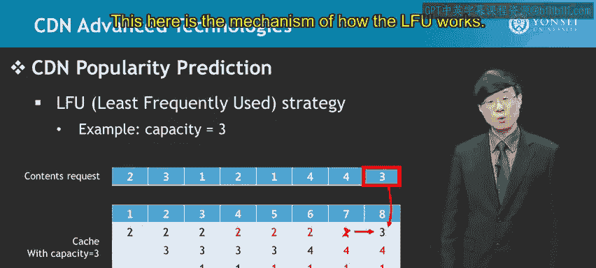
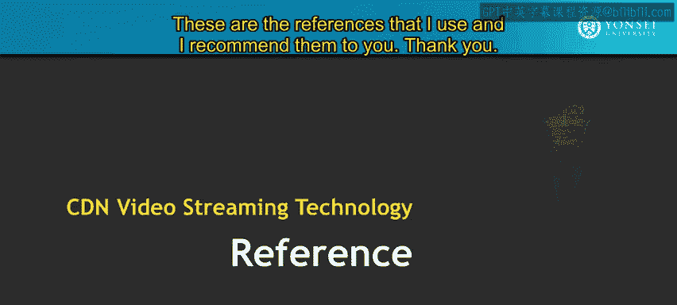

# 延世大学《新兴技术从智能手机到物联网再到大数据》课程 - P155：32_6.4 CDN先进技术（第2部分）🚀

在本节课中，我们将继续学习内容分发网络（CDN）的先进技术。我们将深入探讨一种重要的缓存替换算法——最不经常使用（LFU）算法，并了解移动无线网络环境为CDN服务带来的独特挑战与机遇。

## 📊 LFU（最不经常使用）缓存算法

上一节我们介绍了缓存的基本概念，本节中我们来看看一种基于内容请求频率的缓存管理策略：LFU算法。

LFU算法的核心思想是预测内容的受欢迎程度。它通过观察特定时间窗口内的请求记录来实现。算法会统计在给定时间段内（例如直到时间 `t-1`），每个内容被请求的次数。请求频率最低的内容将被从CDN缓存中移除。

**公式描述**： 对于缓存中的每个内容项 `i`，在时间窗口 `[t-W, t-1]` 内，统计其请求频率 `F(i)`。当缓存已满且需要插入新内容时，移除 `F(i)` 值最小的项。

该算法基于一个假设：近期被频繁请求的内容，在不久的将来再次被请求的可能性更高。

如果多个内容项具有相同的请求频率，算法则会采用LRU（最近最少使用）策略作为辅助决策。换句话说，在频率相同的情况下，会检查哪个内容被请求的时间更近，保留较新的那个，丢弃较旧的。

以下是LFU算法的一个运行示例，假设缓存容量为3：

我们有一个按时间顺序排列的请求序列：内容2， 内容3， 内容1， 内容2， 内容1， 内容4， 内容4， 内容3。我们将逐步观察缓存状态的变化。

*   **步骤1**： 请求内容2。缓存记录内容2，请求次数为1。
*   **步骤2**： 请求内容3。缓存记录内容3，请求次数为1。
*   **步骤3**： 请求内容1。缓存记录内容1，请求次数为1。此时缓存已满（包含2，3，1）。
*   **步骤4**： 再次请求内容2。内容2的请求次数增加为2。
*   **步骤5**： 再次请求内容1。内容1的请求次数增加为2。此时，内容3的请求次数仍为1，是“最不经常使用”的项。
*   **步骤6**： 请求新内容4。缓存已满，需要替换。内容3和内容4的请求次数都是1（内容4是首次请求）。根据辅助的LRU规则，内容3是较旧的项，因此被移除，内容4加入缓存，请求次数记为1。
*   **步骤7**： 再次请求内容4。内容4的请求次数增加为2。
*   **步骤8**： 请求内容3。缓存已满，且内容2、4、1的请求次数均为2。内容2是这三个中最早被请求的（根据步骤4、7、5），因此被移除。内容3加入缓存，请求次数记为1。

以上便是LFU算法结合LRU辅助策略的工作机制。

## 📱 移动CDN（M-CDN）的挑战

在讨论了固定网络的缓存策略后，我们转向一个更具动态性的环境：移动无线网络。在此环境中支持CDN服务面临着额外的挑战。

诸如GPS导航、移动电视、智能交通系统（ITS）、基于位置的服务（LBS）等技术，在智能手机、智能汽车等移动设备上非常有效。因此，如何让CDN技术适应移动环境并高效地提供内容，是当前面临的一大挑战。

移动CDN需要在覆盖广泛的区域提供可扩展的控制，同时利用有限的资源保证高质量的服务水平。这比传统的互联网CDN服务挑战更大。

以下是移动CDN面临的主要挑战：

*   **移动节点限制**： 由于移动设备便携性的要求，其存储空间、处理能力、输入能力等资源通常有限。
*   **频繁的网络断开**： 移动用户经历网络切换（Handover）时，可能导致连接中断。
*   **用户移动性**： 需要考虑与用户位置和移动轨迹相关的服务。
*   **实时监控**： 获取移动用户的实时状态（如位置、网络质量）是一大挑战。

为了更清晰地理解移动CDN与传统CDN的区别，我们可以从以下几个维度进行比较：

*   **内容类型**： 传统CDN主要处理**静态**内容，而移动CDN需要更多地处理**动态**内容和流媒体。
*   **用户位置**： 传统CDN用户位置通常是**固定**的（如台式机），而移动CDN用户位置是**可变**的。
*   **代理服务器位置**： 传统CDN的代理服务器部署相对**固定**，而移动CDN的代理需要考虑基站、无线接入网等**移动网络因素**。
*   **拓扑与服务中心**： 传统CDN基于**互联网服务提供商（ISP）** 网络，有明确的服务中心；移动CDN则基于**移动通信网络**，其中心是基站和无线接入网。
*   **维护复杂度**： 传统CDN的维护复杂度为**低到中**，而移动CDN的复杂度为**中到高**。
*   **服务类型**： 传统CDN提供多媒体和数据服务；移动CDN则在此基础上，将广泛支持**移动应用**、**基于位置的服务（LBS）** 和**云接入**。

## 🎯 总结

本节课中我们一起学习了CDN的两项关键技术。首先，我们深入分析了LFU缓存替换算法，它根据内容在特定时间窗口内的请求频率来决定缓存内容的去留，并在频率相同时辅以LRU策略。接着，我们探讨了移动CDN（M-CDN）所面临的独特挑战，包括设备资源限制、网络不稳定性、用户移动性等，并通过与传统CDN的对比，理解了移动环境对内容分发技术提出的新要求。这些知识对于构建高效、适应性强的内容分发系统至关重要。