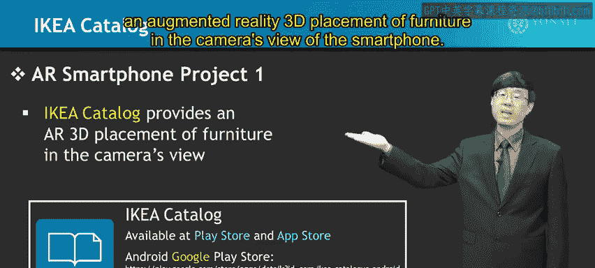

# 156：33_7.1 宜家目录AR应用教程 🛋️

在本节课中，我们将学习如何使用宜家（IKEA）目录应用程序，这是一个增强现实（AR）项目，它允许你在智能手机的摄像头视图中虚拟放置3D家具模型。我们将通过实际操作，探索该应用的功能并测试其在不同环境下的表现。

---

## 应用下载与介绍 📱

首先，你需要下载宜家目录应用程序。如果你使用的是安卓智能手机，请前往Google Play商店下载；如果你使用的是iPhone，请前往苹果App商店下载。

该应用的核心功能是：通过智能手机的摄像头视图，以增强现实技术放置3D家具模型。

## 探索应用模式与基础操作 🧐

上一节我们介绍了如何下载应用，本节中我们来看看它的基本操作模式。你可以在应用中看到不同的模式选项。

接下来，我们尝试放置一个家具模型。例如，在我的实验室里有一张清理过的桌子，我们可以用它作为示例。

你可以调整家具模型的高度，观察3D AR图像如何随之变化。调整选项通常位于屏幕上的特定位置。

我建议你回看应用内的教程，以获取更多操作细节。

在教程中，你可以回顾所有选项，了解如何改变3D增强现实家具图像。请仔细观察，因为我们将基于这些选项进行实验。

## 进行AR家具放置实验 🧪

现在，请在你自己的办公室、家中或其他区域尝试放置3D增强现实家具图像。

以下是实验的具体步骤列表，请逐一尝试：

首先，对于每个家具类别，尽可能多地尝试不同选项。观察是否存在因空间或其他限制而无法应用的选项。

例如，在下方的桌子上，可以添加一个3D增强现实的黑色台灯模型。

其次，使用屏幕下方的选项。查看所选家具的加载信息被添加在何处。此外，尝试将选中的家具替换为其他更大的家具，观察增强现实系统是否会根据家具尺寸和实际可放置空间识别出限制。

请仔细查看并使用这些选项。

检查这些选项的功能。例如，尝试使用 **“i” 按钮** 来加载家具的详细信息。

此外，你可以使用 **相机快门按钮** 进行截图。

## 实验目标与问题发现 🔍

以上是我们希望你使用各种选项进行的实验。在实验过程中，请留意并记录以下情况：

1.  **性能不佳的情况**：即使空间充足，应用也无法放置某件家具。
2.  **放置不合理的情况**：应用将一件家具放置在一个对它而言小得不切实际的空间里。
3.  **信息错误的情况**：某件物品的信息放置不正确或不恰当。

你需要逐一测试选项，找出应用可能无法正常运行的情况，并记录是在何种环境下发生的。

## 分享与协作 🤝

除了独立实验，我还希望你能够帮助你的同伴。

以下是你可以做的事情：

*   提供有用的操作技巧。
*   告知他人你在使用宜家目录AR应用时发现的令人兴奋的功能。
*   向同伴推荐其他你认为有趣且实用的优秀AR应用。

通过互相帮助，大家可以更好地理解增强现实系统。

## 课程总结与参考资料 📚

本节课中，我们一起学习了宜家目录AR应用的基本操作，并通过一系列实验探索了其功能与局限性。我们练习了虚拟放置家具、调整属性、识别系统限制，并强调了在社群中分享发现的重要性。

这些是我使用的参考资料，也推荐给你参考。

请注意，本课程还有另一个项目，请继续学习。

感谢学习。