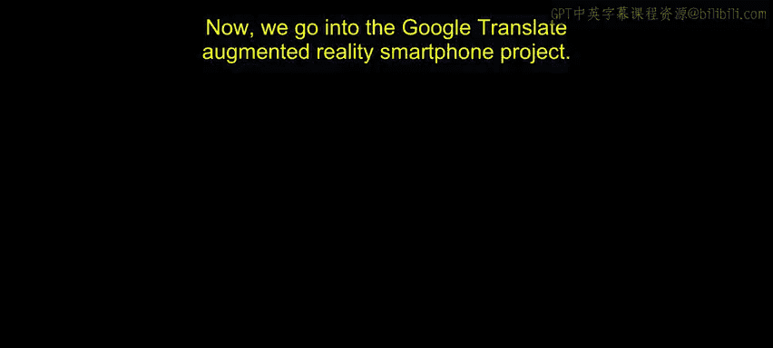
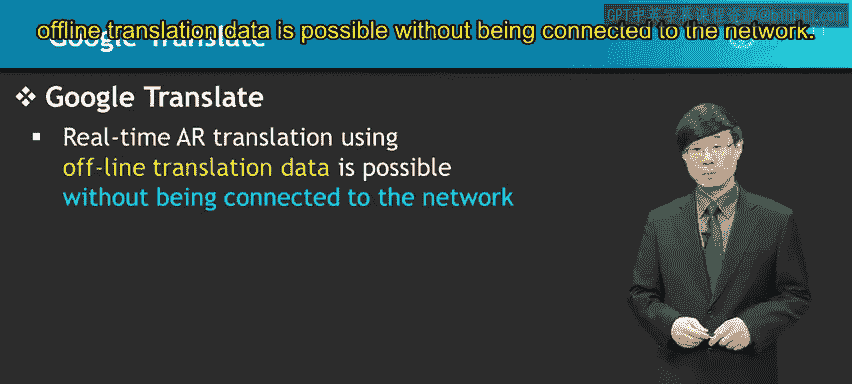
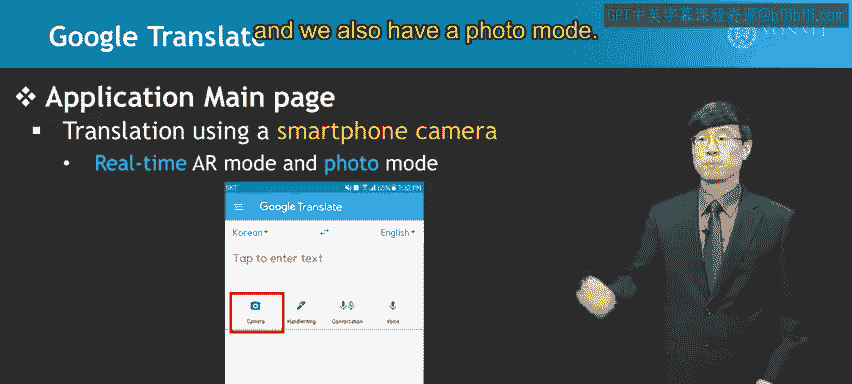
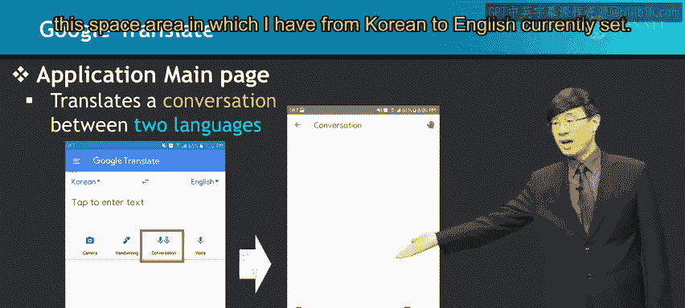
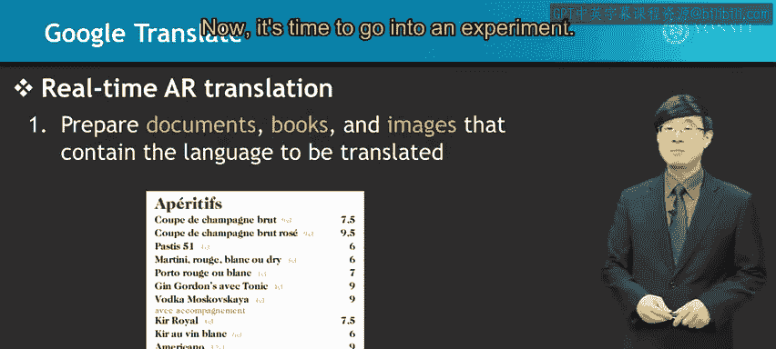
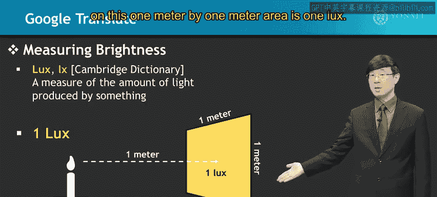
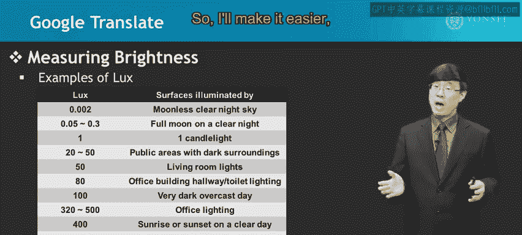
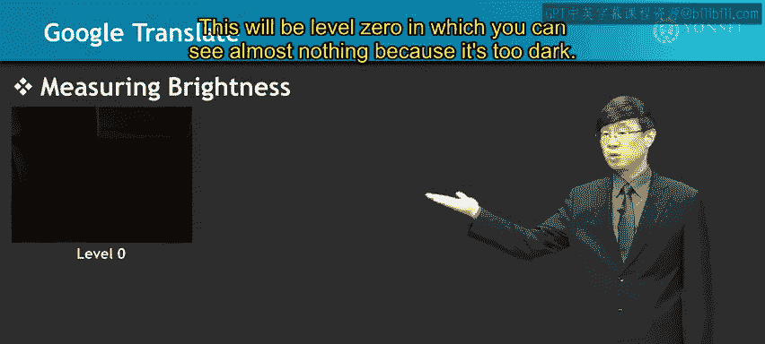
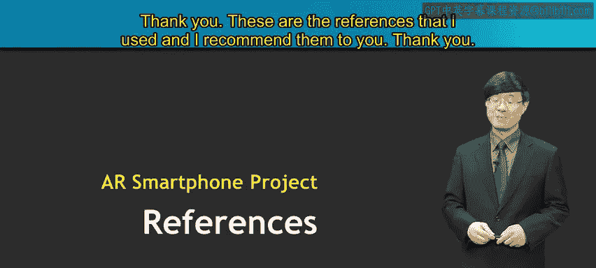

# 157：谷歌翻译增强现实项目 📱➡️🌍

在本节课中，我们将学习谷歌翻译的增强现实功能。我们将了解如何利用智能手机的摄像头和增强现实技术进行实时翻译，并动手进行一项实验，测试不同环境因素对翻译效果的影响。

---

## 项目概述：谷歌翻译增强现实

现在，我们进入谷歌翻译增强现实智能手机项目。这是第二个项目。

首先，需要下载谷歌翻译应用。你可以从安卓的 Play 商店或苹果的 App Store 下载。

谷歌翻译利用智能手机的摄像头和增强现实显示，提供实时翻译。即使不连接网络，也能使用离线翻译数据进行实时增强现实翻译。

## 应用功能详解

上一节我们介绍了项目的基本情况，本节中我们来看看应用的具体功能。

应用支持的语言种类繁多，列在列表中。

查看应用主页面，中间有多个功能按钮。以下是主要选项：

首先，需要选择翻译的源语言和目标语言。此外，还有“检测语言”选项，但此选项不支持实时AR翻译，仅用于检测语言。

我们还可以使用智能手机摄像头进行翻译，即实时增强现实模式，以及照片翻译模式。

此外，可以使用此功能翻译手写文字，下方会显示整体翻译结果。

使用那个模式，可以翻译两种语言之间的对话，对话翻译会显示在此区域。目前我设置的是从韩语翻译到英语。

另一个选项是语音翻译。

现在，进入实时AR翻译模式。你可以使用顶部的按钮切换语言。此外，使用这个选项可以开启或关闭实时AR翻译模式。

使用这个模式可以打开或关闭智能手机摄像头的闪光灯。另外，使用那个按钮可以在照片模式下进行翻译。你也可以用手指高亮文本。此外，可以使用那边的按钮加载图像进行翻译。

你可以使用这个按钮暂停实时AR翻译。

## 实验：测试环境因素对翻译的影响

了解了基本功能后，本节我们将进行一项实验，测试不同环境下的翻译效果。

准备包含你想要翻译语言的文档、书籍或图像。

然后，在谷歌翻译应用中使用实时AR翻译模式进行翻译，就像你在此过程中看到的那样。

接着，尝试在改变环境因素的情况下进行翻译，例如亮度、距离、智能手机摄像头分辨率等选项。

我特别希望你们进行的一项实验是测试不同黑暗等级下的效果，就像这个例子中，让环境变得更暗甚至更暗。

亮度的测量并非易事。基本单位是**勒克斯**，它是衡量光源产生的光量的单位。

一个代表性的勒克斯单位定义如下：距离蜡烛一米远，照射在一平方米表面上的光量为一勒克斯。

基于这个单位，你可以看到勒克斯值的例子：无月晴夜的天空范围从0.002勒克斯，一直到直射阳光，可达100,000勒克斯。

我知道这些亮度等级难以使用，所以我会让它更简单。

我们将基于我们的标准来测量亮度。

以下是亮度等级定义：

*   **等级0**：几乎看不见，因为太暗。
    
*   **等级2**：稍微亮一点。
    

我们也会使用中间阶段，即**等级1**，介于这两者之间，你可以想象等级1的样子。

然后是**等级4**，看起来更亮但不是完全明亮。再上一级是**等级6**。当然，它变得越来越亮，但我也希望你们考虑**等级3**和**等级5**这些中间等级，尽管我这里只展示了主要等级。

最后是最高等级**等级8**，完全明亮。因此，我们有从等级0到等级8共九个等级。

使用这些等级，我们将测试基于亮度性能的实时增强现实翻译，等级从0到8。

让房间变暗，然后根据我刚才展示的图片比较黑暗等级。

我希望你们考虑在不同亮度等级下的性能。考虑文本大小、距离以及字体类型，因为基于字体，一些检测结果会大不相同。

同时考虑语言翻译类型。然后考虑光线从不同角度、以不同亮度照射时的性能。

总的来说，找出谷歌翻译应用可能无法正常运行的几种情况。

## 协作与分享

除了我刚才为这个项目解释的内容，我还希望你们帮助同伴。

以下是你可以做的事情：
*   提供有用的提示。
*   告知他人你从使用谷歌翻译增强现实应用中发现的有趣发现。
*   向同伴介绍其他优秀的AR应用。
*   帮助他人，让他们更熟练地使用增强现实系统。

谢谢。

这些是我使用的参考资料，我推荐给你们。

---

## 课程总结

本节课中，我们一起学习了谷歌翻译的增强现实功能。我们详细了解了其操作界面和多种翻译模式，并通过一个系统的实验，探索了环境亮度等因素对实时AR翻译效果的影响。最后，我们强调了在实践中分享发现、互相帮助的重要性。