# 佐治亚理工 CS4650 自然语言处理中文讲义

Jacob Eisenstein

2018年11月13日

## 目录

- **目录** ······································································································ **1**
- **前言** ·········································································································· **i**
    - 背景 ············································································································ **i**
    - 如何使用本书 ··································································································· **ii**
- **1 引言** ··········································································································· **1**
    - 1.1 自然语言处理及其邻域 ·························································································· **1**
    - 1.2 自然语言处理的三个主题 ························································································ **6**
        - 1.2.1 学习和知识 ································································································ **6**
        - 1.2.2 搜索和学习 ································································································ **7**
        - 1.2.3 关系、组合和分布视角 ················································································· **9**
- **I 学习** ············································································································ **11**
- **2 线性文本分类** ······························································································ **13**
    - 2.1 词袋模型 ········································································································ **13**
    - 2.2 朴素贝叶斯 ······································································································ **17**
        - 2.2.1 类型和标记 ································································································ **19**
        - 2.2.2 预测 ········································································································ **20**
        - 2.2.3 估计 ········································································································ **21**
        - 2.2.4 平滑 ········································································································ **22**
        - 2.2.5 设置超参数 ································································································ **23**
    - 2.3 判别学习 ········································································································ **24**
        - 2.3.1 感知机 ······································································································ **25**
        - 2.3.2 平均感知机 ································································································ **27**
    - 2.4 损失函数和大边界分类 ······················································································ **27**
        - 2.4.1 在线大边界分类 ·························································································· **30**
        - 2.4.2 *在线支持向量机的推导 ·················································································· **32**
    - 2.5 逻辑回归 ········································································································ **35**
        - 2.5.1 正则化 ······································································································ **36**
        - 2.5.2 梯度 ········································································································ **37**
    - 2.6 优化 ········································································································ **37**
        - 2.6.1 批量优化 ···································································································· **38**
        - 2.6.2 在线优化 ···································································································· **39**
    - 2.7 *分类中的其他主题 ·························································································· **41**
        - 2.7.1 通过正则化进行特征选择 ··················································································· **41**
        - 2.7.2 逻辑回归的其他观点 ························································································ **41**
    - 2.8 学习算法总结 ································································································ **43**
- **3 非线性分类** ······························································································ **47**
    - 3.1 前馈神经网络 ···································································································· **48**
    - 3.2 设计神经网络 ···································································································· **50**
        - 3.2.1 激活函数 ······································································································ **50**
        - 3.2.2 网络结构 ······································································································ **51**
        - 3.2.3 输出和损失函数 ······························································································ **52**
        - 3.2.4 输入和查找层 ································································································· **53**
    - 3.3 学习神经网络 ···································································································· **53**
        - 3.3.1 反向传播 ······································································································ **55**
        - 3.3.2 正则化和丢弃 ································································································· **57**
        - 3.3.3 *学习理论 ······································································································ **58**
        - 3.3.4 技巧 ········································································································ **59**
    - 3.4 卷积神经网络 ···································································································· **62**
- **4 分类的语言应用** ···························································································· **69**
    - 4.1 情感和观点分析 ··································································································· **69**
        - 4.1.1 相关问题 ······································································································ **70**
        - 4.1.2 情感分析的替代方法 ·························································································· **72**
    - 4.2 词义消歧 ········································································································ **73**
        - 4.2.1 有多少个词义? ································································································· **74**
        - 4.2.2 词义消歧作为分类 ······························································································ **75**
    - 4.3 文本分类的设计决策 ···························································································· **76**
        - 4.3.1 什么是一个词? ································································································· **76**
        - 4.3.2 有多少个词? ··································································································· **79**
        - 4.3.3 计数还是二进制? ······························································································ **80**
    - 4.4 评估分类器 ········································································································ **80**
        - 4.4.1 精确度、召回率和 F-度量 ······················································································· **81**
        - 4.4.2 无阈值指标 ······································································································ **83**
        - 4.4.3 分类器比较和统计显著性 ························································································· **84**
        - 4.4.4 *多重比较 ······································································································ **87**
    - 4.5 构建数据集 ········································································································ **88**
        - 4.5.1 元数据作为标签 ································································································· **88**
        - 4.5.2 标记数据 ······································································································ **88**
- **5 无监督学习** ···································································································· **95**
    - 5.1 无监督学习 ········································································································ **95**
        - 5.1.1 K均值聚类 ······································································································ **96**
        - 5.1.2 期望最大化 (EM) ································································································ **98**
        - 5.1.3 EM作为优化算法 ································································································ **102**
        - 5.1.4 有多少个聚类? ································································································ **103**
    - 5.2 期望最大化的应用 ······························································································ **104**
        - 5.2.1 词义归纳 ······································································································ **104**
        - 5.2.2 半监督学习 ···································································································· **105**
        - 5.2.3 多组分建模 ···································································································· **106**
    - 5.3 半监督学习 ········································································································ **107**
        - 5.3.1 多视图学习 ···································································································· **108**
        - 5.3.2 基于图的算法 ································································································· **109**
    - 5.4 领域适应 ········································································································ **110**
        - 5.4.1 监督领域适应 ································································································· **111**
        - 5.4.2 无监督领域适应 ································································································ **112**
    - 5.5 *学习潜在变量的其他方法 ······················································································ **114**
        - 5.5.1 采样 ········································································································ **115**
        - 5.5.2 谱学习 ········································································································ **117**
- **II 序列和树** ···································································································· **123**
- **6 语言模型** ······································································································ **125**
    - 6.1 N-gram 语言模型 ·································································································· **126**
    - 6.2 平滑和折扣 ········································································································ **129**
        - 6.2.1 平滑 ········································································································ **129**
        - 6.2.2 折扣和回退 ···································································································· **130**
        - 6.2.3 *插值 ········································································································ **131**
        - 6.2.4 *Kneser-Ney 平滑 ······························································································· **133**
    - 6.3 循环神经网络语言模型 ·························································································· **133**
        - 6.3.1 时序反向传播 ································································································· **136**
        - 6.3.2 超参数 ······································································································ **137**
        - 6.3.3 门控循环神经网络 ······························································································ **137**
    - 6.4 评估语言模型 ······································································································ **139**
        - 6.4.1 保留似然 ······································································································ **139**
        - 6.4.2 困惑度 ······································································································ **140**
    - 6.5 未知词 ········································································································ **141**
- **7 序列标注** ···································································································· **143**
    - 7.1 序列标注作为分类 ································································································ **145**
    - 7.2 序列标注作为结构预测 ···························································································· **147**
    - 7.3 维特比算法 ········································································································ **149**
        - 7.3.1 示例 ········································································································ **152**
        - 7.3.2 高阶特征 ······································································································ **153**
    - 7.4 隐马尔可夫模型 ···································································································· **153**
        - 7.4.1 估计 ········································································································ **155**
        - 7.4.2 推断 ········································································································ **155**
    - 7.5 带特征的判别式序列标注 ·························································································· **157**
        - 7.5.1 结构化感知器 ································································································· **160**
        - 7.5.2 结构化支持向量机 ······························································································ **160**
        - 7.5.3 条件随机场 ···································································································· **162**
    - 7.6 神经序列标注 ······································································································ **167**
        - 7.6.1 循环神经网络 ································································································· **167**
        - 7.6.2 字符级模型 ···································································································· **169**
        - 7.6.3 序列标注的卷积神经网络 ······················································································ **170**
    - 7.7 *无监督序列标注 ·································································································· **170**
        - 7.7.1 线性动力系统 ································································································· **172**
        - 7.7.2 替代的无监督学习方法 ························································································ **172**
        - 7.7.3 半环符号和广义维特比算法 ····················································································· **172**
- **8 序列标注的应用** ···························································································· **175**
    - 8.1 词性标注 ········································································································ **175**
        - 8.1.1 词性 ········································································································ **176**
        - 8.1.2 准确的词性标注 ································································································· **180**
    - 8.2 形态句法属性 ······································································································ **182**
    - 8.3 命名实体识别 ······································································································ **183**
    - 8.4 分词 ········································································································ **185**
    - 8.5 代码切换 ········································································································ **186**
    - 8.6 对话行为 ········································································································ **187**
- **9 形式语言理论** ·································································································· **189**
    - 9.1 正则语言 ········································································································ **192**
        - 9.1.1 有限状态自动机 ································································································· **193**
        - 9.1.2 形态学作为正则语言 ······························································································ **194**
        - 9.1.3 加权有限状态自动机 ······························································································ **196**

## 目录

#### 9.2.2 自然语言句法作为上下文无关语言
#### 9.2.3 英语的短语结构文法
#### 9.2.4 语法歧义
### 9.3 *轻度上下文敏感语言
- 9.3.1 自然语言中的上下文敏感现象
- 9.3.2 组合范畴语法

## 10 上下文无关解析

### 10.1 确定性自底向上解析
- 10.1.1 恢复解析树
- 10.1.2 非二进制产生式
- 10.1.3 复杂度
### 10.2 歧义
- 10.2.1 解析器评估
- 10.2.2 局部解决方案
### 10.3 加权上下文无关文法
- 10.3.1 带权上下文无关文法解析
- 10.3.2 概率上下文无关文法
- 10.3.3 *半环加权上下文无关文法
### 10.4 学习加权上下文无关文法
- 10.4.1 概率上下文无关文法
- 10.4.2 基于特征的解析
- 10.4.3 *条件随机场解析
- 10.4.4 神经上下文无关文法
### 10.5 文法细化
- 10.5.1 父节点注释和其他树转换
- 10.5.2 词汇化上下文无关文法
- 10.5.3 *细化语法
### 10.6 超越上下文无关解析
- 10.6.1 重新排序
- 10.6.2 基于转换的解析

## 11 依存解析

### 11.1 依存语法
- 11.1.1 主语和从属语
- 11.1.2 标记依赖
- 11.1.3 依存子树和成分
### 11.2 基于图的依存解析
- 11.2.1 基于图的解析算法
- 11.2.2 计算依赖弧的分数
- 11.2.3 学习

| 项目 | 页码 |
| :--- | :--- |
| 11.3 基于转换的依存解析 | 268 |
| 11.3.1 用于依存解析的转换系统 | 269 |
| 11.3.2 用于基于转换的解析器的评分函数 | 273 |
| 11.3.3 学习解析 | 274 |
| 11.4 应用 | 277 |

## III 意义

### 12 逻辑语义学
- 12.1 意义和指称
- 12.2 意义的逻辑表示
    - 12.2.1 命题逻辑
    - 12.2.2 一阶逻辑
- 12.3 语义解析和λ演算
    - 12.3.1 λ演算
    - 12.3.2 量化
- 12.4 学习语义解析器
    - 12.4.1 从推导中学习
    - 12.4.2 从逻辑形式中学习
    - 12.4.3 从指称中学习

### 13 谓词论元语义学
- 13.1 语义角色
    - 13.1.1 VerbNet
    - 13.1.2 原型角色和PropBank
    - 13.1.3 FrameNet
- 13.2 语义角色标注
    - 13.2.1 语义角色标注作为分类
    - 13.2.2 语义角色标注作为约束优化
    - 13.2.3 神经语义角色标注
- 13.3 抽象意义表示
    - 13.3.1 AMR解析

### 14 分布式和分布式语义学
- 14.1 分布假设
- 14.2 词表示的设计决策
    - 14.2.1 表示
    - 14.2.2 上下文
    - 14.2.3 估计
- 14.3 潜在语义分析
### 14.4 布朗聚类
### 14.5 神经词嵌入
- 14.5.1 连续词袋模型（CBOW）
- 14.5.2 Skipgrams
- 14.5.3 计算复杂度
- 14.5.4 词嵌入作为矩阵分解
### 14.6 评估词嵌入
- 14.6.1 内在评估
- 14.6.2 外在评估
- 14.6.3 公平性和偏见
### 14.7 超越分布统计的分布式表示
- 14.7.1 词内部结构
- 14.7.2 词汇语义资源
### 14.8 多词单位的分布式表示
- 14.8.1 纯分布式方法
- 14.8.2 分布式-组合混合方法
- 14.8.3 监督组合方法
- 14.8.4 混合分布符号表示

### 15 参考解析
- 15.1 指代表达形式
    - 15.1.1 代词
    - 15.1.2 专有名词
    - 15.1.3 名词
- 15.2 核指代消解算法
    - 15.2.1 提及对模型
    - 15.2.2 提及排序模型
    - 15.2.3 基于提及的模型中的传递闭包
    - 15.2.4 基于实体的模型
- 15.3 核指代消解的表示
    - 15.3.1 特征

### 16.2.3 *句子级别之外的形式语义
### 16.3 关系
- 16.3.1 浅层语篇关系
- 16.3.2 分层语篇关系
- 16.3.3 论证
- 16.3.4 话语关系的应用

## IV 应用

### 17 信息提取
- 17.1 实体
    - 17.1.1 通过学习排序进行实体链接
    - 17.1.2 集体实体链接
    - 17.1.3 *成对排序损失函数
- 17.2 关系
    - 17.2.1 基于模式的关系抽取
    - 17.2.2 关系抽取作为分类任务
    - 17.2.3 知识库填充
    - 17.2.4 开放信息提取
- 17.3 事件
- 17.4 修辞、否定和假设
- 17.5 问答和机器阅读理解
    - 17.5.1 形式语义学
    - 17.5.2 机器阅读理解

### 18 机器翻译
- 18.1 机器翻译作为一个任务
    - 18.1.1 评估翻译
    - 18.1.2 数据
- 18.2 统计机器翻译
    - 18.2.1 统计翻译建模
    - 18.2.2 估计
    - 18.2.3 基于短语的翻译
    - 18.2.4 *基于句法的翻译
- 18.3 神经机器翻译
    - 18.3.1 神经注意力
    - 18.3.2 *无循环神经机器翻译
    - 18.3.3 未登录词
- 18.4 解码
- 18.5 基于评估指标的训练

### 19 文本生成
- 19.1 数据到文本生成
    - 19.1.1 潜在数据到文本对齐
    - 19.1.2 神经数据到文本生成
- 19.2 文本到文本生成
    - 19.2.1 神经抽象摘要
    - 19.2.2 多文档摘要的句子融合
- 19.3 对话
    - 19.3.1 有限状态和议程驱动的对话系统
    - 19.3.2 马尔可夫决策过程
    - 19.3.3 神经聊天机器人

### A 概率
- A.1 事件组合的概率
    - A.1.1 互斥事件的概率
    - A.1.2 总概率法则
- A.2 条件概率和贝叶斯规则
- A.3 独立性
- A.4 随机变量
- A.5 期望
- A.6 建模和估计

### B 数值优化
- B.1 梯度下降
- B.2 约束优化
- B.3 示例：被动侵略在线学习

## 参考文献

# 前言

本文的目标是专注于自然语言处理的核心子集，通过学习和搜索的概念来统一。令人惊讶的是，自然语言处理中的许多问题可以通过一组紧凑的方法来解决：

搜索。维特比算法、CKY算法、最小生成树、移位-归约算法、整数线性规划、波束搜索。

学习。最大似然估计、逻辑回归、感知器、期望-最大化、矩阵分解、反向传播。

本文解释了这些方法的工作原理，以及它们如何应用于广泛的任务：文档分类、词义消歧、词性标注、命名实体识别、解析、共指消解、关系抽取、语篇分析、语言建模和机器翻译。

## 背景

由于自然语言处理涉及许多不同的学科传统，几乎每个接触它的人都会感到在某种程度上准备不足。这里是预期的摘要，以及你可以了解更多的地方：

数学和机器学习。本文假设读者具备多元微积分和线性代数的背景知识：向量、矩阵、导数和偏导数。你还应该熟悉概率和统计。基本概率的复习可以在附录A中找到，数值优化的最小复习可以在附录B中找到。关于线性代数，Strang（2016）的在线课程和教材提供了很好的复习资料。Deisenroth等人（2018）目前正在准备一本关于数学与机器学习的教材，可以在网上找到草稿。¹ 对于概率建模和估计的介绍，请参阅James等人（2013）；对于同一材料的更高级和全面的讨论，经典参考文献是Hastie等人（2009年）。

语言学。本书假设您在语言学方面没有正式的培训，除了名词和动词等基本概念，您可能在英语语法研究中遇到过。需要时，本书引入了语言学的思想，包括形态学和句法学的讨论（第9章），语义学的讨论（第12章和第13章）以及话语学的讨论（第16章）。语言学问题也在应用导向的第4章、第8章和第18章中出现。Bender（2013年）为自然语言处理学生提供了一个简短的语言学指南；鼓励您从那里开始，然后再选择一本更全面的入门教材（例如，Akmajian等人，2010年；Fromkin等人，2013年）。

计算机科学。本书面向计算机科学家，假设他们已经学过算法分析和复杂性理论的入门课程。特别是，你应该熟悉算法时间和内存成本的渐近分析，以及动态规划的基础知识。关于算法的经典文本由Cormen等人（2009）提供；关于计算理论的介绍，请参阅Arora和Barak（2009）和Sipser（2012）。

## 如何使用本书

在介绍之后，教材分为四个主要部分：

- 学习。本节介绍了一套机器学习工具，这些工具将在其他部分中使用。由于重点是机器学习，文本表示和语言现象大多是简单的：“词袋”文本分类被视为一个典型的例子。第4章描述了一些更有趣的基于词的文本分析应用。
- 序列和树。本节介绍了将语言视为结构化现象的处理方法。它描述了序列和树的表示以及它们所支持的算法，以及这些表示所带来的限制。第9章介绍了有限状态自动机，并简要概述了英语句法的上下文无关描述。
- 意义。本节从形式逻辑到神经词嵌入等广泛介绍了从文本中表示和计算意义的努力。它还包括与语义密切相关的两个主题：消解歧义引用和多句子话语结构分析。
- 应用。最后一部分对自然语言处理的三个最重要的应用进行了章节式的论述：信息提取、机器翻译和文本生成。这些应用每个都值得有一本专门的教材来介绍（Koehn, 2009; Grishman, 2012; Reiter and Dale, 2000）；本书的这些章节使用了前面建立起来的形式主义和方法，同时引入了神经注意力等方法。

每个章节都包含一些高级材料，用星号标记。即使没有这些高级部分，也可以安全地省略，而不会导致后续误解。但是，即使没有这些高级部分，这段文字对于一个学期的课程来说也太长了，所以教师们必须在章节中进行选择。

第1-3章提供了本书中将要使用的基础知识，第4章描述了语言技术实践的一些关键方面。语言模型（第6章），序列标注（第7章）和解析（第10章和第11章）是自然语言处理中的经典主题，分布式词嵌入（第14章）已经无处不在。在应用方面，机器翻译（第18章）是最佳选择：它比信息抽取更具凝聚力，比文本生成更成熟。许多学生将从附录A中的概率复习中受益。

- 一个专注于机器学习的课程应该添加无监督学习（第5章）。关于谓词-论元语义（第13章），参考消解（第15章）和文本生成（第19章）的章节受到了机器学习的最新进展的影响，包括深度神经网络和学习搜索。
- 一个更加语言学导向的课程应该增加关于序列标注应用（第8章）、形式语言理论（第9章）、语义学（第12章和第13章）以及话语（第16章）的章节。
- 对于一个更加应用导向的课程，我推荐关于序列标注应用（第8章）、谓词-论元语义学（第13章）、信息抽取（第17章）以及文本生成（第19章）的章节。

# 致谢

一些同事、学生和朋友阅读了他们所擅长领域的章节初稿，包括Yoav Artzi、Kevin Duh、Heng Ji、Jessy Li、Brendan O'Connor、Yuval Pinter、Shawn Ling Ramirez、Nathan Schneider、Pamela Shapiro、Noah A. Smith、Sandeep Soni和Luke Zettlemoyer。我还要感谢匿名审稿人，特别是第4位审稿人，他提供了详细的逐行编辑和建议。这本书受益于与我的编辑Marie Lufkin Lee、Kevin Murphy、Shawn Ling Ramirez和Bonnie Webber的高层次讨论。此外，还有许多学生、同事、朋友和家人在初稿中发现了错误，或者推荐了关键参考资料。

在与MIT Press签订的合同下，根据CC-BY-NC-ND许可共享。

这些人包括：Parminder Bhatia, Kimberly Caras, Jiahao Cai, Justin Chen, Rodolfo Del Monte, Murtaza Dhuliawala, Yantao Du, Barbara Eisenstein, Luiz C. F. Ribeiro, Chris Gu, Joshua Killingsworth, Jonathan May, Taha Merghani, Gus Monod, Raghavendra Murali, Nidish Nair, Brendan O'Connor, Dan Oneata, Brandon Peck, Yuval Pinter, Nathan Schneider, Jianhao Shen, Zhewei Sun, Rubin Tsui, Ashwin Cunnappakkam Vinjimur, Denny Vrandečić, William Yang Wang, Clay Washington, Ishan Waykul, Aobo Yang, Xavier Yao, Yuyu Zhang，以及一些匿名评论者。 Clay Washington测试了一些编程练习，Varun Gupta测试了一些书面练习。 感谢Kelvin Xu分享了Figure 19.3的高分辨率版本。

大部分的书是在我在乔治亚理工学院交互计算学院期间写的。 我感谢学院对这个项目的支持，也感谢我在职业生涯初期得到的同事们的帮助和支持。 我还要感谢（并向）乔治亚理工学院CS 4650和7650的许多学生们道歉，他们在早期版本的教材中受苦。 这本书献给我的父母。

## 符号

一般规则是，用罗马字母 $(a, b, c)$ 表示单词、单词计数和其他类型的观察结果；用希腊字母 $(\alpha, \beta, \theta)$ 表示参数。向量用粗体表示，既用于随机变量 $x$，也用于参数 $\theta$。下表中列出了其他有用的符号表示。

| 基础知识 | |
| :--- | :--- |
| $\exp x$ | 以2为底的指数， $2^x$ |
| $\log x$ | 以2为底的对数， $\log_2 x$ |
| $\{x_n\}_{n=1}^N$ | 集合 $\{X_1, X_2, \ldots, X_N\}$ |
| $X_i^j$ | $X_i$的 $j$次方 |
| $x_i^{(j)}$ | 通过 $i$和 $j$进行索引 |

| 线性代数 | |
| :--- | :--- |
| $\boldsymbol{x}^{(i)}$ | 一个实例 $i$的特征计数的列向量，通常是词频 |
| $X_{j:K}$ | 向量X的第 $j$到 $k$（包括）个元素 |
| $[X; Y]$ | 两个列向量的垂直拼接 |
| $[X, Y]$ | 两个列向量的水平拼接 |
| $\boldsymbol{e}_n$ | 一个“独热”向量，在位置 $n$处的值为 1，其他位置为零 |
| $\boldsymbol{\theta}^T$ | 列向量 $\boldsymbol{\theta}$的转置 |
| $\boldsymbol{\theta} \cdot \boldsymbol{X}^{(i)}$ | 点积 $\sum_{j=1}^N \theta_j \times X_j^{(i)}$ |
| $\mathbf{X}$ | 一个矩阵 |
| $x_{i,j}$ | 矩阵 $\mathbf{X}$的第 $i$行，第 $j$列 |
| $\text{Diag}(\mathbf{X})$ | 一个对角线上为X的矩阵，例如 $\begin{pmatrix} x_1 & 0 & 0 \\ 0 & x_2 & 0 \\ 0 & 0 & x_3 \end{pmatrix}$ |
| $\mathbf{X}^{-1}$ | 矩阵 $\mathbf{X}$的逆 |

### 文本数据集

| 符号 | 描述 |
| :--- | :--- |
| $w_m$ | 在位置 $m$处的单词标记 |
| $M$ | 训练实例的数量 |
| $V$ | 序列（单词或标记）的长度 |
| $y^{(i)}$ | 词汇表中的单词数量 |
| $\hat{y}$ | 实例 $i$的真实标签 |
| $\mathcal{Y}$ | 预测的标签 |
| $K$ | 所有可能的标签集合 |
| $\square$ | 可能的标签数量 $K = |\mathcal{Y}|$ |
| $\blacksquare$ | 起始标记 |
| $\boldsymbol{y}^{(i)}$ | 结束标记 |
| $\mathcal{Y}(w)$ | 实例 $i$的结构化标签，例如标记序列 |
| $\diamondsuit$ | 单词序列 $w$的可能标记集合 |
| $\blacklozenge$ | 起始标记 |
| | 结束标记 |

### 概率

| 符号 | 描述 |
| :--- | :--- |
| $\Pr(A)$ | 事件 $A$的概率 |
| $\Pr(A \mid B)$ | 事件 $A$的概率，在事件 $B$发生的条件下 |
| $\mathrm{p}_{B}(b)$ | 随机变量$B$取值$b$的边际概率；在上下文中随机变量的选择清晰时，写作$\mathrm{p}(b)$<br>给定事件$A$的条件下，随机变量$B$取值$b$的条件概率$\mathrm{p}_{B \mid A}(b \mid a)$<br>在给定 $A$取值为 $a$的条件下，随机变量 $B$取值为 $b$的概率，写作 $p(b \mid a)$<br>，当上下文清楚时$A \sim \mathrm{p}$<br>随机变量 $A$按照分布 $p$进行分布。 例如， $X\sim\mathcal{N}(0,1)$表示随机变量 $X$从均值为零，方差为一的正态分布中抽取。 |
| | 在给定随机变量 $B$的条件下， $A$按照分布 $p$进行分布。 $^2$ |

### 机器学习

| 符号 | 描述 |
| :--- | :--- |
| $\Psi(\boldsymbol{x}^{(i)}, y)$ | 将标签 $y$分配给实例 $i$的得分 |
| $\boldsymbol{f}(\boldsymbol{x}^{(i)}, y)$ | 具有标签 $y$的实例 $i$的特征向量 |
| $\boldsymbol{\theta}$ | 一个（列）权重向量 |
| $\ell^{(i)}$ | 对于单个实例 $i$的损失 |
| $L$ | 整个数据集的目标函数 |
| $\mathcal{L}$ | 数据集的对数似然 |
| $\lambda$ | 正则化的数量 |

## 第一章

### 介绍

自然语言处理是一组使计算机能够理解人类语言的方法。在过去的十年中，自然语言处理已经深入到我们的日常生活中：自动机器翻译在网络和社交媒体上无处不在；文本分类使我们的电子邮件收件箱不至于被垃圾邮件淹没；搜索引擎已经超越了字符串匹配和网络分析，具备了高度的语言学技巧；对话系统提供了一种越来越常见和有效的获取和分享信息的方式。

这些多样化的应用都基于一套共同的思想，涉及算法、语言学、逻辑、统计等等。本书的目标是对这些基础知识进行概述。技术上的乐趣将在下一章开始；本章的其余部分将自然语言处理与其他学科进行对比，确定当代自然语言处理中的一些高级主题，并建议读者如何最好地学习这个主题。

### 1.1 自然语言处理及其邻域

自然语言处理借鉴了许多其他学科的思想，从形式语言学到统计物理学。本节简要介绍了自然语言处理与其最近的一些领域的关系。

计算语言学大多数举办自然语言处理研究的会议和期刊都以“计算语言学”为名，这两个术语可以说是基本上同义的。虽然存在很大的重叠，但关注点上有一个重要的区别。在语言学中，语言是研究的对象。计算方法可以被应用，就像在计算生物学和计算天文学等科学学科中一样，但它们只起到了支持作用。相比之下，自然语言处理专注于设计和分析用于处理自然人类语言的计算算法和表示方法。自然语言处理的目标是为人类语言提供新的计算能力，例如从文本中提取信息，进行语言翻译，回答问题，进行对话，接受指令等。基本的语言学见解对于完成这些任务可能至关重要，但成功的衡量标准最终取决于工作是否得到了有效地完成。

机器学习现代自然语言处理方法主要依赖于机器学习，这使得从示例中构建复杂的计算机程序成为可能。机器学习提供了一系列通用技术，用于将一个词汇表中的离散标记序列转换为另一个词汇表中的离散标记序列 - 这是对所谓的“翻译”非正式称呼的一种概括。今天的自然语言处理研究大部分可以被视为应用机器学习。然而，自然语言处理具有与许多其他机器学习应用领域不同的特点。

- 与图像或音频不同，文本数据基本上是离散的，意义是通过符号单元的组合排列来创建的。这对于文本作为输出的应用非常重要，例如翻译和摘要，因为不可能逐渐接近最优解。
- 虽然词汇表是离散的，但新词汇总是在不断产生的。此外，单词（和其他语言元素）的分布类似于幂律分布1（Zipf，1949）：会有一些非常频繁的词汇，以及一长串罕见的词汇。一个结果是自然语言处理算法必须对在训练数据中不存在的观察结果特别强大。
- 语言是组合的：词汇单元可以组合成短语，这些短语可以按照相同的原则组合成更大的短语。例如，一个名词短语可以通过将一个较小的名词短语与一个介词短语组合而成，如the whiteness of the whale。介词短语是通过将一个介词（在这种情况下为of）与另一个名词短语（thewhale）组合而成的。通过这种方式，可以创建任意长的短语，例如，

> (1.1) . . . . . . . . . . . . . . . . . . . . . . . 巨大的鲸鱼的球状碎片，大小如人类头部。2

这样一个短语的含义必须根据底层的层次结构进行分析。在这种情况下，巨大的鲸鱼的球状碎片作为一个单一的名词短语，它与介词短语of the bigness of a humanhead连接。如果相反地，巨大的球状物与介词短语of the whale of the bigness of a human head连接，那么解释将不同——这意味着一个令人失望的小鲸鱼。尽管文本呈现为一个序列，但机器学习方法必须考虑其隐含的递归结构。

人工智能人工智能的目标是构建具有与人类相同能力范围的软件和机器人（Russell和Norvig，2009年）。自然语言处理在实现这一目标方面有着重要意义。在最基本的层面上，语言能力是人类智能的核心特征之一，因此是实现人工智能的先决条件。3其次，大部分人工智能研究致力于开发能够从前提推理到结论的系统，但这些算法的好坏取决于它们所了解的内容（Dreyfus，1992年）。自然语言处理是解决“知识瓶颈”的潜在解决方案，通过从文本中获取知识，也许还可以通过对话获取知识。这个想法可以追溯到图灵在1949年的论文计算机器和智能中提出的图灵测试，该测试用于确定是否实现了人工智能（图灵，2009年）。

相反，推理有时对于语言处理的基本任务是必不可少的，例如解决代词的问题。Winograd模式是一种例子，其中一个单词改变了代词的可能指代，这似乎需要知识和推理来解码（Levesque等，2011）。例如，

- (1.2) 这个奖杯不能放进棕色的手提箱里，因为它太[小/大]了。
当最后一个词是小时，代词它指的是手提箱；当最后一个词是大时，它指的是奖杯。解决这个例子需要空间推理；其他模式需要推理动作及其效果、情感和意图以及社会习俗。

这些例子表明，自然语言理解不能孤立于知识和推理之外。然而，人工智能的历史一直是越来越专业化的历史：随着自然语言处理、机器学习和计算机视觉等子学科的研究量不断增加，它对于任何人来说，要在整个领域中保持专业知识都是困难的。然而，最近的研究已经展示了自然语言处理与人工智能的其他领域（包括计算机视觉（例如Antol等人，2015年）和游戏玩耍（例如Branavan等人，2009年））之间有着有趣的联系。机器学习在人工智能领域的主导地位导致了对图形模型和计算图等表示形式以及反向传播和组合优化等算法的广泛共识。本文介绍的许多算法和表示形式都是这一共识的一部分。

计算机科学自然语言的离散和递归性质使得可以应用计算机科学的理论思想。语言学家如Chomsky和Montague已经展示了形式语言理论如何帮助解释自然语言的句法和语义。有限状态和下推自动机等理论模型是许多实际自然语言处理系统的基础。对于搜索自然语言表达式分析的组合空间的算法可以根据它们的计算复杂性进行分析，并且有时可以应用基于理论的近似方法。

计算机系统的研究也与自然语言处理相关。通过并行化技术（如MapReduce）可以更快地处理大规模未标记文本数据集（Dean和Ghemawat，2008；Lin和Dyer，2010）；高容量的数据源（如社交媒体）可以通过近似流式处理和草图技术高效地进行摘要（Goyal等，2009）。当深度神经网络在生产系统中实现时，可以使用降低精度的算术技术来提高速度（Wu等，2016）。许多经典的自然语言处理算法不适合图形处理单元（GPU）并行化，这为自然语言处理和计算硬件交叉研究提供了方向（Yi等，2011）。

语音处理自然语言通常以口头形式进行交流，语音识别是将音频信号转换为文本的任务。从一个角度来看，这是一个信号处理问题，在自然语言处理之前可能被视为预处理步骤。然而，上下文在人类听众的语音识别中起着关键作用：周围单词的知识影响感知并有助于纠正噪音（Miller等，1951）。因此，语音识别通常与文本分析集成在一起，特别是与统计语言模型一起，这些模型量化了一系列文本的概率（参见第6章）。除了语音识别，语音处理的更广泛领域还包括基于语音的对话系统的研究，这在第19章中简要讨论。从历史上看，语音处理通常在电气工程系进行，而自然语言处理则在计算机科学和语言学领域进行。一直以来，自然语言处理一直是计算机科学家的领域。 因此，这两个学科之间的互动程度不如可能的那么高。

伦理随着机器学习和人工智能越来越普及，了解它们的好处、成本和风险如何在不同类型的人群中分布是至关重要的。 自然语言处理引发了一些特别突出的伦理、公平和问责问题 :

访问。自然语言处理的设计目标是为谁服务的？ 例如，谁的语言被翻译从，谁的语言被翻译到？

偏见。语言技术是否学会从文本语料库中复制社会偏见，并将这些偏见作为看似客观的计算结论加以强化？

劳动。哪些文本和语音构成了驱动自然语言处理的数据集，谁执行了注释？ 这项技术的好处是否与使其成为可能的所有人共享？

隐私和互联网自由。大规模文本处理对言论自由和私人通信权利的影响是什么？ 自然语言处理在审查或监视制度中的潜在作用是什么？

本文轻触与公正和偏见有关的问题 §14.6.3和 §18.1.1，但这些问题值得一本专著。有关计算语言学领域的更多信息，请参阅自然语言处理伦理年度研讨会的论文（Hovy等，2017；Alfano等，2018）。 有关数据科学伦理问题的外部观点，请参阅boyd和Crawford（2012）。

自然语言处理在新兴的跨学科领域（如计算社会科学和数字人文学）中发挥着重要作用。文本分类（第4章），聚类（第5章）和信息提取（第17章）是特别有用的工具；另一个是概率主题模型（Blei，2012），这些内容不在本文中涵盖。 信息检索（Manning等，2008）使用类似的工具，而相反，技术（如潜在语义分析（§14.3））在信息检索中有根源。文本挖掘有时用于指数据挖掘技术（尤其是分类和聚类）在文本中的应用。虽然文本挖掘和自然语言处理之间没有明确的区别（也没有数据挖掘和机器学习之间的区别），但文本挖掘通常较少关注语言结构，而更关注快速、可扩展的算法。

### 1.2 自然语言处理的三个主题

自然语言处理涵盖了各种任务、方法和语言现象。但是尽管在科学文章摘要(§16.3.4)和西班牙动词后缀模式识别(§9.1.4)之间存在明显的不相容性，但仍然存在一些共同的主题。引言的其余部分将重点讨论这些主题，这些主题将以不同形式在文本中反复出现。每个主题都可以表达为处理自然语言的两种极端观点之间的对立。文本中讨论的方法通常可以在这两个极端之间的某个位置上。

#### 1.2.1 学习和知识

一个经常争论的话题是机器学习和语言知识的相对重要性。在一个极端上，支持“从头开始的自然语言处理”(Col-lobert et al., 2011)的人提议使用机器学习训练端到端系统，将原始文本转换为任何所需的输出结构，例如摘要、数据库或翻译。在另一个极端上，自然语言处理的核心工作有时被认为是将文本转换为一系列通用的语言结构：从称为词素的子词单元，到词级词性，再到语法的树形表示，以及超越这些，到基于逻辑的意义表示。理论上，这些通用结构应该能够支持任何所需的应用。

最近在计算机视觉和语音识别领域取得的成果支持了端到端方法，其中机器学习的进步摒弃了基于光学和音韵学基础的专家设计的表示方法 (Krizhevsky等，2012年; Graves和Jaitly，2014年)。虽然机器学习是几乎所有当代自然语言处理方法的一部分，但语言表示形式，如句法树，尚未像视觉边缘检测器或听觉三音素那样消失。语言学家们认为，所有人类都具有一种“语言能力”，它编码了一组特别设计的抽象概念，以促进语言的理解和产生。支持存在这种语言能力的论据是，儿童比仅仅通过经验学习语言更快、更少的例子就能学会语言。⁴ 从实际角度来看，在训练数据有限的情况下，语言结构似乎尤为重要。

有很多方法可以将知识和学习结合在自然语言处理中。许多监督学习系统利用精心设计的特征，将数据转化为能够促进学习的表示形式。

⁴ 《语言本能》(Pinker, 2003)以引人入胜和广受欢迎的风格阐述了这些论点。有关语言天赋性的反对观点，请参阅Elman等人(1998)的论文。

Jacob Eisenstein。2018年11月13日草稿。

#### 1.2.2 搜索和学习

许多自然语言处理问题可以用数学形式的优化来描述，^6

$$\hat{y} = \underset{y \in \mathcal{Y}(x)}{\text{argmax}} \Psi(x, y; \theta), \tag{[1.1]}$$

其中，

- $x$是输入，属于集合 $\mathcal{X}$;
- $y$是输出，属于集合 $\mathcal{Y}(x)$;
- Ψ 是一个得分函数（也称为模型），它将从集合 𝒳 × 𝒴 映射到实数；
- θ 是 Ψ 的参数向量；
- ŷ 是选择以最大化得分函数的预测输出。

^5 Ali Rahimi在2017年的神经信息处理系统会议上发表的演讲中认为，深度学习研究的很大一部分类似于“炼金术”。他主张更多的学习理论，而不是更多的语言学。

^6 在本文中，方程将用方括号编号，语言示例将用括号编号。

在与MIT Press签订的合同下，根据CC-BY-NC-ND许可共享。

这个基本结构可以应用于各种各样的问题。例如，输入 x 可能是一个社交媒体帖子，输出 y 可能是作者表达的情感标签（第4章）；或者 x 可以是一句法语句子，输出 y 可以是一句泰米尔语句子（第18章）；或者 x 可能是一句英语句子，而 y 可能是句子的句法结构的表示（第10章）；或者 x 可能是一篇新闻文章，而 y 可能是描述文章事件的结构化记录（第17章）。

这个表达反映了一个隐含的决策，即语言处理算法将有两个不同的模块：

搜索。搜索模块负责计算函数 Ψ 的 argmax。换句话说，它找到与输入 x 相关的得分最高的输出 ŷ。当搜索空间 𝒴(x) 足够小以枚举，或者得分函数 Ψ 具有方便的分解时，这很容易。在许多情况下，我们希望使用不具备这些属性的得分函数，这促使我们使用更复杂的搜索算法，例如自底向上的动态规划 (§10.1) 和波束搜索 (§11.3.1)。由于语言处理问题中的输出通常是离散的，因此搜索通常依赖于组合优化的机制。

学习。学习模块负责找到参数 θ。通常（但不总是）通过处理大量带标签的示例数据集 { ( x^{(i)}, y^{(i)} ) }_{i=1}^{N} 来完成这一点。与搜索一样，学习也是通过优化框架来处理的，我们将在第2章中看到。由于参数通常是连续的，学习算法通常依赖于数值优化来识别优化模型和标记数据的某个函数的实值参数向量。数值优化的一些基本原理在附录B中进行了回顾。

将自然语言处理分为搜索和学习的不同模块，可以在许多任务和模型中重复使用通用算法。自然语言处理的许多工作可以集中在设计模型 Ψ 上，识别和形式化与当前任务相关的语言现象，并从搜索、优化和学习的几十年进展中获益。本教材将描述几类评分函数以及相应的搜索和学习算法。

#### 1.2.3 关系、组合和分布视角

语言的任何元素——一个词、一个短语、一个句子，甚至一个声音——都可以从至少三个视角来描述。考虑单词记者。一个记者是一个职业的子类，一个女主播是一个记者的子类；此外，一个记者从事新闻工作，这通常是写作的一个子类，但并不总是如此。这种关系视角对于语义本体论（如 WORDNET（Fellbaum，2010））是意义的基础，它列举了词与其他基本语义单元之间的关系。关系视角的力量可以通过以下示例来说明：

(1.3) Umashanathi采访了Ana。她在大学报纸工作。

谁在大学报纸工作？单词记者虽然在例子中没有明确提到，但它隐含地将采访与报纸联系起来，使 Umashanathi成为代词最可能的指代。（关于如何解决代词的一般讨论可见第15章。）

然而，尽管关系视角具有推理能力，但在计算上很难形式化。到底要关联哪些元素？记者和报道员是不同的，还是应该将它们归为一个整体？记者进行的采访和求职时经历的采访是一样的吗？本体设计者面临许多棘手的问题，本体设计项目回应了博尔赫斯（1993年）的《善知识的天堂》中将动物分为以下几类：

- (a) 属于皇帝的；
- (b) 防腐的；
- (c) 驯服的；
- (d) 哺乳的小猪；
- (e) 塞壬；
- (f) 神话中的；
- (g) 流浪狗；
- (h) 包含在当前分类中的；
- (i) 狂热的；
- (j) 无数的；
- (k) 用非常细的骆驼毛刷画的；
- (l) 等等；
- (m) 刚刚打破水罐的；
- (n) 从远处看像苍蝇的。

本体构建中的困难导致一些语言学家认为没有一种与任务无关的方式来划分词义（Kilgarriff,1997）。

一些问题更容易。在一个记者组中，每个成员都是一个记者：在英语中，-s后缀将复数意义与单数意义区分开来。同样，一个记者可以被认为是一个制作或从事新闻工作的人。（将这种方法推广到更远，单词journal源自法语jour+nal，即day+ly=daily。）通过这种方式，一个词的意义是由组成部分构建起来的-组合性原则。这个原则可以应用于更大的单位：短语、句子等等。事实上，意义的组合性观点的一个重要优势是它通过一个分析的视角为理解整个文本和对话提供了一张路线图，从个别单词的最小部分开始。

但是除了记者和反议会派之外，还有很多单词似乎是语言的基本单位：例如鲸鱼、脂肪和南塔基特。习语短语如踢桶和闲聊的含义与其组成部分的总和完全不同（Sag et al.,2002）。对于这些单词和表达方式，组合并没有太大帮助，但是它们的含义可以通过它们出现的上下文来确定，或者至少可以近似确定。例如，脂肪出现在以下上下文中：

(1.4) a. 脂肪为他们提供燃料。
b. ................. 从大鱼的脂肪中提取它...
c. 在油质物质中，脂肪被用作肥料。

这些上下文形成了单词脂肪的分布特性，并将其与可以出现在类似结构中的单词联系起来：脂肪、皮毛和藤壶。这种分布视角使得仅通过未标记的数据就能学习有关含义的知识；与关系和组合语义不同，不需要手动注释或专家知识。因此，分布语义能够涵盖广泛的语言现象。然而，它缺乏精确性：在某种意义上，脂肪与脂肪相似，在另一种意义上，与皮毛相似，在另一种意义上，与藤壶相似。为什么所有这些单词倾向于出现在相同的上下文中的问题尚未解答。

关系、组合和分布的观点都对我们对语言意义的理解做出了贡献，而且这三个观点似乎都对自然语言处理至关重要。然而，它们是不稳定的合作者，需要看似不兼容的表示和算法方法。本文介绍了一些最著名和最成功的处理这些表示方法的方法，但未来的研究可能会揭示出新的组合方式。

# 第一部分

## 学习

## 第二章 线性文本分类

我们从文本分类问题开始：给定一个文本文档，将其分配给一个离散标签 y∈Y，其中 Y 是可能标签的集合。文本分类有许多应用，从垃圾邮件过滤到电子健康记录的分析。本章从数学的角度描述了一些最著名和有效的文本分类算法，这应该帮助您理解它们的作用和原理。文本分类也是更复杂的自然语言处理任务的基础。对于没有机器学习或统计学背景的读者来说，本章的材料需要更多的时间来消化，比后续章节更多。但是，这种投资将会得到回报，因为这些基本分类算法背后的数学原理将在本书的其他上下文中再次出现。

### 2.1 词袋模型

要进行文本分类，第一个问题是如何表示每个文档或实例。一种常见的方法是使用单词计数的列向量，例如， x =[0,1,1,0,0,2,0,1,13,0...]^T，其中 x_j是单词 j的计数。x 的长度是 V，|V|，其中 V是词汇表中可能的单词集合。在线性分类中，分类决策基于各个特征计数的加权和，例如单词计数。

对象 x 是一个向量，但通常被称为词袋，因为它只包含每个单词的计数信息，而不包括单词出现的顺序。使用词袋表示法时，我们忽略语法、句子边界、段落-除了单词之外的一切。然而，词袋模型在文本分类中非常有效。如果你在一个文档中看到单词鲸鱼，它是小说还是非小说？如果你看到单词钽呢？对于许多标记问题，单个单词可以是强有力的预测因子。

要从词袋中预测一个标签，我们可以为词汇表中的每个单词分配一个得分，衡量其与标签的兼容性。 例如，对于标签小说，我们可能会为单词鲸鱼分配一个正分数，为单词钼分配一个负分数。 这些得分被称为权重，并且它们被排列在一个列向量θ中。

假设你想要一个多类分类器，其中K，|Y| > 2。 例如，你可能想要对关于体育、名人、音乐和商业的新闻故事进行分类。 目标是根据词袋x来预测一个标签ŷ，使用权重θ。 对于每个标签y∈Y， 我们计算一个得分Ψ(x, y)，它是衡量词袋x和标签y之间兼容性的标量值。 在线性词袋分类器中，这个得分是权重θ和特征函数f(x, y)的向量内积。

$$\Psi(\boldsymbol{x}, y) = \boldsymbol{\theta} \cdot \boldsymbol{f}(\boldsymbol{x}, y) = \sum_{j} \theta_{j} f_{j}(\boldsymbol{x}, y). \qquad [2.1]$$

正如符号所示， f是一个具有两个参数的函数，即单词计数x和标签y， 并返回一个向量输出。 例如，给定参数x和 y， 此特征向量的元素j可能是,

$$f_{j}(\boldsymbol{x}, y) = \begin{cases} x_{\text{鲸鱼}}, & \text{如果 } y = \text{小说} \\ 0, & \text{否则} \end{cases} \qquad [2.2]$$

如果标签是FICTION，则此函数返回单词鲸鱼的计数，否则返回零。 索引j取决于词汇表中鲸鱼的位置，以及可能标签集合中的FICTION。 相应的权重θ_{j}然后评分与标签FICTION的鲸鱼的兼容性。¹正分数意味着这个词使标签更有可能。

特征函数的输出可以形式化为一个向量:

$$\boldsymbol{f}(\boldsymbol{x}, y=1) = [\boldsymbol{x}; \underbrace{0; 0; \ldots; 0}_{(K-1) \times V}] \qquad [2.3]$$
$$\boldsymbol{f}(\boldsymbol{x}, y=2) = [\underbrace{0; 0; \ldots; 0}_{V}; \boldsymbol{x}; \underbrace{0; 0; \ldots; 0}_{(K-2) \times V}] \qquad [2.4]$$
$$\boldsymbol{f}(\boldsymbol{x}, y=K) = [\underbrace{0; 0; \ldots; 0}_{(K-1) \times V}; \boldsymbol{x}], \qquad [2.5]$$

其中$\underbrace{[0; 0; \ldots; 0]}_{(K-1) \times V}$是一个 $(K-1) \times V$ 个零向量，分号表示垂直连接。 对于每个可能的标签，特征函数返回一个大部分为零的向量，其中插入了一个列向量的词计数，插入的位置取决于具体的标签y。这种安排如图2.1所示。起初，这种表示法可能看起来有些笨拙，但它可以推广到各种学习设置，特别是结构预测，这是第7-11章的重点。

给定一个权重向量θ∈ℝ^K，我们现在可以通过公式2.1计算观察x与标签y的兼容性得分Ψ(x, y)。这个内积给出了观察x与标签y的兼容性的标量度量。对于任何文档x，我们预测的标签ŷ是，

$$\hat{y} = \text{argmax}_{y \in \mathcal{Y}} \Psi(\boldsymbol{x}, y) \qquad [2.6]$$
$$\Psi(\boldsymbol{x}, y) = \boldsymbol{\theta} \cdot \boldsymbol{f}(\boldsymbol{x}, y). \qquad [2.7]$$

这种内积符号在数据(x和y)和参数(θ)之间提供了清晰的分离。

虽然向量表示法用于演示和分析，但在代码中，权重和特征向量可以实现为字典。然后，可以通过循环计算内积。在Python中：

```
def compute_score(x, y, weights):
    total = 0
    for feature, count in feature_function(x, y).items():
        total += weights[feature] * count
    return total
```

这种表示方法有优势，因为它避免了存储和迭代许多计数为零的特征。

通常在单词计数向量x的末尾添加一个偏移特征，该特征始终为1。然后，我们还必须在每个零向量中添加一个额外的零，以使向量长度匹配。这使得整个特征向量f(x, y)的长度为(V+1)×K。与此偏移特征相关联的权重可以被看作是对每个标签的偏见。例如，如果我们预计大多数电子邮件是垃圾邮件，那么对于SPAM的偏移特征的权重大于对于NOT-SPAM的偏移特征的权重。

回到权重θ，它们从哪里来？一个可能性是手动设置它们。如果我们想区分英语和西班牙语，我们可以使用英语和西班牙语词典，并将权重设置为每个出现的单词为一。只需要2个特征和权重。通过规定Ψ(x, y=K)=0，无论x如何，可以实现任何可以通过V×K个特征和权重实现的分类规则。这是二元分类规则中采用的方法，例如y=Sign(β·x+a)，其中β是权重向量，a是偏移量，标签集合为𝒴={-1, 1}。然而，对于多类分类，更简洁的写法是对于所有的y∈𝒴，写作θ·f(x, y)。

¹在实践中，f和θ都可以被实现为字典，而不是向量，因此不需要显式地标识j。 在这样的实现中，元组(鲸鱼,小说)在两个字典中都充当键；f中的值是特征计数，θ中的值是权重。

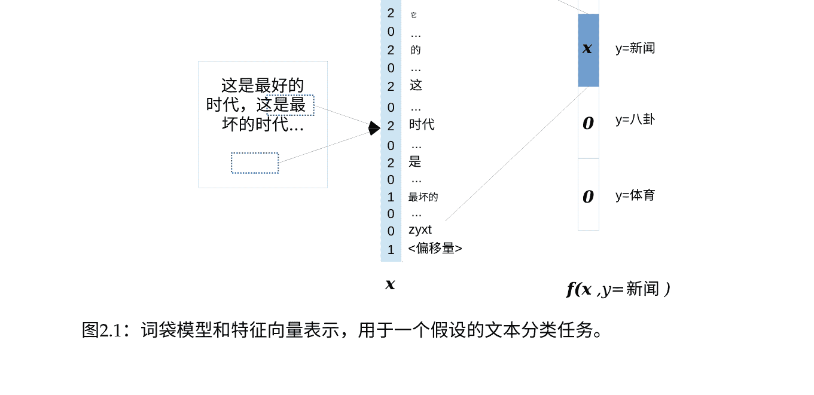

图2.1：词袋模型和特征向量表示，用于一个假设的文本分类任务。

相关字典。例如，³

$$\theta_{(E,自行车)} =1 \quad \theta_{(S,自行车)} =0$$
$$\theta_{(E,自行车)} =0 \quad \theta_{(S,自行车)} =1$$
$$\theta_{(E,con)} =1 \quad \theta_{(S,con)} =1$$
$$\theta_{(E,计算机)} =0 \quad \theta_{(S,计算机)} =0.$$

类似地，如果我们想区分积极和消极情感，我们可以使用积极和消极情感词典（参见§4.1.2），这些词典由社会心理学家（Tausczik和Pennebaker，2010）定义。

但是，由于单词数量众多且选择确切的数值权重困难，通常很难手动设置分类权重。相反，我们将从数据中学习权重。电子邮件用户手动将消息标记为垃圾邮件；报纸将自己的文章标记为商业或风格。使用这样的实例标签，我们可以使用监督机器学习自动获取权重。本章将讨论几种用于分类的机器学习方法。第一种基于概率。有关概率的综述，请参阅附录A。

³在这个表示法中，每个元组（语言，单词）都索引了θ中的一个元素，它仍然是一个向量。

### 2.2 朴素贝叶斯

一个词袋的联合概率of a bag of words x and its true label y is written p(x, y)。假设我们有一个包含 N 个标记实例的数据集，{(x^{(i)}, y^{(i)})}_{i=1}^N，我们假设它们是独立且同分布的（IID）（见 §A.3）。那么整个数据集的联合概率，写作 p(x^{(1:N)}, y^{(1:N)})，等于 ∏_{i=1}^N p_{X,Y}(x^{(i)}, y^{(i)}).^4

这与分类有什么关系？分类的一种方法是设置权重 θ，使得训练集中标记文档的联合概率最大化。这被称为最大似然估计：

$$\hat{\theta} = \underset{\theta}{\text{argmax}} \ p(\boldsymbol{x}^{(1:N)}, \boldsymbol{y}^{(1:N)}; \theta) \quad [2.8]$$

$$= \underset{\theta}{\text{argmax}} \ \prod_{i=1}^N p(\boldsymbol{x}^{(i)}, \boldsymbol{y}^{(i)}; \theta) \quad [2.9]$$

$$= \underset{\theta}{\text{argmax}} \ \sum_{i=1}^N \log p(\boldsymbol{x}^{(i)}, \boldsymbol{y}^{(i)}; \theta) \quad [2.10]$$

符号 p(\boldsymbol{x}^{(i)}, \boldsymbol{y}^{(i)}; \theta) 表示 θ 是概率函数的参数。概率的乘积可以用对数概率的和来替代，因为对数函数在正参数上是单调递增的，所以相同的 θ 将同时最大化概率和其对数。使用对数进行计算是可取的，因为在大型数据集上，多个概率相乘可能会导致下溢到零。^5

概率 p(\boldsymbol{x}^{(i)}, \boldsymbol{y}^{(i)}; \theta) 通过一个生成模型来定义——一个理想化的随机过程生成了观察到的数据。^6 算法1描述了生成模型的基础，即朴素贝叶斯分类器，参数为 θ = \{μ, φ\}。

这个生成模型的第一行编码了一个假设，即实例之间是相互独立的：文档 i 的标签和文本不会影响到文档 j 的标签和文本。^7 此外，这些实例是同分布的：标签 y^{(i)} 和文本 x^{(i)} (在给定标签 y^{(i)} 的条件下) 的分布是相同的，对于所有实例 i。换句话说，我们假设每个文档对标签的分布相同，并且每个文档对词的分布仅取决于标签，而不取决于文档的其他任何内容。我们还假设文档之间不会相互影响: 如果单词 whale 出现在文档 i=7 中，这并不会使它在文档 i=8 中出现的可能性更大或更小。

生成模型的第二行说明随机变量 y^{(i)} 是从参数为 μ 的分类分布中抽取的。分类分布类似于加权骰子: 列向量 μ = [μ_1; μ_2; \ldots; μ_K] 给出每个标签的概率，因此抽取标签 y 的概率等于 μ_y。例如，如果 𝒴 = {正面,负面,中性}，我们可能有 μ = [0.1; 0.7; 0.2]。我们要求
$$\sum_{y \in \mathcal{Y}} \mu_y = 1 \quad \text{且} \quad \mu_y \geq 0, \quad \forall y \in \mathcal{Y}:$$
每个标签的概率都是非负的，并且这些概率的总和等于一。^8

第三行描述了如何生成词袋计数 x^{(i)}。通过写作 x^{(i)} \mid y^{(i)} ，这一行表示单词计数是在标签的条件下进行的，因此使用链式法则对联合概率进行因式分解,
$$p_{X,Y}(x, y) = p_{X|Y}(x \mid y) \times p_Y(y). \quad [2.11]$$
具体的分布 p_{X|Y} 是多项式分布，它是一个非负计数向量的概率分布。该分布的概率质量函数为:

$$p_{mult}(x; \phi) = B(x) \prod_{j=1}^{V} \phi_j^{x_j} \quad [2.12]$$
$$B(x) = \frac{(\sum_{j=1}^{V} x_j)!}{\prod_{j=1}^{V} (x_j!)}. \quad [2.13]$$

4符号 p_{X,Y}(\boldsymbol{x}^{(i)}, \boldsymbol{y}^{(i)}) 表示随机变量 X 和 Y 取特定值 \boldsymbol{x}^{(i)} 和 \boldsymbol{y}^{(i)} 的联合概率。当上下文清楚时，下标通常会被省略。有关随机变量的回顾，请参见附录 A。

5在本文中，您可以假设所有对数和指数的底数为 2，除非另有说明。任何合理的底数都会得到相同的分类器，而 2 作为底数最方便手工计算示例。

6本文将始终使用生成模型。它们明确地定义了概率分布在观测和潜在变量上的假设形式。有关生成模型在统计学中的可读介绍，请参见 Blei (2014) 的著作。

7您能想到任何这个假设过于强的情况吗？

8形式上，我们要求 μ ∈ Δ^{K-1}，其中 Δ^{K-1} 是 K-1 概率单纯形，即所有向量之和为一的非负数的集合。由于和为一的约束条件，对于大小为 K 的向量，有 K-1 个自由度。

算法1 朴素贝叶斯分类模型的生成过程

```
对于实例 i ∈ {1, 2, ..., N} 执行:
    从分类分布 (μ) 中抽取标签 y^{(i)};
    从多项式分布 (ϕ | y^{(i)}) 中抽取单词计数 x^{(i)} | y^{(i)}。
```

在与 MIT Press 签订的合同下，根据 CC-BY-NC-ND 许可共享。

## 2.2. 朴素贝叶斯

与分类分布类似，参数 φ_j 可以解释为概率：具体来说，是文档中任意给定标记为单词 j 的概率。多项式分布涉及对单词的乘积，其中乘积中的每一项等于概率 φ_j，乘以计数 x_j 的指数。计数为零的单词在这个乘积中没有作用，因为 φ_j^0 = 1。术语 B(x) 被称为多项式系数。它不依赖于 φ，通常可以忽略。你能看出为什么我们需要这个术语吗？^9

符号 p(x | y; φ) 表示给定标签 y 的单词计数 x 的条件概率，参数为 φ，等于 p_mult(x ; φ_y)。通过指定多项式分布，我们描述了多项式朴素贝叶斯分类器。为什么是“朴素”？因为多项式分布在类别条件下独立地处理每个单词标记：概率质量函数在计数上分解。^10

#### 2.2.1 类型和标记

朴素贝叶斯生成模型的稍微修改如算法2所示。
与生成一个类型的计数向量 x 不同，该模型生成一个序列 of 标记，w = (w_1, w_2, … , w_M) 。类型和标记之间的区别至关重要：x_j ∈ {0, 1, 2, … , M} 是词汇表中单词类型 j 的计数，例如单词 cannibal 出现的次数；w_m ∈ V 是文档中标记 m 的标识，例如 w_m = cannibal。

序列 w 的概率是一系列分类概率的乘积。算法2做出了一个条件独立的假设：每个标记 w_m^{(i)} 在所有其他标记 w^{(i)} 的条件下是独立的。在标签 y^{(i)} 的条件下。这与多项式分布所暗示的“朴素”独立假设是相同的，因此，该模型的最优参数与多项式朴素贝叶斯中的参数相同。对于任何实例，该模型分配的概率与多项式朴素贝叶斯下的概率成比例。比例常数是多项式系数 B(x)。因为 B(x) ≥ 1，向量计数 x 的概率至少与导致相同计数的单词列表 w 的概率一样大：可以有许多与单个向量计数对应的单词序列。例如，man bites dog 和 dog bites man 对应于相同的计数向量 {bites: 1, dog: 1, man: 1}，而 B(x) 等于计数向量 x 的可能单词排序的总数。

> 9从技术上讲，多项式分布需要第二个参数，即单词计数的总数在 x 中。在词袋表示中，等于文档中单词的数量。然而，这个参数对于分类是无关紧要的。
> 10你可以将任何概率分布插入到生成故事中，它仍然是朴素贝叶斯，只要你做出“朴素”假设，即特征在给定标签的条件下是独立的。例如，具有对角协方差的多元高斯分布在本质上也是朴素的。

```
算法2 朴素贝叶斯分类模型的替代生成过程
对于实例 i ∈ {1, 2, …, N}执行:
  从分类分布(μ)中抽取标签 y^{(i)};
  对于令牌 m ∈ {1, 2, …, M_i}执行:
    从条件分布 φ_{y^{(i)}} 中抽取令牌 w_{m^{(i)}} | y^{(i)}。
```

有时候，将实例视为类型的计数是有用的，x; 而其他时候，将实例视为标记序列是更好的，w。 如果标记是从假设条件独立的模型生成的，那么这两种观点会导致概率模型完全相同，除了一个与标签或参数无关的缩放因子。

#### 2.2.2 预测

朴素贝叶斯预测规则是选择使 log p(x, y; μ, φ) 最大化的标签 y:

$$\hat{y} = \underset{y}{\arg\max} \log p(\boldsymbol{x}, y; \boldsymbol{\mu}, \boldsymbol{\phi}) \tag{2.14}$$
$$= \underset{y}{\arg\max} \log p(\boldsymbol{x} \mid y; \boldsymbol{\phi}) + \log p(y; \boldsymbol{\mu}) \tag{2.15}$$

现在我们可以插入从生成故事中得到的概率分布。

$$\log p(\boldsymbol{x} \mid y; \boldsymbol{\phi}) + \log p(y; \boldsymbol{\mu}) = \log \left[ B(\boldsymbol{x}) \prod_{j=1}^{V} \phi_{y,j}^{x_j} \right] + \log \mu_y \tag{2.16}$$
$$= \log B(\boldsymbol{x}) + \sum_{j=1}^{V} x_j \log \phi_{y,j} + \log \mu_y \tag{2.17}$$
$$= \log B(\boldsymbol{x}) + \boldsymbol{\theta} \cdot \boldsymbol{f}(\boldsymbol{x}, y), \tag{2.18}$$

其中
$$\boldsymbol{\theta} = [\boldsymbol{\theta}^{(1)}; \boldsymbol{\theta}^{(2)}; \dots; \boldsymbol{\theta}^{(K)}] \tag{2.19}$$
$$\boldsymbol{\theta}^{(y)} = [\log \phi_{y,1}; \log \phi_{y,2}; \dots; \log \phi_{y,V}; \log \mu_y] \tag{2.20}$$

特征函数 f(x, y) 是一个由 V 个词的计数和一个偏移量组成的向量，对于不等于 y 的标签进行填充 (参见方程式2.3-2.5和图2.1) 。这种构造确保了内积 θ · f(x, y) 只激活权重在 θ^{(y)} 中的特征。 这些特征和权重是计算每个 y 的联合对数概率 log p(x, y) 所需的全部内容。 这是一个关键点：通过这种表示法，我们将计算文档-标签对 (x, y) 的对数似然的问题转化为计算向量内积的计算。

#### 2.2.3 估计

分类和多项式分布的参数具有简单的解释：它们是每个可能事件的期望频率的向量。 基于这个解释，诱人的是根据经验设置参数。

$$\phi_{y,j} = \frac{\text{count}(y, j)}{\sum_{j'=1}^{V} \text{count}(y, j')} = \frac{\sum_{i:y^{(i)}=y} x_j^{(i)}}{\sum_{j'=1}^{V} \sum_{i:y^{(i)}=y} x_{j'}^{(i)}}, \qquad [2.21]$$

其中 count(y, j) 指的是具有标签 y 的文档中单词 j 的计数。

方程 2.21 定义了 φ 的相对频率估计。 它可以被证明是最大似然估计：最大化概率 p(x^{(1:N)}, y^{(1:N)}; θ) 的估计。

基于算法1中的生成模型，对数似然是，

$$\mathcal{L}(\phi, \boldsymbol{\mu}) = \sum_{i=1}^{N} \log \mathrm{p}_{\text{mult}}(\boldsymbol{x}^{(i)}; \phi_{y^{(i)}}) + \log \mathrm{p}_{\text{cat}}(y^{(i)}; \boldsymbol{\mu}), \qquad [2.22]$$

现在将其写为参数 φ 和 μ 的函数 L。 让我们继续关注参数 φ。 由于对于 φ 来说，p(y)是常数，我们可以忽略它:

$$\mathcal{L}(\phi) = \sum_{i=1}^{N} \log \mathrm{p}_{\text{mult}}(\boldsymbol{x}^{(i)}; \phi_{y^{(i)}}) = \sum_{i=1}^{N} \log B(\boldsymbol{x}^{(i)}) + \sum_{j=1}^{V} x_j^{(i)} \log \phi_{y^{(i)},j}, \qquad [2.23]$$

其中 B(x^{(i)}) 对于 φ 是常数。

最大似然估计选择 φ 以最大化对数似然 L。 然而，解决方案必须遵守以下约束条件:

$$\sum_{j=1}^{V} \phi_{y,j} = 1 \quad \forall y \qquad [2.24]$$

这些约束可以通过向目标函数添加一组拉格朗日乘子来加以考虑（详见附录B）。 为了求解每个 θ_y，我们最大化拉格朗日函数:

$$\ell(\phi_y) = \sum_{i:y^{(i)}=y} \sum_{j=1}^{V} x_j^{(i)} \log \phi_{y,j} - \lambda \left( \sum_{j=1}^{V} \phi_{y,j} - 1 \right). \qquad [2.25]$$

对参数 φ_{y,j} 求导，得到:

$$\frac{\partial \ell(\phi_y)}{\partial \phi_{y,j}} = \sum_{i:y^{(i)}=y} x_j^{(i)} / \phi_{y,j} - \lambda. \qquad [2.26]$$

通过将该导数向量中的每个元素设为零，可以得到解：

$$\lambda\phi_{y,j} = \sum_{i:y^{(i)}=y} x_j^{(i)} \qquad [2.27]$$

$$\phi_{y,j} \propto \sum_{i:y^{(i)}=y} x_j^{(i)} = \sum_{i=1}^N \delta\left(y^{(i)}=y\right) x_j^{(i)} = \mathrm{count}(y, j), \qquad [2.28]$$

其中 δ(y^{(i)}=y) 是一个 delta 函数，有时也被称为指示函数，如果 y^{(i)}=y，则返回1。符号 ∝ 表示 φ_{y,j} 与方程的右侧成正比。

方程 2.28 展示了相同事物的三种不同表示方法：对于所有标签为 y^{(i)}=y 的文档，对单词计数求和。这为每个 φ_y 提供了一个比例常数的解。现在回想一下约束条件 ∑_{j=1}^V φ_{y,j}=1，这是因为 φ_y 表示词汇表中每个单词的概率向量。

这个约束条件导致了一个精确解，它不依赖于 λ：

$$\phi_{y,j} = \frac{\mathrm{count}(y, j)}{\sum_{j'=1}^V \mathrm{count}(y, j')}.\qquad [2.29]$$

这等于方程 2.21 中的相对频率估计器。类似的推导给出 μ_y ∝ ∑_{i=1}^{N_i} δ(y^{(i)}=y)。

#### 2.2.4 平滑

在文本数据中，很可能存在从未出现在训练集中的标签和单词对，导致 φ_{y,j}=0。例如，单词“钼”可能从未出现在小说中。但是选择 φ_{FICTION, 钼}=0 的值将完全否决一个标签，因为如果 x_{钼}>0，则 p(FICTION|x)=0。

这是不可取的，因为它会引入高方差：根据训练集中的数据，我们可能会得到完全不同的分类规则。一种解决方法是通过为每个计数添加一个“伪计数” α 来平滑概率，然后进行归一化。

$$\phi_{y,j} = \frac{\alpha + \mathrm{count}(y, j)}{V\alpha + \sum_{j'=1}^V \mathrm{count}(y, j')}.\qquad [2.30]$$

**这被称为拉普拉斯平滑。** 11伪计数 α 是一个 hyperparameter，因为它控制对数似然函数的形式，进而驱动 φ 的估计。

> 11拉普拉斯平滑具有贝叶斯理论的合理性，其中生成模型扩展为包括 φ 作为随机变量。得到的 φ 后验分布取决于数据 (x 和 y) 和先验概率 p(φ; α)。对 φ 的相应估计称为最大后验概率，或者 MAP。这与最大似然不同，最大似然仅依赖于数据。

Jacob Eisenstein。2018年11月13日草稿。

平滑减少了方差，但使我们远离最大似然估计：它施加了一个偏差。在这种情况下，偏差指向均匀概率。机器学习理论表明，对保留数据的错误可以归因于偏差和方差的总和 (Mohri et al., 2012)。一般来说，减少方差的技术往往会增加偏差，导致偏差-方差权衡。

- 无偏分类器可能会过拟合训练数据，在未知数据上表现不佳。
- 但如果平滑度过大，得到的分类器可能会欠拟合。当 α → ∞ 时，方差为零：无论数据如何，都会得到相同的分类器。然而，偏差可能会很大。

类似的问题在机器学习中经常出现。在本章后面，我们将遇到正则化，它控制逻辑回归和大边际分类器的偏差-方差权衡；第 3.3.2 节描述了控制深度学习中方差的技术；第 6 章描述了更复杂的平滑经验概率的方法。

#### 2.2.5 设置超参数

回到朴素贝叶斯，我们应该如何选择超参数如 α 的最佳值？最大似然估计不起作用：在训练集上的最大似然估计将始终为 α= 0。在许多情况下，我们真正想要的是准确性：正确预测的数量除以总预测数量。（其他分类性能度量在第 4.4 节中讨论。）正如我们将看到的，直接优化准确性是困难的。但对于像 α 这样的标量超参数，可以通过一种称为网格搜索的简单启发式方法进行调优：尝试一组值（例如，α ∈ {0.001, 0.01, 0.1, 1, 10}），计算每个值的准确性，并选择最大化准确性的设置。

目标是调整 α 以使分类器在未知数据上表现良好。因此，用于超参数调整的数据不应与训练集重叠，在这种情况下，将更倾向于使用非常小的 α 值。相反，我们保留一个开发集（也称为调整集）用于超参数选择。这个开发集可以由一小部分标记数据组成，例如 10%。

我们还希望预测分类器在未知数据上的性能。为了做到这一点，我们必须保留一个单独的数据子集，称为测试集。测试集绝不能与训练集或开发集重叠，否则我们将高估分类器在未来无标签数据上的性能。在进行建模决策时，例如特征函数的形式、词汇表的大小等，也不应使用测试集（这些决策在第 4 章中进行了审查）。理想的做法是只使用测试集一次，否则测试集将用于指导分类器设计和测试集准确性将与真正未见数据上的准确性发散。 因为标注数据很昂贵，所以在实践中很难遵循这个理想，许多测试集已经使用了几十年。 但在一些高影响力的应用程序中，如机器翻译和信息提取，每年都会发布新的测试集。

当只有少量标记数据可用时，测试集准确性可能不可靠。 K 折叠交叉验证是一种应对这种情况的方法：标记数据被分成 K 折，每个折作为测试集，同时在其他折上进行训练。然后聚合测试集准确性。 在极端情况下，每个折都是一个单独的数据点；这被称为留一交叉验证。 在交叉验证的背景下进行超参数调整时，可以使用另一个折进行网格搜索。 在进行分类器设计决策时，重复评估交叉验证准确性是很重要的，否则会夸大对真正未见数据的准确性。

### 2.3 判别学习

朴素贝叶斯易于使用：权重可以通过闭式估计，而且概率解释使得扩展相对容易。 然而，特征独立的假设可能严重限制其准确性。 到目前为止，我们已经定义了特征函数 f(x, y)，使其对应于词汇表中每个单词的词袋特征：每个单词一个特征。 在自然语言中，词袋特征违反了条件独立性的假设 - 例如，给定一个文档包含单词“朴素”的概率肯定会更高，如果它还包含单词“贝叶斯” - 但这种违反相对较轻。

然而，在文本分类中取得良好的性能通常需要比词袋更丰富的特征：

- 为了更好地处理词汇表之外的术语，我们希望具有适用于多个单词的特征，例如前缀和后缀（例如“反-”，“非-”，“-ing”）和大写。
- 我们还希望有适用于多词单元的 n-gram 特征： bigrams（例如，“不好的”，“不坏的”）， trigrams（例如，“不太坏的”，“缺乏任何体面的”，“前所未有的”），以及更多。

这些特征明显违反了朴素贝叶斯的独立性假设。 考虑一下如果我们添加一个前缀特征会发生什么。 根据朴素贝叶斯的假设，一个词和它的前缀的联合概率可以用以下近似值计算：

```
Pr(word = “unfit”, prefix = “un-” | y) ≈ Pr(prefix = “un-” | y) × Pr(word = “unfit” | y)。
```

为了测试近似的质量，我们可以通过应用链式法则来操作左侧，

$$\begin{aligned}
\text{Pr}(\text{word} = unfit, \text{prefix} = un- \mid y) &= \text{Pr}(\text{prefix} = un- \mid \text{word} = unfit, y) \quad [2.31] \\
& \quad \times \text{Pr}(\text{word} = unfit \mid y) \quad [2.32]
\end{aligned}$$

但是 Pr(prefix = “un-” | word = “unfit”, y) = 1，因为 “un-” 被保证是单词 “unfit” 的前缀。因此，

$$\begin{aligned}
\text{Pr}(\text{word} = unfit, \text{prefix} = un- \mid y) &= 1 \quad \times \text{Pr}(\text{word} = unfit \mid y) \quad [2.33] \\
& \gg \text{Pr}(\text{prefix} = un- \mid y) \quad \times \text{Pr}(\text{word} = unfit \mid y), \quad [2.34]
\end{aligned}$$

因为任何给定单词以前缀 “un-” 开头的概率要远小于1。朴素贝叶斯算法会系统性地低估正相关特征的联合概率。要使用这些特征，我们需要学习算法，不依赖于独立性假设。

朴素贝叶斯独立性假设的起源是学习目标，即建模观察文本的概率，p(x^{(1:N)}, y^{(1:N)})。在分类问题中，我们总是给定了 x，并且只对预测标签 y 感兴趣。在这种情况下，建模文本 x 的概率似乎是一个困难且不必要的任务。判别学习算法避免了这个任务，直接关注预测 y 的问题。

#### 2.3.1 感知机

在朴素贝叶斯中，权重可以解释为概率模型的参数。但是这个模型需要一个通常不成立的独立性假设，并限制了我们选择的特征。为什么不忘记概率，以错误驱动的方式学习权重呢？感知机算法，如算法3所示，是一种实现这一目标的方法。

算法很简单：如果犯了一个错误，增加具有正确标签的活跃特征的权重 y^{(i)}，减小具有猜测标签的活跃特征的权重 \hat{y}。感知器是一种在线学习算法，因为分类器的权重在每个示例之后都会改变。这与朴素贝叶斯不同，朴素贝叶斯是一种批量学习算法：它在整个数据集上计算统计信息，然后通过单个操作设置权重。算法3对于这个在线学习过程何时终止并没有明确说明。我们很快会回到这个问题。

感知器算法可能看起来像是一种不受原则约束的启发式方法：朴素贝叶斯在概率上有坚实的基础，但感知器只是在每次出现错误时添加和减去常数的权重。这真的有效吗？实际上，感知器有一些基于线性可分性概念的有趣理论。非正式地说，具有二进制标签 (y ∈ {0, 1}) 的数据集在线性可分时，可以绘制一条## 算法3 感知器学习算法

```
1: **过程** PERCEPTRON ($x^{(1:N)}, y^{(1:N)}$)
2: $t \leftarrow 0$
3: $\theta^{(0)} \leftarrow \mathbf{0}$
4: **重复**
5:    $t \leftarrow t + 1$
6:    选择一个实例 $i$
7:    $\hat{y} \leftarrow \text{argmax}_{y} \theta^{(t-1)} \cdot f(x^{(i)}, y)$
8:    **如果** $\hat{y} = y^{(i)}$ **则**
9:        $\theta^{(t)} \leftarrow \theta^{(t-1)} + f(x^{(i)}, y^{(i)}) - f(x^{(i)}, \hat{y})$
10:    **否则**
11:        $\theta^{(t)} \leftarrow \theta^{(t-1)}$
12: **直到疲倦**
13: **返回** $\theta^{(t)}$
```

超平面（在多个维度上的一条线），使得在超平面的每一侧，所有实例都具有相同的标签。这个定义可以形式化并扩展到多个标签：

**定义1 (线性可分性)**。数据集 $\mathcal{D} = \{ (x^{(i)}, y^{(i)}) \}_{i=1}^N$ 如果且仅如果存在一些权重向量 $\theta$ 和一些间隔 $\rho$，对于每个实例 $(x^{(i)}, y^{(i)})$，真实标签的特征函数与 $\theta$ 的内积， $\theta \cdot f(x^{(i)}, y^{(i)})$，至少大于其他可能标签的特征函数与 $\theta$ 的内积， $\theta \cdot f(x^{(i)}, y')$。

$\exists \theta, \rho > 0 : \forall (x^{(i)}, y^{(i)}) \in \mathcal{D}, \quad \theta \cdot f(x^{(i)}, y^{(i)}) \geq \rho + \max_{y' \neq y^{(i)}} \theta \cdot f(x^{(i)}, y'). \qquad [2.35]$

线性可分性很重要，因为它提供以下保证：如果你的数据是线性可分的，那么感知器算法将找到一个分隔器（Novikoff, 1962）。 $^{13}$因此，尽管感知器可能看起来是启发式的，但它保证会成功，如果学习问题足够简单。

这个证明有多有用？Minsky和Papert（1969）著名地证明了简单的逻辑函数异或是不可分的，因此感知器无法学习这个函数。但这不仅仅是感知器的问题：任何线性分类算法，包括朴素贝叶斯，在这个任务上都会失败。文本分类问题通常涉及高维特征空间，具有数千或数百万个特征。对于这些问题，训练数据很可能是可分离的。即使数据集不可分离，也仍然可以对感知器算法产生的错误数量设定一个上界（Freund和Schapire，1999年）。

#### 2.3.2 平均感知机

感知器会重复地遍历数据，直到‘疲倦’，如算法3所述。如果数据是线性可分的，感知器最终会找到一个分隔器，并且一旦所有训练实例都被正确分类，我们就可以停止。但是，如果数据不是线性可分的，感知器可能会在两个或多个权重设置之间来回摆动，永远无法收敛。在这种情况下，我们如何知道何时停止训练，以及如何选择最终的权重？一个有效的实际解决方案是对所有迭代中的感知器权重进行平均。

该过程在算法4中显示。学习算法几乎相同，但我们还维护一个权重之和的向量，m。在学习过程结束时，我们将这个和除以总更新次数t，以计算平均权重$\overline{\theta}$。然后，这些平均权重用于预测。在算法草图中，平均值是从一个累加和中计算得到的，m ← m + $\theta$。然而，这是低效的，因为更新累加和需要$|\theta|$次操作。当f(x,y)是稀疏的时候，$|\theta| \gg |f(x,y)|$对于任何单个(x,y)来说。这意味着计算累加和的代价要比计算$\theta$本身的更新要高得多，后者只需要$2\times|f(x,y)|$次操作。其中一个练习是设计一个更高效的算法来计算平均权重。

即使数据集不可分，平均权重最终会收敛。一种可能的停止准则是检查每次通过数据后的平均权重向量之间的差异：如果差异的范数低于某个预定义的阈值，我们可以停止训练。另一种停止准则是保留一些数据，并在这些保留数据上测量预测准确性。当保留数据上的准确性开始下降时，学习算法已经开始过拟合训练集。此时，最好停止；这个停止准则被称为早停止。

泛化是在训练数据之外做出良好预测的能力。通过计算泛化误差的上界（Freund和Schapire，1999；Collins，2002），可以证明平均化可以改善泛化。

### 2.4 损失函数和大边界分类

朴素贝叶斯通过最大化联合对数似然函数$\log p(x^{(1:N)}, y^{(1:N)})$来选择权重。按照惯例，优化问题通常被表述为最小化损失函数。损失函数的输入是权重向量$\theta$，输出是一个非负数，用于衡量分类器在训练实例上的性能。形式上，损失 $\ell(\theta; x^{(i)}, y^{(i)})$ 然后是权重 $\theta$ 在实例 $(x^{(i)}, y^{(i)})$ 上的性能度量。学习的目标是最小化训练集中所有实例的损失之和。

我们可以将最大似然重新表述为损失函数，通过定义损失函数为负对数似然：

$$\log p(x^{(1:N)}, y^{(1:N)}; \theta) = \sum_{i=1}^N \log p(x^{(i)}, y^{(i)}; \theta) \qquad [2.36]$$
$$\ell_{\text{NB}}(\theta; x^{(i)}, y^{(i)}) = -\log p(x^{(i)}, y^{(i)}; \theta) \qquad [2.37]$$
$$\hat{\theta} = \text{argmin}_{\theta} \sum_{i=1}^N \ell_{\text{NB}}(\theta; x^{(i)}, y^{(i)}) \qquad [2.38]$$
$$= \text{argmax}_{\theta} \sum_{i=1}^N \log p(x^{(i)}, y^{(i)}; \theta). \qquad [2.39]$$

最小化$\ell_{\text{NB}}$的问题与最大似然估计完全相同。

损失函数提供了一个比较学习目标的通用框架。例如，另一个损失函数是零一损失。

$$\ell_{0-1}(\theta; x^{(i)}, y^{(i)}) = \begin{cases} 0, & y^{(i)} = \text{argmax}_y \theta \cdot f(x^{(i)}, y) \\ 1, & \text{otherwise} \end{cases} \qquad [2.40]$$

如果实例被正确分类，则零一损失为零，否则为一。零一损失的总和与分类器在训练数据上的错误率成比例。由于低错误率通常是分类的最终目标，这可能看起来是理想的。但是零一损失存在几个问题。其中一个问题是它是非凸的，这意味着基于梯度的优化不能保证有效。更严重的问题是导数是无用的：对于任何参数，偏导数在除了在$\boldsymbol{\theta} \cdot \boldsymbol{f}(\boldsymbol{x}^{(i)}, y) = \boldsymbol{\theta} \cdot \boldsymbol{f}(\boldsymbol{x}^{(i)}, \hat{y})$ for some $\hat{y}$的点处都是零。在这些点上，损失是不连续的，导数是未定义的。

感知机优化了一个具有更好学习性质的损失函数：

> $\ell_{\text{PERCEPTRON}} (\boldsymbol{\theta}; \boldsymbol{x}^{(i)}, y^{(i)}) = \max_{y \in \mathcal{Y}} \boldsymbol{\theta} \cdot \boldsymbol{f}(\boldsymbol{x}^{(i)}, y) - \boldsymbol{\theta} \cdot \boldsymbol{f}(\boldsymbol{x}^{(i)}, y^{(i)}),$  [2.41]

当$\hat{y} = y^{(i)}$时，损失为零；否则，它与预测标签$\hat{y}$和真实标签$y^{(i)}$之间的差异线性增加。绘制这个损失函数对输入$\max_{y \in \mathcal{Y}} \boldsymbol{\theta} \cdot \boldsymbol{f}(\boldsymbol{x}^{(i)}, y) - \boldsymbol{\theta} \cdot \boldsymbol{f}(\boldsymbol{x}^{(i)}, y^{(i)})$的图形呈现出一个铰链形状，从而得到了铰链损失的名称。

为了看到为什么这是感知器优化的损失函数，对$\boldsymbol{\theta}$求导，

> $\frac{\partial}{\partial \boldsymbol{\theta}} \ell_{\text{PERCEPTRON}} (\boldsymbol{\theta}; \boldsymbol{x}^{(i)}, y^{(i)}) = \boldsymbol{f}(\boldsymbol{x}^{(i)}, \hat{y}) - \boldsymbol{f}(\boldsymbol{x}^{(i)}, y^{(i)}).$  [2.42]

在每个实例中，感知器算法沿着梯度的相反方向迈出一个单位的步长，这个梯度是$\nabla_{\boldsymbol{\theta}} \ell_{\text{PERCEPTRON}} = \frac{\partial}{\partial \boldsymbol{\theta}} \ell_{\text{PERCEPTRON}} (\boldsymbol{\theta}; \boldsymbol{x}^{(i)}, y^{(i)})$。正如我们将在§2.6中看到的，这是一个优化算法的例子随机梯度下降，应用于方程2.41中的目标函数。

*使用次梯度下解决策问题 15细心的读者会注意到这样一个默认的假设：存在一个唯一的$\hat{y}$使得$\boldsymbol{\theta} \cdot \boldsymbol{f}(\boldsymbol{x}^{(i)}, y)$最大。如果有两个或更多的标签最大化了这个函数呢？考虑二元分类：如果最大化者是$y^{(i)}$，那么梯度为零，感知器更新也为零；如果最大化者是$\hat{y} = y^{(i)}$，那么更新为$\boldsymbol{f}(\boldsymbol{x}^{(i)}, y^{(i)}) - \boldsymbol{f}(\boldsymbol{x}^{(i)}, \hat{y})$。根本问题在于感知器损失函数不是平滑的，因为在铰链点处，真实标签$y^{(i)}$的得分等于其他某个标签$\hat{y}$的得分。在这一点上，没有唯一的梯度；相反，有一组次梯度。一个向量$v$是函数 $g$ 在 $u_0$ 处的次梯度当且仅当 $g(u) - g(u_0) \geq v \cdot (u - u_0)$ 对于所有的 $u$ 成立。从图形上看，这定义了包含 $g(u_0)$ 且不与 $g$ 在任何其他点相交的超平面集合。当我们从左侧接近铰链点时，梯度为 $f(x, \hat{y}) - f(x, y)$；当我们从右侧接近时，梯度为 $\mathbf{0}$。在铰链点，次梯度包括所有被这两个极端值限制的向量。在次梯度下降中，可以使用任何次梯度 (Bertsekas, 2012)。由于 $\mathbf{0}$ 和 $f(x, \hat{y}) - f(x, y)$ 都是铰链点的次梯度，可以在感知器更新中使用任何一个。这意味着如果多个标签最大化 $\theta \cdot f(x^{(i)}, y)$，可以在感知器更新中使用任何一个。

感知器与朴素贝叶斯 感知器的损失函数在与朴素贝叶斯隐含的负对数似然损失相比有一些优缺点。

- 朴素贝叶斯和感知器都是凸函数，相对容易优化。然而，朴素贝叶斯可以通过闭式形式进行优化，而感知器需要多次迭代数据集。
- 朴素贝叶斯可能在单个示例上遭受无限损失，因为零概率的对数是负无穷。因此，朴素贝叶斯会过分强调某些示例，而忽视其他示例。
- 朴素贝叶斯分类器假设给定标签的观察特征在条件独立，并且分类器的性能取决于这个假设的程度。感知器不需要这样的假设。
- $\ell_{\mathrm{PERCEPTRON}}$ 将所有正确答案视为平等。即使 $\theta$ 只给出微小差距的正确答案，损失仍为零。

#### 2.4.1 在线大边界分类

最后一条评论暗示了感知器的一个潜在问题。假设一个测试示例非常接近于一个训练示例，但并不相同。如果分类器在训练示例上只得到了微小的正确答案，那么它可能会在附近的测试实例上给出不同的答案。为了形式化这种直觉，将边界定义为，

> $\gamma(\boldsymbol{\theta}; \boldsymbol{x}^{(i)}, y^{(i)}) = \boldsymbol{\theta} \cdot f(\boldsymbol{x}^{(i)}, y^{(i)}) - \max_{y \neq y^{(i)}} \boldsymbol{\theta} \cdot f(\boldsymbol{x}^{(i)}, y)$。 	[2.43]

边界表示正确标签 $y^{(i)}$ 的得分与最高得分的错误标签之间的差异。大边界分类的直觉是，仅仅正确标记训练数据是不够的 - 正确标签应该与其他标签相隔一段舒适的边界。这个想法可以被编码为损失函数，

$$
\ell_{\text{MARGIN}}(\boldsymbol{\theta}; \boldsymbol{x}^{(i)}, y^{(i)}) = \left\{
\begin{array}{ll}
0, & \gamma(\boldsymbol{\theta}; \boldsymbol{x}^{(i)}, y^{(i)}) \geq 1, \\
1 - \gamma(\boldsymbol{\theta}; \boldsymbol{x}^{(i)}, y^{(i)}), & \text{otherwise}
\end{array}
\right.
\qquad \text{[2.44]}
$$

$$
= \left( 1 - \gamma(\boldsymbol{\theta}; \boldsymbol{x}^{(i)}, y^{(i)}) \right)_+, 
\qquad \text{[2.45]}
$$

其中 $(x)_+ = \max(0, x)$。如果真实标签的得分与最佳得分的替代标签之间至少有一个边际 1，则损失为零。这与感知器损失几乎相同，但是边际点向右移动，如图2.2所示。边际损失是0/1损失的凸上界。

边缘损失可以通过类似于感知机的在线学习规则来最小化。我们将称这个学习规则为在线支持向量机，原因将在推导中讨论。让我们首先推广分类错误的概念，使用一个成本函数 $c(y^{(i)}, y)$。我们将重点关注简单的成本函数，

$$
c(y^{(i)}, y) = \left\{
\begin{array}{ll}
1, & y^{(i)} \neq y \\
0, & \text{otherwise},
\end{array}
\right.
\qquad \text{[2.46]}
$$

但是可以设计专门的成本函数，对特别不希望的错误给予更重的惩罚 (Tsochantaridis et al., 2004)。这个想法在第7章中重新讨论。

使用成本函数，我们现在可以将在线支持向量机定义为以下分类规则：

$$\hat{y} = \arg\max_{y \in \mathcal{Y}} \theta \cdot f(x^{(i)}, y) + c(y^{(i)}, y) \qquad \text{[2.47]}$$

$$\theta^{(t)} \leftarrow (1 - \lambda) \theta^{(t-1)} + f(x^{(i)}, y^{(i)}) - f(x^{(i)}, \hat{y}) \qquad \text{[2.48]}$$

这个更新的形式与感知器类似，但有两个关键的区别。

- 与选择当前分类模型得分最大的标签$\hat{y}$不同，argmax搜索的是既强（由$\theta \cdot f(x^{(i)}, y)$衡量），又错误（由$c(y^{(i)}, y)$衡量）的标签。这种最大化被称为成本增强解码，因为它增加了最大化目标以偏好高成本标签。如果最高得分的标签是$y = y^{(i)}$，则此实例的边际损失为零，不需要更新。如果不是，则需要更新以减少边际损失 - 即使当前模型正确地对实例进行分类。成本增加只在学习时进行；在对未见数据进行预测时不应用。
- 先前的权重$\theta^{(t-1)}$通过$(1 - \lambda)$进行缩放，其中$\lambda \in (0, 1)$。这个项的效果是使权重“衰减”回零。在支持向量机中，这个项来自于特定形式边界的最小化，如下所述。然而，它也可以被视为一种正则化形式，可以帮助防止过拟合（见§2.5.1）。在这个意义上，它起到了与朴素贝叶斯中的平滑类似的作用（见§2.2.4）。

#### 2.4.2 *在线支持向量机的推导

在线支持向量机的推导有些复杂，但可以进一步理解为什么这种方法有效。首先回顾线性可分性的概念（定义1）：如果数据集是线性可分的，则存在某个超平面$\theta$可以正确分类所有训练实例，并具有$\rho$的边界。通过将权重乘以一个常数，可以将此边界增加到任意所需值。

现在，对于任何数据点$(x^{(i)}, y^{(i)})$，到分离超平面的几何距离由$\frac{\gamma(\theta; x^{(i)}, y^{(i)})}{\|\theta\|_2}$给出其中分母是权重的范数，$\|\theta\|_2 = \sqrt{\sum_j \theta_j^2}$。几何距离有时被称为几何间隔，与功能间隔$\gamma(\theta; x^{(i)}, y^{(i)})$相对。两者都在图2.3中显示。几何间隔是分离器的鲁棒性的一个很好的度量：如果功能间隔很大，但范数$\|\theta\|_2^2$也很大，那么对$x^{(i)}$的微小变化可能导致其被错误分类。

因此，我们寻求在数据集中最大化最小几何间隔。

满足间隔损失始终为零的约束：

> $$\max_{\theta} \min_{i=1,2,...,N} \frac{\gamma(\theta; \boldsymbol{x}^{(i)}, y^{(i)})}{\|\theta\|_2} \quad \text{s.t.} \quad \gamma(\theta; \boldsymbol{x}^{(i)}, y^{(i)}) \ge 1, \quad \forall i. \quad [2.49]$$

这是一个受约束的优化问题，第二行描述了解空间上的约束 $\theta$。在这种情况下，约束是功能间隔始终至少为一，目标是使最小几何间隔尽可能大。

约束优化在附录B中进行了回顾。在这种情况下，进一步的操作会得到一个无约束优化问题。首先，注意范数 $\|\theta\|_2$ 是线性缩放的： $\|a\theta\|_2 = a\|\theta\|_2$。此外，函数间隔 $\gamma$ 是 $\theta$ 的线性函数，因此 $\gamma(a\theta, \boldsymbol{x}^{(i)}, y^{(i)}) = a\gamma(\theta, \boldsymbol{x}^{(i)}, y^{(i)})$。因此，在几何间隔的分子和分母中，$\theta$ 上的任何缩放因子都会被取消。如果数据在任何 $\rho > 0$ 处是线性可分的，通过乘以一个标量常数，总是可以将函数间隔重新缩放为 1。因此，我们只需要最小化分母 $\|\theta\|_2$，同时满足函数间隔的约束。范数 $\|\theta\|_2$ 的最小化器也是最小化器

$\frac{1}{2}\|\theta\|_2^2 = \frac{1}{2}\sum \theta_j^2$，这更容易处理。这导致了一个更简单的优化问题：

$$
\begin{aligned}
\min_{\boldsymbol{\theta}} &\quad \frac{1}{2}||\boldsymbol{\theta}||^2_2 \\
\text{s.t.} &\quad \gamma(\boldsymbol{\theta}; \boldsymbol{x}^{(i)}, y^{(i)}) \geq 1, \quad \forall i. \qquad [2.50]
\end{aligned}
$$

这个问题是一个二次规划：目标函数是参数的二次函数，约束都是线性不等式。解决这个问题的一种方法是通过拉格朗日乘子 \(\alpha_i \geq 0\), \(i=1, 2, \dots, N\) 来引入约束。对于 \(\alpha_i > 0\) 的实例称为支持向量；其他实例与分类边界无关。这激发了支持向量机的名称。

到目前为止，我们假设线性可分，但许多感兴趣的数据集并不是线性可分的。在这种情况下，没有 \(\boldsymbol{\theta}\) 满足间隔约束。为了增加更多的灵活性，我们可以引入一组松弛变量 \(\xi_i \geq 0\)。我们不再要求功能间隔大于或等于一，而是要求它大于或等于 \(1 - \xi_i\)。理想情况下不应该有任何松弛，所以松弛变量在目标函数中受到惩罚：

$$
\begin{aligned}
\min_{\boldsymbol{\theta}, \boldsymbol{\xi}} &\quad \frac{1}{2}||\boldsymbol{\theta}||^2_2 + C \sum_{i=1}^{N} \xi_i \\
\text{s.t.} &\quad \gamma(\boldsymbol{\theta}; \boldsymbol{x}^{(i)}, y^{(i)}) + \xi_i \geq 1, \quad \forall i \\
&\quad \xi_i \geq 0, \quad \forall i. \qquad [2.51]
\end{aligned}
$$

超参数 \(C\) 控制着边界约束的违规和对 \(\boldsymbol{\theta}\) 范数的偏好。当 \(C \to \infty\) 时，松弛变得无限昂贵，只有在数据可分离的情况下才有解。当 \(C \to 0\) 时，松弛变得免费，并且存在一个平凡的解 \(\boldsymbol{\theta} = \mathbf{0}\)。因此，\(C\) 在 Na"ive Bayes (§2.2.4) 中扮演着类似的角色，平衡了对训练数据的拟合和更好的泛化能力。与 Na"ive Bayes 的平滑参数类似，\(C\) 必须由用户设置，通常通过在保留的开发集上最大化性能来实现。

为了解决在方程2.51中定义的约束优化问题，我们可以首先求解松弛变量，

$$
\xi_i \geq (1 - \gamma(\boldsymbol{\theta}; \boldsymbol{x}^{(i)}, y^{(i)}))_+. \qquad [2.52]
$$

不等式是紧的：最优解是使松弛变量尽可能小，同时满足约束条件 (Ratliff et al., 2007; Smith, 2011)。通过将最小松弛变量代入方程2.51，问题可以转化为无约束优化问题，

$$
\min_{\boldsymbol{\theta}} \quad \frac{\lambda}{2}||\boldsymbol{\theta}||^2_2 + \sum_{i=1}^{N} (1 - \gamma(\boldsymbol{\theta}; \boldsymbol{x}^{(i)}, y^{(i)}))_+, \qquad [2.53]
$$

Jacob Eisenstein。2018年11月13日草稿。

其中每个ξ_i已经被方程2.52的右侧替代，松弛变量上的C因子已被等效的 λ = 1/C因子替代权重的范数。

方程2.53可以通过扩展边界重写，

$$ \min_{\theta} \frac{\lambda}{2} \|\theta\|_2^2 + \sum_{i=1}^{N} \left( \max_{y \in \mathcal{Y}} \left( \theta \cdot f(x^{(i)}, y) + c(y^{(i)}, y) \right) - \theta \cdot f(x^{(i)}, y^{(i)}) \right)_+ \qquad [2.54] $$

其中 c(y, y^{(i)}) 是方程2.46中定义的成本函数。我们现在可以对权重进行微分，

$$ \nabla_{\theta} L_{\text{SVM}} = \lambda \theta + \sum_{i=1}^{N} f(x^{(i)}, \hat{y}) - f(x^{(i)}, y^{(i)}) \qquad [2.55] $$

其中 L_{\text{SVM}} 是方程2.54中的最小化目标， \hat{y} = \arg\max_{y \in \mathcal{Y}} \theta \cdot f(x^{(i)}, y) + c(y^{(i)}, y)。在线支持向量机更新来自于将随机梯度下降（在§2.6.2中描述）应用于该梯度。

### 2.5 逻辑回归

到目前为止，我们已经看到了两类广泛的学习算法。朴素贝叶斯是一种概率方法，其中学习等同于估计联合概率分布。感知器和支持向量机是判别式、误差驱动的算法：学习目标与训练数据上的错误数量密切相关。概率和误差驱动的方法各有优势：概率可以量化对预测标签的不确定性，但朴素贝叶斯的概率模型做出了不现实的独立性假设，限制了可以使用的特征。

逻辑回归结合了判别式和概率分类器的优点。与朴素贝叶斯不同，逻辑回归直接定义了所需的条件概率p_{Y|X}。将θ·f(x, y)视为基本特征x和标签y的兼容性评分函数。为了将这个评分转化为概率，我们首先进行指数运算，得到exp(θ·f(x, y))，这保证是非负的。接下来，我们进行归一化，除以所有可能的标签y' ∈ Y。得到的条件概率定义如下：

$$ p(y \mid \boldsymbol{x}; \boldsymbol{\theta}) = \frac{\exp \left( \boldsymbol{\theta} \cdot \boldsymbol{f}(\boldsymbol{x}, y) \right)}{\sum_{y' \in \mathcal{Y}} \exp \left( \boldsymbol{\theta} \cdot \boldsymbol{f}(\boldsymbol{x}, y') \right)} \qquad [2.56] $$

给定数据集 $\mathcal{D} = \{(\mathbf{x}^{(i)}, y^{(i)})\}_{i=1}^{N}$，权重 $\boldsymbol{\theta}$ 通过最大条件似然估计得到，

$$
\log p(\mathbf{y}^{(1:N)} \mid \mathbf{x}^{(1:N)}; \boldsymbol{\theta}) = \sum_{i=1}^{N} \log p(y^{(i)} \mid \mathbf{x}^{(i)}; \boldsymbol{\theta}) \tag{2.57}
$$

$$
= \sum_{i=1}^{N} \boldsymbol{\theta} \cdot \mathbf{f}(\mathbf{x}^{(i)}, y^{(i)}) - \log \sum_{y' \in \mathcal{Y}} \exp \left( \boldsymbol{\theta} \cdot \mathbf{f}(\mathbf{x}^{(i)}, y') \right). \tag{2.58}
$$

最终的结果是通过插入方程2.56并取对数得到的。$^{16}$在求和中，我们有（加法逆元的）逻辑损失，

$$
\ell_{\text{LOGREG}}(\boldsymbol{\theta}; \mathbf{x}^{(i)}, y^{(i)}) = -\boldsymbol{\theta} \cdot \mathbf{f}(\mathbf{x}^{(i)}, y^{(i)}) + \log \sum_{y' \in \mathcal{Y}} \exp(\boldsymbol{\theta} \cdot \mathbf{f}(\mathbf{x}^{(i)}, y')) \tag{2.59}
$$

逻辑损失在第31页的图2.2中显示。与零一损失和铰链损失的一个关键区别是逻辑损失永远不为零。这意味着目标函数总是可以通过给正确标签分配更高的置信度来改进。

#### 2.5.1 正则化

与支持向量机一样，通过对 $\boldsymbol{\theta}$ 的范数进行惩罚可以获得更好的泛化能力。这是通过在最小化目标中添加 $\frac{\lambda}{2} \|\boldsymbol{\theta}\|^2$ 的倍数来实现的。这被称为 $L_2$ 正则化，因为 $\|\boldsymbol{\theta}\|^2$ 是向量 $\boldsymbol{\theta}$ 的平方 $L_2$ 范数。正则化迫使估计器在训练数据上的性能与权重的范数之间进行权衡，这有助于防止过拟合。

考虑一下，如果一个基础特征 $j$ 在只有一个实例 $\mathbf{x}^{(i)}$ 中是活跃的，那么它的未正则化权重会发生什么情况呢？条件对数似然总是可以通过增加这个特征的权重来改善，使得 $\theta_{(j, y^{(i)})} \rightarrow \infty$ 和 $\theta_{(j, \tilde{y}=y^{(i)})} \rightarrow -\infty$，其中 $(j, y)$ 是与 $\mathbf{x}^{(i)}$ 和标签 $y$ 相关联的特征索引 $\mathbf{f}^{\mathbf{x}^{(i)}, y}$。

在 §2.2.4（脚注11）中，我们看到平滑朴素贝叶斯分类器的概率可以被解释为一种最大后验估计的形式，其中分类器的参数本身是随机变量，从一个先验分布中抽取。

相同的理由适用于 $L_2$ 正则化。在这种情况下，先验是对 $\boldsymbol{\theta}$ 的每个项的零均值高斯分布。在零均值高斯分布下的对数似然是，

$$
\log N(\theta_j; 0, \sigma^2) \propto - \frac{1}{2\sigma^2} \theta_j^2, \tag{2.60}
$$

因此，正则化权重 $\lambda$ 等于先验的逆方差， $\lambda = \frac{1}{\sigma^2}$。

$^{16}$在机器学习中，log-sum-exp项是一种常见的模式。它在数值上是不稳定的，因为如果内积很小，它会下溢，如果内积很大，它会上溢。科学计算库通常包含用于计算 logsumexp 的特殊函数，但是经过一些思考，您应该能够看到如何创建一个数值稳定的实现。

#### 2.5.2 梯度

通过梯度优化来最小化逻辑损失。具体算法在下一节中描述，但首先让我们计算单个示例的逻辑损失的梯度：

$$ \ell_{\text{LOGREG}} = -\theta \cdot f(x^{(i)}, y^{(i)}) + \log \sum_{y' \in \mathcal{Y}} \exp \left( \theta \cdot f(x^{(i)}, y') \right) \tag{2.61} $$

$$
\frac{\partial \ell}{\partial \theta} = -f(x^{(i)}, y^{(i)}) + \frac{1}{\sum_{y'' \in \mathcal{Y}} \exp \left( \theta \cdot f(x^{(i)}, y'') \right)} \times \sum_{y' \in \mathcal{Y}} \exp \left( \theta \cdot f(x^{(i)}, y') \right) \times f(x^{(i)}, y') \tag{2.62}
$$

$$
= -f(x^{(i)}, y^{(i)}) + \sum_{y' \in \mathcal{Y}} \frac{\exp \left( \theta \cdot f(x^{(i)}, y') \right)}{\sum_{y'' \in \mathcal{Y}} \exp \left( \theta \cdot f(x^{(i)}, y'') \right)} \times f(x^{(i)}, y') \tag{2.63}
$$

$$
= -f(x^{(i)}, y^{(i)}) + \sum_{y' \in \mathcal{Y}} p(y' \mid x^{(i)}; \theta) \times f(x^{(i)}, y') \tag{2.64}
$$

$$
= -f(x^{(i)}, y^{(i)}) + \mathbb{E}_{Y|X}[f(x^{(i)}, y)] \tag{2.65}
$$

最后一步使用条件期望的定义 (§A.5)。逻辑损失的梯度等于当前模型下的预期计数与观察到的特征计数之间的差异 $\mathbb{E}_{Y|X}[f(x^{(i)}, y)]$ 和 $f(x^{(i)}, y^{(i)})$。当这两个向量在单个实例上相等时，就没有更多的学习内容了；当它们在整个数据集上的总和相等时，就没有更多的学习内容了。合页损失的梯度几乎相同，但它涉及当前模型下预测标签的特征 $f(x^{(i)}, \hat{y})$，而不是条件分布 $p(y \mid x; \theta)$下的预期特征 $\mathbb{E}_{Y|X}[f(x^{(i)}, y)]$。

正则化项对总梯度的贡献为 $\lambda\theta$：

$$
L_{\text{LOGREG}} = \frac{\lambda}{2}\|\theta\|_2^2 - \sum_{i=1}^N \left( \theta \cdot f(x^{(i)}, y^{(i)}) - \log \sum_{y' \in \mathcal{Y}} \exp \theta \cdot f(x^{(i)}, y') \right) \tag{2.66}
$$

$$
\nabla_\theta L_{\text{LOGREG}} = \lambda\theta - \sum_{i=1}^N \left( f(x^{(i)}, y^{(i)}) - \mathbb{E}_{y|x}[f(x^{(i)}, y)] \right). \tag{2.67}
$$

### 2.6 优化

本章中的每个分类算法都可以看作是一个优化问题:

+ 在朴素贝叶斯中，目标是联合似然 $\log p(x^{(1:N)}, y^{(1:N)})$。最大似然估计为 $\theta$ 提供了一个闭式解。

+ 在支持向量机中，目标是正则化的边界损失，

$$L_{\text{SVM}} = \frac{\lambda}{2}\|\boldsymbol{\theta}\|_2^2 + \sum_{i=1}^{N} \left( \max_{y \in \mathcal{Y}} \left( \boldsymbol{\theta} \cdot \boldsymbol{f}(\boldsymbol{x}^{(i)}, y) + c(y^{(i)}, y) \right) - \boldsymbol{\theta} \cdot \boldsymbol{f}(\boldsymbol{x}^{(i)}, y^{(i)}) \right)_+, \quad [2.68]$$

没有闭合形式的解，但目标是凸的。感知机算法最小化类似的目标。

+ 在逻辑回归中，目标是正则化的负对数似然，

$$L_{\text{LOGREG}} = \frac{\lambda}{2}\|\boldsymbol{\theta}\|_2^2 - \sum_{i=1}^{N} \left( \boldsymbol{\theta} \cdot \boldsymbol{f}(\boldsymbol{x}^{(i)}, y^{(i)}) - \log \sum_{y \in \mathcal{Y}} \exp \left( \boldsymbol{\theta} \cdot \boldsymbol{f}(\boldsymbol{x}^{(i)}, y) \right) \right), \quad [2.69]$$

同样，没有闭合形式的解，但目标是凸的。

这些学习算法的区别在于优化的内容，而不是如何找到最优权重。这种分解是当代机器学习的一个重要特征。领域专家的工作是设计一个目标函数 - 或者更一般地说，问题的模型。如果模型具有某些特征，那么可以使用通用优化算法来找到解决方案。特别地，如果目标函数是可微的，那么可以使用基于梯度的优化方法；如果它还是凸的，那么基于梯度的优化方法保证找到全局最优解。支持向量机和逻辑回归都具有这些特性，因此可以使用通用的凸优化技术来处理（Boyd和Vandenberghe，2004年）。

#### 2.6.1 批量优化

在批量优化中，每次权重更新都基于涉及整个数据集的计算。其中一种算法是梯度下降，它迭代地更新权重。

$$\boldsymbol{\theta}^{(t+1)} \leftarrow \boldsymbol{\theta}^{(t)} - \eta^{(t)} \nabla_{\boldsymbol{\theta}} L, \quad [2.70]$$

其中 $\nabla_{\boldsymbol{\theta}} L$ 是在整个训练集上计算的梯度，而 $\eta^{(t)}$ 是迭代 $t$ 时的学习率。如果目标函数 $L$ 是 $\boldsymbol{\theta}$ 的凸函数，则此过程保证在适当的学习率调度下收敛到全局最优解。

> $^{17}$收敛证明通常要求学习率满足以下条件：$\sum_{t=1}^{\infty} \eta^{(t)} = \infty$ 和 $\sum_{t=1}^{\infty} (\eta^{(t)})^2 < \infty$ (Bottou等，2016)。这些性质由任何学习率调度 $\eta^{(t)} = \eta^{(0)} t^{-\alpha}$ 满足，其中 $\alpha \in [1, 2]$。

#### 2.6.2 在线优化

批量优化在进行更新之前在整个训练集上计算目标函数。这可能是低效的，因为在训练的早期阶段，少量的训练样本可能会使学习者朝正确的方向前进。在线学习算法在迭代训练数据时对权重进行更新。这种方法的理论基础是对真实目标函数的随机逼近，

$$ \sum_{i=1}^{N} \ell(\boldsymbol{\theta}; \boldsymbol{x}^{(i)}, y^{(i)}) \approx N \times \ell(\boldsymbol{\theta}; \boldsymbol{x}^{(j)}, y^{(j)}), \quad (\boldsymbol{x}^{(j)}, y^{(j)}) \sim \{(\boldsymbol{x}^{(i)}, y^{(i)})\}_{i=1}^{N}, $$ [2.72]

其中实例 $(\boldsymbol{x}^{(j)}, y^{(j)})$ 是从完整数据集中随机抽样的。

在随机梯度下降中，通过随机抽样一个单一实例来计算近似梯度，并立即进行更新。这类似于感知机算法，它也是逐个实例更新权重。在小批量随机梯度下降中，梯度是在一小组实例上计算的。

一种典型的方法是设置小批量大小，使得整个批次能够在图形处理单元（GPU）的内存中容纳（Neubig等，2017）。然后可以通过并行计算每个小批量中每个实例的梯度来加速学习过程。

算法5提供了梯度下降的广义视图。在标准梯度下降中，批处理器返回一个包含所有实例的批次。在随机梯度下降中，返回N个批次，每个批次只有一个实例。在小批量设置中，批处理器返回B个小批量，1 < B < N。

##### 算法5 广义梯度下降
函数BATCHER将训练集分成B个批次，使得每个实例只出现在一个批次中。在梯度下降中，B=1；在随机梯度下降中，B=N；在小批量随机梯度下降中，1 < B < N。

```
1: 过程 梯度下降(x^{(1:N)}, y^{(1:N)}, L, η^{(1…∞)}, BATCHER, Tmax)
2: θ ← 0
3: t ← 0
4: 重复
5:     (b^{(1)}, b^{(2)}, …, b^{(B)}) ← BATCHER(N)
6:     对于 n ∈ {1, 2, …, B} 执行
7:         t ← t + 1
8:         θ^{(t)} ← θ^{(t−1)} − η^{(t)}∇_θ L(θ^{(t−1)}; x^{(b_1^{(n)}, b_2^{(n)}, …)}, y^{(b_1^{(n)}, b_2^{(n)}, …)})
9:         如果 收敛(θ^{(1,2,…,t)}) 则
10:            返回 θ^{(t)}
11: 直到 t ≥ Tmax
12: 返回 θ^{(t)}
```

在线学习还有许多其他技术，该领域的研究正在进行中(Bottou et al., 2016)。一些算法使用自适应学习率，每个特征的学习率可能不同(Duchi et al., 2011)。频繁出现的特征可能需要频繁更新，因此最好使用较小的学习率；罕见的特征将很少更新，因此最好采取较大的步长。AdaGrad（自适应梯度）算法通过存储每个特征的梯度平方和来实现这种行为，并通过其倒数重新缩放学习率：

$$ g_t = \nabla_\theta L(\theta^{(t)}; x^{(i)}, y^{(i)}) \quad [2.73] $$
$$ \theta_j^{(t+1)} \leftarrow \theta_j^{(t)} - \frac{\eta^{(t)}}{\sqrt{\sum_{t'=1}^t g_{t',j}^2}} g_{t,j} \quad [2.74] $$

其中j在f(x, y)中迭代。

在大多数情况下，任何实例的活跃特征数量要远小于权重数量。如果是这样，在线优化的计算成本将主要受到正则化项λθ的更新影响。解决方案是“懒惰”，只在使用时更新每个θ_j。为了实现懒惰更新，还需要存储一个额外的参数τ_j，它是θ_j上次更新的迭代次数。如果在时间t需要θ_j，则可以一次性执行t−τ个正则化更新。这个策略由Kummerfeld等人（2015）详细描述。

### 2.7 *分类中的其他主题

本节介绍了一些与分类相关的其他主题，这些主题对于自然语言处理尤其重要，特别是对于理解研究文献。

#### 2.7.1 通过正则化进行特征选择

在逻辑回归和大边界分类中，通过将权重向0正则化，可以改善泛化能力，使用 \(L_2\) 范数。但与其鼓励权重变小，不如使模型变得稀疏：它应该将大多数特征的权重设为零，并仅对明显必要的特征分配非零权重。 这个想法可以通过 \(L_0\) 范数来形式化，\(L_0 = \|\theta\|_0 = \sum_{j} \delta(\theta_j \neq 0)\)，对每个非零权重应用一个恒定的惩罚。这个范数可以被看作是一种特征选择的形式：优化 \(L_0\) 正则化条件似然等价于在对数似然和活跃特征数量之间进行权衡。减少活跃特征的数量是可取的，因为得到的模型将快速、低内存，并且应该具有良好的泛化能力，因为不相关的特征将被修剪掉。

不幸的是，\(L_0\) 范数是非凸且不可微的。在 \(L_0\) 正则化下的优化是 **NP-hard**，这意味着只有在P=NP的情况下才能高效地解决（Ge等人，2011年）。

一个有用的替代方法是 \(L_1\) 范数，它等于权重的绝对值之和，\(\|\theta\|_1 = \sum_{j} |\theta_j|\)。\(L_1\) 范数是凸的，并且可以作为对 \(L_0\) 的近似（Tibshirani, 1996年）。方便的是，\(L_1\) 范数还可以进行特征选择，通过将许多系数驱动为零；因此，它被称为稀疏诱导正则化器。\(L_1\) 范数在 \(\theta_j = 0\) 处没有梯度，因此我们必须使用**subgradient**方法来优化 \(L_1\) 正则化的目标。相关的随机子梯度下降算法只比传统的SGD略复杂；Sra等人（2012年）对 \(L_1\) 和其他正则化器的估计方法进行了调查。

Gao等人（2007年）在一套自然语言处理问题上比较了 \(L_1\) 和 \(L_2\) 正则化，发现 \(L_1\) 正则化通常与 \(L_2\) 正则化具有相似的准确性，但 \(L_1\) 正则化的模型大小要小十到五十倍，因为超过90%的特征权重被设为零。

#### 2.7.2 逻辑回归的其他观点

在二元分类中，我们可以不使用特征函数，并根据\(\theta \cdot x\)的内积选择\(y\)。通过将这个内积通过一个逻辑函数传递，可以得到条件概率\(p_{(Y|X)}\)。

这个逻辑函数是σ(a)。

$$ σ(a) = \frac{1}{1+\exp(-a)} \quad [2.75] $$
$$ p(y | x; \theta) = \sigma(\theta \cdot x) \quad [2.76] $$

这是“逻辑回归”名称的起源。逻辑回归可以看作是更大的广义线性模型（GLMs）家族的一部分，其中各种其他链接函数将内积θ·x和条件概率分布的参数进行转换。

逻辑回归和相关模型有时被称为对数线性模型，因为对数概率是特征的线性函数。但在早期的自然语言处理文献中，逻辑回归经常被称为最大熵分类（Berger等，1996年）。这个名称指的是另一种表述，其目标是找到满足矩匹配约束的最大熵概率函数。这些约束规定每个特征的经验计数应与在引发的概率分布p(Y|X;θ)下的预期计数相匹配。

$$ \sum_{i=1}^N f_j(x^{(i)}, y^{(i)}) = \sum_{i=1}^N \sum_{y\in\mathcal{Y}} p(y | x^{(i)}; \theta) f_j(x^{(i)}, y), \quad \forall j \quad [2.77] $$

当条件对数似然函数（方程2.65）的导数等于零时，满足矩匹配约束。然而，约束可以通过许多θ的值来满足，那么我们应该选择哪一个呢？

条件概率分布p_{Y|X}的熵为，

$$ H(p_{Y|X}) = - \sum_{x\in\mathcal{X}} p_X(x) \sum_{y\in\mathcal{Y}} p_{Y|X}(y | x) \log p_{Y|X}(y | x), \quad [2.78] $$

其中X是所有可能的特征向量的集合，p_X(x)是观察到基本特征x的概率。分布p_X是未知的，但可以通过对训练集中的所有实例求和来估计。

$$ \hat{H}(p_{Y|X}) = -\frac{1}{N} \sum_{i=1}^N \sum_{y\in\mathcal{Y}} p_{Y|X}(y | x^{(i)}) \log p_{Y|X}(y | x^{(i)}). \quad [2.79] $$

如果熵很大，似然函数在可能的y值上是平滑的；如果熵很小，似然函数在某些首选值上是尖峰的；在极限情况下，如果对于某些y，p(y | x) = 1，则熵为零。最大熵准则选择尽可能弱的承诺，同时满足方程2.77中的矩匹配约束。这个受约束的优化问题的解与最大条件似然（逻辑损失）公式相同，该公式在第2.5节中介绍。

### 2.8 学习算法总结

自然而然地会问哪个学习算法最好，但答案取决于您试图解决的问题的重要特征。

朴素贝叶斯优点：易于实现；估计速度快，只需要对数据进行一次遍历；为预测标签分配概率；通过平滑参数控制过拟合。缺点：通常准确率较低，特别是在相关特征存在的情况下。

感知器优点：易于实现；在线学习；误差驱动学习意味着准确率通常较高，特别是在平均化之后。 缺点：不具备概率性；难以确定何时停止学习；缺乏边界可能导致过拟合。

支持向量机优点：通过优化基于错误的度量标准，通常可以获得较高的准确率；通过正则化参数控制过拟合。 缺点：不具备概率性。

逻辑回归优点：误差驱动和概率性；通过正则化参数控制过拟合。 缺点：批量学习需要黑盒优化；逻辑损失函数可能在正确标记的示例上“过度训练”。

主要的区别之一是学习算法是否提供标签的概率。 这在模块化架构中非常有用，其中一个分类器的输出是其他系统的输入。 在不需要概率的情况下，支持向量机通常是正确的选择，因为它的实现并不比感知器更困难，并且通常更准确。 当需要概率时，逻辑回归通常比朴素贝叶斯更准确。

### 附加资源

机器学习教材将提供更多的分类器和更多的细节（例如，Murphy，2012），尽管符号略有不同于自然语言处理中的典型符号。Hastie等人（2009）对概率方法进行了调查，Mohri等人（2012）强调了理论考虑。Bottou等人（2016）对在线学习领域进行了调查，Kummerfeld等人（2015）对大边际学习的几种优化算法进行了实证评估。Python工具包SCIKIT-LEARN包括了本章中描述的所有算法的实现（Pedregosa等人，2011）。

附录B描述了一种另类的大边界分类器，称为被动侵略。被动侵略是一种在线学习器，它寻求在当前实例上满足边界约束的最小更新。它与MIRA密切相关，在2000年代的自然语言处理中广泛使用（Crammer和Singer，2003）。

### 练习

每章末尾都会有练习题。 在本章中，练习题主要是数学的，与主题材料相匹配。 在其他章节中，练习题将强调语言学或编程。

- 1. 设 x为词袋向量，使得 $\sum_{j=1}^{V} x_j = 1$。 验证在方程2.12中定义的多项式概率 $p_{mult}(x; \phi)$ 与在分类分布下相同文档的概率 $p_{cat}(w; \phi)$ 相同。
- 2. 假设你有一个单一的特征 x，具有以下条件分布：
$$ p(x | y) = 
\begin{cases}
\alpha, & X = 0, Y = 0 \\
1 - \alpha, & X = 1, Y = 0 \\
1 - \beta, & X = 0, Y = 1 \\
\beta, & X = 1, Y = 1.
\end{cases} \quad [2.80] $$
进一步假设先验概率是均匀的， Pr(Y = 0) = Pr(Y = 1) = 1/2，并且 α > 1/2 和 β > 1/2。 给定一个准确参数的朴素贝叶斯分类器，犯错误的概率是多少？
- 3. 推导朴素贝叶斯中参数 μ 的最大似然估计。
- 4. 文本中的分类模型对于每个可能的标签都有一个权重向量。虽然这在符号上很方便，但它是过度决定的：对于任何可以用 K × V权重获得的线性分类器，都可以构造一个等价的分类器，使用 (K − 1) × V权重。
a) 描述如何构造这个分类器。具体来说，如果给定一组权重 θ和一个特征函数 f(x, y)，解释如何构造替代的权重 和特征函数 θ'和 f'(x, y)，使得
$$ ∀y, y' ∈ 𝒴, θ · f(x, y) − θ · f(x, y') = θ' · f'(x, y) − θ' · f'(x, y'). \quad [2.81] $$
b) 解释你的构造如何证明了二元逻辑回归的另一种常见形式， Pr(Y = 1 | x; θ) = 1 / (1 + exp(−θ' · x)) = σ(θ' · x)，其中 σ 是sigmoid函数。
- 5. 假设你有两个带有相同特征和标签的标记数据集 D_1 和 D_2。
    - 让 θ^{(1)}是从在数据集 D_1上训练的未正则化逻辑回归 (LR) 系数。
    - 让 θ^{(2)}是从在数据集 D2上训练的未正则化LR系数（相同模型）。
    - 让 θ*是从在组合数据集 D1 ∪ D2上训练的未正则化LR系数。
在这些条件下，证明对于任意特征 j,
$$ θ_j^* ≥ \min(θ_j^{(1)}, θ_j^{(2)}) $$
$$ θ_j^* ≤ \max(θ_j^{(1)}, θ_j^{(2)}) $$
- 6. 令 θ̂为非正则化逻辑回归问题的解，令 θ*为相同问题的解，但使用 L2正则化。证明 $|θ^*|_2^2 ≤ |θ̂|_2^2$。
- 7. 如 §2.3.2中对平均感知机的讨论中所述，计算运行总和 m ← m + θ是不必要的昂贵操作，需要 K × V次运算。给出一种计算平均权重 θ的替代方法，其复杂度与特征大小之和 $\sum_{i=1}^{N_i} |f(x^{(i)}, y^{(i)})|$ 无关且线性。
- 8. 考虑一个由两个相同实例组成的数据集 $x^{(1)} = x^{(2)}$，具有不同的标签 $y^{(1)} = y^{(2)}$。假设所有特征都是二进制的， $x_j ∈ \{0,1\}$ 对于所有的 j。现在假设平均感知器总是在实例 $(x^{i(t)}, y^{i(t)})$ 上进行训练，其中 $i(t) = 2 - (t \mod 2)$，当训练迭代 t 为奇数时为 1，当 t 为偶数时为 2。进一步假设学习在以下条件下终止: $$ ε ≥ \max_j \left| \frac{1}{t} \sum_t θ_j^{(t)} - \frac{1}{t-1} \sum_t θ_j^{(t-1)} \right|. $$ 换句话说，当平均权重的最大变化小于或等于 ε 时，算法停止。计算平均感知器终止之前的迭代次数。
- 9. 证明边际损失在 θ中是凸的。使用这个边际损失的定义: $$ L(θ) = -θ · f(x, y^*) + \max_y θ · f(x, y) + c(y^*, y), $$ 其中 y*是黄金标签。作为提醒，函数 f是凸函数，当且仅当, $$ f(αx_1 + (1-α)x_2) ≤ αf(x_1) + (1-α)f(x_2), $$ 对于任意的 x_1, x_2和 α ∈ [0, 1]。
- 10. 如果一个函数 $f$ 是 $m$ 强凸的，那么对于一些 $m > 0$, 在函数的定义域上，以下不等式成立:
$$ f(x') \leq f(x) + (\nabla_x f) \cdot (x' - x) + \frac{m}{2} \|x' - x\|_2^2. \quad [2.85] $$
令 $f(x) = L(\theta^{(t)})$, 表示梯度下降迭代 $t$ 时分类器的损失; 令 $f(x') = L(\theta^{(t+1)})$. 假设损失函数是 $m$-凸函数，证明对于适当的学习率 $\eta$, 有 $L(\theta^{(t+1)}) \leq L(\theta^{(t)})$, 这取决于 $m$. 解释为什么这意味着当应用于具有唯一最小值的 $m$-强凸损失函数时，梯度下降会收敛。

## 第三章 非线性分类

线性分类似乎是自然语言处理所需的全部。词袋表示本质上是高维的，特征数量通常比标记的训练实例数量还要多。这意味着通常可以找到一个线性分类器完美地拟合训练数据，甚至可以拟合任意标记的训练实例！因此，转向非线性分类可能只会增加过拟合的风险。此外，对于许多任务来说，词汇特征（单词）在孤立状态下是有意义的，并且可以提供关于实例标签的独立证据——与计算机视觉不同，单个像素很少提供信息，必须整体评估才能理解图像。出于这些原因，自然语言处理在历史上一直专注于线性分类。

但近年来，非线性分类器已经席卷自然语言处理，并且现在是许多任务的默认方法（Manning，2015年）。这种变化至少有三个原因。

- 深度学习是一种非线性方法的家族，通过多层计算来学习输入的复杂函数（Goodfellow等，2016年）。
- 深度学习有助于整合词嵌入，词嵌入是单词的稠密向量表示。可以通过大量的无标签数据来学习词嵌入，并且能够推广到未出现在训练数据中的单词（词嵌入的详细讨论见第14章）。
- 尽管CPU速度已经停滞不前，但是图形处理单元（GPU）这种专用硬件取得了快速、廉价和易于编程的快速发展。许多深度学习模型可以在GPU上高效实现，相比基于CPU的计算，性能有了显著提升。

本章重点介绍神经网络，这是自然语言处理中非线性分类的主要方法。¹从历史上看，还有一些其他非线性学习方法被应用于语言数据。

- 核方法是最近邻分类规则的推广，它通过训练集中最相似示例的标签来对每个实例进行分类。第17章描述了将核支持向量机应用于信息提取的方法。
- 决策树通过检查一组条件来对实例进行分类。将决策树扩展到词袋输入是困难的，但是在诸如共指消解（第15章）等问题中，决策树已经取得了成功，可以构建更紧凑的特征集 (Soon等, 2001年)。
- 提升和相关的集成方法通过组合多个“弱”分类器的预测结果来工作，每个分类器可能只考虑一小部分特征。提升已成功应用于文本分类 (Schapire和Singer, 2000年) 和句法分析 (Abney等, 1999年)，并且仍然是机器学习竞赛网站 (如Kaggle) 上最成功的方法之一 (Chen和Guestrin, 2016年)。

Hastie等人 (2009) 对这些技术提供了很好的概述。

### 3.1 前馈神经网络

考虑构建一个用于电影评论的分类器的问题。目标是从每个文档的文本表示 x中预测一个标签 y∈{好, 坏, 可以}。但是，什么样的电影才算好呢? 故事情节、演技、摄影、剪辑、配乐等等。现在假设训练集包含了这些额外特征的标签，z = [z₁, z₂, …, z_{K_z}]ᵀ。有了这些信息的训练集，我们可以构建一个两步的分类器:

1. 使用文本 x来预测特征 z。具体来说，训练一个逻辑回归分类器来计算 p(z_k | x)，对于每个 k∈{1, 2, …, K_z}。
2. 使用特征 z来预测标签 y。再次，训练一个逻辑回归分类器来计算p(y | z)。在测试数据上，z是未知的，因此我们将使用第一层的概率p(z | x)作为特征。

这个设置在图3.1中显示，描述了提出的分类器在一个计算图中: 文本特征 x连接到中间层 z，中间层z连接到标签 y。

### 3.1 前馈神经网络

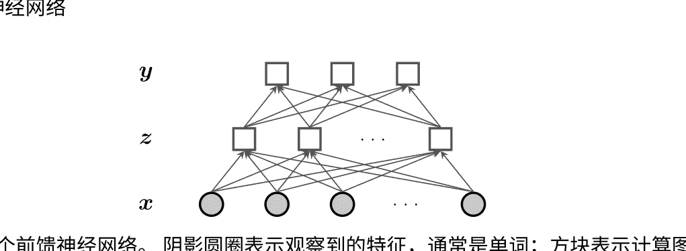

图3.1：一个前馈神经网络。阴影圆圈表示观察到的特征，通常是单词；方块表示计算图中的节点，这些节点是从传入箭头携带的信息计算得到的。

如果我们假设每个 \( z_k \) 是二进制的，\( z_k \in \{0, 1\} \)，那么概率 \( p(z_k \mid \boldsymbol{x}) \) 可以用二元逻辑回归建模：
$$ \mathrm{Pr}(z_k = 1 \mid \boldsymbol{x}; \Theta^{(\boldsymbol{x} \to \boldsymbol{z})}) = \sigma(\boldsymbol{\theta}_k^{(\boldsymbol{x} \to \boldsymbol{z})} \cdot \boldsymbol{x}) = (1 + \exp(-\boldsymbol{\theta}_k^{(\boldsymbol{x} \to \boldsymbol{z})} \cdot \boldsymbol{x}))^{-1} \tag{3.1} $$
其中 \( \sigma \) 是 sigmoid 函数（如图3.2所示），矩阵 \( \Theta^{(\boldsymbol{x} \to \boldsymbol{z})} \in \mathbb{R}^{K_z \times V} \) 是通过堆叠每个 \( z_k \) 的权重向量构建的：
$$ \Theta^{(\boldsymbol{x} \to \boldsymbol{z})} = [\boldsymbol{\theta}_1^{(\boldsymbol{x} \to \boldsymbol{z})}, \boldsymbol{\theta}_2^{(\boldsymbol{x} \to \boldsymbol{z})}, \dots, \boldsymbol{\theta}_{K_z}^{(\boldsymbol{x} \to \boldsymbol{z})}]^\top \tag{3.2} $$
我们将假设 \( \boldsymbol{x} \) 包含一个常数值为 1 的项，以便在每个 \( \boldsymbol{\theta}_k^{(\boldsymbol{x} \to \boldsymbol{z})} \) 中包含相应的偏移参数。

输出层通过多类别逻辑回归概率计算得出：
$$ \mathrm{Pr}(y = j \mid \boldsymbol{z}; \Theta^{(\boldsymbol{z} \to \boldsymbol{y})}, \boldsymbol{b}) = \frac{\exp(\boldsymbol{\theta}_j^{(\boldsymbol{z} \to \boldsymbol{y})} \cdot \boldsymbol{z} + b_j)}{\sum_{j' \in \mathcal{Y}} \exp(\boldsymbol{\theta}_{j'}^{(\boldsymbol{z} \to \boldsymbol{y})} \cdot \boldsymbol{z} + b_{j'})} \tag{3.3} $$
其中 \( b_j \) 是标签 \( j \) 的偏移量，输出权重矩阵 \( \Theta^{(\boldsymbol{z} \to \boldsymbol{y})} \in \mathbb{R}^{K_y \times K_z} \) 再次由连接构建：
$$ \Theta^{(\boldsymbol{z} \to \boldsymbol{y})} = [\boldsymbol{\theta}_1^{(\boldsymbol{z} \to \boldsymbol{y})}, \boldsymbol{\theta}_2^{(\boldsymbol{z} \to \boldsymbol{y})}, \dots, \boldsymbol{\theta}_{K_y}^{(\boldsymbol{z} \to \boldsymbol{y})}]^\top \tag{3.4} $$
对每个可能的 \( y \) 值的概率向量表示为：
$$ \mathrm{p}(\boldsymbol{y} \mid \boldsymbol{z}; \Theta^{(\boldsymbol{z} \to \boldsymbol{y})}, \boldsymbol{b}) = \mathrm{SoftMax}(\Theta^{(\boldsymbol{z} \to \boldsymbol{y})}\boldsymbol{z} + \boldsymbol{b}) \tag{3.5} $$
其中，SoftMax函数的输出中的第 \( j \) 个元素的计算方式如方程3.3所示。

这组方程定义了一个多层分类器，可以总结为：
$$ \mathrm{p}(\boldsymbol{z} \mid \boldsymbol{x}; \Theta^{(\boldsymbol{x} \to \boldsymbol{z})}) = \sigma(\Theta^{(\boldsymbol{x} \to \boldsymbol{z})}\boldsymbol{x}) \tag{3.6} $$
$$ \mathrm{p}(\boldsymbol{y} \mid \boldsymbol{z}; \Theta^{(\boldsymbol{z} \to \boldsymbol{y})}, \boldsymbol{b}) = \mathrm{SoftMax}(\Theta^{(\boldsymbol{z} \to \boldsymbol{y})}\boldsymbol{z} + \boldsymbol{b}) \tag{3.7} $$

> 在与MIT Press签订的合同下，根据CC-BY-NC-ND许可共享。

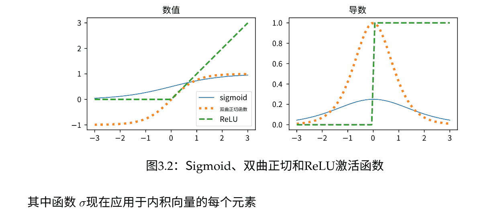

其中函数 \( \sigma \) 现在应用于内积向量的每个元素：
$$ \sigma(\Theta^{(x \to z)} x) = [\sigma(\theta_1^{(x \to z)} \cdot x), \sigma(\theta_2^{(x \to z)} \cdot x), \dots, \sigma(\theta_{K_z}^{(x \to z)} \cdot x)]^T \tag{3.8} $$

现在假设隐藏特征 \( z \) 从未被观察到，即使在训练数据中也是如此。我们仍然可以构建图3.1中的架构。我们不再从离散的预测值向量 \( z \) 中预测 \( y \)，而是使用概率 \( \sigma(\theta_k \cdot x) \)。得到的分类器几乎没有改变：
$$ z = \sigma(\Theta^{(x \to z)} x) \tag{3.9} $$
$$ p(y \mid x; \Theta^{(z \to y)}, b) = \mathrm{SoftMax}(\Theta^{(z \to y)} z + b) \tag{3.10} $$
这定义了一个分类模型，从基本特征 \( x \) 预测标签 \( y \in \mathcal{Y} \)，通过一个“隐藏层” \( z \)。这是一个前馈神经网络。²

### 3.2 设计神经网络

有几种方法可以推广前馈神经网络。

#### 3.2.1 激活函数

如果将隐藏层视为一组潜在特征，则方程式3.9中的sigmoid函数表示每个特征被给定输入“激活”的程度。然而，隐藏层可以更一般地被视为输入的非线性转换。这为许多其他激活函数打开了大门，其中一些在图3.2中显示。目前，激活函数的选择更多是艺术而非科学，但关于最流行的品种可以提出一些观点：

- Sigmoid函数的范围是 \( (0, 1) \)。有界范围确保了一系列Sigmoid函数不会“爆炸”成巨大的输出，这对于具有多个隐藏层的深度网络非常重要。Sigmoid函数的导数是 \( \frac{\partial}{\partial a} \sigma(a) = \sigma(a)(1 - \sigma(a)) \)。这个导数在极端值处变得很小，这可能导致学习速度变慢；这被称为梯度消失问题。
- 双曲正切激活函数的范围是 \( (-1, 1) \)：与Sigmoid函数不同，范围包括负值。其导数是 \( \frac{\partial}{\partial a} \tanh(a) = 1 - \tanh(a)^2 \)，这比逻辑函数在原点附近更陡峭 (LeCun等人，1998年)。tanh函数在极端值处也可能出现梯度消失的问题。
- 修正线性单元 (ReLU) 对于负输入为零，对于正输入为线性 (Glorot等人，2011年)，
  $$ \text{ReLU}(a) = \begin{cases} a, & a \ge 0 \\ 0, & \text{否则} \end{cases} $$
  导数是一个阶跃函数，如果输入为正，则为 1，否则为零。一旦激活为零，梯度也为零。这可能导致“死神经元”的问题，其中一些ReLU节点对于所有输入都为零，在整个学习过程中都保持不变。一种解决方案是泄漏ReLU，它对于负输入具有一个小的正斜率 (Maas等人，2013年)，
  $$ \text{Leaky-ReLU}(a) = \begin{cases} a, & a \ge 0 \\ .0001a, & \text{otherwise} \end{cases} $$

Sigmoid和tanh有时被描述为“压缩函数”，因为它们将无界输入压缩到有界范围内。Glorot和Bengio (2010) 建议在深度网络中不使用Sigmoid激活函数，因为其均值为 \( \frac{1}{2} \) 可能导致网络的下一层饱和，从而导致其自身参数的梯度变小。在Goodfellow等人 (2016) 的教科书中，还对其他几种激活函数进行了评估，他们推荐ReLU作为“默认选项”。

#### 3.2.2 网络结构

深度网络堆叠了几个隐藏层，每个隐藏层的 \(z^{(d)}\) 作为下一层的输入， \(z^{(d+1)}\)。随着网络中节点的总数增加，它学习输入的复杂函数的能力也增加。在给定固定节点数的情况下，必须决定是强调宽度 (每层大 \(K_z\)) 还是深度 (多层)。目前，这种权衡还不太清楚。³

³即使只有一个隐藏层，神经网络也可以近似地表示封闭和有界子集上的任何连续函数，误差可以任意小；参见Goodfellow等人的第6.4.1节 (2016年)

> 在与MIT Press签订的合同下，根据CC-BY-NC-ND许可共享。

还可以通过直接将信息从输入传播到网络的下一个更高层来“短路”隐藏层。这就是残差网络的思想，它将信息直接从输入传播到后续层（He等人，2016年）：
$$ z = f(\Theta^{(x \rightarrow z)} x) + x, \tag{3.13} $$
其中 $f$ 是任何非线性函数，如sigmoid或ReLU。更复杂的架构是高速公路网络（Srivastava等人，2015年；Kim等人，2016年），其中一个加法门控制着 $f(\Theta^{(x \rightarrow z)} x)$ 和 $x$ 之间的插值：
$$ \boldsymbol{t} = \sigma(\Theta^{(t)} x + \boldsymbol{b}^{(t)}) \tag{3.14} $$
$$ z = \boldsymbol{t} \odot f(\Theta^{(x \rightarrow z)} x) + (\mathbf{1} - \boldsymbol{t}) \odot x, \tag{3.15} $$
其中 $\odot$ 表示逐元素向量乘积，而 $\mathbf{1}$ 是一个全为1的列向量。与之前一样，sigmoid函数逐元素应用于其输入；请记住，该函数的输出范围限制在 $(0, 1)$ 之间。门控也用于长短期记忆（LSTM），这在第6章中讨论。残差和高速公路连接解决了深层架构的一个问题：非线性激活函数的重复应用可能使得学习网络较低层参数变得困难，这些参数与监督信号相距太远。

#### 3.2.3 输出和损失函数

在多类分类示例中，softmax输出产生每个可能标签的概率。这与负条件对数似然相一致：
$$ -\mathcal{L} = -\sum_{i=1}^{N} \log p(y^{(i)} \mid x^{(i)}; \Theta) \tag{3.16} $$
其中 $\Theta = \{\Theta^{(x \rightarrow z)}, \Theta^{(z \rightarrow y)}, \boldsymbol{b}\}$ 是参数的整个集合。

这个损失可以用以下方式来写：
$$ \tilde{y}_{j} \triangleq \mathrm{Pr}(y = j \mid x^{(i)}; \Theta) \tag{3.17} $$
$$ -\mathcal{L} = -\sum_{i=1}^{N} e_{y^{(i)}} \cdot \log \tilde{\boldsymbol{y}} \tag{3.18} $$
其中 $e_{y^{(i)}}$ 是一个全零的独热向量，在位置 $y^{(i)}$ 上的值为 1。在 $e_{y^{(i)}}$ 和 $\log \hat{\boldsymbol{y}}$ 之间的内积也被称为多项式交叉熵，在许多神经网络论文和软件包中，这个术语更常用。

也可以从其他目标训练神经网络，比如边际损失。在这种情况下，不需要在输出层使用softmax函数：隐藏层的仿射变换就足够了：
$$ \Psi(y; \boldsymbol{x}^{(i)}, \Theta) = \boldsymbol{\theta}_{y}^{(z \rightarrow y)} \cdot \boldsymbol{z} + b_y \tag{3.19} $$
$$ \ell_{\text{MARGIN}}(\Theta; \boldsymbol{x}^{(i)}, y^{(i)}) = \max_{y=y^{(i)}} \left( 1 + \Psi(y; \boldsymbol{x}^{(i)}, \Theta) - \Psi(y^{(i)}; \boldsymbol{x}^{(i)}, \Theta) \right)_+ \tag{3.20} $$

在回归问题中，输出是一个标量或向量（参见 §4.1.2）。对于这些问题，一个典型的损失函数是平方误差 $(y - \hat{y})^2$ 或平方范数 $\|\boldsymbol{y} - \hat{\boldsymbol{y}}\|^2_2$。

#### 3.2.4 输入和查找层

在文本分类中，输入层 $\boldsymbol{x}$ 可以指的是一个词袋向量，其中 $x_j$ 是词 $j$ 的计数。隐藏单元 $z_k$ 的输入然后是 $\sum_{j=1}^{V} \boldsymbol{\theta}_{j,k}^{(x \rightarrow z)} \ x_j$，词 $j$ 由向量 $\boldsymbol{\theta}_{j}^{(x \rightarrow z)}$ 表示。这个向量有时被描述为词 $j$ 的嵌入，并且可以通过使用第14章讨论的技术从无标签数据中学习得到。$\boldsymbol{\Theta}^{(x \rightarrow z)}$ 的列是每个 $K_z$ 维词嵌入。

第2章提出了一种文本文档的替代观点，将其视为一个单词序列，即 $w_1, w_2, \ldots, w_M$。在神经网络中，每个单词标记 $w_m$ 用一个独热向量表示，即 $\boldsymbol{e}_{w_m}$，维度为 $V$。矩阵-向量乘积 $\boldsymbol{\Theta}^{(x \rightarrow z)} \boldsymbol{e}_{w_m}$ 返回单词 $w_m$ 的嵌入。完整的文档可以通过水平连接这些独热向量表示，即 $\boldsymbol{W} = [\boldsymbol{e}_{w_1}, \boldsymbol{e}_{w_2}, \ldots, \boldsymbol{e}_{w_M}]$，并且词袋表示可以从矩阵-向量乘积 $\boldsymbol{W}[1,1,\ldots,1]^\top$ 中恢复，该乘积对标记 $m = \{1,2,\ldots,M\}$ 的每一行求和。矩阵乘积 $\boldsymbol{\Theta}^{(x \rightarrow z)} \boldsymbol{W}$ 包含了文档中每个单词的水平连接嵌入，这将作为卷积神经网络的起始点（参见 §3.4）。有时这被称为查找层，因为第一步是查找输入文本中每个单词的嵌入。

### 3.3 学习神经网络

图3.1中的前馈网络现在可以写成：
$$ \boldsymbol{z} \leftarrow f\left(\boldsymbol{\Theta}^{(x \rightarrow z)} \boldsymbol{x}^{(i)}\right) \tag{3.21} $$
$$ \hat{\boldsymbol{y}} \leftarrow \text{SoftMax}\left(\boldsymbol{\Theta}^{(z \rightarrow y)} \boldsymbol{z} + \boldsymbol{b}\right) \tag{3.22} $$
$$ \ell^{(i)} \leftarrow -\boldsymbol{e}_{y^{(i)}} \cdot \log \hat{\boldsymbol{y}} \tag{3.23} $$
其中 $f$ 是逐元素激活函数，例如 $\sigma$ 或 $\text{ReLU}$，而 $\ell^{(i)}$ 是实例 $i$ 的损失。可以使用在线梯度下降优化来估计参数 $\Theta^{(x \rightarrow z)}$, $\Theta^{(z \rightarrow y)}$, 和 $b$。最简单的算法是随机梯度下降，它在 §2.6 中讨论过。每个参数都通过损失的梯度进行更新：
$$ \begin{aligned}
b &\leftarrow b - \eta^{(t)} \nabla_b \ell^{(i)} & [3.24] \\
\boldsymbol{\theta}_k^{(z \rightarrow y)} &\leftarrow \boldsymbol{\theta}_k^{(z \rightarrow y)} - \eta^{(t)} \nabla_{\boldsymbol{\theta}_k^{(z \rightarrow y)}} \ell^{(i)} & [3.25] \\
\boldsymbol{\theta}_n^{(x \rightarrow z)} &\leftarrow \boldsymbol{\theta}_n^{(x \rightarrow z)} - \eta^{(t)} \nabla_{\boldsymbol{\theta}_n^{(x \rightarrow z)}} \ell^{(i)}, & [3.26]
\end{aligned} $$
其中 $\eta^{(t)}$ 是迭代 $t$ 的学习率，$\ell^{(i)}$ 是实例（或小批量）$i$ 的损失，而 $\boldsymbol{\theta}_n^{(x \rightarrow z)}$ 是矩阵 $\Theta^{(x \rightarrow z)}$ 的第 $n$ 列而 $\boldsymbol{\theta}_k^{(z \rightarrow y)}$ 是矩阵 $\Theta^{(z \rightarrow y)}$ 的第 $k$ 列。

负对数似然的梯度在 $b$ 和 $\boldsymbol{\theta}_k^{(z \rightarrow y)}$ 上与逻辑回归中的梯度类似。对于 $\boldsymbol{\theta}_k^{(z \rightarrow y)}$，梯度为：
$$ \nabla_{\boldsymbol{\theta}_k^{(z \rightarrow y)}} \ell^{(i)} = \left[ \frac{\partial \ell^{(i)}}{\partial \theta_{k,1}^{(z \rightarrow y)}}, \frac{\partial \ell^{(i)}}{\partial \theta_{k,2}^{(z \rightarrow y)}}, \cdots, \frac{\partial \ell^{(i)}}{\partial \theta_{k,K_y}^{(z \rightarrow y)}} \right]^\top \tag{3.27} $$
$$ \frac{\partial \ell^{(i)}}{\partial \theta_{k,j}^{(z \rightarrow y)}} = -\frac{\partial}{\partial \theta_{k,j}^{(z \rightarrow y)}} \left( \boldsymbol{\theta}_{y^{(i)}}^{(z \rightarrow y)} \cdot \mathbf{z} - \log \sum_{y \in \mathcal{Y}} \exp \boldsymbol{\theta}_y^{(z \rightarrow y)} \cdot \mathbf{z} \right) \tag{3.28} $$
$$ = \left( \text{Pr}(y = j \mid \mathbf{z}; \Theta^{(z \rightarrow y)}, b) - \delta\left(j = y^{(i)}\right) \right) z_k \tag{3.29} $$
其中 $\delta\left(j = y^{(i)}\right)$ 是一个函数，当 $j = y^{(i)}$ 时返回 1，否则返回零。梯度 $\nabla_b \ell^{(i)}$ 与方程 3.29 类似。

输入层权重 $\Theta^{(x \rightarrow z)}$ 的梯度是通过链式法则求导得到的：
$$ \begin{aligned}
\frac{\partial \ell^{(i)}}{\partial \theta_{n,k}^{(x \rightarrow z)}} &= \frac{\partial \ell^{(i)}}{\partial z_k} \frac{\partial z_k}{\partial \theta_{n,k}^{(x \rightarrow z)}} & [3.30] \\
&= \frac{\partial \ell^{(i)}}{\partial z_k} \frac{\partial f\left( \boldsymbol{\theta}_k^{(x \rightarrow z)} \cdot \mathbf{x} \right)}{\partial \theta_{n,k}^{(x \rightarrow z)}} & [3.31] \\
&= \frac{\partial \ell^{(i)}}{\partial z_k} \times f'\left( \boldsymbol{\theta}_k^{(x \rightarrow z)} \cdot \mathbf{x} \right) \times x_n, & [3.32]
\end{aligned} $$
其中 $f'\left( \boldsymbol{\theta}_k^{(x \rightarrow z)} \cdot \mathbf{x} \right)$ 是激活函数 $f$ 在输入处的导数。

²这种架构有时被称为多层感知器，但这是误导性的，因为每一层并不是前一章中定义的感知器。

关于这些理论结果的调查。然而，根据要近似的函数，隐藏层的宽度可能需要任意大。此外，网络具有近似任何给定函数的能力，并不意味着可以使用基于梯度的优化来学习该函数。

#### 3.3.1 反向传播

θ_k^{(x→z)} · x. 例如，如果 f是sigmoid函数，则导数为，
\[
\frac{\partial \ell^{(i)}}{\partial \theta_{n,k}^{(x\rightarrow z)}} = \frac{\partial \ell^{(i)}}{\partial z_k} \times \sigma(\theta_k^{(x\rightarrow z)} \cdot x) \times (1 - \sigma(\theta_k^{(x\rightarrow z)} \cdot x)) \quad [3.33]
\]
\[
= \frac{\partial \ell^{(i)}}{\partial z_k} z_k (1 - z_k). \quad [3.34]
\]

为了直观起见，考虑乘积中的每一项。

- 如果负对数似然函数 ℓ^{(i)}不太依赖于 z_k，那么 ∂ℓ^{(i)}/∂z_k，在这种情况下，如何计算 z_k并不重要，因此 ∂ℓ^{(i)}/∂θ_{n,k}^{(x→z)} ≈ 0.
- 如果 z_k接近 1或 0，则S型函数的曲线几乎是平的（图3.2），改变输入将产生很小的局部差异。项 z_k × (1 - z_k)在 z_k = 1/2时达到最大值，此时S型函数的斜率最大。
- 如果 x_n = 0，则设置权重 θ_{n,k}^{(x→z)}的方式无关紧要。所以 ∂ℓ^{(i)}/∂θ_{n,k}^{(x→z)} = 0.

上述方程依赖于链式法则来计算模型中每个参数对损失的导数。此外，局部导数经常被重复使用：例如，∂ℓ^{(i)}/∂z_k在计算相对于每个 θ_{n,k}^{(x→z)}的导数时被重复使用。因此，这些项应该被计算一次，然后缓存起来。此外，在我们已经计算出链式法则所需的所有“输入”之后，我们应该只计算任何导数一次。这种顺序、缓存和微分的组合被称为反向传播。它可以推广到任何有向无环计算图。

计算图是计算过程的声明性表示。在每个节点 t上，通过将函数 f_t应用于（可能为空的）父节点列表 π_t来计算值 v_t。图3.3显示了一个具有一个隐藏层的前馈网络的计算图。输入节点 x^{(i)}、隐藏层 z、预测输出 \hat{y}和参数 Θ都有对应的节点。在训练过程中，还有一个节点对应于真实标签 y^{(i)}和损失 ℓ^{(i)}。预测输出 \hat{y}是损失的父节点之一（另一个是标签 y^{(i)}）；它的父节点包括 Θ和 z等。计算图包括三种类型的节点：

变量。在图3.3的前馈网络中，变量包括输入 x,隐藏节点 z, 输出 y和损失函数。输入是没有父节点的变量。反向传播计算相对于所有梯度。

### 算法6通用反向传播算法

在计算图 G 中，每个节点包含一个函数 f_t 和一组父节点 π_t；图的输入是 x^(i)。

```
1: 过程   BACKPROP(G = {f_t, π_t}_{t=1}^T, x^(i))
2:      对于所有的 n 和相关的计算节点 t(n)，将 x_n^(i) 赋值给 v t(n)。
3:      对于 t ∈ TOPOLOGICALSORT(G), 执行以下操作:                 。前向传播：计算每个节点的值
4:          如果 |π_t| > 0 则
5:              v_t ← f_t(v_{π_{t,1}}, v_{π_{t,2}}, …, v_{π_{t,N_t}})
6:      g_目标 = 1                                            。反向传播：计算每个节点的梯度
7:      对于 t ∈ REVERSE(TOPOLOGICALSORT(G)) 执行
8:          g_t ← ∑_{t' 作为 t 的子节点} 传播梯度 g_{t'}，按照局部梯度 ∇_v v_t 进行缩放
9:      返回 {g_1, g_2, …, g_T}
```

除了输入之外的变量，并将这些梯度向后传播到参数。

参数。在前馈网络中，参数包括权重和偏移量。在图3.3中，参数在节点 Θ 中总结，但我们可以为 Θ^(x→z), Θ^(z→y) 和任何偏移参数单独设置节点。参数节点没有父节点；它们不是从其他节点计算得出的，而是通过梯度下降学习得到的。

损失。损失 ℓ^(i) 是在训练过程中要最小化的量。在计算图中，表示损失的节点不是任何其他节点的父节点；它的父节点通常是预测标签 ŷ 和真实标签 y^(i)。反向传播从计算损失的梯度开始，然后将这个梯度向后传播到其直接父节点。

如果计算图是一个有向无环图，则可以通过拓扑排序对节点进行排序，使得如果节点 t 是节点 t' 的父节点，则 t < t'。这意味着可以在单次前向传递中计算出值 {v_t}_{t=1}^T。在计算梯度时，拓扑排序是反向的：每个梯度 g_t 是从 t 的子节点的梯度计算得到的，实现了链式法则。计算图的一般反向传播算法如算法6所示。

虽然每个参数的梯度可能很复杂，但它们由简单部分的乘积组成。对于许多网络，可以通过自动微分计算所有梯度。这意味着您只需要指定前向计算，学习所需的梯度可以自动获得。有许多软件库可以在计算机上执行自动微分。

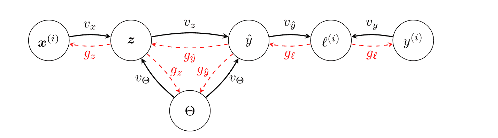

诸如TORCH(Collobert et al., 2011)、TENSORFLOW(Abadi et al., 2016)和DYNET(Neubig et al., 2017)等都支持计算图，但它们之间存在一些重要区别。这些库之间的一个重要区别是它们是否支持动态计算图，即计算图的结构在不同实例之间变化。静态计算图是提前编译的，可以应用于固定维度的数据，例如词袋向量。在许多自然语言处理问题中，每个输入都具有不同的结构，需要一个独特的计算图。在递归神经网络语言模型中（见第6章），每个句子中的每个单词都有一个节点。更复杂的情况包括递归神经网络（见第14章），其中网络是与输入的句法组织相匹配的树结构。

#### 3.3.2 正则化和丢弃

在线性分类中，过拟合问题通过在目标函数中添加正则化项来解决，即 $\lambda ||\theta||^2_2$。这种方法也可以应用于前馈神经网络，对每个权重矩阵进行惩罚：

$$L = \sum_{i=1}^{N} \ell^{(i)} + \lambda_{z\rightarrow y}||\Theta^{(z\rightarrow y)}||^2_F + \lambda_{x\rightarrow z}||\Theta^{(x\rightarrow z)}||^2_F, \qquad [3.35]$$

其中 $||\Theta||^2_F = \sum_{i,j} \theta^2_{i,j}$ 是平方Frobenius范数，它将 $L_2$ 范数推广到矩阵。偏置参数 $b$ 不被正则化，因为它们对分类器对输入的敏感性没有贡献。在基于梯度的优化中，Frobenius范数正则化的实际效果是权重在每次更新时“衰减”到零，这解释了其替代名称权重衰减的由来。

控制模型复杂度的另一种方法是 dropout，在训练过程中随机将一些计算节点置零（Srivastava等人，2014年）。例如，在前馈网络中，对于每个训练实例，以概率 $\rho$，我们 将每个输入 $x$ 和每个隐藏层节点 $z_k$置零。Srivastava等人（2014年）推荐隐藏单元的 $\rho=0.5$，输入单元的 $\rho=0.2$。Dropout也被纳入到梯度计算中，因此如果节点 $z_k$被丢弃，则权重 $\Theta^{(x \to z)}$ 在这个实例中将不会被更新。Dropout防止网络过度依赖任何一个特征或隐藏节点，并防止特征共适应，即一个隐藏单元只有与一个或多个其他隐藏单元结合时才有用。Dropout是特征噪声的一种特殊情况，也可以在输入或隐藏单元上添加高斯噪声（Holmstrom和Koistinen，1992年）。Wager等人（2013年）表明，dropout与“自适应” $L_2$正则化近似等效，每个特征都有一个单独的正则化惩罚。

#### 3.3.3 *学习理论

第2章强调了凸性对于学习的重要性：对于凸目标函数，全局最优解可以高效地找到。负对数似然和合页损失是输出层参数的凸函数。然而，前馈网络的输出通常不是输入层参数的凸函数，$\Theta^{(x \to z)}$。前馈网络可以看作是函数组合，其中每一层是应用于前一层输出的函数。两个凸函数的组合通常不保持凸性，而且“压缩”激活函数如tanh和sigmoid不是凸函数。

通过对隐藏层的元素进行排列，可以看出隐藏层神经网络的非凸性，从 $z=[z_1, z_2, \ldots, z_K]$ 变为 $\tilde{z}=[z_{\pi(k)}]$，这对应于将 $\pi$ 应用于 $\Theta$ 的行和 $\Theta$ 的列，结果是排列参数矩阵 $\Theta^{(x \to z)}_\pi$ 和 $\Theta^{(z \to y)}_\pi$。只要这个排列一致应用，损失将是相同的， $L(\Theta) = L(\Theta_\pi)$：它对这个排列是不变的。然而，线性组合 $L(\alpha \Theta + (1-\alpha) \Theta_\pi)$ 的损失通常不等于 $\Theta$ 或其排列下的损失。如果 $L(\Theta)$ 在附近的任何点上都比损失更好，并且 $L(\Theta) = L(\Theta_\pi)$，那么损失函数不满足凸性的定义（见 §2.4）。其中一个练习要求你更严格地证明这一点。

在实践中，存在多个最优解并不一定是个问题，只要所有这些最优解都是前面段落中描述的排序的排列。相比之下，“坏”的局部最优解比它们的邻居要好，但比全局最优解要差得多。幸运的是，在大型前馈神经网络中，大多数局部最优解几乎和全局最优解一样好 (Choromanska et al., 2015)。更一般地，临界点是梯度为零的点。临界点可能是局部最优解，但也可能是鞍点，在某些方向上是局部最小值，在其他方向上是局部最大值。例如，方程 $x^2_1 - x^2_2$ has a saddle point at $x= (0,0)$。

在大型网络中，绝大多数关键点都是鞍点，而不是极值点 比局部极小值或极大值更糟糕（Dauphin等, 2014）。鞍点可能对基于梯度的优化造成问题，因为当梯度趋近于零时，学习速度会变得非常缓慢。然而，随机梯度下降引入的噪声以及诸如dropout等特征噪声技术可以帮助在线优化逃离鞍点并找到高质量的极值（Ge等, 2015）。其他技术直接处理鞍点，使用Hessian矩阵的局部重构（Dauphin等, 2014）或高阶导数（Anandkumar和Ge, 2016）。

关于神经网络的另一个理论难题是它们如何能够泛化to未见过的数据。如果有足够的参数，一个两层前馈网络可以“记忆”它的训练数据，在任何训练集上达到完美的准确性。张等人（2017）提供了一个特别显著的演示，他们表明神经网络可以学习完美地对一个训练集的图像进行分类，即使标签被随机值替换！当然，当应用于保留数据时，该网络只能达到随机准确性。担心的是，当这样一个强大的学习器应用于真实的训练数据时，它可能会学习到一个病态的分类函数，该函数利用了训练数据的无关细节并且无法泛化。然而，这种极端的过拟合在实践中很少遇到，并且通常可以通过正则化、丢弃和提前停止（见§3.3.4）来防止。最近的论文已经为特定类别的神经网络推导出了泛化保证（例如，Kawaguchi等人, 2017; Brutzkus等人, 2018），但在这个领域的理论工作仍在进行中。

#### 3.3.4 技巧

有时候，使神经网络正常工作需要一些启发式的“技巧”（Bottou, 2012; Goodfellow等, 2016; Goldberg, 2017b）。本节介绍了一些特别重要的技巧。

初始化对于线性分类器来说，初始化并不是特别重要，因为凸性保证了全局最优解通常可以快速找到。但是对于多层神经网络来说，拥有一个良好的起点是有帮助的。其中一个原因是，如果初始权重的大小太大，sigmoid或tanh非线性函数将会饱和，导致梯度很小，学习速度很慢。大梯度可能导致训练发散，参数取得越来越极端的值，直到达到浮点表示的极限。

通过确保初始梯度的方差在整个网络中保持恒定和有界，初始化可以帮助避免这些问题。对于具有tanh激活函数的网络，可以通过从中采样初始权重来实现这一点 遵循均匀分布（Glorot和Bengio，2010年），

$$\theta_{i,j} \sim U \left[ -\frac{\sqrt{6}}{\sqrt{d_{\text{in}}(n) + d_{\text{out}}(n)}}, \frac{\sqrt{6}}{\sqrt{d_{\text{in}}(n) + d_{\text{out}}(n)}} \right]$$ [3.36]

对于导致ReLU激活函数的权重，He等人（2015年）使用类似的论证来证明从零均值高斯分布中采样的合理性，

$$\theta_{i,j} \sim N(0, \sqrt{2/d_{\text{in}}(n)})$$ [3.38]

与独立初始化权重不同，将每个层作为正交矩阵联合初始化可能是有益的，确保 Θ^T Θ = I（Saxe等人，2014年）。正交矩阵保持输入的范数，使得 ||Θx|| = ||x||，从而防止梯度爆炸或消失。正交性确保隐藏单元不相关，因此它们对应于输入的不同特征。正交初始化可以通过对从标准正态分布中采样的值矩阵应用奇异值分解来执行：

$$a_{i,j} \sim N(0,1)$$ [3.39]
$$\mathbf{A} = \{a_{i,j}\}_{i=1,j=1}^{d_{\text{in}}(j), d_{\text{out}}(j)}$$ [3.40]
$$\mathbf{U, S, V}^{\top} = \text{SVD}(\mathbf{A})$$ [3.41]
$$\Theta^{(j)} \leftarrow \mathbf{U}.$$ [3.42]

矩阵 U包含了 A的奇异向量，并且保证是正交的。关于奇异值分解的更多信息，请参见第14章。

即使进行了仔细的初始化，最终结果仍然可能存在显著的差异。进行多次训练，并选择在保留的开发集上性能最好的一次训练结果可能会有所帮助。

剪切和归一化学习对梯度的大小非常敏感：如果太大，学习可能会发散，连续的更新会在越来越极端的值之间来回摆动；如果太小，学习可能会停滞不前。已经提出了几种启发式方法来解决这个问题。

- 在梯度剪裁（Pascanu等人，2013）中，对梯度的范数设定了上限，当超过这个上限时，梯度会被重新缩放。

$$\text{CLIP}(\tilde{\mathbf{g}}) = \begin{cases} \mathbf{g} & \|\tilde{\mathbf{g}}\| < \tau \\ \frac{\tau}{\|\tilde{\mathbf{g}}\|} \mathbf{g} & \text{otherwise.} \end{cases}$$ [3.43]

- 在批归一化（Ioffe和Szegedy，2015）中，每个计算节点的输入会被其在整个小批量$\mathcal{B}$中的均值和方差重新调整（参见§2.6.2）。例如，在一个具有一个隐藏层的前馈网络中，批归一化会将输入转换为隐藏层的输入如下：

> \[\mu^{(\mathcal{B})} = \frac{1}{|\mathcal{B}|} \sum_{i \in \mathcal{B}} x^{(i)}\]
> \[s^{(\mathcal{B})} = \frac{1}{|\mathcal{B}|} \sum_{i \in \mathcal{B}} (x^{(i)} - \mu^{(\mathcal{B})})^2\]
> \[\bar{x}^{(i)} = (x^{(i)} - \mu^{(\mathcal{B})}) / \sqrt{s^{(\mathcal{B})}}\] [3.44] [3.45] [3.46]

从经验上讲，这加快了深度架构的收敛速度。一个解释是，在训练过程中，它有助于纠正激活分布的变化。

- 在层归一化(Ba et al., 2016)中，每个非线性激活函数的输入在整个层上重新居中：

> \[a = \Theta^{(x \to z)} x\]
> \[\mu = \frac{1}{K_z} \sum_{k=1}^{K_z} a_k\]
> \[s = \frac{1}{K_z} \sum_{k=1}^{K_z} (a_k - \mu)^2\]
> \[z = (a - \mu) / \sqrt{s}\] [3.47] [3.48] [3.49] [3.50]
层归一化与批归一化具有类似的动机，但它可以应用于更广泛的架构和训练条件。

在线优化有一批在线优化算法试图改进随机梯度下降。AdaGrad在§2.6.2中进行了回顾；其主要创新是通过存储平方梯度的和来设置每个参数的自适应学习率。我们可以保持一个运行估计，而不是使用整个训练历史的总和。

> \[v_j^{(t)} = \beta v_j^{(t-1)} + (1 - \beta) g_{t,j}^2\] [3.51]
其中 $g_{t,j}$ 是在时间 $t$ 下对参数 $j$ 的梯度，$\beta \in [0, 1]$。这个术语更加强调最近的梯度，并且被AdaDelta (Zeiler, 2012)和Adam (Kingma and Ba, 2014)优化器使用。在线优化及其理论背景由Bottou等人(2016)进行了回顾。早停，在§2.3.2中提到，可以通过在验证集上的性能达到平稳后终止训练来避免过拟合。

实用建议训练神经网络的技巧不断增加，在您阅读本文时可能会有几个新的技巧。 如今，使用梯度裁剪、早停和合理的参数初始化为小的随机值已成为标准做法。 可以添加更多的花哨功能作为特定问题的解决方案 - 例如，如果难以找到适合随机梯度下降的学习率，则尝试使用具有自适应学习率的更高级的优化器可能有所帮助。 或者，如果相关模型在研究文献中使用了诸如层归一化之类的方法，则应该考虑使用它，特别是如果您在匹配已发表结果方面遇到困难。 与线性分类器一样，评估这些决策时重要的是使用一个保留的开发集，而不是用于提供模型性能的最终度量的测试集（参见 § 2.2.5）。

### 3.4 卷积神经网络

词袋模型的一个基本弱点是它无法解释词语组合产生的含义，甚至包括简单的反转，例如不愉快，几乎没有慷慨的提议，以及我不介意错过飞机。 计算机视觉面临的相关挑战是从像素特征中识别图像的语义，这些特征在孤立状态下是无信息的。 早期的计算机视觉研究集中于设计过滤器，将局部像素级特征聚合成更有意义的表示，例如边缘和角点（例如Canny，1987年）。 类似地，早期的自然语言处理研究尝试通过手动设计的词汇模式捕捉多词语言现象（Hobbs等，1997年）。 在这两种情况下，过滤器和模式的输出可以作为线性分类器中的基本特征。 但与其手动设计这些特征提取器，更好的方法是通过反向传播的魔力来学习它们。

**这是卷积神经网络的思想背后。**

根据 §3.2.4，将神经网络的基层定义为，

$$ X^{(0)} = \Theta^{(x \rightarrow z)} [e_{w_1}, e_{w_2}, \dots, e_{w_M}], \quad \quad [3.52] $$

其中 $e_{w_m}$ 是一个全零的列向量，在位置 $w_m$ 处有一个 1。 基层的维度为 $X^{(0)} \in \mathbb{R}^{K_e \times M}$，其中 $K_e$ 是词嵌入的大小。 为了合并相邻单词的信息，我们将 $X^{(0)}$ 与一组滤波矩阵 $C^{(k)} \in \mathbb{R}^{K_e \times h}$ 进行卷积。 卷积用符号 $*$ 表示，并定义为，

$$ X^{(1)} = f(b + C * X^{(0)}) \quad \Longrightarrow \quad x^{(1)}_{k,m} = f\left(b_k + \sum_{k'=1}^{K_e} \sum_{n=1}^{h} c^{(k)}_{k',n} \times x^{(0)}_{k', m+n-1} \right), \quad \quad [3.53] $$

其中 $f$ 是一个激活函数，如tanh或ReLU，而 $b$ 是一个偏移向量。 卷积操作将矩阵 $C^{(k)}$ 沿着 $X^{(0)}$ 的列滑动。 在每个位置 $m$， 我们计算元素级乘积 $C^{(k)} \; X^{(0)}_{\;\;\; m:m+h-1}$，并求和。

## 3.4. 卷积神经网络

一个简单的滤波器可以计算附近单词的加权平均值，

$$
\mathbf{C}^{(k)} = \begin{bmatrix} 0.5 & 1 & 0.5 \\ 0.5 & 1 & 0.5 \\ ... & ... & ... \\ 0.5 & 1 & 0.5 \end{bmatrix},
$$

从而表示三元组单元，如不那么令人不愉快。在一维卷积中，每个滤波器矩阵 $\mathbf{C}^{(k)}$被限制为只在第 $k$行具有非零值 (Kalchbrenner et al., 2014)。 这意味着词嵌入的每个维度都由一个单独的滤波器处理，并且这意味着 $K_f = K_e$。

为了处理输入的开头和结尾，基本矩阵 $\mathbf{X}^{(0)}$可以在开头和结尾填充 $h$列零向量；这被称为宽卷积。 如果不应用填充，则每个层的输出将比输入小 $h-1$个单位；这被称为窄卷积。 滤波器矩阵不需要具有相同的滤波器宽度，因此更一般地，我们可以写作 $h_k$来表示滤波器$\mathbf{C}^{(k)}$的宽度。 如符号 $\mathbf{X}^{(0)}$所示，可以应用多层卷积，因此 $\mathbf{X}^{(d)}$是 $\mathbf{X}^{(d+1)}$的输入。

在 $D$个卷积层之后，我们得到了一个文档的矩阵表示 $\mathbf{X}^{(D)} \in \mathbb{R}^{K_z \times M}$。 如果实例的长度不同，需要对所有 $M$个单词位置进行聚合，以获得固定长度的表示。 这可以通过池化操作来实现。例如最大池化（Collobert等，2011）或平均池化。

$$
z = \text{MaxPool}(\mathbf{X}^{(D)}) \implies z_k = \text{最大值}\left(x_{k,1}^{(D)}, x_{k,2}^{(D)}, \dots, x_{k,M}^{(D)}\right) \qquad [3.55]
$$

$$
z = \text{AvgPool}(\mathbf{X}^{(D)}) \implies z_k = \frac{1}{M} \sum_{m=1}^{M} x_{k,m}^{(D)}. \qquad [3.56]
$$

向量 z 现在可以作为前馈网络中的一层，最终得出一个预测 ŷ 和一个损失 ℓ⁽ⁱ⁾。图3.4显示了设置。

与前馈网络一样，参数(C⁽ᵏ⁾, b, Θ)可以通过反向传播从分类损失中学习。这需要通过最大池化操作进行反向传播，这是输入的一个不连续函数。但是因为我们只需要一个局部梯度，反向传播只通过argmax m进行流动：

$$
\frac{\partial z_k}{\partial x_{k,m}^{(D)}} = \begin{cases} 1, & x_{k,m}^{(D)} = \max \left(x_{k,1}^{(D)}, x_{k,2}^{(D)}, \dots, x_{k,M}^{(D)}\right) \\ 0, & \text{otherwise.} \end{cases} \qquad [3.57]
$$

计算机视觉文献提出了各种各样的卷积架构，其中许多创新可以应用于文本数据。改进的一个途径是更复杂的池化操作，例如 k最大池化 (Kalchbrenner et al., 2014)，它返回每个过滤器的 k最大值的矩阵。另一个创新是使用扩张卷积来构建多尺度表示 (Yu and Koltun, 2016)。在每一层，卷积算子应用于 strides，每个特征之后跳过 s步。随着我们向上移动层次结构，每一层比下面的层次小 s倍，有效地总结了输入 (Kalchbrenner et al., 2016; Strubell et al., 2017)。这个想法在图3.5中显示。多层卷积网络还可以通过“shortcut”连接进行增强，就像 §3.2.2中的残差网络一样 (Johnson and Zhang, 2017)。

### 附加资源

Goodfellow等人（2016）的深度学习教材详细介绍了本章中的许多主题。要全面了解神经网络在自然语言处理中的应用，请参阅Goldberg（2017b）的综述。一部关于深度学习在自然语言处理中的开创性工作是题为“自然语言处理（几乎）从零开始”的著作，其中使用卷积神经网络执行各种语言处理任务（Collobert等人，2011），尽管还有早期的研究（例如，Henderson，2004）。本章重点介绍前馈和卷积神经网络，但递归神经网络是自然语言处理中最重要的深度学习架构之一。它们在第6章和第7章中有详细介绍。

深度学习在自然语言处理研究中的角色引起了自然语言处理研究界的一些不安（例如，Goldberg，2017a），尤其是一些狂热的深度学习倡导者认为，从“原始”文本进行端到端学习可以消除对句子、短语甚至单词等语言结构的需求（Zhang等人，2015，最初标题为“从零开始的文本理解”）。这些发展被Manning（2015）调查过。尽管关于自然语言处理中语言学的消亡的报道仍然存在争议，但深度学习和反向传播已经在研究和应用中无处不在。

### 练习

1.  图3.3显示了一个具有一层的前馈神经网络的计算图。
    a) 更新计算图，包括在 $x$ 和 $z$ 之间的残差连接。
    b) 更新计算图，包括在 $x$ 和 $z$ 之间的高速公路连接。

2.  证明当可能的标签数为两个时，softmax函数和sigmoid函数是等价的。具体来说，对于任意 $\Theta^{(z\rightarrow y)}$ （简化起见，省略偏移量 $b$），展示如何构造一个权重向量 $\theta$，使得
    $$
    \text{SoftMax}(\Theta^{(z\rightarrow y)} z)[0] = \sigma(\theta \cdot z). \qquad [3.58]
    $$

3.  卷积神经网络通常通过使用最大池化来聚合单词（在 §3.4中的方程3.55）。一个潜在的担忧是，对于未包含在最大值中的输入部分，梯度为零。以下是问题考虑对输入元素的梯度，$x^{(0)}_{m,k}$，并且假设所有参数都是独立分布的。
    a) 首先考虑一个最小的网络，$z = \mathrm{MaxPool}(\mathbf{X}^{(0)})$。梯度的概率是多少？ $\frac{\partial \ell}{\partial x^{(0)}_{m,k}}$ 是否为零？
    b) 现在考虑一个两层的网络，$\mathbf{X}^{(1)} = f(\mathbf{b} + \mathbf{C} * \mathbf{X}^{(0)})$。梯度为零的概率如何表达？ $\frac{\partial \ell}{\partial x^{(0)}_{m,k}}$ 与输入长度 $M$，过滤器大小 $n$和过滤器数量 $K_f$相关的梯度为零的概率如何表达？
    c) 使用计算器计算出 $M=128$，$n=4$，$K_f=32$的情况下的概率。
    d) 现在考虑一个三层的网络，$\mathbf{X}^{(2)} = f(\mathbf{b} + \mathbf{C} * \mathbf{X}^{(1)})$。梯度为零的概率的一般方程是什么？ $\frac{\partial \ell}{\partial x^{(0)}_{m,k}}$ 非零，并计算先前部分的情况下的数值概率，假设 $K_f=32$和 $n=4$在两个级别上。

4.  设计一个前馈网络来计算XOR函数：
    $$
    f(x_1, x_2) = \begin{cases} -1, & x_1 = 1, x_2 = 1 \\ 1, & x_1 = 1, x_2 = 0 \\ 1, & x_1 = 0, x_2 = 1 \\ -1, & x_1 = 0, x_2 = 0 \end{cases} \qquad [3.59]
    $$
    你的网络应该有一个使用符号激活函数的输出节点，$f(x) = \begin{cases} 1 & x > 0 \\ 0 \end{cases}$，使用一个隐藏层，具有ReLU激活函数。描述所有权重和偏移量。

5.  考虑与上述相同的网络（隐藏层使用ReLU激活函数），具有任意可微损失函数 $\ell(y^{(i)}, \tilde{y})$，其中 $\tilde{y}$ 是输出节点的激活值。假设所有权重和偏移量都初始化为零。证明从这种初始化开始，梯度下降法无法学习到所需的函数。

6.  前面问题的最简单解决方案是在隐藏层使用ReLU激活函数。现在考虑隐藏层上任意激活函数的网络。证明如果初始权重是任意均匀常数，则梯度下降法无法从这种初始化学习到所需的函数。

7.  考虑一个网络，其中：基本特征都是二进制的，$x \in \{0, 1\}^M$；隐藏层的激活函数是sigmoid函数，$z_k = \sigma(\theta_k \cdot x)$；初始权重独立地从标准正态分布中采样，$\theta_{j,k} \sim N(0, 1)$。

8.  ReLU激活函数可能导致“死神经元”，这些神经元在任何输入上都无法被激活。考虑以下具有标量输出 $y$ 的两层前馈网络：
    $$
    z_i =\text{ReLU}(\theta_i^{(x\rightarrow z)} \cdot \mathrm{x} + \mathrm{BI}) \quad\quad\quad [3.61]
    $$
    $$
    y =\theta^{(z\rightarrow y)} \cdot z. \quad\quad\quad [3.62]
    $$
    假设输入是一个二进制观测向量，$\mathrm{X} \in \{0,1\}^D$.
    a) 在什么条件下节点 $Z_i$“死亡”？你的答案应该用参数 $\theta^{(\mathrm{X}\rightarrow Z)}_i$ 和 $\mathrm{B}_i$.
    b) 假设给定实例上的损失梯度为 $\frac{\partial \ell}{\partial y} = 1$. 推导出梯度 $\frac{\partial \ell}{\partial \mathrm{B}_i}$ 和 $\frac{\partial \ell}{\partial \theta_{j,i}^{(x\rightarrow z)}}$ 对于这样的实例。
    c) 使用你之前的两个部分的答案，解释为什么在基于梯度的学习过程中，一个死亡的神经元永远无法复活。

9.  假设参数$\Theta = \{\Theta^{(X\rightarrow Z)}, \Theta^{(Z \rightarrow Y)}, \mathrm{B}\}$是以下前馈网络的局部最优解：存在某个$\epsilon > 0$，使得
    $$
    \left(\lVert \tilde{\Theta}^{(x\rightarrow z)} - \Theta^{(x\rightarrow z)} \rVert_F^2 + \lVert \tilde{\Theta}^{(z\rightarrow y)} - \Theta^{(z\rightarrow y)} \rVert_F^2 + \lVert \tilde{b} - b \rVert_2^2 < \epsilon \right) \Rightarrow \left( L(\tilde{\Theta}) > L(\Theta) \right) \quad\quad\quad [3.63]
    $$
    定义函数 $\pi$ 为隐藏单元上的排列，如 § 3.3.3 中所述，使得对于任何 $\Theta$， $L(\Theta) = L(\Theta_{\pi})$。证明如果前馈网络在方程3.63的意义下具有局部最优解，则其损失函数不是参数$\Theta$的凸函数，使用 § 2.4.10 中的凸性定义。

10. 考虑一个具有单个隐藏层和单个输出的网络，
    $$
    y = \theta^{(z\rightarrow y)} \cdot g(\Theta^{(x\rightarrow z)} x). \quad\quad\quad [3.64]
    $$
    假设 $g$ 是ReLU函数。证明对于任意的权重矩阵 $\Theta^{(x\rightarrow z)}$，可以将每一行重新缩放为单位范数，因为可以通过找到相应的缩放 $\theta^{(z\rightarrow y)}$ 来获得相同的输出。

## 4. 分类的语言学应用

在涵盖了几种分类技术之后，本章将重点转向语言学应用。在本章的后面，我们将考虑文本分类涉及的设计决策，以及评估的最佳实践。

### 4.1 情感和观点分析

文本分类的一个常见应用是自动确定文档的情感或意见极性，例如产品评论和社交媒体帖子。例如，营销人员有兴趣了解人们对广告、服务和产品的反应（Hu和Liu，2004）；社会科学家对气候等现象如何影响情绪感兴趣（Hannak等，2012），以及意见和情绪如何在社交网络中传播（Coviello等，2014；Miller等，2011）。

在数字人文学领域中，文学学者通过小说中情感的流动来追踪情节结构（Jockers，2015）。

情感分析可以被视为文档分类的直接应用，假设可获得可靠的标签。在最简单的情况下，情感分析是一个两类或三类问题，情感可以是积极的，消极的，可能还有中性。这些注释可以手动注释，也可以通过各种方式自动获取:

-   包含快乐表情符号的推文可以标记为积极的，悲伤表情符号可以标记为消极的（Read，2005；Pak和Paroubek，2010）。¹
-   四颗星或以上的评论可以标记为积极的，三颗星或以下的评论可以标记为消极的（Pang等，2002）。
-   支持某项法案的政治家的声明被标记为积极的（对该法案），反对该法案的政治家的声明被标记为消极的（Thomas等，2006）。

¹关于情感分析和相关问题的综述由Pang和Lee（2008）和Liu（2015）提供。

词袋模型非常适合在文档级别进行情感分析：如果文档足够长，我们预期与其真实情感相关的词语会压倒其他词语。事实上，基于词典的情感分析完全避免了机器学习，并通过计算词语在积极和消极情感词列表中的出现次数来对文档进行分类（Taboada等，2011）。

基于词典的分类对于短文档（如单句评论或社交媒体帖子）的效果较差。在这些文档中，否定和非真实性（Polanyi和Zaenen，2006）等语言问题会使词袋分类失效。这些问题涉及假设性或其他非事实性事件。请考虑以下示例：

-   (4.1) a. 这对于第一天来说还不错。
    b. 这不是最糟糕的事情。
    c. 如果你表现得像你理解一样，那就太好了。
    d. 没有任何理由相信污染者会突然变得合理。（Wilson等，2005）
    e. 这部电影应该很精彩。演员们都是一流的。斯泰龙饰演一个快乐、美好的人。他的甜美妻子美丽而崇拜他。他对生活充满了迷人的才华。听起来是一个很棒的情节，然而，这部电影是个失败。（Pang等，2002）

一个最简单的解决方案是从词袋模型转向词组模型，其中每个基础特征是相邻的两个词，例如，（那是，不是），（不是，坏），（坏，对于），... [4.1]双字母组合可以处理相对简单的情况，比如当一个形容词被立即否定时；三字母组合则需要扩展到更大的上下文（例如，不是最糟糕的）。但是这种方法无法适用于更复杂的例子，比如（4.1d）和（4.1e）。更复杂的解决方案尝试考虑句子的句法结构（Wilson等人，2005；Socher等人，2013），或者应用更复杂的分类器，如卷积神经网络（Kim，2014），这些在第3章中有描述。

#### 4.1.1 相关问题

**主观性检测**与情感分析密切相关的是主观性检测，它需要识别文本中表达主观观点的部分，以及其他非事实内容，如推测和假设（Riloff和Wiebe，2003）。这可以通过将每个句子视为单独的文档，然后应用词袋分类器来实现：确实，Pang和Lee (2004) 就是这样做的，他们使用了一个训练集，其中包含了从电影评论中收集的（大部分）主观句子和从情节描述中收集的（大部分）客观句子。他们还使用了一种基于图的算法来增强这个词袋模型，该算法鼓励附近的句子具有相同的主观性标签。

**立场分类**在辩论中，每个参与者都会选择一个立场，例如，支持或反对采用素食主义生活方式或强制免费大学教育等提案。立场分类的问题是从论证文本中确定作者的立场。在某些情况下，每个立场都有可用的训练数据，因此可以使用标准的文档分类技术。在其他情况下，只需将每个文档分类为支持或反对之前文档提出的论点（Anand等, 2011）。在最具挑战性的情况下，没有任何立场的标记数据，因此唯一的可能性是将支持相同立场的文档分组（Somasundaran和Wiebe, 2009）。这是一种无监督学习的形式，详见第5章。

**有针对性的情感分析**情感的表达往往比简单的二进制标签更加细致。考虑以下例子：

-   (4.2)
    a. 伏特加很好，但是肉变质了。
    b. 去天堂享受气候，去地狱找伴侣。-马克·吐温

这些陈述显示了混合的整体情感：对某些实体（例如伏特加）持积极态度，对其他实体（例如肉）持消极态度。有针对性的情感分析旨在确定作者对特定实体的情感（Jiang等, 2011）。这需要识别文本中的实体，并将它们与特定的情感词联系起来-远远超出了我们之前讨论的基于分类的方法所能做到的。例如，Kim和Hovy（2006）分析句子内部结构以确定每个情感表达的主题。

**基于方面的意见挖掘**旨在确定评论作者对预定义方面（如价格和服务）的情感，或者在（4.2b）的情况下，对气候和公司的情感（Hu和Liu, 2004）。如果事先未定义方面，则可能需要再次使用无监督学习方法来识别它们（例如Branavan等, 2009）。

**情感分类**尽管情感分析是以积极和消极类别为框架，但心理学家普遍认为情感更加多方面。例如，埃克曼（1992）认为有六种基本情绪——快乐、惊讶、恐惧、悲伤、愤怒和蔑视——并且它们在人类文化中是普遍存在的。Alm等人（2005）构建了一个线性分类器，用于识别儿童故事中表达的情绪。这项工作的最终目标是改进文本到语音合成，以便能够以反映情感内容的语调朗读故事。他们使用了词袋特征，以及捕捉故事类型（例如笑话、民间故事）和反映每个句子在故事中位置的结构特征。这个任务很困难：即使是人类标注者经常意见不一致，最好的分类器的准确率也只能达到60-70%。

#### 4.1.2 情感分析的替代方法

**回归分析**情感分析的一个更具挑战性的版本是确定文档不仅的类别，还有其在数值尺度上的评级（Pang和Lee，2005）。如果尺度是连续的，最自然的方法是应用回归分析，确定一组权重 θ，使得预测器的平方误差最小化，其中 y = θ · x + b，其中 b 是一个偏移量。这种方法被称为线性回归，有时也被称为最小二乘法，因为回归系数 θ 是通过最小化平方误差 ( y - ŷ)^2 来确定的。如果使用惩罚项 λ||θ||^2 对权重进行正则化，则称为岭回归。与逻辑回归不同，线性回归和岭回归可以作为一组线性方程的闭式形式解决。

**序数排名**在许多问题中，标签是有序但离散的：例如，产品评论通常是在1到5的范围内的整数，而成绩则是在A到F的范围内。这类问题可以通过将分数离散化为“等级”来解决 θ · x。

$$
\hat{y} = \text{argmax}_{r: \theta \cdot x \ge b_r} r, \qquad [4.2]
$$

其中 b = [b₁ = -∞, b₂, b₃, ..., b_K] 是一个边界向量。可以使用类似感知器的算法（Cramer和Singer，2001）同时学习权重和边界。

**基于词典的分类**情感分析是唯一一种仍广泛使用手工特征权重的NLP任务之一。在基于词典的分类（Taboada et al., 2011）中，用户为每个标签创建一个单词列表，然后根据每个列表中有多少单词出现来对每个文档进行分类。在我们的线性分类框架中，这相当于选择以下权重：

$$
\theta_{y,j} = \begin{cases} 1, & j \in L_y \\ 0, & \text{otherwise}, \end{cases} \qquad [4.3]
$$其中 $\mathcal{L}_y$ 是标签的词典。与前几章讨论的机器学习分类器相比，基于词典的分类可能看起来比较原始。然而，无监督机器学习依赖于大规模的注释数据集，这需要耗费时间和金钱来制作。如果目标是在一个新的领域中区分两个或多个类别，最简单的方法可能是为每个类别编写一个词汇表。

早期的词典之一是General Inquirer(Stone, 1966)。如今，流行的情感词典包括SENTIWORDNET(Esuli和Sebastiani, 2006)以及Liu (2015)的一系列不断发展的词典。对于情绪和更细粒度的分析，Linguistic Inquiry and WordCount(LIWC)提供了一系列词典(Tausczik和Pennebaker,2010)。MPQA词典指示了8221个词的极性（积极或消极），以及它们是否是强烈或弱烈的主观词（Wiebe等，2005)。Ribeiro等人 (2016) 提供了情感词典的全面比较。给定一个初始的种子词典，可以通过查找与种子集中的词频繁共现的词来自动扩展词典（Hatzivassiloglou和McKeown, 1997; Qiu等，2011）。

### 4.2 词义消歧

考虑以下标题：

+   (4.3)
a. 伊拉克首脑寻求武器
b. 妓女向教皇求助
c. 醉酒者因小提琴案被判九年

这些标题含糊不清，因为它们包含有多个意义或感觉的单词。词义消歧是指在文档中识别每个单词标记的预期意义的问题。词义消歧是词汇语义学这一更大研究领域的一部分，该领域关注词语的意义。

从基本层面上看，词义消歧的问题是在文档中为每个单词标记识别正确的意义。词性的歧义（例如，名词与动词) 通常被认为是一个不同的问题，在较早的阶段解决。从语言学的角度来看，意义不是词的属性，而是词形变化的规范形式，即代表一组词形变化的词形。例如，$arm/N$ 是一个包括词形变化形式 $arms/N$ 的词形，其中 $/N$ 表示我们指的是名词，而不是它的同音词 $arm/V$，后者是另一个包括词形变化动词 ($arm/V, arms/V, armed/V, arming/V$)的词形。因此，词义消歧首先需要确定每个标记的正确词性和词形。

2这些例子以及更多例子可以在http://www.ling.upenn.edu/~beatrice/humor/headlines.html找到

然后从与相应词元关联的库存中选择正确的意义。³ (词性标注在 § 8.1中讨论。)

## 第4章。分类的语言应用

#### 4.2.1 有多少个词义？

单词有时候有多于两个意义，比如 serve这个词：

+   - [FUNCTION]:这根树桩用作桌子
- [CONTRIBUTE TO]:他回避的回答只会加深怀疑
- [PROVIDE ]: 我们只提供最新鲜的鱼
- [ENLIST ]: 她在一支精英战斗部队中服役
- [JAIL]:他因一桩他没有犯的罪而服刑六年
- [LEGAL]:他们被传唤⁴

这些意义区分在 WORDNET (http://wordnet.princeton.edu) 中进行了注释，这是一个英语词汇语义数据库。WORDNET大约包含了10万个词元集合，这些集合是同义词 (或短语) 的分组。一个例子词元集合是 {chump¹,fool²,sucker¹,mark⁹}，其中上标索引了每个词元在词元集合中的意义：例如，至少还有其他八个不同意义的mark，它们不是这个词元集合的一部分。如果一个词元参与多个词元集合，则它是多义的。

WORDNET定义了词义消歧问题的范围，并且更一般地形式化了英语的词汇语义知识。(WordNet已经为其他几十种语言创建了，详细程度不同。) 有人认为WordNet的词义粒度太细 (Ide和Wilks, 2006)；更根本地，以任务中立的方式区分词义的前提被批评为语言学上的天真 (Kilgarriff, 1997)。测试这个问题的一种方法是询问人们是否倾向于对示例句的适当意义达成一致：根据Mihalcea等人 (2004) 的说法，人们在使用WordNet的意义上大约达成70%的一致；远远超过机会，但比其他任务 (如情感注释) 的一致性要低 (Wilson等人, 2005)。

*除了同义词之外, WordNet还描述了许多其他词汇语义关系, 包括：

+   - 反义词: $x$ 意味着 $y$ 的相反, 例如朋友敌人
- 下位词: $x$ 是 $y$ 的特例，例如红色颜色反向关系是 **上位词**；
- 部分整体关系: $x$ 是 $y$ 的一部分，例如，轮子自行车反向关系是整体部分关系。

³Navigli (2009) 提供了一份关于词义消歧方法的调查报告。
⁴其中几个例子改编自WORDNET (Fellbaum, 2010)。

## 4.2. 词义消歧

可以通过搜索特征模式来对这些关系进行分类，例如，$X$, 如$Y$，这表示下位词 (Hearst, 1992)，或$X$但$Y$，这表示反义词 (Hatzivassiloglou和McKeown, 1997)。另一种方法是分析每个术语的分布统计 (其邻近词的频率)。这些方法在第14章中详细描述。

#### 4.2.2 词义消歧作为分类

我们如何区分生产工厂和制造工厂？上下文通常至关重要：

(4.4) a. 市政官员希望通过弱化环境法规来吸引新的制造工厂。

b. 濒危植物在当地生态系统中起着重要作用。

可以使用词袋表示法构建特征向量，将每个上下文视为伪文档。特征函数如下：

$f$((植物,濒危植物在当地生态系统中起着重要作用。...), $y$) = 
$\{($the, $y$): 1, ($endangered, $y$): 1, ($play, $y$): 1, ($an, $y$): 1, ...$\}$

与文档分类一样，其中许多特征是无关的，但有一些是非常强的预测因子。在这个例子中，上下文词 $endangered$ 是一个强烈的信号，表明意图是生物学而不是制造业。因此，我们预计学习算法会给 ($endangered$,生物学)赋予较高的权重，而给($endangered$,制造业)赋予较低的权重。$^5$

超越词袋模型可能也会有所帮助：例如，可以编码每个上下文词与目标词的位置关系，例如，

$f$((银行，我去银行存我的工资), $y$) = 
$\{($i-3, $went, $y$): 1, ($i+2, $deposit, $y$): 1, ($i+4, $paycheck, $y$): 1$\}$

这些被称为搭配特征，它们提供了关于每个上下文词所扮演的具体角色的更多信息。这个想法可以进一步融入关于每个上下文特征所扮演的语法角色的附加句法信息，例如依赖路径 (见第11章)。

$^5$上下文词袋模型也可以用于进行词义消歧，而无需机器学习：Lesk (1986) 算法选择与局部上下文最匹配的词义。

使用这些特征，可以从标记数据中训练一个分类器。语义一致性是一个语料库，其中每个开放类词（名词、动词、形容词和副词）都标有其来自目标词典或同义词词典的词义。SemCor是从布朗语料库（Francis和Kucera，1982）的234K个标记令牌中构建的语义一致性，作为WORDNET项目（Fellbaum，2010）的一部分进行了注释。SemCor注释的样式如下：

> (4.5) 截至星期日$^1_N$晚上$^1_N$没有消息$^4_V$...,

上标表示每个多义词的注释义，下标表示词性。

一如既往，只有在能够积累足够的标记示例时，才能进行监督分类。这在词义消歧中是困难的，因为每个多义词引用词都需要自己的训练集：对于 serve的意义有一个好的分类器对于消除 plant的歧义没有帮助。因此，无监督和半监督方法对于词义消歧非常重要（例如，Yarowsky，1995）。

这些方法将在第5章中讨论。无监督方法通常依赖于“一篇文章一个意义”的启发式方法，这意味着一个词形通常在任何给定的文档中只有一个一致的意义（Gale等，1992年）。基于这个启发式方法，我们可以将信息从高置信度的实例传播到同一文档中置信度较低的实例（Yarowsky，1995年）。半监督方法结合了有标签和无标签的数据，并在第5章中进行了更详细的讨论。

### 4.3 文本分类的设计决策

文本分类涉及许多设计决策。在某些情况下，设计决策从数学上是清晰的：如果你使用正则化，那么必须选择一个正则化权重 λ。其他决策更加微妙，只出现在处理原始数据的低级“管道”代码中。这样的决策对于分类准确性来说可能意义重大。

### 4.3.1 什么是一个词?

词袋表示假设从文本中提取单词计数的向量是明确的。但是文本文档通常表示为字符序列（使用ascii或unicode编码），将其转换为词袋表示假设需要对要计数的“单词”进行定义。

##### 分词

构建词袋向量的第一个子任务是分词：将文本从字符序列转换为单词令牌序列。一个简单的方法是将一部分字符定义为空白字符，然后在这些令牌上分割文本。

然而，基于空格的分词并不理想：我们可能想要分割像 isn't 这样的连词和像 prize-winning 和 half-asleep 这样的连字符短语，并且我们可能想要将单词与紧随其后的逗号和句号分开。同时，最好不要分割像 U.S. 和 Ph.D. 这样的缩写词。在使用罗马字母的语言中，分词通常使用正则表达式进行，使用专门处理每种情况的模块。例如，NLTK 包中包含了许多分词器（Loper and Bird, 2002）；其中四个较为知名的分词器的输出如图4.1所示。社交媒体研究人员发现表情符号和其他形式的正字法变体对分词提出了新的挑战，导致了专门处理这些现象的分词器的开发（O’Connor et al., 2010）。

分词是一个与语言相关的问题，每种语言都有其独特的挑战。例如，中文不包含单词之间的空格，也没有其他一致的词汇标记来表示单词边界。一种“贪婪”的方法是扫描输入，寻找预定义词典中的字符子串。然而，Xue等人（2003）指出，这可能存在歧义，因为许多字符序列可以以多种方式分割。相反，他训练了一个分类器来确定每个中文字符，或者汉字，是否是一个单词边界。更高级的序列标注方法用于词分割在第8.4节中进行了讨论。类似的问题也可能出现在使用字母表脚本的语言中，比如德语，它在复合名词中不包含空格，导致出现类似Freundschaftsbezeigungen（友谊的示范）和Dilettantenaufdringlichkeiten（业余爱好者的冒犯）的例子。正如Twain（1997）所说，“这些东西不是单词，它们是字母的行进。”社交媒体对英语和其他语言也带来了类似的问题，例如需要进行分解以进行分析的标签，如#TrueLoveInFourWords（四个字的真爱）。

| 原始的 | 威廉姐妹正在离开这个网球中心 |
| :--- | :--- |
| 波特词干提取器 | 威廉 姐妹 正在离开 这个 网球 中心 |
| 兰卡斯特词干提取器 | 威廉 姐妹 正在 离开 这个 网球 中心 |
| WordNet词形还原器 | 威廉姐妹正在离开这个网球中心 |

图4.2: 波特 (1980) 和兰卡斯特 (Paice, 1990) 词干提取器以及WORDNET词形还原器的示例输出

##### 文本规范化

在将文本分割成标记后，下一个问题是哪些标记真正是不同的。有必要区分 great, Great和 GREAT吗？句子开头的大写可能与分类任务无关。进一步说，完全消除大小写区分将导致较小的词汇表，从而导致较小的特征向量。然而，在某些情况下，大小写区分可能是相关的：例如，apple是一种美味的馅饼配料，而 Apple是一家专门从事专有连接器和电源适配器的公司。

对于罗马字母，可以使用Unicode字符串库进行大小写转换。许多文字没有大小写区分（例如，用于南亚语言的天城文，泰语字母和日语假名），并且可能并非每个编程环境都提供所有文字的大小写转换。（Unicode支持是Python 2和3版本之间的一个重要区别，并且是迁移到Python 3的一个很好的理由。比较两个语言版本中代码"`a l`h^otel".upper()的输出。）

大小写转换是一种文本规范化类型，它指的是删除对下游应用程序无关的区别的字符转换 (Sproat等, 2001年)。其他形式的规范化包括数字的标准化（例如，1,000转换为1000）和日期的标准化（例如，August 11, 2015转换为2015/11/08）。根据应用程序的不同，将所有数字和日期转换为特殊标记 !NUM和 !DATE可能是值得的。

在社交媒体中，还存在其他需要规范化的正字现象，例如表达式拉长，例如 coooooool (Aw等, 2006年; Yang和Eisenstein, 2013年)。同样，历史文本中存在拼写变体，可能需要规范化为现代标准形式 (Baron和Rayson, 2008年)。

更极端的规范化形式是消除屈折词缀，例如英语中的-ed和 -s后缀。从这个观点来看，whale， whales和 whaling都指的是相同的概念，因此它们应该被归为一个特征。词干提取器是一种通过应用一系列正则表达式替换来消除词缀的程序。基于字符的词干提取算法必然是近似的，如图4.2所示：兰卡斯特词干提取器错误地将 -ers识别为屈折后缀。

## 4.3. 文本分类的设计决策

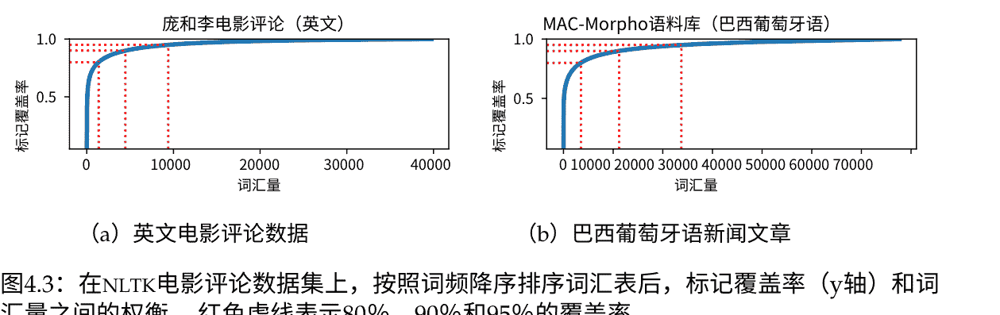

sisters (类比于 fix/fixers)，两个词干器都错误地将 -s 识别为 this 和 Williams 的后缀。幸运的是，即使不准确的词干化也可以改善词袋分类模型，通过合并相关字符串从而减小词汇量。

准确处理不规则拼写需要特定于单词的规则。词形还原器是识别给定词形的基本词元的系统。它们必须避免图4.2中词干器的过度泛化错误，并处理更复杂的转换，例如 geese →goose。图4.2的最后一行显示了WordNet词形还原器的输出。词干化和词形还原都是语言特定的：英语词干器或词形还原器在其他语言的文本上几乎无用。形态学学科涉及词内部结构的研究，并在第9.1.2节中进行了更详细的描述。

归一化的值取决于数据和任务。归一化减少了特征空间的大小，有助于泛化。然而，总是存在将语言上有意义的差异合并的风险。在监督机器学习中，正则化和平滑可以起到与归一化类似的作用，防止学习器过度拟合稀有特征，同时避免了准确归一化所需的语言特定工程。在无监督场景中，如基于内容的信息检索（Manning等, 2008）和主题建模（Blei等, 2003），归一化更为关键。

#### 4.3.2 有多少个词？

限制特征向量的大小可以减少生成模型的内存占用，并提高预测速度。归一化可以起到这个作用，但更直接的方法是将词汇表限制为数据集中最常见的 N 个单词。例如，在提供的 NLTK（最初来自Pang等人，2002）的MOVIE-REVIEWS数据集中，有39,768个词类型和1.58 M个标记。如图所示

在与MIT Press签订的合同下，根据CC-BY-NC-ND许可共享。

在图4.3a中，最常见的4000个词类型覆盖了所有标记的90%，从而在模型大小上实现了数量级的减小。这样的比例是语言特定的：例如，在巴西葡萄牙语Mac-Morpho语料库（Alu´ısio等，2003年）中，达到90%的覆盖率需要超过10000个词类型（图4.3b）。这反映了葡萄牙语的形态复杂性，其中包括比英语更多的屈折后缀。

消除罕见的词对于分类性能并不总是有利的：例如，名字通常很少见，但在区分新闻文章的主题方面起着重要作用。减小特征空间的另一种方法是消除停用词，如the、to和and等，这些词在表达主题、情感或立场方面似乎起着很小的作用。通常通过创建停用词列表（例如NLTK.CORPUS.STOPWORDS）来实现，然后忽略与列表匹配的所有术语。然而，语料库语言学家和社会心理学家已经证明，看似无关紧要的词语可以提供关于作者或文本性质的令人惊讶的见解（Biber，1991年；Chung和Pennebaker，2007年）。此外，高频词不太可能导致判别分类器的过拟合。

与规范化一样，停用词过滤对于无监督问题（如基于术语的文档检索）更为重要。

控制模型大小的另一种选择是特征哈希（Weinberger等人，2009年）。使用哈希函数为每个特征分配一个索引。如果选择了允许冲突的哈希函数（通常通过将哈希输出取模某个整数来实现），则模型可以变得任意小，因为多个特征共享一个权重。由于大多数特征都很少见，因此对于这种冲突，准确性出奇地鲁棒（Ganchev和Dredze，2008年）。

#### 4.3.3 计数还是二进制？

最后，我们可以考虑是否希望特征向量包括每个单词的计数或其存在。这涉及到线性分类的一个微妙限制：有两个失败比一个更糟糕，但它真的是两倍糟糕吗？受此直觉的启发，Pang等人（2002年）在特征向量中使用了存在或不存在的二进制指示器：$f_j(x, y) \in \{0, 1\}$。他们发现基于这些二进制向量训练的分类器往往优于基于词频的特征向量。一个解释是单词倾向于成簇出现：如果一个单词在文档中出现过一次，它很可能再次出现（Church，2000年）。这些后续出现可以归因于对重复的倾向，因此对文档的类别标签提供了很少的额外信息。

### 4.4 评估分类器

在任何监督式机器学习应用中，保留一个独立的测试集是至关重要的。这些数据只应用于一个目的：评估单个的整体准确性。

Jacob Eisenstein。2018年11月13日草稿。

分类器。多次使用这些数据会导致估计的准确性过于乐观，因为分类器将被定制为这些数据，并且在未来的未见数据上表现不佳。通常需要设置超参数或进行特征选择，因此您可能需要构建一个用于此目的的调整或开发集，如第2.2.5节所讨论的。

有多种方法可以评估分类器的性能。最简单的是准确率：正确预测的数量除以总实例数量，

```
acc(\boldsymbol{y}, \hat{\boldsymbol{y}}) = \frac{1}{N} \sum_{i}^{N} \delta(y^{(i)} = \hat{y}). \quad [4.4]
```

考试通常通过准确性来评分。为什么需要其他指标？主要原因是类别不平衡。假设您正在构建一个分类器，用于检测电子健康记录（EHR）中是否描述了罕见疾病的症状，该疾病仅出现在数据集中的1%文档中。对于所有文档报告\(\hat{y} = \text{NEGATIVE}\)的分类器将达到99%的准确性，但实际上是无用的。我们需要能够检测分类器在分布倾斜时区分类别能力的指标。

一种解决方案是构建一个平衡的测试集，其中每个可能的标签都平等地表示。但在EHR示例中，这意味着丢弃原始数据集的98%！此外，检测阈值本身可能是一个设计考虑因素：在与健康相关的应用中，我们可能更喜欢非常敏感的分类器，即使只有很小的机会\(y^{(i)} = \text{POSITIVE}\)也会返回正面预测。在其他应用中，积极的结果可能会触发昂贵的操作，因此我们更喜欢只有在非常确定时才进行积极预测的分类器。我们需要额外的指标来捕捉这些特征。

#### 4.4.1 精确度、召回率和 $F$-度量

对于任何标签（例如，表示疾病症状存在的阳性标签），存在两种可能的错误：

+   - 假阳性：系统错误地预测了标签。
- 假阴性：系统错误地未能预测标签。

同样，对于任何标签，有两种正确的方式：

+   - 真阳性：系统正确地预测了标签。
- 真阴性：系统正确地预测该标签不适用于此实例。

做出许多假阳性的分类器具有较低的精确度：即使标签不存在，它们也会预测标签。做出许多假阴性的分类器具有较低的召回率：即使标签存在，它们也无法预测标签。这些度量指标区分了这两种错误来源，并且在形式上定义为：

$$
\text{召回率}(y, \hat{y}, k) = \frac{TP}{TP+FN} \quad [4.5]
$$

$$
\text{精确率}(y, \hat{y}, k) = \frac{TP}{TP+FP} \quad [4.6]
$$

召回率和精确率都是正确预测的条件概率，这就是为什么它们的分子相同。召回率在 k 为正确标签时被条件约束，$y^{(i)} = k$，因此分母求和为真正例和假负例。精确率在 k 为预测时被条件约束，因此分母求和为真正例和假正例。

请注意，真负例在这两个统计量中都不被考虑。将每个文档都标记为“负面”的分类器将达到零召回率；精确率将为 0/0。

召回率和精确率是互补的。当假正例比假负例更便宜时，更喜欢高召回率的分类器：例如，在对疾病症状进行初步筛查时，假正例的成本可能是额外的检查，而假负例将导致疾病未被治疗。相反，当假正例更昂贵时，更喜欢高精确率的分类器：例如，在垃圾邮件检测中，假阴性是相对较小的不便，而假阳性可能意味着重要消息未读。

F-度量将召回率和精确度结合为一个单一的度量标准，使用调和平均数：

$$
F\text{-度量}(y, \hat{y}, k) = \frac{2rp}{r+p} \quad [4.7]
$$

其中 r 是召回率， p 是精确度。（F-度量有时被称为 F1，并且推广到 $F_\beta = (1+\beta^2)rp / (\beta^2p+r)$ 。可以调整 $\beta$ 参数以强调召回率或精确率。）

评估多类分类召回率、精确度和 F-度量是针对特定标签 k 定义的。当存在多个感兴趣的标签时（例如，词义消歧或情感分类），需要将 F-度量结合在每个类别中。宏观 F-度量是几个类别的平均 F-度量，

$$
\text{宏观-} F(y, \hat{y}) = \frac{1}{|\mathcal{K}|} \sum_{k \in \mathcal{K}} F\text{-度量}(y, \hat{y}, k) \quad [4.8]
$$

在具有不平衡类分布的多类问题中，宏 $F$-度量是一个平衡的度量，用于衡量分类器对每个类的识别能力。在微观 $F$-度量中，我们计算每个类别的真阳性、假阳性和假阴性，然后将它们相加以计算单个的召回率、精确率和 $F$-度量。该指标在实例之间是平衡的，而不是在类别之间平衡，因此它根据其频率加权每个类别——不像宏 $F$-度量，它平等地加权每个类别。

#### 4.4.2 无阈值指标

在二元分类问题中，可以通过将一个常数“阈值”添加到评分函数的输出中来在召回率和精确度之间进行权衡。这使得可以追踪出一条曲线，其中每个点表示在单个阈值下的性能。在接收者操作特性（ROC）曲线中，$x$轴表示假阳性率，$FP/(FP+TN)$，$y$轴表示召回率或真阳性率。完美的分类器在没有任何假阳性的情况下实现完美的召回，从原点（0,0）到左上角（0,1），然后到（1,1）追踪一条“曲线”。从原点（0,0）到右上角（1,1）的对角线表示非判别性分类器的期望。真实的分类器往往介于这两个极端之间。图4.4中显示了示例。

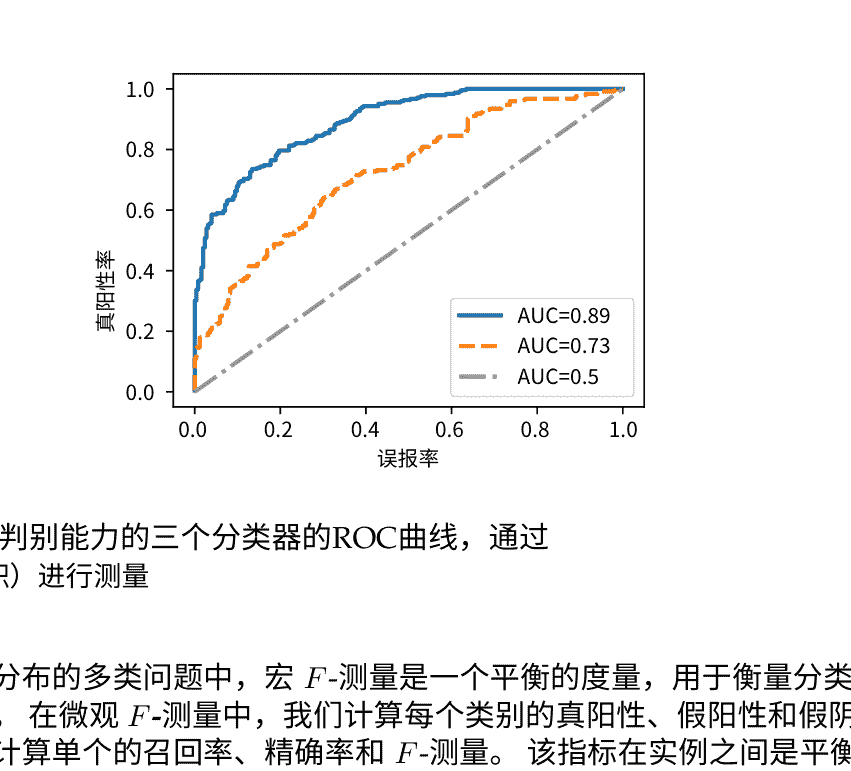

ROC曲线可以通过计算其积分，即曲线下的面积（AUC），来进行总结。AUC可以解释为随机选择的正例被分类器赋予更高分数的概率高于随机选择的负例。

#### 4.4.3 分类器比较和统计显著性

自然语言处理的研究和工程通常涉及比较不同的分类技术。在某些情况下，比较的是算法，例如逻辑回归与平均感知器，或者$\text{L}_2$正则化与$\text{L}_1$正则化。在其他情况下，比较的是特征集，例如词袋模型与位置词袋模型（见第4.2.2节）。削减测试是系统地删除（削减）分类器的各个方面，例如特征组，并测试零假设，即削减后的分类器与完整模型一样好。

对假设检验的全面讨论超出了本文的范围，但本节包含了比较分类器所需的技术的简要总结。假设检验的主要目的是确定两个统计量之间的差异是否可能是偶然引起的，例如两个分类器的准确率。我们关注由于测试集的有限大小而引起的偶然波动。在一个包含十个实例的测试集上，准确率提高了10%，可能是由于随机波动使得测试集对分类器$c_1$比$c_2$更有利；在另一个包含不同十个实例的测试集上，我们可能发现$c_2$比$c_1$表现更好。但是，如果我们在一个包含1,000个实例的测试集上观察到相同的10%的提高，这几乎不可能是由偶然引起的。这样的结果被称为在水平$p$下具有统计显著性，其中$p$是当零假设成立时观察到等效或更大效应的概率。符号$p < .05$表示在零假设成立的情况下观察到等效或更大效应的可能性小于$5\%$。

##### 二项式检验

可以使用经典测试，如二项式检验，来评估准确性差异的统计显著性。假设分类器 $c_1$ 和 $c_2$ 在 $N$ 个实例上产生不一致。测试集具有二进制标签，并且$c_1$在其中$k$个实例上是正确的。在零假设下，分类器的准确性相等，我们预期$k/N$大致等于$1/2$，并且随着$N$的增加，$k/N$应该越来越接近这个预期值。这些属性由二项分布捕捉，它是关于二进制随机变量计数的概率。我们写作$k\sim\text{Binom}(\theta, N)$来表示$k$是从二项分布中抽取的，参数$N$表示随机“抽取”的次数，而$\theta$表示每次抽取中“成功”的概率。每次抽取都是两个分类器不同意的示例，而“成功”是指$c_1$正确而$c_2$错误的情况。（假设标签空间是二进制的，因此如果分类器不同意，其中一个是正确的。可以通过关注只有一个分类器正确的示例来将测试推广到多类分类。）二项分布的概率质量函数（PMF）为：

$$
p_{\text{二项式}}(k; N, \theta) = \binom{N}{k} \theta^k (1 - \theta)^{N - k}, \tag{4.9}
$$

其中$\theta^k$表示成功的概率，$(1 - \theta)^{N - k}$表示失败的概率。该表达式$\binom{N}{k} = \frac{N!}{k!(N-k)!}$是一个二项式系数，表示事件的可能排序数量；这确保了在所有$k \in \{0, 1, 2, \dots, N\}$上的分布总和为一。

在零假设下，当分类器不一致时，每个分类器都有相等的可能性是正确的，因此$\theta = \frac{1}{2}$。现在假设在$N$次不一致中，$c_1$正确$k < \frac{N}{2}$次。当$c_1$正确$k$次或更少时的概率是单尾$p$值。

$$
P_{\text{二项式}} \left( \text{计数} \left( c_1 \text{正确而} c_2 \text{错误} \right) \leq k; N, \theta = \frac{1}{2} \right) = \sum_{i=0}^{k} p_{\text{二项式}} \left( i; N, \theta = \frac{1}{2} \right) . \quad [4.10]
$$

单尾p值仅适用于非对称的零假设，即 $c_1$ 至少与 $c_2$ 一样准确。 为了测试双尾零假设，即 $c_1$ 和 $c_2$ 同样准确，我们将单尾p值的总和，其中第二项是从图4.5的右尾计算得到的。 二项分布是对称的，因此可以通过简单地将单尾p值加倍来计算。

双尾检验更严格，但在没有关于 $c_1$ 或 $c_2$ 哪个更好的先验直觉的情况下，它们是必要的。例如，在比较逻辑回归与平均感知机时，适用双尾检验。 在消融测试中， $c_2$ 可能包含 $c_1$ 可用特征的超集。 如果认为额外的特征可能会提高性能，则事先选择单尾检验是合适的。然而，这样的测试只能证明 $c_2$ 比 $c_1$ 更准确，而不能反过来证明。

##### *随机化测试

二项式检验适用于准确性，但不适用于更复杂的度量，如F-度量。 为了计算任意度量的统计显著性，我们可以应用随机化。 具体来说，通过从原始测试集中有放回地重新抽样实例，绘制一组 $M$ 个自助样本(Efron and Tibshirani, 1993)。 每个自助样本本身都是大小为 $N$ 的测试集。 原始测试集中的一些实例不会出现在任何给定的自助样本中，而其他实例可能会出现多次；但总体上，样本将从与原始测试集相同的分布中抽取。然后，我们可以对每个自助样本计算任何所需的评估，从而得到度量值的分布。 算法7展示了如何执行此计算。

为了比较两个分类器 $c_1$ 和 $c_2$ 的 $F$-度量，我们可以对每个自助样本计算差异 $d = F(c_1) - F(c_2)$。如果在至少 $5\%$ 的样本中小于或等于零，则我们无法拒绝 $c_2$ 至少和 $c_1$ 一样好的单尾零假设 (Berg-Kirkpatrick et al., 2012)。我们可能还对某个度量（例如单个分类器的 $F$-度量）的 $95\%$ 置信区间感兴趣。这可以通过对算法7的输出进行排序，然后将 $95\%$ 置信区间的上下限设置为排序后输出的 $2.5\%$ 和 $97.5\%$ 分位数处的值来计算。或者，你可以将自助样本差异集拟合为正态分布，并根据均值和方差计算高斯置信区间。

```
算法7 用于分类器评估的自助采样。原始测试集为 $\{\boldsymbol{x}^{(1:N)}, \boldsymbol{y}^{(1:N)}\}$，度量标准为 $\delta(\cdot)$，样本数量为 $M$。

过程 BOOTSTRAP-SAMPLE ($\boldsymbol{x}^{(1:N)}$, $\boldsymbol{y}^{(1:N)}$, $\delta(\cdot)$, $M$)
对于 $t \in \{1, 2, \ldots, M\}$ 执行
    对于 $i \in \{1, 2, \ldots, N\}$ 执行
        $j \sim \text{UniformInteger}(1, N)$
        $\tilde{\boldsymbol{x}}^{(i)} \leftarrow \boldsymbol{x}^{(j)}$
        $\tilde{\boldsymbol{y}}^{(i)} \leftarrow \boldsymbol{y}^{(j)}$
    $d^{(t)} \leftarrow \delta(\tilde{\boldsymbol{x}}^{(1:N)}, \tilde{\boldsymbol{y}}^{(1:N)})$
返回 $\{d^{(t)}\}_{t=1}^{M}$
```

当自助法样本数量趋近于无穷大时，自助法估计值变得越来越准确。对于 $M$ 的典型选择是 $10^4$ 或 $10^5$；较大的样本数量对于较小的 $p$ 值是必要的。验证你对 $M$ 的选择的一种方法是多次运行测试，确保 $p$ 值相似；如果不相似，则将 $M$ 增加一个数量级。这是测试的方差的一种启发式度量，可以通过 $\sqrt{M}$ 减小 (Robert and Casella, 2013)。

##### *多重比较

有时需要进行多个假设检验，例如在比较多个分类器在多个数据集上的性能时。假设你有五个数据集，并且你将四个版本的分类器与基准系统进行比较，总共进行20次比较。即使没有一个分类器优于基准系统，结果仍然会有一些随机变化，预期会得到一个在 $p= 0.05 = 1/20$ 的统计上显著的改进。

因此，在报告多重比较结果时，需要调整 $p$ 值。一种方法是要求在执行 $m$ 个测试时，报告 $p$ 值小于 $\alpha$ 的阈值为 $m\alpha$。这被称为Bonferroni校正，它限制了在 $\alpha$ 下错误拒绝零假设的总概率。另一种方法是限制错误发现率(FDR)，即错误拒绝零假设的比例。Benjamini和Hochberg (1995) 提出了一种 $p$ 值校正方法，它将错误发现的比例限制在 $\alpha$ 下：按升序对每个单独测试的 $p$ 值进行排序，并将显著性阈值设置为最大的 $k$，使得 $p_k \le \frac{k}{m}\alpha$。如果 $k>1$，则FDR校正比Bonferroni校正更宽松。

### 4.5 构建数据集

有时候，如果你想建立一个分类器，你必须先建立一个自己的数据集。这包括选择一组要注释的文档或实例，然后进行注释。数据集的范围可能由应用程序决定：如果你想建立一个用于分类电子健康记录的系统，那么你必须使用一个与你的分类器在部署时会遇到的类型相符的记录语料库。在其他情况下，目标是构建一个可以适用于广泛文档范围的系统。在这种情况下，最好有一个平衡的语料库，其中包含许多不同风格和类型的贡献。例如，Brown语料库涵盖了从政府文件到言情小说的各种文本（Francis, 1964），而Google Web Treebank则包括对五种“领域”的网络文档进行注释：问题回答、电子邮件、新闻组、评论和博客（Petrov and McDonald, 2012）。

#### 4.5.1 元数据作为标签

标注是困难且耗时的，大多数人宁愿避免。有时可以利用现有的元数据来获取训练分类器的标签。例如，评论通常附带一个数字评分，可以转换为分类标签（见 §4.1）。类似地，社交媒体用户的国籍可以根据其个人资料（Dredze等，2013）甚至帖子的时区（Gouws等，2011）进行估计。更有雄心壮志的是，我们可以根据社交媒体个人资料与政治家和主要政党的社交网络连接来分类政治倾向（Rao等，2010）。

快速构建大型标记数据集而无需手动标注的便利性令人向往。然而，这种方法依赖于一个假设，即无标签实例（元数据不可用）将与有标签实例相似。

考虑一个例子，根据社交媒体用户与政治家的网络联系来标记其政治倾向。如果一个分类器在这样的测试集上获得了高准确率，那么可以安全地假设它准确地预测了所有社交媒体用户的政治倾向吗？可能不是。与政治家建立社交网络联系的社交媒体用户可能更有可能在其消息的文本中提及政治，而与之相比，对于没有政治元数据的普通用户来说则不是如此。如果是这样，那么基于社交网络元数据构建的测试集的准确率将给出对未标记数据的方法真实性能的过于乐观的图片。

#### 4.5.2 标记数据

在许多情况下，除了手动注释之外，没有其他获取基准标签的方法。注释协议应满足几个标准：注释应足够表达所关注的现象；注释应可复制，即：

1.  确定要标注的内容。这通常基于对底层现象的某种理论：例如，如果目标是对文档作者的情感状态进行标注，应该从情感的类型或维度的理论解释开始（例如，Mohammad和Turney，2013）。在这个阶段，应该考虑表达能力和可扩展性之间的权衡：底层理论的完全实例化可能在大规模标注时成本过高，因此应该考虑合理的近似。
2.  可选地，可以设计或选择一个软件工具来支持标注工作。现有的通用标注工具包括BRAT（Stenetorp等，2012）和MMAX2（Müller和Strube，2006）。
3.  规范化注释任务的指令。只要指令不明确，所得到的注释将取决于注释者的直觉。这些直觉可能不会被其他注释者或使用注释数据的用户所共享。因此，明确的指令对于确保注释的可复制性和其他研究人员的可用性至关重要。
4.  对一小部分数据进行试点注释，每个实例都有多个注释者。这将初步评估当前注释指令的可复制性和可扩展性。下面描述了计算一致性率的度量标准。对特定分歧进行手动分析应有助于澄清指令，并可能导致注释任务本身的修改。例如，如果两个标签经常被注释者混淆，最好将它们合并。
5.  标注数据。在最终确定注释协议和说明之后，主要的注释工作可以开始。一些，如果不是全部，实例应该接收多个注释，以便计算注释者之间的一致性。在一些注释项目中，实例会接收许多注释，然后将它们聚合成“共识”标签（例如，Danescu-Niculescu-Mizil等人，2013年）。然而，如果注释耗时或需要重要的专业知识，最好是为只有一小部分示例获取多个注释，以实现最大的可扩展性。
6.  计算并报告标注者间的一致性，并发布数据。在某些情况下，由于版权或隐私问题，原始文本数据无法发布。

在这些情况下，一个解决方案是公开发布离线标注，其中包含指向文档标识符的链接。文档本身可以根据许可协议的条款重新发布，该协议可以对数据的使用施加条件。重要的是要考虑发布数据可能带来的潜在后果：人们可能会在不知情的情况下公开个人数据，而不意识到它可能在数据集和公开范围远远超出他们的预期的情况下重新分发（Boyd和Crawford，2012年）。

##### 测量标注者间的一致性

为了衡量标注的可复制性，一个标准做法是计算标注者之间的一致程度。如果标注者经常意见不一致，这可能对他们的可靠性或标注系统本身产生怀疑。对于分类任务，可以计算标注者一致的频率；对于评分标尺，可以计算评分之间的平均距离。然后，这些原始一致性统计数据必须与随机一致性水平进行比较，即两个忽略数据的标注者之间预期的一致性水平。

Cohen的Kappa广泛用于量化离散标签任务的一致性（Cohen, 1960; Carletta, 1996）。

```
κ = \frac{\text{一致性} - E[\text{一致性}]}{1 - E[\text{一致性}]}  [4.11]
```

分子是观察到的一致性与随机一致性之间的差异，分母是完全一致性与随机一致性之间的差异。因此，当标注者在每种情况下都达成一致时，κ=1；当标注者只有与随机一致性相同的频率时，κ=0。已经提出了各种启发式标度来确定κ表示“中等”、“良好”或“显著”的一致性；作为参考，Lee和Narayanan (2005) 报告了在口语对话中情绪标注的κ ≈ 0.45 - 0.47，他们将其描述为“中等一致性”；Stolcke等人 (2000) 报告了对话行为标注的κ = 0.8，这些标注是对话中每个转折的目的标签。

当有两个注释者时，预期的机会一致性被计算为,

```
E[agreement] = \sum_{k} \hat{\Pr}(Y = k)^2,  [4.12]
```

其中k是标签的总和，而 \hat{\Pr}(Y = k) 是所有注释中标签k的经验概率。该公式是从如果注释被随机洗牌时预期的一致性数量推导出来的。因此，在二元标记任务中，如果一个标签被应用于90%的实例，机会一致性为.9² + .1² = .82。

对于其他类型的注释，Krippendorf的alpha是一个常用选择（Hayes和Krippendorff, 2007; Artstein和Poesio, 2008）。

##### 众包

众包经常用于快速获取分类问题的注释。例如，亚马逊机械土耳其使得定义“人类智能任务（HIT）”成为可能，例如标记数据。研究人员为每组注释设置一个价格，并为注释者列出最低资格要求，例如他们的母语和他们在以前任务中的满意度。相对未经训练的“众包工作者”的使用与早期的注释工作形成对比，早期的注释工作依赖于专业语言学家（Marcus等，1993年）。然而，众包已被发现对许多与语言相关的任务产生可靠的注释（Snow等，2008年）。众包是更广泛的人类计算领域的一部分（Law和Ahn，2011年）。有关与众包相关的伦理问题的批判性审查，请参阅Fort等人（2011年）。

### 附加资源

本章讨论的许多预处理问题也出现在信息检索中。有关分词和相关算法的讨论，请参阅Manning等人（2008年）的文章。有关特定假设检验和一般可复制性的更多信息，请参见（Dror等，2017年，2018年）。

### 练习

- 1. 如第4.3.3节所述，单词往往以团簇形式出现，后续出现的单词更有可能。更具体地说，如果单词 \(j\) 在具有标签 \(y\) 的文档中出现的概率为 \(\phi_{y,j}\)，则两次出现的概率 \((x_j^{(i)} = 2)\) 大于 \(\phi_{y,j}^2\)。假设您正在应用朴素贝叶斯进行二元分类。重点关注在标签 \(y=1\) 下更有可能的单词 \(j\)，即，[4.13] 现在假设 \(x_j^{(i)} > 1\)。其他条件相同，分类器会高估还是低估后验概率 \(\Pr(y=1 \mid \boldsymbol{x})\)？
- 2. 证明F-度量不会大于召回率和精确率的算术平均值，\(\frac{r+p}{2}\)。你的解决方案还应该表明F-度量等于 \(\frac{r+p}{2}\) 当且仅当 \(r = p\) 时。
- 3. 假设在一个二元分类问题中，“正”标签的概率等于 \(\alpha\)，忽略数据并以概率 \(\frac{1}{2}\) 选择 \(\hat{y} = +1\) 的随机分类器的期望 \(F\)-度量是多少？（假设 \(p(\hat{y}) \perp p(y)\)）。选择 \(\hat{y} = +1\) 的分类器的期望 \(F\)-度量是多少（也与 \(y^{(i)}\) 独立）？根据 \(\alpha\)，哪个随机分类器得分更高？
- 4. 假设二元分类器 $c_1$ 和 $c_2$ 在 $N = 30$ 个案例上存在分歧，并且 $c_1$ 在其中 $k = 10$ 个案例中是正确的。
  - 编写一个程序，使用诸如 exp 和阶乘等原始函数来计算双尾 p 值——如果有“choose”函数的实现可用，可以使用它。使用计算二项式检验或二项式CDF的库（如 SCIPY.STATS.BINOM）验证您的代码。
  - 然后使用随机化测试来尝试获得相同的 p 值。在每个样本中，从具有 $N=30$ 和 $\theta = \frac{1}{2}$ 的二项分布中抽取。计算 $k \le 10$ 的样本比例。这是单尾 p 值；将其加倍以计算双尾 p 值。
  - 尝试使用不同数量的自助采样进行测试：$M \in \{100, 1000, 5000, 10000\}$。对于 $M = 100$ 和 $M = 1000$，运行测试 10 次，并绘制结果的 p 值。
  - 最后，对于 $N= 70$ 和 $k= 25$ 执行相同的测试。
- 5. SemCor 3.0 是一个用于词义消歧的标记数据集。你可以下载它，$^{12}$ 或在 NLTK.CORPORA.SEMCOR 中访问它。选择一个在 SemCor 中至少出现十次的单词（找到），并在十个随机选择的示例中注释其 WordNet 词义，而不查看基准真相。使用在线 WordNet 来理解每个词义的定义。$^{13}$ 让一个合作伙伴进行相同的注释，并计算一致性的原始率，预期机会一致性率和 Cohen's kappa。
- 6. 从 http://www.cs.cornell.edu/people/pabo/movie-review-data/ 下载庞和李的电影评论数据。将随机选择的400个评论作为测试集。下载一个情感词典，例如目前从Bing Liu提供的词典，https://www.cs.uic.edu/~liub/FBS/sentiment-analysis.html。对数据进行分词，并将每个文档分类为正面，当且仅当它具有比负面情感词更多时。使用这个基于词典的分类器，在测试集上计算检测正面评论的准确率和 F-MEASURE。然后在训练集上训练一个判别式分类器（平均感知器或逻辑回归），并计算其在测试集上的准确率和 F-MEASURE。使用双尾假设检验确定差异是否具有统计学意义：对于准确率的差异使用二项式检验，对于宏观 F-MEASURE 的差异使用自助法。
- 7. 比较不同词汇大小的情况，分别使用每种情况下最常见的单词（你可以使用任何合理的分词器）。为每个词汇大小训练逻辑回归分类器，并将其应用于开发集。绘制随着词汇大小增加的准确率和宏平均F-度量。对于每个词汇大小，调整正则化参数以在从训练集中保留的数据子集上最大化准确率。
- 8. 比较以下分词算法：
  - 使用正则表达式进行空格分词；
  - 使用NLTK的Penn Treebank分词器；
  - 将输入分割为非重叠的五个字符单元，不考虑空格或标点符号。
  计算每个分词器在训练数据上的标记/类型比率，并解释你的发现。在每个分词数据集上训练你的分类器，在从训练数据中保留的子集上调整正则化器。对开发集进行分词，并报告准确率和宏-F-测量。
- 9. 使用任何合理的分词器将Porter和Lancaster词干提取器应用于训练集，并计算标记/类型比率。在词干处理的数据上训练你的分类器，并计算在词干处理的开发数据上的准确率和宏-F-测量，同样使用从训练数据中保留的部分数据来调整正则化器。
- 10. 从前面的三个问题中识别出最佳的词汇过滤、分词和词干提取的组合。将这种预处理应用于测试集，并计算测试集的准确率和宏-F-MEASURE。与一个不应用词汇过滤、空格分词和不进行词干提取的基准系统进行比较。使用二项式检验来确定你的最佳系统是否比基准系统更准确。使用自助法测试，$M = 10^4$，来确定你的最佳系统是否达到了显著更高的宏-$F$-MEASURE。

## 第5章

### 无监督学习

到目前为止，我们假设以下设置：

- a训练集其中你获得观察值 $x$ 和标签 $y$;
- a测试集其中你只获得观察值 $x$。

没有标记的数据，是否可能学到任何东西？这种情况被称为无监督学习，我们将看到确实可以学习到未标记观察值的潜在结构。本章还将探讨一些相关场景：半监督学习，其中只有一些实例被标记，以及领域适应，其中训练数据与训练系统将部署的数据不同。

### 5.1 无监督学习

为了激发无监督学习，考虑词义消歧问题（§4.2）。目标是将每个单词实例，如 bank分类到一个意义中，

- bank#1: 一个金融机构
- bank#2: 河流边界的土地

由于即使是一个大型语料库也只包含除最常见的单词之外的少数实例，因此很难获得足够的用于词义消歧的训练数据。在没有标记数据的情况下，是否有可能了解这些不同意义的任何信息？

通常使用从待消歧词的局部上下文构建的特征向量来执行词义消歧。例如，对于单词银行，即时上下文可能通常包括以下两个词组中的单词：

- 1.金融、存款、信贷、贷款、资本、市场、监管、储备、流动、资产
- 2.土地、水、地理、流、河流、流量、存款、排放、通道、生态学

现在考虑一个散点图，其中每个点都是一个包含单词bank的文档。文档在x轴上的位置是组1中单词的计数，而在y轴上的位置是组2的计数。在这样的图中，如图5.1所示，可能会出现两个“斑点”，这些斑点对应于bank的不同意义。

这是一个相关的场景，来自一个不同的问题。假设你下载了成千上万篇新闻文章，并制作了一个散点图，其中每个点对应一个文档：x轴是单词组(hurricane, winds, storm)的频率；y轴是单词组(election, voters, vote)的频率。这次，可能会出现三个斑点：一个是主要关于飓风的文档，另一个是主要关于选举的文档，第三个是关于任何主题的文档。

这些团块代表数据的基本结构。但是二维散点图是基于上下文词汇的分组，而在实际情况中，这些词汇列表是未知的。无监督学习应用相同的基本思想，但在高维空间中，每个上下文词汇都有一个维度。这个空间无法直接可视化，但目标是相同的：尝试识别观察数据的基本结构，使得有几个点的簇，每个簇内部都是一致的。聚类算法能够自动找到这样的结构。

#### 5.1.1 K均值聚类

聚类算法将每个数据点分配给一个离散的簇，zi ∈ 1,2,... K。最著名的聚类算法之一是K均值算法，这是一种迭代算法。

#### 算法 8 K均值聚类算法

```
1: 过程 K-均值 (x_{1:N}, K)
2: 对于 i ∈ 1...N 执行  # 初始化聚类成员
3:     z^{(i)} ← 随机整数(1, K)
4: 重复
5:     对于 k ∈ 1...K 执行  # 重新计算聚类中心
6:         ν_k ← \frac{1}{\delta(z^{(i)}=k)} \sum_{i=1}^N \delta(z^{(i)}=k) x^{(i)}
7:     对于 i ∈ 1...N 执行  # 将实例重新分配给最近的聚类
8:         z^{(i)} ← \arg\min_k \|x^{(i)} - ν_k\|^2
9: 直到收敛
10: 返回 {z^{(i)}}  # 返回聚类分配
```

每个实例的聚类分配和每个聚类的中心（“均值”）位置。K均值迭代更新分配和中心之间的过程：

- 1. 每个实例都被放置在与其最近的中心的簇中;
- 2. 每个中心都被重新计算为簇中点的平均值。

该过程在算法8中被形式化。术语 $\|x^{(i)} - \nu\|^2$ 表示平方欧几里得范数，$\sum_{j=1}^V (x_j^{(i)} - \nu_j)^2$。K均值的一个重要特性是收敛解取决于初始化，有时通过从不同的随机起始点重新运行算法可以找到更好的聚类。

软K均值是一个特别相关的变体。软K均值不直接将每个点分配给特定的簇，而是为每个点分配一个分布 over clusters $q^{(i)}$，使得 $\sum_{k=1}^K q^{(i)}(k) = 1$，并且 $\forall k, q^{(i)}(k) \ge 0$。软权重 $q^{(i)}(k)$ 是根据点 $x^{(i)}$ 到簇中心 $\nu_k$ 的距离计算的。反过来，每个簇的中心是根据簇中点的加权平均值计算的。

$$
\nu_k = \frac{1}{\sum_{i=1}^N q^{(i)}(k)} \sum_{i=1}^N q^{(i)}(k) x^{(i)}
$$

我们现在将探讨基于期望最大化（EM）的软K均值聚类的概率版本。因为EM聚类可以被推导为最大似然估计的近似，所以它可以以多种有用的方式进行扩展。

在与MIT Press签订的合同下，根据CC-BY-NC-ND许可共享。

#### 5.1.2 期望最大化 (EM)

期望最大化将软 K均值的思想与朴素贝叶斯分类相结合。回顾一下，朴素贝叶斯定义了数据的概率分布，

> $$ \log p(\boldsymbol{x}, \boldsymbol{y}; \phi, \boldsymbol{\mu}) = \sum_{i=1}^{N} \log \left( p(\boldsymbol{x}^{(i)} | y^{(i)}; \phi) \times p(y^{(i)}; \boldsymbol{\mu}) \right) \quad [5.2] $$

现在假设你从未观察到标签。为了表示这一点，我们将每个实例的标签称为 $z^{(i)}$，而不是通常用于观察变量的 $y^{(i)}$。通过对潜在变量 $z$ 进行边缘化，我们得到观察实例 $\boldsymbol{x}$ 的边缘概率：

> $$ \log p(\boldsymbol{x}; \phi, \boldsymbol{\mu}) = \sum_{i=1}^{N} \log p(\boldsymbol{x}^{(i)}; \phi, \boldsymbol{\mu}) \quad [5.3] $$
> $$ = \sum_{i=1}^{N} \log \sum_{z=1}^{K} p(\boldsymbol{x}^{(i)}, z; \phi, \boldsymbol{\mu}) \quad [5.4] $$
> $$ = \sum_{i=1}^{N} \log \sum_{z=1}^{K} p(\boldsymbol{x}^{(i)} | z; \phi) \times p(z; \boldsymbol{\mu}). \quad [5.5] $$

参数 $\phi$ 和 $\boldsymbol{\mu}$ 可以通过最大化方程5.5中的边缘似然来获得。为什么这是最大化的正确方法？没有标签，无法进行判别学习-没有什么可以区分的。所以最大似然是我们唯一拥有的。

当观察到标签时，我们可以分别为每个标签估计 Naïve Bayes 概率模型的参数。但是，对标签进行边际化会耦合这些参数，使得直接优化 $\log p(\boldsymbol{x})$ 不可行。我们将通过引入一个辅助变量 $q^{(i)}$ 来近似似然对数，该变量是标签集合 $\mathcal{Z} = \{1, 2, \ldots, K\}$ 上的分布。优化过程将在 $q$ 和参数 $(\phi, \boldsymbol{\mu})$ 之间交替进行更新。因此，在这里，$q^{(i)}$ 在软 $K$-均值中起到了作用。

为了推导出这个优化的更新，将方程5.5的右侧乘以比率 $\frac{q^{(i)}(z)}{q^{(i)}(z)} = 1$

$$
\begin{aligned}
\log \mathrm{p}(\boldsymbol{x}; \boldsymbol{\phi}, \boldsymbol{\mu}) &= \sum_{i=1}^{N} \log \sum_{z=1}^{K} \mathrm{p}(\boldsymbol{x}^{(i)} \mid z ; \boldsymbol{\phi}) \times \mathrm{p}(z ; \boldsymbol{\mu}) \times \frac{q^{(i)}(z)}{q^{(i)}(z)} \\
&= \sum_{i=1}^{N} \log \sum_{z=1}^{K} q^{(i)}(z) \times \mathrm{p}(\boldsymbol{x}^{(i)} \mid z ; \boldsymbol{\phi}) \times \mathrm{p}(z ; \boldsymbol{\mu}) \frac{1}{q^{(i)}(z)} \\
&= \sum_{i=1}^{N} \log E_{q^{(i)}}\left[\frac{\mathrm{p}(\boldsymbol{x}^{(i)} \mid z ; \boldsymbol{\phi}) \mathrm{p}(z ; \boldsymbol{\mu})}{q^{(i)}(z)}\right],
\end{aligned}
$$

其中 $E_{q^{(i)}}[f(z)] = \sum_{z=1}^{K} q^{(i)}(z) \times f(z)$ 指的是函数 $f$ 在分布 $z \sim q^{(i)}$ 下的期望。

根据 Jensen 不等式，由于 $\log$ 是一个凹函数，我们可以将其推入期望中，从而得到一个下界。

$$
\begin{aligned}
\log \mathrm{p}(\boldsymbol{x}; \boldsymbol{\phi}, \boldsymbol{\mu}) &\geq \sum_{i=1}^{N} E_{q^{(i)}}\left[\log \frac{\mathrm{p}(\boldsymbol{x}^{(i)} \mid z ; \boldsymbol{\phi}) \mathrm{p}(z ; \boldsymbol{\mu})}{q^{(i)}(z)}\right] \\
J &\triangleq \sum_{i=1}^{N} E_{q^{(i)}}\left[\log \mathrm{p}(\boldsymbol{x}^{(i)} \mid z ; \boldsymbol{\phi}) + \log \mathrm{p}(z ; \boldsymbol{\mu}) - \log q^{(i)}(z)\right] \\
&= \sum_{i=1}^{N} E_{q^{(i)}}\left[\log \mathrm{p}(\boldsymbol{x}^{(i)}, z ; \boldsymbol{\phi}, \boldsymbol{\mu})\right] + H(q^{(i)})
\end{aligned}
$$

我们将关注方程 5.10，它是观测数据边际对数似然的下界，即 $\log \mathrm{p}(\boldsymbol{x})$。方程 5.11 展示了与信息论概念熵的联系，即 $H(q^{(i)}) = -\sum_{z=1}^{K} q^{(i)}(z) \log q^{(i)}(z)$，它衡量了从分布 $q^{(i)}$ 中抽取的样本产生的平均信息量。下界 $J$ 是两组参数的函数：

- 每个实例的分布 $q^{(i)}$；
- 参数 $\boldsymbol{\mu}$ 和 $\boldsymbol{\phi}$。

期望最大化 (EM) 算法依次最大化与每个参数相关的边界，同时保持其他参数不变。

##### E步骤

我们更新 $q^{(i)}$ 的步骤被称为 E步骤，因为它更新了计算期望的分布。为了推导出这个更新，首先写出作为一个总和的期望下界，

$$J = \sum_{i=1}^{N} \sum_{z=1}^{K} q^{(i)}(z) \left[ \log p(\mathbf{x}^{(i)} \mid z; \phi) + \log p(z; \boldsymbol{\mu}) - \log q^{(i)}(z) \right]. \quad [5.12]$$

在优化这个界限时，我们还必须遵守一组“总和为一”的约束条件，$\sum_{z=1}^{K} q^{(i)}(z) = 1$对于所有的 $i$。就像在朴素贝叶斯中一样，这个约束可以被纳入一个拉格朗日乘子：

$$J_q = \sum_{i=1}^{N} \sum_{z=1}^{K} q^{(i)}(z) \left( \log p(\mathbf{x}^{(i)} \mid z; \phi) + \log p(z; \boldsymbol{\mu}) - \log q^{(i)}(z) \right) + \lambda^{(i)} \left(1 - \sum_{z=1}^{K} q^{(i)}(z) \right), \quad [5.13]$$

其中 $\lambda^{(i)}$是实例 $i$的拉格朗日乘子。

通过求导并解出 $q^{(i)}$的最大值：

$$\frac{\partial J_q}{\partial q^{(i)}(z)} = \log p(\mathbf{x}^{(i)} \mid z; \phi) + \log p(z; \boldsymbol{\mu}) - \log q^{(i)}(z) - 1 - \lambda^{(i)} \quad [5.14]$$

$$\log q^{(i)}(z) = \log p(\mathbf{x}^{(i)} \mid z; \phi) + \log p(z; \boldsymbol{\mu}) - 1 - \lambda^{(i)} \quad [5.15]$$

$$q^{(i)}(z) \propto p(\mathbf{x}^{(i)} \mid z; \phi) \times p(z; \boldsymbol{\mu}). \quad [5.16]$$

应用总和为一的约束条件可以得到一个精确的解决方案，

$$q^{(i)}(z) = \frac{p(\mathbf{x}^{(i)} \mid z; \phi) \times p(z; \boldsymbol{\mu})}{\sum_{z'=1}^{K} p(\mathbf{x}^{(i)} \mid z'; \phi) \times p(z'; \boldsymbol{\mu})} \quad [5.17]$$

$$= p(z \mid \mathbf{x}^{(i)}; \phi, \boldsymbol{\mu}). \quad [5.18]$$

归一化后，每个 $q^{(i)}$ — 这是数据 $\mathbf{x}^{(i)}$的聚类的软分布 —被设置为当前参数下的后验概率 $p (z \mid \mathbf{x}^{(i)}; \phi, \boldsymbol{\mu})$。尽管拉格朗日乘数 $\lambda^{(i)}$被引入为额外的参数，但在归一化过程中被消除。

## M步

接下来，我们固定软分配 $q^{(i)}$，然后对参数 $\phi$和 $\boldsymbol{\mu}$进行最大化。让我们专注于参数 $\phi$，它参数化了似然函数$p(\mathbf{x} \mid z; \phi)$，将 $\boldsymbol{\mu}$留作练习。参数 $\phi$是每个聚类的词分布，因此在约束条件 $\sum_{j=1}^{V} \phi_{z,j}= 1$下进行优化。为了融入这一点，为了满足约束条件，我们引入了一组拉格朗日乘子 \(\{\lambda_z\}_{z=1}^{K}\)，并从拉格朗日函数中得到，

$$J_{\phi} = \sum_{i=1}^{N} \sum_{z=1}^{K} q^{(i)}(z) \left( \log p(\boldsymbol{x}^{(i)} \mid z; \phi) + \log p(z; \mu) - \log q^{(i)}(z) \right) + \sum_{z=1}^{K} \lambda_z (1 - \sum_{j=1}^{V} \phi_{z,j})$$

项 \(\log p(\boldsymbol{x}^{(i)} \mid z; \phi)\) 是多项式条件对数似然函数，它可以展开为，

$$\log p(\boldsymbol{x}^{(i)} \mid z, \phi) = C + \sum_{j=1}^{V} x_j \log \phi_{z,j},$$

其中 \(C\) 是一个与 \(\phi\) 无关的常数—请参见第2.2节中的方程2.12以获取更多关于该概率函数的讨论。

将 \(J_{\phi}\) 的导数设为零，

$$\frac{\partial J_{\phi}}{\partial \phi_{z,j}} = \sum_{i=1}^{N} q^{(i)}(z) \times \frac{x_j^{(i)}}{\phi_{z,j}} - \lambda_z$$

$$\phi_{z,j} \propto \sum_{i=1}^{N} q^{(i)}(z) \times x_j^{(i)}.$$

因为 \(\phi_z\) 被限制为概率分布，所以精确解可以计算为，

$$\phi_{z,j} = \frac{\sum_{i=1}^{N} q^{(i)}(z) \times x_j^{(i)}}{\sum_{j'=1}^{V} \sum_{i=1}^{N} q^{(i)}(z) \times x_{j'}^{(i)}} = \frac{\mathbb{E}_q[\text{count}(z, j)]}{\sum_{j'=1}^{V} \mathbb{E}_q[\text{count}(z, j')]}$$

其中计数器 \(j \in \{1, 2, \ldots, V\}\) 索引基本特征，例如单词。

此更新将 \(\phi_z\) 设置为在分布 \(q\) 下的相对频率估计的期望计数。与监督朴素贝叶斯一样，我们可以通过添加一个常数 \(\alpha\) 来平滑这些计数。对于 \(\mu\) 的更新类似：\(\mu_z \propto \sum_{i=1}^{N} q^{(i)}(z) = \mathbb{E}_q[\text{count}(z)]\)，这是簇 \(z\) 的期望频率。这些概率也可以进行平滑处理。总之，M步骤与朴素贝叶斯类似，但使用的是期望计数而不是观察计数。

多项式似然函数 \(p(\boldsymbol{x} \mid z)\) 可以用其他概率分布来替代：例如，对于连续观测，可以使用高斯分布。在某些情况下，似然函数的参数没有闭式更新的方法。一种方法是在每个M步骤中运行基于梯度的优化；另一种方法是沿着梯度方向迈出一步，然后返回到E步骤 (Berg-Kirkpatrick等，2010年)。

## 5.1. 无监督学习

通过交替更新参数子集来更新全局目标的算法称为坐标上升算法。目标函数 \( J \)（数据边际似然的下界）在 \( q \) 和 \( (\mu, \phi) \) 中分别是凸函数，但在所有项中不是联合凸函数；这个条件被称为双凸性。期望最大化算法的每一步都保证不会降低下界 \( J \)，这意味着EM将收敛到一个解，附近的点不会产生进一步的改进。这个解是一个局部最优解——它至少和其所有相邻点一样好，但不能保证是所有可能配置 \( (q, \mu, \phi) \) 中的最优解。

事实上，没有全局最优性的保证意味着初始化很重要：你的起点可以决定你的终点。为了说明这一点，图5.2展示了具有十个不同随机初始化的EM目标函数：尽管每次运行时目标函数都会单调改善，但它会收敛到几个不同的值。¹对于我们在第2章中遇到的凸目标函数，不必担心初始化，因为基于梯度的优化保证能达到全局最小值。但是在期望最大化算法（如第3章中的深度神经网络）中，初始化很重要。

在硬EM中，每个 \( q^{(i)} \) 分布将概率1分配给单个标签 \( z^{(i)} \)，并将所有其他标签的概率设为零（Neal和Hínton，1998年）。这在精神上类似于K均值聚类，并且在某些情况下可以胜过标准EM（Spítkovsky等，2010年）。期望最大化的另一种变体是结合随机梯度下降（SGD）：在每个实例 \( x^{(i)} \) 上执行局部E步骤后，我们立即对参数 \( (\mu，\phi) \) 进行梯度更新。这个算法被称为增量期望最大化（Neal和Hínton，1998年）和在线期望最大化（Sato和Ishíí，¹图表显示了负对数似然的上界，因为优化通常被定义为最小化而不是最大化。

### 5.1.4 有多少个聚类？

到目前为止，我们假设聚类数 \(K\) 是已知的。 在某些情况下，这个假设是有效的。 例如，像\(\text{WORDNET}\)这样的词汇语义资源可能会定义一个词的意义数。 在其他情况下，聚类数可能是用户调整的参数：有些读者希望将新闻故事粗粒度地聚类成三个或四个类别，而其他人希望将其细粒度地聚类成二十个或更多个类别。 但是在很多情况下，对于如何选择 \(K\) 几乎没有外在的指导。

一种解决方案是选择聚类数目以最大化聚类质量的度量。 其他参数 \(\mu\) 和 \(\phi\)被选择以最大化对数似然界\(J\)，因此这可能是调整 \(K\)的一个潜在候选。 然而，\(J\)不会随着 \(K\)的增加而减少：如果可以获得一个 \(J_K\)的界限，那么通过简单地忽略额外的聚类并将其概率设置为零在 \(q\)和 \(\mu\)中，总是可以至少达到 \(K+1\)聚类的效果。 因此，有必要引入一个模型复杂性的惩罚，以便更倾向于较少的聚类。 例如，Akaike信息准则（AIC；Akaike，1974）是参数数量和对数似然的线性组合。

$$\text{AIC} = 2M - 2J. \quad [5.24]$$

其中 \(M\)是参数的数量。 在期望最大化聚类算法中， \(M = K \times V + K\)。 由于参数数量随着聚类数目 \(K\)的增加而增加，即使它们不完全适合数据，AIC也可能更倾向于更简洁的模型。

另一种选择是最大化在验证数据上的预测似然。 这些数据不用于估计模型参数 \(\phi\)和 \(\mu\)，因此在这些数据上的似然性不一定会随着 \(K\)的增加而增加。 图5.3显示了训练数据和验证数据上的负对数似然性，以及AIC。

贝叶斯非参数方法另一种方法是将聚类数目视为另一个潜在变量。 这需要对具有可变聚类数目的模型进行统计推断。 这在期望最大化框架内是不可能的，但有几种替代推断过程可以应用，包括马尔科夫链蒙特卡洛（MCMC），这在 §5.5中简要讨论（更多细节请参见Murphy, 2012的第25章）。 贝叶斯非参数方法已应用于无监督词义归纳问题，不仅学习单词义项，还学习每个单词的义项数目（Reisinger和Mooney, 2010）。

图5.3：期望最大化算法在合成数据上运行的多次结果的负对数似然和AIC。尽管数据是从一个具有 K = 10 的模型生成的，但根据AIC和留存对数似然，最佳聚类数目是 \(\hat{K} = 15\)。随着 K 的增加，训练集对数似然继续提高。

### 5.2 期望最大化的应用

EM并不像快速排序那样是一个真正的“算法”。相反，它是一个处理缺失数据的学习框架。在感兴趣的问题上使用EM的步骤如下：

- 引入潜在变量 z，使得可以轻松地写出概率 P(x, z)。同时，根据 z 的知识，估计相关参数也应该很容易。
- 推导出 q(z) 的E步更新，通常将其分解为 \(q(z) = \prod_{i=1}^{N} q_{z^{(i)}}(z^{(i)})\)，其中 i 是实例的索引。
- M步更新通常对应于概率超级-监督学习算法的软版本，如朴素贝叶斯。

本节讨论了这个通用框架的许多应用中的一些。

#### 5.2.1 词义归纳

本章开始时考虑了当事先不知道意义时的词义消歧问题。期望最大化算法可以应用于这个问题-将每个聚类视为一个词义。每个实例表示使用一个模糊的词，而 \(x^{(i)}\) 是附近出现的其他词的计数向量：Sch “utze (1998)使用50个词的窗口。概率p(\(x^{(i)}\) \(\mid\) z)可以设置为多项式分布，如朴素贝叶斯。EM算法可以直接应用于这些数据，得到（希望）对应于词义的聚类。

通过首先对上下文-计数矩阵 \(C_{ij} = \text{count}(i, j)\)进行奇异值分解（SVD），可以获得更好的性能，其中count(i, j)是实例 i 的上下文中单词 j 的计数。截断奇异值分解近似将矩阵 $C$ 表示为三个矩阵的乘积 $U, S, V$，其中 $U$ 和 $V$ 是正交矩阵，$S$ 是对角矩阵：

$$\min_{U,S,V} ||C - USV^\top||_F \qquad\qquad [5.25]$$

$$s.t. U \in \mathbb{R}^{V \times K}, UU^\top = \mathbb{I}$$

$$S = \text{Diag}(s_1, s_2, \ldots, s_K)$$

$$V^\top \in \mathbb{R}^{N_p \times K}, VV^\top = \mathbb{I},$$

其中 $|| \cdot ||_F$ 是 **Frobenius范数**，$||X||_F = \sqrt{\sum_{i,j} X_{i,j}^2}$。矩阵 $U$ 包含了 $C$ 的左奇异向量，该矩阵的行可以用作计数向量 $c_i$ 的低维表示。通过将实例描述 $x^{(i)}$ 设置为这些行，而不是使用原始计数 (Sch\~utze, 1998)，可以使EM聚类更加稳健。然而，由于实例现在是连续数值的密集向量，概率 $p(x^{(i)} \mid z)$ 必须被定义为多元高斯分布。

在截断奇异值分解中，超参数 $K$ 是截断限制：当 $K$ 等于 $C$ 的秩时，原始矩阵 $C$ 与其重构 $USV^\top$ 之间的差异的范数将为零。较小的 $K$ 值会增加重构误差，但会产生更小且更易学习的向量表示。

奇异值分解在第14章中有更详细的讨论。

#### 5.2.2 半监督学习

期望最大化算法也可以应用于半监督学习的问题：在单个模型中同时从标记和未标记数据中学习。半监督学习利用带注释的示例，确保每个标签 $y$ 对应所需的概念。通过添加未标记的示例，可以覆盖比仅使用标记数据更大的特征部分。半监督学习的其他方法在 §5.3 中有讨论，但现在让我们在期望最大化的框架内解决这个问题 (Nigam 等, 2000 年)。

假设我们有标记的数据 $\{ (x^{(i)}, y^{(i)}) \}_{i=1}^{N_{\ell}}$ 和未标记的数据集， 其中标记实例的数量为 $N_{\ell}$，未标记实例的数量为 $N_u$。我们可以通过最大化联合对数似然的下界来从组合数据中学习：

$$\mathcal{L} = \sum_{i=1}^{N_{\ell}} \log p(x^{(i)}, y^{(i)}; \mu, \phi) + \sum_{j=N_{\ell}+1}^{N_{\ell}+N_u} \log p(x^{(j)}; \mu, \phi) \qquad\qquad [5.26]$$

$$= \sum_{i=1}^{N_{\ell}} \left( \log p(x^{(i)} \mid y^{(i)}; \phi) + \log p(y^{(i)}; \mu) \right) + \sum_{j=N_{\ell}+1}^{N_{\ell}+N_u} \log \sum_{y=1}^{K} p(x^{(j)}, y; \mu, \phi). \qquad [5.27]$$

左和与朴素贝叶斯中的目标相同；右和是期望最大化聚类的边际对数似然，来自方程5.5。我们可以通过引入分布 $q^{(j)}$ 为所有 $j \in \{N_l + 1, \ldots, N_l + N_u\}$ 来构建对这个对数似然的下界。

E步更新这些分布；M步更新参数 $\phi$ 和 $\mu$，使用未标记数据的期望计数和标记数据的观察计数。

半监督学习中的一个关键问题是如何平衡标记数据和未标记数据对分类器权重的影响，特别是当未标记数据远大于标记数据集时。风险在于未标记数据会主导，导致参数向实例的“自然聚类”漂移，这可能不对应于标记数据的好分类器。一种解决方案是启发式地重新调整方程5.26的两个组成部分，在一个保留的开发集上调整两个组成部分的权重。

#### 5.2.3 多组分建模

作为最后的应用，让我们回到完全监督分类。文本分类的一个经典数据集是20个新闻组，其中包含对一组在线论坛（称为新闻组）的帖子。其中一个新闻组是 `comp.sys.mac.hardware`，讨论苹果计算硬件。假设在这个新闻组中有两种类型的帖子：关于新硬件的评论和关于硬件问题的问答帖子。

这些组件中的语言可能有些不同；如果是这样，最好将这些组件分开建模，而不是将它们的并集视为一个单一的类。然而，每个实例对应的组件并不是直接观察到的。

回想一下，朴素贝叶斯是基于一个生成过程的，该过程为观察到的数据提供了一个随机解释。在朴素贝叶斯中，每个标签都是从一个具有参数 $\mu$ 的分类分布中抽取的，而每个词频向量都是从一个具有参数 $\phi_y$ 的多项分布中抽取的。对于多组件建模，我们设想了一个稍微不同的生成过程，它同时考虑了观察到的标签 $y^{(i)}$ 和潜在的组件 $z^{(i)}$。该生成过程如算法9所示。一个新的参数 $\beta_{y^{(i)}}$ 定义了组件的分布，该分布是在给定标签 $y^{(i)}$ 的条件下确定的。然后，组件而不是类别标签参数化了单词的分布。

**算法9** 具有隐藏组件的朴素贝叶斯分类器的生成过程
对于实例 $i \in \{1, 2, \ldots, N\}$ 执行：
    抽取标签     $y^{(i)} \sim \text{分类}(\boldsymbol{\mu})$;
    抽取组件 $z^{(i)} \sim \text{分类}(\boldsymbol{\beta}_{y^{(i)}})$;
    抽取单词计数      $\mathbf{x}^{(i)} \mid y^{(i)}, z^{(i)} \sim \text{多项式分布}(\boldsymbol{\phi}_{z^{(i)}})$.

### 5.3 半监督学习

在半监督学习中，学习者利用标记和未标记的数据。为了看到这如何有助于情感分析，假设你想要用法语进行情感分析。在TAL电影评论数据集中，在5.1版本中，有两个标记的示例，一个是正面的，一个是负面的。从这些数据中，一个学习者可以得出结论，réussi是积极的，long是消极的。这不是很多！然而，我们可以将这些信息传播到未标记的数据中，并且可能学到更多。

- 如果我们确信réussi是正数，那么我们可能猜测(5.3)也是正数。
- 这表明parfaitement也是正数。
- 然后我们可以将这个信息传播到(5.5)中，并从这个例子中学习。
- 同样地，我们可以从标记的数据传播到(5.4)，我们猜测它是负面的，因为它包含了单词 long。 这表明 bavard也是负面的，我们传播到(5.6)。

实例(5.3)和(5.4)与正面和负面的标记示例“相似”。 通过使用这些实例扩展每个类别的模型，可以正确标记实例(5.5)和(5.6)，它们与原始标记数据没有共享任何重要特征。 这需要一个关键假设：相似的实例将具有相似的标签。

在 §5.2.2中，我们讨论了如何将期望最大化应用于半监督学习。 使用标记的数据，初始参数 φ会为正面类别分配高权重，并为负面类别分配高权重。 这些权重有助于塑造E步骤中实例(5.3)和(5.4)的分布。在M步骤的下一次迭代中，参数 φ通过这些实例的计数进行更新，从而可以正确标记实例(5.5)和(5.6)。

然而，期望最大化有一个重要的缺点：它需要使用一个生成分类模型，这限制了可以用于分类的特征。 在本节中，我们探讨非概率方法，这些方法对分类模型施加了较少的限制。

#### 5.3.1 多视图学习

EM半监督学习可以被视为自我训练：有标签的数据指导分类参数的初始估计；这些参数用于计算未标记实例的标签分布，q^(i)；标签分布用于更新参数。 风险在于自我训练偏离了原始标记数据。 这个问题可以通过多视角学习来改善。 在这里，我们假设特征可以分解为多个“视图”，每个视图在给定标签的条件下是条件独立的。 例如，考虑将一个名字分类为人名还是地点的问题：一个视图是名字本身；另一个视图是它出现的上下文。 这种情况在表5.2中有所说明。

| $\boldsymbol{x}^{(1)}$ | $\boldsymbol{x}^{(2)}$ | $y$ |
| :--- | :--- | :--- |
| 1. 位于Peachtree Street | | LOC |
| 2. Walker博士 | 说 | PER |
| 3. Zanzibar | 位于 | ? $\rightarrow$ LOC |
| 4. Zanzibar | 飞往 | ? $\rightarrow$ LOC |
| 5. Robert博士 | 推荐? | $\rightarrow$ PER |
| 6. Oprah | 推荐? | $\rightarrow$ PER |

**表5.2：命名实体分类的多视图学习示例**

**Co-training**（共同训练）是一种迭代的多视图学习算法，其中每个视图都有单独的分类器（Blum和Mitchell，1998）。算法的每次迭代中，每个分类器仅使用其视图中可用的特征为一部分未标记的实例预测标签。然后，这些预测结果被用作训练其他视图相关的分类器的标准答案。在表5.2中的示例中，分类器在视图$x^{(1)}$上可能会正确地将实例#5标记为人，因为它具有特征$Dr$；然后，这个实例将作为视图$x^{(2)}$上的分类器的训练数据，从而能够正确地标记实例#6，得益于特征$recommended$。如果视图确实是独立的，这个过程对漂移是鲁棒的。此外，它对每个视图可以使用的分类器没有任何限制。

词义消歧尤其适用于多视角学习，这要归功于“一个语境一个意义”的启发式原则：如果一个多义词在给定的文本或对话中多次使用，所有的用法都指向同一个意义（Gale等，1992年）。这激发了一种多视角学习方法，其中一个视角对应于局部上下文（周围的词语），另一个视角对应于文档级别的全局上下文（Yarowsky，1995年）。首先，在一个小的种子数据集上训练局部上下文视角。然后，我们确定其对未标记实例的最有信心的预测。然后，全局上下文视角用于将这些有信心的预测扩展到同一文档中的其他实例。这些新实例被添加到训练数据中，用于局部上下文分类器的重新训练，然后应用于剩余的未标记数据。

#### 5.3.2 基于图的算法

半监督学习的另一类方法是通过构建一个图来开始的，其中实例对通过对称权重 $w_{i,j}$ 连接，例如，

$$w_{i,j} = \exp(-\alpha \times \|\boldsymbol{x}^{(i)} - \boldsymbol{x}^{(j)}\|^2). \qquad [5.32]$$

目标是使用这个加权图将标签从一小部分有标签实例传播到一大组无标签实例。

在标签传播中，这是通过一系列矩阵操作来完成的（Zhu等人，2003年）。令 Q 为一个大小为 N × K 的矩阵，其中每一行 q^{(i)} 描述了实例 i 的标签。当有真实标签可用时，q^{(i)} 是一个指示向量，其中 q^{(i)}_{y^{(i)}} = 1 且 q^{(i)}_{y' \neq y^{(i)}} = 0。让我们将包含有标签实例的行的子矩阵称为 Q_L，将其余行称为 Q_U。Q_U 的行被初始化为对所有标签分配相等的概率，q_{i,k} = 1/K。

$$ T_{i,j} \triangleq \Pr(j \to i) = \frac{\omega_{i,j}}{\sum_{k=1}^N \omega_{k,j}}. \qquad [5.33]$$

现在，让 T_{i,j} 表示从节点 j 到节点 i 的“转移”概率，我们计算所有实例 j 和所有未标记实例 i 的 T_{i,j} 值，形成一个大小为 N_U × N 的矩阵。如果数据集很大，存储和操作这个矩阵可能很昂贵；一种解决方案是将其稀疏化，只保留每行中的 k 个最大值，并将所有其他值设为零。然后我们可以将标签分布“传播”到未标记的实例上，

$$ \tilde{Q}_U \leftarrow TQ \qquad [5.34]$$
$$ s \leftarrow \tilde{Q}_U 1 \qquad [5.35]$$
$$ Q_U \leftarrow \text{Diag}(s)^{-1} \tilde{Q}_U. \qquad [5.36]$$

表达式 \tilde{Q}_U 1 表示将 \tilde{Q}_U 乘以一个全为1的列向量，等价于计算 \tilde{Q}_U 的每一行的和。矩阵 Diag(s) 是一个对角矩阵，其对角线上的元素为 s。乘积 Diag(s)^{-1} \tilde{Q}_U 的作用是对 \tilde{Q}_U 的每一行进行归一化，使得 Q_U 的每一行都成为一个标签的概率分布。

### 5.4 领域适应

在许多实际场景中，标记数据与训练模型要应用的数据在某些关键方面存在差异。一个经典的例子是在消费者评论中：我们可能有电影的标记评论（源领域），但我们想要预测家电的评论（目标领域）。类似的问题也出现在不同类型之间的差异上：大多数语言注释数据是新闻文本，但应用领域涵盖社交媒体到电子健康记录。一般来说，可能存在多个源领域和目标领域，每个领域都有自己的特点；然而，为了简单起见，本讨论主要集中在单个源领域和目标领域的情况。

最简单的方法是“直接转移”：在源领域上训练一个分类器，然后直接应用到目标领域。这种方法的准确性取决于特征在不同领域之间的共享程度。在评论文本中，像出色这样的词语在电影和家电领域都适用；但是像恐怖这样的词语可能具有特定于领域的含义。因此，直接转移的性能较差：例如，一个在书评上训练的领域外分类器的错误率是在厨房电器评论上训练的领域内分类器的两倍（Blitzer等, 2007年）。领域适应算法试图通过从两个领域的数据中学习来比直接转移更好。根据目标领域是否有任何标记数据，领域适应算法可以分为两个主要类别。

#### 5.4.1 监督领域适应

在监督领域适应中，目标领域中有少量标记数据，源领域中有大量数据。最简单的方法是忽略领域差异，简单地合并源领域和目标领域的训练数据。处理这种情况还有几种基准方法 (Daumé III, 2007) :

插值。为每个领域训练一个分类器，并结合它们的预测结果，例如，

$$ \hat{y} = \arg\max_{y} \lambda_s \Psi_s(x, y) + (1 - \lambda_s) \Psi_t(x, y), \tag{5.37} $$

其中 \(\Psi_s\)和 \(\Psi_t\)分别是源领域和目标领域分类器的评分函数， \(\lambda_s\)是插值权重。

预测。在源领域数据上训练一个分类器，将其预测结果作为目标领域数据上训练的分类器的额外特征。

$$ \hat{y}_s = \arg\max_{y} \Psi_s(x, y) \tag{5.38} $$
$$ \hat{y}_t = \arg\max_{y} \Psi_t([x; \hat{y}_s], y). \tag{5.39} $$

先验。在源领域数据上训练一个分类器，并将其权重作为目标领域数据分类器权重的先验分布。这相当于将目标领域权重向源领域分类器的权重进行正则化 (Chelba和Acer o, 2006) ,

$$ \ell(\boldsymbol{\theta}_t) = \sum_{i=1}^{N} \ell^{(i)}(\boldsymbol{x}^{(i)}, y^{(i)}; \boldsymbol{\theta}_t) + \lambda || \boldsymbol{\theta}_t - \boldsymbol{\theta}_s ||_2^2, \tag{5.40} $$

其中 \(\ell^{(i)}\)是实例 \(i\)的预测损失， \(\lambda\)是正则化权重。

一种有效且“令人沮丧地简单”的替代方法是EASYADAPT (Daumé III, 2007)，它为每个领域和跨领域设置创建特征的副本。例如，对于电影Wonder Woman的负面评论，开始如下：像三天前的烤奶酪三明治一样无聊和无味。…⁸生成的词袋特征向量将是,

```
f(\boldsymbol{x}, y, d) = \left\{ \begin{aligned} &(\text{无聊}, \boldsymbol{\odot}, \text{电影}) : 1, (\text{无聊}, \boldsymbol{\odot}, *) : 1, \\ &(\text{无味}, \boldsymbol{\odot}, \text{电影}) : 1, (\text{无味}, \boldsymbol{\odot}, *) : 1, \\ &(\text{三天前}, \boldsymbol{\odot}, \text{电影}) : 1, (\text{三天前}, \boldsymbol{\odot}, *) : 1, \\ &\vdots \end{aligned} \right,
```

使用(无聊,😒,电影)表示单词无聊在负面标记的文档中出现在电影领域中，并使用(无聊,😒,*)表示相同单词在负面标记的文档中在任何领域中出现。学习者需要在领域特定特征和跨领域特征之间分配权重：对于在两个领域中都有助于预测的单词，学习者将使用跨领域特征；对于只在单个领域中相关的单词，将使用领域特定特征。任何有区分性的分类器都可以与这些增强特征一起使用。⁹

#### 5.4.2 无监督领域适应

在无监督领域适应中，目标领域中没有标记数据。无监督领域适应算法通过尽可能使源领域和目标领域的数据相似来解决这个问题。通常通过学习一个投影函数来实现，该函数将源数据和目标数据放在一个共享空间中，从而使学习器能够跨领域进行泛化。这个投影是从两个领域的数据中学习得到的，并且应用于基础特征，例如文本分类中的词袋。投影后的特征可以用于训练和预测。

##### 线性投影

在线性投影中，跨领域表示是通过矩阵-向量乘积构建的。

$$ g(\boldsymbol{x}^{(i)}) = \boldsymbol{U} \boldsymbol{x}^{(i)} \quad [5.41] $$

投影向量g(\boldsymbol{x}^{(i)})可以在训练（来自源领域）和预测（在目标领域上）期间用作基础特征。

投影矩阵 U可以通过多种不同的方式学习，但许多方法都专注于压缩和重构基本特征 (Ando和Zhang, 2005)。例如，我们可以定义一组枢轴特征，通常是因为它们在两个领域中都出现：在评论文档的情况下，枢轴特征可能包括评价性形容词，如出色和令人失望 (Blitzer等, 2007)。对于每个枢轴特征 j，我们定义一个辅助问题，即使用剩余的基本特征预测每个示例中是否存在该特征。让 φ_j表示这个分类器的权重，并将每个 N_p枢轴特征的权重水平连接成一个矩阵 Φ = [φ1, φ2, ..., φ_N]。

然后，我们对 Φ执行截断奇异值分解，如 §5.2.1中所述，得到 Φ ≈ USVᵀ。矩阵 U的行总结了每个基本特征的信息：事实上，截断奇异值分解确定了权重矩阵 Φ的低维基础，从而将基本特征与枢轴特征联系起来。假设一个基本特征可靠只出现在家电评论的目标领域中。尽管如此，它对某些枢轴特征（如出色、推荐）有正向权重，对其他枢轴特征（如无用、不愉快）有负向权重。一个基本特征，如可观看，可能与枢轴特征具有相同的关联性，因此，u可靠 ≈ u可观看。因此，矩阵 U可以将基本特征投影到一个共享此信息的空间中。

##### 非线性投影

通过实现深度神经网络作为辅助目标进行基本特征的非线性转换。

**去噪目标** 一种可能性是训练一个投影函数来重构原始输入的损坏版本。原始输入可以通过添加随机噪声 (Glorot等, 2011; Chen等, 2012) 或删除特征 (Chen等, 2012; Yang和Eisenstein, 2015) 来损坏。去噪目标与上述线性投影方法具有许多相似之处：它们可以在目标领域的大量无标签数据上训练投影函数，并允许在特征空间中共享信息，从而减少对罕见和领域特定特征的敏感性。

**对抗目标** 最终目标是使转换后的表示在领域通用。可以通过计算转换实例在领域内部和领域之间的相似性 (Tzeng等, 2015)，或通过制定一个辅助分类任务来明确优化准则，在该任务中将领域本身视为一个标签 (Ganin等, 2016)。这种设置是对抗性的，因为我们希望学习一种表示，使得这个分类器表现不佳。同时，我们希望 g(x^{(i)}) 能够准确预测标签 y^{(i)}。

为了形式化这个想法，让 d^{(i)} 表示实例 i 的领域，让 ℓ_d(g(x^{(i)}), d^{(i)}; θ_d) 表示一个分类器（通常是深度神经网络）从转换后的表示 g(x^{(i)}) 中预测 d^{(i)} 的损失，使用参数 θ_d。类似地，让 ℓ_y(g(x^{(i)}), y^{(i)}; θ_y) 表示一个分类器从 g(x^{(i)}) 中预测标签 y^{(i)} 的损失，使用参数 θ_y。然后，可以通过两个准则来训练变换 g：它应该能够准确预测标签 y^{(i)}，同时使得领域 d^{(i)} 的预测不准确。

这可以被表述为一个联合优化问题，

$$ \min_{\theta_g, \theta_y, \theta_d} \sum_{i=1}^{N_l+N_u} \ell_d(g(\mathbf{x}^{(i)}; \theta_g), d^{(i)}; \theta_d) - \sum_{i=1}^{N_l} \ell_y(g(\mathbf{x}^{(i)}; \theta_g), y^{(i)}; \theta_y), \tag{5.42} $$

其中 N_l 是标记实例的数量，N_u 是未标记实例的数量，标记实例首先出现在数据集中。这个设置如图5.4所示。通过随机梯度下降可以优化损失，同时训练非线性变换 θ_g 的参数和预测模型 θ_d 和 θ_y 的参数。

### 5.5 *学习潜在变量的其他方法

期望最大化提供了一种学习潜变量的通用方法，但它有一些限制。其中一个是对初始化的敏感性；在实际应用中，需要花费相当多的精力来寻找一个好的初始化。第二个问题是EM在潜变量具有明确分解的情况下最容易应用（在我们考虑的情况中，它们在实例之间分解）。

出于这些原因，值得简要考虑一些EM的替代方法。

---
⁸http://www.colesmithey.com/capsules/2017/06/wonder-woman.HTML，于十月九日访问。2017.
⁹EASYADAPT可以解释为一个分层贝叶斯模型，其中每个领域的权重都来自一个共享的先验（Finkel和Manning，2009）。

Jacob Eisenstein。2018年11月13日草稿。

#### 5.5.1 采样

在EM聚类中，与每个实例相关的缺失数据有一个分布 $q^{(i)}$。M步骤包括更新该分布的参数。另一种选择是抽取潜在变量的样本。如果采样分布设计正确，该过程最终将收敛到从真实后验概率中抽取缺失数据的样本，$p(z^{(1:N_z)} \mid x^{(1:N_x)})$。例如，在聚类的情况下，缺失的数据 $z^{(1:N_z)}$是数据的聚类成员集合 $y^{(1:N)}$，因此我们从数据聚类的后验分布中抽取样本。如果需要单个聚类，则可以选择具有最高条件似然的聚类 $\hat{z} = \text{argmax}_{z} p(z^{(1:N_z)} \mid x^{(1:N_x)})$。

这个通用算法族被称为马尔可夫链蒙特卡罗(MCMC)：“蒙特卡罗”是因为它基于一系列随机抽样；“马尔可夫链”是因为抽样过程必须设计成每个样本只依赖于前一个样本，而不依赖于整个抽样历史。吉布斯抽样是一种MCMC算法，其中每个潜变量都从其后验分布中抽样，

$$z^{(n)} \mid x, z^{(-n)}) \sim p(z^{(n)} \mid x, z^{(-n)}), \qquad [5.43]$$

其中 $z^{(-n)}$表示 $\{z \setminus z^{(n)}\}$，即除了 $z^{(n)}$之外的所有潜变量的集合。反复抽样所有潜变量构成了一个马尔可夫链，保证收敛到从 $p(z^{(1:N_z)} \mid x^{(1:N_x)})$中抽取的样本序列。在概率聚类中，抽样分布具有以下形式，

$$p(z^{(i)} \mid x, z^{(-i)}) = \frac{p(x^{(i)} \mid z^{(i)}; \phi) \times p(z^{(i)}; \mu)}{\sum_{z=1}^K p(x^{(i)} \mid z; \phi) \times p(z; \mu)} \qquad [5.44]$$

$$\propto \text{多项式分布} (x^{(i)}; \phi_{z^{(i)}}) \times \mu_{z^{(i)}}. \qquad [5.45]$$

在这种情况下，抽样分布不依赖于其他实例：根据参数给定的情况下，可以从 $x^{(i)}$和参数计算出每个 $z^{(i)}$的后验分布 $\phi$和 $\mu$。

在抽样算法中，处理参数有几种选择。一种可能性是对它们进行采样。为了做到这一点，我们必须将它们添加到生成故事中，通过引入先验分布。对于EM聚类模型中的多项式和分类参数，狄利克雷分布是一个典型的选择，因为它定义了一组可以作为参数的向量的概率：向量的总和为一，并且只包含非负数。$^{10}$

为了引入这个先验，生成模型必须被扩展以指示每个 $\phi_{z} \sim \text{Dirichlet}(\alpha_{\phi})$，以及 $\mu \sim \text{Dirichlet}(\alpha_{\mu})$。超参数 $\alpha$通常设置为一个常数向量 $\alpha = [\alpha, \alpha, \ldots, \alpha]$。当 $\alpha$很大时，狄利克雷分布倾向于生成几乎均匀的向量；当α很小时，它倾向于生成大部分概率质量分布在少数几个条目上。给定 ϕ 和 μ 的先验分布，我们现在可以将它们包含在吉布斯采样中，从模型中的其他变量条件分布中抽取这些参数的值。

不幸的是，采样 ϕ 和 μ 通常导致缓慢的“混合”，这意味着相邻的样本倾向于相似，因此需要大量的样本来探索随机变量的空间。原因是参数的采样分布受到聚类成员 y^{(i)} 的严格约束，而聚类成员又受到参数的严格约束。通常有两种常用的解决方案：

-   经验贝叶斯方法将 ϕ 和 μ 作为参数而不是潜在变量。在EM算法的E步骤中仍然使用采样，但是更新参数时使用从样本计算得到的期望计数，而不是使用参数分布。这种EM-MCMC混合方法也被称为蒙特卡洛期望最大化（MCEM；Wei and Tanner, 1990），适用于难以直接计算 q^{(i)} 的情况。

-   在折叠吉布斯采样中，我们从模型中解析地集成 ϕ 和 μ。聚类成员 y^{(i)} 是唯一剩下的潜在变量；我们从复合分布中对它们进行采样，

$$p(y^{(i)} | x^{(1:N)}, y^{(-i)}; α_ϕ, α_μ) = \int_{ϕ,μ} p(ϕ, μ | y^{(-i)}, x^{(1:N)}; α_ϕ, α_μ) p(y^{(i)} | x^{(1:N)}, y^{(-i)}, ϕ, μ) dϕ dμ。 \qquad [5.48]$$

对于多项式和狄利克雷分布，这个积分可以通过闭式计算得到。

MCMC算法保证收敛到真实的后验分布，但无法知道需要多长时间。在实践中，收敛速度取决于初始化，就像期望最大化取决于初始化以避免局部最优。因此，尽管吉布斯采样和其他MCMC算法为潜在变量模型中的统计推断提供了强大而灵活的技术，但它们并非解决期望最大化所遇到的问题的万能药。

参数 $\alpha \in \mathbb{R}_+^K$ 在 $K-1$单纯形上有支持，

$$ P_{\text{狄利克雷}}(\theta \mid \alpha) = \frac{1}{B(\alpha)} \prod_{i=1}^{K} \theta_i^{\alpha_i - 1} \qquad [5.46] $$

$$ B(\alpha) = \frac{\prod_{i=1}^{K} \Gamma(\alpha_i)}{\Gamma(\sum_{i=1}^{K} \alpha_i)} \qquad [5.47] $$

其中 $\Gamma(\cdot)$表示伽玛函数，是阶乘函数对非负实数的推广。

#### 5.5.2 谱学习

学习潜变量的另一种方法是基于矩的方法，可以避免非凸对数似然的问题。将文档$i$中的词频向量标准化为 $\overline{x}^{(i)} = x^{(i)} / \sum_{j=1}^{V} x^{(i)}_j$。然后我们可以构建一个词-词共现概率矩阵

$$C = \sum_{i=1}^{N} \overline{x}^{(i)} (\overline{x}^{(i)})^\top. \qquad [5.49]$$

在 $p(x \mid \phi, \mu)$ 下，该矩阵的期望值为
$$\begin{align}
E[\mathbf{C}] &= \sum_{i=1}^{N} \sum_{k=1}^{K} \text{Pr}(Z^{(i)} = k; \mu) \phi_k \phi_k^\top \qquad [5.50]\\
&= \sum_{k=1}^{K} N \mu_k \phi_k \phi_k^\top \qquad [5.51]\\
&= \Phi \text{Diag}(N \mu) \Phi^\top, \qquad [5.52]\end{align}$$

其中 $\Phi$ 是通过水平连接 $\phi_1 ... \phi_K$ 和 $\text{Diag}(N \mu)$ 形成的，$\text{Diag}(N \mu)$ 表示一个对角矩阵，其在位置 $(k, k)$ 上的值为 $N \mu_k$。将 $C$ 设置为其期望值，得到

$$\mathbf{C} = \Phi \text{Diag}(N \mu) \Phi^\top, \qquad [5.53]$$

这与特征分解 $\mathbf{C} = \mathbf{Q} \Lambda \mathbf{Q}^\top$ 相似。这表明，通过找到 $\mathbf{C}$ 的特征向量和特征值，我们可以获得参数 $\phi$ 和 $\mu$，这就是谱学习的动机。

尽管矩阵匹配和特征分解在形式上相似，但它们对解决方案施加了不同的约束：特征分解要求正交性，因此 $\mathbf{Q} \mathbf{Q}^\top = \mathbb{I}$；在估计文本聚类模型的参数时，我们要求 $\mu$ 和 $\Phi$ 的列是概率向量。因此，谱学习算法必须包括将解决方案转换为非负且总和为一的向量的过程。一种方法是用非负矩阵分解 (Xu等人, 2003) 替换特征分解 (或相关的奇异值分解)，这保证了解决方案是非负的 (Arora等人, 2013)。

在获得参数 $\phi$ 和 $\mu$ 之后，可以使用贝叶斯规则计算聚类分布:

$$p(z^{(i)} \mid x^{(i)}; \phi, \mu) \propto p(x^{(i)} \mid z^{(i)}; \phi) \times p(z^{(i)}; \mu). \qquad [5.54]$$

谱学习可以在不考虑初始化的情况下得到可靠的解决方案，并且在实践中可能非常快速。然而，与EM和Gibbs采样相比，将谱学习应用于广泛的生成模型家族更加困难。有关在一系列潜变量模型中应用谱学习的更多信息，请参阅Anandkumar等人（2014）的论文。

### 附加资源

还有许多其他与监督学习不同的学习范式。

-   主动学习：学习者选择未标记的实例并请求注释（Set-tles，2012）。
-   多实例学习：将标签应用于实例的包，如果包中至少有一个实例满足条件，则应用正标签（Dietterich等，1997；Maron和Lozano-Pérez，1998）。
-   约束驱动学习：以明确的约束形式提供监督学习（Chang等，2007；Ganchev等，2010）。
-   远程监督：嘈杂的标签是从外部资源生成的（Mintz等人，2009年，另请参见§17.2.3）。
-   多任务学习：学习者引导出一个可以用来解决多个分类任务的表示（Collobert等人，2011年）。
-   迁移学习：学习者必须解决一个与标记数据不同的分类任务（Pan和Yang，2010年）。

期望最大化算法由Dempster等人（1977年）引入，并由Murphy（2012年）进行了更详细的讨论。与大多数机器学习方法一样，Murphy关注的是连续观测和高斯似然，而不是在自然语言处理中通常遇到的离散观测。Murphy（2012年）还包括了一章关于MCMC的优秀内容；有关教科书级别的内容，请参阅Robert和Casella（2013年）。有关贝叶斯潜变量模型的更多信息，请参阅Barber（2012年），有关将贝叶斯模型应用于自然语言处理的应用，请参阅Cohen（2016年）。有关半监督学习的调查可参考Zhu和Goldberg（2009年），有关领域自适应的调查可参考Søgaard（2013年），尽管两者都早于当前对深度学习的兴趣浪潮。

### 练习

1.  推导期望最大化算法中参数$\mu$的更新公式在EM聚类模型中。
2.  推导以下生成模型的E步和M步更新公式。你可以假设标签 $y^{(i)}$ 是已知的，但 $z_m^{(i)}$ 不是。
    -   对于每个实例 $i$,
        -   从分类分布$\text{Categorical}(\mu)$中抽取标签 $y^{(i)}$
        -   对于每个标记 $m \in \{1, 2, \dots, M^{(i)}\}$
            -   从分类分布$\text{Categorical}(\pi)$中抽取$z_m^{(i)}$
                -   如果 $z_m^{(i)} = 0$，从标签特定的分布中抽取当前标记， $w_m^{(i)} \sim \phi_{y^{(i)}}$
                -   如果 $z_m^{(i)} = 1$，从文档特定的分布中抽取当前标记， $w_m^{(i)} \sim \nu^{(i)}$
3.  使用方程式5.34-5.36中的迭代更新，计算标签传播算法对以下示例的结果。

    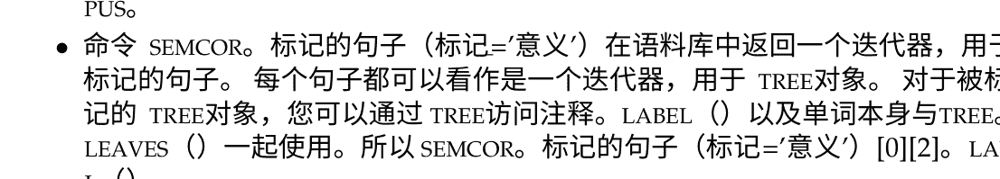

    节点内的值表示标签， $y^{(i)} \in \{0, 1\}$，对于未标记的节点， $y^{(i)} = ?$。两个节点之间存在边表示 $w_{i,j} = 1$，不存在边表示 $w_{i,j}=0$。对于第三个示例，您只需要计算前三迭代，然后可以猜测极限解。
4.  使用期望最大化聚类训练词义归纳系统，应用于单词 say。
    -   导入 NLTK，运行 NLTK.download() 并选择 SEMCOR。 从 NLTK导入 SEMCOR.corpus。
    -   命令 SEMCOR.tagged_sents(tag='sense') 在语料库中返回一个迭代器，用于标记的句子。 每个句子都可以看作是一个迭代器，用于 TREE对象。 对于被标记的 TREE对象，您可以通过 TREE.label()访问注释。 以及单词本身与 TREE.leaves() 一起使用。所以 SEMCOR.tagged_sents(tag='sense')[0][2].label() 将返回第一个句子中第三个单词的意义注释。
    -   提取包含意义 SAY.V.01 和 SAY.V.02 的所有句子。
    -   构建词袋向量 $x^{(i)}$ ，其中包含那些句子中其他单词的计数，包括至少出现在两个句子中的所有单词。
    -   在合并的数据上实现和运行期望最大化聚类。
    -   计算每个聚类中包含SAY.V.01和SAY.V.02的频率。

在剩余的练习中，您将尝试一些半监督学习和领域适应的方法。您需要多个领域的数据集。您可以在此处获取多个领域的产品评论: https://www.cs.jhu.edu/~mdredze/datasets/sentiment/processed_acl.tar.gz. 选择一个源领域和目标领域，例如DVD和书籍，并将目标领域的数据分为相等大小的训练集和测试集。

5.  首先，量化跨领域转移的成本。
    -   在源领域的训练集上训练逻辑回归分类器，并在目标领域的测试集上进行评估。
    -   在目标领域的训练集上训练逻辑回归分类器，并在目标领域的测试集上进行评估。这是“直接转移”基准线。
    计算准确率的差异，这是跨领域转移损失的度量。
6.  接下来，应用来自§5.3.2的标签传播算法。
    作为基准，仅使用目标域训练集的5%，训练一个分类器，并计算其在目标域测试集上的准确率。接下来，应用标签传播：
    -   计算标记数据（目标域训练集的5%）的标签矩阵 $Q_L$，每行都等于标签的指示向量（正或负）。
    -   迭代目标域实例，包括测试和训练数据。在每个实例 $i$ 上，使用方程5.32计算所有 $w_{ij}$，其中 $\alpha= 0.01$。使用这些值填充过渡矩阵 $T$ 的列 $i$，对于每个列 $i$，将除前十个最大值之外的所有值都设为零。确保归一化列，使剩余值总和为一。您可能需要使用稀疏矩阵来适应内存。
    -   应用从方程5.34-5.36中的迭代更新来计算未标记示例的标签传播算法的结果。
    从 $Q_U$中选择测试集实例，并计算该方法的准确性。与仅使用目标域训练集的5%样本训练的监督分类器进行比较。
7.  仅使用目标域训练数据的5%（以及所有源域训练数据），在 §5.4.1 中实现一种监督领域适应基线。看看这是否改进了先前问题中的“直接转移”基线。
8.  再次使用目标域训练数据的5%和所有源域数据实现 EASYADAPT (§5.4.1)。
9.  现在尝试无监督领域适应，使用 §5.4.2 中描述的“线性投影”方法。具体来说：
    -   在源域和目标域的完整训练数据中，将出现频率最高的词作为500个枢轴特征。具体来说，让 $x$ 表示域 $d$ 中单词 $i$ 的计数：选择 $\min(x_i^{\text{source}}, x_i^{\text{target}})$ 值最大的500个单词。
    -   训练一个分类器，从文档中的其他单词预测每个枢轴特征。
    -   将这些分类器的特征排列成一个矩阵 $\Phi$，并进行截断奇异值分解，取 $k=20$。
    -   使用源域数据训练一个分类器，使用组合特征 $x^{(i)} \oplus U^T x^{(i)}$ — 这些特征包括原始词袋特征和投影特征。
    -   将这个分类器应用于目标域的测试集，并计算准确率。

## 第二部分

## 序列和树

# 第6章

## 语言模型

在概率分类中，问题是计算标签在文本上的条件概率。现在让我们考虑相反的问题：计算文本本身的概率。具体而言，我们将考虑将概率分配给一个词汇序列的模型，$p(w_1, w_2, ..., w_M)$，其中 $w_m \in V$。集合 $V$ 是一个离散的词汇表,

$$ V = \{\text{aardvark, abacus, ..., zither}\}. \qquad [6.1]$$

为什么要计算一个词序列的概率？在许多应用中，目标是生成作为输出的词序列：

-   在机器翻译(第18章)中，我们将源语言的文本转换为目标语言的文本。
-   在语音识别中，我们将音频信号转换为文本。
-   在摘要中 (§ 16.3.4; §19.2)，我们将长文本转换为短文本。
-   在对话系统中 (§19.3)，我们将用户的输入（以及可能的外部知识库）转换为文本响应。

在执行这些任务的许多系统中，有一个子组件计算输出文本的概率。该组件的目的是生成更流畅的文本。例如，假设我们想要将一句话从西班牙语翻译成英语。

> (6.1) El cafe negro me gusta mucho.

这是一个逐字逐句的翻译（一个词汇表）：

> (6.2) The coffee black me pleases much.

一个好的英语语言模型会告诉我们，这种翻译的概率较低，与更符合语法的替代方案相比。

$$p(\text{黑咖啡非常讨我喜欢}) < p(\text{我喜欢浓咖啡})$$

我们如何利用这个事实？沃伦·韦弗（Warren Weaver）是机器翻译的早期领导者之一，他将其视为破解密码的问题（韦弗，1955年）：

> > 当我看着一篇俄文文章时，我会说：‘这实际上是用一些奇怪的符号编码的英文。我现在将开始解码。’

这个观察结果激发了一个生成模型（如朴素贝叶斯）：

-   英文句子 $w^{(e)}$ 是由语言模型 $p_e(w^{(e)})$ 生成的。
-   西班牙文句子 $w^{(s)}$ 然后由翻译模型 $p_{s|e}(w^{(s)} | w^{(e)})$ 生成的。

给定这两个分布，可以通过贝叶斯规则进行翻译：

$$p_{e|s}(w^{(e)} | w^{(s)}) \propto p_{e,s}(w^{(e)}, w^{(s)})$$
$$= p_{s|e}(w^{(s)} | w^{(e)}) \times p_e(w^{(e)})$$

这有时被称为“噪声信道模型”，因为它设想英文文本通过一个嘈杂的信道转变为西班牙文，即 $p_{s|e}$。 与直接建模 $p_{e|s}$ 相比，以这种方式建模翻译的优势是什么？关键点在于这两个分布 $p_{s|e}$（翻译模型）和 $p_e$（语言模型）可以从不同的数据中估计出来。翻译模型需要正确翻译的示例，但语言模型只需要英文文本。这种单语数据更加广泛可用。此外，一旦估计出来，语言模型 $p_e$ 可以在任何涉及生成英文文本的应用中重复使用，包括从其他语言翻译。

### 6.1 N-gram 语言模型

计算一系列标记的概率的一种简单方法是使用相对频率估计。考虑这句引文，归功于毕加索，“计算机是无用的，它们只能给你答案。”估计这个句子的概率的一种方法是，

$$p(\text{计算机是无用的，它们只能给你答案})$$
$$= \frac{\text{计数（计算机是无用的，它们只能给你答案）}}{\text{计数（所有曾经说过的句子）}}$$这个估计器是无偏的：在理论上的无限数据极限下，估计将是正确的。但在实践中，我们要求准确计数无限数量的事件，因为单词序列可以是任意长的。即使在序列中有一个积极的上限，比如说，M= 20个标记，可能的序列数量是V<sup>20</sup>，其中 V = |V|。对于英语来说，一个小的词汇表可能有 V = 10<sup>5</sup>，所以有 10<sup>100</sup>个可能的序列。显然，这个估计器非常需要数据，并且受到高方差的影响：即使是语法正确的句子，如果它们在训练数据中没有出现，概率将为零。<sup>1</sup>因此，我们需要引入偏差，以有机会从有限的训练数据中进行可靠的估计。本章介绍的语言模型以各种方式引入偏差。

我们从 n-gram语言模型开始，它计算一个序列的概率，将其作为子序列的概率的乘积。一个序列p(w)的概率可以使用链式法则（见 § A.2）重构为：

p(w) = p(w<sub>1</sub>, w<sub>2</sub>, ..., w<sub>M</sub>) [6.6]
= p(w<sub>1</sub>) × p(w<sub>2</sub> | w<sub>1</sub>) × p(w<sub>3</sub> | w<sub>2</sub>, w<sub>1</sub>) × ... × p(w<sub>M</sub> | w<sub>M-1</sub>, ..., w<sub>1</sub>) [6.7]

乘积中的每个元素是给定其前任词的概率。我们可以将其视为一个词语预测任务：给定上下文计算机是，我们想要计算下一个标记的概率。在这个上下文中，单词 useless的概率的相对频率估计为：

p(无用 | 计算机是 ) = 计数（计算机是无用的 ） / ∑<sub>x∈V</sub>计数(计算机是x)
= 计数（计算机是无用的 ） / 计数（计算机是 ）.

我们还没有做任何近似，我们也可以按相反的顺序应用链式法则，

[6.8] 或者
p(w) = p(w<sub>M</sub>) × p(w<sub>M-1</sub> | w<sub>M</sub>) × ... × p(w<sub>1</sub> | w<sub>2</sub>, ..., w<sub>M</sub>).

以任何其他顺序。但这意味着我们实际上也没有取得任何进展：要计算条件概率p(w<sub>M</sub> | w<sub>M-1</sub>, w<sub>M-2</sub>, ..., w<sub>1</sub>)，我们需要建模 V<sup>M-1</sup>上下文。这样的分布无法从任何现实的文本样本中估计。

为了解决这个问题，n-gram模型做出了一个关键的简化近似：它们只依赖于过去的n-1个单词。

p(w<sub>m</sub> | w<sub>m-1</sub> ... w<sub>1</sub>) ≈ p(w<sub>m</sub> | w<sub>m-1</sub>, ..., w<sub>m-n+1</sub>) [6.9]

> <sup>1</sup>乔姆斯基曾经声称这证明了概率语言模型的概念是错误的：没有这样的模型能够区分出语法正确的句子“无色的绿色思想疯狂地睡觉”和语法错误的排列“疯狂地睡觉思想绿色无色”。

这意味着一个句子 $w$的概率可以近似为

$$\mathrm{p}(w_1, \ldots, w_M) \approx \prod_{m=1}^M \mathrm{p}(w_m \mid w_{m-1}, \ldots, w_{m-n+1}) \quad [6.10]$$

为了计算整个句子的概率，方便起见，在开头和结尾填充特殊符号 □和 ■。然后，对于句子$I\ like\ black\ coffee$的概率，使用二元 ($n= 2$) 近似计算如下：

$$\mathrm{p}(I\ like\ black\ coffee) = \mathrm{p}(I \mid □) \times \mathrm{p}(like \mid I) \times \mathrm{p}(black \mid like) \times \mathrm{p}(coffee \mid black) \times \mathrm{p}(■ \mid coffee)。 \quad [6.11]$$

该模型只需要估计和存储 $V^n$ events的概率，这在 $n$-gram的顺序上是指数级的，而不是在句子长度上是指数级的 $V^M$。可以通过相对频率估计来计算 $n$-gram概率。

$$\mathrm{p}(w_m \mid w_{m-1}, w_{m-2}) = \frac{\mathrm{count}(w_{m-2}, w_{m-1}, w_m)}{\sum_{w'} \mathrm{count}(w_{m-2}, w_{m-1}, w')} \quad [6.12]$$

超参数 $n$控制每个条件概率中使用的上下文大小。 如果此处错误指定，语言模型的性能将较差。 让我们具体考虑潜在的问题。

当 $n$太小时。考虑以下句子：

+   1. (6.3) 大猩猩总是喜欢梳理它们的朋友。
2. (6.4) 我们办公楼的三楼上的电脑崩溃了。

在每个示例中，粗体字的单词彼此依赖：知道**大猩猩**是复数，它们的可能性取决于这一点，而**电脑崩溃了**的可能性取决于主语是电脑。 如果 $n$ -gram不够大以捕捉这种上下文，那么得到的语言模型将为这些句子提供过低的概率，并为未通过基本语言测试（如数目一致性）的句子提供过高的概率。

当 $n$太大时。在这种情况下，由于数据稀疏性，很难从我们的数据集中得到n-gram参数的良好估计。 为了处理大猩猩的例子，有必要建模6-gram，这意味着要考虑 $V^6$ events。在一个非常小的词汇表中 $V= 10^4$，这意味着要估计 $10^{24}$个不同事件的概率。

这两个问题指向了另一个偏差-方差的权衡 (见 §2.2.4)。小的 n-gram大小引入了高偏差，而大的 n-gram大小引入了高方差。我们甚至可能同时遇到这两个问题！语言中充满了我们无法捕捉到的长程依赖，因为 n太小；同时，语言数据集中充满了罕见现象，我们无法准确估计其概率，因为 n太大。一种解决方法是尽量保持较大的 n，同时对底层参数进行低方差估计。为了做到这一点，我们将引入一种不同类型的偏差：平滑。

### 6.2 平滑和折扣

有限的数据是估计语言模型中持续存在的问题。 在 §6.1中，我们提出了n-gram作为部分解决方案。 即使对于低阶n-gram，稀疏数据也可能是一个问题；同时，许多语言现象，如主谓一致，无法在没有高阶n-gram的语言模型中加入。 因此，需要为n-gram语言模型添加额外的归纳偏差。 本节介绍了一些最直观和常见的方法，但还有很多其他方法（参见 Chen和Goodman，1999年）。

#### 6.2.1 平滑

语言建模中的一个重要问题是避免出现p(w) = 0的情况，这可能是由于一个未见过的n-gram导致的。 在朴素贝叶斯中也出现了类似的问题，解决方法是平滑：添加虚拟的“伪”计数。 相同的思想可以应用于n-gram语言模型，如在这里所示的二元情况。

$$\mathrm{P}_{\mathrm{smooth}}(w_{m} \mid w_{m-1}) = \frac{\operatorname{count}(w_{m-1}, w_{m}) + \alpha}{\sum_{w^{\prime} \in \mathcal{V}} \operatorname{count}(w_{m-1}, w^{\prime}) + V \alpha}.$$ [6.13]

这个基本框架被称为Lidstone平滑，但特殊情况有其他名称：

+   - 拉普拉斯平滑对应于 $\alpha=1$ 的情况。
- 杰弗里斯-帕克斯定律对应于 $\alpha=0.5$ 的情况，在实践中效果很好，并从一些理论上得到了证明 (Manning and Sch"utze, 1999) 。

为了确保概率被正确归一化，我们添加到分子中的任何内容 ($\alpha$) 也必须出现在分母中 ($V\alpha$) 中。 这个体现在有效计数的概念中：

$$c_{i}^{*} = (c_{i}+\alpha) \frac{M}{M+V \alpha},$$ [6.14]

其中$c_i$是事件$i$的计数，$c_i^*$是有效计数，而$M = \sum_{i=1}^{V} c_i$是数据集中的总标记数$(w_1, w_2, \ldots, w_M)$。这个术语确保$\sum_{i=1}^{V} c_i^* = \sum_{i=1}^{V} c_i = M$。然后计算每个n-gram的折扣，

$$d_i = \frac{c_i^*}{c_i} = \frac{(c_i + \alpha)}{c_i} \frac{M}{(M + V \alpha)}$$

#### 6.2.2 折扣和回退

折扣“借用”了观察到的$n$-gram的概率质量，并重新分配它。在Lidstone平滑中，通过增加相对频率估计的分母来进行借用。然后通过增加所有$n$-gram的分子来重新分配借用的概率质量。另一种方法是从所有观察到的$n$-gram中借用相同数量的概率质量，并将其在仅未观察到的$n$-gram中重新分配。这被称为绝对折扣。例如，假设我们在一个二元模型中设置了一个绝对折扣$d=0.1$，然后将这个概率质量均匀地重新分配给未见过的词。结果概率如表6.1所示。折扣保留了一些来自观察数据的概率质量，我们不需要均匀地重新分配这些概率质量。相反，我们可以回退到一个低阶语言模型：如果你有三元组，就使用三元组；如果你没有三元组，就使用二元组；如果你甚至没有二元组，就使用一元组。这被称为Katz回退。在简单的在从二元组退缩到一元组的情况下，二元组的概率是,

$$c^*(i,j) = c(i,j) - d \tag{6.15}$$

$$p_{\text{Katz}}(i \mid j) = \begin{cases} \frac{c^*(i,j)}{c(j)} & \text{如果 } c(i,j) > 0 \\ \alpha(j) \times \frac{p_{\text{一元组}}(i)}{\sum_{i':c(i',j)=0} p_{\text{一元组}}(i')} & \text{如果 } c(i,j) = 0. \end{cases} \tag{6.16}$$

术语 $\alpha(j)$ 表示已经为上下文 $j$ 减少的概率质量。然后，这个概率质量被分配给所有未见事件，$\{i' : c(i',j)=0\}$，与每个词 $i'$ 的一元组概率成比例。折扣参数 $d$ 可以通过在开发集上最大化性能（通常是留存对数似然）来进行优化。

## ### 6.2.3 *插值

回退是一种结合不同顺序 $n$-gram模型的方法。另一种方法是插值：将上下文中的单词的概率设置为其在逐渐缩短的上下文中的概率的加权和。

我们可以选择多个 $n$-gram概率的加权平均值，而不是选择单个 $n$来确定 $n$-gram的大小。例如，对于一个插值的三元模型，

$$p_{\text{插值}} (w_m \mid w_{m-1}, w_{m-2}) = \lambda_3 p_3^*(w_m \mid w_{m-1}, w_{m-2}) + \lambda_2 p_2^*(w_m \mid w_{m-1}) + \lambda_1 p_1^*(w_m)。$$

在这个方程中，$p_n^*$ 是由一个 $n$-gram语言模型给出的未平滑的经验概率，而 $\lambda_n$ 是分配给该模型的权重。为了确保插值 $p(w)$ 仍然是一个有效的概率分布，$\lambda$ 的值必须满足约束条件 $\sum$

但是如何找到特定的值？

一种优雅的解决方案是期望最大化。回想一下第5章，我们可以将EM视为处理缺失数据的学习方法：我们只需要选择缺失数据，使得如果没有缺失数据，学习将变得容易。在这种情况下缺失了什么？将每个单词 $w_m$ 视为从未知大小的 $n$-gram_m中抽取的，$z_m \in \{1 \ldots n_{\text{max}}\}$ 的样本。这个 $z_m$ 就是我们要寻找的缺失数据。因此，将EM应用于这个问题涉及以下生成模型：

+   - 对于每个标记 $w_m$，$m=1, 2, \ldots, M$，执行以下操作：
  - 抽取 $n$-gram_m大小 $z_m \sim \text{Categorical}(\lambda)$
  - 抽取 $w_m \sim p^*_{z_m} (\text{第 } w_m \text{ 个 } | \text{ 第 } w_{m-1} \text{ 个-1}, \ldots, \text{第 } w_{m-z_m} \text{ 个-} z_m)$

如果缺失的数据 {第$Z_m$个}已知，则 $\lambda$可以估计为相对频率,

$$\lambda_z = \frac{\text{计数}(第Z_m\text{个} = z)}{M} \quad [6.17]$$
$$\propto \sum_{m=1}^{M} \delta(第Z_m\text{个} = z). \quad [6.18]$$

但是由于我们不知道潜在变量 $Z_m$的值，我们在E步中插补一个分布$q_m$，它表示单词标记 $w_m$是由一个 $z_m$阶的$n$-gram生成的

$$q_m(z), \text{Pr}(第Z_m\text{个} = z | 第\mathbf{w}_{1:m}; \lambda) \quad [6.19]$$
$$= \frac{\text{p}(w_m | 第\mathbf{w}_{1:m-1}, 第Z_m\text{个} = z) \times \text{p}(z)}{\sum_{z'} \text{p}(w_m | \mathbf{w}_{1:m-1}, Z_m = z') \times \text{p}(z')} \quad [6.20]$$
$$\propto p_z^*(w_m | \mathbf{w}_{1:m-1}) \times \lambda_z. \quad [6.21]$$

在M步骤中，通过对q下的期望计数求和来计算$\lambda$。

$$\lambda_z \propto \sum_{m=1}^{M} q_m(z). \quad [6.22]$$

通过在更新$q$和$\lambda$之间迭代来获得解决方案。 完整的算法在算法10中展示。

## 算法10插值语言建模的期望最大化

1: 过程 ESTIMATE INTERPOLATED n-GRAM ($\mathbf{w}_{1:M}$, $\{p_n^*\}_{n\in1:n_{\text{max}}}$)
2: 对于 $z \in \{1, 2, . . . , n_{\text{max}}\}$ 执行 。初始化
3:    $\lambda_z \leftarrow \frac{1}{n_{\text{max}}}$
4: 重复
5:    对于 $m \in \{1, 2, . . . , M\}$ 执行 。E步
6:        对于 $z \in \{1, 2, . . . , n_{\text{max}}\}$ 执行
7:            $q_m(z) \leftarrow p_z^*(w_m | \mathbf{w}_{1:m-1}) \times \lambda_z$
8:        $q_m \leftarrow \text{归一化} (q_m)$
9:    对于 $z \in \{1, 2, . . . , n_{\text{max}}\}$ 执行 。M步
10:       $\lambda_z \leftarrow \frac{1}{M} \sum_{m=1}^{M} q_m(z)$
11: 直到疲倦
12: 返回 $\lambda$

#### 6.2.4 *Kneser-Ney 平滑

Kneser-Ney平滑基于绝对折扣，但它以与Katz回退不同的方式重新分配结果概率质量。经验证据表明，Kneser-Ney平滑是n-gram语言建模的最先进技术（Goodman，2001）。为了激励Kneser-Ney平滑，考虑以下例子：我最近访问了。以下哪个更有可能：弗朗西斯科还是杜鲁斯？

现在假设在训练数据中，双字母组合*visited Duluth*和*visited Francisco*都没有被观察到，并且进一步假设单字母组合概率 p₁*(Francisco)大于 p₁*(Duluth)。尽管如此，我们仍然会猜测 p(visited Duluth) > p(visited Francisco)，因为 Duluth是一个更“多才多艺”的词：它可以出现在许多上下文中，而 Francisco通常只出现在一个上下文中，紧跟着词 San。这种多才多艺的概念是 Kneser-Ney 平滑的关键。

将未定义长度的上下文记为 u，并将单词 w在上下文 u中的计数记为 count(w, u)，我们将 Kneser-Ney 双字母组合概率定义为

$$\text{p}_{KN}(w \mid u) =
\begin{cases}
\frac{\text{max(count(w,u)}-d,0)}{\text{count(u)}}, & \text{count(w, u)} > 0 \\
\alpha(u) \times \text{p}_{\text{continuation}}(w), & \text{otherwise}
\end{cases}
\tag{6.23}$$
$$\text{p}_{\text{continuation}}(w) = \frac{|u : \text{count(w, u)} > 0|}{\sum_{w' \in \mathcal{V}} |u' : \text{count(w', u')} > 0|}
\tag{6.24}$$

使用绝对折扣法计算概率质量 d，该法则适用于所有未观察到的n-gram。在上下文 u中，折扣总量为 d× |w : count(w, u) > 0|，我们将这个概率质量分配给未见过的 n-gram。为了考虑多样性，我们将继续概率 p_continuation(w)定义为与 w出现的观察到的上下文数量成比例。继续概率的分子是 w出现的上下文数量；分母通过对所有词 w'的相同数量求和来归一化概率。系数 α(u)被设置为确保概率分布p_KN(w |u)在词汇 w上总和为一。

通过计算上下文中的数量来建模多功能性的想法可能看起来是启发式的，但是从贝叶斯非参数性（Teh，2006）中有一个优雅的理论证明。在神经语言模型出现之前，Kneser-Ney平滑在n-gram上是主导的语言建模技术。

### 6.3 循环神经网络语言模型

N-gram语言模型已经在很大程度上被神经网络取代。这些模型不做受限上下文的n-gram假设；事实上，它们可以合并任意远的上下文信息，同时保持计算和统计的可行性。

| 事件 | counts | unsmoothed probability | effective counts (α=0.1) | 平滑的概率 (α=0.1) | 有效的计数 (d=0.1) | 平滑的概率 (d=0.1) |
| --- | --- | --- | --- | --- | --- | --- |
| 不当行为 | 8 | 0.4 | 7.826 | 0.391 | 7.9 | 0.395 |
| 冒犯 | 5 | 0.25 | 4.928 | 0.246 | 4.9 | 0.245 |
| 损害 | 4 | 0.2 | 3.961 | 0.198 | 3.9 | 0.195 |
| 缺陷 | 2 | 0.1 | 2.029 | 0.101 | 1.9 | 0.095 |
| 爆发 | 1 | 0.05 | 1.063 | 0.053 | 0.9 | 0.045 |
| 虚弱 | 0 | 0 | 0.097 | 0.005 | 0.25 | 0.013 |
| 足类动物 | 0 | 0 | 0.097 | 0.005 | 0.25 | 0.013 |

表6.1: 利德斯通平滑和绝对折扣在二元语言模型中的示例，对于上下文 (被指称，)，在一个包含七个单词的玩具语料库中共计二十个计数。请注意，折扣会降低除了未见过的单词之外的所有单词的概率，而利德斯通平滑会增加对于缺陷和爆发的有效计数和概率。

神经语言模型背后的第一个洞见是将单词预测视为一项判别学习任务。目标是计算概率 $p(w \mid u)$，其中 $w \in \mathcal{V}$ 是一个单词，$u$ 是上文依赖于前面的单词。我们可以将语言建模视为一个机器学习问题，通过估计最大化语料库的对数条件概率来估计参数，而不是直接从（平滑后的）相对频率估计单词概率。

第二个洞见是将概率分布 $p(w \mid u)$ 重新参数化为两个稠密的 $K$ 维数值向量的函数，$\beta_w \in \mathbb{R}^K$ 和 $v_u \in \mathbb{R}^K$。

$$ p(w \mid u) = \frac{\exp(\beta_w \cdot v_u)}{\sum_{w' \in \mathcal{V}} \exp(\beta_{w'} \cdot v_u)}, \qquad [6.25] $$

其中 $\beta_w \cdot v_u$ 表示点积。通常，分母确保概率分布被正确归一化。这个概率向量等同于将 $\text{SoftMax}$ 变换（参见 §3.1）应用于点积向量，

$$ p(\cdot \mid u) = \text{SoftMax}([\beta_1 \cdot v_u, \beta_2 \cdot v_u, \ldots, \beta_V \cdot v_u])。 \qquad [6.26] $$

词向量 $\beta_w$ 是模型的参数，并且可以直接估计。上下文向量 $v_u$ 可以通过不同的方式计算，具体取决于模型。一个简单但有效的神经语言模型可以由一个循环神经网络 (RNN; Mikolov et al., 2010) 构建。基本思想是在移动过程中，通过循环更新上下文向量。让 $h_m$ 表示位置 $m$ 的上下文信息。

²这个想法早于神经语言模型（例如，Rosenfeld, 1996; Roark等, 2007）。

Jacob Eisenstein。2018年11月13日草稿。

## 6.3. 循环神经网络语言模型

在序列中。RNN语言模型被定义为

$$
\begin{aligned}
x_m &\triangleq \phi_{w_m} & [6.27] \\
h_m &= \text{RNN}(x_m, h_{m-1}) & [6.28] \\
p(w_{m+1} \mid w_1, w_2, \ldots, w_m) &= \frac{\exp(\beta_{w_{m+1}} \cdot h_m)}{\sum_{w' \in \mathcal{V}} \exp(\beta_{w'} \cdot h_m)}, & [6.29]
\end{aligned}
$$

其中 $\phi$ 是一个词嵌入矩阵，$x_m$ 表示单词 $w_m$ 的嵌入。将 $w_m$ 转换为 $x_m$ 有时被称为查找层，因为我们只需在表中查找每个单词的嵌入；参见 §3.2.4。**Elman**单元定义了一个简单的循环操作（**Elman**，1990），

$$\text{RNN}(x_m, h_{m-1}) \triangleq g(\Theta h_{m-1} + x_m), \qquad\qquad [6.30]$$

其中 $\Theta \in \mathbb{R}^{K \times K}$ 是循环矩阵，$g$ 是非线性变换函数，通常定义为逐元素的双曲正切函数 $\tanh$（参见 §3.1）。³ $\tanh$ 作为一个压缩函数，确保每个元素 $m$ 的取值范围在 $[-1, 1]$ 之间。

尽管每个 $w_m$ 只依赖于上下文向量 $h_{m-1}$，但是这个向量又受到所有之前的标记 $w_1, w_2, \ldots$ 的影响。通过循环操作，$w_{m-1}$ 影响 $h_{m-1}$，$h_{m-1}$ 影响 $h_{m-2}$，以此类推，直到信息传播到 $m-1$，然后传播到 $w_m$（参见图6.1）。这与 n-gram 语言模型有一个重要的区别，在 n 个词的窗口之外的任何信息都被忽略。原则上，RNN 语言模型可以处理长距离依赖关系，例如文本中的数字一致性，尽管很难确定这些信息在向量 $h_m$ 中的具体表示位置。主要限制在于信息通过重复应用压缩函数 $g$ 而衰减。长短时记忆网络（**LSTMs**）是 RNN 的一种变体，解决了这个问题，通过使用记忆单元在序列中传播信息，而不应用非线性变换（**Hochreiter** 和 **Schmidhuber**，1997年）。

方程6.29中的分母是一个计算瓶颈，因为它涉及整个词汇表的求和。一种解决方案是使用分层softmax函数，通过将词汇表组织成一棵树来更高效地计算求和（**Mikolov** 等，2011年）。另一种策略是优化替代度量，例如噪声对比估计（**Gutmann** 和 **Hyvärinen**，2012年），它通过区分观察到的实例和从噪声分布生成的人工实例来进行学习（**Mnih** 和 **Teh**，2012年）。

这两种策略都在第14.5.3节中描述。

在原始的Elman网络中，使用了sigmoid函数来替代tanh。有关循环神经网络中各种非线性函数的优缺点的启发式数学讨论，请参阅**Cho**（2015年）的讲义。

#### 6.3.1 时序反向传播

递归神经网络语言模型具有以下参数：

* $\phi_i \in \mathbb{R}^K$，即“输入”词向量（有时也称为词嵌入，因为每个词都嵌入在一个 $K$ 维空间中；参见第14章）；
* $\beta_i \in \mathbb{R}^K$，即“输出”词向量；
* $\Theta \in \mathbb{R}^{K \times K}$，即循环操作符；
* $h_0$，即初始状态。

这些参数可以通过在训练语料库上制定目标函数 $L(w)$，并对一小批训练示例应用反向传播来进行估计（参见 §3.3.1）。基于梯度的更新可以通过在线学习算法（如随机梯度下降，参见 §2.6.2）计算。

将反向传播应用于递归神经网络被称为时间反向传播，因为时间 $m$ 上的单元的梯度依次取决于较早时间 $m$ 之前的单元的梯度。令 $\ell_{m+1}$ 表示单词 $m+1$ 的负对数似然。

$$\ell_{m+1} = -\log p(w_{m+1} \mid w_1, w_2, \ldots, w_m). \qquad [6.31]$$

我们需要计算损失函数对每个参数的梯度，例如 $\theta_{k,k'}$，这是递归矩阵 $\Theta$ 中的一个元素。由于损失函数只依赖于参数 $h_m$，我们可以应用链式法则进行求导。

$$\frac{\partial \ell_{m+1}}{\partial \theta_{k,k'}} = \frac{\partial \ell_{m+1}}{\partial \mathbf{h}_m} \frac{\partial \mathbf{h}_m}{\partial \theta_{k,k'}}. \qquad [6.32]$$

向量 $\mathbf{h}_m$ 以几种方式依赖于 $\Theta$。首先，$\mathbf{h}_m$ 通过将 $\Theta$ 与上一个状态 $\mathbf{h}_{m-1}$ 相乘来计算。但是上一个状态 $\mathbf{h}_{m-1}$ 也依赖于 $\Theta$：

$$\mathbf{h}_m = g(\mathbf{x}_m + \Theta \mathbf{h}_{m-1}) \qquad [6.33]$$

$$\frac{\partial h_{m,k}}{\partial \theta_{k,k'}} = g'(x_{m,k} + \theta_{k} \cdot \mathbf{h}_{m-1})(h_{m-1,k'} + \theta_{k} \cdot \frac{\partial \mathbf{h}_{m-1}}{\partial \theta_{k,k'}}), \qquad [6.34]$$

其中 $g'$ 是非线性函数 $g$ 的局部导数。这个方程的关键点是导数 $\frac{\partial \mathbf{h}_m}{\partial \theta_{k,k'}}$ 取决于 $\frac{\partial \mathbf{h}_{m-1}}{\partial \theta_{k,k'}}$，这将依次取决于 $\frac{\partial \mathbf{h}_{m-2}}{\partial \theta_{k,k'}}$，直达到初始状态 $\mathbf{h}_0$。

每个导数 $\frac{\partial \mathbf{h}_m}{\partial \theta_{k,k'}}$ 将被多次重复使用：它出现在从损失 $\ell_m$ 反向传播中，但也出现在所有后续损失 $\ell_{n>m}$ 中。神经网络工具包，如Torch（Collobert等，2011）和DyNet（Neubig等，2017），计算所需的自动求导，并将其缓存以备将来使用。与第3章中考虑的前馈神经网络相比，一个重要的区别是计算图的大小不是固定的，而是随输入的长度而变化。这对于围绕静态计算图设计的工具包（如TensorFlow）来说是困难的（Abadi等，2016）。

#### 6.3.2 超参数

RNN语言模型有几个超参数，必须调整以确保良好的性能。模型容量由单词和上下文向量的大小K控制，这在某种程度上类似于n-gram上下文的大小。对于相对于词汇表较大的数据集（即，有较大的标记-类型比率），我们可以承担估计具有较大K的模型，这使得单词和上下文之间的差异更加微妙。当数据集相对较小时，K必须更小，否则模型可能会“记忆”训练数据，并且无法泛化。

不幸的是，这个通用建议尚未被形式化为任何具体的公式来选择 K，仍然需要试错。过拟合也可以通过dropout来防止，dropout涉及将计算中的一些元素随机设置为零（Srivastava等，2014），迫使学习器不过分依赖任何特定维度的单词或上下文向量。辍学率也必须在开发数据上进行调整。

#### 6.3.3 门控循环神经网络

原则上，递归神经网络可以在无限长的序列中传播信息。但在实践中，非线性递归函数的重复应用会导致这些信息迅速衰减。同样的问题也影响学习：反向传播可能导致梯度消失，梯度衰减为零，或者梯度爆炸，梯度增加到无穷大（Bengio等，1994）。梯度爆炸问题可以通过将梯度剪切到某个最大值来解决（Pascanu等，2013）。其他问题必须通过改变模型本身来解决。

长短期记忆（LSTM; Hochreiter和Schmidhuber，1997）是一种流行的RNN变体，对这些问题更具鲁棒性。该模型通过一个记忆单元 $c_m$ 来增强隐藏状态 $h_m$。每个时间步的记忆单元值 $c_m$ 是两个量的门控和：其先前值 $c_{m-1}$ 和一个“更新” $\tilde{c}_m$，该更新是从当前输入 $x_m$ 和先前隐藏状态 $h_{m-1}$ 计算得到的。下一个状态 $h_m$ 然后从记忆单元计算得到。由于在更新过程中记忆单元没有经过非线性压缩函数，因此信息可以在网络传播很长的距离。

这些门是输入和前一个隐藏状态的函数。它们通过逐元素的sigmoid激活函数计算得到，$\sigma(x) = (1 + \exp(-x))^{-1}$，确保它们的值在[0,1]范围内。因此，它们可以被视为软的、可微分的逻辑门。LSTM架构如图6.2所示，完整的更新方程如下：

* $\boldsymbol{f}_{m+1} = \sigma(\boldsymbol{\Theta}^{(h \to f)} \boldsymbol{h}_m + \boldsymbol{\Theta}^{(x \to f)} \boldsymbol{x}_{m+1} + \boldsymbol{b}_f)$ 遗忘门 [6.35]
* $\boldsymbol{i}_{m+1} = \sigma(\boldsymbol{\Theta}^{(h \to i)} \boldsymbol{h}_m + \boldsymbol{\Theta}^{(x \to i)} \boldsymbol{x}_{m+1} + \boldsymbol{b}_i)$ 输入门 [6.36]
* $\tilde{\boldsymbol{c}}_{m+1} = \tanh(\boldsymbol{\Theta}^{(h \to c)} \boldsymbol{h}_m + \boldsymbol{\Theta}^{(x \to c)} \boldsymbol{x}_{m+1})$ 更新候选 [6.37]
* $\boldsymbol{c}_{m+1} = \boldsymbol{f}_{m+1} \odot \boldsymbol{c}_m + \boldsymbol{i}_{m+1} \odot \tilde{\boldsymbol{c}}_{m+1}$ 记忆细胞更新 [6.38]
* $\boldsymbol{o}_{m+1} = \sigma(\boldsymbol{\Theta}^{(h \to o)} \boldsymbol{h}_m + \boldsymbol{\Theta}^{(x \to o)} \boldsymbol{x}_{m+1} + \boldsymbol{b}_o)$ 输出门 [6.39]
* $\boldsymbol{h}_{m+1} = \boldsymbol{o}_{m+1} \odot \tanh(\boldsymbol{c}_{m+1})$ 输出。 [6.40]

该运算符是逐元素（哈达玛积）乘积。每个门由一组权重向量控制，这些权重向量参数化了先前的隐藏状态（例如，$\boldsymbol{\Theta}^{(h \to f)}$）和当前的输入（例如，$\boldsymbol{\Theta}^{(x \to f)}$），再加上一个向量偏移（例如，$\boldsymbol{b}_f$）。总体操作可以简单地概括为 $(\boldsymbol{h}_m, \boldsymbol{c}_m) = \text{LSTM}(\boldsymbol{x}_m, (\boldsymbol{h}_{m-1}, \boldsymbol{c}_{m-1}))$，其中 $(\boldsymbol{h}_m, \boldsymbol{c}_m)$ 表示读取标记 $m$ 后的LSTM状态。

LSTM在各种问题上优于标准循环神经网络。它首先由Sundermeyer等人（2012）用于语言建模，但可以更广泛地应用：向量 $\boldsymbol{h}_m$ 可以被视为一个完整的表示。

Jacob Eisenstein。2018年11月13日草稿。

输入序列直到位置 m，并且可以用于序列上的任何标记任务，正如我们将在下一章中看到的。

有几种LSTM变体，其中门控循环单元（Cho等，2014）是比较知名的之一。许多软件包实现了各种RNN架构，因此从用户的角度来选择它们很简单。Jozefowicz等（2015）在2015年提供了各种建模选择的实证比较。

### 6.4 评估语言模型

语言建模通常不是一个独立的应用：语言模型通常是更大系统的组成部分，并且理想情况下应该在外部进行评估。这意味着评估语言模型是否改善了应用任务的性能，例如机器翻译或语音识别。但这通常很难做到，并且取决于整个系统的细节，这些细节可能与语言建模无关。

相比之下，内在评估是与任务无关的。在内在度量标准上表现更好可能会改善各种任务的外在度量标准，但是过度优化内在度量标准存在风险。本节讨论了一些内在度量标准，但请记住进行外在评估的重要性，以确保内在性能的提升能够应用到实际应用中。

#### 6.4.1 保留似然

概率语言模型的目标是准确地测量词元序列的概率。因此，内在评估度量标准是语言模型对未使用于训练的留存数据分配的概率。具体来说，我们计算：

$$\ell(w) = \sum_{m=1}^{M} \log p(w_m | w_{m-1}, \ldots, w_1), \qquad [6.41]$$

将整个留存语料库视为一个令牌流进行处理。

通常，未知词汇被映射为<UNK>令牌。这意味着我们需要在训练数据上估计<UNK>的某种概率。一种方法是将词汇V固定为训练数据中计数最高的V-1个词，并将所有其他令牌转换为<UNK>。处理词汇外的术语的其他策略在第6.5节中讨论。

#### 6.4.2 困惑度

保留似然通常被表示为困惑度，这是将对数似然转化为信息论数量的确定性转换。

困惑度 $(w) = 2^{-\frac{\ell(w)}{M}}, \qquad [6.42]$

其中 $M$ 是保留语料库中的标记总数。

较低的困惑度对应于较高的似然度，因此在这个度量上较低的分数更好 —— 较少困惑更好。以下是一些特殊情况：

* 在完美语言模型的极限情况下，概率 1 被分配给保留语料库，困惑度 $(w) = 2^{-\frac{1}{M} \log_2 1} = 2^0 = 1$。
* 在相反的极限情况下，概率零被分配给保留语料库，这对应于无限的困惑度，困惑度 $(w) = 2^{-\frac{1}{M} \log_2 0} = 2^\infty = \infty$。
* 假设一个均匀的一元模型，其中 $p(w_i) = \frac{1}{V}$ 对于词汇表中的所有单词。然后，

$$ \log_2(w) = \sum_{m=1}^{M} \log_2 \frac{1}{V} = -\sum_{m=1}^{M} \log_2 V = -M \log_2 V $$
困惑度 $(w) = 2^{\frac{1}{M} M \log_2 V} = 2^{\log_2 V} = V$。

这是“最坏的合理情况”，因为你可以构建这样一个语言模型，甚至不看数据。

在实践中，语言模型往往给出在1和V之间的困惑度。一个小型基准数据集是Penn Tree bank，其中包含大约一百万个标记；其词汇量限制为10,000个单词，所有其他标记都映射到一个特殊的<UNK>符号。在这个数据集上，一个经过良好平滑的5-gram模型的困惑度为141 (Mikolov and Zweig, 2012)，而一个LSTM语言模型的困惑度约为80 (Zaremba, Sutskever, and Vinyals, 2014)。对LSTM架构的各种改进可以将困惑度降至60以下 (Merity et al., 2018)。 一个更大规模的语言建模数据集是1B Word Benchmark (Chelba et al., 2013)，其中包含来自维基百科的文本。在这个数据集上，通过对多个LSTM语言模型进行平均，可以获得困惑度约为25的结果 (Jozefowicz et al., 2016)。

### 6.5 未知词

到目前为止，我们假设了一个封闭词汇的设置 - 词汇 V 被假定为一个有限集合。在现实的应用场景中，这个假设可能不成立。例如，考虑翻译报纸文章的问题。以下句子出现在2017年1月6日的路透社文章中：5

> 报告称，美国情报机构认为俄罗斯军事情报机构 GRU 使用中间人，如 WikiLeaks、DCLeaks.com 和 Guccifer2.0 'persona' 来发布电子邮件...

假设你在2003年发布的 Gigaword 语料库上训练了一个语言模型，6。加粗的术语在这个日期要么不存在，要么不为人所知；它们不太可能出现在词汇中。同样的问题也可能发生在其他各种术语上：新技术、以前不知名的个人、新词（例如，hashtag）和数字。

一种解决方案是简单地用特殊标记标记所有这些术语，<UNK>。在训练语言模型时，我们提前决定词汇表（通常是最常见的术语），并将训练数据中的所有其他术语标记为<UNK>。如果我们不想提前确定词汇表的大小，另一种方法是简单地将每个词类型的第一次出现标记为<UNK>。

但是更好的做法是对各种未知词的可能性进行区分。这在具有丰富的形态系统的语言中尤为重要，每个词都有许多变化形式。例如，从形态学的角度来看，葡萄牙语只是中等复杂的语言，但每个动词都有几十种变形形式（见图4.3b）。在这种语言中，将会许多我们在语料库中没有遇到的词类型，但从语言的形态规则中仍然可以预测出来。

为了使用一个有点牵强的英语例子，如果 transfenestrate 在词汇表中，我们的语言模型应该给过去时 transfenestrated 分配一个非零的概率，即使它在训练数据中没有出现。

实现这一点的一种方法是用字符级别的语言模型补充词级别的语言模型。这样的模型可以使用 n-grams 或 RNNs，但词汇表固定为 ASCII 或 Unicode 字符集。例如，Ling 等人（2015）提出了一个基于字符的 LSTM 模型，而 Kim（2014）则使用了卷积神经网络。一个更具语言学动机的方法是将单词分割成有意义的词素单元（见第9章）。例如，Botha 和 Blunsom (2014)将形态素表示引入到对数双线性语言模型中；Bhatia等人(2016)将形态素向量融入到LSTM中。

5 Bayoumy, Y.和 Strobel, W。（2017年1月6日）。美国情报报告：普京指挥的网络运动帮助特朗普。 路透社。 从 http://www.reuters.com/article/us-usa-russia-cyber-idUSKBN14QT8T 于2017年1月7日检索。

6 https://catalog.ldc.upenn.edu/LDC2003T05

### 附加资源

各种神经网络架构已被应用于语言建模。早期的非循环架构包括神经概率语言模型(Bengio等人, 2003)和对数双线性语言模型(Mnih和Hinton, 2007)。关于这些模型的更多细节可以在Goodfellow等人(2016)的文本中找到。

### 练习

1. 证明如果$n$-gram语言模型的$n$-gram概率是有效的，则$n$-gram语言模型给出有效的概率。具体而言，假设，
$$\sum_{w_m \in \mathcal{V}} \mathrm{p}(w_m \mid w_{m-1}, w_{m-2}, \ldots, w_{m-n+1}) = 1 \tag{6.43}$$
对于所有的上下文 $(w_{m-1}, w_{m-2}, \ldots, w_{m-n+1}) \in \mathcal{V}^{n-1}$。证明$\mathrm{p}_n$是一个 $n$-gram语言模型下的概率。你的证明应该通过归纳法进行。你应该处理字符串开头的情况$\mathrm{p}(w_1 \mid \square, \ldots, \square)$，但是你不需要处理字符串结尾的标记。

2. 首先，使用类似于前一个问题中的证明技巧来证明RNN语言模型的有效性。
接下来，让$\mathrm{p}_r(w)$表示RNN $r$ 下 $w$ 的概率。一组RNN 语言模型计算概率，
$$\mathrm{p}(w) = \frac{1}{R} \sum_{r=1}^{R} \mathrm{p}_r(w). \tag{6.44}$$
一组 RNN 语言模型是否计算有效概率？

3. 考虑一个大小为 $\mathcal{V}$ 的词汇的一元语言模型。假设一个词在总共 $M$个标记的语料库中出现 $m$次。使用 Lidstone 平滑，对于哪些 $m$值，平滑概率大于未平滑概率？

4. 考虑一个简单的语言，每个标记从词汇 $\mathcal{V}$中以概率 $\frac{1}{\mathcal{V}}$独立地抽取。给定大小为 M 的语料库，所有可能的二元组中零计数的期望是多少？ 你可以假设 V 足够大，使得 1/V ≈ 1/(V-1).

5. 继续上一个问题，确定 M 的值，使得零计数的二元组的比例最多为 ϵ ∈ (0,1). 作为提示，你可以使用近似公式 ln(1+α) ≈ α，其中 α ≈ 0.

6. 在真实语言中，单词的概率既不均匀也不独立。 假设单词的概率是独立的但不均匀的，所以一般情况下 p(w) = 1/k. 证明未见二元组的期望比例将高于独立同分布的情况。

7. 考虑一个具有单个隐藏单元和sigmoid激活函数的循环神经网络，h_m = σ(θh_{m-1} + x_m). 证明如果 |θ| < 1，则梯度 ∂h_m/∂h_{m-k} 当 k→∞时，趋于零。 7

8. Zipf定律指出，如果语料库中的词类型按频率排序，那么排名为 r 的词的频率与 r^{-s} 成比例，其中 s 是一个自由参数，通常约为 1。 (另一种解读Zipf定律的方式是，以对数频率对数排名的图形将呈线性关系。) 使用第一和第二最常见词的计数，解出 s 的值，即ŝ。

9. 下载wikitext-2数据集。8 读取训练数据并计算词频。通过以下方式估计Zipf定律系数： ŝ = exp( (log r)·(log c) / ||log r||_2^2 ) [6.45] 根据Zipf定律，制作观察计数和预期计数的对数-对数图。 求和 Σ_{r=1}^∞ r s = ζ(s)是黎曼ζ函数，在python的scipy库中可以找到scipy.special.zeta。

10. 使用Pytorch库，从Wikitext训练语料库中训练一个LSTM语言模型。 在每个训练周期后，计算其在Wikitext验证语料库上的困惑度。 当困惑度不再改善时停止训练。

> 7这个证明通过考虑矩阵Θ的最大特征向量将其推广到向量隐藏单元 (Pascanu等人, 2013)。

> 8可用在 https://github.com/pytorch/examples/tree/master/word_language_model/data/wikitext-2 于2018年9月。数据集已经被标记化，并且已经用<UNK>替换了罕见的词，因此不需要预处理。

## 第7章 序列标注

序列标注的目标是为单词分配标签，或者更一般地，为序列中的离散元素分配离散标签。在自然语言处理中，序列标注有许多应用，第8章将对其进行概述。现在，我们将专注于经典的词性标注问题，即通过词性对每个单词进行标记。粗粒度的语法类别包括名词，用于描述事物、属性或思想，以及动词，用于描述动作和事件。考虑一个简单的输入：

(7.1) 他们会钓鱼。

粗粒度词性标记的词典可能将名词作为 they 的唯一有效标记，但对于 can 和 fish，可能同时包含名词和动词作为潜在标记。准确的序列标注算法应该选择(7.1)中的 can 和 fish 的动词标记，但在短语 can of fish 中应该选择名词标记。

### 7.1 序列标注作为分类

解决标记问题的一种方法是将其转化为分类问题。让 $f((w, m), y)$ 表示序列 $w = (w_1, w_2, ..., w_M)$ 中位置 $m$ 处标记的特征函数。一个简单的标记模型只有一个基本特征，即单词本身：

$f((w = they\ can\ fish, m = 1), N) = (they, N)$          [7.1]

$f((w = they\ can\ fish, m = 2), V) = (can, V)$            [7.2]

$f((w = they\ can\ fish, m = 3), V) = (fish, V)$. [7.3]

在这里，特征函数接受三个参数作为输入：要标记的句子（例如，他们可以钓鱼），提议的标记（例如，N或V），以及此标记所属的令牌的索引被应用。 然后，这个简单的特征函数返回一个包含要标记的单词和已提议的标记的元组。 如果词汇量为 V，标记数量为 K，则有 V × K个特征。 每个特征都必须被赋予一个权重 。 这些权重可以通过使用感知机等分类算法从带标签的数据集中学习，但在这种情况下并 不必要：可以直接定义分类权重，对于与单词 w 最频繁相关的标记 y， θw,y= 1，对于其他 所有标记， θw,y= 0。

然而，很容易看出这种简单的分类方法不能正确标记两者都能钓鱼和一些鱼，因为 can 和 fish 在语法上是有歧义的。 为了处理这两种情况，标记器必须依赖上下文，比如周围的 词语。 我们可以通过将周围的词语作为附加特征来构建上下文到特征集中：

$f((w =他们可以钓鱼,1), N) = \{(w_m =他们, y_m = N), (w_{m-1} = \square, y_m = N), (w_{m+1} =可以, y_m = N)\}$ [7.4]

$f((w =他们可以钓鱼,2), V) = \{(w_m =可以, y_m = V), (w_{m-1} =他们, y_m = V), (w_{m+1} = fish, y_m = V)\}$ [7.5]

$f((w = they\ can\ fish,3), V) = \{(w_m = fish, y_m = V), (w_{m-1} = can, y_m = V), (w_{m+1} = \blacksquare, y_m = V)\}$. [7.6]

这些特征包含足够的信息，使得标注器能够为单词 fish 选择正确的标签：在 can 之后出现 的单词很可能是动词，因此特征 $(w_{m-1} = can, y_m = V)$ 应该具有较大的正权重。

然而，即使使用了这些增强的特征集，正确标注一些序列可能仍然很困难。 其中一个 原因是标签之间经常存在关系。 例如，在英语中，一个动词跟在另一个动词后面相对较少 见 - 尤其是如果我们区分像 can 和 should 这样的 MODAL 动词和更典型的动词，如 give、 transcend 和 befuddle。 我们希望将偏好反对类似于 VERB-VERB 这样的标签序列，并支持类似 于 NOUN-VERB 这样的标签序列。 对于这样的偏好需求，最好的例子是一个 garden path sentence:

## (7.2) 老人船。

从语法上讲，单词 the 是一个 DETERMINER。 当你阅读这个句子时，你首先给 old 分配 的是什么词性？ 通常，这个词是一个 ADJECTIVE— 简称为 J — 它是一类修饰名词的词。 同样地， man 通常是一个名词。 标签的结果序列是 D J N D N。 但这是一个错误的“花园路径”解释，最终导致了无法解决 的问题。 一个限定词不太可能直接跟在名词后面<sup>1</sup>是不太可能的，而且整个句子缺少动词尤其不太可能。 (7.2)中唯一可能的动词是单词 man，它可以指的是维护和驾驶某物 — 通常是船。但是如果 man被标记为动词，那么 old就位于一个限定词和一个动词之间，必须是一个名词。事实上，形容词在这种用法中经常有第二种解释，作为名词使用（例如，the young，the restless）。这种推理，其中标记决策是相互交织的，无法应用于每个标记由独立的分类决策产生的环境中。

### 7.2 序列标注作为结构预测

作为一种替代方案，将整个标签序列视为一个标签本身。对于给定的单词序列 w = (w₁, w₂, ..., w_M)，存在一组可能的标记 Y(w) = Y^M，其中 Y = {N, V, D, ...}指的是单个标记的集合，Y^M指的是长度为 M的标记序列的集合。然后，我们可以将序列标记问题视为标签空间 Y(w)中的分类问题，ŷ = argmax

$$\underset{\boldsymbol{y} \in \mathcal{Y}(\boldsymbol{w})}{\operatorname{argmax}} \Psi(\boldsymbol{w}, \boldsymbol{y}) \tag{7.7}$$

其中 y = (y₁, y₂, ..., y_M)是一个包含 M个标记的序列，Ψ 是一个对序列对的评分函数，V^(M×Y^M) → R。这样的函数可以包括捕捉标记决策之间关系的特征，例如决定词性不应跟在名词后面，或者所有句子都有动词。

鉴于标签空间在序列长度上呈指数增长 M，是否有可能以这种方式进行标记？连续进行一系列相互关联的标记决策的问题被称为推理。由于自然语言中存在相互关联的语法结构，推理是自然语言处理的一个关键方面。在英语中，句子的长度 M= 20并不罕见；词性标记集的大小从 10到几百个不等。以这个范围的下限为例，我们有|Y(w₁:M)| ≈ 10^20，即一百万亿亿个可能的标记序列。枚举和评分每个序列都需要指数级的工作量，因此推理是不可行的。

然而，当我们限制评分函数时，情况就会发生变化。假设我们选择一个将分解为局部部分之和的函数，

$$\Psi(\boldsymbol{w}, \boldsymbol{y}) = \sum_{m=1}^{M+1} \psi(\boldsymbol{w}, y_m, y_{m-1}, m), \tag{7.8}$$

其中每个 ψ(·)都对标签序列的一个局部部分进行评分。请注意，求和的范围是从 M+1开始的，这样我们可以为特殊的序列结束标签 ψ(w₁:M, ♦, y_M, M+1)计算得分。我们还定义了一个特殊的标签来开始序列，y₀ ≜ ◇。

在线性模型中，局部评分函数可以定义为权重和特征的点积，

$$\psi(\boldsymbol{w}_{1:M}, y_m, y_{m-1}, m) = \boldsymbol{\theta} \cdot \boldsymbol{f}(\boldsymbol{w}, y_m, y_{m-1}, m). \tag{7.9}$$

特征向量 f可以考虑整个输入 w，并且可以查看相邻的标签对。 这比每个标记分类要进一 步：权重可以对不合适的标签对（如名词-决定词）分配低分，对频繁出现的标签对（ 如决定词-名词和名词-动词）分配高分。

在例子they can fish中，一个最简单的特征函数将包括词-标签对（有时称为发射特征 ）和标签-标签对（有时称为转移特征）的特征：

$$\boldsymbol{f}(\boldsymbol{w} = they\ can\ fish, \boldsymbol{y} = N\ V\ V) = \sum_{m=1}^{M+1} \boldsymbol{f}(\boldsymbol{w}, y_m, y_{m-1}, m) \tag{7.10}$$
$$=\boldsymbol{f}(\boldsymbol{w}, N, \Diamond, 1) + \boldsymbol{f}(\boldsymbol{w}, V, N, 2) + \boldsymbol{f}(\boldsymbol{w}, V, V, 3) + \boldsymbol{f}(\boldsymbol{w}, \blacklozenge, V, 4) \tag{7.11}$$
$$=\{(w_m = they, y_m = N)\} + \{(y_m = N, y_{m-1} = \Diamond)\} + \{(w_m = can, y_m = V)\} + \{(y_m = V, y_{m-1} = N)\} + \{(w_m = fish, y_m = V)\} + \{(y_m = V, y_{m-1} = V)\} + \{(y_m = \blacklozenge, y_{m-1} = V)\}. \tag{7.12}$$

这个例子有七个活跃特征：每个词-标签对一个，每个标签-标签对一个，包括一个最后 的标签 $y_{M+1} = \blacklozenge$。 这些特征捕捉了英语词性标注的两个主要信息来源：每个词适合哪些 标签，以及哪些标签倾向于按顺序跟随彼此。 在给这些特征分配适当的权重后，标注器可 以实现高准确性，即使对于像the old man the boat这样的困难案例也是如此。 现在我们将 讨论这个受限评分函数如何通过维特比算法（Viterbi, 1967）实现高效推理。

### 7.3 维特比算法

通过将评分函数分解为局部部分的总和，可以将标记问题重写为以下形式：

$$ \hat{\boldsymbol{y}} = \underset{\boldsymbol{y} \in \mathcal{Y}(\boldsymbol{w})}{\operatorname{argmax}} \Psi(\boldsymbol{w}, \boldsymbol{y}) $$ [7.13]

$$ = \underset{\boldsymbol{y}_{1: M}}{\operatorname{argmax}} \sum_{m=1}^{M+1} \psi(\boldsymbol{w}, y_m, y_{m-1}, m) $$ [7.14]

$$ = \underset{\boldsymbol{y}_{1: M}}{\operatorname{argmax}} \sum_{m=1}^{M+1} s_m(y_m, y_{m-1}), $$ [7.15]

其中最后一行使用简写来简化符号表示，

$$ s_m(y_m, y_{m-1}) \triangleq \psi(\boldsymbol{w}_{1:M}, y_m, y_{m-1}, m). $$ [7.16]

这个推理问题可以通过动态规划高效地解决，动态规划是一种在重复计算中重复使用工作的算法技术。 我们首先解决一个辅助问题：不是找到最佳的标记序列，而是计算最佳标记序列的得分。

$$ \max_{\boldsymbol{y}_{1: M}} \Psi(\boldsymbol{w}, \boldsymbol{y}_{1: M}) = \underset{\boldsymbol{y}_{1: M}}{\text { 最大值 }} \sum_{m=1}^{M+1} s_m(y_m, y_{m-1}). $$ [7.17]

这个分数涉及到对所有长度为 $M$ 的标签序列的最大化，写作 $\max_{\boldsymbol{y}_{1:M}}$。这个最大化可以分为两部分，

$$ \max_{\boldsymbol{y}_{1: M}} \Psi(\boldsymbol{w}, \boldsymbol{y}_{1: M}) = \underset{y_M}{\text { 最大值 }} \underset{\boldsymbol{y}_{1: M-1}}{\max } \sum_{m=1}^{M+1} s_m(y_m, y_{m-1}). $$ [7.18]

在求和中，只有最后一项 $s_{M+1}(\blacklozenge, y_M)$ 依赖于 $y_M$，所以我们可以将这一项从第二个最大化中提取出来，

$$ \max_{\boldsymbol{y}_{1: M}} \Psi(\boldsymbol{w}, \boldsymbol{y}_{1: M})=\left(\max _{y_M} s_{M+1}(\blacklozenge, y_M)\right)+\left(\max _{\boldsymbol{y}_{1: M-1}} \sum_{m=1}^{M} s_m(y_m, y_{m-1})\right). $$ [7.19]

方程7.19中的第二项与我们的原始问题具有相同的形式，只是将 $M$ 替换为 $M-1$。这表明问题可以重新表述为一个递归。 我们通过定义一个辅助变量称为维特比变量 $v_m(k)$ 来实现这一点，表示## 算法 11 维特比算法

每个 $s_m(k, k')$ 是一个标签 $y_m = k$ 和 $y_{m-1} = k'$ 的本地分数。

对于 $k \in \{0, \dots, K\}$ 做
    $v_1(k) = s_1(k, \diamondsuit)$

对于 $m \in \{2, \dots, M\}$ 做
    对于 $k \in \{0, \dots, K\}$ 做
        $v_m(k) = \max_{k'} s_m(k, k') + v_{m-1}(k')$
        $b_m(k) = \mathrm{argmax}_{k'} s_m(k, k') + v_{m-1}(k')$

$y_M = \mathrm{argmax}_k s_{M+1}(\diamondsuit, k) + v_M(k)$

对于 $m \in \{M - 1, \dots, 1\}$ 做
    $y_m = b_m(y_{m+1})$

返回 $y_{1:M}$

以标签 k 终止的最佳序列的得分：

$$ v_m(y_m) \triangleq \max_{y_{1:m-1}} \sum_{n=1}^m s_n(y_n, y_{n-1}) \quad [7.20] $$

$$ = \max_{y_{m-1}} s_m(y_m, y_{m-1}) + \max_{y_{1:m-2}} \sum_{n=1}^{m-1} s_n(y_n, y_{n-1}) \quad [7.21] $$

$$ = \max_{y_{m-1}} s_m(y_m, y_{m-1}) + v_{m-1}(y_{m-1}) \quad [7.22] $$

每组维特比变量都是从局部得分 $s_m(y_m, y_{m-1})$ 和上一组维特比变量计算得出的。递归的初始条件只是第一个标签的得分，

$$ v_1(y_1) \triangleq s_1(y_1, \diamondsuit) \quad [7.23] $$

序列的最大总分数是最终的维特比变量，

$$ \max_{y_{1:M}} \Psi(w_{1:M}, y_{1:M}) = v_{M+1}(\diamondsuit) \quad [7.24] $$

因此，可以通过单向前向传播计算序列的最佳标记的分数：首先根据方程式 7.23 计算所有变量 $v_1(\cdot)$，然后根据方程式 7.22 的递推计算所有变量 $v_2(\cdot)$，一直计算到最终变量 $v_{M+1}(\diamondsuit)$。

维特比变量可以按照一种称为状态图的结构排列，如图 7.1 所示。每一列索引序列中的一个标记 $m$，每一行索引中的一个标记，每个 $v_{m-1}(k)$ 与每个 $v_m(k')$ 相连，表示 $v_m(k')$ 是由 $v_{m-1}(k)$ 计算得到的。为开始和结束状态设置了特殊节点。

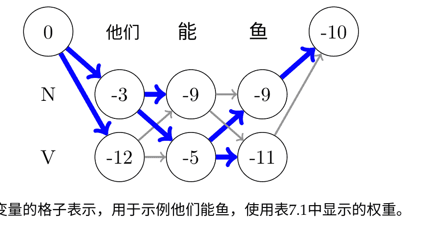

最初的目标是找到最佳得分序列，而不仅仅是计算其得分。但通过解决辅助问题，我们几乎可以达到目标。回想一下，每个 $v_m(k)$ 表示以该位置 $m$ 的标签 $k$ 结尾的最佳标签序列的得分。为了计算这个值，我们在 $y_{m-1}$ 的可能值上进行最大化。通过跟踪 “argmax” 标签，在每一步中最大化这个选择，我们可以从最终标签向后遍历，并恢复出最优的标签序列。在图 7.1 中，我们通过粗线表示这一点，从最终位置向后追溯。这些反向指针被写为 $b_m(k)$，表示到 $Y_m=k$ 路径上的最优标签 $y_{m-1}$。

完整的维特比算法在算法 11 中展示。在计算初始维特比变量 $v_1(\cdot)$ 时，特殊标记 $\diamond$ 表示序列的开始。在计算最终标记 $Y_M$ 时，另一个特殊标记表示序列的结束。这些特殊标记使得可以对开始和结束序列的标记使用转移特征：例如，在英语中，连词不太可能出现在句子的结尾，因此我们希望对 $s_{M+1}(1, \text{CC})$ 得到一个较低的分数；名词相对可能出现在句子的开头，因此我们希望对 $s_1(\text{N}, \diamond)$ 得到一个较高的分数，假设名词标记与第一个词元 $w_1$ 兼容。

**复杂度** 如果序列中有 $K$ 个标记和 $M$ 个位置，则需要计算 $M \times K$ 个维特比变量。计算每个变量需要在 $K$ 个可能的前任标记中找到最大值。填充网格的总时间复杂度为 $\mathcal{O}(MK^2)$，每个位置的活跃特征数量还需要额外的因子。

完成网格后，我们只需沿着反向指针追踪到序列的开头，这需要 $\mathcal{O}(M)$ 次操作。

在与 MIT Press 签订的合同下，根据 CC-BY-NC-ND 许可共享。

他们可以钓鱼

| N | -2 | -3 | -3 |
| V | -10 | -1 | -3 |

|   | N | V | ◆ |
|---|---|---|---|
| ◊ | -1 | -2 | -∞ |
| N | -3 | -1 | -1 |
| V | -1 | -3 | -1 |

(a) 发射特征的权重。

(b) 转移特征的权重。“从”标签在列上，“到”标签在行上。

**表 7.1**：示例网格中显示的特征权重，图 7.1。从 $\diamond$ 和 $\blacklozenge$ 的发射权重隐含设置为 $-\infty$。

#### 7.3.1 示例

考虑到最小的标签集 {名词，动词}，对应于 N 和 V。即使在这个标签集中，存在相当多的歧义：例如，单词 can 和 fish 都可以采用两种标签。对于句子 they can fish，有 $2 \times 2 \times 2 = 8$ 种可能的标记方式，其中有四种是基于这些可能的标签的，而有两种是符合语法的。

图 7.1 中的网格中的值是根据表 7.1 中定义的特征权重计算的。我们从只有一个可能的前驱标签，即起始标签 $\diamond$ 开始计算 v1(名词)。因此，这个分数等于 s1(名词,$\diamond$) = -2 - 1 = -3，这是发射特征和转移特征的分数之和；回溯指针是 b1(名词) = $\diamond$。同样，计算 v1(动词)的分数的方式也是一样的：s1(动词,$\diamond$) = -10 - 2 = -12，而 b1(动词) = $\diamond$。在图中，回溯指针用粗线表示。

```
v2(N) = max(v1(N) + s2(N, N), v1(V) + s2(N, V))  [7.25]
      = max(-3 - 3 - 3,    -12 - 3 - 1) = -9  [7.26]
b2(N) = N.  [7.27]
```

当 m=2 时，事情变得更有趣。得分 v2(N) 通过最大化计算两个可能的前任来得到，

```
v4(◆) = max(v3(N) + s4(◆, N), v3(V) + s4(◆, V))  [7.28]
      = max(-9 + 0 - 1,     -11 + 0 - 1)  [7.29]
      = -10,  [7.30]
```

所以 b4(◆) = N。由于没有发射 w4，发射特征的得分为零。

为了计算最优的标记序列，我们从这里开始向后遍历，首先检查 $b_3(\text{N}) = \text{V}$，然后检查 $b_2(\text{V}) = \text{N}$，最后检查 $b_1(\text{N}) = \diamond$。这导致 $y = (\text{N}, \text{V}, \text{N})$，这对应于将鱼放入罐头的语言解释。

#### 7.3.2 高阶特征

维特比算法之所以成为可能，是因为将评分函数限制为仅考虑相邻标记对的局部部分。我们可以将其视为标记的二元语言模型。一个自然的问题是如何将维特比推广到标记的三元组，这将涉及以下分解：

$$ \Psi(\boldsymbol{w}, \boldsymbol{y}) = \sum_{m=1}^{M+2} f(\boldsymbol{w}, y_m, y_{m-1}, y_{m-2}, m), \tag{7.31} $$

其中 $y_{-1} = \diamond$ 和 $y_{M+2} = \blacklozenge$。

一种解决方案是从原始标签集的笛卡尔积中创建一个新的标签集 $\mathcal{Y}^{(2)}$，即 $\mathcal{Y}^{(2)} = \mathcal{Y} \times \mathcal{Y}$。该产品空间中的标签是有序对，表示标记级别上的相邻标签：例如，标签 $(\text{N}, \text{V})$ 表示名词后面跟着动词。这些标签之间的转换必须是一致的：我们可以从 $(\text{N}, \text{V})$ 转换到 $(\text{V}, \text{N})$ （对应于标签序列 $\text{N} \text{V} \text{N}$），但不能从 $(\text{N}, \text{V})$ 转换到 $(\text{N}, \text{N})$，因为这不对应于任何连贯的标签序列。这个约束可以通过特征权重来实施，如果 $b = c$，则 $\theta_{((a,b), (c,d))} = -\infty$。剩余的特征权重可以编码对各种标签三元组的偏好和反对。

在笛卡尔乘积标签空间中，有 $K^2$ 个标签，这意味着时间复杂度将增加到 $\mathcal{O}(MK^4)$。然而，不需要对与当前标签二元组不兼容的前任标签二元组进行最大化处理。通过利用这个约束，可以将时间复杂度限制在 $\mathcal{O}(MK^3)$。空间复杂度增长到 $\mathcal{O}(MK^2)$，因为状态图必须存储每个标签的所有可能前任。一般来说，高阶维特比的时间和空间复杂度与特征分解中考虑的标签 $n$-gram 的阶数呈指数增长。

### 7.4 隐马尔可夫模型

维特比序列标注算法建立在得分 $s_m(\boldsymbol{y}, \boldsymbol{y}')$ 上。我们现在将讨论如何以概率方式估计这些得分。回顾一下 §2.2，概率朴素贝叶斯分类器选择标签 $y$ 以最大化 $p(\boldsymbol{y} \mid \boldsymbol{x}) \propto p(\boldsymbol{y}, \boldsymbol{x})$。在概率序列标注中，我们的目标类似：选择最大化 $p(\boldsymbol{y} \mid \boldsymbol{w}) \propto p(\boldsymbol{y}, \boldsymbol{w})$ 的标签序列。方程式 7.8 中的局部性限制可以看作是对随机变量 $\boldsymbol{y}$ 的条件独立性假设。

## 算法 12 隐马尔可夫模型的生成过程

```
y0 ← ◊, m ← 1
重复
    ym ~ 分类 (λ_{y_{m-1}})    .对当前标签进行采样
    wm ~ 分类 (φ_{y_m})       .对当前单词进行采样
直到 ym = ◆                   .当生成停止符号时终止
```

朴素贝叶斯被引入为一种生成模型——一个概率故事，解释了观察到的数据以及隐藏的标签。类似的故事可以构建出来，用于概率序列标注：首先，标签是从先验分布中抽取的；接下来，令牌是从条件似然中抽取的。然而，为了使推断可行，需要额外的独立性假设。首先，每个令牌的概率仅取决于其标签，而不取决于序列中的任何其他元素：

$$ p(w | y) = \prod_{m=1}^M p(w_m | y_m). \quad [7.32] $$

其次，每个标签 $y_m$ 只依赖于其前一个标签，

$$ p(y) = \prod_{m=1}^M p(y_m | y_{m-1}), \quad [7.33] $$

其中 $y_0 = \diamond$ 在所有情况下。由于这个马尔可夫假设，概率序列标注模型被称为隐马尔可夫模型 (HMMs)。

隐马尔可夫模型的生成过程如算法 12 所示。给定参数 $\lambda$ 和 $\varphi$，我们可以计算任何令牌序列 $w$ 和标签序列 $y$ 的概率 $p(w, y)$。HMM 通常被表示为一个图模型 (Wainwright and Jordan, 2008)，如图 7.2 所示。这种表示使独立性假设明确化：如果一个变量 $v_1$ 在概率上依赖于另一个变量 $v_2$，则在图中存在一条箭头 $v_2 \rightarrow v_1$。如果 $v_1$ 和 $v_2$ 之间没有箭头，它们在给定每个变量的马尔可夫毯子的条件下是条件独立的。在隐马尔可夫模型中，每个标签 $y_m$ 的马尔可夫毯包括“父节点” $y_{m-1}$ 和“子节点” $y_{m+1}$ 和 $w_m$。³

反思隐马尔可夫模型独立假设的影响是很重要的。非相邻的标签对 $y_m$ 和 $y_n$ 在条件下是独立的；如果 $m < n$ 并且我们给定了 $y_{n-1}$，那么 $y_m$ 对于 $y_n$ 没有额外的信息。然而，如果我们对序列中的标签没有任何信息，那么所有的标签都是概率上相关的。

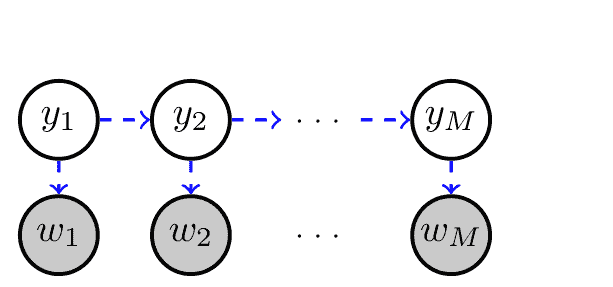

#### 7.4.1 估计

隐马尔可夫模型有两组参数：

- **发射概率**。概率 $p_e(w_m | y_m; \varphi)$ 是发射概率，因为单词被视为在标签的条件下概率地“发射”出来。
- **转移概率**。概率 $p_t(y_m | y_{m-1}; \lambda)$ 是转移概率，因为它为每个可能的标签到标签的转换分配概率。

这两组参数通常是从标记语料库上平滑相对频率估计计算得出的（有关平滑的综述，请参见 §6.2）。未经平滑的概率是，

$$ \varphi_{k,i} \triangleq \text{Pr}(W_m = i \mid Y_m = k) = \frac{\text{count}(W_m = i, Y_m = k)}{\text{count}(Y_m = k)} $$

$$ \lambda_{k,k'} \triangleq \text{Pr}(Y_m = k' \mid Y_{m-1} = k) = \frac{\text{count}(Y_m = k', Y_{m-1} = k)}{\text{count}(Y_{m-1} = k)}. $$

平滑对于发射概率比转移概率更重要，因为词汇量比标签数量要大得多。

#### 7.4.2 推断

在隐马尔可夫模型中，推理的目标是找到最高概率的标签序列，

$$ \hat{y} = \underset{y}{\text{argmax}} \ p(y \mid w). \qquad [7.34] $$

与朴素贝叶斯一样，它等同于找到具有最高对数概率的标签序列，因为对数是一个单调递增的函数。此外，它等同于最大化联合概率 $p(y, w) = p(y \mid w) \times p(w) \propto p(y \mid w)$，这与条件概率成正比。综合这些观察结果，推理问题可以重新表述为，

$$ \hat{y} = \argmax_{y} \log p(y, w). \quad [7.35] $$

我们现在可以应用 HMM 的独立性假设：

$$ \begin{align}
\log p(y, w) &= \log p(y) + \log p(w \mid y) \quad [7.36] \\
&= \sum_{m=1}^{M+1} \log p_Y(y_m \mid y_{m-1}) + \log p_{W|Y}(w_m \mid y_m) \quad [7.37] \\
&= \sum_{m=1}^{M+1} \log \lambda_{y_m, y_{m-1}} + \log \varphi_{y_m, w_m} \quad [7.38] \\
&= \sum_{m=1}^{M+1} s_m(y_m, y_{m-1}), \quad [7.39]
\end{align} $$

其中，

$$ s_m(y_m, y_{m-1}) \triangleq \log \lambda_{y_m, y_{m-1}} + \log \varphi_{y_m, w_m}, \quad [7.40] $$

和，

$$ \varphi_{\diamond, w} = \begin{cases} 1, & w = \blacksquare \\ 0, & \text{otherwise}, \end{cases} \quad [7.41] $$

这确保了停止标签 $\blacklozenge$ 只能应用于最后一个标记 $\blacksquare$。

这个推导表明，HMM 推理可以被视为对应用了适当定义的评分函数的维特比解码算法的应用。局部得分 $s_m(y_m, y_{m-1})$ 可以被解释为概率上的，

$$ \begin{align}
s_m(y_m, y_{m-1}) &= \log p_y(y_m | y_{m-1}) + \log p_{w|y}(w_m | y_m) \quad [7.42] \\
&= \log p(y_m, w_m \mid y_{m-1}). \quad [7.43]
\end{align} $$

现在回想一下维特比变量的定义，

$$ \begin{align}
v_m(y_m) &= \max_{y_{m-1}} s_m(y_m, y_{m-1}) + v_{m-1}(y_{m-1}) \quad [7.44] \\
&= \max_{y_{m-1}} \log p(y_m, w_m \mid y_{m-1}) + v_{m-1}(y_{m-1}). \quad [7.45]
\end{align} $$

通过设置 $v_{m-1}(y_{m-1}) = \max_{y_{1:m-2}} \log p(y_{1:m-1}, w_{1:m-1})$，我们得到递归公式，

$$ \begin{align}
v_m(y_m) &= \max_{y_{m-1}} \log p(y_m, w_m \mid y_{m-1}) + \max_{y_{1:m-2}} \log p(y_{1:m-1}, w_{1:m-1}) \quad [7.46] \\
&= \max_{y_{1:m-1}} \log p(y_m, w_m \mid y_{m-1}) + \log p(y_{1:m-1}, w_{1:m-1}) \quad [7.47] \\
&= \max_{y_{1:m-1}} \log p(y_{1:m}, w_{1:m}). \quad [7.48]
\end{align} $$

换句话说，维特比变量 $v_m(y_m)$ 是以单词序列 $w_{1:m}$ 结尾的最佳标签序列的对数概率。因此，最佳完整标签序列的对数概率为，

$$ \max_{y_{1:M}} \log p(y_{1:M+1}, w_{1:M+1}) = v_{M+1}(\diamondsuit) \quad [7.49] $$

**以维特比算法为例的最大乘积算法** 维特比算法也可以使用概率来实现，而不是对数概率。在这种情况下，每个 $v_m(y_m)$ 都相等，

$$ \begin{align}
v_m(y_m) &= \max_{y_{1:m-1}} p(y_{1:m-1}, y_m, w_{1:m}) \quad [7.50] \\
&= \max_{y_{m-1}} p(y_m, w_m | y_{m-1}) \times \max_{y_{1:m-2}} p(y_{1:m-2}, y_{m-1}, w_{1:m-1}) \quad [7.51] \\
&= \max_{y_{m-1}} p(y_m, w_m | y_{m-1}) \times v_{m-1}(y_{m-1}) \quad [7.52] \\
&= p_{w|y}(w_m | y_m) \times \max_{y_{m-1}} p_y(y_m | y_{m-1}) \times v_{m-1}(y_{m-1}). \quad [7.53]
\end{align} $$

每个维特比变量都是通过在一组乘积中进行最大化计算的。因此，维特比算法是图模型推断中最大乘积算法的一个特例（Wainwright 和 Jordan, 2008）。然而，概率的乘积在长序列上趋近于零，因此在实际实现中推荐使用维特比的对数概率版本。

### 7.5 带特征的判别式序列标注

如今，隐马尔可夫模型在监督序列标注中很少使用。这是因为 HMM 仅限于两种现象：

-   词-标签兼容性，通过发射概率 $p_{W|Y}(w_m | y_m)$；
-   局部上下文，通过转移概率 $p_{Y}(y_m | y_{m-1})$。

维特比算法允许在局部评分函数 $\psi(w_{1:M}, y_m, y_{m-1}, m)$ 中包含更丰富的信息，该函数可以被定义为任意局部特征的加权和。

$$ \psi(w, y_m, y_{m-1}, m) = \theta \cdot f(w, y_m, y_{m-1}, m) \quad [7.54] $$

其中 $f$ 是一个局部定义的特征函数，而 $\theta$ 是一个权重向量。

评分函数 $\psi$ 的局部分解反映在相应的特征函数的分解中：

$$
\begin{aligned}
\psi(w, y) &= \sum_{m=1}^{M+1} \psi(w, y_m, y_{m-1}, m)  && [7.55] \\
&= \sum_{m=1}^{M+1} \theta \cdot f(w, y_m, y_{m-1}, m)  && [7.56] \\
&= \theta \cdot \sum_{m=1}^{M+1} f(w, y_m, y_{m-1}, m)  && [7.57] \\
&= \theta \cdot f^{(\text{全局})}(w, y_{1:M}),  && [7.58]
\end{aligned}
$$

其中 $f^{(\text{全局})}(w, y)$ 是一个全局特征向量，它是局部特征向量的总和。

$$
f^{(\text{全局})}(w, y) = \sum_{m=1}^{M+1} f(w_{1:M}, y_m, y_{m-1}, m),  && [7.59]
$$

通过构造，$y_{M+1} = \blacklozenge$ 和 $y_0 = \diamondsuit$。

现在让我们考虑这些特征可能编码的额外信息。

## 词缀特征

考虑第一到第四行的诗歌《贾巴沃克》（卡罗尔，1917年）中的词性标注问题：

> (7.3) 'Twas brillig, and the slithy toves
> Did gyre and gimble in the wabe:
> All mimsy were the borogoves,
> And the mome raths outgrabe.

这些词中的许多是由诗歌的作者编造的，因此语料库不会提供与它们与任何特定词性相关的概率信息。然而，很容易看出它们在这段话中可能的语法角色。

上下文有助于：例如，单词 slithy 在冠词 the 之后出现，所以它很可能是一个名词或形容词。你认为哪个更有可能？后缀 -thy 在一些形容词中出现，比如 frothy, healthy, pithy, worthy。它也出现在一些名词中，例如 apathy, sympathy，但几乎所有这些名词都有较长的尾音 -p athy，不像 slithy。因此，后缀提供了一些证据表明 slithy 是一个形容词，事实上它是：在文本的后面我们发现它是由形容词 lithe 和 slimy 组合而成的。⁴

## 7.5. 具有特征的判别式序列标注

细粒度的上下文。隐马尔可夫模型以词性标记二元组的形式捕捉上下文信息。但有时，必要的上下文信息更具体。考虑名词短语这条鱼和这些鱼。许多词性标记集区分单数和复数名词，但不区分单数和复数决定词；例如，著名的Penn Treebank标记集遵循这些约定。在这两种情况下，隐马尔可夫模型将无法正确标记鱼为单数或复数，因为它只能访问两个特征：前一个标记（两种情况下都是决定词）和单词（两种情况下都是鱼）。在 §7.1 中讨论的基于分类的标记器具有使用前后单词作为特征的能力，并且可以作为局部特征被纳入到基于维特比算法的序列标注器中。

例子。考虑对序列进行标记 D J N（决定词，形容词，名词），例如 the slithy toves，这样

$$w = \text{the slithy toves}$$
$$y = \text{D J N}。$$

让我们为这个例子创建特征向量，假设我们有单词-标记特征（用 $W$ 表示），标记-标记特征（用 $T$ 表示）和后缀特征（用 $M$ 表示）。您可以假设您可以访问从 slithy 提取后缀 -thy 的方法，从 toves 提取后缀 -es，从 the 提取后缀 $\varnothing$，表示这个词没有后缀。$^5$ 得到的特征向量是，

$$
\begin{aligned}
f(\text{the slithy toves}, \text{D J N}) = &f(\text{the slithy toves}, \text{D}, \diamondsuit, 1) \\
&+ f(\text{the slithy toves}, \text{J}, \text{D}, 2) \\
&+ f(\text{the slithy toves}, \text{N}, \text{J}, 3) \\
&+ f(\text{the slithy toves}, \blacklozenge, \text{N}, 4) \\
=&\{(T : \diamondsuit, \text{D}), (W : \text{the}, \text{D}), (M : \varnothing, \text{D}), \\
&(T : \text{D}, \text{J}), (W : \text{slithy}, \text{J}), (M : \text{-thy}, \text{J}), \\
&(T : \text{J}, \text{N}), (W : \text{toves} , \text{N}), (M : \text{-es}, \text{N}) \\
&(T : \text{N}, \blacklozenge)\}.
\end{aligned}
$$

这些例子表明，局部特征可以融入超出隐马尔可夫模型范围的信息。由于这些特征是局部的，可以应用维特比算法来识别最优的标签序列。剩下的问题是如何估计这些特征的权重。§2.3介绍了三种主要类型的判别式分类器：感知机、支持向量机和逻辑回归。这些分类器中的每一个都有一个结构化的等价物，使其能够从标记的序列而不是单个标记中进行训练。

$^5$ 这样的系统被称为形态分割器。形态分割的任务在 §9.1.4 中简要描述；一个众所周知的分割器是MORFESSOR (Creutz and Lagus, 2007)。在实际应用中，一种典型的方法是包括所有拼写后缀的特征，直到某个最大字符数为止：对于 slithy，我们将有 -y、-hy 和 -thy 的后缀特征。

#### 7.5.1 结构化感知器

感知机分类器通过增加与正确标签相关联的特征的权重，减少与错误预测标签相关联的特征的权重来进行训练：

$$
\begin{aligned}
\hat{y} &= \arg\max_{y \in \mathcal{Y}} \theta \cdot f(x, y)  && [7.60] \\
\theta^{(t+1)} &\leftarrow \theta^{(t)} + f(x, y) - f(x, \hat{y}).  && [7.61]
\end{aligned}
$$

在结构预测的情况下，我们可以完全应用相同的更新方法。

$$
\begin{aligned}
\hat{y} &= \arg\max_{y \in \mathcal{Y}(w)} \theta \cdot f(w, y)  && [7.62] \\
\theta^{(t+1)} &\leftarrow \theta^{(t)} + f(w, y) - f(w, \hat{y}).  && [7.63]
\end{aligned}
$$

这个学习算法被称为结构感知机，因为它学习预测结构化输出 $y$。唯一的区别是，不再通过枚举整个集合 $\mathcal{Y}$ 来计算 $\hat{y}$，而是使用维特比算法高效地搜索可能的标签序列 $\mathcal{Y}^M$。只要能够进行高效的推理，结构感知机就可以应用于其他结构化输出。与感知机分类相似，权重平均对于获得良好的性能至关重要（参见 §2.3.2）。

例如，对于句子 they can fish 的例子，假设参考标签序列为 $y^{(i)} = \text{N V V}$，但标注器错误地返回了标签序列 $\hat{y} = \text{N V N}$。假设模型具有发射特征 $(w_m, y_m)$ 和转移特征 $(y_{m-1}, y_m)$，相应的结构感知机更新为：

$$
\begin{aligned}
\theta_{(\text{fish}, \text{V})} &\leftarrow \theta_{(\text{fish}, \text{V})} + 1, \quad \theta_{(\text{fish}, \text{N})} \leftarrow \theta_{(\text{fish}, \text{N})} - 1 && [7.64] \\
\theta_{(\text{V}, \text{V})} &\leftarrow \theta_{(\text{V}, \text{V})} + 1, \quad \theta_{(\text{V}, \text{N})} \leftarrow \theta_{(\text{V}, \text{N})} - 1 && [7.65] \\
\theta_{(\text{V}, \blacklozenge)} &\leftarrow \theta_{(\text{V}, \blacklozenge)} + 1, \quad \theta_{(\text{N}, \blacklozenge)} \leftarrow \theta_{(\text{N}, \blacklozenge)} - 1. && [7.66]
\end{aligned}
$$

#### 7.5.2 结构化支持向量机

大边界分类器（如支持向量机）通过将分类边界远离训练实例来改进感知机。相同的思想可以应用于序列标注。支持向量机的输出是一个结构化对象，比如一个序列，被称为结构化支持向量机 (Tsochantaridis et al., 2004)。

在分类中，我们将大边界约束形式化为

> $$\forall y \neq y^{(i)}, \boldsymbol{\theta} \cdot \boldsymbol{f}(\boldsymbol{x}, y^{(i)}) - \boldsymbol{\theta} \cdot \boldsymbol{f}(\boldsymbol{x}, y) \geq 1,$$ [7.67]

要求所有与正确标签 $y^{(i)}$ 不相等的标签 $y$ 之间的分数至少相差 1。然后通过约束优化来学习权重 $\boldsymbol{\theta}$(见 §2.4.2)。这个想法可以应用于序列标注，通过为输入 $\boldsymbol{w}$ 的所有可能标签 $\mathcal{Y}(\boldsymbol{w})$ 制定一个等价的约束集。然而，存在两个问题。

首先，在序列标注中，有些预测比其他预测更错误：我们可能只错过一个标签中的五十个，或者我们可能全部五十个都错了。我们希望我们的学习算法对这种差异敏感。其次，约束的数量等于可能的标记数量，在序列长度上呈指数级增长。

第一个问题可以通过调整约束来要求更严重错误的边界来解决。让 $c(y^{(i)}, \hat{y}) \geq 0$ 表示预测标签 $\hat{y}$ 时的成本，当真实标签为 $y^{(i)}$ 时。然后我们可以推广边界约束，

> $$\forall y, \boldsymbol{\theta} \cdot \boldsymbol{f}(\boldsymbol{w}^{(i)}, y^{(i)}) - \boldsymbol{\theta} \cdot \boldsymbol{f}(\boldsymbol{w}^{(i)}, y) \geq c(y^{(i)}, y).$$ [7.68]

如果我们选择 $\delta$ 函数 $c(y^{(i)}, y) = \delta(y^{(i)} = y)$，那么这个成本增加的边界约束就特化为方程 7.67 中的约束。一个更具表达力的成本函数是汉明成本，

> $$c(y^{(i)}, y) = \sum_{m=1}^{M} \delta(y_m^{(i)} \neq y_m),$$ [7.69]

它计算 $y$ 中的错误数量。通过将成本函数作为边界约束，我们要求真实标签与每个备选标签中的不正确标签数量成比例地分开。

第二个问题是约束的数量与序列的长度呈指数关系。这可以通过关注最大违反边界约束的预测 $\hat{y}$ 来解决。通过解决以下成本增加的解码问题，可以确定这个预测：

> $$
> \begin{aligned}
> \hat{y} &= \underset{y \neq y^{(i)}}{\operatorname{argmax}} \boldsymbol{\theta} \cdot \boldsymbol{f}(\boldsymbol{w}^{(i)}, y) - \boldsymbol{\theta} \cdot \boldsymbol{f}(\boldsymbol{w}^{(i)}, y^{(i)}) + c(y^{(i)}, y) && [7.70] \\
> &= \underset{y \neq y^{(i)}}{\operatorname{argmax}} \boldsymbol{\theta} \cdot \boldsymbol{f}(\boldsymbol{w}^{(i)}, y) + c(y^{(i)}, y), && [7.71]
> \end{aligned}
> $$
>
> 这个模型也被称为最大边际马尔可夫网络 (Taskar et al., 2003)，强调得分函数是由多个组件的总和构成的，这些组件是马尔可夫独立的。

在第二行中，我们省略了项 $\theta \cdot f(w^{(i)}, y^{(i)})$，这在 $y$ 中是常数。

现在我们可以重新制定序列标记的边际约束，

$$
\theta \cdot f(w^{(i)}, y^{(i)}) - \max_{y \in \mathcal{Y}(w)} \left( \theta \cdot f(w^{(i)}, y) + c(y^{(i)}, y) \right) \geq 0. \quad [7.72]
$$

如果 $\theta \cdot f(w^{(i)}, y^{(i)})$ 的分数大于所有备选项的成本增强分数，则约束条件将得到满足。名称“成本增强解码”是因为目标包括标准解码问题 $\max_{\hat{y} \in \mathcal{Y}(w)} \theta \cdot f(w, \hat{y})$，再加上一个成本项。基本上，我们希望训练针对那些既强大又错误的预测：它们应该在模型中得分很高，但与真实情况相比会产生很大的损失。训练调整权重以减少这些预测的分数。

为了使成本增强解码可行，成本函数必须像特征函数 $f(\cdot)$ 一样分解成局部部分。上面定义的汉明成本遵守这个属性。要使用汉明成本执行成本增强解码，我们只需要添加特征 $f_m(y_m) = \delta(y_m = y^{(i)}_m)$，并为这些特征分配一个常数权重1。然后可以使用维特比算法执行解码。与大边界分类器一样，可以通过将权重上的正则化项和约束条件的拉格朗日乘子结合起来，以无约束形式来表述学习问题：

$$
\min_{\theta} \frac{1}{2} \|\theta\|_2^2 + C \sum_i \max_{y \in \mathcal{Y}(w^{(i)})} \left[ \theta \cdot f(w^{(i)}, y) + c(y^{(i)}, y) - \theta \cdot f(w^{(i)}, y^{(i)}) \right]_+, \quad [7.73]
$$

在这个公式中，$C$ 是一个参数，用于控制正则化项和边界约束之间的权衡，$[z]_+ = \max(0, z)$ 是合页损失函数。已经提出了许多用于结构化支持向量机的优化算法，其中一些在 §2.4.2 中进行了讨论。Kummerfeld et al. (2015) 的实证比较表明，随机次梯度下降（实质上是结构化感知机的成本增强版本）具有很高的竞争力。

#### 7.5.3 条件随机场

条件随机场 (CRF; Lafferty et al., 2001) 是用于序列标注的条件概率模型；就像结构化感知机是建立在感知机分类器上一样，条件随机场是建立在逻辑回归分类器上的。基本概率模型是,

$$
p(y \mid w) = \frac{\exp(\Psi(w, y))}{\sum_{y' \in \mathcal{Y}(w)} \exp(\Psi(w, y'))}
$$

这与逻辑回归 (§2.5) 几乎完全相同，但由于标签空间现在是单词序列，我们需要对解码 (在给定单词序列 $w$ 和模型 $\theta$ 的情况下搜索最佳标签序列) 和归一化 (对所有标签序列求和) 进行高效算法。这些算法将基于对得分函数的通常局部性假设，$\Psi(w, y) = \sum_{m=1}^{M+1} \psi(w, y_m, y_{m-1}, m)$。

##### CRFs中的解码

解码 - 寻找最大化 $p(y \mid w)$ 的标签序列 $\hat{y}$ 是 Viterbi 算法的直接应用。关键观察是解码问题不依赖于 $p(y \mid w)$ 的分母。

$$
\hat{y} = \arg\max_y \log p(y \mid w) = \arg\max_y \Psi(w, y) - \log \sum_{y' \in \mathcal{Y}(w)} \exp \Psi(w, y') = \arg\max_y \Psi(w, y) = \arg\max_y \sum_{m=1}^{M+1} s_m(y_m, y_{m-1}).
$$

这与结构感知机的解码问题相同，因此可以使用与方程 7.22 中定义的相同的 Viterbi 递归。

##### CRFs中的学习

与逻辑回归一样，权重 $\theta$ 通过最小化正则化的负对数似然来学习。

$$
\ell(\theta) = \frac{\lambda}{2} \|\theta\|^2 - \sum_{i=1}^{N} \log p(y^{(i)} \mid w^{(i)}; \theta) = \frac{\lambda}{2} \|\theta\|^2 - \sum_{i=1}^{N} \left[ \theta \cdot f(w^{(i)}, y^{(i)}) - \log \sum_{y' \in \mathcal{Y}(w^{(i)})} \exp \left( \theta \cdot f(w^{(i)}, y') \right) \right],
$$

其中 $\lambda$ 控制正则化的程度。方程 7.76 中的最后一项是对所有可能的标记求和。这个项是方程 7.74 中分母的对数，有时被称为配分函数。对于一个长度为 $M$ 的输入，有 $|\mathcal{Y}|^M$ 种可能的标记，因此我们必须再次利用得分函数的分解来高效地计算这个和。

定义前向变量 $\alpha_m(y_m)$ 为，

$$
\alpha_m(y_m) \stackrel{\triangle}{=} \sum_{y_{1:m-1}} \exp \sum_{n=1}^m s_n(y_n, y_{n-1}) \tag{7.77}\\
= \sum_{y_{1:m-1}} \prod_{n=1}^m \exp s_n(y_n, y_{n-1}). \tag{7.78}
$$

注意与维特比变量的定义的相似性，$v_m(y_m) = \max_{y_{1:m-1}} \sum_{n=1}^m s_n(y_n, y_{n-1})$。在隐马尔可夫模型中，维特比递归有另一种解释，即最大乘积算法（见方程 7.53）；类似地，前向递归被称为和乘积算法，因为它的形式是 [7.78]。前向变量也可以通过递归计算：

$$
\alpha_m(y_m) = \sum_{y_{1:m-1}} \prod_{n=1}^m \exp s_n(y_n, y_{n-1}) \tag{7.79}\\
= \sum_{y_{m-1}} (\exp s_m(y_m, y_{m-1})) \sum_{y_{1:m-2}} \prod_{n=1}^{m-1} \exp s_n(y_n, y_{n-1}) \tag{7.80}\\
= \sum_{y_{m-1}} (\exp s_m(y_m, y_{m-1})) \times \alpha_{m-1}(y_{m-1}). \tag{7.81}
$$

使用前向递归，可以计算条件概率的分母部分，

$$
\sum_{y \in \mathcal{Y}(w)} \exp \Psi(w, y) = \sum_{y_{1:M}} (\exp s_{M+1}(\blacklozenge, y_M)) \prod_{m=1}^M \exp s_m(y_m, y_{m-1}) \tag{7.82}\\
= \alpha_{M+1}(\blacklozenge). \tag{7.83}
$$

> “势函数”和“配分函数”的术语来自统计力学 (Bishop, 2006)。

条件对数似然可以重写为，

$$
\ell = \frac{\lambda}{2} \|\boldsymbol{\theta}\|^2 - \sum_{i=1}^{N} \boldsymbol{\theta} \cdot \boldsymbol{f}(\boldsymbol{w}^{(i)}, \boldsymbol{y}^{(i)}) + \log \alpha_{M+1}(\boldsymbol{\Diamond}). \tag{7.84}
$$

概率编程环境，如TORCH (Collobert等, 2011) 和DYNET (Neubig等, 2017)，可以使用自动微分计算此目标的梯度。程序员只需将前向算法实现为计算图。

与逻辑回归类似，对参数的似然梯度是观察到的特征计数和预期特征计数之间的差异:

$$
\frac{d \ell}{d \theta_j} = \lambda \theta_j + \sum_{i=1}^{N} E[f_j(\boldsymbol{w}^{(i)}, \boldsymbol{y})] - f_j(\boldsymbol{w}^{(i)}, \boldsymbol{y}^{(i)}), \tag{7.85}
$$

其中 $f_j(\boldsymbol{w}^{(i)}, \boldsymbol{y}^{(i)})$ 指的是标记序列 $\boldsymbol{w}^{(i)}$ 和标签序列 $\boldsymbol{y}^{(i)}$ 的特征 $j$ 的计数。当应用自动微分到方程7.84 (Eisner, 2016)时，预期的特征计数是在“幕后”计算的。

在广泛使用自动微分之前，通常从边际标签概率$p(y_m \mid \boldsymbol{w})$计算特征期望是常见的。这些边际概率有时单独使用，并且可以使用前向-后向算法计算。该算法将前向递归与等效的后向递归相结合，从 $w_M$ 向后遍历输入到 $w_1$。

##### 前向-后向算法

标签二元边际概率可以写成，$^{10}$

$$
\mathrm{Pr}(Y_{m-1}=k', Y_{m}=k \mid \boldsymbol{w}) = \frac{\sum_{\boldsymbol{y}: Y_m=k, Y_{m-1}=k'} \prod_{n=1}^{M} \exp s_n(y_n, y_{n-1})}{\sum_{\boldsymbol{y}'} \prod_{n=1}^{M} \exp s_n(y'_n, y'_{n-1})}. \tag{7.86}
$$

分子对所有包含转换 $(Y_{m-1}=k') \rightarrow (Y_m=k)$ 的标签序列求和。因为我们只对包含标签二元组的序列感兴趣，所以这个求和可以分解为三个部分：以 $Y_{m-1}=k'$ 结尾的前缀 $\boldsymbol{y}_{1:m-1}$；转移 \((Y_{m-1}=k') \to (Y_m=k)\)；以及后缀 \(\mathbf{y}_{m:M}\)，以标签 \(Y_m=k\) 开始：

$$
\sum_{\mathbf{y}: Y_m=k, Y_{m-1}=k'} \prod_{n=1}^{M} \exp s_n(y_n, y_{n-1}) = \sum_{\mathbf{y}_{1:m-1}: Y_{m-1}=k'} \prod_{n=1}^{m-1} \exp s_n(y_n, y_{n-1})
\times \exp s_m(k, k')
\times \sum_{\mathbf{y}_{m:M}: Y_m=k} \prod_{n=m+1}^{M+1} \exp s_n(y_n, y_{n-1}).
\tag{7.87}
$$

结果是三个项的乘积：一个得分，它对所有到达位置 \((Y_{m-1}=k')\) 的方式求和；从 \(k'\) 到 \(k\) 的转换得分；以及一个得分，它对所有从 \((Y_m=k)\) 结束序列的方式求和。方程7.87的第一项等于前向变量 \(\alpha_{m-1}(k')\)。第三项——完成序列的方式的求和——也可以通过递归定义，这次从右到左移动过网格，这被称为后向递归：

$$
\beta_m(k) \triangleq \sum_{\mathbf{y}_{m:M}: Y_m=k} \prod_{n=m}^{M+1} \exp s_n(y_n, y_{n-1}) \tag{7.88}
$$

$$
= \sum_{k' \in \mathcal{Y}} \exp s_{m+1}(k', k) \sum_{\mathbf{y}_{m+1:M}: Y_m=k'} \prod_{n=m+1}^{M+1} \exp s_n(y_n, y_{n-1}) \tag{7.89}
$$

$$
= \sum_{k' \in \mathcal{Y}} \exp s_{m+1}(k', k) \times \beta_{m+1}(k'). \tag{7.90}
$$

为了理解这个计算过程，可以与方程7.81中的前向递归进行比较。

## 7.6. 神经序列标注

在实践中，数值稳定性要求我们在对数域中进行计算，

$$
\log \alpha_m(k) = \log \sum_{k' \in \mathcal{Y}} \exp \left( \log s_m(k, k') + \log \alpha_{m-1}(k') \right) \quad [7.91]
$$

$$
\log \beta_{m-1}(k) = \log \sum_{k' \in \mathcal{Y}} \exp \left( \log s_m(k', k) + \log \beta_m(k') \right) \quad [7.92]
$$

前向和后向概率的应用在图7.3中显示。前向和后向递归都在状态图上操作，这意味着空间复杂度为 $\mathcal{O}(M K)$。因为在状态图的每个节点上，这两个递归都需要计算 $K$ 个项的和，所以它们的时间复杂度为 $\mathcal{O}(M K^2)$。

### 7.6 神经序列标注

在神经网络方法中，我们为每个标记决策构建一个基于单词及其上下文的向量表示。神经网络可以将标记作为每个标记的分类决策，也可以与维特比算法结合起来对整个序列进行标记。

#### 7.6.1 循环神经网络

循环神经网络 (RNNs) 在第6章中作为一种语言模型技术被引入，其中第 $m$ 个标记的上下文由一个递归更新的向量来总结。

$$ \boldsymbol{h}_m = g(\boldsymbol{x}_m, \boldsymbol{h}_{m-1}), \quad m = 1, 2, \ldots, M, $$

其中 $\boldsymbol{x}_m$ 是标记 $w_m$ 的向量嵌入，函数 $g$ 定义了递归。起始条件 $\boldsymbol{h}_0$ 是模型的额外参数。长短期记忆 (LSTM) 是一种更复杂的递归，其中一个记忆单元通过一系列的门来避免非线性的重复应用。尽管有这些花哨的功能，但这两个模型共享递归更新在序列中的基本架构，在这里都被称为RNN。

将RNN直接应用于序列标记的一种方法是将每个标签 $y_m$ 的得分视为 $\boldsymbol{h}_m$ 的线性函数：

$$ \psi_m(y) = \boldsymbol{\beta}_y \cdot \boldsymbol{h}_m \quad [7.93] $$
$$ \hat{y}_m = \underset{y}{\text{argmax}} \ \psi_m(y) \quad [7.94] $$

得分 $\psi_m(y)$ 也可以使用常规的软最大化操作转换为概率分布。

$$ p(y \mid \boldsymbol{w}_{1:m}) = \frac{\exp \psi_m(y)}{\sum_{y' \in \mathcal{Y}} \exp \psi_m(y')} \quad [7.95] $$

使用这种转换，可以根据标签的负对数似然训练标注器，就像条件随机场一样。或者，可以从原始分数$\psi_m(y)$构建一个铰链损失或边缘损失目标。

隐藏状态 $\boldsymbol{h}_m$ 考虑了输入中位置 $m$ 之前的信息，但忽略了后续的标记，这些标记也可能与标签 $y_m$ 相关。这可以通过添加第二个RNN来解决，其中输入被反转，从 $w_M$ 到 $w_1$ 进行递归。这被称为双向循环神经网络 (Graves和Schmidhuber, 2005)，并且被指定为：

$$ \overleftarrow{\boldsymbol{h}}_m = g(\boldsymbol{x}_m, \overleftarrow{\boldsymbol{h}}_{m+1}), \quad m = 1, 2, \ldots, M. $$

从左到右的RNN的隐藏状态用 $\overrightarrow{\boldsymbol{h}}_m$ 表示。从左到右和从右到左的向量被连接起来，$\boldsymbol{h}_m = [\overleftarrow{\boldsymbol{h}}_m ; \overrightarrow{\boldsymbol{h}}_m]$。方程7.93中的评分函数被应用于这个连接向量。

双向RNN标注具有几个吸引人的特性。理想情况下，表示 $\boldsymbol{h}_m$ 总结了周围上下文中的有用信息，因此不需要设计显式特征来捕捉这些信息。如果向量 $\boldsymbol{h}_m$ 是这个上下文的一个充分概括，那么甚至可能不需要进行联合标注：一般来说，随着个别标注模型变得更加强大，整个序列联合标注所提供的收益会减少。使用反向传播，可以“端到端”地训练词向量 $\boldsymbol{x}$，使其捕捉到对标注任务有用的词性。或者，如果有限的标记数据可用，我们可以使用从无标记数据中“预训练”的词嵌入，使用语言建模目标（如 §6.3）或相关的词嵌入技术（参见第14章）。甚至可以将微调和预训练的嵌入组合在一个模型中。

神经结构预测 双向递归神经网络从整个输入中获取信息，但每个标记决策是独立的。

在某些序列标记应用中，标记之间存在非常强的依赖关系：甚至可能不可能一个标记跟随另一个标记。在这种情况下，标记决策必须在整个序列上联合进行。

神经序列标记可以通过定义局部得分来与维特比算法结合，如下所示：

$$ s_m(y_m, y_{m-1}) = \boldsymbol{\beta}_{y_m} \cdot \boldsymbol{h}_m + \eta_{y_{m-1},y_m}, $$

其中 $\boldsymbol{h}_m$ 是RNN隐藏状态，$\boldsymbol{\beta}_{y_m}$ 是与标记 $y_m$ 相关联的向量，而 $\eta_{y_{m-1},y_m}$ 是标记转移 $(y_{m-1}, y_m)$ 的标量参数。然后，这些局部得分可以用于维特比算法进行推断，并用于前向算法进行训练。该模型如图7.4所示。可以通过条件对数似然目标在方程7.76中进行训练，反向传播到标记参数。

$\boldsymbol{\beta}$和$\boldsymbol{\eta}$的参数，以及RNN的参数。这个模型被称为LSTM-CRF，因为它结合了长短期记忆和条件随机场模型的特点（Huang等人，2015年）。

#### 7.6.2 字符级模型

与语言建模一样，罕见和未见的单词是一个挑战：如果我们遇到了训练数据中没有的单词，那么对于单词嵌入来说就没有明显的选择。一个解决方案是为所有这些单词使用一个通用的未见单词嵌入。然而，在许多情况下，未知单词的属性可以从它们的拼写中猜测出来。例如，“奇特的”在通用依赖（UD）英语树库中没有出现，但后缀-al使它很可能是形容词；按照同样的逻辑，“坚定不移”很可能是副词，而“藤壶”很可能是名词。

在基于特征的模型中，这些形态属性通过后缀特征来处理；在神经网络中，可以通过从拼写或形态构建未知单词的嵌入来处理。一种方法是在词汇表中为每个单词添加一个额外的双向RNN层（Ling等人，2015年）。对于每个字符-RNN，输入是字符，输出是左向和右向传递的最终状态的连接，$\boldsymbol{\phi}_w =$

$$ \boldsymbol{\phi}_w = [\overleftarrow{\boldsymbol{h}}_{N_w}^{\text{char}}; \overrightarrow{\boldsymbol{h}}_{N_w}^{\text{char}}] $$

其中 $\overrightarrow{\boldsymbol{h}}_{N_w}^{\text{char}}$ 是单词 $w$ 的右向传递的最终状态，$N_w$ 是单词中的字符数。字符RNN模型通过反向传播从标记目标进行训练。在测试数据上，训练好的RNN被应用于词汇表外的单词（或所有单词），从而产生输入到单词级标记RNN的输入。其他组合词嵌入的方法在§14.7.1中描述。

#### 7.6.3 序列标注的卷积神经网络

递归神经网络的一个缺点是该架构需要迭代输入和预测的序列：每个隐藏向量 $\boldsymbol{h}_m$ 必须从前一个隐藏向量 $\boldsymbol{h}_{m-1}$ 计算出来，然后预测标记 $y_m$。这些迭代计算很难并行化，并且无法利用图形处理单元（GPU）在矩阵乘法等操作上提供的加速。卷积神经网络通过对相邻单词嵌入的一组矩阵操作预测每个标签 $y_m$ 来实现更好的计算性能（Collobert等，2011年）。由于没有隐藏状态需要更新，每个 $y_m$ 的预测可以并行计算。有关卷积神经网络的更多信息，请参见 §3.4。也可以使用卷积神经网络计算基于字符的词嵌入（Santos和Zadrozn y，2014年）。

### 7.7 *无监督序列标注

在无监督的序列标注中，目标是从一个未标注的文本语料库中归纳出一个隐马尔可夫模型，其中每个 $\boldsymbol{w}^{(i)}$ 是一个长度为 $M^{(i)}$ 的序列。这是结构归纳的一个例子，它是结构预测的无监督版本。从无监督的序列标注中得到的标签可能对某些下游任务有用，或者它们可能帮助我们更好地理解语言的内在结构。对于词性标注，通常使用一个标签字典，列出每个单词的允许标签，简化了问题（Christodoulopoulos等，2010年）。

隐马尔可夫模型中的无监督学习可以使用Baum-Welch算法进行，该算法将前向-后向算法（§7.5.3）与期望最大化（EM；§5.1.2）相结合。在M步中，使用期望计数得到HMM参数：

$$ \phi_{k,i} = \text{Pr}(W = i \mid Y = k) = \frac{E[\text{count}(W = i, Y = k)]}{E[\text{count}(Y = k)]} $$

$$ \lambda_{k',k} = \text{Pr}(Y_m = k \mid Y_{m-1} = k') = \frac{E[\text{count}(Y_m = k, Y_{m-1} = k')]}{E[\text{count}(Y_{m-1} = k')]} $$

期望计数是在E步骤中使用前向和后向递归计算的。局部分数遵循隐马尔可夫模型的常规定义，

$$ s_m(k, k') = \log p_E(w_m \mid Y_m = k; \phi) + \log p_T(Y_m = k \mid Y_{m-1} = k'; \lambda) \tag{7.98} $$

单个实例的预期转移计数为,

$$ E[\text{count}(Y_m = k, Y_{m-1} = k') \mid \boldsymbol{w}] = \sum_{m=1}^{M} \Pr(Y_{m-1} = k', Y_m = k \mid \boldsymbol{w}) \tag{7.99} $$

$$ = \frac{\sum_{\boldsymbol{y}: Y_m=k, Y_{m-1}=k'} \prod_{n=1}^{M} \exp s_n(y_n, y_{n-1})}{\sum_{\boldsymbol{y}'} \prod_{n=1}^{M} \exp s_n(y'_n, y'_{n-1})} \tag{7.100} $$

如§7.5.3所述，这些边际概率可以从前向-后向递归计算得到,

$$ \Pr(Y_{m-1} = k', Y_m = k \mid \boldsymbol{w}) = \frac{\alpha_{m-1}(k') \times \exp s_m(k, k') \times \beta_m(k)}{\alpha_{M+1}(\Diamond)}. \tag{7.101} $$

在隐马尔可夫模型中，前向-后向计算的每个元素都有一个特殊的解释:

$$ \alpha_{m-1}(k') = p(Y_{m-1} = k', \boldsymbol{w}_{1:m-1}) \tag{7.102} $$

$$ \exp s_m(k, k') = p(Y_m = k, w_m \mid Y_{m-1} = k') \tag{7.103} $$

$$ \beta_m(k) = p(\boldsymbol{w}_{m+1:M} \mid Y_m = k). \tag{7.104} $$

应用隐藏马尔可夫模型的条件独立性假设（在算法12中定义），乘积等于标签二元组和整个输入的联合概率,

$$ \alpha_{m-1}(k') \times \exp s_m(k, k') \times \beta_m(k) = p(Y_{m-1} = k', \boldsymbol{w}_{1:m-1}) \times p(Y_m = k, w_m \mid Y_{m-1} = k') \times p(\boldsymbol{w}_{m+1:M} \mid Y_m = k) = p(Y_{m-1} = k', Y_m = k, \boldsymbol{w}_{1:M}). \tag{7.105} $$

除以 $\alpha_{M+1}(\Diamond) = p(\boldsymbol{w}_{1:M})$ 乘以所需的概率,

$$ \frac{\alpha_{m-1}(k') \times \exp s_m(k, k') \times \beta_m(k)}{\alpha_{M+1}(\Diamond)} = \frac{p(Y_{m-1} = k', Y_m = k, \boldsymbol{w}_{1:M})}{p(\boldsymbol{w}_{1:M})} \tag{7.106} $$

$$ = \Pr(Y_{m-1} = k', Y_m = k \mid \boldsymbol{w}_{1:M}). \tag{7.107} $$

类似的方法可以计算预期的发射计数，使用乘积 $\alpha_m(k) \times \beta_m(k)$。

#### 7.7.1 线性动力系统

前向-后向算法可以看作是在离散状态空间中的贝叶斯状态估计。在连续状态空间中，$y_m \in \mathbb{R}^K$，等效的算法是卡尔曼平滑器。它还使用类似的两步算法计算边缘概率 $p(y_m | x_{1:M})$，即前向和后向传递。卡尔曼平滑器不是在每个步骤计算一个状态网格，而是计算概率密度函数 $q(y_m | x_{1:M})$。

#### 7.7.2 替代的无监督学习方法

正如第5.5节所指出的，期望最大化只是结构归纳的众多技术之一。一种替代方法是使用马尔可夫链蒙特卡罗（MCMC）采样算法，这在第5.5.1节中简要描述。对于序列标注的特定情况，可以通过迭代地对每个标签进行采样来应用吉布斯采样（Finkel等，2005）：

$$ p(y_m \mid y_{-m}, w_{1:M}) \propto p(w_m \mid y_m) p(y_m \mid y_{-m}). $$

Gibbs Sampling已经被Goldwater和Griffiths（2007）应用于无监督的词性标注。Beam sampling是一种更复杂的采样算法，它随机抽取整个序列 $y_{1:M}$，而不是单个标签 $y_m$；这个算法已经被Van Gael等人（2009）应用于无监督的词性标注。光谱学习（见§5.5.2）也可以应用于序列标注。通过分解单词二元组和三元组的共现计数矩阵（Song等人，2010；Hsu等人，2012），在温和的假设下，可以获得转移和发射参数的全局最优估计。

#### 7.7.3 半环符号和广义维特比算法

Viterbi和Forward递归可以分别基于概率或对数概率进行，总共有四个密切相关的递归。这四个递归实际上可以用更一般的符号表示为单个递归，称为半环代数。让符号 $\oplus$ 和 $\otimes$ 表示广义加法和乘法。¹¹给定这些运算符，广义Viterbi递归表示为

$$ v_m(k) = \bigoplus_{k' \in \mathcal{Y}} s_m(k, k') \otimes v_{m-1}(k'). $$

¹¹在一个半环中，加法和乘法运算符都必须遵守结合律，并且乘法必须分配到加法上；加法运算符必须是可交换的；必须存在加法和乘法的单位元 $\mathbf{0}$ 和 $\mathbf{1}$，使得 $a \oplus \mathbf{0} = a$ 和 $a \otimes \mathbf{1} = a$；还必须存在一个乘法零元 $\mathbf{0}$，使得 $a \otimes \mathbf{0} = \mathbf{0}$。

我们迄今为止看到的每个递归都是这个广义维特比递归的特例：
- 在概率的最大乘积维特比递归中，⊕操作对应于最大化，⊗操作对应于乘法。
- 在前向概率的递归中，⊕操作对应于加法，而⊗操作对应于乘法。
- 在对数概率的最大乘积维特比递归中，⊕操作对应于最大化，而⊗操作对应于加法。
- 在对数概率的前向递归中，⊕操作对应于对数加法，(a ⊕ b = \log(e^{a} + e^{b}))。该⊗操作对应于加法。

通过半环符号提供的数学抽象可以应用于这些算法的软件实现，从而得到简洁和模块化的实现。例如，在OPENFST库中，通用操作通过选择半环来参数化（Allauzen et al.，2007）。

### 练习

1. 将 §7.3.1 中的例子扩展到句子 *they can can fish*，意思是“他们可以把鱼装进罐子里。”使用表格 7.1 中的权重为这个例子构建状态图，并确定得分最高的标签序列。如果名词和动词的分数相同，则可以假设回溯指针总是指向名词。
2. 使用标签集 \(\mathcal{Y} = \{N, V\}\)，特征集 \(f(\mathbf{w}, y_m, y_{m-1}, m) = \{(w_m, y_m), (y_m, y_{m-1})\}\)，证明没有一组权重可以同时给出 *they can fish*(N V V) 和 *they can can fish*(N V V N) 的正确标记。
3. 通过使用转移和发射特征 \((y_m, y_{m-1})\) 和 \((y_m, w_m)\)，在前面问题中提到的两个示例上训练结构化感知器，来解决这个问题。将所有权重初始化为 0，并假设维特比算法在两个标签的分数相等时总是选择 N，因此对于 *they can fish* 的初始预测是 N N N。
4. 考虑这个困惑句，*The old man the boat*. 给定单词-标签和标签-标签特征，对于正确的标签序列来说，权重必须满足什么不等式才能超过这个例子中的困惑标签序列？
5. 使用表7.1中的权重，明确计算输入 *fish can* 的所有可能标记的对数概率。验证前向算法是否恢复了总体对数概率。
6. 为变体维特比算法草拟一个算法，该算法返回前 *n* 个标签序列。这个算法的时间和空间复杂度是多少?
7. 展示如何计算边际概率 \(\mathrm{Pr}(y_{m-2}=k, y_{m}=k' \mid \boldsymbol{w}_{1:M})\)，用前向和后向变量以及势函数 \(s_n(y_n, y_{n-1})\) 表示。
8. 假设你收到一串文本，其中一些标记已被随机替换为噪声。例如:
    - 源文本: 我尝试所有的事情，我尽力做到我能做到的
    - 收到的消息: 我尝试噪声噪声，我噪声我噪声

    假设你可以访问一个预训练的二元语言模型，该模型给出概率 \(\mathrm{p}(w_m \mid w_{m-1})\)。可以假设这些概率对于所有的二元组都是非零的。

    展示如何使用维特比算法通过最大化二元语言模型的对数概率来恢复源文本。具体来说，设置得分 \(s_m(y_m, y_{m-1})\)，使得维特比算法选择一系列单词，最大化二元语言模型的对数概率，同时保留非噪声标记。你的解决方案不应修改维特比算法的逻辑，只需设置得分 \(s_m(y_m, y_{m-1})\)。
9. 让 \(\alpha(\cdot)\) 和 \(\beta(\cdot)\) 表示正向和反向变量，如 § 7.5.3中所定义。证明 \(\alpha_{M+1}(\blacklozenge) = \beta_0(\diamond) = \sum_y \alpha_m(y) \beta_m(y), \, \forall m \in \{1, 2, \ldots, M\}\)。
10. 考虑一个具有隐藏层上的 `tanh` 激活函数和输出上的 `hinge` 损失的RNN标记模型。(该问题也适用于边际损失和负对数似然。假设您将所有参数初始化为零：这包括组成 \(\boldsymbol{x}\) 的单词嵌入、转移矩阵 \(\boldsymbol{\Theta}\)、输出权重 \(\boldsymbol{\beta}\) 和初始隐藏状态 \(\boldsymbol{h}_0\)。)
    a) 证明对于任何数据和任何基于梯度的学习算法，所有参数都将停留在零。
    b) `sigmoid` 激活函数能避免这个问题吗?

## 第8章

### 序列标注的应用

序列标注在自然语言处理中有广泛的应用。本章重点介绍词性标注、形态句法属性标注、命名实体识别和分词。它还简要涉及了两个交互设置的应用：对话行为识别和语言之间代码切换点的检测。

### 8.1 词性标注

语言的语法是根据一系列原则来判断单词序列是否在语法上是可接受的，这些原则由流利的说话者所确定。最基本的句法概念之一是词性（POS），它指的是句子中每个单词的句法角色。这个概念在前一章中被非正式地使用过，你可能已经从自己学习英语的过程中有一些直觉。例如，在句子 “We like vegetarian sandwiches” 中，你可能已经知道 “we” 和 “sandwiches” 是名词，“like” 是动词，“vegetarian” 是形容词。这些标签取决于单词出现的上下文：在句子 “she eats like a vegetarian” 中，单词 “like” 是一个介词，单词 “vegetarian” 是一个名词。

词性可以帮助解决或解释各种语言问题。回想一下第6章中乔姆斯基提出的区别：
(8.1) a. 无色的绿色想法疯狂地睡觉。
 b. * 想法无色疯狂地绿色睡觉。

这两个例子之间的一个区别是第一个包含了在英语中典型的词性转换：形容词到形容词，形容词到名词，名词到动词，动词到副词。第二个例子包含了不寻常的转换：名词到形容词和形容词到动词。像这样的标题中的歧义性,
(8.2) 教师罢工使孩子们闲置

也可以用词性的角度来解释：在可能的解释中，罢工是一个名词，闲置是一个动词；在另一种解释中，罢工是一个动词，闲置是一个形容词。

词性标注通常被视为自然语言处理流水线中的一个早期步骤。事实上，词性提供了许多后续任务中有用的特征，例如解析（第10章），共指消解（第15章）和关系抽取（第17章）。

#### 8.1.1 词性

通用依赖项目（UD）是一个旨在创建跨多种语言的句法注释语料库的努力，使用单一的注释标准（Nivre等，2016年）。作为这一努力的一部分，他们设计了一个词性标记集，旨在捕捉尽可能多的语言中的词类。¹本节描述了该清单，并提供了每个标记的大致定义和支持示例。

词性标记是形态句法类别，而不是语义类别。这意味着它们根据单词的模式和内部结构来描述单词（例如，它们包含哪些后缀和前缀）。例如，你可能认为名词指的是对象或概念，动词指的是动作或事件。但是事件也可以是名词：
(8.3) . . . . . . . . . . . . . . . . . . . . . . . . 风暴的嚎叫。

这里嚎叫和尖叫是事件，但在语法上它们充当名词和形容词分别。

**通用依赖词性标记集**

UD标记集分为三组：开放类标记、封闭类标记和“其他”。

开放类标记几乎所有语言都包含名词、动词、形容词和副词。²这些都是开放词类，因为可以很容易地添加新词。UD标记集还包括两个其他的开放类标记：专有名词和感叹词。
- * 名词（UD标记：名词）倾向于描述实体和概念，例如，
(8.4) 在经验丰富的脂肪人中，脚趾很少见。

在英语中，名词倾向于跟在限定词和形容词后面，并且可以在句子中担任主语的角色。它们可以通过添加一个 -s后缀来表示复数。
- * 专有名词(PROPN) 是指在名称中唯一指定给定实体的标记。
(8.5) “白鲸？” 阿哈大喊道。
- * 根据UD指南，动词(VERB) “通常表示事件和行动。” 但它们在语法上也有定义：它们“可以构成一个从句中的最小谓语，并控制可能出现在从句中的其他成分的数量和类型。”³
(8.6) “白鲸？”阿哈大喊道。
(8.7) 我们要继续追逐这条凶残的鱼吗?

英语动词倾向于出现在主语和一些直接宾语之间，取决于动词。它们可以通过后缀来标记时态和体态，例如-ed和-ing。（这些后缀是屈折形态的一个例子，更详细地讨论在§9.1.4中。）
- * 形容词（ADJ）描述实体的属性。
(8.8) a. 我们要继续追逐这条凶残的鱼吗?
    b. 在资深的脂肪人中，脚趾是稀缺的。

在第二个例子中，稀缺是一个表语形容词，通过系动词are与主语连接。相比之下，凶残和资深是定语形容词，修饰它们所嵌入的名词短语。
- * 副词（ADV）描述事件的属性，并且也可以修饰形容词或其他副词:
(8.9) a. 它在任何地图上都没有标出来；真正的地方从来都不会。
    b. . . . . . . . . . . . . . . . . . . . .奸诈地隐藏在最美丽的蔚蓝色下
    c. 虽然没有完全淹没。
- * 插入语(INTJ) 用于感叹，例如，
(8.10) 是的是的！正是那只该死的白鲸把我毁了。

**封闭类标签**

封闭词类很少会有新成员。它们有时被称为功能词—与内容词相对，它们自己几乎没有词汇意义，而是帮助组织句子的组成部分。
- - 介词(ADP) 描述一个补语（通常是一个名词短语）与句子中的另一个单位（通常是一个名词或动词短语）之间的关系。
  (8.11) a. 脚趾在经验丰富的鲸脂人中很少见。
    b. 它在任何地图上都没有标出来。
    c. 不要放弃自己。
  正如例子所示，英语通常使用介词，这些介词在其补语之前出现。（一个例外是 *ago*，比如，我们在三天前见面了）. 后置词在其他语言中使用，比如日语和土耳其语。
- - 助动词（AUX）是一类封闭的动词，它们添加诸如时态、体态、人称和数等信息。
  (8.12) a. 我们要继续追逐这条凶残的鱼吗？
    b. 对于阿哈布来说，白鲸就像是一个暗示。
    c. 阿哈布必须使用工具。
    d. 冥想和水永远结合在一起。
    e. 在经验丰富的鲸脂工人中，脚趾很少见。
  最后一个例子是一个连系动词，也被标记为UD语料库中的助动词。
- - 并列连词(CCONJ) 表达两个词或短语之间的关系，起到平行的作用：
  (8.13) 冥想和水永远结合在一起。
- - 从属连词(SCONJ) 连接两个从句，使一个从句在句法上从属于另一个从句:
  (8.14) 对于一个人来说，看起来好像他有一个伟大的秘密是世界上最容易的事情。

请注意
- - 代词(PRON) 是替代名词或名词短语的词语。
  (8.15) a. 无论是什么，我都会笑着去做。
    b. 我尝试所有的事情，我尽力去实现我能做到的。

这个例子包括人称代词我和它，以及关系代词什么。其他代词包括我自己,某人,和没有。
- - 限定词(DET) 提供有关所修饰的名词或名词短语的附加信息:
  (8.16) a. 白鲸对阿哈布来说，已经有所暗示。
    b. 它在任何地图上都没有下降。
    c. 我尝试所有事情...
    d. 我们要继续追逐这条凶残的鱼吗？

限定词包括冠词（the）、所有格限定词（their）、指示代词（这条凶残的鱼）和量词（任何地图）。
- - 数词(NUM) 是一个无限但封闭的类别，包括整数、分数和小数，无论是拼写还是以数字形式书写。
  (8.17) a. 那么这一个小小的心脏如何跳动呢？
    b. 我要为他第三百放下。
- - 助词(PART) 是一个包含其他词或短语的功能词的总称，但不符合其他标签的条件。在英语中，这包括不定式 to、所有格标记和否定。
  (8.18) a. 宁愿和一个清醒的食人族一起睡觉，也不愿和一个喝醉的基督徒一起睡觉。
    b. 所以人的疯狂是天堂的感觉。
    c. 它在任何地图上都不存在

正如第二个例子所示，所有格标记不被视为与修改的单词属于同一个标记，所以man's被分成两个标记。（分词在§8.4中有更详细的描述。）一个非英语的例子是日语的疑问标记ka：⁴
> (8.19) 先生　　是　吗
　　　老师　　是　？
　　　她是老师吗？

> 4在这个符号中，第一行是日语的音译文本，第二行是一个标记到标记的解释，第三行是翻译。

**其他**

剩余的UD标记包括标点符号（PUN）和符号（SYM）。标点符号纯粹是结构性的 - 例如，逗号，句号，冒号 - 而符号可以携带自己的内容。符号的例子包括美元符号和百分比符号，数学运算符，表情符号，表情符号和互联网地址。最后一个通用标记是X，用于无法分配其他词性类别的单词。X标记也用于代码切换（在语言之间），在§8.5中有描述。

##### 其他标签集

在通用依赖树库之前，词性标注是使用特定于语言的标签集进行的。英语的主要标签集是作为宾夕法尼亚树库的一部分设计的，包括45个标签，比UD标签集多三倍以上。这种细粒度反映在单数和复数名词、动词时态和体态、所有格和非所有格代词、比较级和最高级形容词和副词（例如，更快，最快）等方面。布朗语料库包括一个更详细的标签集，有87个标签（Francis，1964），包括特殊标签，用于表示个别助动词，如be，do和have。

不同的语言在不同的方面做出不同的区分，因此PTB和布朗标签集不适用于像中文这样不标记动词时态的语言（Xia，2000）；也不适用于西班牙语，它在动词词尾中标记每个人称和数的组合；也不适用于德语，它标记每个名词短语的格。这些语言中的每一种在标签集的某些领域需要比英语更详细的信息，而在其他领域则需要更少的信息。通用依赖关系语料库的策略是设计一个粗粒度的标签集，用于所有语言，并额外注释特定于语言的形态句法属性，如数、时态和格。属性标注任务在第8.2节中有更详细的描述。

社交媒体（如Twitter）已经被证明需要自己的标签集（Gimpel等，2011年）。这样的语料库包含一些在典型书面语料库中找不到等效的标记：例如表情符号、URL和主题标签。社交媒体还包括方言词汇，如gonna（'going to'，例如We gonna be fine）和Ima（'I m going to'，例如Ima tell you one more time），这些词汇可以被分析为非标准拼写（使分词变得不可能），或者作为独立的词汇项。在任何情况下，现有的标签如NOUN和VERB都无法处理像Ima这样的情况，它们结合了名词和动词的特点。因此，Gimpel等人（2011年）提出了一套新的标签来处理这些情况。

#### 8.1.2 准确的词性标注

词性标注是选择句子中每个单词的正确标签的问题。成功通常通过在注释测试集上的准确性来衡量，即被正确标记的令牌的比例。

**基准**

词性标注的一个简单基准是为每个单词选择最常见的标签。例如，在通用依赖树库中，单词 *talk* 出现了96次，其中85次被标记为 VERB：因此，这个基准总是会预测这个单词为 VERB。对于在训练语料库中没有出现的单词，基准只是猜测最常见的总体标签，即 NOUN。在宾夕法尼亚树库中，这个简单的基准可以达到92%以上的准确性。更严格的评估是对于训练数据中没有见过的词的准确性，即 **out-of-vocabulary words**。正确标记这些单词需要关注上下文和单词的内部结构。

**当代方法**

条件随机场和结构感知机在英语词性标注方面表现接近或达到了最先进水平。例如，(Collins, 2002) 在Penn Treebank上使用了一个结构感知机，使用了以下基本特征（最初由Ratnaparkhi (1996)引入）：
- - 当前单词， $w_m$
- 前面的单词， $w_{m-1}, w_{m-2}$
- 后面的单词， $w_{m+1}, w_{m+2}$
- 前一个标签， $y_{m-1}$
- 前两个标签， $(y_{m-1}, y_{m-2})$
- 对于罕见单词：
    - 前 $k$ 个字符，最多 $k = 4$
    - 后 $k$ 个字符，最多 $k = 4$
    - 判断 $w_m$ 是否包含数字、大写字母或连字符。

使用条件随机场（CRFs）（Toutanova等，2003）已经在PTB数据上取得了类似的结果。

最近的研究表明了神经序列模型的强大之处，例如长短期记忆（LSTM）（§7.6）。Plank等人（2016）将CRF和双向LSTM应用于UD语料库中的22种语言，CRF的平均准确率为94.3%，双向LSTM的准确率为96.5%。他们的神经模型使用了三种嵌入：在训练过程中更新的微调词嵌入；从未更新但有助于标记未登录词的预训练词嵌入；以及基于字符的嵌入。基于字符的嵌入是通过在每个单词的各个字符上运行LSTM来计算的，从而捕捉常见的正字法模式，如前缀、后缀和大写。广泛的评估表明，这些额外的嵌入对于他们的模型的成功至关重要。

| 单词   | PTB标签 | UD标签 | UD属性                                                                 |
| :----- | :------ | :----- | :--------------------------------------------------------------------- |
| 这     | DT      | DET    | DEFINITE=DEF PRONTYPE=ART                                              |
| 德国的 | JJ      | ADJ    | DEGREE=POS                                                             |
| 表现主义者 | NN      | 名词   | NUMBER=SING                                                            |
| 运动   | NN      | 名词   | NUMBER=SING                                                            |
| 是     | VBD     | AUX    | MOOD=IND NUMBER=SING PERSON=3 TENSE=PAST VERBFORM=FIN                 |
| 被摧毁 | VBN     | 动词   | TENSE=PAST VERBFORM=PART VOICE=PASS                                    |
| 作为   | IN      | ADP    |                                                                        |
| 一个   | DT      | DET    | DEFINITE=IND PRONTYPE=ART                                              |
| 结果   | NN      | 名词   | NUMBER=SING                                                            |
| .      | .       | 标点符号 |                                                                        |

图8.1：UD和PTB词性标签，以及UD形态句法属性。示例选自UD 1.4英语语料库。

### 8.2 形态句法属性

一个单词的含义远不止是它是名词还是动词：在英语中，动词通过时态和体态来区分，名词通过数量来区分，形容词通过程度来区分，等等。这些特征是语言特定的：其他语言区分其他特征，比如格（名词在句子中与动作的关系，如拉丁语和德语中标记的那样⁵）和证据性（说话者陈述信息的来源，如土耳其语中标记的那样）。在UD语料库中，这些属性被注释为每个标记的特征值对⁶

图8.1显示了一个例子。冠词 *the* 标记有两个属性：PRONTYPE=ART，这表明它是一个 **article**（与其他类型的冠词相对）

⁵某些人称代词的英文形式标记为英文大小写，例如她看见她，他们看见他们。
⁶形态句法属性的注释和标记可以追溯到对土耳其语（Ofiazcr和Kuru ``oz，1994）和捷克语（Haji `c和Hla dk' a，1998）的早期研究。MULTEXT-East是一个早期的多语言语料库，包括形态句法属性（Dimitrova等，1998）。

矿工或代词修饰语），以及DEFINITE=DEF，表示它是一个明确的冠词（指特定的已知实体）。这些动词都带有几个标记。助动词 was是第三人称、单数、过去时、有限（变位的）和陈述（描述已经发生或正在发生的事件）；主动词 destroyed是过去分词形式（因此没有额外的人称和数目信息），过去时和被动语态。其中一些，但不是全部，这些区别在PTB标签VBD（过去时动词）和VBN（过去分词）中得到反映。

虽然有成千上万篇关于词性标注的论文，但在自动标记形态句法属性方面的研究相对较少。Faruqui等人（2016）训练了一个支持向量机分类模型，使用了一个最小的特征集，其中包括单词本身、前缀和后缀以及类型级别的信息，列出了每个单词及其邻居的所有可能形态句法属性。Mueller等人（2013）使用了一个条件随机场（CRF），其中标签空间包括所有观察到的形态句法属性的组合（例如，在图8.1中，单词“the”的标签将是DEF+ART）。这个庞大的标签空间通过将特征空间分解为各个属性，并通过剪枝路径来管理。最近的研究采用了双向LSTM序列模型。例如，Pinter等人（2017）训练了一个双向LSTM序列模型。LSTM中的输入层和隐藏向量在各个属性之间是共享的，但每个属性都有自己的输出层，最终通过对所有属性值进行softmax操作，例如 $y_t^{\text{NUMBER}} \in \{\text{SING}, \text{PLURAL}, ...\}$。他们发现字符级别的信息非常重要，尤其是在标记数据量有限的情况下。

评估是通过首先计算每个属性的召回率和精确度来进行的。然后可以对这些分数进行平均，以获得微观或宏观的$F$-MEASURE。Pinter等人（2017）在UD树库中评估了23种语言，报告了中位数微观$F$-MEASURE为0.95。性能与每种语言的标记数据集的大小密切相关，但也存在一些异常值：例如，中文特别困难，因为虽然数据集相对较大（UD 1.4语料库中有$10^5$个标记），但只有6%的标记具有任何属性，提供了很少有用的标记实例。

### 8.3 命名实体识别

信息提取中的一个经典问题是识别和提取文本中的命名实体。在新闻文档中，核心实体类型包括人物、地点和组织；最近，这个任务已经扩展到包括金额、百分比、日期和时间。在第8.20a项（图8.2）中，命名实体包括：美国陆军，一个组织；亚特兰大，一个地点；和1864年5月14日，一个日期。命名实体识别也是生物医学自然语言处理中的一个关键任务，实体类型包括蛋白质、DNA、RNA和细胞系（例如，Collier等人，2000年；Ohta等人，2002年）。图8.2显示了生物医学研究中GENIA语料库的一个示例。

```
(8.20) a. B-OR 美国 军队 捕获 亚特兰大 在 五月 14 , 1864
        G 我-ORG 我-ORG O B-LOC O B-DATE I-DATE I-DATE I-DATE
b. 数字 的 糖皮质激素 受体 in 淋巴细胞 和 ...
        O O B-PROTEIN I-PROTEIN O B-CELLTYPE O ...
```

### 图8.2: 命名实体识别的BIO标记法。例子(8.20b)来自生物医学文献的GENIA语料库(Ohta et al., 2002)。

标记命名实体范围的标准方法是使用判别式序列标注方法，如条件随机场。然而，命名实体识别（NER）任务似乎与序列标注任务（如词性标注）根本不同：目标不是标记每个标记，而是恢复标记的范围，例如 “The United States Army”。

这是通过BIO标记来实现的，如图8.2所示。名字范围开头的每个标记都带有B-前缀；名字范围内的每个标记都带有I-前缀。这些前缀后面跟着实体类型的标记，例如B-LOC表示位置的开头，I-PROTEIN表示蛋白质名字的内部。不属于名字范围的标记被标记为O。通过这种表示方式，实体名字范围可以被明确地恢复。这种标记方案在学习中也有优势：名字范围开头的标记可能具有不同的属性，与名字范围内的标记不同，学习者可以利用这一点。这个洞察力甚至可以进一步发展，为名字范围的最后一个标记和名字范围中的唯一标记添加特殊标签，例如图8.2中的例子中的Atlanta。这被称为BILOU标记法，并且可以在监督式命名实体识别中产生改进（Ratinov和Roth，2009年）。

基于特征的序列标注命名实体识别是条件随机场的最早应用之一（McCallum and Li, 2003）。维特比解码的使用限制了特征函数 $f(w, y)$ 只能是局部特征的总和， $\sum_m f(w, y_m, y_{m-1}, m)$，因此每个特征只能考虑相邻的标签。典型的特征包括标签转移、单词 $w_m$ 及其邻居的词特征、前缀和后缀的字符级特征，以及大写和其他正字法属性的“单词形状”特征。

以单词 $Army$ 为例，(8.20a) 中的基本特征包括：

```
(CURR-WORD:Army, PREV-WORD:U.S., NEXT-WORD:captured, PREFIX-1:A-, PREFIX-2:Ar-, SUFFIX-1:-y, SUFFIX-2:-my, SHAPE:Xxxx)
```

特征也可以从一个地名词典中获取，这是一个已知实体名称的列表。例如，美国社会保障局提供了数以万计的名单——比任何已注释语料库中观察到的都多。 与地名词典中的条目匹配的标记或跨度可以获得特殊特征；这为在学习驱动的框架中整合手工制作的资源（如姓名列表）提供了一种方法。

用于命名实体识别的神经序列标注当前的研究强调神经序列标注，使用类似于词性标注中使用的LSTM模型 (Ham-merton，2003年；Huang等，2015年；Lample等，2016年)。双向LSTM-CRF (图7.4在 §7.6中) 在这个任务上表现特别好，因为它能够建模标签之间的依赖关系。 然而，Strubell等人 (2017年) 表明卷积神经网络同样准确，由于在图形处理单元 (GPU) 上实现ConvNets的效率，速度有了显著提高。 这项工作的关键创新是使用了扩张卷积，更详细地描述在 §3.4中。

### 8.4 分词

文本分析的一个基本问题是将文本分解为一系列离散的标记，首次讨论于 §4.3.1。 对于英语等字母语言，确定性脚本通常足以实现准确的标记化。 然而，在汉字书写系统等表意文字系统中，单词通常由少量字符组成，没有中间的空白。 标记化必须由读者确定，可能偶尔存在歧义，如图8.3所示。

```
+   (1) 日文 章鱼 怎麼 么说
    日本语 章鱼 怎 怎
    么说章鱼的日语?
(2) 日本 文章 魚 怎麼 说?
    日本 文章 鱼 怎么 说
```

### 图8.3: 中文分词歧义的例子 (Sproat等，1996年)

一种方法是将字符序列与已知字典 (例如Sproat等人, 1996) 进行匹配，使用有关词频的附加统计信息。 然而，没有字典是完全全面的，基于字典的方法可能难以处理这些词汇外的词汇。

因此，中文分词被视为一种监督序列标记问题。薛等人 (2003) 训练了一个逻辑回归分类器，在文档上移动滑动窗口时进行独立的分词决策。 然后使用一组规则将这些个别分类决策转换为输入的整体标记化。 然而，这些个别决策可能在全局上是次优的，这促使采用结构预测方法。彭等人 (2004) 训练了一个条件随机场用于预测START或NONSTART上每个字符的标签的领域。更近期的工作采用了神经网络架构。例如，Chen等人（2015）使用了一个LSTM-CRF架构，如 §7.6中所述：他们构建了一个网格，其中每个标签根据LSTM的隐藏状态进行评分，并且标签-标签的转换根据学习到的转换权重进行评分。然后通过维特比算法计算出得分最高的分割。

### 8.5 代码切换

多语种的说话者和写作者不限制自己只使用一种语言。代码切换是在语音和文本中切换语言的现象（Auer, 2013; Poplack, 1980）。在在线社交媒体中，书面代码切换变得越来越常见，就像加拿大总统贾斯汀·特鲁多的网站上的以下摘录一样：

> (8.21) 尽管这个网站上写的一切都是 可用的 在 英语
> 可用的 in 英语
> 而且在法语中，我的个人视频将会 双语的
> 将会 双语的

准确分析这样的文本首先需要确定使用了哪些语言。此外，对代码切换的定量分析可以提供关于语言本身及其相对社会地位的见解。

代码切换可以被视为一个序列标注问题，目标是将每个标记标记为候选切换点。在上面的例子中，单词 est 和 seront 将被标记为切换点。Solorio和Liu（2008）使用有监督的分类器检测英语-西班牙语的切换点，其中特征包括单词、每种语言中的词性（根据有监督的词性标注器）以及每种语言中单词和词性的概率。Nguyen和Dogru`oz（2013）将条件随机场应用于检测土耳其语和荷兰语之间的代码切换问题。

代码切换是词级语言识别更一般问题的特例，Barman等人（2014）在孟加拉语、英语和印地语的三语代码切换背景下进行了研究。他们进一步观察到了一个更具挑战性的现象：词内代码切换，例如使用英语后缀与孟加拉语词根。因此，他们将每个标记标记为：（1）属于三种语言之一；（2）多种语言混合；（3）“通用”（例如符号、数字、表情符号）；或（4）未定义。

### 8.6 对话行为

到目前为止，我们讨论的序列标记问题都是针对单词标记或字符标记（在分词的情况下）。然而，序列标记也可以针对更高级的单位进行，例如话语。对话行为是对话中话语的标记，大致对应于说话者的意图-话语的言辞力量（Austin，1962）。例如，一个话语可以陈述一个命题（它没有在任何地图上），提出一个问题（我们要继续追逐这条凶残的鱼吗？），或者提供一个回应（是的，是的！）。Stolcke等人（2000）描述了在Switchboard语料库（Godfrey等人，1992）的1,155次对话中，对42种对话行为进行了标注的方法。

图8.4展示了一个示例。注释是在话语之上进行的，可以有多个话语在一个对话转换中（例如中断的情况下，一个话语可能分布在多个转换中）。一些话语是从句（例如，你现在上大学吗？），而其他话语是单个词（例如，是的）。Stolcke等人（2000年）报道称，隐马尔可夫模型（HMMs）在监督式话语分割中达到96%的准确率。标签本身反映了说话者的对话目标：话语“是的”作为对问题“你现在是大四学生吗？”的回答，但在摘录的最后一行中，它是一个回应性的肯定（表明理解）。

| 说话者对话行为 | 话语 |
| :--- | :--- |
| 一个 是的-不是-疑问 | 所以你现在上大学吗？ |
| 一个 被遗弃的 | 你是- |
| B 是的-回答 | 是的， |
| B 陈述 | 这是我最后一年[笑声]。 |
| B 陈述-疑问 | 你是一个，所以你现在是大四了。 |
| B 是的-回答 | 是的， |
| B 陈述 | 我正在努力完成我的项目，争取毕业[笑声]。 |
| 一个 欣赏 | 哦，祝贺你。 |
| B 背景 | 是的。 |

### 图8.4: 对话行为标记的示例 (Stolcke等, 2000)

对于对话行为标记的任务，Stolcke等人（2000年）应用了隐马尔可夫模型。概率$p(w_m | y_m)$必须生成话语中的所有单词序列，并且它被建模为三元语言模型 (§6.1)。Stolcke等人(2000)还考虑了声学特征，这些特征捕捉了每个话语的韵律特征——例如，语调和节奏特性，可以用来区分对话行为。

```
$p(w_m | y_m)$
```

对话行为建模不仅限于语音，它在任何交互对话中都是相关的。例如，Jeong等人(2009)在一组电子邮件和在线论坛的语料库中注释了一组更有限的语音行为，如问题和回答。这些特征通过额外的发射分布p(a_m | y_m)进行处理，该分布使用概率决策树进行建模(Murphy, 2012)。
虽然声学特征在整体上带来了小幅改进，但它们在区分问题和陈述以及协议和背景对话方面起着重要作用。

Kalch-brenner和Blunsom (2013) 以及Ji等人 (2016) 提出了用于对话行为标记的循环神经网络架构，并取得了强大的实证结果。这两个模型在话语级别上都是循环的，因此每个完整的话语都会更新隐藏状态。
Kalchbrenner和Blunsom (2013) 的循环卷积网络使用卷积来获取每个单独话语的表示，而Ji等人 (2016) 则使用第二层循环来处理单词。这使得他们的方法也可以作为语言模型，给出文档中单词序列的概率。

### 练习

1. 使用通用依赖部分-词性标记，对以下句子进行标注。您可以查看UD标记指南。使用空格进行分词。不要忘记标点符号。
   (8.22) a. 我尝试所有的事情，我尽力而为。
   b. 正是那只可恶的白鲸把我毁了。
   c. 与一个清醒的食人族睡觉，胜过与一个醉酒的基督徒。
   d. 无论是什么，我都会笑着去。
2. 从最近的新闻文章中选择三个简短的句子，并为它们标注UD词性标签。请一个朋友在不看你的标注的情况下标注相同的三个句子。使用在第4.5.2节中定义的Kappa度量计算一致性率，然后共同解决任何分歧。
3. 选择以下形态句法属性之一：MOOD, TENSE, VOICE。在universal dependencies网站上研究该属性的定义，网址为：http://universaldependencies.org/u/feat/index.html。回到第一个练习中的例子，为你选择的属性标注所有动词。查阅英语universal dependencies语料库的例子可能会有所帮助，该语料库可在以下网址找到：https://github.com/UniversalDependencies/UD_English-EWT/tree/master。
4. 下载一个带有通用依赖注释的数据集，例如英语树库，网址为https://github.com/UniversalDependencies/UD_English-EWT/tree/master。这个语料库已经被分割成训练、开发和测试数据。
   a) 首先，使用字符后缀训练一个逻辑回归或SVM分类器：字符n-gram长度最多为4。在开发数据上计算召回率、精确度和 $F$-度量。
   b) 接下来，使用前一个和后一个标记的相同字符后缀来增强你的分类器。再次在留出数据上评估你的分类器。
   c) 可选地，使用Viterbi算法基于序列标注模型进行训练，使用CRFSuite工具包（网址为http://www.chokkan.org/software/crfsuite/）或你自己的Viterbi实现。这对于需要相邻词之间达成一致的属性更有帮助。例如，许多罗曼语言要求冠词、名词和形容词的性别和数目达成一致。
5. 在以下表达式中，提供命名实体（人物、地点、组织、日期或产品）的BIO风格标注：
   (8.23) a. 第三副手是弗拉斯克，来自玛莎葡萄园的提斯伯里本地人。
   b. 官方任天堂今天宣布，他们将于3月27日在北美发布任天堂3DS（Ritter等，2011年）。
   c. 美林证券的媒体分析师杰西卡·雷夫表示：“如果他们能在六个月内推出独家节目，这对该企业的发展不会造成太大影响。”
6. 将上述示例通过在线版本的命名实体识别标记器运行，例如Allen NLP系统，网址：http://demo.allennlp.org/named-entity-recognition。 预测的标记与您的标注是否匹配？
7. 为英语构建一个空格分词器：
   a) 使用NLT库下载小说《爱丽丝梦游仙境》（Carroll,1865年）的完整文本。将最后1000个单词作为测试集。
   b) 将每个字母数字字符标记为分割点，如果 $m$ 是一个标记的最后一个字符，则标记为 $y_m = 1$。将其他每个字符标记为 $y_m = 0$。然后将训练集和测试集中的所有标记连接起来。确保标记的数量 $\{ y_m \}_{m=1}^{M}$ 与连接数据集中的字符数量 $\{ c_m \}_{m=1}^{M}$ 相同。
   c) 训练一个逻辑回归分类器来预测 $y_m$，使用周围的字符 $c_{m-5:m+5}$ 作为特征。训练完分类器后，用测试集运行它，使用预测的分割点重新分词文本。
8. 对前面问题中的分词器进行以下扩展。
   a) 通过将标签bigrams (ym-1, ym)作为额外特征来训练一个条件随机场序列标注器。你可以使用CRFSuite等结构化预测库，或者你可能想自己实现维特比算法。与你的基于分类的方法比较准确性。
   b) 计算标记级别的性能：将原始标记化视为基准，计算真正的正例（既在基准又在预测标记化中的标记数）、假正例（只在预测标记化中但不在基准中的标记数）和假负例（只在基准中但不在预测标记化中的标记数）。计算F-度量。提示：为了匹配预测和基准标记，为每个标记的起始字符添加“锚点”。真正的正例数是预测标记和基准标记的交集的大小。
   c) 在更实际的环境中应用相同的方法：对中文进行标记化，中文书写时没有空格。你可以在以下网址找到带注释的数据集 http://alias-i.com/lingpipe/demos/tutorial/chineseTokens/read-me.html。

## 第9章 形式语言理论

我们现在已经看到了学习标记单词、单词计数向量和单词序列的方法；我们很快将进一步进行更复杂的结构转换。这些技术大部分都可以应用于任何离散词汇的计数或序列；例如，隐藏马尔可夫模型并没有根本上与语言有关。

这引出了一个基本问题，这本书尚未考虑到：什么是语言？

本章将从形式语言理论的角度来看待，其中语言被定义为一组字符串，每个字符串都是来自有限字母表的元素序列。对于有趣的语言，存在无限多个属于该语言的字符串，也存在无限多个不属于该语言的字符串。例如：
- 来自字母表{a, b}的所有偶数长度序列的集合，例如{∅, aa, ab, ba, bb, aaaa, aaab, …}；
- 包含子串aaa的所有来自字母表{a, b}的序列集合，例如，{aaa, aaaa, baaa, aaab, …}；
- 包含至少一个动词（字典的有限子集）的所有英文单词序列的集合；
- PYTHON编程语言。

形式语言理论定义了语言及其计算性质的类别。特别感兴趣的是解决成员问题的计算复杂性——确定一个字符串是否属于某个语言。本章将重点介绍三类形式语言：正则语言、上下文无关语言和“温和”上下文敏感语言。

20世纪语言学的一个重要洞察是，形式语言理论可以有益地应用于英语等自然语言，通过设计尽可能多地捕捉自然语言属性的形式语言。对于许多这样的形式主义，有用的语言分析是解决成员问题的副产品。

### 9.1 正则语言

如果你写了一个正则表达式，那么你就定义了一个正则语言：正则语言是由正则表达式定义的任何语言。形式上，正则表达式可以包括以下元素：

- 从某个有限字母表 Σ 中选择的一个字面字符。
- 空字符串 ε。
- 两个正则表达式的串联 RS，其中 R 和 S 都是正则表达式。结果表达式接受任何可以分解为 x = yz 的字符串，其中 y 被 R 接受，z 被 S 接受。
- 选择 R | S，其中 R 和 S 都是正则表达式。结果表达式接受一个字符串 x，如果它被 R 接受或者它被 S 接受。
- Kleene 星号 R*，接受任何可以分解为一系列被 R 接受的字符串的字符串 x。
- 括号化 (R)，用于限制连接、交替和 Kleene 星号运算符的范围。

以下是一些示例正则表达式：

- 字母表 {a, b} 上的所有偶数长度字符串的集合： ((aa)|(ab)|(ba)|(bb))*
- 字母表 {a, b} 上包含子字符串 aaaa 的所有序列的集合： (a|b)*aaaa (a|b)*
- 包含至少一个动词的所有英文单词序列的集合： W*VW*，其中 W 是字典中所有单词的交替，V 是所有动词的交替 (V ⊆ W)。

这个列表不包括 Python 编程语言的正则表达式，因为这种语言不是正则的 - 没有正则表达式可以捕获它的语法。我们将在本节末尾讨论为什么。

正则语言在并集、交集和连接下是封闭的。这意味着如果两个语言 L₁ 和 L₂ 是正则的，那么 L₁∪L₂、 L₁∩L₂ 以及可以分解为 s=tu 的字符串的语言也是正则的，其中 s∈L₁， t∈L₂。正则语言也在否定下是封闭的：如果 L 是正则的，那么 L={s∉L} 也是正则的。

图9.1：有限状态接受器 M1 的状态图。

#### 9.1.1 有限状态自动机

正则表达式定义了一个正则语言，但并没有给出确定一个字符串是否属于该语言的算法。有限状态自动机是对正则语言上的计算的理论模型，涉及到有限数量的状态之间的转换。最基本的有限状态自动机是有限状态接受器（FSA），它描述了测试一个字符串是否属于某个语言所涉及的计算。形式上，有限状态接受器是一个元组 M= (Q, Σ, q0, F, δ)，由以下组成：

- 一个有限字母表 Σ 的输入符号；
- 一个有限状态集 Q = {q0, q1, ..., qn}；
- 一个起始状态 q0 ∈ Q；
- 一组最终状态 F ⊆ Q；
- 一个转移函数 δ: Q × (Σ ∪ {ε}) → 2^Q。转移函数将一个状态和一个输入符号（或空字符串 ε）映射到一组可能的结果状态。

在 M 中，路径是一系列转移的序列，π = t1, t2, ..., tN，其中每个 ti 在转移函数 δ 中遍历一条弧。有限状态接受器 M 接受一个字符串 ω，如果存在一个接受路径，在该路径中，初始转移 t1 从起始状态 q0 开始，最终转移 tN 在 Q 中的一个最终状态结束，并且整个输入 ω 被消耗。

##### 例子

考虑以下有限状态自动机，M1。

```
Σ = {a, b}
Q = {q0, q1}
F = {q1}
δ = {(q0, a) → q0, (q0, b) → q1, (q1, b) → q1}
```

这个有限状态自动机定义了一个由两个符号组成的字母表上的语言，a 和 b。转移函数 δ 被写成一组弧：(q0, a) → q0 表示如果机器处于状态 q0 并且读取符号 a，它将保持在 q0。图 9.1 提供了 M1 的图形表示。因为每对初始状态和符号最多只有一个结果状态，M1 是确定性的：每个字符串 ω 最多引起一个接受路径。请注意，在状态 q1 中没有关于符号 a 的转移；如果在 q1 中遇到 a，则接受器将被卡住，并且输入字符串将被拒绝。

什么字符串可以 M1 接受？起始状态为 q0，我们必须到达 q1，因为这是唯一的终态。在 q0 中可以消耗任意数量的 a 符号，但是必须有一个 b 符号才能转移到 q1。一旦到达那里，可以消耗任意数量的 b 符号，但是不能有 a 符号。因此，与 M1 定义的语言相对应的正则表达式是 a*bb*。

##### 有限状态接受器的计算性质

有限状态接受器的关键计算问题是：我们能多快确定一个字符串是否被接受？对于确定性有限状态自动机，可以使用 Dijkstra 算法进行计算，时间复杂度为 O(V log V + E)，其中 V 是自动机中的顶点数，E 是边数（Cormen 等, 2009）。非确定性有限状态自动机（NFSAs）可以包含从给定符号和状态出发的多个转换。任何 NFSA 都可以转换为确定性有限状态自动机，但是得到的自动机的状态数量可能是原始 NFSA 的指数倍（Mohri 等, 2002）。

#### 9.1.2 形态学作为正则语言

许多单词具有内部结构，例如前缀和后缀，这些塑造了它们的含义。单词内部结构的研究是形态学的领域，其中有两种主要类型：

- 派生形态学描述了使用词缀将一个词从一个语法类别转换为另一个（例如，从名词 grace 到形容词 graceful），或者改变词的含义（例如，从 grace 到 disgrace）。
- 屈折形态学描述了添加性别、数目、人称和时态等细节（例如，英语中过去时的 -ed 后缀）。

形态学是语言学中一个丰富的主题，值得单独开设一门课程。¹ 这里的重点将放在使用有限状态自动机进行形态分析上。

¹ 一个很好的起点是从语言学教材的一章开始（例如，Akmajian 等, 2010 年; Bender, 2013 年）。本章的一个关键简化是将重点放在词缀作为派生和屈折的唯一方法上。英语使用词缀，但也包括变音，例如将 foot 变为 feet 的屈折。阿拉伯语和希伯来语等闪米特语言具有基于模板的形态系统，其中根由三个辅音组成（例如，ktb），通过添加元音来创建单词：katba（阿拉伯语：他写了），kutub（书籍），maktab（书桌）。有关形态学的更多细节，请参阅 Haspelmath 和 Sims（2013 年）和 Lieber（2015 年）的文本。

当前部分涉及派生形态学；屈折形态学在 § 9.1.4 中讨论。

假设我们想编写一个只接受符合英语派生形态学规则的单词的程序：

- (9.1) a. 优雅的，优美的，优美地，*gracelyful
b. 丢脸的，*ungrace，丢脸的，丢脸地
c. 引诱，*allureful，迷人的，迷人地
d. 公平，不公平，*disfair，公平地

（请记住，星号表示语言示例被流利的说话者认为不可接受。）这些示例只涵盖了英语派生形态学的一小部分，但有几个问题值得注意。后缀 -ful 将名词 grace 和 disgrace 转化为形容词，后缀 -ly 将形容词转化为副词。这些后缀必须按照正确的顺序应用，如 *grace-lyful 的不可接受性所示。后缀 -ful 只适用于某些单词，如使用 alluring 作为 allure 的形容词形式所示。其他变化是通过前缀进行的，例如从 grace 派生出 disgrace，这大致对应于否定；然而，fair 是通过 un- 前缀否定的。最后，虽然前三个例子表明派生的方向是名词 → 形容词 → 副词，但 fair 的例子表明形容词也可以是基本形式，后缀 -ness 将其转化为名词。

我们能否构建一个只接受良好形式的英文单词并拒绝其他单词的计算机程序？这可能一开始看起来很容易通过蛮力攻击来解决：简单地制作一个包含所有有效英文单词的字典。但是这种方法未能考虑到形态学的生产力——即现有形态规则对新词和名称的适用性，例如从 Trump 到 Trumpy 和 Trumpkin，以及从 Clinton 到 Clintonian 和 Clintonite。我们需要一种明确表示形态规则的方法，为此我们将尝试使用有限状态接受器。

字典方法可以作为有限状态接受器实现，其中词汇 Σ 等于英语的词汇，并且从起始状态到接受状态的每个单词都有一个转换。但是这当然无法推广到原始词汇之外，并且无法捕捉有关从新词派生的形态规则的任何信息。朝着更一般的方法迈出的第一步如图 9.2 所示，其中有限状态接受器的状态图包含由形态素组成的词汇，包括词干（例如 grace, allure）和词缀（例如 dis-, -ing, -ly）。这个有限状态接受器由一组从起始状态引出的路径组成，路径上添加派生词缀。除了 q neg 之外，这些路径上的状态都是最终状态，因此有限状态接受器将接受 disgrace、disgraceful 和 disgracefully，但不接受 dis-。

这个有限状态自动机可以被最小化为图 9.3 所示的形式，这使得有限状态方法的普遍性更加明显。例如，从 q₀ 到 q_J 可以接受不仅仅是公平还有任何以 -ness 和 -ly 为后缀的单形态（单形态）形容词。通过这种方式，有限状态接受器可以轻松地进行扩展：当新的词干被添加到词汇表中时，它们的派生形式将被自动接受。当然，即使是这个小片段的英语形态学，这个有限状态自动机仍然需要进行相当大的扩展。正如音乐这样的案例所示 → 音乐, 运动员 → 运动的, 英语包括几类名词，每类名词都有自己的派生规则。

图 9.2 和 9.3 所示的有限状态自动机接受 allureing，而不接受 alluring。这反映了形态学和拼写学之间的区别 - 即使用哪些语素以及以什么顺序使用语素 - 以及语素在书面语言中如何呈现的问题。正如拼写需要删除 -ing 后面的 e 一样，音韵学对单词在语音中的呈现施加了一系列相关的限制。正如我们很快将看到的，这些问题可以通过有限状态转换器来处理，有限状态自动机接受输入并产生输出。

#### 9.1.3 加权有限状态自动机

根据形态学的有限状态自动机处理，每个单词要么属于语言，要么不属于语言，没有任何余地。也许你同意 musicky 和 fishful 不是有效的英语单词；但是如果被迫选择，你可能更喜欢一个鱼汤或者一个音乐的致敬，而不是行为不体面地。我们可能不想问一个单词是否可接受，而是想问它有多么可接受。阿罗诺夫（1976 年，第 36 页）用另一种方式表达了这个问题：

> “虽然形态学中有很多可能性，但有些可能性比其他可能性更大。”但是有限状态接受器无法表达在技术上有效的选择之间的偏好。

加权有限状态接受器（WFSAs）是 FSAs 的推广，其中每条接受路径都被分配一个分数，该分数由转换、初始状态和最终状态计算得出。形式上，加权有限状态接受器 M = (Q, Σ, λ, ρ, δ) 包括：

- 一个有限状态集 Q = {q0, q1, ..., qn}；
- 一个有限字母表 Σ 的输入符号；
- 一个初始权重函数，λ: Q → ℝ；
- 一个最终权重函数，ρ: Q → ℝ；
- 一个转换函数，δ: Q × Σ × Q → ℝ。

WFSAs 与 FSA 形式主义有三个不同之处：每个状态都可以是初始状态，具有分数 λ(q)；每个状态都可以是接受状态，具有分数 ρ(q)；在任何输入上，任何状态对之间都可以进行转换，具有分数 δ(qi, ω, qj)。尽管如此，FSAs 可以被视为一种特殊情况：对于任何 FSA M，我们可以通过设置 λ(q) = ∞ 对所有 q≠q0，ρ(q) = ∞ 对所有 q∉F，以及 δ(qi, ω, qj) = ∞ 对所有不被 M 的转换函数允许的转换{(q1, ω)→q2} 来构建一个等效的 WFSA。任何路径 π=t1, t2, ..., tN 的总分数等于这些分数的总和。

d(π) = λ(from-state(t₁)) + Σₙ δ(tₙ) + ρ(to-state(t_N)) [9.5]

最短路径算法用于找到通过 WFSA 的最小成本路径字符串 ω，时间复杂度为 O(E + V log V)，其中 E 是边的数量，V 是顶点的数量（Cormen et al., 2009）。²

² 最短路径算法找到成本最小的路径。在许多情况下，路径权重是对数概率，因此我们希望选择具有最大分数的路径，这可以通过将每个局部分数转换为负对数概率来实现。

##### N-gram 语言模型作为 WFSA

在 N-gram 语言模型中（参见 §6.1），一个令牌序列 w1, w2, ..., wM 的概率被建模为，

p(w₁, ..., w_M) ≈ ∏ₘ₌₁ᴹ pₙ(wₘ | wₘ₋₁, ..., wₘ₋ₙ₊₁) [9.6]

在 WFSA 中，n 元语言模型下的对数概率可以被建模。首先考虑一个一元语言模型。我们只需要一个状态 q0，带有转移分数 δ(q0, ω, q0) = log p1(ω)。初始和最终分数可以设为零。然后路径分数对于 w1, w2, ..., wM 等于，

0 + Σₘᴹ δ(q₀, wₘ, q₀) + 0 = Σₘᴹ log p₁(wₘ) [9.7]

对于一个 n 元语言模型，其中 n > 1，我们需要在过去历史的条件下计算概率。例如，在二元语言模型中，转移权重必须表示为 log p2(w_m | w_{m-1})。转移评分函数必须以某种方式“记住”之前的单词或词组。这可以通过添加更多状态来实现：为了建模二元概率 p2(w_m | w_{m-1})，我们需要每个可能的 w_{m-1} 一个状态——总共 V 个状态。

该构造通过上下文事件 w_{m-1} = i 对每个状态 q_i 进行索引。然后按照以下方式分配权重：

δ(q_i, ω, q_j) = { log Pr(w_m = j | w_{m-1} = i),  ω = j;  -∞,  ω ≠ j }
λ(q_i) = log Pr(w₁ = i | w₀ = □)
ρ(q_i) = log Pr(w_{M+1} = ■ | w_M = i)

过渡函数的设计旨在确保准确记录上下文：只有当输入 ω 等于 j 时，我们才能转移到状态 j；否则，由于权重为 -∞，转移到状态 j 是禁止的。初始权重函数 λ(q_i) 是接收 i 作为第一个标记的对数概率，而最终权重函数 ρ(q_i) 是在观察到 w_M = i 后接收“结束字符串”标记的对数概率。

##### *半环加权有限状态自动机

n-gram 语言模型 WFSA 是确定性的：每个输入都有且只有一条接受路径，WFSA 会计算一个分数。在非确定性的 WFSA 中，给定一个输入，可能有多条接受路径。在某些应用中，输入的分数会在所有这些路径上进行聚合。这种聚合分数可以通过使用半环符号来推广 WFSA 来计算，半环符号最初在第 7.7.3 节中引入。

让 d(π) 表示路径 π 的总分数，其中 π = t₁, t₂, ..., t_N，计算方法如下：

d(π) = λ(from-state(t₁)) ⊗ δ(t₁) ⊗ ... ⊗ δ(t_N) ⊗ ρ(to-state(t_N)) [9.8]

这是对方程 9.5 的泛化，使用半环符号表示，将加法替换为半环乘法运算符 ⊗。

现在让 s(ω) 表示消耗输入 ω 的所有路径 Π(ω) 的总分数。

s(ω) = ⊕_{π ∈ Π(ω)} d(π) [9.9]

在这里，半环加法 (⊕) 用于组合多个路径的分数。

半环的泛化涵盖了许多有用的特殊情况。在对数概率半环中，乘法定义为 log p(x) ⊗ log p(y) = log p(x) + log p(y)，而加法定义为 log p(x) ⊕ log p(y) = log(p(x) + p(y))。因此，s(ω) 表示接受输入 ω 的对数概率，对所有路径 π ∈ Π(ω) 进行边际化。在布尔半环中，⊗ 运算符是逻辑合取，⊕ 运算符是逻辑析取。这简化为无权有限状态接受器的特殊情况，其中分数 s(ω) 是一个布尔值，指示是否存在任何接受路径 ω。在热带半环中，⊕ 运算符是最大值，因此结果分数是通过 WFSA 的最佳路径的分数。OPENFST 工具包使用半环和多态性来实现加权有限状态自动机的通用算法（Allauzen 等人，2007 年）。

##### *插值 n-元语言模型

回想一下 §6.2.3，插值 n-元语言模型将来自多个 n-元模型的概率结合起来。例如，插值二元语言模型计算概率，

p̂(w_m | w_{m-1}) = λ₁ p₁(w_m) + λ₂ p₂(w_m | w_{m-1}) [9.10]

其中 p̂ 表示插值概率，p₂ 表示二元概率，p₁ 表示一元概率。设置 λ₂ = (1 - λ₁) 确保概率之和为一。

插值二元语言模型可以使用非确定性 WFSA（Knight 和 May，2009）实现。基本思想如图 9.4 所示。在插值二元语言模型中，每个词汇元素对应一个状态。在这种情况下，状态 q_A 和 q_B —— 它们捕捉到了双字概率中的上下文条件。为了建模单字概率，还有一个额外的状态 q_U，它“遗忘”了上下文。从 q_U 出发的转移涉及到单字概率，p₁(a) 和 p₁(b)；进入 q_U 的转移发射空符号 ε，并且具有概率 λ₁，反映了单字模型的插值权重。双字模型的插值权重包含在转移 q_A → q_B 的权重中。

ε 转换为 q_U 使得这个 WFSA 是非确定性的。考虑序列 (a, b, b) 的分数。初始状态是 q_U，所以符号 a 的得分为 p₁(a)。接下来，我们可以通过转换 q_A → q_B 从 unigram 模型中生成 b，得分为 λ₂ p₂(b | a)。或者，我们可以通过得分为 λ₁ 的转换回到 q_U，然后通过 unigram 模型发射 b，得分为 p₁(b)。要生成最终的 b 令牌，我们面临着同样的选择：直接从自我转换到 q_B 发射它，或者先转换到 q_U。

序列 (a, b, b) 的总分是对所有接受路径的半环求和。

s(a, b, b) = ( p₁(a) ⊗ λ₂ p₂(b | a) ⊗ λ₂ p(b | b) )
            ⊕ ( p₁(a) ⊗ λ₁ ⊗ p₁(b) ⊗ λ₂ p(b | b) )
            ⊕ ( p₁(a) ⊗ λ₂ p₂(b | a) ⊗ p₁(b) ⊗ p₁(b) )
            ⊕ ( p₁(a) ⊗ λ₁ ⊗ p₁(b) ⊗ p₁(b) ⊗ p₁(b) )        [9.11]

方程式 9.11 中的每一行表示通过 WFSA 的特定路径的概率。在概率半环中，⊗ 表示乘法，因此每条路径是每个因子的乘积。

转移权重本身就是概率。运算符 ⊕ 表示加法，因此总分数是每条路径的分数（概率）之和。这对应于插值二元语言模型下的概率。

#### 9.1.4 有限状态转换器

有限状态接受器可以确定一个字符串是否属于正则语言，而加权有限状态接受器可以计算给定字母表上每个字符串的分数。有限状态转换器（FSTs）进一步扩展了形式化，通过为每个转换添加一个输出符号。形式上，有限状态转换器是一个元组 T= (Q, Σ, Ω, λ, ρ, δ)，其中 Ω 表示输出词汇表，转换函数 δ : Q × (Σ∪ϵ) × (Ω∪ϵ) × Q → ℝ 从状态、输入符号和输出符号映射到状态。剩余的元素 (Q, Σ, λ, ρ) 与加权有限状态接受器（§9.1.3）中的定义相同。因此，FST T中的每条路径将输入字符串转换为输出。

##### 字符串编辑距离

两个字符串之间的编辑距离是将一个字符串转换为另一个字符串所需的操作次数的度量。有几种计算编辑距离的方法，但最流行的之一是Levenshtein编辑距离，它计算插入、删除和替换的最小次数。这可以通过一个状态加权有限状态转换器来计算，其中输入和输出字母表是相同的。为了简单起见，考虑字母表Σ = Ω = {a, b}。编辑距离可以通过以下转换来计算一个状态转换器：

```
δ(q, a, a, q) = δ(q, b, b, q) = 0	[9.12]
δ(q, a, b, q) = δ(q, b, a, q) = 1	[9.13]
δ(q, a, ϵ, q) = δ(q, b, ϵ, q) = 1	[9.14]
δ(q, ϵ, a, q) = δ(q, ϵ, b, q) = 1.	[9.15]
```

状态图如图9.5所示。

对于给定的字符串对，通过转换器有多条路径：从 dessert 到 desert 的最佳路径涉及单个删除，总分为 1；最差路径涉及七个删除和六个添加，得分为 13。

##### 波特词干提取器

波特（1980）词干提取算法是一种“无词典”的算法，用于从英语单词中去除后缀，使用一系列字符级规则。每个规则都可以描述通过无权有限状态转换器。第一条规则是：

- $\text{-sses} \rightarrow \text{-ss}$ 例如，$\text{dresses} \rightarrow \text{dress}$ [9.16]
- $\text{-ies} \rightarrow \text{-i}$ 例如，$\text{parties} \rightarrow \text{parti}$ [9.17]
- $\text{-ss} \rightarrow \text{-ss}$ 例如，$\text{dress} \rightarrow \text{dress}$ [9.18]
- $\text{-s} \rightarrow \square$ 例如，$\text{cats} \rightarrow \text{cat}$ [9.19]

最后两行似乎存在冲突；它们的意思是除非它是一个 $\text{-ss}$ 结尾的一部分，否则要删除一个终端 $\text{-s}$。图9.6显示了处理这最后两行的状态图。确保你理解这个有限状态转换器如何处理 $\text{cats, steps, bass}$ 和 $\text{basses}$。

##### 屈折形态学

在屈折形态学中，单词词形被修改以添加语法信息，例如时态、数目和格。例如，许多英语名词通过后缀 $\text{-s}$ 变为复数形式，许多动词通过后缀 $\text{-ed}$ 变为过去式。英语的屈折形态学比世界上许多语言要简单得多。例如，罗曼语系（源自拉丁语）具有复杂的动词后缀系统，必须与动词的人称和数目一致，如表9.1所示。形态分析的任务是读取类似 $\text{canto}$ 的形式，并输出类似 $\text{CANTAR+VERB+PRESIND+1P+SING}$ 的分析，其中 $\text{+PRESIND}$ 描述时态为现在时陈述法， $\text{+1P}$ 表示第一人称， $\text{+SING}$ 表示单数。形态生成的任务是相反的，从 $\text{CANTAR+VERB+PRESIND+1P+SING}$ 到 $\text{canto}$。有限状态转换器是一个有吸引力的解决方案，因为它们可以用一个模型解决这两个问题（Beesley和Karttunen，2003）。作为一个例子，图9.7显示了一个用于西班牙屈折形态学的有限状态转换器的片段。

输入词汇 Σ 对应于西班牙拼写中使用的字母集合，输出词汇 Ω 对应于这些相同字母，加上形态学特征的词汇（例如，+SING，+VERB）。在图9.7中，有两条路径以唱歌作为输入，对应于动词和名词的含义；在这些路径之间的选择可以由词性标注器引导。通过倒置，每个转换的输入和输出被交换，从而得到一个有限状态生成器，能够为任何形态学分析生成正确的表面形式。

有限状态形态分析器和其他无权重的转换器可以手动设计。设计师的目标是避免过度生成——接受无效的字符串或进行无效的转换——以及欠生成——不能接受有效的字符串或转换。例如，一个不接受foot/feet的复数化转换器会产生不足。假设我们“修复”转换器以接受这个例子，但副作用是它现在接受boot/beet；转换器将被称为过度生成。如果一个转换器接受foot/foots但不接受foot/feet，则它同时过度生成和不足生成。

##### 有限状态组合

设计有限状态转换器以捕捉任何真实语言中的全部形态学现象是一项巨大的任务。模块化是一种经典的计算机科学方法，用于将一个庞大且难以处理的问题分解为一组子问题，每个子问题都有一个简洁的解决方案。有限状态自动机可以通过组合进行模块化：将一个转换器 T₁ 的输出作为另一个转换器 T₂ 的输入，写作 T₂∘T₁。形式上，如果存在某个 y 使得 (x, y)∈T₁（意味着 T₁ 在输入 x 上产生输出 y），且 (y, z)∈T₂，则 (x, z)∈(T₂∘T₁)。因为有限状态转换器在组合下是封闭的，所以可以保证存在一个单一的有限状态转换器 T₃=T₂∘T₁，可以构成一个机器，其中每对 T₁ 和 T₂ 的状态都有一个状态（Mohri et al., 2002）。

例子：形态学和正字法在英语形态学中，后缀 -ed被添加to表示许多动词的过去时：cook →cooked，want→wanted等。然而，英语正字法规定这个过程不能产生连续的‘e’，所以that bake→baked，而不是 bakeed。一种模块化的解决方案是为形态学和正字法构建单独的转换器。形态学转换器 T_M从 bake+PAST转换为 bake+ed，其中 +符号表示分段边界。形态学转换器 T_M的输入字母表包括词汇表和形态学特征集合；输出字母表包括字符 a-z和 +边界标记。接下来，正字法转换器 T_O负责转换 cook+ed → cooked和 bake+ed → baked。正字法转换器 T_O的输入字母表必须与形态学转换器 T_M的输出字母表相同，而输出字母表只是字符 a-z。组合的转换器 (T_O ◦ T_M)然后将bake+PAST转换为拼写 baked。设计 T_O留作练习。

例子：隐马尔可夫模型隐马尔可夫模型（第7章）可以看作是加权有限状态转换器，并且可以通过转换来构建。回想一下，隐马尔可夫模型定义了单词和标签的联合概率p(w, y)，可以通过一个 trellis结构的路径来计算。这个trellis本身是一个加权有限状态接受器，相邻节点 q_{m-1,i}和 q_{m,j}之间有边，输入为 Y_m = j。 边的权重是对数概率。

> \[
> \begin{aligned}
> \delta(q_{m-1,i}, Y_m = j, q_{m,j}) &= \log p(w_m, Y_m = j \mid Y_{m-1} = i) \quad [9.20] \\
> &= \log p(w_m \mid Y_m = j) + \log \Pr(Y_m = j \mid Y_{m-1} = i). \quad [9.21]
> \end{aligned}
> \]

因为每个标签 Y_m只有一个可能的转换，所以这个WFSA是确定性的。任何标签序列 {y_m}_{m=1}^M的得分是这些对数概率的总和，对应于总对数概率 log p(w, y)。此外，这个trellis可以通过组合更简单的FSTs来构建。

- 首先，构建一个“转换”转换器来表示标签序列上的二元概率模型，T_T。这个转换器与§9.1.3中的n-gram语言模型接受器几乎相同：每个标签都有一个状态，边的权重等于转换对数概率，δ(q_i, j, j, q_j) = \log \Pr(Y_m = j \mid Y_{m-1} = i)。 注意，T_T是一个转换器，在每个弧上具有相同的输入和输出；这使得它可以与其他转换器组合。
- 接下来，构建一个“发射”转换器来表示给定标签的单词概率，δ(q0, i, j, q0) = log Pr(Wm=j|Ym=i)。该转换器只有一个状态，每个单词/标签对应一个弧线，δ(q0, i, j, q0) = log Pr(W_m = j \mid Y_m = i)。输入词汇是所有标签的集合，输出词汇是所有单词的集合。
- T_E ◦ T_T的组合是一个有限状态转换器，每个标签对应一个状态，如图9.8所示。每个状态有 V × K个出边，表示到每个其他状态的转换，每个词汇中的 V个单词都有相应的输出。这些边的权重相等，\[\delta(q_i, Y_m = j, w_m, q_j) = \log p(w_m, Y_m = j \mid Y_{m-1} = i). \quad [9.22]\]
- 格子是一个结构，有 M × K个节点，对于每个要标记的 M个单词和标签集中的每个 K个标签。它可以通过组合 (T_E ◦ T_T)对一个未加权的链式FSA M_A(w)进行构建，该链式FSA是专门构建的，只接受给定的输入 w_1, w_2, … , w_M，如图9.9所示。输入 w 的格子是由组合 M_A(w) ◦ (T_E ◦ T_T)构建的。与未加权的 M_A(w)进行组合不会影响从 (T_E ◦ T_T)的边权重，但它选择生成单词序列 w的路径子集。

#### 9.1.5 *学习加权有限状态自动机

在生成模型中，如n-gram语言模型和隐马尔可夫模型中，边的权重对应于对数概率，可以从相对频率估计中获得。然而，在其他情况下，我们希望从输入/输出对中学习边的权重。这在非确定性有限状态自动机中是困难的，因为我们无法观察到在接受输入或从输入到输出转换时穿越的具体弧。自动机中的路径是一个潜在变量。

第5章介绍了一种使用潜在变量进行学习的方法：期望最大化（EM）算法。这涉及计算潜在变量上的分布q(·)并在该分布和参数（在本例中为弧权重）之间进行迭代更新。前向-后向算法（§7.5.3）描述了一种在隐马尔可夫模型的网格结构中计算弧分布的动态规划算法。模型，但这是有限状态自动机更一般问题的特例。

Eisner (2002) 描述了一种期望半环，通过半环最短路径算法可以计算每个弧上的预期过渡次数。生成模型的其他方法包括马尔可夫链蒙特卡洛 (Chiang et al., 2010) 和谱学习 (Balle et al., 2011)。进一步地，我们可以采用感知机风格的方法，其中每个弧对应一个特征。经典感知机更新会通过减去预测路径对应的特征向量与正确路径对应的特征向量之间的差异来更新权重。由于路径未被观察到，我们采用潜变量感知机。该模型在 §12.4 中正式描述，但基本思想是通过预测路径的特征与生成正确输出的最佳路径的特征之间的差异来计算更新。

### 9.2 上下文无关语言

超出常规语言类别的是上下文无关语言。一个上下文无关但不是有限状态的语言的例子是具有平衡括号的算术表达式集合。直观地说，要仅接受此语言中的字符串，有限状态自动机（FSA）必须“计数”左括号的数量，并确保它们与右括号的数量平衡。算术表达式可以任意长，然而根据定义，有限状态自动机具有有限数量的状态。因此，对于任何有限状态自动机，都会有一个括号过多而无法计数的字符串。更正式地说，泵引理是证明语言不是正则的一种证明技术。通常演示的是更简单的情况，即包含一系列 a的字符串，然后是相同长度的一系列b的字符串。 4

至少有两个论点支持非正则形式语言与语言学的相关性。首先，有一些被认为与 $a^n b^n$ 等同的自然语言现象。对于英语来说，经典例子是中心嵌套，如图9.10所示。初始表达式指定了一个狗。将此表达式嵌入到the cat中 chased指定了一个特定的猫 - 被狗追赶的那只猫。然后可以再次嵌入这只猫来指定一只山羊，在不太恰当但可以说是语法正确的表达中，被狗追赶的那只猫亲吻了山羊，这指的是被狗追赶的那只猫亲吻了山羊。Chomsky (1957) 认为，为了是语法正确的，中心嵌套的结构必须是平衡的：如果它包含$n$个名词短语（例如，the cat），它们必须紧跟着$n-1$个动词。能够识别这种表达式的FSA也能够识别语言$a n b n$。 因为我们可以证明$a^n b^n$没有FSA存在，所以中心嵌套结构也不存在FSA。 E n-

4证明的详细信息可以在一本计算机科学理论教材中找到（例如，Sipser，2012年）。英语包括中心嵌套，因此论点是，英语语法作为一个整体不能是正则的。⁵

超越正则语言的一个更实际的论点是模块化。许多语言现象 - 尤其是句法 - 涉及到适用于长距离的约束。考虑英语中冠词和名词的数目一致的问题：我们可以说这杯咖啡和这些杯咖啡，但不能说*这些杯咖啡。单独来看，这在有限状态自动机中很容易建模。然而，在冠词和名词之间可以插入相当复杂的修饰表达式：

- (9.2) a. 烧焦的咖啡
b. 磨得很糟糕的咖啡
c. 烧焦和磨得很糟糕的意大利咖啡
d. 这些烧焦和磨得很糟糕的意大利咖啡
e. *这些烧焦和磨得很糟糕的意大利咖啡

再次，可以设计一个有限状态自动机来接受修改表达式，例如burnt和badly-ground Italian。让我们称这个有限状态自动机为 F_M。为了拒绝最后一个例子，在有限状态接受器到达表达式末尾的名词 cof-fee时，必须以某种方式“记住”决定词是复数的。唯一的方法是制作两个完全相同的 F_M：一个用于单数决定词，一个用于复数。虽然在有限状态框架中这是可能的，但这很不方便 - 尤其是在决定词标记名词的多个属性的语言中。上下文无关语言促进了对这种长距离依赖关系的模块化。

#### 9.2.1 上下文无关文法

上下文无关语言由上下文无关文法(CFGs)指定，它们是由元组 (N, Σ, R, S) 组成的：

> ⁵声称任意深度的中心嵌套表达式是合乎语法的，引起了怀疑。语料库证据表明，深度大于两层的嵌套极其罕见 (Karlsson, 2007)，而深度大于三层的嵌套则完全没有被证实。如果中心嵌套在某个有限深度上受限，则它是正则的。

```
S → S OP S | NUM
OP → + | - | × | ÷
NUM → NUM DIGIT | DIGIT
DIGIT → 0 | 1 | 2 | ... | 9
```

图9.11: 算术表达式的上下文无关文法

- 非终结符 $N$ 的有限集合；
- 终结符 $\Sigma$ 的有限字母表；
- 产生规则 $R$ 的集合，每个规则的形式为 $A \rightarrow \beta$，其中 $A \in N$ 且 $\beta \in (\Sigma \cup N)^*$；
- 一个指定的开始符号 $S$。

在产生规则 $A \rightarrow \beta$ 中，左侧（LHS） $A$ 必须是一个非终结符；右侧（RHS）可以是终结符或非终结符的序列， $\{n, \sigma\}^*$，其中 $n \in N$, $\sigma \in \Sigma$。一个非终结符可以出现在许多产生规则的左侧。一个非终结符可以同时出现在左侧和右侧；这是一个递归产生规则，类似于有限状态自动机中的自环。“无上下文”的名称基于产生规则仅依赖于左侧，而不依赖于其祖先或邻居的属性；这类似于有限状态自动机的马尔可夫性质，在每一步的行为仅取决于当前状态，而不取决于达到该状态的路径。

一个推导 $\gamma$ 是从起始符号 $S$ 到表面字符串 $w \in \Sigma^*$ 的一系列步骤，这是推导的产出。如果存在从 $S$ 导出 $w$ 的推导，则字符串 $w$ 属于上下文无关语言。解析是在语法中为字符串找到一个推导的问题。第10章描述了用于解析的算法。

与正则表达式类似，上下文无关文法定义了语言但不定义识别它所需的计算。上下文无关文法对应于有限状态接受器的类比是下推自动机，这是一种理论计算模型，其中输入符号可以被推入具有潜在无限深度的栈中。更多细节请参见Sipser (2012)。

##### 例子

图9.11显示了一个用于算术表达式的上下文无关文法，例如 $1 + 2 \div 3 - 4$。在这个语法中，终结符包括数字 $\{1, 2, ..., 9\}$ 和运算符 $\{+, -, \times, \div\}$。规则包括 | 符号，这是一种方便的记法，可以在一行上指定多个右侧：语句 $A \rightarrow x \mid y$。

图9.12：算术语法中的一些示例推导

定义了两个产生式，$A \rightarrow x$ 和 $A \rightarrow y$。这个语法是递归的：非终结符S和NUM可以生成它们自己。

推导通常以树的形式显示，从顶部到底部应用产生式规则。图9.12中左侧的树描述了一个单个数字的推导，通过产生式序列 $S \rightarrow \text{NUM} \rightarrow \text{DIGIT} \rightarrow 4$（这些都是一元产生式，因为右侧包含一个元素）。图9.12中的另外两棵树展示了字符串 $1 + 2 - 3$ 的替代推导。一个字符串存在多个推导表示，表明该语法是有歧义的。

上下文无关派生也可以根据先序树遍历写出。对于图9.12中的 $1 + 2 - 3$ 的两个派生，表示如下：(S (S (S (Num (Digit 1))) (Op +) (S (Num (Digit 2)))) (Op -) (S (Num (Digit 3)))) [9.23](S (S (Num (Digit 1))) (Op +) (S (Num (Digit 2)) (Op -) (S (Num (Digit 3)))))。 [9.24]

##### 语法等价性和乔姆斯基范式

一个上下文无关语言可以用多个上下文无关文法表示。

例如，以下两个文法都定义了语言 $a^n b^n \text{ for } n > 0$。

```
S → aSb | ab
S → aSb | aabb | ab
```

如果两个文法生成相同的字符串，则它们是弱等价的。如果两个文法通过相同的推导生成相同的字符串，则它们是强等价的。上述文法只是弱等价的。

这是一种深度优先的从左到右的搜索，打印每个节点在第一次遇到时（Cormen等，2009年，第12章）。

在乔姆斯基范式 (CNF) 中，每个产生式的右侧要么包含两个非终结符，要么包含一个终结符：

```
A →BC
A →a
```

所有的上下文无关文法都可以转换成弱等价的CNF文法。 要将文法转换为CNF，我们首先处理右侧有多个非终结符的产生式，通过创建新的“虚拟”非终结符来解决。 例如，如果我们有以下产生式：

```
W →X Y Z [9.25]
```

它被两个产生式替换,

```
W →X W\X [9.26]
W\X →Y Z. [9.27]
```

在这些产生式中，W\X是一个新的虚拟非终结符。这种转换对于高效的自底向上分析至关重要，我们将在第10章中看到。右侧包含终结符和非终结符符号的产生式可以以类似的方式替换。

一元非终结符产生式 A → B将被替换为以下形式：对于文法中的每个产生式B → α，添加一个新的产生式 A → α。例如，在图9.11中描述的文法中，我们将NUM → DIGIT替换为NUM → 1 | 2 | ... | 9。然而，我们保留了NUM → NUM DIGIT这个有效的二元产生式。

#### 9.2.2 自然语言句法作为上下文无关语言

无上下文文法可以用来表示语法，即确定一个话语是否被判断为语法正确的一组规则。如果这种表示完全忠实，那么像英语这样的自然语言就可以转化为一个形式语言，由一位流利的英语使用者判断为语法正确的（无限）字符串集合。然后，我们可以构建解析软件，自动确定给定话语是否语法正确。7当代理论通常不认为自然语言是无上下文的（参见 §9.3），然而无上下文文法在自然语言解析中被广泛使用。原因是无上下文表示具有良好的平衡性：它们涵盖了广泛的句法现象，并且可以高效地进行解析。因此，本节介绍如何以无上下文形式处理英语语法的核心片段，按照根据Penn Treebank (PTB; Marcus等，1993) 的约定，对英语语法进行了大规模的注释。对于“轻度”上下文敏感语言的概括在第9.3节中进行了讨论。

Penn Treebank注释是英语的短语结构语法。这意味着句子被分解为连续的单词序列，这些序列作为语言分析的一致单元。短语结构通常具有几个关键属性：

移动。短语结构通常可以作为单元在句子中移动。

+   (9.3) a. Abigail给了（她的兄弟）（一条鱼）。
b. Abigail给了（一条鱼）给（她的兄弟）。

相比之下，保持语法正确性的情况下，很难移动给她和兄弟的东西。

替换。成分可以被同类型的其他短语替换。

+   (9.4) a. 麦克斯感谢（他的姐姐）。
b. 麦克斯感谢（她）。

相比之下，对于像麦克斯感谢和感谢他的这样的连续单元，替换是不可能的。

协调。像和、和、或这样的协调词可以连接成分。

+   (9.5) a.（阿比盖尔）和（她的弟弟）买了一条鱼。
b. 阿比盖尔（买了一条鱼）并且（把它给了麦克斯）。
c. 阿比盖尔（买）并且（贪婪地吃）一条鱼。

像弟弟买和买一样的单元很难协调。

这些例子表明像她的弟弟和买一条鱼这样的单元应该被视为成分。这些例子中的其他词序，比如阿比盖尔给和兄弟一条鱼，不能以这种方式移动、替换和协调。在短语结构语法中，成分是嵌套的，所以从新泽西州的参议员包含从新泽西州开始的成分，而从新泽西州开始的成分又包含新泽西州。句子本身是最大的成分；每个单词都是最小的成分，由词性标记的一元产生式派生而来。词性标记和句子之间是短语。在短语结构语法中，短语的类型通常由它们的头词确定：例如，名词短语对应于名词和包含这些词的一组词修改它，例如她的弟弟;一个动词短语包括动词及其修饰语，例如买了一条鱼并贪婪地吃掉它。

在上下文无关文法中，每个短语类型都是非终端符号，每个组成部分都是非终端符号产生的子字符串。语法设计涉及选择正确的非终端符号集。细粒度的非终端符号使得能够表示更细粒度的语言现象。例如，通过区分单数和复数名词短语，可以有一个只生成符合主谓一致的英语句子的语法。然而，在像西班牙语这样的语言中，强制主谓一致性在人称和数方面更加复杂。一般来说，语法设计者必须在过度生成（允许非语法句子）和欠生成（无法生成语法句子）之间权衡。此外，如果语法要支持句法结构的手动注释，它必须足够简单以便高效地进行注释。

#### 9.2.3 英语的短语结构文法

为了更好地理解短语结构语法的工作原理，让我们来考虑一下宾州树库英语语法的具体情况。宾州树库（PTB）中的主要短语类别基于主要的词性类别: 名词短语（NP）、动词短语（VP）、介词短语（PP）、形容词短语（ADJP）和副词短语（ADVP）。顶层类别是S，它方便地代表了“句子”和“开始”符号。补语从句（例如，我坚持认为鲸鱼是一种鱼）由非终结符SBAR表示。语法中的终结符是单词，它们是从词性标记生成的（PTB标记集在第8.1节中描述）。

本节描述了一些主要短语级别类别的常见产生式，解释了如何生成单个标记序列。产生式规则是以“理论驱动”的方式进行的: 首先描述每个短语类型的句法属性，然后列出一些必要的产生式规则。但是要记住，宾州树库是以“数据驱动”的方式生成的。在非终结符集合被指定之后，注释者可以自由地以最符合语言学准确性的方式分析每个句子，但受到一些高级指导方针的限制。宾州树库的语法简单地是用于分析数百万个语料库词汇的产生式集合。按设计，语法过度生成-它不排除非语法句子。此外，虽然这里显示的产生式涵盖了一些最常见的情况，但它们只是宾州树库中几千种不同类型产生式的一小部分。

##### 句子

句子的最常见的产生规则是,

```
S →NP VP [9.28]
```

这解释了像Abigail吃了泡菜这样的简单句子——正如我们将看到的，直接宾语泡菜是动词短语的一部分。 但是还有更复杂的句子形式：

```
S →ADVP NP VP 不幸的是，Abigail吃了泡菜。 [9.29]
S →S Cc S Abigail吃了泡菜，Max吃了汉堡。 [9.30]
S →VP 吃泡菜。 [9.31]
```

其中ADVP是一个状语短语（例如，不幸地，非常不幸地），Cc是一个并列连词（例如，和，但是）。 ⁸

##### 名词短语

名词短语指的是实体，无论是真实的还是想象的，无论是物理的还是抽象的： Asha，蒸饺子，零件和劳动，没有人，鲸鱼的白色，以及二十世纪初革命性工会主义的兴起。 名词短语的产生包括“裸露”的名词，可以选择跟在限定词后面，以及代词：

```
NP →Nn | NNS | NNP | PRP [9.32]
NP →DET Nn | DET NNS | DET NNP [9.33]
```

标签Nn，NNS和NNP分别表示单数，复数和专有名词；PRP表示人称代词，DET表示限定词。 语法还包含每个标签的终结产生式，例如，PRP → I | you | we | . . . .

名词短语可以由形容词短语（ADJP；例如，the small Russian dog）和数字（CD；例如，the five pastries）修饰，每个修饰语可以选择跟在限定词后面：

```
NP →ADJP Nn | ADJP NNS | DET ADJP Nn | DET ADJP NNS [9.34]
NP →CD NNS | DET CD NNS | . . . [9.35]
```

一些名词短语包括多个名词，例如解放运动和一只羚羊角，需要额外的产生式：

```
NP →Nn Nn | Nn NNS | DET Nn Nn | . . . [9.36]
```

⁸请注意，语法中不包括递归产生式S →ADVP S。思考一下为什么这个产生式会导致语法过度生成可能会有帮助。

这些多名词结构可以与形容词短语和基数数词结合，导致大量的额外产生式。

递归名词短语产生式包括协调、介词短语附加、从属从句和动词短语修饰:

+   1. `NP → NP Cc NP` （例如，红色和黑色的） [9.37]
2. `NP → NP PP` （例如，乔治亚理工学院的校长） [9.38]
3. `NP → NP SBAR` （例如，他曾经伤害过的鲸鱼） [9.39]
4. `NP → NP VP` （例如，在设得兰岛附近捕获的鲸鱼） [9.40]

这些递归产生式是歧义的主要来源，因为VP和PP非终结符也可以生成NP子节点。因此，乔治亚理工学院的校长可以有两种推导方式，就像在十月份在设得兰岛附近捕获的鲸鱼一样。但是除了这几个递归产生式之外，Penn Treebank语法的名词短语片段相对平坦，包含了大量直接从NP到一系列词性的产生式。如果名词短语有更多的内部结构，语法规则将需要更少，这将使解析更快，机器学习更容易。Vadas和Curran (2011) 提议添加额外的结构，以一种称为名词修饰语 (NML) 的新非终结符的形式，例如，

```
(9.6) a. (NP (NN 原油) (NN 价格))　　　　　　　　　(PTB 分析)
     b. (NP (NML (NN 原油) (NN 价格)))　　　　　　(NML 风格的分析).
```

另一个提议是将限定词视为限定词短语的中心 (DP; Abney, 1987). 有关限定词短语的语言学论证有赞成和反对的观点 (例如，Van Eynde, 2006). 从上下文无关文法的角度来看，限定词短语使得对某些成分进行更结构化的分析成为可能，例如

```
(9.7) a. (NP (DT 这) (JJ 白色) (NN 鲸鱼))　　　　　(PTB 分析)
     b. (DP (DT 这) (NP (JJ 白色) (NN 鲸鱼)))　　　(DP 风格的分析).
```

##### 动词短语

动词短语描述动作、事件和存在状态。PTB 标记集区分了几类动词的变化形式: 基本形式 (VB; she 喜欢吃零食), 现在时第三人称单数形式 (VBZ; she 吃零食), 现在时但不是第三人称单数形式 (VBP; they 吃零食), 过去时 (VBD; they 吃零食), 现在分词形式 (VBG; they 正在吃零食), 和过去分词形式 (VBN; they 已经吃零食)。这些形式都可以构成一个动词短语

> 9此标签集仅适用于英语：例如，VBP是一个有意义的类别，仅因为英语形态学区分第三人称单数和所有人数组合。

自己：

+   VP → VB | VBZ | VBD | VBN | VBG | VBP [9.41]

更复杂的动词短语可以通过多个递归产生式来形成，包括使用协调、情态动词（MD；她应该吃点心）和不定式to（To）：VP

+   → MD VP 她将吃点心 [9.42]
VP → VBD VP 她吃过点心 [9.43]
VP → VBZ VP 她一直在吃点心 [9.44]
VP → VBN VP 她一直在吃点心 [9.45]
VP → To VP 她想吃点心 [9.46]
VP → VP CC VP 她买了很多零食并吃了 [9.47]

这些产生式中的每一个都使用了递归，VP非终结符出现在LHS和RHS中。这使得可以创建复杂的动词短语，例如她将会想要一直在吃点心。

及物动词将名词短语作为直接宾语，而双及物动词则需要两个直接宾语：动词短语

+   → 动词现在式名词短语 她教代数 [9.48]
VP → 动词进行式名词短语 她一直在教代数 [9.49]
VP → 动词过去式名词短语 名词短语 她教她的弟弟代数 [9.50]

这些产生式不是递归的，因此每个动词词性都需要一个唯一的产生式。它们也没有区分及物动词和不及物动词，因此生成的语法会过度生成像*她睡寿司和*她学习博扬代数这样的例子。句子也可以作为直接宾语：

+   动词短语 →动词现在式从句 亨特想吃泡菜 [9.51]
动词短语 →动词现在式从句 亨特知道特里斯坦吃了泡菜 [9.52]

]第一个产生式过度生成，允许像*亨特看到特里斯坦吃泡菜这样的句子。这个问题可以通过设计一个更具体的句子非终结符集合来解决，指示主动词是否可以被变位。

动词也可以被介词短语和状语短语修饰：

+   VP → VBZ PP 她晚上学习 [9.53]
VP → VBZ ADVP 她学习得很认真 [9.54]
VP → ADVP VBG 她没有在学习 [9.55]

Jacob Eisenstein。2018年11月13日草稿。

因为这些产生式不是递归的，所以语法必须包括每个动词词性的产生式。

一组特殊的动词，被称为系动词，可以将表语形容词作为直接宾语：

+   - VP → VBZ ADJP   她饿了   [9.56]
- VP → VBP ADJP   成功似乎越来越不可能   [9.57]

PTB没有一个特殊的非终结符用于系动词，因此这个产生式会生成非语法的例子，如*她吃高。

小品词(PRT作为一个短语；RP作为一个词性)用于创建短语动词：

+   - VP → VB PRT   她告诉他们滚蛋   [9.58]
- VP → VBD PRT NP   他们放弃了他们不义之财   [9.59]

正如第二个例子所示，无论动词词性和直接宾语的配置如何，都需要粒子生成。

##### 其他成分

剩下的成分需要更少的生成。介词短语几乎总是由介词和名词短语组成，

+   - PP → IN NP   鲸鱼的白色   [9.60]
- PP → TO NP   白鲸对阿哈布来说意味着什么，已经有所暗示   [9.61]

同样，补语从句由补语化成词（通常是介词，可能为空）和一个句子组成，

+   - SBAR → IN S   她说那很辣   [9.62]
- SBAR → S   她说那很辣   [9.63]

状语短语通常是裸露的副词（ADVP → RB），有一些例外情况：

+   - ADVP → RB RBR   他们走得更远   [9.64]
- ADVP → ADVP PP   他们比以前走得更远   [9.65]

标签R BR 是一个比较副词。

形容词短语在很多方面超越了单纯的形容词（ADJP → JJ）。

+   ADJP → RB JJ 非常饥饿 [9.66]
ADJP → RBR JJ 更饥饿 [9.67]
ADJP → JJS JJ 最好的可能 [9.68]
ADJP → RB JJR 更大的 [9.69]
ADJP → JJ CC JJ 高傲的 [9.70]
ADJP → JJ JJ 西德的 [9.71]
ADJP → RB VBN 之前报道的 [9.72]

标签JJR和JJS分别指比较级和最高级形容词。

所有这些短语类型都可以进行协调：

+   PP → PP CC PP 准时并且在预算之内 [9.73]
ADVP → ADVP CC ADVP 现在和两年前 [9.74]
ADJP → ADJP CC ADJP 古雅而相当具有欺骗性 [9.75]
SBAR → SBAR CC SBAR 无论他们想要控制
还是他们想要出口 [9.76]

#### 9.2.4 语法歧义

上下文无关解析不仅有用，因为它确定了一个句子是否符合语法，而且主要是因为其组成部分及其关系可以应用于诸如信息提取（第17章）和句子压缩（Jing，2000；Clarke和Lapata，2008）等任务。然而，广泛覆盖的自然语言语法的歧义性对于这些潜在应用来说是一个严重的问题。作为一个例子，图9.13显示了对于简单句子 “We eat sushi with chopsticks” 有两种可能的分析，取决于 “chopsticks” 是修饰 “eat” 还是 “sushi”。现实的语法可以为单个句子授权成千上万甚至数百万个解析。加权上下文无关语法通过为每个产生式附加权重并选择得分最高的推导来解决这个问题。这是第10章的重点。

### 9.3 *轻度上下文敏感语言

超越上下文无关语言是上下文敏感语言，其中非终结符的扩展取决于其邻居。在上下文敏感语言的一般类别中，计算变得更具挑战性：上下文敏感语言的成员问题是PSPACE完全的。由于PSPACE包含复杂性类NP（可以在非确定性图灵机上多项式时间内解决的问题）机器），如果P =NP，则无法有效地解决PSPACE完全问题。因此，为上下文敏感语言的完整类别设计高效的解析算法可能是无望的。

然而，Joshi (1985) 确定了一组定义轻度上下文敏感语言的属性，这是上下文敏感语言的严格子集。与上下文无关语言一样，轻度上下文敏感语言可以在多项式时间内进行解析。然而，轻度上下文敏感语言包括非上下文无关语言，例如“复制语言” {ww | w ∈ Σ*}和语言 a^m b^n c^m d^n。两者都具有交叉序列依赖性，将远距离的符号链接在一起。例如，在语言 a^n b^m c^n d^m中，每个a符号都与一个c符号链接，而不管中间b符号的数量。

#### 9.3.1 自然语言中的上下文敏感现象

这种现象有时与自然语言相关。一个经典的例子可以在瑞士德语中找到（Shieber, 1985），其中句子如we let the children help Hanspaint the house通过列举所有名词然后所有动词来实现，即we the children Hans thehouse let help paint。此外，每个名词的决定词由名词的格标记（它在动词方面所扮演的角色）决定。使用类似于前面关于中心嵌套的讨论的论证（§9.2），Shieber将这些格标记约束描述为一组交叉串行依赖，与 a^m b^n c^m d^n同构，并且因此不是上下文无关的。

与从正则语言到上下文无关语言的转变一样，轻度上下文敏感语言也可以通过方便性来解释。虽然有限的交叉序列依赖理论上可以在上下文无关文法中处理，但在实际中使用轻度上下文敏感的形式主义，如树相邻文法 (TAG) 和组合范畴文法 (CCG)，往往更加方便。受到 TAG 启发的解析器已被证明在解析宾州树库 (Collins, 1997; Carreras et al., 2008) 方面特别有效，而 CCG 在语义解析的当前研究中起着重要作用 (Zettlemoyer and Collins, 2005)。这两种形式主义是弱等价的：任何可以在 TAG 中指定的语言也可以在 CCG 中指定，反之亦然 (Joshi et al., 1991)。本章的其余部分简要介绍了 CCG，但建议您参考 Joshi 和 Schabes (1997) 以及 Steedman 和 Baldridge (2011) 了解有关 TAG 和 CCG 的更多细节。

#### 9.3.2 组合范畴语法

在组合范畴语法中，通过一小组通用的组合操作来构建结构分析，这些操作适用于紧邻的子结构。这些操作作用于子结构的类别，产生一个新的结构和一个新的类别。基本类别包括 S（句子），NP（名词短语），VP（动词短语）和 N（名词）。目标是将整个文本段标记为一个句子 S。复杂的类别或类型是由基本类别、括号和正斜杠和反斜杠构成的：例如，S/NP 是一个复杂类型，表示一个句子右侧缺少名词短语；S\NP 是一个句子左侧缺少名词短语。复杂类型充当函数，最基本的组合操作是将函数应用于右邻居或左邻居。例如，动词短语的类型，比如“吃”，将是 S\NP。将这个函数应用于左侧的主语名词短语会导致“Abigail 吃”的分析结果为类别 S，表示成功解析。

在英语中，及物动词必须首先应用于直接宾语，该宾语出现在动词的右边，然后是主语，主语出现在左边。因此，它们具有更复杂的类型 (S\NP)/NP。同样，冠词应用于名词时也是如此，在其右边的结果是一个名词短语，因此冠词的类型是 NP/N。图 9.14 提供了一个涉及及物动词和冠词的示例。从这个例子中可以得出一个关键点，即通过将每个函数应用视为一个组成短语，可以轻松将其转换为短语结构树。事实上，当 CCG 的组合操作符仅为前向和后向函数应用时，它等同于上下文无关文法。然而，“努力”的位置已经改变。与其设计好的产生式不同，语法设计师必须专注于词汇表的选择，选择每个词的正确类别。这使得仅使用少量通用的组合操作符就能解析各种句子成为可能。

引入两个额外的运算符使事情变得更有趣：组合和类型提升。函数组合使得复杂类型的组合成为可能：X/Y ∘ Y/Z ⇒_B X/Z（前向组合）和 Y\Z ∘ X\Y ⇒_B X\Z（后向组合）<sup>12</sup>。组合使得可以“查看”复杂类型的内部，并且如果一个单元的“输入”是另一个单元的“输出”，则可以组合两个相邻的单元。图 9.15 展示了如何使用函数组合来处理情态动词。虽然这个句子可以使用函数应用来解析，但基于组合的分析更可取，因为单元可能像及物动词一样学习函数，例如例子中的“Abigail 学习斯瓦希里语”。这反过来使得可以分析如“Abigail 学习并且可能学习斯瓦希里语”这样的连词，将直接宾语“斯瓦希里语”附加到整个并列动词短语“学习并且可能学习”上。来自 Penn Treebank 语法片段的 §9.2.3 将无法正确处理此情况：直接宾语“斯瓦希里语”只能附加到第二个动词“学习”上。

类型提升将类型为 X 的元素转换为更复杂的类型：X ⇒_T T/(T\X)（将类型 T 的提升转换为类型 T），以及 X ⇒_T T\(T/X)（将类型 T 的反向提升转换为类型 T）。类型提升使得可以颠倒函数与其参数之间的关系——通过将参数转换为函数，该函数是关于函数和参数的！一个例子可能有所帮助。图 9.15 展示了如何分析一个对象关系从句，“一个故事 Abigail 讲述的”。问题在于“讲述”是一个及物动词，期望其右边有一个直接宾语。因此，“Abigail 讲述”不是一个有效的成分。通过提升解决了这个问题。

<sup>12</sup>下标 B 遵循 Curry 和 Feys (1958) 的表示法。

从 NP 到复杂类型 (句子/名词短语)\名词短语的“Abigail”。然后，可以通过前向组合将此函数与及物动词“tells”组合，得到类型 (句子/名词短语)，这是一个右侧没有直接宾语的句子。从这里，我们只需要设计补语“that”的词汇条目，以期望右侧邻居的类型为 (句子/名词短语)，然后剩余的推导可以通过函数应用进行。

组合和类型提升赋予 CCG 相当大的能力和灵活性，但代价也相应增加。简单句“Abigail 告诉 Max”可以有两种不同的解析方式：通过函数应用（首先形成动词短语“告诉 Max”），以及通过类型提升和组合（首先形成非成分“Abigail 告诉”）。这种派生歧义不会影响到最终的语言分析，因此有时被称为虚假歧义。Hockenmaier 和 Steedman (2007) 提出了一种将 Penn Treebank 转换为 CCG 推导的翻译算法，仅在必要时使用组合和类型提升。

### 练习

1. 为以下语言在字母表 {a, b} 上勾画有限状态接受器的状态图。
    a) 偶数长度的字符串。（确保将 0 包括在偶数中。）
    b) 包含子字符串 aaaa 的字符串。
    c) 包含偶数个 a 和奇数个 b 符号的字符串。
    d) 如果出现子字符串 'bbb'，则必须是终止符号——字符串可以不包含 'bbb'，但如果包含，则后面不能再有其他字符。
2. Levenshtein 编辑距离是将一个字符串转换为另一个字符串所需的插入、替换或删除操作的次数。
    a) 定义一个有限状态接受器，接受所有与目标字符串 target 的编辑距离为 1 的字符串。
    b) 现在思考如何将设计推广到接受所有与目标字符串的编辑距离等于 d 的字符串。如果目标字符串的长度为 ℓ，则所需的最小状态数是多少？
3. 按照图 9.3 的风格构建一个 FSA，处理以下示例：
    - 国家 /N, 国家的 /ADJ, 国有化 /V, 国家化者 /N
    - 美国 /N, 美国的 /ADJ, 美国化 /V, 美国化者 /N
    请确保您的 FSA 不接受任何进一步的派生，例如 *nationalizeral 和 *Americanizern。
4. 展示如何在加权有限状态接受器中构建三元语言模型。确保您处理输入的开头和结尾的边界情况。
5. 扩展图 9.6 中的 FST 以处理 Porter 词干提取器规则 1a 的另外两个部分：-sses → ss，和 -ies → i。
6. §9.1.4 描述了一个捕捉英语正字法的转换器 To，通过转换“- cook + ed → cooked”和“bake + ed → baked”。设计一个捕捉英语正字法这一特性的无权有限状态转换器。
    接下来，增加转换器以适当地模拟后缀 -s，当应用于以 s 结尾的单词时，例如 kiss+s → kisses。
7. 在图 9.11 的语法中添加括号，以消除歧义性。
8. 构造三个例子——一个名词短语、一个动词短语和一个句子——可以从 §9.2.3 中的 Penn Treebank 语法片段中推导出来，但不是语法上正确的。避免重复使用文本中的例子。可选地，提出修正意见以避免生成这些情况的语法。
9. 使用 §9.2.3 中的 Penn Treebank 语法片段为以下句子生成解析。
    (9.8) 这种侵略是不能容忍的。
    (9.9) 我可以给你弄只脚趾。
    (9.10) 有时候你吃掉了酒吧，有时候酒吧吃掉了你。
    然后为本周的新闻文章中的三个短句生成解析树。
10. CCG 的一个优点是它在处理协调时非常灵活：
    (9.11) a. 亨特和特里斯坦说夏威夷语
    b. 亨特说夏威夷语，特里斯坦听懂夏威夷语
    为 and 定义词条如下：
    ```
    and := (X/X)\X, [9.77]
    ```
    其中 X 可以指代任何类型。使用这个词条，展示如何解析上述两个例子。在第二个例子中，“斯瓦希里语”应该与协调“Abigail 说话和马克理解”结合，而不仅仅是与动词“理解”结合。

## 第10章 无上下文解析

解析是确定一个字符串是否可以从给定的上下文无关文法推导出来的任务，如果可以，还要确定如何推导。解析器的输出是一棵树，就像图 9.13 中所示的树一样。这样的树可以回答基本的谁对谁做了什么的问题，并且在下游任务中具有应用，如语义分析（第 12 章和第 13 章）和信息提取（第 17 章）。

对于给定的输入和语法，有多少解析树？考虑一个只有一个非终结符 X 和以下产生式的最小上下文无关文法：

```
X → X X
X → aardvark | abacus | … | zyther
```

第二行表示对 Σ 中的每个终结符的一元产生式。在这个文法中，字符串 w 的可能推导次数等于二进制括号的数量，例如：

```
((((w1 w2) w3) w4) w5), (((w1 (w2 w3)) w4) w5), ((w1 (w2 (w3 w4))) w5), ….
```

这样的括号数量是一个卡塔兰数，在句子的长度上呈超指数增长，Cn = 与序列标注一样，只有通过采用局部假设才能对解析空间进行穷举搜索，这使得可以通过动态规划重用共享子结构来高效搜索。

本章重点介绍一种自底向上的动态规划算法，它能够对可能解析的空间进行穷举搜索，但对评分函数的形式施加了严格限制。通过放弃穷举搜索，可以放宽这些限制。非精确搜索方法将在本章末尾简要讨论，并且其中一种方法——基于转移的解析——将成为第 11 章的重点。

### 10.1 确定性自底向上解析

CKY 算法是一种自底向上的上下文无关文法解析方法。它高效地测试一个字符串是否属于某种语言，而不需要枚举所有可能的解析。该算法首先形成小的成分，然后尝试将它们合并成更大的成分。

为了理解该算法，考虑输入“我们用筷子吃寿司”。根据表 10.1 中的玩具文法，每个终结符号都可以由恰好一个一元产生式生成，从而得到序列 NP V NP IN NP。在实际例子中，每个单独的标记可能有许多一元产生式。无论如何，下一步是尝试应用二元产生式将相邻的符号合并成更大的成分：例如，V NP 可以合并成动词短语（VP），而 IN NP 可以合并成介词短语（PP）。自底向上解析搜索一系列合并操作，最终覆盖整个输入的起始符号 S。

CKY 算法通过逐步构建一个表格来系统化这个搜索过程 t，其中每个单元格 t[i, j] 包含可以推导出跨度 w_{i+1:j} 的非终结符的集合。该算法填充表格的右上三角形；它从对角线开始，对应长度为 1 的子字符串，然后计算逐渐变大的子字符串的推导，直到达到右上角 t[0, M]，它对应于整个输入 w_{1:M}。如果起始符号 S 在 t[0, M] 中，则字符串 w 属于由语法定义的语言。该过程在算法 13 中详细说明，并且生成的数据结构在图 10.1 中显示。简单来说，它的工作原理如下：

*   首先填充对角线：对于所有的 m ∈ {1, 2, ..., M}，填充单元格 [m-1, m]。这些单元格填充了产生单个标记的终结产生式；对于单词 w2 = sushi，我们填充 t[1, 2] = {NP}，以此类推。
*   然后填充下一个对角线，其中每个单元格对应于长度为两个的子序列：t[0, 2], t[1, 3], ..., t[M-2, M]。这些单元格通过查找能够生成至少一个左右子节点对应的单元格的二元产生式来填充。例如，VP 可以放置在单元格 t[1, 3] 中，因为语法包括产生式 VP → V NP，并且图表中包含 V ∈ t[1, 2] 和 NP ∈ t[2, 3]。
*   在下一个对角线上，条目对应长度为三的跨度。在这个级别上，每个单元格还有一个额外的决策：在哪里分割左右子节点。单元格 t[i, j] 对应于子序列 w_{i+1:j}，我们必须选择一些分割点 i < k < j，使得跨度 w_{i+1:k} 成为左子节点，跨度 w_{k+1:j} 成为右子节点。我们考虑所有可能的 k，寻找生成 t[i, k] 和 t[k, j] 中元素的产生式；所有这些产生式的左侧可以添加到 t[i, j] 中。当计算 t[i, j] 时，单元格 t[i, k] 和 t[k, j] 是完整的，因为这些单元格对应于输入的较短子字符串。
*   该过程一直持续到达 t[0, M]。

图 10.1 显示了从解析句子“我们用筷子吃寿司”使用上述语法产生的图表。

#### 10.1.1 恢复解析树

与维特比算法一样，通过存储和遍历额外的回溯指针表，可以识别成功的解析。如果我们使用产生式 X → Y Z 和分割点 k 将条目 X 添加到单元格 t[i, j] 中，则存储回溯指针 b[i, j, X] = (Y, Z, k)。完成表格后，我们可以通过跟踪这些指针从 b[0, M, S] 开始，并在它们在终结产生式处终止时恢复解析树。

对于有歧义的句子，将有多条路径到达 S ∈ t[0, M]。例如，在图 10.1 中，目标状态 S ∈ t[0, M] 通过状态 VP ∈ t[1, 5] 到达，并且有两种不同的方法生成这个组成部分：一种是将（吃寿司）和（用筷子）作为子节点，另一种是将（吃）和（用筷子吃寿司）作为子节点。多条路径的存在表明输入可以以多种方式由语法生成。在算法 13 中，将任意选择其中一种推导。如 §10.3 所讨论的，加权上下文无关文法为所有可行的推导计算得分，并且 CKY 的轻微修改使其能够识别具有最大得分的单个推导。

#### 10.1.2 非二元产生式

如上所述，CKY 算法假设所有右侧（RHS）带有非终结符的产生式都是二元的。在真实的语法中，比如第 9 章中考虑的语法，还有其他类型的产生式：有些产生式右侧有两个以上的元素，而其他产生式产生一个单一的非终结符。

*   右侧有两个以上元素的产生式可以通过创建额外的非终结符进行二元化，如 §9.2.1 中所述。例如，产生式 VP → V NP NP（用于双及物动词）可以转换为 VP → VP<sub>ditrans</sub>/NP NP，通过添加非终结符 VP<sub>ditrans</sub>/NP 和产生式 VP<sub>ditrans</sub>/NP → V NP。
*   VP → V 这样的一元产生式怎么处理？虽然这样的产生式不符合乔姆斯基范式，因此可以在语法预处理中消除，但在实践中，更典型的解决方案是修改 CKY 算法。算法在表格的每个对角线上进行第二次遍历，用能够生成每个单元格中已有项的所有可能的一元产生式来增强每个单元格 t[i, j]：形式上，t[i, j] 被扩展为其一元闭包。假设表 10.1 中的示例语法被扩展以包括 VP → V 的产生式，使得可以生成不及物动词短语的句子，例如“我们吃”。然后，单元格 t[1, 2]——对应于单词“吃”——首先包含集合 {V}，并在第二次遍历期间扩展为集合 {V, VP}。

#### 10.1.3 复杂度

对于长度为 M 的输入和具有 R 个产生式和 N 个非终结符的语法，CKY 算法的空间复杂度为 O(M²N)：图表中的单元格数为 O(M²)，每个单元格必须容纳 O(N) 个元素。时间复杂度为 O(M³R)：每个单元格通过在 O(M) 个分割点上搜索计算，每个分割点有 R 个可能的产生式。时间和空间复杂度都比维特比算法要差得多，维特比算法在输入长度上是线性的。

### 10.2 歧义

在自然语言中，很少有一个给定句子的唯一解析。主要的问题是歧义，歧义在自然语言语法中很常见。以下是几个广泛的类别：

*   附着歧义：例如，“我们用筷子吃寿司”，“我穿着睡衣打了一只大象”。在这些例子中，介词（with, in）可以附着到动词或直接宾语上。
*   修饰语范围：例如，“南方食品店”、“塑料杯架”。在这些例子中，第一个词可以修饰后面的形容词，也可以修饰最后的名词。
*   介词还是小品词：例如，“小狗撕毁了楼梯”。像“撕毁”这样的短语动词经常包含既可以作为小品词又可以作为介词的成分。这对结构有影响：如果“up”是一个介词，那么“up the staircase”就是一个介词短语；如果“up”是一个小品词，那么“the staircase”就是动词的直接宾语。
*   补语结构：例如，“学生们向教授抱怨他们不理解”。这是另一种附着歧义，补语从句“他们不理解”可以附着到动词“抱怨”上，也可以附着到名词“教授”上。

that they didn't understand可以附着到主动词（complained）上，也可以附着到间接宾语（the professor）上。

- 协调范围：例如，“我看到了，”盲人说着，他拿起了锤子和锯子。在这个例子中，锯子的词义歧义使它可以与名词锤子或动词拿起进行协调。

这些歧义形式可以结合在一起，所以即使在最简单的语法中，看似简单的标题如“联邦提高利率”也有数十种可能的分析。在广泛覆盖的语法中，典型的句子可能有数百万个解析。虽然仔细的语法设计可以减少这种歧义，但更好的策略是将广泛覆盖的解析器与数据驱动的策略相结合，以确定正确的分析。

#### 10.2.1 解析器评估

在继续处理能够处理歧义的解析算法之前，让我们停下来考虑如何衡量解析性能。假设我们有一组参考解析（即真实情况）和一组我们想要评分的系统解析。一个简单的解决方案是按句准确度：解析器的得分是系统解析与参考解析完全匹配的句子比例。²但正如任何学生所知道的，获得部分学分总是很好的，我们可以将其分配给正确匹配参考解析部分的分析。PARSEval指标（Grishman等，1992）通过以下方式对每个系统解析进行评分：

精确度：匹配系统解析中的成分与参考解析中的成分的比例。

召回率：匹配参考解析中的成分与系统解析中的成分的比例。

在标记的精确度和召回率中，系统还必须匹配每个成分的短语类型；在无标记的精确度和召回率中，只需要匹配成分的结构。如第4章所述，精确度和召回率可以通过它们的调和平均值组合成一个F-MEASURE。

假设图10.2的左树是系统解析，右树是参考解析。那么：

- S → w_{1:5}是真正例，因为它在两棵树中都出现。

大多数解析论文不报告这个指标的结果，但是铃木等人（2018年）发现强解析器在大约50%的句子中恢复了精确解析。对于短句子的性能通常要高得多。

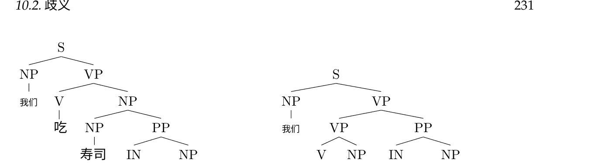

- VP → w2:5是真正例。
- NP → w3:5是假正例，因为它只出现在系统输出中。
- PP → w4:5是真正例，因为它在两棵树中都出现。
- VP → w2:3是假负例，因为它只出现在参考中。

这个解析的标记和未标记的精确度是 3/4 = 0.75，召回率是 3/4 = 0.75，F-度量为-0.75。对于一个精确度和召回率不相等的例子，假设参考解析中包含产生式VP → V NP PP。在这个解析中，参考不包含组成部分 w2:3，所以召回率将为 1.3

#### 10.2.2 局部解决方案

一些歧义可以在本地解决。考虑以下例子，

> > (10.1) a. 我们在星期一见到了总统。
> b. 我们见到了墨西哥总统。

每个案例都以一个介词短语结尾，可以附加到动词见到或名词短语总统上。如果给定一个标记的语料库，我们可以比较在每个候选附加点旁边观察到介词的可能性，p(在 | 见到) ≥ p(在 | 总统)

```
[10.1] p(的 | 见到) ≥ p(的 | 总统).
[10.2] p(的 | 见到) ≥ p(的 | 总统).
```

> > ³虽然在应用CKY算法之前必须对语法进行二元化，但评估是在原始解析上进行的。因此，有必要“去二元化”基于CKY的解析器的输出，将其转换回原始语法。

比较这些概率将成功解决这个案例（Hindle和Rooth，1993）。其他案例，如例子我们用筷子吃寿司，需要考虑介词的宾语：考虑替代方案我们用酱油吃寿司。

通过足够的标记数据，一些附件歧义的实例可以通过监督分类（Ratnaparkhi等，1994年）来解决。

然而，局部解决方案存在固有的限制。虽然玩具示例可能只有几个需要解决的歧义，但现实句子可能有数千个或数百万个可能的解析。此外，附件决策是相互依赖的，如花园路径示例所示：

（10.2）猫用爪子抓人用刀子。

我们可能希望将用爪子附加到抓上，就像在较短的句子中正确的方式一样在猫用爪子抓人中。但这样就没有地方可以附加用刀子了。只有通过同时考虑附件决策才能确定正确的解释。巨大数量的潜在解析可能会使详尽搜索变得不可能。但是，与序列标记一样，局部性假设使得在这个空间中进行高效搜索成为可能。

### 10.3 加权上下文无关文法

让我们定义一个推导 $\tau$ 为一组 **锚定的产生式**，
$$
\tau = \{X \rightarrow \alpha, (i, j, k)\},
$$
其中 $X$ 对应于左侧非终结符，$\alpha$ 对应于右侧。对于乔姆斯基范式的语法，$\alpha$ 要么是一对非终结符，要么是一个终结符。指标 $i, j, k$ 将产生式锚定在输入中，其中 $X$ 推导出跨度 $w_{i+1:j}$。对于二元产生式，$w_{i+1:k}$ 表示左子节点的跨度，$w_{k+1:j}$ 表示右子节点的跨度；对于一元产生式，$k$ 被忽略。对于输入 $w$，最优解析是，

$$
\hat{\tau} = \underset{\tau \in \mathcal{T}(w)}{\mathrm{argmax}} \ \Psi(\tau),
$$
其中 $\mathcal{T}(w)$ 是生成输入 $w$ 的推导集合。

定义一个得分函数 $\Psi$，该函数在锚定产生式之间进行分解，
$$
\Psi(\tau) = \sum_{(X \rightarrow \alpha, (i,j,k)) \in \tau} \psi(X \rightarrow \alpha, (i,j,k)).
$$
这是一种类似于维特比序列标注中的假设的局部性假设。在这种情况下，该假设表明总体得分是产生式得分的总和，

表10.2：一个示例的加权上下文无关文法（WCFG）。权重被选择以使 \(\exp \psi(\cdot)\) 对于每个非终结符的右侧求和为一；这是概率上下文无关文法所要求的，但不是一般的WCFG所要求的。

这些是独立计算的。在加权上下文无关文法（WCFG）中，每个锚定产生式 \(X \to (\alpha, (i, j, k))\) 的分数只是 \(\psi(X \to \alpha)\)，忽略了锚点 \((i, j, k)\)。在其他解析模型中，锚点可以用来访问输入的特征，同时仍然允许高效的自底向上解析。

例子考虑表10.2中显示的加权文法和图10.2b中的分析。

```
\(\Psi(\tau) = \psi(\mathrm{S} \to \mathrm{NP}\ \mathrm{VP}) + \psi(\mathrm{VP} \to \mathrm{VP}\ \mathrm{PP}) + \psi(\mathrm{VP} \to \mathrm{V}\ \mathrm{NP}) + \psi(\mathrm{PP} \to \mathrm{IN}\ \mathrm{NP})\)
\(\quad + \psi(\mathrm{NP} \to We) + \psi(\mathrm{V} \to \text{吃}) + \psi(\mathrm{NP} \to \text{寿司}) + \psi(\mathrm{IN} \to \text{用}) + \psi(\mathrm{NP} \to \text{筷子})\)
```

```
\(\quad = 0 - 2 - 1 + 0 - 2 + 0 - 3 + 0 - 3 = -11.\)
```

在图10.2a的替代解析中，产生式 \(\mathrm{VP} \to \mathrm{VP}\ \mathrm{PP}\)（得分为 \(-2\)）被替换为产生式 \(\mathrm{NP} \to \mathrm{NP}\ \mathrm{PP}\)（得分为 \(-1\)）；其他所有产生式都相同。因此，这个解析的得分为 \(-10\)。这个例子暗示了在非终结符（如NP、VP和PP）上进行WCFG解析的一个问题：无论附加什么，WCFG都会始终更喜欢VP或NP的附加！解决这个问题的方法在 §10.5中讨论。

在与MIT Press签订的合同下，根据CC-BY-NC-ND许可共享。

## 算法14 CKY算法用于解析一个字符串 $w \in \Sigma^*$在一个加权上下文无关文法 $(N, \Sigma, R, S)$中，其中 $N$是非终结符的集合， $R$是加权产生式的集合。 假设文法处于乔姆斯基范式 (§ 9.2 .1) 中。函数TRACEBACK在算法13中定义。

```
过程       WCKY($w$, $G = (N, \Sigma, R, S)$)
      对于所有 $i, j, X$ 执行                          。初始化
                $t[i, j, X] \leftarrow 0$
                $b[i, j, X] \leftarrow \emptyset$
      对于所有 $m \in \{1, 2, \ldots, M\}$ 执行
             对于所有 $X \in N$ 执行
                    $t[m, m + 1, X] \leftarrow \psi(X \rightarrow w_m, (m, m + 1, m))$
      对于 $\ell \in \{2, 3, \ldots M\}$ 执行
             对于 $m \in \{0, 1, \ldots, M - \ell\}$ 执行
                    对于 $k \in \{m + 1, m + 2, \ldots, m + \ell - 1\}$ 执行
                           $t[m, m + \ell, X] \leftarrow \max_{k,Y,Z} \psi(X \rightarrow Y Z, (m, m + \ell, k)) + t[m, k, Y] + t[k, m + \ell, Z]$
                           $b[m, m + \ell, X] \leftarrow \text{argmax}_{k,Y,Z} \psi(X \rightarrow Y Z, (m + \ell, k)) + t[m, k, Y] + t[k, m + \ell, Z]$
      返回  TRACEBACK($S, 0, M, b$)
```

#### 10.3.1 带权重上下文无关文法解析

方程10.4中的优化问题可以通过修改CKY算法来解决。 在确定性CKY算法中，每个单元格 $t[i, j]$ 存储了一组能够推导出跨度 $w_{i+1:j}$ 的非终结符。 现在我们扩充表格，使得单元格 $t[i, j, X]$ 成为从非终结符 $X$ 推导出 $w_{i+1:j}$ 的最佳推导得分。 这个得分是通过递归计算得到的 : 对于锚定的二元产生式 ($X \rightarrow Y Z, (i, j, k)$)，我们计算:

- 锚定产生式的分数， $\psi(X \rightarrow Y Z, (i, j, k))$;
- 左子树最佳推导的分数， $t[i, k, Y]$;
- 右子树最佳推导的分数， $t[k, j, Z]$.

这些分数通过加法进行合并。 与无权CKY算法类似，表格是通过考虑逐渐增长的跨度来构建的，因此在计算分数 $t[i, j, X]$ 时，跨度 $t[i, k, Y]$ 和 $t[k, j, Z]$ 的分数保证是可用的。 值 $t[0, M, S]$ 是从语法中得到 $w$ 的最佳推导的分数。 算法14将此过程形式化。

与无权CKY类似，解析结果可以从回指针表 $b$ 中恢复，其中每个 $b[i, j, X]$ 存储了从 $X$ 推导 $w_{i+1:j}$ 的argmax分割点 $k$ 和产生式 $X \rightarrow Y Z$。 通过从 $b[0, M, S]$ 开始，沿着这些指针向后追踪，可以获得得分最高的解析结果，直到终结符号。 这类似于计算的过程

通过从网格的末尾向后追踪指针，找到维特比算法中最佳标签序列的方法。 请注意，我们只需要存储到$t[i, j, X]$的最佳路径的回指针；这是基于局部假设，即解析的全局得分是解析中每个产生式的局部得分的组合。

例子让我们重新审视图10.1中的解析表。在加权CFG中，每个单元格都包括每个非终结符的得分；不能生成的非终结符被假定为得分 $-\infty$。 第一个对角线包含一元产生式的得分：$t[0, 1, \text{NP}] = -2, t[1, 2, \text{V}] = 0$，等等。 下一个对角线包含长度为2的跨度的得分：$t[1, 3, \text{VP}] = -1 + 0 - 3 = -4, t[3, 5, \text{PP}] = 0 + 0 - 3 = -3$，等等。 当我们到达单元格 $t[1, 5, \text{VP}]$ 时，情况变得有趣，它包含了从非终结符VP推导出跨度 $w_{2:5}$ 的得分。这个得分是通过两个选择中的最大值计算得到的。
$$
\begin{aligned}
\!t[1, 5, \text{VP}] &= \max(\psi(\text{VP} \rightarrow \text{VP PP}, (1, 3, 5)) + t[1, 3, \text{VP}] + t[3, 5, \text{PP}],\n&\qquad\qquad\psi(\text{VP} \rightarrow \text{V NP}, (1, 2, 5)) + t[1, 2, \text{V}] + t[2, 5, \text{NP}])\qquad\quad[10.8]\n&= \max(\,- 2 - 4 - 3,\, -1 + 0 - 7) = -8.\qquad\qquad\qquad\qquad\qquad\qquad[10.9]
\end{aligned}
$$
由于第二种情况是argmax，我们设置回溯指针 $b[1, 5, \text{VP}] = (\text{V}, \text{NP}, 2)$，使得最优的推导可以被恢复。

#### 10.3.2 概率上下文无关文法

概率上下文无关文法 (PCFGs) 是加权上下文无关文法的一种特殊情况，当权重对应于概率时产生。 具体而言，权重 $\psi( X \rightarrow \alpha, \, (\mathbf{i}, \, j, \, k) ) = \log \mathbf{p} (\, \alpha \mid X\,)$ ，其中右侧 $\alpha$ 的概率是在非终结符 $X$ 上条件化的，锚点 $(\mathbf{i}, \, j, \, k)$ 被忽略。这些概率必须在所有可能的右侧上进行归一化，以便 $\sum_{\alpha} \mathbf{p} (\, \alpha \mid X\,) = 1$，对于所有 $X$。
对于给定的解析 $\tau$，产生式概率的乘积等于$\mathbf{p} (\, \tau\,)$，在生成模型 $\tau \sim \text{DRAWSUBTREE} (S)$ 下，函数DRAWSUBTREE在算法15中定义。

给定字符串的条件概率是,
$$
p(\tau \mid \boldsymbol{w}) = \frac{\mathbf{p}(\tau)}{\sum_{\tau' \in \mathcal{T}(\boldsymbol{w})} \mathbf{p}(\tau')} = \frac{\exp \Psi(\tau)}{\sum_{\tau' \in \mathcal{T}(\boldsymbol{w})} \exp \Psi(\tau')},\qquad\qquad[10.10]
$$
其中 $\Psi(\tau) = \sum$ 因为概率在得分 $\Psi(\tau)$ 中是单调递增的，所以可以通过CKY算法来识别最大似然解，无需修改。 如果需要归一化概率 $\mathbf{p}(\tau \mid \boldsymbol{w})$，可以通过下面描述的内部递归计算方程10.10的分母。

## 算法 15 从概率上下文无关文法的生成模型中派生在乔姆斯基范式（CNF）中。

```
过程 DRAWSUBTREE (X)
样本 (X → α) ~ p(α | X)
如果 α= (Y Z) 那么
    返回 DRAWSUBTREE (Y) ∪ DRAWSUBTREE (Z)
否则
    返回 (X → α)       。在CNF中，所有一元产生式产生终端符号
```

例子表10.2中的WCFG设计成权重是对数概率，满足约束 ∑ 如前所述，在T（我们用筷子吃寿司）中有两个解析，得分为 Ψ(τ1) = log p(τ1) = -10 和 Ψ(τ2) = log p(τ2) = -11。因此，条件概率p(τ1 |W) 等于

p(τ1 | w) = p(τ1) / (p(τ1) + p(τ2)) = exp Ψ(τ1) / (exp Ψ(τ1) + exp Ψ(τ2)) = 2^{-10} / (2^{-10} + 2^{-11}) = 2/3. [10.11]

方程10.10的分母可以看作是一个语言模型，对字符串 w 的所有有效推导求和，p(w) =

∑_{τ':yield(τ')=w} p(τ'). [10.12]

正如CKY算法可以最大化所有这些分析一样，通过一些修改，它也可以计算它们的总和。每个单元格 t[i, j, X] 必须存储从非终结符 X推导出 w_{i+1:j} 的对数概率。 为了计算这个值，我们用“对数-求和-指数”操作替换了对分割点 k和产生式 X → Y Z的最大化运算，该操作对产生式和子节点的对数概率进行指数化，将它们在概率空间中求和，然后再转换回对数域：

t[i, j, X] = 对数 ∑_{k,Y,Z} exp (ψ(X → Y Z) + t[i, k, Y] + t[k, j, Z]) [10.13]
= log ∑_{k,Y,Z} exp (log p(Y Z | X) + log p(Y → w_{i+1:k}) + log p(Z → w_{k+1:j})) [10.14]
= log ∑_{k,Y,Z} p(Y Z | X) × p(Y → w_{i+1:k}) × p(Z → w_{k+1:j}) [10.15]
= log ∑_{k,Y,Z} p(Y Z, w_{i+1:k}, w_{k+1:j} | X) [10.16]
= log p(X w_{i+1:j}), [10.17]带有 $X$，$w_{i+1:j}$ 表示非终端 $X$ 生成跨度 $w_{i+1}, w_{i+2}, \ldots, w_j$。递归计算 $t[i, j, X]$ 被称为内部递归，因为它计算每个子树的概率作为较小子树的概率的组合。这个名字暗示了相应的外部递归，它计算非终端 $X$ 跨越 $w_{i+1:j}$ 的概率，与外部上下文一起 $(w_{1:i}, w_{j+1:M})$。这个递归在 §10.4.3 中描述。内部和外部递归类似于概率序列标注中的前向和后向递归（参见 §7.5.3）。它们可以用于计算单个锚定产生式的边际概率，$p(X \rightarrow \alpha, (i, j, k) \mid w)$，对所有可能的推导求和 $w$。

#### 10.3.3 *半环加权上下文无关文法

加权和非加权的CKY算法可以使用相同的半环符号来统一内部递归，如 §7.7.3 中所述。广义递归如下：

```
$t[i, j, X] = \bigoplus_{k,Y,Z} \psi(X \rightarrow Y Z, (i, j, k)) \otimes t[i, k, Y] \otimes t[k, j, Z].$
```

这个递归包含了本章讨论过的所有算法。

非加权的CKY算法。当 $\psi(X \rightarrow \alpha, (i, j, k))$ 是一个布尔值 $\{\top, \bot\}$ 时，$\otimes$ 是逻辑合取，$\bigoplus$ 是逻辑析取，我们可以得到非加权上下文无关文法的CKY递归，如 §10.1 和算法13中所述。

加权CKY。当 $\psi(X \rightarrow \alpha, (i, j, k))$ 是一个标量分数时，$\otimes$ 表示加法，$\bigoplus$ 表示最大化，然后我们推导出加权上下文无关文法的CKY递归，在第10.3节和算法14中讨论。当 $\psi(X \rightarrow \alpha, (i, j, k)) = \log p(\alpha \mid X)$ 时，相同的设置推导出概率上下文无关文法中找到最大似然推导的CKY递归。

内部递归。当 $\psi(X \rightarrow \alpha, (i, j, k))$ 是对数概率时，$\otimes$ 表示加法，$\bigoplus = \log \sum \exp$，然后我们推导出概率上下文无关文法的内部递归，在第10.3.2节中讨论。也可以直接将 $\psi(X \rightarrow \alpha, (i, j, k))$ 设置为概率 $p(\alpha \mid X)$。在这种情况下，$\otimes$ 表示乘法，$\bigoplus$ 表示加法。虽然这种方法可能比使用对数概率更直观，但在长输入上存在下溢风险。

无论得分如何组合，关键点是局部性假设：推导的得分是每个锚定的独立得分的组合。产生式的得分与推导的任何其他部分无关。例如，如果两个非终结符是兄弟节点，则来自这些非终结符的产生式的得分是独立计算的。这种局部性假设类似于序列标注中的一阶马尔可夫假设，其中转换标签的得分仅取决于前一个标签和当前标签，而不取决于历史。与序列标注一样，这个假设使得能够高效地找到最优解析；其语言限制在 §10.5中讨论。

### 10.4 学习加权上下文无关文法

与序列标注类似，无上下文的解析是一种结构预测形式。因此，可以使用相同的一组算法来学习WCFGs：生成概率模型，结构感知器，最大条件似然和最大边际学习。

在所有情况下，学习都需要一个树库，这是一个带有上下文无关解析标签的句子数据集。解析研究得到了宾夕法尼亚树库（Marcus等，1993年）的推动，这是第一个大规模的此类数据集（参见 §9.2.2）。短语结构树库存在于大约二十多种其他语言中，主要覆盖欧洲和东亚语言，以及阿拉伯语和乌尔都语。

#### 10.4.1 概率上下文无关文法

概率上下文无关文法与隐马尔可夫模型类似，它们都是文本的生成模型。在这种情况下，感兴趣的参数对应于在左侧的条件下的产生概率。与隐马尔可夫模型一样，这些参数可以通过相对频率估计：

```
$$\psi(X \rightarrow \alpha) = \log p(X \rightarrow \alpha)$$ [10.19]
$$\hat{p}(X \rightarrow \alpha) = \frac{\text{count}(X \rightarrow \alpha)}{\text{count}(X)}$$ [10.20]
```

例如，产生 NP → DET NN的概率是该产生式在语料库中的计数除以非终结符 NP 的计数。这个估计器也适用于终结产生式：NN →鲸鱼的概率是鲸鱼作为 NN标签生成的语料库中出现的次数除以 NN标签的总计数。即使使用最大的树库——目前大约有一百万个标记——也很难准确计算出即使是中等罕见事件的概率，比如 NN →鲸鱼。因此，平滑对于使 PCFGs 有效至关重要。

#### 10.4.2 基于特征的解析

每个产生式的分数可以计算为权重和特征的内积，

```
ψ(X → α, (i, j, k)) = θ · f(X, α, (i, j, k), w) [10.21]
```

其中特征向量 f 是左侧 X、右侧 α、锚定索引 (i, j, k)和输入 w的函数。

基本特征 f(X, α, (i, j, k)) = {(X, α)}仅编码产生式本身的标识。这导致了一个具有与 PCFG相同表达能力的判别式训练模型。锚定产生式的特征可以包括边界词 w_i、w_{j+1}、分割点词 w_{k+1}、左子范围中的动词或名词的存在 w_{i+1:k}等等 (Durrett和Klein，2015年)。锚定产生式的分数可以在不对算法进行任何修改的情况下合并到CKY解析中，因为仍然可以从其直接子节点递归计算表 t[i, j, X]的每个元素。

其他特征可以通过将元素分组到左侧或右侧来获得：例如，通过对具有相似句法属性的单词组进行聚类，可以特别有益地计算附加特征。聚类可以从比任何树库更大的无标签数据集中获得，提高覆盖范围。这些方法在第14章中有描述。

基于特征的解析模型可以使用通常的判别学习技术进行估计。例如，可以计算结构感知器更新为 (Carreras等，2008年)

```
f(τ, w^{(i)}) = ∑_{(X→α, (i,j,k)) ∈ τ} f(X, α, (i, j, k), w^{(i)}) [10.22]
τ̂ = argmax_{τ ∈ T(w)} θ · f(τ, w^{(i)}) [10.23]
θ ← f(τ^{(i)}, w^{(i)}) − f(τ̂, w^{(i)}). [10.24]
```

#### 10.4.3 *条件随机场解析

一个推导的得分 Ψ(τ) 可以通过对所有可能的推导进行归一化来转换为概率。

```
p(τ | w) = exp Ψ(τ) / Σ_{τ' ∈ T(w)} exp Ψ(τ') [10.25]
```

使用这个概率，可以通过最大化标记语料库的条件对数似然来训练WCFG。

就像在逻辑回归和条件随机场中一样，条件对数似然的梯度是每个特征的观察计数和期望计数之间的差异。期望 E_{τ|w}[f(τ, w^{(i)}); θ] 需要对所有可能的解析进行求和，并计算锚定产生式的边际概率，p(X → α, (i, j, k) | w)。在CRF序列标注中，通过两遍前向-后向算法计算标签二元边际概率 (§7.5.3)。上下文无关文法的类比是内外算法，通过对解析图进行上下两遍遍历来计算边际概率。

*   上行通过内部循环执行，该循环在 §10.3.2 中描述。每个内部变量 α(i, j, X) 是从非终端符号 X 推导出 w_{i+1:j} 的得分。在PCFG中，这对应于对数概率 log p(w_{i+1:j} | X)。这是通过循环计算得出的，

    α(i, j, X) ≜ log Σ_{(X→YZ)} Σ_{k=i+1}^{j} exp (ψ(X → YZ, (i, j, k)) + α(i, k, Y) + α(k, j, Z))。 [10.26]

    这个循环的初始条件是 α(m - 1, m, X) = ψ(X → w_m)。分母 Σ_{τ ∈ T(w)} exp Ψ(τ) 等于 exp α(0, M, S)。
*   向下传递由外部循环执行，该循环递归地填充相同的表结构，从树的根开始。每个外部变量 β(i, j, X)是具有类型X覆盖跨度(i+1: j)的得分，与外部上下文w1:i和wj+1:M一起联合。在PCFG中，这对应于对数概率log p((X, i+1, j), w1:i, wj+1:M)。每个外部变量通过循环计算得出，

    $$exp β(i, j, X) ≜ ∑_{(Y→X Z)k=j+1}^M exp [ψ(Y → X Z, (i, k, j)) + α(j, k, Z) + β(i, k, Y)]$$ [10.27]

    $$+ ∑_{(Y→Z X)k=0}^{i-1} exp [ψ(Y → Z X, (k, i, j)) + α(k, i, Z) + β(k, j, Y)].$$ [10.28]

    方程式10.28的第一行是在X是其父节点的左子节点的条件下的得分，该节点跨越$w_{i+1:k}$，其中k>j；第二行是在X是其父节点Y的右子节点的条件下的得分，该节点跨越$w_{k+1:j}$，其中k<i。这两种情况在图10.3中显示。在每种情况下，我们对右侧包含X的所有可能产生式求和。父节点Y在一侧由i或j限定，具体取决于X是Y的左子节点还是右子节点；我们必须对另一边界的所有可能值求和。外部递归的初始条件为$β(0, M, S) = 0$和$β(0, M, X ≠ S) = −∞$。

非终端符号X在跨度$w_{i+1:j}$的边际概率写作$p(X \mid w_{i+1:j}, w)$。这个概率可以从内部和外部得分计算得到，

$$p(X \mid w_{i+1:j}, w) = \frac{p(w_{i+1:j}, w)}{p(w)}$$ [10.29]

$$= \frac{p(w_{i+1:j} \mid X) × p(X, w_{1:i}, w_{j+1:M})}{p(w)}$$ [10.30]

$$= \frac{exp (α(i, j, X) + β(i, j, X))}{exp α(0, M, S)}.$$ [10.31]

类似地，可以计算出单个产生式的边际概率（参见练习2）。这些边际概率可以用于训练条件随机场解析器，也可以用于无监督语法归纳的任务，其中从无标签文本数据集估计出一个PCFG（Lari和Young，1990；Pereira和Schabes，1992）。

#### 10.4.4 神经上下文无关文法

神经网络可以应用于解析，通过用稠密的数值向量表示每个跨度（Socher等人，2013；Durrett和Klein，2015；Cross和Huang，2016）。例如，锚点（i, j, k）和句子 w 可以与一个固定长度的列向量相关联，

```
v_{(i,j,k)} = [u_{w_{i-1}}; u_{w_i}; u_{w_{j-1}}; u_{w_j}; u_{w_{k-1}}; u_{w_k}]
```

其中 u_{w_i} 是与单词 w_i 相关联的词嵌入。然后，向前馈送神经网络通过向量 v_{i,j,k}，并用于计算锚定产生的分数。例如，可以将该分数计算为双线性乘积（Durrett和Klein，2015），

```
\tilde{v}_{(i,j,k)} = \text{前馈} (v_{i,j,k})
\psi(X \to \alpha, (i, j, k)) = \tilde{v}_{(i,j,k)}^{\top} \Theta f(X \to \alpha)
```

其中 f(X \to \alpha) 是产生式的特征向量，Θ是参数矩阵。矩阵 Θ 和前馈网络的参数可以通过反向传播从目标函数（如边际损失或负条件对数似然）中学习得到。

### 10.5 文法细化

CFG解析的局部性假设取决于非终结符的粒度。对于Penn Treebank的非终结符，有几个原因可以认为这些假设太过严格（Johnson，1998）：

*   上下文无关的假设太严格：例如，在PTB中，如果名词短语的父节点是动词短语（表示名词短语是直接宾语），则产生式NP → NP PP的概率要高得多，而如果父节点是句子（表示名词短语是句子的主语），则概率要低得多。
*   宾夕法尼亚树库的非终结符太粗糙了：有许多种名词短语和动词短语，准确的解析有时需要知道它们之间的区别。正如我们已经看到的，当面临介词短语附着歧义时，加权上下文无关文法要么总是选择NP附着（如果ψ(NP → NP PP) > ψ(VP → VP PP)），要么总是选择VP附着。为了获得更细致的行为，需要更细粒度的非终结符。
*   更一般地说，准确的解析需要一定程度的语义 - 理解要解析的文本的含义。考虑以下例子猫抓人：正确解决附件歧义需要对猫、爪子和抓痕的了解。

图10.4显示了一个极端的例子。左侧的分析更受青睐，因为法国和意大利是相似实体的连词。但是根据分析中显示的非终结符，没有办法区分这两个解析，因为它们包含完全相同的产生式。似乎需要更精确的非终结符。

一种可能性是重新思考Penn Treebank背后的语言学，并要求注释者重新尝试。但是原始的注释工作花费了五年时间，对于这样一个规模的另一项注释工作没有多少兴趣。因此，研究人员转向了自动化技术。

#### 10.5.1 父节点注释和其他树转换

上下文无关解析的关键假设是产生式仅依赖于左侧非终结符的标识，而不依赖于其祖先或邻居。这个假设的有效性是一个经验性问题，它取决于非终结符本身：理想情况下，每个名词短语（和动词短语等）都应该在分布上相同，这样假设才成立。但在宾州树库中，产生式的观察概率通常取决于左侧的父节点。

例如，当名词短语处于宾语位置时（例如，他们使佐治亚州的学生们感到有趣），更有可能被介词短语修饰，而不是主语位置（例如，佐治亚州的学生们使他们感到有趣）。这意味着如果整个成分是VP的子节点，那么NP →NP PP产生式更有可能发生，而不是它是子节点的情况。对于S，观察到的统计数据为（Johnson，1998）：

```
Pr(NP → NP PP) =11% [10.35]
Pr(NP under S → NP PP) =9% [10.36]
Pr (NP under VP →NP PP) =23%。 [10.37]
```

这种现象可以通过父节点注释（Johnson，1998）来捕捉，其中每个非终端符号都附加了其父节点的标识，如图10.5所示。这有时被称为垂直马尔可夫化，因为在每个节点和其父节点之间引入了马尔可夫依赖关系（Klein和Manning，2003）。这类似于在隐马尔可夫模型中从二元上下文移动到三元上下文。原则上，父节点注释会使非终端符号集的大小增加一倍，这可能会使解析过程变得不太高效。但实际上，在数据中实际出现的非终端符号的数量的增加相对较小（Johnson，1998）。

父节点注释削弱了WCFG的局部性假设。这通过使解析器能够进行更细粒度的区分来提高准确性，从而更好地捕捉真实的语言现象。然而，每个产生式都更加罕见，因此需要仔细平滑或正则化来控制产生式得分的方差。

#### 10.5.2 词汇化上下文无关文法

第10.2.2节的示例演示了个别单词在解析歧义中的重要性：介词 on 更有可能与 met 结合，而介词 of 更有可能与 President 结合。但在所有词对中，哪些与附着决策相关？考虑以下对原始示例的变体：

*   (10.3) a. 我们见到了墨西哥总统。
*   b. 我们见到了墨西哥第一位女总统。
*   c. 他们据说在星期一见到了总统。

下划线标出的单词是各自短语的头词： met 是动词短语的头， President 是直接宾语名词短语的头。这些头词提供了有用的语义信息。但它们打破了上下文无关的假设，该假设认为一个产生的得分仅取决于父节点及其直接子节点，而不取决于每个子节点下的子结构。

将头词纳入上下文无关解析中被称为词汇化，并且以以下形式的规则实现：

> NP(总统) → NP(总统) PP(的) [10.38]
> NP(总统) → NP(总统) PP(在) [10.39]

在20世纪90年代和21世纪初，词汇化是准确的PCFG解析的重要一步。它需要解决三个问题：在树库中识别所有成分的头部；在保持追踪头部的同时高效解析；以及估计词汇化产生式的分数。

##### 识别头词

成分的头部是确定该成分如何整合到句子中最有用的词。成分的头词是通过递归确定的：对于任何非终端产生式，左侧的头部必须是其中一个子节点的头部。通常根据一组确定性规则选择头部，有时称为头部渗透规则。在许多情况下，这些规则很简单：NP → DET NN产生式中的名词短语的头部是名词的头部；S →NP VP产生式中的句子的头部是动词短语的头部。

表10.3显示了许多英语解析系统中使用的头部渗透规则的片段。第一条规则的意思是，要找到S成分的头部，首先找到最右边的VP子节点；如果找不到，则找到最右边的SBAR子节点，依此类推。动词短语的头部是左动词（可以计划步行计划，因为情态动词可以标记为MD）；名词短语的头部是最右边的类似名词的非终结符（因此红色猫的头部是猫）；介词短语的头部是介词（在乔治亚理工学院的头部是在）。其中一些规则有些随意 - 没有特定的原因可以解释为什么cats and dogs的头部应该是dogs - 但这里的重点只是获取一些可以支持解析的词汇信息，而不是对语法进行深入的论述。图10.6显示了这些规则在两个运行示例中的应用。

##### 解析词汇化的上下文无关文法

词汇化的天真应用只是简单地通过与终结符号集合的叉积来增加非终结符号集合，以便现在的非终结符号

| 符号 | 方向 | 头部候选列表 |
|------|------|---------------|
| S    | 右   | VP SBAR ADJP UCP NP |
| VP   | 左   | VBD VBN MD VBZ TO VB VP VBG VBP ADJP NP |
| NP   | 右   | N* EX $ CD QP PRP ... |
| PP   | 左   | IN TO FW |

表10.3：英语头部渗透规则片段（Magerman，1995；Collins，1997）

> 5这是一个实用的定义，符合我们使用头词来改进解析的目标；更正式的定义请参见（Bender，2013年，第7章）。
>
> 6名词短语非终结符有时被视为一种特殊情况。Collins（1997年）使用一种启发式方法，寻找最右边的子节点，该子节点是类似名词的词性（例如，NN，NNP），所有格标记或最高级形容词（例如，the greatest）。如果找不到这样的子节点，则启发式方法会寻找最左边的NP。如果没有带有NP标签的子节点，则该启发式方法会从右到左应用另一个优先级列表。

# 10.5. 语法细化

包括符号如NP(总统)和VP(见面)。在这种方法下，CKY解析算法可以直接应用于词汇化的产生式规则。然而，复杂度将与终结符词汇表的大小呈立方关系，这显然是难以处理的。

另一种方法是通过额外的索引来扩充CKY表，以跟踪每个组成部分的中心词。单元格 $t[i, j, h, X]$ 存储了最佳推导的分数，其中非终结符 $X$ 跨越 $w_{i+1:j}$，并且中心词为 $h$，其中 $i < h \leq j$。为了递归地计算这样的表，我们必须考虑每个短语可能从其左子节点或右子节点获取中心词的可能性。最佳推导的分数，其中中心词来自左子节点和右子节点的分数分别表示为 $t_\ell$ 和 $t_r$，导致以下递归关系：

```
$t_{\ell}[i, j, h, X] = \max_{\substack{(X \to Y Z) \ k > h \ k < h' \leq j}} \max \max t[i, k, h, Y] + t[k, j, h', Z] + \psi(X(h) \to Y(h) Z(h'))$ [10.40]

$t_r[i, j, h, X] = \max_{\substack{(X \to Y Z) \ k < h \ i < h' \leq k}} \max \max t[i, k, h', Y] + t[k, j, h, Z] + (\psi(X(h) \to Y(h') Z(h)))$ [10.41]

$t[i, j, h, X] = \max (t_{\ell}[i, j, h, X], t_r[i, j, h, X])$ . [10.42]
```

为了计算 $t_\ell$，我们要在所有分割点 $k > h$ 上进行最大化，因为中心词必须在左子树中。然后，我们再次在可能的右子树中心词 $h'$ 上进行最大化。对于 $t_r$，进行类似的计算。表的大小现在为 $\mathcal{O}(M^3 N)$，其中 $M$ 是输入的长度， $N$ 是非终结符的数量。此外，每个单元格的计算需要执行 $\mathcal{O}(M^2)$ 次操作，因为我们要在分割点 $k$ 和中心词 $h'$ 上进行最大化。因此，算法的时间复杂度为 $\mathcal{O}(R M^5 N)$，其中 $R$ 是语法中的规则数。幸运的是，还有更高效的解决方案。通常情况下，解析的复杂度可以降低到 $\mathcal{O}(M^4)$，对于一类广泛的词汇化CFG，复杂度可以与未词汇化CFG一样，变为输入长度的立方 (Eisner, 2000年)。

# 估计词汇化的无上下文语法

词汇化解析的最后一个问题是如何估计词汇化产生式的权重 $X(i) \to Y(j) Z(k)$。这些产生式被称为双词的，因为它们涉及到词对的得分：在例子 meet the President of Mexico 中，我们希望通过建模双词的亲和性来选择正确的附着点 $(meet, of)$ 和 $(President, of)$。这样的词对数量与词汇表的大小呈二次关系，使得直接从数据中估计词汇化产生式的权重变得困难。这对于概率上下文无关语法尤其如此，其中权重是从平滑后的相对频率中获得的。在一个包含一百万个标记的树库中，一个可能出现的词汇化产生的分数非常小，只有很小一部分会被观察到超过一次。7因此，Charniak（1997）和Collins（1997）解析器专注于近似词汇化产生的概率，使用各种平滑技术和独立假设。

在判别式训练的加权上下文无关文法中，每个产生式的分数可以从一组特征中计算得出，这些特征可以逐渐变得更加细致（Finkel等人，2008年）。例如，词汇化产生式NP（总统）→ NP（总统）PP（的）的分数可以从以下特征计算得出：

```
f (NP（总统）→ NP（总统）PP（的）) = {NP (*) → NP (*) PP (*),
                                        NP(总统) → NP(总统) PP(*),
                                        NP (*) → NP (*) PP（的）,
                                        NP（总统）→ NP（总统）PP（的）}
```

第一个特征评分为未词汇化的产生式NP →NP PP；接下来的两个特征只对产生式的一个元素进行词汇化，从而评分NP的附着对于个别单词总统和 of的适当性；最后一个特征评分为总统和 of的具体双词亲和性。对于在树库中经常遇到的双词对，这种双词特征在解析中起着重要作用；对于缺失或罕见的双词对，正则化将使其权重趋于零，迫使解析器依赖于更粗粒度的特征。

在第14章中，我们将遇到基于词的聚类技术，这些技术基于词出现的上下文分布特性。这样的聚类将把罕见和常见的词，如鲸鱼，鲨鱼，白鲸，利维坦分组。词聚类可以用作区分性词汇化解析的特征，在完全词汇化和非终结符之间取得平衡（Finkel等，2008年）。通过这种方式，包含相对常见词如鲸鱼的标记示例可以帮助改善对于罕见词如白鲸的解析，只要这两个词被聚类在一起。

> 7实际情况更加困难，因为非二进制上下文无关语法可以涉及词组的头部和多个子节点之间的三词或更高阶依赖关系（Carreras等，2008）。

#### 10.5.3 *细化语法

通过在词汇化中添加详细信息，可以改善基于上下文无关语法分析。然而，估计词汇化产生式的分数是困难的。Klein和Manning（2003）认为，语言细节的正确水平介于树库类别和单词之间。一些词性和非终结符是真正可替换的：例如，cat/N和dog/N。但其他一些不是：例如，介词of仅附加到名词，而介词as更多可能修改动词短语。Klein和Manning（2003）通过将介词类别分为六个子类型，在父节点注释的PCFG解析器上获得了2%的F-MEASURE改进。他们提出了一系列基于语言的改进，对Penn Treebank注释进行了40%的错误减少。

非终端细化过程可以通过将细化的类别视为潜在变量来自动化。例如，我们可以将名词短语非终端分割为NP1、NP2、NP3等。而不事先定义每个细化的非终端对应的内容。这可以被视为部分监督学习，类似于第5.2.3节中描述的多组分文档分类模型。可以通过期望最大化算法（Matsuzaki等，2005年）来估计潜在变量PCFG：

+   在E步中，估计每个推导中每个非终端的细化类型的边际分布q。这些边际受原始注释的约束：NP可以重新注释为NP4，但不能重新注释为VP3。可以通过内外算法计算细化产生式的边际概率，如第10.4.3节所述，其中E步强制执行原始注释所施加的约束。
+   在M步中，通过对在E步中计算的锚定产生概率求和，重新计算语法的参数：

  $$ E[\text{count}(X \to Y Z)] = \sum_{i=0}^{M} \sum_{j=i}^{M} \sum_{k=i}^{j} p(X \to Y Z, (i, j, k) \mid w) $$ [10.43]

像往常一样，这个过程可以迭代到收敛。为了确定每个标签的重新细化类型的数量，Petrov等人（2006）应用了一种分割-合并启发式方法；Liang等人（2007）和Finkel等人（2007）应用了贝叶斯非参数方法（Cohen，2016）。

表10.4显示了一些细化的非终结符的例子。专有名词区分了月份、名字、中间名字、姓氏、地点的名字和地点的第二个名字；每个名字在语法产生式的不同部分都会出现。人称代词区分了语法角色，PRP-0出现在句子开头的主语位置（注意大写），PRP-1出现在主语位置但不在句子开头，PRP-2出现在宾语位置。

> 8谱学习，描述在§5.5.2中，也已应用于细化语法（Cohen等，2014）。

### 10.6 超越上下文无关解析

在无上下文的情况下，解析的得分是各个产生式得分的组合。正如我们所见，这些模型可以通过使用更细粒度的非终结符进行改进，通过父注释、词汇化和自动细化，然而，上下文无关解析的固有限制促使考虑其他搜索策略。这些策略放弃了自底向上解析所保证的最优性，而换取了考虑所提议解析的任意属性的自由。

**表10.4：自动细化的非终结符示例及其生成的一些单词（Petrov等，2006）。**

专有名词
| 标签 | 单词1 | 单词2 |
|------|-------|-------|
| NNP-14 | 十月 十一月 | 九月 |
| NNP-12 | 约翰 罗伯特 | 詹姆斯 |
| NNP-2 | J. E. | L. |
| NNP-1 | 布什 诺里埃加 | 彼得斯 |
| NNP-15 | 新 圣 | 墙 |
| NNP-3 | 约克 弗朗西斯科 | 街 |

人称代词
| 标签 | 单词1 | 单词2 |
|------|-------|-------|
| PRP-0 | 它 他 | I |
| PRP-1 | 它 他 | 他们 |
| PRP-2 | 它 他们 | 他 |

#### 10.6.1 重新排序

放松上下文无关解析的限制的一种简单方法是执行两阶段的过程，其中上下文无关解析器生成一个 k 最佳候选列表，然后一个重新排序器从该列表中选择最佳解析（Charniak和Johnson，2005；Collins和Koo，2005）。重新排序器可以根据类似于多类分类的目标进行训练：目标是学习分配高分给参考解析或 k 最佳列表中具有最低错误的解析的权重。在任一情况下，重新排序器只需要评估 K 个最佳解析，因此不需要上下文无关的假设。这为更具表现力的评分函数打开了大门：

+   可以将任意非局部特征纳入其中，例如解析的结构并行性和右分支方向性 (Charniak and Johnson, 2005)。
+   重新排序使得可以使用递归神经网络，其中每个组成部分跨度 $w_{i+1:j}$ 接收一个向量 $u_{i,j}$，该向量是通过使用与生成相关的组合函数从其子节点的向量表示计算得到的

规则 (Socher et al., 2013), 例如

```
u_{i,j} = f\left( \Theta_{X \to Y Z} \begin{bmatrix} u_{i,k} \ u_{k,j} \end{bmatrix} \right)\tag{10.44}
```

然后可以从最终向量计算出解析的总分数，$\Psi(\tau) = \theta u_{0,M}$。

重新排序可以显著提高准确性。主要限制在于它只能在生成器提供的$K$个最佳解析中找到最佳解析，因此它在本质上受到自底向上解析器找到高质量候选项的能力的限制。

#### 10.6.2 基于转换的解析

结构预测可以被看作是一种搜索形式。与自底向上的解析相反，一种替代方法是从左到右读取输入，逐渐通过一系列转换逐渐构建解析结构。过渡式解析将在下一章中更详细地描述，在依存解析的背景下。然而，它也可以应用于CFG解析，这里简要描述一下。

对于任何上下文无关文法，都存在一个等价的下推自动机，这是一种接受可以从文法推导出的字符串的计算模型。这种计算模型从左到右消耗输入，同时在堆栈上推入和弹出元素。这种架构为上下文无关文法提供了一种自然的过渡式解析框架，称为移进-规约解析。

移进-规约解析是一种过渡式解析的类型，解析器可以执行以下操作：

+   * 将下一个终端符号移入堆栈；
*   一元规约使用语法中的一元产生式规约栈顶元素；
*   二元规约使用语法中的二元产生式规约栈顶的两个元素；

可用的操作集受到情境的限制：如果输入中还有剩余的终结符号，则解析器只能进行移进操作；如果语法中存在适用的产生式规则，则解析器只能进行规约操作。如果解析器到达一个状态，其中输入已完全消耗，并且栈中只包含元素S，则接受输入。如果解析器到达一个非接受状态，且没有可能的操作，则拒绝输入。如果存在某个操作序列可以接受输入，但解析器未找到该序列，则发生解析错误。

示例考虑输入我们吃寿司和表10.1中的语法。可以通过以下操作序列对输入进行解析：

+   1. 将第一个标记 we移到栈上。
    2. 使用产生式 NP → we将栈顶的项目减少为 NP。
    3. 将下一个标记 eat移到栈上，并使用产生式 V → eat将其减少为 V。
    4. 将最后一个标记 sushi移到栈上，并将其减少为 NP。输入已完全消耗，栈包含 [NP, V, NP]。
    5. 使用产生式 VP → V NP 将栈顶的两个项目减少。栈现在包含 [VP, NP]。
    6. 使用产生式 S → NP VP 将栈顶的两个项目减少。栈现在包含[S]。由于输入为空，这是一个接受状态。

从这个例子中可以注意到，移位操作的次数等于输入的长度。减少操作的次数等于分析中的非终结符数量，这个数量在输入的长度上线性增长。因此，移位-规约分析的总时间复杂度与输入的长度成线性关系（假设每个单独的分类决策的复杂度在输入的长度上是常数）。这比CKY分析所需的立方时间复杂度要好得多。

基于转换的解析作为推理一般来说，无法保证转换式解析器能够找到最优解析 $\arg\max_\tau \Psi(\tau; w)$，即使在通常的CFG独立性假设下也是如此。我们可以为每个上下文中的每个锚定解析动作分配一个分数，其中 $\psi(a, c)$表示在上下文 $c$中执行动作 $a$的分数。

人们可以想象，基于转换的解析可以高效地找到使这些分数之和最大化的推导。但是，这也需要回溯和搜索可能的动作序列的指数级数量：如果在推导的开始处做出了错误的决策，那么可能无法在不回溯到那个早期错误的情况下恢复到最优的动作序列。这被称为搜索错误。基于转换的解析器可以包含任意特征，而不需要图表解析所需的限制性独立性假设；搜索错误是为此灵活性付出的代价。

##### 学习基于转换的解析

基于转换的解析可以通过训练分类器来选择每种情况下的正确动作。这个分类器可以自由选择输入的任何特征，解析器的状态和解析历史。然而，并没有最优性保证：解析器可能会选择一个次优的解析，因为在分析的开始阶段出现了错误。尽管如此，一些最强大的CFG解析器基于移位-规约架构，而不是CKY。最新一代的模型将移位-规约解析与循环神经网络相连，当消耗输入时更新隐藏状态向量（例如，Cross和Huang，2016；Dyer等，2016）。关于基于转换的解析的学习算法将在更多细节中讨论（§ 11.3）。

### 练习

+   1. 设计一个处理英语主谓一致的语法。具体来说，你的语法应该正确处理以下示例：

    (10.4) a. 她唱歌。
           b. 我们唱歌。

    (10.5) a. *她唱歌。
           b. *我们唱歌。

+   2. 将你之前的语法扩展，包括助动词 can，以处理以下情况：

    (10.6) a. 她会唱歌。
           b. 我们会唱歌。

    (10.7) a. *她会唱歌。
           b. *我们会唱歌。

+   3. 法语要求主语和动词在人称和数上保持一致，要求冠词和名词在性别和数上保持一致。动词和它们的宾语不需要保持一致。假设法语有两种性别（女性和男性），三种人称（第一人称[我]，第二人称[你]，第三人称[他]），两种数（单数和复数），需要多少个产生式来扩展以下简单语法以处理一致性？

    ```
    S → NP VP
    VP → V | V NP | V NP NP
    NP → DET N
    ```

+   4. 考虑语法：

    ```
    S → NP VP
    VP → V NP
    NP → JJ NP
    NP → fish (动物)
    NP → fish (钓鱼的动作)
    JJ → fish (修饰语，如fish酱或fish炖菜)
    ```

    应用CKY算法，并识别句子“fish fish fish fish”的所有可能解析。

+   5. 选择前面问题的一个可能解析，并展示如何通过一系列的移位-规约操作来推导出它。

+   6. 为了处理VP协调，语法包括产生式VP → VP Cc VP。为了处理副词，它还包括产生式VP → VP ADV。假设所有动词都是由一系列一元产生式生成的，例如VP → V → eat。
    a) 展示如何对产生式VP → VP Cc VP进行二元化。
    b) 使用二元化的语法来解析句子他们一起吃饭和喝水，将一起视为副词。
    c) 证明加权上下文无关文法无法区分这个句子的两种可能的推导。你的解释应该集中在原始的非二元文法的产生式上。
    d) 解释一个父节点注释的带权上下文无关文法必须满足什么条件，才能优先选择一起修饰吃饭和喝水的推导。

+   7. 考虑以下概率上下文无关文法：

    ```
    p(X → X X) = \frac{1}{2} [10.45]
    p(X → Y) = \frac{1}{2} [10.46]
    p(Y → σ) = \frac{1}{|\Sigma|}, \forall σ \in \Sigma [10.47]
    ```

    a) 计算字符串 $w \in \Sigma^M$ 的最大概率解析的概率 $p(\hat{\tau})$。
    b) 计算条件概率 $p(\hat{\tau} \mid w)$。

+   8. 上下文无关文法可以用来解析单词的内部结构。使用加权CKY算法和以下加权上下文无关文法，识别形态分析序列中的最佳解析：in+flame+able。

    | 左部 | 右部 | 分数 |
    |------|------|------|
    | S | → V | 0 |
    | S | → N | 0 |
    | S | → J | 0 |
    | V | → 动词前缀 名词 | -1 |
    | J | → 名词 后缀 | 1 |
    | J | → 动词 后缀 | 0 |
    | J | → 否定前缀 形容词 | 1 |
    | 动词前缀 | → in+ | 2 |
    | 否定前缀 | → in+ | 1 |
    | N | → flame | 0 |
    | 后缀 | → +able | 0 |

+   9. 使用内部和外部得分计算边际概率 $p(X_{i+1:j} \to Y_{i+1:k} Z_{k+1:j} \mid w)$，表示 Y 跨越 $w_{i+1:k}$，Z 跨越 $w_{k+1:j}$ ，且 X 是 Y 和 Z 的父节点，跨越 $w_{i+1:j}$。

+   10. 假设潜在函数 $\Psi(X \to \alpha)$ 是对数概率，因此 $\sum_{\alpha} \exp \Psi(X \to \alpha) = 1$ 对于所有 $X$. 验证方程式10.26中的循环内的半环生成的对数概率 $\log p(w) = \log \sum_{\tau:\text{yield}(\tau)=w} p(\tau)$.

# 第11章 依存句法分析

前一章讨论了以嵌套结构（如名词短语和动词短语）为基础的句子分析算法。然而，短语结构分析中许多关键的歧义源于附加问题：如何附加一个介词短语或补语从句，如何确定一个并列连词的作用范围等。这些附加决策可以用一种更轻量级的结构表示：句子中的单词之间的有向图，称为依存句法分析。在句法注释中，关注点已经转向这种依存结构：在撰写本文时，Universal Dependencies项目提供了100多个依存树库，涵盖60多种语言。本章将描述依存语法的语言学思想，然后讨论精确和基于转换的解析算法。

该章节还将讨论关于在基于转换的结构预测中学习搜索的最新研究。

### 11.1 依存语法

虽然依存语法有其丰富的历史（Tesnière, 1966; Kübler et al., 2009），但它可以通过从前一章节中遇到的词汇化上下文无关文法的扩展来得到解释（§10.5.2）。回想一下，词汇化会用一个中心词来增强每个非终结符。递归地使用一组中心词规则来识别一个组成成分的中心词，如表10.3所示。图11.1a展示了一个词汇化上下文无关解析的例子。在这个句子中，S成分的头部是主动词scratch；这个非终结符然后生成名词短语the cats，其头词是cats，并且我们最终得到了单词the。因此，单词scratch在句子中占据了中心位置，而单词cats则起到了支持作用。依次，cats## 11.1. 依赖语法

图11.1：依存语法与词汇化上下文无关文法密切相关：每个词汇头与短语中的每个其他词之间都有一个依存路径。（这个例子基于第10.5.2节的词汇化规则，使介词成为介词短语的头。在更现代的通用依存语法注释中，用爪子的头将是爪子，所以会有一个边刮擦→爪子。）

占据名词短语的中心位置，而单词这起到支持作用。

句子中单词之间的关系可以在一个有向图中形式化，基于词汇化的短语结构解析：如果单词 i 是以单词 j 为头的短语的子短语的头，则创建一条边 (i, j)。因此，在我们的例子中，我们会有 scratch → cats 和 cats → the。我们不会有边 scratch → the，因为虽然 S(scratch) 在短语结构解析树中支配 DET(the)，但它不是它的直接父节点。这些边描述了句法依赖关系，即一个头和一个从属之间的双词关系，这是依存语法的核心。

继续构建这个依存图，我们最终会到达句子中的每个单词，如图11.1b所示。在这个图中，以及以这种方式构建的所有图中，除了根单词以外，每个单词都有且只有一条入边，根单词由上方的特殊入箭头表示。此外，该图是弱连通的：如果将有向边替换为无向边，则所有节点之间都存在路径。根据这些属性，可以证明图中没有循环（否则至少一个节点必须具有多于一条入边），因此该图是一棵树。因为该图包含了所有顶点，所以它是一棵生成树。

#### 11.1.1 主语和从属语

依赖边表示头部和依赖词之间的非对称句法关系，有时称为修饰词。对于像 the cats 或 cats scratch 这样的一对，我们如何确定哪个是头部？以下是一些可能的标准：

- 头部确定了结构的句法类别：例如，名词是名词短语的头部，动词是动词短语的头部。
- 修饰词可能是可选的，而头部是强制的：例如，在句子 cats scratch people with claws 中，子树 cats scratch 和 cats scratch people 是语法上正确的句子，但 with claws 不是。
- 头部确定了修饰词的形态形式：例如，在需要性别一致的语言中，名词的性别决定了形容词和限定词的性别。
- 边缘应首先连接内容词，然后连接功能词。

这些准则并不被普遍接受，并且有时会发生冲突。Universal Dependencies (UD) 项目试图确定一组可应用于数十种不同语言的原则（Nivre 等，2016）。这些准则基于第8章的通用词性标记。它们与第10.5.2节中描述的头部规则有些不同：例如，根据依赖关系应该与内容词相关的原则，介词短语 with claws 将由 claws 担任头部，导致边缘 scratch→claws 和 claws→with。

对依存语法的一个反对意见是，并非所有的句法关系都是不对称的。其中一个关系是协调关系（Popel 等，2013）：在句子 Abigail and Max like kimchi（图11.2）中，协调名词短语 Abigail and Max 的头部是哪个词？选择 Abigail 或 Max 似乎是随意的；公平性要求将 and 作为头部，但这似乎是名词短语中最不重要的词，选择它将违反先链接内容词的原则。Universal Dependencies 注释系统任意选择最左边的项目作为头部 - 在这种情况下，是 Abigail，并且包括从该头部到 Max 和并列连词 and 的边缘。这些边缘由标签 CONJ（表示被并列的事物）和 CC（表示并列连词）区分。接下来讨论标签系统。

#### 11.1.2 标记依赖

边缘可以被标记，以指示两个元素之间的句法关系的性质。例如，在图11.2中，从 like 到 Abigail 的边缘上的标签 NSUBJ 表示以 Abigail 为头的子树是动词 like 的名词主语；类似地，从 like 到 kimchi 的边缘上的标签 OBJ 表示以 kimchi 为头的子树是对象。否定 not 被视为名词 jook 的状语修饰语 ADV MOD。

一个稍微复杂的例子如图11.3所示。多词表达式纽约披萨被视为“平坦”的文本单元，其中的元素通过 COMPOUND 关系链接。该句包含两个通过相同方式连接的从句，就像名词短语在图11.2中连接一样。第二个从句包含一个 copula 动词（参见 §8.1.1）。对于这样的从句，我们将动词的“对象”视为根节点 - 在本例中为 it - 并将动词标记为依赖项，使用 COP 关系。这个例子还展示了标点符号的处理方式，使用标签 PUNCT。

#### 11.1.3 依存子树和成分

依赖树隐藏了在 CFG 解析中存在的信息。通常，隐藏的内容实际上是不相关的：例如，图11.4展示了三种不同的方式表示作为动词吃的介词短语修饰语。因为这些分析之间显然没有实质性的区别，Penn Treebank 按照惯例选择使用两级表示（有关讨论，请参见 Johnson，1998）。如图11.4d 所示，在依赖解析中，这三种情况看起来都是相同的。

但是依赖语法有自己的一套注释决策，例如协调结构的头部标识（§11.1.1）；在没有词汇化的情况下，上下文无关语法不要求协调结构中的任何一个元素特权。依赖解析可能令人失望地是平面的：例如，在句子昨天，阿比盖尔不情愿地给马克斯泡菜中，根给是每个依赖的头部！对于这种情况，成分解析可能提供了更有用的结构分析。

**投射性** 到目前为止，我们将依赖树定义为覆盖图中的生成树，其中每个单词都是一个顶点。正如我们所见，构建这样的树的一种方法是通过在词汇化的成分解析中连接头部。然而，有一些生成树无法用这种方式构建。句法成分是连续的跨度。在从词汇化的成分解析中构建的生成树中，任何跨越从 i 到 j 的节点的成分的头部 h 必须与此跨度中的每个节点之间存在路径。这是投射性的属性，投射性依赖解析是一类受限制的生成树。非正式地，投射性意味着“交叉边”是被禁止的。正式定义如下：

定义2（投射性）。从 i 到 j 的边是投射的，当且仅当 i 和 j 之间的所有 k 都是 i 的后代。依赖解析是投射的，当且仅当它的所有边都是投射的。

图11.5给出了一个英语中非投射依赖图的示例。这个依赖图不对应于任何成分解析。如表11.1所示，非投射性在捷克语和德语等语言中更为常见。尽管这些语言中非投射依赖较少，但许多句子至少有一个这样的依赖。正如我们将很快看到的，投射性具有重要的算法后果。

**表11.1：三种语言中非投射依赖的频率（Kuhlmann 和 Nivre, 2010）**

| 语言 | %非投射边 | %非投射句子 |
| :--- | :--- | :--- |
| 捷克语 | 1.86% | 22.42% |
| 英语 | 0.39% | 7.63% |
| 德语 | 2.33% | 28.19% |

### 11.2 基于图的依存解析

令 \( y = \{(i \xrightarrow{r} j)\} \) 表示一个依赖图，其中每条边都是一个关系从头词 \( i \in \{1, 2, ..., M, \text{ROOT}\} \) 到修饰词 \( j \in \{1, 2, ..., M\} \)。特殊节点 ROOT 表示图的根节点，\( M \) 是输入的长度 \( |w| \)。给定一个评分函数 \( \Psi(y, w; \theta) \)，最优解析是

$$
\hat{y} = \arg\max_{y \in \mathcal{Y}(w)} \Psi(y, w; \theta), \tag{11.1}
$$

其中 \( \mathcal{Y}(w) \) 是输入 \( w \) 上的有效依赖解析的集合。通常情况下，可能的标签数量 \( |\mathcal{Y}(w)| \) 在输入的长度上是指数级的 (Wu and Chao, 2004)。

搜索可能图的算法被称为基于图的依存句法分析器。

在序列标注和成分句法分析中，通过选择将特征函数分解为局部特征向量之和的方式，可以高效地搜索指数空间。依存句法分析也可以采用类似的方法，通过要求评分函数在依存弧之间进行分解：

$$
\Psi(y, w; \theta) = \sum_{i \xrightarrow{r} j \in y} \psi(i \xrightarrow{r} j, w; \theta). \tag{11.2}
$$

在这种假设下运行的依存句法分析器被称为基于弧的，因为图的得分是所有弧的得分的乘积。

**高阶依存句法分析** 弧分解可以放宽到允许高阶依存关系。在二阶依存句法分析中，评分函数可以包括祖父节点和兄弟节点，如图11.6中的模板所示。评分函数为：

$$
\begin{aligned}
\Psi(y, w; \theta) &= \sum_{i \xrightarrow{r} j \in y} \psi_{\text{父节点}}(i \xrightarrow{r} j, w; \theta) \\
&+ \sum_{k \xrightarrow{r'} i \in y} \psi_{\text{祖父节点}} (i \xrightarrow{r} j, k, r', w; \theta) \\
&+ \sum_{\substack{i \xrightarrow{r} s \in y \\ s \neq j}} \psi_{\text{兄弟节点}}(i \xrightarrow{r} j, s, r', w; \theta).
\end{aligned} \tag{11.3}
$$

顶部行计算包括祖父节点 k 的评分函数；底部行计算每个兄弟节点 s 的评分函数。对于投射依存图，存在高效的二阶和三阶依存句法分析算法 (Eisner, 1996; McDonald and Pereira, 2006; Koo and Collins, 2010)；对于非投射依存图，二阶依存句法分析是 NP-hard 问题 (McDonald and Pereira, 2006)。具体算法将在下一节中讨论。

#### 11.2.1 基于图的解析算法

投射依赖树和非投射依赖树（§11.1.3）之间的区别在选择算法时起着关键作用。因为投射依赖树与词汇化成分树密切相关（并且可以由此派生），所以可以直接应用词汇化解析算法。对于解析到任意跨度树的更一般问题，需要使用不同类别的算法。在这两种情况下，基于弧因子的依赖解析依赖于为每个潜在边计算得分 \( \psi(i \xrightarrow{r} j, w; \theta) \)。这样的得分有 \( O(M^2 R) \)，其中 \( M \) 是输入的长度，\( R \) 是依赖关系类型的数量，这是弧因子依赖解析的任何精确算法的时间和空间复杂性的下界。

**投射依赖解析** 任何词汇化成分树都可以通过在成分的头部和其父节点之间创建弧来转换为投射依赖树，因此任何用于词汇化成分解析的算法都可以转换为用于投射依赖解析的算法，通过将弧得分转换为词汇化产生式的得分。如 §10.5.2 所述，对于词汇化成分解析，存在基于 CKY 算法的立方时间算法的扩展。因此，基于弧因子的投射依赖解析可以在输入长度的立方时间内完成。

二阶投影依存句法分析也可以在立方时间内进行，对词汇化句法分析算法进行最小的修改（Eisner，1996）。可以进一步进行三阶依存句法分析，其中评分函数可以考虑曾祖父母、祖父母的兄弟姐妹和“三兄弟姐妹”，如图11.6所示。三阶依存句法分析可以在 \( O(M^4) \) 时间内完成，通过使用修剪来消除不太可能的边缘（Koo 和 Collins，2010）。

**非投射依存句法分析** 在非投射依存句法分析中，目标是识别出句子中得分最高的跨度树。弧因子假设确保每个跨度树的得分将被计算为边缘得分的总和，这些边缘得分是预先计算的。基于这些得分，我们构建一个加权连通图。基于弧因子的非投影依存句法分析等同于找到达到最大总得分的跨度树，\( \Psi(y, w) = \sum_{i \xrightarrow{r} j \in y} \psi(i \xrightarrow{r} j, w; \theta) \)。

Chu-Liu-Edmonds 算法 (Chu 和 Liu, 1965; Edmonds, 1967) 高效地计算了这个最大有向生成树。它首先为每个顶点 \( j \) 找到最佳的入边 \( i \xrightarrow{r} j \)。如果生成的图中没有循环，那么它就是最大生成树。如果存在循环，则将其折叠成一个超级顶点，其入边和出边基于循环中顶点的边。该算法然后递归地应用于生成的图，直到获得一个没有循环的图为止。

为每个顶点找到最佳的入边的时间复杂度为 \( \mathcal{O}(M^2 R) \)，其中 \( M \) 是输入的长度，\( R \) 是关系的数量；在最坏情况下，循环的数量为 \( \mathcal{O}(M) \)。因此，Chu-Liu-Edmonds 算法的复杂度为 \( \mathcal{O}(M^3 R) \)。通过将边的分数存储在 Fibonnaci 堆中，可以将该复杂度降低到 \( \mathcal{O}(M^2 N) \) (Gabow 等人，1986)。有关基于图的解析算法的更多细节，请参阅 Eisner (1997) 和 Kübler 等人 (2009)。

**高阶非投射依存句法分析** 考虑到高阶投射依存句法分析的可处理性，你可能会惊讶地发现非投射二阶依存句法分析是 NP-Hard 的。这可以通过从顶点覆盖问题 (Neuhaus 和 Bröker，1997) 进行约简来证明。一种启发式解决方案是先进行投射句法分析，然后对投射依存句法分析进行后处理以添加非投射边缘 (Nivre 和 Nilsson，2005)。最近的研究应用了图模型中的近似推理技术，包括信念传播 (Smith 和 Eisner，2008)，整数线性规划 (Martins 等，2009)，变分推理 (Martins 等，2010) 和马尔可夫链蒙特卡罗 (Zhang 等，2014)。

#### 11.2.2 计算依赖弧的分数

弧因子评分函数 \( \psi(i \xrightarrow{r} j, w; \theta) \) 可以用几种方式定义：

| 类型 | 公式 | 编号 |
| :--- | :--- | :--- |
| 线性 | \( \psi(i \xrightarrow{r} j, w; \theta) = \theta \cdot f(i \xrightarrow{r} j, w) \) | [11.4] |
| 神经 | \( \psi(i \xrightarrow{r} j, w; \theta) = \text{前馈} ([u_{w_i}; u_{w_j}]; \theta) \) | [11.5] |
| 生成 | \( \psi(i \xrightarrow{r} j, w; \theta) = \log p(w_j, r \mid w_i) \) | [11.6] |

##### 线性基于特征的弧分数

依存句法分析的线性模型包含了序列标注和鉴别性短语分析中使用的许多相同特征。这些特征包括：

- 弧的长度和方向；
- 由依存关系连接的词 \( w_i \) 和 \( w_j \)；
- 这些词的前缀、后缀和词性；
- 依存弧的邻居，\( w_{i-1}, w_{i+1}, w_{j-1}, w_{j+1} \)；
- 这些邻居单词的前缀、后缀和词性。

这些特征中的每一个都可以与依赖边标签 r 结合。请注意，弧分析器中的特征可以引用除 w_i 和 w_j 之外的其他单词。限制条件是这些特征只考虑单个弧。

双词特征（例如，sushi → chopsticks）非常强大但很少见，因此通过“回退”到词性或词缀来增强它们是有用的。例如，在无标签的依赖解析器中，通过回退到词性标签创建了以下特征：

```
f(3 → 5, 我们用筷子吃寿司) = {sushi → chopsticks,
                           sushi → NNS,
                           NN → chopsticks,
                           NNS → NN}
```

规范化的判别学习算法可以在不同细节级别上进行特征交换。麦克唐纳等人（2005）将这种方法推广到四元词汇特征（例如，\( (w_i, w_{i+1}, w_{j-1}, w_j) \) ）。这些特征有助于避免选择由于中间词而不太可能的弧：例如，如果中间跨度包含一个动词，那么两个名词之间不太可能有一条边。Bohnet（2010）提供了一个大型的一阶和二阶特征列表，他使用哈希函数高效地存储这些特征。

##### 神经弧分数

给定输入中每个单词 \( w_i \) 的向量表示 \( x_i \)，可以从馈神经网络计算一组弧分数：

$$
\psi(i \xrightarrow{r} j, w; \theta) = \text{FeedForward}([x_i; x_j]; \theta^r). \tag{11.7}
$$

对于每种弧类型，可以使用唯一的权重 \( \theta_r \)（Pei 等，2015; Kiperwasser 和 Goldberg，2016）。Kiperwasser 和 Goldberg（2016）使用一个前馈网络和一个隐藏层，

$$
z = g(\Theta_r [x_i; x_j] + b_r^{(z)}) \tag{11.8}
$$
$$
\psi(i \xrightarrow{r} j) = \beta_r z + b_r^{(\psi)} \tag{11.9}
$$

其中 \( \Theta_r \) 是一个矩阵，\( \beta_r \) 是一个向量，每个 \( b_r \) 是一个标量，函数 g 是一个逐元素的双曲正切激活函数。

向量 \( x_i \) 可以等于单词嵌入，可以是预训练的或者通过反向传播学习得到（Pei 等，2015）。或者，可以通过在输入上应用双向递归神经网络来融入上下文信息，如第7.6节中描述。每个单词的 RNN 隐藏状态可以用作弧的输入评分函数（Kiperwasser 和 Goldberg，2016）的输入。

基于特征的弧评分由于存储和搜索巨大的权重表的成本而计算代价高。神经弧评分可以被看作是这个问题的一种紧凑解决方案。与在词汇特征元组空间中工作不同，前馈网络的隐藏层可以被看作是隐式计算特征组合的方式，网络的每一层逐渐评估更多的单词。

神经依存句法分析的早期论文显示在测试时有显著的速度提升，同时提供比基于特征的模型更高的准确性（Chen 和 Manning，2014）。

##### 概率弧评分

如果每个弧评分等于 log 概率 \( \log p(w_j, r \mid w_i) \)，则分数之和给出了句子和弧标签的 log 概率，根据链式法则。例如，考虑我们吃寿司和米饭的无标签解析，

$$ y = \{(\text{根}, 2), (2, 1), (2, 3), (3, 5), (5, 4)\} \tag{11.10} $$
$$ \log p(w \mid y) = \sum_{(i \rightarrow j) \in y} \log p(w_j \mid w_i) \tag{11.11} $$
$$ = \log p(\text{吃} \mid \text{根}) + \log p(\text{我们} \mid \text{吃}) + \log p(\text{寿司} \mid \text{吃}) + \log p(\text{米饭} \mid \text{寿司}) + \log p(\text{和} \mid \text{米饭}). \tag{11.12} $$

概率生成模型与期望最大化相结合（第5章）用于无监督依存句法分析（Klein and Manning, 2004）。

#### 11.2.3 学习

将基于图的依存句法分析问题形式化为结构预测问题后，我们可以应用类似的学习算法来解决序列标注问题。给定一个损失函数 \( \ell(\theta; w^{(i)}, y^{(i)}) \)，我们可以计算参数的梯度更新。对于一个具有基于特征的弧得分和感知器损失的模型，我们得到了通常的结构化感知器更新，

$$ \hat{y} = \arg\max_{y' \in \mathcal{Y}(w)} \theta \cdot f(w, y') \tag{11.13} $$
$$ \theta = \theta + f(w, y) - f(w, \hat{y}) \tag{11.14} $$

在这种情况下，argmax 需要对句子的所有依赖树进行最大化，可以使用 §11.2.1 中描述的算法进行计算。我们可以应用 §2.3 中的所有常规技巧：权重平均化、大边界目标和正则化。麦克唐纳等人（2005）是第一个将依赖解析视为一种结构预测问题的人。

³ 早期的研究区分了直接宾语和间接宾语 (De Marneffe 和 Manning, 2008)，但这在通用依赖注释系统的2.0版本中已经被取消了。

Jacob Eisenstein。2018年11月13日草稿。

在与 MIT Press 签订的合同下，根据 CC-BY-NC-ND 许可共享。

预测问题，使用MIRA，一种在线基于边界的学习算法。神经弧分数可以以相同的方式进行学习，从边界损失反向传播到计算每条边的得分的前馈网络上进行更新。

基于概率模型构建了一个用于基于弧因子的依赖解析的条件随机场。

$$
p(y | w) = \frac{\exp \sum_{i \xrightarrow{r} j \in y} \psi(i \xrightarrow{r} j, w; \theta)}{\sum_{y' \in \mathcal{Y}(w)} \exp \sum_{i \xrightarrow{r} j \in y'} \psi(i \xrightarrow{r} j, w; \theta)} \tag{11.15}
$$

这样的模型被训练以最小化负对数条件概率。就像在CRF序列模型（§7.5.3）和逻辑回归分类器（§2.5）中一样，梯度涉及到边际概率$p(i \xrightarrow{r} j | w; \theta)$，这种情况下是关于个别依赖的概率。在弧分解模型中，这些概率可以在多项式时间内计算。对于投射依赖树，可以使用一种内外算法的变体（Laı和Young，1990）在立方时间内计算边际概率。对于非投射依赖解析，可以使用矩阵树定理（Koo等，2007；McDonald等，2007；Smith和Smith，2007）在立方时间内计算边际概率。这些方法的详细信息由Kübler等人（2009）描述。

### 11.3 基于转换的依存解析

基于图的依存句法分析提供了精确的推理，这意味着可以恢复出任何给定模型的最佳分析结果。但是这是有代价的：评分函数需要分解为局部部分 - 在非投射句法分析的情况下，这些部分被限制为单个弧。这些限制在依存句法分析中比序列标注更加明显，因为二阶依存特征对于正确识别某些类型的附件至关重要。例如，介词短语的附着取决于附着点、介词的宾语和介词本身；基于弧的评分无法同时考虑这三个特征。基于图的依存句法分析也可能受到关于人类语言处理的直觉的批评：人们按顺序阅读和听取句子，逐步构建句子结构和含义的心理模型，然后才到达结尾（Jurafsky，1996）。这似乎与基于图的算法难以调和，这些算法对整个句子进行自底向上的操作，要求解析器将每个单词都保留在内存中。最后，从实际角度来看，基于图的依存句法分析相对较慢，运行时间与输入长度的立方成正比。

基于转换的算法解决了这三个问题。它们通过顺序地移动句子，同时执行操作，逐步更新已读内容的存储表示。与移位-规约相似与§10.6.2中的解析器一样，这个表示由一个堆栈组成，可以将解析子结构推入和弹出。在移位-规约中，这些子结构是成分；在后续的转换系统中，它们将是对输入部分跨度的投射依存树。当输入被消耗完并且堆栈上只有一个结构时，解析完成。导致解析的操作序列被称为推导。基于转换的系统的一个问题是，对于一个解析结构可能存在多个推导 — 这种现象被称为虚假歧义。

#### 11.3.1 用于依存解析的转换系统

一个转换系统由用于描述解析器配置的表示和一组操作配置的转换动作组成。依存句法分析有两个主要的转换系统：标准弧和急切弧，它们与移进-规约密切相关，并且急切弧还添加了一个可以简化推导的额外动作（Abney和Johnson，1991）。在这两种情况下，转换是在表示为三元组 $C = (\sigma, \beta, A)$ 的配置之间进行的，其中 $\sigma$ 是堆栈， $\beta$ 是输入缓冲区，A是已创建的弧的列表（Nivre，2008）。在初始配置中，

$$
C_{\text{initial}} = ([\text{ROOT}], w, \varnothing), \quad [11.16]
$$

表示堆栈只包含特殊节点ROOT，整个输入在缓冲区上，弧的集合为空。一个接受的配置是，

$$
C_{\text{接受}} = ([\text{ROOT}], \varnothing, A), \quad [11.17]
$$

其中栈只包含 ROOT，缓冲区为空，弧 $A$ 在输入上定义了一棵生成树。弧标准和弧急系统定义了一组在配置之间进行转换的转换，这些转换能够将初始配置转换为接受配置。在这两个系统中，解析输入所需的操作数量与输入长度呈线性增长，使得基于转换的解析比基于图的方法更高效。

##### 弧标准

弧标准转换系统与移位-规约和用于解析编程语言的LR算法密切相关（Aho等，2006年）。它包括以下类别的操作：

- **SHIFT**: 将输入缓冲区的第一个项移动到栈顶。

$$
(\sigma, i|\beta, A) \Rightarrow (\sigma|i, \beta, A), \quad [11.18]
$$

我们用 $i|\beta$ 表示 $i$ 是输入缓冲区中最左边的项目，用 $\sigma|i$ 表示将 $i$ 推入栈 $\sigma$ 的结果。

- **ARC-LEFT**: 在栈顶的项目和输入缓冲区中的第一个项目之间创建一个新的左弧，类型为 $r$。这个弧的头部是 $j$，它仍然位于输入缓冲区的前面。弧 $j \xrightarrow{r} i$ 被添加到 $A$。形式上，

$$
(\sigma|i, j|\beta, A) \Rightarrow (\sigma, j|\beta, A \oplus j \xrightarrow{r} i), [11.19]
$$

在这里，$r$ 是依赖弧的标签，$\oplus$ 连接新的弧 $j \xrightarrow{r} i$ 到列表 $A$。

- **ARC-RIGHT**: 在栈顶和输入缓冲区中的第一个项目之间创建一个新的右向弧 $r$ 的类型。这个弧的头是 $i$，它从栈中“弹出”并推到输入缓冲区的前面。弧 $i \xrightarrow{r} j$ 被添加到 $A$。形式上，

$$
(\sigma|i, j|\beta, A) \Rightarrow (\sigma, i|\beta, A \oplus i \xrightarrow{r} j), [11.20]
$$

这里再次 $r$ 是依赖弧的标签。

每个动作都有前提条件。只有当缓冲区至少有一个元素时，才能执行SHIFT动作。当根节点ROOT位于栈顶时，无法执行ARC-LEFT动作，因为该节点必须是整个树的根。ARC-LEFT和ARC-RIGHT从栈中删除修饰词（对于ARC-LEFT的情况）和从缓冲区中删除修饰词（对于ARC-RIGHT的情况），因此任何词都不可能有多个父节点。此外，只有当从缓冲区和栈中删除每个词时，才能达到最终状态，因此弧的集合保证构成一棵跨度树。表11.2显示了一个示例的弧标准推导。

##### 弧-急切依赖解析

在弧-标准转换系统中，一旦一个词被作为依赖弧的修饰语，它就会被完全从解析中移除。此时，该词的任何依赖词都必须已经被识别出来。右分支结构在英语（以及许多其他语言）中很常见，单词经常被右侧的单位（如介词短语）修饰。在弧-标准系统中，这意味着我们必须首先将输入的所有单位移入堆栈，然后向后工作，创建一系列弧，就像表11.2中所示。请注意，将 $bagels$ 移入堆栈的决策保证了介词短语 $with \ lox$ 将附加到名词短语上，并且这个决策必须在解析介词短语之前做出。这被认为在认知上是不可行的（Abney和Johnson，1991）；从计算的角度来看，这意味着解析器可能需要向前看几步才能做出正确的决策。

Arc-eager 依存句法分析改变了 ARC-RIGHT动作，使得右依赖可以在找到它们的所有依赖之前附加。与其从缓冲区和堆栈中移除修饰符，ARC-RIGHT动作将修饰符推到堆栈上，放在头部之上。由于堆栈现在可以包含部分依赖图中已经有父节点的元素，因此需要进行两个额外的更改：

- 需要一个前提条件，以确保在堆栈顶部的元素已经在 A中有父节点时，不能应用 ARC-LEFT动作。
- 引入了一个新的 REDUCE动作，如果堆栈中的元素已经在 A中有父节点，则可以将其移除：

$$
(\sigma|i, \beta, A) \Rightarrow (\sigma, \beta, A). \quad [11.21]
$$

由于这些更改，现在可以在解析介词短语with lox之前创建类似 $\to$ bagels的弧。此外，这个动作并不意味着关于介词短语将附加到名词还是动词的决定。在表11.3的解析中选择了名词附加，但通过在第5或第7步应用REDUCE动作可以实现动词附加。

##### 项目性

弧标准和弧急转换系统保证产生投射依赖树，因为所有弧都在栈顶的单词和缓冲区的最左边缘 (Nivre, 2008)。非投射转换系统可以通过添加创建与堆栈中第二或第三个单词的弧的操作 (Attardi, 2006) 或采用替代配置结构来构建，该结构维护尚未具有头部的所有单词的列表 (Covington, 2001)。在伪投射依赖解析中，首先生成投射依赖解析，然后应用一组图形转换技术，产生非投射边缘 (Nivre和Nilsson, 2005)。

##### 波束搜索

在“贪婪”的基于转移的句法分析中，解析器试图在每个配置中做出最佳决策。这可能导致搜索错误，当早期决策将解析器锁定在一个差的推导中时。例如，在表11.2中，如果在第4步选择了 ARC-RIGHT，那么解析器将在后面被迫将介词短语with lox附加到动词likes上。请注意，likes → bagels弧确实是正确依赖解析的一部分，但是弧-标准转换系统要求它在推导中稍后创建。

波束搜索是一种改善增量解码中搜索错误的通用技术。⁵在搜索过程中，算法维护一组部分完成的假设，称为波束。在推导的第 t步，有一组 k个假设，每个假设包括得分 $s_t^{(k)}$ 和一组依存弧 $A_t^{(k)}$ ：

$$
h_t^{(k)} = (s_t^{(k)}, A_t^{(k)}) \tag{11.22}
$$

然后，通过考虑当前配置 $c_t^{(k)}$ 的所有有效操作集合，对每个假设进行“扩展”，写作 $\mathcal{A}(c_t^{(k)})$。这样就得到了一组新的假设。对于 $\mathcal{A}(c_t^{(k)})$ 中的每个操作 $a \in \mathcal{A}(c_t^{(k)})$，我们对新的假设 $A_t^{(k)} \oplus a$ 进行评分。根据这个评分指标，保留得分最高的 $k$ 个假设，并继续解析下一步骤（Zhang and Clark，2008）。请注意，波束搜索需要一个用于操作序列的评分函数，而不是单个操作。这个问题将在下一节中重新讨论。

图11.7展示了波束搜索在依存句法分析中的应用，波束大小为 $K = 2$。对于第一个转换，唯一有效的操作是SHIFT，因此在 $t = 2$ 时只有一个可能的配置。从这个配置中，有三个可能的操作。得分最高的两个操作是ARC-RIGHT和ARC-LEFT，因此这些操作产生的假设位于 $t= 3$ 的波束上。从这些配置中，每个都有三个可能的操作，但是最好的两个是在 $t = 3$ 时底部假设的扩展。解析继续直到 $t= 5$，此时两个假设都达到了接受状态。然后选择得分最高的假设作为解析结果。

#### 11.3.2 用于基于转换的解析器的评分函数

基于转换的解析需要选择一系列的动作。在贪婪的基于转换的解析中，可以通过训练一个分类器来实现这一点，

$$
\hat{a} = \underset{a \in \mathcal{A}(c)}{\text{argmax}} \ \Psi(a, c, w; \theta), \tag{11.23}
$$

其中 $\mathcal{A}(c)$ 是当前配置 $c$ 中可接受的动作集合，$w$ 是输入，而 $\Psi$ 是一个具有参数 $\theta$ 的评分函数（Yamada和Matsumoto，2003年）。

可以计算基于特征的分数，$\Psi(a, c, w) = \theta \cdot f(a, c, w)$，使用可能考虑当前配置和输入序列的任何方面的特征。用于基于转换的依存句法分析的典型特征包括：栈顶元素的词和词性；输入缓冲区的第一、第二和第三个元素的词和词性；来自栈顶和缓冲区前端的词和词性的配对和三元组；栈顶元素和输入缓冲区前端元素之间的距离（以标记计算）；每个元素的修饰符数量；以及上面关于基于图的依存句法分析的部分中所描述的高阶依存特征（参见，例如，Zhang和Nivre，2011）。

解析操作也可以通过神经网络进行评分。例如，Chen和Manning（2014）构建了一个前馈网络，其中输入层由几个单词和标签的嵌入的串联组成：

- 栈上的前三个单词和缓冲区上的前三个单词；
- 栈上前两个单词的最左和最右子节点（依赖）；
- 栈上前两个单词的最左和最右孙子节点；
- 这些单词的词性标签的嵌入。

让我们称之为基本层 $x(c, w)$，定义为：

$$
c = (\sigma, \beta, A) \\
x(c, w) = [v_{w\sigma_1}, v_{t\sigma_1}, v_{w\sigma_2}, v_{t\sigma_2}, v_{w\sigma_3}, v_{t\sigma_3}, v_{w\beta_1}, v_{t\beta_1}, v_{w\beta_2}, v_{t\beta_2}, \dots],
$$

其中 $v_{w\sigma_1}$ 是栈上第一个单词的嵌入，$v_{t\beta_2}$ 是缓冲区上第二个单词的词性标签的嵌入，依此类推。通过前馈网络计算可能操作集的得分。

$$
z = g(\Theta^{(x \to z)} x(c, w)) \tag{11.24} \\
\psi(a, c, w; \theta) = \Theta^{(z \to y)} z, \tag{11.25}
$$

其中向量 $z$ 扮演的角色与特征 $f(a, c, w)$相同，但是它是一个学习得到的表示。Chen和Manning（2014）使用了一个立方的逐元素激活函数，$g(x) = x^3$，这样隐藏层可以对所有输入特征的三元组进行乘积建模。学习算法更新了嵌入以及前馈网络的参数。

#### 11.3.3 学习解析

基于转移的依存句法分析在监督方面存在一个问题，即依存树形式的监督与分类器的预测空间（一组分析动作）之间的不匹配。一种解决方案是通过将解析树转换为动作序列来创建新的训练数据；另一种解决方案是直接从解析器的性能中推导出监督。

#### 基于Oracle的培训

一个转换系统可以被视为从动作序列（推导）到解析树的函数。这个函数的逆函数是从解析树到推导的映射，被称为oracle。对于arc-standard和arc-eager解析系统，可以在推导的长度的线性时间内计算出oracle (Kübler等人, 2009年, 第32页)。

arc-standard和arc-eager转换系统都存在虚假的歧义：存在依赖解析，可以有多个推导的可能性，例如 $1 \leftarrow 2 \rightarrow 3$。oracle必须在这些不同的推导之间进行选择。例如，Kübler等人 (2009年) 描述的算法首先创建左弧 $(1 \leftarrow 2)$，然后创建右弧 $((1 \leftarrow 2) \rightarrow 3)$；另一个oracle可能先进行两次移位，导致推导 $1 \leftarrow (2 \rightarrow 3)$。

鉴于这样的预言机，依赖树库可以转换为一组预言动作序列 $\{A^{(i)}\}_{i=1}^{N}$。解析器可以通过遍历预言动作序列进行训练，并在基于分类的目标上进行优化，以奖励选择预言动作。对于基于转换的依赖解析，最大条件似然是一个典型的选择 (Chen和Manning, 2014; Dyer等, 2015)：

$$
p(a \mid c, \mathbf{w}) = \frac{\exp \Psi(a, c, \mathbf{w}; \theta)}{\sum_{a' \in A(c)} \exp \Psi(a', c, \mathbf{w}; \theta)} \tag{11.26}
$$

$$
\hat{\theta} = \underset{\theta}{\operatorname{argmax}} \sum_{i=1}^{N} \sum_{t=1}^{|A^{(i)}|} \log \mathrm{p}(a_t^{(i)} \mid c_t^{(i)}, \mathbf{w}), \tag{11.27}
$$

其中 $|A^{(i)}|$ 是动作序列 $A^{(i)}$ 的长度。

回想一下，波束搜索需要一个用于动作序列的评分函数。这样的评分可以通过将所有动作的对数似然（或铰链损失）相加来获得 (Chen and Manning, 2014)。

##### 全局目标

方程式11.27中的目标是局部归一化的：它是个别动作上的归一化概率的乘积。对于非-概率算法，可以对个别动作的铰链损失目标进行求和。无论哪种情况，对个别动作进行训练都可能在全局性能上不够优化，这是由于标签偏差问题 (Lafferty et al., 2001; Andor et al., 2016) 所导致的。

作为一个程式化的例子，假设在训练数据中，给定的配置出现了100次，其中51次的正确动作是 $a_1$，而另外49次的正确动作是 $a_2$。然而，在 $a_2$ 正确的情况下，选择 $a_1$ 会导致连锁反应的错误，而在 $a_1$ 正确的情况下，选择 $a_2$ 只会导致一个错误。

⁵波束搜索在自然语言处理及其他领域中被广泛使用。在本文中，它再次出现在共指消解 (§15.2.4) 和机器翻译 (§18.4) 中。

**表11.2**：输入“他们喜欢带lox的百吉饼”的无标签依存解析的弧标准推导。

| $\sigma$ | $\beta$ | 行动 | 添加弧到 A |
| :--- | :--- | :--- | :--- |
| 1. [ROOT] | 他们喜欢带lox的百吉饼 | SHIFT | |
| 2. [ROOT, 他们] | 喜欢带lox的百吉饼 | ARC-LEFT | (他们 $\leftarrow$ 喜欢) |
| 3. [ROOT] | 喜欢带lox的百吉饼 | SHIFT | |
| 4. [ROOT, 喜欢] | 带lox的百吉饼 | SHIFT | |
| 5. [ROOT, 喜欢, 百吉饼] | 带lox的 | SHIFT | |
| 6. [ROOT, 喜欢, 百吉饼, 带] | lox | ARC-LEFT | (带 $\leftarrow$ lox) |
| 7. [ROOT, 喜欢, 百吉饼] | lox | ARC-RIGHT | (百吉饼 $\rightarrow$ lox) |
| 8. [ROOT, 喜欢] | 百吉饼 | ARC-RIGHT | (喜欢 $\rightarrow$ 百吉饼) |
| 9. [ROOT] | 喜欢 | ARC-RIGHT | (ROOT $\rightarrow$ 喜欢) |
| 10. [ROOT] | $\varnothing$ | DONE | |

**表11.3**：输入“他们喜欢带lox的百吉饼和烟熏鲑鱼”的无标签依赖解析的弧急派生。

| $\sigma$ | $\beta$ | 行动 | 添加弧到 A |
| :--- | :--- | :--- | :--- |
| 1. [ROOT] | 他们喜欢带lox的百吉饼 | SHIFT | |
| 2. [ROOT, 他们] | 喜欢带lox的百吉饼 | ARC-LEFT | (他们 $\leftarrow$ 喜欢) |
| 3. [ROOT] | 喜欢带lox的百吉饼 | ARC-RIGHT | (ROOT $\rightarrow$ 喜欢) |
| 4. [ROOT, 喜欢] | 带lox的百吉饼 | ARC-RIGHT | (喜欢 $\rightarrow$ 百吉饼) |
| 5. [ROOT, 喜欢, 百吉饼] | 带lox的 | SHIFT | |
| 6. [ROOT, 喜欢, 百吉饼, 带] | lox | ARC-LEFT | (带 $\leftarrow$ lox) |
| 7. [ROOT, 喜欢, 百吉饼] | lox | ARC-RIGHT | (百吉饼 $\rightarrow$ lox) |
| 8. [ROOT, 喜欢, 百吉饼, 烟熏鲑鱼] | $\varnothing$ | REDUCE | |
| 9. [ROOT, 喜欢, 百吉饼] | $\varnothing$ | REDUCE | |
| 10. [ROOT, 喜欢] | $\varnothing$ | REDUCE | |
| 11. [ROOT] | $\varnothing$ | DONE | |错误。一个在本地目标函数上训练的分类器将学会始终选择$a_1$，但选择$a_2$会最小化总错误数。

这个观察结果激发了一个全局目标，比如全局归一化的条件似然，

$$ p(A^{(i)} \mid \boldsymbol{w}; \boldsymbol{\theta}) = \frac{\exp \sum_{t=1}^{|A^{(i)}|} \Psi(a_t^{(i)}, c_t^{(i)}, \boldsymbol{w})}{\sum_{A' \in \mathbb{A}(\boldsymbol{w})} \exp \sum_{t=1}^{|A'|} \Psi(a_t', c_t', \boldsymbol{w})}, $$ [11.28]

其中分母对所有可能的动作序列求和，$\mathbb{A}(\boldsymbol{w})$。[6]在条件随机场模型中进行序列标注时（§7.5.3），可以使用动态规划来明确计算这个和。在基于转移的解析中，这是不可能的。然而，可以使用波束搜索来近似计算这个和，

$$ \sum_{A' \in \mathbb{A}(\boldsymbol{w})} \exp \sum_{t=1}^{|A'|} \Psi(a_t', c_t', \boldsymbol{w}) \approx \sum_{k=1}^{K} \exp \sum_{t=1}^{|A^{(k)}|} \Psi(a_t^{(k)}, c_t^{(k)}, \boldsymbol{w}), $$ [11.29]

其中$A^{(k)}$是一个大小为$K$的动作序列。这导致了以下损失函数，

$$ L(\boldsymbol{\theta}) = - \sum_{t=1}^{|A^{(i)}|} \Psi(a_t^{(i)}, c_t^{(i)}, \boldsymbol{w}) + \log \sum_{k=1}^{K} \exp \sum_{t=1}^{|A^{(k)}|} \Psi(a_t^{(k)}, c_t^{(k)}, \boldsymbol{w}). $$ [11.30]

这个损失的导数涉及对动作序列在波束上的概率分布的期望。

##### 早期更新和增量感知器

在波束搜索的背景下进行学习时，目标是学习一个决策函数，使得黄金依赖解析始终可以从波束上的至少一个部分派生中到达。（转换系统（如波束搜索）和动作评分函数的组合被称为策略。）为了实现这一点，我们可以在预测的动作序列“掉出”波束之前进行早期更新，即使没有完整的分析可用（Collins和Roark，2004；Daumé III和Marcu，2005）。损失可以基于波束上得分最高的假设，或者所有假设的总和（Huang等，2012年）。

例如，在图11.7中考虑波束搜索。在正确的解析中，鱼是两个其他单词的依赖弧的头。在弧标准系统中，

> [6]Andor等人（2016）证明全局归一化条件分布的集合是局部归一化条件分布集合的严格超集，全局归一化条件模型因此更具表现力。

这只能通过使用SHIFT作为前两个动作来实现。在 $t= 3$ 时，oracle动作序列已经超出了波束。因此，解析器应该停止，并通过梯度更新参数。$\frac{\partial}{\partial\theta} L(A_{1:3}^{(i)}, \{A_{1:3}^{(k)}\}; \theta)$，其中是oracle序列的前三个动作，而 $\{A_{1:3}^{(k)}\}$ 是波束。这种增量搜索和学习的集成最初是在增量感知器（Collins和Roark，2004）中开发的。该方法根据铰链损失更新参数，该损失比较得分最高的假设和黄金动作序列，直到当前点 $t$。对这种基本协议的几个改进是可行的：

- 正如前面所指出的，黄金依赖解析可以通过多个动作序列派生。我们可以通过检查当前波束是否可以到达黄金依赖解析来代替检查波束上是否存在单个神谕动作序列，使用动态神谕（Goldberg和Nivre，2012）。
- 通过最大化黄金动作序列的得分，我们正在训练一个决策函数，以找到给定黄金上下文的正确动作。但实际上，解析器会产生错误，并且解析器没有经过训练，无法找到给定可能不是最优的上下文的最佳动作。这个问题通过各种增量感知器的推广来解决，称为学习搜索（Daum´e III等，2009）。其中一些方法在第15章中讨论。

### 11.4 应用

依存句法分析在许多实际应用中被使用：每当你想要了解不相邻的词对时，你可以使用依存弧而不是正则表达式搜索模式。例如，你可能想要匹配类似的字符串：美味的糕点，美味的法式糕点，以及糕点很美味。

可以通过依存边在Google n-grams语料库中进行搜索，找出依存边随时间出现的趋势。例如，我们可能对人们何时开始谈论编写代码感兴趣，但我们也想编写一些代码，编写好的代码，编写所有的代码等等。对依存边写→代码的搜索结果如图11.8所示。这种能力已经应用于数字人文学科的研究，例如莎士比亚的性别分析（Muralidharan和Hearst，2013年）。

依赖解析的一个经典应用是关系抽取，它被描述为

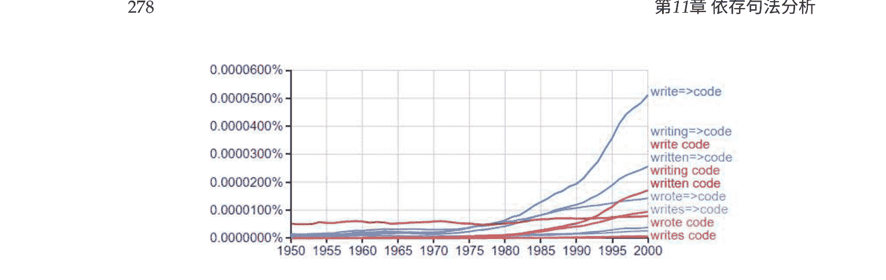

在第17章中。关系抽取的目标是识别实体对，例如

- (MELVILLE , MOBY-DICK)
- (TOLSTOY , WAR AND PEACE)
- (MARQUEZ, 100 YEARS OF SOLITUDE )
- (SHAKESPEARE , A MIDSUMMER NIGHT’S DREAM),

它们在某种关系中相互关联（在这种情况下，关系是作者）。这样的实体对通常通过一致的依赖关系链引用。因此，依赖路径通常是有监督系统中的一个有用特征，该系统通过标记的同一关系类型的其他实例的示例来学习检测该关系的新实例（Culotta和Sorensen，2004; Fundel等，2007; Mintz等，2009）。

Cui等人（2005年）展示了依存句法分析如何改善自动问答。假设你收到以下查询：

(11.1) 威斯康星州生产全国奶酪的百分之多少？

语料库包含这个句子：

(11.2) 在威斯康星州，农民生产全国奶酪的28%...

在这个字符串的表面形式中，威斯康星州的位置使其与查询不匹配。然而，在依存图中，问题和潜在答案中都存在从“生产”到“威斯康星州”的边，提高了这段文本与问题相关的可能性。

最后一个例子来自情感分析。如第4章所讨论的，一个句子的极性可以通过否定来颠倒，例如。

(11.3) 没有任何理由相信污染者会突然变得合理。

通过跟踪依存句法分析中的情感极性，我们可以更好地确定句子的整体极性，确定关键情感词是否被颠倒（Wilson等人，2005年；Nakagawa等人，2010年）。

### 附加资源

有关依存语法和解析算法的更多细节可以在K¨ubler等人的手稿中找到（2009年）。有关基于图的依存解析算法的全面而又奇特的概述，请参阅Eisner（1997年）。Jurafsky和Martin（2019年）描述了一种基于议程的波束搜索版本，其中波束包含长度各异的假设。只有当新假设的得分优于波束上当前最差的项目时，才将其添加到波束中。用于基于转换的解析的另一种搜索算法是easy-first，它放弃了从左到右的遍历顺序，并首先添加得分最高的边，而不管它们出现在哪里（Goldberg和Elhadad，2010年）。Goldberg等人（2013年）指出，尽管基于转换的方法可以在输入长度的线性时间内实现，但波束搜索的朴素实现将需要二次时间，因为在波束上扩展每个假设时需要复制每个假设的成本。可以通过使用更高效的数据结构来解决这个问题，

### 练习

1. 依赖结构 1 ← 2 → 3，以2为根，可以从弧标准分析中的多个动作集中获得。列出可以获得此解析的两组动作。不要忘记边缘 ROOT → 2。

2. 这个问题发展了依赖分析和词汇化上下文无关分析之间的关系。假设你有一组未标记的弧分数 $\{ \psi(i \to j) \}^M_{i,j=1} \cup \{ \psi(\text{ROOT} \to j) \}^M_{j=1}$。

   a) 假设每个词类型在输入中最多出现一次 ($((i = j) \Rightarrow (w_i = w_j))$)，你将如何构建一个加权的词汇化上下文无关文法，使得任何投射依赖树的分数等于词汇化上下文无关文法中某个等价推导的分数？

   b) 验证你的方法是否适用于例子他们钓鱼。

   c) 你的方法是否需要限制每个词类型在输入中只出现一次？如果是，为什么？

   d) *如果你的方法要求输入中每个词类型只出现一次，展示如何推广它。

3. 在基于弧因子的依存句法分析中，对于长度为 M的输入，一个句法分析的得分是每个弧的得分之和。在二阶依存句法分析中，总得分是许多更多项的和。使用具有祖父和兄弟特征的二阶依存句法分析器，对于图11.2的句法分析，有多少项是得分？假设ROOT的子节点没有祖父得分，没有兄弟节点的节点没有兄弟得分。

4. a) 在最坏的情况下，假设二阶依存句法分析，对于长度为 M的输入，涉及到多少项得分？描述最坏情况下的句法分析结构。与前一个问题一样，假设ROOT只有一个子节点，并且它没有任何祖父得分。

   b) 关于三阶依存句法分析的问题呢？

5. 提供句子西兰吃射击和离开的UD风格无标签依存句法分析，假设射击是一个名词，离开是一个动词。提供这个依存句法分析的弧标准和弧急切推导。

6. 计算无标签依存句法分析中弧标准移位-规约解析的成功推导数量的上界，作为输入长度 M的函数。提示：一个下界是投影决策树的数量，

   $$\frac{1}{M+1}\binom{3M-2}{M-1}$$ (Zhang, 2017)，其中 $\binom{a}{b}=\frac{a!}{(a-b)!b!}$。

7. 标签偏差问题在某些情况下，当一个决策在局部上是正确的，但会导致一系列错误（§11.3.3）。设计一个出现这种情况的场景。
具体来说：

   - 假设一个弧标准依存句法分析器，其动作分类器仅考虑栈顶和输入缓冲区前面的单词。
   - 设计两个例子，两个例子都涉及具有相同特征的决策。
   - 在一个例子中，移位是正确的决策；在另一个例子中，弧左或弧右是正确的决策。
   - 在这两个例子中，错误应该导致至少两个附加错误。
   - 在另一个例子中，错误只应导致一个附加错误。

对于以下练习，在大型文本语料库（至少10,000,000个标记）上运行一个依存句法分析器，例如Stanford的CoreNLP解析器，例如nltk.corpus.webtext。

8. 依存关系 NMOD:POSS表示所有权。计算以下代词最常拥有的前十个单词：this, her, our, my, your, 和 their（灵感来自Muralidharan和Hearst，2013年）。

9. 按 CONJ 关系分组计算所有单词对的数量。选择所有单词对 (i, j) 其中 i 和 j 至少同时参与五次 CONJ 关系。计算并按照 §14.3 中定义的点对点互信息进行排序，

   $$ \text{PMI}(i, j) = \log \frac{p(i,j)}{p(i)p(j)} $$
   
   这里，p(i) 是包含单词 i 的 CONJ 关系的比例（无论位置如何），而 p(i, j) 是链接 i 和 j 的这类关系的比例（无论顺序如何）。

10. 在 §4.2 中，我们遇到了词汇语义关系，如同义词（相同含义）、反义词（相反含义）和上位词（i 是 j 的特例）。另一个相关关系是共同上位词，意味着 i 和 j 共享一个上位词。在上一个问题中，通过 PMI 识别出的前 20 个单词对中，有多少个参与了这四种关系之一链接的同义词集？使用 WORDNET 来检查这些关系，并计算一对单词是否有任何一个同义词集链接。

# 第三部分

## 意义

# 第12章

## 逻辑语义学

前几章主要关注通过标记和解析重建自然语言的句法结构组织。但是，语言技术最令人兴奋和有前景的潜在应用涉及超越句法到语义——文本的潜在含义：

- 回答问题，例如最近的咖啡店在哪里？或者，美国第44任总统的母亲的中间名字是什么？
- 构建一个能够根据自然语言指令执行任务的机器人。
- 将一种语言的句子翻译成另一种语言，同时保留潜在的含义。
- 通过搜索网络寻找矛盾证据来事实核查一篇文章。
- 通过识别矛盾、歧义和不支持的断言来逻辑检查一个论证。

语义分析涉及将自然语言转换为意义表示。为了有用，意义表示必须满足几个标准：

- c1: 它应该是明确的：与自然语言不同，每个语句应该有且只有一个含义；
- c2: 它应该提供一种将语言与外部知识、观察和行动联系起来的方式；
- c3: 它应该支持计算推理，以便可以将含义组合起来推导出额外的知识；
- c4: 它应该足够表达人们在自然语言中谈论的各种事物的范围。

关于如何最好地表示计算知识还可以说得更多（例如，Sowa，2000），但本章将重点关注这四个标准。

### 12.1 意义和指称

表示含义的第一个标准是表示中的语句应该是明确的-它们应该只有一种可能的解释。自然语言没有这个特性：正如我们在第10章中看到的，像猫用爪子抓人这样的句子有多种解释。

但是一个语句何时是明确的呢？编程语言提供了一个有用的例子：程序的输出完全由语言规则和程序运行环境的属性来确定。例如，Python代码5 + 3的输出是8，代码(4*4) - (3*3)+1和((8))的输出也是8。这个输出被称为程序的指称，并且可以写成

$$ \text{[5+3]} = \text{[(4*4)-(3*3)+1]} = \text{[((8))]} = 8。 $$

这些算术表达式的指称由常量的含义（例如5，3）和关系的含义（例如+，*，(，)）决定。现在让我们考虑另一个Python代码片段，double(4)。这段代码的指称可以是[double(4)]=8，也可以是[double(4)]=44—这取决于double的含义。这个含义在一个世界模型M中被定义为一个无限的配对集合。我们用关于模型M的指称来表示，例如[double]M = {(0,0),(1,2),(2,4),...}。世界模型还会定义（无限的）常量列表，例如{0,1,2,...}。只要在模型M中可以明确计算出字符串φ的指称，就可以说该语言是明确的。

这种对意义的处理被称为模型论语义，它不仅解决了准则c1（没有歧义），还解决了准则c2（将语言与外部知识、观察和行动联系起来）。例如，我们可以将乔治亚州的首府的意义表示与包含地理事实在知识库的世界模型连接起来，得到亚特兰大的指称。我们可以通过检测和分析图像中的对象来构建一个世界模型，然后使用这个世界模型来评估命题，例如一个人正在骑驼鹿。模型论语义的另一个可取之处是，当事实发生变化时，指称也会发生变化：美国总统的意义表示在M2014中与在M2022中是不同的。

### 12.2 意义的逻辑表示

准则 c3 要求意义表示支持推理-例如，从已知前提中自动推断出新事实。 虽然有许多符合这些标准的表示方法被提出，但最成熟的是一阶逻辑语言。¹

#### 12.2.1 命题逻辑

逻辑意义表示的基本要素是命题的布尔运算：

命题符号。希腊符号如 φ 和 ψ 将用来表示命题，即真或假的陈述。 例如， φ 可能对应于命题，百吉饼很美味。

布尔运算符。我们可以通过布尔运算符构建更复杂的命题公式。这些包括：

- 否定 ¬φ，如果 φ 为假，则为真。
- 合取 φ ∧ ψ，如果 φ 和 ψ 都为真，则为真。
- 析取 φ ∨ ψ，如果 φ 和 ψ 中至少有一个为真，则为真。
- 蕴涵， φ ⇒ ψ，除非 φ 为真且 ψ 为假。 蕴涵与 ¬φ ∨ ψ 具有相同的真值条件。
- 等价， φ ⇔ ψ，当 φ 和 ψ 都为真或都为假时为真。 等价具有与 (φ ⇒ ψ) ∧ (ψ ⇒ φ)相同的真值条件。

并不严格要求使用所有五个布尔运算符：熟悉布尔逻辑的读者将知道可以使用 NAND（非与）或 NOR（非或）运算符构建所有其他运算符。 尽管如此，使用所有五个运算符最清晰明了。 根据这些运算符的真值条件，可以定义一些关于这些布尔运算符的“定律”，例如，

- 交换律 : φ ∧ ψ = ψ ∧ φ, φ ∨ ψ = ψ ∨ φ
- 结合律 : φ ∧ (ψ ∧ χ) = (φ ∧ ψ) ∧ χ, φ ∨ (ψ ∨ χ) = (φ ∨ ψ) ∨ χ
- 补充律: φ ∧ ¬φ = ⊥, φ ∨ ¬φ = ⊤, 其中 ⊤ 表示真命题而 ⊥ 表示假命题。

¹ 其他选择包括在地理语义解析 (Zelle和Mooney，1996) 和机器人控制 (Ge和Mooney，2005) 中使用的“无变量”表示，以及基于依赖的组合语义 (Liang等，2013)。

这些定律可以结合起来推导出进一步的等价性，从而支持逻辑推理。例如，假设 φ = 音乐很吵和 ψ = Max睡不着。那么如果我们给出，

φ ⇒ ψ 如果音乐很吵，Max睡不着。
φ 音乐很吵。

我们可以通过应用 modus ponens 等推理规则之一，从更基本的定律中推导出 ψ (Max睡不着)。自动定理证明器能够将推理规则应用于一组前提，推导出所需的命题 (Loveland, 2016)。

#### 12.2.2 一阶逻辑

命题逻辑之所以被称为命题逻辑，是因为它将命题视为其基本单位。然而，准则 c4 指出我们的意义表示应该足够表达。
现在考虑句子对，

(12.1) 如果有人在制造噪音，那么Max就不能睡觉。
Abigail在制造噪音。

人们能够从这个句子对中推断出一些东西，但这样的推断需要超越命题逻辑的形式工具。为了理解语句任何人在制造噪音和语句Abigail在制造噪音之间的关系，我们的意义表示需要额外的一阶逻辑 (FOL)机制。

在FOL中，逻辑命题可以通过实体之间的关系来构建。
具体而言，FOL通过以下术语类别扩展了命题逻辑：

常量。这些是模型中命名个体的元素，例如 MAX 和 ABIGAIL。模型 M 中每个常量的指示是模型中的一个元素，例如 ⟦MAX⟧ = m 和 ⟦ABIGAIL⟧ = a。

关系。关系可以被看作是实体的集合，或者是元组的集合。例如，关系 CAN-SLEEP 被定义为可以睡觉的实体的集合，并且具有表示 ⟦CAN-SLEEP⟧ = {a, m, ...}的含义。为了测试命题 CAN-SLEEP(MAX) 的真值，我们询问 ⟦MAX⟧ ∈ ⟦CAN-SLEEP⟧ 是否成立。有时候，定义在实体集合上的逻辑关系被称为属性。

关系也可以是有序的实体元组。例如，BROTHER(MAX, ABIGAIL) 表示命题 MAX 是 ABIGAIL 的兄弟。这种关系的含义是一个元组的集合，⟦BROTHER⟧ = {(m, a), (x, y), ...}。为了测试命题 BROTHER(MAX, ABIGAIL) 的真值，我们询问元组(⟦MAX⟧, ⟦ABIGAIL⟧)是否在关系 ⟦BROTHER⟧的含义中。

使用常量和关系，可以表达像 Max 不能睡觉和 Max 是 Abigail 的兄弟这样的陈述：

```
¬CAN-SLEEP(MAX)
BROTHER(MAX, ABIGAIL).
```

这些陈述也可以使用布尔运算符进行组合，例如，

```
(BROTHER(MAX, ABIGAIL) ∨ BROTHER(MAX, STEVE)) ⇒ ¬CAN-SLEEP(MAX).
```

这个一阶逻辑的片段只允许对特定实体的陈述。为了支持关于像如果有人在制造噪音，那么 Max 不能睡觉这样的陈述的推理，必须向意义表示中添加两个元素：

变量。变量是指不在本地指定的实体的机制。
我们可以写成 CAN-SLEEP(x) or BROTHER(x, ABIGAIL)。在这些情况下，x 是一个自由变量，意味着我们没有承诺任何特定的赋值。

量词。变量由量词绑定。一阶逻辑中有两个量词。

- 存在量词∃，表示至少存在一个实体可以与变量绑定。例如，语句 ∃x MAKES-NOISE(x) 表示至少存在一个实体使得 MAKES-NOISE 为真。
- 全称量词∀，表示变量可以绑定到模型中的任何实体。例如，语句，

```
MAKES-NOISE(ABIGAIL) ⇒ (∀x¬CAN-SLEEP(x)) [12.3]
```

断言如果 Abigail 发出声音，那么没有人能睡觉。

表达式 ∃x 和 ∀x 将 x 转化为一个绑定变量。不包含自由变量的公式是一个句子。

函数。函数将实体映射到实体，例如，⟦CAPITAL-OF(GEORGIA)⟧ = ⟦ATLANTA⟧。使用函数，可以方便地添加一个等号运算符，支持如下语句：

```
∀x∃y MOTHER-OF(x) = DAUGHTER-OF(y). [12.4]
```

2在一阶逻辑中，只能对实体进行量化。在二阶逻辑中，可以对属性进行量化。这使得可以表示如下语句：Butch 拥有每个好拳击手的属性（来自 Blackburn 和 Bos，2005 年的例子）

```
∀P∀x((GOOD-BOXER(x) ⇒ P(x)) ⇒ P(BUTCH)). [12.2]
```

在与 MIT Press 签订的合同下，根据 CC-BY-NC-ND 许可共享。

请注意 MOTHER-OF 是关系 MOTHER 的功能类似物，所以 MOTHER-OF(x) = y 如果 MOTHER(x, y)。任何使用函数的逻辑公式都可以使用关系和量词来重写。例如，

```
MAKES-NOISE(MOTHER-OF(ABIGAIL)) [12.5]
```

可以重写为 ∃x MAKES-NOISE(x) ∧ MOTHER(x, ABIGAIL)。

量词的一个重要属性是顺序可能很重要。不幸的是，自然语言很少明确说明这一点！这个问题可以通过以下示例来演示：每个人都会说一种语言，它有以下解释：

```
∀x∃y SPEAKS(x, y) [12.6]
```

```
∃y∀x 说话(x, y). [12.7]
```

在第一种情况下，y 可能指的是几种不同的语言，而在第二种情况下，有一个单一的 y 是每个人都说的。

##### 真值条件语义学

从一种角度来看，FOL 句子 φ 的含义可以看作是一组真值条件，或者是使 φ 满足的模型。但是如何确定一个句子在给定模型中是真还是假？ 我们将以归纳的方式来解决这个问题，从一个应用于常量元组的谓词开始。 这样一个句子的真值取决于常量的指称元组是否在谓词的指称中。 例如，CAPITAL(GEORGIA, ATLANTA) 在模型 M 中为真当且仅当，

```
([GEORGIA]M, [ATLANTA]M) ∈ [CAPITAL]M. [12.8]
```

布尔运算符 ∧, ∨, ... 提供了构建更复杂句子的方法，这些句子的真值可以根据与这些运算符相关的真值表进行评估。 如果存在某个变量 x 的赋值使得 φ 为真，则语句 ∃xφ 为真；如果 φ 在所有可能的 x 赋值下都为真，则语句 ∀xφ 为真。 更正式地说话，我们可以说 φ 在模型 M 下被满足，记作 M | = φ。

真值条件语义学允许我们定义句子和句子对的其他属性。 假设在每个使 φ 被满足的 M 下，另一个公式 ψ 也被满足；则 φ 蕴含 ψ，也可以写作 φ | = ψ。例如，

```
CAPITAL(乔治亚, 亚特兰大) | = ∃xCAPITAL(乔治亚, x). [12.9]
```

在任何模型下都满足的语句，例如 φ ∨ ¬φ，被称为有效，写作 | = (φ ∨ ¬φ)。在任何模型下都不满足的语句，例如 φ ∧ ¬φ，被称为不可满足，或不一致。模型检查器是一种确定句子 φ 在模型 M 中是否满足的程序。模型构建器是一种构建满足句子 φ 的模型的程序。在一阶逻辑中，检查一致性和有效性的问题是不可判定的，这意味着没有自动确定 FOL 公式是否有效或不一致的算法。

##### 一阶逻辑推理

我们最初的目标是支持将一般陈述与特定陈述结合起来进行推理，如果有人在制造噪音，那么马克斯就无法入睡，像阿比盖尔正在制造噪音这样的陈述。我们现在可以用一阶逻辑表示这样的陈述，但是我们如何进行推理，以证明马克斯无法入睡呢？一种方法是使用“广义”的命题推理规则，如演绎法则，可以应用于 FOL 公式。通过反复应用这样的推理规则到一个事实知识库，可以产生所需命题的证明。为了找到推导出所需定理的正确推理序列，可以应用经典人工智能搜索算法，如反向链接。这样的算法在 Prolog 逻辑编程语言的解释器中实现 (Pereira 和 Shieber, 2002 年)。

### 12.3 语义解析和 λ 演算

前面的部分介绍了很多形式化的机制；本章的其余部分将这些形式化机制与自然语言联系起来。给定一个英语句子，如 Alex 喜欢 Brit，我们如何获得所需的一阶逻辑表示， LIKES(ALEX, BRIT)？这是语义解析的任务。正如句法分析器是从自然语言句子到句法结构（如短语结构树）的函数一样，语义解析器是从自然语言到逻辑公式的函数。

与句法分析一样，语义解析也很困难，因为输入和输出的空间非常大，它们之间的相互作用也很复杂。我们最大的希望是，像句法分析一样，语义解析可以以某种方式分解为更简单的子问题。这个想法通常归功于德国哲学家戈特洛布·弗雷格，被称为组合性原则：复杂表达式的含义是其组成部分的含义的函数。我们将把这些“组成部分”定义为句法组成成分：名词短语和动词短语。这些组成成分通过函数应用进行组合：如果句法分析包含产生式 x → y z，则 x 的语义，写作 x.sem，将根据其组成部分的语义计算出来。

在与 MIT Press 签订的合同下，根据 CC-BY-NC-ND 许可共享。

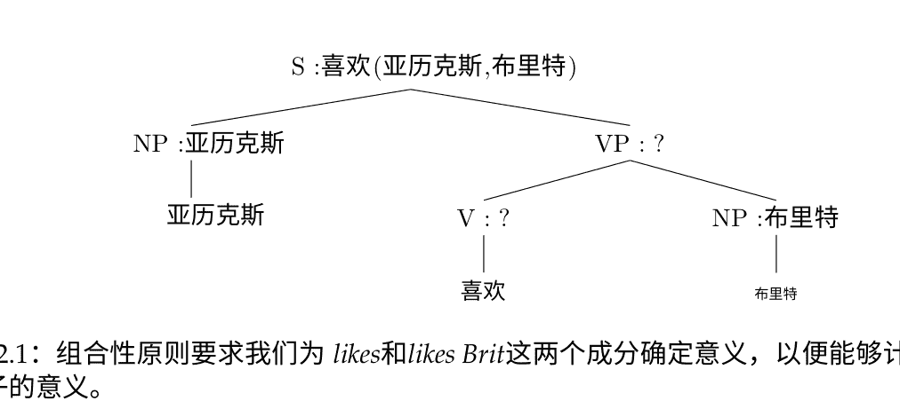

成分， y.sem 和 z.sem.³ ⁴

#### 12.3.1 λ 演算

让我们看看这是如何适用于一个简单的句子，比如亚历克斯喜欢布里特，其句法结构如图 12.1 所示。我们的目标是公式 LIKES(ALEX, BRIT)，很明显，成分亚历克斯和布里特的意义应该是 ALEX 和 BRIT。 这还剩下两个成分：动词喜欢和动词短语喜欢布里特。这些单元的意义必须以一种方式定义，使得通过函数应用能够恢复所需的整个句子的意义。如果亚历克斯和布里特的意义是常量，那么喜欢和喜欢布里特的意义必须是函数表达式，可以应用于它们的兄弟节点以产生所需的分析。

对这些部分分析进行建模需要扩展一阶逻辑的含义表示。我们通过添加 lambda 表达式来实现这一点，lambda 表达式是匿名函数的描述，例如，

λx.LIKES(x, BRIT). [12.10]
这个函数表达式是动词短语 likes Brit 的含义；它接受一个参数，并返回将该参数替换为 x 在表达式中的结果。

³ §9.3.2 简要讨论了组合范畴语法（CCG）作为短语结构句法分析的替代方法。CCG 被认为特别适用于语义解析（Hockenmaier 和 Steedman, 2007），并且在语义解析的机器学习的许多现代工作中使用，概述在 §12.4 中。
⁴ 从句法结构的一系列操作中算法地构建出意义表示的方法通常归功于哲学家理查德·蒙塔古，他在 20 世纪 70 年代初发表了一系列有影响力的论文（例如，蒙塔古，1973 年）。
⁵ 从形式上讲，所有的一阶逻辑公式都是 λ 表达式；此外，如果 φ 是一个 λ 表达式，那么 λx.φ 也是一个 λ 表达式。熟悉函数式编程的读者会从 Lisp 和 Python 等编程语言中的使用中认识到 λ 表达式。

Jacob Eisenstein。2018 年 11 月 13 日草稿。

### 12.3 语义解析和 λ 演算

LIKES(x, BRIT)。 我们将这个替换写作，
$$ (\lambda x.LIKES\ (x, BRIT))@ALEX = LIKES\ (ALEX, BRIT) $$
[12.11]
其中符号“@”表示函数应用。 在 λ 演算中，函数应用有时被称为 β-约简或 β-转换。 表达式 φ@ψ 表示通过 β-约简执行的函数应用，而 φ(ψ) 表示最终逻辑形式中的函数或谓词。

方程式 12.11 展示了如何获得句子的所需语义，亚历克斯喜欢布里特：通过应用 lambda 表达式 λx.LIKES(x, BRIT) 对于逻辑常量 ALEX 的含义。这种组合规则可以在语法-语义语法中进行规定，其中语法产生与语义操作配对。对于语法产生式 S → NP VP，我们有语义规则 VP.sem@NP.sem。

及物动词短语喜欢布里特的含义也可以通过对其语法成分进行函数应用来获得。对于语法产生式 VP → V NP，我们应用语义规则，

```
VP.sem = (V.sem)@NP.sem [12.12]
= (\lambda y.\lambda x.LIKES\ (x, y))@(BRIT) [12.13]
= \lambda x.喜欢(x, 英国). [12.14]
```

因此，及物动词喜欢的意义是一个 λ 表达式，其输出是另一个 λ 表达式：它以 y 作为参数来填充喜欢关系中的一个槽，并返回一个准备好接受参数来填充另一个槽的 λ 表达式。⁶

表 12.1 显示了一个最小的句法-语义语法片段 G₁。在 G₁ 中，完整的 Alex 喜欢 Brit 的推导如图 12.2 所示。除了及物动词喜欢之外，语法还包括不及物动词睡觉；如何推导出类似 Alex 睡觉的句子的意义应该是清楚的。对于既可以是及物动词又可以是不及物动词的动词，例如吃，我们将有两个终结产生式，一个用于每个意义（终结产生式也称为词汇条目）。事实上，大部分语法都在词汇（终结产生式）中，因为这些产生式选择了语义解释的基本单位。

#### 12.3.2 量化

当我们从关于命名实体的句子转移到涉及更一般的名词短语的句子时，事情变得更加复杂。让我们考虑一个例子，一只狗在睡觉，

⁶ 这可以用几种不同的方式来表示。符号 λy, x.LIKES(x, y) 是一种比较非正式的表示方法，表示一个接受两个参数的 lambda 表达式；这在函数式编程中是可以接受的。逻辑学家（例如，Carpenter, 1997）通常更喜欢更正式的符号 λy.\lambda x.LIKES(x)(y)，表示每个 lambda 表达式只接受一个参数。

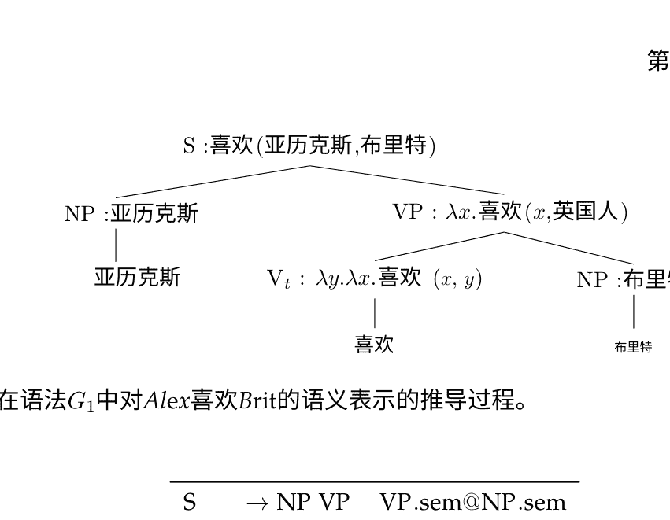

表格 12.1：G1，一个最小的句法-语义上下文无关文法
| | | |
| :--- | :--- | :--- |
| S | → NP VP | VP.sem@NP.sem |
| VP | → Vt NP | Vt.sem@NP.sem |
| VP | → Vi | Vi.sem |
| Vt | → 喜欢 | λy.λx.喜欢 (x, y) |
| Vi | → 睡觉 | λx.睡觉 (x) |
| NP | → 亚历克斯 | 亚历克斯 |
| NP | → 布里特 | 布里特 |

它的意思是 ∃x 狗(x) ∧ 睡觉(x)。显然，狗关系将由单词 dog 引入，而睡觉关系将由单词 sleeps 引入。存在量词 ∃ 必须由冠词 a 的词汇条目引入。⁷然而，在语法 G1 中采取的组合方法似乎存在问题：如果名词短语 a dog 的语义是一个存在量化表达式，那么它如何成为期望实体的动词 sleeps 的语义的参数？ 而且逻辑连词从哪里来？

处理这些问题有几种不同的方法。⁸ 我们将从反转主语名词短语和动词短语之间的语义关系开始，这样产生的 S → NP VP 的语义就是 NP.sem@VP.sem： 现在句子的意思是名词短语应用于动词短语的语义。 这种变化的含义最好通过探索示例的推导来说明，如图 12.3 所示。让我们

> 相反，句子每只狗都睡觉将涉及到一个全称量词， ∀xDOG(x) ⇒ SLEEPS(x)。定冠词 the 需要更多考虑，因为 the dog 必须指的是一只在句子之外可以唯一确定的狗。Carpenter (1997 年，第 96-100 页) 总结了处理定冠词描述的最新方法。
⁸ Carpenter (1997) 提供了基于组合范畴语法的替代处理方法。

Jacob Eisenstein。 2018 年 11 月 13 日草稿。

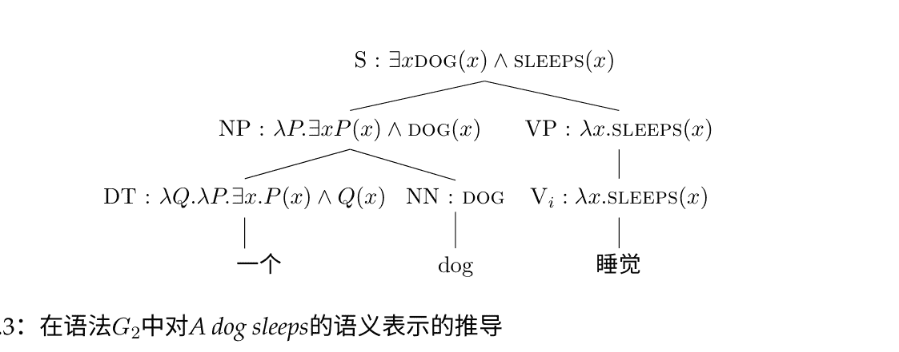

图 12.3：在语法 G₂ 中对 A dog sleeps 的语义表示的推导

从不定冠词 a 开始，我们给它分配了相当令人生畏的语义。

$$\lambda P.\lambda Q.\exists x P(x) \wedge Q(x). \qquad [12.15]$$

这是一个接受两个关系作为参数的 lambda 表达式，P 和 Q。关系 P 被外部 lambda 表达式限定范围，因此它将由紧邻的名词提供，本例中是 DOG。因此，名词短语 a dog 具有以下语义，

$$\begin{aligned} \text{NP.sem} &=\text{DET.sem}@\text{NN.sem} \qquad [12.16] \\ &=(\lambda P.\lambda Q.\exists x P(x) \wedge Q(x))@(\text{DOG}) \qquad [12.17] \\ &=\lambda Q.\exists x \text{DOG}(x) \wedge Q(x). \qquad [12.18] \end{aligned}$$

这是一个期望另一个关系 Q 的 lambda 表达式，它将由动词短语 SLEEPS 提供。这给出了所需的分析， ∃x DOG(x) ∧ SLEEPS(x)。⁹如果像 a dog 这样的名词短语被解释为 lambda 表达式，那么像 Alex 这样的专有名词也必须以同样的方式处理。这通过从常量到 lambda 表达式的类型提升来实现， x ⇒ λP.P(x)。类型提升后， Alex 的语义是 λP.P(ALEX)——一个期望关系告诉我们关于 ALEX 的 lambda 表达式。¹⁰同样，确保你看到图 12.3 中的分析如何适用于句子 Alex sleeps。

⁹ 当应用 β-规约到自身是 lambda 表达式的参数时，确保使用唯一的变量名以避免混淆。例如，在对 a 的语义中，重要的是区分 x 和 likes 的语义中的 x。变量名是抽象的，可以随时更改 - 这被称为 α-转换。例如， λx.P(x) 可以转换为 λy.P(y) 等。
¹⁰ 组合语义分析通常由类型系统支持，这使得可以检查给定的函数应用是否有效。基本类型是实体 e 和真值 t。属性，例如 DOG，是从实体到真值的函数，因此其类型写作 ⟨e, t⟩。一个及物动词的类型是 ⟨e, ⟨e, t⟩⟩：在接收到第一个实体（直接宾语）之后，它返回一个从实体到真值的函数，该函数将应用于句子的主语。类型提升操作 x ⇒ λP.P(x) 对应于从 e 到 ⟨⟨e, t⟩, t⟩ 的类型变化：它期望一个从实体到真值的函数，并返回一个真值。

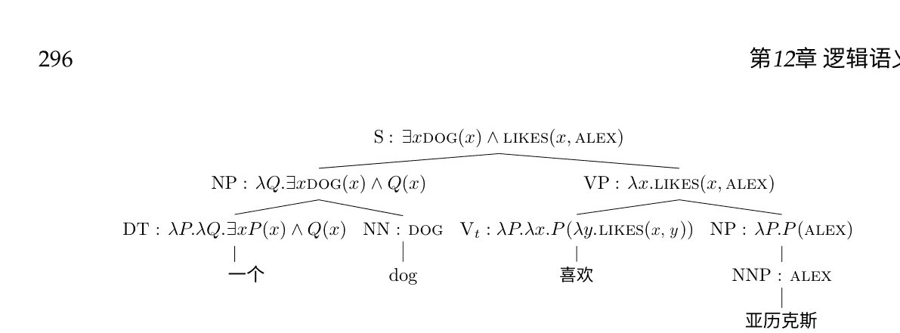

图 12.4: 对于一只狗喜欢 Alex 的语义表示的推导

直接宾语通过对及物动词应用相同的类型提升操作来处理：例如 likes 这样的动词的含义被提升为, λP.λx.P(λy.LIKES(x, y))

[12.19]

因此，我们可以保留动词短语生成 VP.sem = V.sem@NP.sem，知道直接宾语将在方程 12.19 中提供功能 P。为了看到这是如何工作的，让我们分析动词短语喜欢一只狗。在唯一地重新标记每个 lambda 变量之后，

```
VP.sem = V.sem@NP.sem
        = (λP.λx.P(λy.喜欢 (x, y)))@(λQ.∃z狗 (z) ∧ Q(z))
        = λx.(λQ.∃z狗 (z) ∧ Q(z))@(λy.喜欢 (x, y))
        = λx.∃z狗 (z) ∧ (λy.喜欢 (x, y))@z
        = λx.∃z狗(z) ∧喜欢(x, z).
```

这些变化总结在修订的语法 G2 中，表 12.2 中显示。图 12.4 显示了一个涉及及物动词、一个不定名词短语和一个专有名词的推导。

### 12.4 学习语义解析器

与句法分析一样，任何具有足够覆盖范围的句法-语义语法都有可能为任何给定的句子产生许多可能的分析。机器学习是选择单个分析的主要方法。我们将重点关注学习通过给它们的推导特征附加权重来评分逻辑形式的算法 (Zettlemoyer and Collins, 2005)。其他方法包括基于转换的解析 (Zelle and Mooney, 1996; Misra and Artzi, 2016) 和受机器翻译启发的方法 (Wong and Mooney, 2006)。方法在用于学习的监督形式上也有所不同，可以从完整的推导到更有限的训练信号。我们将从完全监督的情况开始，然后考虑即使缺少看似关键的信息，学习仍然是可能的。

#### 12.4.1 从推导中学习

让 w⁽ⁱ⁾ 表示一系列文本，让 y⁽ⁱ⁾ 表示所需的逻辑形式。 例如：

w⁽ⁱ⁾ = Alex 吃射击和离开
y⁽ⁱ⁾ = 吃(ALEX, SHOOTS) ∧ 吃(ALEX, LEAVES)

在引入的标准监督学习范式中 §2.3, 我们首先定义一个特征函数 f(w, y) , 然后学习这些特征的权重, 使得 y⁽ⁱ⁾ = argmax_y θ · f(w, y) 。 权重向量 θ 通过比较真实标签的特征 f(w⁽ⁱ⁾, y⁽ⁱ⁾) 与预测标签的特征 f(w⁽ⁱ⁾, ŷ) （感知机，支持向量机或预期特征向量 \(E_{y|w}[f(w^{(i)}, y)]\) （逻辑回归）。

虽然这个基本框架看起来与鉴别性句法分析相似，但有一个关键的区别。在（上下文无关的）句法分析中，注释 \(y^{(i)}\) 包含了所有的句法产生式；事实上，确定正确的产生式集合的任务与确定句法结构的任务是相同的。在语义分析中，情况并非如此：逻辑形式 EATS (ALEX， SHOOTS) \(\wedge\) EATS (ALEX, LEAVES) 并不揭示获得它所使用的句法-语义产生式。事实上，可能存在虚假的歧义，因此单个逻辑形式可以通过多个推导得到。

（我们之前在基于转移的依存句法分析中遇到过虚假的歧义，\(\S\) 11.3.2.）

这些想法可以通过引入一个额外的变量 \(z\) 来形式化，该变量表示逻辑形式 \(y\) 从文本 \(w\) 的推导。假设特征函数在推导中分解，即 \(f(w, z, y) = \sum_{t=1}^{T} f(w, z_t, y)\)，其中 \(z_t\) 表示单个句法-语义产生式。例如，我们可以为产生式 \(S \rightarrow NP\ VP\) : NP.sem@VP.sem以及像 \(NNP \rightarrow Alex\) : ALEX这样的终端产生式都可以有一个特征。在这种分解下，可以计算出对 \(w\) 的每个语义注释子树的分数，以便像CKY (\(\S\) 10.1) 这样的自底向上句法分析算法可以应用于找到最佳得分的语义分析。

图12.5展示了句子 \(Alex\ eats\ shoots\ and\ leaves\) 的正确语义分析的推导过程，在一个简化的语法中，复数名词短语 \(shoots\) 和 \(leaves\) 被解释为逻辑常量 SHOOTS和 LEAVES\(\ _{n}\)。图12.6展示了一个错误分析的推导过程。假设每个产生式有一个特征，感知机的更新如表12.3所示。从这个更新中，解析器会学习优先选择 \(leaves\) 的名词解释而不是动词解释。它还会学习优先选择名词短语协调而不是动词短语协调。

虽然更新是以感知机为例解释的，但很容易用条件随机场替换感知机。在这种情况下，在线更新将是

Jacob Eisenstein。2018年11月13日草稿。

表格 12.3: 感知器更新用于图 12.5（黄金）和图 12.6（预测）中的分析
| 推导 | 语义操作 | 权重 |
| :--- | :--- | :--- |
| NP1 → NP2 Cc NP3 | (Cc.sem@(NP2.sem))@(NP3.sem) | +1 |
| VP1 → VP2 Cc VP3 | (Cc.sem@(VP2.sem))@(VP3.sem) | -1 |
| NP → 离开 | 叶子ₙ | +1 |
| VP → Vᵢ | Vᵢ.sem | -1 |
| Vᵢ → 离开 | λx.叶子ᵥ | -1 |

基于特征期望，可以使用内外算法（§10.6）计算。

#### 12.4.2 从逻辑形式中学习

完整的推导很昂贵且很少可用。<sup>11</sup>一种解决方案是直接从逻辑形式学习，同时将推导视为1 a-内容变量（Zettlemoyer 和 Collins，2005）。在一个条件概率模型中，涉及逻辑形式 *y* 和推导 *z*，我们有：

```
p(*y*, *z* | *w*) = \frac{\exp(\boldsymbol{\theta} \cdot \boldsymbol{f}(*w*, *z*, *y*))}{\sum_{*y*', *z*'} \exp(\boldsymbol{\theta} \cdot \boldsymbol{f}(*w*, *z*', *y*'))},  
[12.20]
```

这是标准的对数线性模型，应用于逻辑形式 *y*和推导 *z*。

由于推导 *z*明确确定了逻辑形式 *y*，所以对 *y*和 *z*进行联合概率建模可能看起来很愚蠢。然而，由于 *z*是未知的，可以将其边缘化掉，

```
p(*y* | *w*) = \sum_{*z*} p(*y*, *z* | *w*)。
[12.21]
```

<sup>11</sup>Ge和Mooney（2005）的工作是一个例外，他们为几百个句子注释了每个句法成分的含义。

然后，语义解析器可以选择具有最大对数边际概率的逻辑形式，

```
$$\log \sum_z \mathrm{p}(y, z \mid w) = \text{对数} \sum_z \frac{\exp(\boldsymbol{\theta} \cdot \boldsymbol{f}(w, z, y))}{\sum_{y', z'} \exp(\boldsymbol{\theta} \cdot \boldsymbol{f}(w, z', y'))}$$ [12.22]
$$\propto \text{对数} \sum_z \exp(\boldsymbol{\theta} \cdot \boldsymbol{f}(w, z', y'))$$ [12.23]
$$\geq \max_z \boldsymbol{\theta} \cdot \boldsymbol{f}(w, z, y).$$ [12.24]
```

将 log项推入 z的总和中是不可能的，因此我们通常的线性评分函数不适用。 我们只能近似地恢复这个评分函数，通过对派生 z的最大值（而不是求和）进行计算，从而提供一个下界。

学习可以通过最大化对数边际似然来进行。

```
$$\ell(\boldsymbol{\theta}) = \sum_{i=1}^N \log \mathrm{p}(y^{(i)} \mid w^{(i)}; \boldsymbol{\theta})$$ [12.25]
$$= \sum_{i=1}^N \log \sum_z \mathrm{p}(y^{(i)}, z^{(i)} \mid w^{(i)}; \boldsymbol{\theta}).$$ [12.26]
```

这个对数似然在 $\theta$ 中不是凸的，不像完全观察到的条件随机场的对数似然。 这意味着学习可以根据初始化的不同而产生不同的结果。

方程12.26的导数是，

```
$$\frac{\partial \ell_i}{\partial \boldsymbol{\theta}} = \sum_z \mathrm{p}(z \mid y, w; \boldsymbol{\theta}) f(w, z, y) - \sum_{y',z'} \mathrm{p}(y', z' \mid w; \boldsymbol{\theta}) f(w, z', y')$$ [12.27]
$$= E_{z|y,w} \boldsymbol{f}(w, z, y) - E_{y,z|w} \boldsymbol{f}(w, z, y)$$ [12.28]
```
两个期望值都可以通过像内外算法这样的自底向上算法计算。 或者，我们可以再次对推导进行最大化，而不是对近似解进行边缘化。 在任何一种情况下，梯度的第一项要求我们识别与逻辑形式 y兼容的推导y。 这可以通过自底向上的动态规划算法来完成，通过使表格中的每个单元格 t[i, j, X] 包含 X的所有可能的逻辑形式的集合。

因此，生成的表可能比句法分析中的表要大得多。 这可以通过使用修剪来消除与最终逻辑形式不兼容的中间分析（Zettlemoyer和Collins, 2005），或者通过使用波束搜索并限制每个单元格的大小为某个固定常数（Lang等，2013）来进行控制。

如果我们 将方程12.28中的每个期望替换为argmax，并且然后应用随机梯度下降来学习权重，我们就得到了潜在变量感知器，一个简单的以及处理缺失数据的通用算法。 该算法在算法16中以其最基本的形式展示，但是通常的技巧，如平均和边际损失，可以应用（Yu和Joachims，2009）。除了语义解析之外，潜在变量感知器还用于诸如机器翻译（Liang等，2006）和命名实体识别（Sun等，2009）的任务。 在潜在条件随机场中，我们使用完全期望而不是对隐藏变量进行最大化。 这个模型还被应用于语义解析之外的一系列问题，包括解析重排序（Koo和Collins，2005）和手势识别（Quattoni等，2007）。

#### 12.4.3 从指称中学习

逻辑形式比完整推导更容易获得，但逻辑形式的注释仍然需要相当的专业知识。 然而，对于许多自然语言句子来说，获得去噪声的表达相对容易。 例如，在地理领域中，问题的表达将是其答案（Clarke等，2010；Liang等，2013）：

文本：哪些州与乔治亚接壤？
逻辑形式：λx.STATE(x) ∧ BORDER(x, GEORGIA)
Denotation：{阿拉巴马州，佛罗里达州，北卡罗来纳州，南卡罗来纳州，田纳西州}

同样，在机器人控制环境中，命令的表达将是一个动作或一系列动作（Artzi和Zettlemoyer，2013）。在这两种情况下，思想是奖励语义解析器选择一个其表达的含义是正确的分析：问题的正确答案，或者正确的动作。

通过对派生进行求和或最大化，学习逻辑形式成为可能。 这个想法可以进一步发展，通过对具有正确指示的所有逻辑形式进行求和或最大化。 设 vi(y)∈{0,1} 为验证函数，它为文本 w(i) 分配一个二进制分数，表示指示 JyK 是否正确。

我们可以通过最大化条件似然目标来学习， 然后我们可以通过最大化条件似然目标来学习，

$$ \ell^{(i)}(\theta) = \log \sum_{\mathbf{y}} v_i(\mathbf{y}) \times \mathrm{p}(\mathbf{y} \mid \mathbf{w}; \theta) \qquad \qquad \qquad \qquad \qquad [12.29] $$
$$ = \log \sum_{\mathbf{y}} v_i(\mathbf{y}) \times \sum_{\mathbf{z}} \mathrm{p}(\mathbf{y}, \mathbf{z} \mid \mathbf{w}; \theta), \qquad \qquad \qquad \qquad [12.30] $$

对所有有效逻辑形式的所有派生 zof求和, {y : vi(y) = 1}. 这对应于语义解析器生成具有有效指示的逻辑形式的对数概率。

对 θ进行微分，我们得到，

$$ \frac{\partial \ell^{(i)}}{\partial \theta} = \sum_{\mathbf{y}, \mathbf{z}:v_i(\mathbf{y})=1} \mathrm{p}(\mathbf{y}, \mathbf{z} \mid \mathbf{w}) f(\mathbf{w}, \mathbf{z}, \mathbf{y}) - \sum_{\mathbf{y}', \mathbf{z}'} \mathrm{p}(\mathbf{y}', \mathbf{z}' \mid \mathbf{w}) f(\mathbf{w}, \mathbf{z}', \mathbf{y}'), \qquad [12.31] $$

这是通常的特征期望差异。 正项计算了在指示符有效的条件下的预期特征期望，而第二项计算了根据当前模型的预期特征期望，而不考虑基本事实。 对于这个问题，也可以使用大边界学习公式。 例如，Artzi和Zettlemoyer (2013) 生成一组有效和无效的推导，然后施加一个约束，即所有有效的推导应该得分高于所有无效的推导。 这个约束驱动了类似感知器的学习规则。

### 附加资源

这里没有考虑到的一个关键问题是如何处理语义的不确定性：即在一个句法结构中存在多个语义解释的情况。 量词范围的歧义是一个经典的例子。 Blackburn和Bos (2005) 列举了解决这个问题的多种方法，并提供了自然语言语义和计算推理技术之间的联系。 关于语义解析的许多当代研究使用组合范畴语法 (CCG) 框架。 Carpenter (1997) 全面介绍了CCG如何支持组合语义分析。 另一个最近的研究领域是多句文本的语义。 这可以用动态语义学模型来处理，例如动态谓词逻辑 (Groe-nendijk和Stokhof，1991) 。

关于形式语义学的替代阅读包括Levy和Manning (2009) 的“非正式”阅读，以及Briscoe (2011) 的更详细介绍。 要了解关于数据驱动语义解析的最新研究，请参阅调查报告。

Liang和Potts（2015）的文章，Artzi和Zettlemoyer（2013）的教程幻灯片和视频，以及Yoav Artzi（13）和Percy Liang（14）的源代码

### 练习

-   1. “modus ponens” 推理规则指出，如果我们知道 φ ⇒ ψ 和 φ，则 ψ 必须为真。使用 ⇒ 运算符的定义和 §12.2.1 中提供的一些定律来证明这个规则，再加上一个额外的恒等式：⊥ ∨ φ = φ。
-   2. 将以下示例转换为一阶逻辑，使用关系 CAN-SLEEP，MAKES-NOISE，和 BROTHER。
    -   如果阿比盖尔制造噪音，没有人能睡觉。
    -   如果阿比盖尔制造噪音，有人不能睡觉。
    -   阿比盖尔的兄弟们都睡不着觉。
    -   如果阿比盖尔的兄弟中有人吵闹，阿比盖尔就无法入睡。
-   3. 扩展语法片段 G₁ 以包括及物动词教和专有名词斯瓦希里语。展示如何推导出句子亚历克斯教布里特斯瓦希里语的解释，应为教(亚历克斯,布里特,斯瓦希里语)。语法不需要处于乔姆斯基范式。对于及物动词，使用 NP₁ 和 NP₂ 来表示两个直接宾语。
-   4. 使用语法片段 G₂ 推导出句子亚历克斯喜欢每只狗的语义解释。
-   5. 扩展语法片段 G₂ 以处理形容词，使得生气的狗的含义为 λP。具体来说，你应该提供形容词生气的词汇条目，并指定句法-语义产生式 NP → DET NOM，NOM → JJ NOM，和 NOM → NN。
-   6. 扩展你对前一个问题的回答，涵盖带有谓词形容词的连系结构，例如 Alex is angry。解释应该是 ANGRY(ALEX)。你应该添加一个动词短语生成规则 VP → V₍ₒₚ₎ JJ，和一个终结符生成规则 V₍ₒₚ₎ → is。展示你的语法扩展为什么会得出正确的解释。
-   7. 在图12.5和图12.6中，我们将复数形式的 shoots 和 leaves 视为实体。修改语法 G₂，使得 Alex eats leaves 的解释为 ∀x.(LEAF(x) ⇒ EATS(ALEX, x))，并展示结果感知器的更新。
-   8. 像每个学生都吃披萨这样的陈述有两种可能的解释，取决于量词的范围：
    -   ∀x∃yPIZZA(y) ∧ (STUDENT(x) ⇒ EATS(x, y)) [12.32]
    -   ∃y∀xPIZZA(y) ∧ (STUDENT(x) ⇒ EATS(x, y)) [12.33]
    -   a) 解释为什么这些解释确实不同。
    -   b) 哪个是由语法G₂生成的？请注意，您可能需要操作逻辑形式以与语法完全对齐。
-   9. *修改 G₂，以便生成前一个问题中的第二种解释。提示：一种可能的解决方案涉及更改句子生成的语义和另一个生成的语义。
-   10. 在GeoQuery领域中，给出一个具有多个可能的语义解释但具有相同指示的自然语言查询。列出两种解释和指示。提示：有很多方法可以做到这一点，但其中一种方法涉及使用可能映射到模型中多个不同实体的地名（地名）。

## 第13章

## 谓词-论元语义学

本章考虑了更“轻量级”的语义表示，它们舍弃了一些一阶逻辑的方面，而专注于谓词-论元结构。 让我们从思考事件的语义开始，以一个简单的例子为例：

(13.1) Asha给Boyang一本书。

这个句子的一阶逻辑表示是：

```
∃x. BOOK(x) ∧ GIVE(ASHA, BOYANG, x) [13.1]
```

在这个表示中，我们为书定义了变量 x，并将字符串 Asha和Boyang链接到实体ASHA和BOYANG。 因为给予的行为涉及到给予者、接受者和礼物，谓词 GIVE必须有三个参数。

现在假设我们对事件有额外的信息：

(13.2) 昨天，阿莎不情愿地给了波扬一本书。

一种可能的解决方案是扩展谓词给以接受额外的参数，

```
∃x. 书(x) ∧给(阿莎,波扬, x,昨天,不情愿地) [13.2]
```

但这显然是不令人满意的：昨天和不情愿地是可选参数，我们需要为每种可能的参数组合创建不同版本的给谓词。 事件语义通过将事件作为存在量化变量 e来解决这个问题，

```
∃e, x.给-事件(e) ∧给予者(e,阿莎) ∧礼物(e, x) ∧书(e, x) ∧接收者(e,波扬)
∧时间(e,昨天) ∧方式(e,不情愿地)
```

通过这种方式，事件的每个论元——给予者、接收者、礼物——都可以用自己的关系来表示，将论元与事件链接起来。表达式给予者(事件，ASHA)表示ASHA在事件中扮演给予者的角色。这种重新表述解决了事件的可选信息问题，例如事件的时间或方式，这些被称为附加成分。与论元不同，附加成分不是关系的强制部分，但在这种表示下，它们可以用额外的逻辑关系来表达，这些关系与句子的语义解释相连。<sup>1</sup>事件语义表示可以应用于嵌套从句，例如：

(13.3) 克里斯看到阿莎付给波扬。

通过使用事件变量作为论证来实现这一点：

```
∃e₁∃e₂ SEE-EVENT(e₁) ∧ SEER(e₁, CHRIS) ∧ SIGHT(e₁, e₂) ∧ PAY-EVENT(e₂) ∧ PAYER(e₂, ASHA) ∧ PAYEE(e₂, BOYANG)       [13.3]
```

与一阶逻辑一样，事件语义的目标是提供一个可以概括许多表面形式的表示。考虑以下 (13.1) 的释义：

-   (13.4) a. Asha给Boyang一本书。
    b. 一本书被Asha给了Boyang。
    c. 一本书被Asha给了Boyang。
    d. 从Asha给Boyang的一本书的礼物...

所有的事件都与方程13.1具有相同的语义含义，但表达方式多种多样。最后一个例子甚至不包括动词：事件通常由动词引入，但如(13.4d)所示，名词礼物也可以引入相同的谓词，并带有相同的附加参数。

语义角色标注(SRL)是语义解析的一种宽松形式，其中每个语义角色由文本中的一组标记填充。这有时被称为“浅层语义”，因为与模型论语义解析不同，角色填充器不需要是具有某个世界模型中指称的符号表达式。需要一个语义角色标注系统来识别所有谓词，然后指定填充每个角色的文本范围。为了给出任务的感觉，这里有一个更复杂的例子：

(13.5) Boyang想让Asha给他一本语言学书。

<sup>1</sup>这种表示通常被称为新达维德事件语义。使用存在性-量化事件变量的方法是由戴维森 (1967年) 提出的，用于处理可选附加语的问题。在新达维德语义中，这种对附加语的处理也扩展到了必选参数 (例如，帕森斯，1990年)。

### 13.1 语义角色

在事件语义中，需要指定一些额外的逻辑关系来将参数链接到事件：给予者，接收者，观察者，视觉等等。实际上，每个谓词都需要一组逻辑关系来表达其自己的参数。相反，像时间和方式这样的修饰语在许多类型的事件中是共享的。一个自然的问题是否可以像处理修饰语一样将强制参数视为修饰语，通过识别一组在许多事件谓词中共享的通用参数类型。这可以通过涉及相关动词的例子进一步解释：

- (13.6) a. Asha给Boyang一本书。
  b. Asha借给Boyang一本书。
  c. Asha教Boyang一课。
  d. Asha给Boyang上了一课。

在前两个例子中，Asha、Boyang和书的角色几乎相同。第三个例子略有不同，但第四个例子表明，GIVER和TEACHER的角色可以被视为相关的。

思考GIVER和TEACHER等角色之间的关系的一种方式是列举一个实体在履行这些角色时通常具有的属性集合：给予者和教师通常是有生命和知觉的，并且是自愿的（他们选择参与行动）。相反，被借或被教的东西通常是无生命或无意识的；此外，它在事件中没有发生变化。

在这些想法的基础上，通过利用典型角色填充物的共享语义属性，主题角色可以在谓词之间进行推广 (Fillmore, 1968)。例如，在例子 (13.6a-13.6d) 中，阿莎在所有四个句子中扮演着相似的角色，我们将其称为代理人。这反映了几个共享的语义属性：她是主动和有意识地执行动作的人，而Boyang是一个更被动的参与者；书和课程在事件中扮演不同的角色，作为非生物参与者。

总是有例外的。例如，在句子“C编程语言教会了我很多关于毅力的东西”中，“教师”是C编程语言，这个词可能不是有生命或有意志的。

图13.1显示了来自三个知名系统的示例注释。我们将在接下来更详细地讨论这些系统。

| | 阿莎 | 给了 | 博扬 | 一本书 |
| :--- | :--- | :--- | :--- | :--- |
| VerbNet | 一个 施事者 | | 一个 受事者 | 一个 主题 |
| PropBank | **一个施事者: 给予者** | | 一个施事者2: 给予给A | 一个施事者1: 给予的东西 |
| FrameNet | **一个捐赠者** | | 一个 受事者 | 一个 主题 |
| | 阿莎 | 教给了博扬 | | 代数 |
| VerbNet | 一个 施事者 | | 一个 受事者 | 一个 主题 |
| PropBank | **一个施事者: 教师** | | ARG2: 学生 | ARG1: 主题 |
| FrameNet | TEACHER | | 学生 | 主题 |

图13.1：根据VerbNet、PropBank和FrameNet的示例语义注释

#### 13.1.1 VerbNet

**VerbNet** (Kipper-Schuler, 2005) 是一个动词词典，其中包括由这些动词的论证扮演的三十个“核心”主题角色。以下是一些示例角色，附带来自VerbNet指南的定义。^3

- **AGENT**: “在事件中发起并有意识地执行事件的行动者，并且独立于事件存在。”
- **患者**: “在经历状态、位置或条件的事件中，与其他参与者有因果关系或直接受影响，并且独立于事件存在。”
- **接收者**: “有生命的目的地”
- **主题**: “在事件或状态中起核心作用的承受者，对事件的发生方式没有控制权，不会在结构上发生变化，并且在整个状态中被描述为处于某种位置或条件。”
- **主题**: “通过信息内容转移到另一个参与者的主题。”

^3 http://verbs.colorado.edu/verb-index/VerbNet_Guidelines.pdf

VerbNet角色按层次结构组织，因此一个主题是主题的一种类型，而主题又是承受者的一种类型，而承受者又是参与者的一种类型，这是顶级类别。

此外，VerbNet将动词意义组织成一个类层次结构，其中具有相似意义的动词意义被分组在一起。回顾一下 §4.2，同一个单词的多个意义被称为意义，而WordNet为许多英语单词确定了意义。VerbNet基于WordNet，因此动词类别由它们包含的动词的WordNet意义来确定。例如，动词类别 `give-13.1` 包括 `loan` 的第一个WordNet意义和 `lend` 的第二个WordNet意义。

每个VerbNet类或子类都有一组语义角色。例如，`give-13.1` 带有 `AGENT`、`THEME` 和 `RECIPIENT` 的语义角色；^4 谓词 `TEACH` 带有 `AGENT`、`TOPIC`、`RECIPIENT`和`SOURCE`的语义角色。^5 因此根据VerbNet，在这些句子中，`Asha`和 `Boyang`扮演`AGENT`和`RECIPIENT`的角色。

- (13.7) a. Asha给Boyang一本书。
    b. Asha教Boyang代数。

这本书和代数都是主题，但代数是主题的一个子类别 - 一个话题，因为它包含了给接收者的信息内容。

^4 https://verbs.colorado.edu/verb-index/vn/give-13.1.php
^5 https://verbs.colorado.edu/verb-index/vn/transfer_mesg-37.1.1.php

#### 13.1.2 原型角色和PropBank

像VerbNet中使用的详细主题角色清单并不被普遍接受。例如，Dowty（1991年，第547页）指出，“语言学家经常发现很难就角色类型的边界位置达成一致并加以解释。”他认为可以在两个原型角色之间确定一个明确的区别：

**原型代理**。以事件或状态的自愿参与为特征；有知觉和/或感知能力；在另一个参与者中引起事件或状态的变化；移动；独立于事件存在。

**原型患者**。经历状态变化；受到另一个参与者的因果影响；相对于另一个参与者的移动是静止的；不独立于事件存在。

^6 Reisinger等人（2015年）要求众包工作者直接注释这些属性，发现注释者倾向于对每个参数的属性达成一致。他们还发现，在英语中，具有更多原型代理属性的参数倾向于出现在主语位置，而具有更多原型患者属性的参数倾向于出现在宾语位置。

在图13.1的例子中，Asha具有大部分原型代理属性：在将书给Boyang时，她是自愿行动的（与Boyang从Asha那里得到一本书不同，在这种情况下，不清楚Asha是否愿意放弃这本书）；她是有感知能力的；她导致Boyang发生状态变化；她独立于事件存在。Boyang具有一些原型代理属性：他有知觉能力，并且独立于事件存在。但他也具有一些原型患者属性：他是受到因果影响和经历状态变化的人。Asha给Boyang的书甚至具有更少的原型代理属性：它不是自愿的或有知觉的，并且没有因果作用。但它也缺乏许多原型患者属性：它不经历状态变化，独立于事件存在，并且不是静止的。

提案库或PropBank (Palmer等，2005年) 建立在这种基本的主体-患者区分之上，作为通用语义角色和每个谓词特定角色之间的中间地带。每个动词都与一个编号的参数列表相关联，其中ARG0作为原始主体，ARG1作为原始患者。其他编号的参数是动词特定的。例如，对于谓词TEACH，^7 的参数是：

- ARG0：教师
- ARG1：主题
- ARG2：学生

动词可以有任意数量的参数：例如，WANT和GET有五个，而EAT只有ARG0和ARG1。除了在框架文件中找到的语义参数之外，大约有十几个通用附加语可以与任何动词结合使用。这些显示在表13.1中。

PropBank风格的语义角色标注是在整个Penn Treebank上进行的。这个标注包括每个动词谓词的意义，以及参数跨度。

^7 https://verbs.colorado.edu/verb-index/vn/teach-13.2.php

#### 13.1.3 FrameNet

语义框架是对情境或事件的描述。框架可以由它们的一个词汇单元（通常是动词，但不总是）唤起，并且它们包括一些框架元素，类似于角色 (Fillmore, 1976)。例如，教学是一个框架，可以由动词“教”唤起；相关的框架元素包括教师、学生和被教授的主题。框架语义在人工智能的历史中起到了重要作用，在Minsky (1974)和Schank和Abelson (1977)的工作中发挥了作用。在自然语言处理中，框架语义理论已经在FrameNet (Fillmore和Baker, 2009)中得到了实现，它包括一个词典、大约1000个框架和超过200,000个“示例句子”的语料库，其中框架及其元素被注释。^8

FrameNet不是试图将诸如教师和给予者之类的语义角色链接到语法角色，而是积极地将动词分组成框架，并在框架之间链接语义相关的角色。例如，以下两个句子在FrameNet中将被标注为相同的。

- (13.8) a. Asha教Boyang代数。
      b. Boyang从Asha那里学习了代数。

这是因为“教”和“学习”在“教育”框架中都是词汇单元。

此外，即使框架不同，角色也可以共享，就像下面的两个例子一样：

- (13.9) a. Asha给Boyang一本书。
      b. Boyang从Asha那里得到了一本书。

GIVING和GETTING框架都有RECIPIENT和THEME元素，所以Boyang和书将扮演相同的角色。Asha的角色不同：她是GIVING框架中的DONOR，也是GETTING框架中的SOURCE。FrameNet广泛使用多重继承在框架和框架元素之间共享信息：例如，COMMERCE SELL和LENDING框架继承自GIVING框架。

当前的详细信息和数据可以在https://framenet.icsi.berkeley.edu/找到。

^8 https://framenet.icsi.berkeley.edu/

### 13.2 语义角色标注

语义角色标注的任务是识别句子中构成语义角色的部分。在英语中，这个任务通常在PropBank语料库上执行，目标是产生以下形式的输出：

> (13.10) [ARG0 阿莎] [GIVE.01 给了] [ARG2 波阳的妈妈] [ARG1 一本书] [AM-TMP 昨天]。

请注意，一个句子可能有多个动词，因此一个词可能是多个角色填充物的一部分：

> (13.11) [ARG0 阿莎] [WANT.01 想要] [ARG1 [ARG0 博扬] [GIVE.01 给] [ARG2 他] [ARG1 这本书]]。

#### 13.2.1 语义角色标注作为分类

PropBank在Penn Treebank上进行了注释，并且注释者使用短语成分（§9.2.2）来填充角色。PropBank语义角色标注可以被视为将每个短语从集合 R = {∅, PRED, ARG0, ARG1, ARG2, ..., AM-LOC, AM-TMP,...}中分配一个标签的任务，与每个谓词相关。如果我们将语义角色标注视为一个分类问题，我们可以得到以下的函数形式：

```
ŷ_{(i,j)} = argmax_y ψ(w, y, i, j, ρ, τ), [13.4]
```

其中,

- (i, j)表示短语成分的跨度 (w_{i+1}, w_{i+2}, ..., w_j);
- w将句子表示为标记序列;
- ρ是谓词动词在 w中的索引;
- τ是 w的短语成分解析结构。

早期的语义角色标注工作主要集中在基于辨别特征的模型上，其中 ψ(w, y, i, j, ρ, τ) = θ · f(w, y, i, j, ρ, τ)。表13.2展示了FrameNet语义角色标注中使用的特征 (Gildea和Jurafsky, 2002)。到2005年为止，PropBank角色也可以由分割的成分填充，这些成分是不连续的文本片段。这种情况在报告的话语中最常见，例如 [ARG1 通过解决这些问题], 麦克斯韦先生说道, [ARG1 新的资金变得非常有吸引力。] (示例改编自Palmer et al., 2005)。这个问题通常通过定义“续接参数”来解决，例如 C-ARG1, 它指的是分割后 ARG1 的续接部分。

| 特征 | 描述 |
| --- | --- |
| 谓词的词形和词性标记 | 谓词动词的词形和其词性标记 |
| 语态 | 谓词是否处于主动语态或被动语态，由一组用于识别被动语态结构的句法模式确定 |
| 短语类型 | 提议的参数在解析树中的短语类型，例如NP、PP |
| Headword和POS标签 | 提议的论证的头词和其POS标签，使用Collins (1997) 规则进行识别 |
| 位置 | 提议的论证在句子中谓词之前还是之后 |
| 句法路径 | 从提议的论证到谓词的句法树上的步骤集合（在文本中详细描述） |
| 子范畴化 | 从谓词上方的第一个分支节点开始的句法生成。例如，在图13.2中，围绕“taught”的子范畴化特征将是VP → VBD NP PP。 |

表13.2：Gildea和Jurafsky (2002) 在语义角色标注中使用的特征。

PropBank语义角色标注有几个系统，它们的方法和特征集由Carreras和Marquez (2005) 总结。典型特征包括：提案的论证的短语类型、头词、词性、边界和邻居$w_{i+1:j}$；动词的词、词元、词性和语态$w_p$（主动或被动），以及与其框架集相关的特征；动词和提案的论证之间的距离和路径。这样，语义角色标注系统是NLP堆栈中高级的“消费者”，使用从词性标注器和解析器等低级组件生成的特征。更全面的特征集由Das等人 (2014) 和Tackstrom等人 (2015) 列举。

特别强大的特征类别与句法路径之间的关系有关论证和谓词之间。这些特征捕捉了通过遍历句子的短语成分解析从论证到动词的移动序列。

这些特征的想法是捕捉各种论证如何实现的句法规律。句法路径特征最好通过示例来说明，在图13.2中使用解析树：

- 从 Asha到动词 taught的路径是 NNP↑NP↑S↓VP↓VBD。路径的第一部分，NNP↑NP↑S，意味着我们必须从NNP标签（专有名词）向上遍历解析树到S（句子）成分。路径的第二部分，S↓VP↓VBD，意味着我们通过从VP（动词短语）生成来到达动词的S成分，然后生成一个 VBD（过去式动词）。这个特征与 Asha 处于主语位置一致，因为路径包括句子根 S。
- 从“class”到“taught”的路径是 NP↑VP↓VBD。这与“class”处于宾语位置一致，因为路径经过支配动词“taught”的 VP 节点。

由于存在许多可能的路径特征，查看较小的部分也可能有帮助：例如，上升和下降部分可以作为单独的特征处理；另一个特征可以考虑路径中是否出现 S。

与其使用组成成分解析，也可以从每个参数的头词和动词之间的依赖路径 (见 §11.4) 构建特征 (Pradhan et al., 2005)。使用通用依赖词性标记集和依赖关系 (Nivre et al., 2016)，从 Asha 到 taught 的依赖路径是 PROPN ← nsubj, V:VERB。因为 taught 是一种类型为 ← 的关系的头部与 Asha。类似地，从 class 到 taught 的依赖路径是 n ← dobj, V:VERB，因为 class 是 taught 的直接宾语的名词短语的头部。一个更有趣的例子是 “Asha wanted to teach the class”，其中从 Asha 到 teach 的路径是 PROPN ← nsubj → xcomp, VERB。在第二个关系中，右箭头表示 wanted 是其 XCOMP 关系中的头部，与 teach 有关。

#### 13.2.2 语义角色标注作为约束优化

将SRL视为分类问题的一个潜在问题是，有一些句子级约束条件，分类器可能会违反。

- 对于给定的动词，每种类型的参数只能有一个（ARG0，ARG1等）。
- 参数不能重叠。当我们在一个组成句法分析树中标记短语时，就会出现这个问题，如图13.2所示：如果我们将PP “about algebra”标记为参数或修饰语，那么它的子节点“about”和“algebra”必须被标记为∅。相同的约束也适用于该短语的句法祖先。

这些约束引入了标记决策之间的依赖关系。在结构预测问题（如序列标记和解析）中，这种依赖关系通常通过对整个结构进行评分来处理，即y。高效的推断要求全局得分分解为局部部分：例如，在序列标记中，评分函数分解为相邻标签对的得分，从而允许应用维特比算法进行推断。但是，在语义角色标记中出现的约束条件不太适合进行局部分解。因此，我们将受限优化视为另一种解决方案。

让集合 $C(\tau)$ 指的是遵守由解析 $\tau$ 引入的约束的所有标记。语义角色标注问题可以重新表述为对约束优化的问题 over $y \in C(\tau)$，

$$ \max_{y} \sum_{(i,j) \in \tau} \psi(w, y_{i,j}, i, j, \rho, \tau) \qquad \text{[13.5]} $$
$$ \text{s.t. } y \in C(\tau). $$

在这个公式中，目标函数（显示在第一行）是每个单独标记决策的可分离函数，但约束（显示在第二行）适用于整体标记。求和 $\sum_{(i,j) \in \tau}$ 表示我们对解析 $\tau$ 中的所有组成部分跨度求和。第二行中的表达式 s.t. 意味着我们最大化目标函数 subject to 约束 $y \in C(\tau)$。

存在许多实用的算法来处理受限制的优化问题。其中一种受限制的形式是整数线性规划，目标函数和约束条件都是整数变量的线性函数。为了将SRL表述为整数线性规划，我们首先将标签重写为一组二进制变量 $z = \{z_{i,j,r}\}$ (Punyakanok et al., 2008),

$$ z_{i,j,r} = \begin{cases} 1, & \text{当 } y_{i,j} = r \text{ 时} \\ 0, & \text{其他情况下,} \end{cases} \qquad \text{[13.6]} $$

动态规划的解决方案由Tromble和Eisner (2006)以及Tackström等人提出(2015)，但它们需要创建一个大小与标签数量呈指数关系的网格结构。

其中 $r \in \mathcal{R}$ 是集合 $\{\text{ARG0}, \text{ARG1}, \ldots, \text{AM-LOC}, \ldots, \emptyset\}$ 中的一个标签。因此，变量 $z$ 是语义角色标注的二值化版本。

目标可以被表述为 $z$ 的线性函数。
$$ \sum_{(i,j)\in\tau} \psi(\mathbf{w}, y_{i,j}, i, j, \rho, \tau) = \sum_{i,j,r} \psi(\mathbf{w}, r, i, j, \rho, \tau) \times z_{i,j,r}, \qquad \qquad [13.7] $$
这是所有关系得分的总和，如 $z_{i,j,r}$ 所示。

约束条件整数线性规划允许线性不等式约束，一般形式为 $A z \leq b$，其中参数 $A$ 和 $b$ 定义了约束条件。为了更具体地说明，让我们从每个非空角色类型在一个句子中只能出现一次的约束开始。这个约束可以写成：
$$ \forall r \neq \emptyset, \quad \sum_{(i,j)\in\tau} z_{i,j,r} \leq 1. \qquad \qquad [13.8] $$
回想一下 $z_{i,j,r}= 1$ 当且仅当跨度 $(i, j)$ 具有标签 $r$；这个约束表示对于每个可能的标签 $r \neq \emptyset$，最多只能有一个 $(i, j)$ 使得 $z_{i,j,r}= 1$。如果你完成本章末尾的练习，你会发现重写这个约束可以写成 $A z \leq b$ 的形式。

现在考虑标签不能重叠的约束。让我们定义方便函数 $o((i, j), (i', j')) = 1$ 当且仅当 $(i, j)$ 与 $(i', j')$ 重叠，否则为零。因此，$o$ 将指示一个组成部分 $(i', j')$ 是 $(i, j)$ 的祖先或后代。约束是，如果两个组成部分重叠，只能有一个非空标签：
$$ \text{对于所有 } (i, j) \notin \tau, \quad \sum_{(i',j')\in\tau} \sum_{r \neq \emptyset} o((i, j), (i', j')) \times z_{i',j',r} \leq 1, \qquad \qquad [13.9] $$
其中 $o((i, j), (i, j)) = 1$。

总之，语义角色标注问题可以被重新定义为以下的整数线性规划问题，
$$ \max_{z \in \{0,1\}^{|\tau|}} \quad \sum_{(i,j)\in\tau} \sum_{r\in\mathcal{R}} z_{i,j,r} \psi_{i,j,r} \qquad \qquad [13.10] $$
$$ \text{s.t.} \quad \forall r \neq \emptyset, \quad \sum_{(i,j)\in\tau} z_{i,j,r} \leq 1. \qquad \qquad [13.11] $$
$$ \text{对于所有 } (i, j) \notin \tau, \quad \sum_{(i',j')\in\tau} \sum_{r \neq \emptyset} o((i, j), (i', j')) \times z_{i',j',r} \leq 1. \qquad [13.12] $$
Jacob Eisenstein。2018年11月13日草稿。

带有约束的学习可以在约束优化的背景下进行，使用通常的感知器或大边界分类更新。因为约束推理通常更耗时，一个关键问题是在学习过程中是否有必要应用约束。Chang等人(2008)发现，在学习过程中不应用约束，然后在使用训练好的模型对未知数据进行语义角色预测时再应用约束可以获得更好的性能。

约束条件有多重要？Das等人（2014年）发现，与受约束的优化相比，一种无约束的基于分类的方法表现几乎一样好，用于FrameNet解析：虽然它违反了许多“不重叠”的约束条件，但整体的F1得分比受约束的最优解低不到一分。Punyakanok等人（2008年）在PropBank语义角色标注中得到了类似的结果。He等人（2017年）发现，如果约束条件基于手工标注的“黄金”句法分析，受约束的推理会产生更大的影响。这意味着句法分析器的错误可能限制约束条件的有效性。Punyakanok等人（2008年）通过包含来自几个不同解析器的成分来规避解析器错误；可以从任何解析中选择任何成分，并且额外的约束条件确保不选择重叠的成分。

整数线性规划求解器如glpk, cplex和Gurobi允许直接在问题定义中表达不等式约束，而不是以矩阵形式 $Az\leq b$。整数线性规划的时间复杂度在理论上是指数量的，与变量的数量 $|z|$ 有关，但在实践中，这些现成的求解器可以高效地获得良好的解。使用标准台式计算机，Das等人（2014）报告称cplex求解器在FrameNet测试集上执行推理需要43秒，该测试集包含4,458个谓词。

最近的研究表明，自然语言处理中的许多受限优化问题可以以高度并行化的方式解决，使用优化技术如双重分解，能够利用底层问题结构（Rush等人，2010）。Das等人（2014）将这种技术应用于FrameNet语义角色标注，相比cplex获得了数量级的加速。

#### 13.2.3 神经语义角色标注

神经网络方法对SRL的处理往往将其视为一个序列标记任务，使用类似于BIO标记的标记方案，我们之前在命名实体识别中见过（第8.3节）。在这种标记法中，类型为ARG1的跨度中的第一个标记为B-ARG1；跨度中的其他标记为I-ARG1。不属于任何参数的标记为O。例如：
```
(13.12) Asha 教授 博扬 的 妈妈 关于 代数
B-ARG0 PRED B-ARG2 I-ARG2 I-ARG2 B-ARG1 I-ARG1
```
循环神经网络（第7.6节）是这个标记任务的一种自然方法。例如，Zhou和Xu（2015）将深度双向多层LSTM（见第7.6节）应用于PropBank语义角色标注。在这个模型中，每个双向LSTM都作为另一个更高级别的双向LSTM的输入，允许对原始输入嵌入进行复杂的非线性变换，$X = [x_1, x_2, \ldots, x_M]$。最终LSTM的隐藏状态为 $Z^{(K)} = [z_1^{(K)}, z_2^{(K)}, \ldots, z_M^{(K)}]$。每个标签 $Y_m = y$ 的“发射”得分等于内积 $\theta_y \cdot z_m^{(K)}$，每对相邻标签也有一个转移得分。完整的模型可以写成，
$$ Z^{(1)} = \text{BiLSTM}(X) $$
$$ Z^{(i)} = \text{BiLSTM}(Z^{(i-1)}) $$
$$ \hat{y} = \underset{y}{\text{argmax}} \sum_{m=1}^{M} \Theta^{(y)} z_m^{(K)} + \psi_{y_{m-1}, y_m} $$
请注意，最后一步是对整个标签 $y$ 进行最大化，并包括每个标签转移的得分 $\psi_y$。LSTM和标签之间的成对潜力的组合是LSTM-CRF的一个例子。对 $y$ 的最大化是通过维特比算法来执行的。

这个模型在当时表现出色，包括受限解码和卷积神经网络在内的其他方法都被它超越了。更近期的工作将循环神经网络模型与受限解码相结合，使用A*搜索算法来搜索符合约束条件的标记（He等，2017年）。这比Zhou和Xu（2015年）的方法稍微有所改进。He等人（2017年）通过创建一个SRL系统的集合，每个系统都在语料库的80%子样本上进行训练，获得了更大的改进。这个集合的平均预测比任何单个模型都更稳健。

### 13.3 抽象意义表示

语义角色标注将语义解析的任务转化为一个标记任务。考虑一下这个句子：
> 14 Collobert和Weston（2008年）成功将卷积神经网络应用于语义角色标注，这是当前神经网络在自然语言处理中的一个重要早期结果。

$$ (w / want-01 $$
$$   :ARG0 (h / whale) $$
$$   :ARG1 (p / pursue-02 $$
$$             :ARG0 (c / captain) $$
$$             :ARG1 h)) $$

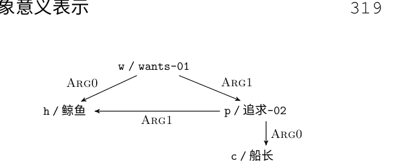
图13.3: 句子的AMR表示的两个视图鲸鱼想要船长追求他。
(13.13) 鲸鱼想要船长追求他。
PropBank语义角色标注分析如下：
- (PREDICATE : wants, ARG0 :鲸鱼, ARG1 :船长追求他)
- (PREDICATE : pursue, ARG0 :船长 ,ARG1 :他 )

抽象意义表示（AMR）将此分析统一为图结构，其中每个节点是一个变量，每个边表示一个概念（Banarescu等，2013）。这可以用两种方式表示，如图13.3所示。左边是PENMAN符号（Matthiessen和Bateman，1991），其中每对括号引入一个变量。每个变量都是一个概念的实例，使用斜杠符号表示：例如，w / want-01表示变量 w是概念 want-01的一个实例，而want-01则指的是动词 want的第一个意义的PropBank框架；pursue-02则指的是动词 pursue的第二个意义。关系使用冒号引入：例如，:ARG0 (c / captain)表示类型为 ARG0的关系，并引入新的变量 c。变量可以重复使用，因此当变量 h再次作为 p的参数出现时，它被理解为在两种情况下都指的是同一只鲸鱼。

这种排列在右侧的图结构中被紧凑地表示，边缘表示概念。

AMR与PropBank风格的语义角色标注的一个不同之处在于，它将每个实体都重新定义为一个变量：例如，(13.13)中的鲸鱼在与w / want-01的关系中被重新定义为变量h，并在与p / pursue-02的关系中被重新定义为变量ARG1。将实体重新定义为变量还可以更明确地表示名词短语的子结构。例如，Asha借了代数书将被表示为：
$$ (b / borrow-01 $$
$$   :ARG0 (p / person $$
$$             :name (n / name $$
$$                       :op1 "Asha")) $$
$$ :ARG1 (b2 / book $$
$$     :topic (a / algebra))) $$
这表明变量 p 是一个人，其 name 是变量 n；该名称有一个标记，字符串 Asha。类似地，变量 b2 是一本书，b2 的 topic 是一个类型为 algebra 的变量 a。关系 name 和 topic 是“非核心角色”的示例，类似于PropBank中的附加修饰语。然而，AMR的库存更加广泛，包括70多个非核心角色，如否定、时间、方式、频率和位置。列表和序列-例如名称中的标记列表-使用角色 op1、op2等来描述。

AMR的另一个特点是，语义谓词可以由任何句法元素引入，如来自Banarescu等人（2013）的以下示例所示：
- (13.14) a. 男孩摧毁了房间。
b. 房间被男孩摧毁。
c. 男孩摧毁了房间。
所有这些示例在AMR中具有相同的语义。
$$ (d / destroy-01 $$
$$     :ARG0 (b / boy) $$
$$     :ARG1 (r / room)) $$
名词 destruction 与动词 destroy 相关联，这由PropBank框架 destroy-01 捕捉到。形容词也可以发生类似的情况：在短语 the attractive spy 中，形容词 attractive 与PropBank框架 attract-01 相关联：
$$ (s / spy $$
$$     :ARG0-of (a / attract-01)) $$
在这个例子中，ARG0-of 是一个逆关系，表示 s 是谓词 a 的 ARG0。逆关系使得所有AMR解析都可以具有单一的根概念。

虽然AMR比语义角色标注更进一步，但它不会链接语义上相关的框架，比如买/卖（就像FrameNet那样）。AMR也不处理量化（就像一阶谓词演算那样），也不尝试处理名词数和动词时态（就像PropBank那样）。

#### 13.3.1 AMR解析

抽象意义表示不是对原始文本的标注 - 不像PropBank语义角色标注，也不像我们迄今遇到的大多数标注和解析任务。给定句子的AMR可能包含对句子中单词的多个概念：正如我们所见，句子Asha喜欢代数包含了单词 Asha的人物和名称概念。相反，句子中的单词可能不会出现在AMR中：在Boyang参观校园中，轻动词 make不会出现在AMR中，而是以谓词 tour为根。因此，AMR很难解析，即使评估AMR解析也涉及相当大的算法复杂性 (Cai和Yates，2013年)。

进一步的复杂性在于AMR标记的数据集没有明确显示AMR注释与句子中的单词之间的对齐。例如，单词“wants”和概念“want-01”之间的链接没有被注释。为了获取基于学习的解析器的训练数据，因此需要首先对训练句子和它们的AMR解析进行对齐。Flanigan等人 (2014) 引入了一种基于规则的解析器，通过一系列逐渐高召回的步骤将文本链接到概念。

与依存解析一样，AMR可以通过基于图的方法解析，探索图结构的空间，或者通过增量式的转换算法解析。基于图的AMR解析的一种方法是首先将相邻的标记分组成局部子结构，然后在这些子结构上搜索图的空间。概念子图的识别可以被形式化为一个序列标注问题，并且随后的图搜索可以使用整数线性规划来解决。已经提出了各种基于转换的解析算法。Wang等人 (2015) 通过逐步修改句法依赖图构建AMR图。在每个步骤中，解析器执行一个动作：例如，将一个AMR关系标签添加到当前依赖边，交换句法依赖边的方向，或者切断一条边并将孤立的子树重新连接到一个新的父节点。

### 附加资源

实际的语义角色标注首先得益于Penn Treebank上的PropBank注释 (Palmer等，2005年)。Abend和Rappoport (2017年) 调查了几种语义表示方案，包括语义角色标注和AMR。AMR的其他语言特征总结在原始论文 (Banarescu等，2013年) 和Schneider等的教程幻灯片 (2015年) 中。最近的共享任务进行了语义依赖解析，其目标是识别词对之间的语义关系 (Oepen等，2014年)；请参阅Ivanova等 (2012年) 以了解句法和语义依赖之间的联系概述。

### 练习

- 1. 为以下句子写出一个事件语义表示。你可以自己编造谓词。
   (13.15) Abigail与Max分享。
   (13.16) Abigail不情愿地与Max分享一个玩具。
   (13.17) 阿比盖尔不喜欢和马克斯分享。
- 2. 在http://verbs.colorado.edu/propbank/framesets-english-aliases/上找到share和hate的PropBank框架集，并使用主题角色ARG0、ARG1和ARG2重新编写你在上一个问题中的答案。
- 3. 计算与动词share相关的示例句子(13.15)和(13.17)中Abigail和Max的句法路径特征。如果你对解析不确定，可以尝试在线解析器，如http://nlp.stanford.edu:8080/parser/。
- 4. 计算与动词share相关的示例句子(13.15)和(13.17)中Abigail和Max的依赖路径特征。同样，如果你对解析不确定，可以尝试在线解析器，如http://nlp.stanford.edu:8080/parser/。作为提示，根据通用依存树库，share和Max之间的依存关系是OBL。
- 5. PropBank语义角色标注包括参考论元，例如，
   (13.18) [AM-LOC床]在 [R-AM-LOC上]我睡觉时坏了。 15
   标签R-AM-LOC表示单词which是对床的引用，表示事件的位置。参考论元必须有指代物：只有当AM-LOC也出现在句子中时，标签R-AM-LOC才能出现。展示如何将其表示为线性约束，具体针对标签R-AM-LOC。确保正确处理既不出现AM-LOC也不出现R-AM-LOC的情况。
- 6. 解释如何以一般形式在方程13.8和方程13.9中表达语义角色标注的约束条件 $Az \geq b$。
- 7. 为以下示例生成AMR注释:
   (13.19) a. 这个女孩喜欢这个男孩。
   > 15来自Shumin Wu 2013 NAACL教程幻灯片的示例
- b. 这个女孩被这个男孩喜欢。
- c. 阿比盖尔喜欢马克思·亚里士多德。
- d. 间谍喜欢这个帅气的男孩。
- e. 这个女孩不喜欢这个男孩。
- f. 这个女孩喜欢她的狗。
   对于(13.19c)，请记住多个标记的名称使用 `op1, op2` 等创建。对于(13.19e)，您需要参考Banarescu等人的研究(2013)，对于(13.19f)，您需要参考Schneider等人的研究(2015)。在这个例子中，您可以假设 `her` 指的是这个女孩。
- 8. 在这个问题中，你将为动词 `can` 构建一个FrameNet意义分类器，该动词可以引发两个框架：POSSIBILITY（你能点一份沙拉和薯条吗？）和CAPABILITY（你能用筷子吃沙拉吗？）。
   要构建数据集，请访问NLTK中的FrameNet语料库：
   ```
   python
   import nltk
   nltk.download('framenet_v17')
   from nltk.corpus import framenet as fn
   ```
   接下来，找到词汇单元 `can.v`（`can`的动词形式）引发框架的实例。通过迭代`fn.docs()`，然后迭代句子，然后
   ```
   python
   for doc in fn.docs():
       if 'sentence' in doc:
           for sent in doc['sentence']:
               for anno_set in sent['annotationSet']:
                   if 'luName' 在 anno_set 中，并且 anno_set['luName'] == 'can.v':
                       通过 # 在这里编写你的代码
   ```
   使用字段 `frameName`作为标签，并从字段 `text`构建一组特征。训练一个分类器，试图准确预测 `frameName`，忽略除CAPABILITY和POSSIBILITY之外的情况。将前一百个实例视为训练集，将剩余的实例视为测试集。你能比一个简单选择最常见类别的分类器做得更好吗？
- 9. *使用NLTK（http://www.nltk.org/howto/propbank.html）下载PropBank样本数据。
   a) 使用PyTorch等深度学习工具包训练BiLSTM序列标注模型（§7.6）来识别谓词词或短语，例如，`we/O took/B-PRED a/I-PRED walk/I-PRED together/O`。你的模型应该从BiLSTM隐藏状态 $\psi(y_m) = \beta_y \cdot h_m$ 计算标签得分。
   b) 可选地，在上一节中实现维特比算法以改进模型的预测。

c) 尝试为每个谓词识别 ARG0 和 ARG1。您应该再次使用 BiLSTM 和 BIO 符号，但可能需要在预测模型中包含谓词位置的 BiLSTM 隐藏状态，例如 $\psi(y_m) = \beta_y \cdot [h_m; h_{\hat{r}}]$，其中 $\hat{r}$ 是（谓词的）预测位置的第一个单词。

10. 使用现成的 PropBank SRL 系统，16 构建一个类似于 Shen 和 Lapata（2007）的简化问答系统。具体而言，您的系统应该执行以下操作：

-   对于集合中的每个文档，它应用语义角色标注器，并将输出存储为元组。
-   对于一个问题，你的系统应该再次应用语义角色标注器。如果任何角色都由一个 *wh* 代词填充，你应该将该角色标记为预期的答案短语（EAP）。
-   为了回答问题，搜索一个与问题尽可能匹配的存储元组（相同的谓词，没有不兼容的语义角色，并尽可能多地匹配角色）。将 EAP 与存储元组中的角色填充物对齐，并将其作为答案返回。

为了评估您的系统，请下载一组关于同一主题的三篇新闻文章，并写下五个可以从文章中回答的事实性问题。看看您的系统是否能正确回答这些问题。（如果这个问题分配给整个班级，您可以构建一个大规模的测试集并比较各种方法。）

## 第14章

## 分布式和分布式语义

自然语言处理中一个经常出现的主题是从单词到含义的映射的复杂性。在第4章中，我们看到一个单词形式，像 *bank*，可以有多个含义；相反，一个含义可以由多个表面形式创建，这是一种词汇语义关系，被称为同义词。尽管单词和含义之间存在复杂的映射，但自然语言处理系统通常依赖于单词作为分析的基本单位。这在语义学中尤为真实：前两章中的逻辑和框架语义方法依赖于手工制作的词典，将单词映射到语义谓词。但是，我们如何分析包含未知单词的文本呢？本章描述了通过分析无标签数据来学习单词含义表示的方法，大大提高了自然语言处理系统的泛化能力。使从无标签数据中获取有意义的表示成为可能的理论是分布假设。

### 14.1 分布假设

这是一个你可能不知道的词：tezguino（例子来自Lin，1998年）。如果你不知道tezguino的意思，那么当一个自然语言处理系统遇到一个在其训练数据中没有出现过的词时，你就和它处于相同的情况。现在假设你看到tezguino在以下上下文中被使用：

-   (14.1) 一瓶 ______ 在桌子上。
-   (14.2) 每个人都喜欢 ______。
-   (14.3) 不要 ______ 在开车之前。
-   (14.4) 我们用 ______ 制作。

|   | (14.1) | (14.2) | (14.3) | (14.4) | ... |
| --- | --- | --- | --- | --- | --- |
| tezguino | 1 | 1 | 1 | 1 |  |
| 响亮的 | 0 | 0 | 0 | 0 |  |
| 机油 | 1 | 0 | 0 | 1 |  |
| 玉米饼 | 0 | 1 | 0 | 1 |  |
| 选择 | 0 | 1 | 0 | 0 |  |
| 葡萄酒 | 1 | 1 | 1 | 0 |  |

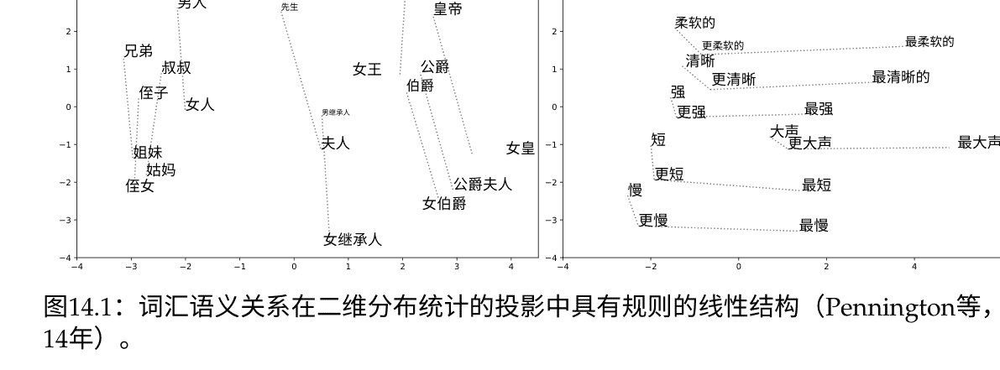

还有哪些词适合这些语境？怎么样：大声的，机油，玉米饼，选择，葡萄酒？表14.1的每一行都是一个向量，总结了每个词的上下文属性，对于词可以出现的上下文，值为1，对于词不能出现的上下文，值为0。基于这些向量，我们可以得出结论：葡萄酒非常类似于tezguino；机油和玉米饼与tezguino相当相似；大声完全不同。

这些向量，我们将其称为词表示，描述了每个词的分布特性。向量相似性是否意味着语义相似性？这是分布假设，由Firth（1957）提出：“你可以通过它的伙伴来认识一个词。”分布假设经受住了时间的考验：分布统计是语言技术的核心部分，因为它们使得利用大量未标记的数据来学习不出现在标记训练数据中的罕见词成为可能。

分布统计具有捕捉词汇语义关系的显著能力，例如类比。图14.1显示了两个例子，基于本章后面讨论的分布式词嵌入的二维投影。在每种情况下，词对关系对应于这个二维空间中的正常线性模式。不需要关于这些关系性质的标记数据来识别这个潜在结构。

分布式语义是通过上下文统计计算得出的。分布式语义是一个相关但独立的概念：意义可以用数值向量而不是符号结构来表示。分布式表示通常是通过分布统计来估计的，就像在潜在语义分析和 WORD2VEC中描述的那样。然而，分布式表示也可以通过有标签数据的监督学习来学习，就像在第3章中遇到的神经分类模型中一样。

### 14.2 词表示的设计决策

有很多计算词表示的方法，但大多数可以从三个主要维度进行区分：表示的性质，上下文信息的来源和估计过程。

#### 14.2.1 表示

如今，主要的词表示是实数的 k 维向量，被称为词嵌入。（这个名字是因为每个离散的词都被嵌入到一个连续的向量空间中。）这种表示至少可以追溯到20世纪80年代末（Deerwester等，1990），并且在流行的技术如 WORD2VEC（Mikolov等，2013）中被使用。

词嵌入非常适合神经网络，可以作为输入插入其中。它们也可以应用于线性分类器和结构预测模型（Turian等，2010），尽管学习使用实值特征的线性模型可能会很困难（Kummerfeld等，2015）。一种流行的替代方法是位串表示，例如Brown聚类（第14.4节），其中每个单词由一个可变长度的0和1序列表示（Brown等，1992）。

另一个表示问题是否为每个表面形式（例如，银行）估计一个嵌入，还是为每个词义或同义词估计不同的嵌入。直观地说，如果词表示要捕捉单词的含义，那么具有多个含义的单词应该有多个嵌入。可以通过将无监督聚类与词嵌入估计相结合来实现这一点（Huang和Yates，2012；Li和Jurafsky，2015）。然而，Arora等（2018）认为明确建模不同的词义是不必要的，因为每个表面形式的嵌入是底层词义的线性组合。

| 一旦学会英语，就会出现复杂情况(Alfau, 1999) | |
| :--- | :--- |
| 布朗聚类 | {one} |
| WORD2VEC, h = 2 | {一旦, 学会, 英语, 复杂情况} |
| 结构化WORD2VEC, h = 2 | {(一旦, -2), (学会, -1), (英语, +1), (复杂情况, +2)} |
| 依赖上下文, | {(一旦, NSUBJ), (英语, DOBJ), (学会, ACL⁻¹)} |
| 表14.2: 根据不同的词表示，单词 learns 的上下文。对于依赖上下文，(一旦, NSUBJ) 表示存在一种类型为 NSUBJ (名词主语)的关系与单词一旦之间，(学会, ACL⁻¹) 表示存在一种类型为 ACL (形容词从句)的关系从单词学会到单词一旦。 |

#### 14.2.2 上下文

分布假设认为词义与词出现的“上下文”相关，但上下文可以有多种定义。在 tezguino 示例中，上下文是整个句子，但实际上句子太多了。相反，上下文可以定义为紧接在前的单词；这是 Brown 聚类中考虑的上下文。 WORD2VEC 采用中间方法，使用单词的局部邻域（例如， h = 5）作为上下文 (Mikolov等, 2013年)。上下文也可以更大：例如，在潜在语义分析中，每个单词的上下文向量包括每个文档的条目，如果单词出现在文档中，则值为 1 (Deerwester等, 1990年)；在显式语义分析中，这些文档是维基百科页面 (Gabrilovich 和Markovitch, 2007年)。

在结构化 WORD2VEC 中，上下文单词通过它们相对于目标单词 $w_m$ 的位置进行标记（例如，目标单词之前两个单词，之后一个单词），这使得生成的单词表示对句法差异更加敏感 (Ling等, 2015)。另一种将语法纳入的方法是在预处理步骤中执行解析，然后从依赖边缘 (Levy和Goldberg, 2014) 或谓词-论元关系 (Lin, 1998) 中形成上下文向量。这些方法的结果上下文向量显示在表14.2中。

上下文的选择对生成的表示有深远影响，可以从词语相似性的角度来看。将潜在语义分析（§14.3）应用于上下文大小为 $h=2$ 和 $h=30$ 的情况下，对于单词 dog，得到以下最近邻：¹

-   ($h=2$) : 猫, 马, 狐狸, 宠物, 兔子, 猪, 动物, 杂种, 羊, 鸽子

¹这个例子来自 Marco Baroni、Alessandro Lenci 和 Stefan Evert 的讲义幻灯片，他们将潜在语义分析应用于英国国家语料库。你可以在这里找到在线演示：http://clic. cimec.unitn.it/infomap-query/

-   ($h = 30$): 狗舍、小狗、宠物、母狗、梗犬、罗威纳犬、犬科动物、猫、狗叫、德国牧羊犬

哪个单词列表更好？列表中的每个单词都是动物，反映了在局部上，单词 dog倾向于与其他动物类型（例如， pet the dog,feed the dog）出现在相同的上下文中。在 h= 30列表中，几乎所有的东西都与狗有关，包括特定的品种，如 rottweiler和 Alsatian。该列表还包括不是动物的单词（kennel） ，在一个案例中（to bark） ，甚至不是名词。2个单词的上下文窗口对语法更敏感，而30个单词的窗口对主题更敏感。

#### 14.2.3 估计

词嵌入是通过优化某个目标来估计的：一组未标记数据的似然（或与之密切相关的数量），或者上下文计数矩阵的重构，类似于表14.1。

最大似然估计基于似然的优化是从目标 log p(w; U)派生的，其中 U ∈ ℝ^{K × V}是词嵌入矩阵，而 w = {w_m}_{m=1}^M 是一个语料库，表示为一个 M令牌列表。递归神经网络语言模型（§6.3）直接优化这个目标，通过递归结构反向传播到输入词嵌入。然而，最先进的词嵌入使用数百亿个令牌的大型语料库，而递归架构难以扩展到这样的数据。因此，基于似然的词嵌入通常基于简化的似然或启发式近似。

矩阵分解 矩阵 C = {计数(i, j)}存储了单词 i和上下文 j的共现计数。通过近似分解这个矩阵，可以获得单词表示，使得计数(i, j)近似于单词嵌入 u_i和上下文嵌入 v_j的函数。通过最小化重构误差的范数，可以获得这些嵌入。

$$\min_{u,v} \| \mathbf{C} - \tilde{\mathbf{C}}(\mathbf{u}, \mathbf{v}) \|_F, \tag{14.1}$$

其中 \tilde{\mathbf{C}}(\mathbf{u}, \mathbf{v}) 是由嵌入 \mathbf{u}和 \mathbf{v}得到的近似重构，\| \mathbf{X} \|_F 表示Frobenius范数， \sum_{i,j} x_{i,j}^2。与其直接分解单词-上下文计数矩阵，通常更有帮助的是使用信息论度量，如点互信息（PMI），下一节中将进行描述。

### 14.3 潜在语义分析

潜在语义分析（LSA）是分布式语义学中最古老的方法之一（Deerwester等，1990年）。它通过诱导连续的词向量表示来将单词和上下文计数的矩阵进行因式分解，使用截断奇异值分解 (SVD),

$$
\min_{\mathbf{U} \in \mathbb{R}^{V \times K}, \mathbf{S} \in \mathbb{R}^{K \times K}, \mathbf{V} \in \mathbb{R}^{|C| \times K}} \|\mathbf{C} - \mathbf{U S V}^\top\|_F
$$
s.t. $\mathbf{U}^\top \mathbf{U} = \mathbf{I}$
$\mathbf{V}^\top \mathbf{V} = \mathbf{I}$
$\forall i = j, \mathbf{S}_{i,j} = 0,$

其中V是词汇表的大小，|C|是上下文的数量，K是结果嵌入的大小，它们被设置为矩阵U的行数。矩阵S被限制为对角线形式（这些对角线元素称为奇异值），而SV的列提供了上下文的描述。每个元素c_{i,j}然后被重构为双线性乘积,

$$c_{i,j} \approx \sum_{k=1}^{K} u_{i,k} s_{k} v_{j,k}.$$

目标是最小化平方逼近误差的总和。正交性约束$\mathbf{U}^\top \mathbf{U} = \mathbf{V}^\top \mathbf{V} = \mathbf{I}$确保$\mathbf{U}$和$\mathbf{V}$中的所有维度对不相关，以便每个维度传达唯一的信息。在数值计算包（如$\textsc{scipy}$和$\textsc{matlab}$）中，可以高效地实现截断奇异值分解。

在应用$\text{SVD}$之前，潜在语义分析在计数矩阵转换之后最为有效。其中一种转换是点对点互信息（$\text{PMI}$; Church和Hanks, 1990），它捕捉了单词$i$和上下文$j$之间的关联程度。

$$\text{PMI}(i, j) = \log \frac{\mathbf{p}(i, j)}{\mathbf{p}(i)\mathbf{p}(j)} = \log \frac{\mathbf{p}(i|j)\mathbf{p}(j)}{\mathbf{p}(i)\mathbf{p}(j)} = \log \frac{\mathbf{p}(i|j)}{\mathbf{p}(i)}$$
$$= \log \text{count}(i, j) - \log \sum_{i'=1}^{V} \text{count}(i', j)$$
$$- \log \sum_{j' \in C} \text{count}(i, j') + \log \sum_{i'=1}^{V} \sum_{j' \in C} \text{count}(i', j').$$

点互信息可以看作是单词$i$在上下文$j$中的条件概率与单词$i$在所有上下文中的边际概率的对数比值。当单词 i 与上下文 j 在统计上相关时，比值将大于一，因此 PMI(i, j) > 0。PMI转换将潜在语义分析集中在重建强大的词-上下文关联上，而不是重建大量计数。

当一个词和上下文一起出现的次数比它们独立出现的次数少时，PMI是负数，但这种负相关性是不可靠的，因为罕见事件的计数具有较高的方差。此外，当计数(i, j) = 0时，PMI是未定义的。解决这些问题的一种方法是使用正 PMI (PPMI)。

$$\text{PPMI}(i, j) = \begin{cases} \text{PMI}(i, j), & \text{p}(i \mid j) > \text{p}(i) \\ 0, & \text{否则}. \end{cases} \tag{14.10}$$

Bullinaria和Levy（2007）比较了一系列用于潜在语义分析的矩阵变换，使用了一系列与词义和词相似性相关的任务（有关评估的更多信息，请参见 §14.6）。他们发现基于PPMI的潜在语义分析在与词义相关的一系列任务上表现出色：例如，基于PPMI的LSA向量可以用于解决来自托福（Test of English as a Foreign Language）的多项选择词相似性问题，准确率达到85%。

### 14.4 布朗聚类

感知器和条件随机场等学习算法通常在离散特征向量上表现更好。从分布中获得离散表示的一种简单方法是通过聚类（§5.1.1）来进行分布统计，使得同一聚类中的单词具有相似的分布统计。这可以在下游任务中有所帮助，通过在同一聚类中共享特征。然而，存在一个明显的权衡：如果聚类数目太小，每个聚类中的单词之间将没有太多共同之处；如果聚类数目太大，学习器将无法从每个聚类中看到足够的示例来进行泛化。

解决这个问题的一个方法是使用层次聚类：利用分布统计来诱导树形表示。图14.2和表14.3展示了Brown聚类树的片段。每个单词的表示由一个二进制字符串组成，描述了通过树的路径：0表示向左分支，1表示向右分支。

| 位串 | 十个最常见的单词 |
| :--- | :--- |
| 011110100111 | 兴奋 感激 感激 兴奋 焦虑 兴奋 心情高涨 心情激动 兴奋 着迷 |
| 01111010100 | 说话 抱怨 说话 抱怨 说话 抱怨 吹嘘 rav-ing +k |
| 011110101010 | 思考 想象 梦想 担心 思考 说话 回忆 dreamin 白日梦 幻想 |
| 011110101011 | 说说 建议 陈述 说说 开玩笑 谈论 暗示 坚持 5'2 |
| 011110101100 | 想知道 不知道 想知道 不知道 不知道 不知道 想知道 想知道 dunnoc |
| 011110101101 | 思考 思考 辩论 决定 思考 不确定 思考 辩论 思考 思考 |
| 011110101110 | 确定 确定 确定 确定 确定 确定 确定 确定 |

在图的右上方子树中，单词conversation的表示是10；单词assessment的表示是0001。位串前缀以不同的具体性水平捕捉相似性，在诸如命名实体识别（Miller et al., 2004）和依存句法分析（Koo et al., 2008）等任务中常常使用前八、十二、十六和二十位作为特征。

可以从基于似然的目标中诱导出分层树，使用离散的潜在变量 $k_i \in \{1, 2, \ldots, K\}$ 来表示单词 $i$ 的聚类：

$$\log p(\boldsymbol{w}; \boldsymbol{k}) \approx \sum_{m=1}^{M} \log p(w_m \mid w_{m-1}; \boldsymbol{k}) \tag{14.11}$$

$$\triangleq \sum_{m=1}^{M} \log p(w_m \mid k_{w_m}) + \log p(k_{w_m} \mid k_{w_{m-1}}). \tag{14.12}$$

这类似于隐马尔可夫模型，关键区别在于每个单词只能从一个聚类中发射出来：$\forall k = k_{w_m}, p(w_m \mid k) = 0.$

使用方程式14.12中的目标，可以从底向上构建Brown聚类树：从每个单词开始，它们各自在一个聚类中，然后逐步合并聚类，直到只剩下一个聚类。在每一步中，我们合并一对聚类，使得方程式14.12中的目标最大化。尽管目标似乎涉及整个语料库的总和，但每次合并的得分可以从聚类到聚类的共现计数中计算出来。随着聚类的进行，这些计数可以逐步更新。

每一步的最优合并可以被证明最大化平均互信息,

$$I(\boldsymbol{k}) = \sum_{k_1=1}^{K} \sum_{k_2=1}^{K} p(k_1, k_2) \times \text{PMI}(k_1, k_2) \tag{14.13}$$

$$p(k_1, k_2) = \frac{\text{count}(k_1, k_2)}{\sum_{k_1'=1}^{K} \sum_{k_2'=1}^{K} \text{count}(k_1', k_2')}$$

其中，$p(k_1, k_2)$ 是涉及簇 $k_1$ 后面的一个词和簇 $k_2$ 之间的双字组合的联合概率。这个概率和 PMI 都是从簇之间的共现计数中计算得出的。在每次合并之后，合并后的簇的共现向量被简单地相加，以便可以高效地找到下一个最优的合并。

这个自底向上的过程需要在整个词汇表上进行迭代，并在每一步评估 $K_t^2$ possible mergers, 其中 $K_t$ 是算法在第 $t$ 步时的当前聚类数。此外，计算每个合并的得分涉及对 $K_t^2$ clusters 进行求和。最大聚类数是 $K_0 = V$，这发生在算法开始时每个单词都在自己的聚类中。因此，时间复杂度为 $O(V^5)$。

为了避免这种复杂性，实际实现使用了一种启发式近似方法称为交换聚类。最常见的单词被放置在它们自己的聚类中在过程的开始。然后我们考虑下一个最常见的单词，并将其与现有的聚类之一合并。这一过程继续，直到整个词汇表被合并到一个单一的聚类中，形成一棵树。算法在任何步骤中都不会考虑超过 $K + 1$ 个聚类，复杂度为 $O(V K + V \log V )$，其中第二项表示排序的成本。

### 14.5 神经词嵌入

算法的开始处的单词。有关该算法的更多细节，请参阅Liang（2005）。

神经词嵌入结合了前两种方法的特点：像潜在语义分析一样，它们是连续的向量表示；像Brown聚类一样，它们是基于似然目标进行训练的。让向量$u_i$表示单词$i$的$K$维嵌入，$v_j$表示上下文$j$的$K$维嵌入。内积$u_i \cdot v_j$表示单词$i$和上下文$j$之间的兼容性。通过将这个内积纳入到语料库的对数似然的近似中，可以通过反向传播来估计两个参数。WORD2VEC（Mikolov等人，2013）包括两种这样的近似方法：连续词袋模型（CBOW）和skipgrams。

#### 14.5.1 连续词袋模型（CBOW）

在递归神经网络语言模型中，每个单词$w_m$都依赖于一个递归更新的状态向量，该向量基于从文本开头到当前位置的单词表示。连续词袋模型（CBOW）是一种简化的模型：局部上下文被计算为相邻单词嵌入的平均值$m-h, m-h+1, \ldots, m+h-1, m+h$，

$$
\bar{v}_m = \frac{1}{2h} \sum_{n=1}^{h} v_{w_{m+n}} + v_{w_{m-n}}. \tag{14.14}
$$

因此，CBOW是一种词袋模型，因为上下文单词的顺序并不重要；它是连续的，因为我们不是基于单词本身进行条件，而是基于从单词嵌入构建的连续向量进行条件。参数$h$确定了邻域的大小，Mikolov等人（2013）将其设置为$h=4$。

CBOW模型优化了对语料库对数似然的近似值，

$$
\log \mathrm{p}(\boldsymbol{w}) \approx \sum_{m=1}^{M} \log \mathrm{p}(w_{m} \mid w_{m-h}, w_{m-h+1}, \ldots, w_{m+h-1}, w_{m+h}) \tag{14.15}
$$

$$
\qquad\qquad= \sum_{m=1}^{M} \log \frac{\exp \left(\boldsymbol{u}_{w_{m}} \cdot \overline{\boldsymbol{v}}_{m}\right)}{\sum_{j=1}^{V} \exp \left(\boldsymbol{u}_{j} \cdot \overline{\boldsymbol{v}}_{m}\right)} \tag{14.16}
$$

$$
\qquad\qquad= \sum_{m=1}^{M} \boldsymbol{u}_{w_{m}} \cdot \overline{\boldsymbol{v}}_{m}-\log \sum_{j=1}^{V} \exp \left(\boldsymbol{u}_{j} \cdot \overline{\boldsymbol{v}}_{m}\right). \tag{14.17}
$$

#### 14.5.2 Skipgrams

在CBOW模型中，根据上下文预测单词。在skipgram模型中，根据单词预测上下文，得到目标函数：

$$
\log \mathrm{p}(\boldsymbol{w}) \approx \sum_{m=1}^{M} \sum_{n=1}^{h_{m}} \log \mathrm{p}(w_{m-n} \mid w_{m})+\log \mathrm{p}(w_{m+n} \mid w_{m}) \tag{14.18}
$$

$$
\qquad\qquad= \sum_{m=1}^{M} \sum_{n=1}^{h_{m}} \log \frac{\exp\left(\boldsymbol{u}_{w_{m-n}} \cdot \boldsymbol{v}_{w_{m}}\right)}{\sum_{j=1}^{V} \exp\left(\boldsymbol{u}_{j} \cdot \boldsymbol{v}_{w_{m}}\right)} + \log \frac{\exp\left(\boldsymbol{u}_{w_{m+n}} \cdot \boldsymbol{v}_{w_{m}}\right)}{\sum_{j=1}^{V} \exp\left(\boldsymbol{u}_{j} \cdot \boldsymbol{v}_{w_{m}}\right)} \tag{14.19}
$$

$$
\qquad\qquad= \sum_{m=1}^{M} \sum_{n=1}^{h_{m}} \boldsymbol{u}_{w_{m-n}} \cdot \boldsymbol{v}_{w_{m}}+\boldsymbol{u}_{w_{m+n}} \cdot \boldsymbol{v}_{w_{m}} -2 \log \sum_{j=1}^{V} \exp\left(\boldsymbol{u}_{j} \cdot \boldsymbol{v}_{w_{m}}\right). \tag{14.20}
$$

在skipgram近似中，每个单词被多次生成；每次只依赖于一个单词。这样可以避免对单词向量进行平均，就像CBOW模型一样。局部邻域大小 $h_{m}$ 是从均匀分布中随机采样的，范围为 $\{1,2, \ldots, h_{\max }\}$; Mikolov等人(2013)设置 $h_{\max }=10$。因为邻域随着 $h$ 的增长向外扩展，这种方法的效果是给予近邻比远邻更高的权重。在大多数评估中，Skipgram比CBOW表现更好(有关如何评估词表示的详细信息，请参见 §14.6)，但CBOW的训练速度更快 (Mikolov等人，2013)。

#### 14.5.3 计算复杂度

WORD2VEC模型可以看作是循环神经网络语言模型的高效替代品，循环状态更新的时间复杂度与循环状态向量的大小成二次关系。CBOW和skipgram避免了这种计算，并且仅在单词和上下文表示的大小上具有线性时间复杂度。然而，这三个模型都计算了单词标记的归一化概率；计算这个概率的朴素实现需要对整个词汇表进行求和。这个求和的时间复杂度是 $O(V \times K)$，它主导了所有其他计算成本。有两种解决方案：分层softmax，一种基于树的计算方法，将成本降低到词汇表大小的对数级别；以及负采样，一种近似方法，消除了对词汇表大小的依赖。这两种方法也适用于RNN语言模型。

##### 分层softmax

在Brown聚类中，词汇表被组织成二叉树。Mnih和Hinton（2008）表明，词汇表中单词的归一化概率可以重新参数化为通过这样一棵树的概率。这个分层softmax概率是通过对是否向左或向右移动的二进制决策的乘积来计算的，每个二进制决策都表示为上下文嵌入 $v_c$ 和与节点 $u_n$ 相关联的输出嵌入之间的内积的sigmoid函数。

$\text{Pr}(\text{左边在 } n \mid c) = \sigma(u_n \cdot v_c) \tag{14.21}$

$\text{Pr}(\text{右边在 } n \mid c) = 1 - \sigma(u_n \cdot v_c) = \sigma(-u_n \cdot v_c), \tag{14.22}$

其中 $\sigma$ 表示sigmoid函数，$\sigma(x) = 1 / (1+\exp(-x))$。sigmoid函数的范围是区间 $(0,1)$，且 $1 - \sigma(x) = \sigma(-x)$。

如图14.4所示，生成每个单词的概率被重新定义为其路径上概率的乘积。所有路径概率的总和保证为一，对于任何上下文向量 $v_c \in \mathbb{R}^K$。在平衡二叉树中，深度与叶节点数量的对数成比例，因此乘法的数量等于 $O(\log V)$。非叶节点的数量等于 $O(2V - 1)$，因此需要估计的参数数量仅增加了一个小倍数。树可以使用类似于分层Brown聚类的增量聚类过程构建（Mnih和Hinton，2008）。

##### 负采样

基于似然的方法在计算上非常耗时，因为每个概率都必须在词汇表上进行归一化。这些概率是基于每个上下文中每个单词的得分计算的，我们可以设计一种基于这些得分更直接的替代目标：我们寻求词嵌入，使得在每个上下文中真正观察到的单词的得分最大化，同时将一组随机选择的负样本的得分最小化：

$$\psi(i, j) = \log \sigma(\boldsymbol{u}_i \cdot \boldsymbol{v}_j) + \sum_{i' \in \mathcal{W}_{\text{neg}}} \log(1 - \sigma(\boldsymbol{u}_{i'} \cdot \boldsymbol{v}_j)), \tag{14.23}$$

其中 $\psi(i, j)$ 是单词 $i$ 在上下文 $j$ 中的得分，$\mathcal{W}_{\text{neg}}$ 是负样本集合。目标是最大化语料库上的总和，$\sum_{m=1}^{M} \psi(w_m, c_m)$，其中 $w_m$ 是令牌 $m$，$c_m$ 是相关的上下文。

负样本集 $\mathcal{W}_{\text{neg}}$ 是通过从一元语言模型中进行采样获得的。Mikolov等人 (2013) 通过指数化经验词概率来构建这个一元语言模型，设置 $\hat{p}(i) \propto (\text{count}(i))^{\frac{3}{4}}$。这样做的效果是将概率从常见词分配到罕见词上。负样本的数量会以一个常数因子增加训练的时间复杂度。Mikolov等人 (2013) 报告说，对于小型训练集，5到20个负样本足够，而对于较大的语料库，两到五个样本就足够了。

#### 14.5.4 词嵌入作为矩阵分解

在方程式14.23中的负采样目标可以被证明是对数似然的高效近似，但它也与潜在语义分析中使用的矩阵分解目标密切相关。对于一个包含所有计数非零的词-上下文对矩阵，负采样等价于矩阵 $\mathbf{M}$ 的分解，其中 $M_{ij} = \text{PMI}(i, j) - \log k$: 矩阵中的每个单元格等于词和上下文的点互信息，加上 $\log k$，其中 $k$ 是负样本的数量 (Levy和Goldberg，2014)。对于在数据中没有观察到的词-上下文对，点互信息为 $-\infty$，但可以通过只考虑大于 $\log k$ 的PMI值来解决这个问题，从而得到一个shifted positive pointwise mutual information的矩阵。

$$M_{ij} = \max(0, \text{PMI}(i, j) - \log k). \tag{14.24}$$

通过截断奇异值分解将此矩阵分解得到词嵌入。

GloVe (“全局向量”) 是一种密切相关的方法 (Pennington et al., 2014)，其中要分解的矩阵是从对数共现计数构建的，$M_{ij} = \log \text{count}(i, j)$。通过最小化平方和来估计词嵌入。

$$
\min_{\mathbf{u}, \mathbf{v}, \mathbf{b}, \tilde{\mathbf{b}}} \sum_{i=1}^{V} \sum_{j \in \mathcal{C}} f(M_{ij}) \left( \log M_{ij} - \log \hat{M}_{ij} \right)^2 \\
\text{s.t.} \quad \log \hat{M}_{ij} = \mathbf{u}_i \cdot \mathbf{v}_j + b_i + \tilde{b}_j, \tag{14.25}
$$

其中 $b_i$ 和 $\tilde{b}_j$ 是单词 $i$ 和上下文 $j$ 的偏移量，与嵌入 $\mathbf{u}$ 和 $\mathbf{v}$ 一起进行估计。加权函数 $f(M_{ij})$ 在 $M_{ij}=0$ 时设为零，从而避免了取零计数的对数问题；在 $M_{ij} = m_{\max}$ 时饱和，从而避免了过多计数常见的单词-上下文对。这个启发式方法对方法的性能至关重要。

稀疏矩阵重建的时间复杂度取决于非零的单词-上下文计数的数量。Pennington等人 (2014) 表明，这个数量随着数据集的大小呈次线性增长：对于典型的英文语料库，大约为 $\mathcal{O}(N^{0.8})$。相比之下，WORD2VEC 的时间复杂度与语料库的大小成线性关系。计算共现计数还需要与语料库大小成线性关系的时间，但是可以使用MapReduce风格的算法轻松并行化此操作 (Dean和Ghemawat, 2008)。

### 14.6 评估词嵌入

分布式词表示可以通过两种主要方式进行评估。内在评估测试表示是否与我们对词义的直觉一致。外在评估测试它们是否对下游任务（如序列标记）有用。

#### 14.6.1 内在评估

词嵌入的一个基本问题是词$i$和$j$的相似性是否反映在向量$\mathbf{u}_i$和$\mathbf{u}_j$的相似性中。通常使用余弦相似度来比较两个词嵌入。

$$
\cos(\mathbf{u}_i, \mathbf{u}_j) = \frac{\mathbf{u}_i \cdot \mathbf{u}_j}{\|\mathbf{u}_i\|_2 \times \|\mathbf{u}_j\|_2} \tag{14.26}
$$

对于任何嵌入方法，我们可以评估词嵌入的余弦相似度是否与人类对词相似性的判断相关。WS-353数据集（Finkelstein等，2002）包括353个词对的相似度分数（表14.4）。为了测试对于罕见和形态复杂的词的嵌入的准确性，Luong等（2013）引入了一个“罕见词”数据集。除了英语之外，词相似性资源有限，主要包括WS-353和相关的SimLex-999数据集（Hill等，2015）的翻译。

词类比（例如，国王:皇后 :: 男人:女人）也被用来评估词嵌入（Mikolov等，2013）。在这个评估中，系统被提供了类比的前三个部分（$i_1 : j_1 :: i_2 : ?$），并且通过找到与 $\mathbf{u}_{j_1} - \mathbf{u}_{i_1} + \mathbf{u}_{i_2}$ 最相似的词嵌入来预测最后一个元素。

另一个评估测试词嵌入是否与称为超义类的广泛词汇语义类别相关联（Ciaramita和Johnson，2003）：动词运动，描述动物的名词，描述身体部位的名词等。这些超义类在WordNet（Fellbaum，2010）中为英语同义词集进行了注释。这个评估在QVEC度量中实现，该度量测试是否可以从词嵌入矩阵中重建超义类矩阵（Tsvetkov等，2015）。

Levy等人（2015）比较了几种用于英语的密集词表示，包括潜在语义分析、WORD2VEC和GloVe，使用了六个词相似度度量和两个类比任务。没有任何嵌入在每个任务上都表现优于其他嵌入，但skipgrams是最广泛竞争的。超参数调整起着关键作用：如果使用错误的超参数，任何方法都会表现糟糕。相关的超参数包括嵌入大小，以及算法特定的细节，如邻域大小和负样本数量。

#### 14.6.2 外在评估

词表示通过实现对单词的泛化，对下游任务如序列标注和文档分类起到了贡献。使用分布式表示作为特征是一种半监督学习的形式，通过从无标签数据中学习分布式表示来增强在监督学习问题上的性能（Miller等人，2004；Koo等人，2008；Turian等人，2010）。这些预训练的词表示可以作为线性预测模型的特征或输入神经网络中的一层，例如Bi-LSTM标记模型（§7.6）。单词表示可以通过消耗它们的下游系统的性能来评估：例如，GloVe嵌入在命名实体识别（Pennington等，2014）的下游任务中作为特征比潜在语义分析更具说服力。

不幸的是，外在和内在评估并不总是指向同一个方向，对于一个下游任务来说最好的单词表示可能在另一个任务上表现不佳（Schnabel等，2015）。

当单词表示从下游任务的标记数据中更新时，它们被称为微调。当标记数据丰富时，预训练可能是不必要的；当标记数据稀缺时，微调可能导致过拟合。可以采用各种预训练和微调的组合。在微调之前，可以使用预训练的嵌入进行初始化，这可以大大提高性能（Lample等，2016）。或者，可以将微调和预训练的嵌入都用作单个模型的输入（Kim，2014）。

在半监督场景中，预训练的词嵌入可以被“上下文化”的词表示所取代（Peters等人，2018）。这些上下文化的表示被设置为深度双向LSTM的隐藏状态，该LSTM被训练为双向语言模型，因此得名ELMo（来自语言模型的嵌入）。通过运行语言模型，我们可以获得上下文化的词表示，然后可以将其作为任何任务中监督神经网络的基础层。这种方法在几个任务上都取得了显著的增益，可能是因为上下文化的嵌入使用无标签数据来学习如何将语言上下文整合到监督神经网络的基础层中。

#### 14.6.3 公平性和偏见

图14.1展示了词嵌入如何捕捉类比关系，例如男人：女人 :: 国王：皇后。虽然国王和皇后在定义上是与性别相关的，但其他职业或头衔仅仅是通过统计倾向与性别和其他群体相关联。这种统计倾向可能是关于世界的事实（例如，职业棒球运动员通常是男性），也可能是关于文本语料库的事实（例如，有专门为女性和男性设立的职业篮球联赛，但男子篮球经常被提及）。现在有相当多的证据表明，词嵌入确实编码了这种偏见。Bolukbasi等人（2016）展示了与向量差异$\text{she} – \text{he}$最相关的词是典型的女性职业如家庭主妇、护士、接待员；而与向量差异的反方向则是指挥家、船长、门徒。Caliskan等人（2017）通过展示词嵌入中的偏见与经过充分验证的性别刻板印象相一致，对这一观察进行了系统化的研究。

Garg等人（2018）将这些结果扩展到亚裔美国人的种族刻板印象，并从历史的角度提供了100年文本数据中刻板印象是如何演变的。因为词嵌入是许多其他自然语言处理的输入层，这些发现突显了自然语言处理在世界和文本中复制和放大偏见的风险。例如，如果词嵌入编码了这样一种信念，即女性不太可能成为程序员，就像她们不太可能成为侄子一样，那么软件就不太可能成功地解析、翻译、索引和生成女性确实编程的文本。例如，当与违背性别刻板印象的文本中的代词引用相冲突时，现代NLP系统经常无法正确解析 (Rudinger等人，2018；Zhao等人，2018)。(代词消解任务在第15章中有详细描述。) 这样的偏见可能会产生深远的影响：例如，当使用与非裔美国人统计相关的姓名查询时，搜索引擎更有可能提供个性化的公开逮捕记录广告 (Sweeney，2013)。现在有关于“去偏见”机器学习和自然语言处理的活跃研究文献，如机器学习中的公平性、问责性和透明性 (FAT/ML) 年会的增长所证明的。

然而，考虑到这些偏见的最终来源是文本本身，希望完全算法化的解决方案可能过于乐观。对于自然语言处理系统的输入，以及其输出的用途，没有什么可以替代批判性思考。

### 14.7 超越分布统计的分布式表示

可以从大规模的无标签数据集中估计分布式词表示，从而涵盖许多不出现在标记数据中的词语：例如，GloVe嵌入是从8000亿个网络数据标记中估计得出的，而用于NLP任务的最大标记数据集的规模大约是数百万个。尽管如此，即使是数千亿个标记的数据集也无法涵盖未来可能遇到的每个词语。

此外，许多词语只会出现几次，使得它们的嵌入不可靠。许多语言在形态复杂性方面超过英语，因此具有较低的标记-类型比。当这个问题与小型训练语料库相结合时，利用除分布统计之外的其他信息源变得尤为重要。

#### 14.7.1 词内部结构

一种解决方案是将单词内部结构纳入单词嵌入中。纯粹的分布式方法将单词视为原子单位，但实际上，许多单词具有内部结构，因此它们的含义可以由子词单元的表示组合而成。考虑以下术语，这些术语都不在Google的预训练WORD2VEC嵌入中：⁴

> ³http://commoncrawl.org/
⁴https://code.google.com/archive/p/word2vec/，于2017年9月20日访问

在与MIT Press签订的合同下，根据CC-BY-NC-ND许可共享。

| 词1 | 词2 | 相似度 |
| :--- | :--- | :--- |
| 爱 | 性 | 6.77 |
| 股票 | 美洲豹 | 0.92 |
| 金钱 | 现金 | 9.15 |
| 发展问题 | | 3.97 |
| 小伙子 | 兄弟 | 4.46 |

表格 14.4: WS-353 (Finkelstein et al., 2002) 词相似度评分数据集的子集 (来自 Faruqui et al. (2016) 的示例)。

## 14.7. 超越分布统计的分布式表示

图14.5：从子词单元构建单词嵌入的两种架构。在左侧，通过加法将形态素嵌入 $\boldsymbol{u}^{(m)}$ 与非组合的单词嵌入 $\tilde{\boldsymbol{u}}$（Botha 和 Blunsom，2014）相结合。在右侧，形态素嵌入在递归神经网络中相结合（Luong 等，2013）。

毫居里这个词有形态结构（参见 §9.1.2 了解更多关于形态学的内容）：前缀 $milli-$ 表示数量，后缀 $-s$ 表示复数。（毫居里是一个放射性单位。）

铯这个词是一个单个词素，但字符 $-ium$ 经常与化学元素相关联。（铯是一个化学元素的英式拼写，在美式英语中拼写为 $cesium$。）

$IAEA$ 这个术语是一个首字母缩略词，如大写字母的使用所示。前缀 $I-$ 经常指国际组织，后缀 $-A$ 经常指机构或协会。（$IAEA$ 是国际原子能机构。）

$Zhezhgan$ 这个术语采用标题大小写，表明是一个人或地名，并且字符双字母组合 $zh$ 表明它很可能是一个音译。（$Zhezhgan$ 是哈萨克斯坦的一个矿场。）

如何将词内部结构纳入词表示中？一种方法是通过字符或词素的嵌入来构建词表示。例如，如果单词 $i$ 具有形态分段 $\mathcal{M}_i$，则可以通过加法构建其嵌入（Botha 和 Blunsom，2014）

$$\boldsymbol{u}_i = \tilde{\boldsymbol{u}}_i + \sum_{j \in \mathcal{M}_i} \boldsymbol{u}_j^{(M)}, \quad [14.27]$$

其中 $\boldsymbol{u}_m^{(M)}$ 是一个词素嵌入，$\tilde{\boldsymbol{u}}_i$ 是模型的一个额外自由参数（图14.5，左侧）。

所有嵌入都是从一个对数双线性语言模型（Mnih 和 Hinton，2007）中估计得到的，该模型类似于 CBOW 模型（§14.5），但仅包含前面单词的上下文信息。形态分段是使用无监督分词器（Creutz 和 Lagus，2007）获得的。对于在训练中没有出现的单词，对于数据，可以直接从形态素构建嵌入，假设每个形态素在训练数据中出现在其他单词中。自由参数 ù 增加了灵活性：鼓励具有相似形态素的单词具有相似的嵌入，但是该参数使它们可以不同。

单词内部结构可以以各种其他方式纳入单词表示中。以下是一些主要参数。

子词单元。像 IAEA 和 Zhezhan 这样的例子不是基于形态构成的，形态分割器不太可能为这些术语识别有意义的子词单元。与其使用形态素进行子词嵌入，可以使用字符（Santos 和 Zadrozny，2014；Ling 等，2015；Kim 等，2016），字符 n-grams（Wieting 等，2016a；Bojanowski 等，2017）和字节对编码，这是一种捕捉频繁子字符串的压缩技术（Gage，1994；Sennrich 等，2016）。

构成。通过加法组合子词嵌入不区分顺序，也不将任何特定的语素识别为根。已经考虑了一系列更灵活的组合模型，包括循环（Ling 等，2015），卷积（Santos 和 Zadrozny，2014；Kim 等，2016）和递归神经网络（Luong 等，2013），其中逐渐构建了越来越大的单元的表示，这些单元是在形态学解析上构建的，例如 ((milli+curie)+s)，((in+flam)+able)，(in+(vis+ible)))。递归嵌入模型显示在图14.5的右侧面板中。

估计。从完整数据集中估计子词嵌入是计算上昂贵的。另一种方法是训练一个子词模型来匹配预训练的词嵌入（Cotterell 等，2016；Pinter 等，2017）。要训练这样的模型，只需要迭代词汇表，而不是语料库。

#### 14.7.2 词汇语义资源

诸如 WordNet 之类的资源提供了关于词义的另一种信息来源：如果我们知道铯是铯的同义词，或者毫居里是一种测量单位，那么这应该有助于为未知词提供嵌入，并平滑嵌入稀有词。一种方法是通过最小化以下目标函数，在词汇语义关系网络中对预训练的词嵌入进行改进（Faruqui 等人，2015）：

$$\min_{\mathbf{U}} \sum_{j=1}^{V} \|\mathbf{u}_j - \hat{\mathbf{u}}_j\|_2 + \sum_{(i,j)\in\mathcal{L}} \beta_{ij}\|\mathbf{u}_i - \mathbf{u}_j\|_2, \quad [14.28]$$

其中，$\hat{\mathbf{u}}_j$ 是单词 $j$ 的预训练嵌入，$\mathcal{L}=\{(i, j)\}$ 是单词关系的词典。超参数 $\beta_{ij}$ 控制着相邻单词具有相似嵌入的重要性；Faruqui 等人（2015）将其设置为单词 $i$ 的度数的倒数，$\beta_{ij}=|\{j: (i, j)\in\mathcal{L}\}|^{-1}$。Retrofitting 改善了一系列内在评估，并在外在文档分类任务上略微提高了性能。

### 14.8 多词单位的分布式表示

分布式表示能够扩展到短语、句子、段落等吗？在探索这个可能性之前，回想一下分布式和分布式表示之间的区别。神经嵌入，如 WORD2VEC，既是分布式的（基于向量），也是分布性的（从上下文中的词频派生而来）。随着我们考虑更大的文本单元，计数会减少：在极限情况下，一个跨度为多段落的文本将不会出现两次，除非是抄袭。因此，仅仅通过分布统计无法确定一个大跨度文本的含义；它必须从较小的跨度中进行组合计算。但这些考虑与分布式表示（密集数值向量）是否足够表达短语、句子和段落的含义的问题无关。

#### 14.8.1 纯分布式方法

一些多词短语是非组合的：这种短语的含义不是通过典型的组合语义从个别词的含义中派生出来的。这包括像旧金山这样的专有名词，以及像踢桶（鲍德温和金，2010年）这样的习语表达。对于这些情况，纯粹的分布式方法可以起作用。一个简单的方法是识别经常一起出现的多词单位，然后将这些单位视为单词，使用一种技术学习嵌入，例如 WORD2VEC。

识别多词单位的问题有时被称为搭配提取。一个好的搭配具有高的点互信息（PMI；参见§14.3）。例如，朴素贝叶斯是一个好的搭配，因为 $p (w_t =贝叶斯 | w_{t-1}=朴素)$ 远大于 $p (w_t =贝叶斯)$。超过两个词的搭配可以通过贪婪的增量搜索来识别：例如，互信息可能首先被提取为一个搭配，并分组成一个单词类型互信息；然后，点互信息可以稍后提取。在识别这样的单位后，当估计 skipgram 嵌入时，它们可以被视为单词。Mikolov 等人（2013年）表明，这种嵌入在解决短语类比的任务上表现得相当不错，例如纽约：纽约时报::巴尔的摩：巴尔的摩太阳报。

图14.6：通过在两个句子的分布式表示之间进行插值（用粗体表示），可以生成结合两者特点的语法正确的句子（Bowman 等人，2016）

#### 14.8.2 分布式-组合混合方法

要超越短语，需要进行组合。一个简单但令人惊讶的强大方法是用单词嵌入的平均值来表示一个句子（Mitchell 和 Lapata，2010）。这可以被视为分布式和组合方法的混合：单词嵌入是通过分布计算的，然后通过组合计算句子表示。

“词到向量”方法可以进一步扩展，使用类似 skipgrams 的模型将整个句子嵌入其中，这是 Kiros 等人在2015年提出的“跳思”模型。每个句子都使用循环神经网络编码成一个向量：句子的编码是其最后一个标记的 RNN 隐藏状态，$h_{M}^{(t)}$。成为解码器模型的一个参数，用于生成前一个和后一个句子：解码器是另一个循环神经网络，它在其循环更新中将相邻句子的编码作为附加参数。（这个编码器-解码器模型在第18章中有详细讨论。）编码器和解码器同时从基于似然的目标进行训练，训练好的编码器可以用来计算任何句子的分布式表示。Skip-thought 也可以被看作是分布式和组合式方法的混合：每个句子的向量表示是通过组合单词的表示来计算的，但训练目标是基于语料库中句子共现的分布式方法。

自动编码器是编码器-解码器模型的一种变体，其中解码器被训练为仅使用分布式编码向量（Li 等人，2015）生成与原始编码相同的文本。编码作为一个瓶颈，所以如果模型要成功地拟合训练数据，就需要进行泛化。在去噪自动编码器中，输入是原始句子的损坏版本，自动编码器必须重新构建未损坏的原始句子（Vincent 等人，2010；Hill 等人，2016）。通过在两个句子的分布式表示之间进行插值，$\alpha u_i + (1 - \alpha) u_j$，可以生成结合两个输入方面的句子，如图14.6所示（Bowman 等人，2016）。

自动编码器也可以应用于更长的文本，如段落和文档。这使得诸如问答之类的应用成为可能，可以通过将问题的编码与候选答案的编码进行匹配来执行（Miao 等，2016）。

#### 14.8.3 监督组合方法

给定一个监督信号，例如描述句子情感或含义的标签，可以应用各种组合方法来计算一个分布式表示，然后预测标签。最简单的方法是对句子中每个单词的嵌入进行平均，并通过前馈神经网络传递这个平均值（Iyyer 等，2015）。卷积和循环神经网络进一步发展，能够有效捕捉否定等多词现象（Kalchbrenner 等，2014；Kim，2014；Li 等，2015；Tang 等，2015）。另一种方法是将句子的句法结构纳入递归神经网络中，其中每个句法成分的表示是从其子节点的表示计算得出的（Socher 等，2012）。然而，在许多情况下，循环神经网络的性能与递归网络相当或更好（Li 等，2015）。

无论是卷积、循环还是递归，一个关键问题是监督句子表示是否是任务特定的，还是单一的监督句子表示模型能在其他任务上产生有用的性能。Wieting 等人（2016b）训练了多种句子嵌入模型，用于将句子对标记为段落短语。他们表明，由此产生的句子嵌入在情感分析方面表现良好。斯坦福自然语言推理语料库将句子对分类为蕴含（句子i的真实性暗示句子j的真实性）、矛盾（句子i的真实性暗示句子j的假实性）和中性（既不暗示也不矛盾j）。在这个数据集上训练的句子嵌入可以迁移到广泛的分类任务中（Conneau 等人，2017）。

#### 14.8.4 混合分布符号表示

分布式表示的力量在于它们的普适性：文本单元的分布式表示可以作为其含义的摘要，因此可以作为分类、匹配和检索等下游任务的输入。例如，分布式句子表示可以用于识别以下类似的句子之间的释义关系：

+   (14.5) a. 唐纳德非常感谢弗拉德。
    b. 唐纳德向弗拉德表达了他深深的感激之情。
    c. 唐纳德给了弗拉德很多感激之情。

符号表示对这种变化相对脆弱，但更适合描述个体实体、它们所做的事情以及对它们所做的事情。 在示例 (14.5a) - (14.5c) 中，我们不仅知道有人感谢了别人，还可以推断出在所提到的唐纳德和弗拉德之间发生了一系列事件。 由于分布式表示不以符号方式处理实体，它们无法推理出句子或更大篇章中实体扮演的角色。 分布式和符号表示之间的混合可能会同时具备两者的优点：对描述同一事件的多种不同方式具有鲁棒性，同时具备支持对实体及其角色进行推理的表达能力。

一种“自上而下”的混合方法是从逻辑语义开始（类似于前两章所描述的那种方法），但是用一组分布式词群 (Poon 和 Domingos, 2009; Lewis 和 Steedman, 2013) 替换预定义的词典。 一种“自下而上”的方法是向现有的分布式表示中添加最小的符号结构，例如每个实体的向量表示 (Ji 和 Eisenstein, 2015; Wiseman 等, 2016) 。 已经证明这种方法可以提高我们在接下来的章节中遇到的两个问题的性能：邻接句子之间的关系分类 (第16章; Ji 和 Eisenstein, 2015) 和实体提及的共指消解 (第15章; Wiseman 等, 2016; Ji 等, 2017) 。 关于混合语义表示的研究仍处于早期阶段，未来的表示方法可能会更大胆地偏离现有的符号和分布式方法。

### 附加资源

Turney 和 Pantel (2010) 调查了向量词表示的许多方面，重点关注矩阵分解方法。 Schnabel 等人 (2015) 强调了基于相似性评估词嵌入的问题，并提出了一种控制词频的新型评估方法。 Baroni 等人 (2014) 解决了在尝试结合分布式和组合表示时出现的语言问题。

在双语和多语言分布式表示中，对翻译对或元组（如（狗，perro，chien））进行嵌入估计。 这些嵌入可以改善机器翻译 (Zou 等人, 2013; Klementiev 等人, 2012)，转移自然语言跨语言处理模型（Tackström 等，2012年）可以使单语词嵌入更准确（Faruqui 和 Dyer，2014年）。一种典型的方法是学习一个投影，最大化翻译对中每个元素的分布表示之间的相关性，这可以从双语词典中获得。分布式表示还可以与感知信息（如图像特征）相关联。Bruni 等人（2014年）使用图像的文本描述来获取各种单词的视觉上下文信息，这补充了传统的分布上下文。图像特征也可以作为上下文信息插入到对数双线性语言模型中（Kiros 等人，2014年），从而可以自动生成图像的文本描述。

### 练习

+   1. 证明通过分层softmax树的路径的概率之和等于一。
2. 在 skipgram 词嵌入中，负采样目标可以写成，
   \[ L = \sum_{i \in V} \sum_{j \in C} \text{计数}(i,j) \psi(i,j), \]
   其中 \(\psi(i, j)\) 在方程式14.23中定义。
   假设我们从经验一元分布中抽取负样本 \(\hat{p}(i) = p_{\text{unigram}}(i)\)。首先，使用这个概率计算 \(L\) 关于负样本的期望。
   接下来，对于一个单词上下文对的得分，求这个期望的导数 \(\sigma(u_i \cdot v_j)\)，并解出点互信息PMI(i, j)。你应该能够证明在最优点，PMI是 \(\sigma(u_i \cdot v_j)\) 和负样本数量的一个简单函数。
   （这个练习是一个证明的一部分，证明了带有负采样的 skipgram 与 PMI 加权矩阵分解密切相关。）
3. 在布朗聚类中，证明最大化平均互信息的聚类合并（方程14.13）也最大化对数似然目标（方程14.12）。
4. 计算分布式短语表示的一种简单方法是将短语中的单词的分布式表示相加。考虑一个情感分析模型，其中预测的情感是，\(\psi(w) = \theta \cdot \left( \sum_{m=1}^{M} x_m \right)\)，其中 \(x_m\) 是单词 \(m\) 的向量表示。证明在这样的模型中，以下两个不等式不能同时成立：

    ψ(好) > ψ(不好) [14.30]

    ψ(坏) < ψ(不坏) [14.31]

    然后构造一个类似的例子对，其中短语表示是单词表示的平均值。

5. 现在让我们考虑对先前问题中的预测模型进行轻微修改：

    ψ(w) = θ·ReLU(∑_{m=1}^M x_m) [14.32]

    证明在这种情况下，可以实现上述不等式。 你的解决方案应该提供权重θ和嵌入 $x_{\text{good}}$, $x_{\text{bad}}$, 和 $x_{\text{notgood}}$。

对于接下来的两个问题，下载一组预训练的词嵌入，例如 WORD2VEC 或多语言嵌入。

6. 使用余弦相似度找到与以下单词最相似的单词：狗、鲸鱼、之前、然而、编造。
7. 使用向量加法和减法计算以下类比的目标向量。计算每个目标向量后，通过余弦相似度找到前三个候选。

    +   - 狗:小狗 :: 猫:?
    - 说话:演讲者 :: 唱歌:?
    - 法国:法语 :: 英国:?
    - 法国:葡萄酒 :: 英国:?

剩下的问题将要求您构建一个分类器并测试其属性。 选择一个文本分类数据集，例如康奈尔电影评论数据。如果没有这样的划分，请将数据划分为训练集（60%），开发集（20%）和测试集（20%）。

8. 训练一个卷积神经网络，输入设置为前两个问题的预训练词嵌入。 对于未登录词，使用额外的微调嵌入。 训练直到在开发集上的性能不再提高。 您还可以使用开发集来调整模型架构，例如卷积宽度和深度。 报告F-度量和准确性，以及训练时间。
9. 现在修改您在上一个问题中的模型，以微调词嵌入。报告 F-度量，准确性和训练时间。
10. 尝试一种更简单的方法，即对文档中的词嵌入进行平均，然后将这个平均值通过前馈神经网络传递。再次使用开发数据来调整模型架构。准确率与之前问题中的卷积网络有多接近？

(15.1) 苹果公司首席执行官蒂姆·库克已飞抵中国与政府官员进行会谈，以解决该公司最大的增长市场中的一系列问题。库克是自接任以来首次访问该国。

解决共指决策通常是纠缠在一起的：每个提及都会添加关于实体的信息，这会影响其他共指决策。这意味着共指消解必须被视为一个结构预测问题。但正如我们将看到的，没有一种动态规划方法可以高效地搜索共指决策空间。

### 15.1 指代表达形式

有三种主要的指代表达式：代词、名称和名词短语。

#### 15.1.1 代词

代词是一类用于引用的封闭词汇。关于代词消解的一种自然思考方式是 SMASH (Kehler, 2007年)：

- 搜索候选先行词；
- 根据严格的一致性约束进行匹配；
- 使用启发式算法进行选择，这些算法是“软”约束，如最近性、句法突出性和平行性。

**搜索**

在搜索步骤中，候选先行词从前面的文本或语音中确定。任何名词短语都可以是候选先行词，代词消解通常需要解析文本以识别所有这样的名词短语。³过滤启发式算法可以帮助剪枝搜索空间，以可能是共指的名词短语（Lee等, 2013; Durrett and Klein, 2013）。在嵌套的名词短语中，提及通常被认为是具有给定头词的最大单元（参见 §10.5.2）：因此，“Apple Inc.首席执行官蒂姆·库克”将被包括为一个提及，但“蒂姆·库克”不会，因为它们共享相同的头词“库克”。

> 其指代物出现在后面的代词被称为后指，如马尔克斯 (1970) 小说的开头一句：
> (15.1) 许多年后，当他面对行刑队时，奥雷利亚诺·布恩迪亚上校回忆起那个遥远的下午，他的父亲带他去发现冰。

**代词的匹配约束**

参考文献及其先行词必须在语义特征上达成一致，如数目、人称、性别和生命性。考虑这段示例中的代词 *he*：

> (15.2) 蒂姆·库克飞来与官员会谈，因为他试图解决一堆问题...

该代词和可能的先行词具有以下特征：

- *he*：单数，阳性，有生命力，第三人称
- *officials*：复数，有生命力，第三人称
- *talks*：复数，无生命力，第三人称
- 蒂姆·库克：单数，阳性，有生命力，第三人称

SMASH方法从 *he* 开始向后搜索，并且丢弃 *officials* 和 *talks*，因为它们不满足一致性约束。

约束的另一个来源来自句法——具体来说，来自第10章讨论的短语结构树。考虑一个解析树，其中 *x* 和 *y* 都是短语成分。如果第一个分支节点在 *x* 上方支配 *y*，则成分 *x* 支配 *y*。例如，在图15.2a中，阿比盖尔支配 *her*，因为在阿比盖尔上方的第一个分支节点S也支配 *her*。现在，如果 *x* 支配 *y*，则政府与约束理论（Chomsky, 1982）指出 *y* 只能引用自己（例如，*herself*）。此外，如果 *y* 是反身代词，则其先行词必须支配它。因此，在图15.2a中，*her* 不能指代阿比盖尔；相反，如果我们用 *herself* 替换 *her*，则反身代词必须指代阿比盖尔，因为这是唯一一个支配它的候选先行词。

现在考虑图15.2b中的示例。在这里，阿比盖尔不控制她，但是阿比盖尔的妈妈控制。因此，她可以指代阿比盖尔——我们不能使用反身代词。在这个上下文中，除非我们在谈论阿比盖尔的妈妈，否则她自己不必指的是阿比盖尔。然而，她自己不必指的是阿比盖尔。最后，图15.2c显示了这些约束如何受限。在这种情况下，代词她可以指的是阿比盖尔，因为S非终结符将阿比盖尔放在她的领域之外。同样，她也可以指的是阿比盖尔。但是她和她自己不能是指同一个人，因为她支配她自己。

> ³在OntoNotes共指注释中，动词也可以作为先行词，如果它们稍后被名词短语引用（Pradhan等, 2011）：
> (15.1) 乘用车销量增长了22%。紧随其后的是年度增长。

**启发式**

在应用约束之后，启发式方法被用来在剩余的候选项中进行选择。最近性是一种特别强的启发式方法。其他条件相同的情况下，读者会更喜欢给定代词的较新的指代，特别是在比较出现在不同句子中的指代时。Jurafsky和Martin（2009）提供了以下例子：

> (15.3) 医生在船长的箱子里找到了一张古老的地图。吉姆在书架上发现了一张更古老的藏起来的地图。【它】描述了一个岛屿。

读者们期望将旧地图作为代词它的参照物。

然而，主语通常优先于宾语，这可能与在同一句子中存在两个候选参照物时对最近性的偏好相矛盾。例如，

> (15.4) 阿比盖尔借给露西亚一本西班牙书。她总是试图帮助人们。

在这里，我们可能更倾向于将她与阿比盖尔联系起来，而不是露西亚，因为阿比盖尔在前一句中担任主语角色。(可以说，如果第二个句子是“她下个月要去瓦伦西亚”，这种偏好可能不够强烈，无法选择阿比盖尔。)第三个启发式是平行性：

> (15.5) 阿比盖尔借给露西亚一本西班牙书。奥兹莱姆借给她一本葡萄牙书。

在这里，*Lucia*被优先选择为 *her* 的指代，与前面的例子中对主语*Abigail*的偏好相矛盾。

通过以语法驱动的方式遍历文档 (Hobbs, 1978)，可以将最近性和主题角色启发式规则统一起来：每个前面的句子都以广度优先、从左到右的方式遍历 (图15.3)。这个启发式规则成功地处理了 (15.4)：*Abigail*作为她的指代词的首选，因为主语名词短语首先被访问。它还处理了 (15.3)：较旧的映射作为它的指代词的首选，因为较新的句子首先被访问。 (Grosz et al., 1995)提出了一种将最近性和语法统一起来的替代方法，即中心化理论 (centering theory)，在第16章中详细讨论。

在关于指代消解的早期研究中，启发式规则的数量足够少，可以手动设置一组数值权重 (Lappin and Leass, 1994)。更近期的研究使用机器学习来量化这些因素的重要性。然而，仅仅依靠约束和启发式规则无法完全解决代词消解问题。这一点可以通过经典的例子对比来说明 (Winograd, 1972)：

(15.6) 市议会因为抗议者提倡暴力而拒绝了他们的许可证。

如果不对市议会和抗议者的动机进行推理，任何系统都不太可能正确解决这个例子的两个版本。

在与MIT Press签订的合同下，根据CC-BY-NC-ND许可共享。

##### 非指代性代词

虽然代词通常用于指代，但它们不一定要指代实体。下面的例子展示了代词如何指代命题、事件和言语行为。

(15.7) a. 他们告诉我我太丑不能从事演艺事业，但我不相信这个。
b. Elifsu看到Berthold生气了，我也看到了这个。
c. Emmanuel说他从事安全工作。我想那是一种说法。

这些引用形式通常不在大规模共指消解数据集（如OntoNotes）中进行注释（Pradhan等，2011年）。

代词也可以有泛指：

(15.8) a. 一个不好的木匠怪罪她的工具。
b. 在月球上，你必须携带你自己的氧气。
c. 每个拥有驴子的农民都打它。(Geach, 1962)

在OntoNotes数据集中，即使在像这些例子中多次提到相同的泛指实体的情况下，也没有为泛指进行标注。

有些代词根本不指代任何东西：

(15.9) a. It正 raining。（中文：在下雨。）
b. 她真正追求的是钱。
c. 太糟糕了，我们不得不如此努力工作。

我们如何自动区分这些用法中的 it 和指代性代词？考虑以下两个例子之间的区别(Bergsma等人，2008)：

(15.10) a. 你可以提前制作它。
b. 你可以在娱乐圈制作它。

在第二个例子中，代词它是指代性的。一个判断方法是将另一个代词，比如它们，替换到这些例子中：

(15.11) a. 你可以提前制作它们。
b. ? 你可以在娱乐圈制作它们。

第二个例子的可疑语法性表明它不是指代性的。Bergsma等人（2008）通过比较词语它周围的分布统计数据来操作化这个想法，测试其他代词或名词在相同语境中出现的频率。在名词和其他代词不常见的情况下，它不太可能是指代性的。

#### 15.1.2 专有名词

如果一个专有名词被用作指代表达式，它通常与另一个专有名词共指，因此共指问题只是确定这两个名称是否匹配。随后的专有名词引用通常使用缩写形式，如运行示例（图15.1）所示：

> (15.12) 苹果公司首席执行官蒂姆·库克已经飞抵中国… 库克正在他的第一次中国商务之旅中…

一个典型的专有名词共指解决方案是将参照的句法头词与指代词进行匹配。在§10.5.2中，我们看到短语的头词可以通过将头部渗透规则应用于短语解析树来确定；或者，头词可以被确定为覆盖该名称的依赖子树的根。对于专有名词序列，头词将是最后一个标记。

在匹配专有名词的头词的实践中有一些注意事项。

- 在欧洲传统中，姓氏往往比名字更具体，姓氏通常排在最后。然而，其他传统有其他的做法：例如，在中国名字中，姓氏通常排在名字之前；在日本，尊称在名字之后，如 *Nobu-San*（Nobu先生）。
- 在组织名称中，头词通常不是最具信息量的，例如 *Georgia Tech* 和 *Virginia Tech*。同样地，黎巴嫩和南黎巴嫩不指同一实体，因此需要特殊规则来处理地理修饰词的情况（Lee等，2011年）。
- 专有名词可以嵌套，例如[微软的CEO]，导致头词匹配但没有指代关系。

尽管存在这些困难，专有名词是最容易解析的参考类别（Stoyanov等，2009年）。在机器学习系统中，一种解决方案是包括一系列匹配特征，包括精确匹配、头部匹配和字符串包含。除了匹配特征之外，竞争系统（例如Bengtson和Roth，2008年）还包括大量的列表，或者称为 *gazetteers*，其中包含缩写词（例如美国篮球协会/*NBA*）、国别名（例如以色列人/以色列）和其他别名（例如乔治亚理工学院/*Georgia Tech*）。

#### 15.1.3 名词短语

在共指消解中，既不是代词也不是专有名词的名词短语被称为名词短语。在运行示例（图15.1）中，名词短语包括：公司（苹果公司）；公司最大的增长市场（中国）；以及国家（中国）。

名词短语的消解尤其困难（Denis和Baldridge，2007；Durrett和Klein，2013），上述示例说明了为什么可能会出现这种情况：需要世界知识来识别苹果公司为一个公司，以及中国为一个增长市场。其他困难的示例包括使用口语表达，例如克林顿竞选官员和克林顿阵营之间的共指（Soon等，2001）。

### 15.2 核心指代消解算法

共指消解的基本真实训练数据是一组提及集合，每个集合中的所有提及都指向一个实体。⁴在图15.1的运行示例中，基本真实的共指注释如下：

$$
c_1 = \{\text{苹果公司}_{12}, \text{这家公司}_{27\text{-}28}\} \quad [15.1]
$$

$$
c_2 = \{\text{苹果公司首席执行官蒂姆·库克}_{16}, \text{他}_{17}, \text{库克}_{33}, \text{这}_{36}\} \quad [15.2]
$$

$$
c_3 = \{\text{中国}_{10}, \text{这家公司最大的增长市场}_{27\text{-}32}, \text{这个国家}_{40\text{-}41}\} \quad [15.3]
$$

每一行指定了提到实体的标记范围。（“单例”实体，即只提到一次的实体（例如，talks，政府官员），在注释中被排除。）等效地，如果给定一组M个提及，{m_i}_{i=1}^{M}，每个提及i可以分配给一个簇z_i，其中z_i=z_j如果i和j是指代的。簇分配z_i在排列下是不变的。与分配z_i相关联的唯一聚类写为c(z_i)。

因此，共指消解可以被视为一个结构预测问题，涉及两个子任务：识别哪些文本片段提及实体，然后对这些片段进行聚类。

**提及识别** 共指消解的提及片段的任务通常是通过对每个句子的短语结构解析应用一组启发式规则来完成的。一个典型的方法是从所有名词短语和命名实体开始，然后应用过滤规则来删除具有相同头部的嵌套名词短语（例如，[苹果公司CEO [蒂姆·库克]]）、数值实体（例如，[100英里]、[97%]）、非指代性的it等（Lee等，2013；Durrett和Klein，2013）。一般来说，这些确定性方法在召回率方面存在误差，因为提及聚类组件可以选择忽略假阳性提及，但无法从假阴性中恢复。另一种选择是将所有片段（长度有限）都视为候选提及，同时进行提及识别和聚类（Daumé III和Marcu，2005；Lee等，2017）。

**提及聚类** 提及聚类子任务将成为本章剩余部分的重点。有两个主要类别的模型。在基于提及的模型中，核心聚类的评分函数分解为提及对。然后使用聚类启发式方法对这些成对决策进行聚合。基于提及的核心聚类可以被视为监督分类或排序的相当直接的应用。然而，提及对局部性假设可能导致不连贯的聚类，例如{希拉里·克林顿 ←克林顿 ←克林顿先生}，其中成对链接得分很高，但整体结果不令人满意。基于实体的模型通过对实体进行整体评分来解决这个问题。这可能使推理更加困难，因为可能的实体分组数量与提及数量呈指数关系。

#### 15.2.1 提及对模型

在提及对模型中，每对提及的二进制标签y_{i,j}∈{0,1}被分配给每对提及(i, j)，其中i < j。如果i和j是共指的（即i = j），那么y_{i,j} = 1；否则，y_{i,j} = 0。图15.1中的提及之前有五个其他提及：(1)苹果公司；(2)苹果公司首席执行官蒂姆·库克；(3)中国；(4)谈判；(5)政府官员。正确的提及对标签是y_{2,6} = 1，并且对于所有其他i，y_{i,2,6} = 0。如果提及j引入了一个新实体，例如示例中的提及3，则对于所有i，y_{i,j} = 0。对于不指代任何实体的“提及”，也是如此，例如非指代性代词。如果提及j指的是已经提及过多次的实体，则对于所有i < j提及，y_{i,j} = 1。

通过将共指转化为一组二进制标记问题，提及对模型使得可以应用现成的二进制分类器（Soon等，2001年）。该分类器独立地应用于每个提及j，从j向后搜索，直到找到与j高度相关的先行词i。在确定一个单一的先行词之后，可以通过传递性计算剩余的提及对标签：如果y_{i,j}=1 且 y_{j,k}=1，则 y_{i,k}=1。

由于地面真实注释提供了实体链c而不是单个提及对标签y，因此必须使用额外的启发式方法将标记数据转换为分类训练示例。一个典型的方法是生成最多一个正标记实例y_{a_j,j} = 1用于提及j，其中 a_j 是最近的索引先行词， $a_j = \max\{i : i < j \land z_i = z_j\}$。为所有 $i \in \{a_j+1, \ldots, j\}$ 生成负标记实例。在运行示例中，代词的最近先行词是 he 是 $a_6 = 2$，所以训练数据将是 $y_{2,6} = 1$ 和 $y_{3,6} = y_{4,6} = y_{5,6} = 0$。变量 $y_{1,6}$ 不是训练数据的一部分，因为第一次提及出现在真正的先行词 $a_6 = 2$之前。

#### 15.2.2 提及排序模型

在提及排序（Denis和Baldridge，2007）中，分类器学习识别每个指称表达式i的单个先行词 a_i∈ {ϵ, 1, 2, . . . , i − 1}

$$ a_i = \arg\max_{a∈\{ϵ,1,2,...,i-1\}} ψ_M(a, i), [15.4] $$

其中 ψ_M(a, i)是指称对 (a, i)的分数。 如果 a = ϵ，则指称 i不指代任何先前引入的实体-它不是指代的。 提及排序类似于指称对模型，但同时考虑所有候选项，并且最多选择一个先行词。 提及排序模型明确考虑了指称 i不是指代的可能性，通过分数 ψ_M(ϵ, i)。确定指代性可以通过预处理步骤中的特殊分类器进行，以便仅为确定为指代的跨度识别非ϵ先行词（Denis和Baldridge，2008）。

作为一个学习问题，排序可以使用与判别性分类相同的目标进行训练。对于每个提及 i，我们可以定义一个黄金先行词 a_i^*，并且有一个相关的损失，例如铰链损失 ℓ_i = (1 - ψ_M(a_i^*, i) + ψ_M(â, i))_+ 或者负对数似然损失 ℓ_i = − log p(a_i^* | θ)。（有关学习排序的更多信息，请参见 §17.1.1。）但是，与提及对模型一样，标记数据与所需的监督之间存在不匹配，标记数据以提及集的形式出现，而所需的监督应指示每个提及的特定先行词。先行词变量 {a_i}_{i=1}^{M} 与提及集之间存在一对多的映射关系：每个先行词集合引发一个单一的聚类，但是一个聚类可以对应于许多不同的先行词变量设置。

一种启发式解决方案是将 a_i^* = max{j : j < i ∧ z_j = z_i} 设置为最近在同一簇中的提及 i 的最近提及。但是最近的提及可能不是最有信息量的：在运行示例中，提及 Cook的最近先行词是代词 he，但是更有用的先行词是较早的提及 Apple Inc Chief Executive Tim Cook。与其选择一个特定的先行词进行训练，不如将先行词视为潜在变量，类似于潜在变量感知机来自 §12.4.2 (Fernandes et al.,2014)：

$$ \hat{\mathbf{a}} = \arg\max_{\mathbf{a}} \sum_{i=1}^{M} ψ_M(a_i, i) [15.5] $$
$$ \mathbf{a}^* = \arg\max_{\mathbf{a} \in A(c)} \sum_{i=1}^{M} ψ_M(a_i, i) [15.6] $$
$$ \theta \leftarrow \theta + \sum_{i=1}^{M} \frac{\partial L}{\partial \theta} ψ_M(a_i^*, i) − \sum_{i=1}^{M} \frac{\partial L}{\partial \theta} ψ_M(\hat{a}_i, i) [15.7] $$

---
⁴在许多注释中，术语markable用于指代可能提及实体的文本范围。markables的集合包括非指代性代词，不提及任何实体。核心指代消解系统的一部分工作是避免将这些非指代性markables错误地链接到任何提及链。

其中 $\mathcal{A}(c)$ 是与真实的共指聚类 $c$ 兼容的先行结构集合。另一种选择是对与真实聚类兼容的先行结构的条件概率进行求和(Durrett和Klein, 2013; Lee等人, 2017)。对于提及集合 $\mathbf{m}$，我们计算以下概率：

$$\text{p}(c \mid \mathbf{m}) = \sum_{\mathbf{a} \in \mathcal{A}(c)} \text{p}(\mathbf{a} \mid \mathbf{m}) = \sum_{\mathbf{a} \in \mathcal{A}(c)} \prod_{i=1}^M \text{p}(a_i \mid i, \mathbf{m})$$ [15.8]

$$\text{p}(a_i \mid i, \mathbf{m}) = \frac{\exp \left( \psi_M(a_i, i) \right)}{\sum_{a' \in \{\epsilon, 1, 2, ..., i-1\}} \exp \left( \psi_M(a', i) \right)}.$$ [15.9]

这个目标奖励那些为所有有效的先行结构分配高分的模型。在这个运行的例子中，这将对应于对 $Cook$，$he$ 和 Apple Inc首席执行官 $Tim\ Cook$ 的两个有效先行结构的概率求和。在一个练习中，你将计算给定聚类的有效先行结构的数量。

#### 15.2.3 基于提及的模型中的传递闭包

基于提及的模型的一个问题是个别提及级别的决策可能是不连贯的。考虑以下提及：

+   $m_1$ =希拉里·克林顿 [15.10]
+   $m_2$ =克林顿 [15.11]
+   $m_3$ =比尔·克林顿 [15.12]

一个提及对系统可能会预测 $\hat{y}_{1, 2}=1$，$\hat{y}_{2, 3}=1$，$\hat{y}_{1, 3}=0$。同样，一个提及排序系统可能会选择 $\hat{a}_{2}=1$ 和 $\hat{a}_{3}=2$。逻辑上，如果提及 1 和 3 都与提及 2 指代同一实体，则这三个提及必须指代同一实体。这个约束被称为传递闭包。

可以应用传递闭包 *post hoc*，修正独立的提及对或提及排序决策。然而，强制传递闭包有许多可能的方法：在上面的例子中，我们可以设置 $\hat{y}_{1,3}=1$，或者 $\hat{y}_{1,2}=0$，或者 $\hat{y}_{2,3}=0$。对于具有许多提及的文档，可能存在许多违反传递闭包的情况，以及许多可能的修复方法。可以通过始终添加边来强制传递闭包，以使 $\hat{y}_{1,3}=1$ 被优先选择（例如，Soon等人，2001年），但这可能导致过度聚类，将太多提及分组到太少的实体中。

提及对共指消解可以被视为一个受限制的优化问题：

$$\max_{y \in \{0,1\}^M} \sum_{j=1}^M \sum_{i=1}^j \psi_M(i,j) \times y_{i,j} \n\text{s.t. } y_{i,j} + y_{j,k} - 1 \le y_{i,k}, \quad \forall i < j < k,$$

with the constraint enforcing transitive closure. 这个受限优化问题等同于具有正负边权重的图分割问题：构建一个图，其中节点是提及，边是成对的分数 $\psi_M(i, j)$；目标是将图分割成同一分区内所有节点之间边权重的总和最大化 (McCallum和Wellner, 2004)。这个问题是NP难问题，激发了诸如相关聚类 (Bansal等, 2004) 和整数线性规划 (Klenner, 2007; Finkel和Manning, 2008, 还参见 § 13.2.2) 等近似算法。

#### 15.2.4 基于实体的模型

提及模型的一个弱点是它们将共指消解视为一个分类或排序问题，而实际上它是一个聚类问题：目标是将提及的内容分组成对应的实体群。基于实体的方法试图直接识别这些群集。这些方法需要在实体级别上进行评分函数，衡量每组提及是否在内部一致。然后，共指消解可以被视为以下优化问题，

$$\max_{z} \sum_{e=1} \psi_E(\{i : z_i = e\}), \quad [15.13]$$

其中 $z_i$ 表示提及 $i$ 引用的实体，$\psi_E(\{i : z_i = e\})$是应用于所有被分配给实体 $e$ 的提及 $i$ 的评分函数。

基于实体的共指消解在概念上类似于第5章中遇到的无监督聚类问题：目标是获得内部一致的提及群集。$n$个项目的可能聚类数是Bell数，由以下递归定义 (Bell, 1934年; Luo等, 2004年) ，

$$B_n = \sum_{k=0}^{n-1} B_k \binom{n-1}{k}, \quad B_0 = B_1 = 1. \quad [15.14]$$

这个递归关系可以通过Bell树来说明，在图15.4中应用于一个短的共指问题。Bell数$B_n$随着$n$的增长呈指数增长，使得对聚类空间的穷举搜索变得不可能。因此，基于实体的共指消解通常涉及增量搜索，其中聚类决策基于局部证据，希望近似优化等式15.13中的完整目标。这种方法有时被称为聚类排序，与提及排序相对。

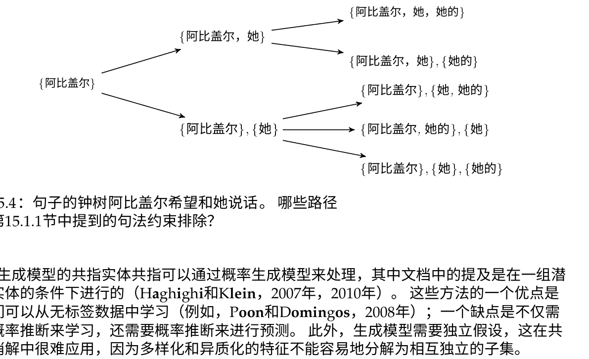

*生成模型的共指*可以通过概率生成模型来处理，其中文档中的提及是在一组潜在实体的条件下进行的（Haghighi和Klein，2007年，2010年）。这些方法的一个优点是它们可以从无标签数据中学习（例如，Poon和Domingos，2008年）；一个缺点是不仅需要概率推断来学习，还需要概率推断来进行预测。此外，生成模型需要独立假设，这在共指消解中很难应用，因为多样化和异质化的特征不能容易地分解为相互独立的子集。

##### 增量聚类排序

SMASH方法（§15.1.1）可以通过在文档中移动时建立共指簇来扩展到基于实体的共指消解（Cardie和Wagstaff，1999年）。在每个提及中，算法通过可能的先行簇向后迭代；但与SMASH不同，只有当其簇的所有成员与当前提及兼容时，才选择一个簇。随着提及的添加，其特征也会添加到簇中（例如，性别，数量，生动性）。通过这种方式，可以避免不连贯的链条，例如{希拉里·克林顿，克林顿，比尔·克林顿}。然而，文档中的一个错误分配（搜索错误）可能会导致后续错误的级联。

更复杂的搜索策略可以帮助改善搜索错误的风险。一种方法是束搜索（首次讨论见§11.3），在搜索过程中维护一组假设。每个假设代表Bell树中的一条路径（图15.4）。假设通过将下一个提及添加到现有簇或启动新簇来“扩展”。每个扩展都根据方程式15.13得分，而前K个假设则保留在束上，算法继续下一步。

通过在文档上进行多次遍历，每次遍历都应用具有递增召回率和递减精确度的规则（或“筛子”），可以使增量聚类排序更准确（Lee等，2013年）。在早期遍历中，只在高度可能共指的提及之间提出共指链接（例如，全名和名词的完全匹配）。然后可以在这些提及之间共享信息，因此当稍后应用更宽松的匹配规则时，整个聚类中的一致性得以保持。例如，在{希拉里·克林顿，克林顿，她}的情况下，名称匹配筛子将链接克林顿和希拉里·克林顿，然后代词匹配筛子将她链接到组合聚类中。确定性多遍系统几乎赢得了2011年CoNLL共指解析共享任务的所有轨道（Pradhan等，2011年）。鉴于机器学习在几乎所有其他自然语言处理领域的主导地位，以及在共指方面进行了十五年以上的机器学习先前工作，这个结果令人惊讶，即使基于学习的方法随后重新占据了上风（例如，Lee等，2018年，本文撰写时的最新技术水平）。

##### 增量感知器

增量共指消解可以通过增量感知器学习，如第11.3.2节所述。在提及i时，束上的每个假设对应于一组提及1...i−1，或者等价地，通过贝尔树到位置i−1的路径。

只要束上的假设都与黄金共指聚类不兼容，就进行感知器更新（Daumé III和Marcu，2005）。为了具体起见，考虑一个线性聚类排序模型，

$$\psi_E(\{i: z_i = e\}) = \sum_{i:z_i=e} \theta \cdot f(i, \{j: j < i \wedge z_j = e\}), [15.15]$$

其中每个簇的得分是将所有链接到该簇的提及的得分之和，而f(i,∅)是非指代提及的特征集，用于初始化该簇。

以图15.4为例，假设真实情况是

$$c^* = \{\text{阿比盖尔}, \text{她}\}, \{\text{她}\}, [15.16]$$

但是当束大小为1时，学习器得出的假设是

$$\hat{c} = \{\text{阿比盖尔}, \text{她}\}. [15.17]$$

这个假设与 c*不兼容，因此需要进行更新:

$$\theta \leftarrow \theta + f(c^*) - f(\hat{c}) [15.18]$$

$$= \theta + (f(\text{阿比盖尔}, \emptyset) + f(\text{她}, \emptyset)) - (f(\text{阿比盖尔}, \emptyset) + f(\text{她}, \{\text{阿比盖尔}\})) [15.19]$$

$$= \theta + f(\text{她}, \emptyset) - f(\text{她}, \{\text{阿比盖尔}\}). [15.20]$$

这种增量更新的方式也可以应用于黄金聚类和顶部聚类之间的边界损失。 通过从这个损失进行反向传播，还可以训练一个更复杂的评分函数，例如一个神经网络，其中每个实体的评分是实体提及的嵌入的函数（Wiseman等人，2015）。

##### 强化学习

强化学习是一个值得一本专门教材的主题（Sutton和Barto，1998），⁵因此本节只提供一个非常简要的概述，放在共指消解的背景下。 随机策略为每个可能的动作分配一个概率，条件是上下文。 目标是学习一个能够获得高期望奖励或低期望成本的策略。

在增量聚类排序中，可以通过一系列 $M$ 操作生成对 $M$ 提及的完整聚类，其中操作 $z_i$ 要么将提及 $i$ 与现有聚类合并，要么开始一个新的聚类。 因此，我们可以使用聚类分数（Clark 和Manning，2016）创建一个随机策略，

$$\mathrm{Pr}(z_i = e; \boldsymbol{\theta}) = \frac{\exp \psi_E(i \cup \{j : z_j = e\}; \boldsymbol{\theta})}{\sum_{e'} \exp \psi_E(i \cup \{j : z_j = e'\}; \boldsymbol{\theta})},$$ [15.21]

其中 $\psi_E(i \cup \{j : z_j = e\}; \boldsymbol{\theta})$ 是根据参数 $\boldsymbol{\theta}$ 为将提及 $i$ 分配给聚类 $e$ 的分数。 该分数可以是提及 $i$， 聚类 $e$ 及其（可能为空的） 提及集的任意函数；它还可以包括迄今为止采取的操作历史。 如果策略将概率 $p(c; \boldsymbol{\theta})$ 分配给聚类 $c$， 则其期望损失为，

$$L(\boldsymbol{\theta}) = \sum_{c \in \mathcal{C}(m)} \mathrm{p}_{\boldsymbol{\theta}}(c) \times \ell(c),$$ [15.22]

其中 $\mathcal{C}(m)$ 是可能的提及聚类的集合 $m$。 损失函数 $\ell(c)$ 可以基于任意的评分函数，包括共指解析中使用的复杂评估指标（参见 §15.4）。 这是强化学习的优势，它可以直接在评估指标上进行训练，而传统的监督学习则需要一个可微分且可分解的损失函数。

我们可以通过采样动作轨迹 $\boldsymbol{z} = (z_1, z_2, \ldots, z_M)$ 来近似期望，而不是对指数级可能的聚类进行求和。第二版的草稿可以在这里找到：http://incompleteideas.net/book/the-book-2nd.html。 强化学习已经在口语对话系统（Walker, 2000）和基于文本的游戏玩法（Branavan et al., 2009）中使用，并且被Clark和Manning（2015）应用于共指消解。

每个动作 $z_i$ 对应于Bell树中的一步：将提及 $m_i$ 添加到现有的聚类中，或形成一个新的聚类。 每个轨迹 $z$ 对应于一个单独的聚类 $c$，因此我们可以将一个动作序列的损失写为 $\ell(c(z))$。 策略梯度算法计算预期损失的梯度，作为对轨迹的期望 (Sutton等人，2000年)。

$$ \frac{\partial}{\partial \theta} L(\theta) = E_{z \sim \mathcal{Z}(m)} \ell(c(z)) \sum_{i=1}^{M} \frac{\partial}{\partial \theta} \log p(z_i | z_{1:i-1}, m) \qquad [15.23] $$
$$ \approx \frac{1}{K} \sum_{k=1}^{K} \ell(c(z^{(k)})) \sum_{i=1}^{M} \frac{\partial}{\partial \theta} \log p(z_i^{(k)} | z_{1:i-1}^{(k)}, m). \qquad [15.24] $$

其中每个动作序列 $z^{(k)}$ 是从当前策略中采样的。 与增量感知器不同，直到完整的动作序列可用之前，不会进行更新。

##### 学习搜索

策略梯度可能会受到高方差的影响：虽然在 $K$ 个样本上的平均损失渐近地等于给定策略的预期奖励，但除非 $K$ 非常大，否则这个估计可能不准确。 这可能会使得对个体动作的功劳和责备分配变得困难。 在学习搜索中，通过添加一个已知接收零或小损失的 **oracle** 策略来解决这个问题。 可以以两种方式使用oracle策略：

+   - 可以使用oracle生成可能得分较高的部分假设，通过从初始状态生成 $i$ 个动作。 然后，这些部分假设被用作学习策略的起点。 这被称为 **roll-in**。
+   - 通过从当前状态生成 $M-i$ 个动作，可以使用oracle计算给定状态的最小可能损失，直到完成。 这被称为 **roll-out**。

在roll-in和roll-out期间，可以将oracle与现有策略相结合，从每个策略中抽取动作 (Daumé III等，2009年)。 一种方法是在学习过程中逐渐减少从oracle中抽取的动作数量 (Ross等，2011年)。

在基于实体的共指消解的背景下，Clark和Manning (2016年) 在roll-in中使用学习的策略，在roll-out中使用oracle策略。 算法17展示了在这种情况下如何计算策略权重的梯度。 在这个应用中，oracle是“有噪声的”，因为它仅选择最小化本地损失 (即到提及 $i$ 为止的共指聚类的准确性) ，而不是识别将导致整个文档上最佳最终共指聚类的动作序列。

当从有噪声的预测者学习时，在展开过程中将当前策略的动作与预测者的动作混合在一起可能会有帮助(Chang et al., 2015)。

### 15.3 共指消解的表示

在历史上，共指消解使用了一系列手工设计的特征来捕捉在§15.1中描述的语言约束和偏好(Soon et al., 2001)。后续的工作已经证明了在提及对中使用词汇和双词特征的效用(Björkelund and Nugues, 2011; Durrett and Klein, 2013)。最近和成功的方法用分布式表示替换了许多(但不是全部)这些特征，这些分布式表示用于提及和实体(Wiseman et al., 2015; Clark and Manning, 2016; Lee et al., 2017)。

#### 15.3.1 特征

共指特征通常依赖于预处理流水线来提供词性标注和短语结构解析。这个流水线使得设计能够捕捉到§15.1中的许多现象的特征成为可能，对于提及识别的典型方法也是必需的。然而，这个流水线可能会引入错误，这些错误会传播到下游的共指聚类系统中。此外，这样的流水线的存在预设了一些资源，比如树库，这对于许多语言来说是不存在的。

通用依存关系项目已经为60多种语言生成了依存树库。然而，共指特征和提及检测通常基于短语结构树，这在大约二十种语言中是存在的。这里有一个列表：https://en.wikipedia.org/wiki/Treebank

##### 提及特征

个别提及的特征可以帮助预测指代性。在将提及检测与共指消解同时执行的系统中，这些特征还可以预测一段文本是否可能是一个提及。对于提及 i，典型的特征包括：

+   - 提及类型。每个跨度都可以根据提及的头词的词性来识别为代词、名称或名词短语：Penn Treebank和Universal Dependencies标签集（§8.1.1）都包括代词和专有名词的标签，而其他所有头词都可以标记为名词短语（Haghighi和Klein，2009）。
+   - 提及宽度。提及中的标记数是其指代性的粗略预测因子，较长的提及较不可能指代先前定义的实体。
+   - 词汇特征。第一个、最后一个和头词可以帮助预测指代性；它们与提及类型和词性等特征结合使用也很有用，提供了一种粗略的一致性度量（Björkelund和Nugues，2011）。词汇特征的数量可能非常大，因此选择仅频繁出现的特征（Durrett和Klein，2013）可能会有所帮助。
+   - 形态句法特征。这些特征包括词性、数目、性别和依存祖先。

提及i和候选先行词a的特征可以连接起来，产生可以帮助评估两个提及的兼容性的联合特征。例如，Durrett和Klein（2013）将每个特征与指代和先行词的提及类型连接起来。共指消解语料库，如ACE和OntoNotes，包含来自各种流派的文档。通过将流派与其他特征连接起来，可以学习特定于流派的特征权重。

##### 提及对特征

对于任意一对提及i和j，典型的特征包括：

+   - 距离。可以使用介于i和j之间的标记、提及和句子的数量作为距离特征。这些距离可以在表面文本上计算，也可以在反映广度优先树遍历的转换表示上计算（图15.3）。通常不直接使用距离，而是将其分组，创建二进制特征。

| 算法 17 学习搜索基于实体的共指消解 |
| :--- |
| **1: 过程** $\textsc{Compute-Gradient}$(提及 $m$, 损失函数 $\ell$, 参数 $\theta$) |
| **2:** $L(\theta) \leftarrow 0$ |
| **3:** $z \sim p(z \mid m; \theta)$  .从当前策略中采样一条轨迹 |
| **4:** **对于** $i \in \{1, 2, \dots M\}$ **执行** |
| **5:** $\quad$ **对于** 动作 $z \in \mathcal{Z}(z_{1:i-1}, m)$ **执行**  .历史 $z_{1:i-1}$ 之后的所有可能动作 |
| **6:** $\quad\quad$ $h \leftarrow z_{1:i-1} \oplus z$  .将历史 $z_{1:i-1}$ 与动作连接起来 |
| **7:** $\quad\quad$ **对于** $j \in \{i + 1, i + 2, \dots, M\}$ **执行**  。展开 |
| **8:** $\quad\quad\quad$ Oracle选择具有最小损失的动作 |
| **9:** $\quad\quad$ $L(\theta) \leftarrow L(\theta) + p(z \mid z_{1:i-1}, m; \theta) \times \ell(h)$  。更新预期损失 |
| **10:** **返回** $\frac{\partial}{\partial \theta} L(\theta)$ |

字符串匹配。可以使用各种字符串匹配特征：精确匹配、后缀匹配、头部匹配以及更复杂的匹配规则，忽略无关的修饰词（Soon等，2001年）。

兼容性。在模型的基础上，特征可以衡量指代词和先行词在词法句法属性方面的一致性，如性别、数量和动物性。

嵌套。如果一个提及嵌套在另一个提及中（例如，［法国的[总统]］），它们通常不能共指。

同一说话者。对于带有引用的文档，例如新闻文章，只能通过确定每个提及的说话者来解决人称代词（Lee等，2013年）。同一说话者的提及之间也更有可能存在共指关系。

地名词典。这些特征表明指代词和候选先行词出现在缩略词词典（例如，*USA*／美国，*GA Tech*／佐治亚理工学院）、国别名词典（例如，以色列／以色列人）或其他别名词典（例如，*Knickerbockers*／纽约尼克斯队）中。

词汇语义学。这些特征使用词汇资源，如WORDNET来确定提及的核心词是否通过同义词、反义词和上位词（§ 4.2）相关。

依赖路径。指代词和候选先行词之间的依赖路径可以帮助确定这对是否可以在 § 15.1.1中描述的政府和约束条件下共指。

Bengtson和Roth（2008）以及Rahman和Ng（2011）提供了详尽的提及对特征列表。神经网络方法使用较少的提及对特征：例如，Lee等人（2017）仅包括说话者、流派、距离和提及宽度特征。

语义在许多情况下，共指似乎需要知识和语义推理，就像在运行示例中，我们将 *China* 与 *country* 和 *growth market* 链接起来一样。可以从WORDNET中获取这些信息，它定义了一个关于 synsets的图（参见 § 4.2）。例如，*China* 的一个synsets是亚洲国家#1的一个实例，而亚洲国家#1又是 *country* #2的一个下位词，*country* #2是一个包含 *country* 的synsets。这样的路径可以用来衡量概念之间的相似性（Pedersen等人，2004），并且这种相似性可以作为一个特征（Ponzetto和Strube，2006）被纳入共指消解中。类似的思想可以应用于从维基百科中引出的知识图（Ponzetto和Strube，2007）。但是，尽管这些方法有所改进，相对简单的基于分类的系统在当前技术的基础上添加后已经证明不太有用。⁸ 例如，Durrett和Klein（2013）使用一系列基于语义的特征 - WordNet同义词和上位词关系，头词上的命名实体类型（例如，人物，组织）以及无监督聚类-在名词头上进行 - 但发现这些特征对于使用表面特征的基准系统的改进很小。

##### 实体特征

实体提及共指的许多特征是通过聚合候选实体中所有提及对特征来生成的（Culotta等，2007; Rahman和Ng, 2011）。具体来说，对于每个二元提及对特征 f（i, j），我们计算提及 i 和实体 e = {j : j < i ∧ zj = e}的以下实体提及特征。

- ALL-TRUE: 特征 f（i, j）对于所有提及 j ∈ e都成立。
- MOST-TRUE: 特征 f（i, j）对于至少一半但不是所有提及 j ∈ e都成立。
- MOST-FALSE: 特征 f（i, j）对于至少一个但不是所有提及 j ∈ e都成立。
- NONE: 特征 f（i, j）对于任何提及 j ∈ e都不成立。

对于标量提及对特征（例如，距离特征），可以通过计算聚类中所有提及的最小值、最大值和中位数来进行聚合。其他实体提及特征包括当前聚类在实体中的提及数量，以及每个提及类型的ALL-X和MOST-X特征。

#### 15.3.2 提及和实体的分布式表示

最近的工作强调了提及和实体的分布式表示。一个潜在的优势是，预训练的嵌入可以帮助捕捉名词共指底层的语义兼容性，有助于处理像（苹果，该公司）和（中国，该公司最大的增长市场）这样的困难情况。此外，可以训练实体的分布式表示来捕捉每个提及所添加的语义特征。

##### 提及嵌入

实体提及可以嵌入到一个向量空间中，为评分共指决策的神经网络提供基础层（Wiseman等，2015）。

> ⁸ 这一观点是由Michael Strube在2015年的一个研讨会上提出的，他指出随着共指机器学习模型的质量提高，包含语义的好处已经变得微不足道。

Jacob Eisenstein。2018年11月13日草稿。

### 15.3. 核指代消解的表示

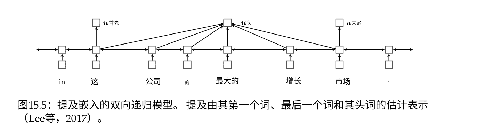

构建提及嵌入可以应用多种方法来嵌入多词单位（参见 §14.8）。图15.5展示了一种循环神经网络方法，它通过在整个文本上运行双向LSTM，从左到右和从右到左获得隐藏状态，得到隐藏状态 \(h_m = [\overleftarrow{h}_m; \overrightarrow{h}_m]\)。然后，每个候选提及跨度 \((s,t)\) 由四个向量的垂直连接表示：

$$u^{(s,t)} = [u_{\text{第一个}}^{(s,t)}; u_{\text{最后一个}}^{(s,t)}; u_{\text{头}}^{(s,t)}; \phi^{(s,t)}], \quad\quad\quad [15.25]$$

其中 \(u_{\text{第一个}}^{(s,t)} = h_{s+1}\) 是跨度中第一个词的嵌入，\(u_{\text{最后一个}}^{(s,t)} = h_t\) 是最后一个词的嵌入，\(u_{\text{头}}^{(s,t)}\) 是“头”词的嵌入，而 \(\phi^{(s,t)}\) 是一个表面特征向量，例如跨度的长度 (Lee et al., 2017)。

对头词的注意力不是从解析器的输出中识别头词，而是可以通过神经注意机制计算得出：

$$\tilde{\alpha}_m = \theta_\alpha \cdot h_m \quad\quad\quad\quad\quad\quad\quad\quad\quad\quad\quad\quad [15.26]$$
$$a^{(s,t)} = \text{SoftMax}([\tilde{\alpha}_{s+1}, \tilde{\alpha}_{s+2}, \dots, \tilde{\alpha}_t]) \quad\quad [15.27]$$
$$u_{\text{头}}^{(s,t)} = \sum_{m=s+1}^{t} a_m^{(s,t)} \text{头}_m. \quad\quad\quad\quad\quad\quad\quad [15.28]$$

每个标记 \(m\) 都有一个标量分数 \(\tilde{\alpha}_m = \theta_\alpha \cdot h_m\)，这是LSTM隐藏状态 \(h_m\) 和权重向量 \(\theta_\alpha\) 的点积。跨度中标记的分数向量 \(m \in \{s+1, s+2, \dots, t\}\) 然后通过softmax层传递，得到一个向量 \(a^{(s,t)}\)，该向量在跨度上分配一个注意力单位。这消除了恢复头词的句法分析的需要；相反，模型学会了识别每个跨度中最重要的词。注意机制在神经机器翻译中首次引入(Bahdanau et al., 2014)，并在 §18.3.1 中有更详细的描述。

使用提及嵌入给定一组提及嵌入，每个提及 i 和候选先行词 a 都会得到一个分数，

$$\psi(a, i) = \psi_S(a) + \psi_S(i) + \psi_M(a, i) \tag{15.29}$$
$$\psi_S(a) = \text{前馈} \quad s(\mathbf{u}^{(a)}) \tag{15.30}$$
$$\psi_S(i) = \text{前馈} \quad s(\mathbf{u}^{(i)}) \tag{15.31}$$
$$\psi_M(a, i) = \text{前馈} \quad M([\mathbf{u}^{(a)}; \mathbf{u}^{(i)}; \mathbf{u}^{(a)} \odot \mathbf{u}^{(i)}; \mathbf{f}(a, i, \mathbf{w})]), \tag{15.32}$$

其中 \(\mathbf{u}^{(a)}\) 和 \(\mathbf{u}^{(i)}\) 分别是跨度 \(a\) 和 \(i\) 的嵌入，如方程15.25所定义。

- 分数 \(\psi_S(a)\) 量化了一个词组 \(a\) 是否可能是一个指代提及，而不考虑它指代的内容。这使得模型能够直接学习识别提及，而不需要预处理步骤来识别提及。
- 分数 \(\psi_M(a, i)\) 计算了词组 \(a\) 和 \(i\) 之间的兼容性。它的基本层是一个包含了词组 \(a\) 和 \(i\) 的嵌入的向量，以及它们的逐元素乘积 \(\mathbf{u}^{(a)} \odot \mathbf{u}^{(i)}\)，以及一个包含了距离、说话者和文体信息的表面特征向量 \(\mathbf{f}(a, i, \mathbf{w})\)。

Lee等人（2017）提供了一个错误分析，展示了这种方法如何正确地将一个火焰和一个火灾链接起来，同时错误地将飞行员和空乘人员链接起来。在每种情况下，共指决策基于词嵌入的相似性。

克拉克和曼宁（2016）嵌入了提及对，而不是嵌入个别提及。在基础层，他们的网络接受每个提及周围单词的嵌入，以及表示一些表面特征的独热向量，例如距离和字符串匹配特征。然后，将该基础层通过具有ReLU非线性函数的多层前馈网络，得到提及对的表示。提及对编码器的输出 \(\mathbf{u}_{i,j}\) 在提及排序模型的评分函数中使用，\(\psi_M(i, j) = \boldsymbol{\theta} \cdot \mathbf{u}_{i,j}\)。评分簇对时采用类似的方法，通过对所有簇内提及对编码进行汇聚，构建簇对编码。

##### 实体嵌入

在基于实体的共指消解中，每个实体应该由其提及的属性表示。在分布式环境中，我们维护一组向量实体嵌入，\(\mathbf{v}_e\)。每个候选提及都会接收一个嵌入 \(\mathbf{u}_i\)；Wiseman等人（2016）通过应用于一组表面特征的单层神经网络来计算此嵌入。是否将提及 \(i\) 与实体 \(e\) 合并的决策可以由前馈网络驱动，ψ_E(i,e)=前馈([v_e; u_i])。如果i被添加到实体e中，则其表示会通过循环更新，v_e ← f(v_e, u_i)，使用循环神经网络，如长短期记忆（LSTM；第6章）。或者，我们可以应用池化操作，如最大池化或平均池化（第3章），设置v_e ← 池化(v_e, u_i)。在任何情况下，对实体e表示的更新可以被视为从提及i中添加关于实体的新信息。

### 15.4 评估核指代消解

共指消解评估的状态非常复杂。早期的简单评估指标被发现容易受到微不足道的基准线的影响，例如将每个提及放入其自己的簇中，或将所有提及分组到一个簇中。继Denis和Baldridge（2009）之后，CoNLL 2011共指共享任务（Pradhan等，2011）将在三个不同指标（MUC（Vi-lain等，1995）、B-CUBED（Bagga和Baldwin，1998a）和CEAF（Luo，2005））之间进行平均的做法形式化。这些指标的参考实现可从Pradhan等人（2014）的网址https://github.com/conll/reference-coreference-scorers获取。

### 附加资源

Ng（2010）通过2010年对共指消解进行了调查。早期的工作仅关注代词消解，采用基于规则的方法（Lappin和Leass，1994）和概率方法（Ge等，1998）。完整的共指消解问题在第六届消息理解会议的共享任务中得到了普及，该任务包括对每个训练和测试集的30个文档进行共指注释（Grishman和Sundheim，1996）。Soon等人（2001）的决策树方法是一篇有影响力的早期论文，他们引入了提及排序。Bengtson和Roth（2008）提供了一个完整的表面特征列表，用于共指消解。Durrett和Klein（2013）通过引入一个大型词汇特征集来改进之前的工作；随后的工作强调实体和提及的神经表示（Wiseman等，2015）。

### 练习

1. 从今天的新闻中选择一篇文章，并为前二十个名词短语和所有出现在文章中的所有所有格代词进行标注，包括嵌套在更大名词短语中的代词。然后指定从这些候选实体提及中得到的配对训练数据的情况。
2. 使用前面问题中的标注，计算以下统计数据：
    - 每种引用表达方式（代词、专有名词和名词短语）引入新实体的次数。包括只被提及一次的“单指”实体。
    - 对于每种引用表达方式，计算被指代的提及的比例。
3. 对前一练习文章中的所有代词应用一个简单的启发式方法：将每个代词链接到与其在性别、数量、生命力和人称上一致的最近的前置名词短语。计算以下评估结果：
    - 真正例：一个与其指代的名词短语相关联的代词，或者被标记为实体的第一个提及，但实际上它与任何前面的提及都不相关。在这种情况下，如果非指代性代词被标记为没有先行词，它们可以是真正例。
    - 误报：一个代词与它不指代的名词短语相关联。这包括错误地将单例或非指代性代词链接起来。
    - 漏报：一个代词至少有一个先行词，但被标记为没有先行词，或者与它不指代的提及相关联。
    计算你的方法和一个简单的基准方法的F-MEASURE，其中每个代词都指代前面的实体提及。是否有任何额外的启发式方法可以提高这种方法的性能？
4. Durrett和Klein（2013）通过对与聚类兼容的所有先行结构求和来计算黄金共指聚类的概率。例如，如果一个实体有三个提及，m1, m2, m3，那么有两种可能的先行结构：a2=1, a3=1和a2=1, a3=2。计算具有K个提及的单个实体的先行结构数量。
5. 假设所有提及可以明确地分为C类，例如按性别和数量。进一步假设来自不同类别的提及永远不会共指。在一个包含M个提及的文档中，用贝尔数和参数M和C给出可能的共指聚类的总数的上下界。计算当M=4，C=2时的数值上下界。
6. Lee等人（2017）提出了一个模型，该模型将文档中的所有连续跨度视为可能的提及。
    - a) 在长度为M的文档中，必须评估多少个提及对？（所有答案都可以用渐近的大O表示法给出。）
    - b) 为了使推理更加高效，Lee等人（2017）将考虑范围限制为最大长度为 L ≪ M 的跨度。在这种限制下，必须评估多少个提及对？
    - c) 为了进一步改进推理，可以仅在最多 D个标记之间分别评估共指。在这种额外限制下，必须评估多少对提及？
7. 在西班牙语中，当上下文清楚时，可以省略主语，例如，
    > (15.13) Las ballenas no son peces. Son mamíferos.
    鲸鱼不是鱼。它们是哺乳动物。
    解决此类空主语问题的方法是使用西班牙语的动词形态系统，该系统包括大多数人称和数的组合的独特后缀。例如，动词形式 son ('是') 与第三人称复数代词 ellos (男性) 和 ellas (女性) 以及第二人称复数代词ustedes一致。
    假设您已经获得了以下组件：
    - 一个自动识别具有空主语的动词的系统。
    - 一个函数 c(j, p)∈ {0, 1}，表示代词 p是否与空主语 j兼容，根据动词的形态。
    - 一个经过训练的提及对模型，计算得分 ψ(w_i, w_j, j - i) ∈ ℝ，对于所有提及对 i 和 j，通过先行提及 w_i，指代词 w_j和距离 j - i进行评分。
    描述一个整数线性规划，同时执行两个任务：解决所有实体提及之间的共指关系，并为所有空主语识别合适的代词。在上面的例子中，你的程序应该将空主语与las ballenas ('鲸鱼') 连接起来，并将 ellas识别为正确的代词。为了简单起见，你可以假设空主语不能作为先行词，并且不需要担心 § 15.2.3中描述的传递性约束。
8. 使用策略梯度算法根据图15.4中的Bell树计算以下场景的梯度：
    - 黄金聚类 c*是 {阿比盖尔,她}, {她}.
    - 从当前策略中绘制单个动作序列 (K=1)，得到以下增量聚类:
    c(a1) = {阿比盖尔}
    c(a1:2) = {阿比盖尔, 她}
    c(a1:3) = {阿比盖尔, 她}, {她}.
    - 在每次提及 t，动作空间 A_t 包括将提及与每个现有聚类或空聚类合并。将 m_t 与聚类 c 合并的概率与合并聚类的指数化分数成比例。
    p(合并(m_t, c)) ∝ exp ψ_E(m_t ∪ c), [15.33]
    其中 ψ_E(m_t ∪ c) 在方程式15.15中定义。
    计算梯度 ∂/∂θ L(θ) 关于损失 ℓ(c(a)) 和每个 (潜在的) 簇的特征。解释基于梯度的更新 θ ← θ - ∂/∂θ L(θ) 和来自相同样例的增量感知器更新之间的差异。
9. 如 §15.1.1 所讨论的，一些代词不具备指代性。在英语中，这经常发生在单词 it 上。从 NLTK 下载 Alice in Wonderland 的文本，并检查前十次出现的 it。对于每次出现：
    - 首先，检查单词周围的五个标记。在第一个例子中，这个窗口是, but it did not look sorry. 是否有另一个代词可以替代它？考虑她，他们，和他们。在这种情况下，她和他们都可以产生语法替代。其他十个它的出现呢？
    - 现在，为每个例子查看一个十五个词的窗口。根据这个窗口，标记你认为单词它是否具有指代性。
    替代测试有多少次预测它是否具有指代性？
10. 现在尝试自动化测试，使用 Google 的 n-grams 语料库 (Brants和Franz, 2006)。具体而言，找到包含它的每个 5-gram 的计数，然后计算替换为其他第三人称代词的 5-gram 的计数：他，她，他们，她的，他的，他们的，她自己，他自己。
    有多种方法可以获得这些计数。一种方法是下载原始数据并进行搜索；另一种方法是构建网页查询到 https://books.google.com/ngrams。
    比较原始5-gram的计数与替代创建的5-gram的计数之和的比率。这个比率是否是是否引用的好预测因子？

# 第16章

## 话语

自然语言处理的应用通常涉及多句文档：从段落长的餐厅评论，到500字的报纸文章，到500页的小说。然而，迄今为止我们讨论的大部分方法都涉及单个句子。本章讨论处理多句语言现象的理论和方法，统称为话语。对话结构有多种不同的描述，没有一种结构适用于每个计算应用。本章介绍了一些最常研究的话语表示，并强调了识别和利用这些结构的计算模型。

### 16.1 段落

一个文档或对话可以被视为一系列片段，每个片段在其内容和/或功能上都是连贯的。在维基百科的传记中，这些片段通常涉及主题生活的各个方面：早年，重大事件，对他人的影响等。这种分割是围绕主题组织的。另外，科学研究文章通常按功能主题组织：引言，对先前研究的调查，实验设置和结果。书面文本通常使用章节标题和相关格式设备标记片段。然而，这种格式可能过于粗粒度，无法支持与查询相关的特定文本段的检索（Hearst，1997）。未格式化的演讲转录，如会议和讲座，也是分割的应用场景（Carletta，2007；Glass等，2007；Janin等，2003）。

图16.1：新闻文章中相邻句子之间的平滑余弦相似度。局部最小值在m=10和m=29处表示可能的分割点。

#### 16.1.1 主题分割

一个连贯的主题段落使用各种语言手段形成一个统一的整体：对实体或事件的重复引用；使用连词连接相关的思想；通过词汇选择重复意义（Halliday和Hasan，1976）。这些连贯手段中的每一个都可以进行测量，然后用作主题分割的特征。

在TEXTTILING方法中，词汇凝聚力的使用是主题分割的一个经典例子（Hearst，1997）。基本思想是计算文本块（句子或固定长度单位）之间的文本相似度，使用诸如平滑余弦相似度的公式计算它们的词袋向量。

$$ s_m = \frac{\boldsymbol{x}_m \cdot \boldsymbol{x}_{m+1}}{||\boldsymbol{x}_m||_2 \times ||\boldsymbol{x}_{m+1}||_2} $$ [16.1]

$$ \bar{s}_m = \sum_{\ell=0}^L k_\ell (s_{m+\ell} + s_{m-\ell}), $$ [16.2]

其中 $k_\ell$ 表示平滑核大小为 $L$ 的值，例如 $\boldsymbol{k}=[1,0.5,0.25]^\top$。然后，在平滑相似度 $\bar{s}$ 中，通过识别局部极小值来确定分割点，因为这些点表示文本中单词分布的变化。图16.1中显示了一个示例。

文本分割也可以被建模为一个概率模型，在该模型中，每个分割都有一个唯一的语言模型，用于定义该分割中文本的概率（Utiyama and Isahara, 2001; Eisenstein and Barzilay, 2008; Du et al., 2013）。一个好的分割通过将具有相似词分布的片段分组，实现高似然性。这种概率方法可以扩展到分层主题分割，其中每个主题片段被划分为子片段（Eisenstein, 2009）。所有这些方法都是无监督的。虽然可以从格式良好的文本（如教科书）中获取标记数据，但这些注释可能无法推广到替代领域的语音转录。在有领域内标记数据的情况下，已经尝试了监督方法，通过学习多种类型特征的权重，大大提高了性能（Galley et al., 2003）。

$^1$关于潜在变量模型（如潜在狄利克雷分配）如何跟踪的丰富文献

#### 16.1.2 功能分割

在某些流派中，存在一组规范的交际功能：例如，在科学研究文章中，其中一个功能是传达文章的一般背景，另一个功能是介绍新的贡献，或者描述研究的目的（Teufel et al., 1999）。功能分割将文档分割为连续的片段，有时称为修辞区域，在该区域中，每个句子具有相同的功能。Teufel和Moens（2002）训练了一个监督分类器，用于识别一组科学研究文章中每个句子的功能，使用描述句子在文本中的位置、与文章和标题的相似性、主动动词的时态和语态以及前一个句子的功能角色的特征。功能分割也可以在无监督的情况下进行。注意到某些类型的维基百科文章具有非常一致的功能分割（例如，关于城市或化学元素的文章），Chen等人（2009）引入了一种无监督模型用于功能分割，该模型学习了与每个功能相关的语言模型以及文章中功能分割的典型模式。

### 16.2 实体和参考

话语的另一个维度涉及到文本中提及的实体以及它们的提及方式。请考虑图16.2中的例子：Grosz等人（1995）认为第一个话语更连贯。你同意吗？这些例子在选择主角约翰的指代表达式和句子（b）和（d）的句法结构上有所不同。这些例子展示了理论模型解释指代表达式如何选择以及它们在句子中的位置的必要性。这样的模型可以用来帮助解释话语的整体结构，衡量话语的连贯性，并生成使用连贯指代表达式的话语。

| (16.1) | (16.2) |
|--------|--------|
| a. 约翰去他最喜欢的音乐店买钢琴。 | a. 约翰去他最喜欢的音乐店买钢琴。 |
| b. 他多年来经常光顾这家店。 | b. 这是约翰多年来常去的一家店。 |
| c. 他很兴奋，他终于能买一台钢琴了。 | c. 他很兴奋，他终于能买一台钢琴了。 |
| d. 他刚好在店关门前到达。 | d. 约翰到达时店正关门。 |

图16.2：同一个故事的两种叙述方式（Grosz等，1995年）。左边的话语使用连贯的指称表达，而右边的话语则没有。

#### 16.2.1 中心理论

中心理论提出了关于话语结构和实体指称之间关系的统一解释（Grosz等，1995年）。根据该理论，话语中的每个话语都由一组实体组成，称为中心。

- 话语中的前瞻中心是在话语中提到的所有实体，表示为$f(w_m) = \{e_1, e_2, \ldots\}$。前瞻中心按照它们的句法突出性进行部分排序，主语优先于宾语，宾语优先于其他位置（Brennan等，1987年）。例如，在图16.2的例子（16.1a）中，第一个话语中前瞻中心的有序列表是约翰、音乐店和钢琴。
- 向后看的中心 $c_b(w_m)$ 是前一话语中从前瞻中心集合中排名最高的元素 $c_f(w_{m-1})$，该元素也在 $w_m$ 中提到。在例子(16.1b)中，向后看的中心是约翰。

根据这两个定义，中心理论对于指称表达式的形式和位置做出以下预测：

1. 如果代词出现在话语 $w_m$ 中，则向后看的中心 $c_b(w_m)$ 必须也以代词的形式出现。这个规则反对在例子(16.2d)中使用 $it$ 来指称钢琴店，因为JOHN是(16.2d)的向后看的中心，他是以名字而不是代词的形式提到的。
2. 如果可能的话，话语序列应该保持相同的向后看的中心，理想情况下，向后看的中心也应该是前瞻中心列表中排名最高的元素。这个规则支持在整个例子(16.1)中保留JOHN作为向后看的中心。

| | SKYLER | WALTER | DANGER | 一个家伙在门口 | |
|---|---|---|---|---|---|
| 你不知道你在和谁说话, | S | - | - | - | - |
| 所以让我给你一个提示. | O | O | - | - | - |
| 我不处于危险之中, Skyler. | X | S | X | - | - |
| 我就是危险. | - | S | O | - | - |
| 一个人打开门就被枪击, | - | - | - | S | O |
| 而你却这样看待我? | S | X | - | - | - |
| 不. 我就是那个敲门的人! | - | S | - | - | - |

图16.3: 电视剧《绝命毒师》中对话的实体网格表示。

中心理论统一了句法、语篇和指代消解的方面。然而，确定如何对每个话语的元素进行排序，甚至如何将文本或对话分割成话语，可能会很困难 (Poesio等, 2004)。

#### 16.2.2 实体网格

形式化中心理论的一种方法是将文本或对话中的实体排列在一个实体网格中。这是一种数据结构，每个句子一行，每个实体一列 (Barzilay和Lapata, 2008)。每个单元格 $c(m, i)$ 可以取以下值:

$$ c(m, i) = \begin{cases} S, & \text{实体 } i \text{ 在句子 } m \text{ 的主语位置} \\ O, & \text{实体 } i \text{ 在句子 } m \text{ 的宾语位置} \\ X, & \text{实体 } i \text{ 出现在句子 } m \text{ 中，既不是主语也不是宾语} \\ -, & \text{实体 } i \text{ 不出现在句子 } m \text{ 中。} \end{cases} $$ [16.3]

为了填充实体网格，应用句法分析来识别主语和宾语位置，并应用共指消解来链接单个实体的多个提及。图16.3中显示了一个例子。

网格构建完成后，可以通过每列相邻单元格之间的转换来衡量文档的连贯性。例如，转换 (S → S)将一个实体保持在相邻句子的主语位置；转换 (O → S)将一个实体从宾语位置提升到主语位置；转换 (S→ -)将一个句子的主语从下一个句子中删除。每个转换的概率可以通过对标记数据进行估计，然后可以通过对所有列和所有转换的对数概率之和对实体网格进行评分，$\sum_{i=1}^{N} \sum_{m=1}^{M} \log \mathrm{p}(c(m, i) \mid c(m-1, i))$。得到的概率可以用作文本连贯性的代理。已经证明这对于一系列任务非常有用：确定一对文章中哪篇更易读（Schwarm和Ostendorf，2005），正确排序乱序文本中的句子（Lapata，2003），以及解开在线多方聊天中的多个对话线索（Elsner和Charniak，2010）。

#### 16.2.3 句子级别之外的形式语义

对话中实体在语篇中的作用的另一种观点侧重于形式语义学，以及为多句单元构建意义表示。考虑以下两个句子（来自Bird等人，2009）：

- (16.3) a. Angus拥有一只狗。
b. 它咬了Irene。

我们希望恢复正式的语义表示，

$$ \exists x. \mathrm{DOG}(x) \wedge \mathrm{OWN}(\mathrm{ANGUS}, x) \wedge \mathrm{BITE}(x, \mathrm{IRENE}) $$ [16.4]

然而，每个句子的语义表示是，

$$ \exists x. \mathrm{DOG}(x) \wedge \mathrm{OWN}(\mathrm{ANGUS}, x) $$ [16.5]
$$ \mathrm{BITE}(y, \mathrm{IRENE}) $$ [16.6]

将这两个表示统一为方程16.4的形式需要将[16.6]中的未绑定变量 $y$ 与[16.5]中的量化变量 $x$ 链接起来。$^2$ 因此，篇章理解需要读者更新一组从变量到实体的赋值。这个更新将（可能）将[16.3]中的狗与第二个句子中的未绑定变量 $y$ 链接起来，从而授权[16.4]中的连词。$^3$ 这个基本思想是动态语义学的根源(Groenendijk and Stokhof, 1991)。分段篇章表示理论将动态语义学与一组篇章关系联系起来，这些关系解释了文本的相邻单元在修辞上或概念上的关系(Lascarides and Asher, 2007)。下一节将更详细地探讨篇章关系理论。

### 16.3 关系

在依存语法中，句子由词之间的句法关系图（通常是树）来描述，例如NSUBJ和DET。类似的思想可以应用于文档级别，识别诸如从句、句子或段落之间的关系的话语单元之间的关系。话语解析的任务包括识别话语单元和它们之间的关系。然后，这些关系可以应用于诸如文档分类和摘要等任务，如第16.3.4节所讨论的。

#### 16.3.1 浅层语篇关系

存在话语关系的迹象是话语连词，例如然而，而且，同时，以及如果...那么。这些连词明确指定了相邻文本单元之间的关系：然而表示对比关系，而且表示后续文本详细说明或加强了之前提到的观点，同时表示两个事件同时发生，而如果...那么则建立了条件关系。因此，可以将话语连词视为分析话语关系的起点。

在词汇化的树连接语法中，每个连接词都连接着两个文本单元之间的关系（Webber, 2004）。该模型为宾夕法尼亚话语树库（PDTB）提供了理论基础，它是英语中最大的话语关系语料库（Prasad等，2008）。它包括一个话语关系的分层清单（如表16.1所示），该清单通过抽象出真实文本中出现的话语连接词所暗示的含义来创建（Knott, 1996）。然后，这些关系被注释在与宾夕法尼亚树库中使用的新闻文本相同的语料库上（参见 §9.2.2），添加以下信息：

- 每个连接词都被注释为表达的话语关系或关系，如果有的话。
- 许多话语连接词在某些情况下并不表示话语关系（Pitler和Nenkova，2009年）。
- 对于每个话语关系，关系的两个参数被指定为 ARG1和 ARG2，其中 ARG2被限制为与连接词相邻。这些参数可以是句子，也可以是更小或更大的文本单元。
- 相邻的句子被注释为隐含的话语关系，这些关系没有任何连接词标记。当一个连接词可以插入到一对句子之间时，注释者会提供它，并标记它的意义（例如，例子16.5）。在某些情况下，一对相邻句子之间根本没有关系；在其他情况下，唯一的关系是相邻的句子提到一个或多个共享实体。这些现象分别被注释为NOREL和ENTREL（实体关系）。

- 时间
    - 异步
    - 同步
        - 优先级，连续性
- 偶然性
    - 原因：结果，理由
    - 语用原因
        - 正当理由
    - 条件：假设，一般，非真实现在，非真实过去，真实现在，真实过去
    - 语用条件：相关性，隐含断言
- 比较
    - 对比：并列，对立
    - 语用对比
    - 让步：期望，相反期望
    - 语用让步
- 扩展
    - 连词
    - 实例化
    - 重述：具体化，等价，概括
    - 选择：连词，分词，选择的替代
    - 例外
    - 列表

表16.1：宾州话语树库注释中的话语关系层次结构 (Prasad等, 2008年)。例如，优先是同步的子类型，而同步是时间关系的一种类型。

Penn Discourse Treebank注释的示例显示在 (16.4) 中。在 (16.4) 中，单词 *therefore* 充当明确的话语连接词，连接了两个相邻的文本单元。Treebank注释还指定了每个关系的“意义”，将连接词与表16.1中显示的意义清单中的关系相关联：在 (16.4) 中，关系是 PRAGMATIC CAUSE:JUSTIFICATION，因为它涉及作者的交际意图。单词 *therefore* 也可以表示外部世界的原因（例如，他因此被迫放弃了他的计划）。在话语意义分类中，目标是确定每个连接词是否表达了某种话语关系。确定每个连接词是否表达了某种话语关系是相关任务之一。与此相关的任务是隐含话语关系的分类，如 (16.5) 中所示。在这个例子中，相邻句子之间的关系可以由连接词 *because* 表示，表示一个 CAUSE:REASON关系。

分类明确的话语关系及其论证

正如上面的例子所示，许多连词可以用来引发多种类型的话语关系。同样，一些连词的意义与话语无关：例如，当它连接命题时，*and* 作为话语连词起作用，但是，当它连接名词短语时，它不会改变位置(Lin等人, 2014)。尽管如此，宾夕法尼亚树库中明确标记的篇章关系在粗粒度级别上相对容易分类。在对四个顶级PDTB关系进行分类时，只需选择每个连词最常见的关系，就可以达到90%的准确率(Pitler和Nenkova, 2009)。在篇章关系层次结构的更细粒度级别上，连词更加模糊。这个事实既反映在自动语义分类的准确率上(Versley, 2011)，也反映在标注者之间的一致性上，对于三级篇章关系，一致性下降到80%(Prasad等人, 2008)。

对于明确标记的话语关系来说，一个更具挑战性的任务是确定参数的范围。话语连接词不一定与 ARG1相邻，如第16.6项所示， ARG1在 ARG2之后；此外，参数不一定是连续的，如(16.7)所示。因此，恢复每个话语连接词的参数是一个具有挑战性的子任务。因为句内参数通常是句法成分（参见第10章），许多方法训练一个分类器来预测每个明确话语连接词的合适参数（例如，Wellner和Pustejovsky, 2007; Lin等, 2014年）。

### 16.3.2 分类隐含话语关系

隐含话语关系的分类和注释要困难得多。$^4$ 大多数方法基于对每个参数的编码，然后将其用作输入。

$^4$ 在2015年浅层篇章解析共享任务的数据集中，标注者间的一致性为91%的显式篇章关系和81%的隐式关系，在所有细节层面上（Xue等, 2015年）。

对于非线性分类器：

$$ z^{(i)} = \text{编码}(w^{(i)}) $$ [16.7]
$$ z^{(i+1)} = \text{编码}(w^{(i+1)}) $$ [16.8]
$$ \hat{y}_i = \underset{y}{\text{argmax}} \Psi(y, z^{(i)}, z^{(i+1)}) $$ [16.9]

这个基本框架可以通过多种方式实现，包括基于特征的和神经编码器。

基于特征的方法每个参数可以被编码成一个表面特征的向量。编码通常包括词汇特征（所有单词，或所有内容词，或诸如前三个和主动动词之类的词的子集），个别词的Brown聚类（§14.4），以及句法特征，如终端产生和依存弧（Pitler等，2009年；Lin等，2009年；Rutherford和Xue，2014年）。然后，分类函数有两个部分。首先，它通过组合每个参数的编码来创建一个联合特征向量，通常通过计算每个编码中所有特征的叉积来实现：

$$ f(y, z^{(i)}, z^{(i+1)}) = \{(a \times b \times y) : (z_a^{(i)} z_b^{(i+1)})\} $$ [16.10]

这个特征集的大小随着词汇量的平方增长，因此在训练数据上选择一部分特别有用的特征可能是有帮助的（Park和Cardie，2012）。计算完$f$之后，任何分类器都可以被训练来计算最终得分，$\Psi(y, z^{(i)}, z^{(i+1)}) = \boldsymbol{\theta} \cdot f(y, z^{(i)}, z^{(i+1)})$。

神经网络方法在神经网络架构中，编码器与分类器一起作为端到端模型进行学习。可以使用各种神经架构对每个参数进行编码（在§14.8中进行了调查）：递归（§10.6.1；Ji和Eisenstein，2015），循环（§6.3；Ji等，2016），和卷积（§3.4；Qin等，2017）。然后，分类函数可以实现为基于两个编码的前馈神经网络（第3章；例如，参见Rutherford等，2017；Qin等，2017），或者作为简单的双线性乘积，$\Psi(y, z^{(i)}, z^{(i+1)}) = (z^{(i)})^{\top} \boldsymbol{\Theta}_y z^{(i+1)}$（Ji和Eisenstein，2015）。编码模型可以通过反向传播从分类目标进行训练，例如边际损失。Rutherford等（2017）表明，在大多数情况下，神经架构优于基于特征的方法。虽然神经方法需要对网络架构进行工程设计（例如，嵌入大小，分类器中的隐藏单元数），但基于特征的方法也需要进行重要的工程设计，以整合语言资源，如Brown聚类和解析树，并选择一部分相关特征。

#### 16.3.2 分层语篇关系

在句子解析中，相邻的短语组合成更大的成分，最终生成整个句子的一个成分。生成的树结构使得对句子进行结构化分析成为可能，其中子树代表语法连贯的意义块。修辞结构理论（RST）将这种层次分析的风格扩展到语篇层面（Mann和Thompson，1988年）。

RST的基本单元是语篇单元，它指的是一段连续的文本。在这个框架中，基本语篇单元（EDUs）是原子元素，通常（但不总是）是从句。⁵每个语篇关系将两个或多个相邻的语篇单元组合成一个更大的复合语篇单元；这个过程最终将整个文本合并成一个类似树状的结构。⁶

核心性。在许多语篇关系中，一个论证是主要的。例如：

> (16.8) [拉肖恩喜欢动物 ]_N
> [她有九只狗和一只猪]_S

在这个例子中，第二个句子为第一个句子中提出的观点提供了证据。因此，第一个句子是话语关系的核心，而第二个句子是卫星。核心性的概念类似于依存句法分析的头-修饰结构（参见 § 11.1.1）。然而，在RST中，一些关系具有多个核心。例如，对比关系的论证同样重要：

> (16.9) [意识形态的冲突在这种处理中得以保存]_N
> [但是高尔基个体角色的细微差别和丰富性在混战中消失了]_N⁷

具有多个核心的关系被称为协调关系；具有单个核心的关系被称为从属关系。从属关系被限制为只有两个论证，而协调关系（如连词）可以有多个。

⁵关于话语分割的详细信息可以在RST注释手册（Carlson和Marcu，2001）中找到。

⁶虽然RST分析通常是树形结构，但这并不意味着所有连贯的话语都具有树形结构的强烈理论承诺。Taboada和Mann（2006）写道：树结构只是方便、易于表示和易于理解的情况。另一方面，没有理论依据认为树是话语结构和连贯关系的唯一可能表示方式。

树结构在话语中的适用性受到质疑，例如Wolf和Gibson（2005）提出了一种更一般的图结构表示方法。

⁷来自RST Treebank（Carlson等，2002）

在与MIT Press签订的合同下，根据CC-BY-NC-ND许可共享。

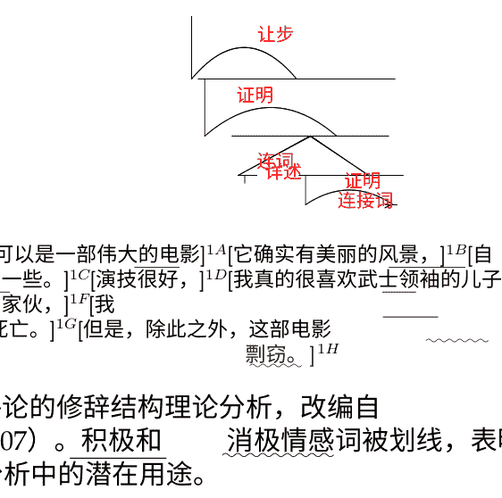

RST关系修辞结构理论具有大量的话语关系，分为两个高级组别：主题关系和呈现关系。呈现关系围绕读者的预期信念组织。例如，在（16.8）中，第二个话语单元提供了旨在增加读者对第一个话语单元所表达的命题的信念的证据，即LaShawn热爱动物。相反，主题关系旨在传达与它们相关的话语单元中所包含的命题的附加事实：

+   (16.10) [债务计划被匆忙完成]_N
    [以便在会议上宣布]_S^8

在这个例子中，卫星描述了一个由核心中描述的动作实现的世界状态。这种关系是关于世界的，而不是关于作者的交际意图。

例子图16.5描述了一段电影评论的RST分析。非对称（从卫星到核心的从属）关系用箭头表示；对称（协调）关系用线表示。基本的话语单元1F和1G通过对称的连词关系组合成一个更大的话语单元。结果的话语单元然后与1E之间的JUSTIFY关系中的卫星。

##### 分层话语解析

话语解析的目标是从文档文本中恢复出一个分层结构分析，例如图16.5中的分析结果。暂时假设文档已经被分割成了基本话语单元（EDUs）；分割算法将在下面进行讨论。在分割之后，话语解析可以被看作是两个组成部分的结合：在§16.3.1中讨论的话语关系分类技术，以及在第10章中讨论的短语结构解析算法，如图表解析和移进-规约。

图表解析和移进-规约都需要对复合话语单元进行编码，可以是离散特征向量或密集神经表示。⁹一些话语解析器依赖于强组合性准则（Marcu,1996），该准则假设复合话语单元可以由其核心表示。这个准则被用于基于特征的话语解析中，用于确定复合话语单元的特征向量（Hernault et al.,2010）；它也被用于神经方法中，将复合话语单元的向量编码设置为其核心的编码（Ji and Eisenstein,2014）。另一种神经方法是学习一个关于复合话语单元组成部分的组合函数（Li et al.,2014），使用递归神经网络（见 § 14.8.3)。

自底向上的话语解析假设将文本分割为N个基本话语单元，并假设有基本表示 {z^{(i)}}_{i=1}^N，并假设有一个组合函数组合 (z^{(i)}, z^{(j)}, ℓ)，它将两个编码和一个话语关系 ℓ 映射为一个新的编码。组合函数可以遵循强组合性原则，简单地选择核心的编码，或者可以进行更复杂的操作。我们还需要一个评分函数 Ψ(z^{(i:k)}, z^{(k+1:j)}, ℓ)，它计算（二元化的）话语关系 ℓ 的标量分数，左子节点覆盖范围 i+1:k，右子节点覆盖范围 k+1:j。有了这些组件，我们可以为每个范围构建向量表示，这是构建组合向量语法的基本思想(Socher et al.,2013)。

这些相同的组件也可以用于自底向上的解析，以一种类似于加权上下文无关文法的CKY算法（参见 §10.1）的方式：计算每个可能跨度递增长度的得分和最佳分析，同时存储能够恢复整个输入的最优解析的回溯指针。然而，与CKY解析不同的是：对于每个标记的跨度 (i, j, ℓ)，我们必须使用组合函数构建一个表示 z^{(i,j,ℓ)}。然后，这个表示 (i,j,ℓ) 被用于组合跨度 i+1:j的话语单元在更高层次的话语关系中。表示 z^{(i,j,ℓ)} 取决于单元跨度的整个子结构。

为了使用这些算法，还需要在解析过程中对所有话语关系进行二元化，然后再进行“解二元化”以重建所需的结构（例如，Hernault等人，2010年）。

ning (i + 1 : j)，这违反了CKY优化保证的局部性假设。使用递归构建的跨度表示的自底向上解析通常不能保证找到最佳得分的话语解析。这个问题在章节末尾的一个练习中进行了探讨。

基于转移的话语解析自底向上解析的一个缺点是其在输入长度方面的立方时间复杂度。对于长文档，基于转移的解析是一个有吸引力的选择。移位-规约算法（参见 §10.6.2）可以直接应用于话语解析（Sagae, 2009）：栈存储一组话语单元及其表示，每个动作都是根据这些表示的函数选择的。

这个函数可以是权重和特征的线性乘积，也可以是应用于话语单元编码的神经网络。然后，REDUCE动作对栈顶的两个话语单元进行组合，得到一个更大的复合话语单元，放在栈顶。所有在 §11.3中描述的集成学习和基于转移的解析技术都适用于话语解析。

##### 分割话语单元

在修辞结构理论中，基本话语单元不跨越句子边界，因此可以在句子内进行话语分割，假设句子分割已给出。将句子分割为基本话语单元通常使用句法分析的特征进行（Braud等，2017）。一种方法是训练一个分类器来确定每个句法成分是否为EDU，使用的特征包括产生式、树结构和头词（Soricut和Marcu, 2003；Hernault等，2010）。另一种方法是训练一个序列标注模型，如条件随机场（Sporleder和Lapata, 2005；Xuan Bach等，2012；Feng等，2014）。这是使用序列标注的BIO形式进行分割的，详见 § 8.3。

#### 16.3.3 论证

对于文本级关系结构的另一种观点集中在论证上(Stab和Gurevych，2014b)。每个片段（通常是一个句子或从句）可以支持或反驳另一个片段，从而在文本上创建一个图结构。在以下示例中（来自Peldszus和Stede，2013），片段 \(S_2\) 为片段 \(S_1\) 提供论证支持：

(16.11) \([\text{我们应该拆掉这座建筑物}]_{S_1}\) \([\text{因为它充满了石棉}]_{S_2}\)。

断言还可以支持或反驳两个其他断言之间的链接，创建一个超图，这是图的一般化情况，其中边可以连接任意数量的顶点。这可以通过将另一个句子引入到示例中来看到：

(16.12) [原则上可以清理它，]_{S3}
[但据市长说那太贵了。]_{S4}

S3承认S2的有效性，但削弱了对S1的支持。这可以通过引入一个超边(S3, S2, S1)削弱来表示，表明S3削弱了S2和S1之间的提出的关系。然后，S4削弱了S3的相关性。

论证挖掘是从原始文本中恢复这些结构的任务。目前，关于论证结构的注释相对较少：Stab和Gurevych（2014a）已经注释了一组90篇有说服力的论文，而Peldszus和Stede（2015）已经征集并注释了一组112个德语段落长度的“微文本”。

#### 16.3.4 话语关系的应用

篇章分析的主要应用是选择文档中的内容。在修辞结构理论中，核心被认为是关系中更重要的元素，并且更有可能成为文档摘要的一部分；它也可能对文档分类更具信息性。Penn篇章树库所依据的D-LTAG理论缺乏核心性的概念，但是论证可能具有不同的重要性，这取决于关系类型。例如，构成扩展关系的ARG1的文本跨度更有可能出现在摘要中，而构成隐含关系的ARG2的句子则不太可能（Louis等，2010）。篇章关系还可以信号文档结构中的分割点。明确的篇章标记已被证明与主观性的变化相关，并且识别这种变化点可以改善文档级情感分类，帮助分类器专注于文本的主观部分（Trivedi和Eisenstein，2013；Yang和Cardie，2014）。

##### 提取式摘要

文本摘要是将较长的文本转换为较短的文本的问题，同时仍然传达原始文本中的关键事实、事件、思想和情感。在提取式摘要中，摘要是原始文本的子集；在生成式摘要中，摘要是通过改写原始文本或首先将其编码为语义表示来生成的（参见 §19.2）。提取式摘要的主要策略是最大化覆盖范围，选择最能涵盖整个文档中提到的概念的子集；通常，覆盖范围是通过词袋重叠来近似计算的（Nenkova和McKeown，2012）。基于覆盖范围的目标可以通过使用分层话语关系来补充，使用核心性原则：在任何从属话语关系中，核心对于整体意义更为关键。文本的一部分，因此在摘要中更重要，应该包含在摘要中 (Marcu, 1997a)。 10 这个洞察力可以从个体关系推广到使用话语深度概念的 (Hirao等人，2013)：对于每个基本话语单元 e，话语深度 d_e 是包含 e 的话语单元在其中的关系数量。

话语深度和核心性都可以纳入到摘要中，使用约束优化。 让 x_n 成为一个词袋向量表示的基本话语单元 n，让 y_n ∈ {0,1} 表示 n 是否包含在摘要中，让 d_n 是单元 n 的深度。 此外，让每个话语单元都有一个“头” h，它是递归定义的：

+   - 如果一个话语单元是由一个从属关系产生的，则其头是（唯一的）核心的头。
- 如果一个话语单元是由一个协调关系产生的，那么它的头部是最左侧核心的头部；
- 对于每个基本话语单元，它的父节点 π(n) ∈ {∅, 1, 2, ..., N} 是包含 n 的最小话语单元的头部，该头部不是 n；
- 如果 n 是跨越整个文档的话语单元的头部，那么 π(n) = ∅。

有了这些定义，基于话语的抽取式摘要可以被形式化为 (Hirao et al., 2013),

$$\max_{\mathbf{y} = \{0, 1\}^N} \sum_{n=1}^N y_n \frac{\Psi (\mathbf{x}_n, \{\mathbf{x}_{1:N}\})}{d_n} \ns.t. \sum_{n=1}^N y_n (\sum_{j=1}^V x_{n,j}) \leq L \ny_{\pi(n)} \geq y_n, \quad \forall n \text{ s.t. } \pi(n) = \varnothing \qquad [16.11]$$

其中 Ψ (x_n, {x_{1:N}}) 衡量了基本话语单元 n 相对于文档的覆盖范围，而 Σ_{j=1}^V x_{n,j} 是 x_n 中的标记数。 第一个约束条件确保摘要中的标记数有一个上限 L。 第二个约束条件确保只有在其父节点也被包含的情况下才包含基本话语单元。 通过这种方式，话语结构被使用两次：一次是为了降低对话中不重要的基本话语单元的贡献，一次是为了确保生成的结构是原始话语解析树的子树。

> 相反，一个多核心关系的论证要么都包含在摘要中，要么都不包含(Durrett et al., 2016)。

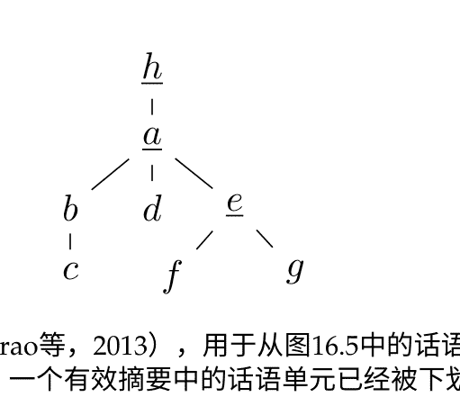

图16.6: 一棵话语深度树（Hirao等，2013），用于从图16.5中的话语解析，其中每个基本话语单元都与其父节点相连。一个有效摘要中的话语单元已经被下划线标记。

16.11中的优化问题可以通过整数线性规划来解决，具体描述如下 § 13.2.2.11

图16.6显示了来自图16.5的RST分析的话语深度树，在该树中，每个基本话语单元都与其父节点（以及下方）相连。图中的下划线话语单元构成以下摘要：

> （16.13）这本电影本可以成为一部伟大的电影，我真的很喜欢武士领袖的儿子。但是，除此之外，这部电影只不过是隐藏的剽窃而已。

##### 文档分类

分层话语结构自然适用于文本分类：在从属话语关系中，核心应该在分类决策中起到更重要的作用，而附属部分则较弱。已经提出了这个想法的各种实现。

+   - 专注于句内话语关系和基于词汇的分类（见 §4.1.2），Voll和Taboada（2007）简单地忽略了每个话语关系卫星中的文本。
+   - 在文档级别上，可以重新加权每个话语关系参数的元素，偏爱核心中的词汇，不喜欢卫星中的词汇（Heerschop等，2011; Bhatia等，2015）。这种方法可以递归地应用于整个文档，计算权重。权重可以是关系特定的，因此可以折扣或甚至颠倒对比关系卫星的特征。
+   - 或者，分层话语结构可以定义递归神经网络的结构（见 §10.6.1）。在这个网络中，每个表示话语单元是根据其参数和与话语关系对应的参数计算的（Ji和Smith，2017年）。

浅层、非层次化的话语关系也被应用于文档分类。一种方法是对单个话语单元的分析施加一组约束，使得相邻单元在通过表示一致的话语关系连接时具有相同的极性，在通过表示对比的话语关系连接时具有相反的极性（Somasundaran等，2009年；Zirn等，2011年）。Yang和Cardie（2014年）将来自Penn话语树库的明确标记的关系应用于句子级情感极性分类问题（见 §4.1）。他们施加了以下软约束：

+   - 当一个对比关系出现在句子开头时，该句子的情感极性应与其前一个句子相反。
- 当一个扩展或条件出现在句子的开头时，它应该与前一个元素具有相同的极性。
- 当一个对比关系出现在句子中时，句子应该具有中性极性，因为它很可能表达两种情感。

这些基于语篇驱动的约束被证明可以提高两个产品评论数据集的性能。

##### 连贯性

正如语法正确性是良构句子所共有的特性一样，连贯性是良构语篇所共有的特性。语篇处理的一个应用是测量（并最大化）计算机生成的文本（如翻译和摘要）的连贯性（Kibble和Power，2004年）。连贯性评估也用于评估人类生成的文本，例如学生论文（例如，Miltsakaki和Kukich，2004年；Burstein等，2013年）。

连贯性涵盖了一系列现象，其中许多在本章前面已经强调过：例如，相邻的句子应该在词汇上具有连贯性（Foltz等，1998; Ji等，2015; Li和Jurafsky，2017），实体引用应该遵循中心理论的原则（Barzilay和Lapata，2008; Nguyen和Joty，2017）。

话语关系也以各种方式影响文本的连贯性：

+   - 分层话语关系往往具有核心和卫星的“规范顺序”（Mann和Thompson，1988）：例如，在修辞结构理论中的ELABORATION关系中，核心总是先出现，而在JUSTIFICATION关系中，卫星往往先出现（Marcu，1997b）。
+   • 话语关系应该由适合于参数之间的语义或功能关系的连接词来表示：例如，一个连贯的文本更有可能使用然而来表示比较关系，而不是一个时间关系（Kibble和Power，2004年）。
• 话语关系往往以可预测的顺序出现在可预测的序列中：例如，比较关系往往紧接着出现在因果关系之前（Pitler等，2008年）。这个观察可以通过推广实体网格模型（§16.2.2）来形式化，使得每个单元格（i，j）提供关于句子i中包含实体j的话语参数的角色信息（Lin等，2011年）。例如，如果第一句话是比较关系的ARG1，则句子中的任何实体提及都将被标记为COMP.ARG1。这种方法也可以应用于RST话语关系（Feng等，2014年）。

数据集 评估话语连贯性指标的一个困难在于人工生成的文本通常满足一定的连贯性阈值。因此，关于衡量连贯性的研究大部分集中在合成数据上。一个典型的设置是对人工撰写的文本进行句子排列的置换，然后根据提出的连贯性度量确定原始句子排序是否得分更高（Barzilay和Lapata，2008）。还有一些关于机器摘要连贯性的人工评估的小型数据集：例如，2003年文档理解会议上参与系统摘要的人工判断可在网上获得。12美国教育测试服务机构（负责美国几个全国考试）研究了话语连贯性与学生论文质量之间的关系（Burstein等，2003年，2010年）。剑桥大学的研究人员提供了一个包含第二语言学习者论文的公共数据集，并附有质量注释（Yannakoudakis等，2011年）。在另一个极端，Louis和Nenkova（2013年）分析了专业撰写的科学论文的结构，发现话语关系转换有助于区分获奖论文和同一类型的其他文章。

### 附加资源

有关话语处理的长篇讨论，请参阅Stede（2011）的论文。Webber等人（2012）和Webber和Joshi（2012）提供了文章长度的调查。

12http://homepages.inf.ed.ac.uk/mlap/coherence/

在与MIT Press签订的合同下，根据CC-BY-NC-ND许可共享。

### 练习

+   1. 一些话语连接词倾向于出现在它们的论证之间；其他一些可以在两个论证之前出现，还有一些可以在两个论证之后出现。请指出以下连接词是否可以出现在它们的论证之间、之前和之后：如何-永远，但是，然而（对比，而非时间），虽然，因此，尽管如此。
+   2. 这个练习需要两个人一起完成。每个参与者从今天的新闻中选择一篇文章，并用特殊的标记（如PERSON1，PERSON2等）替换所有涉及个人的提及。然后，另一个参与者应根据中心理论的规则猜测每种指代表达方式：全名（CaptainAhab），部分名字（例如，Ahab），名词性短语（例如，the ship's captain）或代词。检查预测是否与原始文本相符，以及文本是否符合中心理论的规则。
+   3. 在这个练习中，你将生成一个类似于图16.1的图形。
   a) 使用方程16.2中的平滑余弦相似度度量实现，使用平滑核 `k= [.5, .3, .15, .05]`。
   b) 下载至少有十个段落的新闻文章的文本。
   c) 计算并绘制文章长度上的平滑相似度 `s`。
   d) 按照以下步骤识别 `s` 中的局部极小值：首先找到所有满足 `s_m < \bar{s}_{m\pm 1}` 的句子m。然后在这些点中搜索找到五个具有最低 `\bar{s}_m` 的句子。
   e) 这五个局部极小值有多少次对应段落边界？
   • 局部极小值中作为段落边界的比例是 **precision-at-k**，在这种情况下，`k= 5`。
   • 段落边界中局部最小值的比例是召回率-在-K。
   • 计算K为3和K为10时的精确度和召回率。
+   4. 将文本分割表述为概率模型的一种方法是使用Dirichlet Compound Multinomial(DCM)分布，该分布计算词袋 `DCM(x; α)` 的概率，其中参数 `α` 是一个正实数向量。该分布可以配置为对内部一致的词袋向量分配高概率，使得单词重复出现：例如，对于简单的参数化，如 `α = α1`，其中 `α < 1`，可以观察到这种行为。

让 `ψ_α(i, j)` 表示在参数 `α` 下，段落 `w_{i+1:j}` 的对数概率。给出一个将文本分割成总共最大化对数概率和的 $K$ 段 $\psi_{\alpha}(s_{k-1}, s_k)$的$K_k=1$索引$s_k$的段 $k$的,其中 $s_k$是段k的最后一个标记, 且$s_0= 0$. 你的动态程序的时间复杂度不应该比输入长度的平方更差, 且与段的数量成线性关系。

+   5. 在前一个问题的基础上，你现在将适应CKY算法来进行分层分割。将分层分割定义为一组分割 $\{ \{ s^{(\ell)}_k \}_{k=1}^{K(\ell)} \}_{\ell=1}^{L}$, 其中 $L$是分割深度。为了确保分割是分层有效的，我们要求每个分割点 $s^{(\ell)}_k$ at level $\ell$也是 $\ell - 1$级别的分割点,其中$\ell > 1$. 为了简化起见，该问题侧重于二进制分层分割，以便每个层级的每个段落都有 $2$个子段落。将层次分割的得分定义为所有段落（在所有层级上）的得分之和，使用前一个问题中的DCM对数概率作为段落得分。给出一个类似于CKY的递归，使得文本的最佳“解析”是具有 $L$个层级的最大对数概率二进制分割。

+   6. 中心理论的实体网格表示可以用于计算相邻句子的得分，如 §16.2.2所述。给定一组句子，这些得分可以用于计算最佳排序。通过从一个众所周知的问题进行约简，证明找到具有最大对数概率的排序是NP完全的问题。

+   7. 在 §16.3.2中，指出使用每个跨度的组合向量表示的自底向上解析不能保证是最优的。在这个练习中，你将构造一个最小的例子来证明这一点。考虑一个包含四个单元的话语，其中基本表示为 $\{z^{(i)}\}_{i=1}^4$。构造一个场景，在该场景中，自底向上解析选择的解析不是最优的，并给出选择这个次优解析的精确数学条件。为了这个例子的目的，你可以忽略关系标签 $\ell$。

+   8. 正如在 §16.3.3中所述，参数可以由超图描述，在其中一个段落可能会削弱两个其他段落之间的提议边缘。将在 §16.3.4中描述的抽取式摘要模型扩展到参数，添加以下约束条件：如果段落 $i$削弱了段落 $j$和 $k$之间的论证关系，那么只有在包括 $j$和 $k$时，才能将段落 $i$包括在摘要中。您的解决方案应采用整数线性规划的一组线性约束条件——也就是说，每个约束条件只能涉及变量的加法和减法。

在接下来的两个练习中，您将探索在真实语料库中使用话语连接词的用法。

使用 NLTK，获取布朗语料库，并识别以以下任何连接词开头的句子：然而，然而，此外，此外，因此。

9. 词汇一致性和话语连接词都对文本的连贯性有所贡献。因此，我们可能期望由明确的话语连接词连接的相邻句子也具有更高的词重叠。使用布朗语料库，通过计算相邻句子之间的平均余弦相似度来测试这个理论。这些句子是由上述任何一个连接词连接的。将其与所有其他相邻句子的平均余弦相似度进行比较。如果您知道如何，可以执行两样本t检验来确定观察到的差异是否具有统计学意义。

# 10. 将上述连接词分为以下三种语篇关系：

+   - 扩展：此外，而且
- 比较：然而，尽管如此
- 条件：因此

专注于由这五个连接词连接的句子对，构建一个分类器来预测相邻两个句子的语篇关系 —— 注意忽略连接词本身。使用布朗语料库的前30000个句子作为训练集，剩余的句子作为测试集。将你的分类器的性能与简单选择最常见类别的性能进行比较。使用词袋分类器，很难比这个基准做得更好，所以考虑更复杂的替代方案！

# ## 第四部分

# # 应用

# # 第17章

# # 信息提取

计算机提供了强大的能力，可以搜索和推理结构化记录和关系数据。有人认为人工智能最重要的限制不是推理或学习，而是知识太少（Lenat等，1990年）。自然语言处理提供了一个有吸引力的解决方案：通过阅读自然语言文本自动构建一个结构化的知识库。

例如，许多维基百科页面都有一个“信息框”，提供有关实体或事件的结构化信息。图17.1a中显示了一个示例：每一行代表实体“在海上的飞机上”的一个或多个属性，即一张唱片专辑。属性集由预定义的模式确定，适用于维基百科中的所有唱片专辑。如图17.1b所示，这些字段的许多值直接在同一维基百科页面的前几句话中指示。

从文本中自动构建（或“填充”）信息框是信息提取的一个示例。信息提取的大部分内容可以用实体、关系和事件的术语来描述。

+   - 实体是世界上唯一指定的对象，例如人物（杰夫·曼根）、地点（雅典，乔治亚）、组织（合并记录）和时间（1998年2月10日）。第8章描述了命名实体识别的任务，它将标记作为实体范围的一部分。现在我们将看到如何进一步，将每个实体提及链接到知识库中的一个元素。
- 关系包括一个谓词和两个参数：例如， CAPITAL(GEORGIA, ATLANTA)。
- 事件涉及多个类型的参数。例如，制作和发布

| Field | Value |
| :--- | :--- |
| **Studio album by Neutral Milk Hotel** | |
| **Released** | February 10, 1998 |
| **Recorded** | July-September 1997 |
| **Studio** | Pet Sounds Studio, Denver, Colorado |
| **Genre** | Indie rock · psychedelic folk · lo-fi |
| **Length** | 39:55 |
| **Label** | Merge · Domino |
| **Producer** | Robert Schneider |

(a) 维基百科信息框

(17.1) 《在飞机上》是美国独立摇滚乐队Neutral Milk Hotel的第二张也是最后一张录音室专辑。

(17.2) 它于1998年2月10日在美国的Merge Records发行。和五月 1998年 蓝色玫瑰 Records在英国。(17.3)

杰夫 曼根从 雅典 乔治亚州搬到科罗拉多州的丹佛市，与制作人罗伯特·施耐德一起准备专辑的大部分材料，这次是在施耐德新建的宠物之声工作室，位于 吉姆 麦金太尔的家里。

(b) 文本的前几个句子。与信息框中的字段或字段名称匹配的字符串被下划线标记；提及其他实体的字符串是 波浪形的 下划线标记。

# 图17.1: 来自专辑“在飞机上空”的维基百科页面，检索日期为2017年10月26日。

图17.1中描述的专辑由事件描述，

> 〈标题：在飞机上空的海洋，
艺术家：中性牛奶旅馆，发行-日期：1998年2月10日，...〉

事件类型的参数集由一个模式定义。事件通常涉及时间限定的发生：婚礼、抗议、购买、恐怖袭击。

信息提取类似于语义角色标注（第13章）：我们可以将谓词视为对应于事件，而参数则定义了事件表示中的插槽。然而，信息提取的目标是不同的。信息提取系统通常不会准确解析每个句子，而是专注于识别几个关键关系或事件类型，或者专注于识别给定实体的所有属性的任务。信息提取通常通过生成的知识库的正确性来评估，而不是通过准确解析的句子数量来评估。该目标有时被描述为宏观阅读，与微观阅读相对，后者要求每个句子都必须正确分析。只要宏观阅读系统能够从其他更容易阅读的来源中恢复相同的信息，它们就不会因忽略困难的句子而受到惩罚。然而，宏观阅读系统必须解决明显的不一致性。

(专辑是在MERGE RECORDS还是BLUE ROSE RECORDS发行的？)，需要对整个数据集进行推理。

除了识别实体、关系和事件的基本任务外，信息提取系统还必须处理否定，并且必须能够区分事实陈述和希望、恐惧、直觉和假设。最后，信息提取往往与问题回答问题相结合，这需要准确解析查询，然后选择或生成文本答案。问题回答系统可以基于从大型文本语料库中提取的知识库构建，也可以尝试直接从源文本中识别答案。

### 17.1 实体

信息提取的起点是在文本中识别实体的提及。考虑以下例子：

> (17.4) 美国军队于1864年5月14日占领了俯瞰亚特兰大的山丘。

对于这个句子，有两个目标：

+   1. 将United States Army、Atlanta和May 14, 1864识别为实体提及。 （这座山丘没有唯一的标识，因此它不是一个具名实体。）我们还可能想要识别具名实体的类型：组织、地点和日期。这就是具名实体识别，详见第8章。
2. 将这些提及链接到知识库中的实体：U.S. ARMY、ATLANTA和1864-MAY-14。.这个任务被称为实体链接。

要链接到实体的字符串是提及 - 类似于该术语在共指消解中的使用。在某些实体链接任务的表述中，只有具名实体才能作为链接的候选实体。这有时被称为具名实体链接 (Ling等人, 2015) 。在其他表述中，比如维基化 (Milne和Witten, 2008) ，任何字符串都可以是一个提及。目标实体集通常对应于维基百科页面，并且维基百科是更全面的知识库 (如YAGO (Suchanek等人, 2007) 、DBPedia (Auer等人, 2007) 和Freebase (Bollacker等人, 2008) ) 的基础。实体链接也可以在更“封闭”的环境中进行，其中提前提供了一个更小的目标列表。系统还必须确定一个提及是否不指向知识库中的任何实体，有时被称为NIL实体 (McNamee和Dang, 2009) 。

回到 (17.4) ，这三个实体提及似乎是明确的。但是维基百科的消歧义页面对于字符串亚特兰大有不同的说法：¹有超过二十个

¹https://en.wikipedia.org/wiki/Atlanta_(disambiguation)，于2017年11月1日检索。

不同的城镇和城市，五艘美国海军舰艇，一本杂志，一档电视节目，一个乐队和一个歌手 - 每个都足够重要，有自己的维基百科页面。现在我们考虑如何在这些数十种可能性中进行选择。在本章中，我们将重点关注监督方法。无监督实体链接与跨文档共指消解问题密切相关，其中任务是识别跨文档边界（Bagga和Baldwin, 1998b; Singh等, 2011）的提及对。

#### 17.1.1 通过学习排序进行实体链接

实体链接通常被表述为一个排名问题，

$$\hat{y} = \mathop{\mathrm{argmax}}_{y \in \mathcal{Y}(x)} \Psi(y, \boldsymbol{x}, \boldsymbol{c}),$$

其中 $y$是目标实体，$\boldsymbol{x}$是提及的描述，$\mathcal{Y}(x)$是候选实体的集合，而$\boldsymbol{c}$是上下文的描述 - 例如文档中的其他文本或元数据。函数 $\Psi$是一个评分函数，可以是线性模型，$\Psi(y, \boldsymbol{x}, \boldsymbol{c}) = \theta \cdot f(y, \boldsymbol{x}, \boldsymbol{c})$，或者是更复杂的函数，如神经网络。无论哪种情况，评分函数都可以通过最小化基于边际的排序损失来学习。

$$\ell(\hat{y}, y^{(i)}, \boldsymbol{x}^{(i)}, \boldsymbol{c}^{(i)}) = \left( \Psi(\hat{y}, \boldsymbol{x}^{(i)}, \boldsymbol{c}^{(i)}) - \Psi(y^{(i)}, \boldsymbol{x}^{(i)}, \boldsymbol{c}^{(i)}) + 1 \right)_{+},$$

其中 $y^{(i)}$是真实值，而 $\hat{y} = y^{(i)}$是预测目标，对于提及 $\boldsymbol{x}^{(i)}$ in context $\boldsymbol{c}^{(i)}$(Joachims, 2002; Dredze et al., 2010)。

候选识别为了计算的可行性，限制候选集合 $\mathcal{Y}(x)$是有帮助的。一种方法是使用名称字典，它将字符串映射到可能提及的实体。这种映射是多对多的：例如，字符串Atlanta可以指代多个实体，反之亦然，实体ATLANTA可以被多个字符串引用。名称字典可以从维基百科中提取，其中包含每个维基百科实体页面和指向该页面的所有超链接的锚文本之间的链接（Bunescu and Pasca, 2006; Ratinov et al., 2011）。为了提高召回率，可以通过部分和近似匹配（Dredze et al., 2010）来增加名称字典，但随着候选集合的增长，误报的风险也增加。例如，字符串Atlanta与the Atlanta Fed(美联储亚特兰大分行的名称)部分匹配，与Atalanta(希腊神话中的女英雄和意大利足球队)存在噪声匹配(编辑距离为一)。

特征 基于特征的实体排名方法依赖于三种主要类型的本地信息（Dredze等人, 2010年）:

+   - 提及字符串与规范实体名称的相似度，通过字符串相似度进行量化。这个特征会使城市ATLANTA优于篮球队ATLANTA HAWKS的字符串 Atlanta。
- 实体的受欢迎程度，可以通过维基百科页面浏览量或维基百科链接图中的PageRank来衡量。这个特征会使ATLANTA, GEOR-GIA优于ATLANTA, OHIO的未建制社区。
- 实体类型，由命名实体识别系统输出。这个特征会使城市ATLANTA优于杂志ATLANTA，在被标记为位置的上下文中。

除了这些本地特征，文档上下文也可以提供帮助。如果在关于加勒比地区的文档中提到 Jamaica，很可能指的是这个岛国；在纽约的上下文中，很可能指的是皇后区的一个社区；在菜单的上下文中，可能指的是一种木槿茶饮料。这些提示可以通过计算描述每个候选实体的维基百科页面与提及上下文 c^{(i)} 之间的相似度来形式化，其中可能包括表示文档的词袋（Dredze等人，2010年；Hoffart等人，2011年）或提及周围的较小文本窗口（Ratinov等人，2011年）。例如，我们可以计算上下文和实体描述的词袋向量之间的余弦相似度，通常使用逆文档频率进行加权，以强调罕见的词语。

神经实体链接另一种方法是使用实体、提及和上下文的分布式向量表示计算每个实体候选的得分。例如，在Twitter中进行实体链接的任务中，Yang等人（2016年）使用双线性评分函数。

> $$\Psi(y, x, c) = v_y^{\top} \Theta^{(y,x)} x + v_y^{\top} \Theta^{(y,c)} c, \qquad [17.3]$$

其中 $v_y \in \mathbb{R}^{K_y}$ 表示实体 $y$ 的向量嵌入， $x \in \mathbb{R}^{K_x}$ 表示提及的嵌入， $c \in \mathbb{R}^{K_c}$ 表示上下文的嵌入， $\Theta^{(y,x)}$ 和 $\Theta^{(y,c)}$ 是评分每个实体与提及和上下文的兼容性的参数。每个向量嵌入都可以从端到端的目标中学习，或者在无标签数据上进行预训练。

+   - 可以从现有的知识库（Borders等人，2011年，2013年）中获得预训练的实体嵌入，或者通过运行诸如 WORD2VEC 之类的词嵌入算法来获得在维基百科的文本上进行，其中超链接替换为锚文本。³

+   • 提及的嵌入可以通过对提及中的单词进行平均（Yang等人，2016年）来计算，或者通过 §14.8中描述的组合技术来计算。

+   • 上下文的嵌入 c 也可以通过上下文中单词的嵌入来计算。一个去噪自编码器通过最小化重构损失（Vincent et al., 2010）从原始文本到密集的K维向量编码的函数。

$$\min_{\theta_g, \theta_h} \sum_{i=1}^{N} \lVert \tilde{\boldsymbol{x}}^{(i)} - g(h(\boldsymbol{x}^{(i)}; \theta_h); \theta_g) \rVert^2, \qquad [17.4]$$

其中 $\tilde{\boldsymbol{x}}^{(i)}$ 是袋装词计数的嘈杂版本 $\boldsymbol{x}^{(i)}$，由随机将一些计数设置为零产生；$h : \mathbb{R}^V \to \mathbb{R}^K$ 是具有参数 $\theta_h$ 的编码器；$g : \mathbb{R}^K \to \mathbb{R}^V$ 是具有参数 $\theta_g$ 的解码器。编码器和解码器函数通常实现为前馈神经网络。要将此模型应用于实体链接，每个实体和上下文最初由其词袋向量的编码表示，$h(e)$ 和 $g(c)$，并且这些编码然后通过标记数据进行微调（He et al., 2013）。上下文向量 c 也可以通过对文档中单词的嵌入进行卷积（§3.4）或通过检查元数据（如作者的社交网络）来获得（Sun et al., 2015）（Yang et al., 2016）。

剩余的参数 $\Theta^{(y,x)}$ 和 $\Theta^{(y,c)}$ 可以通过方程17.2中的边际损失进行反向传播来训练。

# ## 17.1.2 集体实体链接

当在文档中联合执行时，实体链接可以更准确。为了解原因，请考虑以下列表：

+   (17.5) a. 加利福尼亚，俄勒冈，华盛顿
b. 巴尔的摩，华盛顿，费城
c. 华盛顿，亚当斯，杰斐逊

在每种情况下，术语华盛顿指的是不同的实体，并且这种引用受到列表中其他条目的强烈暗示。在最后一个列表中，所有三个名称都非常模糊 - 维基百科中还有数十个其他亚当斯和杰斐逊实体。但是可以从以下网址下载预训练的实体嵌入：https://code.google.com/archive/p/word2vec/。

# 17.1. 实体

对一致性的偏好促使将这些引用集体地链接到前三位美国总统。

对于集体实体链接的一般方法是引入一个兼容性得分 \( \Psi_c(y) \)。然后通过优化全局目标来执行集体实体链接。

\[ \hat{y} = \underset{y \in \mathbb{Y}(x)}{\text{argmax}} \Psi_c(y) + \sum_{i=1}^{N} \Psi_{\ell}(y^{(i)}, x^{(i)}, c^{(i)}) \]

其中 \( \mathbb{Y}(x) \) 是对于 \( x \) 中提及的所有可能的集体实体分配的集合，而 \( \psi_\ell \) 是每个实体 \( i \) 的本地评分函数。兼容性函数通常被分解为一系列成对得分的总和， \( \Psi_c(y) = \sum_{i=1}^{N_i} \) 这些得分可以通过多种不同的方式计算：

+   - 维基百科为实体定义了高级类别（例如，活着的人、美国总统、美国州），并且 \( \Psi_c \) 可以根据它们共同拥有的类别数量奖励实体对（Cucerzan, 2007）。
- 兼容性可以通过两个实体的维基百科页面共享的传入超链接数量来衡量（Milne and Witten, 2008）。
- 在神经架构中，两个实体的兼容性可以等于它们嵌入的内积， \( \Psi_c(y^{(i)}, y^{(j)}) = v_{y^{(i)}} \cdot v_{y^{(j)}} \)。
- 可以使用一种称为概率主题模型（Blei et al., 2003; Blei, 2012）的潜变量模型来定义非成对兼容性分数。在这个框架中，每个潜在主题是实体的概率分布，每个文档对主题有一个概率分布。每个实体有助于确定文档对主题的分布，反过来这些主题有助于解决实体提及的歧义（Newman et al., 2006）。可以使用第5章中描述的采样技术进行推理。

不幸的是，即使对于成对兼容函数，集体实体链接也是NP难的，所以精确优化几乎肯定是难以处理的。已经提出了各种近似推理技术，包括整数线性规划（Cheng和Roth, 2013）、Gibbs采样（Han和Sun, 2012）以及基于图的算法（Hoffart等，2011; Han等，2011）。

#### 17.1.3 *成对排序损失函数

方程式17.2中定义的损失函数只考虑最高得分的预测\(\hat{y}\)，但实际上，真实实体\(y^{(i)}\)应该比其他实体得分更高。基于这个想法的损失函数会针对多个实体的特征或表示给出梯度。

##### 算法18 WARP近似排名损失

```
1: 过程 WARP($y^{(i)}$, $\boldsymbol{x}^{(i)}$)
2: $N \leftarrow 0$
3: 重复
4:   随机采样 $y \sim \mathcal{Y}(\boldsymbol{x}^{(i)})$
5:   $N \leftarrow N + 1$
6:   如果 $\psi(y, \boldsymbol{x}^{(i)}) + 1 > \psi(y^{(i)}, \boldsymbol{x}^{(i)})$ 那么
7:     $r \leftarrow \lfloor |\mathcal{Y}(\boldsymbol{x}^{(i)})| / N \rfloor$
8:     返回 $L_{\text{rank}}(r) \times \left( \psi(y, \boldsymbol{x}^{(i)}) + 1 - \psi(y^{(i)}, \boldsymbol{x}^{(i)}) \right)$
9: 直到 $N \ge |\mathcal{Y}(\boldsymbol{x}^{(i)})| - 1$
10: 返回 0
```

不仅仅是最高得分的预测。Usunier等人（2009）定义了一个通用的排名错误函数，

$$L_{\text{排名}}(k) = \sum_{j=1}^{k} \alpha_j, \text{其中 } \alpha_1 \ge \alpha_2 \ge \cdots \ge \ge 0, \qquad [17.6]$$

其中 $k$ 等于高于正确标签的标签数量 $y^{(i)}$。这个函数定义了一类排名错误：如果 $\alpha_j = 1$ 对于所有的 $j$，那么排名错误等于正确实体的排名；如果 $\alpha_1 = 1$ 且 $\alpha_{j>1} = 0$，那么排名错误只有在正确实体不是第一名时才会出现；如果 $\alpha_j$ 随着 $j$ 平滑减少，如 $\alpha_j = \frac{1}{j}$，那么错误在这两个极端之间。

这个排名错误可以整合到一个边界目标中。记住，大边界分类不仅需要正确的标签，还需要正确的标签以相当大的边界优于其他标签。排名也适用类似的原则：我们希望正确实体有一个较高的排名，并且希望它与其他实体有一个相当大的间隔。因此，我们定义了增强边界的排名，

$$r(y^{(i)}, \boldsymbol{x}^{(i)}) \triangleq \sum_{y \in \mathcal{Y}(\boldsymbol{x}^{(i)}) \setminus y^{(i)}} \delta\left(1 + \psi(y, \boldsymbol{x}^{(i)}) \ge \psi(y^{(i)}, \boldsymbol{x}^{(i)})\right), \qquad [17.7]$$

其中 $\delta(\cdot)$ 是一个 delta 函数，而 $\mathcal{Y}(\boldsymbol{x}^{(i)}) \setminus y^{(i)}$ 是所有实体候选项减去真实实体 $y^{(i)}$ 的集合。边界增强排名是真实实体的排名，在当前评分函数 $\psi$ 下，将每个其他候选项增加一个边界为一。（为了清晰起见，上下文 $c$ 被省略了，并且可以视为 $\boldsymbol{x}$ 的一部分。）对于每个实例，从与此相关的排名错误计算出一个铰链损失。

边际增强排名和边际约束的违反，

$$ \ell(y^{(i)}, \boldsymbol{x}^{(i)}) = \frac{L_{\text{rank}}(r(y^{(i)}, \boldsymbol{x}^{(i)}))}{r(y^{(i)}, \boldsymbol{x}^{(i)})} \sum_{y \in \mathcal{Y}(\boldsymbol{x}) \setminus y^{(i)}} \left( \psi(y, \boldsymbol{x}^{(i)}) - \psi(y^{(i)}, \boldsymbol{x}^{(i)}) + 1 \right)_+ \qquad [17.8] $$

方程式17.8中的求和包括至少与真实实体排名相同的每个标签的非零值，在应用边际增强后。因此，通过边际增强排名来除以真实实体的平均违反。

当标签空间很大时，方程式17.8中的目标函数很难优化，这通常是针对大型知识库的实体链接的情况。这激发了一种随机近似算法，称为WARP（Weston等人，2011），如算法18所示。在这个过程中，我们随机抽样实体，直到有一个违反了成对边际约束，$\psi(y, \boldsymbol{x}^{(i)}) + 1 \geq \psi(y^{(i)}, \boldsymbol{x}^{(i)})$。找到这样一个违反所需的样本数量$N$给出了真实实体的边际增强排名的近似值，

$$ r(y^{(i)}, \boldsymbol{x}^{(i)}) \approx \left\lfloor \frac{|\mathcal{Y}(\boldsymbol{x})|}{N} \right\rfloor $$。如果立即发现违规行为，$N=1$，则正确的实体可能排在许多其他实体之下，$r \approx |\mathcal{Y}(\boldsymbol{x})|$。如果需要许多样本才能发现违规行为，$N \rightarrow |\mathcal{Y}(\boldsymbol{x})|$，则正确的实体可能排名较高，$r \rightarrow 1$。WARP的计算优势在于不需要找到最高得分的标签，这在$\mathcal{Y}(\boldsymbol{x}^{(i)})$较大时可能会带来非凡的计算成本。这个目标在概念上类似于WORD2VEC（第14章）中的负采样目标，它将观察到的单词与随机抽样的替代单词进行比较。

### 17.2 关系

在识别出文本中提到的实体之后，下一步是确定它们之间的关系。考虑以下例子：

> (17.6) 乔治·布什周四前往法国参加峰会。

这个句子介绍了乔治·布什和法国之间的关系。在自动内容提取（ACE）本体（语言数据联盟，2005年）中，这种关系的类型是PHYSICAL，子类型是LOCATED。这种关系可以写成：

PHYSICAL.LOCATED(GEORGE BUSH, FRANCE)。 [17.9]

关系需要恰好两个参数，并且参数的顺序很重要。

在ACE数据集中，关系是在实体提及之间进行注释的，就像上面的例子一样。关系也可以存在于名词之间，就像来自SemEval-2010共享任务（Hendrickx等，2009年）的以下例子一样：

> (17.7) 这个杯子里装着来自干人参的茶。

这个句子描述了实体-起源之间的关系茶和人参。名词关系抽取与语义角色标注（第13章）密切相关。主要的区别在于关系抽取仅限于相对较少的关系类型；例如，表17.1显示了来自SemEval-2010的十种关系类型。

| 关系类型 | 示例句子 |
| :--- | :--- |
| 原因 - 结果 | 这些癌症是由辐射暴露引起的 |
| 仪器 - 机构 | 电话操作员 |
| 产品 - 生产者 | 一个工厂制造西装 |
| 内容 - 容器 | 一瓶蜂蜜被称重了 |
| 实体 - 起源 | 来自外国的信件 |
| 实体 - 目的地 | 男孩上床睡觉了 |
| 组件 - 整体 | 我的公寓有一个大厨房 |
| 成员 - 集合 | 森林里有很多树 |
| 交流主题 | 讲座是关于语义学的 |

表17.1：来自SemEval-2010数据集的关系和示例句子（Hendrickx et al., 2009）

#### 17.2.1 基于模式的关系抽取

关于关系抽取的早期工作主要集中在手工制作的模式上（Hearst，1992年）。例如，同位语Starbuck，来自Nantucket的本地人表示实体-起源之间的关系 Starbuck和 Nantucket。这个模式可以写成，

PERSON, 来自 LOCATION ⇒ 实体起源（PERSON，LOCATION）。 [17.10]

只要在PERSON类型的实体和LOCATION类型的实体之间出现字面字符串“来自”，这个模式就会被“触发”。这样的模式可以通过词形还原等技术进行泛化，这将使得（购买，购买，购买）这些词触发相同的模式（见 § 4.3.1）。更积极的策略是将WordNet同义词集（§ 4.2）中的所有单词分组，这样，例如，“购买”和“购买”就会触发相同的模式。

关系抽取模式可以在有限状态自动机中实现 (§9.1)。如果命名实体识别器也是一个有限状态机，则可以通过有限状态转导 (Hobbs等, 1997) 将系统组合起来。这使得通过有限状态级联传播不确定性成为可能，并从更高级别的上下文中消除歧义。例如，假设实体识别器无法确定 Starbuck是指一个人还是一个地点；在组合的转导器中，当适当的模式出现时，关系提取器可以自由选择PERSON注释。

#### 17.2.2 关系抽取作为分类任务

关系抽取可以被形式化为一个分类问题。

$$\hat{r}_{(i,j),(m,n)} = \underset{r\in R}{\text{argmax}} \Psi(r, (i, j), (m, n), \boldsymbol{w}), \qquad [17.11]$$

其中 $r\in R$ 是一个关系类型（可能为 NIL），$\boldsymbol{w}_{i+1:j}$ 是第一个参数的范围，而 $\boldsymbol{w}_{m+1:n}$ 是第二个参数的范围。参数 $\boldsymbol{w}_{m+1:n}$ 可能出现在文本中 $\boldsymbol{w}_{i+1:j}$ 之前或之后，或者它们可能重叠；我们只规定 $\boldsymbol{w}_{i+1:j}$ 是关系的第一个参数。现在我们考虑计算评分函数的三种替代方法。

##### 基于特征的分类

在基于特征的分类器中，评分函数被定义为，

$$\Psi(r, (i, j), (m, n), \boldsymbol{w}) = \boldsymbol{\theta} \cdot \boldsymbol{f}(r, (i, j), (m, n), \boldsymbol{w}), \qquad [17.12]$$

其中 $\boldsymbol{\theta}$ 表示权重向量，并且 $\boldsymbol{f}(\cdot)$ 表示特征向量。在 §17.2.1 中描述的基于模式的方法提出了几个特征：

-   $\boldsymbol{w}_{i+1:j}$ 和 $\boldsymbol{w}_{m+1:n}$ 的本地特征，包括：字符串本身；是否被识别为实体，如果是的话，是哪种类型；字符串是否出现在实体名称的词表中；每个字符串的句法头部（§9.2.2）。
-   两个参数之间的跨度的特征，$\boldsymbol{w}_{j+1:m}$ 或 $\boldsymbol{w}_{n+1:i}$（取决于哪个参数先出现）：跨度的长度；出现在跨度中的具体词语，可以是字面序列或词袋；出现在参数之间的 WordNet 同义词集（§4.2）。
-   两个参数之间的句法关系的特征，通常是参数之间的依存路径（§13.2.1）。示例依存路径如表17.2所示。

##### 核函数

假设表17.2的第一行是一个标记的示例，其余行是要分类的实例。基于特征的方法需要将依存路径分解为捕捉各个边缘的特征，带或不带标签，并为每个特征学习权重：例如，第二行包含相同的依存关系，但不同的参数；第三行包含单词travel的不同变形；第四行和第五行分别包含依存路径上的额外边缘；第六个示例使用完全不同的路径。与其试图创建捕捉这些依存路径中所有方式的局部特征，不如定义一个相似度函数 $\kappa$，该函数计算任意一对实例的得分，$\kappa: \mathcal{X} \times \mathcal{X} \rightarrow \mathbb{R}_{+}$。任意一对实例 $(i,j)$ 的得分是 $\kappa(\boldsymbol{x}^{(i)}, \boldsymbol{x}^{(j)}) \geq 0$，当实例 $\boldsymbol{x}^{(i)}$ 和 $\boldsymbol{x}^{(j)}$ 相似时，得分较大。如果函数 $\kappa$ 满足一些关键属性，则它是一个有效的核函数。$^{4}$

给定一个有效的核函数，我们可以构建一个非线性分类器，而不需要明确地定义特征向量或神经网络架构。对于一个二分类问题 $y\in \{-1, 1\}$，我们有决策函数，

$$\hat{y} = \text{Sign}(b + \sum_{i=1}^{N} y^{(i)} \alpha^{(i)} \kappa(\boldsymbol{x}^{(i)}, \boldsymbol{x})) \qquad [17.13]$$

其中 $b$ 和 $\{\alpha^{(i)}\}_{i=1}^{N}$ 是必须从训练集中学习的参数，在约束条件 $\forall_i, \alpha^{(i)} \geq 0$ 下。直观地说，每个 $\alpha_i$ 指定了实例 $\boldsymbol{x}^{(i)}$ 对于分类规则的重要性。基于核的分类可以被视为最近邻分类器的加权形式（Hastie等人，2009），其中测试实例被分配给训练集中其近邻中最常见的标签。这导致了一个非线性的分类边界。这些参数通常是从基于间隔的目标（参见 §2.4）中学习的，从而得到核支持向量机。为了推广到多类分类，我们可以为每个标签训练单独的二分类器（有时称为**one-versus-all**），或者为每对可能的标签训练二分类器（**one-versus-one**）。

依赖核函数对关系抽取特别有效，因为它们能够捕捉两个候选参数之间路径的句法属性。一类依赖树核函数是递归定义的，其得分是一对树的根节点相似度和匹配子树的相似度之和。

表17.2: PHYSICAL.LOCATED关系的候选实例及其依存路径

| 实例 | 依存路径 |
| :--- | :--- |
| 1. 乔治·布什去了法国 | 乔治·布什 ← N主语 去了 → OBL 法国 |
| 2. 阿哈伯去了南塔基特 | 阿哈伯 ← N主语 去了 → OBL 南塔基特 |
| 3. 乔治·布什将要去法国 | 乔治·布什 ← N主语 去 → OBL 法国 |
| 4. 乔治·布什想要去法国 | 乔治·布什 ← N主语 想要 → XCOMP 去 → OBL 法国 |
| 5. 阿哈伯去了法国的一个城市 | 阿哈伯 ← N主语 去了 → OBL 城市 → NMOD 法国 |
| 6. 我们期待阿哈伯访问法国 | Ahab ← NMOD:POSS 访问 → NMOD 法国 |

根节点的相似度和匹配子树的相似度之和等于根节点的相似度和匹配子树的相似度之和（Zelenko等，2003；Culotta和Sorensen，2004）。另外，Bunescu和Mooney（2005）在未标记的依赖边序列上定义了一个核函数，其中得分是每对单词得分的乘积：相同的单词得到高得分，共享一个同义词集或词性的单词得到一个小的非零得分（例如，travel / visit），不相关的单词得到零得分。

##### 神经关系抽取

卷积神经网络（§3.4）是关系抽取的早期神经架构（Zeng et al., 2014; dos Santos et al., 2015）。对于句子$(w_1, w_2, \ldots, w_M)$，获得词嵌入矩阵$\mathbf{X}$，其中$x_m \in \mathbb{R}^K$是$w_m$的嵌入。现在，假设候选参数出现在位置$a_1$和$a_2$；那么对于句子中的每个词，它相对于每个参数的位置是$m - a_1$和$m - a_2$。（根据Zeng et al. (2014)的做法，这是关系抽取任务的一种受限版本，其中参数是单个标记。）为了捕捉这些位置所传达的任何信息，词嵌入与位置偏移的向量编码进行拼接。

$$ \mathbf{X}(a_1, a_2) = \begin{pmatrix} x_1 & x_2 & \cdots & x_M \\ x_{1-a_1}^{(p)} & x_{2-a_1}^{(p)} & \cdots & x_{M-a_1}^{(p)} \\ x_{1-a_2}^{(p)} & x_{2-a_2}^{(p)} & \cdots & x_{M-a_2}^{(p)} \end{pmatrix}, \qquad [17.14] $$

其中每一列都是一个单词嵌入的垂直连接，由列向量$x_m$和两个位置编码组成，指定相对于$a_1$和$a_2$的位置。然后将矩阵$\mathbf{X}(a_1, a_2)$作为卷积层的输入（参见§3.4），并应用最大池化操作以获得一个向量。最终的评分函数如下：

$$ \Psi(r, i, j, \mathbf{X}) = \boldsymbol{\theta}_r \cdot \text{MaxPool}(\text{ConvNet}(\mathbf{X}(i, j); \phi)), \qquad [17.15] $$

其中$\phi$定义了卷积算子的参数，而$\boldsymbol{\theta}_r$定义了一组关系权重。该模型可以使用边际目标进行训练。

$$ \hat{r} = \argmax_r \Psi(r, i, j, \mathbf{X}), \qquad [17.16] $$
$$ \ell = (1 + \psi(\hat{r}, i, j, \mathbf{X}) - \psi(r, i, j, \mathbf{X}))_+ \qquad [17.17] $$

循环神经网络（§6.3）也被应用于关系抽取，使用诸如双向LSTM之类的网络来编码两个参数之间的词语或依赖路径。Xu等人(2015)将每个依赖路径分割为左侧和右侧子路径，并使用递归神经网络对它们进行编码。

#### 17.2.3 知识库填充

在许多应用中，重要的不是分析正确的句子占多少比例，而是能够提取多少准确的知识。知识库填充（KBP）是指填充维基百科风格信息框的任务，如图17.1a所示。知识库填充可以分解为两个子任务：实体链接（在 §17.1中描述），和槽填充（Ji和Grishman，2011年）。槽填充与上述关系抽取的表述有两个关键区别：关系是在实体之间而不是文本片段之间成立的，性能评估是在类型级别（对实体对）而不是在标记级别（对个别句子）进行的。

从实际角度来看，槽填充和每个句子的关系抽取之间还有三个重要的区别。

-   KBP任务通常从识别少数“查询”实体的角度来制定。因此，这些系统通常从信息库开始，寻找与查询相关的槽的值。

## 17.2. 关系

检索阶段，通过搜索获取相关文本段落。
- 对于许多实体对，可能会有多个提供证据的文本段落。槽填充系统必须聚合这些证据来预测单个关系类型（或一组关系）。
- 标记数据通常以相关实体对的形式提供，而不是注释的文本段落。从这种类型级别的注释进行训练是一项挑战：两个实体可能通过多个关系链接，或者它们可能一起出现在一段文本中，但该文本并不描述它们之间的关系。

信息检索超出了本文的范围（参见Manning等人，2008年）。本节的其余部分描述了信息融合和从类型级别注释中学习的方法。

## 信息融合

在知识库填充中，通常会有多个证据支持（有时反对）一个单一关系。例如，对实体MAYNARD JACKSON, JR的搜索。可能会返回引用实体ATLANTA的几个段落：

a. 1973年当选为亚特兰大市长的梅纳德·杰克逊是美国南方主要城市首位非裔美国人市长。
b. 亚特兰大机场将更名以纪念梅纳德·杰克逊，这座城市的第一位黑人市长。
c. 梅纳德·霍尔布鲁克·杰克逊出生于1938年的德克萨斯州达拉斯，在8岁时搬到亚特兰大。
d. 梅纳德·杰克逊从亚特兰大最差的高中之一转变为最好的高中之一。

第一和第二个例子提供了关于亚特兰大和梅纳德·杰克逊之间存在市长关系的证据。第三个例子提供了关于这些实体之间存在不同关系（居住于）的证据。第四个例子涉及到梅纳德·杰克逊高中的实体链接问题。知识库的构建需要聚合这种文本证据，并预测最有可能存在的关系。

一种方法是运行一个单文档关系抽取系统（使用17.2.2节中描述的技术），然后聚合结果（Li等，2011）。在多个文档中以高置信度检测到的关系更有可能是有效的，这激发了这种启发式的动机。

```
ψ(r, e1, e2) = ∑_{i=1}^N (p(r(e1, e2) | w^(i)))^α, [17.21]
```

其中p(r(e1, e2) | w^(i))是在文本 w^(i)上给定实体 e1和 e2之间关系 r的概率，α ≫ 1是一个可调节的超参数。使用这种启发式方法，可以对所有候选关系进行排名，并在提取更多关系时绘制出精确率-召回率曲线。或者，可以将特征聚合在多个文本段中，将其馈送给单一类型级别的关系抽取系统（Wolfe等，2017）。

通过引入跨多个关系的约束，可以提高精度。例如，如果我们确定关系为PARENT(e1, e2)，那么它就不可能是PARENT(e2, e1)。整数线性规划使得将这些约束纳入全局优化成为可能（Li等，2011年）。其他关系对有正相关性，例如MAYOR(e1, e2)和LIVED-IN(e1, e2)。关系类型的兼容性可以纳入概率图模型中（例如，Riedel等，2010年）。

##### 远程监督

关系抽取需要大量的注释数据，因为每个关系都需要自己的标记数据。与依赖于单个文档的注释不同，最好使用现有的知识资源，例如DBPedia等知识库中已经捕获的许多事实。然而，这些注释引发了上述信息融合问题的相反情况：关系MAYOR(MAYNARD JACKSON JR., ATLANTA)仅为提到此实体对的示例文本提供了远程监督。

一种方法是将实体对视为实例，而不是文本本身（Mintz等人，2009年）。然后，特征在提到两个实体的所有句子中进行聚合，并且标签对应于知识库（如FreeBase）中实体之间的关系（如果有的话）。负实例是由在知识库中没有关联的实体对构建的。在某些情况下，两个实体之间存在关系，但是知识库中缺少该关系；然而，由于可能的实体对数量巨大，这些缺失的关系被认为相对罕见。这种方法如图17.2所示。

在多实例学习中，标签被分配给一组实例，其中只有一个未知子集实际上是相关的（Dietterich等人，1997年；Maron和Lozano-Pérez，1998年）。这正式化了远程监督的框架：关系REL（A, B）起作用，作为整个提及实体的句子集合的标签，即使只有其中的一部分句子实际上描述了关系。多实例学习的一种方法是为每个句子引入一个二进制潜变量，表示句子是否表达了标记的关系（Riedel等，2010年）。关系抽取的这种概率模型已经使用了各种推理技术：Surdeanu等人（2012年）使用期望最大化，Riedel等人（2010年）使用采样，Hoffmann等人（2011年）使用自定义的基于图的算法。期望最大化和采样在第5章进行了调查，并由Murphy（2012年）进行了更详细的介绍；基于图的方法由Mihalcea和Radev（2011年）进行了调查。

精确率-召回率曲线与图4.4中显示的ROC曲线类似，但它包括精确率 TP/(TP+FP)而不是假阳性率 FP/(FP+TN)。

#### 17.2.4 开放信息提取

在经典的关系抽取中，关系集合是预先定义的，使用了一个模式。然后可以使用多类分类来预测任意一对实体之间的关系。在开放信息提取（OpenIE）中，关系可以是任意的文本三元组。例如句子（17.8a）实例化了几个这种类型的‘关系’，例如：

- （梅纳德·杰克逊市长，亚特兰大），
- （梅纳德·杰克逊当选为亚特兰大市长），
- （梅纳德·杰克逊于1973年当选）。

提取这样的元组可以被视为轻量级的语义角色标注（第13章），只有两种参数类型：第一个槽和第二个槽。任务通常在关系级别上进行评估，而不是在句子级别上进行评估：精确度通过准确提取的关系数量来衡量，召回率通过成功提取的真实关系数量来衡量。OpenIE系统是通过远程监督或引导式训练的，而不是通过标记的句子进行训练。

一个早期的例子是TEXTRUNNER系统（Banko等，2007年），它使用一组手工制作的句法规则来识别关系。从手工制作的规则中获取的例子然后用于训练一个分类模型，该模型使用词性模式作为特征。最后，通过分类器提取的关系被聚合，去除冗余的关系并计算每个关系在语料库中出现的次数。TEXTRUNNER是一系列系统中的第一个，通过引入更精确的语言特征（Etzioni等，2011年），从维基百科信息框中进行远程监督（Wu和Weld，2010年），以及更好的学习算法（Zhu等，2009年），实现了越来越准确的开放关系抽取。

### 17.3 事件

关系链接实体对，但许多现实情况涉及超过两个实体。再次考虑例句（17.8a），它描述了选举事件，具有四个属性：职位（市长），地区（亚特兰大），日期（1973年）和当选人（梅纳德·杰克逊，JR.）。在事件检测中，为每种事件类型提供了一个模式（例如选举、恐怖袭击或化学反应），指示事件的所有可能属性。然后，系统需要尽可能填写这些属性（Doddingto n等，2004年）。

事件检测系统通常涉及检索组件（查找相关文档和文本段落）和提取组件（根据检索到的文本确定事件的属性）。早期的方法专注于识别事件属性的有限状态模式（Hobbs等，1997年）；这些模式可以通过搜索特别可能出现在与事件查询匹配的文档中的模式来自 动诱导（Riloff，1996年）。现代方法采用类似于FrameNet语义角色标注（§13.2）的技 术，例如基于局部和全局特征的结构化预测（Li等，2013年）和双向循环神经网络（Feng 等，2016年）。这些方法检测一个句子是否描述了一个事件，如果是的话，它的属性是什 么。

##### 事件共指

因为多个句子可能描述一个事件的唯一属性，所以需要事件共指来链接文本中的 事件提及，或者在不同段落之间链接（Humphreys等人，1997年）。Bejan和Harabagiu （2014年）将事件共指定义为识别共享相同事件参与者（即填槽实体）和相同事件属性（ 例如时间和位置）的事件提及的任务，无论是在文档内部还是跨文档。事件共指解析可以 使用类似于实体共指的监督学习技术来执行，如第15章所述：从左到右遍历文档，并使用 分类器来决定是否将每个事件引用链接到现有的共指事件簇，还是创建一个新的簇（Ahn ，2006年）。每个聚类决策都基于描述事件参与者和属性的特征的兼容性。由于为实体 共指注释大量数据的困难，无监督方法尤为可取（Chen和Ji，2009年；Bejan和Harabagiu ，2014年）。

##### 事件之间的关系

就像实体与其他实体相关联一样，事件也可能与其他事件相关联：例如， 赢得选举的事件既发生在担任市长的事件之前又导致担任市长的事件；搬到亚特兰大既发 生在成为亚特兰大市长的事件之前又使成为亚特兰大市长的事件成为可能；从达拉斯搬到 亚特兰大则阻止了后来成为达拉斯市长的事件发生。正如这些例子所示，事件既可以在时 间上相关，也可以在因果上相关。TimeML注释方案规定了事件之间的六种时间关系（P ustejovsky等人，2005），部分源自区间代数（Allen，1984）。TimeBank语料库为186 个文档提供了TimeML注释（Pustejovsky等人，2003）。检测这些时间关系的方法结合 了监督学习与时间约束的机器学习，例如传递性（例如 Mani et al., 2006; Chambers and Jurafsky, 2008）。

更近期的注释方案和数据集结合了时间和因果关系（Mirzaet al., 2014; Dunietz et al., 2017）：例如，CaTeRS数据集包括对320个五句短故事的注释（Mostafazadeh et al., 2016）。进一步抽象化，过程是多个事件之间的因果关系网络。ProcessBank数据集中注释了一小部分生物过程（Berant et al., 2014），旨在支持对科学教科书的自动问答。

### 17.4 修辞、否定和假设

迄今为止描述的方法适用于关于现实世界中事物的命题。但是自然语言也可以描述可能或不可能、期望或恐惧的事件和关系。以下示例暗示了这个问题的范围（Prabhakaran等, 2010年）：

(17.9)
a. GM将解雇工人。
b. GM的发言人表示GM将解雇工人。
c. GM可能解雇工人。
d. 政治家声称GM将解雇工人。
e. 有些人希望GM能解雇工人。
f. GM会解雇工人吗？
g. 许多人想知道GM是否会解雇工人。

准确的信息提取需要处理这些额外的意义方面，有时可以总结为情态和否定的术语。

情态性指的是说话者对自己陈述的态度表达，包括“确定程度、可靠性、主观性、信息来源和观点”（Morante and Sporleder, 2012）。已经提出了各种情态性的系统化方法（例如， Palmer,2001），包括未来、疑问、祈使、条件和主观等类别。信息提取特别关注否定和确定性。例如，Saurí和Pustejovsky（2009）将否定与确定性、可能性的模态演算联系起来，创建了表17.4所示的二维模式。这是FactBank语料库的基础，其中包含208个新闻文本文档中所有句子的事实性注释。

**表17.4：FactBank语料库中事实性值的表格**（Saur´ı and Pustejovsky, 2009）。条目（NA）表示此组合未经注释。

| | 正面 (+) | 负面 (-) | 未确定 (u) |
| :--- | :--- | :--- | :--- |
| **确定 ( CT )** | 事实: CT+ | 反事实: CT- | 确定，但未知: CTU |
| **概率 (PR )** | 可能: PR+ | 不可能: PR- | (NA) |
| **可能性 ( PS )** | 可能: PS+ | 不可能: PS- | (NA) |
| **未明确 ( U )** | (NA) | (NA) | 未知或未承诺: UU |

相关概念是 hedging，即说话者对命题的承诺进行限制（Lakoff, 1973）：

> (17.10) a. 这些结果表明c-jun、jun B和jun D基因可能参与了终末粒细胞分化。... （Morante和Daelemans，2009）
> b. 鲸鱼在技术上是一种哺乳动物 （Lakoff，1973）

在第一个例子中，这些避免词表明和可能传达了不确定性；在第二个例子中，没有不确定性，但是这个避免词技术上表明证据不能完全满足读者的期望。避免词在科学文本中得到了广泛研究（Medlock和Briscoe，2007; Morante和Daelemans，2009），在这些文本中，大规模提取科学事实的目标受到了避免词和推测的阻碍。与此相关的另一个方面是证据性，即说话者标记信息来源。在许多语言中，标记证据性是强制性的，通过词缀或者语气词（Aikhenvald，2004）；虽然英语中没有语法化的证据性，但是作者在新闻报道（Kovach和Rosenstiel，2014）和维基百科等情境中被期望表达这些信息。

处理否定和情态的方法通常包括两个阶段：

1. 检测否定或不确定事件；
2. 确定否定或情态运算符的范围。

关于否定的大量研究采用了基于规则的技术，例如正则表达式（Chapman等，2001年）来检测否定事件。这种技术匹配词汇线索（例如，Norwood没有当选市长），同时避免“双重否定”（例如，肯定所有这些都没有意义）。监督技术涉及基于词汇和句法特征的分类器（Uzuner等，2009年）和序列标注（Prab-hakaran等，2010年）。

范围是指文本中命题意义是否被否定或调节的元素（Huddleston和Pullum，2005），如下面的例子所阐明的那样（Morante和Sporleder，2012）：

(17.11) [按照他的习惯，他什么也没说]，按照我的习惯，我也没有问任何问题。
按照他的习惯，他什么也没说，[按照我的习惯，我问了]没有[问题]。

在这个句子中，有两个否定线索（什么也没说和没有）。每个否定都是否定了一个事件，即下划线动词说和问，并且每个否定都发生在一个范围内：按照他的习惯，他说和按照我的习惯，我问问题。范围识别通常被形式化为序列标注问题，每个词标记为开始、内部或外部的线索、焦点或范围跨度（见§8.3）。然后可以应用传统的序列标注方法，使用表面特征以及语法（Velldal等，2012）和语义分析（Packard等，2014）。已标记的数据集包括生物医学文本的BioScope语料库（Vincze等，2008）和阿瑟·柯南·道尔的侦探故事的共享任务数据集（Morante和Blanco，2012）。

### 17.5 问答和机器阅读

沃森问答系统在游戏节目《危险边缘》中击败了三位顶级人类选手，这是自然语言处理的一个里程碑时刻（Fer-rucci等，2010年）。游戏节目的问题通常通过事实和简短短语来回答。因此，事实型问题回答的任务与信息提取密切相关，还需要准确解析问题。

#### 17.5.1 形式语义学

语义解析是在受限领域中进行问答的有效方法，例如地理和航空公司预订方面的问题（Zettlemoyer和Collins，2005年），并且还应用于“开放领域”中，例如在Freebase上进行问答（Berant等，2013年）和生物医学研究摘要（Poon和Domingos，2009年）。一种方法是将问题转换为返回布尔值的λ演算表达式：例如，问题是“乔治亚州首府的市长是谁？”将被转换为：

```
λx.∃y CAPITAL (GEORGIA, y) ∧ MAYOR (y, x). [17.22]
```

然后可以使用这个λ表达式查询现有的知识库，对满足它的所有实体返回“true”。

更广泛的问答领域包括“为什么”问题（为什么Ahab继续追逐白鲸？）、“如何”问题（Queequeg是如何死的？）以及请求摘要（Ishmael对有组织宗教的态度是什么？）。更多信息，请参见Hirschman和Gaizauskas（2001年）。

#### 17.5.2 机器阅读

最近的工作集中在回答关于特定文本段落的问题，类似于年轻学生的阅读理解考试（Hirschman等，1999年）。这个任务被称为机器阅读。

##### 数据集

机器阅读问题可以用多种不同的方式来表达。最重要的区别在于答案的形式应该是什么样的。

- 多项选择题回答，例如MCTest故事数据集（Richard-son等人，2013）和纽约州立大学科学考试（Clark，2015）。在MCTest中，答案可以仅通过文本推断得出，而在科学考试中，系统必须使用现有的科学现象模型进行推理。以下是MCTest的一个例子：
  (17.12) 乌龟詹姆斯总是惹麻烦。有时他会伸手进冰箱把所有的食物都拿出来...
  问题：捣蛋的乌龟叫什么名字？
  (a) 薯条
  (b) 布丁
  (c) 詹姆斯
  (d) 简
- 填空题，例如CNN/Daily Mail理解任务（Hermann等人，2015），儿童读物测试（Hill等人，2016）和Who-did-What数据集（Onishi等人，2016）。在这些任务中，系统必须根据阅读一段文本来猜测哪个单词或实体可以完成一个句子。以下是Who-did-What的一个例子：
  (17.13) 问题:托特纳姆热刺队经理胡安德·拉莫斯暗示他将允许 _____ 离开如果保加利亚前锋明确表示他不开心。（Onishi等，2016）

现有文件的大量。另一个约束是，填空题中缺失的元素必须出现在主要文本中：例如，在Who-did-What中，候选人包括主要文本中提到的所有实体。在CNN/Daily Mail数据集中，每个实体名称都被唯一标识符替换，例如，ENTITY37。这确保了只有通过准确阅读文本才能获得正确答案，而不是通过对实体的外部知识。

- 提取式问答，答案来自原始文本。
在WikiQA中，答案是句子（Yang等，2015年）。在斯坦福问答数据集（SQuAD）中，答案是单词或短语（Rajpurkar等，2016年）：

> (17.14) 在气象学中，降水是指大气中水蒸气凝结形成的任何物质在重力作用下落下来。
Q: 降水是由什么引起的？ A: 重力

在WikiQA和SQuAD中，原始文本都是维基百科文章，问题是由众包工作者生成的。

##### 方法

一种基准方法是搜索与查询和候选答案都有重叠的句子或短语（Richardson等人，2013年）。在示例（17.12）中，这个基准方法会选择正确的答案，因为James出现在包含查询词trouble和turtle的句子中。

这个基准方法可以作为一种神经架构实现，使用注意机制（见§18.3.1），该机制评分查询与源文本的每个部分的相似度（Chen等人，2016年）。第一步是使用两个双向LSTM（§7.6）对段落w(p)和查询w(q)进行编码。

```
h(q) =BiLSTM(w(q); Θ(q))   [17.23]
h(p) =BiLSTM(w(p); Θ(p)). [17.24]
```

查询通过将从左到右和从右到左的最终状态垂直连接来表示：

```
u = [h_Mq^(q); h_0^(q)].   [17.25]
```

注意力向量通过对双线性乘积向量进行softmax计算得到，预期表示通过求和注意力值得到

```
$$\tilde{\alpha}_m = (\boldsymbol{u}^{(q)})^\top \boldsymbol{W}_a \boldsymbol{h}_m^{(p)} \quad [17.26]$$
```

```
$$\boldsymbol{\alpha} = \text{SoftMax}(\tilde{\boldsymbol{\alpha}}) \quad [17.27]$$
```

```
$$\boldsymbol{o} = \sum_{m=1}^M \alpha_m \boldsymbol{h}_m^{(p)} \quad [17.28]$$
```

每个候选答案c都由一个向量$x_c$表示。假设候选答案是从原始文本中的片段，这些向量可以设置为对应元素的值$\boldsymbol{h}^{(p)}$。每个候选答案a的得分通过内积计算。

```
$$\hat{c} = \underset{c}{\text{argmax}} \ \boldsymbol{o} \cdot \boldsymbol{x}_c \quad [17.29]$$
```

这种架构可以从基于正确答案对数似然的损失进行端到端训练。已经提出了许多相关的架构（例如，Hermann等人，2015年; Kadlec等人，2016年; Dhingra等人，2017年; Cui等人，2017年），这些方法由Wang等人（2017年）进行了调查。

### 附加资源

信息提取领域在Grishman（2012年）的课程笔记中进行了调查，最近在一篇简短的调查论文（Grishman, 2015年）中进行了调查。Shen等人（2015年）对实体链接任务进行了调查，Ji和Grishman（2011年）对知识库填充的工作进行了调查。本章对非命题意义的讨论受到Morante和Sporleder（2012年）的强烈影响，他们介绍了一期专门讨论情态和否定的期刊Computational Linguistics。

### 练习

1.  转到您最喜欢的电影的维基百科页面。 对于信息框中的每条记录（例如，编剧：斯坦利·库布里克），报告文章中是否有一句话同时包含字段和值（例如，剧本是由斯坦利·库布里克编写的）。如果没有，文章中是否有一句话只包含值？ （对于有多个值的记录，只使用第一个值。）

2.  根据您在上一个问题中的回答，报告至少三个记录的字段和值之间的依赖路径。

3.  考虑以下实体链接的启发式方法：

    - 在所有与提及的类型相同的实体中（例如，LOC，PER），选择与提及的编辑距离最小的实体。
    - 如果有多个实体具有正确类型并且与提及的编辑距离最小，则选择最受欢迎的实体。
    - 如果没有候选实体具有正确的类型，则选择 NIL。

    现在假设你有以下特征函数：

    ```
    $$f(y,x) = [\text{编辑距离}(名称(y), x), \text{相同类型}(y,x), \text{流行度}(y), \delta(y = \text{NIL})]$$
    ```

    设计一组与启发式匹配的排名权重 θ。您可以假设编辑距离和流行度始终在范围 [0, 100]内，并且 NIL 实体的所有特征都为零，除了 δ(y = NIL)。

4.  现在考虑另一种启发式：

    - 在所有与提及的编辑距离为零且类型正确的候选实体中，选择最受欢迎的一个 。
    - 如果没有与提及的编辑距离为零的实体，则选择最受欢迎的类型正确的实体，而不考虑编辑距离。
    - 如果没有实体具有正确的类型，则选择 NIL。

    使用与前一个问题相同的特征和假设，证明不存在一组权重可以实现这个启发式。然后证明这个启发式可以通过添加一个特征来实现。你的新特征应该只考虑编辑距离。

5.  下载NLTK中的路透社语料库，并迭代语料库中的标记：

    ```
    import nltk
    nltk.download('reuters')
    from nltk.corpus import reuters
    for word in reuters.words():
    # 你的代码在这里
    ```

    a) 应用模式 _____，例如 _____ 以获得 IS-A关系的候选人，例如 IS-A(ROMANIA, COUNTRY)。这种方法正确识别的三对是什么？它错误识别的三对是什么？

    b) 设计一个 PRESIDENT关系的模式，例如 PRESIDENT(PHILIPPINES, CORAZON AQUINO 在这种情况下，您可能希望增强模式匹配器的能力以匹配多个标记通配符，也许使用大小写信息来检测专有名词。再次列出三个正确的

    c) 运行命名实体识别器对路透社数据进行预处理，当适用时，用命名实体范围替换标记 - 例如，如果NER系统对其进行标记，则模式现在可以匹配“美国”。将你设计的PRESIDENT匹配器应用于这个预处理的数据。准确性有所提高吗？从这个模式和你在前面设计的模式中随机选择20对进行比较。

6.  使用相同的NLTK路透社语料库，应用远程监督来构建一个训练集，用于检测国家和其首都之间的关系。从以下已知关系开始：(日本,东京)，(法国,巴黎)，(意大利,罗马)。你能提取出多少个正例和负例?

7.  将依赖路径 \(x^{(i)}\)表示为长度为 \(M_i\)的单词和依赖弧序列，忽略路径的端点。在表17.2的示例1中，依赖路径是，
    \[x^{(1)} = (\underset{\text{N主语}}{\leftarrow}, \text{旅行}, \underset{\text{OBL}}{\rightarrow}) \quad\quad\quad\quad [17.30]\]
    如果 \(x_{mi}^{(\cdot)}\)是一个词，那么让\(\text{pos}(x_{mi}^{(\cdot)})\)成为它的词性，使用在第8章中定义的标签集。我们可以对依赖路径的对定义如下核函数（Bunescu和Mooney，2005）：
    \[\kappa(x^{(i)}, x^{(j)}) = \begin{cases} 0, & M_i \neq M_j \\ \prod_{m=1}^{M_i} c(x_m^{(i)}, x_m^{(j)}), & M_i = M_j \end{cases}\]
    \[c(x_m^{(i)}, x_m^{(j)}) = \begin{cases} 2, & x_m^{(i)} = x_m^{(j)} \\ 1, & x_{mi}^{(\cdot)} = x_{mj}^{(\cdot)}\text{并且} \text{pos}(x_m^{(i)}) = \text{pos}(x_m^{(j)}) \\ 0, & \text{otherwise.} \end{cases}\]

    ```
    使用这个核函数，计算表17.2中示例1与其他五个示例的核相似度。
    ```

8.  继续上一个问题，假设实例具有以下标签：
    \[y_2 = 1, y_3 = -1, y_4 = -1, y_5 = 1, y_6 = 1 \quad\quad\quad\quad [17.31]\]
    方程17.13以参数 \(\alpha\)和\(b\)定义了基于核的分类。使用上述标签对于 \(y_2, \ldots\ldots\ldots\ldots\ldots, y_6\)，确定使得\(\hat{y}_1= 1\)的 \(\alpha\)和\(b\)的值。记住约束条件\(\alpha_i \ge 0\)对于所有 \(i\)。

9.  考虑在 §17.5.2 中描述的神经QA系统，但将候选答案集限制为段落中的单词，并将每个候选答案嵌入 \(\boldsymbol{x}\) 等于表示段落中标记 \(m\) 的向量 \(\boldsymbol{h}_{mp}^{()}\)，使得 \(\hat{m} = \argmax_{m} \boldsymbol{x}_m^{\top} \boldsymbol{h}_{mp}^{()}\)。
    假设系统选择了答案 \(\hat{m}\)，但正确答案是 \(m^*\)。考虑关于注意力的边界损失的梯度：

    a) 证明 \(\dfrac{\partial \ell}{\partial \alpha_{\hat{m}}} \geq \dfrac{\partial \ell}{\partial \alpha_{m^*}}\)。
    b) 假设 \(\|\boldsymbol{h}_{\hat{m}}\| = \|\boldsymbol{h}_{m^*}\|\)，证明 \(\dfrac{\partial \ell}{\partial \alpha_{\hat{m}}} \geq 0\) 并且 \(\dfrac{\partial \ell}{\partial \alpha_{m^*}} \leq 0\)。用文字解释这意味着在梯度更新后注意力预计如何变化。

# 第18章

## 机器翻译

机器翻译（MT）是人工智能中的一个“圣杯”问题之一，具有通过促进全球范围内的人与人之间的交流来改变社会的潜力。因此，自从1950年代初以来，机器翻译一直受到重视和资助。然而，这被证明是非常具有挑战性的，虽然在可用的机器翻译系统方面取得了实质性的进展 - 尤其是对于高资源语言对，如英语-法语 - 但我们离能够与人类翻译的细微差别和深度相匹配的翻译系统仍然很远。

### 18.1 机器翻译作为一个任务

机器翻译可以被形式化为一个优化问题：

```
$\hat{w}^{(t)} = \arg\max_{w^{(t)}} \Psi(w^{(s)}, w^{(t)}), \quad [18.1]$
```

其中 $w^{(s)}$是源语言的句子， $w^{(t)}$是目标语言的句子，而 $\Psi$是一个评分函数。通常，这个形式化需要两个组件：用于计算 $\hat{w}^{(t)}$的解码算法，以及用于估计评分函数 $\Psi$的参数的学习算法。

由于可能的翻译空间巨大，对于机器翻译来说，解码是困难的。我们之前面临过大的标签空间：例如，在序列标注中，可能的标签序列集合与输入长度呈指数关系。在这些情况下，通过引入局部性假设可以快速搜索空间：例如，每个标签仅依赖于其前一个标签，或者每个产生式仅依赖于其父节点。在机器翻译中，似乎没有这样的局部性假设：人类翻译者会重新组织、重新排序和重新排列单词；他们会用多词短语替换单个单词，反之亦然。这种灵活性意味着即使是相对简单的情况下，翻译模型的解码也是NP难问题 (Knight, 1999)。处理这种复杂性的方法在第18.4节中描述。

估计翻译模型也很困难。标记的翻译数据通常以平行句子的形式出现，例如，

```
w^{(s)} = A Vinay le gusta las manzanas.
w^{(t)} = Vinay喜欢苹果。
```

一个有用的特征函数会注意到翻译对 (gusta, likes), (manzanas, apples), 甚至 (Vinay, Vinay)。但是这种单词对单词的对齐在数据中没有给出。一个解决方案是将这种对齐视为潜在变量；这是经典统计机器翻译(SMT)系统采用的方法，详见 §18.2。另一个解决方案是通过更复杂和表达能力更强的函数来建模 $w^{(t)}$ 和 $w^{(s)}$ 之间的关系；这是神经机器翻译(NMT)系统采用的方法，详见 §18.3。

Vauquois金字塔是一种翻译应该如何进行的理论。在最低级别，翻译系统处理单个单词，但在这个级别上的水平距离很大，因为语言以不同的方式表达思想。如果我们能够向上移动到句法结构的三角形，翻译的距离就会减少；然后我们只需要从句法表示中生成目标语言文本，这可以像读取树一样简单。三角形的更高层次是语义学；在语义表示之间进行翻译应该更容易，但在语义和表面文本之间进行映射是一个困难且尚未解决的问题。在三角形的顶部是通用语言，一种在所有人类语言中都相同的语义表示。哲学家们争论是否真的存在通用语言（例如，德里达，1985年）。尽管在第12章讨论的一阶逻辑表示可能被认为是与语言无关的，但它们是建立在一个可疑地类似于英语单词的谓词清单上的（Nirenburg和Wilks，2001年）。尽管如此，将翻译与语义理解仍然可能是一条有前途的道路。

#### 18.1.1 评估翻译

翻译有两个主要标准，总结如表18.1所示。

- 足够性: 翻译 $w^{(t)}$应该充分反映语言内容$w^{(s)}$。例如，如果 $w^{(s)} = A \; Vinay \; le \; gusta \; Python$，则参考翻译为$w^{(t)} = Vinay \; likes \; Python$。然而，逐字逐句的翻译 $w^{(t)} = To \; Vinay \; it \; like \; Python$也被认为是足够的，因为它包含了所有相关的内容。输出 $w^{(t)} = Vinay \; debuggs \; memory \; leaks$不足够。

- 流利度: 翻译 $w^{(t)}$应该读起来像流利的目标语言文本。根据这个标准，翻译 $w^{(t)} = 像 \; Python \; 一样 \; 喜欢 \; Vinay$的得分会比较低，而翻译 $w^{(t)} = Vinay \; 调试 \; 内存 \; 泄漏$会更受青睐。

机器翻译的自动评估通常会综合这两个标准，将系统翻译与一个或多个参考翻译进行比较，参考翻译由专业人工翻译人员制作。最流行的定量评估指标是 BLEU (双语评估研究; Papineni等, 2002)，它基于 $n$ -gram精度：系统翻译中有多少 $n$ -gram出现在参考翻译中？具体来说，对于每个 $n$ -gram长度，精度的定义如下:

$$p_n = \frac{同时出现在参考翻译和假设翻译中的\; n\text{-gram}数量}{在假设翻译中出现的n\text{-gram}数量}$$

三个假设翻译的$n$-gram精确度如图18.2所示。
然后，BLEU分数需要对$ p_n $进行两个修改: (1) 为了避免计算$\log 0$，所有精确度都被平滑处理以确保它们为正数; (2) 参考文献中的每个$n$-gram最多只能使用一次，因此to to to to to to不会对参考文献达到$ p_1 = 1 $的目标。对于参考文献, to be or not to be。此外，基于精确度的度量方法对短翻译有偏爱，这可以通过在[18.2]中最小化分母可以获得高分。为了避免这个问题，对于比参考短的翻译，会应用简洁惩罚。这个惩罚在图18.2中表示为“BP”。

自动化指标如BLEU已经通过与人类对翻译质量的判断相关性进行了验证。尽管如此，构造出BLEU分数高但翻译不流畅或与原文完全不同的例子并不困难。举个例子，考虑翻译代词的问题。因为代词指代特定实体，一个错误的代词可能会破坏原句的语义。现有的最先进系统通常不会尝试正确解决代词指代的推理（Hardmeier, 2012）。尽管代词对语义很重要，但它们对BLEU的影响较小，这可能有助于解释为什么现有系统不会更加努力地正确翻译它们。

公平性和偏见代词翻译的问题与公平性和偏见有交集。在许多语言中，例如土耳其语，第三人称单数代词是性别中性的。现今最先进系统产生以下土耳其语-英语翻译（Caliskan等, 2017）:

1.  (18.1) 他 一个 医生。 是一个 医生。
2.  (18.2) 她 一个 护士。 是一个 护士。

对于其他具有刻板性别的职业，如工程师、士兵和教师，以及其他具有性别中性代词的语言，同样的问题也会出现。这种偏见并非直接编程到翻译模型中，而是源于现有数据集中的统计倾向。这凸显了数据驱动方法的一个普遍问题，即可能会延续对弱势群体产生负面影响的偏见。

表18.1: 西班牙句子的足够性和流利性A Vinay le gusta Python.

|  | 足够吗？ | 流利吗？ |
| --- | --- | --- |
| 对于Vinay来说，他喜欢Python | 是的 | 不 |
| Vinay调试内存泄漏 | | 是的 |
| Vinay喜欢Python | 是的 | 是的 |

图18.2: 一个参考翻译和三个系统输出。对于每个输出，p表示每个n-gram的精确度，BP表示简洁惩罚。

| 翻译 | p1 | p2 | p3 | p4 | BP | BLEU |
|------|----|----|----|----|----|------|
| 参考文献Vinay喜欢用Python编程 | | | | | | |
| Sys1 对于Vinay来说，喜欢编程Python | 2/7 | 0 | 0 | 0 | 1 | .21 |
| Sys2 Vinay喜欢Python | 3/3 | 1/2 | 0 | 0 | .51 | .33 |
| Sys3 Vinay喜欢穿着他的睡衣编程 | 4/6 | - | 3/5 | 2/4 | 1/3 | .76 |

## 18.1. 机器翻译作为一个任务

群体。更糟糕的是，机器学习可以放大数据库中的偏见（Bolukbasi等，2016）：如果数据集对男性医生有一点倾向，那么生成的翻译模型可能会产生医生总是“他”，而护士总是“她”的翻译。

其他度量 一系列其他自动化度量标准已被提出用于机器翻译。BLEU的一个潜在弱点是它只衡量精确度；METEOR是一个加权的F-MEASURE，它是召回率和精确度的组合（见§4.4.1）。对于英语和日语这样的语言对，词序存在显著差异，而基于n-gram的度量标准无法充分捕捉词序错误。RIBES度量标准应用排名相关性来衡量系统和参考翻译之间的词序相似性（Isozaki等，2010）。

#### 18.1.2 数据

数据驱动的机器翻译方法主要依赖于平行语料库，这些语料库是句子级别的翻译。早期的工作主要集中在政府记录上，这些记录通常需要精细的官方翻译。例如，IBM的翻译系统是基于加拿大议会的会议记录，称为Hansards，这些记录是用英语和法语记录的（Brown等，1990）。欧洲联盟的发展导致了EuroParl语料库的建立，该语料库涵盖了21种欧洲语言（Koehn，2005）。虽然这些数据集推动了机器翻译领域的发展，但它们仅限于狭窄的领域和正式的语言风格，限制了它们在其他类型文本中的适用性。随着越来越多的资源投入到机器翻译中，新的翻译数据集已经委托制作。这扩大了可用数据的范围，包括新闻、电影字幕、社交媒体（Ling等，2013）、对话（Fordyce，2007）、TED演讲（Paul等，2010）和科学研究文章（Nakazawa等，2016）。许多语言具有与某些高资源语言相对应的大规模平行语料库，但彼此之间没有。然后可以使用高资源语言作为“中转”或“桥梁”（Boitet，1988；Utiyama和Isahara，2007）：例如，De Gispert和Marino（2006）使用西班牙语作为加泰罗尼亚语和英语之间的桥梁。对于今天使用的6000种语言中的大多数，唯一的翻译数据来源仍然是犹太-基督教圣经（Resnik等，1999）。

尽管规模相对较小，不到一百万个标记，但《圣经》已经被翻译成了2000多种语言，远远超过了任何其他语料库。一些研究已经探索过

> 1https://catalog.ldc.upenn.edu/LDC2010T10, http://www.statmt.org/wmt15/ translation-task.html
> 2http://opus.nlpl.eu/

### 18.2 统计机器翻译

前一节介绍了机器翻译的两个主要标准：足够性和流畅性。一种自然的建模方法是用单独的分数来表示它们。

```
Ψ(w⁽ˢ⁾,w⁽ᵗ⁾)=Ψ_A(w⁽ˢ⁾,w⁽ᵗ⁾)+Ψ_F(w⁽ᵗ⁾)  [18.3]
```

流利度评分Ψ_F甚至不需要考虑源句子；它只评判w⁽ᵗ⁾是否在目标语言中流利。这种分解有优势，因为它可以在不同的数据上估计这两个评分函数。虽然充分性模型必须从对齐的句子中估计——这些句子相对昂贵且罕见——但流利度模型可以从目标语言中的单语文本中估计。由于维基百科等资源，现在许多语言都有大规模的单语语料库可用。

方程式18.3中分解的优雅理由由噪声信道模型提供，其中每个评分函数都是一个对数概率：

```
Ψ_A(w⁽ˢ⁾,w⁽ᵗ⁾) ≜ log p_{S|T}(w⁽ˢ⁾|w⁽ᵗ⁾)  [18.4]
Ψ_F(w⁽ᵗ⁾) ≜ log p_T(w⁽ᵗ⁾)  [18.5]
Ψ(w⁽ˢ⁾,w⁽ᵗ⁾) = log p_{S|T}(w⁽ˢ⁾|w⁽ᵗ⁾) + log p_T(w⁽ᵗ⁾) = log p_{S,T}(w⁽ˢ⁾,w⁽ᵗ⁾)  [18.6]
```

通过将评分函数设置为先验概率和似然函数的对数之和，它们的总和等于log p_{S,T}，这是源语言和目标语言的联合概率的对数。使得这个联合概率最大化的句子ŵ⁽ᵗ⁾也是条件概率p_{T|S}的最大化者，使其成为最有可能的目标语言句子，条件是源语言。

嘈杂的信道模型可以通过一个生成故事来证明。目标文本最初是从概率模型p_T生成的。然后，它被编码成一个“嘈杂的信道”p_{S|T}，将其转换为源语言中的字符串。在解码过程中，我们应用贝叶斯规则来恢复在条件概率p_{T|S}下最有可能的字符串w⁽ᵗ⁾。在这种解释下，目标概率p_T只是一个语言模型，可以使用第6章中的任何技术进行估计。唯一剩下的学习问题是估计翻译模型p_{S|T}。

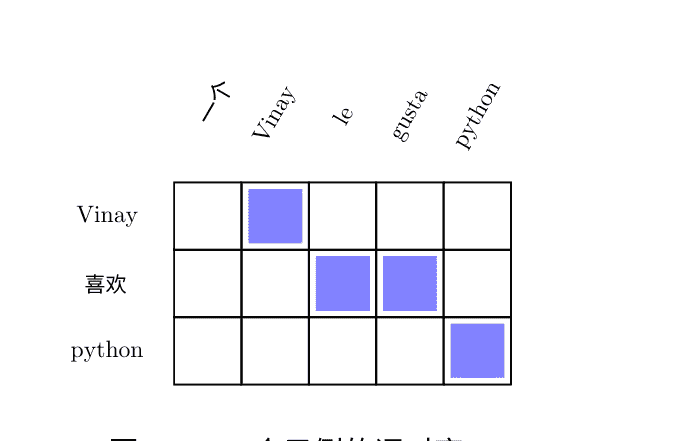

#### 18.2.1 统计翻译建模

翻译模型的最简单分解是词对词：源语言中的每个词都应与翻译中的一个词对齐。这种方法假设存在一个对齐 $\mathcal{A}(w^{(s)}, w^{(t)})$，其中包含一系列源语言和目标语言标记的配对。例如，给定 $w^{(s)} = A \text{ Vinay le gusta Python}$ 和 $w^{(t)} = \text{Vinay likes Python}$，一个可能的词对词对齐是，

$\mathcal{A}(w^{(s)}, w^{(t)}) = \{ (A, \varnothing), (\text{Vinay}, \text{Vinay}), (\text{le}, \text{喜欢}), (\text{gusta}, \text{喜欢}), (\text{Python}, \text{Python}) \}$。 [18.7]

这个对齐显示在图18.3中。另一个不太有希望的对齐是：$\mathcal{A}(w^{(s)}, w^{(t)}) = \{ (A, \text{Vinay}), (\text{Vinay}, \text{喜欢}), (\text{le}, \text{Python}), (\text{gusta}, \varnothing), (\text{Python}, \varnothing) \}$。 [18.8] 每个对齐都包含了源语言中每个单词的一个元组，这解释了源语言单词如何从目标语言中翻译，符合翻译概率$p_{S|T}$的要求。 如果在目标语言中找不到适当的单词与源语言中的单词对应，那么它将与 $\varnothing$ 对齐，就像例子中的西班牙语功能词 $a$ 对应英语单词 $to$ 一样。目标语言中的单词可以与源语言中的多个单词对齐，所以目标语言单词 $likes$ 可以同时对齐源语言中的 $le$ 和 $gusta$。

对齐和翻译的联合概率可以方便地定义为，

$$
p(w^{(s)}, \mathcal{A} \mid w^{(t)}) = \prod_{m=1}^{M^{(s)}} p(w_m^{(s)}, a_m \mid w_{a_m}^{(t)}, m, M^{(s)}, M^{(t)})\qquad\qquad [18.9]
$$
$$
= \prod_{m=1}^{M^{(s)}} p(a_m \mid m, M^{(s)}, M^{(t)}) \times p(w_m^{(s)} \mid w_{a_m}^{(t)}).\qquad\qquad [18.10]
$$

这个概率模型有两个关键假设：

在与MIT Press签订的合同下，根据CC-BY-NC-ND许可共享。

## # 第18章 机器翻译

- 对齐概率在标记之间是独立的，

$$ p(\mathcal{A} \mid \boldsymbol{w}^{(s)}, \boldsymbol{w}^{(t)}) = \prod_{m=1}^{M^{(s)}} p(a_m \mid m, M^{(s)}, M^{(t)}). $$ [18.11]

这意味着每个对齐决策都是独立的，并且仅依赖于索引 m和句子长度 M^(s)和 M^(t)。

- 翻译概率也会跨标记因子化，

$$ p(\boldsymbol{w}^{(s)} \mid \boldsymbol{w}^{(t)}, \mathcal{A}) = \prod_{m=1}^{M^{(s)}} p(w_m^{(s)} \mid w_{a_m}^{(t)}). $$ [18.12]

因此，w^(s)中的每个单词仅取决于其在w^(t)中对齐的单词。这意味着翻译是逐词进行的，忽略上下文。希望是目标语言模型p(w^(t))能够纠正由逐词翻译引起的任何不流畅之处。

要使用这样的模型进行翻译，我们可以对所有可能的对齐进行求和或取最大值，

$$ p(\boldsymbol{w}^{(s)}, \boldsymbol{w}^{(t)}) = \sum_{\mathcal{A}} p(\boldsymbol{w}^{(s)}, \boldsymbol{w}^{(t)}, \mathcal{A}) $$ [18.13]

$$ = p(\boldsymbol{w}^{(t)}) \sum_{\mathcal{A}} p(\mathcal{A}) \times p(\boldsymbol{w}^{(s)} \mid \boldsymbol{w}^{(t)}, \mathcal{A}) $$ [18.14]

$$ \geq p(\boldsymbol{w}^{(t)}) \max_{\mathcal{A}} p(\mathcal{A}) \times p(\boldsymbol{w}^{(s)} \mid \boldsymbol{w}^{(t)}, \mathcal{A}). $$ [18.15]

术语 p(A)定义了对齐的先验概率。IBM在20世纪80年代和90年代开发了一系列具有越来越宽松独立性假设的对齐模型，称为IBM模型1-6 (Och和Ney，2003年)。IBM模型1做出了最强的独立性假设：

$$ p(a_m \mid m, M^{(s)}, M^{(t)}) = \frac{1}{M^{(t)}}. $$ [18.16]

在这个模型中，每个对齐都是等可能的。这几乎肯定是错误的，但它导致了一个凸学习目标，为更复杂的对齐模型 (Brown等, 1993; Koehn, 2009) 提供了一个良好的初始化。

#### 18.2.2 估计

让我们将参数 θ_{u→v}定义为将目标词 u翻译为源词 v的概率。如果单词对齐被注释，这些概率可以从相对频率中计算得出，

$$ \hat{\theta}_{u \rightarrow v} = \frac{\text{count}(u, v)}{\text{count}(u)}, $$ [18.17]

其中count(u, v)是训练集中将单词 v对齐到单词 u的实例计数，count(u)是目标词 u的总计数。 第6章提到的平滑技术可以帮助减少这些概率估计的方差。

相反，如果我们有一个准确的翻译模型，我们可以估计每个对齐决策的可能性,

> $q_m(a_m | \mathbf{w}^{(s)}, \mathbf{w}^{(t)}) \propto p(a_m | m, M^{(s)}, M^{(t)}) \times p(w_m^{(s)} | w_{a_m}^{(t)}), \quad [18.18]$

其中 $q_m(a_m | \mathbf{w}^{(s)}, \mathbf{w}^{(t)})$ 是我们对将源词 $w_m^{(s)}$ 对齐到目标词 $w_{a_m}^{(t)}$ 的信心度的度量。然后可以从期望计数中计算相对频率,

> $\hat{\theta}_{u \rightarrow v} = \frac{E_q [\text{count}(u, v)]}{\text{count}(u)}, \quad [18.19]$
> $E_q [\text{count}(u, v)] = \sum_m q_m(a_m | \mathbf{w}^{(s)}, \mathbf{w}^{(t)}) \times \delta(w_m^{(s)} = v) \times \delta(w_{a_m}^{(t)} = u), \quad [18.20]$

期望最大化(EM) 算法通过迭代更新 $q_m$ 和 $\hat{\Theta}$。 该算法在第5章以一般形式描述。 对于统计机器翻译，算法的步骤如下：

- 1. E步骤：使用方程式18.18更新有关词对齐的信念。
- 2. M步骤：使用方程式18.19和18.20更新翻译模型。

如第5章所讨论的，期望最大化算法保证收敛，但不保证全局最优。 然而，对于IBM模型1，可以证明EM优化了一个凸目标，并且保证了全局最优。 因此，IBM模型1经常用作更复杂对齐模型的初始化。 有关更多详细信息，请参阅Koehn (2009)。

#### 18.2.3 基于短语的翻译

真正的翻译不是逐字替换。 一个原因是许多多词组表达不是逐字翻译的，就像这个法语的例子一样：

> (18.3) 我们 将要 拿 一个 玻璃
>       We   会   取       杯
>       我们会喝一杯


## 图18.4：法语和英语之间的基于短语的对齐，对应于例子(18.3)

第一行we will take a glass是法语句子的逐字翻译；第三行显示了翻译we'll have a drink。这样的例子对于逐字翻译模型来说很困难，因为它们需要将 prendre翻译为 have，将 verre翻译为 drink。这些翻译只在特定短语的上下文中才正确。

基于短语的翻译通过构建翻译表和多词组之间的对齐来推广基于单词的模型。（这些“短语”不一定是像第9章和第10章中描述的名词短语和动词短语那样的句法成分。）从基于单词的翻译推广到基于短语的翻译非常直接：翻译表现在可以以多词组为条件，并且可以为多词组分配概率；对齐是从跨度到跨度的映射，$((i, j), (k, \ell))$，这样

$$ p(w^{(s)} | w^{(t)}, \mathcal{A}) = \prod_{((i,j),(k,\ell)) \in \mathcal{A}} p_{w^{(s)}|w^{(t)}}(\{w^{(s)}_{i+1}, w^{(s)}_{i+2}, \ldots, w^{(s)}_j\} | \{w^{(t)}_{k+1}, w^{(t)}_{k+2}, \ldots, w^{(t)}_\ell\}). $$ [18.21]

短语对齐 $((i, j), (k, \ell))$ 表示跨度 $w^{(s)}_{i+1:j}$ 是源语言中的翻译跨度 $w^{(t)}_{k+1:\ell}$。图18.4展示了一个示例短语对齐。请注意，对齐集合 $\mathcal{A}$ 需要覆盖源语言中的所有标记，就像基于词的翻译一样。概率模型 $p_{w^{(s)}|w^{(t)}}$ 现在必须包括所有短语对的翻译，这可以通过期望最大化算法从基于词的统计机器翻译中学习得到。

### *18.2.4 基于句法的翻译

Vauquois金字塔（图18.1）表明，如果我们从更高层次的角度来看，翻译可能会更容易。一种可能性是将源语言的句法结构、目标语言的句法结构或两者都纳入考虑。这对于存在一致的句法差异的语言对特别有前景。例如，英语形容词几乎总是位于它们修饰的名词之前，而在法语和西班牙语等罗曼语言中，形容词通常位于名词之后：因此，angry fish在西班牙语中会被翻译为pez (fish) enojado (angry)。在逐词翻译中，这些重新排序会导致对齐模型过于宽松。这并不意味着在翻译成西班牙语时可以颠倒任意一对英语单词的顺序，而只能颠倒名词短语中的形容词和名词。在翻译日语（动词通常位于主语和宾语之后）、塔加洛语和古典阿拉伯语等动词末位语言与动词初位语言和动词中位语言（如英语）之间存在类似的问题。

一种优雅的解决方案是在同步上下文无关文法（SCFG; Chiang, 2007）中链接解析和翻译。<sup>3</sup>SCFG是一组形式为 $X \rightarrow (\alpha, \beta, \sim)$ 的产生式集合，其中 $X$ 是非终结符， $\alpha$ 和 $\beta$ 是终结符或非终结符的序列， $\sim$ 是 $\alpha$ 中的项目与 $\beta$ 中的项目之间的一对一齐。英语-西班牙语形容词-名词的顺序可以通过一组同步产生式来处理，例如，

```
NP → (DET₁ NN₂ JJ₃,  DET₁ JJ₃ NN₂),  [18.22]
```

其中下标表示西班牙语（左侧）和英语（右侧）右侧部分之间的对齐。终结产生式产生翻译对，

```
JJ → (enojado₁, angry₁)。  [18.23]
```

同步派生始于起始符号S，并派生出一对终端符号序列。

给定一个SCFG，其中每个产生式在每种语言中最多产生两个符号（Chomsky正规形式；参见 §9.2.1），可以使用CKY算法（第10章）进行句子解析。得到的派生还包括另一种语言的产生式，一直到表面形式。因此，SCFG使得翻译非常类似于解析。在加权SCFG中，可以通过计算产生式的对数概率之和来计算对数概率 $\log p_{S|T}$。然而，将SCFG与目标语言模型结合起来在计算上是非常昂贵的，需要使用近似搜索算法（Huang和Chiang，2007）。

同步上下文无关文法是树到树翻译的一个例子，因为它们模拟了目标语言和源语言的句法结构。在字符串到树翻译中，字符串元素被翻译为组成树片段。

> 3早期的句法机器翻译方法包括句法驱动的转换（Lewis II和Stearns, 1968）和随机逆转换语法（Wu, 1997）。

### 18.3 神经机器翻译

机器翻译的神经网络模型基于编码器-解码器架构（Cho等，2014）。编码器网络将源语言句子转换为向量或矩阵表示；解码器网络然后将编码转换为目标语言的句子。

```
z = ENCODE(w^{(s)})  [18.24]
w^{(t)} | w^{(s)} ~ DECODE(z),  [18.25]
```

其中第二行表示函数DECODE(z)定义了条件概率p(w^{(t)} | w^{(s)}).

解码器通常是一个循环神经网络，它一次生成目标语言的一个词，同时循环更新隐藏状态。编码器和解码器网络是从平行句子中端到端训练的。如果解码器的输出层是一个逻辑函数，那么整个架构可以被训练来最大化条件对数似然，

```
log p(w^{(t)} | w^{(s)}) = \sum_{m=1}^{M^{(t)}} p(w_m^{(t)} | w_{1:m-1}^{(t)}, z)  [18.26]
p(w_m^{(t)} | w_{1:m-1}^{(t)}, w^{(s)}) ∝ exp (β_{w_m^{(t)}} · h_{m-1}^{(t)})  [18.27]
```

其中隐藏状态 h_{mt-1}^{()} 是先前生成文本的循环函数 w1:_{m-1}^{(t)} 和编码 z。 第二行等同于写成，

```
w_m^{(t)} | w_{1:m-1}^{(t)}, w^{(s)} ~ SoftMax (β · h_{m-1}^{(t)}),  [18.28]
```

其中 β ∈ R^{(V^{(t)} × K)} 是目标语言词汇中 V^{(t)} 个词的输出词向量矩阵。

最简单的编码器-解码器架构是序列到序列模型 (Sutskever等, 2014)。 在这个模型中，编码器被设置为一个长短期记忆（LSTM）（参见 §6.3.3）在源句子上：

$$h_m^{(s)} = \mathrm{LSTM}(x_m^{(s)}, h_{m-1}^{(s)})$$
$$z \triangleq h_M^{(s)}$$

其中 $x_m^{(s)}$ 是源语言单词 $w_m^{(s)}$ 的嵌入。然后编码器为解码器LSTM提供初始隐藏状态：

$$h_0^{(t)} = z$$
$$h_m^{(t)} = \mathrm{LSTM}(x_m^{(t)}, h_{m-1}^{(t)})$$

其中，$x_m^{(t)}$ 是目标语言单词 $w_m^{(t)}$ 的嵌入。

序列到序列翻译不过是将两个LSTMs连接在一起：一个用于读取源语言，另一个用于生成目标语言。为了使模型良好运行，需要进行一些额外的调整：

+   - 特别值得注意的是，如果源句子反转，从句子末尾开始读取到开头，模型的效果会好得多。这样，源语言开头的单词对编码 $z$ 有最大的影响，从而影响目标句子开头的单词。后续关于更高级的编码模型的研究，如神经注意力（参见 §18.3.1），已经消除了反转源句子的需要。
+   - 编码器和解码器可以实现为深度LSTMs，具有多层隐藏状态。如图18.5所示，每个隐藏状态 $h_{ms,i}^{(\cdot)}$ at层 $i$ 被视为

在与MIT Press签订的合同下，根据CC-BY-NC-ND许可共享。

作为输入传递给层 i+ 1的LSTM：

$$h_m^{(s,1)} = \text{LSTM}(x_m^{(s)}, h_{m-1}^{(s)})\tag{18.33}$$
$$h_m^{(s,i+1)} = \text{LSTM}(h_m^{(s,i)}, h_{m-1}^{(s,i+1)}), \quad \forall i \ge 1.\tag{18.34}$$

序列到序列翻译的原始工作使用了四层；在2016年，Google的商业机器翻译系统使用了八层 (Wu等，2016年)。 ⁴

+   •通过创建一个由不同的随机初始化训练的翻译模型组成的集合，可以获得显著的改进。对于大小为N的集合，每个标记的解码概率设置为相等，

$$p(w^{(t)} | z, w_{1:m-1}^{(t)}) = \frac{1}{N} \sum_{i=1}^{N} p_i(w^{(t)} | z, w_{1:m-1}^{(t)}),\tag{18.35}$$

其中p_i是模型 i的解码概率。集合中的每个翻译模型都包括自己的编码器和解码器网络。

+   •最初的序列到序列模型使用了一个相当标准的训练设置：随机梯度下降，第一次五个时期后指数递减的学习率；每个批次128个句子，选择具有相似长度的句子，以便每个批次中的句子处理时间大致相同；梯度裁剪 (见 §3.3.4) 以确保梯度的范数不超过某个预定义值。

#### 18.3.1 神经注意力

前一节讨论的序列到序列模型与统计机器翻译有着根本的不同，在统计机器翻译中，目标语言中的每个单词或短语都依赖于源语言中的一个单词或短语。这两种方法都有优势。统计翻译利用了组合性的思想 - 大单元的翻译应该基于其组成部分的翻译 - 如果我们要将翻译扩展到更长的文本单元，这似乎是至关重要的。但是每个单词或短语的翻译往往取决于更大的上下文，编码器-解码器模型在句子级别捕捉到了这种上下文。

翻译是否可能同时具有上下文和组合性？一种方法是通过注意机制来增强神经翻译。神经注意力的概念在第17.5节中有描述，但其在翻译中的应用还需要进一步讨论。通常，注意力可以被视为使用查询来从键值对的记忆中选择。然而，查询、键和值都是向量，整个过程是向量化的。

图18.6: 神经注意力的一般视图。虚线框表示每个 α_{m→n} 可以被视为对值 v_n 的门控。

操作是可微分的。对于记忆中的每个键 k_n，我们计算与查询 q 的得分 ψ_α(m, n)。该得分是键和查询的兼容性的函数，可以使用一个小型前馈神经网络计算。得分向量通过激活函数（如 softmax）传递。该激活函数的输出是一个非负向量 [α_{m→1}, α_{m→2}, … , α_{m→N}]^T，长度为记忆的大小。记忆中的每个值 v_n 都与注意力 α_{m→n} 相乘；这些缩放后的值的总和是输出。这个过程在图18.6中显示。在极端情况下，如果 α_{m→n}= 1 且对于所有其他的 α_{m→n'}，都等于0，则注意机制只是从记忆中选择值 v_n。

神经注意力使得将对齐整合到编码器-解码器架构中成为可能。与其将整个源句子编码为固定长度的向量 z，不如将其编码为一个矩阵 Z ∈ ℝ^{K×M^{(S)}}，其中 K 是隐藏状态的维度，M^{(S)} 是源输入中的标记数。每一列 Z 表示源句子上的一个递归神经网络的状态。这些向量是由一个双向 LSTM 构建的（参见 §7.6），它可以是一个深层网络，如图18.5所示。这些列既是注意机制中的键，也是值。

在解码的每一步 m 中，通过执行一个查询来计算注意力状态，该查询等于解码器的状态 h_{m}^{(t)}。得到的兼容性分数为，

$$\psi_\alpha(m, n) = v_\alpha \cdot \tanh(\Theta_\alpha[h_{m}^{(t)}; h_{n}^{(s)}]).$$

因此，函数 ψ 是一个具有权重 v_α 的两层前馈神经网络，在输出层上有权重 Θ_α。为了将这些分数转换为注意力权重，我们应用一个激活函数，可以是向量级的 softmax 函数或元素级的 sigmoid 函数：

##### softmax注意力

$$\alpha_{m\rightarrow n} = \frac{\exp \psi_\alpha(m, n)}{\sum_{n'=1}^{M^{(S)}} \exp \psi_\alpha(m, n')}$$

##### sigmoid注意力

$$\alpha_{m\rightarrow n} = \sigma(\psi_\alpha(m, n))$$

然后，注意力 α被用来计算一个上下文向量 c_m，通过对 Z的列进行加权平均。

$$c_m = \sum_{n=1}^{M^{(s)}} \alpha_{m\rightarrow n} z_n$$

其中 α_{m→n} ∈ [0, 1]是目标词m对源词n的注意力量。上下文向量可以通过在解码器中添加另一层来将其纳入到词输出概率模型中（Luong等人，2015）：

$$\tilde{h}_m^{(t)} = \tanh\left(\Theta_c [h_m^{(t)}; c_m]\right)$$

$$p(w_{m+1}^{(t)} | w_{1:m}^{(t)}, w^{(s)}) \propto \exp\left(\beta_{w_{m+1}^{(t)}} \cdot \tilde{h}_m^{(t)}\right)$$

这里，解码器状态 h_{m}^{(t)} 与上下文向量连接在一起，形成输入，计算出最终的输出向量 \tilde{h}_{m}^{(t)}。上下文向量可以以类似的方式纳入到解码器的递归中（Bahdanau等人，2014）。

#### 18.3.2 *无循环神经机器翻译

在编码器-解码器模型中，注意力的“键和值”是编码器网络中的隐藏状态表示，而“查询”是解码器网络中的状态表示（）。通过在编码器和解码器中应用自注意力（Lin等人，2017; Kim等人，2017），也可以完全消除神经翻译中的循环。变压器架构（Vaswani等人，2017）中的。对于级别 i，变压器的编码器部分的基本方程如下：

$$z_m^{(i)} = \sum_{n=1}^{M^{(s)}} \alpha_{m\rightarrow n}^{(i)} (\Theta_v h_n^{(i-1)})$$

$$h_m^{(i)} = \Theta_2 \text{ReLU}\left(\Theta_1 z_m^{(i)} + b_1\right) + b_2$$

对于每个标记 m在层级 i上，我们计算整个源句子的自注意力。键、值和查询都是向量 h^{(i-1)} 的投影：例如，在方程式18.42中，值 v_n是投影 Θ_v h_n^{(i-1)}。注意力分数 α_{m→n}^{(i)} 使用缩放形式的softmax注意力计算，

$$\alpha_{m\rightarrow n} \propto \exp(\psi_\alpha(m, n)/M)$$

其中 $M$ 是输入的长度。这鼓励注意力在输入中更均匀地分布。自注意力应用于多个“头”，每个头使用不同的投影 $h^{(i-1)}$ 来形成键、值和查询。这个架构在图18.7中显示。自注意力层的输出是表示 $z_m^{(i)}$，然后通过一个两层前馈网络传递，得到下一层的输入 $h^{(i)}$。这种自注意力架构也可以应用于解码器，但这要求对未来的单词没有注意力: $\alpha_{m\to n}=0$ 对于所有的 $n > m$。为了确保源语言中的单词顺序信息被整合到模型中，编码器在网络的基层上增加了每个单词在源语言中的位置编码。这些编码是每个位置 $m \in \{1,2,\dots,M\}$ 的向量。变换器将这些编码设置为 $m$ 的一组正弦函数。

$$e_{2i-1}(m) = \sin\left(m/(10000^{2i/K_e})\right)$$  [18.45]
$$e_{2i}(m) = \cos\left(m/(10000^{2i/K_e})\right), \quad \forall i \in \{1,2,\dots,K_e/2\}$$  [18.46]

其中 $e_{2i}(m)$ 是索引 $m$ 的编码中元素 $2i$ 的值。随着我们进行编码，正弦函数的带宽逐渐变窄。这使得模型能够通过单词的相对位置进行关注。位置编码与模型的基层中的单词嵌入 $x_m$ 连接在一起。

图18.8: 使用未知词进行翻译。系统输出未知表示词汇表之外的词语。图源自Luong等人(2015)。

卷积神经网络（参见 §3.4）也被应用于神经机器翻译中的编码器（Gehring等人，2017）。对于每个单词 $w_m^{(s)}$，卷积网络从单词及其邻居的嵌入中计算出表示 $h_{(ms)}$。这个过程被多次应用，创建了一个深层卷积网络。然后，循环解码器使用解码器的隐藏状态 $h^{(t)}$ 作为查询，计算一组对这些卷积表示的注意权重。这个注意向量用于计算源语言的另一个卷积神经网络的输出的加权平均值 $c_m$，然后将其馈送到解码器中。

与变压器一样，速度是相对于循环编码模型的主要优势；另一个相似之处是通过使用位置编码来近似词序信息。⁶

#### 18.3.3 未登录词

到目前为止，我们将翻译视为单词或短语级别的问题。对于在训练数据中没有出现的单词，所有这些模型都会遇到困难。存在词汇外（OOV）的主要原因有两个：

+   - 新的专有名词，如姓氏或组织，不断涌现 - 尤其是在新闻领域。对于技术术语来说，情况略有不同。这个问题在图18.8中有所体现。
+   - 在许多语言中，单词具有复杂的内部结构，称为形态学。一个例子是德语，它使用复合来形成诸如 *Abwasserbe-handlungsanlage*（污水处理厂；来自Sennrich等人（2016）的例子）。

§3.3.4），非线性激活周围的残差连接（参见 §3.2.2），以及非单调的学习速率计划。

⁶最近的评估发现，使用循环网络作为解码器，使用变压器作为编码器（Chen等人，2018年）可以获得最佳性能。变压器也被发现明显优于卷积神经网络。

虽然化合物原则上可以通过更好的分词来解决（参见 §8.4），但其他形态学过程涉及更复杂的子词单元转换。

名称和技术术语可以在后处理步骤中处理：首先识别源语言和目标语言中未知词之间的对齐，然后可以在字典中查找每个对齐的源语言词，并选择替换（Luong等人，2015年）。如果单词在字典中不存在，很可能是专有名词，可以直接从源语言复制到目标语言。这种方法也可以直接集成到翻译模型中，而不是将其作为后处理步骤应用（Jean等人，2015年）。

具有复杂内部结构的单词可以通过翻译子词单元而不是整个单词来处理。识别子词单元的一种流行技术是字节对编码（BPE；Gage, 1994; Sennrich et al., 2016）。初始词汇表定义为文本中使用的字符集。然后将最常见的字符二元组合并为一个新符号，更新词汇表，并再次应用合并操作。例如，给定字典{鱼，钓鱼，想要，想要的，自行车，骑自行车}，我们首先形成子词单元 ed，因为这个字符二元组出现在六个单词中的三个中。接下来，有几个二元组分别出现在一对单词中：fi，is，sh，wa，an等。这些可以以任何顺序合并。通过迭代这个过程，最终得到分词结果{鱼，鱼+ed，想要，想要+ed，骑+e，骑+ed}。此时，没有出现多次的二元组。在真实数据中，合并操作会一直执行，直到子词单元的数量达到预定义的阈值，例如 10⁴。

每个子词单元都被视为一个翻译的标记，无论是在编码器（源端）还是解码器（目标端）中。BPE可以同时应用于源语言和目标语言的词汇表的并集，识别出在两种语言中都出现的子词单元。对于具有不同文字的语言（例如英语和俄语），应首先应用脚本之间的音译。⁷

### 18.4 解码

给定一个经过训练的翻译模型，解码任务是：

$$\hat{w}^{(t)} = \operatorname{argmax}_{w \in \mathcal{V}^*} \Psi(w, w^{(s)}), \qquad \qquad \qquad \qquad \qquad \qquad [18.47]$$

其中 $w^{(t)}$ 是来自目标词汇表 $\mathcal{V}$ 的标记序列。对于解码问题，即使是最小有效的情况，也无法高效地获得精确解。

> ⁷音译对于在不共享单一脚本的语言之间转换名称和其他外来词汇（例如英语和日语）至关重要。通常使用第9章中讨论的有限状态方法来处理音译（Knight和Graehl，1998年）。

在统计或神经机器翻译中的模型。今天的最先进的翻译系统使用束搜索（见§11.3.1），这是一种增量解码算法，它维护一小部分竞争假设。这种贪婪的近似在实践中相当有效，这可能部分是因为解码目标与翻译质量的度量只有松散的相关性，因此对[18.47]的精确优化可能不会大大改善结果的翻译。

神经机器翻译中的解码比基于短语的统计机器翻译简单。⁸评分函数 Ψ被定义为,

$$\Psi(w^{(t)}, w^{(s)}) = \sum_{m=1}^{M^{(t)}} \psi(w^{(t)}_m; w^{(t)}_{1:m-1}, z) \quad [18.48]$$

$$\psi(w^{(t)}; w^{(t)}_{1:m-1}, z) = \beta_{w^{(t)}_m} \cdot h_{m}^{(t)} - \log \sum_{w \in \mathcal{V}} \exp \left( \beta_w \cdot h_{m}^{(t)} \right), \quad [18.49]$$

其中 $z$是源句子的编码 $w^{(s)}$，而 $h_{m}^{(t)}$是编码 $z$和解码历史 $w^{(t)}_{1: m-1}$的函数。这个公式包含了注意力翻译模型，其中 $z$是源句子的编码矩阵。

现在考虑增量解码算法,

$$\hat{w}^{(t)}_m = \operatorname{argmax}_{w \in \mathcal{V}} \psi(w; \hat{w}^{(t)}_{1:m-1}, z), \quad m = 1, 2, \ldots \quad [18.50]$$

该算法在位置 $m$选择最佳的目标语言单词，假设已经生成了序列 $\hat{w}^{(t)}_{1: m-1}$。（终止可以通过在词汇表 $\mathcal{V}$中添加一个特殊的序列结束标记 ■来处理。）增量算法很可能会产生对于在方程式 18.47中定义的优化问题的次优解，因为在位置 $m$选择得分最高的单词可能会使解码器陷入“死胡同”，在后续位置 $n > m$上没有好的选择。我们可能希望有一些动态规划的解决方案，就像序列标注中的那样（§7.3）。但是维特比算法及其相关算法依赖于将目标函数分解为局部得分的和的马尔可夫分解：例如，得分可以考虑局部相邻的标签（$y_m , y_{m-1}$），但不能考虑整个标记历史 $y_{1:m}$。这种分解对于循环神经网络不适用，因为隐藏状态 $h_{(m)}$受到整个历史 $w^{(t)}_{1: m}$的影响；这种对长程上下文的敏感性正是循环神经网络如此有效的原因。⁹事实上，可以证明从任何循环神经网络解码是NP完全的（Siegelmann和Sontag, 1995; Chen等, 2018）。

束搜索束搜索是一种在无法进行穷举搜索时避免搜索错误的通用技术；它首次在 §11.3.1中讨论。束搜索可以看作是方程式18.50中概述的增量解码算法的一种变体，但在每个步骤 $m$ 中，保留了一组 $K$ 个不同的假设。 对于每个假设 $k \in \{1, 2, \ldots, K\}$，我们计算当前得分 $\sum_{m=1}^{M^{(t)}} \psi(w_{k,m}^{(t)}; w_{k,1:m-1}^{(t)}, z)$ 以及当前的隐藏状态 $h_{k}^{(t)}$。在每一步的束搜索中，束上当前的每个假设的得分最高的子节点都会被“扩展”，并且束会被更新。 关于RNN解码的束搜索的详细描述，请参见Graves（2012）的论文。

学习和搜索传统上，学习算法被训练成在翻译时预测正确的标记，条件是翻译历史是正确的。 但是，如果解码必须是近似的，那么通过修改学习算法使其对翻译历史中的错误具有鲁棒性可能会取得更好的效果。计划采样通过在训练时使用有时来自真实数据，有时来自模型自身输出的历史来实现这一点（Bengio等人，2015）。随着训练的进行，训练轮子会被卸下：我们增加来自模型而不是真实数据的标记的比例。 另一种方法是根据与束搜索性能直接相关的目标进行训练（Wiseman等人，2016）。 强化学习也已经应用于基于RNN的翻译模型的解码，从而可以直接优化诸如BLEU（Ranzato等人，2016）之类的翻译指标。

## 18.5 基于评估指标的训练

在基于似然的训练中，目标是最大化平行语料的概率。 然而，翻译并不是以似然为评估标准：像BLEU这样的指标只考虑单个输出翻译的正确性，而不考虑模型分配的概率范围。 因此，最好训练翻译模型以实现最高的BLEU分数，以我们相信BLEU可以衡量翻译质量的程度。 不幸的是，BLEU和相关指标对于优化来说并不友好：它们是参数的不连续、不可微分函数，这些参数是翻译模型的一部分。

考虑一个误差函数 $\Delta(\hat{w}^{(t)}, w^{(t)})$，它衡量系统翻译 $\hat{w}^{(t)}$和参考翻译 $w^{(t)}$之间的差异；这个函数可以基于BLEU或任何其他翻译质量指标。 一个可能的标准是选择## 最小化系统首选翻译的误差的参数 $\theta$

$$ \hat{\boldsymbol{w}}^{(t)} = \operatorname{argmax}_{\boldsymbol{w}^{(t)}} \Psi(\boldsymbol{w}^{(t)}, \boldsymbol{w}^{(s)}; \theta) \quad [18.51] $$
$$ \hat{\theta} = \operatorname{argmin}_{\theta} \Delta(\hat{\boldsymbol{w}}^{(t)}, \boldsymbol{w}^{(s)}) \quad [18.52] $$

然而，确定得分最高的翻译 $\hat{\boldsymbol{w}}^{(t)}$ 通常是棘手的，如前一节所述。在最小误差率训练（MERT）中，从候选翻译集合 $\mathcal{Y}(\boldsymbol{w}^{(s)})$ 中选择 $\hat{\boldsymbol{w}}^{(t)}$；这通常是所有可能翻译的严格子集，因此只能优化对真实误差率的近似（Och和Ney，2003年）。

进一步的问题是，方程18.52中的目标函数是不连续且不可微的，由于对于翻译而言，参数 $\theta$ 的微小变化可能导致选择另一个完全不同的翻译错误。为了解决这个问题，我们可以最小化风险，即定义为预期错误率。

$$ R(\theta) = E_{\hat{\boldsymbol{w}}^{(t)} | \boldsymbol{w}^{(s)}; \theta}[\Delta(\hat{\boldsymbol{w}}^{(t)}, \boldsymbol{w}^{(t)})] \quad [18.53] $$
$$ = \sum_{\hat{\boldsymbol{w}}^{(t)} \in \mathcal{Y}(\boldsymbol{w}^{(s)})} \mathrm{p}(\hat{\boldsymbol{w}}^{(t)} \mid \boldsymbol{w}^{(s)}) \times \Delta(\hat{\boldsymbol{w}}^{(t)}, \boldsymbol{w}^{(t)}). \quad [18.54] $$

最小风险训练通过在训练集中的所有实例上最小化 $R(\theta)$ 的总和来实现。
风险可以通过指数化翻译概率来概括，

$$ \tilde{p}(\boldsymbol{w}^{(t)}; \theta, \alpha) \propto \left(\mathrm{p}(\boldsymbol{w}^{(t)} \mid \boldsymbol{w}^{(s)}; \theta)\right)^{\alpha} \quad [18.55] $$
$$ \tilde{R}(\theta) = \sum_{\hat{\boldsymbol{w}}^{(t)} \in \mathcal{Y}(\boldsymbol{w}^{(s)})} \tilde{p}(\hat{\boldsymbol{w}}^{(t)} \mid \boldsymbol{w}^{(s)}; \alpha, \theta) \times \Delta(\hat{\boldsymbol{w}}^{(t)}, \boldsymbol{w}^{(t)}) \quad [18.56] $$

其中 $\mathcal{Y}(\boldsymbol{w}^{(s)})$ 现在是 $\boldsymbol{w}^{(s)}$ 的所有可能翻译的集合。以这种方式指数化概率被称为退火（Smith and Eisner, 2006）。当 $\alpha= 1$ 时，$\tilde{R}(\theta) = R(\theta)$；当 $\alpha = \infty$ 时，$\tilde{R}(\theta)$ 等同于数据集中每个句子的最大概率翻译的错误总和。

很明显，候选翻译集合 $\mathcal{Y}(\boldsymbol{w}^{(s)})$ 太大了，无法明确地对其求和。因为误差函数 $\Delta$ 通常不能分解为更小的部分，所以没有有效的动态规划解法来对这个集合求和。我们可以近似求和 $\sum$ 用有限数量的样本 $\{\boldsymbol{w}_{1}^{(t)}, \boldsymbol{w}_{2}^{(t)}, \ldots, \boldsymbol{w}_{K}^{(t)}\}$ 来估计 $\boldsymbol{w}^{(t)} \in \mathcal{Y}(\boldsymbol{w}^{(s)})$。如果这些样本是均匀随机抽取的，那么（退火）风险将被近似为

### 18.5 根据评估指标进行训练

（Shen等人，2016）近似计算。

$$ \tilde{R}(\boldsymbol{\theta}) \approx \frac{1}{Z} \sum_{k=1}^K \tilde{p}(\boldsymbol{w}_k^{(t)} \mid \boldsymbol{w}^{(s)}; \boldsymbol{\theta}, \alpha) \times \Delta(\boldsymbol{w}_k^{(t)}, \boldsymbol{w}^{(t)}) $$
$$ Z = \sum_{k=1}^K \tilde{p}(\boldsymbol{w}_k^{(t)} \mid \boldsymbol{w}^{(s)}; \boldsymbol{\theta}, \alpha) $$

Shen等人（2016年）报告称，在神经机器翻译的最小风险训练中，性能在K=100时达到平稳状态。

在所有可能的翻译集合上进行均匀采样是不可取的，因为大多数翻译的概率非常低。蒙特卡洛估计的一个解决方案是重要性抽样，我们从一个提议分布 $q(\boldsymbol{w}^{(t)} | \boldsymbol{w}^{(s)})$ 中抽取样本。这个分布可以等于当前的翻译模型 $p(\boldsymbol{w}^{(t)} | \boldsymbol{w}^{(s)}; \theta)$。然后，每个样本都根据一个重要性分数加权，$\omega_k = \frac{\tilde{p}(\boldsymbol{w}_k^{(t)} | \boldsymbol{w}^{(s)})}{q(\boldsymbol{w}_k^{(t)}; \boldsymbol{w}^{(s)})}$。这种加权的效果是为了纠正提议分布 $q$ 和真实分布 $\tilde{p}$ 之间的任何不匹配。然后可以近似风险为，

$$ \boldsymbol{w}_k^{(t)} \sim q(\boldsymbol{w}^{(t)} | \boldsymbol{w}^{(s)}) $$
$$ \omega_k = \frac{\tilde{p}(\boldsymbol{w}_k^{(t)} \mid \boldsymbol{w}^{(s)})}{q(\boldsymbol{w}_k^{(t)}; \boldsymbol{w}^{(s)})} $$
$$ \tilde{R}(\boldsymbol{\theta}) \approx \frac{1}{\sum_{k=1}^K \omega_k} \sum_{k=1}^K \omega_k \times \Delta(\boldsymbol{w}_k^{(t)}, \boldsymbol{w}^{(t)}) $$

重要性采样通常比均匀采样给出更准确的近似。唯一的正式要求是提议分布非零概率给每个 $\boldsymbol{w}^{(t)} \in \mathcal{Y}(\boldsymbol{w}^{(s)})$。有关重要性采样和相关方法的更多信息，请参阅Robert和Casella（2013）。

### 附加资源

关于机器翻译的一本完整教材可以从Koehn（2009）获得。虽然这本书在神经翻译的最新工作之前出版，但也有一章关于神经翻译模型的最新草稿可供参考（Koehn，2017）。Neubig（2017）从基本原理开始，提供了关于神经机器翻译的全面教程。Cho（2015）的课程笔记也很有用。有几个神经机器翻译库可供使用：LAMTRAM是基于DYNET的神经机器翻译实现（Neubig等，2017）；OPENNMT（Klein等，2017）和FAIRSEQ在PYTORCH中可用；TENSOR2TENSOR是在TENSORFLOW中实现的几个Google翻译模型之一（Abadi等，2016）。

> 此外，史密斯还重新考虑了这本书的著名开头。卡缪的原文看似简单：“Aujourd'hui, maman est morte.”吉尔伯特通过给我们“Mother died today”这样的翻译，从一开始就给梅尔索（叙述者）注入了一种可能被解读为冷酷无情的形式。但是妈妈，毕竟是亲密和亲昵的，是一个孩子对母亲的称呼。马修·沃德得出结论，这句话基本上是无法翻译的（“妈妈”或“妈咪”并不太恰当），所以他将其保留为原文：“Maman died today.”这种选择有一种明确的逻辑；但正如史密斯在《卫报》的一次采访中解释的那样，妈妈“并没有真正告诉读者任何内涵。”相反，她将这句话翻译为“我的母亲今天去世了。”

> 我选择了“我的母亲”，因为我考虑到一个人如何告诉另一个人他的母亲去世了。梅尔索直接对读者说话。“我的母亲今天去世了”对我来说是合适的方式，也暗示了法语中“妈妈”所具有的亲密感。

在书中的其他地方，她将“maman”翻译为“妈妈”——再次努力尽可能接近一个实际的、口语化的词，以传达与法语中的“maman”相同的内涵。

这段文字提醒我们，虽然机器翻译的质量在近年来有了显著提高，但专业人士的人工翻译考虑的因素超出了任何当代计算方法的范畴。

### 练习

- 1. 使用Google翻译或其他在线服务，将以下示例翻译成两种您选择的不同语言：

(18.4) 它在任何地图上都找不到；真正的地方从来都不会出现在地图上。

然后将每个结果重新翻译回英语。哪个更接近原文？ 你能解释一下它们之间的区别吗？

- 2. 计算未平滑的 $n$-gram精确度 $p_1$ ... 对于前面问题中的两个反向翻译，使用原始源作为参考，计算 $p_4$。 你的 $n$-gram应该包括标点符号，并且你应该将像 it's 这样的连词分割成两个标记。

- 3. 给定以下从“简单”到“困难”的翻译数据集：

(18.5) a. 孩子们 喜欢 猫。
      崇拜 猫科动物。
  b. 猫 帽子。
     软呢帽。

使用期望最大化算法，从简单英语（源语言）到困难英语（目标语言）估计一个词对词的统计翻译模型，如第18.2.2节所述。手动计算算法的两次迭代，从均匀的翻译模型开始，并使用简单的对齐模型 $p(a_m | m, M^{(s)}, M^{(t)}) = \frac{1}{M^{(t)}}$

提示：在最后的M步中，您将希望从分数切换到小数。

- 4. 在前一个问题的基础上，收敛的翻译概率表将是什么？ 您能否陈述关于数据的一般条件，在这种情况下，这个翻译模型将以与此处相同的方式失败？

- 5. 提出一个简单的对齐模型，可以从之前两个问题的玩具数据集中恢复正确的翻译概率。

- 6. 让 $\ell_{mt}^{(m)}$ 表示目标词 $m+1$ 的损失，让 $h_{n}^{(s)}$ 表示源词 $n$ 的隐藏状态。 写出导数的表达式 $\frac{\partial \ell_{mt}^{(m)}}{\partial h_{n}^{(s)}}$ 在表达式[18.29-18.32]中表示的序列到序列翻译模型中，最短的反向传播路径从 $\ell_{mt}^{(m)}$ 到 $h_{n}^{(s)}$ 有多少项？

- 7. 现在考虑来自 §18.3.1 的神经注意力模型，带有sigmoid注意力。
导数 $\frac{\partial \ell_{mt}^{(m)}}{\partial z_{i}}$ 是通过计算图的许多路径的总和；找出最短的路径。您可以假设解码器的初始状态重复 $h_0^{(t)}$ 与编码器的最终状态 $h^{(s)}$ 没有关联 $M^{(s)}$。

## 第18章 机器翻译

8. 对词汇应用字节对编码 \textit{it}, \textit{unit}, \textit{unite}，直到没有二元出现超过一次。

9. 这个问题涉及到机器翻译的复杂性。假设你有一个返回要包含在翻译中的单词列表的神谕，因此你的唯一任务是对单词进行排序。此外，假设评分函数对排序的总和是二元的, \[ \sum_{m=1}^{M} \psi(w_m^{(t)}, w_{m-1}^{(t)}). \] 通过从一个众所周知的问题进行约简，证明找到最佳翻译的问题是NP完全的。

10. 手动设计一个注意力循环翻译模型，简单地将输入从源语言复制到目标语言。您可以假设一个任意大的隐藏状态，并且您可以假设有有限的最大输入长度 $M$。指定所有权重，使得任何源语言的最大概率翻译都是源语言本身。提示：最简单的方法是使用Elman循环 \[ h_m = f(\Theta h_{m-1} + x_m) \] 而不是LSTM。

11. 给出一个同步推导 (§18.2.4) 的西班牙语-英语翻译，

(18.6) \textit{El pez enojado atacado.}
The 鱼 angry attacked.
愤怒的鱼袭击了。

如上所述，第二行显示逐字逐句的注释，第三行显示所需的翻译。使用[18.22]中的同步产生规则，并设计出其他必要的产生规则来推导这个句对。您可以直接从VP推导出 \textit{(atacado, attacked)}。

## 第19章 文本生成

在自然语言处理中的许多最有趣的问题中，语言是输出。前一章描述了机器翻译的具体案例，但还有许多其他应用，从研究文章的摘要到自动新闻报道，再到对话系统。本章重点介绍三个主要场景：数据到文本，其中生成文本以解释或描述结构化记录或非结构化感知输入；文本到文本，通常涉及从多个语言来源融合信息到一个连贯的摘要；以及对话，其中生成文本作为与一个或多个个人参与的互动对话的一部分。

### 19.1 数据到文本生成

在数据到文本生成中，输入范围从结构化记录，例如天气预报的描述（如图19.1所示），到非结构化感知数据，例如原始图像或视频；输出可以是一个句子，例如图像标题，或者是一个多段落的论证。尽管存在这种多样性的条件，所有数据到文本系统都面临着一些相同的挑战（Reiter和Dale，2000）：

- 确定要描述的数据的部分；
- 规划此信息的演示；
- 将数据词汇化为单词和短语；
- 将单词和短语组织成良好的句子和段落。

这个过程的早期阶段有时被称为内容选择和文本规划；后期阶段通常被称为表面实现。

数据到文本生成的早期系统是模块化的，每个任务都有单独的软件组件。人工智能规划算法可以应用于两者

**温度**
| 时间 | 最小 | 平均 | 最大 |
|------|------|------|------|
| 06:00-21:00 | 9 | 15 | 21 |

**云层天空覆盖**
| 时间 | 百分比 (%) |
|------|-------------|
| 06:00-09:00 | 25-50 |
| 09:00-12:00 | 50-75 |

**风速**
| 时间 | 最小 | 平均 | 最大 |
|------|------|------|------|
| 06:00-21:00 | 15 | 20 | 30 |

**风向**
| 时间 | 模式 |
|------|------|
| 06:00-21:00 | S |

多云，温度在10到20度之间。南风约20英里/小时。

图19.1：天气预报生成文本描述任务的示例输入输出对（改编自Konstas和Lapata，2013年）。

高级信息结构和个别句子的组织确保达到交际目标（McKeown，1992；Moore和Paris，1993）。表层实现可以通过语法或模板来执行，这些语法或模板将特定类型的数据与候选词和短语相链接。Wiseman等人提供了一个简单的示例模板，用于生成篮球比赛的描述（2017年）：

(19.1) <team1>队 (<wins1>-<losses1>) 击败了<team2>队 (<wins2>-<losses2>) ， <pts1>-<pts2>。
纽约尼克斯队（45-5）以115-79击败了波士顿凯尔特人队（11-38）。

对于更复杂的情况，可能需要应用形态变化，如复数和时态标记——即使在上述简单示例中，俄语等语言也需要为团队名称添加格标记后缀。这样的变化可以作为后处理步骤应用。表层实现的另一个困难挑战是生成多样化的指称表达式（例如，尼克斯队，纽约，他们），这对于避免重复非常重要。如第16.2.1节所讨论的，指称表达式的形式受到话语和信息结构的限制。

基于规则和统计技术的交叉点上的一个例子是NITRO-GEN系统（Langkilde和Knight，1998年）。NITROGEN的输入是一个抽象的意义表示（AMR；参见§13.3），用于在一句话中表达语义内容。在数据到文本的场景中，抽象的意义表示是一个更高级别的文本规划阶段的输出。然后，一组规则将抽象的意义表示转换为各种句子规划，这些规划在高级结构（例如主动语态与被动语态）以及低级细节（例如词语和短语选择）上可能不同。一些示例如图19.2所示。为了控制给定意义的可能实现数量的组合爆炸，句子规划被统一为一个单一的有限状态接受器，其中词语标记由弧表示（参见§9.1.1）。一个二元

- 来到日本的游客们赞赏富士山。
- 来日本的游客们赞赏富士山。
- 富士山受到来日本的游客们的赞赏。

图19.2：抽象意义表示和候选表面实现来自NITROGEN系统。例子改编自Langkilde和Knight (1998)。

然后使用语言模型计算弧上的权重，使得最短路径也是具有最高二元语言模型概率的表面实现。

更近期的系统是使用反向传播进行端到端训练的统一模型。数据到文本生成与机器翻译有许多相似之处，包括对齐问题：标记的示例提供数据和文本，但不指定文本的哪些部分对应数据的哪些部分。例如，要从图19.1中学习，系统必须将单词“cloudy”与“CLOUD SKY COVER”中的记录对齐，将短语“10”和“20 degrees”与“TEMPERATURE”中的“MIN”和“MAX”字段对齐，等等。与机器翻译一样，潜变量和神经注意力都被提出作为解决方案。

#### 19.1.1 潜在数据到文本对齐

给定一个文本和相关记录的数据集 $\{(w^{(i)}, y^{(i)})\}_{i=1}^{N}$，我们的目标是学习一个模型 $\Psi$，使得

$$ \hat{w} = \argmax_{w \in \mathcal{V}^*} \Psi(w, y; \theta), \quad [19.1] $$

其中 $\mathcal{V}^*$ 是一个离散词汇表上的字符串集合，$\theta$ 是一个参数向量。
$w$ 和 $y$ 之间的关系是复杂的：数据 $y$ 可能包含数十个记录，而 $w$ 可能延伸到几个句子。为了方便学习和推理，将评分函数 $\Psi$ 分解为子组件将会很有帮助。如果给定一个对齐，指定了 $w$ 的每个部分表达了 $y$ 的哪个元素，这将是可能的。具体来说，让 $z_m$ 表示与单词 $m$ 对齐的记录。例如，在图19.1中，$z_1$ 可能指定单词 cloudy 与记录 cloud-sky-cover:percent 对齐。

对于这个对齐，分数将由特征权重给出，例如

$$ (\text{多云} , \text{云-天空覆盖:百分比} ). \quad [19.2] $$

一般来说，给定一组观察到的对齐，生成的分数可以表示为

在与MIT Press签订的合同下，根据CC-BY-NC-ND许可共享。

局部分数的总和（Angeli等, 2010）：

$$\Psi(w, y; \theta) = \sum_{m=1}^{M} \psi_{w,y}(w_m, y_{z_m}) + \psi_w(w_m, w_{m-1}) + \psi_z(z_m, z_{m-1}), \quad [19.3]$$

其中 \(\psi_w\) 可以表示为一个二元语言模型，而 \(\psi_z\) 可以被调整以奖励连贯性，例如在附近单词中使用相关记录。¹该模型的参数可以从标记数据 \(\{(w^{(i)}, y^{(i)}, z^{(i)})\}_{i=1}^{N}\) 中学习。然而，虽然有几个数据集包括结构化记录和自然语言文本（Barzilay和McKeown，2005; Chen和Mooney，2008; Liang和Klein，2009），但文本和记录之间的对齐通常不可用。²一种解决方案是以概率方式建模问题，将对齐视为潜在变量（Liang等，2009; Konstas和Lapata，2013）。然后可以使用期望最大化或抽样来估计模型（参见第5章）。

#### 19.1.2 神经数据到文本生成

编码器-解码器模型和神经注意力在第18.3节中作为神经机器翻译的方法被引入。它们也可以应用于数据到文本生成，其中数据充当源语言（Mei等，2016）。在神经机器翻译中，注意机制将源语言中的单词与目标语言中的单词联系起来；在数据到文本生成中，注意机制可以将生成文本的每个部分与数据中的记录联系起来。与翻译最大的不同在于编码器，它取决于数据的形式。

##### 数据编码器

在某些类型的结构化记录中，所有值都来自离散集合。例如，个人的出生地来自可能位置的离散集合；患者的诊断和治疗来自临床代码的详尽列表（Johnson等，2016）。在这种情况下，可以为每个字段和可能值估计向量嵌入：例如，字段BIRTHPLACE的向量嵌入，以及值BERKELEY CALIFORNIA的另一个嵌入（Bordes等，2011）。这样的嵌入表用作结构化记录的编码（He等，2017）。还可以通过对每个字段和值的嵌入进行汇总，将整个表压缩为单个向量表示（Lebret等，2016）。

## 19.1. 数据到文本生成


序列某些类型的结构化记录具有自然顺序，例如游戏中的事件（Chen和Mooney，2008）和食谱中的步骤（Tutin和Kittredge，1992）。例如，以下记录描述了机器人足球比赛中的事件序列（Mei等，2016）：

```
PASS(arg1 = PURPLE 6, arg2 = PURPLE 3)
KICK(arg1 = PURPLE 3)
BADPASS(arg1 = PURPLE 3, arg2 = PINK 9).
```

每个事件都是一个单独的记录，并且可以通过事件类型（例如，PASS）、字段（例如，arg1）和值（例如，PURPLE 3）的向量表示的连接来编码，例如

$$X = [u_{PASS}, u_{arg1}, u_{PURPLE 6}, u_{arg2}, u_{PURPLE 3}]. \quad [19.4]$$

然后，这种编码可以作为递归神经网络的输入层，产生一系列向量表示$\{z_r\}^{R}_{r=1}$，其中$r$索引记录。有趣的是，这种基于序列的方法甚至可以在没有自然排序的情况下工作，例如图19.1中的天气数据（Mei等，2016年）。

图像 数据到文本生成的另一种方式是为图像生成文本标题。任务的示例如图19.3所示。图像自然地表示为张量：一个$320 \times 240$像素的彩色图像将被存储为一个具有$320 \times 240 \times 3$个强度值的张量。图像分类的主要方法是使用卷积和池化的组合将图像编码为向量（Krizhevsky等人，2012）。第3章解释了如何使用卷积网络进行文本处理；对于图像，卷积是在垂直、水平和颜色维度上应用的。通过汇总连续卷积的结果，图像被转换为向量表示，然后可以直接作为初始状态（Vinyals等人，2015）输入到解码器中，就像序列到序列翻译模型中一样（参见 § 18.3）。另外，可以应用一组卷积网络，为图像的不同部分生成向量表示，然后使用神经注意力（Xu等人，2015）进行组合。

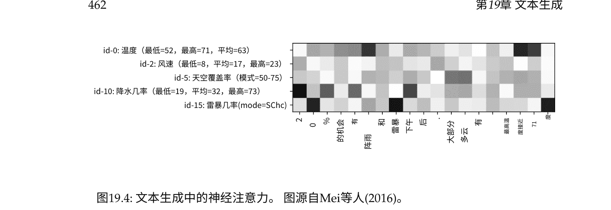

##### 注意力

给定数据的嵌入集合 \(\{z_r\}_{r=1}^{R}\) 和解码器状态 \(h_m\)，可以使用与机器翻译相同的技术计算数据的注意力向量（参见 §18.3.1）。在生成输出的单词时，注意力是通过对记录进行计算得到的，

$$
\begin{aligned}
\psi_{\alpha}(m, r) &= \beta_{\alpha} \cdot f(\Theta_{\alpha}[h_m; z_r]) \quad [19.5] \\
\alpha_m &= g([\psi_{\alpha}(m, 1), \psi_{\alpha}(m, 2), \ldots, \psi_{\alpha}(m, R)]) \quad [19.6] \\
c_m &= \sum_{r=1}^{R} \alpha_{m \rightarrow r} z_r \quad [19.7]
\end{aligned}
$$

其中 \(f\) 是逐元素的非线性函数，如 \(\tanh\) 或 \(\text{ReLU}\)，而 \(g\) 可以是 \(\text{softmax}\) 或逐元素 \(\text{sigmoid}\)。加权和 \(c_m\) 然后可以包含在对解码器状态的循环更新中，或者包含在发射概率中，如 §18.3.1。图19.4显示了在生成文本时对天气记录的注意力，而该文本显示在 x 轴上。

将这种架构应用于图像字幕很简单。卷积神经网络应用于一组图像位置，并且每个位置的输出 \(l\) 用向量 \(z_l\) 表示。然后可以计算对图像位置的注意力，如图19.3中每对图像的右侧面板所示。

对这种基本机制进行了各种修改的提议。在粗到细的注意力（Mei等，2016）中，每个记录都会接收到一个全局注意力 \(a_r \in [0, 1]\)，该注意力与解码器状态无关。这种全局注意力代表了记录的整体重要性，在计算最终的归一化注意力之前，它与基于解码器的注意力分数相乘。在结构化注意力中，注意力向量\(\alpha_{m \rightarrow .}\)可以包含结构偏差，这可以使更高的注意力值分配给连续的片段或依赖子树（Kim等，2017）。可以通过运行前向-后向算法来计算结构化注意力向量，以获得边际注意力概率（见 §7.5.3）。因为前向-后向算法中的每个步骤都是可微分的，所以可以将其编码在计算图中，并通过反向传播进行端到端学习。

##### 解码器

给定编码，解码器可以像神经机器翻译中一样工作（见 §18.3.1），在解码器的循环和/或输出计算中使用注意力加权的编码器表示。与机器翻译一样，波束搜索可以帮助避免搜索错误（Lebret等，2016年）。

许多应用程序需要生成训练词汇表中不存在的单词。例如，天气记录中可能包含以前未见过的城市名称；体育记录中可能包含以前未见过的球员名称。这些标记可以通过从输入中复制它们来在文本中生成（例如，Gulcehre等，2016年）。³首先引入一个附加变量 \(s_m \in \{\text{gen}, \text{copy}\}\)，表示是否应该生成标记 \(w_m^{(t)}\) 还是复制。然后，解码器的概率为，

$$
p(w^{(t)} \mid w_{1:m-1}^{(t)}, \mathbf{Z}, s_m) = 
\begin{cases} 
\text{SoftMax}(\beta_{w^{(t)}} \cdot \mathbf{h}_{m-1}^{(t)}), & s_m = \text{gen} \\ 
\sum_{r=1}^{R} \delta \left(w_r^{(s)} = w^{(t)}\right) \times \alpha_{m \rightarrow r}, & s_m = \text{copy},
\end{cases} \tag{19.8}
$$

其中 \(\delta(w_r^{(s)} = w^{(t)})\)是一个指示函数，当记录的文本\(w_r^{(s)}\)与目标词 \(w^{(t)}\)相同时，取值为 1。从源文本中复制记录 \(r\)的概率是 \(\delta(s_m = \text{copy}) \times \alpha_{m \rightarrow r}\)，即复制概率与局部注意力的乘积。请注意，在这个模型中，注意力权重 \(\alpha_m\)是从上一个解码器状态\(\mathbf{h}_{m-1}\)计算得到的。因此，计算图仍然是一个前馈网络，其中包含了循环路径，例如 \(\mathbf{h}_{m-1}^{(t)} \rightarrow \alpha_m \rightarrow w_m^{(t)} \rightarrow \mathbf{h}_{m}^{(t)}\)。

为了方便端到端的训练，可以用一个门控\(\pi_m\)来表示切换变量\(s_m\)，该门控\(\pi_m\)是由一个两层前馈网络计算得到的，其输入由解码器状态\(\mathbf{h}_{m-1}^{(t)}\)和注意力加权表示的连接组成。

> ³这种策略的多种变体已经被提出（例如，Gu等人，2016年；Merity等人，2017年）。请参阅Wiseman等人（2017年）的概述。

数据的加权和为 \(c_m = \sum_{r=1}^{R} \alpha_{m \to r} z_r\)
$$
\pi_m = \sigma(\Theta^{(2)} f(\Theta^{(1)} [\mathbf{h}_{m-1}^{(t)}; c_m])) \quad [19.9]
$$

在标记\(m\)处的完整生成概率为，
$$
\mathbf{p}(w^{(t)} \mid \mathbf{w}_{1:m}^{(t)}, \mathbf{Z}) = \pi_m \times \frac{\exp \beta_{w^{(t)}} \cdot \mathbf{h}_{m-1}^{(t)}}{\sum_{j=1}^{V} \exp \beta_j \cdot \mathbf{h}_{m-1}^{(t)}} + (1 - \pi_m) \times \sum_{r=1}^{R} \delta(w_r^{(s)} = w^{(t)}) \times \alpha_{m \to r}.
$$
$$
\underbrace{\hspace{4.2cm}}_{\text{生成}} \underbrace{\hspace{3.8cm}}_{\text{复制}} \quad [19.10]
$$

### 19.2 文本到文本生成

文本到文本生成包括摘要和简化问题:

- 阅读一本小说并输出一个段落长的情节摘要；$^4$
- 阅读一系列关于政治的博客文章，并输出各种问题和观点的项目列表；
- 阅读一篇关于长期饮用康普茶的健康后果的技术研究文章，并以非专业人士能理解的语言输出文章摘要。

这些问题可以通过两种方式来解决: 通过前一节讨论的编码器-解码器架构，或直接在输入文本上操作。

#### 19.2.1 神经抽象摘要

句子摘要是缩短句子而保持其意义的任务，如下面的例子所示（Knight和Marcu，2000; Rush等，2015）:

(19.2) a. 文档是爱普生质量的典型代表：优秀。文档很棒。
b. 俄罗斯国防部长伊万诺夫周日呼吁建立一个共同的前线来打击全球恐怖主义。俄罗斯呼吁建立联合阵线对抗恐怖主义。

$^4$在 §16.3.4中，我们遇到了单文档摘要的特殊情况，其中涉及提取最重要的句子或话语单元。 现在我们考虑更具挑战性的问题抽象摘要，摘要可以包含原始文本中没有出现的词语。

句子摘要与句子压缩密切相关，句子压缩通过删除原始文本中的单词或短语来生成摘要（Clarke和Lapata，2008）。但如（19.2b）所示，句子摘要也可以引入新词，例如 against ，它替换了短语for combatting。

句子摘要可以被视为一个机器翻译问题，使用在 §18.3.1中讨论的注意力编码器-解码器翻译模型（Rush等，2015）。较长的句子被编码成一个向量序列，每个标记对应一个向量。解码器在更新自己的循环状态时，通过对这些向量进行注意力计算。与数据到文本生成类似，将编码器-解码器模型与直接从源语言复制单词的能力相结合可能是有用的。Rush等人（2015）通过从新闻文章中构建了四百万个句子对来训练这个模型。在每个句子对中，较长的句子是文章的第一句，摘要是文章的标题。句子摘要也可以以半监督的方式进行训练，使用一种概率形式的编码器-解码器模型，称为变分自动编码器（Miao和Blunsom，2016，也参见 §14.8.2）。

在总结较长的文档时，另一个问题是摘要不要重复：摘要的每个部分都应该涵盖新的内容。这可以通过维护一个迄今为止所有注意力值的总和向量来解决， $t_m = \sum_{n=1}^{m-1} \alpha_n$。 这个总和可以作为计算注意力权重的额外输入使用，

$$
\alpha_{m \to n} \propto \exp( v_\alpha \cdot \tanh( \Theta_\alpha [h_m^{(t)}; h_n^{(s)}; t_m] ) ) \quad [19.11]
$$

这使得模型能够学习偏好尚未被关注的源部分（Tu等，2016）。为了进一步鼓励生成摘要的多样性，See等人（2017）引入了一个覆盖损失到目标函数中，

$$
\ell_m = \sum_{n=1}^{M^{(s)}} \min(\alpha_{m \to n}, t_{m \to n}) \quad [19.12]
$$

如果$\alpha_m$对已经具有较大值的单词不太关注，那么这种损失将很低。$t_m$的覆盖损失类似于边际相关性的概念，其中添加新内容的奖励与其增加总体信息量的程度成比例（Carbonell和Goldstein，1998年）。

#### 19.2.2 多文档摘要的句子融合

在多文档摘要中，目标是生成涵盖多个文档内容的摘要（McKeown等，2002年）。解决这个具有挑战性的问题的一种方法是识别跨多个文档相关的句子，然后将它们融合成一个句子（Barzilay和McKeown，2005年）。作为一个例子，考虑以下两个句子（McKeown等，2010年）：

(19.3) a. Palin实际上只是在桥梁项目成为国家浪费开支的象征之后才反对该项目。
b. 帕林女士在竞选州长期间支持这个桥梁项目，但在它成为全国性丑闻后放弃了它。

一个交集只保留两个句子中都存在的内容：

(19.4) 帕林在这个桥梁项目成为全国性丑闻后反对它。

一个并集包含两个句子的信息：

(19.5) 帕林女士在竞选州长期间支持这个桥梁项目，但在它成为全国性丑闻和浪费开支的象征后反对它。

依赖解析经常被用作句子融合的技术。 在解析每个句子之后，生成的依赖树可以聚合成一个格子（Barzilay和McKeown，2005）或者一个图结构（Filippova和Strube，2008），其中相同或者密切相关的词（例如，帕林、桥梁、全国性）被融合成一个节点。 然后，通过解决一个整数线性规划问题（见 § 13.2.2），可以将生成的图修剪成一棵树。

$$
\max_{\mathbf{y}} \sum_{i, j, r} \psi(i \xrightarrow{r} j, \mathbf{w}; \theta) \times y_{i, j, r} \tag{19.13}
$$

s.t. \(\mathbf{y} \in \mathcal{C}\)，    [19.14]
其中变量 \(y_{i, j, r} \in \{0, 1\}\) 表示从 \(i\) 到 \(j\) 的类型为 \(r\) 的边是否存在，该边的得分为 \(\psi(i \xrightarrow{r} j, \mathbf{w}; \theta)\)，\(\mathcal{C}\) 是一组约束条件，确保 \(\mathbf{y}\) 形成一个有效的依赖图。 通常，\(\mathbf{w}\) 是图中的单词列表，\(\theta\) 是一个参数向量。 得分 \(\psi(i \xrightarrow{r} j, \mathbf{w}; \theta)\) 反映了修饰语 \(j\) 对整体含义的“重要性”：在交叉融合中，该得分表示该边的内容在所有句子中的表达程度；在并集融合中，该得分表示该边的内容是否在任何句子中表达。 约束集 \(\mathcal{C}\) 可以施加额外的语言约束：例如，确保协调名词足够相似。 然后，生成的树必须线性化为一个句子。 线性化类似于依赖解析的逆过程：我们需要将树转换回一个标记序列。 通常，这是通过生成一组候选线性化，并选择在语言模型下得分最高的线性化来完成的（Langkilde和Knight，1998；Song等，2016）。

### 19.3 对话

对话系统能够与人类对话，通常是为了执行某项任务（Grosz, 1979），但有时也只是聊天（Weizenbaum, 1966）。 虽然有时候会出现换行符-

(19.6) A: 我想订一份披萨。
B: 什么配料？
A: 凤尾鱼。
B: 好的，地址是什么？
A: 计算机学院大楼。
B: 请确认：一份带洋蓟的披萨，送到计算机学院大楼。
A: 不。
B: 什么配料？
...

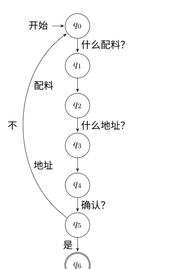

对话系统的研究可以追溯到几十年前（Carbonell, 1970年；Winograd, 1972年），商业系统如Alexa和Siri最近将这项技术广泛应用。然而，研究与实践之间存在着显著差距：许多实际对话系统仍然是脚本化和不灵活的，而研究系统则强调抽象的文本生成、"即时"决策和对用户意图的概率推理。

#### 19.3.1 有限状态和议程驱动的对话系统

有限状态自动机在第9章中作为一种形式化的计算模型被引入，其中字符串输入和输出与有限数量的离散状态之间的转换相关联。这个模型自然地适用于简单的任务导向对话，如图19.5左侧面板所示。这个（有点令人沮丧的）对话可以用有限状态转换器表示，如图中的右侧面板所示。只有在提供了两个所需的信息并且人类用户确认订单正确时，才会达到接受状态。在这个简单的场景中，TOPPING和ADDRESS是与订购披萨活动相关联的两个slots，这被称为一个frame。框架表示可以是分层的：例如，ADDRESS可以有自己的slots，如STREET和CITY。

在图19.5的示例对话中，用户在每个回合中提供了所需的精确输入（例如，anchovies；计算机学院大楼）。一些用户可能更喜欢用诸如我想要一些*anchovies*之类的短语进行更自然的交流。处理这种话语的一种方法是设计一个自定义语法，其中包含诸如 TOPPING和 LOCATION之类的非终结符。然而，对于不受限制的语音输入进行无上下文的解析是具有挑战性的。一种更轻量级的替代方法是BIO风格的序列标注（参见 §8.3），例如：

(19.7) 我想要 anchovies ， 和 请 带 它 到 这 计算机 的 学院 大楼 。
I- O B-TOPPING O O O O O O B-ADDR I-ADDR I-ADDR I-ADDR I-ADDR O

标注器可以由一个双向循环神经网络驱动，类似于 § 13.2.3中描述的语义角色标注的循环方法。

图19.5中的有限状态系统无法处理（19.7）中的输入，这迫使用户先提供配料，然后再提供位置。从这个意义上说，“主动性”完全由系统驱动。基于议程的对话系统通过尝试识别用户回复中填充的所有插槽来处理这些更复杂的示例。基于议程的系统动态地提出额外的问题，直到框架完整为止（Bobrow等，1977年；Allen等，1995年；Rudnicky和Xu，1999年）。这样的系统被称为混合主动性，因为用户和系统都可以驱动对话的方向。

#### 19.3.2 马尔可夫决策过程

在对话中动态选择下一步行动的任务被称为对话管理。这个问题可以被构建成一个马尔可夫决策过程，它是一个包括离散状态集、离散动作集、计算状态转移概率的函数以及计算动作-状态对的成本或奖励的函数的理论模型。让我们看看每个元素如何与披萨订购对话系统相关。

- • 每个状态都是关于配料和地址是否已知以及订单是否已确认的信息元组。例如，

(KNOWN\_TOPPING , UNKNOWN\_ADDRESS , NOT\_CONFIRMED ) [19.15]

是一个可能的状态。任何订单已确认的状态都是终止状态，马尔可夫决策过程在进入这样的状态后停止。

- • 行动集包括查询配料，查询地址和请求确认。每个行动都会引发一个状态的概率分布， \(p(s_t | a_t, s_{t-1})\)。例如，如果配料还不知道，请求确认订单不太可能。导致转移到终止状态。这个状态转移的概率分布可以从数据中学习，也可以预先指定。

每个状态-动作-状态元组都会获得奖励， $r_a(s_t, s_{t+1})$。在披萨订购系统的背景下，一个简单的奖励函数可以是，

```
$$r_a(s_t, s_{t+1}) = \begin{cases}
0, & a = \text{CONFIRM}, s_t = (*, *, \text{CONFIRMED}) \\
-10, & a = \text{CONFIRM}, s_t = (*, *, \text{NOT CONFIRMED}) \\
-1, & a = \text{CONFIRM}
\end{cases} \qquad [19.16]$$
```

该函数对成功转换到终止状态的情况赋予零奖励，对于被拒绝的确认请求赋予较大的负奖励，并对其他类型的动作赋予较小的负奖励。因此，系统在尽可能少的步骤中达到终止状态时会获得奖励，并在过早请求确认时受到惩罚。

在马尔可夫决策过程中，策略是一个从状态到动作的映射函数 $\pi: \mathcal{S} \to \mathcal{A}$（参见 §15.2.4）。策略的价值是折扣奖励的期望和。$E[\sum_{t=1}^T \gamma^{t-1} r_a(s_t, s_{t+1})]$，其中 $\gamma$ 是折扣因子，$\gamma \in [0, 1)$。折扣的效果是强调可以立即获得的奖励，而不确定的奖励在遥远的未来则较少重要。

通过动态规划可以获得最优策略，通过迭代更新值函数 $V(s)$，该函数是从状态 $S$ 下的累积奖励的期望。

```
$$V(s) \leftarrow \max_{a \in \mathcal{A}} \sum_{s' \in \mathcal{S}} \mathrm{p}(s' | s, a)[r_a(s, s') + \gamma V(s')]. \qquad [19.17]$$
```

值函数 $V(s)$ 是通过 $V(s')$ 计算得出的，其中 $s' \in \mathcal{S}$。一系列迭代更新值函数的操作最终会收敛到一个稳定点。

这个算法被称为值迭代。给定收敛的值函数 $V(s)$，每个状态的最优动作是 $\mathrm{argmax}$，

```
$$\pi(s) = \mathrm{argmax}_{a \in \mathcal{A}} \sum_{s' \in \mathcal{S}} \mathrm{p}(s' | s, a)[r_a(s, s') + \gamma V(s')]. \qquad [19.18]$$
```

值迭代和相关算法的详细描述可参考 Sutton 和 Barto（1998）。关于对话系统的应用，请参考 Levin 等人（1998）和 Walker（2000）。

马尔可夫决策过程框架假设对话的当前状态是已知的。实际上，系统可能会误解用户的陈述，例如，将交付位置（PEACHTREE）误认为是一个规范的配料（桃子）。在一个部分可观察的马尔可夫决策过程（POMDP）中，系统接收到一个观察值 o，该观察值在状态条件下具有概率性，$p(o \mid s)$。因此，它必须维护关于自己所处状态的信念分布，其中$q_t(s)$ 表示对话处于状态 s 的信念程度，在时间 t。POMDP 的形式化可以帮助对话系统更加鲁棒，特别是在口语对话的背景下，其中语音本身可能被错误识别（Roy 等人，2000；Williams和Young，2007）。然而，在POMDP中找到最优策略是计算上难以处理的，需要额外的近似。

#### 19.3.3 神经聊天机器人

当你不需要完成任何任务时，交谈会更容易。聊天机器人是一种能够与用户进行对话并保持对话进行的系统。它们可以使用在 §18.3 和 §19.1.2 中讨论的编码器-解码器架构构建：编码器将用户的输入转换为向量，解码器生成一系列单词作为回应。例如，Shang等人（2015）应用了注意力编码器-解码器翻译模型，该模型在新浪微博的帖子和回复数据集上进行训练。^5这种方法能够生成与输入相关主题的回复，如下面的例子所示（由Shang等人，2015翻译自中文）。

> > (19.8) a. A: 每年元旦我都会发高烧。
>
> B: 祝你早日康复，保持健康！
>
> b. A: 我又长了一岁。非常感激我的团队，感到非常开心。
>
> B: 现在变老了。时间没有怜悯之心。

尽管编码器-解码器模型可以生成在紧接着的对话中有意义的回答，但是它们在更长的对话中很难保持连贯性。一种解决方案是递归地对话上下文进行建模。这样创建了一个分层的递归网络，包括词级和转换级的递归。

然后，转换级的隐藏状态被用作解码器中的额外上下文（Serban等人，2016）。

一个未解决的问题是如何将编码器-解码器架构整合到面向任务的对话系统中。神经聊天机器人可以进行端到端的训练：用户的发言由编码器分析，系统的输出由解码器生成。这种架构可以通过反向传播使用对数似然进行训练（例如，Sordoni等人，2015；Serban等人，2016），或者通过更复杂的目标使用强化学习进行训练（Li等人，2016）。相比之下，第19.3.1节中描述的面向任务的对话系统通常涉及

^5 Twitter也经常用于构建对话数据集（Ritter等，2011；Sordoni等，2015）。另一个来源是来自Ubuntu Linux发行版的技术支持聊天记录（Uthus和Aha，2013；Lowe等，2015）。

## 19.3. 对话

一组专门的模块：一个用于识别用户输入，另一个用于决定采取什么行动，第三个用于安排系统输出的文本。

循环神经网络解码器可以集成到马尔可夫决策过程对话系统中，通过将解码器条件化为每个轮次要表达的信息的表示（Wen等，2015）。具体来说，长短期记忆（LSTM；§6.3）架构被增强，以便在第$m$轮的记忆单元中接受额外的输入$d_m$，该输入是下一轮要表达的槽位和值的表示。然而，这种方法仍然依赖于额外的模块来识别用户的话语并规划对话的整体弧线。

另一个有前途的方向是为领域中的元素创建嵌入：例如，记录中的插槽和可以填充它们的实体。编码器不仅编码用户输入的单词，还编码用户提及的元素的嵌入。类似地，解码器具有引用知识库中特定元素的能力。He等人（2017）展示了这种方法可以学习玩一个协作对话游戏，在这个游戏中，两个玩家都被给予一个实体列表和它们的属性，并且目标是找到两个玩家列表中都存在的实体。

### 附加资源

Gatt和Krahmer（2018）对文本生成进行了全面的最新调查。有关早期工作的长篇治疗，请参阅Reiter和Dale（2000）。有关图像字幕的调查，请参阅Bernardi等人（2016）；有关对话的神经前方法的调查，请参阅Rieser和Lemon（2011）。对话行为在第8.6节中作为人机对话的标签方案引入；它们在基于任务的对话系统中也起着关键作用（例如，Allen等人，1996）。将对话的理论模型纳入计算系统的综述由Jurafsky和Martin（2009，第24章）进行了回顾。

虽然本章节主要关注文本生成的信息维度，但另一方面的研究旨在生成具有可配置风格特性的文本（Walker等人，1997；Mairesse和Walker，2011；Ficler和Goldberg，2017；Hu等人，2017）。本章还未涉及创造性文本的生成，例如叙述（Riedl和Young，2010）、笑话（Ritchie，2001）、诗歌（Colton等人，2012）和歌词（Goncalo Oliveira等人，2007）。

### 练习

1.  找一篇关于职业篮球比赛的文章，附带有统计数据的“比分表”。在文章中表达的比分表中的前三个元素是什么？你能找出表达这些记录元素的基于模板的模式吗？现在找一篇关于另一场篮球比赛的文章。它是否提到相同的前三个盒子得分元素？你的模板是否捕捉到了这些元素在文本中的表达方式？

2.  这个练习需要一对学生完成。一名学生应该选择一篇新闻或维基百科的文章，并在三个短句或从句上手动执行语义角色标注（SRL）。（请参阅第13章对SRL的回顾。）识别主要的语义关系及其论元和修饰语。将这个结构化记录（但不包括原始句子）传递给另一名学生，他的任务是生成表达语义的句子。然后交换角色，并基于谓词-论元语义从另一篇文章中尝试重新生成三个句子。

3.  计算前一个问题中生成的句子的BLEU分数（参见§18.1.1），使用原始文章文本作为参考。

4.  将图19.1中的每个标记与数据库中的特定单个记录或空记录∅对齐。例如，标记南风将对齐到记录风向：06:00-21:00：mode=S。每个标记与前一个标记对齐到相同的记录的频率是多少？有多少个转换？一个系统如何学习将10度输出为记录min=9？

5.  在句子压缩和融合中，我们可能希望保留连续的令牌序列（n-grams）和/或依赖边。找到五篇标题为新闻文章。对于每个标题，计算出现在文章主文本中的二元组的比例。然后对标题进行手动依赖解析。对于每个依赖边，计算它作为依赖边出现的次数在主文本中。您可以使用自动依赖解析器来辅助完成此练习，但请检查输出，并专注于第11章中描述的UD 2.0依赖语法。

6.  §19.2.2介绍了从依赖树生成文本的思想，这需要线性化。有时，依赖树可以有多种线性化方式。例如：
> (19.9) a. 生病的孩子们呆在家里的床上。
b. 生病的孩子们在家里的床上呆着。
这两个句子具有相同的依存分析：home和bed都是stayed的（斜体）依存成分。
找出另外两个英语依存树，每个树都可以以不止一种方式进行线性化，并尝试在每个树中使用不同的变化模式。像往常一样，使用通用依存关系2风格来指定你的树，该风格在第11章中有描述。

Jacob Eisenstein。2018年11月13日草稿。

7.  在 §19.3.2 中，我们考虑了一个披萨外卖服务。让我们简化问题，只需确定配料并确认订单。
状态是一个元组，其中第一个元素是 $T$ 如果指定了配料，否则是 $?$。第二个元素是 $\mathrm{YES}$ 或 $\mathrm{NO}$，取决于订单是否已确认。动作是 $\mathrm{TOPPING ?}$（请求有关配料的信息）和 $\mathrm{CONFIRM ?}$（请求确认）。状态转换函数为：

```
p(s_t \mid s_{t-1} = (?, \mathrm{NO}), a = \mathrm{TOPPING ?}) = \begin{cases} 0.9, & s_t = (T, \mathrm{NO}) \\ 0.1, & s_t = (?, \mathrm{NO}). \end{cases} \quad [19.19]
```

```
p(s_t \mid s_{t-1} = (?, \mathrm{NO}), a = \mathrm{CONFIRM ?}) = \begin{cases} 1, & s_t = (?, \mathrm{NO}). \end{cases} \quad [19.20]
```

```
p(s_t \mid s_{t-1} = (T, \mathrm{NO}), a = \mathrm{TOPPING ?}) = \begin{cases} 1, & s_t = (T, \mathrm{NO}). \end{cases} \quad [19.21]
```

```
p(s_t \mid s_{t-1} = (T, \mathrm{NO}), a = \mathrm{CONFIRM ?}) = \begin{cases} 0.9, & s_t = (T, \mathrm{YES}) \\ 0.1, & s_t = (T, \mathrm{NO}). \end{cases} \quad [19.22]
```

使用方程式19.16中定义的奖励函数，折扣率 $\gamma = 0.9$，并且初始化 $V(s) = 0$，执行方程式19.17的三次迭代。在这三次迭代之后，计算每个状态的最优动作。你可以假设对于终止状态，$V(*, \mathrm{YES}) = 0$，因此你只需要计算非终止状态的值，$V(?, \mathrm{NO})$ 和 $V(T, \mathrm{NO})$。

8.  有几个工具包可以让你直接训练编码器-解码器翻译模型，例如 FAIRSEQ (Gehring et al., 2017)，XNMT (Neubig et al., 2018)，TENSOR2TENSOR (Vaswani et al., 2018) 和 OPENNMT (Klein et al., 2017)。$^{6}$使用其中一个工具包来训练一个聊天机器人对话系统，可以使用带有 NLTK (Forsyth and Martell, 2007) 的 NPS 对话语料库，或者如果你更有雄心壮志，可以使用 Ubuntu 对话语料库 (Lowe et al., 2015)。

## 附录A

## 概率

概率论提供了一种推理随机事件的方法。通常用来解释概率论的随机事件包括抛硬币、抽卡片和天气。如果你是一个谨慎选择词语的人，可能会觉得将选择一个词语视为抛硬币的行为很奇怪。但无论是随机的还是非随机的，语言都被证明是极其难以确定性地建模的。概率为建模和操作语言数据提供了强大的工具。

概率可以从随机结果的角度来思考：例如，一次抛硬币有两种可能的结果，正面或反面。可能的结果集合是样本空间，样本空间的子集是一个事件。对于两次抛硬币的序列，有四种可能的结果，{\(HH, HT, TH, TT\)}，表示有序序列正面-正面、正面-反面、反面-正面和反面-反面。得到恰好一个正面的事件包括两种结果：{\(HT, TH\)}。

从形式上讲，概率是一个从事件到区间[0,1]的函数：Pr: \(\mathcal{F} \rightarrow [0, 1]\)，其中 \(\mathcal{F}\) 是可能事件的集合。一个确定的事件的概率为一；一个不可能的事件的概率为零。例如，两次抛硬币得到少于三个正面的概率为一。每个结果也是一个事件（一个只有一个元素的集合），对于两次抛硬币，每个结果的概率都是相同的。

\(\mathrm{Pr}(\{HH\}) = \mathrm{Pr}(\{HT\}) = \mathrm{Pr}(\{TH\}) = \mathrm{Pr}(\{TT\}) = \frac{1}{4}.\) \hspace{1cm} [A.1]

### A.1 事件组合的概率

因为事件是结果的集合，我们可以使用集合论的操作，如补集、交集和并集来推理事件及其组合的概率。

对于任何事件 $A$，存在一个补集 $
eg A$，使得：

- 并集 $A \cup 
eg A$ 的概率为 $\Pr(A \cup \neg A) = 1$;
- 交集 $A \cap \neg A = \varnothing$ 是空集，并且 $\Pr(A \cap \neg A) = 0$。

在抛硬币的例子中，两次抛硬币得到一个正面的事件对应于结果集 $\{HT, TH\}$；补集事件包括另外两个结果，$\{TT, HH\}$。

#### A.1.1 互斥事件的概率

当两个事件的交集为空集时，$A \cap B = \varnothing$，它们是不相交的。两个不相交事件的并集的概率等于它们的概率之和，

$A \cap B = \varnothing \Rightarrow \Pr(A \cup B) = \Pr(A) + \Pr(B)$。 [A.2]
这是概率的第三公理，它可以推广到任何可数的不相交事件序列。

在抛硬币的例子中，这个公理可以推导出在两次抛掷中得到一个正面的事件的概率。这个事件是结果集 $\{HT, TH\}$ 的并集，它是两个更简单事件的并集，$\{HT, TH\} = \{HT\} \cup \{TH\}$。事件 $\{HT\}$ 和 $\{TH\}$ 是不相交的。因此，

```
$$\Pr(\{HT, TH\}) = \Pr(\{HT\} \cup \{TH\}) = \Pr(\{HT\}) + \Pr(\{TH\}) \quad [A.3]$$
```

```
$$= \frac{1}{4} + \frac{1}{4} = \frac{1}{2}. \quad [A.4]$$
```

一般来说，两个事件的并集的概率是，

$$\Pr(A \cup B) = \Pr(A) + \Pr(B) - \Pr(A \cap B). \quad [A.5]$$
这可以从图A.1中直观地看出，并且可以从概率的第三公理推导出来。考虑一个包含 $B$ 中不在 $A$ 中的所有结果的事件，表示为 $B - (A \cap B)$。根据构造，这个事件与 $A$ 不相交。因此，我们可以应用加法规则，

```
$$\Pr(A \cup B) = \Pr(A) + \Pr(B - (A \cap B)). \quad [A.6]$$
```

此外，事件 $B$ 是两个不相交事件的并集：$A \cap B$ 和 $B - (A \cap B)$。

```
$$\Pr(B) = \Pr(B - (A \cap B)) + \Pr(A \cap B). \quad [A.7]$$
```

重新组织并替换方程A.6，得到所需的结果：

```
$$\Pr(B - (A \cap B)) = \Pr(B) - \Pr(A \cap B) \quad [A.8]$$
```

```
$$\Pr(A \cup B) = \Pr(A) + \Pr(B) - \Pr(A \cap B). \quad [A.9]$$
```

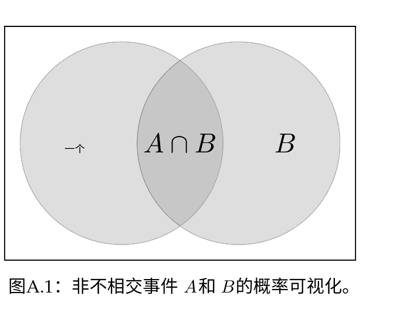

#### A.1.2 总概率法则

一组事件 $\mathcal{B} = \{B_1, B_2, \ldots, B_N\}$ 是样本空间的一个分割，当且仅当每对事件是不相交的 $(B_i \cap B_j = \varnothing)$，并且事件的并集是整个样本空间。

全概率法则表明，我们可以对这些事件进行边际化处理，如下所示，

```
$\Pr(A) = \sum_{B_n \in \mathcal{B}} \Pr(A \cap B_n). \quad [A.10]$
```

对于任何事件 $B$，集合 $B \cup \neg B$ 是样本空间的一个划分。因此，全概率法则的一个特殊情况是，

```
$\Pr(A) = \Pr(A \cap B) + \Pr(A \cap \neg B). \quad [A.11]$
```

### A.2 条件概率和贝叶斯规则

条件概率是一个类似于 $\Pr(A \mid B)$ 的表达式，它是事件 A 发生的概率，假设事件 B 也发生。例如，我们可能对随机选择的人以你好的方式接电话的概率感兴趣，条件是该人是英语的说话者。条件概率定义为比值，

```
$\Pr(A \mid B) = \frac{\Pr(A \cap B)}{\Pr(B)}. \quad [A.12]$
```

概率的链式法则表明 $\Pr(A \cap B) = \Pr(A \mid B) \times \Pr(B)$，这只是从方程式A.12的项重新排列得到的。链式法则可以重复应用：

$$
\Pr(A \cap B \cap C) = \Pr(A | B \cap C) \times \Pr(B \cap C)
= \Pr(A | B \cap C) \times \Pr(B | C) \times \Pr(C).
$$

贝叶斯定理（有时也称为贝叶斯法则或贝叶斯定理）给了我们一个在 $\Pr(A | B)$ 和 $\Pr(B | A)$ 之间转换的方法。它是根据条件概率的定义和链式法则推导出来的：

$$
\Pr(A | B) = \frac{\Pr(A \cap B)}{\Pr(B)} = \frac{\Pr(B | A) \times \Pr(A)}{\Pr(B)} \quad [A.13]
$$

贝叶斯规则中的每个术语都有一个名称，我们偶尔会使用：

- $\Pr(A)$ 是先验概率，因为它是事件 $A$ 在不知道 $B$ 是否发生的情况下的概率。
- $\Pr(B | A)$ 是似然度，即在事件 $A$ 发生的情况下事件 $B$ 发生的概率。
- $\Pr(A | B)$ 是后验概率，即在事件 $B$ 发生的情况下事件 $A$ 发生的概率。

贝叶斯规则的经典例子涉及罕见疾病的测试，但Manning和Schütze（1999）将这个例子重新定义为语言学环境中的例子。假设你对一种罕见的句法结构感兴趣，比如寄生性空洞，它平均每10万个句子出现一次。这是一个寄生性空洞的例子：

> (A.1) 你参加了哪个课程而没有注册？

Lana Linguist开发了一个复杂的模式匹配器，试图识别带有寄生间隙的句子。它相当不错，但并不完美：

- 如果一个句子有一个寄生间隙，模式匹配器将以0.95的概率找到它。（这是召回率，即1减去假阴性率。）
- 如果句子没有寄生间隙，模式匹配器将错误地说它有寄生间隙的概率为0.005。（这是假阳性率，即1减去精确率。）

假设Lana的模式匹配器说一个句子包含寄生间隙。这是真实的概率是多少？

设 $G$ 为句子有寄生间隙的事件，$T$ 为测试结果为阳性的事件。我们对句子有寄生间隙的概率在测试结果为阳性的条件下感兴趣。这是条件概率 $\Pr(G \mid T)$，可以通过贝叶斯定理计算：

$$
\Pr(G \mid T) = \frac{\Pr(T \mid G) \times \Pr(G)}{\Pr(T)}
$$

我们已经知道分子中的两个项：$\Pr(T \mid G)$ 是召回率，即0.95；$\Pr(G)$ 是先验概率，即$10^{-5}$。

我们没有给出分母，但可以使用本节中开发的工具来计算。首先应用全概率公式，使用划分 $\{G, \neg G\}$：

$$
\Pr(T) = \Pr(T \cap G) + \Pr(T \cap \neg G)
$$

这意味着测试结果为阳性的概率是真阳性的概率 $(T \cap G)$ 和假阳性的概率 $(T\cap \neg G)$ 的总和。可以使用链式法则计算每个事件的概率：

$$
\begin{align*}
\Pr(T \cap G) &= \Pr(T \mid G) \times \Pr(G) = 0.95 \times 10^{-5} \\
\Pr(T \cap \neg G) &= \Pr(T \mid \neg G) \times \Pr(\neg G) = 0.005 \times (1 - 10^{-5}) \approx 0.005 \\
\Pr(T) &= \Pr(T \cap G) + \Pr(T \cap \neg G) \\
&=0.95 \times 10^{-5} + 0.005.
\end{align*}
$$

将这些术语代入贝叶斯规则可以得到所需的后验概率，

$$
\begin{align*}
\Pr(G \mid T) &= \frac{\Pr(T \mid G) \Pr(G)}{\Pr(T)} \\
&= \frac{0.95 \times 10^{-5}}{0.95 \times 10^{-5} + 0.005 \times (1 - 10^{-5})} \\
&\approx 0.002.
\end{align*}
$$

Lana的模式匹配器似乎准确，误报率和漏报率低于5%。然而，这种现象的极度罕见意味着探测器的阳性结果很可能是错误的。

### A.3 独立性

如果两个事件的交集的概率等于它们的概率的乘积，则这两个事件是独立的: $\Pr(A \cap B) = \Pr(A) \times \Pr(B)$。例如，对于两次公平抛硬币的情况来说，第一次抛硬币得到正面的概率与第二次抛硬币得到正面的概率是独立的：

$Pr(\{HT, HH\}) = Pr(HT) + Pr(HH) = \frac{1}{4} + \frac{1}{4} = \frac{1}{2}$ [A.23]
$Pr(\{HH, T H\}) = Pr(HH) + Pr(T H) = \frac{1}{4} + \frac{1}{4} = \frac{1}{2}$ [A.24]
$Pr(\{HT, HH\}) \times Pr(\{HH, T H\}) = \frac{1}{2} \times \frac{1}{2} = \frac{1}{4}$ [A.25]
$Pr(\{HT, HH\} \cap \{HH, T H\}) = Pr(HH) = \frac{1}{4}$ [A.26]
$= Pr(\{HT, HH\}) \times Pr(\{HH, T H\})$. [A.27]

如果 $Pr(A \cap B \mid C) = Pr(A \mid C) \times Pr(B \mid C)$，那么事件 $A$ 和 $B$ 在条件下是独立的，表示为 $A \perp B \mid C$。条件独立在概率模型中扮演着重要的角色，如朴素贝叶斯第2章所述。

### A.4 随机变量

随机变量是从事件到 $\mathbb{R}$ 中的函数，其中 $\mathbb{R}$ 是实数集。这包括了几个有用的特殊情况：

- 一个指示随机变量是一个从事件到集合 $\{0,1\}$ 的函数。在抛硬币的例子中，我们可以将 $Y$ 定义为一个指示随机变量，当硬币至少翻转一次为正面时，取值为1。这将包括以下结果 $\{HH, HT, TH\}$。概率 $Pr(Y=1)$ 是这些结果的概率之和，$Pr(Y=1) = \frac{1}{4} + \frac{1}{4} + \frac{1}{4} = \frac{3}{4}$。

- 一个离散随机变量是一个从事件到 $\mathbb{R}$ 的离散子集的函数。考虑抛硬币的例子：两次翻转中出现正面的次数，$X$，可以看作是一个离散随机变量，$X \in \{0,1,2\}$。事件概率 $Pr(X=1)$ 可以再次计算为具有一个正面的事件的概率之和，$\{HT, TH\}$，得到 $Pr(X=1) = \frac{1}{4} + \frac{1}{4} = \frac{1}{2}$。

随机变量的每个可能值都与样本空间的一个子集相关联。在抛硬币的例子中，$X=0$ 与事件 $\{TT\}$ 相关联，$X=1$ 与事件 $\{HT, TH\}$ 相关联，$X=2$ 与事件 $\{HH\}$ 相关联。

假设硬币是公平的，这些事件的概率分别为 $1/4$，$1/2$ 和 $1/4$。这个数字列表表示 $X$ 的概率分布，记作 $p_X$，它将 $X$ 的可能值映射到非负实数。对于特定的值 $x$，我们写作 $p_X(x)$，它等于事件概率 $Pr(X = x)$。$^{1}$函数 $p_X$ 被称为

$^{1}$一般来说，大写字母（例如，$X$）表示随机变量，小写字母（例如，$x$）表示具体的值。当上下文中清楚表示分布时，我们会简单地写作 $p(x)$。

如果 $X$ 是离散的，则称为概率质量函数（pmf）；如果 $X$ 是连续的，则称为概率密度函数（pdf）。无论哪种情况，函数的总和必须为一，所有值必须为非负数：

\[ \int_x p_X(x)dx =1 \quad \text{[A.28]} \]

\[ \forall x, p_X(x) \geq 0. \quad \text{[A.29]} \]

多个随机变量的概率可以表示为联合概率，例如，$p_{A,B}(a, b) = \Pr(A = a \cap B = b)$。事件概率的几个性质也适用于随机变量的概率分布：

- 边际概率分布是 $p_A(a) = \sum_b p_{A,B}(a, b)$。
- 条件概率分布是 $p_{A|B}(a|b) = \frac{p_{A,B}(a,b)}{p_B(b)}$。
- 随机变量 $A$ 和 $B$ 独立当且仅当 $p_{A,B}(a, b) = p_A(a) \times p_B(b)$。

### A.5 期望

有时我们想要一个函数的期望值，比如 $E[g(x)] = \sum_{x \in \mathcal{X}} g(x) p(x)$。期望值最容易从离散事件的概率分布角度来思考：

- 如果天晴，露西亚会吃三个冰淇淋。
- 如果下雨，她只会吃一个冰淇淋。
- 有80%的机会天晴。
- 她预计会吃的冰淇淋数量是 $0.8 \times 3 + 0.2 \times 1 = 2.6$。

如果随机变量 $X$ 是连续的，期望值是一个积分：

\[ E[g(x)] = \int_{\mathcal{X}} g(x) p(x) dx \quad \text{[A.30]} \]

例如，魁北克的一家快餐店在寒冷的日子里有一个特别优惠：每低一度，他们就给薯条打1%的折扣。假设有一个具有无限精度的温度计，期望价格将是对所有可能温度的积分，

\[ E[\text{price}(x)] = \int_{\mathcal{X}} \min(1, 1 + x) \times \text{原始价格} \times p(x) dx. \quad \text{[A.31]} \]

### A.6 建模和估计

概率模型提供了一种合理的方法来推理随机事件和随机变量。让我们考虑抛硬币的例子。每次抛硬币可以被建模为一个随机事件，事件 $H$ 的概率为 $\theta$，事件 $T$ 的概率为 $1-\theta$。如果我们将随机变量 $X$ 定义为三次抛硬币中正面朝上的总数，则 $X$ 的分布取决于 $\theta$。在这种情况下，$X$ 服从二项分布，意味着它是从二项分布中抽取的，参数为$(\theta, N=3)$。这可以写成，

$$
X \sim \text{二项分布}(\theta, N=3). \quad [A.32]
$$

二项分布的性质使我们能够对 $X$ 进行一些陈述，例如其期望值以及其值落在某个区间内的可能性。现在假设 $\theta$ 是未知的，但我们进行了一个实验，在该实验中我们执行了 $N$ 次试验，并获得了 $x$ 个正面。我们可以通过最大似然估计来估计 $\theta$ 的值：

$$
\hat{\theta} = \arg\max_{\theta} p_X(x; \theta, N). \quad [A.33]
$$

这意味着估计值 $\hat{\theta}$ 应该是最大化数据的似然性的值。分号表示 $\theta$ 和 $N$ 是概率函数的参数。

似然函数 $p_X(x; \theta, N)$ 可以从二项分布中计算得到，

$$
p_X(x; \theta, N) = \frac{N!}{x!(N - x)!} \theta^x (1 - \theta)^{N - x}. \quad [A.34]
$$

这个似然性与个别结果的概率成比例：例如，序列 $T, H, H, T, H$ 的概率为 $\theta^3 (1 - \theta)^2$。这个项 $\frac{N!}{x!(N - x)!}$ 来自于我们可以通过不同的顺序获得 $x$ 头的 $N$ 次试验。这个项不依赖于 $\theta$，因此在估计过程中可以忽略。

在实践中，我们最大化对数似然性，这是似然性的单调函数。在二项分布下，对数似然性是 $\theta$ 的凸函数（见 §2.4), 因此可以通过求导并将其设置为零来最大化它。

$$
\ell(\theta) = x \log \theta + (N - x) \log(1 - \theta) \quad [A.35]
$$
$$
\frac{\partial \ell(\theta)}{\partial \theta} = \frac{x}{\theta} - \frac{N - x}{1 - \theta} \quad [A.36]
$$
$$
\frac{N - x}{1 - \theta} = \frac{x}{\theta} \quad [A.37]
$$
$$
\frac{N - x}{x} = \frac{1 - \theta}{\theta} \quad [A.38]
$$
$$
\frac{N}{x} - 1 = \frac{1}{\theta} - 1 \quad [A.39]
$$
$$
\hat{\theta} = \frac{x}{N}. \quad [A.40]
$$

在这种情况下，最大似然估计等于 $\frac{x}{N}$，即出现正面的次数的比例。这种直观的解决方案也被称为相对频率估计，因为它等于结果的相对频率。

最大似然估计总是正确的选择吗？假设你进行了一次试验，并得到了正面。你会得出结论 $\theta=1$，这意味着硬币保证会出现正面吗？如果不是这样，那么你必须对 $\theta$ 有一些先验期望。为了将这些先验信息纳入考虑，我们可以将 $\theta$ 视为一个随机变量，并使用贝叶斯定理：

$$
p(\theta | x; N) = \frac{p(x | \theta) \times p(\theta)}{p(x)} \quad [A.41]
$$
$$
\propto p(x | \theta) \times p(\theta) \quad [A.42]
$$
$$
\hat{\theta} = \arg\max_{\theta} p(x | \theta) \times p(\theta). \quad [A.43]
$$

这是最大后验概率(MAP)估计。给定 $p(\theta)$ 的形式，您可以使用与推导最大似然估计相同的方法推导出 MAP 估计。

### 附加资源

Manning 和 Schütze (1999) 提供了概率论的良好介绍，这有助于激发本节的动力。有关更多详细信息，Sharon Goldwater 提供了另一个有用的参考资料，`http://homepages.inf.ed.ac.uk/sgwater/teaching/general/probability.pdf`。Diaconis 和 Skyrms (2017) 提供了概率的历史和哲学视角。

## 附录B 数值优化

无约束数值优化涉及解决以下形式的问题，

> $$\min_{\boldsymbol{x} \in \mathbb{R}^D} f(\boldsymbol{x}), \tag{B.1}$$

其中 $\boldsymbol{x} \in \mathbb{R}^D$ 是一个包含 $D$ 个实数的向量。

微分是数值优化的基础。假设在某个 $\boldsymbol{x}^*$ 处，$f$ 的每个偏导数都等于 0：形式上，$\left. \frac{\partial f}{\partial x_i} \right|_{\boldsymbol{x}^*} = 0$。那么 $\boldsymbol{x}^*$ 被称为 $f$ 的一个临界点。如果 $f$ 是一个凸函数（在 §2.4 中定义），那么 $f(\boldsymbol{x}^*)$ 的值等于 $f$ 的全局最小值，当且仅当 $\boldsymbol{x}^*$ 是 $f$ 的一个临界点。

举个例子，考虑凸函数 $f(x) = (x-2)^2 + 3$，如图 B.1a 所示。微分是 $\frac{\partial f}{\partial x}$。通过将导数设置为零并解出 $x$，可以得到唯一的最小值 $x^* = 2$。现在考虑多变量凸函数 $f(\boldsymbol{x}) = \frac{1}{2} \|\boldsymbol{x} - [2,1]^T\|^2$，其中 $\|\boldsymbol{x}\|^2$ 是欧几里德范数的平方。

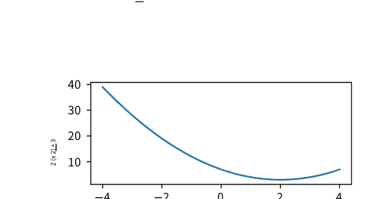

(a) 函数 $f(x) = (x-2)^2 + 3$

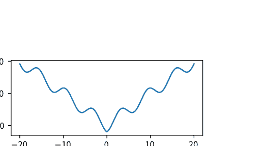

(b) 函数 $f(x) = |x| - 2\cos(x)$

偏导数是，
$$
\frac{\partial f}{\partial x_1} = x_1 - 2 \quad [B.2]
$$
$$
\frac{\partial f}{\partial x_2} = x_2 - 1 \quad [B.3]
$$
唯一的最小值是
$$
\mathbf{x}^{*} = [2, 1]^\top.
$$

对于非凸函数，临界点不一定是全局最小值。局部最小值 $\mathbf{x}^{*}$ 是指函数在该点取得比附近所有点都要小的值：形式上，如果存在某个正数 $\epsilon$，使得 $f(\mathbf{x}^{*}) \leq f(\mathbf{x})$ 对于所有距离 $\epsilon$ 以内的 $\mathbf{x}$ 成立。图B.1b显示了函数 $f(x) = |x| - 2\cos(x)$，该函数有许多局部最小值，以及一个在 $x=0$ 处的唯一全局最小值。临界点也可能是函数的局部或全局最大值；它可能是一个鞍点，即至少在一个坐标上是最小值，在至少另一个坐标上是最大值；它也可能是一个拐点，既不是最小值也不是最大值。如果可用，函数 $f$ 的二阶导数可以帮助区分这些情况。

### B.1 梯度下降

对于许多凸函数来说，不可能以闭式形式解出 $\mathbf{x}^{*}$。在梯度下降中，我们计算一系列解，$\mathbf{x}^{(0)}, \mathbf{x}^{(1)}, \ldots$ 通过沿着局部梯度 $\nabla_{\mathbf{x}^{(t)}} f$ 的方向采取步长，该梯度是函数 $f$ 的偏导数在点 $\mathbf{x}^{(t)}$ 处的向量。计算每个解 $\mathbf{x}^{(t+1)}$，
$$
\mathbf{x}^{(t+1)} \leftarrow \mathbf{x}^{(t)} - \eta^{(t)} \nabla_{\mathbf{x}^{(t)}} f. \quad [B.4]
$$
其中 $\eta^{(t)} > 0$ 是一个步长。如果步长选择得当，该过程将找到可微凸函数的全局最小值。对于非凸函数，梯度下降将找到一个局部最小值。非可微凸函数的扩展在 §2.4中讨论。

### B.2 约束优化

优化通常需要在约束条件下进行：例如，在优化概率分布的参数时，所有事件的概率之和必须等于一。约束优化问题可以写成
$$
\min_{\mathbf{x}} f(\mathbf{x}) \quad [B.5]
$$
$$
\text{s.t. } g_c(\mathbf{x}) \leq 0, \quad \forall c = 1, 2, \ldots, C \quad [B.6]
$$其中每个 \(g_c(x)\) 是 \(x\) 的标量函数。 例如，假设 \(x\) 必须是非负的，并且其总和不能超过预算 \(b\)。 那么就有 \(D+1\) 个不等式约束

\(g_i(\boldsymbol{x}) = - x_i, \quad \forall i = 1, 2, \ldots, D\) [B.7]
\(g_{D+1}(\boldsymbol{x}) = - b + \sum_{i=1}^{D} x_i\) [B.8]

不等式约束可以与原始目标函数 \(f\) 结合起来，形成一个拉格朗日函数，

\(L(\boldsymbol{x}, \boldsymbol{\lambda}) = f(\boldsymbol{x}) + \sum_{c=1}^{C} \lambda_c g_c(\boldsymbol{x})\) [B.9]

其中 \(\lambda_c\) 是拉格朗日乘子. 对于任何拉格朗日函数，都有一个相应的对偶形式，它是 \(\boldsymbol{\lambda}\) 的函数:

\(D(\boldsymbol{\lambda}) = \min_{\boldsymbol{x}} L(\boldsymbol{x}, \boldsymbol{\lambda})\). [B.10]

拉格朗日函数 \(L\) 可以称为原始形式.

### B.3 示例：被动侵略在线学习

有时候可以通过操作拉格朗日函数来解决约束优化问题。一个例子是最大似然估计的朴素贝叶斯概率模型，如 § 2.2.3所述。在这种情况下，不需要显式计算拉格朗日乘子。另一个例子是在线学习的被动侵略算法（Crammer等，2006）。这个算法类似于感知器，但每一步的目标是进行最保守的更新，使得当前示例的边际损失为零。¹ 每次更新可以表示为对权重 \(\theta\) 的约束优化问题:

\(\min_{\theta} \frac{1}{2}\|\boldsymbol{\theta} - \boldsymbol{\theta}^{(i-1)}\|^2\) [B.11]
s.t. \(\ell^{(i)}(\boldsymbol{\theta}) = 0\) [B.12]

其中 \(\boldsymbol{\theta}^{(i-1)}\) 是先前的权重集合，而 \(\ell^{(i)}(\boldsymbol{\theta})\) 是实例 \(i\) 上的边际损失。 如 §2.4.1中所述，这个损失被定义为，

\(\ell^{(i)}(\boldsymbol{\theta}) = 1 - \boldsymbol{\theta} \cdot f(\boldsymbol{x}^{(i)}, y^{(i)}) + \max_{y = y^{(i)}} \boldsymbol{\theta} \cdot f(\boldsymbol{x}^{(i)}, y)\)。 [B.13]

¹这是算法名称的基础：当损失为零时，它是被动的，但在必要时会积极地使损失为零。

在与MIT Press签订的合同下，根据CC-BY-NC-ND许可共享。

当 $\boldsymbol{\theta}^{(i-1)}$ 的边际损失为零时，最优解是 $\boldsymbol{\theta}^* = \boldsymbol{\theta}^{(i-1)}$，因此我们将关注 $\ell^{(i)}(\boldsymbol{\theta}^{(i-1)}) > 0$ 的情况。这个问题的拉格朗日函数是，

$$L(\boldsymbol{\theta}, \lambda) = \frac{1}{2} \|\boldsymbol{\theta} - \boldsymbol{\theta}^{(i-1)}\|^2 + \lambda \ell^{(i)}(\boldsymbol{\theta}), \quad\quad\quad [\text{B.14}]$$

在保持 $\lambda$ 不变的情况下，我们可以通过求导来解决 $\boldsymbol{\theta}$ 的问题，

$$\nabla_{\boldsymbol{\theta}} L = \boldsymbol{\theta} - \boldsymbol{\theta}^{(i-1)} + \lambda \frac{\partial}{\partial \boldsymbol{\theta}} \ell^{(i)}(\boldsymbol{\theta}) \quad\quad\quad [\text{B.15}]$$
$$\boldsymbol{\theta}^* = \boldsymbol{\theta}^{(i-1)} + \lambda \boldsymbol{\delta}, \quad\quad\quad [\text{B.16}]$$

其中 $\boldsymbol{\delta} = \boldsymbol{f}(\boldsymbol{x}^{(i)}, y^{(i)}) - \boldsymbol{f}(\boldsymbol{x}^{(i)}, \hat{y})$ 和 $\hat{y} = \mathrm{argmax}_{y=y^{(i)}} \boldsymbol{\theta} \cdot \boldsymbol{f}(\boldsymbol{x}^{(i)}, y)$。拉格朗日乘子 $\lambda$ 在感知器式更新中充当学习率 $\boldsymbol{\theta}$。我们可以通过将 $\boldsymbol{\theta}^*$ 代入拉格朗日函数来求解 $\lambda$，从而得到对偶函数。

$$D(\lambda) = \frac{1}{2} \|\boldsymbol{\theta}^{(i-1)} + \lambda \boldsymbol{\delta} - \boldsymbol{\theta}^{(i-1)}\|^2 + \lambda (1 - (\boldsymbol{\theta}^{(i-1)} + \lambda \boldsymbol{\delta}) \cdot \boldsymbol{\delta}) \quad\quad\quad [\text{B.17}]$$
$$= \frac{\lambda^2}{2} \|\boldsymbol{\delta}\|^2 - \lambda^2 \|\boldsymbol{\delta}\|^2 + \lambda (1 - \boldsymbol{\theta}^{(i-1)} \cdot \boldsymbol{\delta}) \quad\quad\quad [\text{B.18}]$$
$$= -\frac{\lambda^2}{2} \|\boldsymbol{\delta}\|^2 + \lambda \ell^{(i)}(\boldsymbol{\theta}^{(i-1)}). \quad\quad\quad [\text{B.19}]$$

Differentiating和解决 $\lambda$，

$$\frac{\partial D}{\partial \lambda} = -\lambda \|\boldsymbol{\delta}\|^2 + \ell^{(i)}(\boldsymbol{\theta}^{(i-1)}) \quad\quad\quad [\text{B.20}]$$
$$\lambda^* = \frac{\ell^{(i)}(\boldsymbol{\theta}^{(i-1)})}{\|\boldsymbol{\delta}\|^2}. \quad\quad\quad [\text{B.21}]$$

因此，完整的更新方程为：

$$\boldsymbol{\theta}^* = \boldsymbol{\theta}^{(i-1)} + \frac{\ell^{(i)}(\boldsymbol{\theta}^{(i-1)})}{\|\boldsymbol{f}(\boldsymbol{x}^{(i)}, y^{(i)}) - \boldsymbol{f}(\boldsymbol{x}^{(i)}, \hat{y})\|^2} (\boldsymbol{f}(\boldsymbol{x}^{(i)}, y^{(i)}) - \boldsymbol{f}(\boldsymbol{x}^{(i)}, \hat{y})). \quad\quad\quad [\text{B.22}]$$

这个学习率在直觉上是有意义的。分子随着损失增长；分母随着与正确和预测标签相关的特征向量之间的差异的范数增长。如果这个范数很大，那么每个特征的步长应该很小，反之亦然。

## 参考文献

- (1992).
- (1996).
- (1997).
- (1998).
- (1999).
- (2000).
- (2001).
- (2002).
- (2002).
- (2003).
- (2003).
- (2004).
- (2004).
- (2005).
- (2005).
- (2006).
- (2006).
- (2006).
- (2007).
- (2007).
- (2007).
- (2007).
- (2008).
- (2008).
- (2008).
- (2009).
- (2009).
- (2009).
- (2009).
- (2010).
- (2010).
- (2010).
- (2010).
- (2010).
- (2011).
- (2011).
- (2011).
- (2011).
- (2012).
- (2012).
- (2012).
- (2012).
- (2012).
- (2012).
- (2013).
- (2013).
- (2013).
- (2013).
- (2013).
- (2013).
- (2014).
- (2014).
- (2014).
- (2014).
- (2014).
- (2014).
- (2014).
- (2015).
- (2015).
- (2015).
- (2015).
- (2015).
- (2015).
- (2015).
- (2016).
- (2016).
- (2016).
- (2016).
- (2016).
- (2016).
- (2016).
- (2017).
- (2017).
- (2017).
- (2017).
- (2017).
- (2018).
- (2018).
- (2018).

在与MIT Press签订的合同下，根据CC-BY-NC-ND许可共享。

Abadi, M., A. Agarwal, P. Barham, E. Brevdo, Z. Chen, C. Citro, G. S. Corrado, A. Davis, J. Dean, M. Devin, S. Ghemawat, I. J. Goodfellow, A. Harp, G. Irving, M. Isard, Y. Jia, R. J´ozefowicz, L. Kaiser, M. Kudlur, J. Levenberg, D. Man´e, R. Monga, S. Moore, D. G. Murray, C. Olah, M. Schuster, J. Shlens, B. Steiner, I. Sutskever, K. Talwar, P. A. Tucker, V. Vanhoucke, V. Vasudevan, F. B. Vi´egas, O. Vinyals, P. Warden, M. Wattenberg, M. Wicke, Y. Yu, and X. Zheng (2016). Tensorflow: 在异构分布式系统上的大规模机器学习。 CoRR abs/1603.04467.

Abend, O. 和 A. Rappoport (2017). 语义表示的最新进展。参见acl (2017)。

Abney, S., R. E. Schapire, 和 Y. Singer (1999). 应用于标注和PP附加的提升。参见emn (1999), 第132-134页。

Abney, S. P. (1987). 英语名词短语在句子方面的研究。博士论文, 麻省理工学院。

Abney, S. P. 和 M. Johnson (1991). 解析策略的内存需求和局部歧义。心理语言学研究杂志 20(3), 233-250。

Adafre, S. F. 和 M. De Rijke (2006). 在维基百科中跨多种语言找到相似的句子。在NEW TEXT Wikis和博客和其他动态文本来源研讨会论文中。

Ahn, D. (2006). 事件提取的阶段。在《注释和推理时间与事件的研讨会》中, 第1-8页。计算语言学协会。

Aho, A. V., M. S. Lam, R. Sethi, and J. D. Ullman (2006). 编译器：原理、技术和工具(第2版)。Addison-Wesley出版公司。

Aikhenvald, A. Y. (2004). 证据性 。牛津大学出版社。

Jacob Eisenstein。 2018年11月13日草稿。

Akaike, H. (1974). 对统计模型识别的新视角。 IEEE自动控制杂志19(6), 716–723。

Akmajian, A., R. A. Demers, A. K. Farmer, and R. M. Harnish (2010). 语言学：语言和交流导论(第六版)。麻省剑桥：麻省理工学院出版社。

Alfano, M., D. Hovy, M. Mitchell, and M. Strube (2018). 第二届acl伦理研讨会论文集 在第二届acl伦理研讨会上 计算语言学协会。

Alfau, F. (1999). 染色体 . Dalkey Archive Press.

Allauzen, C., M. Riley, J. Schalkwyk, W. Skut, and M. Mohri (2007). OpenFst: 一个通用且高效的加权有限状态转换器库。 在国际自动机实现和应用会议上，第11-23页。 Springer.

Allen, J. F. (1984). 走向行动和时间的一般理论。 人工智能23(2), 123-154.

Allen, J. F., B. W. Miller, E. K. Ringger, and T. Sikorski (1996). 一个强大的自然口语对话系统。 在计算语言学协会 (ACL) 会议论文集中，第62-70页。

Allen, J. F., L. K. Schubert, G. Ferguson, P. Heeman, C. H. Hwang, T. Kato, M. Light, N. Martin, B. Miller, M. Poesio, and D. Traum (1995). TRAINS项目：建立对话规划代理的案例研究。 《实验与理论人工智能杂志》7(1), 7–48.

Alm, C. O., D. Roth, and R. Sproat (2005). 从文本中识别情感：基于机器学习的文本情感预测。 参见emn (2005), pp. 579–586.

Alu´ısio, S., J. Pelizzoni, A. Marchi, L. de Oliveira, R. Manenti, and V. Marquiaf´avel (2003). 关于为巴西葡萄牙语参考语料库标记的挑战的说明。葡萄牙语计算处理, 194–194.

Anand, P., M. Walker, R. Abbott, J. E. Fox Tree, R. Bowmani, and M. Minor (2011). 猫统治狗流口水！：在线辩论中的立场分类。 In *Proceedings of the 2nd Workshop on Computational Approaches to Subjectivity and Sentiment Analysis*, pp. 1–9. Association for Computational Linguistics.

Anandkumar, A. and R. Ge (2016). 在非凸优化中逃离高阶鞍点的高效方法。 In *Proceedings of the Conference On Learning Theory(COLT)*, pp. 81–102.

Anandkumar, A., R. Ge, D. Hsu, S. M. Kakade, and M. Telgarsky (2014). 张量分解-用于学习潜在变量模型。 The Journal of Machine Learning Research 15(1), 2773–2832.

Ando, R. K. 和 T. Zhang (2005). 从多个任务和无标签数据中学习预测结构的框架. 机器学习研究杂志 6, 1817–1853.

Andor, D., C. Alberti, D. Weiss, A. Severyn, A. Presta, K. Ganchev, S. Petrov, 和 M. Collins (2016). 全局归一化的基于转换的神经网络. 参见acl (2016), pp. 2442–2452.

Angeli, G., P. Liang, 和 D. Klein (2010). 一种简单的领域无关的概率生成方法. 参见emn (2010), pp. 502–512.

Antol, S., A. Agrawal, J. Lu, M. Mitchell, D. Batra, C. Lawrence Zitnick, 和 D. Parikh (2015). Vqa: 视觉问答. 参见icc (2015), pp. 2425–2433.

Aronoff, M. (1976).生成语法中的词汇构成. MIT出版社.

Arora, S. and B. Barak (2009). 计算复杂性: 现代方法.. 剑桥大学出版社.

Arora, S., R. Ge, Y. Halpern, D. Mimno, A. Moitra, D. Sontag, Y. Wu, and M. Zhu (2013). 具有可证明保证的主题建模实用算法. 参见icm (2013), pp. 280–288.

Arora, S., Y. Li, Y. Liang, T. Ma, and A. Risteski (2018). 词义的线性代数结构及其应用于多义性. 计算语言学协会交易 6, 483–495.

Artstein, R. and M. Poesio (2008). 计算语言学的编码者一致性. 计算语言学 34(4), 555–596.

Artzi, Y.和L. Zettlemoyer (2013). 弱监督学习语义解析器， 用于将指令映射到动作。 计算语言学协会交易 1, 49–62.

Attardi, G. (2006). 多语言非投影依赖解析器的实验。 在自然语言学习会议论文集 (CoNLL), pp. 166–170.

Auer, P. (2013).对话中的代码切换: 语言、 互动和身份. Routledge.

Auer, S., C. Bizer, G. Kobilarov, J. Lehmann, R. Cyganiak和Z. Ives (2007). Dbpedia: 一个开放数据网络的核心。 语义网, 722–735.

## 参考文献

- Austin, J. L. (1962). 如何用语言做事. 牛津大学出版社.
- Aw, A., M. Zhang, J. Xiao, 和 J. Su (2006). 一种基于短信文本的短语统计模型规范化方法. 参见acl (2006), 第33-40页.
- Ba, J. L., J. R. Kiros, 和 G. E. Hinton (2016). 层归一化. arXiv预印本 arXiv:1607.06450.
- Bagga, A. 和 B. Baldwin (1998a). 用于评分共指链的算法. 在语言资源和评估会议中, 第563-566页.
- Bagga, A. 和 B. Baldwin (1998b). 基于实体的跨文档共指消解方法. 参见col (1998), 第79-85页.
- Bahdanau, D., K. Cho, 和 Y. Bengio (2014). 通过联合学习对齐和翻译的神经机器翻译方法. 参见nip (2014).
- Baldwin, T. and S. N. Kim (2010). 多词表达. 在自然语言处理手册, 第2卷, 第267-292页. 美国佛罗里达州博卡拉顿: CRC出版社.
- Balle, B., A. Quattoni, and X. Carreras (2011). 一种有限状态转换器的谱学习算法. 在欧洲机器学习和数据库知识发现原则的会议(ECML), 第156-171页.
- Banarescu, L., C. Bonial, S. Cai, M. Georgescu, K. Griffitt, U. Hermjakob, K. Knight, P. Koehn, M. Palmer, and N. Schneider (2013, 八月). 用于语义银行的抽象意义表征. 在第7届语言注释研讨会和与篇章互操作性, 保加利亚索非亚, 第178-186页. 计算语言学协会.
- Banko, M., M. J. Cafarella, S. Soderland, M. Broadhead, and O. Etzioni (2007). 从网页中提取开放信息. 参见ijcai (2007), 第2670-2676页.
- Bansal, N., A. Blum, and S. Chawla (2004). 相关聚类. 机器学习 56 (1-3), 89-113.
- Barber, D. (2012). 贝叶斯推理和机器学习. 剑桥大学出版社.
- Barman, U., A. Das, J. Wagner, and J. Foster (2014). 代码混合：社交媒体语言识别的挑战. 在第一届计算方法研讨会上的论文中处理代码切换，第13-23页. 计算语言学协会.
- Baron, A. and P. Rayson (2008). Vard2：处理历史语料库中的拼写变异的工具. 在语料库语言学研究生会议上.
- Baroni, M., R. Bernardi, and R. Zamparelli (2014). Frege在空间中：一个用于组合分布语义的程序. 语言技术中的语言问题.
- Barzilay, R. and M. Lapata (2008). 建模局部连贯性：一种基于实体的方法. 计算语言学 34(1), 1–34.
- Barzilay, R. and K. R. McKeown (2005). 用于多文档新闻摘要的句子融合. 计算语言学 31(3), 297–328.
- Beesley, K. R. and L. Karttunen (2003). 有限状态形态学. 斯坦福，加利福尼亚州：语言和信息研究中心.
- Bejan, C. A. and S. Harabagiu (2014). 无监督事件共指消解. 计算语言学 40(2), 311–347.
- Bell, E. T. (1934). 指数数. 美国数学月刊 41(7), 411–419.
- Bender, E. M. (2013). 自然语言处理的语言基础: 100个基本概念从形态学和句法学, 第6卷人类语言技术综合讲座. 摩根和克莱普尔出版社.
- Bengio, S., O. Vinyals, N. Jaitly, and N. Shazeer (2015). 用循环神经网络进行序列预测的计划抽样. 参见nip (2015), pp. 1171–1179.
- Bengio, Y., R. Ducharme, P. Vincent, and C. Janvin (2003). 一种神经概率语言模型. 机器学习研究杂志 3, 1137–1155.
- Bengio, Y., P. Simard, and P. Frasconi (1994). 用梯度下降学习长期依赖关系是困难的. IEEE神经网络交易 5(2), 157–166.
- Bengtson, E. 和 D. Roth (2008). 理解核指代特征的价值分辨率. 参见 emnlp (2008), pp. 294–303.
- Benjamini, Y. 和 Y. Hochberg (1995). 控制错误发现率: 一种实用且强大的多重测试方法. Journal of the Royal Statistical Society. Series B (Methodological), 289–300.
- Berant, J., A. Chou, R. Frostig, 和 P. Liang (2013). 从问题-答案对中对Freebase进行语义解析. 参见 emnlp (2013), pp. 1533–1544.
- Berant, J., V. Srikumar, P.-C. Chen, A. Vander Linden, B. Harding, B. Huang, P. Clark, 和 C. D. Manning (2014). 建模生物过程以进行阅读理解. 参见 emnlp (2014).
- Berg-Kirkpatrick, T., A. Bouchard-Côté, J. DeNero, and D. Klein (2010). 无痛无监督学习与特征. 参见naacl (2010), 第582-590页.
- Berg-Kirkpatrick, T., D. Burkett, and D. Klein (2012). NLP中统计显著性的实证研究. 参见emnlp (2012), 第995-1005页.
- Berger, A. L., V. J. D. Pietra, and S. A. D. Pietra (1996). 自然语言处理的最大熵方法. 计算语言学 22(1), 第39-71页.
- Bergsma, S., D. Lin, and R. Goebel (2008). 分布式识别非指代性代词. 参见acl (2008), 第10-18页.
- Bernardi, R., R. Cakici, D. Elliott, A. Erdem, E. Erdem, N. Ikizler-Cinbis, F. Keller, A. Muscat, and B. Plank (2016). 从图像中自动生成描述：模型、数据集和评估方法的综述. 人工智能研究杂志 55, 409–442.
- Bertsekas, D. P. (2012). 逐步梯度、次梯度和近端方法用于凸优化：机器学习的综述. 见 S. Sra, S. Nowozin, and S. J. Wright (Eds.), Optimization for Machine Learning. MIT Press.
- Bhatia, P., R. Guthrie, and J. Eisenstein (2016). 概率神经词嵌入的形态学先验. 参见emnlp (2016).
- Bhatia, P., Y. Ji, and J. Eisenstein (2015). 更好的文档级情感分析来自rst话语解析. 参见emnlp (2015).
- Biber, D. (1991). 语言处理中的变异. 剑桥大学出版社.
- Bird, S., E. Klein, and E. Loper (2009). Python自然语言处理. 加利福尼亚: O'Reilly Media.
- Bishop, C. M. (2006). 模式识别和机器学习. Springer.
- Björkelund, A. and P. Nugues (2011). 探索词汇特征用于共指消解. 见CONLL (2011), pp. 45–50.
- Blackburn, P. and J. Bos (2005). 自然语言的表示和推理: 计算语义学的第一门课. CSLI.
- Blei, D. M. (2012). 概率主题模型. ACM通信 55(4), 77–84.
- Blei, D. M. (2014). 构建、计算、批判、重复: 潜变量数据分析模型. 统计学及其应用年度综述 1, 203–232.
- Blei, D. M., A. Y. Ng, 和 M. I. Jordan (2003). 潜在狄利克雷分配. 机器学习研究杂志 3, 993–1022.
- Blitzer, J., M. Dredze, 和 F. Pereira (2007). 传记, 宝莱坞, 音箱和搅拌机: 领域自适应情感分类. 参见acl (2007), pp. 440–447.
- 在与MIT Press签订的合同下，根据CC-BY-NC-ND许可共享.
- Blum, A. 和 T. Mitchell (1998). 将标记和未标记的数据与协同训练相结合. 在学习理论会议论文集 (COLT), pp. 92–100.
- Bobrow, D. G., R. M. Kaplan, M. Kay, D. A. Norman, H. Thompson, 和 T. Winograd (1977). Gus, 一个基于框架的对话系统. 人工智能 8(2), 155–173.
- Bohnet, B. (2010). 非常高的准确性和快速的依赖解析并不矛盾. 参见coling (2010), pp. 89–97.
- Boitet, C. (1988). 在多语言机器翻译中，基于中介和转换方法的利弊. 机器翻译阅读, 273–279.
- Bojanowski, P., E. Grave, A. Joulin, and T. Mikolov (2017). 通过子词信息丰富词向量. 计算语言学协会交易 5, 135–146.
- Bollacker, K., C. Evans, P. Paritosh, T. Sturge, and J. Taylor (2008). Freebase: 一个协作创建的用于结构化人类知识的图数据库. 在数据管理国际会议论文集 (SIGMOD), pp. 1247–1250. ACM.
- Bolukbasi, T., K.-W. Chang, J. Y. Zou, V. Saligrama, and A. T. Kalai (2016). 男人就像计算机程序员，女人就像家庭主妇？去偏见词嵌入. 在神经信息处理系统 (NIPS) 中，第4349-4357页.
- Bordes, A., N. Usunier, A. Garcia-Duran, J. Weston, and O. Yakhnenko (2013). 用于建模多关系数据的翻译嵌入. 参见nip (2013), 第2787-2795页.
- Bordes, A., J. Weston, R. Collobert, Y. Bengio, et al. (2011). 学习知识库的结构化嵌入. 在人工智能国家会议论文集 (AAAI) 中，第301-306页.
- Borges, J. L. (1993). 其他探究 1937–1952. 德克萨斯大学出版社. 由鲁思 · L · C · 西姆斯翻译.
- Botha, J. A. 和 P. Blunsom (2014). 用于词表示和语言建模的组合形态学. 参见 icml (2014).
- Bottou, L. (2012). 随机梯度下降技巧. 在神经网络：行业内的技巧, 第421-436页. Springer.
- Bottou, L., F. E. Curtis, 和 J. Nocedal (2016). 用于大规模机器学习的优化方法. arXiv预印本 arXiv:1606.04838.
- Bowman, S. R., L. Vilnis, O. Vinyals, A. Dai, R. Jozefowicz, 和 S. Bengio (2016). 从连续空间生成句子. 在自然语言学习会议论文集 (CoNLL), 第10-21页.
- boyd, d. 和 K. Crawford (2012). 大数据的关键问题. 信息、通信与社会 15(5), 662–679.
- Boyd, S. 和 L. Vandenberghe (2004). 凸优化. 纽约: 剑桥大学出版社.
- Boydstun, A. E. (2013). 新闻制造: 政治、媒体和议程设置. 芝加哥大学出版社.
- Branavan, S., H. Chen, J. Eisenstein, 和 R. Barzilay (2009). 从自由文本注释中学习文档级语义属性. 人工智能研究杂志 34(2), 569–603.
- Branavan, S. R., H. Chen, L. S. Zettlemoyer, 和 R. Barzilay (2009). 强化学习用于指令到动作的映射. 参见 acl (2009), pp. 82–90.
- Brants, T. 和 A. Franz (2006). The Google 1T 5-gram corpus. LDC2006T13.
- Braud, C., O. Lacroix, 和 A. Søgaard (2017). 语法有助于话语分割吗? 不太多. 参见 emnlp (2017), 第2432-2442页.
- Brennan, S. E., M. W. Friedman, 和 C. J. Pollard (1987). 一种中心化的代词方法. 在计算语言学协会 (ACL) 论文集中, 第155-162页.
- Briscoe, T. (2011). 自然语言的形式语义学导论. https://www.cl.cam.ac.uk/teaching/1011/L107/semantics.pdf.
- Brown, P. F., J. Cocke, S. A. D. Pietra, V. J. D. Pietra, F. Jelinek, J. D. Lafferty, R. L. Mercer, 和 P. S. Roossin (1990). 一种统计机器翻译方法. 计算语言学 16(2), 79-85页.
- Brown, P. F., P. V. Desouza, R. L. Mercer, V. J. D. Pietra, and J. C. Lai (1992). 基于类别的n-gram自然语言模型. 计算语言学 18(4), 467–479.
- Brown, P. F., V. J. D. Pietra, S. A. D. Pietra, and R. L. Mercer (1993). 统计机器翻译的数学参数估计. 计算语言学 19(2), 263–311.
- Brun, C. and C. Roux (2014). Décomposition des “hash tags” pour l’amélioration de la classification en polarité des “tweets”. Traitement Automatique des Langues Naturelles会议论文, 473–478.
- Bruni, E., N.-K. Tran, and M. Baroni (2014). 多模态分布语义. 人工智能研究杂志 49(2014), 1–47.
- Brutzkus, A., A. Globerson, E. Malach, 和 S. Shalev-Shwartz (2018). Sgd 在线性可分数据上学习过参数化网络，可证明地进行泛化. 参见 icml (2018).
- Bullinaria, J. A. 和 J. P. Levy (2007). 从词共现统计中提取语义表示：一项计算研究. 行为研究方法 39(3), 510–526.
- Bunescu, R. C. 和 R. J. Mooney (2005). 用于关系抽取的最短路径依赖核. 参见 emnlp (2005), pp. 724–731.
- Bunescu, R. C. 和 M. Pasca (2006). 利用百科知识进行命名实体消歧. 参见 eacl (2006), pp. 9–16.
- Burstein, J., D. Marcu, and K. Knight (2003). 找到正确的东西：自动识别学生论文中的语篇结构. IEEE Intelligent Systems 18(1), 32–39.
- Burstein, J., J. Tetreault, and S. Andreyev (2010). 使用基于实体的特征来建模学生论文中的连贯性. 在人类语言技术中：北美计算语言学协会2010年年会, 第681-684页. 计算语言学协会.
- Burstein, J., J. Tetreault, and M. Chodorow (2013). 针对嘈杂的论文写作的整体语篇连贯性标注. Dialogue & Discourse 4(2), 34–52.
- Cai, Q. and A. Yates (2013). 通过模式匹配和词典扩展进行大规模语义解析. 参见acl (2013), 第423-433页.
- Caliskan, A., J. J. Bryson, and A. Narayanan (2017). 从语言语料库中自动推导出的语义包含类似人类的偏见. 科学 356(6334), 183–186.
- Canny, J. (1987). 一种边缘检测的计算方法. 在计算机视觉中的阅读, pp. 184–203. Elsevier.
- Cappé, O. and E. Moulines (2009). 用于潜在数据模型的在线期望最大化算法. Journal of the Royal Statistical Society: Series B (Statistical Methodology) 71(3), 593–613.
- Carbonell, J. and J. Goldstein (1998). 使用MMR，基于多样性的重新排序文档和生成摘要. 在ACM SIGIR会议上的研究和开发中的信息检索.
- Carbonell, J. R. (1970). 混合主动式人机教学对话. 技术报告， Bolt Beranek and Newman.

## 参考文献

-   - Carletta, J. (1996). 评估分类任务的一致性：kappa 统计量。计算语言学 22(2), 249–254.
-   Carletta, J. (2007). 释放杀手语料库：创建多功能 ami 会议语料库的经验。语言资源与评估 41(2), 181–190.
-   Carlson, L. 和 D. Marcu (2001). 话语标记参考手册。技术报告 ISI-TR-545, 信息科学研究所.
-   Carlson, L., M. E. Okurowski, 和 D. Marcu (2002). RST 话语树库。 语言数据联盟，宾夕法尼亚大学.
-   Carpenter, B. (1997).类型逻辑语义. 剑桥，马萨诸塞州：麻省理工学院出版社.
-   Carreras, X., M. Collins, and T. Koo (2008). 标签，动态规划和感知机用于高效、功能丰富的解析。 在自然语言学习会议 (CoNLL) 的论文集中，第9-16页。
-   Carreras, X. and L. M´arquez (2005). 介绍CoNLL-2005共享任务：语义角色标注。 在第九届计算自然语言学习会议的论文集中，第152-164页。 计算语言学协会。
-   Carroll, L. (1865).爱丽丝梦游仙境。 伦敦：麦克米兰。
-   Carroll, L. (1917). 穿越镜子：爱丽丝在那里发现了什么。 芝加哥：兰德，麦克纳利。
-   Chambers, N. and D. Jurafsky (2008). 联合隐含约束改善时间排序。 参见EMN (2008), 第698-706页。
-   Chang, K.-W., A. Krishnamurthy, A. Agarwal, H. Daume III, and J. Langford (2015). 学习比你的老师搜索更好。 参见ICM (2015年) 。
-   Chang, M.-W., L. Ratinov, and D. Roth (2007). 通过约束驱动学习来引导半监督学习。 参见ACL (2007年) ，第280-287页。
-   Chang, M.-W., L.-A. Ratinov, N. Rizzolo, and D. Roth (2008). 学习和推理与约束。 在人工智能国家会议 (AAAI) 论文中，第1513-1518页。
-   Chapman, W. W., W. Bridewell, P. Hanbury, G. F. Cooper, and B. G. Buchanan (2001). 在出院总结中识别否定的发现和疾病的简单算法。 生物医学信息学杂志34(5), 301–310。
-   Charniak, E. (1997). 自然语言解析的统计技术。 AI杂志18(4), 33–43。
-   Charniak, E. 和 M. Johnson (2005). 粗到细的n-best解析和最大熵判别重排序。参见ACL (2005), pp. 173–180。
-   Chelba, C. 和 A. Acero (2006). 最大熵大写字母的适应性：少量数据可以帮助很多。计算机语音与语言20(4), 382–399。
-   Chelba, C., T. Mikolov, M. Schuster, Q. Ge, T. Brants, P. Koehn 和 T. Robinson (2013). 用于衡量统计语言建模进展的十亿词基准。*arXiv*预印本*arXiv*:1312.3005。
-   Chen, D., J. Bolton, and C. D. Manning (2016). 对CNN/Daily Mail阅读理解任务的彻底研究。参见ACL (2016)。
-   Chen, D. and C. D. Manning (2014). 使用神经网络的快速准确的依存句法分析器。参见EMN (2014), 第740-750页。
-   Chen, D. L. and R. J. Mooney (2008). 学习体育播报：基于语言习得的测试。参见ICM (2008), 第128-135页。
-   Chen, H., S. Branavan, R. Barzilay, and D. R. Karger (2009). 使用潜在排列的内容建模。人工智能研究杂志36(1), 129-163页。
-   Chen, M., Z. Xu, K. Weinberger, and F. Sha (2012). 用于领域适应的边缘去噪自编码器。参见ICM (2012)。
-   Chen, M. X., O. Firat, A. Bapna, M. Johnson, W. Macherey, G. Foster, L. Jones, N. Parmar, M. Schuster, Z. Chen, Y. Wu, and M. Hughes (2018). 最佳的两个世界：结合神经机器翻译的最新进展。参见ACL (2018)。
-   Chen, S. F. and J. Goodman (1999). 平滑技术的实证研究对于语言建模。计算机语音与语言 13(4), 359–393。
-   Chen, T. and C. Guestrin (2016). XGBoost: 一种可扩展的树提升系统。 在知识发现和数据挖掘 (KDD)的论文中，第785-794页。
-   Chen, X., X. Qiu, C. Zhu, P. Liu, and X. Huang (2015). 长短期记忆神经网络用于中文分词。参见EMN (2015), 第1197-1206页。
-   Chen, Y., S. Gilroy, A. Malltti, K. Knight, and J. May (2018). 循环神经网络作为加权语言识别器。参见NAACL (2018)。
-   Chen, Z. and H. Ji (2009). 基于图的事件共指消解。 在自然语言处理的基于图方法的2009年研讨会上，第54-57页。计算语言学协会。
-   Jacob Eisenstein. 2018年11月13日草稿。
-   Cheng, X. and D. Roth (2013). 用于维基化的关系推理。参见EMN (2013)，第1787-1796页。
-   Chiang, D. (2007). 分层短语翻译。计算语言学33(2), 201-228页。
-   Chiang, D., J. Graehl, K. Knight, A. Pauls, and S. Ravi (2010). 有限状态转换器的贝叶斯推理。参见NAACL (2010), 第447-455页。
-   Chinchor, N. 和 P. Robinson (1997). MUC-7命名实体任务定义。在第7届消息理解会议的论文集中，第29卷。
-   Cho, K. (2015). 使用分布式表示进行自然语言理解。CoRR abs/1511.07916。
-   Cho, K., B. Van Merrienboer, C. Gulcehre, D. Bahdanau, F. Bougares, H. Schwenk 和 Y. Bengio (2014). 使用RNN编码器-解码器学习短语表示进行统计机器翻译。参见EMN (2014)。
-   Chomsky, N. (1957). 句法结构。海牙：Mouton & Co。
-   Chomsky, N. (1982). 政府和约束理论的一些概念和结果，第6卷。麻省理工学院出版社。
-   Choromanska, A., M. Henaff, M. Mathieu, G. B. Arous, and Y. LeCun (2015). 多层网络的损失曲面。在人工智能和统计学(AISTATS)的论文集中，第192-204页。
-   Christodouloupoulos, C., S. Goldwater, and M. Steedman (2010). 两个十年的无监督词性归纳：我们取得了多大的进展？参见EMN (2010), 第575-584页。
-   Chu, Y.-J. and T.-H. Liu (1965). 关于有向图的最短生成树。科学中国 14(10), 1396-1400页。
-   Chung, C. and J. W. Pennebaker (2007). 功能词的心理功能。在K. Fiedler (Ed.)的社交交流中，第343-359页。纽约和霍夫：心理学出版社。
-   Church, K. (2011). 钟摆摆得太远了。语言技术中的语言问题6(5), 1-27。
-   Church, K. W. (2000). 适应的经验估计：两个诺里埃加的机会closer to p/2 than p². See COL (2000), pp. 180-186.
-   Church, K. W. and P. Hanks (1990). 词联想规范，互信息和词典编纂。计算语言学16(1), 22-29。
-   在与MIT Press签订的合同下，根据CC-BY-NC-ND许可共享。
-   Ciaramita, M. and M. Johnson (2003). 对WordNet中未知名词的超感标记。在经验方法自然语言处理会议论文集 (EMNLP), 第168-175页。
-   Clark, K. 和 C. D. Manning (2015). 使用模型堆叠的实体中心共指消解。参见ACL (2015), 第1405-1415页。
-   Clark, K. 和 C. D. Manning (2016). 通过学习实体级分布表示来改进共指消解。参见ACL (2016).
-   Clark, P. (2015). 作为AI驱动力的小学科学和数学测试：接受ARISTO挑战！在国家人工智能会议(AAAI)论文集中，第4019-4021页。
-   Clarke, J., D. Goldwasser, M.-W. Chang, 和 D. Roth (2010). 从世界的回应中驱动语义解析。参见CoNLL (2010), 第18-27页。
-   Clarke, J. 和 M. Lapata (2008). 句子压缩的全局推理：一种整数线性规划方法。人工智能研究杂志31, 399-429页。
-   Cohen, J. (1960). 一种用于名义尺度的一致性系数。教育和心理测量 20(1), 37-46.
-   Cohen, S. (2016). 自然语言处理中的贝叶斯分析.. 人类语言技术综合讲座。圣拉斐尔，加利福尼亚州：摩根和克莱普尔出版社。
-   Cohen, S. B., K. Stratos, M. Collins, D. P. Foster, and L. Ungar (2014). 潜变量PCFG的谱学习：算法和样本复杂性。机器学习研究杂志 15, 2399-2449.
-   Collier, N., C. Nobata, and J.-i. Tsujii (2000). 用隐马尔可夫模型提取基因和基因产品的名称。参见COL (2000), pp. 201-207.
-   Collins, M. (1997). 用于统计解析的三种生成式词汇化模型。参见ACL (1997), pp. 16-23.
-   Collins, M. (2002). 用于隐马尔可夫模型的判别式训练方法：理论和感知器算法实验。参见EMN (2002), 第1-8页。
-   Collins, M. and T. Koo (2005). 用于自然语言解析的判别式重新排序。计算语言学31(1), 25-70。
-   Collins, M. and B. Roark (2004). 使用感知器算法进行增量解析。参见ACL (2004).
-   Jacob Eisenstein. 2018年11月13日草稿。
-   Collobert, R., K. Kavukcuoglu, and C. Farabet (2011). Torch7: 一种类似于Matlab的机器学习环境。 技术报告EPFL-CONF-192376, EPFL。
-   Collobert, R. and J. Weston (2008). 用于自然语言处理的统一架构: 深度神经网络与多任务学习。 参见ICM (2008), 第160-167页。
-   Collobert, R., J. Weston, L. Bottou, M. Karlen, K. Kavukcuoglu, and P. Kuksa (2011). 自然语言处理 (几乎) 从零开始。 机器学习研究杂志12, 2493–2537。
-   Colton, S., J. Goodwin, and T. Veale (2012). 全脸诗歌生成。 在计算创造力国际会议论文集中, 第95–102页。
-   Conneau, A., D. Kiela, H. Schwenk, L. Barrault, and A. Bordes (2017). 从自然语言推理数据中进行的通用句子表示的监督学习。 参见EMN (2017), 第681-691页。
-   Cormen, T. H., C. E. Leiserson, R. L. Rivest, and C. Stein (2009).算法导论 (第三版)。 麻省理工学院出版社。
-   Cotterell, R., H. Schütze, and J. Eisner (2016). 词形平滑和词嵌入的外推 。 参见ACL (2016), pp. 1651–1660.
-   Coviello, L., Y. Sohn, A. D. Kramer, C. Marlow, M. Franceschetti, N. A. Christakis, and J. H. Fowler (2014). 在大规模社交网络中检测情感传染。 PloS one 9(3), e90315.
-   Covington, M. A. (2001). 依赖解析的基本算法。 在Proceedings of the 39th annual ACM southeast conference, pp. 95–102.
-   Crammer, K., O. Dekel, J. Keshet, S. Shalev-Shwartz, and Y. Singer (2006, December). 在线被动侵略算法。 机器学习研究杂志 7, 551–585.
-   Crammer, K. 和 Y. Singer (2001). 排名的恶作剧。 在神经信息处理系统(NIPS)中, 第641-647页。
-   Crammer, K. 和 Y. Singer (2003). 用于多类问题的极保守的在线算法。 机器学习研究杂志 3, 951-991页。
-   Creutz, M. 和 K. Lagus (2007). 无监督模型用于词素分割和形态学学习。 ACM语音和语言处理交易(TSLP)4(1), 3页。
-   Cross, J. 和 L. Huang (2016). 基于结构标签系统和可证明最优动态预测的基于跨度的组成句法分析。 参见EMN (2016), 第1-11页。
-   Cucerzan, S. (2007). 基于维基百科数据的大规模命名实体消歧。参见EMN (2007).
-   Cui, H., R. Sun, K. Li, M.-Y. Kan, and T.-S. Chua (2005). 使用依赖关系进行问题回答段落检索。 在ACM SIGIR会议论文集中的信息检索研究与开发, 第400-407页。
-   Cui, Y., Z. Chen, S. Wei, S. Wang, T. Liu, and G. Hu (2017). 基于注意力的阅读理解神经网络。参见ACL (2017).
-   Culotta, A. and J. Sorensen (2004). 用于关系抽取的依赖树核方法。参见ACL (2004).
-   Culotta, A., M. Wick, and A. McCallum (2007). 用于共指消解的一阶概率模型。参见NAACL (2007), 第81-88页。
-   Curry, H. B. and R. Feys (1958).组合逻辑，第一卷。阿姆斯特丹：北荷兰。
-   Danescu-Niculescu-Mizil, C., M. Sudhof, D. Jurafsky, J. Leskovec, and C. Potts (2013). A 计算方法来处理礼貌问题，并应用于社会因素。参见ACL (2013), pp. 250–259.
-   Das, D., D. Chen, A. F. Martins, N. Schneider, and N. A. Smith (2014). Frame-semantic 解析。计算语言学 40(1), 9–56.
-   Daumé III, H. (2007). 令人沮丧地简单领域适应。参见ACL (2007).
-   Daumé III, H., J. Langford, and D. Marcu (2009). 基于搜索的结构化预测。机器学习 75(3), 297–325.
-   Daumé III, H. and D. Marcu (2005). 一个大规模的有效全局特征探索用于联合实体检测和跟踪模型。参见EMN (2005), pp. 97–104.
-   Dauphin, Y. N., R. Pascanu, C. Gulcehre, K. Cho, S. Ganguli, and Y. Bengio (2014). 识别和攻击高维非凸优化中的鞍点问题。参见NeurIPS (2014), 第2933-2941页。
-   Davidson, D. (1967). 动作句子的逻辑形式。在N. Rescher (Ed.), 决策和行动的逻辑。匹兹堡：匹兹堡大学出版社。
-   De Gispert, A. and J. B. Marino (2006). 没有平行语料库的加泰罗尼亚-英语统计机器翻译：通过西班牙语桥接。在第5届国际语言资源和评估会议（LREC）的论文集中，第65-68页。Citeseer。
-   De Marneffe, M.-C. and C. D. Manning (2008). 斯坦福类型依赖关系表示。在Coling 2008: 跨框架和跨领域解析器评估研讨会的论文集中，第1-8页。计算语言学协会。
-   Dean, J. 和 S. Ghemawat (2008). MapReduce: 大规模集群上的简化数据处理。ACM 通信 51(1), 107-113。
-   Deerwester, S. C., S. T. Dumais, T. K. Landauer, G. W. Furnas, 和 R. A. Harshman (1990). 通过潜在语义分析进行索引。美国信息科学学会杂志 41(6), 391-407。
-   Dehdari, J. (2014). 一种神经生理学启发的统计语言模型。博士论文, 俄亥俄州立大学。
-   Deisenroth, M. P., A. A. Faisal, 和 C. S. Ong (2018). 机器学习数学。剑桥大学出版社。
-   Dempster, A. P., N. M. Laird, 和 D. B. Rubin (1977). 通过EM算法从不完全数据中获得最大似然估计。皇家统计学会。B系列 (方法论), 1-38。
-   Denis, P. 和 J. Baldridge (2007). 一种排名方法用于代词消解。参见 IJCAI (2007).
-   Denis, P. 和 J. Baldridge (2008). 专门的模型和排名用于共指消解。参见 EMN (2008), pp. 660-669。
-   Denis, P. 和 J. Baldridge (2009). 全局联合模型用于共指消解和命名实体分类。自然语言处理 42。
-   Derrida, J. (1985). Des tours de babel. 在 J. Graham (Ed.),Difference in translation. Ithaca, NY: 康奈尔大学出版社。
-   Dhingra, B., H. Liu, Z. Yang, W. W. Cohen, 和 R. Salakhutdinov (2017). 门控注意力读者用于文本理解。参见 ACL (2017).
-   Diaconis, P. 和 B. Skyrms (2017). 关于机会的十个伟大想法.. 普林斯顿大学出版社。
-   Dietterich, T. G. (1998). 用于比较监督分类学习算法的近似统计检验。神经计算 10(7), 1895-1923。
-   Dietterich, T. G., R. H. Lathrop, 和 T. Lozano-Pérez (1997). 用轴平行矩形解决多实例问题。人工智能 89(1), 31-71。

- Dimitrova, L., N. Ide, V. Petkevic, T. Erjavec, H. J. Kaalep, 和 D. Tufis (1998). Multitext-east : 六种中东欧语言的平行和可比较语料库和词典。参见 col (1998), pp. 315–319.

- Doddington, G. R., A. Mitchell, M. A. Przybocki, L. A. Ramshaw, S. Strassel, and R. M. Weischedel (2004). 自动内容提取（ACE）程序-任务、数据和评估。在语言资源和评估会议的论文中，第837-840页。

- dos Santos, C., B. Xiang, and B. Zhou (2015). 使用卷积神经网络进行关系分类排序。参见acl (2015)，第626-634页。

- Dowty, D. (1991). 主题原型角色和论证选择。语言，第547-619页。

- Dredze, M., P. McNamee, D. Rao, A. Gerber, and T. Finin (2010). 用于知识库填充的实体消歧。参见col (2010)，第277-285页。

- Dredze, M., M. J. Paul, S. Bergsma, and H. Tran (2013). Carmen: 一个Twitter地理位置系统，应用于公共卫生。在AAAI扩展边界的健康信息学使用AI (HIAI), pp. 20–24.

- Dreyfus, H. L. (1992).计算机仍然无法做到的事情: 对人工智能的批评. MIT出版社.

- Dror, R., G. Baumer, M. Bogomolov, and R. Reichart (2017). 自然语言处理的可复制性分析 : 使用多个数据集进行显著性测试。计算语言学协会交易 5, 471–486.

- Dror, R., G. Baumer, S. Shlomov, and R. Reichart (2018). 测试自然语言处理中统计显著性的搭车者指南。参见acl (2018), pp. 1383–1392.

- Du, L., W. Buntine, and M. Johnson (2013). 主题分割与结构化主题模型。参见naa (2013)，第190-200页。

- Duchi, J., E. Hazan, and Y. Singer (2011). 自适应次梯度方法用于在线学习和随机优化。机器学习研究杂志12, 2121-2159页。

- Dunietz, J., L. Levin, and J. Carbonell (2017). 因果关系和重叠关系的因果关系语料库2.0进行注释。在语言注释研讨会的论文集中。

- Durrett, G., T. Berg-Kirkpatrick, and D. Klein (2016). 基于学习的单文档压缩和指代性约束的摘要。参见acl (2016)，第1998-2008页。

- Durrett, G. and D. Klein (2015). 神经CRF解析。参见acl (2015).

- Dyer, C., M. Ballesteros, W. Ling, A. Matthews, and N. A. Smith (2015). 基于转移的依存句法分析与堆栈长短期记忆。参见acl (2015), 第334-343页.

- Dyer, C., A. Kuncoro, M. Ballesteros, and N. A. Smith (2016). 循环神经网络语法。参见na a (2016), 第199-209页.

- Edmonds, J. (1967). 最佳分支。 国家标准研究所研究杂志B 71(4), 233–240.

- Efron, B. and R. J. Tibshirani (1993). 引导法介绍: 统计学和应用概率论专著, 第57卷。纽约和伦敦: Chapman and Hall/CRC.

- Eisenstein, J. (2009). 多尺度词汇凝聚的分层文本分割。见 naa (2009)。

- Eisenstein, J. and R. Barzilay (2008). 贝叶斯无监督主题分割。见 emn (2008)。

- Eisner, J. (1997). 最小生成树的最先进算法：教程讨论。 https://www.cs.jhu.edu/~jason/papers/eisner.mst-tutorial.pdf.

- Eisner, J. (2000). 双词法语法及其立方时间解析算法。 在概率和其他解析技术的进展中, 第29-61页。 Springer.

- Eisner, J. (2002). 概率有限状态转换器的参数估计。见 acl (2002), 第1-8页。

- Eisner, J. (2016). 内外和前后算法只是反向传播。 在结构化预测的NLP研讨会论文集中, 第1-17页。

- Eisner, J. M. (1996). 三个新的概率模型用于依存句法分析: 一种探索。参见col (1996) ，第340-345页。

- Ekman, P. (1992). 是否存在基本情绪? Psychological Review 99(3), 550–553.

- Elman, J. L. (1990). 在时间中寻找结构。 Cognitive science 14(2), 179–211.

- Elman, J. L., E. A. Bates, M. H. Johnson, A. Karmiloff-Smith, D. Parisi, and K. Plunkett (1998).重新思考天生: 发展的连接主义视角, 第10卷。 MIT出版社。

- Elsner, M. and E. Charniak (2010). Disentangling chat. 计算语言学36(3), 389–409.

- Esuli, A. 和 F. Sebastiani (2006). SentiWordNet: 一个公开可用的用于情感挖掘的词汇资源. 在语言资源和评估会议的论文中, 第417-422页.

- Etzioni, O., A. Fader, J. Christensen, S. Soderland, 和 M. Mausam (2011). 开放信息提取: 第二代. 参见 ijc (2011), 第3-10页.

- Faruqui, M., J. Dodge, S. K. Jauhar, C. Dyer, E. Hovy, 和 N. A. Smith (2015). 将词向量调整到语义词典中. 参见 naa (2015).

- Faruqui, M. 和 C. Dyer (2014). 使用多语言相关性改进向量空间词表示. 参见 eac (2014), 第462-471页.

- Faruqui, M., R. McDonald, and R. Soricut (2016). 基于图的半监督学习生成形态-句法词典 计算语言学协会交易 4, 1–16.

- Faruqui, M., Y. Tsvetkov, P. Rastogi, and C. Dyer (2016). 使用词相似性任务评估词嵌入的问题 在自然语言处理中评估向量空间表示的第一次研讨会, pp. 30–35. 计算语言学协会.

- Fellbaum, C. (2010). WordNet. Springer.

- Feng, V. W., Z. Lin, and G. Hirst (2014). 深层次分层话语结构对文本连贯性评估的影响. 见 col (2014), pp. 940–949.

- Feng, X., L. Huang, D. Tang, H. Ji, B. Qin, and T. Liu (2016). 一个独立于语言的神经网络用于事件检测。参见acl (2016), 第66-71页。

- Fernandes, E. R., C. N. dos Santos, and R. L. Milidi `u (2014). 用于共指消解的潜在树解析。 计算语言学。

- Ferrucci, D., E. Brown, J. Chu-Carroll, J. Fan, D. Gondek, A. A. Kalyanpur, A. Lally, J. W. Murdock, E. Nyberg, J. Prager, et al. (2010). 构建Watson: DeepQA项目概述。 AI杂志3 1(3), 59-79.

- Ficler, J. and Y. Goldberg (2017). 在神经语言生成中控制语言风格方面。 在风格变化研讨会论文集中, 第94-104页。 计算语言学协会。

- Filippova, K. 和 M. Strube (2008). 通过依赖图压缩进行句子融合. 参见 emn (2008), pp. 177–185.

- Fillmore, C. J. (1968). 为案例辩护. 在 E. Bach 和 R. Harms (Eds.),语言学理论中的普遍性. H olt, Rinehart, 和 Winston.

- Fillmore, C. J. (1776). 框架语义学和语言的本质.纽约科学院年鉴 280(1), 20–32.

- Fillmore, C. J. 和 C. Baker (2009). 一种框架方法进行语义分析. 在语言学分析的牛津手册. 牛津大学出版社.

- Finkel, J. R., T. Grenager, 和 C. Manning (2005). 通过 Gibbs 采样将非局部信息纳入信息提取系统. 参见 acl (2005), pp. 363–370.

- Finkel, J. R., T. Grenager, and C. D. Manning (2007). 无限树。 参见acl (2007), 第272-279页。

- Finkel, J. R., A. Kleeman, and C. D. Manning (2008). 高效的、 基于特征的、 条件随机场解析。 参见acl (2008), 第959-967页。

- Finkel, J. R. and C. Manning (2009). 分层贝叶斯领域自适应。 参见naa (2009), 第602-610页。

- Finkel, J. R. and C. D. Manning (2008). 在共指消解中强制传递性。 参见acl (2008), 第45-48页。

- Finkelstein, L., E. Gabrilovich, Y. Matias, E. Rivlin, Z. Solan, G. Wolfman, and E. Ruppin (2002). 将搜索置于上下文中： 重新审视这个概念。 ACM信息系统交易 20(1), 116-131页。

- Firth, J. R. (1957).语言学论文 1934-1951. 牛津大学出版社.

- Flanigan, J., S. Thomson, J. Carbonell, C. Dyer, and N. A. Smith (2014). 一个有区别的基于图的抽象意义表示解析器. 见acl (2014), 第1426–1436页.

- Foltz, P. W., W. Kintsch, and T. K. Landauer (1998). 使用潜在语义分析的文本连贯性测量 .话语过程 25(2-3), 285–307.

- Fordyce, C. (2007). IWSLT 2007评估活动概述. 在国际口语翻译研讨会(IWSLT) 2007.

- Forsyth, E. N. and C. H. Martell (2007). 在线聊天对话的词汇和话语分析. 在语义计算国际会议, 第19–26页. IEEE.

- Fort, K., G. Adda, and K. B. Cohen (2011). 亚马逊机械土耳其语：金矿还是煤矿？计算语言学 37(2), 413–420.

- Fox, H. (2002). 短语凝聚力和统计机器翻译。 参见emn (2002), pp. 304–3111.

- Francis, W. and H. Kucera (1982). 英语使用频率分析。 霍顿·米夫林公司。

- Francis, W. N. (1964). 用于与数字计算机一起使用的现代英语标准样本。 向美国教育局报告合作研究项目编号E-007。

- Freund, Y. and R. E. Schapire (1999). 使用感知器算法进行大边界分类。 机器学习 37(3), 277–296.

- Fromkin, V., R. Rodman, and N. Hyams (2013). 语言学导论. Cengage Learning.

- Fundel, K., R. K üffner, and R. Zimmer (2007). Relex – relation extraction using dependency parse trees. 生物信息学 23(3), 365–371.

- Gabow, H. N., Z. Galil, T. Spencer, and R. E. Tarjan (1986). 在无向和有向图中寻找最小生成树的高效算法。 Combinatorica 6(2), 109–122.

- Gabrilovich, E. and S. Markovitch (2007). 使用基于维基百科的显式语义分析计算语义相关性。 在国际人工智能联合会议(IJCAI)的论文集中，第7卷，第1606-1611页。

- Gage, P. (1994). 一种新的数据压缩算法。 C用户杂志12(2), 23–38.

- Gale, W. A., K. W. Church, and D. Yarowsky (1992). 每篇文章一个意义。 在语音和自然语言研讨会论文集中, 第233–237页。 计算语言学协会。

- Galley, M., M. Hopkins, K. Knight, and D. Marcu (2004). 一个翻译规则中有什么？ 参见naa (2004), 第273–280页。

- Galley, M., K. R. McKeown, E. Fosler-Lussier, and H. Jing (2003). 多方对话的话语分割。 参见acl (2003)。

- Ganchev, K. and M. Dredze (2008). 通过随机特征混合的小型统计模型。 在移动语言处理研讨会论文集中, 第19–20页。 计算语言学协会。

- Ganchev, K., J. Grac,a, J. Gillenwater, and B. Taskar (2010). 后验正则化结构化潜变量模型。 机器学习研究杂志11, 2001–2049。

- Ganin, Y., E. Ustinova, H. Ajakan, P. Germain, H. Larochelle, F. Laviolette, M. Marchand, and V. Lempitsky (2016). 神经网络的域对抗训练。 机器学习研究杂志17(59)， 1–35。

- Gao, J., G. Andrew, M. Johnson, and K. Toutanova (2007). 统计自然语言处理参数估计方法的比较研究。 参见acl (2007)， pp.824–831。

- Garg, N., L. Schiebinger, D. Jurafsky, and J. Zou (2018). 词嵌入量化100年的性别和种族刻板印象。 国家科学院115(16)， E3635–E3644。

- Gatt, A. 和 E. Krahmer (2018). 自然语言生成的现状调查: 核心任务、应用和评估。 Journal of Artificial Intelligence Research 61,65–170.

- Ge, D., X. Jiang, 和 Y. Ye (2011). 关于 l_p minimization 复杂性的注释。 Mathematical programming 129(2), 285–299.

- Ge, N., J. Hale, 和 E. Charniak (1998). 一种统计方法解决指代消解问题。 在第六届大型语料库研讨会论文集, Volume 71, pp. 76.

- Ge, R., F. Huang, C. Jin, 和 Y. Yuan (2015). 逃离鞍点 — 张量分解的在线随机梯度。 在 P. G r¨unwald, E. Hazan, 和 S. Kale (Eds.),学习理论会议论文集 (COLT).

- Ge, R. 和 R. J. Mooney (2005). 一个将语法和语义整合的统计语义解析器。 在自然语言学习会议论文集 (CoNLL) 上, 第9-16页。

- Geach, P. T. (1962). 参考和普遍性: 对一些中世纪和现代理论的考察.. 康奈尔大学出版社。

- Gehring, J., M. Auli, D. Grangier, D. Yarats, 和 Y. N. Dauphin (2017). 卷积序列到序列学习。 参见icm (2017), 第1243-1252页。

- Gildea, D. 和 D. Jurafsky (2002). 语义角色的自动标注。 计算语言学 28(3), 245-288页。

- Gimpel, K., N. Schneider, B. O'Connor, D. Das, D. Mills, J. Eisenstein, M. Heilman, D. Yogatama, J. Flanigan, 和 N. A. Smith (2011). Twitter的词性标注: 注释、特征和实验。 参见acl (2011), 第42-47页。

- Glass, J., T. J. Hazen, S. Cyphers, I. Malioutov, D. Huynh, and R. Barzilay (2007). 最近的进展在MIT口语讲座处理项目中。 在第八届国际语音通信协会年会上。

- Glorot, X. and Y. Bengio (2010). 理解训练深度前馈神经网络的困难。在人工智能和统计学会议(AISTATS)的论文集中，第249-256页。

- Glorot, X., A. Bordes, and Y. Bengio (2011). 深度稀疏整流器网络。见ais (2011)，第315-323页。

- Godfrey, J. J., E. C. Holliman, and J. McDaniel (1992). Switchboard: 用于研究和开发的电话语音语料库。在国际会议上的论文集中，第517-520页。IEEE。

- Goldberg, Y. (2017a, 六月). 对“对抗生成自然语言”的对抗性评论。https://medium.com/@yoav.goldberg/对抗生成自然语言的对抗性评论-409ac3378bd7。

- Goldberg, Y. (2017b). 神经网络方法用于自然语言处理.. 人类语言技术综合讲座。Morgan & Claypool Publishers.

- Goldberg, Y. and M. Elhadad (2010). 一种用于易于首选非定向依赖解析的高效算法。参见naa (2010)，第742-750页。

- Goldberg, Y. and J. Nivre (2012). 一种用于弧-急切依赖解析的动态预测器。参见col (2012), 第959-976页。

- Goldberg, Y., K. Zhao, and L. Huang (2013). 束搜索增量解析器的高效实现。参见acl (2013), 第628-633页。

- Goldwater, S.和T. Griffiths (2007). 一种完全贝叶斯方法用于无监督的词性标注。参见acl (2007).

- Gonçalo Oliveira, H. R., F. A. Cardoso和F. C. Pereira (2007). Tra-la-lyrics:一种基于节奏生成文本的方法。在第4届会议中。国际联合研讨会计算创造力。A. Cardoso和G. Wiggins。

- Goodfellow, I., Y. Bengio和A. Courville (2016).深度学习。MIT Press。

- Goodman, J. T. (2001). 在语言建模方面取得了一些进展。计算机语音和语言15(4), 403–434。

- Gouws, S., D. Metzler, C. Cai和E. Hovy (2011). 社交媒体中语言变异的上下文影响。在语言和社交媒体研讨会上。计算语言学协会。

- Goyal, A., H. Daum´e III, and S. Venkatasubramanian (2009). 大规模流式自然语言处理: 语言建模。参见naa (2009)，第512-520页。

Graves, A. (2012). 循环神经网络的序列转导。参见icm (2012)。

Graves, A. and N. Jaitly (2014). 循环神经网络的端到端语音识别。参见icm (2014)，第1764-1772页。

Graves, A. and J. Schmidhuber (2005). 使用双向lstm和其他神经网络架构的逐帧音素分类。神经网络18(5), 602-610页。

Grice, H. P. (1975). 逻辑和对话。在P. Cole和J. L. Morgan (Eds.)的《句法和语义学第3卷：言语行为》中，第41-58页。学术出版社。

Grishman, R. (2012). 信息抽取：能力和挑战。为2012年国际冬季语言和语音技术学校准备的笔记，位于西班牙塔拉戈纳的罗维拉i维吉利大学。

Grishman, R. (2015). 信息抽取。IEEE智能系统30(5), 8-15。

Grishman, R., C. Macleod, and J. Sterling (1992). 使用标准化解析文件评估解析策略。在第三届应用自然语言处理会议论文集中，第156-161页。计算语言学协会。

Grishman, R. and B. Sundheim (1996). 消息理解会议-6：简史。请参阅col (1996)，第466-471页。

Groenendijk, J. and M. Stokhof (1991). 动态谓词逻辑。语言学和哲学14(1), 39-100。

Grosz, B. J. (1979). 自然语言对话中的聚焦和描述。SRI国际技术报告。

Grosz, B. J., S. Weinstein, and A. K. Joshi (1995). Centering: 一种建模话语局部连贯性的框架。计算语言学 21(2), 203–225。

Gu, J., Z. Lu, H. Li, and V. O. Li (2016). 在序列到序列学习中引入复制机制。参见acl (2016)，第1631–1640页。

Gulcehre, C., S. Ahn, R. Nallapati, B. Zhou, and Y. Bengio (2016). 指向未知词汇。参见acl (2016)，第140–149页。

Gutmann, M. U. and A. Hyv¨arinen (2012). 噪声对比估计非标准化统计模型，并应用于自然图像统计。机器学习研究杂志 13(1), 307–361。

Haghighi, A. and D. Klein (2007). 非参数贝叶斯模型中的无监督共指消解。参见acl (2007)。

Haghighi, A. and D. Klein (2009). 富有句法和语义特征的简单共指消解。参见emn (2009), 第1152-1161页。

Haghighi, A. and D. Klein (2010). 模块化、以实体为中心的共指消解模型。参见naa (2010), 第385-393页。

Haji\v{c}, J. and B. Hladk\'{a} (1998). 屈折语言的标注：对丰富、结构化标签集的形态学类别预测。 在计算语言学协会 (ACL) 会议论文集中, 第483-490页。

Halliday, M. and R. Hasan (1976). 英语中的连贯性。伦敦：朗曼出版社。

Hammerton, J. (2003). 使用长短期记忆的命名实体识别。 在自然语言学习会议 (CoNLL) 的论文集中, 第172-175页。

Han, X. and L. Sun (2012). 一种用于实体链接的实体-主题模型。 参见emn (2012), 第105-115页。

Han, X., L. Sun, and J. Zhao (2011). 基于图的网络文本集体实体链接方法。 在ACM SIGIR信息检索研究与开发会议论文集中, 第765-774页。

Hannak, A., E. Anderson, L. F. Barrett, S. Lehmann, A. Mislove, and M. Riedewald (2012). 在雨中推特：探索天气对情绪的社会规模影响。 在国际网络与社交媒体会议 (ICWSM) 的论文集中。

Hardmeier, C. (2012). 统计机器翻译中的话语. 一项调查和案例研究。 Discours (11).

Haspelmath, M. and A. Sims (2013). 理解形态学. Routledge.

Hastie, T., R. Tibshirani, and J. Friedman (2009). 统计学习的要素(第二版). 纽约: Springer.

Hatzivassiloglou, V. and K. R. McKeown (1997). 预测形容词的语义倾向。参见acl (1997), pp. 174–181.

Hayes, A. F. and K. Krippendorff (2007). 回应对编码数据的标准可靠性测量的呼吁。通信方法和测量 1(1), 77–89.

He, H., A. Balakrishnan, M. Eric, and P. Liang (2017). 学习具有动态知识图嵌入的对称协作对话代理。参见acl (2017), pp. 1766–1776.

He, K., X. Zhang, S. Ren, and J. Sun (2015). 深入研究整流器：在图像分类上超越人类水平的性能。参见 icc (2015), 第1026-1034页。

He, K., X. Zhang, S. Ren, and J. Sun (2016). 深度残差学习用于图像识别。 在计算机视觉国际会议(ICCV)论文集中， 第770-778页。

He, L., K. Lee, M. Lewis, and L. Zettlemoyer (2017). 深度语义角色标注：什么 有效，下一步是什么。 参见 acl (2017)。

He, Z., S. Liu, M. Li, M. Zhou, L. Zhang, and H. Wang (2013). 学习实体表示- 用于实体消歧。 参见 acl (2013)， 第30-34页。

Hearst, M. A. (1992). 从大型文本语料库中自动获取下位词。 参见 col (1992), pp. 539–545.

Hearst, M. A. (1997). 将文本分割成多段子主题段落的文本切割。 计算语言学 23(1), 33–64.

Heerschop, B., F. Goossen, A. Hogenboom, F. Frasincar, U. Kaymak, and F. de Jong (2011). 使用话语结构进行文本极性分析。 在第20届ACM国际信息与知识管理会议上, pp. 1061–1070. ACM.

Henderson, J. (2004). 使用神经网络统计解析器进行判别式训练。 参见 acl (2004), pp. 95–102.

Hendrickx, I., S. N. Kim, Z. Kozareva, P. Nakov, D. `O S`eaghdha, S. Pad `o, M. Pennacchi otti, L. Romano, and S. Szpakowicz (2009). Semeval-2010任务8: 对名词对之间的语义关系进行多分类。 在语义评估研讨会上的论文评估: 最新成果和未来方向, pp. 94–99. 计算语言学协会。

Hermann, K. M., T. Kocisky, E. Grefenstette, L. Espeholt, W. Kay, M. Suleyman, and P. Bl unsom (2015). 教机器阅读和理解. 在神经信息处理系统进展, 第1693-1701页.

Hernault, H., H. Prendinger, D. A. duVerle, and M. Ishizuka (2010). HILDA: 使用支持向量机分类的话语解析器. 对话与篇章 1(3), 1-33.

Hill, F., A. Bordes, S. Chopra, and J. Weston (2016). 金发女孩原则: 阅读 儿童书籍时使用明确的记忆表征. 参见icl (2016).

Hill, F., K. Cho, and A. Korhonen (2016). 从无标签数据中学习句子的分布式表示. 参见naa (2016).

Hill, F., R. Reichart, and A. Korhonen (2015). Simlex-999: 用（真实的）相似度估计评估语义模型 计算语言学 41(4), 665–695.

Hindle, D. and M. Rooth (1993). 结构歧义和词汇关系 计算语言学 19(1), 103–120.

Hirao, T., Y. Yoshida, M. Nishino, N. Yasuda, and M. Nagata (2013). 单文档摘要作为树背包问题。参见emn (2013), pp. 1515–1520.

Hirschman, L. and R. Gaizauskas (2001). 自然语言问答：从这里看 自然语言工程 7(4), 275–300.

Hirschman, L., M. Light, E. Breck, and J. D. Burger (1999). 深度阅读：一个阅读理解系统 在计算语言学协会（ACL）会议上, pp.325–332.

Hobbs, J.R. (1978). 解决代词引用问题。Lingua 44(4), 311–338.

Hobbs, J.R., D. Appelt, J. Bear, D. Israel, M. Kameyama, M. Stickel and M. Tyson (1997). Fastus：一个级联有限状态转换器，用于从自然语言文本中提取信息。有限状态语言处理, 383–406.

Hochreiter, S. and J. Schmidhuber (1997). 长短期记忆。神经计算9(8), 1735–1780.

Hockenmaier, J. and M. Steedman (2007). CCGbank：从Penn Treebank中提取的CCG推导和依存结构语料库。Computational Linguistics 33(3), 355–396.

Hoffart, J., M. A. Yosef, I. Bordino, H. F `` urstenau, M. Pinkal, M. Spaniol, B. Taneva, S. Thater, and G. Weikum (2011). 文本中命名实体的强大消歧 参见 emn (2011), 第 782–792 页.

Hoffmann, R., C. Zhang, X. Ling, L. Zettlemoyer, and D. S. Weld (2011). 基于知识的弱监督用于重叠关系的信息提取。参见 acl (2011), 第 541–550 页.

Holmstrom, L. and P. Koistinen (1992). 在反向传播训练中使用加性噪声。IEEE Transactions on Neural Networks 3(1), 24–38.

Hovy, D., S. Spruit, M. Mitchell, E. M. Bender, M. Strube, and H. Wallach (2017). 第一届 acl 伦理自然语言处理研讨会的论文. 在第一届 ACL 伦理自然语言处理研讨会上的论文. 计算语言学协会.

Hovy, E. and J. Lavid (2010). 走向语料库注释的'科学': 语料库语言学的新方法-论挑战。国际翻译杂志 22(1), 13–36.

Hsu, D., S. M. Kakade, and T. Zhang (2012). 一种用于学习隐马尔可夫模型的谱算法。计算机与系统科学杂志 78(5), 1460–1480.

Hu, M. and B. Liu (2004). 挖掘和总结客户评论。 在知识发现与数据挖掘会议 (*KDD*), pp. 168–177.

Hu, Z., Z. Yang, X. Liang, R. Salakhutdinov, and E. P. Xing (2017). 朝着可控的文本生成。参见 *icm* (2017), pp. 1587–1596.

Huang, F. and A. Yates (2012). 面向领域适应的有偏表示学习。参见 *emn* (2012)，第1313-1323页。

Huang, L. and D. Chiang (2007). 森林重评分：集成语言模型的更快解码。参见 *acl* (2007), 第144-151页。

Huang, L., S. Fayong and Y. Guo (2012). 带有不精确搜索的结构化感知机。参见 *naa* (2012), 第142-151页。

Huang, Y. (2015). 语用学（第二版）。牛津语言学教材。牛津大学出版社。

Huang, Z., W. Xu and K. Yu (2015). 双向LSTM-CRF模型用于序列标注。*arXiv*预印本 *arXiv*:1508.01991.

Huddleston, R. and G. K. Pullum (2005). 学生的英语语法简介。剑桥大学出版社。

Huffman, D. A. (1952). 构建最小冗余码的方法。*IRE* 40(9)的论文集，1098–1101页。

Humphreys, K., R. Gaizauskas, and S. Azzam (1997). 用于信息提取的事件共指。在一次关于操作因素在实际、鲁棒的无限制文本中的指代消解研讨会上，第75–81页。计算语言学协会。

Ide, N. and Y. Wilks (2006). 关于意义的理解。在词义消歧中，第47–73页。*Springer*。

Ioffe, S. and C. Szegedy (2015). 批归一化：通过减少内部协变量偏移来加速深度网络训练。参见 *icm* (2015)，第448–456页。

Isozaki, H., T. Hirao, K. Duh, K. Sudoh, and H. Tsukada (2010). 远程语言对的翻译质量自动评估。参见 *emn* (2010)，第944–952页。

Ivanova, A., S. Oepen, L. Øvrelid, and D. Flickinger (2012). 谁对谁做了什么？一个对句法-语义依赖的对比研究。在第六届语言注释研讨会中，第2-11页。计算语言学协会。

Iyyer, M., V. Manjunatha, J. Boyd-Graber, and H. Daumé III (2015). 深度无序组合在文本分类中超越了句法方法。参见 *acl* (2015)，第1681-1691页。

James, G., D. Witten, T. Hastie, and R. Tibshirani (2013). 统计学习导论，第112卷。Spring er出版社。

Janin, A., D. Baron, J. Edwards, D. Ellis, D. Gelbart, N. Morgan, B. Peskin, T. Pfau, E. Shrib erg, A. Stolcke, et al. (2003). ICSI会议语料库。 在国际声学、语音和信号处理会议 (ICAS SP)中。

Jean, S., K. Cho, R. Memisevic, and Y. Bengio (2015). 关于使用非常大的目标词汇 进行神经机器翻译。 请参阅acl (2015)， 第1-10页。

Jeong, M., C.-Y. Lin, and G. G. Lee (2009). 在电子邮件和论坛中的半监督语言行为识别。 请参阅emn (2009)， 第1250-1259页。

Ji, H. and R. Grishman (2011). 知识库填充：成功的方法和 挑战。 请参阅acl (2011)， 第1148-1158页。

Ji, Y., T. Cohn, L. Kong, C. Dyer, and J. Eisenstein (2015). 文档上下文语言 模型。 在国际学习表示会议上，研讨会论文，卷 abs/1511.03962。

Ji, Y. and J. Eisenstein (2014). 用于文本级别话语解析的表示学习。 请参阅 acl (2014)。

Ji, Y. and J. Eisenstein (2015). 一个向量是不够的： 用于语篇关系的实体增强分布式语义。 计算语言学协会交易 (TACL).

Ji, Y., G. Haffari, and J. Eisenstein (2016). 一种潜在变量递归神经网络用于语篇关系语言模型 。 参见 naa (2016).

Ji, Y. and N. A. Smith (2017). 用于文本分类的神经语篇结构。 参见 acl (2017)， 页码 996–1005.

Ji, Y., C. Tan, S. Martschat, Y. Choi, and N. A. Smith (2017). 神经语言模型中的动态实体表示 。 参见 emn (2017)， 页码 1831–1840.

Jiang, L., M. Yu, M. Zhou, X. Liu, and T. Zhao (2011). 面向目标的 Twitter 情感分类。 参见 a cl (2011)， 页码 151–160.

Jing, H. (2000). 自动文本摘要的句子缩减. 在应用自然语言处理的第六届会议上,第310-315 页. 计算语言学协会.

Joachims, T. (2002). 使用点击数据优化搜索引擎. 在知识发现和数据挖掘 (KDD) 的会议上, 第133-142页.

Jockers, M. L. (2015). 使用syuzhet包揭示情感和情节弧线. http: //www.matthewjockers.net/2015/02/02/syuzhet/.

Johnson, A. E., T. J. Pollard, L. Shen, H. L. Li-wei, M. Feng, M. Ghassemi, B. Moody, P. Szolvits, L. A. Celi, and R. G. Mark (2016). MIMIC-III, 一个免费可访问的重症监护数据库. Scientific data 3, 160035.

Johnson, M. (1998). 语言树表示的PCFG模型。 计算语言学24(4), 613–632。

Johnson, R. and T. Zhang (2017). 用于文本分类的深度金字塔卷积神经网络。参见acl (2017), pp. 562–570。

Joshi, A. K. (1985). 树相邻语法：需要多少上下文敏感性才能提供合理的结构描述？ 在自然语言处理 - 理论、计算和心理学视角中。 纽约，纽约州：剑桥大学出版社。

Joshi, A. K. and Y. Schabes (1997). 树相邻语法。 在形式语言手册中，第69-123页。Spring er。

Joshi, A. K., K. V. Shanker, and D. Weir (1991). 温和上下文敏感语法形式的收敛性。 在自然语言处理的基础问题中。 剑桥MA：麻省理工学院出版社。

Jozefowicz, R., O. Vinyals, M. Schuster, N. Shazeer, and Y. Wu (2016). 探索语言建模的极限 arXiv预印本 arXiv:1602.02410.

Jozefowicz, R., W. Zaremba, and I. Sutskever (2015). 循环网络架构的实证探索。参见icm (2015), pp. 2342–2350.

Jurafsky, D. (1996). 词汇和句法访问和消歧的概率模型。Cognitive Science 20(2), 137–194.

Jurafsky, D. and J. H. Martin (2009). 语音和语言处理(第二版)。 Prentice Hall.

Jurafsky, D. and J. H. Martin (2019). 语音和语言处理(第三版)。 Prentice Hall.

Kadlec, R., M. Schmid, O. Bajcar, and J. Kleindienst (2016). 使用注意力求和读者网络的文本理解。参见acl (2016), 第908-918页.

Kalchbrenner, N. and P. Blunsom (2013). 用于篇章组成性的循环卷积神经网络. 在连续向量空间模型及其组合性研讨会论文集, 第119-126页. 计算语言学协会.

##

- Kalchbrenner, N., L. Espeholt, K. Simonyan, A. v. d. Oord, A. Graves, 和 K. Kavukcuoglu (2016). 线性时间的神经机器翻译. arXiv预印本 arXiv:1610.10099.

- Kalchbrenner, N., E. Grefenstette, 和 P. Blunsom (2014). 用于建模句子的卷积神经网络. 参见 acl (2014), 第 655-665 页.

- Karlsson, F. (2007). 对从属子句的多重中心嵌套的限制. 语言学杂志 43(2), 365–392.

- Kate, R. J., Y. W. Wong, and R. J. Mooney (2005). 学习将自然语言转化为形式语言. 在人工智能国家会议 (AAAI) 的论文集中.

- Kawaguchi, K., L. P. Kaelbling, and Y. Bengio (2017). 深度学习中的泛化. arXiv预印本 arXiv:1710.05468.

- Kehler, A. (2007). 重新思考SMASH方法对代词解释的方法. 在参考处理的跨学科视角中, 新的认知科学系列, pp. 95–122. 牛津大学出版社.

- Kibble, R. and R. Power (2004). 优化文本生成中的指代连贯性. 计算语言学 30(4), 401–416.

- Kilgarriff, A. (1997). 我不相信词义. 计算机与人文学科 31(2), 91–113.

- Kilgarriff, A. and G. Grefenstette (2003). 引言：网络作为语料库的特刊. 计算语言学 29(3), 333–347.

- Kim, M.-J. (2002). 韩语有形容词吗？ 麻省理工学院语言学工作论文集 43, 71–89.

- Kim, S.-M. and E. Hovy (2006, July). 在在线新闻媒体文本中提取意见、意见持有者和主题. 在文本中情感和主观性研讨会, pp. 1–8. 计算语言学协会.

- Kim, Y. (2014). 用于句子分类的卷积神经网络. 参见 emn (2014), pp. 1746–1751.

- Kim, Y., C. Denton, L. Hoang, and A. M. Rush (2017). 结构化注意力网络. 参见 icl (2017).

- Kim, Y., Y. Jernite, D. Sontag, and A. M. Rush (2016). 基于字符的神经语言模型. 参见 aaa (2016).

- Kingma, D. and J. Ba (2014). Adam: 一种随机优化方法. arXiv预印本 arXiv:1412.6980.

- Kiperwasser, E. and Y. Goldberg (2016). 使用双向LSTM特征表示的简单准确的依存句法分析. 计算语言学协会交易 4, 313–327.

- Kipper-Schuler, K. (2005). VerbNet: 一个广泛覆盖、全面的动词词典. 博士学位论文，计算机与信息科学，宾夕法尼亚大学.

- Kiros, R., R. Salakhutdinov, and R. Zemel (2014). 多模态神经语言模型. 参见 icm (2014), 第 595-603 页.

- Kiros, R., Y. Zhu, R. Salakhutdinov, R. S. Zemel, A. Torralba, R. Urtasun, and S. Fidler (2015). 跳过思考向量. 参见 nip (2015).

- Klein, D. and C. D. Manning (2003). 准确的非词汇化解析. 参见 acl (2003), 第 423-430 页.

- Klein, D. and C. D. Manning (2004). 基于语料库的句法结构归纳：依存和从属模型. 参见 acl (2004).

- Klein, G., Y. Kim, Y. Deng, J. Senellart, and A. M. Rush (2017). OpenNMT: 神经机器翻译的开源工具包. arXiv预印本 arXiv:1701.02810.

- Klementiev, A., I. Titov, and B. Bhattarai (2012). 诱导跨语言分布式表示的词. 参见 col (2012), 第 1459-1474 页.

- Klenner, M. (2007). 对共指集合进行一致性强制. 在最近的自然语言处理 (RANLP) 中, 第 323-328 页.

- Knight, K. (1999). 在单词替换翻译模型中解码复杂性. 计算语言学 25(4), 607-615.

- Knight, K. and J. Graehl (1998). 机器音译. 计算语言学 24(4), 599-612.

- Knight, K. and D. Marcu (2000). 基于统计的摘要步骤一：句子压缩. 在人工智能国家会议 (AAAI) 的论文集中, 第 703-710 页.

- Knight, K. and J. May (2009). 在自然语言处理中加权自动机的应用. 在加权自动机手册, 第 571-596 页. Springer.

- Knott, A. (1996). 一种基于数据驱动的方法来激发一组连贯关系. 博士学位论文, 爱丁堡大学.

- Koehn, P. (2009). 统计机器翻译. 剑桥大学出版社.

- Koehn, P. (2017). 神经机器翻译. arXiv预印本 arXiv:1709.07809.

- Konstas, I. and M. Lapata (2013). 一个用于概念到文本生成的全局模型. 人工智能研究杂志 48, 305-346.

- Koo, T., X. Carreras, and M. Collins (2008). 简单的半监督依存句法分析. 参见 acl (2008), 第 595-603 页.

- Koo, T. and M. Collins (2005). 用于判别式重新排序的隐藏变量模型. 参见 emn (2005), 第 507-514 页.

- Koo, T. and M. Collins (2010). 高效的三阶依存句法分析器. 参见 acl (2010).

- Koo, T., A. Globerson, X. Carreras, and M. Collins (2007). 通过矩阵树定理进行结构化预测模型. 参见 emn (2007), 第 141-150 页.

- Kovach, B. and T. Rosenstiel (2014). 新闻人员应该知道的新闻要素和公众应该期望的. Three Rivers Press.

- Krishnamurthy, J. (2016). 用于学习语义解析器词典的概率模型. 参见 naa (2016), 第 606-616 页.

- Krishnamurthy, J. and T. M. Mitchell (2012). 弱监督训练语义解析器. 参见 emn (2012), pp. 754–765.

- Krizhevsky, A., I. Sutskever, and G. E. Hinton (2012). 使用深度卷积神经网络的Imagenet分类. 在神经信息处理系统 (NIPS) 中, pp. 1097–1105.

- Kübler, S., R. McDonald, and J. Nivre (2009). 依存句法分析. 人类语言技术综合讲座 1(1), 1–127.

- Kuhlmann, M. and J. Nivre (2010). 非投射依存句法分析的基于转移的技术. 北欧语言技术杂志 (NEJLT) 2(1), 1–19.

- Kummerfeld, J. K., T. Berg-Kirkpatrick, and D. Klein (2015). 对最大边际NLP优化的实证分析. 参见 emn (2015).

- Kwiatkowski, T., S. Goldwater, L. Zettlemoyer, and M. Steedman (2012). 从儿童直接话语和其含义中的句法和语义习得的概率模型. 参见 eac (2012), 第 234-244 页.

- Lafferty, J., A. McCallum, and F. Pereira (2001). 条件随机场：用于分割和标记序列数据的概率模型. 在国际机器学习会议 (ICML) 的论文集中.

- Lakoff, G. (1973). Hedges: A study in meaning criteria and the logic of fuzzy concepts. 哲学逻辑学杂志 2(4), 458-508.

- Lample, G., M. Ballesteros, S. Subramanian, K. Kawakami, and C. Dyer (2016). 神经网络用于命名实体识别. 参见 naa (2016), 第 260-270 页.

- Langkilde, I. and K. Knight (1998). 利用基于语料库的统计知识的生成. 在计算语言学协会 (ACL) 会议论文集中, 第 704-710 页.

- Lapata, M. (2003). 概率文本结构化: 句子排序实验. 参见 acl (2003), 第 545-552 页.

- Lappin, S. and H. J. Leass (1994). 一种代词照应消解算法. 计算语言学 20(4), 535-561.

- Lari, K. and S. J. Young (1990). 使用内外算法估计随机上下文无关文法. 计算机语音与语言 4(1), 35-56.

- Lascarides, A. and N. Asher (2007). 分段话语表示理论: 具有话语结构的动态语义. 在计算意义, 第 87-124 页. Springer.

- Law, E. and L. v. Ahn (2011). 人类计算. 合成讲座关于人工智能和机器学习 5(3), 1-121.

- Lebret, R., D. Grangier, and M. Auli (2016). 神经文本生成从结构化数据到传记领域的应用. 参见 emn (2016), 第 1203-1213 页.

- LeCun, Y., L. Bottou, G. B. Orr, and K.-R. Müller (1998). 高效反向传播. 在神经网络: 技巧的交易, 第 9-50 页. Springer.

- Lee, C. M. and S. S. Narayanan (2005). 朝向在口语对话中检测情绪. IEEE Transactions on Speech and Audio Processing 13(2), 293–303.

- Lee, H., A. Chang, Y. Peirsman, N. Chambers, M. Surdeanu, and D. Jurafsky (2013). 基于实体为中心、精确排序规则的非确定性共指消解. 计算语言学 39(4), 885–916.

- Lee, H., Y. Peirsman, A. Chang, N. Chambers, M. Surdeanu, and D. Jurafsky (2011). Stanford's 多通道筛选共指消解系统在 CoNLL-2011 共享任务中. 参见 con (2011), pp. 28–34.

- Lee, K., L. He, M. Lewis, and L. Zettlemoyer (2017). 端到端神经共指消解. 参见 emn (2017).

- Lee, K., L. He, and L. Zettlemoyer (2018). 基于粗糙到精细推理的高阶共指消解. 参见 naa (2018), 第 687-692 页.

- Lenat, D. B., R. V. Guha, K. Pittman, D. Pratt, and M. Shepherd (1990). Cyc: 迈向具备常识的程序. ACM Communications 33(8), 30-49.

- Lesk, M. (1986). 使用机器可读词典的自动语义消歧：如何区分松果和冰淇淋圆锥体. 在第5届年度国际系统文档会议上, 第 24-26 页. ACM.

- Levesque, H. J., E. Davis, and L. Morgenstern (2011). Winograd模式挑战. 在AAAI春季研讨会上：常识推理的逻辑形式化.

- Levin, E., R. Pieraccini, and W. Eckert (1998). 使用马尔可夫决策过程进行学习对话策略. 在国际声学、语音和信号处理会议的论文集中, 第1卷, 第 201-204 页. IEEE.

- Levy, O. and Y. Goldberg (2014). 基于依赖的词嵌入. 参见 acl (2014), 第 302-308 页.

- Levy, O., Y. Goldberg, and I. Dagan (2015). 从词嵌入中学到的经验改进分布相似度. 计算语言学协会交易 3, 211-225.

- Levy, R. and C. Manning (2009). 计算语义的非正式介绍. http://idiom.ucsd.edu/~rlevy/teaching/winter2009/ligncse256/lectures/lecture_14_compositional_semantics.pdf.

- Lewis, M. and M. Steedman (2013). 结合分布和逻辑语义. 计算语言学协会交易 1, 179–192.

- Lewis II, P. M. and R. E. Stearns (1968). 语法导向转换. ACM Journal 15(3), 465–488.

- Li, J. and D. Jurafsky (2015). 多义词嵌入是否改善自然语言理解？ 参见 emn (2015), pp. 1722–1732.

- Li, J. and D. Jurafsky (2017). 开放领域话语连贯的神经网络模型. 参见 emn (2017), pp. 198–209.

- Li, J., R. Li, and E. Hovy (2014). 递归深度模型用于话语解析. 参见 emn (2014).

- Li, J., M.-T. Luong, and D. Jurafsky (2015). 用于段落和文档的分层神经自动编码器. 参见 emn (2015).

- Li, J., T. Luong, D. Jurafsky, and E. Hovy (2015). 什么时候需要树结构来进行深度学习的表示学习? 参见 emn (2015), 第 2304-2314 页.

- Li, J., W. Monroe, A. Ritter, D. Jurafsky, M. Galley, and J. Gao (2016). 对话生成的深度强化学习. 参见 emn (2016), 第 1192-1202 页.

- Li, Q., S. Anzaroot, W.-P. Lin, X. Li, and H. Ji (2011). 跨文档信息抽取的联合推理. 在国际信息和知识管理会议 (CIKM) 论文中, 第 2225-2228 页.

- Li, Q., H. Ji, and L. Huang (2013). 通过全局特征进行结构化预测的联合事件抽取. 参见 acl (2013), 第 73-82 页.

- Liang, P. (2005). 半监督学习用于自然语言. 硕士论文, 麻省理工学院.

- Liang, P., A. Bouchard-Côté, D. Klein, and B. Taskar (2006). 一种端到端的判别式机器翻译方法. 参见 acl (2006), 第 761-768 页.

- Liang, P., M. Jordan, and D. Klein (2009). 在较少监督下学习语义对应关系. 参见 acl (2009), 第 91-99 页.

- Liang, P., M. I. Jordan, and D. Klein (2013). 学习基于依赖的组合语义. 计算语言学 39(2), 389–446.

- Liang, P. and D. Klein (2009). 无监督模型的在线EM算法. 参见 naa (2009), 第 611-619 页.

- Liang, P., S. Petrov, M. I. Jordan, and D. Klein (2007). 使用分层狄利克雷过程的无限PCFG. 参见 emn (2007), 第 688-697 页.

- Liang, P. and C. Potts (2015). 将机器学习和组合语义 together. 语言学年度评论 1(1), 355-376.

- Lieber, R. (2015). 引入形态学. 剑桥大学出版社.

- Lin, D. (1998). 自动检索和聚类相似单词. 参见 col (1998), 第 768-774 页.

- Lin, J. and C. Dyer (2010). 使用MapReduce进行数据密集型文本处理. 人类语言技术综合讲座 3(1), 1-177.

- Lin, Z., M. Feng, C. N. d. Santos, M. Yu, B. Xiang, B. Zhou, and Y. Bengio (2017). 一种结构化的自我注意句子嵌入. 参见 icl (2017).

- Lin, Z., M.-Y. Kan, and H. T. Ng (2009). 在Penn Discourse Treebank中识别隐含的篇章关系. 参见 emn (2009), 第 343-351 页.

- Lin, Z., H. T. Ng, and M.-Y. Kan (2011). 使用篇章关系自动评估文本连贯性. 参见 acl (2011), 第 997-1006 页.

- Lin, Z., H. T. Ng, and M.-Y. Kan (2014). 一种基于PDTB风格的端到端篇章解析器. 自然语言工程 20(2), 151-184.

- Ling, W., C. Dyer, A. Black, and I. Trancoso (2015). 针对语法问题的word2vec的两个简单改进. 参见 naa (2015).

- Ling, W., T. Luís, L. Marujo, R. F. Astudillo, S. Amir, C. Dyer, A. W. Black, and I. Trancoso (2015). 在开放词汇的词表示中找到形式中的功能. 参见 emn (2015).

- Ling, W., G. Xiang, C. Dyer, A. Black, and I. Trancoso (2013). 微博作为平行语料库. 参见 acl (2013).

- Ling, X., S. Singh, and D. S. Weld (2015). 实体链接的设计挑战. 计算语言学协会交易 3, 315–328.

- 语言数据联盟 (2005). ACE (自动内容提取) 英文关系注释指南. 技术报告版本 5.8.3, 语言数据联盟.

- Liu, B. (2015). 情感分析: 挖掘观点、情感和情绪. 剑桥大学出版社.

- Liu, D. C. and J. Nocedal (1989). 关于有限内存BFGS方法的大规模优化. 数学规划 45(1-3), 503–528.

- Liu, Y., Q. Liu, and S. Lin (2006). 用于统计机器翻译的树到字符串对齐模板. 参见 acl (2006), 第 609-616 页.

- Loper, E. and S. Bird (2002). NLTK: 自然语言工具包. 在有效工具和方法论教授自然语言处理和计算语言学的研讨会上, 第 63-70 页. 计算语言学协会.

- Louis, A., A. Joshi, and A. Nenkova (2010). 用于内容选择的话语指示器在摘要中. 在专门兴趣小组讨论和对话 (SIGDIAL), 第 147-156 页.

- Louis, A. and A. Nenkova (2013). 是什么使写作出色？在科学新闻领域中的文章质量预测的首次实验. 计算语言学协会交易 1, 341-352.

- Loveland, D. W. (2016). 自动定理证明: 逻辑基础. 爱思唯尔出版社.

## 参考文献

Lowe, R., N. Pow, I. V. Serban, and J. Pineau (2015). Ubuntu对话语料库：用于非结构化多轮对话系统研究的大型数据集。见Discourse and Dialogue (SIGDIAL)专题兴趣小组会议。

Luo, X. (2005). 关于共指消解性能度量。见EMNLP (2005), 第25-32页。

Luo, X., A. Ittycheriah, H. Jing, N. Kambhatla, and S. Roukos (2004). 基于Bell树的提及同步共指消解算法。见ACL (2004)。

Luong, M.-T., R. Socher, and C. D. Manning (2013). 利用递归神经网络提高词表示的性能。

Luong, T., H. Pham, and C. D. Manning (2015). 基于注意力的有效方法用于神经机器翻译。见EMNLP (2015), 第1412-1421页。

Luong, T., I. Sutskever, Q. Le, O. Vinyals, and W. Zaremba (2015). 解决神经机器翻译中的罕见词问题。见ACL (2015), 第11-19页。

Maas, A. L., A. Y. Hannun, and A. Y. Ng (2013). 整流非线性改善神经网络声学模型。见ICML (2013)。

Magerman, D. M. (1995). 用于解析的统计决策树模型。见计算语言学协会（ACL）会议论文集, 第276-283页。

Mairesse, F. and M. A. Walker (2011). 控制用户对语言风格的感知：可训练的个性特质生成。计算语言学 37(3), 455-488页。

Mani, I., M. Verhagen, B. Wellner, C. M. Lee, and J. Pustejovsky (2006). 时间关系的机器学习。见ACL (2006), pp. 753–760.

Mann, W. C. and S. A. Thompson (1988). 修辞结构理论：走向一个功能性的文本组织理论。Text 8(3), 243–281.

Manning, C. D. (2015). 最后的话：计算语言学和深度学习。计算语言学 41(4), 701–707.

Manning, C. D., P. Raghavan, H. Schütze, et al. (2008). 信息检索导论, 第1卷。剑桥大学出版社。

Manning, C. D. and H. Schütze (1999). 统计自然语言处理的基础。马萨诸塞州剑桥：麻省理工学院出版社。

Marcu, D. (1996). 构建修辞结构树。见人工智能国家会议论文集, 第1069-1074页。

Marcu, D. (1997a). 从话语结构到文本摘要。见智能可扩展文本摘要研讨会论文集。在与MIT Press签订的合同下，根据CC-BY-NC-ND许可共享。

Marcu, D. (1997b). 从局部到全局的连贯性: 一种自底向上的文本规划方法。见人工智能国家会议论文集 (AAAI), 第629-635页。

Marcus, M. P., M. A. Marcinkiewicz, and B. Santorini (1993). 构建一个大型的英语注释语料库: 宾州树库。计算语言学 19(2), 313-330页。

Maron, O. and T. Lozano-Pérez (1998). 多实例学习框架。见神经信息处理系统 (NIPS), 第570-576页。

Márquez, G. G. (1970). 《百年孤独》。Harper & Row. Gregory Rabassa翻译。

Martins, A. F. T., N. A. Smith, and E. P. Xing (2009). 简洁整数线性规划依赖解析公式。见ACL (2009), 第342-350页。

Martins, A. F. T., N. A. Smith, E. P. Xing, P. M. Q. Aguiar, and M. A. T. Figueiredo (2010). Turbo解析器: 通过近似变分推断进行依赖解析。见EMNLP (2010), 第34-44页。

Matsuzaki, T., Y. Miyao, and J. Tsujii (2005). 具有潜在注释的概率CFG。见ACL (2005), 第75-82页。

Matthiessen, C. and J. A. Bateman (1991). 文本生成和系统功能语言学: 英语和日语的经验。Pinter Publishers。

McCallum, A. and W. Li (2003). 具有条件随机场、特征归纳和网络增强词典的命名实体识别的初步结果。见NAACL (2003), 第188-191页。

McCallum, A. and B. Wellner (2004). 具有应用于名词共指的身份不确定性的条件模型。见神经信息处理系统 (NIPS), 第905-912页。

McDonald, R., K. Crammer and F. Pereira (2005). 在线大边界训练依赖性解析器。见ACL (2005), 第91-98页。

McDonald, R., K. Hannan, T. Neylon, M. Wells and J. Reynar (2007). 用于细到粗的情感分析的结构化模型。见ACL (2007)。

McDonald, R. and F. Pereira (2006). 在线学习近似依赖解析算法。见EACL (2006)。

McDonald, K. (1992). 文本生成。剑桥大学出版社。

McDonald, K., S. Rosenthal, K. Todani and C. Moore (2010). 高效创建准确的句子融合语料库。见NAACL (2010), 第317-320页。

McDonald, K. R., R. Bazri, D. Evans, V. Hatzivassiloglou, J. L. Klavans, A. Nenkova, C. Sabor, B. Schiffman and S. Sigelman (2002). 使用哥伦比亚新闻爆炸器每天跟踪和总结新闻。见第二届国际人类语言技术研究会议论文集, 第280-285页。

McNamee, P. and H. T. Dang (2009). TAC 2009 知识库填充赛道概述。见文本分析会议 (TAC), 第17卷, 第111-113页。

Medlock, B. and T. Briscoe (2007). 科学文献中的弱监督学习用于对冲分类。见ACL (2007), 第992-999页。

Mei, H., M. Bansal, and M. R. Walter (2016). 关于什么话题以及如何谈论？使用粗到细对齐的LSTMs进行选择性生成。见NAACL (2016), 第720-730页。

Merity, S., N. S. Keskar, and R. Socher (2018). 正则化和优化 LSTM 语言模型。见ICLR (2018)。

Merity, S., C. Xiong, J. Bradbury, and R. Socher (2017). 指针哨兵混合模型。见ICLR (2017)。

Messud, C. (2014年6月). 一个新的‘l’etranger‘。纽约书评。

Miao, Y. and P. Blunsom (2016). 语言作为潜在变量：用于句子压缩的离散生成模型。见EMNLP (2016), 第319-328页。

Miao, Y., L. Yu and P. Blunsom (2016). 用于文本处理的神经变分推断。见国际机器学习会议 (ICML) 论文。

Mihalcea, R., T. A. Chklovski and A. Kilgarriff (2004). SENSEVAL-3英语词汇样本任务。见SENSEVAL-3论文集, 西班牙巴塞罗那, 第25-28页。计算语言学协会。

Mihalcea, R. and D. Radev (2011). 基于图的自然语言处理和信息检索。剑桥大学出版社。

Mikolov, T., K. Chen, G. Corrado, and J. Dean (2013). 在向量空间中高效估计词表示的方法。见学习表示国际会议。

Mikolov, T., A. Deoras, D. Povey, L. Burget, and J. Černocký (2011). 大规模神经网络语言模型的训练策略。见自动语音识别和理解研讨会, 第196-201页。

Mikolov, T., M. Karafiát, L. Burget, J. Černocký, and S. Khudanpur (2010). 基于循环神经网络的语言模型。见INTERSPEECH, 第1045-1048页。

Mikolov, T., I. Sutskever, K. Chen, G. S. Corrado, and J. Dean (2013). 词和短语的分布式表示及其组合性。见神经信息处理系统进展, 第3111-3119页。

Mikolov, T., W.-t. Yih, and G. Zweig (2013). 连续空间中的语言规律词表示。见NAACL (2013), 第746-751页。

Mikolov, T. and G. Zweig. 上下文相关的递归神经网络语言模型。见口语技术会议 (SLT) 论文集, 第234-239页。

Miller, G. A., G. A. Heise, and W. Lichten (1951). 语音可理解性作为测试材料上下文的函数。实验心理学杂志 41(5), 329页。

Miller, M., C. Sathi, D. Wiesenthal, J. Leskovec, and C. Potts (2011). 情感通过超链接网络流动。见国际网络和社交媒体会议 (ICWSM) 论文集。

Miller, S., J. Guinness, and A. Zamanian (2004). 使用单词聚类和判别训练进行命名标记。见NAACL (2004), 第337-342页。

Milne, D. and I. H. Witten (2008). 学习与维基百科链接。见信息与知识管理国际会议 (CIKM) 论文集, 第509-518页。

Miltsakaki, E. and K. Kukich (2004). 用于电子论文评分系统的文本连贯性评估。自然语言工程学 10(1), 第25-55页。

Minka, T. P. (1999). 从隐马尔可夫模型到线性动态系统。技术报告531, MIT媒体实验室的Vision and Modeling Group。

Minsky, M. (1974). 表示知识的框架。MIT AI实验室技术报告306。

Minsky, M. and S. Papert (1969). 感知机。MIT出版社。

Mintz, M., S. Bills, R. Snow, and D. Jurafsky (2009). 无标签数据的远程监督关系提取。见ACL (2009), 第1003-1011页。

Mirza, P., R. Sprugnoli, S. Tonelli, and M. Speranza (2014). 在TempEval-3语料库中注释因果关系。见EACL 2014计算语言学方法研讨会论文集, 第10-19页。

Misra, D. K. and Y. Artzi (2016). 神经移位-减少CCG语义解析。见EMNLP (2016)。

Mitchell, J. and M. Lapata (2010). 分布式语义模型中的组合。认知科学 34(8), 1388–1429.

Miwa, M. and M. Bansal (2016). 使用LSTMs在序列和树结构上进行端到端关系提取。见ACL (2016), 第1105–1116页。

Mnih, A. and G. Hinton (2007). 三个用于统计语言建模的新图模型。见机器学习国际会议 (ICML) 论文集, 第641–648页。

Mnih, A. and G. E. Hinton (2008). 可扩展的分层分布式语言模型。见神经信息处理系统 (NIPS), 第1081–1088页。

Mnih, A. and Y. W. Teh (2012). 一种用于训练神经概率语言模型的快速简单算法。见ICML (2012)。

Mohammad, S. M. and P. D. Turney (2013). 众包词-情感关联词典。计算智能 29(3), 436–465.

Mohri, M., F. Pereira, and M. Riley (2002). 加权有限状态转换器在语音识别中的应用。计算机语音与语言 16(1), 69–88.

Mohri, M., A. Rostamizadeh, and A. Talwalkar (2012). 机器学习基础。麻省理工学院出版社。

Montague, R. (1973). 在普通英语中量化的正确处理方式。见自然语言中的方法, 第221–242页. Springer.

Moore, J. D. and C. L. Paris (1993). 为咨询对话规划文本: 捕捉意图和修辞信息。计算语言学 19(4), 651–694.

Morante, R. and E. Blanco (2012). *SEM 2012 共享任务: 解决否定的范围和焦点。见第一届词汇和计算语义联合会议论文集, 第265–274页. 计算语言学协会。

Morante, R. and W. Daelemans (2009). 在生物医学文本中学习避险线索的范围。见当前生物医学自然语言处理研讨会, 第28-36页。计算语言学协会。

Morante, R. and C. Sporleder (2012). 情态和否定：特刊介绍。计算语言学 38(2), 223-260.

Mostafazadeh, N., A. Grealish, N. Chambers, J. Allen and L. Vanderwende (2016). CaTeRS: 用于事件结构语义注释的因果和时间关系方案。见第四届事件研讨会, 第51-61页。计算语言学协会。

Mueller, T., H. Schmid and H. Schütze (2013). 高效的高阶CRF用于形态标记。见EMNLP (2013), 第322-332页。

Müller, C. and M. Strube (2006). 使用MMAX2对语言数据进行多级注释。语料库技术和语言教学法：新资源，新工具，新方法 3, 197–214。

Muralidharan, A. and M. A. Hearst (2013). 支持文学研究中的探索性文本分析。文学和语言计算 28(2), 283–295。

Murphy, K. P. (2012). 机器学习：概率观点。麻省理工学院出版社。

Nakagawa, T., K. Inui and S. Kurohashi (2010). 基于依赖树的情感分类使用具有隐藏变量的CRFs。见NAACL (2010), pp. 786–794。

Nakazawa, T., M. Yaguchi, K. Uchimoto, M. Utiyama, E. Sumita, S. Kurohashi and H. Isahara (2016). ASPEC: 亚洲科学论文摘录语料库。见LREC (2016), pp. 2204–2208。

Navigli, R. (2009). 词义消歧：一项调查。ACM Computing Surveys 41(2), 10.

Neal, R. M. and G. E. Hinton (1998). 一种正当增量、稀疏和其他变体的EM算法视角。见图形模型学习, pp. 355–368. Springer.

Nenkova, A. and K. McKeown (2012). 文本摘要技术调查。见挖掘文本数据, pp. 43–76. Springer.

Neubig, G. (2017). 神经机器翻译和序列到序列模型：一个教程。arXiv预印本 arXiv:1703.01619.

Neubig, G., C. Dyer, Y. Goldberg, A. Matthews, W. Ammar, A. Anastasopoulos, M. Ballesteros, D. Chiang, D. Clothiaux, T. Cohn, K. Duh, M. Faruqui, C. Gan, D. Garrette, Y. Ji, L. Kong, A. Kuncoro, G. Kumar, C. Malaviya, P. Michel, Y. Oda, M. Richardson, N. Saphra, S. Swayamdipta, and P. Yin (2017). DyNet: 动态神经网络工具包。

Neubig, G., Y. Goldberg, and C. Dyer (2017). 在动态计算图中的即时操作批处理。见NeurIPS (2017)。

Neubig, G., M. Sperber, X. Wang, M. Felix, A. Matthews, S. Padmanabhan, Y. Qi, D. S. Sachan, P. Arthur, P. Godard, J. Hewitt, R. Riad, and L. Wang (2018). XNMT: 可扩展的神经机器翻译工具包。见美洲机器翻译协会 (AMTA) 会议。

Neuhaus, P. and N. Bröker (1997). 识别语言上充分依赖语法的复杂性。见欧洲计算语言学协会 (EACL) 会议论文集, 第337-343页。

Jacob Eisenstein。2018年11月13日草稿。

Newman, D., C. Chemudugunta, and P. Smyth (2006). 统计实体-主题模型。见知识发现和数据挖掘 (KDD) 会议, 第680-686页。

Ng, V. (2010). 监督名词短语共指研究：前15年。见ACL (2010), 第1396-1411页。

Nguyen, D. and A. S. Doğruöz (2013). 在线多语言交流中的词级语言识别。见EMNLP (2013)。

Nguyen, D. T. and S. Joty (2017). 一个神经网络局部连贯性模型。见ACL (2017), 第1320-1330页。

Nigam, K., A. K. McCallum, S. Thrun, and T. Mitchell (2000). 使用EM从标记和未标记的文档中进行文本分类。机器学习 39 (2-3), 103-134页。

Nirenburg, S. and Y. Wilks (2001). 一个符号的含义：本体论、表示和语言。实验与理论人工智能杂志 13(1), 9–23.

Nivre, J. (2008). 确定性增量依存句法分析算法。计算语言学 34(4), 513–553.

Nivre, J., M.-C. de Marneffe, F. Ginter, Y. Goldberg, J. Hajič, C. D. Manning, R. McDonald, S. Petrov, S. Pyysalo, N. Silveira, R. Tsarfaty, and D. Zeman (2016). 通用依存关系树库v1：多语言树库集合。见LREC (2016)。

Nivre, J. and J. Nilsson (2005). 伪投影依存句法分析。见ACL (2005), 第99–106页。

Novikoff, A. B. (1962). 关于感知机收敛证明的研究。见自动机数学理论研讨会论文集, 第12卷, 第615—622页。

Och, F. J. and H. Ney (2003). 各种统计对齐模型的系统比较。计算语言学 29(1), 19–51.

O’Connor, B., M. Krieger, and D. Ahn (2010). TweetMotif: 探索性搜索和主题总结的Twitter工具。见国际Web和社交媒体会议 (ICWSM) 论文集, 第384–385页。

Oepen, S., M. Kuhlmann, Y. Miyao, D. Zeman, D. Flickinger, J. Hajič, A. Ivanova, and Y. Zhang (2014). SemEval 2014任务8: 广泛覆盖的语义依存分析。见第8届国际语义评估研讨会 (SemEval 2014) 论文, 第63-72页。

Oflazer, K. and İ. Kuruöz (1994). 标记和土耳其文本的形态消歧。见第四届应用自然语言处理会议, 第144-149页。

Ohta, T., Y. Tateisi 和 J.-D. Kim (2002). Genomics: 基因组学：分子生物学领域的注释研究摘要语料库. 在《第二届国际人类语言技术研究会议论文集》中，第82-86页. Morgan Kaufmann Publishers Inc.

Onishi, T., H. Wang, M. Bansal, K. Gimpel 和 D. McAllester (2016). 谁做了什么：一个大规模的以人为中心的填空数据集. 见 emn (2016), 第2230-2235页.

Owoputi, O., B. O'Connor, C. Dyer, K. Gimpel, N. Schneider, 和 N. A. Smith (2013). 使用单词聚类改进在线对话文本的词性标注. 见 naa (2013), 第380-390页.

Packard, W., E. M. Bender, J. Read, S. Oepen, 和 R. Dridan (2014). 通过深度解析简化否定范围解析：一个语义问题的语义解决方案. 见 acl (2014), 第69-78页.

Paice, C. D. (1990). 另一个词干提取器. 在 ACM SIGIR Forum, 第24卷, 第56-61页.

Pak, A. 和 P. Paroubek (2010). Twitter 作为情感分析和意见挖掘的语料库. 在《语言资源与评估会议论文集》中, 第1320-1326页.

Palmer, F. R. (2001). 情态和语气. 剑桥大学出版社.

Palmer, M., D. Gildea, 和 P. Kingsbury (2005). The proposition bank: 一个带有语义角色注释的语料库. 计算语言学 31(1), 71–106.

Pan, S. J. 和 Q. Yang (2010). 关于迁移学习的调查. IEEE Transactions on Knowledge and Data Engineering 22(10), 1345–1359.

Pang, B. 和 L. Lee (2004). A sentimental education: 使用基于最小割的主观性总结进行情感分析. 见 acl (2004), pp. 271–278.

Pang, B. 和 L. Lee (2005). Seeing stars: 利用类别关系进行情感分类与评分尺度相关. 见 acl (2005), pp. 115–124.

Pang, B. 和 L. Lee (2008). 观点挖掘和情感分析. 信息检索的基础和趋势 2 (1-2), 1-135.

Pang, B., L. Lee, 和 S. Vaithyanathan (2002). 竖起大拇指？：使用机器学习技术进行情感分类. 见 emn (2002), 第79-86页.

Papineni, K., S. Roukos, T. Ward, 和 W.-J. Zhu (2002). Bleu：一种自动机器翻译评估方法. 见 acl (2002), 第311-318页.

Park, J. 和 C. Cardie (2012). 通过特征集优化改进隐含的篇章关系识别. 见 sig (2012), 第108-112页.

Parsons, T. (1990). 英语语义事件, 第5卷. 麻省理工学院出版社.

Pascanganu, R., T. Mikolov, 和 Y. Bengio (2013). 关于训练循环神经网络的困难. 见 icm (2013), 第1310-1318页.

Paul, M., M. Federico, 和 S. Stüker (2010). iwslt 2010评估活动概述. 在国际口译研讨会 (IWSLT) 2010年.

Pedersen, T., S. Patwardhan, 和 J. Michelizzi (2004). Wordnet::similarity - 测量概念相关性. 见 naa (2004), 第38-41页.

Pedregosa, F., G. Varoquaux, A. Gramfort, V. Michel, B. Thirion, O. Grisel, M. Blondel, P. Prettenhofer, R. Weiss, V. Dubourg, J. Vanderplas, A. Passos, D. Cournapeau, M. Brucher, M. Perrot, 和 E. Duchesnay (2011). Scikit-learn: Python中的机器学习. 机器学习研究杂志 12, 2825-2830.

Pei, W., T. Ge, 和 B. Chang (2015). 一种基于图的依存句法分析的有效神经网络模型. 见 acl (2015), 第313-322页.

Peldszus, A. 和 M. Stede (2013). 从论证图到文本中的论证挖掘：一项调查. 国际认知信息学与自然智能期刊 (IJCINI) 7(1), 1-31.

Peldszus, A. 和 M. Stede (2015). 一份有论证性微文本的注释语料库. 在第一届论证会议的论文集中.

Peng, F., F. Feng, 和 A. McCallum (2004). 使用条件随机场的中文分词和新词检测. 在国际计算语言学会议 (COLING) 的论文集中, 第562-568页.

Pennington, J., R. Socher, 和 C. Manning (2014). Glove: 全局词向量表示. 见 emn (2014), 第1532-1543页.

Pereira, F. 和 Y. Schabes (1992). 从部分括号化语料库中的内外重新估计. 在计算语言学协会 (ACL) 论文集中, 第128-135页.

Pereira, F. C. N. 和 S. M. Shieber (2002). Prolog 和自然语言分析. 微切出版社.

Peters, M. E., M. Neumann, M. Iyyer, M. Gardner, C. Clark, K. Lee, 和 L. Zettlemoyer (2018). 深度上下文化的词表示. 见 naa (2018).

Peterson, W. W., T. G. Birdsall, 和 W. C. Fox (1954). 信号可检测性理论. IRE专业信息理论小组交易 4(4), 171–212.

Petrov, S., L. Barrett, R. Thibaux, 和 D. Klein (2006). 学习准确、紧凑和可解释的树注释. 见 acl (2006).

Petrov, S., D. Das, 和 R. McDonald (2012). 一个通用的词性标记集. 在语言资源和评估会议的进行中.

Petrov, S. 和 R. McDonald (2012). 概述2012年共享任务：解析网络. 在非规范语言句法分析第一次研讨会笔记中.

Pinker, S. (2003). 语言本能：思维如何创造语言. Penguin UK.

Pinter, Y., R. Guthrie, 和 J. Eisenstein (2017). 使用子-词RNN模拟词嵌入. 见 emn (2017).

Pitler, E., A. Louis, 和 A. Nenkova (2009). 文本中隐含的语篇关系的自动意义预测. 见 acl (2009).

Pitler, E. 和 A. Nenkova (2009). 使用语法来消除文本中明确的语篇连接词歧义. 见 acl (2009), 第13-16页.

Pitler, E., M. Raghupathy, H. Mehta, A. Nenkova, A. Lee, 和 A. Joshi (2008). 易于识别的语篇关系. 在计算语言学国际会议 (COLING) 论文集中, 第87-90页.

Plank, B., A. Søgaard, 和 Y. Goldberg (2016). 使用双向长短期记忆模型和辅助损失的多语言词性标注. 见 acl (2016).

Poesio, M., R. Stevenson, B. Di Eugenio, 和 J. Hitzeman (2004). Centering: 一个参数化的理论及其实例化. 计算语言学 30(3), 309–363.

Polanyi, L. 和 A. Zaenen (2006). 上下文情感转移器. 在《文本中计算态度和情感的计算理论和应用》中. Springer.

Ponzetto, S. P. 和 M. Strube (2006). 利用语义角色标注、WordNet和维基百科进行共指消解. 见 naa (2006), pp. 192–199.

Ponzetto, S. P. 和 M. Strube (2007). 从维基百科中获取的知识用于计算语义相关性. 人工智能研究杂志 30, 181–212.

Poon, H. 和 P. Domingos (2008). 具有马尔可夫逻辑的联合无监督共指消解. 见 emn (2008), pp. 650–659.

Poon, H. 和 P. Domingos (2009). 无监督语义解析. 见 emn (2009), pp. 1–10.

Popel, M., D. Marecek, J. Štěpánek, D. Zeman, 和 Z. Žabokrtský (2013). 依赖树库中的协调结构. 见 acl (2013), pp. 517–527.

Jacob Eisenstein. 2018年11月13日草稿.

## 参考文献

Popescu, A.-M., O. Etzioni, 和 H. Kautz (2003). 走向自然语言数据库接口的理论. 在《智能用户界面 (IUI) 论文集》中, pp. 149–157.

Poplack, S. (1980). 有时我会用西班牙语开始一句话，然后用西班牙语结束: 走向一种混合代码的分类学. 语言学 18(7-8), 581–618.

Porter, M. F. (1980). 一个用于后缀剥离的算法. 程序 14 (3), 130–137.

Prabhakaran, V., O. Rambow, 和 M. Diab (2010). 自动承诺信仰标记. 见 col (2010), pp. 1014–1022.

Pradhan, S., X. Luo, M. Recasens, E. Hovy, V. Ng, 和 M. Strube (2014). 对预测提及的共指分区进行评分：参考实现. 见 acl (2014), pp.30–35.

Pradhan, S., L. Ramshaw, M. Marcus, M. Palmer, R. Weischedel, 和 N. Xue (2011). CoNLL-2011共享任务：建模OntoNotes中的无限制共指. 见 con (2011), pp. 1–27.

Pradhan, S., W. Ward, K. Hacioglu, J. H. Martin, 和 D. Jurafsky (2005). 使用不同的句法视角进行语义角色标注. 见 acl (2005), 第581-588页.

Prasad, R., N. Dinesh, A. Lee, E. Miltsakaki, L. Robaldo, A. Joshi, 和 B. Webber (2008). 宾夕法尼亚话语树库2.0. 在语言资源和评估会议的论文集中.

Punyakanok, V., D. Roth, 和 W.-t. Yih (2008). 在语义角色标注中，句法分析和推理的重要性. 计算语言学 34(2), 257-287.

Pustejovsky, J., P. Hanks, R. Saurí, A. See, R. Gaizauskas, A. Setzer, D. Radev, B. Sundheim, D. Day, L. Ferro, et al. (2003). 时间银行语料库. 在《语料库语言学会议论文集》中, 第647-656页.

Pustejovsky, J., B. Ingria, R. Sauri, J. Castano, J. Littman, R. Gaizauskas, A. Setzer, G. Katz, 和 I. Mani (2005). The specification language TimeML. 在《时间的语言：读者》中, pp. 545–557. 牛津大学出版社.

Qin, L., Z. Zhang, H. Zhao, Z. Hu, 和 E. Xing (2017). Adversarial connective-exploiting networks for implicit discourse relation classification. 见 acl (2017), pp. 1006–1017.

Qiu, G., B. Liu, J. Bu, 和 C. Chen (2011). Opinion word expansion and target extraction through double propagation. 计算语言学 37(1), 9–27.

Quattoni, A., S. Wang, L.-P. Morency, M. Collins, 和 T. Darrell (2007). Hidden conditional random fields. IEEE Transactions on Pattern Analysis and Machine Intelligence 29(10).

在与MIT Press签订的合同下，根据CC-BY-NC-ND许可共享.

Rahman, A. 和 V. Ng (2011). 缩小建模差距：一种聚类排序方法 to coreference resolution. 人工智能研究杂志 40, 469–521.

Rajpurkar, P., J. Zhang, K. Lopyrev 和 P. Liang (2016). Squad: 100,000+ questions for machine comprehension of text. See emn (2016), pp. 2383–2392.

Ranzato, M., S. Chopra, M. Auli 和 W. Zaremba (2016). Sequence level training with recurrent neural networks. See icl (2016).

Rao, D., D. Yarowsky, A. Shreevats 和 M. Gupta (2010). 在推特中分类潜在用户属性. 在 Proceedings of Workshop on Search and Mining User-Generated Contents 中.

Ratinov, L. 和 D. Roth (2009). 在命名实体识别中的设计挑战和误解. 在自然语言学习会议 (CoNLL) 的论文中, 第147-155页.

Ratinov, L., D. Roth, D. Downey, 和 M. Anderson (2011). 用于维基百科消歧义的本地和全局算法. 见 acl (2011), 第1375-1384页.

Ratliff, N. D., J. A. Bagnell, 和 M. Zinkevich (2007). 用于结构化预测的(近似)次梯度方法. 在人工智能和统计学会议 (AISTATS) 的论文中, 第380-387页.

Ratnaparkhi, A. (1996). 用于词性标注的最大熵模型. 在经验方法自然语言处理会议 (EMNLP) 的论文中, 第133-142页.

Ratnaparkhi, A., J. Reynar, 和 S. Roukos (1994). 一种用于介词短语附着的最大熵模型. 在人类语言技术研讨会论文集中, 第250-255页.

Read, J. (2005). 使用表情符号来减少机器学习技术中的依赖性，用于情感分类. 在 ACL学生研究研讨会论文集中, 第43-48页.

Reisinger, D., R. Rudinger, F. Ferraro, C. Harman, K. Rawlins, 和 B. V. Durme (2015). 语义原型角色. 计算语言学协会交易 3, 第475-488页.

Reisinger, J. 和 R. J. Mooney (2010). 多原型向量空间模型的词义. 见 naa (2010), 第109-117页.

Reiter, E. 和 R. Dale (2000). 构建自然语言生成系统. 剑桥大学出版社.

Resnik, P., M. B. Olsen, 和 M. Diab (1999). The bible as a parallel corpus: annotating 'The Book in 2000 Languages'. 计算与人文科学 33(1-2), 129–153.

Resnik, P. 和 N. A. Smith (2003). 网络作为一个平行语料库. 计算语言学 29(3), 349–380.

Ribeiro, F. N., M. Araújo, P. Gonçalves, M. A. Gonçalves, 和 F. Benevenuto (2016). Sentibench - 一项对现有情感分析方法的基准比较研究. EPJ Data Science 5(1), 1–29.

Richardson, M., C. J. Burges, 和 E. Renshaw (2013). MCTest: 一个用于开放领域机器阅读理解的挑战数据集. 见 emn (2013), 第193-203页.

Riedel, S., L. Yao, 和 A. McCallum (2010). 建模关系及其提及，无需标记的文本. 在欧洲机器学习和知识发现原则与实践数据库 (ECML) 会议论文集中, 第148-163页.

Riedl, M. O. 和 R. M. Young (2010). 叙事规划：平衡情节和角色. 人工智能研究杂志 39, 217-268.

Rieser, V. 和 O. Lemon (2011). 自适应对话系统的强化学习：对话管理和自然语言生成的数据驱动方法. Springer Science & Business Media.

Riloff, E. (1996). 从未标记的文本中自动生成提取模式. 在人工智能国家会议 (AAAI) 的论文集中, 第1044-1049页.

Riloff, E. 和 J. Wiebe (2003). 学习主观表达的提取模式. 在2003年自然语言处理的经验方法会议中, 第105-112页. 计算语言学协会.

Ritchie, G. (2001). 计算幽默的当前方向. 人工智能评论 16(2), 119-135.

Ritter, A., C. Cherry, 和 W. B. Dolan (2011). 社交媒体中的数据驱动响应生成. 见 emn (2011), 第583-593页.

Ritter, A., S. Clark, Mausam, 和 O. Etzioni (2011). 推文中的命名实体识别：实验研究. 见 emn (2011).

Roark, B., M. Saraclar, 和 M. Collins (2007). 判别性 n-gram语言建模. 计算机语音与语言 21(2), 373–392.

Robert, C. 和 G. Casella (2013). 蒙特卡洛统计方法. Springer Science & Business Media.

Rosenfeld, R. (1996). 自适应统计语言模型的最大熵方法. 计算机语音与语言 10(3), 187–228.

在与MIT Press签订的合同下，根据CC-BY-NC-ND许可共享。

Ross, S., G. Gordon, and D. Bagnell (2011). 将模仿学习和结构化预测简化为无遗憾在线学习。见 ais (2011), pp. 627–635.

Roy, N., J. Pineau, and S. Thrun (2000). 使用概率推理的口语对话管理。在计算语言学协会 (ACL) 的会议上, pp. 93–100.

Rudinger, R., J. Naradowsky, B. Leonard, and B. Van Durme (2018). 在核心指代中的性别偏见。参见 naa (2018).

Rudnicky, A. and W. Xu (1999). 基于议程的口语系统对话管理架构。在IEEE自动语音识别和理解研讨会上, 第13卷.

Rush, A. M., S. Chopra, and J. Weston (2015). 用于抽象句子摘要的神经注意模型。参见 emn (2015), 第379-389页.

Rush, A. M., D. Sontag, M. Collins, and T. Jaakkola (2010). 关于自然语言处理的双重分解和线性规划松弛。参见 emn (2010), 第1-11页.

Russell, S. J. and P. Norvig (2009). 人工智能：现代方法（第3版）. Prentice Hall.

Rutherford, A., V. Demberg, and N. Xue (2017). 神经篇章的隐含篇章关系的系统研究。在欧洲计算语言学协会 (EACL) 的会议论文中, 第281-291页.

Rutherford, A. T. and N. Xue (2014). 通过褐色聚类对表示和共指模式发现隐含篇章关系。参见 eac (2014).

Sag, I. A., T. Baldwin, F. Bond, A. Copestake, and D. Flickinger (2002). 多词表达-对nlp来说是个痛苦。在智能文本处理和计算语言学国际会议上, 第1-15页. Springer.

Sagae, K. (2009). 通过句法依赖和数据驱动的移位规约分析篇章结构。在第11届国际解析技术会议上的论文中, 第81-84页.

Santos, C. D. 和 B. Zadrozny (2014). 学习字符级别的表示以进行词性标注。参见 icm (2014), 第1818-1826页.

Sato, M.-A. 和 S. Ishii (2000). 用于归一化高斯网络的在线EM算法。神经计算 12(2), 407-432.

Saurí, R. 和 J. Pustejovsky (2009). Factbank: 一个带有事件事实性注释的语料库。 语言资源与评估 43(3), 227.

Saxe, A. M., J. L. McClelland 和 S. Ganguli (2014). 深度线性神经网络学习非线性动力学的精确解。 在国际学习表示会议 (ICLR) 的论文中.

Schank, R. C. 和 R. Abelson (1977). 脚本、 目标、 计划和理解. Hillsdale, NJ: Erlbaum.

Schapire, R. E. 和 Y. Singer (2000). BoosTexter: 一种基于提升的文本分类系统。 机器学习 39(2-3), 135–168.

Schaul, T., S. Zhang, 和 Y. LeCun (2013). 不再有烦人的学习率。 参见 icm (2013), pp. 343–351.

Schnabel, T., I. Labutov, D. Mimno, 和 T. Joachims (2015). 无监督词嵌入的评估方法。 参见 emn (2015), pp. 298–307.

Schneider, N., J. Flanigan, 和 T. O'Gorman (2015). AMR 的逻辑: 用于 NLP 的实用、统一 、基于图的句子语义。 参见 naa (2015), pp. 4–5.

Schütze, H. (1998). 自动词义区分。 计算语言学 24(1), 97–123.

Schwarm, S. E. 和 M. Ostendorf (2005). 使用支持向量机和统计语言模型进行阅读水平评估 。 参见 acl (2005), 第523-530页.

See, A., P. J. Liu, 和 C. D. Manning (2017). 直击要点： 使用指针-生成器网络进行摘要生成 。 参见 acl (2017), 第1073-1083页.

Sennrich, R., B. Haddow, 和 A. Birch (2016). 使用子词单元进行稀有词的神经机器翻译。 参见 acl (2016), 第1715-1725页.

Serban, I. V., A. Sordoni, Y. Bengio, A. C. Courville, 和 J. Pineau (2016). 使用生成式分层神经网络模型构建端到端对话系统。 参见 aaa (2016), 第3776-3784页.

Settles, B. (2012). 主动学习。 合成人工智能和机器学习的讲座 6(1), 1–114.

Shang, L., Z. Lu, and H. Li (2015). 用于短文本对话的神经响应机器。 参见 acl (2015), pp. 1577–1586.

Shen, D. and M. Lapata (2007). 使用语义角色来改进问题回答。 参见 emn (2007), pp. 12–21.

Shen, S., Y. Cheng, Z. He, W. He, H. Wu, M. Sun, and Y. Liu (2016). 用于神经机器翻译的最小风险训练。参见 acl (2016), pp. 1683–1692.

Shen, W., J. Wang, and J. Han (2015). 使用知识库进行实体链接: 问题、技术和解决方案。IEEE知识与数据工程交易 27(2), 443–460.

Shieber, S. M. (1985). 自然语言的上下文无关性的证据 语言学和哲学 8(3), 333–343.

Siegelmann, H. T. and E. D. Sontag (1995). 神经网络的计算能力. 计算机与系统科学杂志 50(1), 132–150.

Singh, S., A. Subramanya, F. Pereira, and A. McCallum (2011). 使用分布式推理和层次模型进行大规模跨文档共指. 参见 acl (2011), pp. 793–803.

Sipser, M. (2012). 计算理论导论. Cengage Learning.

Smith, D. A. and J. Eisner (2006). 用于训练对数线性模型的最小风险退火. 参见 acl (2006), pp. 787–794.

Smith, D. A. 和 J. Eisner (2008). 通过信念传播进行依赖解析。参见 emn (2008), pp. 145–156.

Smith, D. A. 和 N. A. Smith (2007). 非投影依赖树的概率模型。参见 emn (2007), pp. 132–140.

Smith, N. A. (2011). 语言结构预测。人类语言技术综合讲座 4(2), 1–274.

Snover, M., B. Dorr, R. Schwartz, L. Micciulla, 和 J. Makhoul (2006). 通过有针对性的人工注释研究翻译编辑率。在美洲机器翻译协会 (AMTA) 会议论文集中.

Snow, R., B. O’Connor, D. Jurafsky, 和 A. Y. Ng (2008). 便宜快速，但好吗? 评估非专家注释的自然语言任务。参见 emn (2008), pp. 254–263.

Snyder, B.和R. Barzilay (2007). 通过结构化多标签分类进行数据库-文本对齐。参见 ijc (2007), 第1713-1718页.

Socher, R., J. Bauer, C. D. Manning和A. Y. Ng (2013). 使用组合向量语法进行解析。参见 acl (2013).

Socher, R., B. Huval, C. D. Manning和A. Y. Ng (2012). 通过递归矩阵-向量空间实现语义组合性。参见 emn (2012), 第1201-1211页.

Socher, R., A. Perelygin, J. Y. Wu, J. Chuang, C. D. Manning, A. Y. Ng和C. Potts (2013). 用于情感树库的语义组合性的递归深度模型。参见 emn (2013).

Søgaard, A. (2013). 自然语言处理中的半监督学习和领域适应。人类语言技术综合讲座 6(2), 1-103.

Solorio, T. and Y. Liu (2008). 学习预测代码切换点。参见 emn (2008), pp. 973–981.

Somasundaran, S., G. Namata, J. Wiebe, and L. Getoor (2009). 使用话语关系改进意见极性分类的监督和无监督方法。参见 emn (2009).

Somasundaran, S. and J. Wiebe (2009). 识别在线辩论中的立场。参见 acl (2009), pp. 226–234.

Song, L., B. Boots, S. M. Siddiqi, G. J. Gordon, and A. J. Smola (2010). 隐藏马尔可夫模型的希尔伯特空间嵌入。在国际机器学习大会(ICML)的论文中, pp. 991–998.

Song, L., Y. Zhang, X. Peng, Z. Wang, and D. Gildea (2016). AMR到文本生成作为一个旅行推销员问题。参见 emn (2016), 第2084-2089页.

Soon, W. M., H. T. Ng, and D. C. Y. Lim (2001). 一种机器学习方法来解决名词短语的共指消解问题。计算语言学 27(4), 521-544.

Sordoni, A., M. Galley, M. Auli, C. Brockett, Y. Ji, M. Mitchell, J.-Y. Nie, J. Gao, and B. Dolan (2015). 一种上下文敏感生成对话回应的神经网络方法。参见 naa (2015).

Soricut, R. and D. Marcu (2003). 使用句子级语篇分析的句法和词汇信息。参见 naa (2003), 第149-156页.

Sowa, J. F. (2000). 知识表示：逻辑、哲学和计算基础. Pacific Grove, CA: Brooks/Cole.

Spärck Jones, K. (1972). 术语特异性的统计解释及其在检索中的应用。文献资料 28(1), 11-21.

Spitkovsky, V. I., H. Alshawi, D. Jurafsky, and C. D. Manning (2010). Viterbi训练改进了无监督的依赖解析。参见 con (2010), pp. 9–17.

Sporleder, C. and M. Lapata (2005). 话语分块及其在句子压缩中的应用。参见 emn (2005), pp. 257–264.

Sproat, R., A. Black, S. Chen, S. Kumar, M. Ostendorf, and C. Richards (2001). 非标准词的规范化。计算机语音与语言 15(3), 287–333.

Sproat, R., W. Gale, C. Shih, and N. Chang (1996). 一个随机有限状态词分割算法用于中文。计算语言学 22(3), 377–404.

Sra, S., S. Nowozin, and S. J. Wright (2012). 机器学习的优化. MIT出版社.

Srivastava, N., G. Hinton, A. Krizhevsky, I. Sutskever, and R. Salakhutdinov (2014). Dropout: 一种防止神经网络过拟合的简单方法。机器学习研究杂志 15(1), 1929–1958.

Srivastava, R. K., K. Greff, and J. Schmidhuber (2015). 训练非常深的网络。参见 nip (2015), pp. 2377–2385.

Stab, C. 和 I. Gurevych (2014a). 在有说服力的文章中注释论证组成部分和关系。参见 col (2014), 第1501-1510页.

Stab, C. 和 I. Gurevych (2014b). 在有说服力的文章中识别论证性话语结构。参见 emn (2014), 第46-56页.

Stede, M. (2011年11月). 话语处理, 人类语言技术综合讲座的第4卷. Morgan & Claypool Publishers.

Steedman, M. 和 J. Baldridge (2011). 组合范畴语法。在非转换句法: 语法的形式和明确模型中. Wiley-Blackwell.

Stenetorp, P., S. Pyysalo, G. Topić, T. Ohta, S. Ananiadou, 和 J. Tsujii (2012). Brat: 一个基于Web的用于NLP辅助文本注释的工具。参见 eac (2012), 第102-107页.

Stern, M., J. Andreas, and D. Klein (2017). 一个最小的基于跨度的神经组成句法分析器。参见 acl (2017).

Stolcke, A., K. Ries, N. Coccaro, E. Shriberg, R. Bates, D. Jurafsky, P. Taylor, R. Martin, C. Van Ess-Dykema, and M. Meteer (2000). 对话行为建模用于自动标记和识别对话语音。计算语言学 26(3), 339–373.

Stone, P. J. (1966). The General Inquirer: A Computer Approach to Content Analysis. The MIT Press.

Stoyanov, V., N. Gilbert, C. Cardie, and E. Riloff (2009). 名词短语共指消解中的难题：理解最先进技术的意义。参见 acl (2009), 第656-664页.

Strang, G. (2016). 线性代数导论（第五版）. 韦尔斯利，马萨诸塞州：韦尔斯利-剑桥出版社.

Strubell, E., P. Verga, D. Belanger, and A. McCallum (2017). 通过迭代扩张卷积进行快速准确的实体识别。请参阅 emn (2017).

Suchanek, F. M., G. Kasneci, and G. Weikum (2007). Yago：语义知识的核心。在世界范围网会议（WWW）的论文集中，第697-706页.

Sun, X., T. Matsuzaki, D. Okanohara, and J. Tsujii (2009). 用于结构化分类的潜在变量感知器算法。在国际人工智能联合会议（IJCAI）的论文集中，第1236-1242页.

Sun, Y., L. Lin, D. Tang, N. Yang, Z. Ji, and X. Wang (2015). 使用神经网络对实体消歧义进行提及、上下文和实体建模。在人工智能国际联合会议(IJCAI)的论文集中，第1333-1339页.

Sundermeyer, M., R. Schlüter, and H. Ney (2012). 用于语言建模的LSTM神经网络。在国际语音通信协会(INTER-SPEECH)的论文集中.

Surdeanu, M., J. Tibshirani, R. Nallapati, and C. D. Manning (2012). 用于关系抽取的多实例多标签学习。参见 emn (2012), 第455-465页.

Sutskever, I., O. Vinyals, and Q. V. Le (2014). 使用神经网络的序列到序列学习。参见 nip (2014), 第3104-3112页.

Sutton, R. S. 和 A. G. Barto (1998). 强化学习: 一种介绍, 第1卷. MIT出版社剑桥.

Sutton, R. S., D. A. McAllester, S. P. Singh, 和 Y. Mansour (2000). 使用函数逼近的强化学习策略梯度方法. 在神经信息处理系统 (NIPS), 第1057-1063页.

Suzuki, J., S. Takase, H. Kamigaito, M. Morishita, 和 M. Nagata (2018). 构建组成解析的强基准的实证研究. 参见 acl (2018), 第612-618页.

Sweeney, L. (2013). 在线广告投放中的歧视性. 队列 11(3), 10.

Taboada, M., J. Brooke, M. Tofiloski, K. Voll, 和 M. Stede (2011). 基于词典的情感分析方法. 计算语言学 37(2), 267-307.

Taboada, M.和W.C. Mann (2006). 修辞结构理论：回顾和前进。语篇研究 8(3), 423–459.

Täckström, O., K. Ganchev和D. Das (2015). 用于语义角色标注的高效推理和结构化学习。计算语言学协会交易 3, 29–41.

Täckström, O., R. McDonald和J. Uszkoreit (2012). 用于直接转移语言结构的跨语言词聚类。参见 naa (2012), pp. 477–487.

唐, D., 秦, B.和刘, T. (2015). 用门控循环神经网络进行文档建模情感分类。参见 emn (2015), pp. 1422–1432.

Taskar, B., C. Guestrin, and D. Koller (2003). 最大间隔马尔可夫网络。在神经信息处理系统 (NIPS).

Tausczik, Y. R. and J. W. Pennebaker (2010). 单词的心理含义: LIWC和计算机化文本分析方法。语言与社会心理学杂志 29(1), 24–54.

Teh, Y. W. (2006). 基于皮特曼-约尔过程的分层贝叶斯语言模型。参见 acl (2006), 第985-992页.

Tesnière, L. (1966). 结构语法要素 (第二版). 巴黎: Klincksieck.

Teufel, S., J. Carletta, and M. Moens (1999). 研究文章中的篇章层面论证注释方案。在欧洲计算语言学协会 (EACL) 的会议论文中, 第110-117页.

Teufel, S. 和 M. Moens (2002). 总结科学文章: 关于相关性和修辞地位的实验。计算语言学 28(4), 409–445.

Thomas, M., B. Pang, 和 L. Lee (2006). 出自国会辩论记录: 确定支持或反对的选票。在自然语言处理 (EMNLP) 会议论文集中, 第327–335页.

Tibshirani, R. (1996). 通过套索进行回归收缩和选择。Journal of the Royal Statistical Society. Series B (Methodological), 267–288.

Titov, I. 和 J. Henderson (2007). 使用增量sigmoid信念网络进行成分句法分析。参见 acl (2007), 第632–639页.

Toutanova, K., D. Klein, C. D. Manning, 和 Y. Singer (2003). 使用循环依赖网络进行特征丰富的词性标注。参见 naa (2003).

Trivedi, R. 和 J. Eisenstein (2013). 在情感分析中用于潜在主观性的话语连接词。参见 naa (2013), 第808-813页.

## 参考文献

- Tromble, R. W. 和 J. Eisner (2006). 一种用于强制全局约束序列解码的快速有限状态松弛方法。参见 NAACL (2006).
- Tsochantaridis, I., T. Hofmann, T. Joachims, 和 Y. Altun (2004). 支持向量机学习用于相互依赖和结构化输出空间。 在机器学习国际会议 (ICML) 论文中.
- Tsvetkov, Y., M. Faruqui, W. Ling, G. Lample, 和 C. Dyer (2015). 通过子空间对齐评估词向量表示。参见 EMNLP (2015), 第2049-2054页.
- Tu, Z., Z. Lu, Y. Liu, X. Liu, and H. Li (2016). 神经机器翻译的覆盖建模。参见 ACL (2016), pp. 76–85.
- Turian, J., L. Ratinov, and Y. Bengio (2010). 词表示：半监督学习的一种简单且通用的方法。参见 ACL (2010), pp. 384–394.
- Turing, A. M. (2009). 计算机与智能。在 R. Epstein, G. Roberts, and G. Beber (Eds.), *解析图灵测试*, pp. 23–65. Springer.
- Turney, P. D. and P. Pantel (2010). 从频率到意义：语义的向量空间模型。 *人工智能研究杂志* 37, 141–188.
- Tutin, A. and R. Kittredge (1992). 上下文中的词汇选择：生成过程性文本。参见 COLING (1992), 第763-769页.
- Twain, M. (1997). *A Tramp Abroad*. 纽约: Penguin.
- Tzeng, E., J. Hoffman, T. Darrell, and K. Saenko (2015). 同时进行跨领域和任务的深度迁移。参见 ICCV (2015), 第4068-4076页.
- Usunier, N., D. Buffoni, and P. Gallinari (2009). 使用有序加权对成对分类进行排名。参见 ICML (2009), 第1057-1064页.
- Uthus, D. C. and D. W. Aha (2013). 用于多参与者聊天分析的Ubuntu聊天语料库。在AAAI春季研讨会: *分析微文本*, 第13卷.
- Utiyama, M. and H. Isahara (2001). 用于领域无关文本分割的统计模型。参见 ACL (2001), 第499-506页.
- Utiyama, M. 和 H. Isahara (2007). 基于短语的枢轴方法在统计机器翻译中的比较。参见 NAACL (2007), 第484-491页.
- Uzuner, O., X. Zhang, 和 T. Sibanda (2009). 机器学习和基于规则的方法用于断言分类。 *美国医学信息学协会杂志* 16(1), 109-115页.
- Vadas, D. 和 J. R. Curran (2011). 在Penn Treebank中解析名词短语。 *计算语言学* 37(4), 753-809页.
- Van Eynde, F. (2006). NP-内部一致性和名词短语的结构。 *语言学杂志* 42(1), 139-186页.
- Van Gael, J., A. Vlachos, 和 Z. Ghahramani (2009). 无监督POS标注的无限HMM。 参见 EMNLP (2009), 第678-687页.
- Vaswani, A., S. Bengio, E. Brevdo, F. Chollet, A. N. Gomez, S. Gouws, L. Jones, L. Kaiser, N. Kalchbrenner, N. Parmar, R. Sepassi, N. Shazeer, 和 J. Uszkoreit (2018). Tensor2tensor 用于神经机器翻译。 *CoRR* abs/1803.07416.
- Vaswani, A., N. Shazeer, N. Parmar, J. Uszkoreit, L. Jones, A. N. Gomez, Ł. Kaiser, 和 I. Polosukhin (2017). 注意力就是你所需要的。 参见 NeurIPS (2017), 第 6000–6010 页.
- Vellel, E., L. Øvrelid, J. Read, 和 S. Oepen (2012). 推测和否定: 规则、排序器和句法的作用。 *计算语言学* 38(2), 369–410.
- Versley, Y. (2011). 朝着更细粒度的话语连接标记。 在研讨会*语义之外: 基于语料库的语用和话语现象研究*, 第2-63页.
- Vilain, M., J. Burger, J. Aberdeen, D. Connolly, and L. Hirschman (1995). 一个模型-理论的共指评分方案。 在第6届消息理解会议, 第45-52页. 计算语言学协会.
- Vincent, P., H. Larochelle, I. Lajoie, Y. Bengio, and P.-A. Manzagol (2010). 堆叠去噪自动编码器: 在具有局部去噪准则的深度网络中学习有用的表示。 *机器学习研究杂志* 11, 3371-3408页.
- Vincze, V., G. Szarvas, R. Farkas, G. M. Ora, and J. Csirik (2008). 生物学文本语料库: 用于不确定性、否定性及其范围标注的生物医学文本。 *BMC生物信息学* 9(11), S9.
- Vinyals, O., A. Toshev, S. Bengio, and D. Erhan (2015). 展示和描述: 一种神经图像生成器。 在计算机视觉和模式识别 (CVPR) 2015 IEEE会议上, pp. 3156–3164. IEEE.
- Viterbi, A. (1967). 卷积码的误码界和一种渐近最优的解码算法。 *IEEE信息论汇刊* 13(2), 260–269.
- Voll, K. and M. Taboada (2007). 并非所有词语都是平等的: 从形容词相关性提取语义倾向。 在澳大利亚人工智能会议上的论文.
- Wager, S., S. Wang, and P. S. Liang (2013). Dropout训练作为自适应正则化。 参见 NeurIPS (2013)，第351-359页.
- Wainwright, M. J. and M. I. Jordan (2008). 图模型，指数族和变分推断。 *Foundations and Trends® in Machine Learning* 1(1-2), 1–305.
- Walker, M. A. (2000). 将强化学习应用于电子邮件的口语对话系统中的对话策略选择。 *Journal of Artificial Intelligence Research* 12, 387–416.
- Walker, M. A., J. E. Cahn, and S. J. Whittaker (1997). 即兴语言风格：代理人个性的社会和情感基础。 在第一届国际会议，第96-105页. ACM.
- Wang, C., N. Xue, 和 S. Pradhan (2015). 一种基于转换的AMR解析算法。 参见 NAACL (2015), 第366-375页.
- Wang, H., T. Onishi, K. Gimpel, 和 D. McAllester (2017). 神经读者的隐藏状态向量中的新出现的谓词结构。 在第2届自然语言处理表示学习研讨会上, 第26-36页.
- Weaver, W. (1955). 翻译。 *语言的机器翻译* 14, 15-23页.
- Webber, B. (2004). D-LTAG: 将词汇化的TAG扩展到语篇。 *认知科学* 28(5), 751-779页.
- Webber, B., M. Egg, 和 V. Kordoni (2012). 语篇结构和语言技术。 *自然语言工程学杂志* 18(4), 437–490.
- Webber, B. 和 A. Joshi (2012). 话语结构和计算：过去、现在和未来。 在ACL-2012特别研讨会上*重新发现50年的发现*, 第42–54页. 计算语言学协会.
- Wei, G. C. 和 M. A. Tanner (1990). EM算法的蒙特卡洛实现和穷人的数据增强算法。 *美国统计协会杂志* 85(411), 699–704.
- Weinberger, K., A. Dasgupta, J. Langford, A. Smola, 和 J. Attenberg (2009). 特征哈希用于大规模多任务学习。 参见 ICML (2009), 第1113–1120页.
- Weizenbaum, J. (1966). Eliza——一个用于研究人与机器之间自然语言交流的计算机程序。 *ACM通信杂志* 9(1), 36–45.
- Wellner, B. 和 J. Pustejovsky (2007). 自动识别话语连接词的论证。 参见 EMNLP (2007), 第92-101页.
- Wen, T.-H., M. Gasic, N. Mrksic, P.-H. Su, D. Vandyke 和 S. Young (2015). 基于语义条件的LSTM自然语言生成用于口语对话系统。参见 EMNLP (2015), 第1711-1721页.
- Weston, J., S. Bengio 和 N. Usunier (2011). Wsabie: 扩展到大词汇图像注释。参见 ICCV (2011), 第2764-2770页.
- Wiebe, J., T. Wilson 和 C. Cardie (2005). 在语言中注释观点和情感表达。 *语言资源和评估* 39(2), 165-210页.
- Wieting, J., M. Bansal, K. Gimpel, 和 K. Livescu (2016a). CHARAGRAM: 通过字符 n-grams 嵌入单词和句子. 参见 EMNLP (2016), 第 1504–1515 页.
- Wieting, J., M. Bansal, K. Gimpel, 和 K. Livescu (2016b). 朝着通用的释义句子嵌入. 参见 ICLR (2016).
- Williams, J. D. 和 S. Young (2007). 用于口语对话系统的部分可观察马尔可夫决策过程. *计算机语音与语言* 21(2), 393–422.
- Williams, P., R. Sennrich, M. Post, 和 P. Koehn (2016). 基于语法的统计机器翻译. *人类语言技术综合讲座* 9(4), 1–208.
- Wilson, T., J. Wiebe, 和 P. Hoffmann (2005). 识别短语级情感分析中的上下文极性. 参见 EMNLP (2005), 第 347–354 页.
- Winograd, T. (1972). 理解自然语言。 *认知心理学* 3(1), 1–191.
- Wiseman, S., A. M. Rush, and S. M. Shieber (2016). 学习全局特征进行共指消解。参见 NAACL (2016), 第994-1004页.
- Wiseman, S., S. Shieber, and A. Rush (2017). 数据到文档生成的挑战。参见 EMNLP (2017), 第2253-2263页.
- Wiseman, S. J., A. M. Rush, S. M. Shieber, and J. Weston (2015). 学习指代性和先行词排序特征进行共指消解。参见 ACL (2015).
- Wolf, F. and E. Gibson (2005). 代表话语连贯性的基于语料库的研究。 *计算语言学* 31(2), 249–287.
- Wolfe, T., M. Dredze, and B. Van Durme (2017). Pocket知识库填充。见 ACL (2017), pp. 305–310.
- Wong, Y. W. and R. Mooney (2007). 通过反转使用统计机器翻译的语义解析器生成。见 NAACL (2007), pp. 172–179.
- Wong, Y. W. and R. J. Mooney (2006). 使用统计机器翻译进行语义解析的学习。见 NAACL (2006), pp. 439–446.
- Wu, B. Y. and K.-M. Chao (2004). *生成树和优化问题*. CRC Press.
- Wu, D. (1997). 随机反演转导语法和双语解析的并行语料库。 *计算语言学* 23(3), 377–403.
- Wu, F. 和 D. S. Weld (2010). 使用维基百科的开放信息提取。 参见 ACL (2010), pp. 118–127.
- Wu, X., R. Ward, 和 L. Bottou (2018). WNGrad: 在梯度下降中学习学习率。 *arXiv预印本* arXiv:1803.02865.
- Wu, Y., M. Schuster, Z. Chen, Q. V. Le, M. Norouzi, W. Macherey, M. Krikun, Y. Cao, Q. Gao, K. Macherey, J. Klingner, A. Shah, M. Johnson, X. Liu, Łukasz Kaiser, S. Gouws, Y. Kato, T. Kudo, H. Kazawa, K. Stevens, G. Kurian, N. Patil, W. Wang, C. Young, J. Smith, J. Riesa, A. Rudnick, O. Vinyals, G. Corrado, M. Hughes, 和 J. Dean (2016). 谷歌的神经机器翻译系统：弥合人类和机器翻译之间的差距。 *CoRR* abs/1609.08144.
- Xia, F. (2000). 宾夕法尼亚大学认知科学研究所的《宾夕法尼亚中文树库 (3.0版) 词性标注指南》。 技术报告.
- Xu, K., J. Ba, R. Kiros, K. Cho, A. Courville, R. Salakhudinov, R. Zemel, and Y. Bengio (2015). 展示、关注和描述：具有视觉注意力的神经图像字幕生成。 参见 ICML (2015), 第2048-2057页.
- Xu, W., X. Liu, and Y. Gong (2003). 基于非负矩阵分解的文档聚类。 在*ACM SIGIR研究与开发会议论文集*, 第267-273页.
- Xu, Y., L. Mou, G. Li, Y. Chen, H. Peng, and Z. Jin (2015). 通过最短依赖路径的长短期记忆网络对关系进行分类。 参见 EMNLP (2015), 第1785-1794页.
- Xuan Bach, N., N. L. Minh, and A. Shimazu (2012). 使用子树特征的话语分割重新排序模型。 参见 SIGDIAL (2012).
- Xue, N. et al. (2003). 中文分词作为字符标记。 *计算语言学和中文语言处理* 8(1), 29-48页.
- Xue, N., H. T. Ng, S. Pradhan, R. Prasad, C. Bryant, and A. T. Rutherford (2015). 浅层话语解析的 CoNLL-2015 共享任务。 在自然语言学习会议 (CoNLL) 论文中.
- Yamada, H. 和 Y. Matsumoto (2003). 使用支持向量机的统计依赖分析. 在第8届国际解析技术研讨会(IWPT)论文集, 第195-206页.
- Yamada, K. 和 K. Knight (2001). 基于语法的统计翻译模型. 参见 ACL (2001), 第523-530页.
- Yang, B. 和 C. Cardie (2014). 上下文感知的句子级情感分析与后验正则化学习. 参见 ACL (2014).
- Yang, Y., M.-W. Chang, 和 J. Eisenstein (2016). 走向社交化信息提取: 嵌入作者、提及和实体. 参见 EMNLP (2016).
- Yang, Y. 和 J. Eisenstein (2013). 无监督文本规范化的对数线性模型. 参见 EMNLP (2013).
- Yang, Y. 和 J. Eisenstein (2015). 使用特征嵌入的无监督多领域适应. 参见 NAACL (2015).
- Yang, Y., W.-t. Yih, and C. Meek (2015). WikiQA: 一个用于开放领域问题回答的挑战数据集。 参见 EMNLP (2015), 第2013–2018页.
- Yannakoudakis, H., T. Briscoe, and B. Medlock (2011). 一个用于自动评分ESOL文本的新数据集和方法。 参见 ACL (2011), 第180–189页.
- Yarowsky, D. (1995). 无监督的词义消歧方法与有监督方法相媲美。在计算语言学协会（ACL）会议论文集, 第189–196页. 计算语言学协会.
- Yee, L. C. and T. Y. Jones (2012). 苹果CEO在中国任务中解决问题。路透社. 于2017年3月26日检索.
- Yi, Y., C.-Y. Lai, S. Petrov, and K. Keutzer (2011). 高效的GPU并行CKY解析。 在第12届国际解析技术会议论文集, 第175–185页.
- Yu, C.-N. J. 和 T. Joachims (2009). 学习具有潜在变量的结构化支持向量机。参见 ICML (2009), 第1169-1176页.
- Yu, F. 和 V. Koltun (2016). 通过扩张卷积进行多尺度上下文聚合。参见 ICLR (2016).
- Zaidan, O. F. 和 C. Callison-Burch (2011). 众包翻译：非专业人员提供专业质量。参见 ACL (2011), 第1220-1229页.
- Zaremba, W., I. Sutskever, 和 O. Vinyals. 循环神经网络正则化。*arXiv预印本* arXiv:1409.2329.
- Zeiler, M. D. (2012). ADADELTA: 一种自适应学习率方法。 *arXiv预印本* arXiv:1212.5701.

在与MIT Press签订的合同下，根据CC-BY-NC-ND许可共享。

## 索引

- α-转换, 295
- β-规约, β-转换, 293
- n-gram, 24
  - 语言模型, 198
- p-值, 84
  - 单尾, 85
- F-测量, 82
  - 平衡, 83
  - 宏观, 82
  - 微观, 83
- WORDNET, 9, 74
- BLEU, 433
- METEOR, 435
- RIBES, 435
- 语义
  - 额外命题, 422
- 消融测试, 84
- 抽象意义表示
  - (AMR), 307, 319
- 准确性, 23, 81
- 行动, 在强化学习中, 365
- AdaGrad, 40, 61
- 充足性, 在翻译中, 433
- 形容词, 177
- 附属成分, 306
- 介词, 178
- 副词, 177
- 词缀, 195
  - 屈折, 78
- 代理人（主题角色）, 308
- 对齐
  - 在机器翻译中, 432, 437
  - 在语义解析中, 321
  - 在文本生成中, 459
- 亚马逊机械土耳其人, 91
- 歧义, 210, 218
- 附件, 257
- 派生, 222
- 虚假, 222, 269, 298
  - 句法, 229
  - 指代性, 360
- 锚定产生, 232
- 生命力, 307
- 退火, 452
- 先行提及, 351, 359
- 反义词, 74, 281
- 变音, 194
- 曲线下面积（AUC）, 83
- 论证, 392
- 参数, 403
- 文章, 182
- 方面, 177
- 基于方面的意见挖掘, 71
- 自动编码器, 345
  - 去噪, 345, 408
  - 变分, 465
- 自动定理证明器, 288
- 自动微分, 56
- 助动词, 178
- 平均互信息, 333
- 平均感知器, 27

## 参考文献

- Zelenko, D., C. Aone, and A. Richardella (2003). 关系抽取的核方法。机器学习研究杂志3, 1083-1106。
- Zelle, J. M. and R. J. Mooney (1996). 使用归纳逻辑编程学习解析数据库查询。 在人工智能国家会议(AAAI)的论文集中, 第1050-1055页。
- Zeng, D., K. Liu, S. Lai, G. Zhou, and J. Zhao (2014). 通过卷积深度神经网络进行关系分类。 参见col (2014), 第2335-2344页。
- Zettlemoyer, L. S. and M. Collins (2005). 学习将句子映射到逻辑形式： 带有概率范畴语法的结构化分类。 在不确定性人工智能会议(UAI)的论文集中。
- Zhang, C., S. Bengio, M. Hardt, B. Recht, and O. Vinyals (2017). 理解深度学习需要重新思考泛化。 参见icl (2017)。
- Zhang, X., J. Zhao, and Y. LeCun (2015). 基于字符级卷积网络的文本分类。 参见nip (2015), 第649-657页。
- Zhang, Y. and S. Clark (2008). 两种解析器的故事： 使用波束搜索调查和结合基于图和基于转移的依存解析。 参见emn (2008), 第562-571页。
- Zhang, Y., T. Lei, R. Barzilay, T. Jaakkola, and A. Globerson (2014). 卓越之路： 通过精细评分的依存树进行简单推理。 参见acl (2014), 第197-207页。
- Zhang, Y. 和 J. Nivre (2011). 基于转移的依存句法分析与丰富的非局部特征。 参见acl (2011), 第188-193页。
- Zhang, Z. (2017). 关于计数依存树的注释。 arXiv预印本 arXiv:1708.08789。
- Zhao, J., T. Wang, M. Yatskar, E. V. Ordonez, 和 K.-W. Chang (2018). 指代消解中的性别偏见： 评估和去偏方法。 参见naa (2018)。
- Zhou, J. 和 W. Xu (2015). 使用循环神经网络进行语义角色标注的端到端学习。 参见acl (2015), 第1127-1137页。
- Zhu, J., Z. Nie, X. Liu, B. Zhang, 和 J.-R. Wen (2009). Statsnowball： 一种提取实体关系的统计方法。 在世界范围网会议论文集中(WWW), 第101-110页。
- Zhu, X., Z. Ghahramani, and J. D. Lafferty (2003). 使用高斯场和谐函数的半监督学习。 在国际机器学习大会(ICML)的论文集中, 第912-919页。
- Zhu, X. and A. B. Goldberg (2009). 半监督学习导论。 人工智能和机器学习综合讲座3(1), 1-130。
- Zipf, G. K. (1949). 人类行为与最小努力原则。 Addison-Wesley。
- Zirn, C., M. Niepert, H. Stuckenschmidt, and M. Strube (2011). 带有结构特征的细粒度情感分析。 参见ijc (2011), 第336-344页。
- Zou, W. Y., R. Socher, D. Cer, and C. D. Manning (2013). 用于基于短语的机器翻译的双语词嵌入。 参见emn (2013), 第1393-1398页。

- 回话, 187
- 回退, 130
- 卡茨, 130
- 反向传播, 55
- 通过时间, 136
- 向后递归, 165, 166
- 向后看中心, 382
- 词袋, 13
- 平衡测试集, 81
- 批量归一化, 61
- 鲍姆-韦尔奇算法, 170
- 贝叶斯规则, 478
- 贝叶斯非参数, 103, 249
- 束采样, 172
- 束搜索, 272
  - 在共指消解中, 363
  - 在机器翻译中, 450, 451
- 贝尔数, 362
- 偏见, 23
- 偏差-方差权衡, 23, 127, 129
- 二元组, 24, 70
- 双线性乘积, 330
- 二值化, 211, 228
- 二项式
  - 分布, 85
  - 随机变量, 482
  - 测试, 84
- BIO标记, 184, 317
- 生物医学自然语言处理, 183
- Bonferroni校正, 87
- 布尔半环, 199
- 提升, 48
- 自举样本, 86
- 简洁惩罚, 434
- Brown聚类, 327, 332
- 字节对编码, 343, 449
- c-命令, 353
- 格标记, 182, 219
- 卡塔兰数, 225
- 先行词, 352
- 中心嵌入, 207
- 中心化理论, 355, 382
- 字符级语言模型, 141
- 聊天机器人, 470
- Chomsky范式（CNF）, 211
- Chu-Liu-Edmonds算法, 264
- CKY算法, 226
- 类别不平衡, 81
- 分类, 13
  - 大边界, 30
  - 基于词典的, 72
  - 权重, 14
- 闭合词汇, 141
- 闭包, 形式语言类的, 192
- 聚类排序, 362
- 聚类, 96
  - K均值, 96
  - 交换, 333
  - 分层, 332
  - 软, 97
- 共同上位词, 281
- 共同训练, 108
- 代码切换, 180, 186
- Cohen's Kappa, 90
- 连贯性, 396
- 凝聚性, 379, 400
- 集体实体链接, 408
- 搭配提取, 344
- 组合范畴语法, 220
- 补语从句, 213
- 补语事件（概率）, 476
- 组合（CCG）, 221
- 组合向量语法, 391
- 组合性, 2, 7, 10, 291, 341
- 计算图, 48, 55
  - 动态, 57
- 计算语言学（与自然语言处理相对）, 1
- 计算社会科学, 5
- 概念（在抽象意义表示中）, 319
- 条件独立性, 154, 480
- 条件随机场, 162
- 置信区间, 86
- 配置（基于转换的解析）, 269
- 逻辑一致性, 291
- 逻辑常量, 286
- 成分, 212
- 分割, 312
- 约束优化, 315
- 内容选择, 457
- 内容词, 178
- 无上下文文法, 208
- 概率上下文无关文法（PCFGs）, 235
- 同步, 441
- 加权, 218, 227, 233
- 无上下文语言, 207, 208
- 无上下文产生, 209
- 递归, 209
- 一元, 210
- 上下文敏感语言, 218
- 连续词袋（CBOW）, 334
- 矛盾, 346
- 对话转换, 187
- 凸性, 29, 58, 300, 482, 485
- 双凸性, 102
- 卷积扩张, 64, 185
  - 窄, 63
  - 一维, 63
  - 宽, 63
- 系动词, 177, 217, 260
- 共指消解, 347, 351
  - 跨文档, 406
- 共指, 351
- 余弦相似度, 339, 380
- 代价函数, 31
- 代价增广解码, 32
- 覆盖损失, 465
- 临界点, 58, 485
- 交叉熵, 53, 416
- 交叉串行依赖, 219
- 交叉验证, 24
- 众包, 91
- 累积概率分布, 86
- 可决定性, 291
- 决策树, 48
- 解码
  - 代价增广, 161
  - 在条件随机场中, 163
- 确定性, 183
- δ函数, 22
- 指称, 286
- 依存, 258
  - 语法, 257
  - 图, 258
  - 标签, 259
  - 路径, 75, 314, 413
  - 句法, 258
- 依存分析, 257
  - 弧-急进, 269, 270
  - 弧-因子, 263
  - 弧-标准, 269
  - 伪投影, 272
  - 二阶, 263
  - 三阶, 264
- 推导
  - 在上下文无关语言中, 209
  - 在依赖解析中, 269
  - 在语义解析中, 293
- 限定词, 179
- 卷积神经网络, 62
  - 在机器翻译中, 447
  - 在关系抽取中, 415
  - 在语义角色标注中, 318
  - 在序列标注中, 170
- 合作原则, 351
- 坐标上升, 102
- 并列连词, 178
- 短语, 215
- 开发集, 23, 81
- 对话行为, 90, 187, 471
- 对话管理, 468
- 对话系统, 125, 466
  - 基于议程的, 468
  - 混合主动性, 468
- 数字人文文学, 5, 69
- Dirichlet复合多项式, 398
- Dirichlet分布, 115
- 折扣, 130
  - 绝对, 130
- 话语, 379
  - 连接词, 385
  - 深度, 394
  - 解析, 385
  - 分段, 379
  - 单元, 389
- 话语关系, 347, 384
  - 协调, 389
  - 隐含, 385
  - 意义分类, 386
  - 从属, 389
- 远程监督, 118, 418, 419
- 分布式语义, 327
- 分布
  - 假设, 325, 326
  - 语义, 10, 327
  - 统计, 75, 248, 326
- 文档频率, 407
- 领域适应, 95, 111
  - 通过投影, 112
- 丢弃, 57, 137
- 双重分解, 317
- 动态规划, 149
- E步骤, 99
- 早停止, 27, 61
- 早更新, 276
- 编辑距离, 201, 435
- 有效计数, 129
- 逐元素非线性, 50
- Elman单元, 135
- ELMo (来自语言模型的嵌入), 340
- 嵌入, 167
  - 情感, 71
- 经验贝叶斯, 116
- 空字符串, 192
- 编码器-解码器模型, 345, 442, 460
- 集成学习, 48, 318, 444
- 蕴含, 290, 346
- 实体, 403
  - 嵌入, 407
  - 网格, 383
  - 链接, 351, 403, 405, 416
  - 链接, 集体, 409
  - 空值, 405
- 熵, 42, 99
- 估计, 482
- EuroParl语料库, 435
- 评估
  - 外在的, 139, 338
  - 内在的, 139, 338
- 事件, 403
  - 共指, 421
  - 检测, 421
- 事件语义, 305
- 事件, 概率上, 475
  - 不相交, 476
- 证据性, 182, 423
- 期望, 481
- 期望最大化, 97
  - 硬, 102
  - 在语言建模中, 131
  - 在机器翻译中, 439
  - 增量, 102
  - 在线, 102
- 显式语义分析, 328
- 事实问题, 424
- 因子图, 163
- 事实性, 423
- 公平性和偏见, 5
  - 在机器翻译中, 434
  - 在词嵌入中, 340
- 虚警率, 87
- 误报, 81
  - 率, 478
- 误报率, 81, 479
  - 率, 83, 478
- 特征
  - 协同适应, 58
  - 函数, 14
  - 哈希, 80
  - 加噪, 58
  - 选择, 41
- 特征, 6
  - 双词, 266
  - 搭配, 75
  - 发射, 148
  - 词汇, 47
  - 偏移, 15
  - 中心, 113
  - 转移, 148
- 有限状态
  - 接受器, 193
  - 链, 205
  - 加权接受器, 197
  - 自动机, 193
  - 确定性自动机, 194
  - 组合, 204
  - 转换器, 196, 201
- 有限状态
  - 转换, 192
- 流利度, 125, 433
- 形式语言理论, 191
- 前向
  - 递归, 164
  - 变量, 164, 166
- 前向-后向算法, 165, 206, 240
- 前瞻性中心, 382
- 帧, 310
  - 元素, 310
  - 在对话系统中, 467
- FrameNet, 310
- Frobenius范数, 57, 105
- 功能词, 178
- 函数, 逻辑中的289
- 功能分割, 379, 381
- 花园路径句子, 146
- 地名词典, 184, 357, 413
- 泛化, 27
  - 神经网络的泛化, 59
- 广义线性模型, 42
- 生成模型
  - 用于分类, 17
  - 用于共指, 363
  - 用于插值语言建模的, 131
  - 用于解析, 235
  - 用于序列标注, 154
- 吉布斯采样, 115, 409
  - 坍缩, 116
- 词义, 125, 179, 433
- 政府与绑定理论, 353
- 梯度, 29
  - 剪切, 60
  - 下降, 38
  - 爆炸, 137
  - 消失, 51, 137
- 格拉姆矩阵, 414
- 语法等价性, 210
- 语法归纳, 241
- 语法性, 396
- 图模型, 154
- 图形处理单元（GPU）, 170, 185
- 网格搜索, 23
- 海明成本, 161
- Hansards语料库, 435
- 汉字, 77
- 头规则, 用于词法化CFGs, 246, 257
- 头词, 212, 244, 257, 353
  - 依赖边的头, 258
- 避免, 423
- 保留数据, 139
- Hessian矩阵, 39
- 隐藏马尔可夫模型, 154
- 分层循环网络, 470
- 高速公路网络, 52
- 全体词, 75
- 同音异义词, 73
- 人类计算, 91
- 超图, 392
- 上位词, 75, 281
- 超参数, 22
- 下位词, 75
- 言语力量, 187
- 重要性抽样, 453
  - 重要性分数, 453
- 独立同分布（IID）, 17
- 推理
  - 在结构化预测中, 147
  - 逻辑, 285
- 命题逻辑规则, 288
- 拐点, 486
- 信息抽取, 403
  - 开放, 419
- 信息检索, 5, 416
- 内部循环, 235-237
- 内外算法, 240, 249
- 实例标签, 16
- 实例, 在抽象意义表示中, 319
- 整数线性规划, 315
  - 在共指消解中, 362
  - 在实体链接中, 409
  - 在抽取式摘要中, 395
  - 在句子压缩中, 466
- 互评一致性, 90
- 感叹词, 177
- 国际语, 432
- 插值, 131, 199
- 区间代数, 421
- 逆文档频率, 407
- 反转（有限状态自动机）, 203
- 虚拟语气, 70
- 詹森不等式, 99
- 卡尔曼平滑器, 172
- 核函数, 48, 414
- Kleene星, 192
- 背包问题, 395
- 知识库, 403
  - 人口, 416
- 标签偏差问题, 275, 280
- 标签传播, 110, 120
- 拉格朗日, 487
- λ演算, 292
- λ表达式, 292
- 语言模型, 4, 126
- 潜在狄利克雷分配, 380
- 潜在语义分析, 328, 329
- 潜在变量, 98, 206, 299, 419, 432
  - 条件随机场, 301
  - 在解析中, 249
  - 感知机, 207, 300, 360
- 层归一化, 61, 447
- 学习
  - 主动学习, 118
  - 批量学习, 25
  - 约束驱动学习, 118
  - 深度学习, 47
  - 判别学习, 25
  - 多实例学习, 118, 418
  - 多任务学习, 118
  - 在线学习, 25, 39
  - 强化学习, 365, 451
  - 半监督学习, 76, 95, 339
  - 搜索, 257, 277, 366
  - 迁移, 118
  - 无监督学习, 71, 95
- 学习率, 38
- 最小二乘法, 72
- 留一交叉验证, 24
- 词形, 73, 202
- 词形还原, 79
- 词条, 293
- 词汇单元, 310
- 词汇化
  - 在解析中, 245
  - 在文本生成中, 457
- 词汇化树相邻语法用于话语 (D-LTAG), 385
- 词典, 293
  - 在组合范畴语法中, 221
- 基于词典的分类, 72
- 种子, 73
- 轻动词, 321
- 线性可分性, 25
- 线性化, 466, 472
- 链接函数, 42
- 字面字符, 192
- 局部最优解, 102, 486
- 局部归一化目标, 275
- 对数双线性语言模型, 342
- 对数似然条件, 52
- 对数线性模型, 42
- 逻辑, 287
  - 一阶, 288
  - 高阶, 289
  - 命题, 287
- 逻辑函数, 42
- 长短期记忆 (LSTM), 52, 135, 137, 181, 442
  - 双向, 169, 445
  - 深度, 443
- LSTM-CRF, 169, 318
- 记忆细胞, 137
- 查找层, 53, 135
- 损失
  - 函数, 27
  - 铰链, 29
  - 逻辑, 36
  - WARP, 411
  - 零一, 28
- 机器学习, 2
  - 监督学习, 16
  - 理论, 26
- 机器阅读, 425
  - 宏观, 404
  - 微观, 404
- 机器翻译, 125
  - 神经网络, 432
  - 统计学, 432
- 边缘, 26, 30
  - 函数, 32
  - 几何, 32
- 边缘相关性, 465
- 边缘化, 477
- 可标记的, 358
- 马尔可夫假设, 154
- 马尔可夫毯子, 154
- 马尔可夫链蒙特卡罗 (MCMC), 103, 115, 172
- 马尔可夫决策过程, 468
  - 部分可观察 (POMDP), 470
- 马尔可夫随机场, 162
- 马尔可夫化
  - 垂直, 244
- 矩阵树定理, 268
- 最大边缘马尔可夫网络, 161
- 最大乘积算法, 157
- 最大后验概率, 22, 483
- 最大条件似然, 36
- 最大有向生成树, 264
- 最大熵, 42
- 最大似然估计, 17, 21, 482

Jacob Eisenstein。 2018年11月13日草稿。

在与MIT Press签订的合同下，根据CC-BY-NC-ND许可共享。

## 参考文献

- McNemar的测试，84
- 意义表示，285
- 成员问题，191
- 提及
  - 在共指消解中，351
  - 在实体链接中，403
  - 在信息抽取中，405
- 提及排序，360
- 提及对模型，359
- 部分整体关系，75
- 矩估计法，117
- 轻度上下文敏感语言，219
- 小批量，39
- 有限状态自动机的最小化，196
- 最小错误率训练（MERT），452
- 最小风险训练，452
- 情态，422
- 模型，8，38
- 修饰语，258
- 假言推理，288，303
- 矩匹配，42
- 单形态，196
- 词素，6，141，195
- 形态分割，159
- 形态学，79，158，194，342，448
  - 派生，194
  - 屈折，177，194，202
- 形态句法，176
  - 属性，180
- 形态规则，195
- 多视图学习，108
- 多类别分类
  - 一对一，414
  - 一对一，414
- 多项式
  - 分布，18
  - 朴素贝叶斯，19
- 朴素贝叶斯，17
- 名称字典，406
- 命名实体，183
  - 链接，405
  - 识别，169，403，405
  - 类型，405
- 最近邻，48，414
- 否定，70，422
- 范围，423
- 负采样，336，337，411
- 新达维德森事件语义，306
- 神经注意力，371，426，443，444，460
  - 粗到细，463
  - 结构化，463
- 神经门，52，445
- 神经网络，48
  - 对抗性，113
  - 双向循环，168
  - 卷积，53，62，185，415
  - 前馈，50
  - 循环，134，415
  - 递归，250，343，346，395
- 噪声对比估计，135
- 噪声信道模型，126，436
- 名词修饰语，215
- 名词，351，357
- 非终结符，209
- 归一化，78
- 名词短语，2，212
- 名词，176
- NP难，41，409
- 核心，RST中，389
- 零假设，84
- 零主语，375
- 数字，179
- one-hot向量，53
- 在线支持向量机，31
- 本体论，9
- 开放词类，176
- 观点极性，69
- 优化
  - 批处理，38
  - 组合，8
  - 受限，33
  - 凸，38
  - 数值，8
  - 拟牛顿，39
  - 预言机，275
  - 动态，277
  - 在学习搜索中，366
  - 正字法，196，204
  - 正交矩阵，60
  - 词汇外，181
  - 外部循环，237，240
  - 过拟合，23，27
  - 在神经网络中，59
  - 过度生成，203，213
- 平行语料库，435
- 参数，482
- 释义，346
- 父级注释，244
- 解析，209
  - 基于议程，279
  - 图表，226
  - 易先，279
  - 基于图的，263
  - 基于转换的，225
- 词性，6，175
- 标注，145
- 粒子，179，217
- 分区，477
- 分区函数，164
- 被动侵略，43，487
- 路径，在有限状态自动机中，193
- 宾州话语树库（PDTB），385
- 宾州树库，140，159，180，212，238
- 感知机，25
  - 增量式，277，364
  - 多层，50
  - 结构化，160
- 困惑度，140
- 音韵学，196
- 短语，212
- 短语结构语法，212
- 点互信息，281，329，330
  - 在搭配识别中，344
- 正向，331
- 偏移正向，337
- 策略，276，365，469
- 策略梯度，366
- 多义性，74
- 汇聚，63，65，372，460
- 位置编码
  - 在机器翻译中，447
  - 在关系抽取中，415
- 幂律，2
- 语用学，351
- 精确度，82，478
  - 在-k，83，398
  - 标记的，230
  - 未标记的，230
- 精确度-召回率曲线，83，418
- 谓词，403
- 谓词性形容词，217
- 预测似然，103
- 介词短语，2，217
- 原始形式，487
- 先验期望，483
- 概率模型，482
- 概率主题模型，5，409
- 概率
  - 链式法则，477
  - 条件，35，477，481
  - 密度函数，481
  - 分布，480
  - 联合，17，35，481
  - 似然，478
  - 边际，481
  - 质量函数，85，481
  - 后验，478
  - 先验，22，36，478

- simplex，18
- processes，422
- productivity，195
- projectivity，261
- 代词照应解析，351
- 代词，178
  - 反身代词，353
- PropBank，310
- 专有名词，177
- 提议分布，453
- 命题，286，287，422
- 韵律，187
- 原型角色，309
- 泵引理，207
- 下推自动机，209，251
- 二次规划，34
- 量词，289
  - 存在量词，289
  - 全称量词，289
- 问答，346，405
  - 填空，425
  - 抽取式，426
  - 多项选择，425
- 随机结果，475
- 随机变量，480
  - 离散，480
  - 指示器，480
- 排名，406
  - 损失，406
- 召回率，82，478
  - at-k，398
  - 标记的，230
  - 未标记的，230
- 接收器操作特性（ROC），83
- 修正线性单元（ReLU），51
  - 渗漏，51
- 参考参数，322
- 参考解析，351
- 参考翻译，433
- 指代，351
  - 通用，356
- 指称表达式，351，381，458
- 回归，72
  - 线性，72
  - 逻辑，35
  - 岭，72
- 正则表达式，192
- 正则语言，192
- 正则化，23，32
- 再化（事件），305
- 关系
  - 提取，277
  - 逻辑，286，295
- 关系提取，411
- 关系
  - 在信息抽取中，403
- 相对频率估计，21，126，483
- 重新排序，250
- 残差网络，52
- 修复，343
- 修辞结构理论（RST），389
- 修辞区域，381
- 风险，452
- 进入，退出，366
- 鞍点，58，486
- 样本空间，475
- 卫星，在RST中，389
- 满意度，290
- 计划抽样，451
- 模式，403，404，419
- 搜索错误，252，363
- 分段话语表示理论（SDRT），384
- 自我关注，446
- 自我训练，108
- 语义一致性，76
- 语义解析，291
- 语义角色，306
- 语义角色标注，306，412，420
- 语义，285
  - 动态，302，384
  - 在解析中，242
  - 词汇，73
  - 模型论，286
  - 欠指定性，302
- 半监督学习，105
- 半环，199
  - 代数，172
  - 期望，207
  - 热带，173
- 句子压缩，465
- 句子融合，465
- 句子，在逻辑中，289
- 情感分析，69
  - 基于词典的，70
  - 有针对性的，71
- 情感词典，16
- 序列到序列模型，442
- 移位-规约解析，251
- 最短路径算法，197
- S型函数，49
- 单纯形，115
- 奇异值分解，60，104
  - 截断，104，330
- 奇异向量，60
- skipgram词嵌入，335
- 松弛变量，34
- 槽填充，416
- 对话系统中的槽，467
- 平滑函数，29
- 平滑，22，129
  - Jeffreys-Perks，129
  - Kneser-Ney，133
  - 拉普拉斯，22，129
  - Lidstone，129
- softmax，49，134，416
  - 分层，135，336
- 源语言，431
- 生成树，258
- 稀疏矩阵，330
- 稀疏性，41
- 谱学习，117
- 言语行为，187
- 语音识别，125
- 压缩函数，51，135
- 离线注释，90
- 斯坦福自然语言推理语料库，346
- 统计显著性，84
- 词干提取，7，78，195
- 步长，486
- 随机梯度下降，29，35，39
- 停用词，80
- 字符串，在形式语言理论中，191
- 字符串到树的翻译，441
- 强组合性准则，391
- 结构归纳，170
- 结构预测，15
- 次梯度，29，41
- 主观性检测，70
- 从属连词，178
- 和-积算法，164
- 摘要，125，393
  - 抽象的，393，464
  - 提取式，393
  - 多文档，465
  - 句子的，464
- 超级感知，339
- 支持向量机，34
  - 核函数，48，414
  - 结构化的，161
- 支持向量，34
- 表面形式，203
- 表面实现，457
- 同义词，74，281，325
- 同义词集，74，369
- 句法路径，313
- 句法-语义语法，293
- 句法，175，211，285
- 标签集，176
- 双曲正切激活函数，51
- 目标语言，431
- 时态，177
- 终端符号，209
- 测试集，23，95
- 检验统计量，84
- 文本挖掘，5
- 文本规划，457
- 主题角色，307
- 概率的第三公理，476
- TimeML，421
- 分词，77，185
- 标记和类型，19
- 主题分割，379
- 分层，381
- 跟踪，222
- 训练集，17，95
- 变压器架构，446
- 转换系统，269
  - 用于上下文无关文法，251
- 传递闭包，361
- 翻译错误率（TER），435
- 翻译模型，126
- 音译，449
- 树相邻语法，220
- 树到字符串翻译，442
- 树到树翻译，441
- 树库，238
- 格子，150，205
- 三元组，24
- 三元词汇依赖，248
- 热带半环，199
- 真阴性，81
- 真阳性，81，479
- 率，83
- 真值条件，290
- 调整集，参见开发集，81
- 图灵测试，3
- 双尾检验，86，92
- 类型系统，295
- 类型提升，221，295
- 一元闭包，228
- 削弱，论证中的，393，399
- 欠拟合，23
- 下溢，17
- 生成不足，203，213
- 通用依赖，176，257
- 未知词，169
- 话语，187
- 验证函数，301
- 逻辑中的有效性，290
- 值迭代，469
- 变量，319
  - 边界，289
  - 自由，289
- 方差，22，87
- Vauquois金字塔，432
- 动词短语，213
- VerbNet，308
- 动词，177
- Viterbi
  - 算法，148
  - 变量，149
- 意愿，307
- 权重衰减，57
- 维基百科化，405
- Winograd模式，3
- 词
  - 嵌入，47，53，135，136，327，334
  - 嵌入，微调，340
  - 嵌入，预训练，339
  - 表示，326
  - 语义消歧，73
  - 意义，73，309
  - 标记，77
- 世界模型，286
  - 构建器，291
  - 检查器，291
- 产量，209
- 齐夫定律，143