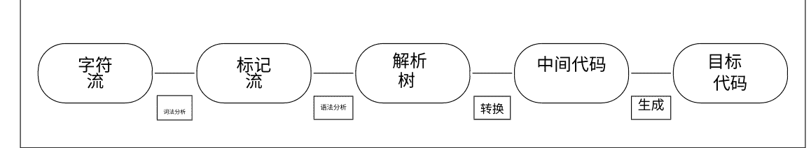

# 剑桥 L111 高级数据流分析讲义

http://www.cl.cam.ac.uk/Teaching/1011/OptComp/

Alan Mycroft am@cl.cam.ac.uk

2010–2011 (Michaelmas学期)

## 学习指南

课程的讲授基本上按照这些笔记进行，其中有7节课专门讲解第A部分，5节课讲解第B部分，还有3或4节课讲解第C和第D部分。第A部分主要包括对流程图的分析/转换对，而第B部分包括对更复杂的分析（通常是在接近源语言的表示上进行）的分析，通常会给出一个通用框架和一个实例。第C部分包括介绍指令调度，第D部分介绍反编译和逆向工程。

可以将第A部分看作是中间代码到中间代码的优化，将第B部分看作是（如果需要的话）已经输入的解析树到解析树的优化，将第C部分看作是目标代码到目标代码的优化。第D部分涉及到反向过程。

每个讲座的大致内容如下：

- 讲座1: 介绍、流图、调用图、基本块、分析类型
- 讲座2: （转换）无法访问的代码消除
- 讲座3: （分析）活跃变量分析
- 讲座4: （分析）可用表达式
- 讲座5: （转换）活跃变量分析的用途
- 讲座6: （续）通过着色进行寄存器分配
- 讲座7: （转换）可用表达式的用途；代码移动
- 讲座8: 静态单赋值；强度削减
- 讲座9: （框架）抽象解释
- 讲座10: （实例）严格性分析
- 讲座11: （框架）基于约束的分析；（实例）控制流分析（用于 λ-terms）
- 讲座12: （框架）基于推理的程序分析
- 讲座13: （实例）效果系统
- 讲座13a: 指针和别名分析
- 讲座14: 指令调度
- 讲座15: 同上，继续
- 讲座16: 反编译。

## 书籍

- Aho, A.V., Sethi, R. & Ullman, J.D. 编译器：原理、技术和工具. Addison-Wesley, 1986. 现在有点老了，只涵盖了课程的第一部分。查看http://www.aw-bc.com/catalog/academic/product/0,1144,0321428900,00.html
- Appel A. 现代编译器实现：C/ML/Java（第2版）。CUP 1997. 查看http://www.cs.princeton.edu/~appel/modern/
- Hankin, C.L., Nielson, F., Nielson, H.R. 程序分析原理. Springer 1999. 对第一部分和第二部分都很好。查看http://www.springer.de/cgi-bin/search_book.pl?isbn=3-540-65410-0
- Muchnick, S. 高级编译器设计与实现. Morgan Kaufmann, 1997. 查看http://books.elsevier.com/uk/mk/uk/subindex.asp?isbn=1558603204
- Wilhelm, R. 编译器设计. Addison-Wesley, 1995. 查看http://www.awprofessional.com/bookstore/product.asp?isbn=0201422905

## 致谢

我非常感谢Tom Stuart不仅为这些讲义做出了各种补充和改进，而且还为这些讲义配套制作了精美的幻灯片。

## 第一部分：经典的“数据流”优化

### 1 引言

回顾一下简单的非优化编译器的结构（例如来自CST第一部分B）。



在这样的编译器中，“中间代码”通常是一个面向堆栈的抽象机器代码（例如BCPL编译器中的OCODE或Java中的JVM）。请注意，阶段“词法分析”、“语法分析”和“转换”原则上是源语言相关的，但不是目标架构相关的，而阶段“生成”是目标相关的，但不是语言相关的。

为了简化优化（实际上是‘改善’！），我们需要一个中间代码，使得指令之间的依赖关系明确，以便于移动计算。通常我们使用3地址代码（有时称为‘四元组’）。这也接近现代RISC架构，因此有助于目标相关阶段的‘生成’。这个中间代码存储在一个流图 \(G\) 中，它的节点上标有3地址指令（或者后来的‘基本块’）。我们写作

\[
pred(n) = \{ n' \mid (n', n) \in edges(G) \} \quad succ(n) = \{ n' \mid (n, n') \in edges(G) \}
\]

表示给定节点的前驱和后继节点集合；我们假设常见的图论概念，如路径和循环。

三地址指令的形式（\(a, b, c\) 是操作数，\(f\) 是过程名，\(lab\) 是一个标签）：

- ENTRY \(f\)：没有前驱；
- EXIT：没有后继；
- ALU \(a, b, c\)：一个后继（ADD，MUL，等等）；
- CMP \(\langle cond \rangle a, b, lab\)：两个后继（CMPNE，CMPEQ，等等）—在直线代码中，这些指令带有一个标签参数（如果分支不发生，则继续执行下一条指令），而在流图中，它们有两个后继边。

多路分支（例如case语句）可以被视为一系列CMP指令。过程调用（CALL \(f\)）和间接调用（CALLI \(a\)）被视为类似于ALU \(a, b, c\)的原子指令。类似地，我们区分MOV \(a, b\)指令（忽略一个操作数的ALU的特殊情况）和间接内存引用指令（LDI \(a, b\)和STI \(a, b\)）用于表示指针解引用，包括访问数组元素。间接分支（用于本地 goto \(\langle exp \rangle\)）终止一个基本块（稍后会介绍）；它们的后继必须包括所有可能的分支目标（参见Fortran ASSIGNED GOTO的描述）。

一种安全的方法是将除了直接 goto l形式之外的所有标签都视为后继。假设过程的参数和结果存储在标准位置，例如全局变量 arg1, arg2, res1, res2等。这些通常是现代过程调用标准中的机器寄存器。

作为一个简短的例子，考虑以下高级语言实现的阶乘函数：

```
int fact (int n)
{
  if (n == 0) {
    return 1;
  } else {
    return n * fact(n-1);
  }
}
```

这可能最终被转化为以下的三地址代码：

```
ENTRY fact                ; 开始一个名为“fact”的过程
MOV t32,arg1             ; 将arg1的副本保存在t32中
CMPEQ t32,#0,lab1; 如果arg1 == 0，则跳转到lab1
SUB arg1,t32,#1          ; 准备调用前将arg1减一
CALL fact                ; 将fact(arg1)保存在res1中（t32保持不变）
MUL res1,t32,res1
EXIT                     ; 退出该过程
lab1: MOV res1,#1
EXIT                     ; 退出该过程
```

口号：优化 = 分析 + 转换

转换通常很简单（例如删除此指令），但可能需要复杂的分析来证明其有效性。还要注意，为了进行编译时调试（例如，查看后面使用的LVA来警告可能未初始化的变量的数据流异常），有时会使用分析而没有相应的转换。因此，编译器的新结构为：


本课程仅考虑优化器，原则上是源语言和目标架构无关的，但某些粗略的目标特性可以被利用（例如，用于寄存器分配阶段的可分配用户寄存器数量）。

通常，我们将指令分组为基本块：基本块是一系列最大的指令序列指令 $n_1$, $...$, $n_k$, 它们具有

- 仅有一个前驱（除了可能是 $n_1$）
- 仅有一个后继（除了可能是 $n_k$）

因此，我们示例中的三地址代码阶乘过程的基本块为：

```
ENTRY fact
MOV t32,arg1
CMPEQ t32,#0,lab1
SUB arg1,t32,#1
CALL fact
MUL res1,t32,res1
EXIT
lab1: MOV res1,#1
EXIT
```

基本块通过一次计算和存储数据流信息（如果需要，在块内重新计算）来减少分析算法的空间和时间需求，而不是每条指令一次存储数据流信息。

通常安排阶段'trn'将树翻译为流图时，每次需要时都使用一个新的临时变量。这样的基本块（或流图）被称为处于正常形式。例如，我们会翻译

```
x = a*b+c;
y = a*b+d;
```

成为

```
MUL t1,a,b
ADD x,t1,c
MUL t2,a,b
ADD y,t2,d.
```

稍后我们将看到如何将这些代码序列映射为更高效的通用优化。

### # 1.1 分析形式

分析形式（以及优化）通常被分类为：

- '局部'或'窥孔'：在基本块内；
- '全局'或'程序内'：在基本块之外，但在一个过程内；
- '程序间'：在整个程序上。

本课程主要在第一部分中考虑程序内分析（例外是第1.3节中的'无法访问的过程消除'），而第二部分中的技术通常适用于程序内或程序间（因为后者不是基于流图的，所以基本块的进一步分类并不相关）。

### 1.2 简单示例：无法访问的代码消除

（可达性）分析 ＝ '找到可达的块'；转换 ＝ '删除可达性未标记为可达的代码'。分析：

- 将每个过程的入口节点标记为可达；
- 将每个标记节点的后继节点标记为可达，并重复此过程，直到不再需要标记为止。

分析是安全的：算法会标记每个可能执行流到达的节点。反之通常不成立：

如果 *tautology(x)* 成立，则执行 *C₁*，否则执行 *C₂*

算术的不可判定性（参见停机问题）意味着我们永远无法发现所有这样的情况。请注意，安全性要求后继节点 *goto <exp>*（参见前文）不能被低估。还要注意，常量传播（本课程未涉及）可以用于将已知值传播到测试中，从而有时可以安全地减少比较节点的后继数量。

### 1.3 简单示例：不可达过程消除

（一个简单的过程间分析。）分析 ＝ '找到可调用的过程'；转换 ＝ '删除分析未标记为可调用的过程'。数据结构：调用图，每个过程一个节点，当 *f* 有一个CALL *g*语句或 *f* 有一个CALLI *a*语句且我们怀疑 *a*的值可能是 *g*时，有一条边（*f*, *g*）。一个安全的（一般上估计）解释是将CALLI *a*视为调用程序中除直接调用上下文之外的任何过程 - 在C语言中，这意味着（隐式或显式地）取地址。分析：

- 将过程 *main*标记为可调用；
- 将标记节点的每个后继节点标记为可调用，并重复此过程直到不再需要标记。

分析是安全的：算法将标记每个可能在执行期间被调用的过程。相反，在一般情况下，这个命题是错误的。请注意，标签变量和过程变量可能会降低优化效果，与直接代码相比 - 除非您确定它们对整体有益，否则不要使用编程语言的这些特性。

### 2 活跃变量分析—LVA

变量 x 在节点 n 上语义上是活跃的，如果存在某个执行序列从 n 开始，改变 x 的值会影响其输入/输出行为。

变量 x 在节点 n 上语法上是活跃的，如果在流图中存在一条路径到达节点 n'，该路径上不包含对 x 的定义，并且 n' 包含对 x 的引用。请注意，这样的路径在实际执行中可能并不存在，例如。

```
11: ; /* 这里是否活跃的是 't'? */
    if ((x+1)*(x+1) == y) t = 1;
    if (x*x+2*x+1 != y) t = 2;
12: print t;
```

由于我们将基于LVA的结果进行优化，安全性包括对活跃性的过度估计，即。

$$ sem-live(n) \subseteq syn-live(n) $$
其中 live(n) 是在 n 处活跃的变量集合。逻辑学家可能会注意到语义活跃性和 |= 之间的联系，以及语法活跃性和 |- 之间的联系。

从非算法性的语法活跃性定义中，我们可以得到数据流方程：
$$ live(n) = \left( \bigcup_{s \in succ(n)} live(s) \right) \setminus def(n) \cup ref(n) $$
你可能更喜欢分两个阶段推导出这些方程，将入口节点 n 的活跃变量写为 in-live(n)，将出口节点 n 的活跃变量写为 out-live(n)。这给出了
$$ in-live(n) = out-live(n) \setminus def(n) \cup ref(n) $$
$$ out-live(n) = \bigcup_{s \in succ(n)} in-live(s) $$
这里 def(活动) 是在节点 n 定义的变量集合，即 {x} 在指令 x = x+y 中
ref(活动) 是在节点 n 引用的变量集合，即 {x, y}。

注释：

- 这些是'反向'流方程：活动性取决于未来，而正常的执行流取决于过去；
- 这些数据流方程的任何解都是安全的（相对于语义活动性）。

地址被占用变量的问题-考虑：

```
int x,y,z,t,*p;
x = 1, y = 2, z = 3;
p = &y;
if (…) p = &y;
*p = 7;
if (…) p = &x;
t = *p;
print z+t;
```

在这里，我们不确定赋值*p = 7; 是给 x 还是给 y。同样地，我们不确定引用 t = *p; 是引用 x 还是引用 y（但我们确定两者都是引用 p）。这些都是模棱两可的定义和引用。为了安全起见（对于 LVA），将模棱两可的引用视为引用任何地址被取的变量（参见标签变量和过程变量——间接引用只是一个“变量”变量）。同样地，模棱两可的定义只是被忽略。因此，在上述例子中，对于 *p = 7; 我们有 ref = {p} 和 def = {}；而对于 t = *p; 我们有 ref = {p, x, y} 和 def = {t}。

算法（将 live 实现为一个数组 live[]）：

```
for i=1 to N do live[i] := {}
while (live[] changes) do
    for i=1 to N do
        live[i] := \left( \bigcup_{s \in succ(i)} live[s] \right) \setminus def(i) \cup ref(i).
```

显然，如果算法终止，则结果是数据流方程的解。实际上，完全偏序理论（cpo's）意味着它总是以最少的变量为安全一致的最小解终止。（程序中使用的变量集的幂集是一个有限格，循环中从旧活跃度到新活跃度的映射是连续的。）

注：

- 我们可以使用位向量将 live[] 数组实现为一个位，其中位 k 被设置为表示变量 x_k（根据给定的编号方案）是活跃的。
- 我们可以通过仅在基本块中存储一次活跃信息，并在需要时重新计算基本块内的活跃信息（通常仅在使用 LVA 验证转换时）来加快执行速度并减少存储消耗。在这种情况下，数据流方程变为：

```
live(n) = \left( \bigcup_{s \in succ(n)} live(s) \right) \setminus def(i_k) \cup ref(i_k) \cdots \setminus def(i_1) \cup ref(i_1)
```

其中 (i_1, ……, i_k) 是基本块中的指令 n。

### 3 可用表达式

可用表达式分析（AVAIL）与 LVA 有许多相似之处。一个表达式 e（通常是 3 地址指令的 RHS）在节点 n 上是可用的，如果在通往 n 的每条路径上，表达式 e 已经被计算并且没有被中间赋值给中出现的变量所使无效。这导致了数据流方程：

```
avail(n) = \bigcap_{p \in pred(n)} (avail(p) \setminus kill(p) \cup gen(p)) \quad \text{if } pred(n) \neq \{\}
avail(n) = \{\} \quad \text{if } pred(n) = \{\}。
```

这里 gen (N) 给出了在 N 处新计算的表达式：gen (X = Y+Z) = {Y+Z}，例如；但是 gen (X = X+Z) = {}，因为虽然这条指令确实计算了 X+Z，但它随后改变了 X 的值，所以如果将来需要这个表达式 X+Z，必须重新计算。类似地，kill (N) 给出了在 N 处被杀死的表达式，即包含在 N 处更新的变量的所有表达式。

这些是“向前”方程，因为 avail（N）取决于过去而不是未来。还要注意从 ∪到LVA的变化。你还应该考虑基于指针的访问地址被取的变量引起的 kill和 gen的歧义（参见LVA中的 ref和def的歧义）。

```
avail[1] := {}
for i=2 to N do avail[i] := U
while (avail[] changes) do
    for i=2 to N do
        avail[i] := \bigcap_{p\in pred(i)} (avail[p] \setminus kill(p) \cup gen(p)).
```

这里，U是所有表达式的集合；在这里，只需要考虑3地址指令的所有右侧操作数。实际上，如果每个赋值都分配给一个不同的临时变量（对于临时变量的正常形式的一点加强），那么临时变量的编号允许使用一种特别简单的位向量表示 avail[]。

## # LVA的4个用途

LVA有两个主要用途：

- 报告数据流异常，特别是警告“变量'x'在赋值之前可能被使用”；
- 通过颜色分配寄存器。

对于第一个用途，只需要注意如果'x'在包含它的过程（或作用域）的入口处是活跃的，则可以发出上述警告。（注意这里的“安全性”问题是不同的 - 是否对避免执行一个看似错误的代码给出一个虚假警告比忽略对可疑代码给出可能警告更好还是更差是有争议的；可决定性意味着我们不能同时拥有两者。）对于第二个用途，我们注意到如果没有两个变量同时活跃的3地址指令，那么这些变量可以共享相同的内存位置（或者更有用的是相同的寄存器）。这样做的理由是当一个变量不活跃时，它的值可以任意地被破坏而不影响执行。

### ### 4.1 通过着色进行寄存器分配

生成天真的三地址代码，假设所有变量（和临时变量）都被分配了一个不同的（虚拟）寄存器（回忆“正常形式”）。生成良好的代码，但是真实的机器只有有限数量的寄存器，通常是32个。推导出一个图（冲突图），其节点是虚拟寄存器，并且两个同时存在的虚拟寄存器之间有一条边。

> 这个 gen(n) 的定义相当笨拙。更好的做法是说 gen(x = x+z) = {x + z}，因为无论后续的赋值如何，该指令肯定会计算出 x + z。然而，给定的定义是为了使 avail(n) 可以以它所定义的方式进行定义；我在讲座中可能会再多说一些。

在计算基本块开始时，当仅计算活跃性时，需要小心（我们需要检查块内以及块开始处的时活跃性！）。现在尝试使用真实（目标架构）寄存器作为颜色，对冲突图进行着色（即为相邻节点赋予不同的值）。（显然，如果目标具有相当数量的可互换寄存器，这将更容易实现，而不是早期的8086。）虽然平面图（对应于地球地图）总是可以用四种颜色进行着色，但对于冲突图（练习）通常不是这种情况。

图着色是NP完全问题，但这里有一个简单的启发式算法来选择颜色虚拟寄存器的顺序（以及决定哪些需要被拆分到内存中，通过LD/ST访问专用临时寄存器而不是直接通过ALU寄存器-寄存器指令进行访问）：
- 选择具有最少冲突数的虚拟寄存器；
- 如果这个数字小于颜色的数量，则将其推入LIFO堆栈，因为我们可以保证在知道其剩余邻居的颜色之后对其进行着色。从冲突图中移除寄存器，并减少其每个邻居的冲突数量。
- 如果所有虚拟寄存器的冲突数都大于颜色数，则必须进行分割。选择一个（例如，访问次数最少的一个³）进行分割，并将其所有邻居的冲突数减少一个。
- 当冲突图为空时，依次从堆栈中弹出虚拟寄存器，并以任何方式对其进行着色，以避免其（已着色）邻居的颜色。根据构造，这总是可能的。

请注意，当我们在寄存器上有多个可选颜色（由冲突图允许）时，选择一个将`MOV r1,r2`指令转换为无操作的颜色是有意义的，通过将`r1`和`r2`分配给相同的寄存器（前提是它们不冲突）。这可以通过保持单独的“偏好”图来实现。

## 4.2 非正交指令和过程调用标准

一个核心原则，证明了通过着色进行寄存器分配的想法是合理的，即我们可以在稍后的时间从一个相当大的可互换的寄存器集中选择。假设我们生成了一个（比如）乘法指令，那么它的寄存器可以在稍后选择。这个假设在80x86架构上有一点违反，因为乘法指令总是使用一个标准寄存器，而其他指令则可以合理地选择操作数。同样，在VAX上也违反了这个假设，因为一些指令会破坏寄存器`r0-r5`。

然而，我们可以设计一个统一的框架来优雅地处理这种对统一性的小偏差。我们首先安排物理寄存器是虚拟寄存器的子集，通过将（比如）虚拟寄存器`v0-v31`预分配给物理寄存器`r0-r31`，并且从32开始为临时变量和用户变量分配虚拟寄存器。现在
- 当一条指令需要给定物理寄存器中的操作数时，我们使用MOV将其移动到给定物理寄存器的虚拟编码中-优先级图将尝试确保计算针对给定源寄存器；
- 类似地，当一条指令在给定物理寄存器中产生结果时，我们将结果移动到可分配的目标寄存器；
- 最后，当一条指令在计算过程中破坏（比如说）rx时，我们安排其虚拟对应物vx与出现指令时的每个活跃虚拟寄存器发生冲突。

请注意，这个过程也解决了处理过程调用时的寄存器分配问题。一个典型的过程调用标准为临时寄存器指定了n个寄存器，例如r0-r[n-1]（其中前m个用于参数和结果-这些是课程开始时提到的标准位置arg1，arg2，res1，res2等），以及k个需要在过程调用中保留的寄存器。然后，CALL或CALLI指令导致每个过程调用中活跃的变量与每个非保留的物理寄存器发生冲突，从而为它们分配一个保留寄存器。例如，
```
int f(int x) { return g(x)+h(x)+1;}
```
可能会生成以下形式的中间代码
```
    ENTRY f
    MOV v32,r0          ; 将arg1保存在x中
    MOV r0,v32          ; 被省略（通过"其他讲师完成"技术）
    CALL g
    MOV v33,r0          ; 将结果保存为v33
    MOV r0,v32          ; 获取x作为arg1
    CALL h
    ADD v34,v33,r0 ; v34 = g(x)+h(x)
    ADD r0,v34,#1  ; result = v34+1
    EXIT
```
注意到v32和v33与所有非保留寄存器冲突（在过程调用时仍然活跃），可能会生成以下代码（在一个指定保留r4及以上寄存器的机器上进行过程调用）
```
f:     push {r4,r5} ; 在ARM上我们这样做：push {r4,r5,lr}
       mov   r4,r0
       call  g
       mov   r5,r0
       mov   r0,r4
       call  h
       add   r0,r5,r0
       add   r0,r0,#1
       pop   {r4,r5} ; 在ARM上我们使用： pop {r4,r5,pc} 来返回...
       ret           ; ... 所以在ARM上不需要这个。
```
注意，r4和r5在进入和退出过程时需要被push和pop，以保持这些寄存器在过程调用中的不变性（这被用于调用g和h）。一般来说，一个合理的过程调用标准规定一些（但不是全部）寄存器在过程调用中被保留。

结果是，存储多个（或推多个）指令可以比零散的ld/st指令更有效地用于堆栈。

## 4.3 全局变量和寄存器分配

所提出的技术已经隐式处理了本地变量的寄存器分配。这些变量在它们所在的过程中是活跃的（最多），并且可以被调用的过程保存和恢复。全局变量（例如C的静态或外部变量）通常在进入和退出过程时是活跃的，并且通常不能分配给寄存器，除非有一个整个程序的“保留寄存器r⟨n⟩用于变量⟨x⟩”的声明。然后分配器避免为本地变量使用这些寄存器（因为没有整个程序分析，很难知道调用是否会间接影响寄存器r⟨n⟩，从而影响变量⟨x⟩）。

一个有趣的例外可能是C的本地静态变量，在进入过程时不是活跃的，这不需要从调用到调用中保留，因此可以被视为普通的本地变量（实际上，程序员可能应该被警告关于懒散的代码）。Green Hills C编译器曾经进行过这种优化。

## AVAIL的5个用途

AVAIL的主要用途是公共子表达式消除（CSE），（AVAIL提供了一种在单个基本块之外进行CSE的技术，而简单的面向树的CSE算法通常只能处理没有副作用的一个表达式）。如果一个表达式e在计算节点n可用，则我们可以确保在到达n的每条路径上计算e的结果都保存在一个新变量中，该变量可以在n处重复使用，而不是在n处重新计算e。

更详细地说（对于任何ALU操作⊕）：
- 对于每个包含a⊕b可用的节点n:
- 创建一个新的临时变量t;
- 将n:x := a⊕b替换为n:x := t;
- 在每条路径上从后向前扫描，找到第一个出现的a⊕b（假设为n':y := a⊕b）并在3地址指令的右侧（根据AVAIL我们知道这个存在）替换n'为两条指令n':t := a⊕b; n'':y := t。

请注意，额外的临时变量t可以通过寄存器分配来分配（并且也可以鼓励寄存器分配器选择相同的寄存器来分配t和尽可能多的不同的y）。如果它被分割，我们应该问一下，公共子表达式是否足够大，以证明溢出的LD/ST成本是否比重新计算忽略它更便宜。（见第8节）。

在这门课程中，我有一个问题没有详细讨论。假设我们有源代码
```
x := a*b+c;
y := a*b+c;
```
那么这将变成三地址指令：
```
MUL t1,a,b
ADD x,t1,c
MUL t2,a,b
ADD y,t2,c
```
如所示，CSE将其转换为
```
MUL t3,a,b
MOV t1,t3
ADD x,t1,c
MOV t2,t3
ADD y,t2,c
```
这显然不是一个改进！对于这个问题有两个解决方案。一个是考虑比单个三地址指令RHS更大的CSE（这样，即使通过两个不同的临时变量计算，a*b+c也是一个CSE）。另一个是使用复制传播——我们通过将t1和t2重命名为t3来移除MOV t1,t3和MOV t2,t3。这仅适用于我们知道t1、t2和t3没有其他更新的情况。

结果是 t3+c变成了另一个CSE，所以我们得到
```
MUL t3,a,b
ADD t4,t3,c
MOV x,t4
MOV y,t4
```
这对于寄存器分配的输入来说几乎是最优的（记住，x或y可能会被分配到内存中，而t3和t4很可能不会；而且，如果它们没有被分配到内存中，4（甚至t3）很可能被分配到与x或y相同的寄存器中）。

## 6 代码移动

像CSE这样的转换被统称为代码移动转换。另一个（比CSE⁴更通用的）是部分冗余消除。考虑
```
a = ...;
b = ...;
do
{   ... = a+b;     /* 这里 */
    a = ...;
    ... = a+b;
} while (...)
```
标记的表达式 a+b在每次循环中除了第一次之外都会冗余计算（除了非冗余计算）。因此，它可以通过首先将其转换为进行时间优化（即使程序保持相同的大小）：
> ⁴人们可以将CSE视为一种消除完全冗余表达式计算的方法。
```
a = ....;
b = ....;
... = a+b;
做
{   ... = a+b;        /* 这里 */
    a = ...;
    ... = a+b;
} while (...)
```
然后，通过CSE可以优化掉标记为'here'的表达式。

## 7 静态单赋值形式

重新访问寄存器分配：有时寄存器分配算法的提出并不是最优的，因为它假设单个用户变量在其作用域的整个过程中只会存在一个位置（存储位置或寄存器）。考虑以下说明性程序：
```
extern int f(int);
extern void h(int,int);
void g()
{   int a,b,c;
    a = f(1); b = f(2);   h(a,b);
    b = f(3); c = f(4);   h(b,c);
    c = f(5); a = f(6);   h(c,a);
}
```
在这里，a，b和c都相互冲突，因此它们都有单独的寄存器。然而，请注意，每行的第一个变量可以使用（比如）r4，一个在函数调用中保留的寄存器，而第二个变量可以使用一个不同的变量（比如）r1。这将减少寄存器的需求，从三个减少到两个，通过在其作用域的不同点使用不同的寄存器来表示给定变量。（请注意，这可能在调试器表中难以表示。）

这种转换通常被称为活跃区间分割并且可以看作是源代码到源代码的转换的结果：
```
void g()
{   int a1,a2, b1,b2, c1,c2;
    a1 = f(1); b2 = f(2);   h(a1,b2);
    b1 = f(3); c2 = f(4);   h(b1,c2);
    c1 = f(5); a2 = f(6);   h(c1,a2);
}
```
对于临时变量，这个问题不会出现，因为我们已经安排每个对临时变量的需求都分配了一个新的临时变量（至少在寄存器着色之前）。我们希望将临时变量的关键属性扩展到用户变量，即每个临时变量只分配一个值（至少在静态情况下——在循环中可能会动态分配很多值）。

这导致了静态单赋值（SSA）形式的概念和转换。

静态单赋值（SSA）形式（参见例如[2]）是一种编译技术，可以将对同一变量的重复赋值（在流图式代码中）替换为每个变量仅出现一次的代码。

在直线代码中，转换为SSA是直接的，每个变量 v 被编号实例 v_i 替换为 v_0。当对 v 进行更新时，该索引会递增。
这导致了如下的代码
```
v = 3; v = v+1; v = v+w; w = v*2;
```
（下一个可用索引为4的 w 和7的 v）被映射为
```
v7 = 3; v8 = v7+1; v9 = v8+w3; w4 = v9*2;
```
在流图中的路径合并中，我们必须确保这些变量的实例继续引起相同的数据流。这通过在路径合并弧上放置一个逻辑（静态单）赋值到一个新的公共变量来实现。因为流图节点（而不是边）包含代码，所以传统上通过在路径合并节点的入口处调用所谓的ϕ函数来表示。
意图是 ϕ(x, y) 如果控制从左弧到达，则取值为 x，如果控制从右弧到达，则取值为 y；ϕ 函数的值用于定义一个新的单赋值变量。因此考虑
```
{ 如果（p）{ v = v+1; v = v+w; } 否则 v=v-1; } w = v*2;
```
这将映射到（仅对 v 进行注释，并从4开始）
```
{ 如果（p）{ v4 = v3+1; v5 = v4+w; } 否则 v6=v3-1; } v7 = ϕ(v5,v6); w = v7*2;
```

## 8 相位顺序问题

'相位顺序问题'指的是编译中的一个问题，即当我们需要对单个数据结构进行多个优化（例如寄存器分配和流图上的CSE）时，我们会发现在某些程序中，进行任何给定的优化在另一个优化之后会产生更好的结果，但在其他程序中，如果在另一个优化之前进行会产生更好的结果。稍微微妙一点的版本是，我们可能希望在一个阶段内偏向某些选择，以便在后续阶段中能够进行更多的优化。这些笔记假设在寄存器分配之前进行CSE，并且如果进行SSA，则在它们之间进行。

我们刚刚看到了相位顺序问题的边缘：如果进行CSE会导致一个便宜的重新计算表达式存储在一个被分割成昂贵的访问内存的变量中。一般来说，其他代码移动操作（包括第C部分的指令调度）有更难解决的相位顺序问题。

### 8.1 广告（不考试）

上述工作至少有十年的历史，当仔细检查时通常有点陈旧（例如CSE和寄存器分配之间的相位顺序问题，例如流图过度确定执行顺序）。已经提出了各种其他数据结构来帮助解决第二个问题（在网上找到“数据、程序、值、系统依赖图”和“数据流图” - 还要注意我们所称的流图通常被称为“控制流图”或CFG），但让我无耻地强调[7]它将流图推广到值状态依赖图（VSDG），然后显示代码移动优化（如CSE和指令重新排序）和寄存器分配可以在VSDG上交错进行，从而避免了一些相位顺序问题的方面。

## 9 多核编译

由于摩尔定律无法将额外的晶体管转化为更快的处理器速度，多核处理器正成为常态。

然而，为它们有效地编译是一项具有挑战性的任务，目前工业界的解决方案远未令人满意。一个关键问题是我们是否希望使用顺序语言编写然后希望编译器可以并行化它（对于包含别名的语言，特别是在NUMA架构上，这可能是相当乐观的，但也适用于x86风格的多核）因为“别名分析”（确定两个指针是否可能指向相同的位置）在理论上是不可判定的，并且在实践中往往是无效的（请参见第18节中的O（n³）方法）。否则，顺序语言的编译器需要关于何处可能和/或安全地并行的提示。Open/MP和Cilk++是两种具有非常不同风格的通用解决方案。

另一种选择是编写明确的并行代码，但这很容易变得特定于目标，并且不可移植。具有显式消息传递（MPI）的语言是可能的，而对于图形卡，nVidia的CUDA（目前正在形成“OpenCL”标准的输入）是有希望的。

一个有希望的方向是明确表达两个进程的隔离（内存访问的不相交）。

出于时间原因，本课程不会对此主题进行更多讲解，但值得注意的是，从单处理到多核的转变比计算机领域中几乎任何其他变化都要大，而我们学习如何为顺序机器高效编译的顺序语言似乎不再适用。

# 计算机科学Tripos第二部分

### 优化编译器（第二部分 B C D）

http://www.cl.cam.ac.uk/Teaching/1011/OptComp/

## 第二部分：高级优化

本课程的第二部分涉及比第一部分更现代的优化技术。一个简单的观点是，第一部分涉及命令式语言的经典优化，而这一部分主要涉及函数式语言的优化，但这有些误导。例如，即使我们在函数式语言上执行了一些（如严格性优化）在这里详细介绍的优化，我们仍然可能希望之后执行基于流图的优化，如寄存器分配。我想传达的观点是，这一部分的优化往往是跨过程的，而这些优化在函数式语言中往往可以以最少的混乱方式看到。因此，更正确的观点是，这一部分涉及的分析和优化在比流图更高的层次上进行，这些概念不容易使用（无论我们是否希望如此）。事实上，它们往往以编程语言的原始（或可能是规范化的）语法来表达，因此流图类似的概念不容易获得（无论我们是否希望如此）。

作为最后的备注，旨在打消‘只适用于函数式语言’的观点，应该注意到例如‘抽象解释’是一个非常通用的程序分析框架，适用于任何范式的程序，并且只有在这里给出的严格性分析的实例化使其专门用于函数范式的程序。同样，‘基于规则的程序属性推断’也可以看作是一个框架，可以专门用于类型检查和推断系统（另一个CST Part II课程的主题），除了这里给出的技术之外。

然而，必须注意的是，数据流分析和高级程序分析的研究社区并没有始终充分地进行交流，以便发展出统一的理论和符号。

我们首先看一下经典的程序内部优化，这些优化通常在语法树级别进行。请注意，这些可以看作是代码移动转换（参见第6节）。

## 10个代数恒等式

这里没有涵盖的一种转换形式是（相当无聊的）纯代数树到树的转换，例如 e+0 ——> e 或者 (e+n)+m ——> e+(n+m)，这通常是普遍成立的（无需进行分析以确保其有效性，尽管在浮点算术中可能不成立！）更多面向编程的规则可能是通过一个简单的分析进行转换
```
让 x=e，如果 e’ 那么 ... x ... 否则 e’’
```
在一种惰性语言中
```
如果 e’ 那么让 x=e，... x ... 否则 e’’
```
当 e’ 和 e’’ 中不包含 x 时。我们关心的转换的特点是需要通过分析来验证转换是否具有非平凡（即不纯粹的句法）属性。

### 10.1 强度降低

一个稍微有趣的例子是强度降低。强度降低通常是指用一些更便宜的运算符替换一些昂贵的运算符。一个简单的例子是通过一个简单的代数恒等式`2*e → let x = e in x + x`来实现。在循环中这样做更有趣/有用。

首先找到循环归纳变量，即那些在循环中唯一的赋值是 `i := i ⊕ c` 的变量，其中 `⊕` 是某个运算符，`c` 是某个常数。现在找到其他变量 `j`，它们在循环中唯一的赋值是 `j := c₂ ⊕ c₁ ⊗ i`，其中 `x ⊗ (y ⊕ z) = (x ⊗ y) ⊕ (x ⊗ z)`，`c₁`、`c₂` 是常数（我们假设这个赋值在更新 `i` 之前，以便简化下面的解释）。

优化是将赋值 `j := c₂ ⊕ c₁ ⊗ i` 移动到循环入口，并且添加一个循环体结束的赋值 `j := j ⊕ (c₁ ⊗ c)`。现在我们知道 `i` 与 `j` 的关系，因此我们可以例如，将使用 `i` 的循环终止测试改为使用 `j` 的终止测试，从而有时可以完全消除 `i`。例如，假设`int v[100]`；和 `ints` 为字节地址机器上的4字节宽度。让我们写 `&&v` 表示数组 `v` 的第一个元素的字节地址，注意它是一个常数，并考虑
```
for (i=0; i<100; i++) v[i] = 0;
```
尽管这段代码有时是最优的，但许多机器需要单独计算物理字节地址 `&&v+ 4 * i` 与存储指令，所以这段代码实际上是
```
for (i=0; i<100; i++) { p = &&v + 4*i; Store4ZerobytesAt(p); }
```
强度降低给出：
```
for ((i=0, p=&&v); i<100; (i++, p+=4)) Store4ZerobytesAt(p);
```
并且重写循环终止测试给出
```
for ((i=0, p=&&v); p<&&v+400; (i++, p+=4)) Store4ZerobytesAt(p);
```
删除 `i`（现在不再使用）给出，并且以正确的C语法重新表达给出
```
int *p;
for (p=&v[0]; p<&v[100]; p++) *p = 0;
```
这通常是（取决于具体的硬件）最优的代码，也许是你们中的C黑客可能会尝试编写的代码。让我劝阻你——这后一种代码可能在你当前的硬件/编译器上节省了一些字节，但由于指针的使用，它更难分析——假设你的新机器具有64位操作，那么最初编写的循环可以（相当简单，但超出了这些注释的范围）转换为一个包含50个64位存储的循环，但大多数编译器会放弃“聪明的C程序员”解决方案。

我在这个以树为导向的优化部分列出了强度降低。在许多方面，如果循环结构作为流图的注释被保留下来，那么在流图上执行优化会更容易（恢复这一点并不容易——请参见反编译部分）。

虽然我在这里写的是'常量'，但我实际上只需要“在循环中不受执行（不变的）影响的表达式”。

如果在进入循环时发现`i`被赋予一个常量，则右手边简化为常量。

## 11 抽象解释

在这门课程中，我们只有很少的时间来介绍抽象解释。
我们观察到，要证明为什么 \((-1515) \times 37\) 是负数有两种解释。一种是 \((-1515) \times 37 = -56055\)，这是负数。另一种是 \(-1515\) 是负数，\(37\) 是正数，从学校代数中可以知道“负数 \(\times\) 正数是负数”。我们将其形式化为一个表格 \(\otimes\)：

|   | (-) | (0) | (+) |
| :--- | :--- | :--- | :--- |
| (-) | (+) | (0) | (-) |
| (0) | (0) | (0) | (0) |
| (+) | (-) | (0) | (+) |

这里有两种计算路线：一种是在现实世界中计算（根据运算符的标准解释（例如，\(\times\) 表示乘法）在标准值空间上进行计算），然后确定我们所期望的属性是否成立；另一种是将其抽象为一个抽象值空间，并使用抽象解释（例如，\(\times\) 表示 \(\otimes\)）进行计算，并确定该属性是否成立。请注意，抽象解释可以被看作是一个“玩具城”世界，它模拟了某些方面，但通常不是全部，现实世界（标准解释）的情况。

将这个思想应用到程序中时，不可判定性通常意味着答案不能精确，但我们希望它们在“如果在抽象解释中展示了某个属性，则相应的真实属性成立”的情况下是安全的。（请注意，这意味着我们不能对这些属性使用逻辑否定。）我们可以通过考虑 \((-1515) + 37\) 来说明这一点：在现实世界中计算得到 \(-1478\)，显然是负数，但抽象运算符 \(\oplus\) 只能安全地写成：

|   | (-) | (0) | (+) |
| :--- | :--- | :--- | :--- |
| (-) | (-) | (-) | (?) |
| (0) | (-) | (0) | (+) |
| (+) | (?) | (+) | (+) |

其中 \((?)\) 表示传达没有知识的附加抽象值（始终为真的属性），因为正整数和负整数的和的符号取决于它们的相对大小，而我们的抽象已经丢弃了这些信息。抽象加法 \(\oplus\) 通过 \((?) \oplus x = (?)\) = \(x \oplus (?)\) 对 \((?)\) 进行操作——未知数量可以是正数也可以是负数，因此它与任何其他值的和的符号也是未知的。因此，我们发现，写作 \(abs\) 表示从具体（现实世界）到抽象值的抽象，我们有 \(abs((-1515) + 37)\)

\(= abs(-1478) = (-)\)，但是
\(abs(-1515) \oplus abs(37) = (-) \oplus(+) = (?)\)。

安全性表示为 \((-) \subseteq (?)\)，即抽象解释预测的值（这里是所有值）包括与具体计算相对应的属性（这里是 \(\{z \in \mathbb{Z} \mid z < 0\}\)）。

请注意，我们可以将上述运算符扩展为接受 \((?)\) 作为输入，从而得到以下定义：

\(\otimes\)
|   | (-) | (0) | (+) | (?) |
| :--- | :--- | :--- | :--- | :--- |
| (-) | (+) | (0) | (-) | (?) |
| (0) | (0) | (0) | (0) | (0) |
| (+) | (-) | (0) | (+) | (?) |
| (?) | (?) | (0) | (?) | (?) |

\(\oplus\)
|   | (-) | (0) | (+) | (?) |
| :--- | :--- | :--- | :--- | :--- |
| (-) | (-) | (-) | (?) | (?) |
| (0) | (-) | (0) | (+) | (?) |
| (+) | (?) | (+) | (+) | (?) |
| (?) | (?) | (?) | (?) | (?) |

因此，我们可以任意组合这些操作；例如，
\((abs(-1515) \otimes abs(37)) \oplus abs(42) = ((-) \otimes (+)) \oplus (+) = (?)\)，或者
\((abs(-1515) \oplus abs(37)) \otimes abs(0)  = ((-) \oplus (+)) \otimes (0) = (0)\)。

类似的技巧在其他地方也很常见，例如“除以九”（例如，123456789除以9因为1+2+3+4+5+6+7+8+9=45, 45因为4+5=9）。值得注意的一点是，因为它出现在编程等价物中，具有相同标准含义的两个不同句法形式可能具有不同的抽象含义。规则的一个例子是 \((x+1) \times (x-3) +4\)，当 \(x = (-)\) 时，结果为 \((?)\)，而 \((x \times x) + (-2 \times x) +1\)的结果为 \((+)\)。

抽象解释已被用于展示抽象值的计算，例如活跃变量集合、可用表达式集合、类型等，可以看作是预先计算用户程序的计算，但在计算过程中使用非标准（即抽象）运算符。为了实现这个目的，确保抽象计算是有限的很有用，例如通过为抽象值域选择有限集合。

## 12 严格性分析

这是抽象解释的一个例子，它将通用框架专门用于确定惰性函数语言中的函数在给定的形式参数中是否严格（即每当函数返回时，实际参数必定已经被评估）。

相关的优化是使用按值调用（急切评估）来实现参数传递机制。这样做更快（因为按值调用比惰性评估的挂起-恢复更接近当前硬件），还可以减少渐进空间消耗（主要是由于尾递归效应）。还要注意，严格参数可以与彼此（以及即将被调用的函数体）并行评估，而惰性评估则高度顺序化。

在这些笔记中，我们不考虑完全的惰性评估，而是考虑一个简单的递归方程语言；这里的急切评估是按值调用（CBV-在调用函数之前评估参数一次）；惰性评估对应于按需调用（CBN-未评估参数并在第一次使用时进行评估（如果有的话），并在后续使用中重复使用此值-参数评估0或1次）。在一个没有副作用的语言中，CBN在语义上与按名调用（每次函数体需要参数时评估参数-评估参数0,1,2,...次）是无法区分的（但可能通过执行的时间复杂度来区分）。我们采用的运行示例是

```
plus(x,y) = cond(x=0,y,plus(x-1,y+1))
```

为了说明CBN相对于CBV的额外空间使用，我们可以看到

```
plus(3,4) → cond(3=0,4,plus(3-1,4+1))
→ plus(3-1,4+1)
→ plus(2-1,4+1+1)
→ plus(1-1,4+1+1+1)
→ 4+1+1+1
→ 5+1+1
→ 6+1
→ 7.
```

我们在这里考虑的语言是递归方程的语言:

\(F_1(x_1, \dots, x_{k_1}) = e_1\)
\(\dots = \dots\)
\(F_n(x_1, \dots, x_{k_n}) = e_n\)

其中 \(e\) 由语法给出

\(e ::= x_i \mid A_i(e_1, \dots, e_{r_i}) \mid F_i(e_1, \dots e_{k_i})\)

其中 \(A_i\) 是表示内置（预定义）函数的一组符号（其元数为 \(r_i\)）。
该技术也适用于完整的 λ-演算，但当前的表述自然地包含了递归，并且还避免了在高阶情况下选择相关严格性优化的困难。

我们现在用标准和抽象解释（分别为 \(a_i\) 和 \(a_i^\#\)）解释 \(A_i\)，并推导出 \(F_i\) 的标准和抽象解释（分别为 \(f_i\) 和 \(f_i^\#\)）。函数 \(A_i\)（元数为 \(r_i\)）的标准解释是一个函数 \(a_i \in D^{r_i} \rightarrow D\)。例如

\(+(\bot, y) = \bot\)
\(+ (x, \bot) = \bot\)
\(+ (x, y) = x + y \quad \text{otherwise}\)

\(cond(\bot, x, y) = \bot\)
\(cond(0, x, y) = y\)
\(cond(p, x, y) = x \quad \text{otherwise}\)

（在这里和其他地方，我们将0视为 false值，任何非0值都视为 true，就像在C语言中一样。）

我们现在可以正式定义一个函数 \(a \in D^r \rightarrow D\)，其语义为 \(a \in D^r \rightarrow D\) 在其第 \(i\) 个参数上是严格的（回想一下我们之前说过，当函数返回时，该参数必须已经被求值）。这正好发生在

\((\forall d_1, \dots, d_{i-1}, d_{i+1}, \dots, d_r \in D)\ a(d_1, \dots, d_{i-1}, \bot, d_{i+1}, \dots, d_r) = \bot.\)

现在我们让 \(D^\# = 2 \stackrel{\text{def}}{=} \{0, 1\}\) 成为抽象值空间，并继续为每个 \(a_i\) 定义一个 \(a_i^\#\)。值'0'表示属性'循环保证'，而值'1'表示'可能终止'。

给定这样一个 \(a \in D^r \rightarrow D\)，我们通过定义 \(a^\#: 2^r \rightarrow 2\) 来定义它。

如果 \((\forall d_1, \dots, d_r \in D \text{ s.t. } (x_i = 0 \Rightarrow d_i = \bot))\)，则 \(a^\#(x_1, \dots, x_r) = 0\)，否则 \(a^\#(x_1, \dots, x_r) = 1\)。

这给出了严格性函数 \(a_i^\sharp\)，它为每个 \(A_i\) 提供了严格性解释。请注意等价的描述（我们在考虑 \(f^{\sharp}\) 与 \(f\) 的关系时将返回）

```
$a^{\sharp}(x_1,\dots,x_r)=0 \Leftrightarrow (\forall d_1,\dots,d_r\in D\text{ s.t. }(x_i=0\Rightarrow d_i=\bot))\, a(d_1,\dots,d_r)=\bot$
```

例如，我们发现

```
$+^{\sharp}(x,y)=x\land y$
$cond^{\sharp}(p,x,y)=p\land(x\lor y)$
```

我们在分析器中构建了一个表格，给出了每个内置函数的严格性函数。

严格性函数推广了“在参数中严格”的概念。对于给定的内置函数 \(a\)，我们有 \(a\) 在其第 \(i\) 个参数上是严格的当且仅当

```
$a^{\sharp}(1,\dots,1,0,1,\dots,1)=0$
```

（其中‘0’在第 \(i\) 个参数位置）。然而，严格性函数提供了更多的信息，有助于确定一个（用户）函数在使用的函数中的严格性属性。例如，考虑以下情况

```
let f1(x,y,z) = if x then y else z
let f2(x,y,z) = if x then y else 42
let g1(x,y) = f1(x,y,y+1)
let g2(x,y) = f2(x,y,y+1)
```

f1 和 f2 都只在 x 上严格——这意味着 g1 和 g2 的严格性将被类似地推断为相同——而它们的严格性函数却不同

```
$f1^{\sharp}(x,y,z)=x\land(y\lor z)$
$f2^{\sharp}(x,y,z)=x$
```

而这个事实使我们能够推断出 g1 在 x 和 y 上是严格的，而 g2 仅仅是在 x 上是严格的。这种 f1 和 f2 之间的严格性行为的差异也可以表达为 f1（不像 f2）在 y 和 z 上是联合严格的（即 \((\forall x\in D)\, f1(x,\bot,\bot)=\bot\)），除了在 x 上是严格的。

现在我们需要为用户定义的函数定义严格性函数。计算这些的最准确的方法是像我们为基本函数计算的那样计算它们：因此

```
f(x,y) = if x then y else 42
```

将产生

```
$f^{\sharp}(x,y)=x\land y$
```

假设 `if` 是严格的。（注意上面使用了 \(f^{\sharp}\)——我们保留了 \(f^{\sharp}\) 的名称用于下面的替代方案。不幸的是，这在一般情况下是不可判定的，我们寻求一个可判定的替代方案（请参见有关语义和句法活性的相应讨论）。

为此，我们不直接定义 \(f_i^{\#}\)，而是根据相同的组合和递归来定义它，就像我们从 \(a_i\) 中定义 \(f_i\) 那样。形式上，这可以看作是：\(f_i^{\#}\) 是方程组

```
$F_1^{\#}(x_1, \ldots, x_{k_1}) = e_1^{\#}$
$\ldots = \ldots$
$F_n^{\#}(x_1, \ldots, x_{k_n}) = e_n^{\#}$
```

当 \(A_i\) 被解释为 \(a_i^{\#}\) 时的解。

严格性的安全性可以通过以下方式来描述：给定用户定义的函数 \(F\)（具有 \(k\) 个参数）和标准语义 \(f : D^k \to D\) 以及严格性函数 \(f^{\#} : 2^k \to 2\)
\(f^{\#}(x_1, \ldots, x_k) = 0 \Rightarrow (\forall d_1, \ldots, d_k \in D, \text{ 如果 } (x_i = 0 \Rightarrow d_i = \bot) ) \text{ 则 } f(d_1, \ldots, d_k) = \bot\)。
请注意，对于 \(a_i\) 存在的等价条件被加强为 \(\Rightarrow\)——这对应于通过组合抽象函数而不是抽象标准组合所丢失的信息。安全性的另一种特征是 \(f^{\#}(\neg x) \leq f^{\#}(x)\)。

回到我们的运行示例
\(plus(x, y) = cond(x=0, y, plus(x-1, y+1))\)。

我们推导出方程

```
$plus^{\#}(x, y) = cond^{\#}(eq^{\#}(x, 0^{\#}), y, plus^{\#}(sub1^{\#}(x), add1^{\#}(y))). \qquad (1)$
```

使用内置函数简化

```
$eq^{\#}(x, y) = x \wedge y$
$0^{\#} = 1$
$add1^{\#}(x) = x$
$sub1^{\#}(x) = x$
```

给出

```
$plus^{\#}(x, y) = x \wedge (y \vee plus^{\#}(x, y))$.
```

在六个可能的解中（\(2 \times 2 \to 2\) 中不包括否定——否定对应于‘当参数不停止时停止’）

```
$\{\lambda(x, y).0, \lambda(x, y).x \wedge y, \lambda(x, y).x, \lambda(x, y).y, \lambda(x, y).x \vee y, \lambda(x, y).1\}$ 我们发现
```

只有 \(\lambda(x, y).x\) 和 \(\lambda(x, y).x \wedge y\) 满足方程 (1)，我们选择后者是因为通常的原因——所有解都是安全的，而这个解允许大多数严格优化。
从数学上讲，我们寻求 \(plus^{\#}\) 的最小不动点，并且在算法上，我们可以解决任何这样的方程组（使用 \(f_i^{\#}\)，并且写 \(e_i^{\#}\) 表示 \(e_i\)，其中 \(F_j\) 和 \(A_j\) 被替换为 \(f_j^{\#}\) 和 \(a_j^{\#}\)）的方法是：对于 \(i=1\) 到 \(n\) 做 \(f_i^{\#} := \lambda \vec{x}.0\) 当 (\(f_i^{\#}\) 改变) 时对于 \(i=1\) 到 \(n\) 做 \(f_i^{\#} := \lambda \vec{x}.e_i^{\#}\)。

请注意解决数据流方程的相似性——唯一的区别是使用了函数式的数据流值。实现可以通过高效的布尔函数表示来提供良好的服务。ROBDDs⁷是一个合理的选择，因为它们是一个相当紧凑的表示，函数相等性（用于收敛测试）由简单的指针相等性表示。

对于 \(plus^{\#}\) 我们得到迭代序列 \(\lambda(x,y).0\)（初始），\(\lambda(x,y).x \wedge y\)（第一次迭代），\(\lambda(x,y).x \wedge y\)（第二次迭代，停止因为收敛）。
由于我们现在可以看到 \(plus^{\#}(0,1)=plus^{\#}(1,0)=0\)，我们可以推断 \(plus\) 在 \(x\) 和 \(y\) 上是严格的。

现在我们转向严格性优化。回想一下，我们假设我们的语言要求每个参数都像使用CBN一样传递。正如前面所示，任何被证明是严格的参数都可以使用CBV来实现。对于基于thunk的CBN实现，这意味着我们在主体内部首次使用时继续传递一个闭包 \(\lambda().e\) 来表示任何未被证明是严格的实际参数 \(e\)；而对于被证明是严格的参数，我们在调用之前通过CBV传递并仅在主体中使用该值。

## 13 基于约束的分析

在基于约束的分析中，采取的方法是遍历程序并发出约束（通常是变量或表达式可能取值的集合）的约束。这些集合通过约束相互关联。例如，如果 \(x\) 被约束为偶数，则可以推断出 \(x + 1\) 被约束为奇数。

与其研究数值问题，我们选择作为示例分析的是控制流分析（CFA，技术上是0-CFA，供那些进一步研究文献的人参考）；这试图计算每个调用点可调用的函数集合。

### 13.1 约束系统及其解决方案

这是一个非考试部分，旨在提供一些背景知识。
许多程序分析可以看作是解决约束系统的过程。例如，在LVA中，约束是“一个程序点处的活跃变量集合等于其他程序点的活跃变量集合经过某个（单调）函数的应用”。边界条件由入口和/或出口节点提供。我使用了“其他讲师也这样做”的技巧（这里是“语义”），声称这样的约束集合具有最小解。

另一个例子是Hindley-Milner类型检查——我们用类型注释每个表达式\(t_i\)，例如 \((e_1^{t_1} e_2^{t_2})^{t_3}\)，然后遍历程序图发出表示相邻表达式之间一致性需求的约束。上述术语会发出约束\(t_1 = (t_2 \rightarrow t_3)\)，然后递归地为 \(e_1\) 和 \(e_2\) 发出约束。然后我们可以解决这些约束（现在使用统一化），最小解（将类型替换为尽可能少的 \(t_i\)）对应于为所有表达式赋予最一般的类型。

在下面的CFA分析中，约束条件是不等式，但它们再次具有这样的特性，即最小解可以通过最初假设所有集合 \(\alpha_i\) 为空，然后对于每个约束条件 \(\alpha \supseteq \phi\)（注意我们利用了LHS始终是流变量的事实）如果不满足，则更新 \(\alpha\) 为 \(\phi\) 并循环直到所有等式成立。

> ⁷ROBDD表示Reduced Ordered Binary Decision Diagram，但通常使用OBDD或BDD来指代相同的概念。

一个思考解决不等式系统的练习是考虑如何通过给定关系 $R$来获得其传递闭包 $T$。这可以表示为约束条件：
$$
R \subseteq T \land \{(x, y)\} \subseteq T \land \{(y, z)\} \subseteq R \implies \{(x, z)\} \subseteq T
$$

## 14 控制流分析（对于 $\lambda$-项）

这与更简单的程序内可达性分析在流程图上不同，而是泛化了调用图。给定一个程序 $P$的目标是计算每个表达式 $e$，在 $P$的评估过程中可能产生的原始值集合（这里是整数常量和 $\lambda$-抽象）。（这可以看作是一种更高级的技术，用于改善近似“假设间接调用可能调用任何取地址的过程”在计算调用图时使用的技术。）我们采用以下语言进行具体研究（其中我们考虑 $c$为一组（整数）常量，$x$为一组变量）：
```
e ::= x | c | λx.e | e_1 e_2 | let x = e_1 in e_2
```
程序 $P$只是没有自由变量的项。在本讲座中，我们将考虑给定的程序
$$P$$
令 id = λx.x，然后 id id 7。

现在我们需要一个程序点的概念（标签的推广），我们可以用它来唯一地引用上下文中的给定表达式。这很重要，因为同一个表达式可能在程序中出现两次，但我们希望它们被单独处理。因此，我们使用它们在树中的出现标记上述程序的语法树的节点（形式上是表示从根到给定节点的路径的整数序列，但在这里方便使用整数）。这给出了
$$(\text{Let }\text{id}^{10} = (\lambda \text{x}^{20}.\text{x}^{21})^{22} \text{ in } ((\text{id}^{30} \text{ id}^{31})^{32} \text{ } 7^{33})^{34})^1.$$
该程序的流值 $F$的空间为
$${(\lambda \text{x}^{20}.\text{x}^{21})^{22}, 7^{33}}$$
原则上，这些再次需要标记以确保唯一性。现在将一个流变量与每个程序点关联起来，即
```
α_1, α_{10}, α_{20}, α_{21}, α_{22}, α_{30}, α_{31}, α_{32}, α_{33}, α_{34}
```
原则上，我们希望将与表达式 $e_i$相关联的 $\alpha^i$的子集与 $P$的求值过程中产生的流值相关联。不幸的是，这在一般情况下是不可判定的，而且还可能取决于求值策略（CBV/CBN）。我们之前已经见过这个问题，并且与之前一样，我们提供了一个公式来获得对 $\alpha_i$的安全近似（这里可能是过估计）。此外，这些解决方案对于 $P$的任何求值策略都是安全的（这本身就是一些不精确性的源头！）。

我们得到了由程序结构确定的 $\alpha_i$的约束（以下约束是由子项 $e$，$e_1$，$e_2$和 $e_3$递归生成的约束之外的额外约束）：

以上是正常的表达方式，但你可能更喜欢以数据流的方式思考。$\alpha_i$表示可能的值(i)，下面的方程式是数据流方程式。

- 对于一个项 $x^i$，我们得到约束 $\alpha_i \supseteq \alpha_j$ 其中 $x^j$ 是相关的绑定（通过 let $x^j = \cdots$ 或 $\lambda x^j \cdots$）;
- 对于一个项 $c^i$，我们得到约束 $\alpha_i \supseteq \{c^i\}$;
- 对于一个项 $(\lambda x^j.e^k)^i$，我们得到约束 $\alpha_i \supseteq \{(\lambda x^j.e^k)^i\}$;
- 对于一个项 $(e_1^j e_2^k)^i$，我们得到复合约束 $(\alpha_k \to \alpha_i) \supseteq \alpha_j$;
- 对于一个项 (let $x^l = e_1^j$ in $e_2^k$)$^i$ 我们得到约束 $\alpha_i \supseteq \alpha_k$ 和 $\alpha_l \supseteq \alpha_j$;
- 对于一个项 (if $e_1^j$ then $e_2^k$ else $e_3^l$)$^i$ 我们得到约束 $\alpha_i \supseteq \alpha_k$ 和 $\alpha_i \supseteq \alpha_l$.

这里 $(\gamma \to \delta) \supseteq \beta$ 表示流变量 $\beta$（对应于要应用的函数存储的信息）必须包含的信息是，当提供在参数规范 $\gamma$ 中包含的参数时，它产生在结果规范 $\delta$ 中包含的结果。（当然 $\delta$ 可能会更大，因为还有其他调用。）形式上，$(\gamma \to \delta) \supseteq \beta$ 是复合约束的简写，即（满足以下条件时）

每当 $\beta \supseteq \{(\lambda x^q.e^r)^p\}$ 我们有 $\alpha_q \supseteq \gamma \land \delta \supseteq \alpha_r$.

你可能更喜欢直接将其看作“应用程序生成蕴含关系”：

- 对于一个项 $(e_1^j e_2^k)^i$ 我们得到约束蕴含关系
$\alpha_j \supseteq \{(\lambda x^q.e^r)^p\} \Longrightarrow \alpha_q \supseteq \alpha_k \land \alpha_i \supseteq \alpha_r$.

现在注意到这个蕴含关系也可以写成两个蕴含关系

$\alpha_j \supseteq \{(\lambda x^q.e^r)^p\} \Longrightarrow \alpha_q \supseteq \alpha_k$

$\alpha_j \supseteq \{(\lambda x^q.e^r)^p\} \Longrightarrow \alpha_i \supseteq \alpha_r$

现在，如果你了解Prolog/逻辑编程，那么你可以看到表达式形式为生成定义谓词符号 $\supseteq$ 的子句。大多数表达式生成简单的“始终为真”的子句，例如 $\alpha^i \supseteq \{c_i\}$，而应用形式生成两个蕴含子句：

$\alpha_q \supseteq \alpha_k \Longleftarrow \alpha_j \supseteq \{(\lambda x^q.e^r)^p\}$

$\alpha_i \supseteq \alpha_r \Longleftarrow \alpha_j \supseteq \{(\lambda x^q.e^r)^p\}$

将这两种形式分别与两个子句进行比较
```
app([],X,X).
app([A|L],M,[A|N]) :- app(L,M,N).
```
这构成了 append的Prolog定义。

如13.1节中所述，通过遍历程序生成的约束集具有唯一的最小解。

上述程序 $P$ 给出了以下约束条件，我们应该将其视为数据流不等式：

$\alpha_1 \sqsupseteq \alpha_{34} \quad \text{let结果}$
$\alpha_{10} \sqsupseteq \alpha_{22} \quad \text{let绑定}$
$\alpha_{22} \sqsupseteq \{\lambda x^{20}.x^{21}\}^{22} \quad \lambda\text{-抽象}$
$\alpha_{21} \sqsupseteq \alpha_{20} \quad \text{x使用}$
$\alpha_{33} \sqsupseteq \{7^{33}\} \quad \text{常数7}$
$\alpha_{30} \sqsupseteq \alpha_{10} \quad \text{id使用}$
$\alpha_{31} \rightarrow \alpha_{32} \sqsupseteq \alpha_{30} \quad \text{应用-32}$
$\alpha_{31} \sqsupseteq \alpha_{10} \quad \text{id使用}$
$\alpha_{33} \rightarrow \alpha_{34} \sqsupseteq \alpha_{32} \quad \text{应用-34}$

再次强调，所有解都是安全的，但最小解是

$\alpha_1 = \alpha_{34} = \alpha_{32} = \alpha_{21} = \alpha_{20} = \{(\lambda x^{20}.x^{21})^{22}, 7^{33}\}$
$\alpha_{30} = \alpha_{31} = \alpha_{10} = \alpha_{22} = \{(\lambda x^{20}.x^{21})^{22}\}$
$\alpha_{33} = \{7^{33}\}$

你可以验证这个解是安全的，但请注意，它是不精确的，因为 $(\lambda x^{20}.x^{21})^{22} \in \alpha_1$ 而程序总是计算为 $7^{33}$。这种不精确的原因是，我们只有一个流变量可用于每个 $\lambda$-抽象的主体表达式。这导致一个调用的可能结果与另一个调用的可能结果混合在一起。有各种改进方法可以减少这种情况，我们在下一段简要介绍（但这些方法超出了本课程的范围）。

上面给出的分析是一种单变量分析，其中一个属性（这里是一个单一的集合值流变量）与给定的术语相关联。正如我们上面所看到的，它导致了一些不准确性，即 $P$ 上面被认为可能返回 $\{7, \lambda x.x\}$ 而 $P$ 的评估结果为 $7$。有两种方法可以提高精度。一种方法是考虑多变量方法，其中对单个过程的多次调用被视为调用具有相同主体的单独过程。另一种方法是多态方法，其中流变量可能采用的值被丰富，以便在每次使用时使用（不同）专门的版本。可以将前者视为类似于 ML 中的重载处理，其中我们看到（let $\wedge$ 表示 $+$ 函数拥有的两种类型之间的选择）
```
op + : int*int->int ∧ real*real->real
```
而后者可以类似地被看作与 ML 类型的比较
```
fn x=>x : ∀α.α->α.
```
这是一个活跃的研究领域，最终的“最佳”处理方法尚不清楚。

## 15 类层次分析

我可能在讲座中再多说一些关于这个问题的内容，但从形式上来说，这一部分（至少对于 2006/07学年）只是给那些想要了解更多关于优化面向对象程序的人一个指引。Dean等人[3]的“使用静态类层次分析优化面向对象程序”是原始来源。Ryder [4]的“面向对象编程语言中引用分析的精度维度”提供了一个回顾。

## 16 基于推理的程序分析

这是一种通用技术，其中推理系统规定了形式为的判断

$$\Gamma \vdash e : \phi$$

其中 $\phi$ 是一个程序属性，$\Gamma$ 是关于 $e$ 的自由变量的一组假设。一个标准的例子（在CST第二部分“类型”课程中更详细地介绍）是ML类型系统。尽管这里的属性是类型，因此不直接典型于程序优化（相关的优化包括删除值的类型，以无类型方式进行评估，并将推断的类型附加到计算的无类型结果上；不可类型化的程序将被拒绝），但考虑将其作为原型是值得的。对于当前的目的，ML表达式 $e$ 可以被看作是 $\lambda$-演算：
```
e ::= x | λx.e | e_1 e_2
```
并且（假设 $\alpha$ 表示类型变量）语法的类型 $t$ 为
```
t ::= α | int | t → t'
```
现在让$\Gamma$是一个形式为 $\{x_1 : t_1, \ldots, x_n : t_n\}$ 的假设集合，它假设自由变量 $x_i$ 的类型为 $t_i$；并且用 $\Gamma[x : t]$ 表示在$\Gamma$中去除关于 $x$ 的任何假设，并额外假设 $x : t$。然后我们有推理规则：

(VAR)
$$\frac{}{\Gamma[x : t] \vdash x : t}$$

(LAM)
$$\frac{\Gamma[x : t] \vdash e : t'}{\Gamma \vdash \lambda x.e : t \to t'}$$

(APP)
$$\frac{\Gamma \vdash e_1 : t \to t' \quad \Gamma \vdash e_2 : t}{\Gamma \vdash e_1 e_2 : t'}$$

安全性：ML推理系统的类型安全性显然不是本课程的一部分，但其表述明显与其他分析相关。通常由声音性条件指定：
$$(\{\} \vdash e : t) \Rightarrow ([[e]] \in \llbracket t \rrbracket)$$
其中 $\llbracket e \rrbracket$ 表示评估 $e$ 的结果（其指示）而 $\llbracket t \rrbracket$ 表示具有类型 $t$ 的值的集合。请注意（由于 $\{\}$ ），安全性陈述仅适用于闭合程序（没有自由变量的程序），但一般情况下其归纳证明需要考虑具有自由变量的程序。

以下是一个更与程序分析相关的示例；这里属性具有以下形式
```
ϕ ::= odd | even | ϕ → ϕ'
```
然后我们将有以下规则：

(VAR)
$$\frac{}{\Gamma[x : \phi] \vdash x : \phi}$$

(LAM)
$$\frac{\Gamma[x : \phi] \vdash e : \phi'}{\Gamma \vdash \lambda x.e : \phi \to \phi'}$$

(APP)
$$\frac{\Gamma \vdash e_1 : \phi \to \phi' \quad \Gamma \vdash e_2 : \phi}{\Gamma \vdash e_1 e_2 : \phi'}$$

在假设下

$\Gamma = \{2 : \text{even},\ + : \text{even} \rightarrow \text{even} \rightarrow \text{even},\ \times : \text{even} \rightarrow \text{odd} \rightarrow \text{even}\}$

我们可以证明

$\Gamma \vdash \lambda x.\lambda y. 2 \times x + u : \text{odd} \rightarrow \text{even} \rightarrow \text{even}.$

但请注意证明

$\Gamma' \vdash \lambda x.\lambda y. 2 \times x + 3 \times u : \text{even} \rightarrow \text{even} \rightarrow \text{even}.$

需要$\Gamma'$为 $\times$或者更复杂的属性做两个假设，涉及到合取，比如：

- $\times : \text{even} \rightarrow \text{even} \rightarrow \text{even} \wedge$
- $\text{even} \rightarrow \text{odd} \rightarrow \text{even} \wedge$
- $\text{odd} \rightarrow \text{even} \rightarrow \text{even} \wedge$
- $\text{odd} \rightarrow \text{odd} \rightarrow \text{odd}.$

练习：构建一个能够展示奇数和偶数的系统

$\Gamma \vdash (\lambda f. f(1) + f(2))(\lambda x. x) : \text{odd}$

对于一些$\Gamma$。

## 17 效果系统

这是基于推理的程序分析的一个例子。我们给出的特定例子涉及到系统的通信可能性的效果系统分析。

这个想法是我们有一个类似下面的语言
```
e ::= x | ξ?x.e | ξ!e_1.e_2 | if e_1 then e_2 else e_3
```
这是 $\lambda$-演算与表达式 $\xi?x.e$从通道 $\xi$读取一个整数并将结果绑定到 $x$，然后返回 $e$的值（可能包含 $x$）和 $\xi!\ e_1.e_2$这将评估 $e_1$（必须是一个整数）并将其值写入通道 $\xi$，然后返回 $e_2$的值。在ML类型检查制度下，读取和写入的副作用将被忽略，具体规则如下：

- (读取) $\frac{\Gamma[x : int] \vdash e : t}{\Gamma \vdash \xi?x.e : t}$
- (写入) $\frac{\Gamma \vdash e_1 : int \quad \Gamma \vdash e_2 : t}{\Gamma \vdash \xi!e_1.e_2 : t}$.

为了举例说明，我们假设问题是在评估一个闭合项 $P$期间确定可以读取或写入哪些通道。这些是 $P$的效果。在这里，我们将 $F$表示的效果定义为子集。
$\{W_{\xi}, R_{\xi} \mid \xi\text{是一个通道}\}$。

自然表达式的问题在于像 $\xi!1.λx.ζ!2.x$这样的程序

具有写入 $\xi$ 的即时效果，但也具有通过结果 $\lambda$ 抽象写入 $\zeta$ 的潜在效果。

我们可以通过使用以下形式的判断来将这种效果的概念纳入推理系统中
```
Γ ⊢ e : t, F
```
其含义是当评估 $e$ 时，其结果具有类型 $t$ 并且其即时效果是 $F$ 的子集（表示安全性）。为了考虑 $\lambda$ 抽象的潜在效果，我们需要扩充类型系统。
```
t ::= int | t →^F t'
```
令 $one(f) = \{f\}$ 表示单例效果，推理规则如下

(VAR)
$$\frac{}{\Gamma[x : t] \vdash x : t, \emptyset}$$

(读取)
$$\frac{\Gamma[x : int] \vdash e : t, F}{\Gamma \vdash \xi?x.e : t, one(R_\xi) \cup F}$$

(写入)
$$\frac{\Gamma \vdash e_1 : int, F \quad \Gamma \vdash e_2 : t, F'}{\Gamma \vdash \xi!e_1.e_2 : t, F \cup one(W_\xi) \cup F'}$$

(LAM)
$$\frac{\Gamma[x : t] \vdash e : t', F}{\Gamma \vdash \lambda x.e : t \to^F t', \emptyset}$$

(APP)
$$\frac{\Gamma \vdash e_1 : t \to^{F''} t', F \quad \Gamma \vdash e_2 : t, F'}{\Gamma \vdash e_1 e_2 : t', F \cup F' \cup F''}$$

请注意，通过将效果的空间更改为更结构化的值集合（并通过更改对效果的常量和运算符的理解，例如使用具有附加的 $\cup$ 的序列），我们可以捕获更多信息，例如时间排序
$\xi?x.\zeta!(x+1).42 : int, \{R_\xi\} \cup \{W_\zeta\}$
和
$\zeta!42.\xi?x.x : int, \{W_\zeta\} \cup \{R_\xi\}$.

同样，可以扩展系统以允许通过通道传输和接收比 int 更复杂的类型。

另一个要点是要注意允许在需要更多上下文的情况下使用具有较少效果的表达式。这是一个子类型的示例尽管下面的示例仅显示了子类型关系对效果部分的作用。if-then-else的明显规则是：

(COND)
$$\frac{\Gamma \vdash e_1 : int, F \quad \Gamma \vdash e_2 : t, F' \quad \Gamma \vdash e_3 : t, F''}{\Gamma \vdash \text{if } e_1 \text{ then } e_2 \text{ else } e_3 : t, F \cup F' \cup F''}$$

然而，这意味着
$\text{if } x \text{ then } \lambda x.\zeta!3.x + 1 \text{ else } \lambda x.x + 2$

类型不匹配（$e_2$和$e_3$的潜在影响不同）。因此，我们倾向于需要一个额外的规则，对于本课程而言可以给出

> $(\text{SUB}) \dfrac{\Gamma \vdash e : t \stackrel{F'}{\rightarrow} t', F \quad (\text{假设} \quad F' \subseteq F'')}{\Gamma \vdash e : t \stackrel{F''}{\rightarrow} t', F}$

安全性可以类似地处理ML类型系统，其中语义函数$\llbracket e \rrbracket$被调整为产生一对 $(v, f)$，其中 $v$是结果值，$f$是在评估过程中获得的实际（即时）影响。然后给出了安全性准则：

> $(\{\} \vdash e : t, F) \Rightarrow (v \in \llbracket t \rrbracket \land f \subseteq F \text{ 其中 } (v, f) = \llbracket e \rrbracket)$

## 18 指向和别名分析

考虑一个包含代码的MP3播放器：

```
for (channel = 0; channel < 2; channel++)
    process_audio(channel);
```

或者甚至

```
process_audio_left();
process_audio_right();
```

如果两个调用都不写入另一个调用读取或写入的内存位置，则这些调用只能并行化（对于多核CPU很有用）。因此，我们想要在编译时知道一个过程在运行时可能写入或读取的位置。对于简单变量，甚至包括地址被取的变量，这是相对容易的（我们在LVA中的“ambiguous ref”和Avail中的“ambiguous kill”中做过类似的事情），但请注意，多级指针$\text{int a, *b=\&a, **c=\&b;}$在这里使问题变得更加复杂。因此，给定一个指针值，我们对找到它可能指向的位置的（有限）描述感兴趣 - 或者，给定一个过程，对它可能读取或写入的位置的描述感兴趣。如果两个这样的描述的交集为空，则我们可以并行化。

为了处理 `new()` 我们将采用一个简单的想法，即在一个程序点上进行的所有分配可能别名，但在两个不同的点上进行的分配则不可能别名：

```
for (i=1; i<2; i++)
{ t = new();
    if (i==1) a=t; else b=t;
}
c = new();
d = new();
```

我们看到 $a$ 和 $b$ 可能别名（因为它们都指向第2行的 `new`），而 $c$ 和 $d$ 不能与 $a$、$b$ 或彼此别名。类似的效果也会在

```
for (...)
{ p = cons(a,p);
    p = cons(b,p);
}
```

我们知道 p指向第2行的 new，它指向第3行的 new，它又指向第2行的 new......

我们将做出另一个近似，即只有一个指向摘要，它说（例如） p可能指向 c或 d，但绝对不会指向其他任何东西。我们可以在每个语句级别记录这些信息，这样会更准确，但我们选择在每个过程中只保存一次这些信息。因此，在

```
p = &c;
*p = 3;
p = &d;
q = &e;
```

我们假设间接写入可能会更新 c或者 d但不会更新 e。

策略:

- 进行“指向”分析，将每个变量与（描述）一组位置关联起来。
- 现在可以说“如果来自指向分析的结果不可证明地不相交，则x和 y 可能别名”。

对于大型程序，别名分析技术可能变得非常昂贵，“别名分析在理论上是不可判定的，在实践中是难以处理的”。简单的技术往往会经常说“我不知道”。我们将介绍Andersen的 O(n^3) 算法，至少部分原因是约束求解与0-CFA完全相同！请注意，我们只考虑程序内部的情况。首先假设程序已经以3地址代码编写，并且所有的指针类型操作都是以下形式的。

```
x := newℓ   ℓ 是一个程序点（标签）
x := null 可选的，可以看作是 new的一种变体
x := &y   只在类似C的语言中，也像 new的变体
x := y   复制
x := *y   对象的字段访问
*x := y   对象的字段访问
```

请注意，不考虑指针算术。另外，请注意，虽然 new可以看作是分配一个记录，但我们只提供一次性读取和写入所有字段的操作。这意味着字段被合并，即我们将 x.f = e和 x.g = e视为相同的 - 并且等同于 *x = e。可以考虑所谓的“字段敏感”分析（不在本课程中，所以如果想了解更多，请使用谷歌）。

### 18.1 安德森的详细分析

定义一组抽象值

V = Var ∪ {newℓ | ℓ ∈ Prog} ∪ {null}

如前所述，我们将给定程序点上的所有分配视为不可区分的。现在考虑指向关系。在这里，我们将其视为函数 pt(x):V → P(V)。如前所述，我们在每个过程中保留一个 pt（过程内分析）。

程序中的每一行都会对 pt产生零个或多个约束：

```
⊢ x := &y : y ∈ pt(x)     ⊢ x := null : null ∈ pt(x)
⊢ x := newℓ : newℓ ∈ pt(x)     ⊢ x := y : pt(y) ⊆ pt(x)
z ∈ pt(y)                  z ∈ pt(x)
⊢ x := *y : pt(z) ⊆ pt(x)     ⊢ *x := y : pt(y) ⊆ pt(z)
```

请注意，前三条规则本质上是相同的。

上述规则都涉及原子赋值。下一个要考虑的问题是控制流。我们之前的分析（例如LVA）都是流敏感的，例如我们处理

```
x = 1; 打印 x; y = 2; 打印 y;
```

和

```
x = 1; y = 2; 打印 x; 打印 y
```

不同（在为 x和 y分配寄存器时需要）。然而，Andersen算法是流不敏感的，我们只看程序中的语句集合，而不考虑它们的顺序或在语法树中的位置。这样做更快，但会失去精度。流不敏感意味着属性推断规则基本上是这种形式（这里 C是一个命令， S是一组约束）：

```
(ASS) ⊢ e := e' : ⟨如上⟩
(SEQ) ⊢ C : S   ⊢ C' : S' / ⊢ C; C' : S ∪ S'
(COND) ⊢ C : S   ⊢ C' : S' / ⊢ if e then C else C' : S ∪ S'
(WHILE) ⊢ C : S / ⊢ while e do C : S
```

安全性属性一个程序分析本身从来没有用处 - 我们希望能够将其用于转换，因此需要了解分析对运行时执行的保证。

给定 pt通过Andersen算法解决生成的约束条件，那么我们有

- 在执行期间的所有程序点上，指针变量 x的值始终在描述 pt (x) 中。对于 null和 &z这是明显的，对于 newℓ这意味着 x指向一个在那里分配的内存单元。

因此（别名分析及其用途）：

- 如果 pt (x) ∩ pt (y) 为空，则 x和 y不能指向同一位置，因此可以安全地（例如）交换 n=*x; *y=m的顺序，甚至并行运行它们。

## # 第二部分的结语

你可能会想到，程序分析和类型系统有很多共同之处。两者都试图确定程序的某个属性是否成立（对于类型系统来说，通常是操作符的应用是否类型安全）。主要的区别在于分析结果的用途 - 对于类型系统，无法保证类型正确性会导致程序被拒绝，而对于程序分析，无法展示结果会导致生成的代码效率较低。

## # 第三部分：指令调度

## 19 引言

在这一部分中，我们针对典型的20世纪80年代中期的处理器架构进行指令调度。好的例子是MIPS R-2000或SPARC在这个时期的实现。两者都具有简单的5级流水线（IF，RF，EX，MEM，WB）和前馈，两者都具有延迟分支和延迟加载。一个区别是MIPS没有对延迟加载进行互锁（因此通常需要编译器插入NOP来确保正确操作），而SPARC具有互锁，当后续指令引用尚不可用的操作数时会导致流水线停顿。在这两种情况下，通过重新排序（目标）指令，基本块内部的指令可以实现更快的执行（一种情况是通过去除NOP，另一种情况是通过避免停顿）。

当然，现在有更复杂的架构：许多处理器具有多个dispatch到多个流水线。功能单元（例如浮点乘法器）可以由流水线单独调度，以允许流水线在它们完成时继续运行。它们也可以是重复的。英特尔奔腾架构甚至可以动态地重新调度指令序列，从某种程度上使得编译时的指令调度变得多余。然而，这里提出的思想是所有架构的编译时调度的一个令人满意的基础；此外，即使所有调度都在硬件中动态完成，仍然需要有人（现在是硬件设计师）理解调度原则！

我们操作的数据结构是基本块的图，每个基本块由从本课程的第一部分中的抽象3地址中间代码的逐步展开中获得的一系列目标指令组成。调度算法通常在基本块内部操作，并在必要时在基本块边界进行调整-请参见后面的内容。

调度的目标是尽量减少流水线停顿的次数（或者在MIPS上插入NOP的次数）。可悲的是，这种最优调度问题通常是NP-完全的，因此我们不得不依靠启发式算法来处理实际代码。这些笔记介绍了Gibbons和Muchnick [5]提出的O(n^2)算法。

请注意，如果两个指令都不对另一个指令读取或写入寄存器，那么它们可以互换位置。我们定义了一个图（实际上是一个有向无环图），其节点是基本块内的指令。如果在原始指令序列中，指令 a 出现在指令 b 之前，并且指令 a 和指令 b 不能互换位置，则在指令 a 到指令 b 之间添加一条边。现在请注意，该图的任何最小元素（通常在图的顶部以图形形式绘制）都可以被有效地安排为首先执行，并且在从图中删除此安排的指令后，任何新的最小元素都可以被安排为第二个执行，依此类推。一般来说，该图的任何拓扑排序都会得到一个有效的调度序列。有些调度策略比其他策略更好，并且为了实现非NP-完全的复杂度，我们通常不能自由搜索，因此当前的O(n^2)算法通过在最小元素中进行选择来选择下一个要调度的指令，并使用静态调度启发式算法。

- 选择一个与先前发出的指令不冲突的指令
- 选择一个如果是一对中的第一个指令最有可能冲突的指令（例如 ld.w over add）
- 选择一个尽可能远离图中最长路径上的指令-最大指令，即那些可以作为基本块的最后一个有效调度的指令。

在MIPS或SPARC上，第一个启发式方法永远不会有害。第二个方法试图将可能引发停顿的指令放在一起，以便在两个引发停顿的指令相邻时，可以安排另一个指令。第三个方法具有类似的目标-给定两个独立的指令流，我们应该为每个流保存一些指令，以便在另一个流的停顿对之间插入。

因此，给定一个基本块

- 按上述方式构建调度DAG；通过向后扫描块并在依赖关系出现时添加边来完成此操作的时间复杂度为 O(n^2)
- 将候选列表初始化为DAG的最小元素
- 当候选列表非空时
  - 发出满足静态调度启发式的指令（对于第一次迭代，我们必须避免与已生成的前驱基本块的任何最终指令存在依赖关系。-如果没有指令满足启发式，则发出NOP（MIPS）或仅满足最后两个静态调度启发式的指令（SPARC）。
  - 从DAG中删除指令，并将新的最小元素插入候选列表中。

完成后，基本块已被调度。在非互锁硬件（例如MIPS）上，必须考虑一个小问题，即如果刚刚调度的块的任何后继块已经生成，则其中一个后继块的第一条指令可能无法满足与新生成块的最后一条指令的时间约束。在这种情况下，必须附加NOP。

## 20 寄存器分配和指令调度的对立

通过着色进行寄存器分配试图最小化程序使用的存储位置或寄存器的数量。因此，我们不会对生成的代码感到惊讶。

```
x := a; y := b;
```

将会是

```
ld.w a, r0
st.w r0, x
ld.w b, r0
st.w r0, y
```

这段代码需要6个周期才能完成（在SPARC上，每个加载和存储之间有一个互锁延迟，在MIPS上必须插入NOP指令）。根据上面的调度理论，每个指令都依赖于其前驱（def-def或def-use冲突会阻止所有排列），这是唯一有效的执行顺序。然而，如果寄存器分配器为临时复制y到b分配了寄存器r1，代码可以被调度为

```
ld.w	a, r0
ld.w	b, r1
st.w	r0, x
st.w	r1, y
```

然后在仅4个周期内执行。

有一段时间没有一个非常令人满意的理论来解决这个问题（它与“相位顺序问题”有关，我们希望推迟优化决策，直到我们知道后续阶段对传递给它们的结果的行为如何）。CRAIG系统[1]是一个例外，2002年，Touati的论文[8]“指令级并行中的寄存器压力”解决了一个相关问题。

一种相当特别的解决方案是循环分配临时寄存器，而不是在最早可能的机会重新使用它们。在通过着色进行寄存器分配的上下文中，当考虑了所有其他约束和需求（回想一下MOV偏好图）之后，可以将其视为尝试选择与同一基本块中分配的所有其他寄存器不同的寄存器。

这个问题还给相应的80x86指令序列中的流水线动态调度问题带来了困扰，因为它们需要尽可能多地重用寄存器，因为寄存器数量有限。像Intel Pentium这样的处理器通过在计算引擎中拥有一个更大的寄存器集来实现有效的动态重调度，而不是基于8个寄存器（ax，bx，cd等）的指令集寄存器，并且动态地将这些寄存器的活跃范围重新着色为更大的寄存器集。这样就实现了上面的例子中r0-r1对取代单个r0的类似效果，但不需要占用另一个用户寄存器。

> 9在这里，我正在计算流水线步骤周期的时间，从第一个 ld.w指令的开始到最后一个 st.w指令的后面的指令的开始。

## # 第四部分：反编译和逆向工程

这个最后的讲座讨论了反编译的主题，这是编译的逆过程，其中汇编器（或二进制对象）文件被映射到一个可以编译成给定汇编器或二进制对象源代码的源文件之一。

特别要注意的是，编译是一个多对一的过程——编译器可能会忽略变量名，甚至将 x<=9 和 x<10编译成相同的代码。因此，我们正在选择一个代表性的程序。

有三个问题我想要解决：

- 反编译的伦理问题；
- 控制结构重构；和
- 变量和类型重构。

你经常会看到逆向工程这个短语，涵盖了从低级表示（如程序）中提取更高级数据（甚至文档）的更广泛主题的尝试。我们认为反编译是逆向工程的一个特例。一个专门致力于逆向工程的网站是：

```
http://www.reengineer.org/
```

### 合法性/伦理

软件产品的逆向工程通常是被许可条款禁止的，例如在收缩包装或安装过程中，购买者同意。然而，法律（因地区而异）通常允许为非常特定的目的进行反编译。例如，1991年的欧盟软件指令（当时是世界领先者）允许在不征得所有者同意的情况下，复制和翻译程序代码的形式，仅用于实现程序与其他程序的互操作性，并且只有在这种逆向工程对于此目的是不可或缺的情况下才允许。新的法律正在制定，例如2000年10月生效的美国数字千年版权法案中有一个“逆向工程”条款，

> ... 允许合法获得计算机程序使用权的人为了实现与其他程序的互操作性而识别和分析程序的必要元素，以及为此目的开发技术手段，只要这些行为在版权法下是允许的。"

请注意，法律随时间和管辖权的变化而变化，因此请在合法的时间和地点进行操作！还请注意，版权法涵盖了对受版权保护的文本的“翻译”，即使根据合同或上述的覆盖法律允许，也肯定包括反编译。一个很好的信息来源是网络上的反编译页面[9]

```
http://www.program-transformation.org/Transform/DeCompilation
```

特别是在介绍中的“反编译的合法性”链接。

## # 控制结构重构

从汇编程序中提取流程图很容易。关键是将流程图的区间与更高级的控制结构（例如循环、if-else）匹配。请注意，像循环展开这样的非平凡编译技术需要更激进的技术来撤销。Cifuentes和她的团队在这个主题上做了很多工作。详细信息请参阅Cifuentes的博士论文[10]。特别是123-130页在课程网站上有镜像。

http://www.cl.cam.ac.uk/Teaching/current/OptComp/

## # 变量和类型重构

这比人们最初想象的要棘手，因为寄存器分配（甚至是CSE）。给定的机器寄存器可能在不同的时间包含多个用户变量和临时变量。更糟糕的是，它们可能具有不同的类型。考虑

```
c
f(int *x) { return x[1] + 2; }

```

其中一个寄存器用于保存 x，一个指针，以及函数的结果，一个整数。反汇编为

```
c
f(int r0) { r0 = r0+4; r0 = *(int *)r0; r0 = r0 + 2; return r0; }

```

几乎不清楚。Mycroft使用转换到SSA形式来撤销寄存器着色，然后使用类型推断来确定每个SSA变量的可能类型。参见[11]通过课程网站

http://www.cl.cam.ac.uk/Teaching/current/OptComp/

## # 一个研究项目

一个潜在有趣的未来博士研究课题是将反编译的概念扩展到硬件领域，这样我们就可以将VHDL或Verilog中的结构描述反编译为行为描述（是的，有些公司拥有遗留的结构描述，他们非常希望以更可读/可修改的形式获得）。

## 参考文献

- [1] T. Brasier, P. Sweany, S. Beaty and S. Carr. “CRAIG: 一个实用的框架，用于结合指令调度和寄存器分配”.1995年国际并行体系结构和编译器技术会议论文集（PACT95），利马索尔，塞浦路斯,1995年6月. 网址ftp://cs.mtu.edu/pub/carr/craig.ps.gz
- [2] Cytron, R., Ferrante, J., Rosen, B.K., Wegman, M.N. and Zadeck, F.W. “高效地计算静态单赋值形式和控制依赖图”. ACM编程语言和系统交易, 13(4):451-490, 1991年10月.
- [3] Dean, J., Grove, D. and Chambers, C.”, “通过使用静态类层次分析优化面向对象程序”. ECOOP’95会议论文集，Springer-Verlag LNCS vol. 952, 1995年。 网址http://citeseer.ist.psu.edu/89815.html
- [4] Ryder, B.G. “面向对象编程语言中引用分析的精度维度” CC’03会议论文集，Springer-Verlag LNCS vol. 2622， 2003年。 网址http://www.prolangs.rutgers.edu/refs/docs/cc03.pdf
- [5] P. B. Gibbons and S. S. Muchnick, “用于流水线架构的高效指令调度”. ACM SIGPLAN 86编译器构造研讨会, 1986年6月， 第11-16页。
- [6] J. Hennessy and T. Gross, “流水线约束的后处理代码优化”. ACM编程语言和系统交易， 1983年7月， 第422-448页。
- [7] 约翰逊, N.E. 和迈克罗夫特， A. “使用值状态依赖图的组合代码移动和寄存器分配”. CC’03会议论文集，Springer-Verlag LNCS vol. 2622， 2003年。 网址http://www.cl.cam.ac.uk/users/am/papers/cc03.ps.gz
- [8] 西德-艾哈迈德-阿里•图阿蒂, “指令级并行性中的寄存器压力”. 博士论文， 凡尔赛大学， 2002年。 网址http://www.prism.uvsq.fr/~touati/thesis.html
- [9] 西富恩特斯， C. 等, “反编译页面”. 网址http://www.program-transformation.org/Transform/DeCompilation
- [10] 西富恩特斯， C. “反编译技术”. 博士论文， 昆士兰大学， 1994年。 网址http://www.itee.uq.edu.au/~cristina/dcc.html 网址http://www.itee.uq.edu.au/~cristina/dcc/decompilation thesis.ps.gz
- [11] Mycroft, A. 基于类型的反编译。 计算机科学讲义： ESOP’99会议论文集，Springer-Verlag LNCS vol. 1576: 208-223, 1999。 网址http://www.cl.cam.ac.uk/users/am/papers/esop99.ps.gz

【需要插入更多A和B部分的示例论文，以使其成为一个合适的参考文献。】