# 加州理工 CS219 量子计算讲义

# 第一章
# 信息物理学导论与概览

这门课程有一个网站 http://www.theory.caltech.edu/~preskill/ph229 在那里可以找到一般信息，包括课程大纲和相关参考链接。

我们的主题可以从多个角度来看待，但这些讲座将采用理论物理学家的视角（也就是说，这是我的视角，我是一名理论物理学家）。由于这个学科的跨学科性质，我意识到学生的背景会有很广泛的范围，我会在讲座中考虑到这一点。如果我假设你不知道某些事情，请给我反馈。

## 1.1 信息物理学

为什么物理学家要教授关于信息的课程？事实上，信息和计算的物理学至少已经是一个被认可的学科几十年了。这是很自然的。毕竟，信息是编码在物理系统的状态中的东西；计算是可以在实际可实现的设备上进行的东西。因此，对信息和计算的研究应该与底层物理过程的研究相联系。当然，从工程的角度来看，掌握物理和材料科学的原理是开发最先进的计算硬件所需要的。（卡弗·米德将他的加州理工学院研究小组，致力于推进芯片设计艺术的发展，称为“计算物理学”（Physcmp）小组）。

从更抽象的理论角度来看，我们对物理学如何限制我们使用和操纵信息的能力有了重要的里程碑。例如：

- *兰道尔原理。* 罗尔夫·兰道尔在1961年指出，信息的抹去过程必然是一个耗散过程。 他的洞察力是，抹去总是涉及相空间的压缩，因此是不可逆的。
例如，我可以通过将单个分子放入一个盒子中的左侧或右侧来存储一位信息。抹去意味着我们将分子移动到左侧（假设）无论它最初是在左侧还是右侧。 我可以突然移除分隔板，然后慢慢地用活塞压缩这个只有一个分子的“气体”，直到分子明确地在左侧。 这个过程将气体的熵减少了 $\Delta S = k \ln 2$ ，并伴随着热量从盒子流向环境。 如果这个过程在温度 $T$ 下等温进行，则对盒子进行了 $W = kT \ln 2$ 的功，这是我必须提供的功。

如果我要擦除信息，就得有人支付电费。

- *可逆计算。* 用于执行计算的逻辑门通常是不可逆的，例如 NAND门。 $(a, b) \rightarrow \neg(a \wedge b) \quad \quad \quad (1.1)$ 有两个输入位和一个输出位，我们无法从输出位恢复出唯一的输入。根据兰道尔原理，由于门擦除了约一个比特（在其可能的输入上取平均），至少需要工作量 $W = kT \ln 2$ 来操作该门。 如果我们有有限的电池供应，似乎存在一个理论上的计算时间限制。

但是查尔斯·贝内特在1973年发现，任何计算都可以只使用可逆步骤来执行，因此原则上不需要耗散和能量消耗。 我们实际上可以构建一个可逆的NAND门，它保留了输入的所有信息：例如，(Toffoli)门 $(a, b, c) \rightarrow (a, b, c \oplus a \wedge b) \quad \quad \quad (1.2)$ 是一个可逆的3位门，如果前两位都为1，则翻转第三位，否则不做任何操作。 如果 $c = 1$ ，则第三个输出位变为 $a$ 和 $b$ 的NAND。 我们可以将一个不可逆的计算转化为可逆的计算通过用Toffoli门替换NAND门。原则上，这种计算可以在可忽略的耗散下完成。

然而，在这个过程中我们产生了很多额外的垃圾，人们不禁想知道我们是否只是推迟了能量成本；当我们需要清除所有垃圾时，我们将不得不付出代价。贝内特通过指出可逆计算机可以向前运行到计算的末尾，打印出答案的副本（一个逻辑上可逆的操作），然后逆转所有步骤返回到初始配置来解决这个问题。这个过程可以在没有任何能量成本的情况下去除垃圾。

原则上，我们不需要支付任何电费来进行计算。实际上，今天使用的（不可逆的）计算机每个门耗散的能量是kTln 2的数量级，所以兰道尔极限不是一个重要的工程考虑因素。但随着计算硬件的尺寸继续缩小，击败兰道尔极限以防止组件熔化可能变得重要起来，然后可逆计算可能是唯一的选择。

- *麦克斯韦的恶魔。* 兰道尔和贝内特的洞察力使贝内特在1982年将麦克斯韦的恶魔与热力学第二定律调和起来。麦克斯韦设想了一个被隔板分成两部分 $A$ 和 $B$ 的盒子中的气体。隔板上有一个由恶魔操作的快门。恶魔观察盒子中的分子在接近快门时的行为，允许快速的分子从 $A$ 流向 $B$ ，慢速的分子从 $B$ 流向 $A$ 。因此， $A$ 冷却， $B$ 加热，而几乎不需要消耗能量。热量以零成本从冷地流向热地，表面违反了第二定律。

解决方法是恶魔必须收集和存储关于分子的信息。如果恶魔的记忆容量是有限的，他不能无限期地继续冷却气体；最终，信息必须被抹去。在那一点上，我们终于为我们所实现的冷却付出了功耗。（如果恶魔不抹去他的记录，或者如果我们想在抹去之前进行热力学核算，则应将一些熵与记录的信息相关联。）

这些洞察力在1929年被Leo Szilard广泛预测；他真是信息物理学的先驱。Szilard在对Maxwell魔鬼的分析中，发明了一个信息的比特概念（“比特”这个名字是后来由Tukey引入的），并将熵 $\Delta S = k \ln 2$ 与获得一个比特相关联（尽管Szilard似乎没有完全理解Landauer原理，即比特的抹去是不可避免的）。

这些例子说明了物理学和信息学的交叉研究产生了对物理学家和计算机科学家都感兴趣的重要结果。

## 1.2 量子信息

我们得出的结论是“信息是物理的”，考虑物理学对信息的启示是很有教育意义的。 但从根本上说，宇宙是量子力学的。量子理论如何揭示信息的本质呢？

在量子理论的早期，已经清楚地认识到经典关于信息的观念在新物理学下需要修订。
例如，监测放射性源的探测器所注册的点击是由一个真正随机的泊松过程描述的。 相比之下，在确定性的经典动力学中没有真正的随机性（尽管当然一个复杂（混沌）的经典系统可以表现出在实践中无法区分的随机行为）。

此外，在量子理论中，不可交换的观测量不能同时具有精确定义的值（不确定性原理），实际上对一个观测量 $A$ 的测量将必然影响对一个观测量 $B$ 的后续测量结果，如果 $A$ 和 $B$ 不可交换。 因此，获取关于物理系统的信息的行为必然会干扰系统的状态。 在经典物理学中没有这种限制的对应物。

获取信息会引起干扰，这也与量子信息和经典信息之间的另一个基本区别有关：量子信息无法以完美的保真度进行复制（由Wootters和Zurek以及Dieks于1982年提出的无克隆原则）。 如果我们能够完美复制量子态，我们可以测量副本的可观测量而不干扰原始态，从而违背了干扰原则。 另一方面，没有任何东西能够阻止我们完美复制经典信息（当你需要备份硬盘时，这是一个受欢迎的特性）。备份你的硬盘。

量子信息的这些特性很重要，但是量子信息与经典信息真正不同的深层方式是由John Bell（1964年）的工作揭示的，他证明了量子力学的预测无法通过任何局部隐藏变量理论来复现。 Bell证明了量子信息可以（实际上通常是）编码在物理系统的不同部分之间的非局部相关性中，这种相关性没有经典对应物。 我们将在后面详细讨论Bell定理，并在本讲座中稍后回顾它。

量子信息的研究作为一个连贯的学科开始于20世纪80年代，并在90年代蓬勃发展。 许多经典信息理论的核心结果都有最近发现和发展的量子类比，我们将在课程后期讨论其中一些发展，包括：量子信息的压缩，编码在量子系统中的经典信息的界限，以及在嘈杂的量子信道上可靠传输的量子信息的界限。

## 1.3 高效的量子算法

鉴于量子信息具有许多不寻常的特性，人们可能预期量子理论对我们对计算的理解会产生深远影响。 彼得·肖尔（一位AT&T计算机科学家和前加州理工学院本科生）于1994年4月给我们带来了一记震撼，证明了至少从原理上讲，量子计算机可以高效地因式分解大数。 肖尔证明了，至少从原理上讲，量子计算机可以高效地因式分解大数。

因式分解（找到一个复合数的质因数）是一个例子一个难以处理的问题，具有以下特性：

- 一旦找到解决方案，可以很容易地进行验证。
- 但是解决方案很难找到。

也就是说，如果 $p$ 和 $q$ 是大的质数，乘积 $n = pq$ 可以快速计算（所需的基本位操作数约为 $\log_2 p \cdot \log_2 q$ ）。 但是，给定 $n$ ，很难找到 $p$ 和 $q$ 。

据强烈相信（尽管从未被证明），找到因子所需的时间是超多项式的，与 $\log(n)$ 成比例。 也就是说，随着 $n$ 的增加，最坏情况下所需的时间增长速度比 $\log(n)$ 的任何幂都要快。

已知的最好的因式分解算法（“数域筛法”）需要
$$ 时间 \simeq \exp[c(\ln n)^{1/3} (\ln \ln n)^{2/3}] \qquad (1.3) $$
目前的最新技术是，在数百个工作站的网络中，可以在一个月的时间内找到一个130位数的65位数因子。利用这个来估计方程式1.3中的前因子，我们可以估计出分解一个400位数大约需要 $10^{10}$ 年，即宇宙的年龄。因此，即使在技术上有了巨大的改进，分解一个400位数仍然是不可实现的。

从复杂性理论的角度来看，分解问题是一个有趣的问题，它被认为是一个难以解决的问题；也就是说，这个问题不能在输入规模的多项式时间内解决，这里的输入规模是 $\log n$ 。但是它也具有实际重要性，因为分解的困难是公钥加密方案（如广泛使用的RSA方案）的基础。

Shor发现的令人兴奋的新结果是，量子计算机可以在多项式时间内进行因式分解，例如，在时间 $O[(\ln n)^3]$ 内。因此，如果我们有一台量子计算机，可以在一个月内因式分解一个130位数（当然，我们目前还没有这样的计算机！），运行Shor的算法，它可以在不到3年的时间内因式分解那个400位数。问题越难，量子计算机的优势就越大。

Shor的结果激发了我对量子信息的兴趣（如果没有Shor，我想我不会教授这门课程）。思考复杂性理论、量子理论和技术的影响是非常迷人的。

## 1.4 量子复杂性

当然，Shor的工作有重要的前提。1982年，保罗·贝尼奥夫和理查德·费曼（独立地）首次明确指出量子系统可以进行计算。从某种意义上说，考虑到微电路的不断微型化趋势，这是一个自然的问题。如果这种趋势继续下去，我们最终将接近量子理论对计算设备功能的高度相关的领域。也许这种考虑是贝尼奥夫工作的一部分动机。但费曼的主要动机是完全不同且非常有趣的。为了理解费曼的观点，我们需要更深入地了解对于量子信息和计算的数学描述要明确。

经典信息的不可分割单位是比特：一个可以取两个值之一的对象：0或1。量子信息的对应单位是量子比特或量子位。量子比特是一个在二维复数向量空间中的向量，具有内积；为了尊重经典比特，我们可以称这个空间中的正交基元素为 $|0\rangle$ 和 $|1\rangle$ 。

然后，一个归一化的向量可以表示为
```
$|\psi\rangle = a|0\rangle + b|1\rangle, \quad |a|^2 + |b|^2 = 1.$
```
其中， $a, b \in \mathbb{C}$ 。我们可以进行一次测量，将 $|\psi\rangle$ 投影到基态 $|0\rangle, |1\rangle$ 上。测量的结果不确定性——我们获得 $|0\rangle$ 的概率是 $|a|^2$ ，获得 $|1\rangle$ 的概率是 $|b|^2$ 。

$N$ 个量子比特的量子态可以表示为一个 $2^N$ 维空间中的向量。我们可以选择这个空间的正交归一基，其中每个比特都有确定值的态，要么是 $|0\rangle$ ，要么是 $|1\rangle$ 。这些态可以用二进制字符串来标记，例如
```
$|01110010\dots 1001\rangle$
```
一个一般的归一化向量可以在这个基上展开为
```
$\sum_{x=0}^{2^N-1} a_x |x\rangle$
```
其中我们将每个字符串与它在二进制表示法中所代表的数字相关联，其值范围从0到 $2^N-1$ 。这里的 $a_x$ 是满足 $\sum |a_x|^2 = 1$ 的复数。

如果我们通过将每个比特投影到 $\{|0\rangle, |1\rangle\}$ 基上来测量所有的 $N$ 个比特，得到态 $|x\rangle$ 的概率为 $|a_x|^2$ 。

现在，量子计算可以这样描述。我们组装 $N$ 个量子比特，并将它们准备成标准的初始状态，例如 $|0\rangle|0\rangle \dots |0\rangle$ ，然后，我们对 $N$ 个量子比特应用一个酉变换 $U$ 。（这个变换 $U$ 是由一系列标准的量子门构成的，这些酉变换只作用于少数几个量子比特）。应用 $U$ 之后，我们通过在 $\{|0\rangle, |1\rangle\}$ 基上进行投影来测量所有的量子比特。

测量结果是计算的输出。因此最终的输出是可以打印在纸上并发表在《物理评论》上的经典信息。

请注意，量子计算机执行的算法是一个概率性算法。 也就是说，我们可以完全相同的程序运行两次，并得到不同的结果，这是由于量子测量过程的随机性。 量子算法实际上生成了可能输出的概率分布。 （事实上，Shor的因式分解算法不能保证成功找到质因数；它只是以合理的概率成功。不过，这没关系，因为验证因数是否正确很容易。）

从这个描述中可以清楚地看出，量子计算机虽然可能根据不同的物理原理运行，但不能做任何经典计算机不能做的事情。经典计算机可以存储向量，旋转向量，并且可以通过将向量投影到相互正交的轴上来模拟量子测量过程。 因此，经典计算机肯定可以以任意高的精度模拟量子计算机。我们对可计算性的概念将是相同的，无论我们使用经典计算机还是量子计算机。

但我们还应考虑模拟所需的时间。 假设我们有一台操作少量量子比特的计算机，比如 N=100。 那么，为了表示计算机的典型量子状态，我们需要写下 $2^N = 2^{100} \sim 10^{30}$ 个复数！目前或可预见的任何数字计算机都无法做到这一点。 而在 $10^{30}$ 维空间中对向量进行一般旋转远远超出了任何可预见的经典计算机的计算能力。

（当然， $N$ 个经典比特可以有 $2^N$ 种可能的值。但对于每一个这样的值，很容易写出一个完整的描述——一个长度为N的二进制字符串。量子信息则非常不同，因为仅仅写下一个典型的N个量子比特的完整描述就非常复杂。）

所以经典计算机确实可以模拟量子计算机，但随着量子比特数N的增加，模拟变得极其低效。 量子力学在计算上很困难，因为我们必须处理巨大的矩阵——希尔伯特空间太大了。 这一观察引发了费曼的猜测，即量子计算机能够执行某些超出任何可想象的经典计算机能力范围的任务。（量子计算机对于模拟自身没有任何困难！）肖尔的结果似乎支持了这个观点。

这个结论是否不可避免？最终，我们的模拟应该提供一种将概率分配给最终测量的所有可能结果的方法。因此，经典模拟并不真正需要跟踪N个量子比特的完整描述。我们可以接受一个概率性的经典算法，其中结果不是由输入唯一确定的，而是以与量子计算生成的概率分布相一致的方式产生各种结果。我们可以希望进行一种局部模拟，其中每个量子比特在每个时间步骤都有一个确定的值，并且每个量子门可以以各种可能的方式作用于量子比特，其中一种方式是由（伪）随机数生成器确定的。与追踪指数级大空间中的向量的演化相比，这种模拟要简单得多。

但是，约翰·贝尔强有力的定理的结论恰恰是这种模拟永远不可能实现：没有局部概率算法能够复现量子力学的结论。因此，虽然没有已知的证明，但模拟量子计算机对于任何经典计算机来说都是一个非常困难的问题，这似乎非常有可能。

为了更好地理解为什么量子信息的数学描述必然如此复杂，想象一下我们有一个3N量子比特的量子系统（N ≫ 1），分为三个子系统，每个子系统有 N个量子比特（称为子系统（1），（2）和（3））。我们随机选择了3N量子比特的量子态，然后将三个子系统分开，将（1）发送到圣巴巴拉，将（3）发送到圣地亚哥，而（2）留在帕萨迪纳。现在我们想要进行一些测量，以尽可能多地了解量子态。为了简化问题，让我们假设我们有无数个系统状态的副本，这样我们就可以测量我们想要的任何和所有的可观测量。^1除了一个限制条件：我们只能在一个子系统中进行每次测量 - 不允许跨越子系统边界的集体测量。对于一个3N量子比特系统的典型态，我们的测量几乎不会揭示出态是什么。几乎所有区分一个态与另一个态的信息都在子系统（1），（2）和（3）之间的非局域相关性中。这些是贝尔发现的物理描述中不可或缺的非局域相关性。

^1 我们无法自己复制一个未知的量子态，但我们可以请一个朋友准备许多相同的态（他可以做到这一点，因为他知道这个态是什么），并且不告诉我们他是如何做到的。

我们将看到信息内容可以通过熵来量化（熵越大，信息越少）。如果我们随机选择3N个量子比特的态，我们几乎总是发现每个子系统的熵非常接近
```
$S \approx N \cdot 2^{-(N+1)} \quad (1.7)$
```
这是Don Page发现的一个结果。这里N是熵的最大可能值，对应于子系统完全不携带可访问信息的情况。因此，对于大的N，我们只能通过单独观察每个子系统来访问指数级小量的信息。

也就是说，如果我们不考虑在圣地亚哥、帕萨迪纳和圣巴巴拉获得的测量结果如何相互关联，测量结果将揭示非常少的信息。在我使用的语言中，对相关性的测量被认为是“集体”测量（即使实际上可以由观察同一份态的不同部分的实验者执行，然后通过电话交流比较他们的结果）。通过测量相关性，我们可以学到更多；原则上，我们可以完全重构这个态。

对于3N个量子比特的状态的任何令人满意的描述都必须表征这些非局部相关性，这些相关性非常复杂。这就是为什么对于大型量子系统的经典模拟需要庞大的资源。当系统的部分之间存在这种非局部相关性时，我们称这些部分是“纠缠”的，意味着我们无法通过将系统分割并研究各个部分来完全解读系统的状态。

## 1.5 量子并行性

费曼的想法在1985年由大卫·德沃奇更具体地形成了。德沃奇强调，量子计算机通过调用他所称的“量子并行性”可以最好地实现其计算潜力。要理解这意味着什么，最好考虑一个例子。

在德沃奇之后，想象我们有一个计算将单个比特 $x$ 映射到单个比特 $f(x)$ 的函数的黑盒。我们不知道盒子里面发生了什么，但肯定是一些复杂的事情，因为计算需要24小时。有四种可能的函数 $f(x)$ （因为 $f(0)$ 和 $f(1)$ 都可以取两个可能的值之一），而我们想知道盒子在计算什么。要找出 $f(0)$ 和 $f(1)$ 需要 48 小时。

但我们没有那么多时间；我们需要在 24 小时内得到答案，而不是 48 小时。事实证明，我们只需要知道 $f(x)$ 是常数 ($f(0) = f(1)$) 还是平衡的 ($f(0) \neq f(1)$) 就可以满足要求。即使如此，获取答案也需要 48 小时。

现在假设我们有一个计算 $f(x)$ 的量子黑盒。当然， $f(x)$ 可能不可逆，而我们的量子计算机的操作是么正的，必须是可逆的，所以我们需要一个转换 $U_f$ ，将两个量子比特转换为两个： $U_f: |x\rangle|y\rangle \rightarrow |x\rangle|y \oplus f(x)\rangle. \quad (1.8)$ （如果作用在第一个量子比特上的是 1，这台机器会翻转第二个量子比特，如果作用在第一个量子比特上的是 0，它不会做任何操作。） 我们可以通过两次使用量子黑盒来确定 $f(x)$ 是常数还是平衡的。但是它仍然需要一天的时间才能产生一个输出，所以这样做不行。我们能否通过只运行一次量子黑盒来在 24 小时内得到答案。（这是“德意志问题”。）

因为黑盒是一个量子计算机，我们可以选择输入状态为 $|0\rangle$ 和 $|1\rangle$ 的叠加态。如果第二个量子比特最初处于状态 $1/\sqrt{2} (|0\rangle - |1\rangle)$ ，那么 $U_f: |x\rangle \frac{1}{\sqrt{2}} (|0\rangle - |1\rangle) \rightarrow |x\rangle \frac{1}{\sqrt{2}} (|f(x)\rangle - |1 \oplus f(x)\rangle) = |x\rangle (-1)^{f(x)} \frac{1}{\sqrt{2}} (|0\rangle - |1\rangle), \quad (1.9)$ 因此，我们已经将函数 $f$ 在一个 $x$ 相关的相位中隔离出来。现在假设我们将第一个量子比特准备为 $1/\sqrt{2} (|0\rangle + |1\rangle)$ 然后黑盒子的作用是 $U_f: \frac{1}{\sqrt{2}} (|0\rangle + |1\rangle) \frac{1}{\sqrt{2}} (|0\rangle - |1\rangle) \rightarrow \frac{1}{\sqrt{2}} [(-1)^{f(0)} |0\rangle + (-1)^{f(1)} |1\rangle] \frac{1}{\sqrt{2}} (|0\rangle - |1\rangle). \quad (1.10)$

最后，我们可以进行测量，将第一个量子比特投影到基底上 $|\pm\rangle = \frac{1}{\sqrt{2}} (|0\rangle \pm |1\rangle). \quad (1.11)$显然，如果函数是平衡的，我们总是会得到 |+⟩，如果函数是恒定的，我们会得到 |-⟩。² 所以我们解决了Deutsch的问题，并找到了经典计算机和量子计算机之间的分离。经典计算机必须运行黑盒两次才能区分平衡函数和恒定函数，但量子计算机一次就能完成任务！

这是可能的，因为量子计算机不仅限于计算 f(0) 或 f(1)。它可以作用于 |0⟩ 和 |1⟩ 的叠加态，并从中提取关于函数的“全局”信息，这些信息取决于 f(0) 和 f(1)。这就是量子并行性。

现在假设我们对作用在 N 位上的函数的全局属性感兴趣，这个函数有 2^N 个可能的参数。要计算 f(x) 的完整值表，我们需要计算 f 2^N 次，对于 N ≫ 1 来说完全不可行（例如，对于 N = 100，需要计算 10^30 次）。但是通过按照量子计算机的方式行动，我们可以

$$ U_f : |x\rangle|0\rangle \rightarrow |x\rangle|f(x)\rangle, \quad (1.12) $$

我们可以选择输入寄存器处于某种状态

$$ \left[ \frac{1}{\sqrt{2}}(|0\rangle + |1\rangle) \right]^N = \frac{1}{2^{N/2}} \sum_{x=0}^{2^N - 1} |x\rangle, \quad (1.13) $$

通过仅计算一次 \( f(x) \)，我们可以生成一个状态

$$ \frac{1}{2^{N/2}} \sum_{x=0}^{2^N - 1} |x\rangle|f(x)\rangle. \quad (1.14) $$

全局性质 f 的编码在这个状态中，并且如果我们能够想出一种高效的方法来提取其中一些性质，那么我们可能能够做到。

这种量子计算展示了“大规模量子并行性；”在经典计算机上模拟这个状态的准备过程将会要求我们计算 $f$ 一个难以想象的大量次数（对于 $N \gg 1$）。
然而，我们用量子计算机只需一次就完成了。正是这种大规模并行性，Shor在他的因式分解算法中调用了它。

正如前面所指出的，量子信息的一个特征是它可以编码在物理系统的不同部分之间的非局部相关性中。事实上，在等式（1.14）中就是这种情况；函数 $f$ 的属性被存储为我们量子计算机的“输入寄存器”和“输出寄存器”之间的相关性。然而，这种非局部信息并不容易解读。

例如，如果我测量输入寄存器，我将得到一个结果 $|x_0\rangle$，其中 $x_0$ 是从 $2^N$ 可能值中完全随机选择的。这个过程将准备一个状态

$|x_0\rangle|f(x_0)\rangle.\qquad (1.15)$

我们可以继续测量输出寄存器以找到 $f(x_0)$的值。
但是由于测量破坏了方程式(1.14)，寄存器之间的复杂关联已经丢失，我们没有机会通过进一步的测量来确定任何 $y_0 = x_0$ 的 $f( y_0)$。在这种情况下，量子计算与经典计算相比没有任何优势。

解决Deutsch问题的教训是，我们有时可以更巧妙地利用方程式(1.14)中编码的关联。设计量子算法的艺术很大程度上涉及找到利用非局部关联的有效方法。

## 1.6 复杂性的新分类

你桌面上的计算机不是量子计算机，但它仍然是一台非凡的设备：原则上，它能够执行任何可想象的计算。实际上，有一些计算是你无法完成的—你要么时间不够，要么内存不够。但是如果你提供了无限量的内存，并且愿意等待足够长的时间，那么任何值得称为计算的东西都可以由你的小型个人计算机完成。因此，我们称之为“通用计算机”。经典复杂性理论研究的是哪些问题是困难的，哪些问题是容易的。通常，困难和容易是根据所需的时间和/或内存来定义的。但是我们如何使其有意义呢在不指定我们将使用的硬件的情况下，难易之间的区别是什么？ 一个问题在个人电脑上可能很难，但也许我可以设计一个专用机器来更快地解决这个问题。 或者也许在将来会有一台更好的通用计算机，可以更高效地解决这个问题。 真正有意义的难易之间的区别应该是普遍的，不应该依赖于我们使用的机器。

复杂性理论的很大一部分关注的是“多项式时间”和“指数时间”算法之间的区别。 对于任何可以处理可变长度输入的算法$A$，我们可以关联一个复杂度函数$T_A(N)$，其中$N$是输入的位数。$T_A(N)$是算法完成运行所需的最长“时间”（即基本步骤的数量），对于任何$N$位输入。（例如，如果$A$是一个因子分解算法，$T_A(N)$是在最坏情况下分解一个$N$位数所需的时间。）我们称$A$为多项式时间，如果

$$T_A(N) \leq \text{Poly}(N),$$

其中$\text{Poly}(N)$表示一个多项式 $N$. 因此，多项式时间意味着解决问题所需的时间不会比输入位数的幂函数增长得更快。

如果问题不是多项式时间，我们称之为指数时间（尽管这实际上是一个误称，因为当然有超多项式函数如 $N^{\log N}$ 实际上增长得比指数函数慢得多）。 这是一个合理的划分简单和困难的方式。 但是以这种方式区分的真正令人信服的原因是它与机器无关：无论我们使用什么计算机都没有关系。多项式和指数之间的区别的普遍性来自计算机科学的一个核心结果：一个通用（经典）计算机可以以最坏情况下的“多项式开销”模拟另一个计算机。这意味着如果一个算法在你的计算机上以多项式时间运行，那么我总是可以在我的计算机上以多项式时间运行它。 如果我想不出更好的方法来做，我总是可以让我的计算机模拟你的操作方式；运行模拟的成本只有多项式时间。

同样地，你的计算机可以模拟我的计算机，所以我们将始终就哪些算法是多项式时间达成一致。 $^{3}$

> $^{3}$为了使这个陈述准确，我们需要小心一些。 例如，我们应该排除某些种类的“不合理”机器，比如具有无限节点的并行计算机。

## 1.7 关于错误的问题？

尽管Shor的因式分解算法可能非常重要，但还有一个最近发现的量子信息特性可能同样重要：量子纠错的发现。事实上，如果没有这一发展，量子计算技术的前景将不会看起来那么光明。

正如我们所指出的，量子计算机利用的量子信息的基本特性是物理系统中不同部分之间存在非局域相关性。如果我一次只观察系统的一部分，我只能解读系统中编码的非常少量的信息。不幸的是，这些非局域相关性在实践中非常脆弱并且很快会衰减。问题在于我们的量子系统不可避免地与一个更大的系统——环境接触。即使我们尽力这样做，完全隔离一个大的量子系统与其环境几乎是不可能的。量子设备与其环境之间的相互作用建立了两者之间的非局域相关性。最终，我们最初在设备中编码的量子信息变成了设备与环境之间的相关性的编码。在那个阶段，我们无法仅通过观察设备来访问信息。在实践中，信息是无法挽回地丢失了。

即使设备和环境之间的耦合非常弱，这个过程对于宏观设备来说也是非常快速的。
埃尔温·薛定谔通过观察到，量子力学的理论将允许猫的量子态具有以下形式，对主流解释量子力学的支持者进行了批评：

`|猫⟩ = (1/√2) (|死⟩ + |活⟩)。 (1.17)`

对于薛定谔来说，这种状态的可能性是理论上的一个瑕疵，因为他见过的每只猫要么是死的，要么是活的，而不是一半死一半活。
过去15年量子理论中最重要的进展之一是我们已经学会如何有越来越大的信心回答薛定谔的问题。猫的态|猫⟩在原则上是可能的，但很少见，因为它非常不稳定。薛定谔观察到的猫从未与环境良好地隔离开来。如果有人准备了态|猫⟩，那么编码在|死⟩和|活⟩的叠加态中的量子信息将立即转移到猫和环境之间的相关性中，并且变得完全无法访问。实际上，环境不断地测量猫，将其投影到|活⟩或|死⟩。这个过程被称为退相干。我们将在课程后期回到对退相干的研究。

现在，为了进行复杂的量子计算，我们需要准备一个相对较大的量子系统的状态的精细叠加态（虽然可能没有猫那么大）。不幸的是，这个系统无法与环境完全隔离，因此这个叠加态，就像状态|猫⟩一样，会迅速衰减。编码的量子信息很快丢失，我们的量子计算机崩溃了。

## 1.7 错误怎么办？

换句话说，计算机与环境之间的接触（退相干）会导致破坏量子信息的错误。 为了可靠地操作量子计算机，我们必须找到一种方法来防止或纠正这些错误。

实际上，退相干并不是我们唯一的问题。 即使我们能够实现与环境的完全隔离，我们也不能指望以完美的准确性操作量子计算机。 机器执行的量子门是作用在几个量子比特上的幺正变换，比如作用在两个量子比特上的4×4幺正矩阵。 当然，这些幺正矩阵形成一个连续体。 我们可能有一个将U0应用于2个量子比特的协议，但我们执行协议的过程不会是完美的，因此实际的变换

$$U = U_0(1 + O(\varepsilon)) \tag{1.18}$$

实际上，$U_0$与预期值之间会有一定的误差，误差的量级为$\varepsilon$。 在大约$1/\varepsilon$个门电路被应用后，这些错误将累积并导致严重故障。经典模拟设备也面临类似的问题，但对于执行离散逻辑的设备来说，小错误不是一个大问题。

事实上，现代数字电路非常可靠。 它们通过耗散来实现如此高的准确性。 我们可以设想一个经典门电路，它作用于一个位，该位被编码为位于双峰势能的两个极小值点之一的球。该门电路可以将球推过中间的势垒到达势能的另一侧。当然，该门电路不会完美地实现；它可能会推得太用力。 随着时间的推移，这些缺陷可能会累积，导致错误。

为了提高性能，我们在每个门之后冷却位（实际上） .这是一个耗散过程，释放热量到环境中，并压缩球的相空间，使其接近局部最小值的潜能。因此，我们可能犯的小错误最终会加热环境，而不是损害设备的性能。

但是我们不能用这种方式冷却量子计算机。与环境接触可能增强经典信息的可靠性，但会破坏编码的量子信息。 更一般地说，误差的积累也会成为经典可逆计算的问题。 为了防止误差的积累，我们需要丢弃有关误差的信息，而丢弃信息总是一个耗散过程。

不过，我们不要轻易放弃。 已经开发出了一种复杂的机制来处理经典信息中的错误，即错误纠正码的理论。在多大程度上我们可以利用这个智慧来保护量子信息呢？ 错误纠正码的理论能够保护量子信息吗？

经典纠错如何工作？ 最简单的经典纠错码示例是重复码：我们用3个副本替换要保护的比特位，

$0 \to (000),$ $1 \to (111). \qquad\qquad (1.19)$

现在可能发生一个错误，导致三个比特位中的一个翻转；如果是第一个比特位，

$(000) \to (100),$ $(111) \to (011). \qquad\qquad (1.20)$

尽管发生了错误，我们仍然可以通过多数投票正确解码比特位。

当然，如果每个比特位的错误概率为 p，那么三个比特位中有两个或者甚至三个比特位翻转是可能的。 双重翻转可以通过三种不同的方式发生，因此双重翻转的概率是 $^3p^2(1-p)$，而三重翻转的概率是 $p^3$。 总之，多数投票失败的概率是 $^3p^2(1-p) + p^3 = 3p^2 - 2p^3$。 但对于

$3p^2 - 2p^3 < p \quad \text{or} \quad p < \frac{1}{2}, \qquad\qquad (1.21)$

该代码提高了信息的可靠性。

通过使用更长的代码，我们可以进一步提高可靠性。 其中一种（尽管远非最高效）是一个 N位重复码。 根据中心极限定理，位的平均值的概率分布趋近于宽度为1的高斯分布。

当 $N \to \infty$ 时，如果 $P = \frac{1}{2}$ 对于每个位有正确值的概率为 $+ \varepsilon$，则在大 $N$ 的情况下，多数投票失败的概率为

$P_{error} \sim e^{-N \varepsilon^2}, \qquad\qquad (1.22)$

这是由高斯分布的尾部引起的。 因此，对于任意 $\varepsilon > 0$，通过引入足够的冗余，我们可以实现任意好的可靠性。 即使对于 $\varepsilon < 0$，如果我们始终假设多数投票给出错误 结果。仅适用于 $P = \frac{1}{2}$ 如果原因丢失，那么我们的 $N$位块将是随机的，并且不会编码任何信息。

在50年代，约翰·冯·诺伊曼（John Von Neumann）证明了一个带有噪声组件的经典计算机可以通过使用足够的冗余来可靠地工作。 他指出，如果必要，我们可以多次计算每个逻辑门，并接受多数结果。（冯·诺伊曼对他的大脑能够在神经元不可靠的情况下如此出色地工作特别感兴趣。他很高兴解释为什么他如此聪明。）但现在我们想要使用错误纠正来保持量子计算机在正确的轨道上，我们可以立即看到存在困难：

1.  相位错误。 在量子信息中，可能出错的事情更多。除了位翻转错误之外

$|0\rangle \to |1\rangle, \\ |1\rangle \to |0\rangle$ (1.23)

还可能存在相位错误

$|0\rangle \to |0\rangle, \\ |1\rangle \to -|1\rangle$ (1.24)

相位误差很严重，因为它使状态 $\frac{1}{\sqrt{2}} [|0\rangle + |1\rangle]$ 翻转到正交状态 $\frac{1}{\sqrt{2}} [|0\rangle - |1\rangle]$ 但是经典编码对相位误差没有提供保护。

2.  小错误。 正如已经指出的，量子信息是连续的。 如果一个量子比特打算处于状态 $a|0\rangle + b|1\rangle$, (1.25)一个错误可能会改变 $a$和 $b$的数量大约为 $\varepsilon$，而这些小错误会随着时间的推移累积。经典方法旨在纠正大的（位翻转）错误。

3.  测量会引起干扰。 在多数投票方案中，似乎我们需要测量代码中的位来检测和纠正错误。 但是我们不能在不干扰它们所编码的量子信息的情况下测量量子比特。

4.  无克隆。 通过经典编码，我们通过制作额外的副本来保护信息。但我们知道，量子信息无法以完美的准确性进行复制。

## 1.8 量子纠错码

尽管存在这些障碍，但事实证明确实量子纠错确实是可能的。第一个量子纠错码的例子是大约两年前由（猜猜是谁！）Peter Shor构建的。这一发现引入了一个新的学科，发展非常迅速 - 量子纠错码理论。我们将在课程后期研究这个理论。

理解量子纠错如何工作的最好方法可能是研究Shor的原始码。这是最直接的量子化的经典3位重复码。

让我们再次看看那个3位码，但这次要注意，使用量子码时，我们需要能够在不测量任何编码信息的情况下纠正错误。

假设我们用3个量子比特对一个量子比特进行编码：

$|0\rangle \rightarrow |\bar{0}\rangle \equiv |000\rangle,$ $|1\rangle \rightarrow |\bar{1}\rangle \equiv |111\rangle, (1.26)$

或者换句话说，我们对一个叠加态进行编码

$a|0\rangle + b|1\rangle \rightarrow a|\bar{0}\rangle + b|\bar{1}\rangle = a|000\rangle + b|111\rangle . (1.27)$

我们希望能够不在破坏这个叠加态的情况下纠正比特翻转错误。

当然，测量单个量子比特是不行的。如果我测量第一个量子比特并得到结果|0⟩，那么我就准备好了所有三个量子比特的态|¯0⟩，并且我们失去了编码在系数a和b中的量子信息。

但是我们没有必要局限于单比特测量。我也可以同时对两个量子比特进行集体测量，集体测量足以诊断比特翻转错误。对于一个3比特的态|x, y, z⟩，我可以测量两比特的可观测量 y ⊕ z，或者 x ⊕ z（其中⊕表示模2加法）。对于|x, y, z⟩ = |000⟩和|111⟩，这些值都为0，但是如果任意一位翻转，那么至少其中一个值将为1。实际上，如果有一个比特翻转，这两个比特

$(y \oplus z, x \oplus z), (1.28)$

只需用二进制表示翻转的位的位置（1、2或3）即可。
这两个位构成了一个 syndrome，用于诊断发生的错误。
例如，如果第一个位翻转了，

$a|000\rangle + b|111\rangle \rightarrow a|100\rangle + b|011\rangle, 				 (1.29)$

那么对(y⊕z, x⊕z)的测量将得到结果(0,1)，这指示我们翻转第一个位；这确实修复了错误。
当然，除了一个（大）位翻转之外，还可能有一个小错误：

$|000\rangle  \rightarrow  |000\rangle + \varepsilon|100\rangle$ $|111\rangle  \rightarrow  |111\rangle - \varepsilon|011\rangle. 					 (1.30)$

但即使在这种情况下，上述过程也能正常工作。 在测量(y⊕z, x⊕z)时，我们将投影出这个可观测量的本征态。 大多数情况下（概率为1-|\varepsilon|^2），我们得到结果(0,0)，并将受损的状态投影回原始状态，从而纠正错误。 偶尔（概率 |\varepsilon|^2），我们得到结果(0,1)，并将状态投影到等式1.29。但是，然后syndrome指示我们翻转第一个位，从而恢复原始状态。 类似地，如果每个三个量子比特都有一个量级为\varepsilon的振幅，那么以 |\varepsilon|^2的概率，syndrome测量将将状态投影到其中一个比特翻转的状态，并且syndrome将告诉我们是哪一个。

所以我们已经克服了之前提到的4个障碍中的3个。 我们看到可以进行一次测量来诊断错误而不损坏信息（回答（3）），并且量子测量可以将具有小误差的状态投影到没有错误或具有大离散误差的状态，我们知道如何纠正（回答（2））。 至于（4），这个问题没有出现，因为状态 a|0\rangle + b|1\rangle不是通过克隆获得的 - 它与未编码状态的三个副本不同。

只剩下一个挑战：（1）相位错误。 我们的编码还不能提供对相位错误的任何保护，因为如果三个量子比特中的任何一个经历相位错误，我们的编码状态 a|0\rangle + b|1\rangle将变换为 a|0\rangle - b|1\rangle，编码的量子信息将受损。事实上，相位错误的发生概率比不使用编码时增加了三倍。 但是有了解决问题（2） - （4）的方法，我们可以更有信心地解决问题（1）。 在保护位翻转错误方面通过对比特进行冗余编码，我们可以防止相位翻转错误通过对相位进行冗余编码，我们可以防止错误。

在Shor之后，我们使用九个量子比特对一个单一的量子比特进行编码，根据

$|0\rangle \rightarrow |\bar{0}\rangle \equiv \frac{1}{2^{3/2}} (|000\rangle + |111\rangle)(|000\rangle + |111\rangle)(|000\rangle + |111\rangle), \\ |1\rangle \rightarrow |\bar{1}\rangle \equiv \frac{1}{2^{3/2}} (|000\rangle - |111\rangle)(|000\rangle - |111\rangle)(|000\rangle - |111\rangle). \quad (1.31)$

$|\bar{0}\rangle$ 和 $|\bar{1}\rangle$ 都由三个三量子比特的簇组成，每个簇制备在相同的量子态中。每个簇都有三重比特冗余，因此我们可以通过上面讨论的方法来纠正任何簇中的单个比特翻转错误。

现在假设一个相位翻转发生在其中一个簇中。这个错误会改变该簇中 $|000\rangle$ 和 $|111\rangle$ 的相对符号，使得

$|000\rangle + |111\rangle \rightarrow |000\rangle - |111\rangle, \\ |000\rangle - |111\rangle \rightarrow |000\rangle + |111\rangle. \quad (1.32)$

这意味着受损簇的相对相位与其他两个簇的相位不同。因此，与我们对比特翻转纠正的讨论类似，我们可以通过比较成对簇的相位来确定受损簇，而不是通过测量每个簇中的相对相位（这会干扰编码信息）。在这种情况下，我们需要测量一个六比特的可观测量来进行比较，例如翻转比特1到6的可观测量。由于翻转两次等于恒等变换，这个可观测量的平方等于1，并且具有特征值 ±1。具有相同符号的一对簇是特征态，其特征值为+1，具有相反符号的一对簇是特征态，其特征值为 -1。通过测量第二对簇的六比特可观测量，我们可以确定哪个簇与其他簇的符号不同。然后，我们对该簇中的一个比特应用一个幺正相位变换来翻转符号并纠正错误。

现在假设每个9个量子比特都发生了一个幺正误差U = 1 + O(ε) 除了一个物理上无关的整体相位之外，最一般的单比特幺正变换可以展开到ε的一阶

$U = 1 + i\varepsilon_x \begin{pmatrix} 0 & 1 \\ 1 & 0 \end{pmatrix} + i\varepsilon_y \begin{pmatrix} 0 & -i \\ i & 0 \end{pmatrix} + i\varepsilon_z \begin{pmatrix} 1 & 0 \\ 0 & -1 \end{pmatrix}. \quad (1.33)$

## 1.8 量子纠错码

展开式中的三个ε阶项可以解释为一个比特翻转算子，一个相位翻转算子和一个同时发生比特翻转和相位翻转的算子。如果我们准备一个编码态 $a|0\rangle + b|1\rangle$，让每个比特发生幺正误差，然后测量比特翻转和相位翻转综合症状，那么大部分时间我们会将态投影回到原始形式，但是有一个概率为 $|\epsilon|^2$ 的量子比特会有一个大误差：比特翻转、相位翻转或者两者都有。通过综合症状，我们可以了解哪个比特翻转了，哪个比特发生了相位误差，因此我们可以应用适当的单比特幺正算子来修复误差。

如果在综合测量之后，每个簇中有两个比特翻转错误（这会在编码数据中引起相位错误），或者如果两个不同的簇中发生相位错误（这会在编码数据中引起比特翻转错误），那么错误恢复将失败。但是这样的双相位错误的概率是 $|\epsilon|^4$ 的数量级。因此，对于足够小的 $|\epsilon|$，编码提高了量子信息的可靠性。

该编码还能够保护免受相互作用的影响。通过恢复量子状态，无论错误的性质如何，我们的过程消除了量子状态与环境之间的任何纠缠。

在这里，错误纠正始终是一个耗散过程，因为关于错误性质的信息被从量子系统中清除。在这种情况下，该信息存储在我们记录的测量结果中，当该记录被擦除时，热量将被耗散。

在课程的后面将讨论量子纠错的进一步发展，包括：

- 与经典编码一样，我们发现存在“好的”量子编码，只要每个量子比特的错误率足够小，我们就能实现任意高的可靠性。
- 我们假设错误恢复过程本身是无误的。但是综合测量很复杂——我们需要测量两比特和六比特的集体可观测量来诊断错误——所以当我们尝试纠正错误时，实际上可能会进一步损坏数据。然而，我们将展示，即使在恢复过程中偶尔出现错误，纠错仍然可以有效地进行。
- 为了操作量子计算机，我们不仅希望可靠地存储量子信息，还希望对其进行处理。我们将展示，可以对编码信息应用量子门。

让我们总结一下我们的量子纠错方案的基本思想：

1. 我们将错误进行了数字化处理。虽然量子信息中的错误很小，但我们进行了测量，将我们的状态投影到没有错误的状态或者我们知道如何转换的一组离散错误之一的状态上。
2. 我们在不测量数据的情况下测量了错误。我们的测量揭示了错误的性质，而不揭示（因此也不干扰）编码信息。
3. 错误是局部的，而编码信息是非局部的。强调构建代码的核心假设非常重要——影响不同量子比特的错误在很大程度上是不相关的。我们默认假设导致两个量子比特出现错误的事件比导致单个量子比特出现错误的事件要少得多。当然，这是一个物理问题，是否有理由做出这样的假设——我们可以很容易地设想会导致两个量子比特出现错误的过程。如果这样的相关错误很常见，编码将无法提高可靠性。

该代码利用了错误的局部性假设，通过以非局部的方式编码信息——即信息存储在涉及多个量子比特的相关性中。无法通过测量九个量子比特中的单个量子比特来区分 $|0\rangle$ 和 $|1\rangle$。如果我们测量一个量子比特，我们将以概率 1 找到 $|0\rangle$，以概率1找到 $|1\rangle$。无论编码量子比特的值如何，都是如此。要访问编码信息，我们需要测量一个3比特的可观测量（在一个簇中翻转所有三个比特的算符可以区分 $|000\rangle + |111\rangle$ 和 $|000\rangle - |111\rangle$）。

环境可能偶尔会干扰其中一个量子比特，实际上“测量”它。但编码信息不会受到干扰，因为单个量子比特本身实际上不携带任何信息。非局部编码的信息对局部影响是无懈可击的——这是量子纠错码的核心原则。

## 1.9 量子硬件

关于量子复杂性和量子纠错的理论发展伴随着不断增长的实验努力，用于处理相干量子信息。我将在这里简要描述其中的一些活动。

要构建量子计算机的硬件，我们需要能够操纵量子比特的技术。硬件需要满足一些严格的规格要求：

1. 存储：我们需要长时间存储量子比特，足够完成一个有趣的计算。
2. 隔离：量子比特必须与环境良好隔离，以最小化相干失真误差。
3. 读出：我们需要高效可靠地测量量子比特。
4. 门：我们需要操纵单个量子比特的量子态，并在量子比特之间引入受控相互作用，以进行量子门操作。
5. 精度：如果设备要可靠地执行，量子门应该以高精度实现。

### 1.9.1 离子阱

Ignacio Cirac和Peter Zoller提出了一种实现这些目标的可能方法，并且Dave Wineland的团队在国家标准与技术研究所（NIST）以及其他团队一直在追求这种方法。在这种方案中，每个量子比特由一个线性Paul陷阱中的单个离子承载。

每个离子的量子态是基态的线性组合 $|g\rangle$（解释为 $|0\rangle$）和一个特定的长寿命亚稳激发态 $|e\rangle$（解释为 $|1\rangle$）。两个能级的一个相干线性组合，
$$a|g\rangle + be^{i\omega t}|e\rangle, \quad (1.34)$$
可以存活一段时间，与激发态的寿命相当（当然，由于能级之间的能量分裂 $\hbar\omega$，相对相位会振荡如图所示）。离子之间的隔离非常好，自发衰变可能是主要的退相干形式。

通过执行一个将离子投影到 $\{|g\rangle,|e\rangle\}$ 基矢的测量，可以很容易地读取出离子的信息。激光器调谐到从状态 $|g\rangle$ 到一个短寿命激发态 $|e'\rangle$ 的跃迁。当激光照射到离子上时，每个离子量子比特的值为 $|0\rangle$ 时，它会反复吸收和重新发射激光光线，从而可见地流动（发光）。值为 $|1\rangle$ 的量子比特保持黑暗。

由于它们之间的库仑排斥作用，离子之间的距离足够大，可以通过脉冲激光单独对其进行寻址。如果激光的频率 $\omega$ 调谐到跃迁的频率，并且聚焦在第 n 个离子上，则会在 $|0\rangle$ 和 $|1\rangle$ 之间引起拉比振荡。通过适当地定时激光脉冲并选择激光的相位，我们可以应用任何一个量子比特的单比特幺正变换。特别地，在作用于 $|0\rangle$ 时，激光脉冲可以准备任意所需的 $|0\rangle$ 和 $|1\rangle$ 的线性组合。

但是设计和构建量子计算硬件中最困难的部分是让两个量子比特相互作用。在离子阱中，相互作用是由于离子之间的库仑排斥力引起的。

由于相互库仑排斥，被困离子存在一系列耦合的振动正常模式。当离子吸收或发射激光光子时，离子的质心会反冲。但是如果激光被正确调谐，当单个离子吸收或发射时，涉及多个离子的正常模式将会相干地反冲（穆斯堡尔效应）。

最低频率（频率 $\nu$）的振动模式是质心（cm）模式，在陷阱的谐振井中，离子会同步振荡。离子可以被激光冷却到远低于 $\nu$ 的温度，因此每个振动模式非常有可能处于其量子力学的基态。现在想象一下，一个调谐到频率 $\omega - \nu$ 的激光照射在第 n 个离子上。对于适当的时间脉冲，状态 $|e\rangle_n$ 将会旋转到 $|g\rangle_n$，而质心振荡器将会从其基态 $|0\rangle_{cm}$ 过渡到其第一激发态 $|1\rangle_{cm}$（产生一个质心“声子”）。然而，状态 $|g\rangle_n|0\rangle_{cm}$ 对于任何过渡都不共振，因此不受脉冲影响。因此，激光脉冲引起了一个作用为的幺正变换：
```
|g⟩_n|0⟩_{cm}  →  |g⟩_n|0⟩_{cm},
|e⟩_n|0⟩_{cm}  →  -i|g⟩_n|1⟩_{cm}.      (1.35)
```
这个操作从第 n 个离子的内部状态中移除了一位信息，并将该位信息存储在所有离子的集体运动状态中。

这意味着第 n 个离子的运动状态受到了第 n 个离子的内部状态的影响。从这个意义上说，我们成功地在离子之间引发了相互作用。为了完成量子门，我们应该将量子信息从 cm 声子转移回来其中一个离子的内部状态。该过程应设计成这样，使得 cm 模式在门操作的结论时始终返回到其基态 $|0\rangle_{cm}$。例如，Cirac和Zoller证明了量子 XOR（或控制非）门
$$|x, y\rangle \rightarrow |x, y \oplus x\rangle, \quad (1.36)$$
可以在离子阱中用总共5个激光脉冲实现。NIST小组通过实验演示了对单个捕获离子的条件激发，即方程 (1.35)。

离子阱计算机的一个重大缺点是它是一种本质上缓慢的设备。它的速度最终受到能量-时间不确定性关系的限制。由于激光光子能量的不确定性应该与特征振动分裂 $\nu$ 相比较小，每个激光脉冲应该持续时间长于 $\nu^{-1}$。实际上，$\nu$ 可能是大约100 kHz的数量级。

### 1.9.2 腔量子电动力学

在加州理工学院，杰夫·金布尔的团队正在追求一种由Pellizzari、Gardiner、Cirac和Zoller提出的替代硬件设计。这个想法是将几个中性原子困在一个小型高精度光学腔内。量子信息可以再次存储在原子的内部态中。但是在这里，原子之间的相互作用是因为它们都与腔内的电磁场的正常模式耦合（而不是与振动模式耦合，如离子阱中的情况）。同样，通过使用脉冲激光驱动跃迁，我们可以在一个原子中诱导一个与另一个原子的内部态有关的跃迁。

另一种可能性是将量子比特存储在光子的偏振中，而不是在离子的内部态中。然后，一个被困的原子可以被用作导致一个光子与另一个光子相互作用的中介（而不是使用一个光子将一个原子与另一个原子耦合）。在两年前的“飞行量子比特”实验中，金布尔团队演示了一个双光子量子门的操作，其中一个光子的圆偏振起到了关键作用。

一个光子的相位会影响另一个光子的相位：
$$\begin{array}{rcl}
|L\rangle_1 |L\rangle_2 & \rightarrow & |L\rangle_1 |L\rangle_2 \\
|L\rangle_1 |R\rangle_2 & \rightarrow & |L\rangle_1 |R\rangle_2 \\
|R\rangle_1 |L\rangle_2 & \rightarrow & |R\rangle_1 |L\rangle_2 \\
|R\rangle_1 |R\rangle_2 & \rightarrow & e^{i\Delta} |R\rangle_1 |R\rangle_2
\end{array} \quad (1.37)$$
其中 $|L\rangle$, $|R\rangle$ 表示具有左旋和右旋圆偏振的光子态。为了实现这种相互作用，一个光子被储存在腔体中，其中的 $|L\rangle$ 偏振不与原子耦合，但 $|R\rangle$ 偏振与原子强耦合。第二个光子穿过腔体，对于第二个光子，一个偏振与原子有较强的相互作用。第二个光子的波包只有在两个光子都具有 $|R\rangle$ 偏振时才会获得特定的相位差 $e^{i\Delta}$。由于相位差取决于两个光子的偏振，这是一个非平凡的双量子比特量子门。

### 1.9.3 核磁共振

在过去的一年中，出现了第三种（黑马）硬件方案，并且超越了离子阱和腔量子电动力学，成为了相干量子处理的领先者。这种新方案使用了核磁共振（NMR）技术。现在，量子比特由特定分子中的某些核自旋携带。每个自旋可以与施加的恒定磁场对齐 ($|\uparrow\rangle = |0\rangle$) 或反对齐 ($|\downarrow\rangle = |1\rangle$)。这些自旋需要很长时间才能松弛或退相干，因此量子比特可以被存储一段合理的时间。

我们还可以打开一个频率为 $\omega$ 的脉冲旋转磁场（其中 $\omega$ 是自旋向上和向下态之间的能级分裂），并诱导自旋的拉比振荡。通过适当时计脉冲，我们可以对单个自旋执行所需的幺正变换（就像我们在离子阱的讨论中一样）。分子中的所有自旋都暴露在旋转磁场中，但只有共振的自旋会响应。

此外，自旋之间存在偶极-偶极相互作用，可以利用这种耦合来进行门操作。一个自旋的上下分裂 $|\uparrow\rangle$ 实际上取决于相邻自旋的状态。因此，是否将驱动脉冲共振地翻转自旋取决于另一个自旋的状态。

所有这些对化学家来说都是众所周知的几十年的事情了。然而，直到过去一年，格申费尔德和创，以及科里、法米和哈维独立指出，核磁共振提供了量子计算的有用实现。由于几个原因，这并不明显。最重要的是，核磁共振系统非常热。自旋的典型温度（室温，例如）可能是能级分裂的百万倍。这意味着我们计算机的量子状态（单个分子中的自旋）非常嘈杂——受到强烈的随机热波动的影响。这种噪音会掩盖量子信息。此外，我们实际上并不是在单个分子上进行处理，而是在包含大约 $10^{23}$ 个“计算机”的宏观样品上进行处理，并且我们从该设备读取的信号实际上是对该集合进行平均的结果。但是由于量子测量的随机性，量子算法是概率性的。因此，对集合进行平均并不等同于在单个设备上运行计算；平均可能会掩盖结果。

Gershenfeld和Chuang以及Cory，Fahmy和Havel解释了如何克服这些困难。他们描述了如何通过对热态系综进行适当操作来准备、操作和监测“有效纯态”。这个想法是在信号被检测时安排分子的波动性质平均化，以便只测量底层的相干性质。他们还指出，一些量子算法（包括Shor的因式分解算法）可以以确定性形式表示（至少大部分计算机给出相同的答案）；然后在许多计算中进行平均不会破坏结果。

最近，NMR方法已被用于准备三个量子比特的最大纠缠态，这在以前从未实现过。

显然，量子计算硬件还处于初级阶段。在进行雄心勃勃的计算之前，现有的硬件需要按数量级进行大幅扩展（无论是存储的量子比特数量还是可以应用的门数量）。在NMR方法的情况下，有一个特别严重的限制原则，因为相干信号与背景的比值随着每个分子的自旋数呈指数级下降。实际上，使用NMR进行超过大约10个量子比特的量子计算将是非常具有挑战性的。

如果量子计算机最终能够成为实用设备，就需要关于如何构建量子硬件的新思想。

## 1.10 总结

这就结束了我们对量子计算的介绍性概览。我们已经看到三个趋势因素的结合使得这个领域变得令人兴奋。

1. 量子计算机可以解决困难问题。似乎已经建立了一个新的复杂性分类，这个分类比传统的复杂性理论更加基于物理的基本定律。（但是还需要更精确地描述量子计算机在哪些问题上比经典计算机具有巨大优势。）
2. 量子错误可以被纠正。通过适当的编码方法，我们可以保护复杂的量子系统免受退相干的影响。也许我们永远不会看到一只既死又活的猫，但也许我们可以准备和保护一个编码的既死又活的猫。
3. 量子硬件可以被构建。我们有幸目睹了量子信息相干操控时代的黎明。

在这门课程中，我们的目标是加深对以下几点（1）、（2）和（3）的理解。

# 第2章

约翰·普雷斯基尔
加州理工学院

更新于2015年7月

# 目录

- 2 基础 I: 态和系列
- 2.1 量子力学公理
- 2.2 量子比特
  - 2.2.1 自旋 - 1/2
  - 2.2.2 光子极化
- 2.3 密度算符
  - 2.3.1 二分量子系统
  - 2.3.2 布洛赫球
- 2.4 施密特分解
  - 2.4.1 纠缠
- 2.5 集合解释的歧义性
  - 2.5.1 凸性
  - 2.5.2 集合准备
  - 2.5.3 超光速吗？
  - 2.5.4 量子抹除
  - 2.5.5 HJW定理
- 2.6 两个量子态有多远？
  - 2.6.1 保真度和Uhlmann定理
  - 2.6.2 距离度量之间的关系
- 2.7 总结
- 2.8 练习

# 2 基础 I：态和系列

## 2.1 量子力学公理

在本章和下一章中，我们将发展开放量子系统的理论。如果一个系统不完全隔离，因此与其未观察到的环境交换能量和信息，我们称之为开放系统。研究开放系统的动机是因为所有现实系统都是开放的。

物理学家和工程师可能会努力隔离量子系统，但他们永远无法完全成功。

尽管我们主要关注开放系统，但我们将从回顾封闭量子系统的理论开始，封闭系统是完全隔离的。为了理解开放系统S的行为，我们将S与其环境E视为一个封闭系统（整个“宇宙”），然后询问当我们能够观察S但不能观察E时，S的行为如何。量子理论是物理世界的数学模型。对于封闭系统的情况，我们可以通过陈述五个公理来描述该模型；这些公理规定了如何表示状态、可观测量、测量和动力学，以及如何组合两个系统以获得复合系统。

**公理1. 状态。** 状态是对物理系统的完整描述。在量子力学中，状态是希尔伯特空间中的一个矢量。

- 什么是希尔伯特空间？
  a) 它是一个复数域上的向量空间 $\mathbb{C}$。矢量将用 $|\psi\rangle$ (狄拉克的凯特符号) 表示。
  b) 它有一个内积 $\langle\psi|\phi\rangle$，将有序对的矢量映射到 $\mathbb{C}$，并具有以下属性：
  i) 正定性：对于 $|\psi\rangle \neq 0$，有 $\langle\psi|\psi\rangle > 0$。
  ii) 线性：对于 $|\psi\rangle$，$a|\psi_1\rangle+b|\psi_2\rangle$，有 $\langle\phi| (a|\psi_1\rangle+b|\psi_2\rangle) = a\langle\phi|\psi_1\rangle + b\langle\phi|\psi_2\rangle$。
  iii) 斜对称性：$\langle\phi|\psi\rangle = \langle\psi|\phi\rangle^*$。（*表示复共轭。）
  c) 它在范数 $\|\psi\| = \langle\psi|\psi\rangle^{1/2}$ 下是完备的。（完备性是无限维函数空间中的重要条件，因为它确保了某些特定特征函数展开的收敛性。但我们大多数时候会满足于有限维内积空间。）

什么是射线？它是一类由非零复数标量乘法不同的向量的等价类。对于任何非零射线，我们可以按照约定选择一个代表类的向量，记作 $|\psi\rangle$，它的范数为单位：$\langle\psi|\psi\rangle=1$ (2.1)。因此，态对应于归一化向量，向量的整体相位没有物理意义：$|\psi\rangle$ 和 $e^{i\alpha}|\psi\rangle$ 描述相同的态，其中 $|e^{i\alpha}|=1$。

由于每个射线对应于一个可能的态，给定两个态 $|\phi\rangle$ 和 $|\psi\rangle$，另一个态可以构造为两者的线性叠加，这个叠加中的相对相位在物理上是有意义的；我们将 $a|\phi\rangle + b|\psi\rangle$ 与 $e^{i\alpha}(a|\phi\rangle + b|\psi\rangle)$ 等同，但不与 $a|\phi\rangle + e^{i\alpha}b|\psi\rangle$ 等同。

我们使用符号 $\langle\psi|$ (Dirac的共轭记号) 表示一个线性函数（一个对偶向量），它将向量映射到复数，定义为 $|\phi\rangle \rightarrow \langle\psi|\phi\rangle$。

**公理2. 可观测量。** 可观测量是物理系统的一个属性，原则上可以测量。在量子力学中，可观测量是一个自伴算符。

算符是一个将向量映射到向量的线性映射，$A : |\psi\rangle \mapsto A|\psi\rangle$， $A(a|\psi\rangle + b|\phi\rangle) = aA|\psi\rangle + bA|\phi\rangle$ (2.2)。（我们经常用粗体字母表示算子。）算子 $A$ 的伴随 $A^\dagger$ 定义为 $\langle\phi|A\psi\rangle = \langle A^\dagger\phi|\psi\rangle$ (2.3)，对于所有的向量 $|\phi\rangle$, $|\psi\rangle$ （这里 $A|\psi\rangle$ 被表示为 $|A\psi\rangle$）。如果 $A$ 是自伴的，那么 $A=A^\dagger$，或者换句话说，对于所有的向量 $|\phi\rangle$ 和 $|\psi\rangle$，$\langle\phi|A\psi\rangle=\langle\psi|A|\phi\rangle^*$。如果 $A$ 和 $B$ 都是自伴的，那么 $A+B$ 也是自伴的（因为 $(A+B)^\dagger = A^\dagger + B^\dagger$），但是 $(AB)^\dagger = B^\dagger A^\dagger$，所以 $AB$ 是自伴的，当且仅当 $A$ 和 $B$ 对易。

## 2.1 量子力学公理

只有当 $A$ 和 $B$ 可交换时才成立。注意，如果 $A$ 和 $B$ 是自伴的，那么 $A B + BA$ 和 $i(AB - BA)$ 总是自伴的。

在希尔伯特空间 $\mathcal{H}$ 中，自伴算子具有谱表示 - 它的本征态构成 $\mathcal{H}$ 中的一个完备正交基。我们可以将自伴算子 $A$ 表示为

$$A = \sum_n a_n E_n. \tag{2.4}$$

这里每个 $a_n$ 都是 $A$ 的特征值，$E_n$ 是相应的正交投影到特征值为 $a_n$ 的特征向量空间。

$$E_n E_m = \delta_{n,m} E_n. \tag{2.5}$$
$$E_n^\dagger = E_n.$$

正交投影算子到由向量 $|\psi\rangle$ 张成的一维空间上可以表示为 $|\psi\rangle\langle\psi|$，其中 $\langle\psi|$ 是将向量正交于 $|\psi\rangle$ 的共轭转置。因此，$A$ 的谱表示的另一种记法是

$$A = \sum_n |n\rangle a_n \langle n|, \tag{2.6}$$

其中 $\{|n\rangle\}$ 是 $A$ 的本征态的正交归一基，满足 $A |n\rangle = a_n |n\rangle$。

（对于无界算子在无限维空间中，自伴和谱定理的定义更加复杂，但这不是我们关心的。）

公理3. 测量. 测量是一种通过观察者获得有关物理系统状态的信息的过程。在量子力学中，对可观测量 $A$ 的测量会准备出 $A$ 的本征态，并且观察者会得到相应的本征值。如果测量前的量子态为 $|\psi\rangle$，则结果 $a_n$ 的先验概率为

$$\text{Prob}(a_n) = ||E_n|\psi\rangle||^2 = \langle \psi| E_n |\psi\rangle ; \tag{2.7}$$

如果获得结果 $a_n$，则测量后的（归一化的）量子态为

$$\frac{E_n|\psi\rangle}{||E_n|\psi\rangle||}. \tag{2.8}$$

## 2 基础知识 I: 状态和系列

如果立即重复测量，则根据这个规则再次获得相同的结果，概率为1。如果测量许多相同准备的系统，每个系统由状态 $|\psi\rangle$ 描述，则结果的期望值为

$$\langle a\rangle \equiv \sum_n a_n \text{Prob}(a_n) = \sum_n a_n \langle\psi| E_n|\psi\rangle = \langle\psi|\boldsymbol{A}|\psi\rangle. \tag{2.9}$$

公理4. 动力学. 动力学描述了状态随时间的演化。在量子力学中，闭合系统的时间演化由一个幺正算符描述。

在动力学的薛定谔图像中，如果初始状态在时间 $t$ 时为 $|\psi(t)\rangle$，那么在时间 $t'$ 时的最终状态 $|\psi(t')\rangle$ 可以表示为

$$|\psi(t')\rangle = U(t', t)|\psi(t)\rangle, \tag{2.10}$$

其中 $U(t, t')$ 是幺正时间演化算符。微小时间演化由薛定谔方程控制。

$$\frac{d}{dt} |\psi(t)\rangle = -i\boldsymbol{H}(t) |\psi(t)\rangle, \tag{2.11}$$

其中 $\boldsymbol{H}(t)$ 是自伴算符，称为系统的哈密顿量。

$$|\psi(t+dt)\rangle = (\boldsymbol{I} - i\boldsymbol{H}(t)dt) |\psi(t)\rangle. \tag{2.12}$$

因此，算符 $U(t + dt, t) = \boldsymbol{I} - i\boldsymbol{H}(t)dt$ 是幺正的；因为 $\boldsymbol{H}$ 是自伴的，所以它满足 $U^\dagger U = 1$ 在 $dt$ 的线性阶。由于幺正算符的乘积仍然是幺正的，由薛定谔方程控制的时间演化在有限区间内也是幺正的。在 $\boldsymbol{H}$ 是时间无关的情况下，我们可以写成 $U(t', t) = e^{-i(t' - t)\boldsymbol{H}}$。

我们的最后一个公理将复合量子系统 $AB$ 的描述与其组成部分 $A$ 和 $B$ 的描述联系起来。

公理 5. 复合系统。如果系统 $A$ 的希尔伯特空间是 $\mathcal{H}_A$，系统 $B$ 的希尔伯特空间是 $\mathcal{H}_B$，那么复合系统 $AB$ 的希尔伯特空间是 $\mathcal{H}_A \otimes \mathcal{H}_B$。如果系统 $A$ 准备在状态 $|\psi\rangle_A$，系统 $B$ 准备在状态 $|\varphi\rangle_B$，那么复合系统的状态是它们的乘积。

$$|\psi\rangle_A \otimes |\varphi\rangle_B.$$

## 什么是希尔伯特空间的张量积？

如果 $\{|i\rangle_A\}$ 表示 $\mathcal{H}_A$ 的一组正交归一基，$\{|\mu\rangle_B\}$ 表示 $\mathcal{H}_B$ 的一组基，那么这些态 $|i, \mu\rangle_{AB} \equiv |i\rangle_A \otimes |\mu\rangle_B$ 是 $\mathcal{H}_A \otimes \mathcal{H}_B$ 的一组基，其中内积在 $\mathcal{H}_A \otimes \mathcal{H}_B$ 上定义为

$$_{AB}\langle i, \mu | j, \nu\rangle_{AB} = \delta_{ij}\delta_{\mu\nu}. \tag{2.13}$$

张量积算符 $M_A \otimes N_B$ 是将 $M_A$ 作用于系统 $A$，将 $N_B$ 作用于系统 $B$ 的算符。它在正交归一基上的作用 $|i, \mu\rangle_{AB}$ 是

$$M_A \otimes N_B |i, \mu\rangle_{AB} = M_A|i\rangle_A \otimes N_B|\mu\rangle_B = \sum_{j,\nu} |j, \nu\rangle_{AB} (M_A)_{ji} (N_B)_{\nu\mu}. \tag{2.14}$$

一个在系统 $B$ 上无作用的算符可以表示为 $M_A \otimes I_B$，其中 $I_B$ 是 $\mathcal{H}_B$ 上的单位算符，一个在系统 $A$ 上无作用的算符可以表示为 $I_A \otimes N_{B}$。

这五个公理提供了量子力学的完整数学表述。我们立即注意到一些奇特的特征。一个奇怪之处是薛定谔方程是线性的，而我们习惯于经典物理中的非线性动力学方程。这个性质似乎需要解释。但更加奇特的是一个神秘的二元性；量子态有两种完全不同的变化方式。一方面是幺正演化，这是确定性的。如果我们指定初始态 $|\psi(0)\rangle$，理论预测在以后的时间 $|\psi(t)\rangle$ 的状态。

但另一方面，存在着概率性的测量。该理论对于测量结果并不做出明确的预测；它只为各种可能性分配概率。这令人困扰，因为不清楚为什么测量过程应该受到与其他过程不同的物理定律的支配。

进化和测量之间的基本区别，特别是测量过程的内在随机性，有时被称为量子理论的“测量问题”。寻求量子理论更令人满意的公理化表述是一项值得的任务，可能最终会成功。但这五个公理正确地解释了我们目前对量子物理学的所有了解，并为本书后续内容的基础提供了基础。

## 2.2 量子比特

经典信息的不可分割单位是“比特”，它可以取两个可能的值 $\{0, 1\}$。相应的量子信息单位被称为“量子比特”或“量子位”。它描述了最简单的量子系统中的状态。

最小的非平凡希尔伯特空间是二维的。我们可以用{|0>, |1>}来表示一个二维向量空间的正交基。那么最一般的归一化态可以表示为

$a|0\rangle + b|1\rangle$, (2.15)

其中a, b是满足 |a|^2 + |b|^2 = 1的复数，整体相位在物理上无关紧要。量子比特是一个由二维希尔伯特空间描述的量子系统，其状态可以取任意形式的eq.(2.15)。

我们可以进行一次测量，将量子比特投影到基底{|0>, |1>}上。然后我们将以概率 |a|^2获得结果|0>，以概率 |b|^2获得结果|1>。此外，在某些情况下除外当a= 0和b= 0时，测量会不可逆地干扰状态。如果qubit的值最初是未知的，那么就没有办法确定通过单次测量或任何其他可想象的测量来确定a和b。然而，在测量之后，qubit已经被准备成一个已知的状态 - 要么是|0>，要么是|1>，这与它之前的状态（一般情况下）不同。

在这方面，qubit与经典比特不同；我们可以测量经典比特而不会干扰它，并且我们可以解密它所编码的所有信息。但是假设我们有一个真正具有确定值（0或1）的经典比特，但是该值最初对我们来说是未知的。根据我们可用的信息，我们只能说该比特具有值0的概率为p0，并且有一个概率p1表示比特的值为1，其中 p0 + p1 = 1。当我们测量比特时，我们获得额外的信息；之后我们以100%的确信度知道其值。

一个重要的问题是：量子比特和概率经典比特之间的本质区别是什么？实际上它们并不相同，有几个原因我们将会探讨。简而言之，一个比特只有一种观察方式，但是一个量子比特有多种观察方式。

### 2.2.1 自旋-1/2

首先，在方程 (2.15) 中的系数 a和 b不仅仅编码了在 {|0>, |1>}基下测量结果的概率。特别地， a和 b的相对相位也具有物理意义。

如果我们诉诸于其状态的几何解释，量子位的性质就更容易理解。对于物理学家来说，将方程式(2.15)解释为具有自旋-1/2 (如电子)的物体的自旋状态是很自然的。那么 |0>和 |1>分别表示自旋向上(|↑>)和自旋向下(|↓>)的状态，沿着特定轴线，比如z轴。

描述量子位的两个实数(复数 a和 b，归一化和整体相位除外)描述了自旋在三维空间中的方向(极角 $\theta$和方位角 $\varphi$)。 我们在这里不会深入讨论量子力学中的对称性理论，但我们将简要回顾一些对我们有用的理论要素。对称性是对系统状态起作用，但不改变系统的所有可观测性质。 在量子力学中，观测是对自伴算符的测量。 如果在状态 $|\psi\rangle$中测量 $A$，则结果为观测结果是自伴算符 $A$在状态 $|\psi\rangle$ 中的本征值。$|a\rangle$（$A$的特征向量）出现的概率为 $|\langle a|\psi\rangle|^2$。 当我们“旋转”系统和仪器时，对称性应该使这些概率保持不变。

因此，对称性是希尔伯特空间中向量的映射。

$$|\psi\rangle \mapsto |\psi'\rangle, \quad (2.16)$$

它保持内积的绝对值不变。

$$|\langle\phi|\psi\rangle| = |\langle\phi'|\psi'\rangle|, \quad (2.17)$$

对于所有的 $|\phi\rangle$和 $|\psi\rangle$。根据Wigner的著名定理，具有这种性质的映射总是可以选择（通过采用适当的相位约定）为幺正或反幺正。 对于连续对称性，可以排除反幺正的选择。 然后对称性的作用是

$$|\psi\rangle \mapsto |\psi'\rangle = U|\psi\rangle. \quad (2.18)$$

其中 $U$是幺正的（特别是线性的）

对称性形成一个群：对称变换可以被反转，两个对称变换的乘积仍然是一个对称变换。 对于作用在我们物理系统上的每个对称操作 $R$，都存在一个相应的幺正变换 $U(R)$。 这些幺正算符的乘法必须遵守对称性的群乘法法则 - 应用 $R_1 \circ R_2$应该等同于先应用 $R_2$，然后应用 $R_1$。因此我们要求

$$U(R_1) U(R_2) = \text{相位}(R_1, R_2) \cdot U(R_1 \circ R_2) \quad (2.19)$$

方程 (2.19) 中允许依赖于 $R_1$和 $R_2$的相位，因为量子态是矢量；我们只需要要求 $U(R_1 \circ R_2)$在矢量上的作用与 $U(R_1)U(R_2)$在矢量上的作用相同。 我们说 $U(R)$提供了对称群的一个幺正表示，除了一个相位。 到目前为止，我们对对称性的概念与动力学没有联系。通常，我们要求对称性尊重系统的动力学演化。 这意味着无论我们先转换系统再演化，还是先演化再转换，都不应该有影响。换句话说，这个图表

不应该关心我们是先转换系统再演化，还是先演化再转换。

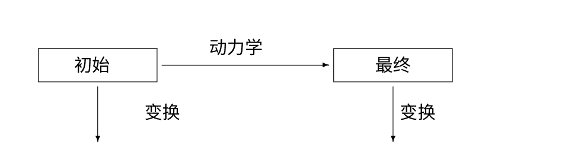

是可交换的，因此时间演化算符$H$与对称变换$U(R)$交换：

$$U(R)e^{-itH} = e^{-itH}U(R); \quad\quad (2.20)$$

在 $t$的线性阶展开中，我们得到

$$U(R)H = HU(R). \quad\quad (2.21)$$

对于连续对称性，我们可以选择 $R$无限接近于单位元，$R = I + \epsilon T$，然后 $U$接近于 $I$:

$$U = I - i\epsilon Q + O(\epsilon^2), \quad\quad (2.22)$$

其中 $Q$是由 $T$确定的算子。根据 $U$的幺正性（到 $\epsilon$的一阶），我们可以得出 $Q$是一个可观测量，$Q = Q^{\dagger}$。将方程（2.21）展开到 $\epsilon$的线性阶，我们得到

$$[Q, H] = 0; \quad\quad (2.23)$$

可观测量 $Q$与哈密顿量对易。方程（2.23）是一个守恒定律。例如，它表明如果我们准备一个 $Q$的本征态，那么由薛定谔方程所决定的时间演化将保持这个本征态。因此我们可以看到对称性意味着守恒定律。反过来，给定满足方程（2.23）的守恒量 $Q$，我们可以构造相应的对称变换。

有限变换可以由许多无穷小变换的乘积构建：

$$R = (1 + \frac{\theta}{N}T)^N \Rightarrow U(R) = (I + i\frac{\theta}{N}Q)^N \rightarrow e^{i\theta Q}, \quad\quad (2.24)$$

当极限 $N\rightarrow \infty$时。一旦我们决定了无穷小对称变换如何由幺正算符表示，那么有限变换的表示也就确定了。这样就可以将有限变换构建为无穷小变换的乘积。我们说 $Q$是对称的generator of。

让我们简要回顾一下这个普遍理论如何适用于空间旋转和角动量。关于由单位向量指定的轴的微小旋转 $d\theta$（逆时针方向）可以表示为

$$R(\hat{n}, d\theta) = I - i d\theta \hat{n} \cdot \vec{J}, \quad (2.25)$$

其中 $(J_1, J_2, J_3)$ 是角动量的分量。有限旋转表示为

$$R(\hat{n}, \theta) = \exp(-i \theta \hat{n} \cdot \vec{J}). \quad (2.26)$$

不同轴的旋转不可交换。通过旋转的基本性质，我们得到了对易关系

$$[J_k, J_\ell] = i \epsilon_{k\ell m} J_m, \quad (2.27)$$

其中 $\epsilon_{k\ell m}$ 是完全反对称张量，满足 $\epsilon_{123}= 1$，重复指标求和。为了在量子系统上实现旋转，我们在希尔伯特空间中找到满足这些关系的自伴算符 $J_1, J_2, J_3$。

旋转群的“定义”表示是三维的，但最简单的非平凡不可约表示是二维的，由

$$J_k = \frac{1}{2} \sigma_k, \quad (2.28)$$

其中

$$\sigma_1 = \begin{pmatrix} 0 & 1 \\ 1 & 0 \end{pmatrix}, \quad \sigma_2 = \begin{pmatrix} 0 & -i \\ i & 0 \end{pmatrix}, \quad \sigma_3 = \begin{pmatrix} 1 & 0 \\ 0 & -1 \end{pmatrix}, \quad (2.29)$$

是Pauli矩阵。这是唯一的二维不可约表示，除了基底的幺正变换。由于 $J_k$ 的特征值是 $\pm 1/2$，我们称之为自旋-1/2表示。（通过将 $J$ 识别为角动量，我们隐含地选择了 $\hbar = 1$ 的单位。）Pauli矩阵还具有互反和平方为单位矩阵的性质，

$$\sigma_k \sigma_\ell + \sigma_\ell \sigma_k = 2\delta_{k\ell} I ; \quad (2.30)$$

因此 $(\hat{n} \cdot \vec{\sigma})^2 = n_k n_\ell \sigma_k \sigma_l = n_k n_\ell I = I$ (其中重复的指标求和)。通过展开指数级数，我们可以看到有限旋转的表示为

$$U(\hat{n}, \theta) = \exp\left(-i \frac{\theta}{2} \hat{n} \cdot \vec{\sigma}\right) = I \cos\frac{\theta}{2} - i (\hat{n} \cdot \vec{\sigma}) \sin\frac{\theta}{2}. \quad (2.31)$$

行列式为1的最一般的2x2酉矩阵可以用这种形式表示。因此，我们有权将量子比特视为自旋-1/2的物体，而作用于量子比特状态的任意酉变换（除了可能的物理上无关的整体相位旋转）是自旋的旋转。

表示$U(\hat{n}, \theta)$的一个奇特特性是它是双值的。特别地，绕任意轴旋转$2\pi$的表示是非平凡的：

$$U(\hat{n}, \theta=2\pi) = -I. \tag{2.32}$$

我们对旋转群的表示实际上是“带有符号”的表示

$$U(R_1)U(R_2) = \pm U(R_1 \circ R_2). \tag{2.33}$$

但正如已经指出的那样，这是可以接受的，因为群的乘法在射线上是被尊重的，尽管在向量上不是。这些旋转群的双值表示被称为自旋表示。(自旋子的存在是由于群的拓扑性质——它不是简单连通的。)

虽然一个$2\pi$的旋转对于一个自旋1/2的物体没有可检测的影响，但错误地得出自旋子属性没有可观测的后果是错误的。假设我有一台作用于一对自旋的机器。如果第一个自旋是向上的，它什么也不做，但如果第一个自旋是向下的，它将第二个自旋转$2\pi$。现在让这台机器在第一个自旋处于向上和向下的叠加态时起作用。然后

$$\frac{1}{\sqrt{2}} (|\uparrow\rangle_1 + |\downarrow\rangle_1) |\uparrow\rangle_2 \rightarrow \frac{1}{\sqrt{2}} (|\uparrow\rangle_1 - |\downarrow\rangle_1) |\uparrow\rangle_2. \tag{2.34}$$

虽然对第二个自旋没有可检测的影响，但第一个自旋的状态已经翻转成了一个正交的状态，这是非常明显的。

在一个旋转的参考系中，一个旋转 $R(\hat{n}, \theta)$ 变成了绕一个旋转轴旋转相同角度的旋转。由此可知，角动量的三个分量在旋转下作为一个矢量进行变换：

$$U(R)J_k U(R)^\dagger = R_{kl} J_l. \tag{2.35}$$

因此，如果一个状态 $|m\rangle$ 是 $J_3$ 的本征态

$$J_3|m\rangle = m|m\rangle, \tag{2.36}$$

那么 $U(R)|m\rangle$ 是 $R J_3$ 的本征态，具有相同的本征值：

$$R J_3 (U(R)|m\rangle) = U(R) J_3 U(R)^\dagger U(R)|m\rangle = U(R) J_3 |m\rangle = m (U(R)|m\rangle). \tag{2.37}$$

## 2.2 量子比特

因此，我们可以通过对绕轴$\hat{n}= (\sin \theta \cos \varphi, \sin \theta \sin \varphi, \cos \theta)$进行逆时针旋转$\theta$来构建沿轴$\hat{n}' = (-\sin \varphi, \cos \varphi, 0)$的角动量本征态。

对于我们的自旋-$\frac{1}{2}$表示，这个旋转是
$$\exp \left(-i \frac{\theta}{2} \hat{n}' \cdot \vec{\sigma}\right) = \exp \left[\frac{\theta}{2} \begin{pmatrix} 0 & -e^{-i\varphi} \\ e^{i\varphi} & 0 \end{pmatrix}\right] = \begin{pmatrix} \cos \frac{\theta}{2} & -e^{-i\varphi} \sin \frac{\theta}{2} \\ e^{i\varphi} \sin \frac{\theta}{2} & \cos \frac{\theta}{2} \end{pmatrix}, \quad (2.38)$$
并将其应用于 $\begin{pmatrix}1 \\ 0\end{pmatrix}$，具有特征值1的 $J_3$特征态，我们得到
$$|\psi(\theta, \varphi)\rangle = \begin{pmatrix} e^{-i\varphi/2} \cos \frac{\theta}{2} \\ e^{i\varphi/2} \sin \frac{\theta}{2} \end{pmatrix}, \quad (2.39)$$
（最多一个整体相位）。我们可以直接验证这是一个特征态的
$$\hat{n} \cdot \vec{\sigma} = \begin{pmatrix} \cos \theta & e^{-i\varphi} \sin \theta \\ e^{i\varphi} \sin \theta & -\cos \theta \end{pmatrix}, \quad (2.40)$$
具有特征值为1。现在我们看到，方程 (2.15) 可以解释为一个指向 $(\theta, \varphi)$ 方向的自旋。我们注意到，我们无法通过单次测量确定a和b。

此外，即使有许多相同的状态副本，我们也无法仅通过沿着z轴测量每个副本来完全确定状态。这将使我们能够估计 $|a|$和 $|b|$，但我们将无法了解 $a$ 和 $b$ 的相对相位。换句话说，我们将找到自旋在$z$轴上的分量。
$$\langle\psi(\theta, \varphi)|\sigma_3|\psi(\theta, \varphi)\rangle = \cos^2 \frac{\theta}{2} - \sin^2 \frac{\theta}{2} = \cos \theta, \quad (2.41)$$
但我们不会学习平面上的分量 $x$-$y$。通过测量自旋来确定 $|\psi\rangle$ 的问题等同于通过测量其在不同轴上的分量来确定单位向量$\hat{n}$。总共需要沿着三个不同轴的测量。例如，从$\langle \sigma_3 \rangle$ 和 $\langle \sigma_1 \rangle$ 我们可以确定 $n_3$ 和 $n_1$，但 $n_2$ 的符号仍然未确定。测量 $\langle \sigma_2 \rangle$ 将消除这个剩余的不确定性。

如果我们被允许旋转自旋，那么只有沿着 $z$轴的测量才足够。也就是说，测量沿着$\hat{n}$轴的自旋等效于首先应用一个将$\hat{n}$轴旋转到轴$z$的旋转，然后沿着$\hat{z}$进行测量。

在特殊情况 $\theta = \frac{\pi}{2}$ 和 $\varphi = 0$ （$\hat{x}$轴）下，我们的自旋态为
$$|\uparrow_x\rangle = \frac{1}{\sqrt{2}} (|\uparrow_z\rangle + |\downarrow_z\rangle) \quad (2.42)$$
（“沿着x轴的自旋向上”）正交状态（“沿着x轴的自旋向下”）
$$|\downarrow_x\rangle = \frac{1}{\sqrt{2}} (|\uparrow_z\rangle - |\downarrow_z\rangle). \quad (2.43)$$
对于这两种状态中的任何一种，如果我们沿着z轴测量自旋，我们将以1/2的概率得到$|\uparrow_z\rangle$，以1/2的概率得到$|\downarrow_z\rangle$。

现在考虑组合
$$\frac{1}{\sqrt{2}} (|\uparrow_x\rangle + |\downarrow_x\rangle). \quad (2.44)$$
这个状态具有这样的特性，如果我们沿着x轴测量自旋，我们会得到$|\uparrow_x\rangle$或$|\downarrow_x\rangle$，每个的概率都是1/2。现在我们可以问，如果我们沿着z轴测量方程（2.44）中的状态会怎样？

如果这些是概率经典位，答案是显而易见的。方程（2.44）中的状态处于两种状态之一，对于这两种状态，沿着z轴指向上或向下的概率都是1/2。所以当我们测量这个状态 $\frac{1}{\sqrt{2}} (|\uparrow_x\rangle + |\downarrow_x\rangle)$ 沿着 $z$轴时，当然应该以1/2的概率得到向上的结果。

但对于量子比特来说并非如此！通过添加方程（2.42）和方程（2.43），我们可以看到方程（2.44）中的状态实际上是以$|\uparrow_z\rangle$的伪装形式存在的。当我们沿着z轴测量时，我们总是得到$|\uparrow_z\rangle$，从不得到$|\downarrow_z\rangle$。

我们可以看到，对于量子比特而言，与概率性经典比特相反，概率可以以意想不到的方式相加。这就是量子干涉的最简单形式，这是量子信息的一个重要特征。

总结一下量子比特的几何解释：我们可以将量子比特视为一个自旋-1/2对象，并且其量子态由一个在三维空间中表示自旋方向的单位矢量$\hat{n}$来描述。一个酉变换可以旋转自旋，而对可观测量的测量有两种可能的结果：自旋可以沿着指定轴向上或向下。

需要强调的是，虽然这与自旋的形式等价，但这形式等价只适用于两级量子系统。1/2物体适用于任何两级量子系统，但并非每个两级系统在空间旋转下都能转化为自旋态！

## 2.2.2 光子极化

另一个重要的两态系统是光子，它可以具有两个独立的极化态。这些光子极化态也在旋转下变换，但光子与我们的自旋-1/2物体有两个重要的不同之处：

-   光子是无质量的。
-   光子具有自旋-1（它们不是自旋态）。

我们将不在这里详细讨论庞加莱群的幺正表示。可以说，粒子的自旋将其分类为如何在小群下变换，小群是洛伦兹群中保持粒子动量不变的子群。对于一个有质量的粒子，我们总可以提升到粒子的静止系，然后小群就是旋转群。

对于无质量的粒子，不存在静止参考系。有限维的酉表示是小群的表示，实际上是二维旋转群的表示，绕动量确定的轴旋转。对于光子来说，这对应于经典光的一个熟悉属性——波沿传播方向横向偏振。

在绕传播轴旋转时，两个线偏振态（水平和垂直偏振）的变换为
$$|x\rangle \rightarrow \cos \theta|x\rangle + \sin \theta|y\rangle$$
$$|y\rangle \rightarrow -\sin \theta|x\rangle + \cos \theta|y\rangle. \quad (2.45)$$
这个二维表示实际上是可约的。矩阵
$$\begin{pmatrix} \cos \theta & \sin \theta \\ -\sin \theta & \cos \theta \end{pmatrix} \quad (2.46)$$
具有本征态
$$|R\rangle = \frac{1}{\sqrt{2}} \begin{pmatrix} 1 \\ i \end{pmatrix} \quad |L\rangle = \frac{1}{\sqrt{2}} \begin{pmatrix} i \\ 1 \end{pmatrix}, \quad (2.47)$$
具有本征值 $e^{i\theta}$ 和 $e^{-i\theta}$，即右旋和左旋的状态。也就是说，它们是旋转生成元的本征态
$$J = \begin{pmatrix} 0 & -i \\ i & 0 \end{pmatrix} = \sigma_2, \quad (2.48)$$
具有本征值 $\pm 1$。由于本征值为 $\pm 1$（而不是 $\pm \frac{1}{2}$），我们说光子具有自旋-1。

在这个背景下，量子干涉现象可以描述如下。偏振态
$$|+\rangle = \frac{1}{\sqrt{2}} (|x\rangle + |y\rangle),$$
$$|-\rangle = \frac{1}{\sqrt{2}} (-|x\rangle + |y\rangle), \quad (2.49)$$
彼此正交，并且可以通过将状态 $|x\rangle$ 和 $|y\rangle$ 旋转45°获得。假设我们有一个偏振分析器，只允许通过两个正交线性光子偏振中的一个，吸收另一个。那么一个 $x$ 或 $y$ 偏振的光子通过一个45°旋转的偏振器的概率为 1/2，而一个45°偏振的光子通过一个 $x$ 或 $y$ 分析器的概率为 1/2。但是一个 $x$ 光子永远不会通过一个 $y$ 分析器。

假设一个光子束被定向到一个 $x$ 分析器，而一个 $y$ 分析器被放置在更远的下游。那么大约一半的光子将通过第一个分析器，但每一个通过的光子都将被第二个分析器阻止。但是现在假设我们在 $x$ 和 $y$ 分析器之间放置一个45°旋转的分析器。那么大约一半的光子将通过每个分析器，大约有八分之一的光子能够通过所有三个分析器而不被吸收。由于这种干涉效应，没有一种一致的解释可以使每个光子携带一个经典的极化信息位。量子位与概率性经典位不同。

可以构造一个设备来旋转光子的线偏振，从而将变换方程（2.45）应用于我们的量子位；它通过“打开”一个哈密顿量来实现，其中圆偏振态 $|L\rangle$ 和 $|R\rangle$ 是非简并的能量本征态。这不是最一般的可逆变换。但是如果我们还有一个改变两个正交线偏振态的相对相位的设备
$$\begin{aligned}
|x\rangle &\rightarrow e^{-i\varphi /2}|x\rangle, \\
|y\rangle &\rightarrow e^{i\varphi /2}|y\rangle
\end{aligned} \quad (2.50)$$
（通过打开一个非简并能量本征态为线偏振态的哈密顿量），然后两个设备可以一起应用任意 $2\times2$ 行列式为1的酉变换到光子的偏振态。

## 2.3 密度算符

### 2.3.1 二分量子系统

在了解了关于单个量子位的一切之后，我们准备好处理具有两个量子位的系统了。从一个量子位到两个量子位的跨越比你想象的要大。关于量子力学的许多奇怪和奇妙之处可以通过考虑两个量子位的量子态的性质来理解。

§2.1的公理提供了一个完全可接受的量子理论的一般表述。然而，在许多情况下，我们发现公理似乎被违反了。问题在于我们的公理是用来描述一个与其周围环境不相互作用的封闭系统的量子行为。实际上，封闭的量子系统并不存在；我们所观察到的总是一个较大量子系统的一小部分。

当我们研究开放系统时，也就是我们只关注较大系统的一部分时，与公理相反：

-   状态不是射线。
-   测量不是正交投影。
-   演化不是幺正的。

为了得到开放量子系统遵循的规律，我们必须回顾我们的第五个公理，它将复合量子系统的描述与其组成部分的描述联系起来。作为理解开放系统的量子描述的第一步，考虑一个我们只观察到其中一个量子比特的双量子比特世界。量子比特 $A$ 在这个房间里，我们可以自由观察或操纵它。但是量子比特 $B$ 被锁在一个我们无法接触的保险库中。完整的系统 $AB$ 遵循 §2.1 的公理。但我们希望找到一种简洁的方式来描述只能对量子比特 $A$ 进行的观察。

我们将使用 $\{|0\rangle_A, |1\rangle_A\}$ 和 $\{|0\rangle_B, |1\rangle_B\}$ 分别表示量子比特 $A$ 和 $B$ 的正交基。考虑一个由两个量子比特组成的量子态的情况
$$|\psi\rangle_{AB} = a|0\rangle_A\otimes|0\rangle_B + b|1\rangle_A\otimes|1\rangle_B \quad (2.51)$$
在这个状态下，量子比特 $A$ 和 $B$ 是相关的。假设我们测量量子比特 $A$ 通过投影到 $\{|0\rangle_A, |1\rangle_A\}$ 基底。然后以概率 $|a|^2$ 我们得到结果 $|0\rangle_A$，测量会准备好状态
$$|0\rangle_A \otimes |0\rangle_B \quad (2.52)$$
以概率 $|b|^2$，我们得到结果 $|1\rangle_A$ 并准备状态
$$|1\rangle_A \otimes |1\rangle_B \quad (2.53)$$
无论哪种情况，测量都会选择出一个确定的量子比特 $B$ 的状态。如果我们随后测量量子比特 $B$，那么我们有保证（以概率为一）会发现 $|0\rangle_B$，如果我们发现 $|0\rangle_A$，我们有保证会发现 $|1\rangle_B$，如果我们发现 $|1\rangle_A$。从这个意义上说，测量结果 $\{|0\rangle_A, |1\rangle_A\}$ 和 $\{|0\rangle_B, |1\rangle_B\}$ 是在状态 $|\psi\rangle_{AB}$ 中完全相关的。

但现在我们想考虑更一般的作用在量子比特 $A$ 上的可观测量，并且我们想表征测量结果仅关于 $A$（不考虑对不可访问的量子比特 $B$ 的任何测量结果）。仅作用在量子比特 $A$ 上的可观测量可以表示为
$$M_A \otimes I_B, \tag{2.54}$$
其中 $M_A$ 是作用在 $A$ 上的自伴算符，$I_B$ 是作用在 $B$ 上的单位算符。在态 $|\psi\rangle$ 中的可观测量期望值为：
$$\begin{aligned}
\langle M_A \rangle &= \langle \psi | M_A \otimes I_B | \psi \rangle \\
&= (a^*\langle 00 | + b^*\langle 11 |)(M_A \otimes I_B)(a| 00 \rangle + b| 11 \rangle) \\
&= | a |^2 \langle 0 | M_A | 0 \rangle + | b |^2 \langle 1 | M_A | 1 \rangle \tag{2.55}
\end{aligned}$$
（我们使用了 $| 0 \rangle_B$ 和 $| 1 \rangle_B$ 的正交性。）这个表达式可以重写为
$$\langle M_A \rangle = \text{tr} (M_A \rho_A), \quad \rho_A = | a |^2 | 0 \rangle\langle 0 | + | b |^2 | 1 \rangle\langle 1 | \tag{2.56}$$
这里的 $\text{tr}(\cdot)$ 表示迹。算符 $\rho_A$ 被称为量子位 $A$ 的密度算符（或密度矩阵）。它是自伴的，正定（其特征值非负），并且具有单位迹（因为 $|\psi\rangle$ 是一个归一化态）。由于 $\langle M_A \rangle$ 对于作用在量子位 $A$ 上的任何可观测量 $M_A$ 都具有 $\text{eq.}(2.56)$ 的形式，因此一致地将 $\rho_A$ 解释为表示一组可能的量子态的集合，每个量子态发生的概率都有特定的值。也就是说，如果我们规定量子位 $A$ 处于两个量子态之一，那么我们将得到完全相同的 $\langle M_A \rangle$ 结果。以概率 $p_0 = | a |^2$ 它处于量子态 $| 0 \rangle$，以概率 $p_1 = | b |^2$ 它处于量子态 $| 1 \rangle$。

如果我们对任何可能的测量结果感兴趣，我们可以将 $M_A$ 视为对特定可观测量的相关本征空间的投影 $E_A(a)$。然后
$$\text{Prob}(a) = p_0\langle 0 | E_A(a) | 0 \rangle + p_1\langle 1 | E_A(a) | 1 \rangle, \tag{2.57}$$
这是在集合中加权求和的 $a$ 结果的概率，并且加权因子是集合中每个状态的概率。

我们先前强调过，一个 $| 0 \rangle$ 和 $| 1 \rangle$ 的相干叠加态与一个概率集合之间存在本质上的区别，其中 $| 0 \rangle$ 和 $| 1 \rangle$ 可以以指定的概率出现。

例如，对于一个自旋-$\frac{1}{2}$ 的物体，我们已经看到，如果我们测量 $\sigma^1$ 在状态 $\frac{1}{\sqrt{2}} (| \uparrow_z \rangle + | \downarrow_z \rangle)$，我们将以概率 1 获得结果 $| \uparrow_x \rangle$。但是，集合中 $| \uparrow_z \rangle$ 和 $| \downarrow_z \rangle$ 出现的概率分别为 $\frac{1}{2}$，由密度算符表示
$$\rho = \frac{1}{2} (| \uparrow_z \rangle\langle \uparrow_z | + | \downarrow_z \rangle\langle \downarrow_z |) = \frac{1}{2} I, \tag{2.58}$$## 2.3 密度算符

并且对 |↑ₓ⟩ 的投影具有期望值

$$
\mathrm{tr} (|↑ₓ⟩⟨↑ₓ| \rho) = ⟨↑ₓ| \rho |↑ₓ⟩ = 1/2. \tag{2.59}
$$

同样，如果我们测量沿着由极角 θ 和 φ 标记的任意轴的自旋，获得“自旋向上”的概率为

$$
⟨ψ(θ, φ)|\rho|ψ(θ, φ)⟩ = \mathrm{tr} (|ψ(θ, φ)⟩⟨ψ(θ, φ)| \rho) = ⟨ψ(θ, φ)| \frac{1}{2} I |ψ(θ, φ)⟩ = 1/2. \tag{2.60}
$$

因此，在双量子位世界中，如果准备了一个等权重的相干叠加态 |00⟩ 和 |11⟩，量子位 A 的状态表现出不相干性 - 在任何轴上，它是自旋向上和自旋向下的等概率混合。

这个关于相关的双量子位态 |ψ⟩_{AB} 的讨论很容易推广到任意二分量子系统（一个被分成两部分的系统）。一个二分量子系统的希尔伯特空间是 H_A ⊗ H_B，其中 H_{A,B} 是两部分的希尔伯特空间。这意味着如果 {|i⟩_A} 是 H_A 的一组正交基，而 {|μ⟩_B} 是 H_B 的一组正交基，那么 {|i⟩_A ⊗ |μ⟩_B} 是 H_A ⊗ H_B 的一组正交基。因此，H_A ⊗ H_B 的任意纯态可以展开为

$$
|ψ⟩_{AB} = \sum_{i,\mu} a_{i\mu} |i⟩_A \otimes |μ⟩_B, \tag{2.61}
$$

其中 $\sum_{i,\mu} |a_{i\mu}|^2 = 1$。一个只作用于子系统 A 的可观测量 $M_A \otimes I_B$ 的期望值是

$$
⟨M_A⟩ = \ _{AB}⟨ψ| M_A \otimes I_B |ψ⟩_{AB} = \sum_{j,\nu} a_{j\nu}^* ( _A⟨j| \otimes _B⟨ν|) (M_A \otimes I_B) \sum_{i,\mu} a_{i\mu} (|i⟩_A \otimes |μ⟩_B) = \sum_{i,j,\mu} a_{j\mu}^* a_{i\mu} ⟨j| M_A |i⟩ = \mathrm{tr} (M_A \rho_A), \tag{2.62}
$$

其中

$$
\rho_A = \mathrm{tr}_B (|ψ⟩⟨ψ|) \equiv \sum_{i,j,\mu} a_{i\mu} a_{j\mu}^* |i⟩⟨j| \tag{2.63}
$$

是子系统 A 的密度算符。

我们可以说，子系统 A 的密度算符 $\rho_A$ 是通过对组合系统 AB 的密度算符（在这种情况下是纯态）在子系统 B 上进行偏迹得到的。我们可以将一个对偶向量（或共轭态） ${}_B⟨μ|$ 视为一个线性映射，它将 $H_A \otimes H_B$ 中的向量映射到 $H_A$ 中的向量，通过其基向量的作用来定义：

$$
{}_B⟨μ|iν⟩_{AB} = \delta_{\mu\nu} |i⟩_A; \tag{2.64}
$$

类似地，凯特态 $|μ⟩_B$ 通过将 $H_A \otimes H_B$ 的对偶基映射到 $H_A$ 的对偶基，通过以下方式定义：

$$
_{AB}⟨iν|μ⟩_B = \delta_{\mu\nu} {}_A⟨i|. \tag{2.65}
$$

偏迹操作是一个线性映射，它将作用在 $H_A \otimes H_B$ 上的算符 $M_{AB}$ 映射为作用在 $H_A$ 上的算符

$$
\mathrm{tr}_B M_{AB} = \sum_\mu {}_B⟨\mu| M_{AB} |\mu⟩_B. \tag{2.66}
$$

我们可以看到作用在 $A$ 上的密度算符是偏迹

$$
\rho_A = \mathrm{tr}_B (|ψ⟩⟨ψ|). \tag{2.67}
$$

- 根据定义方程 (2.63)，我们可以立即推断出 $\rho_A$ 具有以下性质：
1. $\rho_A$ 是自伴的：$\rho_A = \rho_A^\dagger$。
2. $\rho_A$ 是正的：对于任意的 $|\phi⟩$，$\langle\phi| \rho_A |\phi\rangle = \sum_\mu |\sum_i a_{i\mu} \langle\phi|i\rangle|^2 \geq 0$。
3. $\mathrm{tr}(\rho_A) = 1$：我们有 $\mathrm{tr}(\rho_A) = \sum_{i,\mu} |a_{i\mu}|^2 = 1$，因为 $|ψ⟩_{AB}$ 是归一化的。

由此可知 $\rho_A$ 可以在正交基下对角化，特征值都是实数且非负，并且特征值之和为一。

如果我们正在观察一个更大的量子系统的子系统，即使更大系统的状态是射线，子系统的状态也不一定是；一般情况下，状态由密度算符表示。在子系统状态为射线的情况下，我们称该状态为纯态。否则，状态为混合态。如果状态是纯态 $|ψ⟩_A$，则密度矩阵 $\rho_A = |ψ⟩⟨ψ|$ 是对 $|ψ⟩_A$ 所张成的一维空间的投影。因此，纯态密度矩阵具有以下特性 $\rho^2 = \rho$ 和 $\mathrm{tr} \rho = 1$。

一个一般的密度矩阵，在基 $\{|a⟩\}$ 中表示，其形式为

$$
\rho_A = \sum_a p_a |a⟩⟨a|, \tag{2.68}
$$

其中 $0 < p_a \leq 1$ 且 $\sum_a p_a = 1$。如果状态不纯，这个求和中会有两个或更多项，且 $\rho^2 \neq \rho$；实际上，$\mathrm{tr} \rho^2 = \sum_a p_a^2 < \sum_a p_a = 1$。

我们说 $\rho$ 是状态 $\{|a⟩\}$ 的一个不相干混合；“不相干”意味着 $|a⟩$ 的相对相位在实验上是无法访问的。

由于作用于子系统的任意可观测量 $M$ 的期望值可以表示为

$$
\langle M \rangle = \mathrm{tr} \, M \rho = \sum_{a} p_a \langle a | M | a \rangle, \tag{2.69}
$$

正如之前所见，我们可以将 $\rho$ 解释为描述一个纯量子态的集合，其中态 $|a⟩$ 以概率 $p_a$ 出现。因此，我们在理解量子力学中概率如何产生的过程中已经走了很长一段路，当一个量子系统 $A$ 与另一个系统 $B$ 相互作用时。$A$ 和 $B$ 变得纠缠在一起，即相关联。

纠缠破坏了一个超态的相干性，因此如果我们只看 $A$，那么超态中的一些相位将变得无法访问。我们可以通过说系统 $A$ 的状态坍缩来描述这种情况——它处于一组可分配概率的备选状态之一。

## 2.3.2 布洛赫球

让我们回到系统 $A$ 是一个量子比特的情况，并考虑一般密度矩阵的形式。最一般的自伴算符 $2 \times 2$ 矩阵有四个实参数，并且可以在基底 $\{I, \sigma_1, \sigma_2, \sigma_3\}$ 上展开。

由于每个 $\sigma_i$ 都是无迹的，密度矩阵 $\rho$ 在展开式中 $I$ 的系数必须为 $1/2$（以使得 $\mathrm{tr}(\rho) = 1$），并且 $\rho$ 可以表示为

$$
\begin{aligned}
\rho(\vec{P}) &= \frac{1}{2} \left( \boldsymbol{I} + \vec{P} \cdot \vec{\sigma} \right) \\
&\equiv \frac{1}{2} \left( \boldsymbol{I} + P_1 \sigma_1 + P_2 \sigma_2 + P_3 \sigma_3 \right) \\
&= \frac{1}{2} \begin{pmatrix} 1 + P_3 & P_1 - i P_2 \\ P_1 + i P_2 & 1 - P_3 \end{pmatrix},
\end{aligned}
\tag{2.70}
$$

其中 $P_1, P_2, P_3$ 是实数。我们可以计算 $\det \rho = \frac{1}{4} (1 - \vec{P}^2)$。

因此，$\rho$ 具有非负特征值的必要条件是 $\det \rho \geq 0$ 或 $\vec{P}^2 \leq 1$。这个条件也是充分的；因为 $\mathrm{tr} \rho = 1$，$\rho$ 不可能有两个负特征值。因此，一个单量子比特的可能密度矩阵与单位球上的点之间存在 1–1 的对应关系，其中 $0 \leq |\vec{P}| \leq 1$。这个球通常被称为布洛赫球（虽然它实际上是一个球，而不是一个球体）。

这个球的边界 $(|\vec{P}| = 1)$（实际上是一个球体）包含行列式为零的密度矩阵。由于 $\mathrm{tr} \rho = 1$，这些密度矩阵必须具有特征值 0 和 1 —— 它们是一维投影算符，因此是纯态。我们已经看到，任何单比特的纯态都可以表示为 $|\psi(\theta, \phi)\rangle$，可以想象为一个指向 $(\theta, \phi)$ 方向的自旋。确实，使用该性质

$$
(\hat{n} \cdot \vec{\sigma})^2 = I
$$

其中 $\hat{n}$ 是一个单位向量，我们可以轻松验证纯态密度矩阵

$$
\rho(\hat{n}) = \frac{1}{2}(I + \hat{n} \cdot \vec{\sigma})
$$

满足该性质

$$
(\hat{n} \cdot \vec{\sigma}) \rho(\hat{n}) = \rho(\hat{n}) (\hat{n} \cdot \vec{\sigma}) = \rho(\hat{n})
$$

因此是投影算符

$$
\rho(\hat{n}) = |\psi(\hat{n})\rangle\langle\psi(\hat{n})|
$$

也就是说，$\hat{n}$ 是自旋指向上的方向。或者，从表达式

$$
|\psi(\theta, \phi)\rangle = \begin{pmatrix} e^{-i\phi/2} \cos(\theta/2) \\ e^{i\phi/2} \sin(\theta/2) \end{pmatrix}
$$

我们可以直接计算出

$$
\begin{aligned}
\rho(\theta, \phi) &= |\psi(\theta, \phi)\rangle\langle\psi(\theta, \phi)| \\
&= \begin{pmatrix} \cos^2(\theta/2) & \cos(\theta/2)\sin(\theta/2)e^{-i\phi} \\ \cos(\theta/2)\sin(\theta/2)e^{i\phi} & \sin^2(\theta/2) \end{pmatrix} \\
&= \frac{1}{2}I + \frac{1}{2}\begin{pmatrix} \cos\theta & \sin\theta e^{-i\phi} \\ \sin\theta e^{i\phi} & -\cos\theta \end{pmatrix} = \frac{1}{2}(I + \hat{n} \cdot \vec{\sigma})
\end{aligned}
$$

其中 $\hat{n} = (\sin\theta \cos\phi, \sin\theta \sin\phi, \cos\theta)$。布洛赫参数化纯态的一个好的性质是，虽然 $|\psi(\theta, \phi)\rangle$ 具有任意的整体相位，但这对物理没有意义，而在密度矩阵 $\rho(\theta, \phi) = |\psi(\theta, \phi)\rangle\langle\psi(\theta, \phi)|$ 中没有相位的歧义； $\rho$ 中的所有参数都有物理意义。

根据该性质

$$
\frac{1}{2} \mathrm{tr} \sigma_i \sigma_j = \delta_{ij}
$$

从式子 (2.70)

我们可以看出

$$
\langle \hat{n} \cdot \vec{\sigma} \rangle_{\vec{P}} = \mathrm{tr} \left( \hat{n} \cdot \vec{\sigma} \rho(\vec{P}) \right) = \hat{n} \cdot \vec{P}
$$

我们说向量 $\vec{P}$ 在方程 (2.70) 中参数化了自旋的极化。如果我们有许多相同的系统可供使用，我们可以通过沿着三个线性独立轴测量 $\langle \hat{n} \cdot \vec{\sigma} \rangle$ 来确定 $\vec{P}$ (从而确定完整的密度矩阵 $\rho(\vec{P})$) 。

## 2.4 施密特分解

一个二分纯态可以用标准形式（Schmidt分解）表示，这通常非常有用。

要得到这个形式，注意到 $\mathcal{H}_A \otimes \mathcal{H}_B$ 中的任意向量可以展开为

$$
|\psi\rangle_{AB} = \sum_{i,\mu} \psi_{i\mu} |i\rangle_A \otimes |\mu\rangle_B \equiv \sum_i |i\rangle_A \otimes |\tilde{i}\rangle_B \qquad (2.79)
$$

这里，$\{|i\rangle_A\}$ 和 $\{|\mu\rangle_B\}$ 分别是 $\mathcal{H}_A$ 和 $\mathcal{H}_B$ 的正交归一基，但为了得到方程 (2.79) 中的第二个等式，我们已经定义了

$$
|\tilde{i}\rangle_B \equiv \sum_{\mu} \psi_{i\mu} |\mu\rangle_B. \qquad (2.80)
$$

请注意，$|\tilde{i}\rangle_B$ 的彼此之间不需要正交或归一化。

现在假设 $\{|i\rangle_A\}$ 基是选择为 $\rho_A$ 对角线的基，

$$
\rho_A = \sum_i p_i |i\rangle\langle i|. \qquad (2.81)
$$

我们也可以通过进行偏迹计算 $\rho_A$，

$$
\begin{aligned}
\rho_A &= \mathrm{tr}_B(|\psi\rangle\langle\psi|) \\
&= \mathrm{tr}_B \left( \sum_{i,j} |i\rangle\langle j| \otimes |\tilde{i}\rangle\langle\tilde{j}| \right) = \sum_{i,j} \langle\tilde{j}|\tilde{i}\rangle \left( |i\rangle\langle j| \right). \qquad (2.82)
\end{aligned}
$$

我们通过注意到在等式 (2.82) 中，$\mathrm{tr}_B \left( |\tilde{i}\rangle\langle\tilde{j}| \right) = \langle\tilde{j}|\tilde{i}\rangle$，得到了最后一个等式，

$$
\begin{aligned}
\mathrm{tr}_B \left( |\tilde{i}\rangle\langle\tilde{j}| \right) &= \sum_k \langle k|\tilde{i}\rangle\langle\tilde{j}|k\rangle \\
&= \sum_k \langle\tilde{j}|k\rangle\langle k|\tilde{i}\rangle = \langle\tilde{j}|\tilde{i}\rangle, \qquad (2.83)
\end{aligned}
$$

其中 $\{|k\rangle\}$ 是 $\mathcal{H}_B$ 的一个完备正交基。 通过比较等式 (2.81) 和等式 (2.82)，我们可以看到

$$
\langle\tilde{j}|\tilde{i}\rangle = p_i \delta_{ij}. \qquad (2.84)
$$

因此，结果证明 $\{|\tilde{i}\rangle_B\}$ 是正交的。 我们通过重新缩放获得正交归一向量，

$$
|i'\rangle_B = p_i^{-1/2} |\tilde{i}\rangle_B \qquad (2.85)
$$

(我们可以假设 $p_i= 0$， 因为我们只需要对出现在求和式 (2.81) 中的 $i$ 使用方程 (2.85))，因此得到展开式

$$
|\psi\rangle_{AB} = \sum_i \sqrt{p_i} |i\rangle_A \otimes |i'\rangle_B, \qquad (2.86)
$$

用 $\mathcal{H}_A$ 和 $\mathcal{H}_B$ 的一个特定正交归一基表示，方程 (2.86) 是双分体纯态的 Schmidt 分解。

任何二分纯态都可以用这种形式表示，但所使用的基取决于被展开的纯态。一般来说，我们不能同时用相同的正交基展开 $\mathcal{H}_A$ 和 $\mathcal{H}_B$ 中的 $|\psi\rangle_{AB}$ 和 $|\varphi\rangle_{AB}$，形式为方程 (2.86)。比较二分纯态 $|\psi\rangle_{AB}$ 的施密特分解和其在一般正交基中的展开是很有启发性的。

$$
|\psi\rangle_{AB} = \sum_{a,\mu} \psi_{a\mu} |a\rangle_A \otimes |\mu\rangle_B, \qquad (2.87)
$$

正交基 $\{|a\rangle_A\}$ 和 $\{|\mu\rangle_B\}$ 与施密特基 $\{|i\rangle_A\}$ 和 $\{|i'\rangle_B\}$ 通过酉变换 $U_A$ 和 $U_B$ 相关。

$$
|i\rangle_A = \sum_a |a\rangle_A (U_A)_{ai}, \quad |i'\rangle_B = \sum_\mu |\mu\rangle_B (U_B)_{\mu i'}. \qquad (2.88)
$$

通过将等式 (2.86) 和等式 (2.87) 中的 $|\psi\rangle_{AB}$ 表达式进行等式，我们发现

$$
\psi_{a\mu} = \sum_i (U_A)_{ai} \sqrt{p_i} (U_B^T)_{i\mu}. \qquad (2.89)
$$

我们看到，通过在左边和右边应用酉变换，任何矩阵 $\psi$ 都可以转化为一个对角线和非负的矩阵。（如果希尔伯特空间 $\mathcal{H}_A$ 和 $\mathcal{H}_B$ 的维度不同，那么“对角线”矩阵将是长方形而不是正方形。）方程 (2.89) 被称为 $\psi$ 的奇异值分解，而 $\psi$ 的奇异值是 $\{\sqrt{p_i}\}$ 的权重。

使用方程式 (2.86)，我们还可以计算出对 $\mathcal{H}_B$ 的偏迹

$$
\rho_B = \mathrm{tr}_A (|\psi\rangle\langle\psi|) = \sum_i p_i |i'\rangle\langle i'|. \qquad (2.90)
$$

我们可以看到 $\rho_A$ 和 $\rho_B$ 具有相同的非零特征值。如果 $\mathcal{H}_A$ 和 $\mathcal{H}_B$ 的维度不相同，则 $\rho_A$ 和 $\rho_B$ 的零特征值的数量将不同。

注意，因此从 (2.90) 式可见 $\rho_B$ 的对角元是 $p_i$，而 $\rho_A$ 的对角元也是 $p_i$，即它们具有相同的非零特征值谱。

我们可以对 $\rho_A$ 和 $\rho_B$ 进行对角化，以找到 $|i\rangle_A$ 的施密特分解，然后我们将 $\rho_A$ 和 $\rho_B$ 的特征态与相同的特征值配对得到方程 (2.86)。我们选择了基态的相位，使得求和中的系数不含相位；唯一剩下的自由度是通过乘以相反的相位来重新定义 $|i\rangle_A$ 和 $|i'\rangle_B$（这不改变方程 (2.86) 的表达式）。

但是，如果 $\rho_A$ 具有重复的非零特征值，则我们需要比 $\rho_A$ 和 $\rho_B$ 提供的信息更多，以确定 Schmidt 分解；我们需要知道每个 $|i'\rangle_B$ 与哪个 $|i\rangle_A$ 配对。例如，如果 $\mathcal{H}_A$ 和 $\mathcal{H}_B$ 都是 $d$ 维的，并且 $U_{ij}$ 是任意的 $d \times d$ 幺正矩阵，那么

$$
|\psi\rangle_{AB} = \frac{1}{\sqrt{d}} \sum_{i,j=1}^{d} |i\rangle_A U_{ij} \otimes |j'\rangle_B, \quad (2.91)
$$

当我们进行部分追踪时，将得到 $\rho_A = \rho_B = (1/d) I$。此外，我们可以自由地在 $\mathcal{H}_A$ 和 $\mathcal{H}_B$ 中同时应用酉变换；写作

$$
|i\rangle_A = \sum_a |a\rangle_A U_{ai}, \quad |i'\rangle_B = \sum_b |b'\rangle_B U_{bi}^*, \quad (2.92)
$$

我们有

$$
\begin{aligned}
|\psi\rangle_{AB} &= \frac{1}{\sqrt{d}} \sum_i |i\rangle_A \otimes |i'\rangle_B = \frac{1}{\sqrt{d}} \sum_{i,a,b} |a\rangle_A U_{ai} \otimes |b'\rangle_B U_{ib}^{\dagger} \\
&= \frac{1}{\sqrt{d}} \sum_a |a\rangle_A \otimes |a'\rangle_{B}. \quad (2.93)
\end{aligned}
$$

这种同时旋转保持了状态 $|\psi\rangle_{AB}$ 的特性，说明当我们用施密特形式表示 $|\psi\rangle_{AB}$ 时，存在一种基础的不确定性。

### 2.4.1 纠缠

对于任何二分纯态 $|\psi\rangle_{AB}$，我们可以关联一个正整数，即 Schmidt 数，它是 $\rho_A$（或 $\rho_B$）中非零特征值的数量，因此也是 $|\psi\rangle_{AB}$ 的 Schmidt 分解中的项数。通过这个数量，我们可以定义二分纯态 $|\psi\rangle_{AB}$ 的纠缠：如果它的 Schmidt 数大于一，则它是纠缠的（或不可分离的）；否则，它是可分离的（或非纠缠的）。因此，可分离的二分纯态是 $\mathcal{H}_A$ 和 $\mathcal{H}_B$ 中纯态的直积。

$$
|\psi\rangle_{AB} = |\varphi\rangle_A \otimes |\chi\rangle_B; \quad (2.94)
$$然后，降低的密度矩阵 $\rho_A = |\varphi\rangle\langle\varphi|$ 和 $\rho_B = |\chi\rangle\langle\chi|$ 都是纯态。任何不能表示为直积形式的状态都是纠缠态；然后 $\rho_A$ 和 $\rho_B$ 都是混合态。

当 $|\psi\rangle_{AB}$ 是纠缠态时，我们说 $A$ 和 $B$ 之间存在量子相关性。如果 $|\psi\rangle_A \otimes |\phi\rangle_B$ 是可分离态，严格来说，子系统 $A$ 和 $B$ 是不相关的；毕竟，在可分离态中，两个自旋

$$|\uparrow\rangle_A|\uparrow\rangle_B,$$ (2.95)

肯定是相关的 - 它们都指向同一个方向。但是，在纠缠态中，$A$ 和 $B$ 之间的相关性与可分离态中的相关性有所不同。一个关键的区别是，纠缠不能在本地创建。纠缠 $A$ 和 $B$ 是指两个子系统直接相互作用。我们可以准备状态 eq.(2.95)，而不让自旋 $A$ 和 $B$ 彼此接触。我们只需要向两个准备者（爱丽丝和鲍勃）发送一条（经典的！）消息，告诉他们都准备一个沿 $z$ 轴指向的自旋。但是，将状态 eq.(2.95) 转化为类似的纠缠态

$$\frac{1}{\sqrt{2}} (|\uparrow\rangle_A|\uparrow\rangle_B + |\downarrow\rangle_A|\downarrow\rangle_B),$$ (2.96)

需要对该状态应用一个集体幺正变换。无论爱丽丝和鲍勃讨论他们做什么，都不能通过 $U_A \otimes U_B$ 形式的局部幺正变换和爱丽丝或鲍勃进行的局部测量来增加两比特态的施密特数。要使两个比特纠缠，我们必须将它们聚集在一起并允许它们相互作用。

正如我们将在第4章中讨论的那样，我们也可以区分纠缠态和可分离的双分体混合态。我们还将讨论局部操作可以如何改变纠缠的形式，以及纠缠可以被利用的一些方式。

## 2.5 集合解释的歧义性

### 2.5.1 凸性

回想一下，作用在希尔伯特空间 $\mathcal{H}$ 上的算符 $\rho$ 可以被解释为密度算符，如果它具有以下三个性质：

+   (1) $\rho$ 是自伴的。
+   (2) $\rho$ 是非负的。
+   (3) $\text{tr}(\rho) = 1$。

很明显，给定两个密度矩阵 $\rho_1$ 和 $\rho_2$，我们总是可以构造另一个密度矩阵作为两者的凸线性组合：

$$\rho(\lambda) = \lambda \rho_1 + (1-\lambda)\rho_2 \tag{2.97}$$

是任何满足 $0 \le \lambda \le 1$ 的实数 $\lambda$ 的密度矩阵。我们很容易看出如果 $\rho_1$ 和 $\rho_2$ 满足(1)和(3)，则检查(2)时，我们评估

$$\langle\psi|\rho(\lambda)|\psi\rangle = \lambda\langle\psi|\rho_1|\psi\rangle + (1-\lambda)\langle\psi|\rho_2|\psi\rangle \ge 0; \tag{2.98}$$

$\langle\psi|\rho(\lambda)|\psi\rangle$ 保证是非负的，因为 $\langle\psi|\rho_1|\psi\rangle$ 和 $\langle\psi|\rho_2|\psi\rangle$ 是非负的。因此，我们已经证明在希尔伯特空间 $\mathcal{H}$ 的维度 $d$ 中，密度算符是 $d \times d$ 埃尔米特算符的凸子集。（向量空间的子集被称为凸集，如果该集合包含集合中任意两点之间的直线段。）

大多数密度算符可以用许多不同的方式表示为其他密度算符的和。但纯态在这方面是特殊的 - 不可能将纯态表示为其他两个态的凸和。考虑一个纯态 $\rho = |\psi\rangle\langle\psi|$，让 $|\psi_\perp\rangle$ 表示与 $|\psi\rangle$ 正交的向量，$\langle\psi_\perp|\psi\rangle = 0$。假设 $\rho$ 可以按照公式(2.97)展开，则

$$\langle\psi_\perp|\rho|\psi_\perp\rangle = 0 = \lambda\langle\psi_\perp|\rho_1|\psi_\perp\rangle + (1-\lambda)\langle\psi_\perp|\rho_2|\psi_\perp\rangle. \tag{2.99}$$

由于右边是两个非负项的和，并且和为零，两个项都必须为零。如果 $\lambda$ 不等于0或1，我们得出结论 $\rho_1$ 和 $\rho_2$ 与 $|\psi_\perp\rangle$ 正交。但由于 $|\psi_\perp\rangle$ 可以是与 $|\psi\rangle$ 正交的任意向量，我们可以看出 $\rho_1 = \rho_2 = \rho$。

在一个凸集中，无法用其他向量的线性组合来表示的向量被称为该集合的极点。我们刚刚证明了纯态是密度矩阵集合的极点。此外，只有纯态是极点，因为任何混合态都可以写成 $\rho = \sum_i p_i |\psi_i\rangle\langle\psi_i|$ 的形式。在基底中，它是对角的，因此是纯态的凸和。

我们在讨论布洛赫球的特殊情况时已经遇到了这种结构。我们看到密度算符是一个在二维埃尔米特矩阵的三维集合中的（单位）球，其迹为单位。这个球是凸的，其极端点是边界上的点。类似地，$d \times d$ 密度算符是 $d \times d$ 埃尔米特矩阵的 $(d^2-1)$ 维集合中的凸子集，其迹为单位，集合的极端点是纯态。

然而，对于 $d>2$，$2\times2$ 的情况在一个方面是非典型的：密度矩阵集合的边界上的点不一定是纯态。状态。该集合的边界由所有具有至少一个零特征值的密度矩阵组成（因为附近的矩阵可能具有负特征值）。这样的密度矩阵不一定是纯态，对于 $d>2$，非零特征值的数量可能超过一个。

### 2.5.2 集合准备

密度矩阵集合的凸性具有简单而有启发性的物理解释。假设一个准备者同意准备两种可能的状态；以概率 $\lambda$ 准备状态 $\rho_1$，以概率 $1-\lambda$ 准备状态 $\rho_2$。（可以使用随机数生成器来指导这个选择。）为了评估任何可观测量 $M$ 的期望值，我们对准备的选择和量子测量的结果进行平均：

$$\begin{aligned}
\langle M \rangle &= \lambda\langle M\rangle_1 + (1-\lambda)\langle M\rangle_2 \\
&= \lambda\text{tr}(M\rho_1) + (1-\lambda)\text{tr}(M\rho_2) \\
&= \text{tr}(M\rho(\lambda)).
\end{aligned} \tag{2.100}$$

因此，所有期望值与我们所准备的状态 $\rho(\lambda)$ 几乎无法区分。因此，我们有一个操作程序，通过给定准备状态 $\rho_1$ 和 $\rho_2$ 的方法，可以准备任何凸组合。

实际上，对于任何混合态 $\rho$，都有无数种方法将 $\rho$ 表示为其他状态的凸组合，因此我们可以采用无数种方法来准备 $\rho$，所有这些方法对于任何可能的系统观测都具有完全相同的结果。但是纯态是不同的；它只能以一种方式准备。（这就是纯态的“纯”的含义。）每个纯态都是某个可观测量的本征态，例如，对于状态 $\rho = |\psi\rangle\langle\psi|$，测量投影 $E = |\psi\rangle\langle\psi|$ 保证结果为1。（例如，回想一下，单比特的每个纯态都是沿某个轴的“自旋向上”。）由于 $\rho$ 是唯一一个测量 $E$ 结果为1的概率为100%的状态，因此无法通过选择多种可能的准备方式来重现这个可观测性质。因此，纯态的准备是明确的（如果我们有多个状态的副本进行实验，我们可以推断出唯一的准备方式），但混合态的准备始终是模糊的。

它有多么模糊不清？由于任何 $\rho$ 都可以表示为纯态的和，让我们将注意力集中在一个问题上：一个密度算符可以用多少种方式表示为纯态的凸和？从数学上讲，这个问题是：$\rho$ 可以用多少种方式表示为极值态的和？

## 2.5 集合解释的歧义性

作为第一个例子，考虑一个单量子比特的“最大混合”态：

$$\boldsymbol{\rho} = \frac{1}{2}\boldsymbol{I}. \tag{2.101}$$

这确实可以通过无限种方式准备成一组纯态。例如，

$$\boldsymbol{\rho} = \frac{1}{2} |\uparrow_z\rangle\langle\uparrow_z| + \frac{1}{2} |\downarrow_z\rangle\langle\downarrow_z|, \tag{2.102}$$

因此，如果我们准备 $|\uparrow_z\rangle$ 或 $|\downarrow_z\rangle$，每个发生的概率为 $\frac{1}{2}$，我们得到 $\boldsymbol{\rho}$。但我们还有 -

$$\boldsymbol{\rho} = \frac{1}{2} |\uparrow_x\rangle\langle\uparrow_x| + \frac{1}{2} |\downarrow_x\rangle\langle\downarrow_x|, \tag{2.103}$$

因此，如果我们准备 $|\uparrow_x\rangle$ 或 $|\downarrow_x\rangle$，每个发生的概率都是 $\frac{1}{2}$，那么我们得到 $\boldsymbol{\rho}$。现在，准备过程无疑是不同的。然而，通过观察自旋，没有可能区分它们之间的差异。

更一般地说，布洛赫球中心的点是球面上任意两个对踵点的和 - 准备 $|\uparrow_{\hat{n}}\rangle$ 或 $|\downarrow_{\hat{n}}\rangle$，每个发生的概率都是 $\frac{1}{2}$，将生成 $\boldsymbol{\rho} = \frac{1}{2}\boldsymbol{I}$。只有在 $\boldsymbol{\rho}$ 具有两个（或更多）简并本征值的情况下，才会有从一组互相正交的纯态生成 $\boldsymbol{\rho}$ 的不同方法，但是没有充分的理由将我们的注意力限制在互相正交的纯态集合上。我们可以考虑布洛赫球内部的一个点

$$\boldsymbol{\rho}(\vec{P}) = \frac{1}{2}(\boldsymbol{I} + \vec{P} \cdot \vec{\boldsymbol{\sigma}}), \tag{2.104}$$

当 $0 < |\vec{P}| < 1$ 时，它也可以表示为

$$\boldsymbol{\rho}(\vec{P}) = \lambda\boldsymbol{\rho}(\hat{n}_1) + (1 - \lambda)\boldsymbol{\rho}(\hat{n}_2), \tag{2.105}$$

如果 $\vec{P} = \lambda\hat{n}_1 + (1 - \lambda)\hat{n}_2$（或者换句话说，如果 $\vec{P}$ 位于连接点 $\hat{n}_1$ 和 $\hat{n}_2$ 的线段上）。显然，对于任何 $\vec{P}$，都存在一个表达式 $\boldsymbol{\rho}(\vec{P})$ 作为布洛赫球上通过点 $\vec{P}$ 的任何弦的凸组合；所有这样的弦构成一个二参数族。

这种高度模糊的混合量子态的准备性质是量子信息的特征之一，与经典概率分布形成鲜明对比。例如，考虑一个单个经典比特的概率分布情况。两个极端分布是只有0或1出现的情况。以100%的概率。比特的任何概率分布都是这两个极端点的凸组合。同样，如果有 $d$ 个可能的状态，就有 $d$ 个极端分布，任何概率分布都可以唯一地分解为这些极端分布（概率分布的凸集是一个单纯形，是其顶点的凸包）。如果0以21%的概率出现，1以33%的概率出现，2以46%的概率出现，存在一种唯一的“准备过程”可以产生这个概率分布。

### 2.5.3 超光速吗？

现在让我们回到之前的观点——系统的混合态一个产生的原因是A与系统 B 纠缠在一起——进一步考虑混合态的模糊准备的含义。如果量子比特 A 有密度矩阵

$$\boldsymbol{\rho}_A = \frac{1}{2} | \!\uparrow_z\rangle\langle\uparrow_z \! | + \frac{1}{2} | \!\downarrow_z\rangle\langle\downarrow_z \!|, \tag{2.106}$$

这个密度矩阵可能来自一个纠缠的双分体纯态 $| \psi \rangle_{AB}$ 具有施密特分解

$$|\psi\rangle_{AB} = \frac{1}{\sqrt{2}} (| \!\uparrow_z\rangle_A | \!\uparrow_z\rangle_B + | \!\downarrow_z\rangle_A | \!\downarrow_z\rangle_B). \tag{2.107}$$

因此，可以通过对量子比特 B 进行测量来实现 $\boldsymbol{\rho}_A$ 的集合解释，其中 $| \!\uparrow_z\rangle_A$ 或 $| \!\downarrow_z\rangle_A$ 被准备（每个的概率为 $p = \frac{1}{2}$ ）。我们在 B 上测量量子比特 B 在 $\{| \!\uparrow_z\rangle_B, | \!\downarrow_z\rangle_B\}$ 基矢上；如果结果是 $| \!\uparrow_z\rangle_B$，我们就准备了 $| \!\uparrow_z\rangle_A$，如果结果是 $| \!\downarrow_z\rangle_B$，我们就准备了 $| \!\downarrow_z\rangle_A$。

但正如我们已经指出的，在这种情况下，由于 $\boldsymbol{\rho}_A$ 具有退化的特征值，施密特基是不唯一的。我们可以对量子比特 A 和 B 同时应用幺正变换（实际上，如果我们对 A 应用 $U$，则必须对 B 应用 $U^*$，如式（2.92）所示），而不改变双分体纯态 $|\psi\rangle_{AB}$。因此，对于任意的单位 3-矢量 $\hat{n}$，$|\psi\rangle_{AB}$ 具有如下形式的施密特分解

$$|\psi\rangle_{AB} = \frac{1}{\sqrt{2}} (| \!\uparrow_{\hat{n}}\rangle_A | \!\uparrow_{\hat{n}'}\rangle_B + | \!\downarrow_{\hat{n}}\rangle_A | \!\downarrow_{\hat{n}'}\rangle_B). \tag{2.108}$$

我们可以看到，通过在适当的基下测量比特 B，我们可以将 $\boldsymbol{\rho}_A$ 的任何解释实现为两个纯态的集合。

这个属性表明了一种超光速通信的机制。准备了许多 $|\psi\rangle_{AB}$ 的副本。爱丽丝将所有的 A 量子比特带到了仙女座星系，鲍勃则将所有的 B 量子比特留在地球上。当鲍勃想要向爱丽丝发送一个一比特的消息时，他选择测量他的自旋中的 $\sigma_1$ 或 $\sigma_3$，从而准备好爱丽丝的自旋。这些是 $\{ |\uparrow_z\rangle_A, |\downarrow_z\rangle_A \}$ 或 $\{ |\uparrow_x\rangle_A, |\downarrow_x\rangle_A \}$ 集合。（在这种情况下，$U$ 是实数，所以 $U = U^*$ 和 $\hat{n}=\hat{n}'$。）为了读取消息，爱丽丝立即测量她的自旋，以确定准备了哪个集合。

这个方案有一个缺陷。虽然这两种准备方法肯定是不同的，但两个集合都由完全相同的密度矩阵 $\rho_A$ 描述。因此，爱丽丝无法通过任何可想象的测量来区分这两个集合，也无法知道鲍勃执行了什么操作。这个“消息”是无法阅读的。

那么，我们为什么自信地说“这两种准备方法肯定不同呢？”为了消除对此的任何疑虑，想象一下，鲍勃要么（1）测量他所有的自旋沿着 $\hat{z}$ 轴，要么（2）测量他所有的自旋沿着 $\hat{x}$ 轴，然后通过星际电话给爱丽丝打电话。他不告诉爱丽丝他是做了（1）还是（2），但他告诉她他所有测量的结果：“第一个自旋向上，第二个自旋向下”，等等。现在爱丽丝对她的自旋进行（1）或（2）的操作。如果爱丽丝和鲍勃沿着相同的轴测量，爱丽丝会发现她的每一个测量结果都与鲍勃的结果一致。但是如果爱丽丝和鲍勃沿着不同（正交）的轴测量，那么爱丽丝会发现她的结果与鲍勃的结果之间没有相关性。她的一半测量结果与鲍勃的一致，另一半不一致。

如果 Bob 承诺要做 (1) 或 (2)，并且假设没有准备或测量错误，那么当 Alice 的测量与 Bob 的发现不一致时，Alice 将知道 Bob 的行动与她的不同（即使 Bob 从未告诉她这个信息）。如果他们的所有测量结果一致，那么如果测量了许多自旋，Alice 将非常有把握地知道她和 Bob 是沿着相同的轴测量的。（即使偶尔出现测量错误，如果错误率足够低，统计测试仍然非常可靠。）所以 Alice 确实有办法区分 Bob 的两种准备方法，但在这种情况下，肯定没有超光速通信，因为 Alice 必须在执行测试之前接到 Bob 的电话。

### 2.5.4 量子抹除

我们曾经说过，密度矩阵 $\rho_A = \frac{1}{2} I$ 描述了一个自旋处于纯态 $|\uparrow_z\rangle_A$ 和 $|\downarrow_z\rangle_A$ 的不相干混合物。这与这些状态的相干叠加不同，例如

$$ |↑_x\rangle, |↓_x\rangle = \frac{1}{\sqrt{2}} (|\uparrow_z\rangle \pm |\downarrow_z\rangle) ; \tag{2.109}$$

在相干叠加的情况下，两个状态的相对相位具有可观测的后果（区分 $|\uparrow_x\rangle$ 和 $|\downarrow_x\rangle$）。在非相干混合的情况下，相对相位完全不可观测。

如果自旋 $A$ 与另一个自旋 $B$ 纠缠，并且自旋 $B$ 是不可访问的，那么叠加将变得非相干。

从启发式的角度来看，只有在我们对自旋状态是 $| \uparrow_z \rangle_A$ 还是 $| \downarrow_z \rangle_A$ 没有任何信息的情况下，状态 $| \uparrow_z \rangle_A$ 和 $| \downarrow_z \rangle_A$ 才能干涉（这些状态的相对相位可以被观测到）。更重要的是，只有在原则上没有可能找出自旋沿 $\hat{z}$ 轴向上还是向下时，才能发生干涉。将自旋 $A$ 与自旋 $B$ 纠缠会破坏干涉（导致自旋 $A$ 失去相干性），因为原则上我们可以通过对自旋 $B$ 进行适当的测量来确定自旋 $A$ 沿 $\hat{z}$ 是向上还是向下。

但是我们现在已经看到，纠缠导致退相干的说法需要一个限定。假设 Bob 测量自旋 $B$ 沿着 $x$ 轴的方向，得到结果为 $| \uparrow_x \rangle_B$ 或 $| \downarrow_x \rangle_B$，并将测量结果发送给 Alice。现在 Alice 的自旋是一个纯态（要么 $| \uparrow_x \rangle_A$，要么 $| \downarrow_x \rangle_A$），实际上是 $| \uparrow_z \rangle_A$ 和 $| \downarrow_z \rangle_A$ 的相干叠加。我们成功恢复了 Alice 的自旋在退相干之前的纯度！

假设 Bob 允许他的自旋通过一个沿着 $\hat{z}$ 轴定向的 Stern-Gerlach 装置。当然，Alice 的自旋不能像 $| \uparrow_z \rangle_A$ 和 $| \downarrow_z \rangle_A$ 的相干叠加那样行为；Bob 只需要看一眼自旋的移动方向，就能知道 Alice 的自旋是沿着 $\hat{z}$ 轴向上还是向下。但是假设 Bob 不看。

相反，他小心地重新聚焦两束光，而不保留任何关于自旋向上或向下移动的记录，然后让自旋通过沿着 $\hat{x}$ 轴定向的第二个 Stern-Gerlach 仪器。这次他观察并将他的 $\sigma_1$ 测量结果告诉了爱丽丝。现在爱丽丝的自旋的相干性已经恢复！这种情况被称为量子抹消器。纠缠这两个自旋会创建一个“测量情境”，在这个情境中，$| \uparrow_z \rangle_A$ 和 $| \downarrow_z \rangle_A$ 的相干性会丧失，因为我们可以通过观察自旋 $B$ 来找出自旋 $A$ 沿着 $\hat{z}$ 是向上还是向下。但是当我们沿着 $\hat{x}$ 测量自旋 $B$ 时，这个信息会被“抹消”。无论结果是 $| \uparrow_x \rangle_B$ 还是 $| \downarrow_x \rangle_B$，都不能告诉我们自旋 $A$ 沿着 $\hat{z}$ 是向上还是向下，因为鲍勃小心地没有保留他可能通过观察第一个 Stern-Gerlach 仪器获得的“哪个方向”的信息。因此，自旋 $A$ 再次可以表现得像是 $| \uparrow_z \rangle_A$ 和 $| \downarrow_z \rangle_A$ 的相干叠加态（在爱丽丝听到鲍勃的结果之后）。

我们可以从集合观点最好地理解量子抹消器。爱丽丝从一个由 $\rho_A = \frac{1}{2} I$ 描述的集合中选择了许多自旋。她无法观察到 $| \uparrow_z \rangle_A$ 和 $| \downarrow_z \rangle_A$ 之间的干涉。当鲍勃沿着 $x$ 进行测量时，集合的一个特定准备被实现。然而，这对爱丽丝来说没有任何影响 - 她的自旋仍然由 $\rho_A = \frac{1}{2} I$ 描述，就像以前一样。

## 2.5 集合解释的歧义性

但是，当爱丽丝接到鲍勃的电话时，她可以选择一个子集合，其中所有的自旋都处于纯态|↑_x⟩_A中。鲍勃发送的信息使爱丽丝能够从一个最大混合态中提取纯度。

量子抹消器的另一个变化有时被称为延迟选择。这只是意味着我们所描述的情况在爱丽丝和鲍勃之间是对称的，所以谁先测量并不重要。（实际上，如果爱丽丝和鲍勃的测量是类空分离的事件，哪个先发生没有不变的意义；这取决于观察者的参考系。）爱丽丝可以在鲍勃决定如何测量自旋之前测量她的所有自旋（比如沿着x̂）。下周，鲍勃可以决定“准备”爱丽丝的自旋处于|↑_n̂⟩_A和|↓_n̂⟩_A状态（即“延迟选择”）。然后他告诉爱丽丝哪些是|↑_n̂⟩_A自旋，她可以检查她的测量记录来验证

```
<σ1>_ĥ = ĥ · x̂ . (2.110)
```

无论鲍勃在爱丽丝测量之前还是之后“准备”自旋，结果都是相同的。

我们声称密度矩阵ρ_A提供了子系统A状态的完整物理描述，因为它表征了可以对A进行的所有可能测量。有人可能会反对，认为量子抹消现象证明了相反的观点。由于从鲍勃那里接收到的信息使爱丽丝能够从混合态中恢复出纯态，我们如何能够认为爱丽丝对A的所有了解都编码在ρ_A中呢？

我更愿意说量子抹消说明了“信息是物理的”原则。系统A的状态ρ_A与爱丽丝从鲍勃那里接收到的信息不是同一回事。这些信息（将标签附加到子集合）改变了物理描述。也就是说，我们应该在描述她的系统时包括爱丽丝的“知识状态”。对于爱丽丝对每个自旋是向上还是向下没有任何信息的自旋集合，与爱丽丝知道哪些自旋向上哪些自旋向下的自旋集合是不同的物理状态。这种“知识状态”不一定是人类思维的状态；任何（无生命的）记录都可以标记子集合。

## 2.5.5 HJW定理

到目前为止，我们只在单比特的情况下考虑了量子抹消器，由一个等概率互相正交的态组成，（i.e., ρ_A = 1/2 I）。这个讨论可以被广泛推广。

我们已经看到，任何量子系统的混合态都可以以无限多种方式实现为纯态的集合。对于密度矩阵 $\rho_A$，考虑其中一种实现方式：

```
$$\rho_A = \sum_{i} p_i |\varphi_i\rangle\langle\varphi_i|, \quad \sum_{i} p_i = 1. \tag{2.111}$$
```

这里的状态 $\{|\varphi_i\rangle_A\}$ 都是归一化的向量，但我们不假设它们互相正交。然而，$\rho_A$ 可以被实现为一个集合，在这个集合中，每个纯态 $|\varphi_i\rangle\langle\varphi_i|$ 以概率 $p_i$ 出现。对于任何这样的 $\rho_A$，我们可以构造一个“纯化”$\rho_A$的方法，即一个双分体的纯态 $|\Phi_1\rangle_{AB}$，当我们对 $\mathcal{H}_B$ 进行部分迹时，得到 $\rho_A$。这样的纯化形式如下：

```
$$|\Phi_1\rangle_{AB} = \sum_{i} \sqrt{p_i} \ |\varphi_i\rangle_A \otimes |\alpha_i\rangle_B, \tag{2.112}$$
```

其中向量 $|\alpha_i\rangle_B \in \mathcal{H}_B$ 是相互正交且归一化的，

```
$$\langle \alpha_i | \alpha_j \rangle = \delta_{ij}. \tag{2.113}$$
```

显然，

```
$$\text{tr}_B (|\Phi_1\rangle\langle\Phi_1|) = \rho_A. \tag{2.114}$$
```

此外，我们可以想象在系统 $B$ 中进行一次正交测量，投影到 $|\alpha_i\rangle_B$ 基上。（这些 $|\alpha_i\rangle_B$ 可能不构成 $\mathcal{H}_B$ 的一组基，但在态 $|\Phi_1\rangle_{AB}$ 中，与所有 $|\alpha_i\rangle_B$ 正交的测量结果从不发生。）结果 $|\alpha_i\rangle_B$ 将以概率 $p_i$ 出现，将准备系统 $A$ 的纯态 $|\varphi_i\rangle$。因此，给定纯化的态 $|\Phi_1\rangle_{AB}$ 的 $\rho_A$，我们可以在系统 $B$ 中进行一次测量，实现 $\rho_A$ 的 $\{|\varphi_i\rangle\}$ 的集合解释。当 $B$ 中的测量结果已知时，我们成功地从混合态 $\rho_A$ 中提取出一个纯态 $|\varphi_i\rangle$。

我们刚刚描述的是准备 $|\!\uparrow_z\rangle$ 的一般化方法（在我们讨论两个纠缠的量子比特时）。但是为了推广量子橡皮擦的概念，我们希望看到在态 $|\Phi_1\rangle_{AB}$ 中，通过对 $B$ 进行不同的测量，我们可以实现 $\rho_A$ 的不同集合解释。因此，让我们

```
$$\rho_A = \sum_{\mu} q_\mu |\psi_\mu\rangle\langle\psi_\mu|, \tag{2.115}$$
```

作为纯态的一个集合，这个密度矩阵 $\rho_A$ 的另一个实现方式。对于这个集合，也有一个相应的纯化

```
$$|\Phi_2\rangle_{AB} = \sum_{\mu} \sqrt{q_\mu} \ |\psi_\mu\rangle_A \otimes |\beta_\mu\rangle_B, \tag{2.116}$$
```

在这个状态中，再次我们可以通过在 $\mathcal{H}_B$ 上进行测量来实现这个集合，该测量投影到 $\{|\beta_{\mu}\rangle_B\}$ 基底上。现在， $|\Phi_1\rangle_{AB}$ 和 $|\Phi_2\rangle_{AB}$ 之间有什么关系？

实际上，我们可以很容易地证明这个集合与 $|\Phi_2\rangle_{AB}$ 之间的关系

```
$$ |\Phi_1\rangle_{AB} = (I_A \otimes U_B) |\Phi_2\rangle_{AB}; \tag{2.117} $$
```

这两个状态通过作用于 $\mathcal{H}_B$ 的基变换的幺正变换来区分，或者

```
$$ |\Phi_1\rangle_{AB} = \sum_{\mu} \sqrt{q_{\mu}} \, |\psi_{\mu}\rangle_A \otimes |\gamma_{\mu}\rangle_B, \tag{2.118} $$
```

哪里

```
$$ |\gamma_{\mu}\rangle_B = U_B|\beta_{\mu}\rangle_B, \tag{2.119} $$
```

是 $\mathcal{H}_B$ 的另一个正交归一基。因此，我们可以看到，存在一个 single purification $|\Phi_1\rangle_{AB}$ ，使得我们可以通过选择在系统 $B$ 中测量适当的可观测量来实现 $\{|\varphi_i\rangle_A\}$ 集合或 $\{|\psi_{\mu}\rangle_A\}$ 集合！

同样地，我们可以考虑许多满足 $\rho_A$ 的集合，其中任何一个集合中出现的纯态的最大数量是 $d$。 然后我们可以选择一个维度为 $d$ 的希尔伯特空间 $\mathcal{H}_B$ 和一个纯态 $|\Phi\rangle_{AB} \in \mathcal{H}_A \otimes \mathcal{H}_B$ ，这样任何一个集合都可以通过测量 $B$ 的适当可观测量来实现。这就是 HJW定理（由Hughston、Jozsa和Wootters提出）；它以最一般的形式表达了量子橡皮擦现象。

事实上，HJW定理是Schmidt分解的一个简单推论。 两个态 $|\Phi_1\rangle_{AB}$ 和 $|\Phi_2\rangle_{AB}$ 都有Schmidt分解，而且当我们对 $B$ 进行偏迹运算时，它们都产生相同的 $\rho_A$ ，因此这些分解必须具有以下形式

```
$$ \begin{aligned}
|\Phi_1\rangle_{AB} &= \sum_k \sqrt{\lambda_k} \, |k\rangle_A \otimes |k'_1\rangle_B, \\
|\Phi_2\rangle_{AB} &= \sum_k \sqrt{\lambda_k} \, |k\rangle_A \otimes |k'_2\rangle_B, \tag{2.120}
\end{aligned} $$
```

其中 $\lambda_k$ 是 $\rho_A$ 的特征值，而 $|k\rangle_A$ 是相应的特征向量。 但由于 $\{|k'_1\rangle_B\}$ 和 $\{|k'_2\rangle_B\}$ 都是 $\mathcal{H}_B$ 的正交基，所以存在一个酉矩阵 $U_B$ 使得

```
$$ |k'_1\rangle_B = U_B|k'_2\rangle_B, \tag{2.121} $$
```

由此可得方程式(2.117)立即成立。 在由方程式(2.111)描述的纯态集合中，我们可以说纯态 $|\varphi_i\rangle_A$ 以不相干的方式混合——系统 $A$ 中的观察者无法检测到这些态的相对相位。从启发式的角度来看，

这些态无法干涉的原因是，原则上可以通过在系统 B上进行测量（投影到正交基 {|αi⟩_B}）来确定集合中实际实现的代表。 然而，通过投影到 {|γμ⟩_B}基，并将测量结果的信息传递给系统 A，通过测量，我们可以从集合中提取出一个纯态 |ψμ⟩_A，即使这个态可能是 |φ_i⟩_A 的相干叠加。 实际上，测量B在基底 {|γμ⟩_B} 中会“抹去”“哪种方式”的信息（即 A 的状态是|φ_i⟩_A 还是|φ_j⟩_A）。 从这个意义上讲，HJW定理表征了一般的量子抹消器。 再次强调，信息是物理的——通过测量系统 B 获得的信息，当传递给 A 时，会改变 A 的物理描述。

## 2.6 两个量子态有多远？

### 2.6.1 保真度和 Uhlmann 定理

两个纯态 |ψ⟩ 和 |φ⟩ 的可区分性通过它们的重叠度 |⟨φ |ψ⟩|^2 来量化，也称为保真度。 对于两个密度算符 ρ 和 σ，保真度定义为

```
$$F(\boldsymbol{\rho}, \boldsymbol{\sigma}) = \left( \text{tr} \sqrt{\boldsymbol{\rho}^{\frac{1}{2}} \boldsymbol{\sigma} \boldsymbol{\rho}^{\frac{1}{2}}} \right)^2. \tag{2.122}$$
```

（一些作者将这个量的平方根称为“保真度”）。保真度是非负的，如果 ρ 和 σ 在互相正交的子空间上有支持，则为零，并且当且仅当两个状态相同时，它达到最大值 1。如果 ρ=|ψ⟩⟨ψ| 是一个纯态，那么保真度为

```
$$F(\boldsymbol{\rho}, \boldsymbol{\sigma}) = \langle \psi | \boldsymbol{\sigma} | \psi \rangle. \tag{2.123}$$
```

假设我们对 ρ 进行正交测量，有两种结果：“是”表示状态为 |ψ⟩，“否”表示状态与 |ψ⟩ 正交。那么 fidelity 是结果为“是”的概率。

我们也可以用 L^1 norm 来表示 fidelity，

```
$$F(\boldsymbol{\rho}, \boldsymbol{\sigma}) = \left\| \boldsymbol{\sigma}^{\frac{1}{2}} \boldsymbol{\rho}^{\frac{1}{2}} \right\|_1^2. \tag{2.124}$$
```

哪里

```
$$\| \boldsymbol{A} \|_1 = \text{tr} \sqrt{\boldsymbol{A}^\dagger \boldsymbol{A}}. \tag{2.125}$$
```

L^1 norm 有时也被称为 trace norm。（对于厄米矩阵 A， \|A\|_1 就是其特征值的绝对值之和。）fidelity F(ρ, σ) 实际上在其两个参数中是对称的，尽管对称性在方程(2.122)中不明显。要验证对称性，注意对于任何厄米矩阵 $A$ 和 $B$，$L^1$ 范数满足 $\|AB\|_1 = \|BA\|_1$。这是因为 $BAAB$ 和 $ABBA$ 具有相同的特征值 - 如果 $|\psi\rangle$ 是 $ABBA$ 的特征态，那么 $BA|\psi\rangle$ 是 $BAAB$ 的特征态，特征值为 $\lambda$。

了解两个密度算符的保真度与它们的纯化之间的关系是有用的。如果 $|\Phi\rangle_{AB}$ 是密度算符 $\rho_A$ 的纯化，我们称之为纯化

$$\rho_A = \mathrm{tr}_B (|\Phi\rangle\langle\Phi|). \qquad (2.127)$$

如果

$$\rho = \sum_i p_i |i\rangle\langle i| \qquad (2.128)$$

（其中 $|i\rangle_A$ 是系统 $A$ 的正交基），那么 $\rho$ 的一个特定纯化形式为

$$|\Phi_\rho\rangle = \sum_i \sqrt{p_i} \ |i\rangle_A \otimes |i\rangle_B \qquad (2.129)$$

其中 $|i\rangle_B$ 是系统 $B$ 的正交基。根据 HJW 定理，一般的纯化形式为

$$|\Phi_\rho(V)\rangle = I \otimes V |\Phi_\rho\rangle \qquad (2.130)$$

其中 $V$ 是酉矩阵，也可以写成

$$|\Phi_\rho(V)\rangle = \left( \rho^{\frac{1}{2}} \otimes V \right) |\tilde{\Phi}\rangle, \qquad (2.131)$$

其中 $|\tilde{\Phi}\rangle$ 是非常规归一化的最大纠缠态

$$|\tilde{\Phi}\rangle_{AB} = \sum_i |i\rangle_A \otimes |i\rangle_B. \qquad (2.132)$$

如果 $\rho$ 和 $\sigma$ 是两个在 $A$ 上的密度算子，它们在 $AB$ 上的纯化内积可以表示为

$$\langle\Phi_\sigma(W)|\Phi_\rho(V)\rangle = \langle\tilde{\Phi}| \sigma^{\frac{1}{2}} \rho^{\frac{1}{2}} \otimes W^{\dagger} V |\tilde{\Phi}\rangle. \qquad (2.133)$$

注意到

$$U \otimes I |\tilde{\Phi}\rangle = \sum_{i,j} |j\rangle \otimes |i\rangle U_{ji} = \sum_{i,j} |j\rangle \otimes |i\rangle U^{T}_{ij} = I \otimes U^{T} |\tilde{\Phi}\rangle, \qquad (2.134)$$

我们有

```
$\langle \Phi_\sigma(W) | \Phi_\rho(V) \rangle = \langle \tilde{\Phi} | \sigma^{1/2} \rho^{1/2} U \otimes I | \tilde{\Phi} \rangle = \text{tr} \left( \sigma^{1/2} \rho^{1/2} U \right) \quad (2.135)$
```

其中 $U = (W^\dagger V)^{T^\circ}$。现在我们可以使用极分解

```
$A = U' \sqrt{A^\dagger A} \quad (2.136)$
```

其中 $U'$ 是酉矩阵，将内积重写为

```
$\langle \Phi_\sigma(W) | \Phi_\rho(V) \rangle = \text{tr} \left( U U' \sqrt{\rho^{1/2} \sigma \rho^{1/2}} \right) = \sum_a \lambda_a \langle a | U U' | a \rangle \quad (2.137)$
```

其中 $\{\lambda_a\}$ 是非负特征值，对应的特征向量。现在很明显，当我们选择 $U = U'^{-1}$ 时，内积的绝对值最大，因此我们得出结论

```
$F(\rho, \sigma) = \left( \text{tr} \sqrt{\rho^{1/2} \sigma \rho^{1/2}} \right)^2 = \max_{V,W} |\langle \Phi_\sigma(W) | \Phi_\rho(V) \rangle|^2 \quad (2.138)$
```

两个密度算符的保真度是它们纯化的最大可能重叠，这个结果被称为 Uhlmann 定理。 Uhlmann 定理的一个推论是保真度的单调性:

```
$F(\rho_{AB}, \sigma_{AB}) \leq F(\rho_A, \sigma_A) \quad (2.139)$
```

这意味着追踪一个子系统不会降低两个密度算符的保真度。 单调性意味着，毫不奇怪，丢弃一个子系统不会使两个量子态更容易区分。 这是由乌尔曼定理推导出来的，因为任何纯化 $\rho_{AB}$ 的状态也可以提供 $A$ 的纯化；因此，$\rho_{AB}$ 和 $\sigma_{AB}$ 的纯化之间的最佳重叠肯定可以通过 $\rho_A$ 和 $\sigma_A$ 的纯化来实现。

### 2.6.2 距离度量之间的关系

除了保真度之外，还有其他可能的方法来量化量子态 $\rho$ 和 $\sigma$ 之间的差异，例如使用 $L^1$ 或 $L^2$ 范数来量化状态之间的距离。

```
$\| \rho - \sigma \|_1$ 或 $\| \rho - \sigma \|_2 \quad (2.140)$
```

## 2.6 两个量子态有多远？

其中，算子的$L^2$范数定义为

```
$\|\boldsymbol{A}\|_2 = \sqrt{\operatorname{tr} \boldsymbol{A}^\dagger \boldsymbol{A}_{\circ}}$
```

（对于厄米算子$\boldsymbol{A}$，$\|\boldsymbol{A}\|_2$是其特征值平方和的平方根。）$L^1$距离是一种特别自然的状态可区分性度量，因为（如练习2.5所示），它可以被解释为区分状态的最佳测量所实现的相应概率分布之间的距离。尽管保真度、$L^1$距离和$L_2$距离在一般情况下并不简单相关，但存在有用的不等式来关联这些不同的度量。

如果$\{\left|\lambda_i\right|, i=0,1,2,\ldots,d-1\}$表示特征值$\sqrt{\boldsymbol{A}^\dagger \boldsymbol{A}}$, 那么

```
$\|\boldsymbol{A}\|_1 = \sum_{i=0}^{d-1} |\lambda_i|; \quad \|\boldsymbol{A}\|_2 = \sqrt{\sum_{i=0}^{d-1} |\lambda_i|^2}.$
```

如果我们将$\|\boldsymbol{A}\|_1$看作两个向量$(1,1,1,\ldots,1)$和$(|\lambda_0|,|\lambda_1|,\ldots,|\lambda_{d-1}|)$的内积，那么根据柯西-施瓦茨不等式我们可以得到

```
$\|\boldsymbol{A}\|_1 \leq \sqrt{d} \|\boldsymbol{A}\|_2.$
```

由于因子 $\sqrt{d}$在右边，对于高维度的系统密度算符在$L^2$范数中彼此接近时，可能在$L^1$范数中并不接近。

然而，存在一个与维度无关的不等式，它将$\rho$和$\sigma$之间的$L^1$距离与它们的平方根之间的$L^2$距离联系起来：

```
$\|\sqrt{\rho} - \sqrt{\sigma}\|_2^2 \leq \|\rho - \sigma\|_1.$
```

为了推导这个不等式，我们首先将平方根的差异展开为其特征向量的基上，

```
$\sqrt{\rho} - \sqrt{\sigma} = \sum_i \lambda_i |i\rangle\langle i|,$
```

并注意到这个差异的绝对值可以写成

```
$|\sqrt{\rho} - \sqrt{\sigma}| = \sum_i |\lambda_i| |i\rangle\langle i| = \left(\sqrt{\rho} - \sqrt{\sigma}\right) U = U \left(\sqrt{\rho} - \sqrt{\sigma}\right),$
```

其中

```
$U = \sum_i \operatorname{sign}(\lambda_i) |i\rangle\langle i|.$
```

使用

```
$$\rho - \sigma = \frac{1}{2}\left(\sqrt{\rho} - \sqrt{\sigma}\right)\left(\sqrt{\rho} + \sqrt{\sigma}\right) + \frac{1}{2}\left(\sqrt{\rho} + \sqrt{\sigma}\right)\left(\sqrt{\rho} - \sqrt{\sigma}\right) \quad (2.148)$$
```

通过迹的周期性，我们发现

```
$$\operatorname{tr} (\rho - \sigma) U = \operatorname{tr} |\sqrt{\rho} - \sqrt{\sigma}| \left(\sqrt{\rho} + \sqrt{\sigma}\right) = \sum_{i} |\lambda_i| \langle i| \sqrt{\rho} + \sqrt{\sigma}|i\rangle \ \geq \sum_{i} |\lambda_i| \, |\langle i|\sqrt{\rho} - \sqrt{\sigma}|i\rangle| = \sum_{i} |\lambda_i|^2 = \|\sqrt{\rho} - \sqrt{\sigma}\|_2^2. \quad (2.149)$$
```

最后，使用

```
$$\|\rho - \sigma\|_1 = \operatorname{tr} |\rho - \sigma| \geq \operatorname{tr} (\rho - \sigma) U, \quad (2.150)$$
```

对于任意的幺正 $U$，我们得到了方程 (2.144)。这个平方根之间的 $L^2$ 距离可以与保真度相关联。首先，我们注意到

```
$$\|\sqrt{\rho} - \sqrt{\sigma}\|_2^2 = \operatorname{tr} \left(\sqrt{\rho} - \sqrt{\sigma}\right)^2 = 2 - 2 \operatorname{tr} \left(\sqrt{\rho}\sqrt{\sigma}\right), \quad (2.151)$$
```

由于 $\operatorname{tr} \rho = \operatorname{tr} \sigma = 1$。从极分解 $A \doteq U \sqrt{A^\dagger A}$ (其中 $U$ 是酉矩阵)，我们可以看出 $\operatorname{tr} \sqrt{A^\dagger A} \geq |\operatorname{tr} A|$，因此

```
$$\operatorname{F}(\rho, \sigma) = \operatorname{tr} \sqrt{\rho^{1/2} \sigma \rho^{1/2}} \geq |\operatorname{tr} \left(\sqrt{\rho}\sqrt{\sigma}\right)| \quad (2.152)$$
```

因此

```
$$\operatorname{F}(\rho, \sigma) \geq 1 - \frac{1}{2} \|\sqrt{\rho} - \sqrt{\sigma}\|_2^2 \geq 1 - \frac{1}{2} \|\rho - \sigma\|_1. \quad (2.153)$$
```

方程(2.153)告诉我们，如果 $\rho$ 和 $\sigma$ 在 $L^1$ 范数中彼此接近，则它们的保真度接近于1。$L^1$ 距离还提供了保真度的上界：

```
$$\operatorname{F}(\rho, \sigma) \leq 1 - \frac{1}{4} \|\rho - \sigma\|_1^2. \quad (2.154)$$
```

为了推导方程(2.154)，我们首先证明它对于纯态成立。任意两个向量 $|\psi\rangle$ 和 $|\varphi\rangle$ 都位于某个二维子空间中，通过适当选择基和相位约定，我们可以写成

```
$$|\psi\rangle = \begin{pmatrix} \cos \theta/2 \\ \sin \theta/2 \end{pmatrix}, \quad |\varphi\rangle = \begin{pmatrix} \sin \theta/2 \\ \cos \theta/2 \end{pmatrix}, \quad (2.155)$$
```

对于一些角度$\theta$；然后

```
$$|\psi\rangle\langle\psi| - |\varphi\rangle\langle\varphi| = \begin{pmatrix} \cos\theta & 0 \\ 0 & -\cos\theta \end{pmatrix}. \quad (2.156)$$
```

和

```
$$|\langle\varphi|\psi\rangle|^2 = \sin^2\theta. \quad (2.157)$$
```

因此，

```
$$\||\psi\rangle\langle\psi| - |\varphi\rangle\langle\varphi|\|_1^2 = (2\cos\theta)^2 = 4(1 - F(|\psi\rangle\langle\psi|, |\varphi\rangle\langle\varphi|)). \quad (2.158)$$
```

接下来，注意$L^1$距离，就像保真度一样，是单调的：

```
$$\|\rho_{AB} - \sigma_{AB}\|_1 \geq \|\rho_A - \sigma_A\|_1. \qquad (2.159)$$
```

这是因为$L^1$距离是在测量两个状态时最优距离的情况下，用于区分$\rho_A$和$\sigma_A$的最优测量也是可能的测量，它在$B$上的作用是平凡的。最后，我们引用Uhlmann定理。如果$\rho_{AB}$和$\sigma_{AB}$是$\rho_A$和$\sigma_A$具有最大可能重叠的纯化形式，那么

```
$$F(\rho_A, \sigma_A) = F(\rho_{AB}, \sigma_{AB}) = 1 - \frac{1}{4}\|\rho_{AB} - \sigma_{AB}\|_1^2 \leq 1 - \frac{1}{4}\|\rho_A - \sigma_A\|_1^2, \quad (2.160)$$
```

其中第一个等式使用了Uhlmann定理，第二个等式使用了不等式(2.158)，最后一个不等式使用了单调性。通过将不等式(2.160)与方程(2.153)结合，我们得到

```
$$1 - \sqrt{F(\rho, \sigma)} \leq \frac{1}{2}\|\rho - \sigma\|_1 \leq \sqrt{1 - F(\rho, \sigma)}; \quad (2.161)$$
```

因此，如果它们的保真度接近于1，那么$\rho$和$\sigma$在$L^1$范数下彼此接近。

## 2.7 总结

公理。量子力学的领域是一个希尔伯特空间$\mathcal{H}$。基本假设是：

- (1) 一个状态是$\mathcal{H}$中的一个矢量。
- (2) 一个可观测量是$\mathcal{H}$上的自伴算子。
- (3) 一个测量是一个正交投影。
- (4) 时间演化是幺正的。
- (5) 复合系统 $A_B$ 由张量积 $\mathcal{H}_A \otimes \mathcal{H}_B$ 来描述。

密度算符。但是如果我们只关注较大量子系统的一部分，假设(1)-(4)不需要满足。特别地，量子态不是由射线描述的，而是由密度算符 $\rho$ 描述的，$\rho$ 是一个非负算子且具有单位迹。如果 $\rho^2 = \rho$，则密度算符是纯态的（并且可以由射线描述）；否则，态是混合态的。在这个态中，可观测量 $M$ 的期望值是 $\mathrm{tr}(M\rho)$。

量子比特。具有二维希尔伯特空间的量子系统被称为量子比特。量子比特的一般密度矩阵是

```
$$ \rho(\vec{P}) = \frac{1}{2}(\boldsymbol{I} + \vec{P} \cdot \vec{\sigma}) \qquad (2.162) $$
```

其中 $\vec{P}$ 是一个长度为 $|\vec{P}| \leq 1$ 的三分量向量。纯态具有 $|\vec{P}| = 1$。

施密特分解。对于任何双分体系统的纯态 $|\psi\rangle_{AB}$，存在正交基 $\{|i\rangle_A\}$ for $\mathcal{H}_A$ 和 $\{|i'\rangle_B\}$ for $\mathcal{H}_B$ 使得

```
$$ |\psi\rangle_{AB} = \sum_i \sqrt{p_i} \ |i\rangle_A \otimes |i'\rangle_B; \qquad (2.163) $$
```

方程(2.163)被称为 $|\psi\rangle_{AB}$ 的施密特分解。在双分体纯态中，子系统 $A$ 和 $B$ 分别由密度算符 $\rho_A$ 和 $\rho_B$ 描述；根据方程(2.163)，$\rho_A$ 和 $\rho_B$ 具有相同的非零特征值（$p_i$'s）。非零特征值的数量被称为 $|\psi\rangle_{AB}$ 的施密特数。如果一个双分体纯态的施密特数大于一，则称其为纠缠态。

集合。希尔伯特空间上的密度算符形成一个凸集合，而纯态是该集合的极点。系统 $A$ 的混合态可以通过许多不同的方式准备成纯态的集合，如果我们仅观察系统 $A$，则这些方式在实验上是无法区分的。实际上，对于给定的 $\rho_A$ 的许多这样的准备，存在一个单一的 $A$ 和 $B$ 的纠缠态，使得这些准备中的任何一个都可以通过在 $B$ 中测量适当的观测量来实现（HJW 定理）。通过在系统 $B$ 中测量并将测量结果报告给系统 $A$，我们可以从混合态中提取一个纯态，该纯态来自其中一个系列。

保真度。保真度$F(\rho, \sigma) = \left\| \sigma^{\frac{1}{2}} \rho^{\frac{1}{2}} \right\|_1^2$量化两个密度算符的可区分性——它们是它们纯化过程中达到的最大重叠度（Uhlmann定理）。当且仅当$L^1$距离$\|\rho - \sigma\|_1$很小时，保真度$F(\rho, \sigma)$接近于$1$。

在练习中还有其他重要的思想发展。

## 2.8 练习

### 2.1 测量的保真度

a) 对于$N$维希尔伯特空间中的两个状态$|\psi_1\rangle$和$|\psi_2\rangle$，定义状态之间的相对角度$\theta$为

```
$|\langle \psi_2 | \psi_1 \rangle| \equiv \cos \theta , \quad (2.164)$
```

其中$0 \le \theta \le \pi / 2$。假设这两个状态是随机选择的。找到相对角度的概率分布$p(\theta)d\theta$。提示：我们可以选择一个基底，使得

```
$|\psi_1\rangle = (1, 0)$ 和 $|\psi_2\rangle = (e^{i\varphi} \cos \theta, \psi_2^\perp) . \quad (2.165)$
```

“随机选择”意味着归一化向量$|\psi_2\rangle$的概率分布在(实数)$(2N-1)$-球面上是均匀的（这是唯一的在任意酉变换下不变的分布）。注意，对于固定的$\theta$，$e^{i\varphi}$参数化了一个半径为$\cos \theta$的圆，而$|\psi_2^\perp\rangle$是一个位于半径为$\sin \theta$的$2N-3$球面上的向量。

b) 密度算子$\rho$被称为近似于纯态$|\psi\rangle$的状态保真度

```
$F = \langle \psi | \rho | \psi \rangle . \quad (2.167)$
```

假设在一个$N$维希尔伯特空间中，随机选择一个状态$|\psi_1\rangle$，并且我们随机猜测这个状态是$|\psi_1\rangle$。平均而言，我们的猜测的保真度将是多少？

c) 当我们进行测量时，我们收集信息并引起干扰——一个未知状态被一个已知的不同状态所取代。假设随机选择一个状态$|\psi\rangle$，然后进行正交测量，投影到一个正交基$\{|E_a\rangle\}$。测量后，状态（在所有可能结果上平均）由密度矩阵描述

```
$ρ = Σₐ Eₐ |ψ⟩⟨ψ| Eₐ, \quad (2.168)$
```

其中 $Eₐ = |Eₐ⟩⟨Eₐ|$；这个 $ρ$ 近似于 $|ψ⟩$ 的保真度

```
$F = Σₐ (⟨ψ|Eₐ|ψ⟩)². \quad (2.169)$
```

评估 $F$，对 $|ψ⟩$ 的选择进行平均。提示：使用贝叶斯规则和(a) 的结果找到角度 $\theta$ 的概率分布，该角度是状态 $|ψ⟩$ 和投影状态 $Eₐ|ψ⟩/‖Eₐ|ψ⟩‖ 之间的角度。然后进行评估 $\langle \cos^2\theta \rangle$ 在这个分布中。

备注：与 (c) 的答案相比，对 (b) 的答案中F的改进是我们通过测量学到的多少的一个粗略度量。

### 2.2 不受干扰的测量？

查理将系统A准备成两个非正交态之一， $|φ⟩ₐ$ 或 $|φ̃⟩ₐ$，他向爱丽丝提出了关于他准备的状态的一些信息收集的挑战，而不以任何方式干扰该状态。爱丽丝对如何应对这个挑战有一个想法。

爱丽丝打算准备第二个“辅助”系统B的状态 $|β⟩_B$，然后对复合系统AB应用一个作用为U的酉变换，其作用如下：

```
$U: |φ⟩ₐ ⊗ |β⟩_B → |φ⟩ₐ ⊗ |β'⟩_B$
$   |φ̃⟩ₐ ⊗ |β⟩_B → |φ̃⟩ₐ ⊗ |β̃'⟩_B, \quad (2.170)$
```

这确实不会改变系统 A 的状态。然后，她计划对系统 B进行测量，以区分状态 $|β'⟩_B$ 和 $|β̃'⟩_B$。

a) 你对爱丽丝的想法有什么看法？提示：根据 U 的幺正性质，你能得出 $|β'⟩_B$ 和 $|β̃'⟩_B$ 之间的关系吗？

b) 如果状态 $|φ⟩ₐ$ 和 $|φ̃⟩ₐ$ 是正交的，你会有不同的感受吗？

### 2.3 量子比特承诺

洋基队和道奇队正在世界大赛中对决。爱丽丝确信她知道谁会赢。爱丽丝不喜欢鲍勃，所以她不想告诉他谁会赢。但是在大赛结束后，爱丽丝希望能够说服鲍勃她一直知道结果。该怎么办呢？

鲍勃建议爱丽丝在一张纸上写下她的选择（如果洋基队赢，则写0；如果道奇队赢，则写1），然后将纸放入一个盒子中并锁上。她将盒子交给鲍勃，但她自己保留钥匙。然后，当她准备揭示她的选择时，她将把钥匙寄给鲍勃，让他打开盒子并阅读纸上的内容。

爱丽丝拒绝了这个提议。她不信任鲍勃，她知道他是一个臭名昭著的保险柜破解者。谁能说他是否能够打开盒子并偷看，即使他没有钥匙？

相反，爱丽丝提议用另一种方式证明她的诚实，使用量子信息。为了对她的比特值 $a \in \{0, 1\}$ 进行承诺，她准备了两个可区分的密度算子 ($\rho_0$ 或 $\rho_1$) 的双分体系统 $AB$，将系统 $B$ 发送给鲍勃，并保留系统 $A$ 给自己。稍后，为了揭示她的比特，爱丽丝将系统 $A$ 发送给鲍勃，他进行测量以确定AB的状态是 $\rho_0$ 还是 $\rho_1$。这个协议被称为量子比特承诺。

如果在承诺之后，爱丽丝无法更改她的比特值，我们称该协议为绑定的。如果在承诺和揭示之前，鲍勃无法辨别比特的值，我们称该协议为隐藏的。如果协议既是绑定的又是隐藏的，则称其为安全的。

证明如果一个量子比特承诺协议是隐藏的，那么它就不是约束性的。因此，量子比特承诺是不安全的。

提示：首先证明，不失一般性，我们可以假设状态 $\rho_0$ 和 $\rho_1$ 都是纯态。然后应用HJW定理。

备注：请注意，即使在Alice和Bob之间的量子通信的许多轮中，共享的双部分状态 ($\rho_0$ 或 $\rho_1$) 在每一轮中都是由一方对其本地系统和共享消息系统执行量子操作，然后将消息系统发送给另一方，量子比特承诺是不安全的。

### 2.4 子系统相关性的完备性

考虑一个双部分系统 $AB$。假设已经准备了许多副本的（不一定是纯态的）状态 $\rho_{AB}$。只能访问子系统 $A$ 的观察者Alice可以测量期望值。

## 2 基础知识 I：状态和系列

对于形式为 $M_A \otimes I_B$ 的任何可观测量的值，只有能够访问子系统 $B$ 的观察者 Bob 可以测量期望值，而 Alice 则可以测量形式为 $I_A \otimes N_B$ 的任何可观测量的期望值。这两个观察者中的任何一个单独工作都无法获得足够的信息来确定联合态 $\rho_{AB}$。

但是现在假设 Alice 和 Bob 可以交流，交换关于他们测量结果如何相关的（经典）信息。通过这种方式，他们可以共同确定形式为 $M_A \otimes N_B$ 的任何可观测量的期望值（其本征态是形式为的可分直积态的可观测量 $|\varphi\rangle_A \otimes |\chi\rangle_B$）。这个练习的目的是要展示，如果爱丽丝和鲍勃对子系统 $A$ 和 $B$ 之间的相关性质有完全的了解（即了解任何张量积可观测量 $M_A \otimes N_B$ 的期望值），那么实际上他们对于双分体态 $\rho_{AB}$ 的所有信息都已经知晓 - 当他们测量纠缠可观测量（即其本征态为纠缠态的可观测量）时将不会有任何惊喜。

- a) 让 $\{M_a, a=1,2,\ldots,d^2\}$ 表示作用在希尔伯特空间 $\mathcal{H}$ 上的一组线性无关的自伴算符。证明如果 $\rho$ 是作用在 $\mathcal{H}$ 上的密度算符，并且对于每个 $a$，已知 $\text{tr}(\rho M_a)$，则对于任意矢量 $|\varphi\rangle$ 在 $\mathcal{H}$ 中，$\langle\varphi|\rho|\varphi\rangle$ 是已知的。

- b) 证明如果对于每个矢量 $|\varphi\rangle$，已知 $\langle\varphi|\rho|\varphi\rangle$，则 $\rho$ 是完全已知的。

- c) 证明如果 $\{M_a\}$ 表示作用在 $\mathcal{H}_A$ 上的自伴算符的一组基，并且 $\{N_b\}$ 表示作用在 $\mathcal{H}_B$ 上的自伴算符的一组基，那么 $\{M_a \otimes N_b\}$ 是作用在 $\mathcal{H}_A \otimes \mathcal{H}_B$ 上的自伴算符的一组基。

备注：仅凭 (c) 就可以得出“局部”可观测量的相关性决定了所有可观测量的期望值。(a) 和 (b) 部分用于确定 $\rho$ 完全由一组完备可观测量的期望值决定。

- d) 陈述并证明与 (c) 相对应的结果，适用于希尔伯特空间 $\mathcal{H}_1 \otimes \mathcal{H}_2 \otimes \cdots \otimes \mathcal{H}_n$ 的 $n$-部分系统。

- e) 讨论如果量子态存在于实数希尔伯特空间而不是复数希尔伯特空间，世界将会有何不同。特别考虑，(c) 是否适用于作用于实向量空间的对称算符。

## 2.5 两个量子态的最优测量区分

考虑由密度算符 $\rho$ 和 $\sigma$ 描述的两个量子态，在 $d$ 维希尔伯特空间中，并考虑完备正交测量 $\{E_a, a=0,1,2, \ldots d-1\}$，其中 $E_a$ 是满足一维投影算符的。

$$\sum_{a=0}^{d-1} E_a = I.$$

当测量被执行时，如果状态是 $\rho$，那么结果 $a$ 以概率 $p_a = \text{tr} \rho E_a$ 发生；如果状态是 $\sigma$，那么结果 $a$ 以概率 $q_a = \text{tr} \sigma E_a$ 发生。

两个概率分布之间的 $L^1$ 距离定义为

$$d(p, q) \equiv \|p - q\|_1 \equiv \sum_{a=0}^{d-1} |p_a - q_a|;$$

如果两个分布相同，则该距离为零，并且如果两个分布在不相交的集合上有支持，则该距离达到最大值。

## 证明

$$d(p, q) \leq \sum_{i=0}^{d-1} |\lambda_i| = \|\rho - \sigma\|_1 \equiv d(\rho, \sigma),$$

其中 $\lambda_i$ 是厄米算符的本征值

提示：在 $\rho - \sigma$ 对角化的基础上，找到 $|p_a - q_a|$ 的表达式，然后找到一个上界对 $|p_a - q_a|$。最后，使用完备性性质方程 (2.171) 来限制 $d(p, q)$。

b) 找到一个使上界方程 (2.173) 达到最大值的正交投影算符 $\{E_a\}$

c) 如果状态 $\rho = |\psi\rangle\langle\psi|$ 和 $\sigma = |\varphi\rangle\langle\varphi|$ 是纯态，证明

$$d(p, q) \leq 2 \||\psi\rangle - |\varphi\rangle\|$$

其中 $\|\cdot\|$ 表示希尔伯特空间范数。

## 2.6 什么概率分布与混合态一致?

一个密度算符 $\rho$，在正交归一基底 $\{|\alpha_i\rangle\}$ 下对角化，可以表示为

$$\rho = \sum_i p_i |\alpha_i\rangle\langle\alpha_i| \quad (2.175)$$

我们希望将这个密度算符实现为一组纯态的集合 $\{|\phi_\mu\rangle\}$，其中 $|\phi_\mu\rangle$ 以指定的概率 $q_\mu$ 准备。

如果 $|\phi_\mu\rangle$ 可以选择得到

$$\rho = \sum_\mu q_\mu |\phi_\mu\rangle\langle\phi_\mu| \quad (2.176)$$

我们说一个概率向量 $q$（其分量为非负实数，总和为1）被一个概率向量 $p$（记作 $q \prec p$）所主导，如果存在一个双随机矩阵 $D$ 满足

$$\sum_i D_{\mu i} p_i. \quad (2.177)$$

如果矩阵的元素是非负实数，则矩阵是双重随机的，使得 $\sum_\mu D_{\mu i} = \sum_i D_{\mu i} = 1$。列之和为一确保 $D$ 将概率向量映射到概率向量（即是随机的）。行之和为一确保 $D$ 将均匀分布映射到自身。重复应用 $D$，任何输入分布都会越来越接近均匀分布（除非 $D$ 是一个排列，每行和每列都有一个非零元素）。因此，我们可以将主导视为概率向量上的偏序，其中 $q \prec p$ 表示 $q$ 比 $p$ 更接近均匀（或在 $D$ 是排列的情况下等距离接近均匀）。

证明如果存在归一化的纯态 $\{|\phi_\mu\rangle\}$，使得方程 (2.176) 成立，当且仅当 $q \prec p$，其中 $p$ 是 $\rho$ 的特征值向量。

提示: 根据HJW定理，如果eq.(2.175)和eq.(2.176)都满足，则存在一个幺正矩阵 $V_{\mu i}$ 使得

$$\sqrt{q_\mu} |\phi_\mu\rangle = \sum_i \sqrt{p_i} V_{\mu i} |\alpha_i\rangle. \quad (2.178)$$

你也可以使用（但不需要证明）Horn引理: 如果 $q \prec p$，那么存在一个幺正（实际上是正交）矩阵 $U_{\mu i}$ 使得 $q = Dp$ 且 $D_{\mu i} = |U_{\mu i}|^2$。

爱丽丝在阿纳海姆，鲍勃在波士顿，他们共享一个二分纯态 $|\Psi\rangle$ 可以用Schmidt形式表示

$$ |\Psi\rangle = \sum_{i} \sqrt{p_i} |\alpha_i\rangle \otimes |\beta_i\rangle, \tag{2.179} $$

其中 $\{ |\alpha_i\rangle \}$ 是爱丽丝系统 $A$ 的一组正交归一基，$\{ |\beta_i\rangle \}$ 是鲍勃系统 $B$ 的一组正交归一基，$\{ p_i \}$ 是非负实数，总和为1。鲍勃应该对 $B$ 进行完全正交局部测量，其特征是一组投影算符 $\{ \mathbf{E}^{B_a} \}$——如果测量结果是 $a$，那么鲍勃的测量将准备出该态

$$ |\Psi\rangle \mapsto |\Psi_a\rangle = \frac{\left( \mathbf{I} \otimes \mathbf{E}_a^B \right) |\Psi\rangle}{\sqrt{\langle\Psi| \left( \mathbf{I} \otimes \mathbf{E}_a^B \right) |\Psi\rangle}}. \tag{2.180} $$

如果我们选择适当的正交基来表示，$|\Psi_a\rangle$ 也可以用Schmidt形式表示，这取决于测量结果。新的Schmidt基元素可以写成

$$ |\alpha'_{a,i}\rangle = \mathbf{U}_a^A |\alpha_i\rangle, \quad |\beta'_{a,i}\rangle = \mathbf{U}_a^B |\beta_i\rangle, \tag{2.181} $$

其中 $\mathbf{U}_a^A, \mathbf{U}_a^B$ 是酉矩阵。

不幸的是，鲍勃的测量设备坏了，尽管他仍然可以在 $B$ 上进行局部酉变换。证明爱丽丝可以通过进行一次“局部等效”的测量来帮助鲍勃。也就是说，存在正交投影算子 $\{ \mathbf{E}^{A_a} \}$ 和酉变换 $\mathbf{V}^{A_a}, \mathbf{V}^{B_a}$，使得

$$ |\Psi_a\rangle = \mathbf{V}_a^A \otimes \mathbf{V}_a^B \left( \frac{\left( \mathbf{E}_a^A \otimes \mathbf{I} \right) |\Psi\rangle}{\sqrt{\langle\Psi| \left( \mathbf{E}_a^A \otimes \mathbf{I} \right) |\Psi\rangle}} \right). \tag{2.182} $$

对于每个 $a$，而且此外，无论是爱丽丝的测量还是鲍勃的都以相同的概率产生结果 $a$。这意味着，不用鲍勃进行测量，如果爱丽丝代替进行测量，告诉鲍勃结果，然后爱丽丝和鲍勃进行适当的酉变换，也可以达到相同的效果。构造 $\mathbf{E}^{A_a}$ （最方便的方法是用 $|\Psi\rangle$ 的Schmidt基表示 $\mathbf{E}^{A_a}$ 和 $\mathbf{E}^{B_a}$，并用 $\mathbf{V}^{A_a}$ 和 $\mathbf{V}^{B_a}$ 表示 $\mathbf{U}^{A_a}$ 和 $\mathbf{U}^{B_a}$。

> 备注：这个结果表明，对于任何涉及本地操作和“双向”经典通信（2-LOCC）的协议，将初始的双分体纯态转化为最终的双分体纯态在一个状态中，通过“单向”（1-LOCC）协议可以实现相同的转换，其中所有的经典通信都是从爱丽丝到鲍勃的（Lo-Popescu定理）。在一个双向LOCC协议中，爱丽丝和鲍勃轮流操作状态，进行一些有限次数的回合（但可以是任意大的次数）。在每一轮中，一方或另一方对其本地系统进行测量，并将结果广播给另一方。任何一方都可以在测量中使用本地的“辅助”系统，但我们可以将协议期间使用的所有辅助系统包括在双分纯态 $|\psi\rangle$ 中。尽管一方可能丢弃有关测量结果的信息，或者未将信息广播给另一方，但我们可以想象在每个步骤中，两方都知道有关结果的完整信息（不完整信息只是等同于两方选择不使用所有信息的特殊情况）。因此，在每一步之后，状态都是纯净的。

练习的解答表明，Bob测量的2-LOCC协议的一轮可以通过Alice执行的操作和Bob施加的局部酉变换来模拟。因此，我们可以允许Alice自己执行所有的测量。当她完成后，她将所有的结果发送给Bob，然后他可以应用必要的酉变换的乘积来完成协议。

## 2.8 非上下文性的力量

我们可以将量子态视为对投影算子的概率分配。也就是说，根据Born规则，如果 $\rho$ 是一个密度算子，$E$ 是一个投影算子，那么 $p(E) = \text{tr}(\rho E)$ 就是 $E$ 发生的概率，如果 $E$ 是与特定量子测量相关的一组完备的正交投影算子中的一个。这个规则的一个显著特点是对 $E$ 的概率分配 $P(E)$ 是非上下文的。这意味着，虽然概率 $P(E)$ 取决于态 $\rho$，但它不取决于我们如何选择完成包含 $E$ 的正交集的其余投影算子。

在隐藏变量理论中，量子测量的概率描述是从更基本和完整的确定性描述中推导出来的。如果隐藏变量的值被准确地知道，测量的结果可以完全预测 - 然后概率 $p(E)$ 只能取值0和1。当我们对隐藏变量的未知值进行平均时，量子理论的标准概率预测出现。

ables. 这个练习的目的是展示这样的确定性分配与非语境性相冲突。因此，如果隐藏变量理论在平均后要与量子理论的预测一致，就必须是语境相关的。

让 $\{I, X, Y, Z\}$ 表示单比特可观测量

$$\begin{aligned}
I & = \begin{pmatrix} 1 & 0 \\ 0 & 1 \end{pmatrix}, & X & = \begin{pmatrix} 0 & 1 \\ 1 & 0 \end{pmatrix}, \\
Y & = \begin{pmatrix} 0 & -i \\ i & 0 \end{pmatrix}, & Z & = \begin{pmatrix} 1 & 0 \\ 0 & -1 \end{pmatrix}, & & (2.183)
\end{aligned}$$

并考虑九个双比特可观测量：

$$\begin{matrix}
X \otimes I & I \otimes X & X \otimes X \\
I \otimes Y & Y \otimes I & Y \otimes Y . & (2.184) \\
X \otimes Y & Y \otimes X & Z \otimes Z
\end{matrix}$$

每行和每列中的三个可观测量是相互对易的，因此可以同时对角化。事实上，每行或每列中任意两个算符的共同本征态（第三个算符与其他两个算符不独立）构成了两个量子比特的四维希尔伯特空间的一个完备基。因此，我们可以将方程（2.184）中的数组视为选择两个量子比特的一维投影算符的六种不同方式。

这些可观测量的每个本征值都是 $\pm 1$，因此在确定性和非上下文的测量模型中（对于隐藏变量的固定值），每个本征值可以被赋予一个确定的值，要么是 $+1$，要么是 $-1$。

- a) 任何非上下文确定性分配都必须与可观测量的乘法结构一致。例如，顶行中三个可观测量的乘积是单位矩阵 $I \otimes I$。因此，如果我们给每个算符赋值 $\pm 1$，那么第一行中的 $-1$ 的数量必须是偶数。计算每行和每列中三个可观测量的乘积以找到相应的约束条件。

b) 证明无法同时满足所有六个约束条件。

因此，不存在确定性和非上下文分配。

## 2.9 Schmidt可分解态

## §2 基础知识 I: 状态和系列

我们已经看到，双分体希尔伯特空间 $\mathcal{H}_{AB} = \mathcal{H}_A \otimes \mathcal{H}_B$ 中的任何向量都可以用 Schmidt 形式 表示：给定向量 $|\psi\rangle_{AB} \in \mathcal{H}_A \otimes \mathcal{H}_B$，其中 $\mathcal{H}_A$ 和 $\mathcal{H}_B$ 都是 $d$ 维的，我们可以选择正交基 $\{|i\rangle_A\}$ 用于 $\mathcal{H}_A$ 和 $\{|i\rangle_B\}$ 用于 $\mathcal{H}_B$，使得

$$|\psi\rangle_{AB} = \sum_{i=0}^{d-1} \sqrt{\lambda_i} |i\rangle_A \otimes |i\rangle_B, \qquad (2.185)$$

其中 $\lambda_i$ 是实数且非负。（我们在这里不假设向量的范数为单位，因此 $\lambda_i$ 的和不受限制。）方程 (2.185) 被称为向量 $|\psi\rangle_{AB}$ 的 Schmidt 分解。当然，向量具有 Schmidt 形式的基取决于正在分解的向量 $|\psi\rangle_{AB}$。

作用于 $\mathcal{H}_{AB}$ 的酉变换称为局部酉变换，如果它是 $U_A \otimes U_B$ 的张量积，其中 $U_A, U_B$ 是分别作用于 $\mathcal{H}_A$, $\mathcal{H}_B$ 的酉变换。之所以称之为“局部”，是因为如果系统的两个部分 $A$ 和 $B$ 相互之间分离得很远，以至于爱丽丝只能访问部分 $A$，鲍勃只能访问部分 $B$，那么爱丽丝和鲍勃可以通过各自在其部分上进行局部操作来应用这个变换。

- a) 现在假设爱丽丝和鲍勃选择标准的固定基 $\{|i\rangle_A\}$ 和 $\{|i\rangle_B\}$ 分别对应他们的希尔伯特空间，并且给出了一个向量 $|\psi\rangle_{AB}$，当用标准基表示时，它不一定处于施密特形式。证明存在一个局部酉变换 $U_A \otimes U_B$，爱丽丝和鲍勃可以应用该变换，使得得到的向量

$$|\psi'\rangle_{AB} = U_A \otimes U_B |\psi\rangle_{AB} \qquad (2.186)$$

在标准基下，它具有等式 (2.185) 的形式。

- b) 让我们验证 (a) 的结果从参数计数的角度来看是有意义的。对于施密特形式中的一个通用向量，所有的 $\lambda_i$ 都不为零，且没有两个 $\lambda_i$ 相等。考虑通过让任意局部酉变换作用于一个固定的通用向量来生成的轨道。轨道的维度是多少，也就是需要多少实参数来指定轨道上的一个特定向量？（提示：为了进行计数，考虑与单位矩阵 $I_A \otimes I_B$ 有微小差异的局部酉变换。选择这些的基础，并计算基础元素的独立线性组合的数量，使其消除Schmidt分解的向量。将轨道的维度与 $\mathcal{H}_{AB}$ 的（实际）维度进行比较，并检查与方程（2.185）中的自由参数数量的一致性。

一个向量 $|\psi\rangle_{A_1\ldots A_r}$ 在希尔伯特空间 $\mathcal{H}_{A_1} \otimes \cdots \otimes \mathcal{H}_{A_r}$ 如果可以选择正交归一基底来 $\mathcal{H}_{A_i}$，那么具有 $r$ 个部分的向量被称为 Schmidt 可分解的。这样的向量可以表示为

$$|\psi\rangle_{A_1\ldots A_r} = \sum_i \sqrt{\lambda_i} |i\rangle_{A_1} \otimes |i\rangle_{A_2} \otimes \cdots \otimes |i\rangle_{A_r}. \qquad (2.187)$$

尽管在一个二分 Hilbert 空间中的每个向量都可以进行 Schmidt 分解，但在具有三个或更多部分的 Hilbert 空间中的向量并非如此。

- c) 考虑一个三量子比特的三部分 Hilbert 空间中的通用 Schmidt 可分解向量。找到由作用在该向量上的局部酉变换生成的轨道的维度。
- d) 通过考虑 Schmidt 形式方程（2.187）中的自由参数数量以及(c)的结果，找到三量子比特的 Schmidt 可分解向量空间的（实）维度。这个空间在三量子比特 Hilbert 空间 $\mathbb{C}^8$ 中的实余维度是多少？

## Ph219/CS219讲义：量子信息学第3章

约翰·普雷斯基尔
加州理工学院

更新于2015年7月

## 目录

- 3 基础II：测量和演化 4
- 3.1 正交测量及其扩展 4
- 3.1.1 正交测量 4
- 3.1.2 广义测量 8
- 3.2 量子通道 11
- 3.2.1 算符和表示 11
- 3.2.2 可逆性 13
- 3.2.3 海森堡图像中的量子通道 14
- 3.2.4 量子操作 15
- 3.2.5 线性性 17
- 3.2.6 完全正定性 18
- 3.3 通道-态对偶性和通道的扩张 19
- 3.3.1 通道-态对偶性 20
- 3.3.2 Stinespring扩张 22
- 3.3.3 公理再探 23
- 3.4 三个量子通道 24
- 3.4.1 极化消除通道 24
- 3.4.2 相位消除通道 27
- 3.4.3 幅度阻尼通道 31
- 3.5 开放量子系统的主方程 34

## 目录

- 3.8 练习

### 3 基础 II：测量和演化

## 3.1 正交测量及其扩展

在第2章中，我们讨论了如何描述一个开放的量子系统的状态，即一个作为更大系统的一部分的系统。 在本章中，我们将进一步扩展开放量子系统的理论。 特别是，我们将发展两个重要的概念：广义测量，通过利用辅助系统进行测量，以及量子通道，描述开放系统的演化方式。

### 3.1.1 正交测量

量子理论的一个公理断言，测量可以被描述为一个正交投影算符。 但是，如果对包含系统 $S$ 的较大系统进行正交测量来实现对系统 $S$ 的测量，那么仅对系统 $S$ 执行的操作不一定是正交投影。 我们希望找到对系统 $S$ 上的这种“广义测量”的数学描述。 但首先，让我们回顾一下如何原则上地测量任意厄米算符，遵循冯·诺依曼的经典处理。为了测量一个可观察量 $M$，我们将通过打开一个耦合来修改世界的哈密顿量，该耦合将该可观察量与表示仪器的另一个变量相耦合。 根据上下文，我们将把测量中使用的辅助系统称为“指针”、“计量器”或“辅助系统”。 （“辅助系统”一词只是指用于实现所需目标的额外物品。）耦合建立了可观察量的本征态与指针的可区分态之间的相关性，因此我们可以通过“观察”指针来准备可观察量的本征态。

这可能看起来不像是一个令人满意的测量模型，因为我们还没有解释如何测量指针。冯·诺依曼的态度是，原则上可以将微观量子系统的状态与宏观经典变量的值相关联，并且我们可以认为我们可以感知到经典变量的值。因此，量子测量是一种将微观世界的属性放大，使其在宏观世界中显现的过程。

我们可以将指针视为具有质量 $m$ 的粒子，除了与被测量的量子系统的可调耦合之外，它自由传播。由于我们打算测量指针的位置，因此它应该最初处于一个在位置空间中很窄的波包态，但不要太窄，因为一个非常窄的波包会扩散得太快。如果波包的初始宽度为 $\Delta x$，则其速度的不确定度将是 $\Delta v = \Delta p/m \sim \hbar/m\Delta x$，因此在时间 $t$ 之后，波包将扩展到一个宽度

$$\Delta x(x) \sim \Delta x + \frac{\hbar}{\Delta x} t \tag{3.1}$$

这个表达式在 $(\Delta x(x))^2 \sim (\Delta x)^2 \sim \hbar t/m$ 时取得最小值。因此，如果实验持续时间为 $t$，我们对指针的最终位置能够达到的分辨率受到限制。

$$\Delta x \gtrsim (\Delta x)_{SQL} \sim \sqrt{\frac{\hbar t}{m}} \tag{3.2}$$

这被称为“标准量子极限”。我们选择足够重的指针，以免受到这种限制的严重影响。

描述量子系统与指针之间耦合的哈密顿量具有以下形式

$$H = H_0 + \frac{1}{2m} P^2 + \lambda(t) M \otimes P \tag{3.3}$$

其中 $P^2/2m$ 是自由指针粒子的哈密顿量（我们将在此忽略指针太重以至于其波包的扩散可以忽略不计的情况下），$H_0$ 是待测系统的未受扰动的哈密顿量，$\lambda$ 是我们可以根据需要打开或关闭的耦合常数。待测的可观测量 $M$ 与指针的动量 $P$ 相耦合。

如果 $M$ 与 $H_0$ 不对易，那么我们就需要担心在测量过程中 $M$ 的演化方式。为了简化分析，让我们假设要么 $[M, H_0] = 0$，要么测量过程足够快以至于系统的自由演化在测量过程中可以忽略不计。那么哈密顿量可以近似表示为 $H \simeq \lambda(t) M \otimes P$。如果耦合 $\lambda$ 在时间零突然开启并在时间 $T$ 突然关闭，得到的时间演化算符是

$$U(T) \simeq \exp(-i\lambda T M \otimes P). \tag{3.4}$$

在 $M$ 对角化的基础上展开，

$$M = \sum_a |a\rangle M_a \langle a|, \tag{3.5}$$

我们将 $U(T)$ 表示为

$$U(T) = \sum_a |a\rangle \exp(-i\lambda t M_a P) \langle a|. \tag{3.6}$$

现在我们回忆起 $P$ 生成指针位置的平移：$P = -i \frac{d}{dx}$。在位置表示中，$dx$ 表示位置的微小变化，因此 $e^{-i x_0 P} = e^{-x_0 \frac{d}{dx}}$，通过泰勒展开，

$$e^{-i x_0 P} \psi(x) = \psi(x - x_0); \tag{3.7}$$

换句话说，作用在波包上的 $e^{-i x_0 P}$ 将波包平移了 $x_0$。我们可以看到，如果我们的量子系统处于叠加态 $M$ 本征态，最初与位置空间波包无关 $|\psi(x)\rangle$ 是指针的量子态，经过时间 $T$ 演化后

$$U(T) \left( \sum_a \alpha_a |a\rangle \otimes |\psi(x)\rangle \right) = \sum_a \alpha_a |a\rangle \otimes |\psi(x - \lambda T M_a)\rangle; \tag{3.8}$$

指针的位置与可观测量 $M$ 的值相关。如果指针波包足够窄，我们可以分辨出所有出现的 $M_a$ 值（即，波包的宽度 $\Delta x$ 相对于 $\lambda T \Delta M_a$ 很小，其中 $\Delta M_a$ 是 $M$ 的本征值之间的最小间隔），那么当我们观察指针的位置（不管如何！），我们将准备好一个可观测量的本征态。以概率 $|\alpha_a|^2$，我们将检测到指针的位置发生了 $\lambda T M_a$ 的偏移，这样我们就准备好了 $M$ 的本征态 $|a\rangle$。我们得出结论，量子系统的初始态 $|\varphi\rangle$ 被投影到 $|a\rangle$ 的概率为 $|\langle a| \varphi \rangle|^2$。这是冯·诺伊曼的正交测量模型。

经典的例子是斯特恩-格拉赫仪器。为了测量自旋-$\frac{1}{2}$ 物体的 $\sigma_3$，我们允许物体通过一个不均匀磁场的区域。

$$B_3 = \lambda z. \tag{3.9}$$

物体的磁矩是 $\mu\vec{\sigma}$，磁场引起的耦合是 $H = -\lambda \mu z \sigma_3. (3.10)$在这种情况下，$\sigma_3$是要测量的可观测量，与指针的位置$z$耦合，因此，由于$z$产生了$P_z$的平移，耦合给指针带来了一个冲量，与其自旋相关。我们可以感知物体是被推上还是被推下，从而投影出自旋态$|{\uparrow_z}\rangle$或$|{\downarrow_z}\rangle$。通过旋转磁铁，我们可以测量可观测量$\hat{n}\cdot\vec{\sigma}$。

更抽象地思考，假设$\{E_a, a=0,1,2,...,N-1\}$是一组完备的正交投影算符 $E_a E_b = \delta_{ab} E_a, \quad E_a = E_a^\dagger, \quad \sum_a E_a = I. \quad (3.11)$

为了使用这些结果进行正交测量，我们引入一个$N$维指针系统，其基态为$\{|a\rangle, a=0,1,2,...,N-1\}$，并通过将系统与指针耦合，进行幺正变换 $U = \sum_{a,b} E_a \otimes |b+a\rangle\langle b|. \quad (3.12)$

因此，如果系统的状态在投影算符$E_a$的支撑范围内，指针将前进$a$个单位（在$|b+a\rangle$中的加法是模$N$的；我们可以将指针想象成一个有$N$个均匀间隔刻度的圆盘。）$U$的幺正性很容易验证：

$$U U^\dagger = \left( \sum_{a,b} E_a \otimes |b+a\rangle\langle b| \right) \left( \sum_{c,d} E_c \otimes |d\rangle\langle d+c| \right) = \sum_{a,b,c,d} \delta_{ac} E_a \otimes \delta_{bd} |b+a\rangle\langle d+c| = \sum_a E_a \otimes \sum_b |b+a\rangle\langle b+a| = I \otimes I. \quad (3.13)$$

这个酉变换作用于系统和指针的初始乘积态 $U: |\Psi\rangle = |\psi\rangle \otimes |0\rangle \mapsto |\Psi'\rangle = \sum_a E_a|\psi\rangle \otimes |a\rangle; \quad (3.14)$

如果在基准基下测量指针，则测量假设意味着结果$a$以概率$\text{Prob}(a)$出现 ，其中

$$\text{Prob}(a) = \langle \Psi' | (I \otimes |a\rangle\langle a|) |\Psi'\rangle = \langle \psi | E_a |\psi\rangle, \tag{3.15}$$

当这种结果发生时，归一化的后测量状态为

$$\frac{E_a|\psi\rangle}{\|E_a|\psi\rangle\|}.$$

如果进行测量并且其结果未知，则系统的初始纯态变为这些后测量状态的混合态:

$$\sum_{a} \text{Prob}(a) \frac{E_a|\psi\rangle\langle\psi|E_a}{\langle\psi|E_a|\psi\rangle} = \sum_{a} E_a|\psi\rangle\langle\psi|E_a.$$

实际上，无论我们是否观察指针，一旦系统与指针纠缠，系统就由这个密度算符描述。如果测量之前系统的初始状态是一个混合态，其密度矩阵为 ρ，则通过将 ρ 表示为纯态的集合，我们得出测量会根据以下方式修改状态

$$\rho \to \sum_{a} E_a \rho E_a.$$

我们看到，如果我们将系统与指针耦合，我们可以执行适当的酉变换来相关系统和指针，并且如果我们可以观察指针在其标准基上，那么我们就能够对系统进行任何可想象的正交测量。

### 3.1.2 广义测量

在这个关于正交测量的讨论中，指针的标准基有两个不同的作用 - 我们假设标准指针态与系统投影算符 {E_a} 相关，并且测量指针会投影到标准基上。原则上，我们可以将这两个作用分开。也许应用于系统和指针的酉变换选择了一个与测量指针容易的基不同的首选基。或者，与系统纠缠的指针本身是微观的，我们可以将其与第二个宏观指针纠缠在一起，以便在我们喜欢的任何基上测量微观指针。

假设具体来说，系统 A 是一个量子比特，指针 B 也是如此。它们相互作用，导致了幺正映射

$$U: (\alpha|0\rangle + \beta|1\rangle)_A \otimes |0\rangle_B \to \alpha|0\rangle_A \otimes |0\rangle_B + \beta|1\rangle_A \otimes |1\rangle_B.$$

通过在基底 {|0\rangle, |1\rangle} 上进行投影来测量指针，会导致对系统的正交测量，同样在 {|0\rangle, |1\rangle} 基底上。 但是假设我们测量指针时使用了不同的基底，比如 {|\pm\rangle = \frac{1}{\sqrt{2}}(|0\rangle \pm |1\rangle)}。然后测量假设规定了系统的两个结果+和 -以等概率发生，并且相应的系统的测量后状态为$\alpha|0\rangle \pm \beta|1\rangle$。与系统的正交测量相比，这两个测量后状态不正交，除非 $|\alpha| = |\beta|$。此外，与正交测量相比，如果连续进行两次这样的测量，结果不一定相同。

我们使用术语广义测量来表示像这样的测量，它不一定是作用于系统的正交投影。方便起见，我们通过在测量指针的基础上展开系统和指针的纠缠态来描述这个测量过程；因此，我们将方程(3.21)重写为

$$U: |\psi\rangle_A \otimes |0\rangle_B \rightarrow M_+|\psi\rangle_A \otimes |+\rangle_B + M_-|\psi\rangle_A \otimes |-\rangle_B, \quad (3.21)$$

其中

$$M_+ = \frac{1}{\sqrt{2}} \begin{pmatrix} 1 & 0 \\ 0 & 1 \end{pmatrix} = \frac{1}{\sqrt{2}} I, \quad M_- = \frac{1}{\sqrt{2}} \begin{pmatrix} 1 & 0 \\ 0 & -1 \end{pmatrix} = \frac{1}{\sqrt{2}} \sigma_3. \quad (3.22)$$

显然，通过在基础 {|\pm\rangle}上测量 B，我们可以将 A准备成其中一个状态 M_{\pm}|\psi\rangle，只差一个归一化因子。

现在让我们将这个想法推广到指针系统 B是 N维的，并且指针的测量会投影到一个正交基 {|a\rangle, a = 0, 1, 2, ..., N-1}上。同样，我们假设系统 A和指针 B最初处于一个乘积态，然后一个纠缠的酉变换 U将系统与指针相关联。通过在 B的基础上展开 U的作用，我们得到

$$U: |\psi\rangle_A \otimes |0\rangle_B \rightarrow \sum_a M_a|\psi\rangle_A \otimes |a\rangle_B. \quad (3.23)$$

由于 U是幺正的，它保持任何输入的范数不变，这意味着

$$1 = \left\| \sum_a M_a|\psi\rangle \otimes |a\rangle \right\|^2 = \sum_{a,b} \langle\psi|M_a^\dagger M_b|\psi\rangle \langle a|b\rangle = \sum_a \langle\psi|M_a^\dagger M_a|\psi\rangle \quad (3.24)$$

对于任何 $|\psi\rangle$；因此

$$\sum_a M_a^\dagger M_a = I. \quad (3.25)$$

完全正交测量投影到指针基底 $|a\rangle_B$ 等效于在 $AB$ 上的不完全正交测量使用投影算符 $I\otimes |a\rangle\langle a|$；测量假设断言结果 $a$ 发生的概率为

$$\text{Prob}(a) = \|M_a|\psi\rangle\|^2, \tag{3.26}$$

如果结果是 $a$，系统的测量后状态为

$$\frac{M_a|\psi\rangle}{\|M_a|\psi\rangle\|}, \tag{3.27}$$

完备关系 $\sum_a M_a^\dagger M_a = I$ 确保概率之和为一，但可能的测量后状态不一定是互相正交的，测量也不一定可重复。如果连续进行两次测量，并在第一次得到结果 $a$，那么在第二次测量中得到结果 $b$ 的条件概率为

$$\text{Prob}(b|a) = \frac{\|M_b M_a|\psi\rangle\|^2}{\|M_a|\psi\rangle\|^2}, \tag{3.28}$$

如果 $\text{Prob}(b|a) = \delta_{ba}$，则两个测量结果一致，这仅在系统的任意初始状态下满足，如果 $M_b M_a = \delta_{ba} M_a$ （相位因子除外），即测量是投影的情况。

我们可以看到，如果系统的初始状态是密度算符 $\rho$（实现为纯态的集合），则存在一个与每个可能的测量结果 $a$ 相关的算符 $E_a = M_a^\dagger M_a$，使得结果 $a$ 的概率为

$$\text{Prob}(a) = \text{tr}(\rho E_a). \tag{3.29}$$

测量算符 $\{E_a\}$ 构成了一组完备的厄米非负算符；即，它们满足以下性质：

- 1. 厄米性. $E_a = E_a^\dagger.$
- 2. 正性. $\langle\psi|E_a|\psi\rangle \ge 0$ 对于任意矢量 $|\psi\rangle$；我们简写为 $E_a \ge 0.$
- 3. 完备性 $\sum_a E_a = I.$

这种由非负算子构成的单位分割被称为正算子值测度，或 POVM。（在这个有限维情况下，术语测度有点过于严厉；当指标 $a$ 可以连续变化时，它变得更加合适。）

## 3.2 量子通道

我们已经看到，在仪表与系统相互作用后，当进行正交测量时，可以产生POVM。事实上，任何POVM都可以通过这种方式实现。我们只需要观察到，非负厄米算子 $E_a$ 有一个非负平方根 $\sqrt{E_a}$；更一般地说，这个算子

$$M_a = U_a \sqrt{E_a} \tag{3.30}$$

满足 $M_a^\dagger M_a = E_a$，其中 $U_a$ 是任意酉算子 — 不等式 (3.30) 被称为算子 $M_a$ 的极分解。将其代入方程 (3.23) 得到实现POVM的酉相互作用。

在这个表述中，与结果 $a$ 对应的测量后态为

$$U_a \left( \frac{\sqrt{E_a} |\psi\rangle}{\|\sqrt{E_a} |\psi\rangle\|} \right), \tag{3.31}$$

是任意的，因为我们可以自由选择单位 $U_a$ 然而我们为每个可能的结果随意选择。POVM为每个测量结果分配概率，但对测量后的状态没有提供指导。实际上，在测量之后，我们有自由权利放弃该状态，并用任何我们想要的新准备的状态来替换它。

### 3.2.1 算符和表示

现在我们继续进行我们的计划，以理解双分子量子系统的行为的下一步。我们已经看到，双分子系统 $AB$ 的纯态在观察子系统 $A$ 时可能表现为混合态，并且双分子系统的正交测量可以在 $A$ 上实现（非正交的）POVM。

接下来我们问，如果一个双分体系统的状态经历了幺正演化，我们如何描述 $A$ 的演化？

实际上，在我们对广义测量的讨论中，我们已经回答了这个问题。如果系统 $A$ 以纯态 $|\psi\rangle$（与 $B$ 无纠缠）的形式开始，并与 $B$ 相互作用，$AB$ 的联合态具有 eq. (3.23) 的形式；通过对 $B$ 进行追踪，得到 $A$ 的结果密度算符。等价地，我们可以想象在基础 $\{|a\rangle\}$ 上测量系统 $B$，但不记录测量结果，因此我们被迫按照它们的概率加权平均所有可能的测量后状态。结果是初始密度算符 $\rho = |\psi\rangle\langle\psi|$ 受到一个线性映射 $\mathcal{E}$ 的作用。

$$\mathcal{E}(\rho) = \sum_a M_a \rho M_a^\dagger, \tag{3.32}$$

其中算符 $\{M_a\}$ 满足完备关系 eq.(3.25)。由于是线性的，$\mathcal{E}$ 作用于 eq.(3.32) 不仅仅作用于纯态，还作用于任意密度算符。

形如 eq.(3.32) 的线性映射，其中算符 $\{M_a\}$ 满足 eq.(3.25)，被称为量子通道。“通道”一词源自通信理论 - 我们可以想象一个发送者通过通信链路将状态 $\rho$ 传输给另一方接收到修改后的状态 $\mathcal{E}(\rho)$。有时候，“超算符”一词被用作量子通道的同义词，其中“超”表示映射将算符映射为算符而不是向量映射为向量。同一对象的另一个名称是“迹保持完全正定映射”，简称为 TPCP 映射。这个名称的正当性很快就会显现出来。eq.(3.32) 被称为量子通道的“算符和表示”，而算符 $\{M_a\}$ 被称为量子通道的 Kraus 算符或操作元素。

量子通道将密度算符映射到密度算符；也就是说，具有以下易于验证的属性：

- 1. 线性性. $\mathcal{E}(\alpha \rho_1 + \beta \rho_2) = \alpha \mathcal{E}(\rho_1) + \beta \mathcal{E}(\rho_2)$。
- 2. 保持厄米性. $\rho = \rho^{\dagger}$ 意味着 $\mathcal{E}(\rho) = \mathcal{E}(\rho)^{\dagger}$。
- 3. 保持正性. $\rho \geq 0$ 意味着 $\mathcal{E}(\rho) \geq 0$。
- 4. 保持迹. $\operatorname{tr}(\mathcal{E}(\rho)) = \operatorname{tr}(\rho)$。

这些属性部分解释了“保持迹的完全正态映射”的说法，只是我们还缺少“完全”这个修饰词的原因。这很快就会解释。

我们已经看到，作用在系统 A 上的量子通道是由作用在 A 和 B 上的幺正变换，然后对 B 进行部分迹运算得到的。就像我们在广义测量的讨论中一样，我们也可以反过来看，任何量子通道都可以通过这种方式实现。给定作用在 A 上的量子通道 $\mathcal{E}$ 和 Kraus 算子 $\{M_a\}$，我们可以引入与 Kraus 算子数量匹配的辅助系统 B。然后可以构造一个幺正变换，其对 $|\psi\rangle_A \otimes |0\rangle_B$ 的作用如式 (3.23) 所示，从而得到量子通道 $\mathcal{E}$ 通过对 B 进行迹运算得到。

给定量子通道 $\mathcal{E}$ 的算符和求和表示并不唯一，因为我们可以按照任意基对 B 进行部分迹运算。当用旋转后的基态 $\{|\mu\rangle\}$ 来表示时

$$|a\rangle = \sum_{\mu} |\mu\rangle V_{\mu a} \tag{3.33}$$

对于酉变换 $V$，$AB$ 的联合态变为

$$\sum_{a,\mu} M_a|\psi\rangle_A \otimes |\mu\rangle_B V_{\mu a} = \sum_{\mu} N_{\mu}|\psi\rangle_A \otimes |\mu\rangle_B \tag{3.34}$$

其中新的Kraus算符为

$$N_{\mu} = \sum_{a} V_{\mu a} M_a. \tag{3.35}$$

我们很快会看到，同一个量子通道的任意两个算符和表示总是通过这样的基变换相关联的。

量子通道很重要，因为它们为我们提供了一个形式化的框架来讨论纯态向混合态的退相干演化。对于 $\rho_A$ 的酉演化是特殊情况，其中算符和表示中只有一个项。如果有两个或更多项，则在由联合酉变换 $U_{AB}$ 主导的演化下，$A$ 的纯初态将与 $B$ 纠缠，并且当我们追踪 $B$ 时，$A$ 的状态变为混合态。

两个通道 $\mathcal{E}_1$ 和 $\mathcal{E}_2$ 可以组合成另一个通道 $\mathcal{E}_2 \circ \mathcal{E}_1$；如果 $\mathcal{E}_1$ 描述了从昨天到今天的演化，而 $\mathcal{E}_2$ 描述了从今天到明天的演化，那么 $\mathcal{E}_2 \circ \mathcal{E}_1$ 描述了从昨天到明天的演化。具体来说，如果 $\mathcal{E}_1$ 具有一个算符和表示，其中包含 $N$ 个Kraus算符 $\{M_a\}$，而 $\mathcal{E}_2$ 具有一个算符和表示，其中包含 $M$ 个Kraus算符 $\{N_{\mu}\}$，那么 $\mathcal{E}_2 \circ \mathcal{E}_1$ 具有一个算符和表示，其中包含 $N \times M$ 个Kraus算符 $\{N_{\mu} M_a\}$。因为我们可以以这种方式组合它们，所以我们说量子通道形成了一个动力学半群。

### 3.2.2 可逆性

一个酉变换 $U$ 具有一个酉逆 $U^\dagger$。因此，如果今天的量子态是通过将 $U$ 应用于昨天的态获得的，我们可以原则上通过将 $U^\dagger$ 应用于今天的态来恢复昨天的态。幺正时间演化是可逆的。

对于一般的量子通道是否也是如此？如果通道 $\mathcal{E}_1$ 具有Kraus算子 $\{M_a\}$ 的逆被通道 $\mathcal{E}_2$ 倒转。对于任意纯态 $|\psi\rangle$，我们有

$$\mathcal{E}_2 \circ \mathcal{E}_1 (|\psi\rangle\langle\psi|) = \sum_{\mu, a} N_{\mu} M_a |\psi\rangle\langle\psi| M_a^\dagger N_{\mu}^\dagger = |\psi\rangle\langle\psi|. \tag{3.36}$$

由于左边是一系列正项的和，方程(3.36)只有在每一项都与 $|\psi\rangle\langle\psi|$ 成比例时才成立，因此

$$N_{\mu} M_a = \lambda_{\mu a} I \tag{3.37}$$

对于每个 $\mu$ 和 $a$。使用完备关系，我们发现

$$M_b^{\dagger}M_a = M_b^{\dagger}\left(\sum_{\mu} N_{\mu}^{\dagger} N_{\mu}\right) M_a = \sum_{\mu} \lambda_{\mu b}^{*} \lambda_{\mu a} \boldsymbol{I} \equiv \beta_{b a} \boldsymbol{I}. \tag{3.38}$$

其中每个 $\beta_{a a}$ 都是实数且正数，除非 $M_a= 0$。极分解的 $M_a$ 得到

$$M_a = U_a \sqrt{M_a^{\dagger} M_a} = \sqrt{\beta_{a a}} U_a \tag{3.39}$$

对于某个酉矩阵 $U_a$，由此可得

$$M_b^{\dagger} M_a = \sqrt{\beta_{a a} \beta_{b b}} U_b^{\dagger} U_a = \beta_{b a} \boldsymbol{I}, \tag{3.40}$$

因此

$$U_a = \frac{\beta_{b a}}{\sqrt{\beta_{a a} \beta_{b b}}} U_b \tag{3.41}$$

对于每个 $a$ 和 $b$。我们得出结论，每个Kraus算子 $M_a$ 与一个酉矩阵成比例，因此 $\mathcal{E}_1$ 是一个酉映射。只有酉量子通道才能被另一个酉量子通道反转。

我们发现退相干是不可逆的。一旦系统 $A$ 与系统 $B$ 纠缠在一起，如果我们无法接触到 $B$，就无法修复 $A$ 上的损坏。退相干导致量子信息泄漏到系统的环境中，由于我们无法控制环境，这些信息无法恢复。

### 3.2.3 海森堡图像中的量子通道

我们使用薛定谔图像描述了量子通道，在这个图像中，量子态随时间演化。有时使用海森堡图像更方便，其中态是静止的，而算符则演化。

当时间演化是幺正的时候，在薛定谔图像中，时间 $t$ 时刻的态矢量由时间0时刻的态矢量得到。

$$|\psi(t)\rangle = \boldsymbol{U}(t)|\psi(0)\rangle \tag{3.42}$$

其中 $\boldsymbol{U}(t)$ 是酉算符，相应地，密度算符根据

$$\boldsymbol{\rho}(t) = \boldsymbol{U}(t)\boldsymbol{\rho}(0)\boldsymbol{U}(t)^{\dagger}. \tag{3.43}$$

在海森堡图像中，密度算符 $\boldsymbol{\rho}$ 是固定的，而算符 $\boldsymbol{A}$ 根据以下方式演化

$$\boldsymbol{A}(t) = \boldsymbol{U}(t)^{\dagger}\boldsymbol{A}(0)\boldsymbol{U}(t). \tag{3.44}$$

这种演化规律被选择为两个图像在任何时间上对可观测量的期望值达成一致:

$$\langle \boldsymbol{A} \rangle_{t,\mathrm{Schr}} = \mathrm{tr} \left( \boldsymbol{A}(0) \rho(t) \right) = \mathrm{tr} \left( \boldsymbol{A}(t) \rho(0) \right) = \langle \boldsymbol{A} \rangle_{t,\mathrm{Heis}} \quad (3.45)$$

其中我们使用了迹的循环性质。

同样，如果 $\mathcal{E}$ 是一个作用于密度算符的量子通道，根据

$$\rho' = \mathcal{E}(\rho) = \sum_{a} M_a \rho M_a^\dagger, \quad (3.46)$$

我们可以使用另一种描述，其中状态是固定的，但是算符会演化

$$A' = \mathcal{E}^*(A) = \sum_{a} M_a^\dagger A M_a, \quad (3.47)$$

以便

$$\mathrm{tr} \left( A \mathcal{E}(\rho) \right) = \mathrm{tr} \left( \mathcal{E}^*(A) \rho \right). \quad (3.48)$$

我们说 $\mathcal{E}^*$ 是 $\mathcal{E}$ 的对偶或伴随。

请注意，通道的对偶不一定是通道，也就是说，可能不是保迹的。相反，Kraus算符的完备性属性意味着 $\mathcal{E}^*(I) = I \quad (3.49)$ 如果 $\mathcal{E}$ 是一个通道。我们说一个映射是幺正的，如果它保持单位算符不变，并得出结论通道的对偶是一个幺正映射。并非所有的量子通道都是幺正的，但有些是。如果 $\mathcal{E}$ 的Kraus算符满足

$$\sum_{a} M_a^\dagger M_a = I = \sum_{a} M_a M_a^\dagger, \quad (3.50)$$

那么 $\mathcal{E}$ 是单位的，它的对偶 $\mathcal{E}^*$ 也是一个单位通道。一个单位量子通道将一个最大混合密度算符映射到自身；它是一个双重随机经典映射的量子版本，该映射将概率分布映射到概率分布并保持均匀分布。

### 3.2.4 量子操作

广义测量和量子通道实际上是更一般概念的特殊情况，称为量子操作。正如已经注意到的，广义测量可以通过将系统与仪表纠缠并在仪表上进行正交测量来实现，而量子通道则是如果我们测量仪表但完全忘记测量结果而产生的。在量子操作中，我们想象测量仪表，然后保留关于结果的一些信息，而丢弃其余的信息。

我们可以考虑由Kraus算符 $\{M_{a\mu}\}$ 描述的广义测量，它们带有两个标签，$a$ 和 $\mu$。它们遵循通常的完备关系

$$\sum_{a,\mu} M_{a\mu}^\dagger M_{a\mu} = I \quad (3.51)$$

假设，在将 $a$ 和 $\mu$ 投影到确定值之后，我们记住了 $a$ 但忘记了 $\mu$。那么，如果量子态在测量之前是 $\rho$，则测量后的态（除了一个归一化因子）为

$$\mathcal{E}_a(\rho) = \sum_\mu M_{a\mu} \rho M_{a\mu}^\dagger \quad (3.52)$$

其中，结果 $a$ 发生的概率为

$$\text{Prob}(a) = \text{tr} \mathcal{E}_a(\rho) \quad (3.53)$$

方程（3.52）看起来像是量子通道的算符和表示，只是现在Kraus算符满足一个不等式约束

$$\sum_\mu M_{a\mu}^\dagger M_{a\mu} \leq I \quad (3.54)$$

（我们将 $A \leq I$ 写作 $I - A$ 是一个非负操作的简写；也就是说，厄米算符 $A$ 的特征值不大于1。）当 $\mu$ 只取一个值（保留了关于结果的所有信息）时，我们恢复了对结果的广义测量的早期概念；当 $a$ 只取一个值（丢弃了关于结果的所有信息）时，操作变成了一个通道。

为了恢复单位迹条件，状态需要重新归一化；因此，在操作下，状态的演化实际上是非线性的，根据

$$\rho \rightarrow \frac{\mathcal{E}_a(\rho)}{\text{tr} \mathcal{E}_a(\rho)} \quad (3.55)$$

然而，通常方便将操作视为线性映射，将 $\rho$ 映射到一个次归一化状态。例如，我们可能希望考虑一系列连续测量，其结果为 $\{a_1, a_2, \dots, a_{n-1}, a_n\}$，其中第 $i$ 次测量根据操作 $\mathcal{E}_{a_i}$ 转换状态。与其在每次测量后重新归一化状态，我们可以等到序列中最后一次测量之后再进行归一化。

### 3.2.5 线性性

量子通道指定了初始密度算子如何演化到最终密度算子。从一般的角度来看，我们为什么期望量子态的演化由线性映射来描述？一个可能的答案是非线性演化与将密度算子解释为可能态的集合不兼容。

假设 $\mathcal{E}$ 将初始状态在时间 $t=0$ 映射到时间 $t=T$ 的最终状态，并且假设在时间 $t=0$ 初始状态 $\rho_i$ 以概率 $p_i$ 准备。那么在时间 $t=T$ 的演化态将以概率 $p_i$ 为 $\mathcal{E}(\rho_i)$。

另一方面，我们在第2章中讨论了一个以概率 $q_i$ 准备 $\sigma_i$ 的集合可以用密度算子的凸组合来描述。

$$\boldsymbol{\sigma} = \sum_i q_i \boldsymbol{\sigma}_i. \tag{3.57}$$

因此，初始状态由 $\sum_i p_i \boldsymbol{\rho}_i$ 描述，进化为

$$\boldsymbol{\rho}' = \mathcal{E}\left(\sum_i p_i \boldsymbol{\rho}_i\right). \tag{3.58}$$

但我们也可以将方程 (3.57) 应用于最终状态的集合，得出结论最终状态也可以用以下方式描述

$$\boldsymbol{\rho}' = \sum_i p_i \mathcal{E}(\boldsymbol{\rho}_i). \tag{3.59}$$

将两个表达式相等化，我们发现 $\mathcal{E}$ 必须在状态的凸组合上起线性作用。

类似的推理也适用于量子操作，如果我们将操作 $\mathcal{E}_a$ 的归一化视为相应测量结果的概率。假设初始状态 $\rho_i$ 以先验概率 $p_i$ 准备并随后进行测量。如果状态为 $\rho_i$，则测量结果为 $a$ 的条件概率为 $p(a|i)$，测量后的状态为 $\mathcal{E}_a(\rho_i)/p(a|i)$；因此测量后的状态集合由密度算符描述

$$\boldsymbol{\rho}' = \sum_i p(i|a) \frac{\mathcal{E}_a(\boldsymbol{\rho}_i)}{p(a|i)}, \qquad\qquad\qquad (3.60)$$

其中，$p(i|a)$ 是状态 $\rho_i$ 被准备的后验概率，考虑到通过测量获得的信息。
另一方面，将操作 $\mathcal{E}_a$ 应用于初始状态的凸组合 $\{\rho_i\}$，得到

$$\boldsymbol{\rho}' = \frac{\mathcal{E}_a\left(\sum_i p_i \boldsymbol{\rho}_i\right)}{p_a}. \qquad\qquad\qquad (3.61)$$

引用贝叶斯定理

$$p_i p(a|i) = p_a p(i|a) \qquad\qquad\qquad (3.62)$$

我们可以看到，操作 $\mathcal{E}_a$ 需要是一个线性映射：

$$\mathcal{E}_a\left(\sum_i p_i \boldsymbol{\rho}_i\right) = \sum_i p_i \mathcal{E}_a(\boldsymbol{\rho}_i). \qquad\qquad\qquad (3.63)$$

### 3.2.6 完全正定性

量子通道是一个将密度算符映射到密度算符的线性映射。特别地，如果它的输入是非负算符，那么输出也是非负的。因此，我们说一个通道是一个正态映射。但是，通道比仅仅具有正态性更强；它是完全正态的。这意味着即使我们将通道视为作用于较大系统的一部分时，它仍然保持正态。

如果一个通道 $\mathcal{E}$ 将希尔伯特空间 $\mathcal{H}$ 上的线性算子映射到希尔伯特空间 $\mathcal{H}'$ 上的线性算子，我们通常会更简洁地表示为 $\mathcal{E}$ 将 $A$ 映射到 $A'$。我们可以将输入希尔伯特空间扩展到 $\mathcal{H}_{A} \otimes \mathcal{H}_{B}$，并考虑扩展通道 $\mathcal{E} \otimes I$ 将 $A_{AB}$ 映射到 $A'_{B}$。如果 $\mathcal{E}$ 的任何扩展都是正的，我们称 $\mathcal{E}$ 是完全正的。

显然，量子通道是完全正的，因为如果 $\mathcal{E}$ 有 Kraus 算子 $\{M_a\}$ 的算子和表示，那么 $\mathcal{E} \otimes I$ 也有 Kraus 算子 $\{M_a \otimes I\}$ 的算子和表示。同样，量子操作虽然不一定保持迹，但也是完全正的。

如果一个通道要描述量子系统的时间演化，要求它是完全正的是非常合理的。

## 3.3 通道-态对偶性和通道的扩张

尽管通道只作用于世界的一部分，但它应该将整个世界的初始状态映射到最终状态。重要的是要注意，并非所有的正态映射都是完全正态的；完全正态性是一个更强的条件。

一个简单的例子是转置映射 $T$，将维度为 $d$ 的系统 $A$ 映射到自身。在特定的基础上，$T$ 作为

$$T: |i\rangle \langle j| \mapsto |j\rangle \langle i| \quad \quad \quad (3.64)$$

因此

$$T: \rho \rightarrow \rho^T. \quad \quad \quad (3.65)$$

很明显，映射 $T$ 是正态的，因为

$$\langle \psi|\rho^T|\psi\rangle = \sum_{i,j} \psi_j^* \left(\rho^T\right)_{ji} \psi_i = \sum_{i,j} \psi_i (\rho)_{ij} \psi_j^* = \langle \psi^*|\rho|\psi^*\rangle \quad \quad \quad (3.66)$$

对于任意向量 $|\psi\rangle$；因此 $\rho^T$ 是非负的，如果 $\rho$ 是的。

但是 $T$ 不是完全正的。考虑在 $AB$ 上的（非常规化的）最大纠缠态，其中 $B$ 也是 $d$ 维的：

$$|\tilde{\Phi}\rangle_{AB} = \sum_{i=0}^{d-1} |i\rangle_A \otimes |i\rangle_B \equiv \sum_i |i, i\rangle. \quad \quad \quad (3.67)$$

对于这个态，$T$ 的扩展作用如下：

$$T \otimes I : |\tilde{\Phi}\rangle\langle\tilde{\Phi}| = \sum_{i,j} |i\rangle\langle j| \otimes |i\rangle\langle j| \mapsto \sum_{i,j} |j\rangle\langle i| \otimes |i\rangle\langle j| \equiv \sum_{i,j} |j, i\rangle\langle i, j|; \quad \quad \quad (3.68)$$

也就是说，它将 $|\Phi^+\rangle\langle\Phi^+|$ 映射到交换系统 $A$ 和 $B$ 的SWAP算符：

$$\mathrm{SWAP} : |\psi\rangle_A \otimes |\varphi\rangle_B = \sum_{i,j} \psi_i \varphi_j |i, j\rangle \longrightarrow \sum_{i,j} \varphi_j \psi_i |j, i\rangle = |\varphi\rangle_A \otimes |\psi\rangle_B \quad (3.69)$$

由于SWAP的平方是单位矩阵，它的特征值为 $\pm 1$。对于交换 $A$ 和 $B$ 对称的态具有特征值1，而反对称态具有特征值-1。因此，SWAP具有负特征值，这意味着 $T \otimes I$ 不是正的，因此 $T$ 不是完全正的。

我们现在已经看到，作用于 $A$ 的量子通道，它来自于 $A$ 的扩展上的一个酉映射，是一个完全正的线性映射。

## 第三章 基础 II：测量与演化

密度算符到密度算符。我们还认为，线性性和完全正定性是任何合理的量子态演化规律应该具备的属性。因此，令人满意的是，任何保迹的完全正定线性映射都是一个量子信道——它具有一个算符和表示和一个酉实现。当考虑（一般非酉）对A的演化时，我们有权想象A是一个演化为酉的扩展系统的一部分。

### 3.3.1 通道-态对偶性

为了证明这个陈述，我们将使用一个有趣的技巧，它本身就很有趣，而且还有其他应用。为了研究映射 $\varepsilon$ 将 $A$ 映射到 $A'$ 的属性，我们引入一个与 $A$ 具有相同维度的辅助系统 $R$，我们称之为参考系统。如果 $\varepsilon$ 是完全正定的，它将 $RA$ 上的最大纠缠态映射为 $RA'$ 上的非负算符。反之，我们可以将 $RA'$ 上的任何非负算符与相应的CP映射相关联。

这种被称为 Choi-Jamiolkowski同构或信道-态对偶的映射与状态之间的对应关系是一个非常有用的工具。

为了看清它是如何工作的，考虑 $I\otimes\varepsilon$ 对最大纠缠态的作用

$$|\tilde{\Phi}\rangle_{RA} = \sum_{i=0}^{d-1} |i\rangle_R \otimes |i\rangle_A. \quad (3.70)$$

其中 $A$ 和 $R$ 的维度都是 $d$。这个向量的范数是 $\sqrt{d}$ 而不是1；我们选择这种非常规的归一化方式，通过在 $\Phi$ 上加上波浪线来避免在后续的公式中出现烦人的 $d$ 因子。如果 $\varepsilon_{A\to A}$ 是完全正定的，那么 $I\otimes\varepsilon$ 将 $|\tilde{\Phi}\rangle\langle\tilde{\Phi}|$（归一化后）映射到 $RA'$ 上的密度算子，就像任何密度算子一样，可以通过一组纯态来实现；因此

$$(I \otimes \mathcal{E}) \left( |\tilde{\Phi}\rangle\langle\tilde{\Phi}|_{RA} \right) = \sum_{a} \left( |\tilde{\Psi}_a\rangle\langle\tilde{\Psi}_a| \right)_{RA'}. \quad (3.71)$$

在这里，$|\tilde{\Psi}_a\rangle$ 的归一化可能取决于 $a$；为了使方程看起来不那么混乱，我们已经将集合中每个纯态发生的概率吸收到该态的归一化中。

现在我们注意到

$$|\varphi\rangle_A = \sum_i \varphi_i |i\rangle_A = \sum_i \varphi_i \left( _R\langle i| \tilde{\Phi}\rangle_{RA} \right) = _R\langle\varphi^*| \tilde{\Phi}\rangle_{RA}; \quad (3.72)$$

利用 $\varepsilon$ 的线性性，方程(3.71)暗示

$$\mathcal{E} \left( |\varphi\rangle\langle\varphi|_A \right) = \sum_a \left( \langle\varphi^*|\tilde{\Psi}_a\rangle \langle\tilde{\Psi}_a|\varphi^*\rangle \right)_{A'}. \quad (3.73)$$

这种提取 $|\varphi\rangle_A$ 上的作用的方案，使用对偶矢量 $_R\langle\varphi^*|$，被称为相对态方法。给定一个矢量 $|\tilde{\Psi}\rangle_{RA'}$，其中 $R$ 是 $d$ 维的，我们可以定义一个将 $\mathcal{H}_A$ 映射到 $\mathcal{H}_{A'}$ 的算符 $M_a$（其中 $A$ 是 $d$ 维的）：

$$M_a |\varphi\rangle_A = {}_R\langle\varphi^*|\tilde{\Psi}_a\rangle_{RA'} \quad (3.74)$$

很容易验证 $M_a$ 是线性的。因此，方程 (3.73) 提供了对纯态 $(|\varphi\rangle\langle\varphi|)_A$（因此通过线性性作用于任何密度算符）的 $\mathcal{E}$ 的算符-和表示：

$$\mathcal{E}(\rho) = \sum_{a} M_a \rho M_{a}^{\dagger}. \quad (3.75)$$

我们现在已经建立了状态和CP映射之间的所需同构：方程 (3.71) 告诉我们如何从通道 $\mathcal{E}_{A\to A'}$ 获得 $RA'$ 上的状态，方程 (3.75) 告诉我们如何从状态中恢复CP映射。此外， $\{M_a\}$ 必须满足完备关系 $\sum_a M_a^\dagger M_a = I$ 如果 $\mathcal{E}$ 是迹保持的。

简而言之，论证如下。因为 $\mathcal{E}_{A\to A'}$ 是完全正的， $I\otimes\mathcal{E}$ 将 $RA$ 上的最大纠缠态转化为 $RA'$ 上的密度算符，除了归一化。这个密度算符可以表示为纯态的集合，每个纯态与 $\mathcal{E}$ 的算符和表示中的Kraus算符相关联。

从这个观点来看，我们可以看到选择代表通道的Kraus算子的自由实际上与选择代表密度算子的纯态集合的自由是一样的。根据HJW定理，同一个密度算子的两个不同的集合实现方式，

$$(I \otimes \mathcal{E})\left( |\tilde{\Phi}\rangle\langle\tilde{\Phi}|_{RA} \right) = \sum_{a} (|\tilde{\Psi}_a\rangle\langle\tilde{\Psi}_a|)_{RA'} = \sum_{\mu} (|\tilde{\gamma}_\mu\rangle\langle\tilde{\gamma}_\mu|)_{RA'} \quad (3.76)$$

通过一个酉变换相关联，

$$|\tilde{\gamma}_\mu\rangle = \sum_{a} V_{\mu a} |\tilde{\Psi}_a\rangle. \quad (3.77)$$

相应地，代表同一个通道的两个不同的Kraus算子集合 $\{M_a\}$ 和 $\{N_\mu\}$ 通过以下关系相关联

$$N_{\mu} = \sum_{a} V_{\mu a} M_a \quad (3.78)$$

其中 $V_{\mu a}$ 是一个酉矩阵。

通道状态的对偶性也清楚地表明了描述通道所需的Kraus算子的数量。一个将通道 $\mathcal{E}$ 从 $A$ 映射到 $A'$ 的映射，其中 $A$ 的维度为 $d$ 而 $A'$ 的维度为 $d'$，等效于一个在 $RA'$ 上的密度算子，其中 $R$ 的维度为 $d$，而表示通道所需的最小Kraus算子数量与表示密度算子的集合表示所需的最小纯态数量相同。这是密度算子的秩（非零特征值的数量），不会大于 $dd'$。当然，可能存在 $\mathcal{E}$ 的算子和和这个最小Kraus算子数量相比要多得多的算子和，就像密度算子的集合表示可能使用比最小纯态数量多得多的纯态一样。

用于指定将 $A$ 映射到 $A'$ 的通道映射所需的自由参数数量是指定 $RA'$ 上的密度算子所需的数量 $(dd')^2$，减去因为对于每个 $d^2$ 个线性独立的输入，映射是保持迹不变的，所以有 $d^2$ 个约束。因此，实数自由参数的数量是

$$d^2(d'^2-1). \quad\quad\quad (3.79)$$

这是一个将量子比特转换为量子比特的一般通道的12个参数。相比之下，作用在量子比特上的酉映射只有3个参数，除了物理上无关的整体相位。

### 3.3.2 Stinespring扩张

一旦我们有了通道 $\mathcal{E}_{A\to A'}$ 的算符和求和表示，很容易看出 $\mathcal{E}$ 可以通过作用于扩展系统上的酉映射来实现。我们引入了一个额外的系统 $E$，即通道的环境，其维度等于Kraus算符和正交基 $\{|a\rangle\}$ 的数量。然后我们定义了一个保持内积的映射（等距映射），根据该映射，将 $A$ 映射到 $A'E$，如下所示

$$U_{A\to A'E} : |\psi\rangle \mapsto \sum_a M_a|\psi\rangle \otimes |a\rangle. \quad\quad\quad (3.80)$$

由 $\{M_a\}$ 满足的完备关系意味着 $U^\dagger U = I_A$。虽然 $U$ 可能实际上不是幺正的，但我们可以通过扩展输入的希尔伯特空间将等距映射轻松扩展为幺正变换。这个等距映射，在我们追踪环境时得到 $\mathcal{E}_{A\to A'}$ 时，被称为通道的Stinespring扩张。构建Stinespring扩张的另一种思路是，我们使用 $\mathcal{E}$ 构建了密度算符的纯化。

源自通道-态对偶性：

$$|\tilde{\Phi}\rangle_{RA'E} = \sum_{a} |\tilde{\Phi}_a\rangle_{RA'} \otimes |a\rangle_{E} \quad (3.81)$$

除了一个归一化因子 $\sqrt{d}$，这是当扩张作用于最大纠缠态时得到的 $RA'E$ 的纯态。$|\tilde{\Phi}\rangle_{RA}$；我们可以通过 $|\tilde{\Phi}\rangle$ 从中恢复膨胀

$$U_{A\to A'E}|\psi\rangle_A = {}_R\langle\psi^*|\tilde{\Phi}\rangle_{RA'E}. \quad (3.82)$$

用纯态来描述信道的简洁方式有时非常方便，在第10章研究量子信道时我们将大量使用它。

### 3.3.3 公理再探

在第2章中，我们以适用于封闭系统的形式陈述了量子力学的公理。现在掌握了开放系统的理论，我们可以给出一种具有修订概念的替代表述，描述状态、测量和演化。

**状态。** 状态是一个密度算符，是Hilbert空间中的非负厄米算符，其迹为单位。

**测量。** 测量是一个正算符值测度（POVM），是由非负算符构成的一个单位分割。当在状态 $\rho$ 上执行测量 $\{E_a\}$ 时，结果 $a$ 以概率 $\text{tr}(E_a\rho)$ 发生。

**动力学。** 时间演化由一个保迹的完全正的映射（TPCP映射）描述。

人们可以将开放系统或封闭系统版本都视为理论的基本表述；这实际上是个人口味的问题。我们已经看到了如何从封闭系统公理出发得到开放系统公理。或者，从开放系统公理出发，纯态可以看作是密度算符空间中的极端点，或者可以从每个密度算符都在扩展系统中有一个纯化的观察得出。同样，正交测量和幺正演化的出现是自然的，因为每个POVM都可以通过扩展系统中的正交测量来实现，并且每个保迹的完全正的映射都有一个等距Stinespring扩张。

将开放系统始终视为更大封闭系统的一部分的概念被亲切地称为更大希尔伯特空间的教堂。

## ## 3.4 三个量子通道

熟悉量子通道概念的最佳方法是研究几个例子。我们现在将考虑三个作用于单比特的通道示例（都很有趣且有用）。如果我们愿意，我们可以想象通道 $\mathcal{E}$ 描述了从发送者到接收者传输的量子信息的命运，其中存在一定的保真度损失。或者，如果我们愿意，我们可以将传输想象为在时间而非空间中进行；也就是说，$\mathcal{E}$ 描述了与其环境相互作用的量子系统的时间演化。

### ### 3.4.1 极化消除通道

极化衰减通道是一个具有良好对称性质的退相干比特模型。我们可以这样描述它：以概率 $1 - p$ 比特保持完好，而以概率 $p$ 发生“错误”。错误可以是三种类型之一，每种错误的概率相等。如果 $\{|0\rangle, |1\rangle\}$ 是比特的正交基，那么这三种错误可以被描述为：

-   1.  比特翻转错误： $|0\rangle \mapsto |1\rangle$ 或 $|\psi\rangle \mapsto \sigma_1 |\psi\rangle$, $\sigma_1 = \begin{pmatrix} 0 & 1 \\ 1 & 0 \end{pmatrix}$,
-   2.  相位翻转错误： $|0\rangle \mapsto |0\rangle$ 或 $|\psi\rangle \mapsto \sigma_3 |\psi\rangle$, $\sigma_3 = \begin{pmatrix} 1 & 0 \\ 0 & -1 \end{pmatrix}$,
-   3.  两者： $|0\rangle \mapsto +i|1\rangle$ 或 $|\psi\rangle \mapsto \sigma_2 |\psi\rangle$, $\sigma_2 = \begin{pmatrix} 0 & -i \\ i & 0 \end{pmatrix}$.

如果发生错误，则 $|\psi\rangle$ 演化为三个状态的集合 $\sigma_1 |\psi\rangle$, $\sigma_2 |\psi\rangle$, $\sigma_3 |\psi\rangle$, 所有状态出现的可能性相等。

**Unitary表示。** 将量子比特 $A$ 映射到 $A$ 的去极化通道可以通过将 $A$ 映射到 $AE$ 的等距映射来实现，其中 $E$ 是一个四维环境，起作用为

$$U_{A\rightarrow AE} : |\psi\rangle_A \rightarrow \sqrt{1-p} |\psi\rangle_A \otimes |0\rangle_E + \sqrt{\frac{p}{3}} (\sigma_1 |\psi\rangle_A \otimes |1\rangle_E + \sigma_2 |\psi\rangle_A \otimes |2\rangle_E + \sigma_3 |\psi\rangle_A \otimes |3\rangle_E). \quad (3.83)$$

环境演变为四个相互正交的状态之一，“记录”了发生的事情；如果我们只能在基础 $\{|a\rangle_E, a=0,1,2,3\}$ 中测量环境，我们就会知道了什么样的错误（并且我们将能够干预和纠正错误）。

**算符和表示。** 为了获得通道的算符和表示，我们在 $\{|a\rangle_E\}$ 基础上计算环境的偏迹。然后

$$M_a = {}_E\langle a|U, \tag{3.84}$$

所以

$$M_0 = \sqrt{1-p} I, M_1 = \sqrt{\frac{p}{3}} \sigma_1, M_2 = \sqrt{\frac{p}{3}} \sigma_2, M_3 = \sqrt{\frac{p}{3}} \sigma_3. \tag{3.85}$$

使用 $\sigma_i^2 = I$，我们可以轻松检查归一化条件

$$\sum_a M_a^\dagger M_a = \left( (1-p) + 3\frac{p}{3} \right) I = I. \tag{3.86}$$

一个通用的初始密度矩阵 $\rho$ 的量子比特演化为

$$\rho \rightarrow \rho' = (1-p)\rho + \frac{p}{3} \left( \sigma_1\rho\sigma_1 + \sigma_2\rho\sigma_2 + \sigma_3\rho\sigma_3 \right). \tag{3.87}$$

在这里，我们对环境的四个（原则上可区分的）可能的最终状态求和。

**相对态表示。** 我们还可以通过引入一个参考比特 $R$，并描述两个比特 $RA$ 的最大纠缠态在通道仅作用于 $A$ 时的演化来表征通道。有四个相互正交的最大纠缠态，可以表示为

$$|\phi^+\rangle = \frac{1}{\sqrt{2}}(|00\rangle + |11\rangle), \\ |\phi^-\rangle = \frac{1}{\sqrt{2}}(|00\rangle - |11\rangle), \\ |\psi^+\rangle = \frac{1}{\sqrt{2}}(|01\rangle + |10\rangle), \\ |\psi^-\rangle = \frac{1}{\sqrt{2}}(|01\rangle - |10\rangle). \tag{3.88}$$

如果初始态为 $|\phi^+\rangle_{RA}$，则当退极化通道作用于比特 $A$ 时，纠缠态演化为

$$|\phi^+\rangle\langle\phi^+| \rightarrow (1-p)|\phi^+\rangle\langle\phi^+| + \frac{p}{3} \left( |\psi^+\rangle\langle\psi^+| + |\psi^-\rangle\langle\psi^-| + |\phi^-\rangle\langle\phi^-| \right). \tag{3.89}$$

## 3.4 三个量子通道

对于这种情况下的“最差的可能”量子信道，有 $p= 3/4$，因此初始纠缠态的演化如下

$$|\phi^+\rangle\langle\phi^+| \mapsto \frac{1}{4}\left( |\phi^+\rangle\langle\phi^+| + |\phi^-\rangle\langle\phi^-| + |\psi^+\rangle\langle\psi^+| + |\psi^-\rangle\langle\psi^-| \right) = \frac{1}{4}I; \quad (3.90)$$

它成为了 RA上的最大混合密度矩阵。通过相对态方法，我们可以看到一个qubit A的纯态 $|\psi\rangle$ 的演化如下

$$(|\psi\rangle\langle\psi|)_A \mapsto R\langle\psi^*|2 \left( \frac{1}{4}I_{RA} \right) |\psi^*\rangle_R = \frac{1}{2}I_A, \quad (3.91)$$

这里我们使用了标准的纠缠态归一化，而不是我们之前讨论的相对态方法中使用的非常规归一化。我们可以看到，对于 $p= 3/4$，无论初始态的值如何，qubit都会被映射为 A上的最大混合密度算符。

就好像通道丢弃了初始的量子状态，并用完全随机的垃圾替换了它。表达最大纠缠态演化的另一种方式是

$$|\phi^+\rangle\langle\phi^+| \mapsto \left(1 - \frac{4}{3}p\right) |\phi^+\rangle\langle\phi^+| + \frac{4}{3}p \left( \frac{1}{4}I_{RA} \right). \quad (3.92)$$

因此，我们可以说错误发生的概率为 $p$，错误类型均等且概率相等，或者我们可以说错误发生的概率为 $4/3p$，其中错误完全“随机化”了状态（至少对于 $p \le 3/4$）。对于这个通道，存在两种自然的方式来定义“错误概率”，有时会引起困惑。

一个有用的衡量通道保留原始量子信息程度的指标被称为“纠缠保真度” $F_e$。它量化了在 $\mathcal{I}\otimes\mathcal{E}$作用后，最终密度矩阵与原始最大纠缠态 $|\phi^+\rangle$ 有多“接近”：

$$F_e = \langle\phi^+|\rho'|\phi^+\rangle. \quad (3.93)$$

对于去极化信道，我们有 $F_e= 1 - p$，并且我们可以解释 $F_e$ 是没有发生错误的概率。

布洛赫球表示。了解去极化信道如何作用于布洛赫球也是有益的。对于单比特的任意密度矩阵可以写成

$$\rho(\vec{P}) = \frac{1}{2} \left( I + \vec{P} \cdot \vec{\sigma} \right), \quad (3.94)$$

其中 $\vec{P}$ 是比特的“自旋极化”。去极化信道将该状态映射为

$$\rho' = \left(1 - \frac{4}{3}p\right) \rho + \frac{4}{3}p I = \rho(\vec{P}') \quad (3.95)$$

其中

$$\vec{P}' = \left(1 - \frac{4}{3}p\right) \vec{P} \quad (3.96)$$

因此，在信道的作用下，布洛赫球均匀收缩（对于 $p \le 3/4$）；自旋极化因子收缩了 $1 - \frac{4}{3}p$（这就是为什么我们称之为去极化信道的原因）。

可逆性？为什么我们说信道不可逆？显然，我们可以通过均匀收缩球体和均匀膨胀来逆转球体。但问题在于，布洛赫球的膨胀不是一个信道，因为它不是完全正的。膨胀会将一些满足$|\vec{P}| \le 1$的$\vec{P}$值转变为满足$|\vec{P}| > 1$的值，因此会将密度算符转变为具有负特征值的算符。退相干可以使球体缩小，但没有物理过程可以再次使其膨胀！时间倒转的信道不是一个信道。

### 3.4.2 相位消除通道

我们的下一个例子是退相干信道，也称为相位阻尼信道。这个例子特别有教育意义，因为它提供了对现实物理情况中退相干的一个夸张的描述，剥离了所有不必要的数学细节。

单位表示。通道的等距表示是

$$\begin{aligned}
|0\rangle_A &\to \sqrt{1-p}\ |0\rangle_A \otimes |0\rangle_E + \sqrt{p}\ |0\rangle_A \otimes |1\rangle_E, \\
|1\rangle_A &\to \sqrt{1-p}\ |1\rangle_A \otimes |0\rangle_E + \sqrt{p}\ |1\rangle_A \otimes |2\rangle_E.
\end{aligned} \quad (3.97)$$

在这种情况下，与去极化通道不同，量子比特 $A$ 在 $\{|0\rangle, |1\rangle\}$ 基矢中不发生任何转换。相反，环境偶尔“散射”到量子比特上（概率为 $p$），如果 $A$ 处于状态 $|0\rangle_A$ 则被踢入状态 $|1\rangle_E$，如果 $A$ 处于状态 $|1\rangle_A$ 则进入状态 $|2\rangle_E$。此外，与去极化通道不同，该通道选择了一个偏好的基础态来描述量子比特$_A$；基础态 $\{|0\rangle, |1\rangle\}$ 是唯一一个不发生位翻转的基础态。

Kraus算符。在 $E$上对偏迹进行求值，得到Kraus算符

$$ M_0 = \sqrt{1-p} I, \quad M_1 = \sqrt{p} \begin{pmatrix} 1 & 0 \\ 0 & 0 \end{pmatrix}, \quad M_2 = \sqrt{p} \begin{pmatrix} 0 & 0 \\ 0 & 1 \end{pmatrix} \quad (3.98) $$

很容易验证 $M_0^2 + M_1^2 + M_2^2 = I$。在这种情况下，实际上并不需要三个Kraus算符；可以用两个Kraus算符来表示。表达

$$ M_1 = \frac{\sqrt{p}}{2} (I + \sigma_3), \quad M_2 = \frac{\sqrt{p}}{2} (I - \sigma_3) \quad (3.99) $$

我们发现

$$ \mathcal{E}(\rho) = \sum_a M_a \rho M_a = \left(1 - \frac{1}{2}p\right) \rho + \frac{1}{2}p \sigma_3 \rho \sigma_3 \quad (3.100) $$

因此，信道的另一种描述是以概率 $p/2$ 施加 $\sigma_3$，以概率 $(1 - p/2)$ 什么都不发生。一个初始密度矩阵 $\rho$ 演化为

$$ \mathcal{E} \begin{pmatrix} \rho_{00} & \rho_{01} \\ \rho_{10} & \rho_{11} \end{pmatrix} = \begin{pmatrix} \rho_{00} & (1-p)\rho_{01} \\ (1-p)\rho_{10} & \rho_{11} \end{pmatrix} \quad (3.101) $$

在 $\rho$ 中的对角线上的项保持不变，而非对角线上的项衰减。

连续退相干。我们还可以考虑随时间连续发生的退相干。假设每单位时间发生散射事件的概率为 $\Gamma$，因此当一个短时间间隔 $\Delta t$ 经过时，有 $p = \Gamma \Delta t \ll 1$。随着时间演化，$t$ 的变化受到 $\mathcal{E}$ 的控制（$\mathcal{E}$ 连续 $n$ 次），使得密度算符中的非对角项被抑制

$$ (1-p)^n = (1-\Gamma t/n)^n \to e^{-\Gamma t}, \text{当} n \text{趋近于无穷大时} \quad (3.102) $$

在 $t$ 固定的情况下，当 $n$ 趋近于无穷大时取极限。因此，如果我们准备一个初始的纯态 $\alpha|0\rangle + \beta|1\rangle$，那么经过时间 $t$ 的 $\Gamma^{-1}$ 演化，密度算符的演化为

$$ \begin{pmatrix} |\alpha|^2 & \alpha\beta^* \\ \alpha^*\beta & |\beta|^2 \end{pmatrix} \to \begin{pmatrix} |\alpha|^2 & 0 \\ 0 & |\beta|^2 \end{pmatrix} \quad (3.103) $$

在首选基底 $\{ |0\rangle, |1\rangle \}$ 中，状态发生退相干。

布洛赫球表示法。我们可以使用通道的表示方式 (3.100) 计算密度算符的极化演化

$$ \rho(\vec{P}) = \frac{1}{2} \left( I + P^{z} \cdot \vec{\sigma} \right) \rightarrow \rho(\vec{P}') \quad (3.104) $$

其中

$$ P_{x,y}' = (1-p)P_{x,y}, \quad P_z' = P_z; \quad (3.105) $$

布洛赫球在 $z$ 轴方向上变成一个与其对齐的长椭球。在连续退相干的情况下，球在 $x-y$ 平面上缩小，最终退化为 $z$ 轴。

你可能会想知道是否存在一种量子通道，只会导致偏振的一个分量衰减，将布洛赫球映射到一个与其赤道相切的扁球体上。事实上，没有这样的映射可以是完全正的（无煎饼定理）。

解释。我们可以将相位阻尼通道解释为描述一个重的“经典”粒子（例如，星际尘埃颗粒）与轻粒子（例如，3K微波光子）的背景气体相互作用。

我们可以想象，尘埃最初是在位置本征态的叠加态中准备的 $|\psi\rangle = \frac{1}{\sqrt{2}}(|x\rangle + |-x\rangle)$（或更现实地说，是在位置空间波包的超叠加态中，波包之间几乎没有重叠）。我们可能能够监测尘埃粒子的行为，但是跟踪所有从粒子散射出来的光子的量子态是不可能的；对于我们的目的，粒子的量子态由通过对光子自由度进行追踪得到的密度矩阵 $\rho$ 来描述。

我们对相位阻尼通道的分析表明，如果光子以速率 $\Gamma$ 被尘埃粒子散射，那么密度矩阵中的非对角项将衰减为 $\exp(-\Gamma t)$，因此在 $t \gg \Gamma^{-1}$ 时将变得完全可忽略。$\rho$ 的非对角项按 $\exp(-\Gamma t)$ 衰减，因此在 $t \gg \Gamma^{-1}$ 时将变得完全可忽略。在那一点上，位置本征态的叠加的相干性完全丧失了——我们没有机会重新组合波包并诱导它们相互干涉。如果我们尝试用尘埃颗粒进行双缝干涉实验，如果颗粒从源到屏幕的旅行时间为 $t \gg \Gamma^{-1}$，则不会看到任何干涉图案。

尘埃颗粒很重。由于其惯性较大，其运动状态几乎不受散射光子的影响。因此，对于其动力学来说，有两个不同的时间尺度。一方面，存在一个阻尼时间尺度，即粒子的动量被转移给光子的时间，对于如此重的粒子来说，这是一个很长的时间。另一方面，存在相干时间尺度。在这个时间尺度上，退相干的时间尺度是 $\Gamma$ 的数量级，即一个单光子被尘埃颗粒散射的时间，远远短于阻尼时间尺度。对于宏观物体，退相干是快速的。

正如我们已经注意到的，相位阻尼通道选择了一个退相干的首选基，我们在“解释”中假设这个基是位置本征态基。从物理上讲，退相干更喜欢尘埃颗粒的空间局域态，因为光子和颗粒的相互作用在空间上是局域的。不同位置的颗粒倾向于将环境中的光子散射成相互正交的态。

即使“颗粒”之间的分离很小，散射光子无法很好地分辨出来，退相干过程仍然以类似的方式工作。也许散射到位置为 $x$ 和 $-x$ 的颗粒的光子不是相互正交的，而是有重叠。

$$ \langle \gamma+ | \gamma- \rangle = 1 - \varepsilon, \quad \varepsilon \ll 1. \quad (3.106) $$

相位阻尼通道仍然可以描述这种情况，但是用 $\varepsilon$ 代替 $p$（如果 $p$ 仍然是散射事件的概率）。因此，退相干速率将变为 $\Gamma_{\text{dec}} = \varepsilon \Gamma_{\text{scat}}$，其中 $\Gamma_{\text{scat}}$ 是散射速率。

我们从这个简单模型中得出的直觉适用于各种物理情况。一个“重”物体的相干叠加态在退相干速率相比其阻尼速率非常快地退相干。系统与其环境的相互作用的空间局部性导致了一种首选的“局部”基础上的退相干。同样的原理适用于薛定谔的不幸猫，它以其死亡状态和活着状态的相干叠加态精心准备，这两个状态可以通过空间局部的探测来轻松区分。猫很快与其环境发生相互作用，环境被“散射”成与猫状态在 $\{|\text{死亡}\rangle, |\text{活着}\rangle\}$ 基础上完全相关的两个互相正交的状态，从而将猫转化为这两个基态的不相干混合态。

可见性。另一方面，对于微观系统来说，退相干的时间尺度不一定比动力学时间尺度短。例如，考虑一个单个原子，最初处于其基态 $|0\rangle$ 和一个能量为 $\hbar\omega$ 高于基态能量的激发态 $|1\rangle$ 的均匀叠加态。忽略退相干作用，在时间 $t$ 之后，原子的状态将会是

$$ |\psi(t)\rangle = \frac{1}{\sqrt{2}} \left( |0\rangle + e^{-i\omega t} |1\rangle \right). \quad (3.107) $$

如果退相干以速率 $\Gamma$ 在 $\{|0\rangle,|1\rangle\}$ 基下发生，密度算符的非对角项会衰减，得到密度算符

$$ \rho(t) = \frac{1}{2} \begin{pmatrix} 1 & e^{i\omega t}e^{-\Gamma t} \\ e^{-i\omega t}e^{-\Gamma t} & 1 \end{pmatrix}. \quad (3.108) $$

如果在时间 $t$ 之后我们在基础上测量原子

$$ |\pm\rangle = \frac{1}{\sqrt{2}} (|0\rangle \pm |1\rangle), \quad (3.109) $$

正结果的概率是

$$ \text{Prob}(+, t) = \langle+|\rho(t)|+\rangle = \frac{1}{2} \left(1 + e^{-\Gamma t} \cos \omega t\right). \quad (3.110) $$

原则上，可以通过改变准备和测量之间的时间 $t$ 以及对每个 $t$ 重复实验多次来测量概率，并以高统计置信度估计概率。衰减速率 $\Gamma$ 可以通过将 $\text{Prob}(+,t)$ 的相干振荡下降拟合为 $t$ 的衰减指数函数来实验确定。

### 3.4.3 幅度阻尼通道

阻尼通道是一个模拟（两级）原子由于自发辐射而衰减的示意模型。通过检测发射的光子（“观察环境”），我们可以进行一个给出有关原子初始准备的POVM。

单位表示。我们用 $|0\rangle_A$ 表示原子的基态，用 $|1\rangle_A$ 表示感兴趣的激发态。“环境”是电磁场，最初假设处于真空态 $|0\rangle_E$。等待一段时间后，有一定的概率 $p$ 激发态衰变到基态并发射出一个光子，使得环境从状态 $|0\rangle_E$（“无光子”）转变为状态 $|1\rangle_E$（“一个光子”）。这种演化由一个对原子和环境起作用的幺正变换描述，根据以下方式进行

$$|0\rangle_A \otimes |0\rangle_E \rightarrow |0\rangle_A \otimes |0\rangle_E$$ $$|1\rangle_A \otimes |0\rangle_E \rightarrow \sqrt{1-p} |1\rangle_A \otimes |0\rangle_E + \sqrt{p} |0\rangle_A \otimes |1\rangle_E. \quad (3.111)$$

（当然，如果原子处于基态，环境处于真空态，则不会发生跃迁。）

Kraus算符。通过在基底 $\{|0\rangle_E, |1\rangle_E\}$ 上对环境进行偏迹运算，我们找到了Kraus算符

$$ M_0 = \begin{pmatrix} 1 & 0 \\ 0 & \sqrt{1-p} \end{pmatrix}, \quad M_1 = \begin{pmatrix} 0 & \sqrt{p} \\ 0 & 0 \end{pmatrix} $$

并且我们可以验证

$$ M_0^\dagger M_0 + M_1^\dagger M_1 = \begin{pmatrix} 1 & 0 \\ 0 & 1-p \end{pmatrix} + \begin{pmatrix} 0 & 0 \\ 0 & p \end{pmatrix} = I $$

算符 $M_1$ 引发了“量子跃迁”，从 $|1\rangle_A$ 到 $|0\rangle_A$，而 $M_0$ 描述了如果没有跃迁发生时状态的变化。密度矩阵的演化如下

$$ \rho \to \mathcal{E}(\rho) = M_0 \rho M_0^\dagger + M_1 \rho M_1^\dagger = \begin{pmatrix} \rho_{00} & \sqrt{1-p} \rho_{01} \\ \sqrt{1-p} \rho_{10} & (1-p) \rho_{11} \end{pmatrix} + \begin{pmatrix} p \rho_{11} & 0 \\ 0 & 0 \end{pmatrix} = \begin{pmatrix} \rho_{00} + p \rho_{11} & \sqrt{1-p} \rho_{01} \\ \sqrt{1-p} \rho_{10} & (1-p) \rho_{11} \end{pmatrix}. $$

时间依赖性。如果 $\Gamma$ 是单位时间内的自发衰变速率，则在一个小的时间间隔 $\Delta t$ 内发生衰变的概率为 $p= \Gamma \Delta t \ll 1$。通过连续应用通道 $n$ 次，我们可以找到时间为 $t = n \Delta t$ 后的密度算符。然后，$\rho_{11}$ 矩阵元素会衰减。

$$ \rho_{11} \to (1-p)^n \rho_{11} = (1-\Gamma t/n)^n \to e^{-\Gamma t}, $$

对角线元素按照预期的指数衰减规律衰减，而非对角线元素按照因子 $(1 - p)^{n/2} = e^{-\Gamma t/2}$ 衰减；因此我们得到

$$ \rho(t) = \begin{pmatrix} \rho_{00} + \left(1 - e^{-\Gamma t}\right) \rho_{11} & e^{-\Gamma t/2} \rho_{01} \\ e^{-\Gamma t/2} \rho_{10} & e^{-\Gamma t} \rho_{11} \end{pmatrix} $$

惯例上，我们用“$T_1$”表示激发态的指数衰减时间，并用“$T_2$”表示密度算符中非对角线项的指数衰减时间。在某些系统中，退相干非常快，$T_2$ 比 $T_1$ 短得多，但是我们可以看到在幅度阻尼通道中，这两个时间是相关且可比较的：

$$ T_2 = 2T_1. $$

当 $t \gg T_1$ 时，原子处于其基态的概率很高 ($\rho_{00}(t) \approx 1$)。

## 3.4 三个量子通道

观察环境。到目前为止，我们描述了量子比特在环境状态未被观测的情况下的演化。但是现在假设我们用光子探测器包围原子，这样我们就知道光子是否被发射出来。与其说是一个通道，我们更应该考虑对原子进行的POVM测量。

回到系统和环境的联合幺正动力学，我们可以看到原子基态和激发态的相干叠加会演化为

$$ (\alpha|0\rangle_A + \beta|1\rangle_A)\otimes|0\rangle_E \rightarrow (\alpha|0\rangle_A + \beta\sqrt{1-p}\ |1\rangle_A)\otimes|0\rangle_E + \sqrt{p}\ |0\rangle_A\otimes|1\rangle_E; \quad (3.118) $$

为了描述系统在时间上的连续演化，我们可以考虑连续应用这个幺正映射 $n$ 次，但是在不同时间发射的光子是完全可区分的，因此是正交的。得到的POVM具有 $n+1$ 个Kraus算子，与环境的真空态和 $n$ 个可能的单光子态相关联：

$$ M_0 = \begin{pmatrix} 1 & 0 \\ 0 & \sqrt{(1-p)^n} \end{pmatrix}, \quad M_k = \begin{pmatrix} 0 & \sqrt{(1-p)^{k-1}p} \\ 0 & 0 \end{pmatrix}, \quad (3.119) $$

对于 $k=1,2,\ldots n.$ 在连续时间极限下，如果在时间 $t$ 内没有自发衰变发生，相应的Kraus算子为

$$ M_0 = \begin{pmatrix} 1 & 0 \\ 0 & e^{-\Gamma t/2} \end{pmatrix}. \quad (3.120) $$

如果我们探测到一个光子（从而投影出环境的单光子态），那么我们就准备好了原子的态 $|0\rangle_A$。不仅如此，我们还准备了一个状态，我们可以确定初始原子态是激发态 $|1\rangle_A$；如果原子起始于基态，那么它就不会衰变，也不会探测到光子。

另一方面，如果我们没有探测到光子，并且我们的光子探测器具有完美的效率，那么我们就投影出了环境的真空态，并且准备好了原子的态。

$$ M_0(\alpha|0\rangle + \beta|1\rangle) = \alpha|0\rangle + e^{-\Gamma t/2}\beta|1\rangle, \quad (3.121) $$

直到一个归一化因子。随着时间的推移，后验量子态与基态的重叠越来越大，因为如果它最初处于激发态，那么它现在应该已经衰变了。在极限 $t\rightarrow\infty$ 下，我们的POVM变成了一个正交测量：要么探测到一个光子，这意味着原子的初始态必须是 $|\1\rangle$，要么没有探测到光子，这意味着初始态必须是 $|\0\rangle$。奇怪但却是真实的：我们可以通过不探测任何东西来投影出原子的态 $|\0\rangle$。

## 3.5 开放量子系统的主方程

### 3.5.1 马尔可夫演化

量子通道提供了密度算符演化的一般描述，包括纯态演化为混合态（退相干）的演化。在同样的意义下，幺正变换提供了相干量子演化的一般描述。但是在相干演化的情况下，我们经常发现用哈密顿量来描述量子系统的动力学非常方便，它描述了在一个无穷小时间间隔内的演化。然后，动力学被编码在一个微分方程中，即薛定谔方程，我们可以通过积分方程来计算在有限时间间隔内的演化，即通过将许多无穷小间隔的演化拼接在一起。同样地，我们通常可以用一个被称为主方程的微分方程来描述（不一定是相干的）密度算符的演化，至少在很好的近似下。

并不明显应该存在一个描述开放系统退相干的微分方程。只有当量子系统的演化是马尔可夫的，即在时间上是局部的，才可能有这样的描述。对于密度算符 $\rho(t)$ 的演化要由关于 $t$ 的（一阶）微分方程来控制，$\rho(t+dt)$ 必须完全由 $\rho(t)$ 决定。

对于开放系统 $A$，我们可以想象它的演化实际上是在扩展系统 $AE$ 上是幺正的，其中 $E$ 是环境。但是，尽管 $AE$ 的演化可能由薛定谔方程来控制，但这并不足以确保 $A$ 本身的时间演化是马尔可夫的。问题在于信息可以从 $A$ 流向 $E$，然后在以后的时间返回。在这种情况下，密度算符 $\rho_A(t+dt)$ 不完全由 $\rho_A(t)$ 决定；我们还需要知道更早时间的 $\rho_A$。

这个困境的产生是因为信息流是双向的。一个开放的系统（无论是经典的还是量子的）是耗散的，因为信息和能量可以从系统流向环境。但这意味着信息也可以从环境流回系统，导致系统的非马尔可夫波动。这种不可避免的联系是波动-耗散定理的基础，这是一种广泛应用的统计物理工具。

对于任何开放系统，这些波动是不可避免的，并且精确的量子动力学的马尔可夫描述是不可能的。然而，如果波动的典型相关时间与我们想要跟踪的演化时间尺度之间存在明显的分离，马尔可夫描述可以是一个非常好的近似。粗略地说，我们可以用 $(\Delta t)_{\mathrm{env}}$ 表示环境从系统获取信息所需的时间 - 在 $(\Delta t)_{\mathrm{env}}$ 之后，我们可以将该信息视为永久丢失，并忽略该信息可能返回并影响系统后续演化的可能性。

为了描述演化，我们在时间上进行“粗粒化”，通过一个滤波器来感知运动的动力学，滤除高频分量，其角频率为 $\omega \gg (\Delta t_{\mathrm{coarse}})^{-1}$。对于 $(\Delta t)_{\mathrm{env}} \ll (\Delta t)_{\mathrm{coarse}}$，我们可以得到一个近似的马尔可夫描述；如果我们无法解析出其影响，我们可以忽略储备库的记忆。如果我们想要观察的动力学的时间尺度相对于 $(\Delta t)_{\mathrm{coarse}}$ 很长，例如阻尼时间尺度 $(\Delta t)_{\mathrm{damp}}$ 满足

$$ (\Delta t)_{\mathrm{damp}} \gg (\Delta t)_{\mathrm{coarse}} \gg (\Delta t)_{\mathrm{env}}。\tag{3.122} $$

在某些物理环境中，比如原子与辐射场的相互作用，这是一个很好的近似，但在其他情况下，比如半导体中电子自旋与核自旋的相互作用，这个近似就不那么可靠了。我们可以尝试从薛定谔方程开始推导主方程，将 $A$ 和 $E$ 之间的耦合视为时变微扰理论，并仔细引入一个频率截断，但我们在这里不会这样做。相反，让我们默认动力学是马尔可夫的，并使用量子通道理论推断主方程的形式。

### 3.5.2 李维尔算符

对于一个封闭的量子系统，时间演化由一个自伴哈密顿算符 $H$ 来控制，根据

$$ |\psi(t+dt)\rangle = (I - i dt\, H)|\psi(t)\rangle, \tag{3.123} $$

相应地，密度算符的演化为

$$ \boldsymbol{\rho}(t + dt) = \boldsymbol{\rho}(t) - i dt\,[H, \boldsymbol{\rho}(t)]. \tag{3.124} $$

在开放量子系统的情况下，马尔可夫演化对于无穷小时间间隔 $dt$ 可以表示为

$$ \boldsymbol{\rho}(t + dt) = \mathcal{E}_{dt}(\boldsymbol{\rho}(t)), \tag{3.125} $$

其中 $\mathcal{E}_{dt}$ 是一个量子通道。通过采用这种马尔可夫形式，我们认为，在系统和环境的联合演化中，每个无穷小时间增量之后，环境的状态被丢弃，并被一个与系统无纠缠的新的环境状态所取代。当讨论连续时间退相干和自发衰变时，我们已经隐含地做出了这个假设，在 §3.4中将 $\mathcal{E}_{dt}$ 展开到线性阶，

$\mathcal{E}_{dt} \cdot dt = I + dt \cdot \mathcal{L}$

我们发现

$\dot{\rho} = \mathcal{L}(\rho)$

其中生成时间演化的线性映射 $\mathcal{L}$ 被称为李维尔算符或林德布拉德算符。这个演化方程有形式解

$\rho(t) = \lim_{n\to\infty} \left(1 + \frac{\mathcal{L}t}{n}\right)^n (\rho(0)) = e^{\mathcal{L}t}(\rho(0))$

如果 $\mathcal{L}$ 是时间无关的。

该通道具有算符和表示

$\rho(t+dt) = \mathcal{E}_{dt}(\rho(t)) = \sum_a M_a \rho(t) M_a^\dagger = \rho(t) + O(dt)$

其中，如果我们保留 $dt$ 的线性阶项，我们可以假设 $M_0 = I + O(dt)$，并且 $M_a$ 是阶数 $\sqrt{dt}$ 对于 $a > 0$，Kraus 算符 $M_{1,2,\ldots}$ 描述了系统可能发生的“量子跃迁”，该跃迁在时间间隔 $dt$ 内以概率 $O(dt)$ 发生，而 $M_0$ 描述了系统在没有跃迁发生时的演化。我们可以写成

$M_0 = I + (-iH + K)dt,$ 和 $M_a = \sqrt{dt} L_a, \quad a = 1,2,3,$

其中 $H$ 和 $K$ 都是厄米的，$L_a$, $H$, 和 $K$ 在 $dt$ 的零阶。事实上，我们可以通过使用 Kraus 算符的完备性关系来确定 $K$；保留线性阶的 $O(dt)$ 项，我们得到

$I = \sum_\mu M_\mu^\dagger M_\mu = I + dt \left(2K + \sum_{\mu>0} L_\mu^\dagger L_\mu\right) + \cdots,$

或

$K = -\frac{1}{2} \sum_{a>0} L_a^\dagger L_a.$

将其代入方程 (3.129)，我们得到林德布拉德主方程：

$$ \dot{\rho} = \mathcal{L}(\rho) = -i[H, \rho] + \sum_{a>0} \left( L_a \rho L_a^\dagger - \frac{1}{2} L_a^\dagger L_a \rho - \frac{1}{2} \rho L_a^\dagger L_a \right) \tag{3.133} $$

这是量子态的一般马尔可夫演化定律，假设时间演化是一个保迹的完全正线性映射。在 $\mathcal{L}(\rho)$ 中的第一项是熟悉的厄米薛定谔项，产生幺正演化。其他项描述了系统可能由于与环境的相互作用而发生的转变。算符 $L_a$ 被称为林德布拉德算符或量子跃迁算符。

每个 $L_a^\dagger$ 项都会引起可能的量子跃迁，而 $-1/2 L_a^\dagger L_a \rho - 1/2 \rho L_a^\dagger L_a$ 则需要正确归一化的情况下没有跃迁发生。

对于任何非幺正量子通道，我们有自由重新定义Kraus算符在 $\mathcal{E}$ 的算符和表示中，用不同的基变换的算符 $\{N_\mu\}$ 代替 $\{M_a\}$。

特别是，在保持 $M_0$ 不变的情况下，我们可以用 $\{L'_\mu\}$ 代替 $\{L_a\}$，其中 $L'_\mu=$

$$ \sum_{a} V_{\mu a} L_a \quad \text{满足 } V_{\mu a} \text{ 是一个幺正矩阵} \tag{3.134} $$

我们称这两种选择跃迁算符的方式是同一个马尔可夫动力学的两种不同展开方式。这两种选择跃迁算符的方式是同一个马尔可夫动力学的两种不同展开方式。

主方程描述了系统与未观测环境相互作用时发生的情况，但我们也可以考虑环境持续监测时会发生什么。在这种情况下，每个量子跃迁都会被检测到；每当发生跃迁时，我们会更新系统的量子态，而初始纯态在以后的所有时间都保持纯净。

具体而言，类型为 $a$ 的跃迁在时间间隔 $(t, t+dt)$ 内发生的概率为

$$ \mathrm{Prob}(a) = dt \langle \psi(t) | L_a^\dagger L_a | \psi(t) \rangle, \tag{3.135} $$

当检测到类型为 $a$ 的跃迁时，更新后的态为

$$ | \psi(t+dt) \rangle = \frac{L_a | \psi(t) \rangle}{||L_a | \psi(t) \rangle||}, \tag{3.136} $$

当没有跳跃发生时，状态的演化如下

$$ | \psi(t+dt) \rangle = \frac{M_0 | \psi(t) \rangle}{||M_0 | \psi(t) \rangle||}. \tag{3.137} $$

这种随机的薛定谔演化可以进行数值模拟；每个模拟的量子轨迹都是不同的，但是对一组样本进行平均可以重现密度算符的演化，就像主方程所描述的那样。通过模拟许多这样的轨迹，可以重现密度算符的演化，就像主方程所描述的那样。模拟随机的薛定谔方程可能比模拟主方程更有优势，因为跟踪一个 $d$ 维状态向量的演化比跟踪一个 $d \times d$ 的密度矩阵更少成本。

### 3.5.3 阻尼谐振子

以谐振子与电磁场耦合为例来说明主方程。

$$ H' = \sum_k g_k (b_k^\dagger a + a^\dagger b_k), \tag{3.138} $$

其中， $a$ 是振荡器的湮灭算符， $b_k^\dagger$ 在模式 $k$ 中创建一个光子， $g_k$ 是耦合常数。我们还假设环境温度为零；然后振荡器的激发级别可以通过连续发射光子的级联过程下降，但不会发生光子的吸收。如果每个发射的光子一旦发射出去就不再与振荡器相互作用，那么演化是马尔可夫的，且只有一个林德布拉德跃迁算符：

$$ L = \sqrt{\Gamma} a. \tag{3.139} $$

这里 $\Gamma$ 是振荡器从第一个激发态 ($n=1$)到基态 ($n=0$) 衰变的速率，可以计算为 $\Gamma = \sum_i \Gamma_i$, 其中 $\Gamma_i$ 是向模式 $i$ 发射的速率。从级别 $n$ 到 $n-1$ 的衰变速率是 $n\Gamma$。(振荡器的第 $n$ 个激发态可以解释为一个非相互作用粒子的状态；速率为 $n\Gamma$，因为其中一个粒子可以衰变。) 林德布拉德形式的主方程变为

$$ \dot{\rho} = -i[H_0, \rho] + \Gamma(a\rho a^\dagger - \frac{1}{2}a^\dagger a\rho - \frac{1}{2}\rho a^\dagger a) \tag{3.140} $$

其中 $H_0 = \omega a^\dagger a$ 是振荡子的哈密顿量。跃迁项描述了由于光子发射而引起的振荡子的阻尼。为了研究跃迁的影响，采用相互作用图像是方便的；我们通过定义相互作用图像算符 $\rho_I$ 和 $a_I$ 来实现

$$ \rho(t) = e^{-iH_0t}\rho_I(t)e^{iH_0t}, \quad a = e^{-iH_0t}a_I(t)e^{iH_0t}, \tag{3.141} $$

以便

$$ \dot{\rho}_I = \Gamma \left( a_I \rho_I a_I^\dagger - \frac{1}{2} a_I^\dagger a_I \rho_I - \frac{1}{2} \rho_I a_I^\dagger a_I \right) \\ = \Gamma \left( a \rho_I a^\dagger - \frac{1}{2} a^\dagger a \rho_I - \frac{1}{2} \rho_I a^\dagger a \right) \quad (3.142) $$

在第二行中，我们使用 $a_I(t) = a e^{-i\omega t}$ 来替换 $a_I$。通过观察在“旋转参考系”中的演化，我们冻结了振荡器的非扰动运动，隔离了阻尼的影响。

在没有阻尼的情况下，变量 $\tilde{a}(t) = e^{-iH_0 t} a e^{iH_0 t} = e^{i\omega t} a$ 保持不变。包括阻尼，它的期望值

$$ \langle \tilde{a}(t) \rangle = \text{tr}(\tilde{a}(t) \rho(t)) = \text{tr}(a \rho_I(t)) \quad (3.143) $$

根据演化

$$ \frac{d}{dt} \langle \tilde{a}(t) \rangle = \text{tr}(a \dot{\rho}_I) \quad (3.144) $$

从方程(3.142)中我们有

$$ \frac{d}{dt} \langle \tilde{a}(t) \rangle = \text{tr}(a \dot{\rho}_I) = \Gamma \text{tr} \left( a^2 \rho_I a^\dagger - \frac{1}{2} a a^\dagger a \rho_I - \frac{1}{2} a \rho_I a^\dagger a \right) \\ = \Gamma \text{tr} \left( \frac{1}{2} [a^\dagger, a] a \rho_I \right) = -\frac{\Gamma}{2} \text{tr}(a \rho_I) = -\frac{\Gamma}{2} \langle \tilde{a}(t) \rangle. \quad (3.145) $$

积分这个方程，我们得到

$$ \langle \tilde{a}(t) \rangle = e^{-\Gamma t/2} \langle \tilde{a}(0) \rangle. \quad (3.146) $$

同样地，振子的占据数 $n \equiv a^\dagger a = \tilde{a}^\dagger \tilde{a}$ 随时间衰减

$$ \frac{d}{dt} \langle n \rangle = \frac{d}{dt} \langle a^\dagger a \rangle = \text{tr}(a^\dagger a \dot{\rho}_I) \\ = \Gamma \text{tr} \left( a^\dagger a a \rho_I a^\dagger - \frac{1}{2} a^\dagger a a^\dagger a \rho_I - \frac{1}{2} a^\dagger a \rho_I a^\dagger a \right) \\ = \Gamma \text{tr} \left( a^\dagger [a^\dagger, a] a \rho_I \right) = -\Gamma \text{tr}(a^\dagger a \rho_I) = -\Gamma \langle n \rangle. \quad (3.147) $$

这个积分得到

$$ \langle n(t) \rangle = e^{-\Gamma t} \langle n(0) \rangle. \quad (3.148) $$

振荡器的阻尼率。(如果我们将振荡器的第 $n$ 个激发态解释为一个非相互作用的粒子态，每个粒子在单位时间内具有衰减概率 $\Gamma$，那么方程(3.148) 就是衰变粒子种群满足的指数规律。)

## 第三章 基础 II: 测量与演化

更有趣的是主方程告诉我们关于退相干的信息。在我们的幅度阻尼模型中，湮灭算符a及其伴随算符出现在振荡器与环境的耦合H'中，因此我们可以预期振荡器的态将在a的本征态基上退相干。

$|\alpha\rangle = e^{-|\alpha|^2/2} e^{\alpha a^\dagger} |0\rangle = e^{-|\alpha|^2/2} \sum_{n=0}^\infty \frac{\alpha^n}{\sqrt{n!}} |n\rangle$, (3.149)

是具有复本征值 α的归一化本征态 a。 算符a不是厄米算符，具有不同本征值 α和 β 的两个相干态不正交；相反

$|\langle \alpha|\beta\rangle|^2 = e^{-|\alpha|^2} e^{-|\beta|^2} e^{2Re(\alpha^*\beta)} = \exp(-|\alpha-\beta|^2)$, (3.150)

因此，当 $|\alpha-\beta|$ 很大时，重叠很小。主方程eq.(3.142)的解在练习3.9中得到，我们发现初始相干态保持相干，但振幅衰减；经过时间 t后，态 $|\alpha\rangle$演化为

$|\alpha\rangle \rightarrow |\alpha e^{-\Gamma t}\rangle$, (3.151)

(在旋转参考系中)。 我们还可以考虑当初始状态是一组相干态的叠加态（“猫态”）时会发生什么

$|\psi\rangle = N_{\alpha,\beta}(|\alpha\rangle + |\beta\rangle)$, (3.152)

(其中 $N_{\alpha,\beta}$是归一化因子) ，或者

$\rho = N_{\alpha,\beta}^2 (|\alpha\rangle\langle\alpha| + |\alpha\rangle\langle\beta| + |\beta\rangle\langle\alpha| + |\beta\rangle\langle\beta|).$, (3.153)

这个密度算符中的非对角项会演化为

$|\alpha\rangle\langle\beta| \rightarrow e^{i\phi(\alpha,\beta)} e^{-\Gamma t|\alpha-\beta|^2/2} |\alpha e^{-\Gamma t/2}\rangle\langle\beta e^{-\Gamma t/2}|$, (3.154)

其中 $e^{i\phi(\alpha,\beta)}$是一个相位因子。 因此，非对角线项以指数方式随时间衰减，衰减速率为

$\Gamma_{退相干} = \frac{1}{2}\Gamma|\alpha-\beta|^2$, (3.155)

与距离的平方 $|\alpha-\beta|^2$成比例，因此远大于阻尼速率 $|\alpha-\beta|^2 \gg 1$。 这种行为很容易解释。相干态中占据数的期望值 n是

因此，如果α, β具有相近的模但相位差异显著（如以最小不确定性为中心的叠加态波包，分别位于x和−x），退相干速率与发射单个光子的速率相当。与大部分振子能量耗散的速率相比，这个速率非常大。

我们还可以考虑一个与环境耦合且具有非零温度的振荡器。再次，退相干速率大致上是一个光子被发射或吸收的速率，但是在非零温度下，速率可能比零温度下快得多。因为频率与振荡器频率ω相当的光子模式具有热占据数

$$ n_\gamma \approx \frac{T}{\hbar \omega} $$

（对于 T ≫ ħω），相互作用速率进一步增强了因子 n_γ。我们有

$$ \frac{\Gamma_{\text{dec}}}{\Gamma_{\text{damp}}} \sim n_{\text{osc}} n_\gamma \sim \frac{E}{\hbar \omega} \frac{T}{\hbar \omega} \sim \frac{m \omega^2 x^2 T}{\hbar \omega \hbar \omega} \sim x^2 \frac{m T}{\hbar^2} \sim \frac{x^2}{\lambda_T^2} $$

其中x是振荡的振幅，λ_T是振动物体的热德布罗意波长。对于宏观物体，退相干速度非常快。

## 3.6 非马尔可夫噪声

### 3.6.1 高斯相位噪声

主方程描述了一个量子系统在马尔可夫噪声下的演化，但在一些实验系统中，马尔可夫近似并不非常准确。在本节中，我们将讨论一个受非马尔可夫噪声影响的系统的退相干特性的一些特点。

作为一个简单的例子，考虑一个具有能级本征态|0⟩和|1⟩的单量子比特，两个状态之间的能级分裂是波动的。例如，量子比特可以是一个自旋-1/2的粒子，在指向z轴的磁场中，实验室中的磁场并不完全受控。该系统的哈密顿量为

$$ H = -\frac{1}{2} \omega_{01} \sigma_3 - \frac{1}{2} f(t) \sigma_3 $$

其中\(f(t)\)是磁场的波动分量。这是一个经典噪声的模型，不是因为系统与未观测到的环境相互作用，而是因为系统的哈密顿量中的一个项波动。

函数 \(f\)被随机处理；也就是说，我们考虑可能的函数集合 \(\{f\}\)，每个函数都有一个分配的概率权重\(\mu(f)\)。我们假设实际上每次实验运行中的函数 \(f(t)\)是从这个分布中采样选择的，并通过对分布 \(\mu(f)\)进行平均来预测系统的观测行为。该模型之所以特别简单，是因为未受扰动的哈密顿量 \(H_0 = \frac{1}{2} \omega_{01} \sigma_3\)与噪声项 \(H_f = \frac{1}{2} f(t) \sigma_3\)相互对易，实际上我们可以通过转换到相互作用表象来消除 \(H_0\)。

这些波动引起了基于能量本征态的量子比特的退相干。为了分析退相干，我们将进一步做一个简化的假设，即噪声是高斯分布的。无论噪声是经典的还是量子的，在实验室情况下，系统与环境中许多不同的波动变量弱耦合时，这种高斯近似通常适用。我们用\([\cdot]\)表示对分布\(\mu(f)\)进行平均，并假设分布是具有零均值的稳态分布；也就是说，\([f(t)] = 0\)，并且\([f(t)f(t')] = K(t-t')\)只是差值 \(t-t'\)的函数，这被称为分布的协方差。高斯分布可以通过其生成泛函\(Z[J]\)来表征，该泛函可以用协方差表示为

$$ Z[J] \equiv \left[ e^{\int dt J(t)f(t)} \right]_f = \exp\left( \frac{1}{2} \int dt dt' J(t) K(t-t') J(t') \right). \tag{3.159} $$

一个初始密度算符 \(\rho(0)\) 随时间 \(T\)演化到

$$ \rho(T) = \left[ \exp\left( i \int_0^T \frac{1}{2} f(t) \sigma_3 \right) \rho(0) \exp\left( -i \int_0^T \frac{1}{2} f(t) \sigma_3 \right) \right]. \tag{3.160} $$

能量本征态 \(|0\rangle\langle 0|\) 或者 \(|1\rangle\langle 1|\) 不受影响，但是使用eq.(3.159)我们可以看到非对角线元素 \(|0\rangle\langle 1|\) 和 \(|1\rangle\langle 0|\) 的系数会衰减

$$ \exp\left( -\frac{1}{2} \int_0^T dt \int_0^T dt' K(t-t') \right) = \exp\left( -\frac{1}{2} \int_0^T dt \int_0^T dt' \int_{-\infty}^{\infty} \frac{d\omega}{2\pi} e^{-i\omega(t-t')} \tilde{K}(\omega) \right); \tag{3.161} $$

在这里，我们介绍了协方差的傅里叶变换 \(\tilde{K}(\omega)\)，它被称为谱密度或功率谱噪声。通过进行 t 和 t' 积分，我们得到

$$ \exp\left(-\frac{1}{2}\int_{-\infty}^{\infty}\frac{d\omega}{2\pi}\tilde{K}(\omega)W_T(\omega)\right) $$ (3.162)

其中 W_T(\omega)是平滑窗函数

$$ W_T(\omega)=\left|\int_0^T dt e^{-i\omega t}\right|^2=\frac{4}{\omega^2}\sin^2(\omega T/2), $$ (3.163)

它在区间[0, 2\pi/T]上具有大部分支持。

假设 \tilde{K}(\omega=0)是有限的，我们预计在足够大的 T 下， \tilde{K}(\omega)可以被视为在 W_T(\omega)支持的区域内近似恒定。使用 \int_{-\infty}^{\infty} dx \frac{\sin^2 x}{x^2} = \pi, 我们可以得到衰减因子 e^{-\Gamma_2 T}，其中退相干速率 \Gamma_2 是

$$ \Gamma_2=\tilde{K}(\omega=0). $$ (3.164)

(在这里，我们假设 \tilde{K}(\omega)在 \omega=0处是连续的 - 否则，我们应该将其极限值在 \omega从正值和负值逼近零时进行平均。）如果频谱密度是平坦的（“白噪声”），则 \Gamma_2 的这个公式适用于任何时间 T，但一般来说，退相干可以用速率 \Gamma_2描述的时间尺度取决于噪声频谱密度的形状。实际上，测量量子比特的退相干时间 T_2= \Gamma_2^{-1}的实验者正在探测低频噪声的功率。

粗略地说，我们期望在区间[0, \omega_c]内 \tilde{K}(\omega)大致保持不变，其中 \omega_c= 2\pi/\tau_c， \tau_c是噪声的特征“自相关”或“记忆”时间。也就是说， \tau_c被选择为使得相关函数 K(t-t')在 |t-t'| \gg \tau_c时很小。因此，我们可以看到为了讨论“退相速率” \Gamma_2（以及相应的退相时间 T_2= \Gamma_2^{-1}），我们必须考虑在时间上“粗粒化”的演化。为了描述在时间段 T \gg \tau_c内的演化，非马尔可夫噪声模型可以被相应的有效马尔可夫模型所取代，在这个模型中，波动的记忆可以被忽略，就像我们在 §3.4.2 中对退相的分析一样。但是对于 T \ll \tau_c这样的描述是不适用的。

### 3.6.2 自旋回波

当噪声自相关时间 \tau_c比实验者能够操控系统的时间尺度长时，减轻噪声的损害效果的策略变得可能。例如，当观察自旋演化时间 T 的退相干时，我们可以应用在时间 \(T / 2\) 处，快速脉冲将自旋绕 \(x\) 轴翻转。然后，在演化的后半段，低频相位噪声的效应将倾向于抵消第一半段的相位噪声效应。这个技巧被称为自旋回波现象。

如果我们使用这个技巧，应用于 \(|0\rangle\langle1|\) 的阻尼因子再次给出

$$ \exp \left( -\frac{1}{2} \int_{-\infty}^{\infty} \frac{d\omega}{2\pi} \tilde{K}(\omega) W_T(\omega) \right) \tag{3.165} $$

但是使用了一个修改后的窗函数

$$ W_T(\omega) = \left| \int_0^T dt J(t) e^{i \omega t} \right|^2, \tag{3.166} $$

其中，\(J(t)\) 是一个调制函数，用于表达自旋回波脉冲序列的效果。例如，如果我们在时间 \(T/2\) 翻转自旋，那么在区间 \([0, T/2]\) 内 \(J(t)\) 为 \(+1\)，在区间 \([T/2, T]\) 内为 \(-1\)；因此

$$ W_{T}(\omega) = \frac{1}{\omega^2} \left| 1 - 2e^{i\omega T/2} + e^{i\omega T} \right|^2 = \frac{1}{\omega^2} \left| \frac{1 - e^{i\omega T/2}}{1 + e^{i\omega T/2}} \left( 1 - e^{i\omega T} \right) \right|^2 = \tan^2(\omega T/4) \cdot \frac{4}{\omega^2 \sin^2(\omega T/2)}. \tag{3.167} $$

实际上，自旋回波通过乘以 \(\tan^2(\omega T/4)\) 这个因子来修改 \(K(\omega)\)，从而抑制低频噪声。通过使用更多的脉冲可以进一步提高抑制效果。在实际应用中，脉冲具有有限的强度和非零的持续时间，这对该策略的有效性有一定限制。

### 3.6.3 量子比特作为噪声光谱仪

现在让我们考虑一个不同的经典噪声模型，其中波动项与未受扰动的哈密顿量不对易：

$$ H = -\frac{1}{2} \omega_{01} \sigma_3 + f(t) \sigma_1. \tag{3.168} $$

在这个模型中，波动场可以在能量本征态之间诱导跃迁，如果噪声很弱，可以使用最低阶相互作用图像微扰论来计算跃迁速率。在时间 \(0\) 时，以状态 \(|1\rangle\) 准备的量子比特被观察到处于状态 \(|0\rangle\) 的概率在波动的经典场的平均下，是时间 \(T\)。

$$ \text{Prob}(1 \to 0) = \left[ \left| -i \int_0^T dt\, f(t) e^{-i\omega_{01}t} \langle 0|\sigma_1|1\rangle \right|^2 \right] = \int_0^T dt \int_0^T dt'\, e^{-i\omega_{01}(t-t')} [f(t)f(t')] = \int_{-\infty}^{\infty} \frac{d\omega}{2\pi} \tilde{K}(\omega) W_T(\omega - \omega_{01}) . $$

这个表达式与在退相干模型中得到的密度算符的非对角线项的公式eq.(3.162)类似，只是现在窗口函数的中心被移动到了频率\(\omega_{01}\)的过渡。

与之前一样，如果我们认为观测时间 \(T\)相对于噪声的自相关时间 \(\tau_c\)来说很大，那么窗口函数的支持是窄的，\(\tilde{K}(\omega)\)在窗口内近似为常数。

因此，在时间演化的适当粗粒化之后，我们可以确定一个量子比特衰变的速率

$$ \Gamma_{\downarrow} = \tilde{K}(\omega = \omega_{01}) $$

同样地，对于从基态到激发态的跃迁，我们发现

$$ \Gamma_{\uparrow} = \tilde{K}(\omega = -\omega_{01}) $$

因此，负频率噪声将能量从噪声储库传递到量子比特，激发量子比特，而正频率噪声将能量从量子比特传递到噪声储库，将激发的量子比特返回到基态。（相位退相干与量子比特相比，涉及能量交换微乎其微，因此受低频噪声控制。）我们得出结论，能够改变能级分裂\(\omega_{01}\)并测量量子比特跃迁速率的实验者可以确定噪声功率如何随频率变化。

对于我们考虑的情况，噪声源是经典的，\(f(t)\) 和 \(f(t')\) 是实数交换变量；因此 \(K(t)\) 是一个偶函数，相应地\(\tilde{K}(\omega)\) 是一个关于 \(\omega\)的偶函数。经典噪声是频谱对称的，激发和衰变的速率是相等的。

另一方面，由量子化的热“浴”驱动的噪声可以是频谱不对称的。当量子比特与浴达到热平衡时，上升和下降的转换发生的速率是相等的。如果 \(p_0\)表示量子比特处于基态 \(|0\rangle\)的概率，\(p_1\)表示概率是qubit处于激发态 \(|1\rangle\) 的平衡态

$$ p_0\Gamma_{\uparrow} = p_1\Gamma_{\downarrow} \Rightarrow \frac{\tilde{K}(-\omega_{01})}{\tilde{K}(\omega_{01})} = \frac{p_1}{p_0} = e^{-\beta\omega_{01}}; $$

正负频率噪声强度的比值（对于热浴）由玻尔兹曼因子给出；这种噪声的特性被称为Kubo-Martin-Schwinger（KMS）条件。在高温极限 \(\beta\omega_{01} \ll 1\) 下，噪声变为经典的，并且在 \(\beta\omega_{01} \gg 1\) 时处于深度量子状态。

### 3.6.4 非零温度下的自旋-玻色子模型

为了将我们的经典退相干噪声模型转化为量子模型，我们用作用于量子化浴的算符替换了随机经典场 \(f(t)\)。如果浴是一组谐振子系统，彼此之间不耦合且与退相干比特线性耦合，则噪声仍然是高斯的。系统 \(A\) 和浴 \(B\) 的哈密顿量为

$$ H_A + H_B + H_{AB} = -\frac{1}{2}\omega_{01}\sigma_3 + \sum_k \omega_k a_k^{\dagger} a_k - \frac{1}{2}\sigma_3 \left(\sum_k g_k a_k + g_k^{*} a_k^{\dagger} \right), \tag{3.173} $$

这被称为自旋-玻色子模型，因为它描述了一个与许多玻色变量耦合的单个自旋-1/2粒子。这是一个退相干模型，因为自旋与热浴的耦合在自旋的能量本征态基下是对角的。尽管模型很简单，但自旋-玻色子模型对于弱耦合到环境中许多自由度的量子比特的退相干提供了一个相当现实的描述。

如果由许多振子，对 \(k\) 的求和可以近似为一个频率积分：

$$ \sum_k |g_k|^2 \approx \int_0^{\infty} d\omega J(\omega), $$

其中 \(J(\omega)\) 被称为振子浴的光谱函数。假设浴处于温度为 \(\beta^{-1}\) 的热平衡状态。原则上，系统与浴的耦合可能会调整浴的平衡分布，但我们假设这种影响可以忽略不计，因为浴比系统大得多。浴的波动是高斯分布的，并且在我们之前的分析中，对经典函数集合的平均可以用热力学期望值来代替：

$$ [f(t)f(0)] \rightarrow \langle f(t)f(0)\rangle_{\beta} \equiv \mathrm{tr}\left(e^{-\beta H_B} f(t) f(0)\right), $$## 3.6 非马尔可夫噪声

现在 \(f(t)\) 表示算符
\[f(t) = e^{itH_B} f(0) e^{-itH_B} = \sum_{k} \left( g_k a_k e^{-i\omega_k t} + g_k^* a_k^\dagger e^{i\omega_k t} \right). \tag{3.176}\]

我们看到
\[K_{\beta}(t) = \langle f(t) f(0) \rangle_{\beta} = \sum_{k} |g_k|^2 \langle e^{-i\omega_k t} a_k a_k^\dagger + e^{i\omega_k t} a_k^\dagger a_k \rangle_{\beta}. \tag{3.177}\]

根据普朗克分布，我们发现
\[\langle a_k^\dagger a_k \rangle_{\beta} = \frac{1}{e^{\beta \omega_k} - 1} = \frac{1}{2} \coth(\beta \omega_k / 2) - \frac{1}{2}\]
\[\langle a_k a_k^\dagger \rangle_{\beta} = \langle a_k^\dagger a_k + 1 \rangle_{\beta} = \frac{1}{2} \coth(\beta \omega_k / 2) + \frac{1}{2}, \tag{3.178}\]

通过傅里叶变换，我们得到噪声的谱密度
\[\tilde{K}_{\beta}(\omega) = \int_{-\infty}^{\infty} dt \ e^{i\omega t} K_{\beta}(t)\]
\[= \sum_{k} |g_k|^2 \left( 2\pi \delta(\omega - \omega_k) \langle a_k a_k^\dagger \rangle_{\beta} + 2\pi \delta(\omega + \omega_k) \langle a_k^\dagger a_k \rangle_{\beta} \right), \tag{3.179}\]

可以写成
\[\tilde{K}_{\beta}(\omega) = \pi J(\omega) (\coth(\beta \omega / 2) + 1), \quad \omega > 0,\]
\[\tilde{K}_{\beta}(\omega) = \pi J(\omega) (\coth(\beta \omega / 2) - 1), \quad \omega < 0. \tag{3.180}\]

因此，正如我们预期的那样，噪声功率谱表现出了满足KMS条件所需的谱不对称性 - 在负频率处的噪声的谱密度\(\tilde{K}_{\beta}(-\omega)\)相对于正频率处的谱密度\(\tilde{K}_{\beta}(\omega)\)被玻尔兹曼因子\(e^{-\beta \omega}\)抑制。

由于窗函数 \(W_T(\omega)\) 是 \(\omega\) 的偶函数，只有 \(\tilde{K}_{\beta}(\omega)\) 的偶部分对 \(|0\rangle\langle1|\) 的衰减起作用；衰减因子\(\text{exp}\)
\[\left( -\frac{1}{2} \int_{-\infty}^{\infty} \frac{d\omega}{2\pi} \tilde{K}_{\beta}(\omega) W_T(\omega) \right), \tag{3.181}\]
因此，变为
\[\text{exp} \left( - \int_{0}^{\infty} d\omega J(\omega) \frac{2 \sin^2(\omega T / 2)}{\omega^2} \coth(\beta \omega / 2) \right). \tag{3.182}\]

如果光谱函数 \(J(\omega)\) 在低频时适当行为，可以确定退相干速率；在极限情况下，衰减因子为 \(e^{-\Gamma_2 T}\) 当 \(T \rightarrow \infty\) 时，\(\Gamma_2 = \lim\)
\[\lim_{\omega \rightarrow 0} \tilde{K}_{\beta}(\omega) = \lim_{\omega \rightarrow 0} 2\pi J(\omega) / (\beta \omega), \tag{3.183}\]

## 3.7 总结

POVM。如果我们将注意力限制在更大的希尔伯特空间的一个子空间上，那么在更大的空间上进行的正交（冯·诺伊曼）测量通常不能被描述为在子空间上的正交测量。相反，它是一种广义测量或POVM——结果 $a$ 以概率出现
$$\text{Prob}(a) = \text{tr} (E_a \rho) , \qquad (3.184)$$
其中 $\rho$ 是子系统的密度矩阵，每个 $E_a$ 是一个正的厄米算符，而 $E_a$ 满足条件
$$\sum_a E_a = I . \qquad (3.185)$$
在 $\mathcal{H}_A$ 中的POVM可以通过对张量积 $\mathcal{H}_A \otimes \mathcal{H}_B$ 进行一个酉变换，然后在 $\mathcal{H}_B$ 中进行一个正交测量来实现。

量子通道。在 $\mathcal{H}_A \otimes \mathcal{H}_B$ 上的酉演化一般来说不会在我们只关注 $\mathcal{H}_A$ 时表现为酉演化。相反，在 $\mathcal{H}_A$ 中的演化将由一个量子通道描述，（只有在酉演化时才能通过另一个通道进行反演）。一个一般的通道 $\mathcal{E}$ 具有一个算符和表示：
$$\mathcal{E}: \rho \rightarrow \mathcal{E}(\rho) = \sum_a M_a \rho M_a^\dagger , \qquad (3.186)$$
其中
$$\sum_a M_a^\dagger M_a = I. \qquad (3.187)$$
事实上，任何合理的（线性的，保迹的和完全正定的）从密度算符到密度算符的映射都具有这样的算符和表示。

退相干。退相干是指由于系统与环境的相互作用而导致量子信息衰减的过程，可以用量子通道来描述。如果环境频繁地与系统“散射”，并且环境的状态没有被监测到，那么系统的密度算符中的非对角项在一个优选基（通常是由系统与环境耦合的性质选择的空间局部化基）中会迅速衰减。退相干的时间尺度由散射速率确定，这个速率可能远大于系统的阻尼速率。

主方程。当一个开放量子系统的相关动力学时间尺度远大于环境“遗忘”量子信息的时间时，系统的演化在时间上是局部的（马尔可夫近似）。与哈密顿量生成一般幺正演化类似，马尔可夫超算符由一个利维尔算符$\mathscr{L}$生成，如主方程所描述的：
$$\dot{\rho} \equiv \mathscr{L}(\rho) = -i[\boldsymbol{H}, \rho] + \sum_a \left( \boldsymbol{L}_a \rho \boldsymbol{L}_a^\dagger - \frac{1}{2} \boldsymbol{L}_a^\dagger \boldsymbol{L}_a \rho - \frac{1}{2} \rho \boldsymbol{L}_a^\dagger \boldsymbol{L}_a \right). \tag{3.188}$$
在这里，每个Lindblad算子（或量子跃迁算子）$\boldsymbol{L}_a$描述了一个“量子跃迁”，如果我们忠实地监测了环境，理论上是可以检测到的。通过求解主方程，我们可以计算开放系统的退相干速率。

非马尔可夫噪声。非马尔可夫噪声可以通过其功率谱来表征，噪声对退相干的影响在长时间尺度上由功率谱在低频处的行为决定。在温度为$\beta^{-1}$的热平衡下的量子噪声具有谱不对称性 —— 负频率（$-\omega$）处的噪声被与正频率$\omega$相比通过玻尔兹曼因子$e^{-\beta \omega}$（$KMS$条件）抑制。

在练习中还有其他重要的思想发展。

## 3.8 练习

### 3.1 爱丽丝选择了哪个状态？

考虑一个游戏，爱丽丝准备了两种可能的状态之一：要么$\rho_1$以先验概率$p_1$，要么$\rho_2$以先验概率$p_2$。鲍勃要进行一次测量，并根据结果猜测爱丽丝准备的状态。如果鲍勃猜对了，他赢；如果猜错了，爱丽丝赢。

在这个练习中，你将找出鲍勃的最佳策略，并确定他的最优错误概率。

暂时假设鲍勃进行了一个具有两个可能结果的POVM测量，对应于两个非负厄米算符$\boldsymbol{E}_1$和$\boldsymbol{E}_2 = \boldsymbol{I} - \boldsymbol{E}_1$。如果鲍勃的结果是$\boldsymbol{E}_1$，他猜测爱丽丝的状态是$\rho_1$，如果结果是$\boldsymbol{E}_2$，他猜测$\rho_2$。那么鲍勃猜错的概率是
$$p_{\text{错误}} = p_1 \text{ tr } (\rho_1 \boldsymbol{E}_2) + p_2 \text{ tr } (\rho_2 \boldsymbol{E}_1). \tag{3.189}$$

### 证明
$$p_{\text{错误}} = p_1 + \sum_i \lambda_i \langle i | E_1 | i \rangle$$
其中 $\{ |i\rangle \}$ 表示正交归一的本征态基，厄米算符 $p_2 \rho_2 - p_1 \rho_1$，而 $\lambda_i$ 是相应的本征值。

b) 鲍勃的最佳策略是执行使错误概率最小化的两结果POVM。找到非负算子 $E_1$，使得最小化错误概率 $p_{\text{错误}}$，并证明当鲍勃执行这个最佳的两结果POVM时，错误概率为
$$(p_{\text{错误}})_{\text{最优}} = p_1 + \sum_{\text{neg}} \lambda_i$$
其中 $\sum_{\text{neg}}$ 表示所有负特征值的总和 of $p_2 \rho_2 - p_1 \rho_1$。

c) 方便起见，我们用算子 $p_2 \rho_2 - p_1 \rho_1$ 的 $L_1$ 范数来表示这个最优错误概率，
$$\|p_2 \rho_2 - p_1 \rho_1\|_1 = \text{tr} |p_2 \rho_2 - p_1 \rho_1| = \sum_{\text{pos}} \lambda_i - \sum_{\text{neg}} \lambda_i$$
正特征值之和与负特征值之和之间的差异。利用性质 $\text{tr} (p_2 \rho_2 - p_1 \rho_1) = p_2 - p_1$ 可以证明
$$(p_{\text{错误}})_{\text{最优}} = \frac{1}{2} - \frac{1}{2} \|p_2 \rho_2 - p_1 \rho_1\|_1$$
检查答案是否在 $\rho_1 = \rho_2$ 的情况下有意义以及在 $\rho_1$ 和 $\rho_2$ 在正交子空间上有支持的情况下。

d) 现在假设爱丽丝以随机的方式决定 ($p_1 = p_2 = 1/2$) 准备两个纯态 $|\psi_1\rangle, |\psi_2\rangle$ 的单比特量子态, 其中
$$|\langle \psi_1 | \psi_2 \rangle| = \sin(2\alpha), \quad 0 \leq \alpha \leq \pi/4$$
通过适当选择基，这两个态可以表示为
$$|\psi_1\rangle = \begin{pmatrix} \cos \alpha \\ \sin \alpha \end{pmatrix}, \quad |\psi_2\rangle = \begin{pmatrix} \sin \alpha \\ \cos \alpha \end{pmatrix}$$
找到鲍勃的最佳两种结果的测量，并计算最佳错误概率。

e) 鲍勃想知道如果他的POVM {E_i}有超过两种可能的结果，他是否能找到更好的策略。让 p(a|i) 表示在测量结果为 i 的情况下，状态 a被准备的概率; 可以使用以下关系式计算
p_i p(1|i) = p_1 p(i|1) = p_1 tr ρ_1 E_i ,
p_i p(2|i) = p_2 p(i|2) = p_2 tr ρ_2 E_i ;
这里 p(i|a) 表示如果爱丽丝准备状态 ρ_a，鲍勃找到测量结果 i 的概率， p_i表示在爱丽丝选择状态的情况下，鲍勃找到测量结果 i的概率的平均值。对于每个结果 i，鲍勃将根据以下两个量中的哪个做出决策
p(1|i) , p(2|i)
是较大的；他犯错的概率是这两个量中较小的那个。给定Bob获得结果 i 的情况下，这个错误的概率可以写成
p_{error}(i) = \min (p(1|i), p(2|i)) = \frac{1}{2} - \frac{1}{2} |p(2|i) - p(1|i)| .
证明在测量结果上平均的错误概率是
p_{error} = \sum_i p_i p_{error}(i) = \frac{1}{2} - \frac{1}{2} \sum_i |tr (p_2 ρ_2 - p_1 ρ_1) E_i| .
通过展开基于 p_2 ρ_2 - p_1 ρ_1 的本征态的项，证明
p_{错误} \geq \frac{1}{2} - \frac{1}{2} ||p_2 ρ_2 - p_1 ρ_1||_1 .
(提示: 使用完备性性质 ∑_i E_i = I。) 由于我们已经证明了这个界限可以通过一个两结果的POVM达到饱和，所以有多个结果的POVM并没有更好的效果。

### 3.2 窃听和干扰

爱丽丝想要给鲍勃发送一条消息。爱丽丝可以准备两个状态之一 |u⟩或 |v⟩。这两个状态在适当的基下可以表示为
|u⟩ = \begin{pmatrix} \cos \alpha \\ \sin \alpha \end{pmatrix} , |v⟩ = \begin{pmatrix} \sin \alpha \\ \cos \alpha \end{pmatrix} ,
其中 \(0< \alpha < \pi/4\)。假设爱丽丝随机决定发送 \(|u\rangle\) 或 \(|v\rangle\) 给鲍勃，鲍勃需要进行测量来确定她发送了什么。由于这两个状态不正交，鲍勃无法完美地区分这两个状态。

1.  鲍勃意识到他不能期望能够每次都能识别出爱丽丝的量子比特，所以他采取了一种只在某些时候成功的过程。他进行了一个具有三种可能结果的POVM测量： \(\neg u\)， \(\neg v\) 或者不知道。如果他得到结果 \(\neg u\)，他确定是发送了 \(|v\rangle\)，如果他得到结果 \(\neg v\)，他确定是发送了 \(|u\rangle\)。如果结果是不知道，那么他的测量是不确定的。这个POVM由以下算符定义
\[E_{\neg u} = A(I - |u\rangle\langle u|) , \quad E_{\neg v} = A(I - |v\rangle\langle v|) ,\]
\[E_{\text{DK}} = (1 - 2A)I + A(|u\rangle\langle u| + |v\rangle\langle v|) , \quad (3.202)\]
其中 \(A\) 是一个正实数。鲍勃应该如何选择 \(A\) 以最小化结果DK的概率，并且这个最小的DK概率是多少（假设爱丽丝以等概率从 \(\{|u\rangle, |v\rangle\}\) 中选择）？提示：如果 \(A\) 太大， \(E_{\text{DK}}\) 将具有负特征值，而方程 (3.202) 将不是一个POVM。

2.  伊芙也想知道爱丽丝发送给鲍勃的是什么。希望爱丽丝和鲍勃不会注意到，她拦截了爱丽丝发送的每个量子比特，通过执行一个正交测量投影到基 \(\left\{ \begin{pmatrix} 1 \\ 0 \end{pmatrix}, \begin{pmatrix} 0 \\ 1 \end{pmatrix} \right\}\) 上。如果她获得了结果 \(\begin{pmatrix} 1 \\ 0 \end{pmatrix}\)，她将状态 \(|u\rangle\) 发送给鲍勃，如果她获得了结果 \(\begin{pmatrix} 0 \\ 1 \end{pmatrix}\)，她将状态 \(|v\rangle\) 发送给鲍勃。因此，每当鲍勃的POVM有一个确定性结果时，伊芙都确切地知道那个结果是什么。但是伊芙的篡改会导致可检测的错误；有时鲍勃获得一个“确定性”结果，实际上与爱丽丝发送的不同。当鲍勃的结果是确定性时，这样的错误的概率是多少？

### 3.3 最小干扰

考虑一个游戏，艾丽丝随机决定（等概率地）是否准备一个单量子比特的两种可能纯态之一，
|\psi\rangle = \begin{pmatrix} \cos \alpha \\ \sin \alpha \end{pmatrix}, \quad \text{或} \quad |\tilde{\psi}\rangle = \begin{pmatrix} \sin \alpha \\ \cos \alpha \end{pmatrix}, \quad (3.203)
并将状态发送给鲍勃。通过在基 \(\{|0\rangle, |1\rangle\}\) 上进行正交测量，鲍勃可以最小化地识别状态的错误概率

$$(p_{\text{error}})_{\text{optimal}} = \sin^2 \alpha = \frac{1}{2}(1 - \sin \theta), \qquad (3.204)$$

其中我们定义了 $\theta$ 为

$$\langle \psi | \tilde{\psi} \rangle = \cos \theta = \sin(2\alpha). \qquad (3.205)$$

但现在假设伊芙想要窃听从爱丽丝到鲍勃的状态。与鲍勃一样，她希望提取能够区分 $|\psi\rangle$ 和 $|\tilde{\psi}\rangle$ 的最优信息，并且她还希望“最小化她窃听引入的干扰，以便爱丽丝和鲍勃不太可能注意到有什么不对劲。

伊芙意识到最优POVM可以通过测量算符来实现

$$\boldsymbol{M}_0 = |\phi_0\rangle\langle0|, \qquad \boldsymbol{M}_1 = |\phi_1\rangle\langle1|, \qquad (3.206)$$

其中向量 $|\phi_0\rangle$ 和 $|\phi_1\rangle$ 是任意的。如果伊芙进行这个测量，那么鲍勃会接收到状态

$$\boldsymbol{\rho}' = \cos^2 \alpha |\phi_0\rangle\langle \phi_0| + \sin^2 \alpha |\phi_1\rangle\langle \phi_1|, \qquad (3.207)$$

如果爱丽丝发送了 $|\psi\rangle$，那么状态

$$\tilde{\boldsymbol{\rho}}' = \sin^2 \alpha |\phi_0\rangle\langle \phi_0| + \cos^2 \alpha |\phi_1\rangle\langle \phi_1|, \qquad (3.208)$$

如果爱丽丝发送 $|\tilde{\psi}\rangle$。

伊芙希望鲍勃接收到的状态的平均保真度尽可能大。她想要最小化的量，我们称之为“干扰” $D$，衡量这个平均保真度与一的接近程度：$D=1-$

$$\frac{1}{2}(F + \tilde{F}), \qquad (3.209)$$

其中

$$F = \langle \psi | \boldsymbol{\rho}' | \psi \rangle, \qquad \tilde{F} = \langle \tilde{\psi} | \tilde{\boldsymbol{\rho}}' | \tilde{\psi} \rangle. \qquad (3.210)$$

这个练习的目的是研究伊芙如何通过适当选择她的测量算子来有效地减小干扰。

- a) 证明 $F + \tilde{F}$ 可以表示为

$$F + \tilde{F} = \langle \phi_0 | \boldsymbol{A} | \phi_0 \rangle + \langle \phi_1 | \boldsymbol{B} | \phi_1 \rangle, \qquad (3.211)$$

其中

$$\boldsymbol{A} = \begin{pmatrix} 1 - 2 \cos^2 \alpha \sin^2 \alpha & \cos \alpha \sin \alpha \\ \cos \alpha \sin \alpha & 2 \cos^2 \alpha \sin^2 \alpha \end{pmatrix}, \quad \boldsymbol{B} = \begin{pmatrix} 2 \cos^2 \alpha \sin^2 \alpha & \cos \alpha \sin \alpha \\ \cos \alpha \sin \alpha & 1 - 2 \cos^2 \alpha \sin^2 \alpha \end{pmatrix}. \quad (3.212)$$

- b) 证明如果 $|\phi_0\rangle$ 和 $|\phi_1\rangle$ 被最优选择，可以达到最小干扰

$$D_{\text{min}}(\cos^2 \theta) = \frac{1}{2} \left(1 - \sqrt{1 - \cos^2 \theta + \cos^4 \theta} \right). \quad (3.213)$$

> [提示：我们可以独立地选择 $|\phi_0\rangle$ 和 $|\phi_1\rangle$ 来最大化方程(3.211)中的两个项。最大值是 $\boldsymbol{A}$ 的最大特征值，由于特征值之和为1，可以表示为 $\lambda_{\text{max}} = \frac{1}{2} \left(1 + \sqrt{1 - 4 \cdot \det \boldsymbol{A}} \right)$。] 当然，如果伊芙愿意接受不太理想的正确猜测概率，她可以进一步减小干扰，以更好地猜测爱丽丝的状态。

- c) 绘制函数 $D_{\text{min}}(\cos^2 \theta)$ 的图形。解释当 $\cos \theta = 1$ 和 $\cos \theta = 0$ 时的值。在什么值的 $\theta$ 下， $D_{\text{min}}$ 最大？找到 $\theta$ 的 $D_{\text{min}}$ 和 $(p_{\text{error}})_{\text{最优}}$ 值。

## 3.4 量子态加密的价格

爱丽丝和鲍勃正在进行一个绝密项目。我不能告诉你确切的项目是什么，但我会透露爱丽丝和鲍勃通过一个完美的量子通道相连，爱丽丝使用该通道向鲍勃发送量子态。爱丽丝和鲍勃担心窃听者（伊芙）可能会截取爱丽丝的一些传输。通过测量截取的量子态，伊芙可能会了解爱丽丝发送的内容，并可能推断出项目的性质。

为了防止窃听，爱丽丝和鲍勃决定加密爱丽丝发送的量子态。他们共享一个秘密密钥，一个窃听者一无所知的随机比特字符串。通过消耗 $2n$ 比特的秘密密钥，爱丽丝可以加密，鲍勃可以解密任意的 $n$ 比特量子态 $\rho$。对于每一个可能的量子态 $\rho$，对伊芙来说，加密后的态看起来完全相同，所以她无法得知任何关于 $\rho$ 的信息。

这里是加密过程的工作原理：我们可以将其表示为 $2n$ 比特字符串 $x$ 表示为 $x = x_0 x_1 x_2 \cdots x_{n-1}$，其中 $x_i \in \{0,1,2,3\}$，并且表示为 $n$ 个Pauli算符的张量积 $\sigma(x) = \sigma_{x_0} \otimes \sigma_{x_1} \otimes \cdots \otimes \sigma_{x_{n-1}} \quad (3.214)$

（其中 $\sigma_0 = I$）。注意 $\sigma(x)^2 = I^{\otimes n}$，作用于 $n$ 个量子比特的单位算符。为了加密，爱丽丝查阅她的随机字符串以决定 $x$（随机选择），并将 $\sigma(x)$ 应用于状态，得到 $\sigma(x)\rho\sigma(x)$。为了解密，鲍勃查阅相同的字符串并应用 $\sigma(x)$ 以恢复 $\rho$。

- a) 由于伊芙不知道秘密密钥，对她来说，加密状态与未加密状态无法区分

$$\mathcal{E}(\rho) = \frac{1}{2^{2n}} \sum_x \sigma(x)\rho\sigma(x) . \quad (3.215)$$

证明对于任意的 $n$ 量子比特状态 $\rho$

$$\mathcal{E}(\rho) = \frac{1}{2^n} I^{\otimes n} . \quad (3.216)$$

由于 $\mathcal{E}(\rho)$ 与 $\rho$ 无关，伊芙无法获得关于 $\rho$ 的任何信息。

- b) 爱丽丝想知道是否可能使用更短的密钥来加密状态。爱丽丝和鲍勃可以使用他们共享的随机性来采样一个任意的概率分布。也就是说，他们可以达成一致，选择一组 $N$ 个酉矩阵 $\{U_a, a=1 ,2,3, \ldots , N\}$，然后爱丽丝可以以概率 $p_a$ 应用 $U_a$ 进行加密。然后鲍勃可以通过应用 $U_a^{-1}$ 进行解密。对于伊芙来说，加密后的状态将会是

$$\mathcal{E}'(\rho) = \sum_a p_a U_a \rho U_a^{-1} . \quad (3.217)$$

证明，如果 $\mathcal{E}'(\rho) = \frac{1}{2^n} I^{\otimes n}$，那么对于每个 $a$，有 $p_a \le 2^{-2n}$。提示：注意 $\mathcal{E}$ 有一个算子和表示，其中Kraus算子 $\{\sigma(x)/2^n\}$，而 $\mathcal{E}'$ 有一个算子和表示，其中Kraus算子 $\{\sqrt{p_a} U_a\}$。此外，$\mathcal{E} = \mathcal{E}'$。因此，存在一个 $M \times M$ 酉矩阵 $V_{a x}$（其中 $M = \max(N, 2^{2n})$）使得 $\sqrt{p_a} U_a = \sum_x V_{a x} \sigma(x)/2^n$。现在表达 $p_a \text{tr} (U_a U_a^{\dagger})$ 以 $V$ 的形式。

备注：结果显示加密需要 $N \ge 2^{2n}$，而且至少需要 $2n$ 位密钥来指定 $U_a$。因此，应用 $\sigma(x)$ 的加密方案是最高效的方案。（为了使加密有效，$\mathcal{E}(\rho)$ 独立于 $\rho$ 就足够了；不要求 $\mathcal{E}(\rho) = I^{\otimes n}/2^n$。但是在 $\mathcal{E}(\rho)$ 独立于 $\rho$ 的较弱假设下，相同的结果仍然适用。）

## 3.5 单位映射和主导关系

回想一下，保迹完全正的（TPCP）映射 $\mathcal{E}$ 的作用可以表示为

$$ \mathcal{E}(\rho) = \sum_a M_a \rho M_a^\dagger $$

其中

$$ \sum_a M_a^\dagger M_a = I $$

如果 $\mathcal{E}(I) = I$，则称TPCP映射为单位映射，或等价地说

$$ \sum_a M_a M_a^\dagger = I $$

如果 $A$ 是一个非负的厄米算子，其迹为1（$\text{tr} A = 1$），那么记 $\lambda(A)$ 为 $A$ 的特征值向量，可以看作是一个概率向量。如果 $A$ 和 $B$ 是非负的厄米算子，其迹为1，我们说 $A \prec B$（“$A$ 被 $B$ 主导”），如果 $\lambda(A) \prec \lambda(B)$。（回想一下，对于两个概率向量 $p$ 和 $q$，我们说 $p \prec q$ 如果存在一个双随机矩阵 $D$ 使得 $p = Dq$。）

证明如果 $\rho$ 是一个密度算子，$\mathcal{E}$ 是一个单位映射，那么

$$ \mathcal{E}(\rho) \prec \rho $$

提示：将 $\rho = U \Delta U^\dagger$ 表示为 $\Delta$ 是对角矩阵，$U$ 是酉矩阵，并将 $\rho' = \mathcal{E}(\rho) = V \Delta' V^\dagger$ 表示为 $\Delta'$ 是对角矩阵，$V$ 是酉矩阵。然后尝试证明 $\Delta'$ 的对角元素可以表示为作用在 $\Delta$ 的对角元素上的双随机矩阵。

备注：单位映射是自然的量子推广双重随机映射（双重随机映射可以看作是保持基础的单位映射的特殊情况，$\rho$ 是对角线的）。练习的结果表明，单位映射将输入密度算子转换为输出密度算子，输出密度算子的随机性不会低于输入的随机性。

## 3.6 什么样的变换对于二分纯态是可能的？

爱丽丝和鲍勃共享一个二分纯态 $|\Psi\rangle$。使用一个2-LOCC协议，他们希望将其转化为另一个二分纯态 $|\Phi\rangle$。此外，该协议必须是确定性的—无论爱丽丝和鲍勃进行的测量结果如何，都能以概率为一获得状态 $|\Phi\rangle$。

假设这些初始和最终状态具有Schmidt分解

$$|\Psi\rangle = \sum_i \sqrt{(p_\Psi)_i} |\alpha_i\rangle \otimes |\beta_i\rangle , \quad |\Phi\rangle = \sum_i \sqrt{(p_\Phi)_i} |\alpha'_i\rangle \otimes |\beta'_i\rangle . \quad (3.222)$$

证明如果确定性变换 $|\Psi\rangle \rightarrow |\Phi\rangle$ 是可能的，那么 $p_\Psi \prec p_\Phi$。

提示: 使用练习2.9中的Lo-Popescu定理，我们可以将2-LOCC简化为等效的1-LOCC。也就是说，如果确定性变换是可能的，那么存在一个广义测量可以由爱丽丝应用，并且存在一个依赖于爱丽丝的测量结果的操作可以由鲍勃应用，使得对于每个可能的测量结果，爱丽丝的测量后跟鲍勃的操作将 $|\Psi\rangle$ 映射到 $|\Phi\rangle$。回想一下，广义测量由一组算符 $\{M_a\}$ 定义，使得

$$\sum_a M_a^\dagger M_a = I, \text{ 并且测量对纯态 } |\psi\rangle \text{ 的作用如果结果是 } a, |\psi\rangle \rightarrow \frac{M_a |\psi\rangle}{\sqrt{\langle\psi| M_a^\dagger M_a |\psi\rangle}} . \quad (3.223)$$

思考一下1-LOCC协议如何转换爱丽丝的密度算子。你可能想使用极分解: 一个矩阵 $A$ 可以表示为 $\sqrt{AA^\dagger} U$，其中 $U$ 是酉矩阵。

备注: 反过来也是正确的。因此，主导性提供了将一个双分离纯态转换为另一个的必要和充分条件（尼尔森定理）。在这方面，主导性在双分离纯态上定义了一个偏序，我们可以说 $|\Psi\rangle$ 不比 $|\Phi\rangle$ 更少纠缠如果 $p_\Psi \prec p_\Phi$。

## 3.7 准确度和重叠

两个概率分布 $\{p_i\}$ 和 $\{\tilde{p}_i\}$ 的重叠被定义为

$$\text{重叠}(\{p_i\}, \{\tilde{p}_i\}) \equiv \sum_i \sqrt{p_i \cdot \tilde{p}_i} . \quad (3.224)$$

假设我们通过执行POVM $\{E_i\}$ 来区分两个状态 $\rho$ 和 $\tilde{\rho}$。那么对应的两个概率分布具有重叠

$$\text{重叠}(\rho, \tilde{\rho}; \{E_i\}) \equiv \sum_i \sqrt{\operatorname{tr} \rho E_i} \cdot \sqrt{\operatorname{tr} \tilde{\rho} E_i} . \quad (3.225)$$

事实证明，任何POVM可以实现的最小重叠与fidelity $F(\rho, \rho')$ 有关

$$\min_{\{E_i\}} \left[ \text{Overlap}(\rho, \rho'; \{E_i\}) \right] = \sqrt{F(\rho, \rho')} \tag{3.226}$$

在这个练习中，你将证明fidelity的平方根是重叠的下界，但不能证明这个界限是饱和的。

- b) 作用在希尔伯特空间上的线性算符空间本身也是一个希尔伯特空间，其中两个算符 $A$ 和 $B$ 的内积 $(A, B)$ 是

$$(A, B) = \text{tr} \left( A^\dagger B \right) \tag{3.227}$$

对于这个内积，Schwarz不等式变为

$$|\text{tr} A^\dagger B| \leq \left( \text{tr} A^\dagger A \right)^{1/2} \left( \text{tr} B^\dagger B \right)^{1/2} \tag{3.228}$$

选择 $A = \rho^{1/2} E_i^{1/2}$ 和 $B = U \rho'^{1/2} E_i^{1/2}$ 对于任意的幺正 $U$，使用这个形式的Schwarz不等式来证明 $\text{Overlap}(\rho, \rho'; \{E_i\}) \geq |\text{tr} (\rho^{1/2} U \rho'^{1/2})|$。

$$ \text{tr} \left( \rho^{\frac{1}{2}} U \rho'^{\frac{1}{2}} \right) \tag{3.229}$$

- c) 现在使用极分解

$$A = V \sqrt{A^\dagger A} \tag{3.230}$$

（其中 $V$ 是幺正）可以写成

$$\rho^{\frac{1}{2}} \rho'^{\frac{1}{2}} = V \sqrt{\rho^{\frac{1}{2}} \rho' \rho^{\frac{1}{2}}} \tag{3.231}$$

并选择幺正 $U$ 在方程(3.229)中为 $U = V^{-1}$，证明

$$\text{Overlap}(\rho, \rho'; \{E_i\}) \geq \sqrt{F(\rho, \rho')} \tag{3.232}$$

- d) 在单量子比特的两个状态的情况下，我们可以得到一个明确的保真度公式。使用布洛赫参数化

$$\rho(\vec{P}) = \frac{1}{2} \left( I + \vec{\sigma} \cdot \vec{P} \right) \tag{3.233}$$

证明两个单比特态的保真度与极化矢量 $\vec{P}$ 和 $\vec{Q}$ 有关

$$F(\vec{P}, \vec{Q}) = \frac{1}{2} \left( 1 + \vec{P} \cdot \vec{Q} + \sqrt{(1 - \vec{P}^2)(1 - \vec{Q}^2)} \right) \tag{3.234}$$

## 3.8 海森堡图像中的半因果和半局域映射

在薛定谔图像中，一个完全正的（CP）映射 $\mathcal{E}$ 保持可观测量不变，并将输入密度算符转化为输出密度算符，$\mathcal{E}: \rho_{in} \rightarrow \rho_{out} = \mathcal{E}(\rho_{in})$。在海森堡图像中，对偶映射 $\mathcal{E}^*$ 保持密度算符不变，并将输入可观测量转化为输出可观测量，$\mathcal{E}^*: a_{in} \rightarrow a_{out} = \mathcal{E}^*(a_{in})$。如果 $\mathcal{E}$ 有算子和表示 $\mathcal{E}(\rho) = \sum_{\mu} M_{\mu} \rho M_{\mu}^{\dagger}$，那么它的对偶有算子和表示

$$ \mathcal{E}^*(a) = \sum_{\mu} M_{\mu}^{\dagger} a M_{\mu} . \tag{3.235}$$

- a) 如果 $\mathcal{E}$ 是一个TPCP映射，证明它的对偶 $\mathcal{E}^*$ 可以表示为

$$ \mathcal{E}^*(a) = {}_C\langle0| U_{AC}^{\dagger} (a_A \otimes I_C) U_{AC} |0\rangle_C , \tag{3.236}$$

其中 $U_{AC}$ 是 $AC$ 上的幺正变换，$a_A$ 是 $A$ 上的可观测量，$I_C$ 是 $C$ 上的单位矩阵，$|0\rangle_C$ 是一个固定的纯态在 $\mathcal{H}_C$ 中。（你可以使用TPCP映射的相应性质。）

- b) 考虑一个作用在二分量量子系统 $AB$ 上的CP映射 $\mathcal{E}$。如果映射 $\mathcal{E}$ 是半因果的，则表示映射不会从 $B$ 传递任何信息到 $A$。也就是说，假设爱丽丝和鲍勃共享一个初始态 $\rho_{AB}$。那么如果鲍勃在映射 $\mathcal{E}$ 作用之前对 $B$ 进行操作，并且爱丽丝在映射 $\mathcal{E}$ 作用之后对 $A$ 进行测量，爱丽丝的测量不会收集关于鲍勃进行的操作的任何信息。证明如果 $\mathcal{E}$ 是半因果的，则存在一个作用在 $A$ 上的操作 $\tilde{\mathcal{E}}$，使得

$$ \mathcal{E}^*(a_A \otimes I_B) = \tilde{\mathcal{E}}^*(a_A) \otimes I_B . \tag{3.237}$$

- c) 如果可以通过本地操作和单向量子通信从 $A$ 到 $B$ 执行，则我们称 $\mathcal{E}$ 为半本地的。也就是说，存在一个消息系统 $C$ 可以从爱丽丝传递给鲍勃。我们可以假设 $ABC$ 的初始状态是一个乘积 $\rho_{AB} \otimes \rho_C$——消息的状态与爱丽丝和鲍勃持有的联合状态不相关。要将 $\mathcal{E}$ 应用于 $\rho_{AB}$，爱丽丝对 $AC$ 应用一个操作，并发送纠正明显的OCR错误（如形近字混淆、标点错误、数字/字母误判）。
将跨页的连续段落正确合并，不要保留分页标记。
根据语义和缩进/编号特征，识别标题（用## 表示一级标题，### 表示二级标题）、列表项（用- 开头）。
恢复正常的段落缩进（首行空两格不是必须，但请用空行分隔不同段落）。
如果出现表格样式的文本，请将其转换为Markdown表格。

C给鲍勃。然后鲍勃对 $BC$ 应用一个操作，并丢弃 $C$。证明如果 $\mathcal{E}$ 是半本地的，则存在从A到 $AC$ 的CP映射 $\mathcal{G}_{AC}$ 和从 $BC$ 到 $B$ 的CP映射 $\mathcal{F}_{BC}$，使得

> $\mathcal{E}^* = (\mathcal{G}_{AC}^* \otimes I_B) \circ (I_A \otimes \mathcal{F}_{BC}^*)$; \hfill (3.238)

这里 $\circ$ 表示映射的组合，右边的映射先起作用。

$d$) 利用($b$)和($c$)中找到的半因果和半局域映射的海森伯图像特征，证明半局域映射是半因果的，并用 $\mathcal{F}$ 和 $\mathcal{G}$ 表示 $\mathcal{E}$。

备注。结果($d$)在直观上是显而易见的——从爱丽丝到鲍勃的通信不能传递鲍勃到爱丽丝的信号。不太明显的是，反过来也是真的：每个半因果映射都是半局域的。

## 3.9 零温下的阻尼谐振子

假设量子谐振子的振动由于能够发射能量为 $\hbar \omega$ 的光子而被阻尼。当发射一个光子时，谐振子从能量本征态 $E_n = n\hbar\omega$ 过渡到能量本征态 $E_{n-1} = (n-1)\hbar\omega$，并且光子带走了失去的能量。在一个无穷小的时间间隔 $dt$ 内发射一个光子的概率是 $\Gamma dt$；我们称 $\Gamma$ 为发射速率。因此，谐振子和电磁场在时间间隔 $dt$ 内的耦合演化可以描述为：

> $|\Psi(0)\rangle = |\psi\rangle \otimes |0\rangle \rightarrow$
> $|\Psi(dt)\rangle = \sqrt{\Gamma dt} a |\psi\rangle \otimes |1\rangle + \left( I - \frac{1}{2} \Gamma dt a^\dagger a \right) |\psi\rangle \otimes |0\rangle$. \hfill (3.239)

这里 $|\psi\rangle$ 是振子的初始归一化态矢量， $\{|0\rangle, |1\rangle\}$ 是电磁场的正交归一态； $|0\rangle$ 表示没有发射光子的状态， $|1\rangle$ 表示含有一个光子的状态。算符 $a$ 将振子的激发级数降低一个单位，第二项中的 $a^\dagger a$ 因子是为了确保演化是么正的。

通过验证 $\langle \Psi(dt)| \Psi(dt) \rangle = 1$，以小量 $dt$ 的线性阶数检查么正性。

由于电磁场的状态 $\{|0\rangle,|1\rangle\}$ 是正交的，振子的量子态可能发生退相干。对这些基态求和，我们可以看到振子的初始纯态 $|\psi\rangle\langle\psi|$ 随时间 $dt$ 演化为

$$
\begin{aligned}
|\psi\rangle\langle\psi| &\rightarrow \langle0|\Psi(dt)\rangle\langle\Psi(dt)|0\rangle + \langle1|\Psi(dt)\rangle\langle\Psi(dt)|1\rangle \\
&= \Gamma dt\ a|\psi\rangle\langle\psi|a^\dagger + \left(\boldsymbol{I} - \frac{1}{2}\Gamma dt\ a^\dagger a\right) |\psi\rangle\langle\psi| \left(\boldsymbol{I} - \frac{1}{2}\Gamma dt\ a^\dagger a\right);
\end{aligned}
$$

更一般地，振子的初始（不一定是纯态的）密度算符 $\rho$ 随时间演化为

$$
\rho \rightarrow \Gamma dt\ a\rho a^\dagger + \left(\boldsymbol{I} - \frac{1}{2}\Gamma dt\ a^\dagger a\right) \rho \left(\boldsymbol{I} - \frac{1}{2}\Gamma dt\ a^\dagger a\right). \quad (3.240)
$$

现在假设振荡器的初始状态是一个相干态

$$
|\alpha\rangle = e^{-|\alpha|^2/2} \sum_{n=0}^{\infty} \frac{\alpha^n}{\sqrt{n!}}|n\rangle, \quad (3.241)
$$

其中 $\alpha$ 是一个复数。对于这个问题，我们将忽略振荡器的通常动力学，即导致 $\alpha$ 在时间上均匀旋转的动力学： $\alpha \rightarrow \alpha e^{-i\omega t}$；等效地，我们将假设动力学是在一个“旋转参考系”中描述的，使得 $\alpha$ 的旋转被转化掉。我们只关心振荡器的状态如何受到由方程 (3.240) 描述的阻尼的影响。

$b)$ 证明，在 $dt$ 的线性阶近似下，

$$
\left(\boldsymbol{I} - \frac{1}{2}\Gamma dt\ a^\dagger a\right) |\alpha\rangle \approx e^{-\Gamma dt|\alpha|^2/2} |\alpha e^{-\Gamma dt/2}\rangle. \quad (3.242)
$$

请注意，在方程 (3.242) 中有两个要检查的事项：$\alpha$ 的值随时间衰减，以及状态的归一化随时间衰减。

$c)$ 验证，也要线性地对 $dt$ 进行检查。

$$
\Gamma dt\ a|\alpha\rangle\langle\alpha|a^\dagger \approx \Gamma dt|\alpha|^2 \ |\alpha e^{-\Gamma dt/2}\rangle\langle\alpha e^{-\Gamma dt/2}|. \quad (3.243)
$$

从而证明，在一阶 $dt$ 的线性情况下，$|\alpha\rangle\langle\alpha|$ 的演化为

$$
|\alpha\rangle\langle\alpha| \rightarrow |\alpha e^{-\Gamma dt/2}\rangle\langle\alpha e^{-\Gamma dt/2}|. \quad (3.244)
$$

通过考虑许多连续的小时时间增量，可以推断在有限时间 $t$ 内，初始的相干态会演化为
$|\alpha\rangle \mapsto |\alpha e^{-\Gamma t/2}\rangle$。
态在任何时刻仍然是一个（纯）相干态，其 $\alpha$ 值随时间指数衰减。由于振荡器中储存的能量与 $\alpha^2$ 成正比，而 $\alpha^2$ 的衰减类似于 $e^{-\Gamma t}$，因此我们称 $\Gamma$ 为振荡器的阻尼速率。

现在考虑如果振荡器的初始态是两个相干态的叠加：
$|\psi\rangle = N_{\alpha,\beta}(|\alpha\rangle + |\beta\rangle)$。
这里 $N_{\alpha,\beta}$ 是一个实数非负的归一化常数（注意，尽管 $|\alpha\rangle$ 和 $|\beta\rangle$ 都是归一化的，但它们不正交）。

$d)$ 评估 $\langle \beta|\alpha\rangle$，并确定 $N_{\alpha,\beta}$。

例如，我们可以选择 $\alpha = \xi_0/\sqrt{2}$ 和 $\beta = -\xi_0/\sqrt{2}$，
这样两个叠加的相干态就是最小不确定性的波包（宽度为 $\Delta \xi = 1/\sqrt{2}$），它们以无量纲位置 $\pm \xi_0$ 为中心。如果 $|\alpha - \beta| \gg 1$，则这两个波包相对于它们的宽度而言是分离良好的，我们可以说振荡器态 $|\psi\rangle$ “同时存在于两个地方”。这样两个分离的波包的叠加会以多快的速度失相？

振荡器的初始密度算符为
$\rho = N_{\alpha,\beta}^2 \big( |\alpha\rangle\langle\alpha| + |\alpha\rangle\langle\beta| + |\beta\rangle\langle\alpha| + |\beta\rangle\langle\beta| \big)$。
我们已经从部分 ($c$) 知道了“对角线”项 $|\alpha\rangle\langle\alpha|$ 和 $|\beta\rangle\langle\beta|$ 的演化，但是“非对角线”项 $|\alpha\rangle\langle\beta|$ 的演化如何呢？$|\beta\rangle\langle\alpha|$？

$e)$ 使用类似于部分 ($b$) 和 ($c$) 的论证，证明在时间 $t$ 内，算符 $|\alpha\rangle\langle\beta|$ 的演化为
$|\alpha\rangle\langle\beta| \mapsto e^{i\phi(\alpha,\beta)} e^{-\Gamma t|\alpha-\beta|^2/2} |\alpha e^{-\Gamma t/2}\rangle\langle\beta e^{-\Gamma t/2}|$，
并找到相位因子 $e^{i\phi(\alpha,\beta)}$。因此，非对角线项随时间指数衰减，衰减速率为
$\Gamma_{\text{退相干}} = \frac{1}{2}\Gamma|\alpha - \beta|^2$
与距离的平方成正比 $|\alpha - \beta|^2$。

$f)$ 考虑一个质量为 $m=1 \ g$，圆频率为$\omega=1 \ s^{-1}$且(非常好)品质因子为 $Q = \omega/\Gamma = 10^9$ 的振子。因此阻尼时间非常长：超过30年。准备了一个最小不确定性波包的叠加，以位置 $x = \pm1 \ cm$ 为中心。估计退相干速率。(哇！对于宏观物体，退相干速度真的很快！)

## 3.10 单比特退相干

矩阵 $I, \sigma_1, \sigma_2, \sigma_3$，其中 $\sigma_{1, 2, 3}$ 是 Pauli 矩阵，$I$ 是单位矩阵，是二维矩阵空间的基础。我们用 $I$ 表示 $\sigma_0$。

a) 让 $\mathcal{E}$ 是一个作用在单比特密度算符 $\rho$ 上的量子操作（完全正定映射）。证明我们可以将 $\mathcal{E}(\rho)$ 表示为

$$\mathcal{E}(\rho) = \sum_{\mu,\nu=0}^{3} \mathcal{E}_{\mu\nu} \sigma_{\mu}\rho\sigma_{\nu}, \quad (3.250)$$

其中 $\mathcal{E}_{\mu\nu}$ 是满足 $\mathcal{E}_{\mu\nu} = \mathcal{E}_{\nu\mu}^*$ 的复数。
提示：操作 $\mathcal{E}$ 有一个算符和表示，其中操作元素 $\{M_a\}$。每个 $M_a$ 可以在基础 $\{\sigma_{\mu}, \mu = 0, 1, 2, 3\}$ 中展开。

找到四个独立的条件，这些条件必须由 $\mathcal{E}$ 的 $\mathcal{E}_{\mu\nu}$ 满足，以使操作 $\mathcal{E}$ 保持迹不变（通道）

c) 一个Hermitian $2\times2$运算符可以表示为

$$\rho(P) = \frac{1}{2} \sum_{\mu=0}^{3} P_{\mu}\sigma_{\mu}, \quad (3.251)$$

其中 $P_0, P_1, P_2, P_3$ 是实数。证明一个线性映射将厄米算符映射为厄米算符的作用是

$$\mathcal{E}(\rho(P)) = \rho(P'), \quad (3.252)$$

其中 $P' = M P$ 且 $M$ 是实矩阵。这样的线性映射的（实）维度是多少？

d) 假设 $\text{tr} \rho= 1$ 且 $\mathcal{E}$ 是保迹的，因此 $P_0 = P_0' = 1$。证明

$$\vec{P}' = M \vec{P} + \vec{v}, \quad (3.253)$$

其中 $P$ 和 $P'$ 是实数三分量极化矢量，$M$ 是实矩阵，$v$ 是实数三分量矢量。这样的保持迹的映射的空间的（实）维度是多少？

$e)$ 用 $\mathcal{E}_{0k}$ 的结果表示 $v$。提示：使用$(b)$的结果。

$f)$ 在维度为 $d$ 的希尔伯特空间上，从厄米算符到厄米算符的线性映射的空间的实维度是多少？

$d^4$. 保持迹的映射的空间的维度是多少？提示：计算必须施加的独立条件的数量，以确保映射保持迹。

## 3.11 正交还是非正交?

考虑一个在维度为$d$的希尔伯特空间上的广义测量（POVM）。测量对应于 $E_a$ 的 $d$ 个非负算符 $E_a$，其中 $a =0,1,2,...$假设每个 $E_a$都是一维的（只有一个非零特征值）。这个POVM一定是正交测量吗？解释你的答案。

## 3.12 振荡器的混频测量

相干态 $\{|\alpha\rangle, \alpha \in \mathbb{C}\}$是一维谐振子的过完备基，满足

$$\langle\beta|\alpha\rangle = \exp \left( -\frac{1}{2}|\beta|^2 + \beta^* \alpha - \frac{1}{2}|\alpha|^2 \right) \quad (3.254)$$

证明

$$\int d^2\alpha  E_\alpha = I, \quad (3.255)$$

哪里

$$E_\alpha = \frac{1}{\pi} |\alpha\rangle\langle\alpha|. \quad (3.256)$$

提示：在相干态之间的方程两边计算矩阵元素。

$b)$ 由于 $E_\alpha$的完备性，它们定义了一个单位划分的POVM（振荡器的“理想混频测量”）。假设准备了一个相干态 $|\beta\rangle$，并进行了理想混频测量，那么以概率分布 $P(\alpha)  d^2\alpha$获得相干态 $|\alpha\rangle=$

测量结果$|\alpha\rangle$对初始相干态$|\beta\rangle$的保真度是多少，平均计算所有可能的结果？

## 3.8 练习

## 3.13 极化通道的主方程

a) 考虑一个受到“Pauli错误”以速率$\Gamma$作用的极化比特，其中 $\sigma_1, \sigma_2$和 $\sigma_3$ errors都是等可能的。极化可以用带有Lindblad算符的主方程来描述 $\sqrt{\Gamma/3} \sigma_1, \sqrt{\Gamma/3} \sigma_2$, 和 $\sqrt{\Gamma/3} \sigma_3$。证明这个主方程的形式是

\(\dot{\rho} = -i[H, \rho] - \Gamma \left( \rho - \frac{1}{2} I \right).\) (3.257)

$\Gamma'$与$\Gamma$有什么关系？

b) 除了与单位矩阵成比例的无关项外，最一般的$2\times2$厄米矩阵是

\(H = \frac{\omega}{2} n \cdot \sigma,\) (3.258)

其中 $n$是一个单位向量。使用这种形式的 $H$和布洛赫参数化

\(\rho = \frac{1}{2}(I + \vec{P} \cdot \vec{\sigma}),\) (3.259)

以此来展示主方程式eq. (3.257)可以重写为

\(\dot{\vec{P}} = \omega(n \times \vec{P}) - \Gamma \vec{P}.\) (3.260)

因此，极化在$\Gamma^{-1}$的寿命内以圆频率 $\omega$均匀地绕着 $n$轴进动。

c) 爱丽丝和鲍勃玩一个游戏，爱丽丝决定“打开”两个哈密顿量之一

\(H = \frac{\omega}{2} \sigma_3,\) \(H' = 0,\) (3.261)

而鲍勃要猜测爱丽丝选择了哪个哈密顿量。鲍勃有一批量子比特，并且他可以观察比特是否“进动”以区分 $H$ 和 $H'$。然而，他的比特也会以速率$\Gamma$受到去极化的影响，如式(3.257)所示。假设鲍勃在时间0时准备好他的比特，极化为 $\vec{P}_0 = (1,0,0)$；经过时间 $t$后，(1) 如果哈密顿量是 $H$，找到极化 $\vec{P}(t)$；(2) 如果哈密顿量是 $H'$，找到极化 $\vec{P}'(t)$。

对于区分极化 $\vec{P}(t)$和 $\vec{P}'(t)$（假设爱丽丝选择 $H$ 和 $H'$的概率相等），鲍勃的最佳测量是什么？他的最佳错误概率是多少？

$(p_e)_{\text{opt}}(t)$?

e) 如果鲍勃等待一段时间 $t_{\text{best}}$ 再进行测量，误差的概率将最小化。找到 $t_{\text{best}}$ 作为 $\Gamma$ 和 $\omega$ 的函数。你的答案在 $\Gamma \gg \omega$ 和 $\Gamma \ll \omega$ 的极限下是否合理？

## 第三章 基础 II: 测量与演化

# Ph219/CS219讲义：量子信息
## 与计算第4章

约翰·普雷斯基尔

加州理工学院

2001年11月2日

# 目录

+   4 量子纠缠
    - 4.1 EPR对的不可分离性
        - 4.1.1 隐藏的量子信息
        - 4.1.2 爱因斯坦的局域性和隐藏变量
    - 4.2 贝尔不等式
        - 4.2.1 三个量子硬币
        - 4.2.2 量子纠缠 vs. 爱因斯坦的局域性
    - 4.3 更多贝尔不等式
        - 4.3.1 CHSH不等式
        - 4.3.2 最大违反
        - 4.3.3 量子策略优于经典策略
        - 4.3.4 所有纠缠的纯态都违反贝尔不等式
        - 4.3.5 光子
        - 4.3.6 实验和漏洞
    - 4.4 使用纠缠
        - 4.4.1 密集编码
        - 4.4.2 量子传送
        - 4.4.3 量子传送和最大纠缠
        - 4.4.4 量子软件
    - 4.5 量子密码学
        - 4.5.1 EPR量子密钥分发
        - 4.5.2 无克隆定理
    - 4.6 混合态纠缠
        - 4.6.1 正偏转部分转置判据的可分离性
    - 4.7 无纠缠的非局域性
    - 4.8 多方纠缠
        - 4.8.1 三个量子盒子
        - 4.8.2 猫态
        - 4.8.3 增强通信的纠缠## 目录

- 4.9 操纵纠缠 59
- 4.10 总结 59
- 4.11 参考文献注释 59
- 4.12 练习题 59

## 量子纠缠

## 4.1 EPR对的不可分离性

### 4.1.1 隐藏的量子信息

量子信息与经典信息之间的深层差异涉及到量子纠缠的性质、影响和用途。回顾一下第2.4.1节，如果一个双分体纯态的施密特数大于1，则它是纠缠的。纠缠态很有趣，因为它们展示了经典模拟无法达到的相关性。我们将在本章研究这些相关性。

例如，回顾一下两个量子比特（或EPR对）的最大纠缠态，在第3.4.1节中定义为：

$$|\phi^{+}\rangle_{AB} = \frac{1}{\sqrt{2}}(|00\rangle_{AB} + |11\rangle_{AB})。 \tag{4.1}$$

“最大纠缠”意味着当我们对比特B进行追踪以找到比特A的密度算符 $\rho_{A}$ 时，我们得到的是单位算符的倍数。

$$\rho_{A} = tr_{B}(|\phi^{+}\rangle\langle\phi^{+}|) = \frac{1}{2}I_{A}, \tag{4.2}$$

(类似地 $\rho_{B} = \frac{1}{2}I_{B}$)。这意味着，如果我们沿着任意轴测量自旋A，结果是完全随机的 - 我们以1/2的概率发现自旋向上，以1/2的概率发现自旋向下。因此，如果我们对A或B进行任何局部测量，我们对状态的准备不会获得任何信息，而只是生成一个随机位。这种情况与纯态下的单比特情况形成鲜明对比；在那种情况下，我们可以通过准备$|\uparrow_{n}\rangle$或$|\downarrow_{n}\rangle$来存储一个比特，并且我们可以通过沿着 $n$轴测量来可靠地恢复该比特。有了两个量子比特，我们应该能够存储两个比特，但在状态 $|\phi^+\rangle_{AB}$ 中，这个信息是隐藏的；至少，我们不能通过测量 $A$ 或 $B$ 来获取它。事实上，$|\phi^+\rangle$ 是两个量子比特的四个相互正交状态基之一，它们都是最大纠缠的。

$$|\phi^\pm\rangle = \frac{1}{\sqrt{2}}(|00\rangle \pm |11\rangle) ,$$
$$|\psi^\pm\rangle = \frac{1}{\sqrt{2}}(|01\rangle \pm |10\rangle) , \qquad (4.3)$$

在 §3.4.1 中引入。想象一下，爱丽丝和鲍勃与查理玩一个游戏。查理准备了这四个状态之一，从而在两比特系统的状态中编码了两个比特。一个比特是奇偶比特（$|\phi\rangle$ 或 $|\psi\rangle$）：两个自旋是对齐的还是反对齐的？另一个比特是相位比特（$+$ 或 $-$）：选择了哪个具有相同奇偶的两个状态的叠加。然后，查理将比特 $A$ 发送给爱丽丝，将比特 $B$ 发送给鲍勃。为了赢得游戏，爱丽丝（或鲍勃）必须确定查理准备了哪个四个状态之一。

当然，如果爱丽丝和鲍勃将他们的量子比特放在一起，他们可以通过进行正交测量来识别状态，从而投影到基矢 $\{|\phi^+\rangle, |\phi^-\rangle, |\psi^+\rangle, |\psi^-\rangle\}$ 上。但是假设爱丽丝和鲍勃在不同的城市，并且他们无法进行任何通信。在本地操作下，爱丽丝和鲍勃都无法收集有关状态身份的任何信息。

他们在本地可以操作这些信息。爱丽丝可以对量子比特$_A$ 应用 $\sigma_3$，翻转 $|0\rangle_A$ 和 $|1\rangle_A$ 之间的相对相位。这个操作翻转了纠缠态中存储的相位比特：

$$|\phi^+\rangle \leftrightarrow |\phi^-\rangle ,$$
$$|\psi^+\rangle \leftrightarrow |\psi^-\rangle . \qquad (4.4)$$

另一方面，她可以应用 $\sigma_1$，翻转她的自旋（$|0\rangle_A \leftrightarrow |1\rangle_A$），并且还翻转了纠缠态的奇偶比特：

$$|\phi^+\rangle \leftrightarrow |\psi^+\rangle ,$$
$$|\phi^-\rangle \leftrightarrow -|\psi^-\rangle . \qquad (4.5)$$

鲍勃可以类似地操作纠缠态。事实上，正如我们在§2.4中讨论的那样，爱丽丝或鲍勃都可以执行本地幺正变换，将一个最大纠缠态变换为任何其他最大纠缠态。他们的本地幺正变换不能改变 $ρ_A = ρ_B = \frac{1}{2} I$，他们正在处理的信息是两者都无法读取的信息。但是现在假设爱丽丝和鲍勃能够交换（经典）关于他们测量结果的消息；那么他们可以了解他们的测量是如何相关的。纠缠基态方便地被描述为两个可交换观测量的同时本征态：

$$\sigma_1^{(A)} \otimes \sigma_1^{(B)}, \sigma_3^{(A)} \otimes \sigma_3^{(B)}; \quad (4.6)$$

$\sigma_3^{(A)} \otimes \sigma_3^{(B)}$的特征值是奇偶位，而 $\sigma_1^{(A)} \otimes \sigma_1^{(B)}$是相位位。由于这些算符可交换，原则上可以同时测量。但如果爱丽丝和鲍勃进行局部测量，它们不能同时测量。爱丽丝和鲍勃都可以选择沿着z轴测量自旋，准备 $\sigma_3^{(A)}$和 $\sigma_3^{(B)}$的同时本征态。由于 $\sigma_3^{(A)}$和 $\sigma_3^{(B)}$与奇偶算符 $\sigma_3^{(A)} \otimes \sigma_3^{(B)}$可交换，它们的正交测量不会干扰奇偶位，他们可以结合结果推断奇偶位。但 $\sigma_3^{(A)}$和 $\sigma_3^{(B)}$与相位算符 $\sigma_1^{(A)} \otimes \sigma_1^{(B)}$不可交换，因此它们的测量会干扰相位位。另一方面，他们都可以选择沿着x轴测量自旋；这样他们会了解相位位，但会干扰奇偶位。但他们不能两全其美。要在不干扰相位位的情况下获得奇偶位，他们需要了解 $\sigma_3^{(A)} \otimes \sigma_3^{(B)}$的乘积，而不了解 $\sigma_3^{(A)}$和 $\sigma_3^{(B)}$分开地。这是不可能在本地完成的。

现在让我们把爱丽丝和鲍勃聚在一起，这样他们就可以共同操作他们的量子比特。他们如何获取他们配对的奇偶位和相位位？通过应用适当的幺正变换，他们可以将纠缠基 $\{ |\phi^+\rangle, |\psi^+\rangle \}$ 旋转到非纠缠基 $\{ |00\rangle, |01\rangle, |10\rangle, |11\rangle \}$。然后他们可以分别测量比特A和B以获取他们所寻找的位。这个变换是如何构造的？

现在是介绍将在后面章节中广泛使用的符号表示法的好时机，即量子电路表示法。量子比特用水平线表示，单比特酉变换U表示为：

（图略）

我们将发现一个特定的单比特酉变换非常有用，即哈达玛变换

$$ H = \frac{1}{\sqrt{2}} \begin{pmatrix} 1 & 1 \\ 1 & -1 \end{pmatrix} = \frac{1}{\sqrt{2}} (\sigma_1 + \sigma_3), \quad (4.7) $$

它具有以下性质

$$ H^2 = I, \quad (4.8) $$

并且

$$ H\sigma_1 H = \sigma_3, \quad H\sigma_3 H = \sigma_1. \quad (4.9) $$

(我们可以将 H （除了整体相位）视为绕轴 $\hat{n} = \frac{1}{\sqrt{2}} (\hat{n}_1 + \hat{n}_3)$ 旋转 $\hat{x}$ 到 $\hat{z}$，反之亦然；我们有

$$ U(\hat{n}, \theta) = I \cos \frac{\theta}{2} + i \hat{n} \cdot \vec{\sigma} \sin \frac{\theta}{2} = i \frac{1}{\sqrt{2}} \quad (4.10) $$

还有一个非常有用的双比特变换，称为可逆的异或变换或控制非门变换；它的作用是

$$ \text{CNOT}: |a, b\rangle \to |a, a \oplus b\rangle, \quad (4.11) $$

在基态 $a, b=0,1$ 上， $a \oplus b$ 表示模2加法。

CNOT门的符号表示为：

（图略）

因此，如果第一个比特为1，则该变换会翻转第二个比特，如果第一个比特为0，则不会发生任何变化；它具有以下特性：

$$ (\text{CNOT})^2 = I \otimes I. \quad (4.12) $$

我们称CNOT的第一个比特为控制位（或源位），第二个比特为目标位。通过组合这些“原始”变换或量子门，我们可以构建其他酉变换。

例如，下图所示的“电路”

（图略）

（从左到右阅读）表示对第一个量子比特应用H，然后是以第一个比特为源位、第二个比特为目标位的CNOT。很容易看出，该电路将标准基转换为纠缠基，

$$|00\rangle \to \frac{1}{\sqrt{2}}(|0\rangle + |1\rangle)|0\rangle \to |\phi^+\rangle,$$
$$|01\rangle \to \frac{1}{\sqrt{2}}(|0\rangle + |1\rangle)|1\rangle \to |\psi^+\rangle,$$
$$|10\rangle \to \frac{1}{\sqrt{2}}(|0\rangle - |1\rangle)|0\rangle \to |\phi^-\rangle,$$
$$|11\rangle \to \frac{1}{\sqrt{2}}(|0\rangle - |1\rangle)|1\rangle \to |\psi^-\rangle,$$
$$(4.13)$$

这样，第一个比特位成为纠缠基础中的相位比特位，第二个比特位成为奇偶校验比特位。

同样地，我们可以通过运行电路的逆向来反转变换（因为CNOT和H都是自逆变换）；如果我们将反转的电路应用于纠缠态，然后测量两个比特位，我们可以得知相位比特位和奇偶校验比特位的值。当然，H只作用于其中一个量子比特；我们电路中的“非局部”部分是控制非门 — 这是建立或移除纠缠的操作。如果我们只能执行一个“星际CNOT”，我们将能够在远距离的配对之间创建纠缠，或提取编码在纠缠中的信息。但是我们不能。为了完成它的工作，CNOT门必须在不泄露源值的情况下作用于目标。局部操作和经典通信是不够的。

### 4.1.2 爱因斯坦的局域性和隐藏变量

爱因斯坦对量子纠缠感到困扰。最终，他与波多尔斯基和罗森（EPR）将他们的不安转化为了一个悖论。后来由玻姆重新解释，他们描述的情况实际上与第2.5.3节中讨论的情况相同。给定一个由爱丽丝和鲍勃共享的两个量子比特的最大纠缠态，爱丽丝可以选择多种可能的测量来对她的自旋进行实现不同的鲍勃密度矩阵的集合解释；例如，她可以准备 σ1 或 σ3 的本征态。

我们已经看到爱丽丝和鲍勃无法利用这种现象进行超光速通信。爱因斯坦知道这一点，但他仍然不满意。他认为，为了被认为是对物理现实的完整描述，一个理论应该满足更强的标准，这个标准可以称为爱因斯坦的局域性（有时也称为局部实在论）：

假设A和B是时空分离的系统。那么在对物理现实的完整描述中，对A系统的操作不能改变对B系统的描述。

但是，如果A和B是纠缠的，对A进行测量并且已知得到了特定的结果，那么B的密度矩阵会发生变化。因此，根据爱因斯坦的标准，用波函数或密度算符来描述量子系统是不完整的。

爱因斯坦似乎设想了一个更完整的描述，可以消除量子力学的不确定性。具有这种特征的理论类别被称为局部隐藏变量理论。在隐藏变量理论中，测量实际上是根本确定性的，但由于某些自由度不精确地被知晓，看起来是概率性的。例如，也许当一个自旋被准备在量子理论中描述为纯态|↑⟩时，实际上存在一个更深层的理论，其中准备的状态被参数化为(σ_z, λ)，其中λ(0≤λ≤1)是隐藏变量。假设在现今的实验技术中，我们无法控制λ，因此当我们准备自旋态时，λ可能取任何值 – 其值的概率分布在单位区间上是均匀的。

现在假设当我们测量沿着一个从z轴旋转θ的轴的自旋时，结果将是

$$|↑\rangle，对于0≤λ≤cos²θ$$
$$|↓\rangle，对于cos²θ < λ ≤ 1.    (4.14)$$

如果我们知道λ，结果是确定的，但如果λ完全未知，则测量的概率分布将与量子理论的预测一致。在隐藏变量理论中，测量结果的随机性不是固有的；相反，它是由于我们对系统的描述不是最完整的描述而导致的。

那么，纠缠态又是怎样的呢？当我们说隐藏变量理论是局域的时，我们指的是它满足爱因斯坦的局域性约束。对A的测量不会改变控制B的变量的值。相反，当爱丽丝测量她与鲍勃共享的纠缠态的一半时，她获得关于隐藏变量值的信息，从而提高了她预测鲍勃在测量另一半时的结果的能力。这似乎是爱因斯坦构想的更完整描述。

## 4.2 贝尔不等式

### 4.2.1 三个量子硬币

局部隐藏变量理论仅仅是量子力学的重新表述，还是一个可测试的假设？约翰·贝尔的有益思想是通过考虑两个共享纠缠态的参与方，爱丽丝和鲍勃，之间的测量结果之间的定量特性来测试爱因斯坦的局域性。让我们考虑一个爱丽丝和鲍勃想要解释的相关性的例子。

爱丽丝和鲍勃正在研究的系统可以描述如下：在帕萨迪纳，爱丽丝手中有三枚放在桌子上的硬币，标有1, 2, 3。每个硬币要么是正面（H），要么是反面（T），但它们被不透明的盖子遮住，所以爱丽丝无法知道它是 H 还是 T。爱丽丝可以揭开其中一枚硬币，从而了解它的值（H 或 T）。然而，一旦揭开了其中一枚硬币，其他两枚被盖住的硬币立即消失在一团烟雾中，爱丽丝再也没有机会揭开其他硬币。

她有很多三枚硬币套装的副本，最终她发现，无论她暴露哪枚硬币，她找到一个 H 和一个 T 的可能性都是一样的。芝加哥的鲍勃也有一套类似的硬币，标有1, 2, 3。他也发现，当他揭示他的每一枚硬币时，它们都有可能是一个 H 或一个 T。

事实上，爱丽丝和鲍勃有许多相同的硬币副本，所以他们进行了一系列广泛的实验来研究他们的硬币集如何相互关联。他们很快就做出了一个了不起的发现：无论爱丽丝和鲍勃揭示的硬币是相同的标签（无论是1、2还是3），他们总是找到相同价值的硬币-要么都是 H，要么都是 T。他们进行了一百万次试验，只是为了确保，结果每一次都是成功的！他们的硬币集完全相关。

爱丽丝和鲍勃怀疑他们发现了一些重要的东西，他们经常在电话上讨论他们的结果的含义。有一天，爱丽丝心情格外沉思：

> 爱丽丝：你知道，鲍勃，有时候我很难决定要揭示哪个硬币中的三个。我知道，如果我揭示硬币1，那么硬币2和3将消失，我将永远没有机会知道那些硬币的值。有一次，只有一次，我希望能够揭示三个硬币中的两个，并找出每个硬币是 H 还是 T。但是我尝试过，这是不可能的 - 没有办法看一个硬币而阻止另一个消失！

> 鲍勃： [长时间的停顿] 嘿...等一下，爱丽丝，我有一个主意... 等一下，爱丽丝，我有一个主意... 看，我认为你有办法找到你的两个硬币的价值毕竟！假设你想揭示硬币1和硬币2的价值。好吧，我在芝加哥揭示我的硬币2，并给你打电话告诉你我找到了什么，假设是一个H。那么，我们知道，如果你也揭示你的硬币2，你肯定会找到一个H。毫无疑问，因为我们已经检查了一百万次。对吗？

> 爱丽丝：对的...

> 鲍勃：但现在你没有理由揭示你的硬币2；你已经知道你会找到什么了。你可以揭示硬币1。然后你就会知道两个硬币的价值。

> 爱丽丝：嗯...是的，也许。但我们不能确定，对吗？我的意思是，是的，在我们之前揭示相同的硬币时，它总是有效的，但这一次你揭示了你的硬币2，你的硬币1和硬币3消失了，而我揭示了我的硬币1，我的硬币2和硬币3消失了。我们再也无法检查如果我们都揭示了硬币2会发生什么了。

> 鲍勃：爱丽丝，我们不再需要检查了，我们已经检查了一百万次。看，你的硬币在帕萨迪纳，我的在芝加哥。很明显，当我揭开我的硬币2时，它不可能对你揭开你的硬币2时会有任何影响。事情并不是这样的。只是当我揭开我的硬币2时，我们正在收集我们需要的信息，以确切地预测当你揭开你的硬币2时会发生什么。既然我们已经确定了，为什么还要去做呢！

> 爱丽丝：好的，鲍勃，我明白你的意思。为什么我们不做一实验来看看当你和我揭开不同的硬币时到底会发生什么？

> 鲍勃：我不知道，爱丽丝。我们不太可能得到任何资金来做这样一个愚蠢的实验。我的意思是，有人真的在乎当我揭开硬币2而你揭开硬币1时会发生什么吗？

> 爱丽丝：我不确定，鲍勃。但我听说过一个名叫贝尔的理论家。他们说他对硬币有一些有趣的想法。他可能有一个关于我们将会发现什么的理论预测。也许我们应该和他谈谈。

> 鲍勃：好主意！而且他的理论是否有意义并不重要。我们仍然可以提出一个实验来测试他的预测，他们可能会资助我们。

于是，爱丽丝和鲍勃前往欧洲核子研究中心与贝尔交谈。他们告诉贝尔他们打算进行的实验。贝尔仔细倾听，但是很长一段时间里，他保持沉默，眼神远离现实。爱丽丝和鲍勃并不在意他的沉默，因为他们很少理解理论家们说的任何事情。但最终贝尔开口了。

> 贝尔：我想我有一个想法...当鲍勃在芝加哥揭开他的硬币时，那不会对爱丽丝在帕萨迪纳的硬币产生任何影响。相反，鲍勃通过揭开他的硬币所发现的信息揭示了当爱丽丝揭开她的硬币时会发生什么。

> 鲍勃：嗯，这就是我一直在说的...

> 贝尔：没错。听起来合理。所以让我们假设鲍勃关于那个的说法是正确的。现在鲍勃可以揭开他的任意一个硬币，并且可以确定当爱丽丝揭开相应的硬币时会发现什么。他并没有以任何方式干扰她的硬币；他只是在了解它们。我们被迫得出结论，一定存在一些隐藏的变量来指定爱丽丝硬币的状态。如果这些变量完全已知，那么爱丽丝每个硬币的值就可以被明确预测。

> 鲍勃：[对于所有这些抽象的东西感到不耐烦]是的，但这有什么关系？

> 贝尔：当你的相关硬币集被准备好时，隐藏变量的值并没有完全确定；这就是为什么任何一个硬币都有可能是正面（H）或反面（T）的原因。但一定存在某个概率分布P(x, y, z)（其中x, y, z∈{H, T}），它描述了准备过程并控制着爱丽丝的三个硬币。这些概率必须是非负的，并且它们的总和为一：

$$ \sum_{x,y,z \in \{H,T\}} P(x, y, z) = 1. \qquad (4.15) $$

爱丽丝无法揭示她的三个硬币，因此她无法直接测量P(x, y, z)。但是在鲍勃的帮助下，她可以间接地揭示她选择的任意两个硬币。让我们用P_{same}(i, j)来表示硬币i和j(i, j=1,2,3)具有相同值的概率，即都是H或都是T。然后我们可以看到

$$ \begin{aligned}
P_{\text{same}}(1, 2) &= P(HHH) + P(HHT) + P(TTH) + P(TTT), \\
P_{\text{same}}(2, 3) &= P(HHH) + P(THH) + P(HTT) + P(TTT), \\
P_{\text{same}}(1, 3) &= P(HHH) + P(HTH) + P(THT) + P(TTT),
\end{aligned} \qquad (4.16) $$

并且根据公式(4.15)可以立即得出

$$ P_{\text{same}}(1,2) + P_{\text{same}}(2,3) + P_{\text{same}}(1,3) \ = 1 + 2P(HHH) + 2P(TTT) \geq 1. \qquad (4.17) $$

所以这是我的预测：P相同应该遵守这个不等式

$$P_{\text{相同}}(1,2) + P_{\text{相同}}(2,3) + P_{\text{相同}}(1,3) \geq 1. \tag{4.18}$$

你可以通过进行每次“揭示”两个硬币的实验来测试它。

鲍勃：嗯，我猜数学是对的。但我真的不明白。为什么它有效呢？

爱丽丝：我想我明白了...贝尔在说，如果桌子上有三个硬币，每个硬币要么是H要么是T，那么至少有两个硬币是相同的，要么都是H要么都是T。对吗，贝尔？

贝尔盯着爱丽丝，脸上露出惊讶的表情。他的眼神变得呆滞，很长一段时间他都说不出话来。最后，他说道：

贝尔：是的

所以爱丽丝和鲍勃对于贝尔是那种罕见的理论家，能够讲得通感到惊讶和高兴。在贝尔的帮助下，他们的提议得到批准并进行了实验，结果却令人震惊。经过多次仔细试验，他们得出了非常好的统计准确性，即

$$P_{\text{相同}}(1,2) \simeq P_{\text{相同}}(2,3) \simeq P_{\text{相同}}(1,3) \simeq \frac{1}{4}, \tag{4.19}$$

因此

$$P_{\text{相同}}(1,2) + P_{\text{相同}}(2,3) + P_{\text{相同}}(1,3) \simeq 3 \cdot \frac{1}{4} = \frac{3}{4} < 1. \tag{4.20}$$

爱丽丝和鲍勃发现的相关性明显违反了贝尔的不等式！

爱丽丝和鲍勃是优秀的实验者，但他们不敢发布如此令人不安的结果，除非他们能找到一个合理的理论解释。最后，他们变得如此绝望，以至于他们去图书馆看看量子力学是否能提供任何安慰...

### 4.2.2 量子纠缠 vs. 爱因斯坦的局域性

爱丽丝和鲍勃所读的是量子纠缠。最终，他们了解到他们的神奇硬币受到两个量子比特的最大纠缠态的控制。爱丽丝和鲍勃真正共享的是许多状态 $|\psi^-\rangle$ 的副本。当爱丽丝揭开一个硬币时，她正在测量她的量子比特沿着三个可能的轴之一，其中没有两个是正交的。由于测量不对易，爱丽丝只能揭开她的三个硬币中的一个。同样，当鲍勃揭开他的硬币时，他可以沿着任意一个轴测量他与纠缠对中的成员，因此他也只能揭开他的三个硬币中的一个。但由于爱丽丝的测量与鲍勃的测量对易，他们可以各自揭开一个硬币，并研究爱丽丝的硬币与鲍勃的硬币之间的相关性。

为了帮助爱丽丝和鲍勃解释他们的实验，让我们看看量子力学对这些相关性的预测。态 $|\psi^-\rangle$ 具有一个方便的特性，即如果爱丽丝和鲍勃分别应用相同的酉变换，它保持不变。

$$U \otimes U|\psi\rangle = |\psi\rangle \tag{4.21}$$

对于无穷小的酉变换，这成为了一个性质。

$$\left( \vec{\sigma}^{(A)} + \vec{\sigma}^{(B)} \right) |\psi^-\rangle = 0 \tag{4.22}$$

(通过明确计算，你可以轻松验证) (该态具有消失的总角动量)。现在考虑期望值。

$$\langle \psi^- | \left( \vec{\sigma}^{(A)} \cdot \hat{a} \right) \left( \vec{\sigma}^{(B)} \cdot \hat{b} \right) |\psi^-\rangle \tag{4.23}$$

其中 $\hat{a}$ 和 $\hat{b}$ 是单位3-矢量。作用于 $|\psi^-\rangle$，我们可以用 $-\vec{\sigma}^{(A)}$ 替换 $\vec{\sigma}^{(B)}$; 因此，期望值可以表示为关于爱丽丝的系统的性质，该系统具有密度算符 $\rho_A = \frac{1}{2} I$:

$$- \langle \psi^- | \left( \vec{\sigma}^{(A)} \cdot \hat{a} \right) \left( \vec{\sigma}^{(A)} \cdot \hat{b} \right) |\psi^-\rangle = -a_i b_j \mathrm{tr} \left( \rho_A \sigma_i^{(A)} \sigma_j^{(A)} \right) = -a_i b_j \delta_{ij} = -\hat{a} \cdot \hat{b} = -\cos \theta \tag{4.24}$$

其中 $\theta$ 是轴 $\hat{a}$ 和轴 $\hat{b}$ 之间的角度。因此，当我们沿着相同的轴 $\hat{a}$ 测量两个自旋时，测量结果总是完全反相关的，并且我们还得到了一个更一般的适用于两个轴不同的情况。

投影算符到自旋向上（向下）状态沿着轴 $\hat{n}$ 是 $E(\hat{n}, \pm) = \frac{1}{2}(I \pm \hat{n} \cdot \vec{\sigma})$；因此我们得到

$$P(++) = \langle \psi^- | E^{(A)}(\hat{a}, +) E^{(B)}(\hat{b}, +) | \psi^- \rangle = \frac{1}{4}(1 - \cos \theta),$$
$$P(--) = \langle \psi^- | E^{(A)}(\hat{a}, -) E^{(B)}(\hat{b}, -) | \psi^- \rangle = \frac{1}{4}(1 - \cos \theta),$$
$$P(+-) = \langle \psi^- | E^{(A)}(\hat{a}, +) E^{(B)}(\hat{b}, -) | \psi^- \rangle = \frac{1}{4}(1 + \cos \theta),$$
$$P(-+) = \langle \psi^- | E^{(A)}(\hat{a}, -) E^{(B)}(\hat{b}, +) | \psi^- \rangle = \frac{1}{4}(1 + \cos \theta); \tag{4.25}$$

这里 $P(++)$ 是当爱丽丝沿着 $\hat{a}$ 测量，鲍勃沿着 $\hat{b}$ 测量时，他们都获得自旋向上结果的概率，等等。他们结果相同的概率是

$$P_{\text{相同}} = P(++) + P(--) = \frac{1}{2}(1 - \cos \theta), \tag{4.26}$$

他们结果相反的概率是

$$P_{\text{相反}} = P(+-) + P(-+) = \frac{1}{2}(1 + \cos \theta). \tag{4.27}$$

现在假设爱丽丝沿着 $x-z$ 平面上三个对称分布的轴之一测量自旋，

$$\hat{a}_1 = (0, 0, 1),$$
$$\hat{a}_2 = \left( \frac{\sqrt{3}}{2}, 0, -\frac{1}{2} \right),$$
$$\hat{a}_3 = \left( -\frac{\sqrt{3}}{2}, 0, -\frac{1}{2} \right), \tag{4.28}$$

以便

$$\hat{a}_1 \cdot \hat{a}_2 = \hat{a}_2 \cdot \hat{a}_3 = \hat{a}_3 \cdot \hat{a}_1 = -\frac{1}{2}. \tag{4.29}$$

假设鲍勃沿着与爱丽丝完全相反的三个轴测量：$\hat{b}_1 = -\hat{a}_1$，$\hat{b}_2 = -\hat{a}_2$，$\hat{b}_3 = -\hat{a}_3$. (4.30)

当爱丽丝和鲍勃选择相反的轴时，$\theta = 180^\circ$ 且 $P_{\text{相同}} = 1$。但是在其他情况下，$\theta = \pm 60^\circ$，因此 $\cos \theta = 1/2$ 且 $P_{\text{相同}} = 1/4$。这正是爱丽丝和鲍勃在实验中发现的行为，违背了贝尔的预测。

贝尔的逻辑似乎很有说服力，但出了些问题，所以我们被迫重新考虑他的暗含假设。首先，贝尔假设存在一个联合概率分布，来控制爱丽丝和鲍勃可能进行的所有测量的可能结果。这就是隐藏变量假设。他想象，如果隐藏变量的值完全已知，那么任何测量的结果都可以被确定地预测出来——测量结果以概率描述，因为隐藏变量的值是从可能值的集合中抽取的。其次，贝尔假设鲍勃在芝加哥决定要测量什么不会对控制爱丽丝在帕萨迪纳的隐藏变量产生影响。这就是隐藏变量是局部的假设。如果我们接受这两个假设，就无法逃避贝尔的结论。我们发现，量子理论预测的相关性与这些假设不相容。

这有什么影响？也许这个故事的寓意是，推理可能发生但实际上没有发生的事情——有时被称为反事实——可能是危险的。当然，我们在日常生活中经常这样做，而且通常能够逃脱；在经典世界中推理反事实似乎是可以接受的，但在量子世界中有时会给我们带来麻烦。我们声称，当爱丽丝沿着 $\hat{a}_1$ 测量时，她知道会发生什么，因为鲍勃沿着 $-\hat{a}_1$ 测量，而且每次我们检查，他们的测量结果总是完全相关的。但是爱丽丝没有沿着 $\hat{a}_1$ 测量；她改为沿着 $\hat{a}_2$ 测量。我们试图为沿着 $\hat{a}_1$、$\hat{a}_2$ 和 $\hat{a}_3$ 的测量结果分配概率，尽管爱丽丝只能进行其中一种测量，这让我们陷入了麻烦。在量子理论中，假设存在一个概率分布，来控制爱丽丝可能进行的所有三种测量的结果，即使她只能进行其中一种测量，会导致数学上的不一致性，所以我们最好不要这样做。我们肯定了玻尔的互补原理——我们被禁止同时考虑两个互斥实验的可能结果。

拒绝互补原理的人可能更愿意说，实验证实的贝尔不等式的违反揭示了量子对自然的描述中固有的非局域性。如果我们坚持认为谈论相互排斥的实验结果是合法的那么我们不得不得出这样的结论：鲍勃的测量选择实际上对爱丽丝的测量结果产生了微妙的影响。因此，这种观点的支持者谈到“量子非局域性”。

通过排除局部隐藏变量，贝尔摧毁了爱因斯坦的梦想，即量子理论的不确定性可以通过采用更完整但仍局部的自然描述来消除。如果我们将局部性视为不可侵犯的原则，那么我们不得不接受随机性作为量子测量的一个不可避免和固有特征，而不是不完全知识的结果。

对于一些人来说，贝尔不等式揭示的奇特相关性需要比量子力学提供的更深入的解释。

## 信息物理学导论与概览

他们将EPR现象视为新物理学的先兆，等待着发现。但他们可能是错的。自EPR以来，我们已经等待了65年，到目前为止还没有新的物理学发现。人类思维似乎不适合理解纠缠量子态所展示的相关性，因此我们谈论量子理论的怪异性。但无论你的态度如何，实验都迫使你接受测量结果之间的奇异相关性的存在。关于相关性是如何建立的并没有太大的神秘之处 - 我们看到，爱丽丝和鲍勃需要在某个时刻聚在一起，才能在他们的量子比特之间创建纠缠。新颖之处在于，即使A和B相隔很远，我们也不能准确地将A和B视为两个独立的量子比特，并使用经典信息来描述它们之间的相关性。它们不仅仅是相关的，它们是一个不可分割的整体。它们是纠缠的。

## 4.3 更多贝尔不等式

### 4.3.1 CHSH不等式

爱因斯坦局域性的实验测试通常基于另一种贝尔不等式，该不等式适用于一个情况，其中爱丽丝可以测量两个可观测量之一 $a$ 和 $a'$，而鲍勃可以测量两个可观测量之一 $b$ 或 $b'$。假设可观测量 $a, a', b, b'$ 取值为 $\{\pm 1\}$，并且是隐藏随机变量的函数。

如果 $a, a' = \pm 1$，则有 $a + a' = 0$ 的情况，此时 $a - a' = \pm 2$，或者 $a - a' = 0$ 的情况，此时 $a + a' = \pm 2$; 因此

$$C \equiv (a + a')b + (a - a')b' = \pm 2. \tag{4.31}$$

(这里是局部隐藏变量假设的地方 - 我们假设可以同时为所有四个可观测量分配值 $\{\pm 1\}$，即使无法同时测量 $a$ 和 $a'$，或者 $b$ 和 $b'$。) 显然

$$|\langle C \rangle| \leq \langle |C| \rangle = 2, \tag{4.32}$$

以便

$$|\langle ab \rangle + \langle a'b \rangle + \langle ab' \rangle - \langle a'b' \rangle| \leq 2. \tag{4.33}$$

这个结果被称为 CHSH 不等式（Clauser-Horne-Shimony-Holt 不等式）。它适用于任何随机变量 $a, a', b, b'$，其取值为 $\pm 1$，并受到联合概率分布的控制。

为了看到量子力学违反CHSH不等式，让 $a$、$a'$ 表示厄米算符

$$\boldsymbol{a} = \boldsymbol{\sigma}^{(A)} \cdot \hat{\boldsymbol{a}}, \quad \boldsymbol{a}' = \boldsymbol{\sigma}^{(A)} \cdot \hat{\boldsymbol{a}}' \tag{4.34}$$

作用在Alice手中的量子比特上，其中 $\hat{\boldsymbol{a}}$、$\hat{\boldsymbol{a}}'$ 是单位3-向量。同样，让 $b$、$b'$ 表示

$$\boldsymbol{b} = \boldsymbol{\sigma}^{(B)} \cdot \hat{\boldsymbol{b}}, \quad \boldsymbol{b}' = \boldsymbol{\sigma}^{(B)} \cdot \hat{\boldsymbol{b}}' \tag{4.35}$$

作用在Bob的量子比特上。每个可观测量都有特征值 $\pm 1$，因此对可观测量的测量结果取值为 $\pm 1$。

回想一下，如果Alice和Bob共享最大纠缠态 $|\psi^-\rangle$，那么

$$\langle \psi^- | \left( \boldsymbol{\sigma}^{(A)} \cdot \hat{\boldsymbol{a}} \right) \left( \boldsymbol{\sigma}^{(B)} \cdot \hat{\boldsymbol{b}} \right) | \psi^- \rangle = -\hat{\boldsymbol{a}} \cdot \hat{\boldsymbol{b}} = -\cos\theta, \tag{4.36}$$

其中 $\theta$ 是 $\hat{\boldsymbol{a}}$ 和 $\hat{\boldsymbol{b}}$ 之间的角度。考虑 $\hat{\boldsymbol{a}}'$, $\hat{\boldsymbol{b}}$, $\hat{\boldsymbol{a}}$, $\hat{\boldsymbol{b}}'$ 在同一平面上且相邻之间有 $45^\circ$ 的夹角的情况。这样量子力学的预测就是

$$\langle ab \rangle = \langle a'b \rangle = \langle ab' \rangle = -\cos\frac{\pi}{4} = -\frac{1}{\sqrt{2}}, \tag{4.37}$$
$$\langle a'b' \rangle = -\cos\frac{3\pi}{4} = \frac{1}{\sqrt{2}}. \tag{4.38}$$

CHSH不等式则变为

$$4 \cdot \frac{1}{\sqrt{2}} = 2\sqrt{2} \le 2, \tag{4.39}$$

这明显违反了量子力学的预测。

### 4.3.2 最大违反

事实上，刚才考虑的情况提供了CHSH不等式的最大量子力学违背，我们可以通过以下论证看到。假设 $\boldsymbol{a}$, $\boldsymbol{a}'$, $\boldsymbol{b}$, $\boldsymbol{b}'$ 是具有 $\pm 1$ 的本征值的厄米算符，因此

$$\boldsymbol{a}^2 = \boldsymbol{a}'^2 = \boldsymbol{b}^2 = \boldsymbol{b}'^2 = \boldsymbol{I}, \tag{4.40}$$

并假设“爱丽丝的可观测量” $\boldsymbol{a}, \boldsymbol{a}'$ 与“鲍勃的可观测量” $\boldsymbol{b}, \boldsymbol{b}'$ 相互对易：

$$[\boldsymbol{a}, \boldsymbol{b}] = [\boldsymbol{a}, \boldsymbol{b}'] = [\boldsymbol{a}', \boldsymbol{b}] = [\boldsymbol{a}', \boldsymbol{b}'] = 0. \tag{4.41}$$

定义

$$\boldsymbol{C} = \boldsymbol{a}\boldsymbol{b} + \boldsymbol{a}'\boldsymbol{b} + \boldsymbol{a}\boldsymbol{b}' - \boldsymbol{a}'\boldsymbol{b}', \tag{4.42}$$

我们评估

$$\boldsymbol{C}^2 = \begin{matrix} \boldsymbol{I} & +\boldsymbol{a}\boldsymbol{a}' & +\boldsymbol{b}\boldsymbol{b}' & -\boldsymbol{a}\boldsymbol{a}'\boldsymbol{b}\boldsymbol{b}' \\ +\boldsymbol{a}'\boldsymbol{a} & +\boldsymbol{I} & +\boldsymbol{a}'\boldsymbol{a}\boldsymbol{b}\boldsymbol{b}' & -\boldsymbol{b}\boldsymbol{b}' \\ +\boldsymbol{b}'\boldsymbol{b} & +\boldsymbol{a}\boldsymbol{a}'\boldsymbol{b}'\boldsymbol{b} & +\boldsymbol{I} & -\boldsymbol{a}\boldsymbol{a}' \\ -\boldsymbol{a}'\boldsymbol{a}\boldsymbol{b}'\boldsymbol{b} & -\boldsymbol{b}'\boldsymbol{b} & -\boldsymbol{a}'\boldsymbol{a} & +\boldsymbol{I} \end{matrix}, \tag{4.43}$$

使用方程式(4.40)和(4.41)。所有二次项两两相互抵消，因此我们剩下

$$\boldsymbol{C}^2 = 4\boldsymbol{I} - \boldsymbol{a}\boldsymbol{a}'\boldsymbol{b}\boldsymbol{b}' + \boldsymbol{a}'\boldsymbol{a}\boldsymbol{b}\boldsymbol{b}' + \boldsymbol{a}\boldsymbol{a}'\boldsymbol{b}'\boldsymbol{b} - \boldsymbol{a}'\boldsymbol{a}\boldsymbol{b}'\boldsymbol{b} = 4\boldsymbol{I} - [\boldsymbol{a}, \boldsymbol{a}'][\boldsymbol{b}, \boldsymbol{b}']. \tag{4.44}$$

现在回想一下有界算子 $\boldsymbol{M}$ 的 $\textit{sup}$ 范数 $\|\boldsymbol{M}\|$，有界算子 $\boldsymbol{M}$ 的 $\textit{sup}$ 范数是由以下定义的

$$\| \boldsymbol{M} \|_{\text{sup}} = \sup_{|\psi\rangle} \left( \frac{\| \boldsymbol{M} |\psi\rangle \|}{\| |\psi\rangle \|} \right); \tag{4.45}$$

也就是说，$\boldsymbol{M}$ 的 $\textit{sup}$ 范数是最大特征值 $\sqrt{\boldsymbol{M}^\dagger \boldsymbol{M}}$。很容易验证上确界范数具有以下性质

$$\begin{aligned}
\| \boldsymbol{M}\boldsymbol{N} \|_{\text{sup}} &\leq \| \boldsymbol{M} \|_{\text{sup}} \cdot \| \boldsymbol{N} \|_{\text{sup}}, \\
\| \boldsymbol{M} + \boldsymbol{N} \|_{\text{sup}} &\leq \| \boldsymbol{M} \|_{\text{sup}} + \| \boldsymbol{N} \|_{\text{sup}}.
\end{aligned} \tag{4.46}$$

具有特征值 $\pm 1$ 的厄米算符具有单位上确界范数，因此

$$\| \boldsymbol{C}^2 \|_{\text{sup}} \leq 4 + 4 \,\| \boldsymbol{a} \|_{\text{sup}} \cdot \| \boldsymbol{a}' \|_{\text{sup}} \cdot \| \boldsymbol{b} \|_{\text{sup}} \cdot \| \boldsymbol{b}' \|_{\text{sup}} = 8. \tag{4.47}$$

因为 $\boldsymbol{C}$ 是厄米算符，

$$\| \boldsymbol{C}^2 \|_{\text{sup}} = \| \boldsymbol{C} \|^2_{\text{sup}}, \tag{4.48}$$

因此

$$\| \boldsymbol{C} \|_{\text{sup}} \leq 2\sqrt{2}, \tag{4.49}$$

这被称为Cirel'son不等式。

## 4量子纠缠

CHSH不等式是一个陈述 $|\langle C \rangle| \leq 2$。从量子力学的角度来看，厄米算符$C$的期望值的绝对值不能大于其最大特征值，

> $$|\langle C \rangle| \leq \| C \|_{\sup} \leq 2\sqrt{2}$$ \quad (4.49)

我们发现这个上界在 $a^\prime, b, a, b^\prime$被连续的$45^\circ$角度分开的情况下达到饱和。因此，我们发现的CHSH不等式的违反是量子理论允许的最大违反。

### 4.3.3量子策略优于经典策略

CHSH不等式限制了双分体经典系统两部分之间的相关性的强度，而Cirel'son不等式限制了双分体量子系统两部分之间的相关性的强度。通过考虑一个量子策略优于经典策略的游戏，我们可以更深入地理解量子相关性与经典相关性的区别。

爱丽丝和鲍勃正在与查理玩游戏。查理准备两个比特$x$和$y \in \{0,1\}$；然后他将$x$发送给爱丽丝，将$y$发送给鲍勃。在收到输入比特$x$后，爱丽丝需要产生一个输出比特$a \in \{0,1\}$，在收到$y$后，鲍勃需要产生一个输出比特$b \in \{0,1\}$。但是爱丽丝和鲍勃不被允许进行通信，所以爱丽丝不知道$y$，鲍勃不知道$x$。

如果他们的输出比特与输入比特相关，则爱丽丝和鲍勃赢得游戏，关系如下：

> $$a \oplus b = x \wedge y$$ \quad (4.50)

其中$\oplus$表示模2求和（异或门），$\wedge$表示乘积（与门）。爱丽丝和鲍勃能否找到一种策略，使他们无论查理如何选择输入比特，都能每次赢得游戏？

不，很容易看出没有这样的策略。让$a_0, a_1$表示当爱丽丝的输入为$x=0, 1$时她的输出值，让$b_0, b_1$表示当鲍勃的输入为$y=0, 1$时他的输出值。为了使爱丽丝和鲍勃在所有可能的输入下获胜，他们的输出位必须满足

> $$\begin{align*} a_0 \oplus b_0 &= 0, \ a_0 \oplus b_1 &= 0, \ a_1 \oplus b_0 &= 0, \ a_1 \oplus b_1 &= 1. \end{align*}$$ \quad (4.51)

## 4.3 更多贝尔不等式

但这是不可能的，因为将这四个方程相加得到0=1。

假设查理随机生成输入位。 那么有一个非常简单的策略可以让爱丽丝和鲍勃在四次游戏中赢三次：他们总是选择输出a=b=0，这样只有当输入为x=y=1时他们才会输。 CHSH不等式可以被看作是这样一个陈述：如果爱丽丝和鲍勃没有量子纠缠，那么就没有更好的策略。

为了将这个陈述与我们之前对CHSH不等式的表述联系起来，定义随机变量取值 ±1为

$$a = (-1)^{a_0}, \quad a' = (-1)^{a_1},$$
$$b = (-1)^{b_0}, \quad b' = (-1)^{b_1}.$$
(4.52)

然后CHSH不等式表明，对于任何联合概率分布 governing a, a', b, b' ∈ {±1}，期望值满足

$$\langle ab \rangle + \langle ab' \rangle + \langle a'b \rangle - \langle a'b' \rangle \leq 2.$$
(4.53)

此外，如果我们用 p_{xy} 表示当输入位为(x, y)时满足eq. (4.51)的概率，则

$$\langle p \rangle = 2p_{00} - 1,$$
$$\langle p' \rangle = 2p_{01} - 1,$$
$$\langle p p' \rangle = 2p_{10} - 1,$$
$$\langle p' p' \rangle = 1 - 2p_{11};$$
(4.54)

例如 ⟨p⟩ = p_{00} 减 (1减p_{00}) = 2p_{00} − 1，因为p的值在Alice和Bob赢得比赛时为+1，在他们输掉比赛时为减1。CHSH不等式 eq. (4.53)变为

$$2(p_{00} + p_{01} + p_{10} + p_{11}) - 4 \leq 2,$$
(4.55)

或

$$\langle p \rangle_{1/4} = (p_{00} + p_{01} + p_{10} + p_{11}) \leq \frac{3}{4},$$
(4.56)

其中，⟨p⟩表示在输入位的均匀集合上平均的获胜概率。因此，如果输入位是随机的，Alice和Bob无法获得高于3/4的获胜概率。

值得考虑的是，假设爱丽丝和鲍勃采取由“本地隐藏变量”控制的行动，限制了他们在游戏中的成功。尽管爱丽丝和鲍勃没有共享任何量子纠缠，但他们被允许共享一张随机数表，

## 4量子纠缠

他们可以查阅以产生他们的输出位。因此，我们可以想象，来自可能值的隐藏变量指导爱丽丝和鲍勃做出相关决策。这些相关性受到局部性的限制 - 爱丽丝不知道鲍勃的输入，鲍勃也不知道爱丽丝的输入。事实上，我们已经了解到，对于玩这个游戏来说，他们共享的随机性毫无价值 - 他们最好的策略根本不使用共享的随机性。

但是，如果爱丽丝和鲍勃共享量子纠缠，他们可以设计出更好的策略。根据她的输入位的值，爱丽丝决定测量具有 ±1 的两个厄米观测量之一 ：a如果 x=0 和 a'是 x=1。同样，鲍勃测量 b如果 y=0， b'如果 y=1。然后，这些观测量的量子力学期望值满足Cirel'son不等式。

$$\langle ab \rangle + \langle ab' \rangle + \langle a'b \rangle - \langle a'b' \rangle \leq 2\sqrt{2} , (4.57)$$

而且，艾丽斯和鲍勃赢得游戏的概率受限于

$$2 (p_{00} + p_{01} + p_{10} + p_{11}) - 4 \leq 2\sqrt{2} , (4.58)$$

或

$$\langle p \rangle \equiv \frac{1}{4} (p_{00} + p_{01} + p_{10} + p_{11}) \leq \frac{1}{2} + \frac{1}{2\sqrt{2}} \approx .853 . (4.59)$$

此外，我们已经看到，如果艾丽斯和鲍勃共享两个量子比特的最大纠缠态，并且选择适当的可观测量 a, a', b, b'，那么这个不等式可以达到饱和状态。因此，我们发现艾丽斯和鲍勃在使用量子纠缠时可以比不使用量子纠缠更成功地玩游戏。至少对于这个目的来说，共享的量子纠缠比共享的经典随机性更强大。但是，即使是纠缠带来的力量也有限，这种限制体现在Cirel'son不等式中。

### 4.3.4 所有纠缠的纯态都违反贝尔不等式

可分离态不违反贝尔不等式。例如，在可分离纯态的情况下，如果a是作用在爱丽丝的量子比特上的可观测量，b是作用在鲍勃的量子比特上的可观测量，那么

$$\langle ab \rangle = \langle a \rangle \langle b \rangle. (4.60)$$

不会发生贝尔不等式违反，因为我们已经看到存在一个（局部）隐藏变量理论，能够正确重现单个量子比特的纯态的量子理论预测。一个一般的可分离态只是可分离纯态的概率混合，因此子系统之间的相关性完全是经典的，并且贝尔不等式适用。

另一方面，我们已经看到，像|ψ⁻⟩这样的最大纠缠态是违反贝尔不等式的。但是对于部分纠缠的纯态，例如

$$|\varphi\rangle = \alpha|00\rangle + \beta|11\rangle ? (4.61)$$

在Schmidt基下，任意两个量子比特的纯态可以用这种方式表示；在适当的相位约定下，α和β是实数且非负。

假设Alice和Bob都沿着x-z平面上的一个轴进行测量，那么他们的可观测量是

$$a = \sigma_3^{(A)} \cos\theta_A + \sigma_1^{(A)} \sin\theta_A, \quad b = \sigma_3^{(B)} \cos\theta_B + \sigma_1^{(B)} \sin\theta_B . (4.62)$$

态 |φ⟩ 具有以下特性

$$\langle \varphi | \sigma_3 \otimes \sigma_3 | \varphi \rangle = 1 , \quad \langle \varphi | \sigma_1 \otimes \sigma_1 | \varphi \rangle = 2\alpha\beta , \quad \langle \varphi | \sigma_3 \otimes \sigma_1 | \varphi \rangle = 0 = \langle \varphi | \sigma_1 \otimes \sigma_3 | \varphi \rangle , (4.63)$$

因此，量子力学中 ab的期望值为

$$\langle ab \rangle = \langle \varphi | ab | \varphi \rangle = \cos\theta_A \cos\theta_B + 2\alpha\beta \sin\theta_A \sin\theta_B (4.64)$$

(在最大纠缠的情况下，我们恢复了cos(θ_A - θ_B)的结果 α = β = 1/√2). 现在让我们考虑简单情况下（非最优！）的特殊情况

$$\theta_A = 0, \quad \theta'_A = \pi/2, \quad \theta'_B = -\theta_B, (4.65)$$

因此，量子预测为：

$$\langle ab \rangle = \cos\theta_B = \langle ab' \rangle , \quad \langle a'b \rangle = 2\alpha\beta \sin\theta_B = -\langle a'b' \rangle . (4.66)$$

将其代入CHSH不等式，我们得到

$$|\cos\theta_B - 2\alpha\beta \sin\theta_B| \leq 1 , (4.67)$$

我们很容易看到，当θ_B接近0或π时，违反发生。在θ_B的线性阶展开中，左侧为≃ 1 - 2αβθ_B , (4.68)

当$\alpha\beta >0$ 且 $\theta_B$ negative且很小时，这个值肯定大于1。我们已经证明了任何两个量子比特的纠缠纯态都会违反某个贝尔不等式。将这个论证推广到任意的双分体纯态并不困难。对于双分体纯态来说，“纠缠”等价于“违反贝尔不等式”。然而，对于双分体混合态，我们将在后面看到情况更加复杂。

### 4.3.5 光子

测试贝尔不等式的实验通常使用纠缠的光子，而不是自旋-$\frac{1}{2}$的物体。光子的量子力学预测是什么？

回顾一下，对于沿着$z$方向传播的光子，我们使用$|x\rangle$、$|y\rangle$表示沿着$x$和$y$轴线性偏振的态。用这些基态表示，沿着相对于$x$和$y$轴线性偏振的“水平”和“垂直”轴线性偏振的态可以表示为

$$|H(\theta)\rangle = \begin{pmatrix} \cos\theta \\ \sin\theta \end{pmatrix}, \quad |V(\theta)\rangle = \begin{pmatrix} -\sin\theta \\ \cos\theta \end{pmatrix}. \quad (4.69)$$

我们可以构造一个$2\times 2$矩阵，其本征态为$|H(\theta)\rangle$和$|V(\theta)\rangle$，其本征值分别为$\pm 1$；它是

$$\tau(\theta) \equiv |H(\theta)\rangle\langle H(\theta)| - |V(\theta)\rangle\langle V(\theta)| = \begin{pmatrix} \cos 2\theta & \sin 2\theta \\ \sin 2\theta & -\cos 2\theta \end{pmatrix}. \quad (4.70)$$

绕$z$轴旋转的生成器是$J = \sigma_2$，其本征态为$\pm 1$的圆偏振态

$$|+\rangle = \frac{1}{\sqrt{2}}\begin{pmatrix} 1 \\ i \end{pmatrix}, \quad |-\rangle = \frac{1}{\sqrt{2}}\begin{pmatrix} i \\ 1 \end{pmatrix}. \quad (4.71)$$

假设一个激发的原子发射出两个彼此背靠背的光子，其角动量和偶极性均为零。这两个光子的态

$$\begin{array}{c} |+\rangle_A|-\rangle_B \\ |-\rangle_A|+\rangle_B \end{array} \quad (4.72)$$

在绕着$z$轴旋转时保持不变。这两个光子具有相反的$J_z$值，但具有相同的螺旋度（沿传播轴的角动量），因为它们沿相反方向传播。在一次在 $y-z$ 平面的反射中，极化状态会相应地改变 to

$$|x\rangle \rightarrow -|x\rangle, \quad |y\rangle \rightarrow |y\rangle,\tag{4.73}$$

or

$$|+\rangle \rightarrow +i|-\rangle, \quad |-\rangle \rightarrow -i|+\rangle;\tag{4.74}$$

因此，奇偶本征态是纠缠态

$$\frac{1}{\sqrt{2}}(|+\rangle_A|-\rangle_B \pm |-\rangle_A|+\rangle_B).\tag{4.75}$$

具有 $J_z=0$ 和偶宇称的态，可以用线偏振态表示为

$$\begin{aligned}
&-\frac{i}{\sqrt{2}}(|+-\rangle_{AB} + |-+\rangle_{AB}) \\
&= \frac{1}{\sqrt{2}}(|xx\rangle_{AB} + |yy\rangle_{AB}) \equiv |\phi^+\rangle_{AB}.
\end{aligned}\tag{4.76}$$

由于对z的旋转不变性，无论如何我们定向 $x$ 和 $y$ 轴，该态都具有这种形式。

爱丽丝或鲍勃可以使用偏振分析器将光子的偏振态投影到基 $\{|H(\theta)\rangle, |V(\theta)\rangle\}$ 上，从而测量 $\tau(\theta)$。对于处于状态$|\phi^+\rangle$的两个光子，如果爱丽丝将她的偏振器定向为角度$\theta_A$，鲍勃将其定向为角度$\theta_B$，那么他们测量结果的相关性被编码在期望值$\langle\phi^+|\tau^{(A)}(\theta_A)\tau^{(B)}(\theta_B)|\phi^+\rangle$。

$$\langle\phi^+|\tau^{(A)}(\theta_A)\tau^{(B)}(\theta_B)|\phi^+\rangle\tag{4.77}$$

使用旋转不变性：

$$\begin{aligned}
&= \langle\phi^+|\tau^{(A)}(0)\tau^{(B)}(\theta_B - \theta_A)|\phi^+\rangle \\
&= \frac{1}{2}\langle x|\tau^{(B)}(\theta_B - \theta_A)|x\rangle - \frac{1}{2}\langle y|\tau^{(B)}(\theta_B - \theta_A)|y\rangle \\
&= \cos 2(\theta_B - \theta_A).
\end{aligned}\tag{4.78}$$

回想一下，在布洛赫球上测量量子比特时，我们找到了类似的表达式$\cos \theta$，其中 $\theta$是Alice的极化轴和Bob的之间的角度。这里我们有$\cos 2\theta$，因为光子的自旋是1而不是$\frac{1}{2}$。

如果Alice测量两个可观测量之一 $a = \tau^{(A)}(\theta_A)$或 $a' = \tau^{(A)}(\theta'_A)$，Bob测量 $b = \tau^{(B)}(\theta_B)$或 $b' = \tau^{(B)}(\theta'_B)$，那么在局部隐藏变量假设下，CHSH不等式成立。

如果我们将量子预测的期望值代入，我们将得到

$$|\cos 2(\theta_B - \theta_A) + \cos 2(\theta_B - \theta'_A) + \cos 2(\theta'_B - \theta_A) - \cos 2(\theta'_B - \theta'_A)| \leq 2 . (4.79)$$

当左边等于2时，最大违反发生在Cirel'son不等式中

$$1 \quad \text{角度，以便} \\
\frac{1}{\sqrt{2}} = \cos 2(\theta_B - \theta_A) = \cos 2(\theta_B - \theta'_A) \\
= \cos 2(\theta'_B - \theta_A) = -\cos 2(\theta'_B - \theta'_A) . \quad (4.80)$$

### 4.3.6 实验和漏洞

### 局部性漏洞

用纠缠光子对进行的实验测试了CHSH不等式的形式eq. (4.79)。实验验证了量子预测，并有力地证明了CHSH不等式的违背。因此，这些实验似乎表明自然界不能准确地用局部隐藏变量理论来描述。

或者呢？怀疑论者可能会提出异议。例如，在CHSH不等式的推导中，我们假设在爱丽丝决定测量a或a'之后，没有关于爱丽丝决策的信息会在鲍勃测量之前传达到鲍勃的探测器（同样地，我们假设如果鲍勃先测量，没有关于鲍勃决策的信息会在爱丽丝测量之前传达到爱丽丝）。否则，鲍勃的结果的边际概率分布可以在爱丽丝的测量之后和鲍勃的测量之前进行更新，从而不需要满足CHSH不等式。假设没有这样的更新是合理的，如果爱丽丝的决策和测量与鲍勃的决策和测量在时空上是分离的，那么相对论因果性可以证明这一点。怀疑论者会坚持认为实验满足这个条件，这被称为局部性漏洞。

1982年，阿斯佩克特和合作者进行了一项实验，解决了局部性漏洞的问题。在一个激发态的钙原子衰变过程中产生了两个纠缠光子，每个光子被一个开关引导到两个偏振分析器之一，选择是伪随机的。这些光子被探测到时相距约12米，对应着大约40纳秒的光传播时间。这个时间比开关的周期时间或两个光子到达时间的差异都要长得多。因此，在光子已经在飞行中之后才“决定”要测量哪个可观测量，选择测量光子 A和 B 的事件是类空分离的。实验结果与量子预测一致，并通过五个标准偏差违反了CHSH不等式。自从阿斯佩克特之后，许多其他实验也证实了这一发现，包括那些将探测器 $A$ 和 $B$ 分隔数公里的实验。

### 检测漏洞

怀疑者可能提出的另一个异议是所谓的检测漏洞。 在光子实验中，检测效率很低。大多数纠缠光子对不会同时在 $A$ 和 $B$ 处被检测到。

可能出现的问题包括：
- 光子在到达探测器之前被吸收
- 光子错过了探测器
- 或者光子到达了探测器但未触发它。

实验只有在两个光子同时被检测到时才接受数据，并且在测试CHSH不等式时，我们必须假设所收集的数据是所有纠缠对的公平样本。

但是，如果局部隐藏变量不仅决定检测到的偏振状态，还决定探测器是否触发呢？ 那么收集到的数据可能是有偏差的样本，CHSH不等式可能不适用。

在练习4.??中，我们将展示如果光子的检测效率高于82.84%，则可以消除检测漏洞。 目前的光子实验并没有达到必要的效率。 使用离子阱的实验已经测试了具有接近100%检测效率的CHSH不等式，但这些实验并未解决局部性漏洞。 尚未进行过同时解决局部性和检测漏洞的实验。

### 自由意志漏洞

假设进行了一个实验，其中光子探测效率完美，并且爱丽丝和鲍勃似乎做出了时空分离的决策。 一个怀疑论者可能仍然抵制这样的结论，通过援引自由意志漏洞来认为局部隐藏变量理论并没有被排除。 可以想象，爱丽丝和鲍勃对于要测量什么的决策本身受到局部隐藏变量的控制。 然后，他们的决策可能与决定测量结果的隐藏变量的值相关，以至于他们无法获得隐藏变量分布的公平样本，从而可能违反CHSH不等式。

我们每个人都必须自己决定对这个反对意见有多认真。

## 4.4 使用纠缠

在贝尔的工作之后，量子纠缠成为量子理论基础研究中的一个热门话题。

逐渐地，一个新的观点形成了：纠缠不仅是揭示量子力学怪异性的独特工具，而且还是一个潜在有价值的资源。通过利用纠缠的量子态，我们可以执行其他情况下难以或不可能完成的任务。

### 4.4.1 密集编码

我们的第一个例子是将纠缠应用于通信。
爱丽丝想要向鲍勃发送消息。她可以发送经典比特（例如莫尔斯电码中的点和划线），但假设爱丽丝和鲍勃之间通过一个量子通道连接。例如，爱丽丝可以准备量子比特（例如光子）处于任意偏振状态，并将它们发送给鲍勃，鲍勃可以选择沿着任意轴测量偏振。发送量子比特是否有任何优势？

原则上，如果他们的量子通道具有完美的保真度，并且爱丽丝和鲍勃的准备和测量具有完美的效率，那么使用量子比特而不是经典比特对他们来说并没有任何不利。爱丽丝可以准备，比如说，要么是|↑₂⟩要么是|↓₂⟩，鲍勃可以沿着z测量来推断她的选择。这样，爱丽丝可以通过每个量子比特发送一个经典比特。但实际上，这是她能做到的最好的。无论她如何准备和鲍勃如何测量，每个量子比特最多只能携带一个经典比特（即使量子比特彼此之间是纠缠的）。这个陈述是量子通道的经典信息容量的霍列沃界的一个特例，在第5章中将进行推导。

但是现在，让我们稍微改变规则 - 假设爱丽丝和鲍勃共享一个处于状态|φ⁺⟩AB的纠缠态。这对纠缠态是去年准备的；一个量子比特被运送给了爱丽丝，另一个被运送给了鲍勃，希望这种共享的纠缠态在某一天会派上用场。
现在，使用量子信道非常昂贵，所以爱丽丝只能发送一个量子比特给鲍勃。然而，对于爱丽丝来说，向鲍勃发送两个经典比特的信息非常重要。
幸运的是，爱丽丝记得她与鲍勃共享的纠缠态|φ⁺⟩AB，并且她执行了她和鲍勃事先安排好的应急协议。在她所拥有的纠缠态中，她可以执行四种可能的酉变换：

- 1) I（她什么都不做），
- 2) σ₁（180°绕x轴旋转），
- 3) σ₂（180°绕y轴旋转），
- 4) σ₃（180°绕z轴旋转）。

正如我们所见，通过这样做，她将 $|\phi^{+}\rangle_{AB}$ 转化为4个相互正交的状态之一：

- 1. $|\phi^{+}\rangle_{AB}$,
- 2. $|\psi^{+}\rangle_{AB}$,
- 3. $|\psi^{-}\rangle_{AB}$ (相位可能不同),
- 4. $|\phi^{-}\rangle_{AB}$.

现在，她将她的量子比特发送给鲍勃，鲍勃接收并对这对量子比特进行正交集体测量，投影到最大纠缠基上。测量结果可以明确区分出爱丽丝可能执行的四种操作。

因此，从爱丽丝发送给鲍勃的单比特已成功携带了2比特的经典信息！因此，这个过程被称为“密集编码”。

这个协议的一个好处是，如果消息非常机密，爱丽丝不必担心窃听者会截获传输的比特并解密她的消息。传输的比特具有密度矩阵 $\rho_A = \frac{1}{2} I_A$，因此根本不携带任何信息。所有的信息都在比特A和B之间的相关性中，而且这些信息是不可访问的，除非对手能够获得纠缠对的两个成员。（当然，对手可以“干扰”信道，阻止信息传达给鲍勃。）

从某种角度来看，爱丽丝和鲍勃确实需要使用信道两次来交换两比特的信息。例如，我们可以想象爱丽丝自己准备了状态 $|\phi^{+}\rangle$。去年，她将状态的一半发送给了鲍勃，现在她将另一半发送给他。因此，实际上，爱丽丝以四个互相正交的状态之一将两个比特发送给了鲍勃，以传达两比特的经典信息，正如霍列沃界限所允许的。

然而，密集编码在几个方面都相当奇怪。首先，爱丽丝在她知道自己的消息是什么之前就把第一个量子比特发送给鲍勃。其次，每个量子比特本身并不携带任何信息；所有的信息都编码在量子比特之间的相关性中。第三，鲍勃准备纠缠对并将其中一半发送给爱丽丝同样有效；然后通过从鲍勃到爱丽丝再返回一个量子比特，从爱丽丝向鲍勃传输两个经典比特。

无论如何，当紧急情况发生并且必须立即发送两个比特时，而通道只能使用一次时，爱丽丝和鲍勃可以利用预先存在的纠缠来更高效地进行通信。他们将纠缠用作一种资源。

### 4.4.2 量子传送

在密集编码中，量子信息可以被利用来增强经典信息的传输。具体来说，如果爱丽丝和鲍勃共享纠缠，那么发送一个量子比特就足以传递两个经典比特。现在人们想知道相反的情况。如果爱丽丝和鲍勃共享纠缠，那么发送两个经典比特是否足以传递一个量子比特？

假设查理已经为爱丽丝准备了一个处于状态 $|\psi\rangle$ 的量子比特，但是爱丽丝对查理准备的状态一无所知。鲍勃迫切需要这个量子比特，而爱丽丝想帮助他。但是该死的量子通道又坏了！爱丽丝只能发送经典信息给鲍勃。

她可以尝试测量 $\vec{\sigma} \cdot \hat{n}$，将她的量子比特投影到 $|\uparrow_{\hat{n}}\rangle$ 或 $|\downarrow_{\hat{n}}\rangle$ 中的一个。她可以将一位测量结果发送给鲍勃，鲍勃可以根据爱丽丝找到的状态继续准备该状态。但是你在练习中已经证明了鲍勃的状态 $|\varphi\rangle$ 不会是爱丽丝的完美复制；平均而言，它将与爱丽丝的量子比特匹配的准确度为

$$F = |\langle \varphi|\psi \rangle|^2 = \frac{2}{3}, \quad \quad \quad (4.81)$$

这个保真度比如果鲍勃仅仅随机选择一个状态所能达到的要好（$F=\frac{1}{2}$），但是它远远不如鲍勃所要求的保真度。此外，正如我们将在第5章中看到的那样，没有一种协议可以让爱丽丝测量量子比特并将经典信息发送给鲍勃，从而实现比2/3更好的保真度。

幸运的是，爱丽丝和鲍勃记得他们去年共享了最大纠缠态 $|\phi^+\rangle_{AB}$。为什么不将纠缠作为一种资源呢？如果他们愿意消耗共享的纠缠态并进行经典通信，爱丽丝能否以比2/3更好的保真度将她的量子比特发送给鲍勃？

事实上，他们可以通过执行以下协议实现保真度 $F=1$：爱丽丝将她想要发送给鲍勃的未知量子比特 $|\psi\rangle_C$ 与她与鲍勃共享的 $|\phi^+\rangle_{AB}$ 对合并。她测量这两个可交换的观测量

$$\sigma_1^{(C)} \otimes \sigma_1^{(A)}, \quad \sigma_3^{(C)} \otimes \sigma_3^{(A)}, \quad \quad \quad (4.82)$$

从而执行贝尔测量 - 将两个量子比特投影到四个最大纠缠态之一 $|\phi^\pm\rangle_{CA}, |\psi^\pm\rangle_{CA}$。她通过经典信道将测量结果（两个经典信息比特）发送给鲍勃。鲍勃在接收到这些信息后进行一次操作，对他的量子比特进行四种操作

- 爱丽丝测量 $|\phi^+\rangle_{CA}$ \(\rightarrow\) 鲍勃应用 \(\boldsymbol{I}^{(B)}\) ，
- 爱丽丝测量 $|\psi^+\rangle_{CA}$ \(\rightarrow\) 鲍勃应用 \(\boldsymbol{\sigma}^{(B)}_1\) ，
- 爱丽丝测量 $|\psi^-\rangle_{CA}$ \(\rightarrow\) 鲍勃应用 \(\boldsymbol{\sigma}^{(B)}_2\) ，
- 爱丽丝测量 $|\phi^-\rangle_{CA}$ \(\rightarrow\) 鲍勃应用 \(\boldsymbol{\sigma}^{(B)}_3\)。

这个动作将鲍勃的量子比特 (他与爱丽丝最初共享的纠缠对中的一员) 转化为 \(|\psi\rangle_C\) 的完美副本。 这个神奇的魔术被称为量子传送。

它是如何工作的？ 我们只需注意到对于 \(|\psi\rangle = a|0\rangle + b|1\rangle\)，我们可以写成

$$\begin{aligned}
|\psi\rangle_C |\phi^+\rangle_{AB} &= (a|0\rangle_C + b|1\rangle_C) \frac{1}{\sqrt{2}} (|00\rangle_{AB} + |11\rangle_{AB}) \\
&= \frac{1}{\sqrt{2}} (a|000\rangle_{CAB} + a|011\rangle_{CAB} + b|100\rangle_{CAB} + b|111\rangle_{CAB}) \\
&= \frac{1}{2} a (|\phi^+\rangle_{CA} + |\phi^-\rangle_{CA})|0\rangle_B + \frac{1}{2} a (|\psi^+\rangle_{CA} + |\psi^-\rangle_{CA})|1\rangle_B \\
&+ \frac{1}{2} b (|\psi^+\rangle_{CA} - |\psi^-\rangle_{CA})|0\rangle_B + \frac{1}{2} b (|\phi^+\rangle_{CA} - |\phi^-\rangle_{CA})|1\rangle_B \\
&= \frac{1}{2} |\phi^+\rangle_{CA} (a|0\rangle_B + b|1\rangle_B) \\
&+ \frac{1}{2} |\psi^+\rangle_{CA} (a|1\rangle_B + b|0\rangle_B) \\
&+ \frac{1}{2} |\psi^-\rangle_{CA} (a|1\rangle_B - b|0\rangle_B) \\
&+ \frac{1}{2} |\phi^-\rangle_{CA} (a|0\rangle_B - b|1\rangle_B) \\
&= \frac{1}{2} |\phi^+\rangle_{CA} |\psi\rangle_B + \frac{1}{2} |\psi^+\rangle_{CA} \boldsymbol{\sigma}_1 |\psi\rangle_B \\
&+ \frac{1}{2} |\psi^-\rangle_{CA} (-i\boldsymbol{\sigma}_2) |\psi\rangle_B + \frac{1}{2} |\phi^-\rangle_{CA} \boldsymbol{\sigma}_3 |\psi\rangle_B.\end{aligned}$$

因此我们可以看到，当爱丽丝对量子比特\(C\)和 \(A\)进行贝尔测量时，所有四种结果的概率是相等的。 一旦鲍勃得知爱丽丝的测量结果，他就拥有纯态 \(\boldsymbol{\sigma}|\psi\rangle\)，其中 \(\boldsymbol{\sigma}\)是一个已知的泡利算符，属于 \(\{\boldsymbol{I}, \boldsymbol{\sigma}_1, \boldsymbol{\sigma}_2, \boldsymbol{\sigma}_3\}\)。 在等式(4.83)中规定的操作将鲍勃的量子比特恢复到初始状态 \(|\psi\rangle\)。

量子传送是一个奇特的过程。 最初，鲍勃的量子比特与未知的量子比特 \(|\psi\rangle_C\) 完全不相关，但是爱丽丝的贝尔测量建立了 A和 C之间的相关性。实际上，测量结果是完全随机的，所以爱丽丝（和鲍勃）通过进行这个测量实际上对 \(|\psi\rangle\) 没有任何关于信息。

这是一件好事，因为我们知道，如果他们收集了任何关于状态的信息，他们将不可避免地干扰状态。

那么，量子态如何从爱丽丝传输到鲍勃呢？

这有点令人困惑。一方面，我们几乎无法说传输的两个经典比特携带了这个信息 - 这些比特是随机的。所以我们倾向于说共享的纠缠对使传送成为可能。但请记住，纠缠对实际上是在去年准备好的，早在爱丽丝梦想将量子比特发送给鲍勃之前。

我们还应该注意，传送过程完全符合无克隆原理。确实，在鲍勃的手中出现了状态的副本 \(|\psi\rangle_B\)。但是在副本创建之前，原始的 \(|\psi\rangle_C\) 必须被爱丽丝的测量销毁。

我们关于密集编码和量子传送的发现可以总结为关于一种资源如何模拟另一种资源的陈述。让我们引入术语 ebit 表示由两个参与者共享的纠缠态量子比特对（纠缠的意思），以及 cbit 表示经典比特（经典的意思）。我们通过消耗一个 ebit 和发送两个 cbits 来将一个量子比特从爱丽丝传送到鲍勃，并通过消耗一个 ebit 和传输一个量子比特来通过密集编码从爱丽丝和鲍勃发送两个 cbits。

因此我们可以说

```
1 ebit + 2 cbits     →     1 量子比特 ,
1 ebit + 1 量子比特     →     2 cbits ,          (4.85)
```

这意味着左边的资源足以模拟右边的资源。纠缠在这些协议中是必不可少的。没有 ebits，一个量子比特只值一个 cbits，没有 ebits，一个“传送”的量子比特的保真度 F ≤ 2/3。

### 4.4.3 量子传送和最大纠缠

传送的概念充满了神秘感。人们希望更深入地理解为什么它有效。一个有用的线索是，为了实现保真度 F = 1，在协议中消耗的纠缠态必须是最大纠缠的。而双分体最大纠缠态的关键特征是，爱丽丝或鲍勃可以通过应用本地幺正变换将一个最大纠缠态转化为另一个。

为了更清楚地了解量子传送的工作原理，考虑使用一个 N维系统通过一个 N × N最大纠缠态进行传送。形式的态

```
|\Phi\rangle = \frac{1}{\sqrt{N}} \sum_{i=0}^{N-1} |i\rangle \otimes |i\rangle.
```

这个态的一个有用的性质是

```
_{CA}\langle\Phi|\Phi\rangle_{AB} &= \frac{1}{N} \sum_{i,j} (_{C}\langle i| \otimes _{A}\langle i|) (|j\rangle_A \otimes |j\rangle_B) \\
&= \frac{1}{N} \sum_{i} |i\rangle_B \: _{C}\langle i| \equiv \frac{1}{N} (T)_{BC}
```

在这里，我们定义了传输算符 (T)_{BC} 它具有以下属性

```
T_{BC}|\varphi\rangle_C = T_{BC} \left( \sum_i a_i|i\rangle_C \right) = \sum_i a_i|i\rangle_B = |\varphi\rangle_B ;
```

它将 C 中的状态映射到 B 中的相同状态。这个属性没有与 B 和 C 中基底的选择无关的不变含义；相反，T_{BC} 只是描述了两个系统正交基底之间的任意关系。当然，艾丽斯和鲍勃需要以某种方式对齐他们的基底，以验证传送是否真的成功。

现在回想一下，任何其他的 N × N 最大纠缠态都有以下形式的施密特分解

```
\frac{1}{\sqrt{N}} \sum_{i=0}^{N-1} |i'\rangle \otimes |i\rangle,
```

因此可以表示为

```
|\Phi(\boldsymbol{U})\rangle \equiv \boldsymbol{U} \otimes I|\Phi\rangle,
```

其中

```
\boldsymbol{U}|i\rangle = |i'\rangle = \sum_j |j\rangle U_{ji}.
```

写作

```
|\Phi(\boldsymbol{U})\rangle_{AB} = \frac{1}{\sqrt{N}} \sum_{i,j} |j\rangle_A \otimes |i\rangle_B U_{ji},
```

我们可以轻松验证

```
_{CA}\langle\Phi(\boldsymbol{U})|\Phi(\boldsymbol{V}^T)\rangle_{AB} = \frac{1}{N} \left( \boldsymbol{V}\boldsymbol{U}^{-1} \right)_B \boldsymbol{T}_{BC},
```

其中$\mathbf{V}^T$表示$\mathbf{V}$在标准基底下的转置（$V_{i,j}^T = V_{j,i}$）；特别地，传输算符可以表示为

$\frac{1}{N}\mathbf{T}_{BC} = \mathbf{C}_A \langle \Phi(\mathbf{U}) | \Phi(\mathbf{U}^T) \rangle_{AB}$

对于任意的酉矩阵$\mathbf{U}$。

现在假设爱丽丝和鲍勃共享态$|\Phi\rangle_{AB}$，并且查理已经准备好态$|\psi\rangle_C$并将其放置在爱丽丝的实验室中。爱丽丝进行了一个测量，将$C_A$投影到一个最大纠缠基上，得到了结果$|\Phi(\mathbf{U}_a)\rangle_{CA}$，其中$\mathbf{U}_a$是某个酉矩阵。然后根据公式(4.94)，我们知道如果爱丽丝和鲍勃共享的是态$|\Phi((\mathbf{U}^T)_a)\rangle_{AB}$而不是态$|\Phi\rangle_{AB}$，那么爱丽丝的测量将在鲍勃的实验室中准备出一个完美的态$|\psi\rangle$。不幸的是，他们一开始没有共享正确的态。但现在还不算晚！鲍勃意识到

$|\Phi(\mathbf{U}_a^T)\rangle = \mathbf{I}_A \otimes (\mathbf{U}_a)_B |\Phi\rangle_{AB}$

当然，$(\mathbf{U}_a)_B$与爱丽丝的测量是可交换的。因此，当鲍勃从爱丽丝那里听到她的测量结果是$|\Phi((\mathbf{U}^T)_a)\rangle_{AB}$时，他将$(\mathbf{U}_a)_B$应用于他与爱丽丝共享的状态的一半。然后，协议等效于他们一开始就共享正确的最大纠缠态，并且鲍勃的状态已经转化为

$|\psi\rangle_B！$

这种传送的方法具有一些概念上的优势。首先，我们可以很容易地看出爱丽丝不需要进行正交测量。要实现保真度为$F=1$的传送，她只需进行具有操作元素$\mathbf{M}_a$的POVM，其中每个$\mathbf{M}_a$具有以下属性

$\mathbf{M}_a^\dagger \mathbf{M}_a \propto |\Phi(\mathbf{U}_a)\rangle\langle \Phi(\mathbf{U}_a)|$

对于一些酉矩阵$\mathbf{U}_a$。此外，我们可以很容易地看出，如果爱丽丝和鲍勃共享的初始最大纠缠态不是$|\Phi\rangle_{AB}$而是

$|\Phi(\mathbf{V}^T)\rangle_{AB} = \mathbf{I}_A \otimes \mathbf{V}_B |\Phi\rangle_{AB}$

如果爱丽丝的测量结果是$|\Phi(\mathbf{U}_a)\rangle_{CA}$，那么方程式(4.93)告诉我们鲍勃接收到的态是

$\mathbf{V}\mathbf{U}_a^{-1} |\psi\rangle_B$

为了恢复$|\psi\rangle_B$，鲍勃必须应用$\mathbf{U}_a \mathbf{V}^{-1}$。

方程（4.98）中的算符顺序一开始可能看起来有些违反直觉——似乎是爱丽丝的测量（$U_a$）在共享纠缠态（$V$）的准备之前。但这种“时间逆转”有一个直观的解释。如果爱丽丝的测量结果是 $|\Phi(U_a)\rangle_{CA}$，那么如果初始纠缠态是 $I_A \otimes (U_a)_B |\Phi\rangle_{AB}$，那么鲍勃将会得到 $|\psi\rangle$ 的完美副本。为了模拟从一开始就正确选择纠缠态的情况，鲍勃首先应用 $V^{-1}$ 来撤销 $|\Phi(V^T)\rangle_{AB}$ 中的“扭曲”，恢复 $|\Phi\rangle_{AB}$，然后应用 $U_a$ 将纠缠态转化为所需的态。方程（4.98）还有一个更加奇特的解释，虽然不是必需的，但却令人难以抗拒。我们可以通过跟随一个在时空中移动的量子比特的世界线来“解释”量子信息是如何从爱丽丝传递给鲍勃的。量子比特从查理的准备到爱丽丝的测量时向前移动，然后从测量到纠缠对的初始准备时向后移动，最后又从对的准备到鲍勃的实验室时向前移动。由于这条世界线在到达纠缠态的准备之前先经过了爱丽丝的测量，所以 $U_a^{-1}$ 先“行动”，$V$ 后“行动”。

### 4.4.4 量子软件

传送有一些有趣的应用。例如，想象一下，爱丽丝和鲍勃希望将“量子门” $V$ 应用于未知状态 $|\psi\rangle_C$。但是应用 $V$ 需要他们负担不起的复杂硬件。

一个更经济的选择是从供应商购买量子软件。该软件是供应商认证的一个二分态
$$|\Phi(V^T)\rangle_{AB} = I_A \otimes V_B |\Phi\rangle_{AB}$$   (4.99)

爱丽丝的硬件足够强大，可以进行测量，投影到基 {$|\Phi(U_a)\rangle_{CA}$}；一旦结果 $a$ 已知，鲍勃可以通过应用 $V U_a V^{-1}$ 完成 $V$ 对 $|\psi\rangle$ 的执行。

这个过程可能看起来很愚蠢——为什么假设鲍勃能够应用 $V U_a V^{-1}$ 但不能应用 $V$？事实上，这并不愚蠢，并且我们将在第8章进一步探讨的容错量子计算中具有重要应用。在某些情况下，执行 $V U_a V^{-1}$ 比应用 $V$ 要容易得多。此外，爱丽丝和鲍勃可能能够自己准备量子软件，而不是购买它，尽管他们不能可靠地应用 $V$。这是可能的，因为验证一个已知的量子态是否已经正确准备好比验证一个已知的量子态是否已经正确执行要容易得多。

验证已成功应用已知的酉变换到未知状态。如果应用 $V$ 的硬件不可信，则我们更倾向于使用它离线准备软件，然后将软件提交给质量保证，而不是冒着通过错误执行 $V$ 对我们的未知状态造成不可逆转的损害的风险。

每次应用 $V$ 都会消耗一份量子软件的副本。因此，利用量子软件的帮助执行 $V$ 的协议使用纠缠作为资源。

## 4.5 量子密码学

### 4.5.1 EPR量子密钥分发

每个人都有秘密，包括爱丽丝和鲍勃。爱丽丝需要向鲍勃发送一条非常私密的消息，但是他们知道有一个非常爱管闲事的朋友伊芙会试图窃听。他们能够确保伊芙无法偷听吗？

显然，他们应该使用某种编码。问题是，除了非常爱管闲事之外，伊芙还非常聪明。爱丽丝和鲍勃并不自信他们足够聪明以设计出伊芙无法破解的编码。

除了一种编码方案肯定是无法破解的。如果爱丽丝和鲍勃共享一个私钥，即只有他们知道的一串随机比特，那么爱丽丝可以将她的消息转换为ASCII码（一个不超过密钥长度的比特串），将她的每个消息比特（模2）与对应的密钥比特相加，并将结果发送给鲍勃。鲍勃接收到这个比特串后，可以将密钥与之相加以提取出爱丽丝的消息。

这个方案是安全的，因为即使伊芙拦截了传输，她也不会得到任何信息，因为传输的字符串本身不携带任何信息——消息是通过传输的字符串与密钥之间的相关性进行编码的（伊芙不知道）。

然而，仍然存在一个问题，因为爱丽丝和鲍勃需要建立一个共享的随机密钥，并且他们必须确保伊芙不能知道密钥。他们可以见面交换密钥，但这可能是不切实际的。他们可以委托第三方运输密钥，但如果中间人与伊芙秘密串通呢？他们可以使用“公钥”分发协议，但这种协议的安全性是建立在对潜在对手可用的计算资源的假设上的。事实上，我们将在第6章中看到，公钥协议容易受到配备量子计算机的窃听者的攻击。

爱丽丝和鲍勃能够利用量子信息（特别是纠缠）来解决密钥交换问题吗？他们可以！可以设计出对任何攻击都无懈可击的量子密钥分发协议。

这是符合物理定律的。

假设爱丽丝和鲍勃共享一批纠缠对，每个对都处于状态 $|\phi^{+}\rangle$。为了建立共享的私钥，他们可以执行以下协议：

对于他们各自拥有的量子比特，爱丽丝和鲍勃决定测量 $\sigma_{1}$ 或 $\sigma_{3}$。这个决定是伪随机的，每个选择发生的概率为 $1/2$。然后，在测量完成后，爱丽丝和鲍勃公开宣布他们测量的可观测量，但不透露结果。对于那些测量结果沿不同轴的情况（大约一半），他们的结果被丢弃（因为爱丽丝和鲍勃得到的结果是不相关的）。对于那些沿相同轴测量的情况，他们的结果虽然是随机的，但是完全相关的。因此，他们建立了一个共享的随机密钥。

但是，这个协议真的对伊芙的偷偷攻击是无懈可击的吗？特别是，伊芙可能在过去的某个时候秘密篡改了这些对。然后，爱丽丝和鲍勃拥有的对可能是（未被爱丽丝和鲍勃察觉的）不完美的 $|\phi^{+}\rangle$ 的对，而是与伊芙拥有的量子比特纠缠在一起的对。伊芙可以等待直到爱丽丝和鲍勃进行公开宣布，并采取一种旨在获取关于爱丽丝和鲍勃所获得结果的最大信息的方式来测量她的量子比特。爱丽丝和鲍勃必须保护自己免受这种类型的攻击。

如果伊芙确实篡改了爱丽丝和鲍勃的对，那么一个 $AB$ 对和一组 $E$ 量子比特的最一般可能状态具有以下形式
$$|\Upsilon\rangle_{ABE} = |00\rangle_{AB}|e_{00}\rangle_{E} + |01\rangle_{AB}|e_{01}\rangle_{E} + |10\rangle_{AB}|e_{10}\rangle_{E} + |11\rangle_{AB}|e_{11}\rangle_{E}$$ (4.100)
其中伊芙的状态 $|e_{ij}\rangle_{E}$ 既不是归一化的，也不是相互正交的。

现在回想一下，定义性质或 $|\phi^{+}\rangle$ 是它 $\sigma_{1}^{(A)}\sigma_{1}^{(B)}$ 和 $\sigma_{3}^{(A)}\sigma_{3}^{(B)}$ 的特征态，其特征值都为 $+1$。假设 $A$ 和 $B$ 能够验证他们所拥有的配对具有这个性质。

为了满足 $\sigma_{3}^{(A)}\sigma_{3}^{(B)} = 1$，我们必须有
$$|\Upsilon\rangle_{AB} = |00\rangle_{AB}|e_{00}\rangle_{E} + |11\rangle_{AB}|e_{11}\rangle_{E} \ ,$$ (4.101)
并且为了满足 $\sigma_{1}^{(A)}\sigma_{1}^{(B)} = 1$，我们必须有
$$|\Upsilon\rangle_{ABE} = \frac{1}{\sqrt{2}}(|00\rangle_{AB} + |11\rangle_{AB})|e\rangle_{E} = |\phi^{+}\rangle_{AB}|e\rangle_{E} \ .$$ (4.102)
我们看到，$AB$ 对可以是 $\sigma_{1}^{(A)}\sigma_{1}^{(B)}$ 和 $\sigma_{3}^{(A)}\sigma_{3}^{(B)}$ 的本征态只有当它们与伊芙的量子比特完全无纠缠时才成立。

因此，伊芙无法通过测量她的量子比特来获得有关爱丽丝和鲍勃的测量结果的任何信息。随机密钥是安全的。

为了验证 $\sigma_1^{(A)}\sigma_1^{(B)}=1=\sigma_3^{(A)}\sigma_3^{(B)}$ 的性质，爱丽丝和鲍勃可以牺牲一部分共享的密钥，并公开比较他们的测量结果。他们应该发现他们的结果确实完全相关。如果是这样，他们将对伊芙无法截获密钥有很高的统计信心。如果不是，他们已经发现了伊芙的恶意活动。然后他们可以丢弃密钥，并尝试建立一个安全的密钥。

正如我刚刚介绍的，量子密钥分发协议似乎需要爱丽丝和鲍勃共享的纠缠对，但实际上并非如此。我们可以想象爱丽丝自己准备 $|\phi^+\rangle$ 对，并在将另一个发送给鲍勃之前测量每对中的一个量子比特。这与爱丽丝准备四种状态之一的方案完全等效
$|\uparrow_z\rangle, |\downarrow_z\rangle, |\uparrow_x\rangle, |\downarrow_x\rangle$（4.103）（随机选择，每种状态发生的概率均为 $1/4$），然后将量子比特发送给鲍勃。然后进行鲍勃的测量和验证，就像之前一样。这个方案（被称为BB84量子密钥分发协议）与基于纠缠的方案一样安全。另一个有趣的变体被称为“时间反演EPR”方案。

在这里，爱丽丝和鲍勃都准备了方程（4.103）中的四个态之一，然后他们将他们的量子比特发送给查理。然后，查理对这对量子比特进行贝尔测量——也就是，他测量 $\sigma_1^{(A)}\sigma_1^{(B)}$ 和 $\sigma_3^{(A)}\sigma_3^{(B)}$，正交地投影出 $|\phi^\pm\rangle|\psi^\pm\rangle$ 中的一个，并公开宣布结果。由于这四个态都是同时的本征态 $\sigma_1^{(A)}\sigma_1^{(B)}$ 和 $\sigma_3^{(A)}\sigma_3^{(B)}$，当爱丽丝和鲍勃都将自己的自旋准备在同一个轴上（就像他们大约一半的时间那样）时，他们共享一个比特。当然，查理可能与伊芙结盟，但爱丽丝和鲍勃可以通过比较他们密钥的一部分来验证查理和伊芙没有获取任何信息，就像之前一样。这种方案的优点是，查理可以通过存储从许多参与者那里接收的量子比特来运行一个中央交换站，然后在两个参与者请求安全通信链路时进行贝尔测量。（在这里，我们假设查理有一个稳定的量子存储器，可以存储量子比特）。

除了在EPR方案中，爱丽丝和鲍勃可以等到他们需要交谈之前才生成密钥，从而降低伊芙可能在某个时候入侵爱丽丝的保险箱以了解爱丽丝准备的状态（从而推断出密钥）的风险。

直到查理进行测量之前，鲍勃和爱丽丝准备的状态是完全不相关的。查理进行测量后建立了明确的相关性（或反相关性）。

即使量子通信线路暂时中断，只要双方有先见之明将他们的量子比特发送给查理（当量子通道开放时），仍然可以建立安全密钥。

到目前为止，我们做出了量子通信通道是完美的不切实际的假设，但在现实世界中当然会发生错误。因此，即使伊芙没有捣乱，爱丽丝和鲍勃有时也会发现他们的验证测试失败。但是，他们如何区分由于通道的不完美而导致的错误和由于伊芙窃听而导致的错误？

为了解决这个问题，爱丽丝和鲍勃可以通过两种方式来改进他们的协议。首先，他们实施（经典的）纠错以降低有效错误率。例如，为了建立他们共享密钥的每一位，他们可以实际交换一个由三个随机位组成的块。如果这三个位不全相同，爱丽丝可以告诉鲍勃其中一个与其他两个不同；鲍勃可以翻转他的块中的那一位，然后使用多数投票来确定块的位值。这样，即使在三位块中的一位发生错误，爱丽丝和鲍勃仍共享相同的密钥位。

然而，仅仅进行纠错并不足以确保伊芙对密钥的信息量可以忽略不计——纠错必须与（经典的）隐私放大相结合。例如，在进行纠错后，爱丽丝和鲍勃可以提取一个“超级密钥”的位作为密钥位的奇偶校验。要了解 $n$ 位的奇偶校验，伊芙需要对每个位都有所了解。因此，奇偶校验位平均上比每个单独的密钥位更安全。

如果信道的错误率足够低，可以证明量子密钥分发，结合错误纠正和隐私放大，对任何伊芙可能发起的攻击是无懈可击的（在伊芙获取的信息可以保证是任意小的意义上）。我们将在第7章回到证明量子密钥分发安全性的问题上。

### 4.5.2 无克隆定理

量子密钥分发的安全性基于量子信息和经典信息之间的本质差异。不可能获取能够区分非正交量子态的信息而不干扰这些态。

例如，在BB84协议中，爱丽丝向鲍勃发送四个状态之一 $|\uparrow_z\rangle|\downarrow_z\rangle|\uparrow_x\rangle|\downarrow_x\rangle$，爱丽丝和鲍勃能够验证伊芙的窃听尝试不会干扰它们的任何状态。

假设，更一般地说，$|\varphi\rangle$ 和 $|\psi\rangle$ 是两个非正交的态在 $\mathcal{H}$ 中（$\langle\psi|\varphi\rangle \neq 0$），并且对 $\mathcal{H}\otimes\mathcal{H}_E$（其中 $\mathcal{H}_E$ 是伊芙可以访问的希尔伯特空间）应用了一个保持 $|\psi\rangle$ 和 $|\varphi\rangle$ 不受干扰的酉变换 $U$。那么
$$U : \begin{aligned} &|\psi\rangle \otimes |0\rangle_E \to |\psi\rangle \otimes |e\rangle_E , \\ &|\varphi\rangle \otimes |0\rangle_E \to |\varphi\rangle \otimes |f\rangle_E , \end{aligned} \quad (4.104)$$
并且酉性意味着
$$\begin{aligned} \langle\psi|\varphi\rangle &= ({}_E\langle0| \otimes \langle\psi|)(|\varphi\rangle \otimes |0\rangle_E) \\ &= ({}_E\langle e| \otimes \langle\psi|)(|\varphi\rangle \otimes |f\rangle_E) \\ &= \langle\psi|\varphi\rangle\langle e|f\rangle . \end{aligned} \quad (4.105)$$
因此，对于 $\langle\psi|\varphi\rangle \neq 0$，我们有 $\langle e|f\rangle= 1$，因此由于态归一化，$|e\rangle=|f\rangle$。这意味着在 $\mathcal{H}_E$ 中没有测量可以区分 $|\psi\rangle$ 和 $|\varphi\rangle$ 的任何信息。在BB84的情况下，这个论点表明，如果伊芙不干扰爱丽丝发送的态，则 $\mathcal{H}_E$ 中的态是相同的，无论爱丽丝发送的是四个态之一——$|\uparrow_z\rangle$，$|\downarrow_z\rangle$，$|\uparrow_x\rangle$，还是 $|\downarrow_x\rangle$，因此伊芙对爱丽丝和鲍勃共享的密钥一无所知。另一方面，如果爱丽丝发送给鲍勃的是两个正交态之一 $|\uparrow_z\rangle$ 或 $|\downarrow_z\rangle$，则没有任何阻止伊芙获取信息副本（与经典比特一样）。

我们之前已经注意到，如果我们有许多相同的量子比特副本，那么可以测量非对易观测量值的平均值，如 $\sigma_1$、$\sigma_2$ 和 $\sigma_3$，从而完全确定量子比特的密度矩阵。在非正交态无法被区分而不干扰它们的结论中，隐含的前提是无法制作出完美的量子比特副本。（如果我们可以的话，我们将制作出我们需要的任意精度的 $\langle\sigma_1\rangle$、$\langle\sigma_2\rangle$ 和 $\langle\sigma_3\rangle$ 的副本。）现在让我们明确这一点：完美的量子复印机是不存在的。

正交的量子态（就像经典信息一样）可以可靠地复制。例如，作用如下的酉变换 $U$：
$$\begin{aligned} |0\rangle_A|0\rangle_E &\to |0\rangle_A|0\rangle_E , \\ |1\rangle_A|0\rangle_E &\to |1\rangle_A|1\rangle_E , \end{aligned} \quad (4.106)$$
如果第一个量子比特处于状态 $|0\rangle_A$ 或 $|1\rangle_A$，则将第一个量子比特复制到第二个量子比特。但是，如果第一个量子比特处于状态 $|\psi\rangle = a|0\rangle_A + b|1\rangle_A$，那么
$$\begin{aligned} U : &\ (a|0\rangle_A + b|1\rangle_A)|0\rangle_E \\ &\to a|0\rangle_A|0\rangle_E + b|1\rangle_A|1\rangle_E . \end{aligned} \quad (4.107)$$
这不是 $|\psi\rangle \otimes |\psi\rangle$（原始和副本的张量积）的状态；而是一种非常不同的状态——两个量子比特的纠缠态。

为了考虑最一般的量子复印机，我们允许完整的希尔伯特空间比原始空间和副本空间的张量积更大。然后，最一般的“复制”酉变换作用为
$$ \begin{aligned} U: & |\psi\rangle_A|0\rangle_E|0\rangle_F \rightarrow |\psi\rangle_A|\psi\rangle_E|e\rangle_F \\ & |\varphi\rangle_A|0\rangle_E|0\rangle_F \rightarrow |\varphi\rangle_A|\varphi\rangle_E|f\rangle_F. \end{aligned} \tag{4.108} $$
酉性随后意味着
$$ \langle\psi|\varphi\rangle = \langle\psi|\varphi\rangle\langle\psi|\varphi\rangle\langle e|f\rangle; \tag{4.109} $$
因此，如果 $\langle\psi|\varphi\rangle \neq 0$，那么
$$ 1 = \langle\psi|\varphi\rangle\langle e|f\rangle. \tag{4.110} $$
由于态归一化，我们得出结论
$$ |\langle\psi|\varphi\rangle| = 1, \tag{4.111} $$
因此 $|\psi\rangle$ 和 $|\varphi\rangle$ 实际上代表相同的射线。如果 $|\varphi\rangle$ 和 $|\psi\rangle$ 是不同的、非正交的态，那么没有幺正机器能够复制 $|\varphi\rangle$ 和 $|\psi\rangle$。这个结果被称为无克隆定理。

## 4.6 混合态纠缠

量子纠缠的关键特性是它不能在本地创建。到目前为止，在本章中，我们只关注了纠缠纯态的性质，但是要认识到混合态也可以是纠缠的。

回想一下，如果一个双分体纯态 $|\Psi\rangle_{AB}$ 是可分离的，那么它必须是一个乘积态 $|\Psi\rangle_{AB} = |\alpha\rangle_A\otimes|\beta\rangle_{B}$。我们说一个双分体混合态 $\rho_{AB}$ 是可分离的，当且仅当它可以被表示为可分离纯态的集合
$$ \rho_{AB} = \sum_i p_i (|\alpha_i\rangle\langle\alpha_i|)_A \otimes (|\beta_i\rangle\langle\beta_i|)_B, \tag{4.112} $$
其中 $p_i$ 的值为正且总和为一。或者，我们可以说 $\rho_{AB}$ 是可分离的，当且仅当它可以表示为
$$ \rho_{AB} = \sum_{i,j} p_{ij} \rho_{A,i} \otimes \rho_{B,j}, \tag{4.113} $$
其中 $p_{ij}$ 是非负的且总和为一，而 $\rho_{A,i}$ 和 $\rho_{B,j}$ 是约化密度矩阵。其中每个 $\rho_{A,i}$ 和 $\rho_{B,j}$ 都是密度算符，而 $p_{ij}$ 的值为正且总和为一。因此，如果一个状态是可分离的，那么部分 $A$ 的状态和部分 $B$ 的状态之间的相关性完全是经典的，并且由联合概率分布 $p_{ij}$ 体现。方程(4.112)和(4.113)两个准则是等价的，因为 $\rho_{A,i}$ 和 $\rho_{B,j}$ 可以被实现为一组纯态。

当然，也有可能将一个可分离的混合态表示为一组纠缠的纯态。一个简单的例子是两个量子比特的随机态 $\rho = \frac{1}{4} I \otimes I$ 可以表示为
$$\rho = \frac{1}{4} \left( |00\rangle\langle00| + |01\rangle\langle10| + |10\rangle\langle01| + |11\rangle\langle11| \right) \tag{4.114}$$
(一组乘积态) 或
$$\rho = \frac{1}{4} \left( |\phi^+\rangle\langle\phi^+| + |\phi^-\rangle\langle\phi^-| + |\psi^+\rangle\langle\psi^+| + |\psi^-\rangle\langle\psi^-| \right) \tag{4.115}$$
(一组最大纠缠态)。如果状态是可分离的，那么只有一种方式可以将其表示为一组乘积态。对于纯态来说，如果一个混合态不可分离，我们称其为不可分离或纠缠态。

考虑两个相隔很远的参与者艾丽斯和鲍勃，他们进行涉及本地操作和经典通信的协议。也就是说，艾丽斯可以对她的系统$A$进行量子操作，鲍勃可以对他的系统$B$进行量子操作，艾丽斯和鲍勃可以随意交换经典比特。但是不允许交换量子比特。如果艾丽斯和鲍勃共享一个可分离的初始状态，他们的状态在协议结束时仍然是可分离的。原因是本地操作和经典比特的交换都不能将双分离纯态的Schmidt数从1增加到大于1的值。当然，艾丽斯和鲍勃可能有一个混合态，但在协议的每一步中，一组乘积态被转化为另一组乘积态。如果艾丽斯和鲍勃一开始没有纠缠态，他们无法在本地创建纠缠态。在关于纠缠的讨论中，只使用本地操作和经典通信的协议的概念非常普遍，因此我们将使用缩写LOCC。

另一方面，通过LOCC，爱丽丝和鲍勃可以准备任何可分离态。为了准备方程 (4.112) 中的$\rho_{AB}$，爱丽丝生成随机数来采样概率分布 $\{p_i\}$；如果发现结果 $i$，她会告诉鲍勃，并且爱丽丝准备 $|\alpha_i\rangle_A$，而鲍勃准备 $|\beta_i\rangle_B$。

## 4.6 混合态纠缠

### 4.6.1 正偏转部分转置判据的可分离性

现在，考虑一个双分体密度算符 \( \rho_{AB} \) 在 \( \mathcal{H}_A \otimes \mathcal{H}_B \) 上，以某个基底表示为（比如）一个矩阵。我们想知道 \( \rho_{AB} \) 是否可分离。我们如何决定？如何设计一个能够明确回答 \( \rho_{AB} \) 是否可以表示为一组乘积态的高效算法并不明显。然而，值得注意的是，存在一些易于检查的可分离性必要条件。

回想一下，相对于一个指定的正交基 \( \{|i\rangle\} \) 对于希尔伯特空间 \( \mathcal{H} \)，可以定义一个转置操作 \( T \) — 转置操作作用于线性算子的基础上，根据以下方式进行操作 \( T: |i\rangle\langle j| \to (|i\rangle\langle j|)^T = |j\rangle\langle i| \);
$$ T: |i\rangle\langle j| \to |j\rangle\langle i| \tag{4.116} $$

它对于在这个基础上表示的矩阵 \( M_{ij} \) 的作用是
$$ (M^T)_{ij} = M_{ji} \tag{4.117} $$

显然，转置操作保持矩阵 \( M \) 的迹。如果 \( M \) 是厄米矩阵，则其转置是其复共轭，具有相同的（实）特征值。因此，密度算符的转置是另一个具有相同特征值的密度算符 — 转置是一个保迹的正态映射。

但是我们在 §3.?? 中看到，尽管转置是正的，但并不完全是正的；也就是说，偏转置 \( I \otimes T \) 可以将一个双分体正算子映射为一个非正算子。例如，最大纠缠态
$$ |\Phi\rangle = \frac{1}{\sqrt{N}} \sum_{i=0}^{N-1} |i\rangle_A \otimes |i\rangle_B \tag{4.118} $$

具有密度算子
$$ \rho = \frac{1}{N} \sum_{i,j} |ii\rangle\langle jj| \tag{4.119} $$

它的偏转置是
$$ (I \otimes T)(\rho) = \frac{1}{N} \sum_{i,j} |ij\rangle\langle ji| = \frac{1}{N} (\text{SWAP}) ; \tag{4.120} $$

SWAP算子具有特征值为+1（对称态）和特征值为-1（反对称态）的特征态，因此它不是正算子。我们将使用符号
$$ \rho^{PT} = (I \otimes T)(\rho) \tag{4.121} $$
对于双分体密度算符的偏转置 $\rho$。

虽然偏转置通常不是一个正态映射，但它对可分离态是正态作用的。在等式 (4.113) 中，密度算符 $\rho_{AB}$ 的偏转置是
$$\rho_{AB}^{PT} = \sum_{i,j} p_{ij} \rho_{A,i} \otimes \rho_{B,j}^T \; ; \qquad (4.122)$$
由于 $\rho_{B,j}^T$ 是一个密度算符，所以 $\rho_{AB}^{PT}$ 也是。因此，我们得到了一个有用的可分离性的必要条件。

可分离性的正偏转置准则：如果 $\rho_{AB}$ 是可分离的，则 $\rho_{AB}^{PT}$ 是非负的。

我们将说一个双分体密度算符是 $PPT$（即“正偏转置”），如果它的偏转置是非负的。

因此，如果我们有一个密度算符 $\rho_{AB}$，我们可以计算 $\rho_{AB}^{PT}$ 的特征值；如果发现负特征值，则知道 $\rho_{AB}$ 是不可分离的。但是因为 PPT 条件是可分离性的必要条件但不是充分条件，如果发现 $\rho_{AB}^{PT}$ 是非负的，则 $\rho_{AB}$ 是否可分离仍然未定。PPT 准则有时被称为 Peres-Horodecki 可分离性准则。

让我们将 PPT 准则应用于形式为两量子比特态的情况
$$\rho(\lambda) = \lambda |\phi^+\rangle\langle\phi^+| + \frac{1}{4}(1-\lambda)I \; . \qquad (4.123)$$
这个态也可以表示为
$$\begin{aligned}
\rho(F) &= F|\phi^+\rangle\langle\phi^+| \\
&\quad + \frac{1}{3}(1-F)\left(|\phi^-\rangle\langle\phi^-| + |\psi^+\rangle\langle\psi^+| + |\psi^-\rangle\langle\psi^-|\right) , (4.124)
\end{aligned}$$
其中 $(1-F) = \frac{3}{4}(1-\lambda)$，正如我们在 §3.?? 中看到的，它是将态的一半 $|\phi^+\rangle$ 经过错误概率为 $p=1-F$ 的去极化通道处理得到的结果。这个态有时被称为具有保真度 $F$ 的 Werner 态。

现在
$$\left(|\phi^+\rangle\langle\phi^+|\right)^{PT} = \frac{1}{2}(\text{SWAP}) = \frac{1}{2}I - |\psi^-\rangle\langle\psi^-| , \qquad (4.125)$$
第二个等式是由于 $|\phi^+\rangle, |\psi^+\rangle$ (它们是对称的) 是 SWAP 的特征值为 1 的本征态，而 $|\psi^-\rangle$ (它是反对称的) 是 SWAP 的特征值为 -1 的本征态。

由于 $I^{PT} = I$，我们可以看出 Werner 状态的偏转置是
$$\begin{aligned}
\rho(\lambda)^{PT} &= \lambda\left(\frac{1}{2}I - |\psi^-\rangle\langle\psi^-|\right) + \frac{1}{4}(1-\lambda)I \\
&= \frac{1}{4}(1+\lambda)I - \lambda |\psi^-\rangle\langle\psi^-| . \qquad (4.126)
\end{aligned}$$

如果λ > 1/3，这个算符有一个负特征值，我们得出结论 Werner 状态在λ > 1/3 时是不可分离的。因此，如果将最大纠缠态的一半 $|\phi^+\rangle$ 经过错误概率为$p < 1/2$ 的去极化信道，结果态仍然是纠缠的。

虽然我们不在这里证明，但事实证明对于两个量子比特态的情况，PPT 准则既是必要的，也是充分的可分离性准则。因此，当λ < 1/3（或F < 1/2）时，Werner 状态是可分离的。

我们发现，如果一个二分纯态违反了某个贝尔不等式，那么它就是纠缠的，但是对于混合态来说，这个等价性并不成立。你将在练习4.??中展示。对于一个Werner态，当λ= 1/2（或任何小于λ的值）时，存在一个局部隐藏变量理论可以完全解释Alice和Bob的测量之间的相关性。因此，1/3< λ < 1/2的Werner态是不可分离的态，不违反任何贝尔不等式。

奇怪的是，尽管1/3< λ < 1/2的Werner态不违反贝尔不等式，但它仍然是一个比经典随机性更强大的共享资源。你还将在练习4.??中展示。通过消耗一个Werner态，Alice和Bob可以用高保真度传送一个未知态的量子比特。
$$F_{\text{传送}} = \frac{1}{2}(1 + \lambda)$$
这个保真度超过了最大保真度 $F_{\text{传送}}= 2/3$，这是在没有任何共享纠缠的情况下可以达到的，对于任何λ > 1/3 - 也就是说，对于任何不可分离的Werner态，无论是否违反贝尔不等式。即使通过局部隐藏变量很好地描述，纠缠混合态也是有用的。

共享由局部隐藏变量理论描述的纠缠态比经典共享随机性更强大，这似乎相当奇怪。进一步讨论将在 §5.?? 中进行。将加深我们对情况的理解。在那里，我们将发现如果爱丽丝和鲍勃共享多个副本of Werner态 $\rho(\lambda)$，其中 $1/3< \lambda < 1/2$，那么当爱丽丝和鲍勃被限制在逐个测量配对时，局部隐藏变量提供了对相关性的充分描述，但如果他们被允许进行更一般的测量，贝尔不等式的违反仍然会出现。这些观察结果说明了混合态纠缠是一个令人惊讶的微妙而难以捉摸的概念。

## 4.7 无纠缠的非局域性

量子纠缠体现了这样一个原则，即存在着不能仅通过局部操作实现的二分量子操作和经典通信（LOCC）。例如，如果爱丽丝和鲍勃没有共享任何先前的纠缠，他们就无法进行贝尔测量或准备纠缠态 $|\phi^+\rangle_{AB}$，除非他们在一起。现在我们将遇到一个有趣的惊喜：爱丽丝和鲍勃无法使用LOCC直接涉及量子纠缠的一些事情，至少不是直接涉及。

考虑一个由爱丽丝，鲍勃和查理玩的游戏。查理从一组相互正交的二分态中选择一个态 $|\psi_i\rangle_{AB}$，并将 $|\psi_i\rangle_{AB}$分发给爱丽丝和鲍勃。为了赢得游戏，爱丽丝和鲍勃必须识别出查理准备的态。当然，如果允许爱丽丝和鲍勃联合起来，他们可以进行正交测量，以确定态的确切状态，并且他们将能够每次都赢。但是游戏的规则要求爱丽丝和鲍勃保持分开，并且禁止他们交换量子信息-只允许LOCC。因此，如果查理的集合包括纠缠态，爱丽丝和鲍勃通常无法赢得比赛。

为了简化艾丽斯和鲍勃的事情，让我们加上一个新规则：查理需要准备一个纯态
$$|\psi\rangle_{AB} = |\alpha_i\rangle_A \otimes |\beta_i\rangle_B . (4.128)$$
现在，由于艾丽斯和鲍勃都有一个纯态，我们可能期望他们能够设计出一个获胜策略。但是经过进一步的思考，这一点并不那么明显。尽管查理的集合中的态 $\{|\psi_i\rangle_{AB}\}$ 是彼此正交的，艾丽斯可能收到的态 $\{|\alpha_i\rangle_A\}$ 不一定是彼此正交的，鲍勃可能收到的态 $\{|\beta_i\rangle_B\}$ 也是如此。

事实上，即使在新规则下，艾丽斯和鲍勃通常没有获胜策略。尽管查理向艾丽斯发送了一个纯态，向鲍勃发送了一个纯态，但是艾丽斯和鲍勃无法完全解读查理发送给他们的信息，即使使用LOCC也不行。这种现象被称为无纠缠的非局域性。

在没有纠缠的情况下理解非局域性的最佳方法是考虑一个例子。假设爱丽丝和鲍勃共享一对三能级量子系统（三能级量子系统），并用$\{|0\rangle，|1\rangle，|2\rangle\}$表示三个正交基的元素。用简化符号表示，查理的九个相互正交状态的集合是
-   $|\psi\rangle_{1,2} = |0,0\pm1\rangle$ ,
-   $|\psi\rangle_{3,4} = |0\pm1,2\rangle$ ,
-   $|\psi\rangle_{5,6} = |2,1\pm2\rangle$ ,
-   $|\psi\rangle_{7,8} = |1\pm2,0\rangle$ ,
-   $|\psi\rangle_{9} = |1,1\rangle$ . (4.129)
(这里, $|0,0\pm1\rangle$表示$|0\rangle_A \otimes \frac{\sqrt{1}}{2} (|0\rangle_B \pm |1\rangle_B)$等)。为了方便可视化，将这个基表示为图形，将一个正方形铺满矩形:

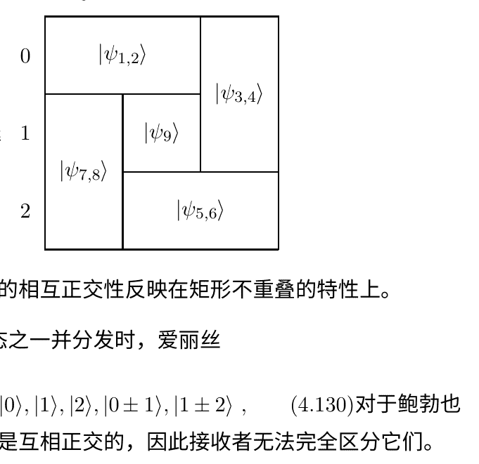

在图中, 查理基的元素的相互正交性反映在矩形不重叠的特性上。

当查理准备这9个状态之一并分发时, 爱丽丝接收到其中一个状态 $|0\rangle, |1\rangle, |2\rangle, |0 \pm 1\rangle, |1 \pm 2\rangle$ , (4.130) 对于鲍勃也是类似的。这些状态不是互相正交的, 因此接收者无法完全区分它们。

例如, 爱丽丝可能执行一个不完全正交测量, 区分状态 $|2\rangle$和它的正交补。从图像上看, 这个测量将正方形“切割”成两个不重叠的部分。如果查理准备了 $|\psi_{5,6}\rangle$, $|\psi_{7,8}\rangle$之一, 那么爱丽丝的结果可能是 $|2\rangle\langle 2|$; 在这种情况下, 她测量得到的状态可以表示为:


在了解了爱丽丝的测量结果后, 鲍勃可以进行一个正交测量, 投影到基 $\{|0\rangle, |1+2\rangle, |1-2\rangle\}$上。(4.131)

如果他的结果是 $|1 + 2\rangle$ 或 $|1 - 2\rangle$，那么爱丽丝和鲍勃成功地确定了查理的状态为 $|\psi_5\rangle$ 或 $|\psi_6\rangle$。 但是如果鲍勃的结果是 $|0\rangle$，那么爱丽丝和鲍勃仍然不确定查理是准备了 $|\psi_7\rangle$ 还是 $|\psi_8\rangle$。 另一方面，如果查理准备了 $|\psi_{1,2}\rangle, |\psi_{3,4}\rangle, |\psi_{7,8}\rangle, |\psi_9\rangle$ 中的一个，那么爱丽丝的结果可能是 $|0\rangle\langle 0| + |1\rangle\langle 1|$; 在这种情况下，她测量得到的状态可以表示为：

| 鲍勃 |   |   |   |
| :--- | :-: | :-: | :-: |
|      | 0 | 1 | 2 |
| **爱丽丝** |   |   |   |
| 0    | $|\psi_{1,2}\rangle$ |   | $|\psi_{3,4}\rangle$ |
| 1    | $|\psi_{7,8}\rangle$ | $|\psi_9\rangle$ |   |

再一次，爱丽丝和鲍勃失去了区分 $|\psi_7\rangle$ 和 $|\psi_8\rangle$ 的希望，但在几轮LOCC之后，他们可以成功识别其他五个状态中的任何一个。 鲍勃投影到 $|2\rangle$ 或其补集； 如果他找到 $|2\rangle\langle 2|$，那么爱丽丝投影到 $|0 \pm 1\rangle$ 来完成协议。 如果鲍勃的结果是 $|0\rangle\langle 0| + |1\rangle\langle 1|$，那么爱丽丝投影到 $\{|0\rangle, |1\rangle\}$； 最后，鲍勃在 $|0\pm1\rangle$ 基底（如果爱丽丝找到 $|0\rangle$）或 $\{|0\rangle, |1\rangle\}$ 基底（如果爱丽丝找到 $|1\rangle$）进行测量。

通过选择九个相互正交的乘积态之一，查理向爱丽丝和鲍勃发送了两个经典信息的三位元。 但是他们的LOCC协议无法区分 $|\psi_7\rangle$ 和 $|\psi_8\rangle$，因此无法完全恢复查理的信息。 当然，这只是一个可能的协议，但可以证明（我们不在这里证明）没有LOCC协议可以提取两个经典信息的三位元。 问题在于使用LOCC时，爱丽丝和鲍勃无法完全“解剖”正方形为非重叠的矩形。 这是没有纠缠的非局域性。

## 4.8 多方纠缠

到目前为止，我们主要关注的是两方共享的量子态。 我们将以一些关于三个或更多方共享的纠缠性质的观察结束本章节：多方纠缠。

以纯态 $|\psi\rangle_{A_1, A_2, ... A_n}$ 为例，由 $n$ 个参与方 $A_1, A_2, ... A_n$，假设无法将参与方分为两个较小的阵营，每个阵营共享一个纯态。因此，该态是纠缠的，而且，它不能表示为每个涉及少于 $n$ 个参与方的态的乘积。因此，我们可以说该态展示了 $n$ 个参与方的纠缠。如果参与方最初具有 $n$ 重复的纯态 $|\psi_1\rangle_{A_1} \otimes |\psi_2\rangle_{A_2} \otimes \cdots \otimes |\psi_n\rangle_{A_n}$，那么他们无法组装出态 $|\psi\rangle_{A_1,A_2,…,A_n}$，仅使用 LOCC — 需要量子通信。事实上，无论我们如何将 $n$ 个参与方分为两个子系统 $A$ 和 $B$，都需要在 $A$ 和 $B$ 之间进行量子通信。

如果我们禁止量子通信，但是我们确实提供了事先建立的两两纠缠态，会发生什么？那么为了构建状态 $|\psi\rangle_{A_1,A_2,…,A_n}$，显然第一个参与方 $A_1$ 需要与其他的 $n-1$ 个参与方共享二分纠缠态。参与方 $A_1$ 可以在她自己的实验室中构建状态 $|\psi\rangle_{A_1,A_2,…,A_n}$，从这个意义上说，二分纠缠态和 LOCC 与多方纠缠态一样强大。作为资源，二分纠缠态和 LOCC 与多方纠缠态一样强大。

然而，多方纠缠态表现出一些在二方纠缠研究中没有遇到的定性新现象，例如爱因斯坦局域性的非概率性测试和纠缠增强的多方通信。

### 4.8.1 三个量子盒子

在三个硬币实验取得巨大成功之后，爱丽丝和鲍勃现在是世界闻名的。他们都是终身教授，爱丽丝在加州理工学院，鲍勃在芝加哥大学。他们太重要了，没有太多时间在实验室里，但他们有很多研究生，并且保持科学活跃。

他们最优秀的学生查理，在硬币实验中做了所有的艰苦工作，已经毕业，现在是普林斯顿大学的助理教授。爱丽丝和鲍勃希望培养查理的事业，并帮助他获得终身教职。一天，爱丽丝和鲍勃在电话上聊天：

> 爱丽丝：你知道吗，鲍勃，我们真的应该帮助查理。你能想到我们三个人可以一起做的一个有趣实验吗？

> 鲍勃: 嗯，爱丽丝，我不知道。我想做很多关于我们纠缠的量子比特对的实验。但在每个实验中，有一个比特是给我，一个是给你。看起来查理是个例外。

> 爱丽丝: [长时间的停顿] 鲍勃... ... 你有没有想过做一个有三个量子比特的实验？

鲍勃的下巴掉了下来，他的脉搏加快了。突然，他有了一个顿悟，他整个未来的职业生涯似乎在他面前展开。说实话，鲍勃开始怀疑量子比特对是否已经过时了。现在他知道，在接下来的五年里，他将全身心地致力于进行决定性的三比特实验。到那时，他、爱丽丝和查理将培养出另一个聪明的学生，并准备好进行四比特的实验。然后是另一个学生，另一个比特。一直到退休。

这是Alice和Bob决定尝试的三量子位实验的类型：Alice在她在Caltech的实验室里指示她的技术人员仔细准备三个量子盒子的状态。（但是Alice不知道技术人员具体是如何做到的。）她自己留了一个盒子，然后通过量子快递将其他两个盒子分别寄给了Bob和Charlie。每个盒子里都有一个可以是黑色或白色的球，但是盒子是紧闭的。唯一找出里面是什么的方法是打开盒子，但是有两种不同的打开方式——盒子有两扇门，分别标有X和Y。当任何一扇门打开时，会弹出一个可以观察到颜色的球。不可能同时打开两扇门。

Alice、Bob和Charlie决定研究盒子之间的相关性。他们进行了许多精心控制的试验。每次，随机选择其中一个人打开X门，而其他两个人打开Y门。像往常一样幸运，Alice、Bob和Charlie做出了惊人的发现。他们发现，每次他们以这种方式打开盒子时，他们发现的黑球数量总是奇数。

也就是说，爱丽丝、鲍勃和查理发现，当他们在一个盒子上打开门X，另外两个盒子上打开门Y时，盒子里的球的颜色保证是以下之一：

0_A0_B1_C , 0_A1_B0_C , 1_A0_B0_C , 1_A1_B1_C , (4.132)

(0代表白色，1代表黑色)；他们从来没有看到过任何

1_A1_B0_C , 1_A0_B1_C , 0_A1_B1_C , 0_A0_B0_C . (4.133)

通过门X打开三个盒子中的哪一个没有任何区别。

过了一会儿，爱丽丝、鲍勃和查理意识到，在打开两个盒子后，他们总是能够预测在打开第三个盒子之前会发生什么。如果前两个球的颜色相同，最后一个球肯定是黑色，如果前两个球的颜色不同，最后一个球肯定是白色。他们已经尝试了无数次，而且总是有效！

## 4.8 多方纠缠

即使在三硬币实验受到广泛赞誉之后，爱丽丝、鲍勃和查理仍然无法完全摆脱对爱因斯坦局域性的依赖。有一天，他们进行了一次三方电话会议：

爱丽丝：你们知道吗，有时候我就是无法决定是打开X门还是Y门。我知道我必须谨慎选择…如果我打开X门，那肯定会打扰到盒子；所以我将永远不会知道如果我打开Y门会发生什么。而且，如果我打开Y门，我将永远不会知道如果我打开X门会发现什么。这真令人沮丧！

鲍勃：爱丽丝，你错了！我们的实验表明，你可以两全其美。难道你不明白吗？假设你想知道当你打开X门时会发生什么。那就让查理和我打开我们的盒子的Y门，并告诉你我们的发现。你将绝对确定，毫无疑问，当你打开X门时会发生什么。我们一次又一次地进行了测试，它总是有效的。那么为什么还要打开X门呢？你可以继续打开Y门，看看你会发现什么。这样，你真的知道同时打开两扇门的结果！

查理：但你怎么能确定呢？如果爱丽丝打开Y门，她就错过了打开X门的机会。她实际上永远无法两全其美。在她打开Y门之后，我们将永远无法检查打开X门是否会得到我们预期的结果。

鲍勃：哦，别这样，怎么可能呢？你看，你真的不相信，普林斯顿的盒子和芝加哥的盒子对爱丽丝在帕萨迪纳打开盒子时有任何影响吗？当我们打开我们的盒子时，我们不能改变爱丽丝的盒子里的任何东西；我们只是找到我们需要的信息，以确定爱丽丝会找到什么。

查理：嗯，也许我们应该做更多的实验来验证你的观点。

事实上，三盒相关性的发现使得爱丽丝和鲍勃比以前更加出名，但查理没有得到他应得的荣誉-他仍然没有终身职位。难怪他想做更多的实验！他继续说：

查理：我们可以尝试一些新的东西。在我们到目前为止的所有实验中，我们总是打开两个盒子的Y门和另一个盒子的X门。也许我们应该尝试一些不同的东西。

比如，也许我们应该看看如果我们在所有三个盒子上打开同样的门会发生什么。我们可以尝试打开三个X门。

鲍勃：噢，得了吧！我对三个盒子已经厌倦了。我们已经对三个盒子了解得很清楚。是时候继续前进了，我认为黛安妮已经准备好帮忙了。让我们来做四个盒子吧！

爱丽丝：不，我认为查理是对的。在我们尝试其他方式打开门之前，我们无法真正说我们对三个盒子了解到了所有的事情。

鲍勃：算了吧。他们永远不会资助我们！在我们付出了那么多努力打开两个Y和一个X之后，现在我们要说我们想要打开三个X？他们会说我们已经做了什么什么，现在又提出了什么什么...我们会听起来来荒谬的！

爱丽丝：鲍勃有一点道理。我认为我们唯一能够获得资金来进行这个实验的方法是，如果我们能够对将会发生的事情做出预测。然后我们可以说我们进行实验是为了测试这个预测。现在，我听说过一些名叫格林伯格、霍恩、泽林格和默明（GHZM）的理论家。他们对我们的三盒实验思考了很多；也许他们能够提出一些建议。

鲍勃：嗯，这些盒子是我的生活，他们只是一群理论家。我怀疑他们是否会任何有趣或有用的话要说。但是我想，他们的理论是否有任何意义并不重要...如果我们能够测试它，那么即使是我也会接受我们有理由进行另一个三盒实验。

于是，爱丽丝、鲍勃和查理朝圣去见GHZM。尽管鲍勃深表怀疑，GHZM确实提出了一个非常有趣的建议：

GHZM：鲍勃说，在普林斯顿和芝加哥打开一个盒子不可能对帕萨迪纳的爱丽丝打开盒子时会有任何影响。好吧，让我们假设他是对的。现在你们要做一个实验，每个人都打开你们的X门。没有人能够预测会发生什么，但我们可以这样推理：假设如果你打开了三个Y门，你会发现三个白球。然后我们可以使用鲍勃的论点来看，如果你打开了三个X门，你将会找到三个黑球。推理如下：如果爱丽丝打开X，鲍勃打开Y，查理打开Y，那么你就可以确定黑球的数量一定是奇数。所以，如果我们知道鲍勃和查理都会在他们打开门Y时找到白球，那么当爱丽丝打开门X时，她一定会找到黑球。同样地，如果爱丽丝和查理都会在他们打开Y时找到白球，那么鲍勃在他打开X时一定会找到黑球，如果爱丽丝和鲍勃都会在他们打开Y时找到白球，那么查理在他打开X时一定会找到黑球。所以我们可以看到：

\[Y_A Y_B Y_C = 000 \longrightarrow X_A X_B X_C = 111.\]

你不同意吗？

**鲍勃**：嗯，也许这是足够合理的，但这有什么用呢？我们不知道在打开盒子之前会发现什么。你假设我们知道 \(Y_A Y_B Y_C = 000\)，但我们事先从不知道。

**GHZM**：当然，但请等一下。是的，你说得对，我们无法事先知道如果我们打开每个盒子会发现什么。但是对于三个盒子，只有八种可能性，我们可以轻松列出它们。对于每个 \(Y_A Y_B Y_C\) 的八种可能性，我们可以使用之前的推理来推断 \(X_A X_B X_C\) 的值。我们得到了一个表格，像这样：

| \(Y_A Y_B Y_C\) | \(X_A X_B X_C\) |
|---|---|
| \(000\) | \(111\) |
| \(001\) | \(001\) |
| \(010\) | \(010\) |
| \(100\) | \(100\) |
| \(011\) | \(100\) |
| \(101\) | \(010\) |
| \(110\) | \(001\) |
| \(111\) | \(111\) |

**鲍勃**：好吧，那又怎样？

**GHZM**：这个表格有一些有趣的地方，鲍勃！看看 \(X_A, X_B, X_C\) 的值...每个条目都有奇数个1。这是我们的预测：当你们都打开X门的时候，你们总是会发现奇数个黑球！可能是一个，也可能是三个，但总是奇数个。

自然地，爱丽丝、鲍勃和查理对GHZM的这个见解感到高兴。他们提出了这个实验的建议，并得到了批准。

慷慨资助。终于，期待已久的日子到来了，他们将首次进行实验。当爱丽丝、鲍勃和查理各自打开X门时，你能猜到他们会发现什么吗？

三个白球。嗯？！！

怀疑出现了错误，爱丽丝、鲍勃和查理一遍又一遍地仔细地重复实验。在每一次试验中，他们每次打开X门时都会发现黑球的数量是偶数。有时候没有，有时候有两个，但从来没有一个，也从来没有三个。他们每一次都发现，与爱因斯坦的局域性原理预测的相反。

绝望再次驱使爱丽丝、鲍勃和查理进入图书馆，寻求启示。在研究了一本量子力学教材并对爱丽丝的实验室技术员进行了彻底的询问之后，他们意识到他们的三个盒子是以GHZM量子态准备的。

$$|\psi\rangle_{ABC} = \frac{1}{\sqrt{2}} \left(|000\rangle_{ABC} + |111\rangle_{ABC} \right), \qquad (4.136)$$

三个可观测量之一的特征值为一的同时本征态

$$Z_A \otimes Z_B \otimes I_C, \quad I_A \otimes Z_B \otimes Z_C, \quad X_A \otimes X_B \otimes X_C. \qquad (4.137)$$

由于 \(ZX = iY\)，他们意识到这个态具有以下特性

$$\begin{align*} Y_A \otimes Y_B \otimes X_C &= -1 \\ X_A \otimes Y_B \otimes Y_C &= -1 \\ Y_A \otimes X_B \otimes Y_C &= -1 \\ X_A \otimes X_B \otimes X_C &= \phantom{-}1. \end{align*} \qquad (4.138)$$

通过门 \(X\) 或门 \(Y\) 打开盒子时，爱丽丝、鲍勃和查理测量的可观测量为 \(X\) 或 \(Y\)，其中结果1表示白球，结果 \(-1\) 表示黑球。因此，如果准备了三量子位态eq.(4.136)，则式(4.138)表示，如果在两个盒子上打开门 \(Y\) 和第三个盒子上打开门 \(X\)，将找到奇数个黑球，而如果在所有三个盒子上打开门 \(X\)，将找到偶数个黑球。这种行为，量子力学明确预测，正是对爱丽丝、鲍勃和查理以及他们坚定支持爱因斯坦局域性的同伴们来说，曾经看起来如此令人困惑的。

经过对量子力学教材的进一步研究，爱丽丝、鲍勃和查理逐渐意识到他们推理中的错误。他们了解到了玻尔的互补性原理，了解到了不可兼容的不对易交换的可观测量。并且他们认识到了，为了得出他们的预测，他们假设了YYY的测量结果，然后推断了对XXX的测量结果的后果。由于没有听从尼尔斯·玻尔的坚定告诫，他们成为了最危险的谬论的牺牲品。

正如他们所希望的那样，三个盒子的实验使爱丽丝和鲍勃更加受人赞誉，查理获得终身职位。当然，三枚硬币的实验已经令爱因斯坦的局域性理论受到了有力的打击；即便如此，三个盒子的实验具有不同的特点。在硬币实验中，爱丽丝和鲍勃可以揭开三枚硬币中的任意两枚，找到四种可能的组合：HH、HT、TH、TT。只有进行多次试验，他们才能积累足够的统计数据来证明贝尔不等式的违反。相比之下，在三个盒子的实验中，爱丽丝、鲍勃和查理在每一次同时打开X门的试验中都得到了与爱因斯坦的局域性理论不一致的结果！

### 4.8.2 猫态

由爱丽丝、鲍勃和查理研究的GHZM态是最大纠缠贝尔对的自然三量子比特推广。贝尔对可以被描述为两个对易算符ZZ和XX的同时本征态，其中ZZ的本征值是对的“奇偶位”，而XX的本征值是相位位。（这里我们使用了压缩符号表示，其中张量积符号⊗被省略了，例如，XX表示同时作用于爱丽丝和鲍勃的X算符。）GHZM态是ZZI、IZZ和XXX的同时本征态。

可以定义GHZM态的n量子比特推广，它是n个对易算符的同时本征态：

ZZIII...I,
IZZII...I,
IIZZI...I,
...
III...IZZ,
XX...XX. (4.139)

$$\frac{1}{\sqrt{2}} \left( |x\rangle \pm |\neg x\rangle \right) , (4.140)$$

其中¬x表示二进制字符串x的补集。由于对于大的n，这个态是两个“宏观可区分”的态的相干叠加，因此被称为n量子比特猫态，以纪念薛定谔的cat。这个n量子比特猫态具有n-1个奇偶位和一个相位位。猫态的一些值得注意的特性包括：

- 每个量子比特与其他比特最大程度上纠缠在一起。也就是说，如果我们对其他n-1个量子比特进行追踪，该比特的密度算符为\(\rho = 2^{-1} I\)。因此，有时候会说猫态是n个量子比特的最大纠缠态。
- 但这是一个相当误导性的说法。因为它的奇偶性和相位比特被处理得非常不对称，所以这只猫并不像我们在第7章中会遇到的其他多比特态那样深度纠缠。例如，对于猫态，当x=000...0时，如果我们追踪n-2个比特，剩下的两个的密度算符是

\[\rho_{2-\text{比特}} = \frac{1}{2}(|00\rangle\langle 00| + |11\rangle\langle 11|) , (4.141)\]

它的秩为2而不是4。相应地，我们可以通过观察状态中的任意两个比特来获取关于猫态的一些信息（其中一个是它的奇偶性比特）。其他多比特态，可能被认为比猫态更高纠缠，具有这样的性质：如果我们追踪其余的比特，两个（或更多）比特的密度算符与单位算符成比例。
- 假设查理准备了\(2^n\) possible猫态之一，并将其分发给n parties。使用LOCC，各方可以确定状态的所有n-1个奇偶性比特 —— 每个party测量Z并广播他们的结果。但通过测量Z他们会破坏相位比特。或者，他们可以全部测量X来确定相位比特，但代价是破坏所有的奇偶性比特。
- 通过应用其中之一的\(\{I, X, Y, Z\}\)，每个参与方可以将给定的猫态转化为其他四种猫态之一；也就是说，参与方可以修改相位比特和一个n-1奇偶比特。所有的参与方共同合作，可以将一个猫态转化为\(2^n\)个相互正交的猫态之一；例如，一个参与方可以操纵相位比特，而其他每个n-1个参与方控制一个奇偶比特。
- 如果参与方联合起来，相位比特和所有奇偶比特可以同时测量。

如果参与方从一个乘积态开始，可以通过执行量子电路来准备三比特猫态（例如）：

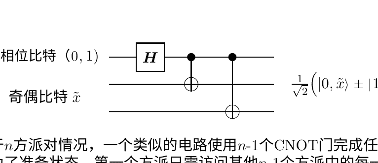

对于n方派对情况，一个类似的电路使用n-1个CNOT门完成任务。因此，为了准备状态，第一个方派只需访问其他n-1个方派中的每一个。通过反向运行电路，猫态可以转化为可以在本地测量的乘积态。

## 4.9 操纵纠缠

## 4.10 总结

- 1. 总结 1.
- 2. 总结 2.
- 3. 总结 3.

## 4.11 参考文献注释

## 4.12 练习题

## 4.1 哈代定理鲍勃（在波士顿）和克莱尔（在芝加哥）共享许多完全相同的两比特态的副本

$$|\psi\rangle = \sqrt{(1-2x)} |00\rangle + \sqrt{x} |01\rangle + \sqrt{x} |10\rangle , \quad (4.154)$$

其中 $x$ 是一个介于0和1/2之间的实数。他们进行了许多试验，每次他们都在基 $\{|0\rangle, |1\rangle\}$ 上测量自己的比特，并且他们发现如果鲍勃的结果是1，那么克莱尔的结果总是0，如果克莱尔的结果是1，那么鲍勃的结果总是0。

鲍勃和克莱尔进行了进一步的实验，鲍勃在基 $\{|0\rangle, |1\rangle\}$ 上测量，克莱尔在正交基 $\{|\varphi\rangle, |\varphi^\perp\rangle\}$ 上测量。他们发现如果鲍勃的结果是0，那么克莱尔的结果总是 $\varphi$，而不是 $\varphi^\perp$。同样地，如果克莱尔在基 $\{|0\rangle, |1\rangle\}$ 上测量，鲍勃在基 $\{|\varphi\rangle, |\varphi^\perp\rangle\}$ 上测量，那么如果克莱尔的结果是0，鲍勃的结果总是 $\varphi$，而不是 $\varphi^\perp$。

- a) 用基 $\{|\varphi\rangle, |\varphi^\perp\rangle\}$ 的形式来表示。

鲍勃和克莱尔现在想知道如果他们都用基 $\{|\varphi\rangle, |\varphi^\perp\rangle\}$ 来测量，会发生什么。他们的朋友艾伯特，一个坚定的本地实在主义者，预测两者都无法获得结果 $\varphi^\perp$（这个预测被称为Hardy定理）。艾伯特的论点如下：

当鲍勃和克莱尔都用基 $\{|\varphi\rangle, |\varphi^\perp\rangle\}$ 来测量时，考虑一下如果其中一个人用基 $\{|0\rangle, |1\rangle\}$ 来测量会发生什么，是合理的。

假设鲍勃和克莱尔都在基 $\{|\varphi\rangle, |\varphi^\perp\rangle\}$ 上进行测量，并且他们都得到了结果 $\varphi^\perp$。现在，如果鲍勃在基 $\{|0\rangle, |1\rangle\}$ 上进行测量，我们可以确定他的结果将会是1，因为实验表明，如果鲍勃得到了0，那么克莱尔就不可能得到 $\varphi^\perp$。同样地，如果克莱尔在基 $\{|0\rangle, |1\rangle\}$ 上进行测量，她肯定会得到结果1。我们得出结论，如果鲍勃和克莱尔都在基 $\{|0\rangle, |1\rangle\}$ 上进行测量，两者都会得到结果1。但是，这是一个矛盾，因为实验表明，如果他们都在基 $\{|0\rangle, |1\rangle\}$ 上进行测量，鲍勃和克莱尔都不可能同时得到结果1。

因此，我们被迫得出结论，如果鲍勃和克莱尔都在基 $\{|\varphi\rangle, |\varphi^\perp\rangle\}$ 上进行测量，那么两者都获得结果 $\varphi^\perp$ 是不可能的。

尽管对阿尔伯特的推理印象深刻，鲍勃和克莱尔决定调查量子力学可以推断出哪些预测。

- b) 如果鲍勃和克莱尔都在基 $\{|\varphi\rangle, |\varphi^\perp\rangle\}$ 上进行测量，那么两者都获得结果 $\varphi^\perp$ 的量子力学预测的概率 $P(x)$ 是多少？

- c) 找到 Hardy 定理的“最大违反”：证明 $P(x)$ 的最大值是 $P[(3-\sqrt{5})/2] = (5-\sqrt{5})/2 \approx .0902$。鲍勃和克莱尔进行了一项实验证实了量子力学的预测。阿尔伯特的推理有什么问题？

## 4.2 闭合检测漏洞

回想一下 CHSH 不等式

$$|\langle ab\rangle + \langle a'b\rangle + \langle ab'\rangle - \langle a'b'\rangle| \leq 2, \quad (4.155)$$

如果随机变量 $a, b, a', b'$ 取值 $\pm 1$，并且受到联合概率分布的控制，那么这个不等式成立。量子力学预测对这个不等式的最大违反发生在左边为 2 时。

当且仅当 Alice 和 Bob 共享最大纠缠态 $|\phi^+\rangle$ 时，$a, a'$ 是沿着 $\hat{x}$ 和 $\hat{z}$ 轴对 Alice 的量子比特进行测量，$b, b'$ 是沿着 $(\hat{x} + \hat{z})/\sqrt{2}$ 和 $(\hat{x} - \hat{z})/\sqrt{2}$ 轴对 Bob 的量子比特进行测量时，这个不等式达到最大违反。

爱丽丝和鲍勃进行了一项美丽的实验，测量了纠缠光子对的极化，并确认了量子力学预测的 CHSH 不等式违背。阿尔伯特持怀疑态度。他指出，爱丽丝和鲍勃在实验中使用的探测器效率不高。通常情况下，当爱丽丝探测到一个光子时，鲍勃不会探测到，当鲍勃探测到一个光子时，爱丽丝不会探测到。因此，他们丢弃了大部分光子对的数据，只保留在两个光子巧合探测到的情况下的结果。在他们对数据的分析中，爱丽丝和鲍勃假设他们的结果是基于测量变量的概率分布的公平样本。但是，阿尔伯特认为，如果光子的探测与极化测量的结果相关，他们的结论可能会被规避。

爱丽丝和鲍勃想知道他们需要提高探测器效率多少才能进行一个让阿尔伯特印象深刻的实验。爱丽丝可以选择将她的探测器沿任意轴定向，如果她将探测器与轴 $a$ 对齐，那么理想情况下探测器会在她的量子比特自旋指向 $a$ 上时点击，但由于探测器效率低下，即使量子比特指向上，有时也会出现不点击的情况。对于第 $i$ 对，让 $x_i \in \{0, 1\}$ 表示一个变量指示当探测器与 $a$ 对齐时爱丽丝的探测器是否会点击——如果会点击，则 $x_i = 1$，如果不会点击，则 $x_i = 0$。由于探测器不完美，即使量子比特指向 $a$ 上，$x_i$ 可能为0。类似地， $x'_i \in \{0, 1\}$ 表示当探测器与 $a'$ 对齐时爱丽丝的探测器是否会点击，$y_i \in \{0, 1\}$ 表示当探测器与 $b$ 对齐时鲍勃的探测器是否会点击，$y'_i \in \{0, 1\}$ 表示当探测器与 $b'$ 对齐时鲍勃的探测器是否会点击。在局部实在论的假设下，每对可以被分配由局部隐藏变量决定的 $x, x', y, y'$ 的值。

Alice 和 Bob 可以自由决定如何对齐他们的探测器，在每次测量中，因此他们可以公平地采样 $x$、$x'$、$y$、$y'$ 的值，并从测量中推断出这些值

$$ \begin{aligned} P_{++}(ab) &= N \sum_{i=1}^{N} x_i y_i, \\ P_{++}(a'b) &= N \sum_{i=1}^{N} x_i' y_i, \\ P_{++}(ab') &= N \sum_{i=1}^{N} x_i y_i', \\ P_{++}(a'b') &= N \sum_{i=1}^{N} x_i' y_i', \end{aligned} \quad (4.156) $$

其中 $N$ 是测试的总对数。这里，例如 $P_{++}(ab)$ 是当 Alice 和 Bob 将他们的探测器沿着 $a$ 和 $b$ 方向对齐时，两个探测器都点击的概率（包括探测器效率的影响）。

- a) 如果 $x, x', y, y' \in \{0, 1\}$，证明
  $$ xy + xy' + x'y - x'y' \leq x + y. \quad (4.157) $$
- b) 证明
  $$ P_{++}(ab) + P_{++}(a'b) + P_{++}(ab') - P_{++}(a'b') \leq P_{+.}(a) + P_{+.}(b); \quad (4.158) $$
  这里 $P_{+.}(a)$ 表示当朝向为 $a$ 时，爱丽丝的探测器点击的概率，而 $P_{+.}(b)$ 表示当朝向为 $b$ 时，鲍勃的探测器点击的概率。

- c) 现在与量子力学的预测进行比较，其中爱丽丝的探测器的效率为 $\eta_A$，鲍勃的探测器的效率为 $\eta_B$。这意味着如果爱丽丝的探测器完美的话，她的探测器点击的概率为 $P = \eta_A P_{\text{perf}}$，鲍勃的探测器也是如此。选择最大违反 CHSH 不等式的 $a, a', b, b'$，证明只有当量子力学的预测违反等式 (4.158) 时
  $$\frac{\eta_A \eta_B}{\eta_A + \eta_B} > \frac{1}{1 + \sqrt{2}}. \quad (4.159)$$
  因此，如果 $\eta_A = \eta_B$，爱丽丝和鲍勃需要具有 82.84% 以上效率的探测器来克服阿尔伯特的反对。

## 4.3 连续变量的传送

在实线上的两个粒子的希尔伯特空间中，一个完整的正交归一基是（可分离的）位置本征态基 $\{|q_1\rangle \otimes |q_2\rangle\}$。另一个是纠缠基 $\{|Q,P\rangle\}$，其中

$$|Q, P\rangle = \frac{1}{\sqrt{2\pi}} \int dq \, e^{iPq} |q\rangle \otimes |q + Q\rangle ; \quad (4.160)$$

这些是相对位置算符 $Q \equiv q_2 - q_1$ 和总动量算符 $P \equiv p_1 + p_2$ 的同时本征态。

- a) 验证
  $$\langle Q', P' | Q, P \rangle = \delta(Q' - Q)\delta(P' - P). \quad (4.161)$$
- b) 由于状态 $\{|Q,P\rangle\}$ 是一组基，我们可以将位置本征态展开为
  $$|q_1\rangle \otimes |q_2\rangle = \int dQ \, dP \, |Q, P\rangle\langle Q, P| (|q_1\rangle \otimes |q_2\rangle). \quad (4.162)$$
  计算系数 $\langle Q,P|(|q_1\rangle \otimes |q_2\rangle)$。
- c) 爱丽丝和鲍勃已经准备好了纠缠态 $|Q,P\rangle_{AB}$ 的两个粒子 A 和 B；爱丽丝保留了粒子 A，鲍勃保留了粒子 B。现在爱丽丝收到了一个未知的单粒子波包 $|\psi\rangle_C = \int dq \, |q\rangle_C \langle q|\psi\rangle_C$，她打算将其传送给鲍勃。设计一个协议，他们可以执行以实现传送。爱丽丝应该测量什么？她应该向鲍勃发送什么信息？鲍勃在收到这些信息后应该做什么，以使粒子 B 处于状态 $|\psi\rangle_B$？

## 4.4 混合态的传送

定义纠缠的一种操作方法是，纠缠态可以用于比仅通过局部操作和经典通信所能达到的更好保真度来传送未知的量子态。在这个练习中，你将证明存在一种在这个意义上是纠缠的混合态，但不违反任何贝尔不等式。因此，对于混合态（与纯态相反），“纠缠”和“违反贝尔不等式”并不等价。

考虑一个带有密度矩阵的“噪声”纠缠对。

$$\rho(\lambda) = (1 - \lambda) |\psi^-\rangle\langle\psi^-| + \lambda \frac{1}{4} \mathbf{1}. \quad (4.163)$$

- a) 找到可以在状态 $\rho(\lambda)$ 用于从爱丽丝传送到鲍勃的量子比特的保真度 $F$。[提示：回想一下，在之前的练习中，你证明了“随机猜测”的保真度为 $F = \frac{1}{2}$。]
- b) 对于什么值的 $\lambda$，(a) 中的保真度比如果 Alice 测量她的量子比特并发送一个经典消息给 Bob 可以实现的更好？[提示：早些时候，你证明了 $F= 2/3$ 可以通过 Alice 测量她的量子比特来实现。实际上，这是通过经典通信可以达到的最佳 $F$。]
- c) 计算
  $$\text{Prob}(\uparrow_{\hat{n}} \uparrow_{\hat{m}}) \equiv \text{tr} \left( E_A(\hat{n}) E_B(\hat{m}) \rho(\lambda) \right), \quad (4.164)$$
  其中 $E_A(\hat{n})$ 是 Alice 的量子比特投影到 $|\uparrow_{\hat{n}}\rangle$ 上的投影算子，$E_B(\hat{m})$ 是 Bob 的量子比特投影到 $|\uparrow_{\hat{m}}\rangle$ 上的投影算子。

  考虑 $\lambda=1/2$ 的情况。证明在这种情况下，状态 $\rho(\lambda)$ 不违反任何贝尔不等式。提示：只需构建一个能够正确重现 (c) 中发现的自旋相关性的局部隐藏变量模型，对于 $\lambda=1/2$。假设隐藏变量 $\alpha$ 在单位球上均匀分布，并且存在函数 $f_A$ 和 $f_B$，使得
  $$\text{Prob}_A(\uparrow_{\hat{n}}) = f_A(\alpha \cdot \hat{n}), \quad \text{Prob}_B(\uparrow_{\hat{m}}) = f_B(\alpha \cdot \hat{m}). \quad (4.165)$$
  问题是找到满足 $0 \leq f_{A,B} \leq 1$ 的 $f_A$ 和 $f_B$，具有以下特性
  $$\int_{\hat{\alpha}} f_A(\alpha \cdot \hat{n}) = 1/2, \quad \int_{\hat{\alpha}} f_B(\alpha \cdot \hat{m}) = 1/2,$$
  $$\int_{\hat{\alpha}} f_A(\alpha \cdot \hat{n}) f_B(\alpha \cdot \hat{m}) = \text{Prob}(\uparrow_{\hat{n}} \uparrow_{\hat{m}}). \quad (4.166)$$

## 4.5 量子密钥分发

爱丽丝和鲍勃想要执行量子密钥分发协议。爱丽丝可以准备两种状态之一 $|u\rangle$ 或 $|v\rangle$。这两种状态在适当的基础上可以表示为

$$|u\rangle = \begin{pmatrix} \cos \alpha \\ \sin \alpha \end{pmatrix}, \quad |v\rangle = \begin{pmatrix} \sin \alpha \\ \cos \alpha \end{pmatrix}$$

其中 $0 < \alpha < \pi/4$。爱丽丝随机决定发送 $|u\rangle$ 或 $|v\rangle$ 给鲍勃，鲍勃需要进行测量以确定她发送了什么。由于这两种状态不正交，鲍勃无法完全区分这两种状态。

- a) 鲍勃意识到他不能期望能够每次都能够识别出爱丽丝的量子比特，所以他采取了一种只在某些时候成功的过程。他进行了一个具有三种可能结果的 POVM 测量： $\neg u$, $\neg v$ 或者不知道。如果他得到结果 $\neg u$，他确定是发送了 $|v\rangle$，如果他得到结果 $\neg v$，他确定是发送了 $|u\rangle$。如果结果是不知道，则他的测量是不确定的。这个 POVM 由以下算符定义
  $$f_{\neg u} = A(\mathbf{I} - |u\rangle\langle u|), \quad f_{\neg v} = A(\mathbf{I} - |v\rangle\langle v|),$$
  $$f_{\text{DK}} = (1 - 2A)\mathbf{I} + A(|u\rangle\langle u| + |v\rangle\langle v|)$$
  其中 $A$ 是一个正实数。鲍勃应该如何选择 $A$ 以最小化 DK 结果的概率，并且这个最小的 DK 概率是多少（假设爱丽丝以等概率从 $\{|u\rangle,|v\rangle\}$ 中选择）？[提示：如果 $A$ 太大，$f_{\text{DK}}$ 将具有负特征值，而方程 (4.168) 将不是一个 POVM。]
- b) 设计一个使用爱丽丝的源和鲍勃的 POVM 的量子密钥分发协议。
- c) 当然，伊芙也想知道爱丽丝发送给鲍勃的内容。希望爱丽丝和鲍勃不会注意到，她拦截了爱丽丝发送的每个量子比特，通过执行一个正交测量将其投影到基矢上 $\left\{ \begin{pmatrix} 1 \\ 0 \end{pmatrix}, \begin{pmatrix} 0 \\ 1 \end{pmatrix} \right\}$。如果她获得了结果 $\begin{pmatrix} 1 \\ 0 \end{pmatrix}$，她将状态 $|u\rangle$ 发送给鲍勃，如果她获得了结果 $\begin{pmatrix} 0 \\ 1 \end{pmatrix}$，她将 $|v\rangle$ 发送给鲍勃。因此，每当鲍勃的 POVM 有一个确定性的结果时，伊芙都确切地知道那个结果是什么。但伊芙的篡改会导致可检测的错误；有时鲍勃会得到一个“确定性”的结果，实际上与爱丽丝发送的不同的结果。这样的错误的概率是多少？

## 4.6 最小干扰

在练习 2.1 中，我们研究了一个游戏，爱丽丝随机决定（等概率地）是否准备一个单量子比特的两个可能纯态之一

$$|\psi\rangle = \begin{pmatrix} \cos\alpha \\ \sin\alpha \end{pmatrix}, \quad \text{或} \quad |\tilde{\psi}\rangle = \begin{pmatrix} \sin\alpha \\ \cos\alpha \end{pmatrix}, \quad\quad (4.169)$$

并将该态发送给鲍勃。通过在基 $\{|0\rangle, |1\rangle\}$ 上进行正交测量，鲍勃可以以最小的错误概率识别该态

$$(p_{\text{error}})_{\text{optimal}} = \sin^2\alpha = \frac{1}{2}(1-\sin\theta), \quad\quad (4.170)$$

其中我们定义了 $\theta$ 为

$$\langle\psi|\tilde{\psi}\rangle \equiv \cos\theta = \sin(2\alpha). \quad\quad (4.171)$$

但现在假设伊芙想要窃听从艾丽斯到鲍勃的状态。与鲍勃一样，她希望提取能够区分 $|\psi\rangle$ 和 $|\tilde{\psi}\rangle$ 的最优信息，并且她还希望最小化她窃听引入的干扰，以便艾丽斯和鲍勃不太可能注意到有什么不对劲。

Eve 意识到最优 POVM 可以通过测量算符来实现

$$\boldsymbol{M}_0 = |\phi_0\rangle\langle0|, \quad \boldsymbol{M}_1 = |\phi_1\rangle\langle1|, \quad\quad (4.172)$$

其中向量 $|\phi_0\rangle$ 和 $|\phi_1\rangle$ 是任意的。如果 Eve 进行这个测量，那么 Bob 会接收到状态

$$\rho' = \cos^2\alpha |\phi_0\rangle\langle\phi_0| + \sin^2\alpha |\phi_1\rangle\langle\phi_1|, \quad\quad (4.173)$$

如果 Alice 发送了 $|\psi\rangle$，那么状态

$$\tilde{\rho}' = \sin^2\alpha |\phi_0\rangle\langle\phi_0| + \cos^2\alpha |\phi_1\rangle\langle\phi_1|, \quad\quad (4.174)$$

如果爱丽丝发送 $|\tilde{\psi}\rangle$。

伊芙希望鲍勃接收到的态的平均保真度尽可能大。她想要最小化的量，我们将其称为“干扰” $D$，衡量这个平均保真度与1的接近程度：

$$D = 1 - \frac{1}{2}(F + \tilde{F}), \qquad\qquad (4.175)$$

其中

$$F = \langle\psi|\rho'|\psi\rangle, \qquad \tilde{F} = \langle\tilde{\psi}|\tilde{\rho}'|\tilde{\psi}\rangle. \qquad\qquad (4.176)$$

这个练习的目的是研究伊芙如何通过适当选择她的测量算符来有效地减小干扰。

- a) 证明 $F + \tilde{F}$ 可以表示为
$$F + \tilde{F} = \langle\phi_0|A|\phi_0\rangle + \langle\phi_1|B|\phi_1\rangle, \qquad\qquad (4.177)$$
其中
$$A = \begin{pmatrix} 1 - 2\cos^2\alpha\sin^2\alpha & \cos\alpha\sin\alpha \\ \cos\alpha\sin\alpha & 2\cos^2\alpha\sin^2\alpha \end{pmatrix},$$
$$B = \begin{pmatrix} 2\cos^2\alpha\sin^2\alpha & \cos\alpha\sin\alpha \\ \cos\alpha\sin\alpha & 1 - 2\cos^2\alpha\sin^2\alpha \end{pmatrix}. \qquad (4.178)$$

- b) 证明如果 $|\phi_0\rangle$ 和 $|\phi_1\rangle$ 被选择得最优，可以达到最小的干扰
$$D_{\min}(\cos^2\theta) = \frac{1}{2}(1 - \sqrt{1-\cos^2\theta+\cos^4\theta}). \qquad\qquad (4.179)$$
[提示：我们可以独立地选择 $|\phi_0\rangle$ 和 $|\phi_1\rangle$ 来最大化方程(4.177)中的两个项。最大值是 $A$ 的最大特征值，由于特征值之和为1，可以表示为 $\lambda_{\max} = \frac{1}{2} \left(1 + \sqrt{1-4\cdot\det A}\right)$。] 当然，如果伊芙愿意接受不太理想的正确猜测概率，她可以进一步减小干扰，以更好地猜测爱丽丝的状态。

- c) 绘制函数 $D_{\min}(\cos^2\theta)$ 的图形。解释当 $\cos\theta=1$ 和 $\cos\theta=0$ 时的值。对于什么值的 $\theta$， $D_{\min}$ 最大？找到 $\theta$ 的 $D_{\min}$ 和 $(p_{\text{error}})$ 最优值。

### 4.7 近似克隆

无克隆定理表明我们无法构建一个能够完美复制未知量子态的酉机器。但是假设我们愿意接受一个不完美的复制，我们能够达到什么样的保真度？

考虑一个根据三量子比特状态操作的机器，其操作如下

$$
|000\rangle_{ABC} 	o \sqrt{\frac{2}{3}}|00\rangle_{AB}|0\rangle_{C} + \sqrt{\frac{1}{3}}|\psi^+\rangle_{AB}|1\rangle_{C} \\
|100\rangle_{ABC} 	o \sqrt{\frac{2}{3}}|11\rangle_{AB}|1\rangle_{C} + \sqrt{\frac{1}{3}}|\psi^+\rangle_{AB}|0\rangle_{C} . \quad (4.180)
$$

a) 这样的设备在原则上是否可以实现？如果机器在初始状态$|\psi\rangle_A|00\rangle_{BC}$上操作，它会产生一个纯粹的纠缠态$|\Psi\rangle_{ABC}$三个量子比特。但是如果我们仅观察量子比特A，它的最终状态是密度算符$\rho'_A = \text{tr}_{BC}(|\Psi\rangle\langle\Psi|_{ABC})$。同样，被隔离观察的量子比特B的最终状态是$\rho'_B$。很容易看出$\rho'_A = \rho'_B$ — 这些是输入纯态的相同但不完美的副本$|\psi\rangle_A$。

b) 初始状态$|\psi\rangle_A\langle\psi|$到最终状态$\rho'_A$ of qubit A 定义了一个超算符$\mathcal{S}$。找到一个算符和求和的表示$\mathcal{S}$。

c) 对于$|\psi\rangle_A = a|0\rangle_A + b|1\rangle_A$，找到$\rho'_A$，并计算其保真度$F \equiv _A\langle\psi|\rho'_A|\psi\rangle_A$。

### 4.8 对不起，阿尔伯特叔叔

考虑一个$n$量子比特的“猫”态

$$
|\psi\rangle_n = \sqrt{\frac{1}{2}}(|000\dots 0\rangle + |111\dots 1\rangle) . \quad (4.181)
$$

这个态可以被描述为$n$算符的同时本征态（本征值为1）

$$
\sigma_3 \otimes \sigma_3 \otimes I \otimes I \otimes \dots \otimes I \otimes I \otimes I \\
I \otimes \sigma_3 \otimes \sigma_3 \otimes I \otimes \dots \otimes I \otimes I \otimes I \\
\vdots \\
I \otimes I \otimes I \otimes I \otimes \dots \otimes I \otimes \sigma_3 \otimes \sigma_3 \\
\sigma_1 \otimes \sigma_1 \otimes \sigma_1 \otimes \dots \otimes \sigma_1 \otimes \sigma_1 \otimes \sigma_1 \quad (4.182)
$$

a) 证明$|\psi\rangle_n$是算符的本征态

$$
(\sigma_1 + i\sigma_2)^{\otimes n} + (\sigma_1 - i\sigma_2)^{\otimes n} . \quad (4.183)
$$

并计算其特征值。

b) 如果我们相信局部隐藏变量，那么我们相信对于每个量子比特，一旦隐藏变量被指定，

c) 从 (b) 推导出一个上界

$$
\frac{1}{2}\left|\left(\boldsymbol{\sigma}_{1}+i\boldsymbol{\sigma}_{2}\right)^{\otimes n}+\left(\boldsymbol{\sigma}_{1}-i\boldsymbol{\sigma}_{2}\right)^{\otimes n}\right|
$$

这是从局部隐藏变量假设中得出的结论。

d) 与 (a) 进行比较。爱因斯坦会说什么？

### 4.9 纠缠操纵

a) 纽约洋基队有二十五名球员，圣地亚哥教士队也有二十五名球员，他们想要共享一个50量子比特的猫态。洋基队准备了一个26量子比特的猫态，并将其中一个量子比特给了爱丽丝；教士队也是如此。现在爱丽丝需要将这些态缝合在一起，准备一个50量子比特的态。她应该怎么做？[提示：考虑稳定子。]

b) 加入洋基队后，爱丽丝承担了他们25量子比特猫态中的一个量子比特。但是今天她被交易了！命令爱丽丝将她的量子比特从猫态中取出，留下一个完好无损的24量子比特猫态给其他球员。

她应该怎么做？[提示：考虑稳定子。]

### 4.10 Peres-Horodecki准则在d维空间中

回想一下，一对量子比特的 Werner 态可以表示为

$$
\boldsymbol{\rho}(\lambda)=\lambda|\phi^{+}\rangle\langle\phi^{+}|+\frac{1}{4}(1-\lambda)\boldsymbol{I},
$$

而一个二分体密度算符
$\boldsymbol{\rho}_{AB}$的偏转置$\rho^{PT}_{AB}$被定义为

$$
\boldsymbol{\rho}_{AB}^{PT} \equiv\left(I_{A} \otimes T_{B}\right)\left(\boldsymbol{\rho}_{AB}\right)
$$

其中 $T$ 是在计算基 $\{|i\rangle\}$ 中作用的转置操作

$$
T\left(|i\rangle\langle j|\right)=|j\rangle\langle i|.
$$

我们在课堂上看到，Werner态 $\boldsymbol{\rho}(\lambda)$ 的偏转置对于 $\lambda>1/3$ 是负的；因此，根据Peres-Horodecki准则，Werner态在 $\lambda>1/3$ 时是不可分离的。

### a) 将Werner态推广到一对维度为 $d$ 的系统的一种自然方式是考虑

$$
\rho_{\Phi}(\lambda) = \lambda|\Phi\rangle\langle\Phi| + \frac{1}{d^2}(1-\lambda)\boldsymbol{I},
\qquad\qquad\qquad\qquad\qquad\qquad\qquad\qquad\qquad (4.188)
$$

其中 $|\Phi\rangle$是最大纠缠态

$$
|\Phi\rangle = \frac{1}{\sqrt{d}}\sum_{i=1}^{d}|i\rangle\otimes|i\rangle.
\qquad\qquad\qquad\qquad\qquad\qquad\qquad\qquad\qquad (4.189)
$$

### 证明

$$
(|\Phi\rangle\langle\Phi|)^{PT} = \frac{1}{d}(\boldsymbol{I} - 2\boldsymbol{E}_{\text{antisym}}),
\qquad\qquad\qquad\qquad\qquad\qquad\qquad\qquad\qquad (4.190)
$$

其中 $\boldsymbol{E}_{\text{antisym}}$是交换系统 $A$和 $B$下反对称的投影算符。

### b) 对于哪些 $\lambda$的值，态 $\rho_{\Phi}(\lambda)$ 的部分转置是负的?

### c) 如果选择两个量子比特的Werner态为

$$
\rho(\lambda) = \lambda|\psi^-\rangle\langle\psi^-| + \frac{1}{4}(1-\lambda)\boldsymbol{I},
\qquad\qquad\qquad\qquad\qquad\qquad\qquad\qquad\qquad (4.191)
$$

然后将Werner态推广到一对 $d$维系统的另一种自然方式是考虑

$$
\rho_{\text{反}}(\lambda) = \lambda\left(\frac{1}{\frac{1}{2}d(d-1)}\right)\boldsymbol{E}_{\text{反对称}} + \frac{1}{d^2}(1-\lambda)\boldsymbol{I}.
\qquad\qquad\qquad\qquad\qquad\qquad\qquad\qquad\qquad (4.192)
$$

对于 $\lambda$的哪些值， $\rho_{\text{反}}(\lambda)$具有负的部分转置?

# Ph219/CS219讲义：

## 量子信息

### 第5章

约翰·普雷斯基尔

加州理工学院

更新于2015年7月

# 目录

- 5 经典和量子电路
  - 5.1 经典电路
    - 5.1.1 通用门
    - 5.1.2 大多数函数需要大型电路
    - 5.1.3 电路复杂度
    - 5.1.4 随机计算
  - 5.2 可逆计算
    - 5.2.1 兰道尔原理
    - 5.2.2 可逆门
    - 5.2.3 省空间：鹅卵石游戏
  - 5.3 量子电路
    - 5.3.1 精度
    - 5.3.2 BQP ⊆ PSPACE
    - 5.3.3 大多数酉变换需要大型量子电路
  - 5.4 通用量子门
    - 5.4.1 通用性概念
    - 5.4.2 两量子比特门是完全通用的
    - 5.4.3 有限通用门集合
    - 5.4.4 Solovay-Kitaev逼近
  - 5.5 总结
  - 5.6 练习

## 5 经典和量子电路

## 5.1 经典电路

量子计算机的概念在第1章中被引入。在这里，我们将更加准确地说明我们的量子计算模型，并指出模型的一些基本属性；稍后我们将研究模型的能力。但在我们解释量子计算机的工作原理之前，我们应该先说一下经典计算机的工作原理。

### 5.1.1 通用门

（确定性的）经典计算机评估一个函数：给定n个输入位，它产生m个输出位，这些输出位由输入唯一确定；也就是说，它找到函数的值。

$$ f : \{0,1\}^n \to \{0,1\}^m, \quad (5.1) $$

对于特定的 n位参数 x。具有 m位输出的函数等效于 m个具有一位输出的函数，因此我们可以说计算机执行的基本任务是对

$$ f : \{0,1\}^n \to \{0,1\}的评估, \quad (5.2) $$

将一个 n位输入映射到一个一位输出的函数称为布尔函数。我们可以将这样的函数看作长度为2^n的二进制字符串，其中字符串的每一位是输入x的一个可能值对应的输出 f(x)。显然，有2^{2^n}个这样的函数；这是非常多的函数！仅对于 n=5，就有2^{32} ≈ 4.3 × 10^9个布尔函数——你一生中只遇到了其中的一小部分。

有时将布尔函数视为子集Σ是有用的包含输入值x的n位字符串，使得f(x)=1；我们称这些字符串被f “接受”；补集$\Sigma$包含使得$f(x)=0$的$x$的值，我们称这些值被$f$“拒绝”；布尔函数$f$的评估可以简化为一系列简单的逻辑操作。为了看到如何做到这一点，将被$f$接受的$n$位字符串表示为$\Sigma = \{x^{(1)}, x^{(2)}, x^{(3)}, ...\}$，注意对于每个$x^{(a)}$，我们可以定义一个函数$f^{(a)}: \{0, 1\}^n \rightarrow \{0, 1\}$，使得

$$
f^{(a)}(x) = \begin{cases} 1 & x = x^{(a)} \\ 0 & \text{否则} \end{cases}
$$

那么 $f$可以表示为

$$
f(x) = f^{(1)}(x) \lor f^{(2)}(x) \lor f^{(3)}(x) \lor ...
$$

所有 $f^{(a)}$的逻辑或 ($\lor$)。在二进制算术中，两个位的 $\lor$操作可以表示为

$$
x \lor y = x + y - x \cdot y;
$$

如果 $x$和 $y$都为零，则其值为0，否则为1。现在考虑 $f^{(a)}$的计算。我们将 $n$位字符串 $x$表示为

$$
x = x_{n-1}x_{n-2}...x_2x_1x_0.
$$

在 $x^{(a)} = 11...111$的情况下，我们可以写成

$$
f^{(a)}(x) = x_{n-1} \land x_{n-2} \land ... \land x_2 \land x_1 \land x_0;
$$

它是所有 $n$位的逻辑与 ($\land$)。在二进制算术中，与操作是乘积

$$
x \land y = x \cdot y.
$$

对于任何其他的 $x^{(a)}$，$f^{(a)}$再次被表示为所有 $n$位的与操作，但首先对每个 $x_i$应用非 ($\neg$) 操作，使得 $x_i^{(a)} = 0$；例如

$$
(\neg x_3) \land x_2 \land x_1 \land (\neg x_0)
$$

如果

这些考虑促使了计算的电路模型。 计算机有几个基本组件，可以对位或位对执行基本操作，如NOT、AND、OR。它还可以输入一个变量位或准备一个常量位。计算是一系列这样的操作，一个电路，应用于指定的输入位字符串。

每个操作被称为一个门。 计算的结果是在所有基本操作执行完毕后剩余位的最终值。 对于一个布尔函数（具有一位输出），如果在计算结束时还有多个位剩余，则其中一个被指定为输出位。电路可以被看作是一个有向无环图，图中的每个顶点都是一个门，有向边表示位在电路中的流动，方向指定了门被应用的顺序。 无环指的是不允许有有向闭环。

我们说门集合 {NOT, AND, OR, INPUT}是“通用”的，意味着任何函数都可以通过使用这些组件构建电路来进行评估。 关于这个世界的一个显著事实是，可以使用如此简单的构建模块执行任意计算。

### 5.1.2 大多数函数需要大型电路

我们的DNF构造表明，任何具有n位输入的布尔函数都可以使用不超过2^n个OR门、2^n个AND门、n个NOT门和2n个输入门进行评估。总共需要(3^n+1)2^n个门。 当然，有些函数可以使用更小的电路来计算，但对于大多数布尔函数来说，评估函数的最小电路确实具有指数级的大量门（即n的指数级）。 关键是，如果电路的大小（即门的数量）在n的次指数级以下，那么比电路多得多的函数存在。

在n位输入上作用的G个门有多少个电路？考虑我们构造DNF的门集，我们还允许输入一个常量位（0或1），以防我们在计算时需要使用一些临时空间。 那么，有n+5个不同的门：NOT、AND、OR、INPUT(0)、INPUT(1)和INPUT(x_i)（其中_i=0,1,2,...,n-1）。每个两比特门作用于前面门的输出比特对，这对比特可以在少于G^2种方式中选择。 因此，大小为G的电路的总数可以被限制为

$$
N_{\text{circuit}}(G) \le \left( (n+5)G^2 \right)^G. \quad (5.12)
$$

如果 G = c 2^n，其中 c 是与 n 无关的常数，那么

$$
\log_2 N_{\text{circuit}}(G) \le G (\log_2(n+5) + 2 \log_2 G) \\
= c 2^n \left(1 + \frac{1}{2n} \log_2 \left(\frac{c^2 (n+5)}{4 n^2}\right)\right) \le c 2^n,  \quad (5.13)
$$

其中第二个不等式对于足够大的 n 成立。与布尔函数的数量进行比较，$N_{\text{function}}(n) = 2^{2^n}$，我们发现

$$
\log_2 \left( \frac{N_{\text{circuit}}(G)}{N_{\text{function}}(n)} \right) \le (c-1) 2^n \quad (5.14)
$$

对于足够大的 n 成立。因此，对于任意 c < 1，电路的数量比函数的数量要小很多。我们对一个特定的通用门集进行了分析，但是如果我们使用了不同的门集，计数结果不会有太大差异。

我们得出结论，对于任何正 ε，大多数布尔函数都需要至少 (1-ε) 2^n / 2^n 个电路。电路规模如此之大，因为大多数函数没有可以利用的结构来构建一个更紧凑的电路。我们无法比咨询“查找表”更好，查找表存储了所有接受的字符串的列表，这基本上就是DNF所做的。

### 5.1.3 电路复杂度

到目前为止，我们只考虑了对具有固定(n位)大小的输入进行计算，但我们也可以考虑对变量大小的输入进行计算的电路族。电路族为分析和分类计算的复杂性提供了一个有用的方案，当我们转向量子计算时，这个方案将有一个自然的推广。

布尔函数在复杂性研究中自然而然地出现。布尔函数 f 可以说是“决策问题”的一种编码 - 函数检查输入并发出YES或NO的答案。通常，可能不会以YES/NO答案的形式口头陈述的问题可以被“重新包装”为决策问题。例如，定义FACTORING问题的函数是：

| $f(x, y) =$ | $\begin{cases} \text{如果整数 } x \text{ 有一个除数 } z \text{ 满足 } 1 < z < y, \text{ 则为 } 1, \\ \text{否则为 } 0; \end{cases}$ (5.15) |

对于所有 y < x 的 f(x, y) 的了解等价于了解 x 的最小非平凡因子 (如果存在)。

## 5.1 经典电路

决策问题的另一个例子是哈密顿路径问题：输入是一个 $\ell$-顶点图，用 $\ell \times \ell$ 邻接矩阵表示（$ij$ 项中的 1 表示存在连接顶点 $i$ 和 $j$ 的边）；函数为

$$
f(x) = \begin{cases} \text{如果图 } x \text{ 有一个哈密顿路径，则为 1，} \\ \text{否则为 0。} \end{cases} \qquad (5.16)
$$

图上的路径如果恰好访问每个顶点一次，则为哈密顿路径。

对于因子分解问题，输入的大小是指定 $x$ 和 $y$ 所需的位数，而对于哈密顿路径问题，输入的大小是指定图所需的位数。因此，每个问题实际上定义了一个具有可变输入大小的布尔函数族。我们将这样的函数族表示为

$$f : \{0, 1\}^* \to \{0, 1\}, \qquad (5.17)$$

其中 $*$ 表示输入大小可变。当 $x$ 是一个 $n$ 位字符串时，通过写 $f(x)$ 我们指的是该布尔函数在该族中的作用于输入 $x$ 的 $n$ 位输入进行评估。函数族接受的字符串集合 $L$

$$L = \{x \in \{0, 1\}^* : f(x) = 1\} \qquad (5.18)$$

被称为一个语言。

我们可以通过说明解决问题所需的计算资源如何随输入大小的变化而变化来量化问题的难度。

在电路模型的计算中，使用电路大小（门的数量）来描述所需的资源是很自然的。或者，如果许多门可以并行执行，我们可能对计算所需的时间感兴趣；电路的深度是所需的时间步骤数，假设作用于不同位的门可以同时操作（即，深度是从输入到电路输出的最长有向路径的长度）。电路的宽度，即任何一个时间步骤中同时作用的最大门数（包括作用于“休息”位的恒等门），量化了执行计算所使用的存储空间。

我们希望将决策问题分为两类：简单的和困难的。但是我们应该在哪里划定界限呢？为了这个目的，我们考虑具有可变输入大小的决策问题，其中输入的位数为 $n$，并且研究解决问题的电路的大小如何随 $n$ 的增长而变化。

如果我们使用电路族的缩放行为来描述问题的难度，那么有一个微妙之处。在电路的设计中隐藏问题的难度是不公平的。因此，我们应该将注意力限制在具有可接受的“统一性”属性的电路族上——一旦我们构建了具有 $n+1$ 位输入的电路，就应该“容易”地构建具有 $n$ 位输入的电路。与一族函数 $\{f_n\}$（其中 $f_n$ 具有 $n$ 位输入）相关联的是计算这些函数的电路 $\{C_n\}$。

我们称这样的电路族为具有可接受的“统一性”属性——一旦我们构建了具有 $n+1$ 位输入的电路，就应该“容易”地构建具有 $n$ 位输入的电路。一族电路 $\{C_n\}$ 如果 $C_n$ 的大小 $|C_n|$ 增长速度不超过一个幂次，则称其为“多项式大小”。

$$\text{大小} (C_n) \leq \text{poly}(n), \qquad (5.19)$$

其中 poly 表示多项式。然后我们定义：

$$P = \{ \text{由多项式大小的统一电路族解决的决策问题} \}$$

（P 代表“多项式时间”）。P 中的决策问题是“容易”的。其余的是“困难”的。注意，$C_n$ 计算了每个可能的 $n$ 位输入的 $f_n(x)$，因此，如果一个决策问题在 P 中，我们可以找到答案，即使对于“最坏情况”输入，使用的电路大小也不超过 poly($n$)。正如已经注意到的，我们隐含地假设电路族是“统一的”，因此电路的设计本身可以通过多项式时间算法解决。在这个假设下，通过电路族在多项式时间内可解等价于通过通用图灵机在多项式时间内可解。

当然，要确定计算电路的大小 $f_n$，我们必须知道电路的基本组件是什么。幸运的是，无论我们选择什么门集合，只要门是通用的，门集合是有限的，并且每个门作用于固定数量的位，问题是否属于 P 类并不取决于我们选择了什么门集合。一个通用的门集合可以有效地模拟另一个门集合。

区分简单问题和困难问题的方式可能看起来相当随意。如果 $|C_n| \sim n^{1000}$，我们可能认为这个问题在实践中是难以处理的，即使缩放是“多项式”的；如果 $|C_n| \sim n^{\log \log \log n}$，我们可能认为这个问题在实践中是容易的，即使缩放是“超多项式”的。此外，即使 $|C_n|$ 按照模-est 的幂函数缩放，多项式中的常数可能非常大。然而，这样的病态情况似乎并不常见。通常，多项式缩放是解决问题可行性的可靠指标。

特别感兴趣的是可以通过展示易于验证的示例来回答的决策问题。例如，给定 $x$ 和 $y < x$，确定 $x$ 是否有小于 $y$ 的因子是困难的（在最坏的情况下）。但是，如果有人友好地提供一个可以整除 $x$ 的 $z < y$，我们很容易检查 $z$ 是否确实是 $x$ 的因子。类似地，确定一个图是否有哈密顿路径是困难的，但如果有人友好地提供了一条路径，验证该路径是否真的是哈密顿路径是很容易的。

这个概念是指一个问题可能很难解决，但一旦找到解决方案，验证解决方案的过程是容易的，可以形式化地表达。决策问题的复杂性类别，可以高效地进行验证答案，称为 NP，被定义为

定义。 **NP**。 如果存在一个多项式大小的验证器 $V(x, y)$，使得一个语言 $L$ 在 NP 中。

如果 $x \in L$，则存在 $y$ 使得 $V(x, y) = 1$（完备性），如果 $x \notin L$，则对于所有的 $y$， $V(x, y) = 0$（声音性）。

验证器 $V$ 是检查答案的统一电路族。完备性意味着对于语言中的每个输入（对于该输入答案为 YES），都存在一个适当的“证人”，使得如果提供了该证人，验证器就接受该输入。声音性意味着对于不在语言中的每个输入（对于该输入答案为 NO），无论提供什么证人，验证器都会拒绝该输入。隐含的是证人的长度是多项式长度，$|y| = poly(|x|)$；因为验证器有多项式数量的门，包括输入门，在证人中不能使用超过多项式数量的位。NP 代表“非确定性多项式时间”；出于历史原因使用这个名称，但验证器是确定性电路（评估一个函数）。

如果 P ⊆ NP 是显然的；如果问题在 P 中，则多项式时间验证器可以决定是否在没有任何证人的情况下接受 $x$。但是，NP 中的一些问题似乎很难，并且被认为不属于 P。复杂性理论的很大一部分建立在一个基本的猜想上：

**猜想： P = NP。** (5.20)

证明或反驳这个猜想是计算机科学中最重要的未解决问题之一，也是数学中最重要的问题之一。

为什么我们应该相信 P = NP？如果 P = NP，那意味着我们可以轻松找到任何易于检查解的问题的解决方案。实际上，我们可以自动化创造力；特别是，计算机将能够发现所有具有简短证明的数学定理。

猜想 P = NP 断言我们的机器永远不会达到这种令人敬畏的能力——简洁证明的存在并不能确保我们可以在合理的时间内通过任何系统的过程找到证明。

NP 问题中一个重要的例子是 CIRCUIT-SAT。在这种情况下，输入是一个布尔电路 $C$，问题是确定是否存在任何输入 $x$ 被 $C$ 接受。要评估的函数是

$$ f(C) = \begin{cases} \text{如果存在一个 } x \text{使得 } C(x) = 1\text{，则为1。} \\ \text{否则为0。} \end{cases} \qquad (5.21) $$

这个问题属于 NP 类，因为如果电路 $C$ 的大小是多项式级别的，那么如果我们提供一个被 $C$ 接受的输入 $x$，很容易检查 $C(x) = 1$。

CIRCUIT-SAT 问题特别有趣，因为它具有一个引人注目的特性——如果我们有一个解决 CIRCUIT-SAT 问题的机器，我们可以使用它来解决 NP 中的任何其他问题。我们说每个问题在 NP 中都可以（有效地）归约到 CIRCUIT-SAT 问题。更一般地，我们说问题 B 归约到问题 A，如果一个解决 A 的机器也可以用来解决 B。

也就是说，如果 A 和 B 是布尔函数族，那么“B 归约到 A”意味着存在一个由多项式大小电路计算的函数族 R，使得 B(x) = A(R(x))。因此，B 接受 x 当且仅当 A 接受 R(x)。特别地，如果我们有一个解决 A 的多项式大小电路族，我们可以将 A 与 R 连接起来得到一个解决 B 的多项式大小电路族。B 问题在 NP 中归约到 CIRCUIT-SAT，因为 B 问题有一个多项式大小的验证器 V(x, y)，使得 B 接受 x 当且仅当存在一些证明 y 使得 V 接受 (x, y)。对于每个固定的 x，询问是否存在这样的证明 y 是 CIRCUIT-SAT 的一个实例。因此，解决 CIRCUIT-SAT 的多项式大小电路族也可以用来解决问题 B。

我们说一个问题 A 在 NP 中是 NP-complete，如果每个问题在 NP 中都可以归约到 A。因此，CIRCUIT-SAT 是 NP-complete。NP-complete 问题是 NP 中“最难”的问题，意味着如果我们能解决任何一个 NP-complete 问题，那么我们就能解决每个 NP 问题。

此外，要证明问题 A 是 NP-complete，只需要证明 B 归约到 A，其中 B 是 NP-complete。如果 C 是 NP 中的任何问题，B 是 NP-complete，那么存在一个多项式规模的归约 R，使得 C(x) = B(R(x))，如果 B 可归约到 A，那么存在另一个多项式规模的归约 R'，使得 B(y) = A(R'(y))。因此 C(x) = A(R'(R(x)))，并且由于两个多项式规模归约的组合 R' ∘ R 也是多项式规模的，我们可以看出任意问题 C 在 NP 中归约到 A，因此 A 是 NP-complete。NP-completeness 是一个有用的概念，因为数百个“自然”的计算问题都被证明是 NP-complete。例如，可以展示 CIRCUIT-SAT 多项式归约到 HAMILTONIAN PATH，由此可知 HAMILTONIAN PATH 也是 NP-complete。

另一个值得注意的复杂度类被称为 co-NP。虽然 NP 问题可以通过展示一个例子来决定答案是否为 YES，但 co-NP 问题可以通过展示一个反例来回答答案是否为 NO。更正式地说：

定义。co-NP。

如果语言 L 属于 co-NP，则存在一个多项式大小的验证器 $V^-(x, y)$，使得如果 $x$ 属于 $L$，则存在 $y$ 使得 $V^-(x, y) = 1$，如果 $x$ 不属于 $L$，则对于所有的 $y$， $V^-(x, y) = 0$。

> 对于 NP，证人证明了 $x$ 属于该语言，而对于 co-NP，证人证明了 $x$ 不属于该语言。

因此，如果语言 L 属于 NP，则其补集 $\bar{L}$ 属于 co-NP，反之亦然。我们可以看到，我们将一个问题归类为 NP 还是 co-NP 取决于我们如何提出问题——虽然“是否存在哈密顿路径？”属于 NP，但相应的问题“是否不存在哈密顿路径？”属于 co-NP。

尽管 NP 和 co-NP 之间的区别可能看起来是任意的，但仍然有趣的是问一个问题是否同时属于 NP 和 co-NP。如果是这样，那么无论答案是 YES 还是 NO，我们都可以轻松验证答案（一旦有一个合适的证人）。人们相信（尽管没有证明）NP = co-NP。例如，我们可以通过展示一个例子来证明一个图具有哈密顿路径，但我们不知道如何通过这种方式证明它没有哈密顿路径！如果我们假设 P = NP，已知存在中等难度的 NP 问题（类 NPI），既不属于 P 也不属于 NP-complete。此外，假设 NP = co-NP，已知没有 co-NP 问题是 NP-complete 的。因此，如果不属于 P，NP 和 co-NP 的交集中的问题是包含在 NPI 中的好候选。

事实上，NP ∩ co-NP 中的一个问题被认为不属于 P，这就是 FACTORING 问题。正如已经指出的，FACTORING 属于 NP，因为如果我们被提供了一个因子 $x$，我们可以轻松地检查其有效性。但它也属于 co-NP，因为已知如果我们给定一个质数，我们可以有效地验证其素性。因此，如果有人告诉我们 $x$ 的质因数，我们可以有效地检查质因数分解是否正确，并且不能排除任何小于 $y$ 的整数是 $x$ 的除数。因此，FACTORING 很可能属于 NPI。

我们得出了 NP ∪ co-NP 结构的一个粗略（猜想的）图景。NP 和 co-NP 不重合，但它们有一个非平凡的交集。P 在 NP ∩ co-NP 中，但交集中还包含不在 P 中的问题（如 FACTORING）。没有 NP-complete 或 co-NP-complete 问题在 NP ∩ co-NP 中。

### 5.1.4 随机计算

有时候考虑具有随机数生成器访问权限的概率性电路是有用的。例如，概率性电路中的门可以以两种方式之一进行操作，并且会抛一枚公平的硬币来决定执行哪种操作。对于单个固定输入，这样的电路可以采样出许多可能的计算路径。由概率性电路执行的算法被称为“随机化”。

如果我们在相同的输入上多次运行随机化计算，每次都不会得到相同的答案；而是存在一个输出的概率分布。但是，如果得到正确答案的概率足够高，这种计算是有用的。对于一个决策问题，我们希望随机化计算以至少 $1/2 + \delta$ 的概率接受一个在语言 $L$ 中的输入 $x$，并接受一个不在语言中的输入 $x$ 的概率不大于 $1/2 - \delta$，其中 $\delta > 0$ 是一个与输入大小无关的常数。在这种情况下，我们可以通过多次执行计算并对结果进行多数投票来增加成功的概率。对于 $x \in L$，如果我们运行计算 $N$ 次，则在超过一半的运行中拒绝的概率不超过 $e^{-2N\delta^2}$（切尔诺夫界限）。同样，对于 $x \notin L$，在 $N$ 次运行中接受的概率不超过 $e^{-2N\delta^2}$ 的大多数。

为什么？在 $N$ 次试验中，总共有 $2^N$ 种可能的结果序列，任何具有 $N_W$ 个错误答案的特定序列的概率是

$$ \left( \frac{1}{2} - \delta \right)^{N_W} \left( \frac{1}{2} + \delta \right)^{N - N_W} \qquad (5.22) $$

只有当大多数人错误时，才会错误，所以任何具有错误大多数的序列的概率都不会超过

$$ \left( \frac{1}{2} - \delta \right)^{N/2} \left( \frac{1}{2} + \delta \right)^{N/2} = \frac{1}{2^N} \left( 1 - 4\delta^2 \right)^{N/2} \qquad (5.23) $$

使用 $1 - x \leq e^{-x}$ 并乘以总序列数 $2^N$，我们得到 Chernoff 界限：

$$\text{错误大多数的概率} \leq \left( 1 - 4\delta^2 \right)^{N/2} \leq e^{-2N\delta^2}. \qquad (5.24)$$

如果我们愿意接受错误概率不超过 $\varepsilon$ 的情况，那么只需运行计算若干次即可

$$N \geq \frac{1}{2\delta^2} \ln (1/\varepsilon). \qquad (5.25)$$

通过重复随机计算若干次，我们可以使错误概率非常小，对于分类复杂性来说，常数 $\delta$ 的值并不重要，只要它是正数且与输入大小无关即可。标准约定是指定 $\delta = 1/6$，这样 $x \in L$ 被接受的概率至少为 2/3，而 $x \notin L$ 被接受的概率不超过 1/3。这个标准定义了 BPP 类（“有界误差概率多项式时间”），其中包含由多项式大小的随机均匀电路族解决的决策问题。

很明显，BPP 包含 P，因为确定性计算是随机计算的特例，在这种情况下，我们从不查看随机性的来源。人们普遍认为 BPP=P，即随机性不会增强我们的计算能力，但这尚未得到证明。

甚至不知道 BPP 是否包含在 NP 中。我们可以定义一个类似于 NP 的随机化类，称为 MA（“梅林-亚瑟”），其中包含在提供适当证据的情况下可以进行检查的语言：

> **定义。MA.** 如果存在一个多项式大小的随机验证器 $V(x, y)$，使得语言 $L$ 在 MA 中。

如果 $x \in L$，则存在 $y$ 使得 $\text{Prob}(V(x, y) = 1) \geq 2/3$，如果 $x \notin L$，则对于所有的 $y$，$\text{Prob}(V(x, y) = 1) \leq 1/3$。

这个多彩的名字唤起了一个场景，在这个场景中，全能的梅林使用他的魔法力量召唤证人，让有限的多项式时间计算能力的亚瑟来检查答案。显然，BPP 包含在 MA 中，但我们期望 BPP = MA，就像我们期望 P = NP 一样。

## 5.2 可逆计算

在设计量子计算机模型时，我们将推广经典计算的电路模型。但是我们的量子逻辑门将是幺正变换，因此是可逆的，而经典逻辑门如 AND 门是不可逆的。在讨论量子电路之前，考虑一些可逆经典计算的特性是有用的。

### 5.2.1 兰道尔原理

除了提供量子计算的桥梁之外，经典可逆计算本身也很有趣，因为兰道尔原理。兰道尔观察到，信息的抹除必然是一个耗散的过程。他的洞察力在于，抹除总是涉及相空间的压缩，因此在热力学上和逻辑上都是不可逆的。

例如，我可以通过将单个分子放入一个盒子中的左侧或右侧来存储一位信息。抹除意味着我们将分子移动到右侧（假设），无论它最初是在左侧还是右侧。我可以突然移除分隔板，然后慢慢地用活塞压缩这个单分子的“气体”，直到分子明确地在右侧。这个过程将气体的熵改变为 $\Delta S = -k \ln 2$（其中 $k$ 是玻尔兹曼常数），并且有与之相关的热量从盒子流向环境。如果过程是准静态的、等温的，温度为 $T$，则对盒子进行的功 $W = -kT\Delta S = kT \ln 2$，这是我必须提供的功。如果我抹除信息，就有人要付电费。

兰道尔还观察到，由于不可逆逻辑元素会擦除信息，它们也必然是耗散的，因此需要不可避免地消耗能量。例如，一个与门将两个输入位映射到一个输出位，其中 00、01 和 10 都映射为 0，而 11 映射为 1。如果输入被破坏，我们只能读取输出，那么如果输出为 0，我们无法确定输入是什么——有三种可能性。如果输入位是均匀随机选择的，那么平均而言，与门会破坏 $3/4 \log_2 3 \approx 1.189$ 位信息。实际上，如果输入位是均匀随机的，任何 2 对 1 的门平均上都必须“擦除”至少一位。根据兰道尔的原理，我们需要至少做 $W = kT \ln 2$ 的工作来操作一个 2 对 1 的逻辑门，其中 $T$ 是温度。

但是如果计算机可逆操作，原则上不需要耗散和功率需求。我们可以免费计算！目前这个想法在实际上并不重要，因为今天集成电路中的功耗超过每个逻辑门的 $kT$ 至少三个数量级。随着芯片上的开关越来越小，可逆计算可能最终被用来减少经典计算硬件中的耗散。

### 5.2.2 可逆门

可逆计算机评估一个将 $n$ 位转换为 $n$ 位的可逆函数

$$f : \{0,1\}^n \to \{0,1\}^n . \qquad (5.26)$$

可逆函数对于每个输出都有唯一的输入，我们可以反向运行计算以从输出中恢复输入。我们可以将可逆函数视为 \(2^n\) 位字符串的排列——有 \((2^n)!\) 个这样的函数。如果我们不坚持可逆性，就会有 \(\left(2^{2^n}\right)^n = \left(2^n\right)^{2^n}\) 个函数将 \(n\) 个位映射到 \(n\) 个位（选择布尔函数的方式数）；使用斯特林近似，\((2^n)! \approx (2^n / e)^{2^n}\)，我们可以看到所有函数中可逆的比例非常小，大约为 \(e^{-2^n}\)。

任何不可逆的计算都可以被“打包”成一个可逆函数的评估。例如，对于任何 \(f: \{0, 1\}^n \to \{0, 1\}\)，我们可以构造 \(\tilde{f}: \{0, 1\}^{n+1} \to \{0, 1\}^{n+1}\)，使得

$$ \tilde{f}(x, y) = (x, y \oplus f(x)). \tag{5.27} $$

这里 \(\oplus\) 表示异或门（模2加法）—— \(n\) 位输入 \(x\) 被保留，最后一位翻转当且仅当 \(f(x) = 1\)。应用 \(\tilde{f}\) 第二次会撤销这个位翻转；因此 \(\tilde{f}\) 是可逆的，并且等于它自己的逆。如果我们最初设置 \(y = 0\) 并应用 \(\tilde{f}\)，我们可以读出最后输出位上的 \(f(x)\) 的值。

就像对于布尔函数一样，我们可以问一个复杂的可逆计算是否可以由简单组件构建的电路执行——是否存在通用可逆门？很容易看出，一位和两位可逆门是不够的；我们需要三位门来进行通用可逆计算。

在四个 1位 \(\to\) 1位门中，有两个是可逆的：平凡门和非门。在 \((2^4)^2 = 256\) 个可能的 2位 \(\to\) 2位门中，有24个是可逆的。其中一个特别有兴趣的是控制非门（CNOT）或可逆异或门，我们在第4章已经遇到过：

$$ \text{异或：} \quad (x, y) \to (x, x \oplus y), \tag{5.28} $$

如果第一个位为1，则此门将翻转第二个位，如果第一个位为0，则不做任何操作（因此被称为控制非门）。它的平方是平凡的；因此它会自我反转。为了方便我们讨论量子门时的符号表示，我们有时会使用 \(\Lambda(X)\) 来表示CNOT门。更一般地，通过 \(\Lambda(G)\) 我们指的是一个门，它根据“控制位”的值将操作 \(G\) 应用于“目标”。如果控制位为1，则应用 \(G\)，如果控制位为0，则应用恒等操作。在CNOT门的情况下，\(G\) 是Pauli算符 \(X\)，即位翻转。

如果第一个位设置为1，则CNOT门对第二个位执行NOT操作，并且如果 y 最初设置为零，则执行复制操作：

$$ \text{CNOT} : (x,0) \to (x,x). \tag{5.29} $$

## 通过电路

由三个异或门构成的电路，我们可以交换两个位：

$$ (x,y) \to (x,x\oplus y) \to (y,x\oplus y) \to (y,x). \tag{5.30} $$

通过这些交换，我们可以在电路中重新排列位，如果我们想要在固定位置上对它们进行“本地门”操作。

要看到一位和两位门是非通用的，我们观察到所有这些门都是线性的。每个可逆的两位门都有一个形式的动作

$$ \begin{pmatrix} x \\ y \end{pmatrix} \to \begin{pmatrix} x' \\ y' \end{pmatrix} = M \begin{pmatrix} x \\ y \end{pmatrix} + \begin{pmatrix} a \\ b \end{pmatrix}; \tag{5.31} $$

一对比特 (a,b) 可以取四个可能值之一，并且矩阵 M 是六个具有二进制元素的可逆矩阵之一

$$ M = \begin{pmatrix} 1 & 0 \\ 0 & 1 \end{pmatrix}, \begin{pmatrix} 0 & 1 \\ 1 & 0 \end{pmatrix}, \begin{pmatrix} 1 & 1 \\ 0 & 1 \end{pmatrix}, \begin{pmatrix} 1 & 0 \\ 1 & 1 \end{pmatrix}, \begin{pmatrix} 0 & 1 \\ 1 & 1 \end{pmatrix}, \begin{pmatrix} 1 & 1 \\ 1 & 0 \end{pmatrix}. \tag{5.32} $$

（所有加法都是模2的。）将 M 的六个选择与四个可能的常数相结合，我们得到24个不同的门，用完所有可逆的2 → 2门。

由于线性变换在组合下是封闭的，由可逆的2 → 2（和1 → 1）门组成的任何电路都将计算一个线性函数

$$ x \to M x + a. \tag{5.33} $$

但是对于 $n \geq 3$，存在非线性的在 $n$ 位上可逆的函数。一个重要的例子是3位 Toffoli门（或控制-控制-NOT) $\Lambda^2(X)$

$$ \Lambda^2(X) : (x,y,z) \to (x,y, z \oplus xy); \tag{5.34} $$

如果前两个位都是1，则它会翻转第三个位，否则不做任何操作，从而调用两个位的（非线性）乘法 x 和 y。 $\Lambda^2(\cdot)$ 表示只有当两个控制位都设置为1时，才会触发作用于目标位的操作。 像CNOT门 $\Lambda(X)$ 一样， $\Lambda^2(X)$ 是它自身的逆操作。

与可逆的2位门不同，托菲利门在布尔逻辑中作为通用门，如果我们可以提供恒定的输入位并忽略输出位。 如果我们固定 $x = y= 1$，那么托菲利门会对第三个位执行NOT操作，如果初始时 z 设置为零，则托菲利门在第三个位输出 $z = x \wedge y$。由于NOT/AND/OR是一个通用门集合，并且我们可以用NOT和AND构建OR $(x \vee y = \neg (\neg x \wedge \neg y))$ ，这已经足够证明托菲利门是通用的。 还要注意，如果我们固定 $x= 1$，托菲利门的功能类似于作用于 y 和 z 的CNOT门；我们可以使用它进行复制。

Toffoli门 $\Lambda^2(X)$ 也是通用的，意味着我们可以仅使用Toffoli门构建一个电路来计算任何可逆函数（如果我们可以固定输入位并忽略输出位）。 直接展示这一点将更有教育意义，而不依赖于我们之前的论证，即NOT/AND/OR对于布尔函数是通用的。 具体来说，我们可以展示以下内容：从NOT门和Toffoli门 $\Lambda^2(X)$ 出发，我们可以构建任意n位可逆函数，只要我们有一个额外的辅助位空间。

第一步是展示从三位Toffoli门 $\Lambda^2(X)$ 出发，我们可以构建一个n位Toffoli门 $\Lambda^{n-1}(X)$，它的作用是

$$ (x_1, x_2, \ldots, x_{n-1}, y) \rightarrow (x_1, x_2, \ldots, x_{n-1}, y \oplus x_1 x_2 \ldots x_{n-1}) \qquad (5.35) $$

使用一个额外的临时空间。 例如，我们通过电路从 $\Lambda^2(X)$ 构建 $\Lambda^3(X)$

最后一个 $\Lambda^3(X)$ 门的目的是将临时位重置为其原始值 0。 实际上，通过再增加一个门，我们可以获得一个无论临时位的初始值如何都能工作的 $\Lambda^3(X)$ 的实现：

我们可以看到，划痕位确实是必要的，因为 $\Lambda^3(X)$ 是4位字符串的奇排列（实际上是一个换位）——它交换了1111和1110。 但是 $\Lambda^2(X)$ 作用于任意三个位是一个偶排列；例如，作用于最后三个位时，它交换了0111和0110以及1111和1110。 由于偶排列的乘积仍然是偶排列，我们无法将 $\Lambda^3(X)$ 表示为仅作用于这四个位的 $\Lambda^2(X)$ 的乘积。

> 这种从四个 $\Lambda^2(X)$ 构造 $\Lambda^3(X)$ 的方法立即推广到从两个 $\Lambda^2(X)$ 和两个 $\Lambda^3(X)$ 构造 $\Lambda^4(X)$ （只需将上图中的x1扩展为多个控制位）。

通过迭代构造，我们可以从一个具有 $2^{n-2} + 2^{n-3} - 2$ 的电路获得 $\Lambda^{n-1}(X)$。从上述电路中迭代构造，我们可以获得 $\Lambda^{n-1}(X)$。

此外，只需要一个比特的临时存储空间就足够了。（使用更多的临时存储空间，我们可以更高效地从 $\Lambda^2(X)$ 构建 $\Lambda^{n-1}(X)$ — 请参见练习 5.1。）

下一步是注意到，通过使用NOT门共轭 $\Lambda^{n-1}(X)$，我们可以实际上修改“触发”门的控制字符串的值。例如，电路

如果 \(x_1x_2x_3=010\)，则翻转 \(y\)的值，否则不起作用。因此，这个电路将两个字符串0100和0101互换位置。同样地，通过 \(\Lambda^{n-1}(X)\)和NOT门，我们可以设计一个电路，将任意两个 \(n\)位字符串仅在一个位上不同。（选择不同位的位置作为\(\Lambda^{n-1}(X)\)门的目标。）但实际上，将任意两个n位字符串交换的置换可以表示为仅在一个位上不同的字符串之间进行置换的置换的乘积。如果\(a_0\)和\(a_s\)是汉明距离为\(s\)的两个字符串（在\(s\)个位置上不同），那么存在一个字符串序列

$$ a_0, a_1, a_2, a_3, \ldots, a_s, \quad (5.36) $$

使得序列中的每个字符串与其相邻字符串的汉明距离为一。因此，每个置换为

$$ (a_0a_1), (a_1a_2), (a_2a_3), \ldots, (a_{s-1}a_s), \quad (5.37) $$

可以通过NOT门共轭的\(\Lambda^{n-1}(X)\)门来实现。通过组合置换，我们可以找到

$$ (a_{s-2}a_{s-1})(a_{s-1}a_s); \quad (5.38) $$

我们可以通过2s - 1个Hamming距离为1的置换构造Hamming距离-s 的置换。由此可知，我们可以构造通过\(\Lambda^{n-1}(X)\)门和NOT门来构造\((a_0a_s)\)。最后，由于每个排列都是置换的乘积，我们已经证明了每个可逆函数都是由\(\Lambda^{n-1}(X)\)和NOT的乘积组成的。当然，如果我们将两个输入位固定为1，可以使用\(\Lambda^2(X)\)门来执行NOT操作。因此，如果我们能够固定输入位并丢弃输出位，Toffoli门\(\Lambda^2(X)\)对于可逆计算是通用的。

## ### 5.2.3 省空间：鹅卵石游戏

我们已经看到，通过使用Toffoli门和NOT门，我们可以使用非常少的临时空间计算任何不可逆函数，并且通过固定常量输入位并忽略输出位，我们可以仅使用可逆Toffoli门模拟任何（不可逆的）布尔电路。然而，在后一种情况下，每次模拟AND门时，我们会生成两个无用的位。我们的内存逐渐填满了垃圾，直到我们达到无法继续计算而需要擦除一些位来清理空间的阶段。在那个阶段，我们将最终为我们所执行的计算付出电费，就像兰道尔警告的那样。

幸运的是，有一种通用的过程可以使用可逆门模拟不可逆电路，我们可以在不使用任何电源的情况下清除垃圾。在模拟过程中，我们累积并保存所有的垃圾输出位，当我们达到计算的结束时，我们复制输出。逻辑上可逆的COPY操作可以使用CNOT门或Toffoli门完成。然后我们以相反的顺序执行电路，运行完整的计算，并用其逆替换每个门。这个过程清理了所有的垃圾位，并将所有寄存器恢复到它们的原始设置，没有任何不可逆的擦除步骤。然而，计算的结果已经被保留下来，因为我们在反转电路之前进行了复制。

由于我们需要正向和反向运行计算，可逆模拟使用的门数量大约是不可逆电路的两倍。更糟糕的是，这种模拟方法需要大量的内存，因为我们需要能够在最终开始通过反转计算来清除内存之前存储与电路中的门数量相当的位数。

然而，通过适度增加模拟时间，可以大幅减少所需空间。诀窍是在模拟过程中通过运行部分计算的反向来清理空间。由此产生的时间和空间之间的权衡是值得讨论的，因为它既说明了“未计算”的价值，也阐明了递归模拟的概念。

我们想象将计算分为大致相等大小的步骤。当我们向前运行第k步时，首先要做的是复制上一步的输出，然后执行第k步的门电路，保留这些门电路累积的所有垃圾。除非我们先完成了第k-1步，否则我们无法向前运行第k步。此外，如果我们已经向后运行了第k-1步，我们将无法向后运行第k步。问题在于，除非我们保留了输出，否则我们将无法在第k步的开头反转COPY步骤。

从步骤 k-1 开始。为了节省模拟空间，我们希望始终最小化已计算但尚未取消计算的步骤数量。我们面临的挑战可以类比为一种游戏——可逆的小石子游戏。要执行的步骤形成一个带有标号为1,2,3,…,T的一维有向图。模拟第 k 步的执行是通过在图的第 k个位置放置一个小石子来建模，而模拟第 k步 的反向执行是通过从第 k个位置移除一个小石子来建模。在游戏开始时，没有任何位置被小石子覆盖，每一轮我们都会添加或移除一个小石子。但是，除了 k= 1之外，我们不能在位置 k放置小石子，除非位置 k-1 已经被小石子覆盖，而且除了 k= 1之外，我们不能从位置 k移除小石子，除非位置 k-1被覆盖。

目标是在不使用比必要的更多的鹅卵石（产生最小量的垃圾）的情况下，覆盖站点T（完成计算）。 我们可以构建一个递归过程，使我们能够使用n+1个鹅卵石到达站点t= 2，并只剩下一个鹅卵石。让F1(k)表示在站点k放置一个鹅卵石， F1(k)-1 表示从站点k移除一个鹅卵石。然后

$$ F_2(1,2) = F_1(1)F_1(2)F_1(1)^{-1}, \quad (5.39) $$

在站点k=2处留下一个鹅卵石，在中间阶段最多使用两个鹅卵石。同样地

$$ F_3(1,4) = F_2(1,2)F_2(3,4)F_2(1,2)^{-1}, \quad (5.40) $$

使用三个鹅卵石到达站点k= 4，并

$$ F_4(1,8) = F_3(1,4)F_3(5,8)F_3(1,4)^{-1}, \quad (5.41) $$

个鹅卵石到达k= 8。按照这种方式进行，我们构建 $F_n(1,2^n)$，它使用最多n+1个鹅卵石，并留下一个单独的鹅卵石。

将其解释为模拟一个不可逆计算的 $T_{\text{irr}} = 2^n$ 步骤的例程，这种玩鹅卵石游戏的策略代表了一个可逆模拟，其空间需求与 $S_{\text{rev}}$ 的比例为

$$ S_{\text{rev}} \approx S_{\text{step}} \log_2 (T_{\text{irr}}/T_{\text{step}}), \quad (5.42) $$

其中， $T_{\text{step}}$ 是单步中门的数量， $S_{\text{step}}$ 是单步中使用的内存量。模拟需要多长时间？ 在上述递归过程的每个级别上，两个向前的步骤被替换为两个向前和一个向后的步骤。因此，具有 $T_{\text{irr}}$ 不可逆步骤的计算在 $T_{\text{rev}} = 3^n$ 步骤中被模拟。 或者，

$$ T_{\text{rev}} = T_{\text{step}}(T_{\text{irr}}/T_{\text{step}})^{\log 3/\log 2} = T_{\text{step}}(T_{\text{irr}}/T_{\text{step}})^{1.58}, \quad (5.43) $$

我们可以将这种减速改进为 $T_{\text{rev}} \propto (T_{\text{irr}})^{1+\epsilon}$，其中 $\epsilon > 0$。 具有 $n$ 级的递归过程在到达站点 $n$ 时最多使用 $n(\ell-1)+1$ 颗小石子。 现在我们有 $T_{\text{irr}} \propto \ell^n$ 和 $T_{\text{rev}} \propto (2\ell-1)^n$, 所以

$$ T_{\text{rev}} = T_{\text{step}}(T_{\text{irr}}/T_{\text{step}})^{\log(2\ell-1)/\log \ell}; \quad (5.45) $$

描述减速的功率特性是

$$ \frac{\log(2\ell-1)}{\log \ell} = \frac{\log 2\ell + \log \left(1 - \frac{1}{2\ell}\right)}{\log \ell} \simeq 1 + \frac{\log 2}{\log \ell} \equiv 1 + \epsilon, \quad (5.46) $$

空间需求按比例缩放

$$ S_{\text{rev}}/S_{\text{step}} \approx \ell n \approx 2^{1/\epsilon} \log_{\ell} (T_{\text{irr}}/T_{\text{step}}) \approx \epsilon 2^{1/\epsilon} \log_{2} (T_{\text{irr}}/T_{\text{step}}), \quad (5.47) $$

其中 $1/\epsilon = \log_{2} \ell$。 所需空间仍然按 $S_{\text{rev}} \sim \log T_{\text{irr}}$ 缩放，但是减速不会比 $T_{\text{rev}} \sim (T_{\text{irr}})^{1+\epsilon}$ 更糟糕。 通过使用超过最小数量的鹅卵石，我们可以更快地到达最后一步。

你可能担心，因为可逆计算比不可逆计算“更难”，所以复杂性的分类取决于我们是以可逆方式还是不可逆方式进行计算。 但是不要担心——我们现在已经看到可逆计算机可以相当容易地模拟不可逆计算机。

## 5.3 量子电路

现在我们准备好制定一个量子计算机的数学模型了。 我们将把经典计算的电路模型推广到量子计算的量子电路模型。

经典计算机处理比特。 它配备了一组有限的门，可以应用于比特集合。 量子计算机处理量子比特。 我们将假设它也配备了一组离散的基本组件，称为量子门。 每个量子门是作用于固定数量的量子比特的酉变换。 在量子计算中，有限数量的量子比特最初设置为值 $|00..0\rangle$。 执行一个由有限数量的作用于这些量子比特的量子门构成的电路。 最后，对所有量子比特（或量子比特的子集）进行正交测量。

将每个测量的量子位投影到基 { |0>, |1> }上。这个测量的结果是计算的结果。

这个模型的几个特点值得评论：

- (1) 首选的子系统分解。 这个设备的希尔伯特空间具有首选的分解方式，这是隐含的但重要的，本例中是量子位的张量积。 当然，我们也可以考虑张量积，比如说，qutrits。 但无论如何，我们假设存在一种自然的分解方式，量子门也遵循这种方式 —— 量子门一次只作用于几个子系统。 从数学上讲，量子门的这个特性对于建立一个明确定义的量子复杂性概念至关重要。 从物理上讲，自然分解成子系统的根本原因是局部性；可行的量子门必须在有界的空间区域内起作用，因此计算机分解成只与其邻居相互作用的子系统。

- (2) 有限指令集。 由于幺正变换形成一个连续的集合，假设机器只能执行从离散集合中选择的量子门可能看起来过于限制。 尽管如此，我们接受这样的限制，因为我们不想在面对新的计算任务时每次都要发明一种新的物理实现。 (当我们发展容错量子计算的理论时，我们将看到只有一组离散的量子门才能很好地受到错误保护，我们会为在量子电路模型的制定中假设了有限的门集而感到高兴。 )

- (3) 幺正门和正交测量。 我们本可以允许我们的量子门是保迹的完全正态映射，我们的最终测量是一个POVM。 但我们可以通过在扩展系统上执行幺正变换来轻松模拟TPCP映射，或者通过在扩展系统上执行正交测量来模拟POVM，所以所制定的模型已经足够通用。

- (4) 简单的准备。 选择初始状态为 |00...0⟩ 的输入量子比特 n to be 仅仅是一种约定。 我们可能希望输入是一个非平凡的经典比特串，这种情况下，我们只需在电路的第一个计算步骤中包含NOT门，将一些输入比特从0翻转为1。 然而，重要的是初始状态容易准备。 如果我们允许输入状态是 n 量子比特的复杂纠缠态，那么我们可能会将执行量子算法的困难隐藏在准备输入状态的困难中。 我们从一个乘积态开始，将其视为准备乘积态容易的事实。

- (5) 简单的测量。 我们可能允许最终测量是一个集体测量，或者是在不同基上的投影。 但是通过执行适当的酉变换，然后投影到标准基底 { |0⟩,|1⟩ }^n，可以实现任何这样的测量。 复杂的集体测量可以通过一些困难转化为只在标准基底上进行的测量，因此在描述算法的复杂性时应考虑到这种困难。

- 6. 延迟测量直到最后。我们可以允许在计算的中间阶段进行测量，并根据这些测量结果选择量子门。 实际上，我们总是可以通过将所有测量推迟到最后来实现相同的结果。尽管我们原则上可以推迟测量，但在实践中，在量子算法的中间阶段进行测量可能非常有用。

量子门作为酉变换是可逆的。 实际上，经典可逆计算机是量子计算机的特例。一个经典可逆门

```
$$x \rightarrow y = f(x)$$
```

实现 k位字符串的置换，可以看作是作用在 k 量子比特上的幺正变换 U ，它将“计算基”上的乘积态映射到另一组乘积态

```
$$\{ |x_i \rangle, i=0,1,\ldots 2^k -1 \}$$
```

根据U将一个乘积态基转换为另一个乘积态基 $\{ |y_i \rangle \}$

```
$$U|x_i \rangle = |y_i \rangle$$
```

由于 U将一个正交归一基转换为另一个，因此它显然是幺正的。由这样的可逆经典门构建的量子计算将 |0...0⟩ 转换为计算基态之一，因此最终测量结果在 { |0⟩,|1⟩ }基上是确定的。

我们的模型涉及到四个主要问题，我们希望在本章中解决。第一个问题是普适性。 对于 n个量子比特，可以执行的最一般的酉变换是U(2^n)的一个元素。 如果我们无法达到U(2^n)中的某些变换，我们的模型将显得不完整。 事实上，我们将看到有很多种方式来选择一个离散的普适量子门集合。使用一个普适门集合，我们可以构建电路，计算一个与U(2^n)中的任意元素足够接近的酉变换。由于普适性，还存在一个与机器无关的量子复杂性概念。 我们可以定义一个新的复杂性类BQP（“有界错误的量子多项式时间”）- 这是一类可以由多项式大小的均匀量子电路族高概率决定的语言。由于一个通用的量子计算机可以高效地模拟另一个，这个类别不依赖于我们硬件的细节（我们选择的通用门集合）。 一个通用的量子计算机可以高效地模拟另一个，因此这个类别不依赖于我们硬件的细节（我们选择的通用门集合）。

请注意，量子计算机可以轻松模拟概率经典计算机：它可以准备 1/√2 (|0⟩+|1⟩) 然后投影到 {|0⟩,|1⟩},生成一个随机比特。因此，BQP肯定包含类BPP。但正如我们在第1章中讨论的那样，BQP实际上可能比BPP更大，因为概率经典计算机不能轻松模拟量子计算机。 根本困难在于，n个量子比特的希尔伯特空间非常庞大，维度为2^n，因此空间中典型向量的数学描述非常复杂。

我们的第二个问题是更好地描述在经典计算机上模拟量子计算机所需的资源。 我们将看到，尽管希尔伯特空间非常庞大，经典计算机可以模拟一个n比特的量子计算机，即使受到多项式内存空间的限制。 这意味着BQP包含在复杂性类SPACE中，即可以用多项式空间解决的决策问题，但可能需要指数时间。 我们还知道NP包含在PSPACE中，因为我们可以通过运行验证器对所有可能的证人来确定验证器V(x, y)是否接受输入 x。 尽管有指数数量的候选证人需要询问，但每个证人都可以在多项式时间和空间内进行检查。

我们应该解决的第三个重要问题是准确性。 在理想化的假设下，BQP类在量子门可以完美精确执行的情况下被正式定义。 显然，在任何实际的量子计算实现中，放松这个假设是至关重要的。如果电路中的量子门需要具有指数级的准确性，那么解决一个困难问题的多项式规模量子电路族将不会引起太大兴趣。 事实上，我们将证明这并不是真的。 通过噪声门，可以以可接受的准确性模拟一个理想化的T门量子电路，前提是每个门的错误概率与1/T成比例。

第四个重要问题是覆盖范围。 我们看到多项式规模的经典电路只能覆盖所有布尔函数的一小部分，因为函数的数量远远超过电路的数量。 对于酉变换也存在类似的问题——作用在n个量子比特上的酉群是庞大的，而多项式规模的量子电路远远不足以全面探索它。 大多数n个量子比特的量子态永远无法因为它们无法使用合理的资源进行准备，所以无法在自然界中实现。

尽管多项式大小的量子电路的作用范围有限，但量子计算机仍然对强大的丘奇-图灵论题构成了严峻的挑战。强大的丘奇-图灵论题认为，任何物理上合理的计算模型都可以通过概率经典电路进行模拟，最多只会有多项式的减速。我们有充分的理由相信，一般情况下，经典计算机无法高效地模拟量子计算机，从复杂性理论的角度来看。

```
BPP = BQP (5.51)
```

然而，这仍然是一个未经证明的猜想。证明BPP = BQP是一个巨大的挑战，不应该指望很快能找到证明。事实上，一个推论将是

```
BPP = PSPACE (5.52)
```

这将解决一个长期存在且关键的经典复杂性理论问题。

希望通过复杂性理论的另一个标准猜想，如P = NP，来证明BPP = BQP可能不那么不切实际，尽管迄今为止还没有找到这样的证明。我们最有说服力的证据是，有一些问题对于经典电路来说似乎很难，但可以通过量子电路高效地解决。

因此，很可能根据我们使用经典计算机还是量子计算机来解决问题，复杂性的分类将会有所不同。如果这样的分离确实存在，那么量子分类应该被视为更基本的，因为它更好地基于统治宇宙的物理定律。

### 5.3.1 精度

让我们讨论准确性的问题。我们想象我们希望在量子门 U_1, U_2, ... 中实现计算。然后，这些门 U_T 按顺序应用于初始状态 |φ_0⟩。我们理想的量子电路准备的状态是

```
|φ_T⟩ = U_T U_{T-1} ... U_2 U_1 |φ_0⟩. (5.53)
```

但实际上我们的门并不完全准确。当我们尝试应用幺正变换 U_t 时，我们实际上应用了一些“附近的”幺正变换 Û_t。如果我们希望在我们对实际幺正变换与理想幺正变换的模型中包括环境退相干，我们可以将 $\tilde{U}_t$ 视为同时作用于系统和环境的变换，其中理想的酉变换是 $U \otimes V$，其中 $U$ 作用于计算机，$V$ 作用于环境。

这些错误导致计算机的实际状态偏离理想状态。它偏离多远？经过一步之后，理想状态应该是

```
$$|\varphi_1\rangle = U_1|\varphi_0\rangle.$$
```
但是，如果实际的变换是 $\tilde{U}_1$，那么状态将会是

```
$$\tilde{U}_1|\varphi_0\rangle = |\varphi_1\rangle + |E_1\rangle,$$
```
其中

```
$$|E_1\rangle = (\tilde{U}_1 - U_1)|\varphi_0\rangle$$ 是一个非规范化的向量。
```

（我们也可以假设初始状态与 $|\varphi_0\rangle$ 有所偏差，这将对计算产生额外的误差，而这个误差与电路的大小无关。我们将忽略这个误差，因为我们试图理解误差如何随电路大小变化。）

现在，如果 $\tilde{U}_t$ 表示在第 $t$ 步应用的实际门，$|\tilde{\varphi}_t\rangle$ 表示第 $t$ 步后的实际状态，而 $|\varphi_t\rangle$ 表示理想状态，那么我们可以写成

$$
\begin{aligned}
|\tilde{\varphi}_t\rangle &= \tilde{U}_t|\tilde{\varphi}_{t-1}\rangle = U_t|\varphi_{t-1}\rangle + \left(\tilde{U}_t - U_t\right)|\varphi_{t-1}\rangle + \tilde{U}_t\left(|\tilde{\varphi}_{t-1}\rangle - |\varphi_{t-1}\rangle\right) \\
&= |\varphi_t\rangle + |E_t\rangle + \tilde{U}_t\left(|\tilde{\varphi}_{t-1}\rangle - |\varphi_{t-1}\rangle\right),
\end{aligned}
$$
其中 $|E_t\rangle = \left(\tilde{U}_t - U_t\right)|\varphi_{t-1}\rangle$。因此，

$$
\begin{aligned}
|\tilde{\varphi}_2\rangle &= \tilde{U}_2|\tilde{\varphi}_1\rangle = |\varphi_2\rangle + |E_2\rangle + \tilde{U}_2|E_1\rangle, \\
|\tilde{\varphi}_3\rangle &= \tilde{U}_3|\tilde{\varphi}_2\rangle = |\varphi_3\rangle + |E_3\rangle + \tilde{U}_3|E_2\rangle + \tilde{U}_3\tilde{U}_2|E_1\rangle,
\end{aligned}
$$
等等，经过 $T$ 步骤后我们得到

$$
|\tilde{\varphi}_T\rangle = |\varphi_T\rangle + |E_T\rangle + \tilde{U}_T|E_{T-1}\rangle + \tilde{U}_T\tilde{U}_{T-1}|E_{T-2}\rangle + \dots + \tilde{U}_T\tilde{U}_{T-1}\dots\tilde{U}_2|E_1\rangle.
$$

因此，我们将 $|\tilde{\varphi}_T\rangle$ 和 $|\varphi_T\rangle$ 之间的差异表示为一个和的形式 $T$ 余项。当所有的余项都朝着同一个方向排列时，产生最大偏差的最坏情况，这样错误会相互干涉。因此，我们得出结论

$$
|||\tilde{\varphi}_T\rangle - |\varphi_T\rangle|| \leq |||E_T\rangle|| + |||E_{T-1}\rangle|| + \dots + |||E_2\rangle|| + |||E_1\rangle||,
$$
其中我们使用了性质 \| U|E_t⟩ \| = \| |E_t⟩ \| 对于任意的酉矩阵 \( U \)。让 \( \| A \|_{\sup} \) 表示操作符 \( A \) 的上确界范数，即操作符A的最大特征值。\( \sqrt{A^†A} \)。然后我们有

```
\| |E_t⟩\| = \| \left( \tilde{U}_t - U_t \right) |φ_{t-1}⟩ \| \leq \| \tilde{U}_t - U_t \|_{\sup} \quad (5.61)
```

(因为 \( |φ_{t-1}⟩ \) 被归一化)。 现在假设，对于每个 \( t \) 的值，我们的量子门的误差被限制在

```
\| \tilde{U}_t - U_t \|_{\sup} \leq \varepsilon; \quad (5.62)
```

然后在应用了 \( T \) 个量子门之后，我们有

```
\| |\tilde{φ}_T⟩ - |φ_T⟩ \| \leq T\varepsilon; \quad (5.63)
```

从这个意义上说，状态中累积的误差与计算的长度成线性增长。

在等式(5.62)中有界的距离可以等价地表示为\( \| W_t - I \|_{\sup} \)，其中 \( W_t = \tilde{U}_t U_t^† \)。由于 \( W_t \) 是酉的，它的每个特征值都是一个相位 \( e^{iθ} \)，并且 \( W_t - I \) 的相应特征值的模为

```
|e^{iθ} - 1| = (2 - 2 \cos θ)^{1/2}, \quad (5.64)
```

所以方程(5.62)是每个特征值满足的要求

```
\cos θ > 1 - \varepsilon^2 / 2, \quad (5.65)
```

(或 \( |θ| \lesssim \varepsilon \), 对于 \( \varepsilon \) 很小)。 方程(5.63)的起源很明确。在每个时间步骤中，\( |\tilde{φ}⟩ \) 相对于 \( |φ⟩ \) 旋转（最坏情况下）一个数量级的角度 \( \varepsilon \)，并且向量之间的距离最多增加一个数量级的 \( \varepsilon \)。

多少精度足够好？在我们计算的最后一步中，我们进行了正交测量，理想情况下，结果为 \( a \) 的概率是

```
p(a) = |⟨a|φ_T⟩|^2. \quad (5.66)
```

由于误差的存在，实际概率是

```
\tilde{p}(a) = |⟨a|\tilde{φ}_T⟩|^2. \quad (5.67)
```

根据练习2.5，理想概率分布与实际概率分布之间的 \( L^1 \) 距离满足

```
\frac{1}{2} \| \tilde{p} - p \|_1 = \frac{1}{2} \sum_{a} |\tilde{p}(a) - p(a)| \leq \| |\tilde{φ}_T⟩ - |φ_T⟩ \| \leq T\varepsilon. \quad (5.68)
```

因此，如果我们保持Tε固定（且较小），当T变大时，概率分布的误差也保持固定（且较小）。如果我们使用量子计算机来解决一个决策问题，我们希望实际的量子电路以成功概率得到正确答案½+δ̃，其中δ̃是一个正常数。如果理想的量子电路包含T门并且具有成功概率½+δ，其中δ>0，方程（5.68）表明δ̃也是正的，只要ε<δ/T。只要我们能够线性地提高门的准确性与电路规模，我们就能够使用量子计算机解决困难问题。这仍然是一个苛刻的要求，因为对于硬件构造者来说，执行非常准确的量子门是一个艰巨的挑战。幸运的是，我们将能够通过量子容错理论证明，具有恒定准确性（与T无关）的物理门足以实现对编码量子态进行操作的逻辑门，其准确性随着1/T的改善，这是真正可扩展的量子计算所需的。

## 5.3 量子电路

如果我们给予经典计算机足够的时间和存储空间，那么随机化的经典计算机可以模拟任何量子电路。但是经典计算机需要多少内存呢？从表面上看，由于模拟一个包含n个量子比特的电路涉及到操作大小为2^n的矩阵，似乎需要指数级的内存空间。

但是我们将展示经典计算机可以以可接受的精度（尽管非常缓慢）在多项式空间内模拟量子计算机。这意味着量子复杂性类BQP包含在可以在经典计算机上用多项式空间解决的问题类PSPACE中。

随机化经典模拟的目标是从一个概率分布中采样，该分布近似于指定量子电路的测量结果分布。实际上，我们将展示一个经典模拟可以执行一个可能更困难的任务 - 估计每个可能结果a的最终测量概率p(a)，可以表示为

$$p(a)=|<a|U|0>|^2$$ (5.69)

其中

$$U=U_T U_{T-1}...U_2 U_1$$ (5.70)
是T量子门的乘积。每个作用于n个量子比特的U_t可以用一个2^n×2^n的酉矩阵表示，其特征是复矩阵元素

$$<y|U_t|x>$$ (5.71)
其中x, y ∈ {0, 1...2^n-1}。 将矩阵乘法展开，我们有

```
<a|U|0> = \sum_{\{x_t\}} <a|U_T|x_{T-1}><x_{T-1}|U_{T-1}|x_{T-2}>...<x_2|U_2|x_1><x_1|U_1|0>.
(5.72)
```

方程(5.72)是量子计算的一种“路径积分”表示-最终结果的概率振幅a表示为从0开始到a在T步之后的每个可能计算路径的振幅的相干和。

我们的经典模拟器是将方程(5.72)中的2^{n(T-1)}复数相加以计算<a|U|0>。我们面临的第一个问题是有限大小的经典电路进行整数运算，而矩阵元素<y|U_t|x>不一定是有理数。因此，经典模拟器必须进行近似计算以达到合理的精度。和式中的每一项都是T个复数因子的乘积，而且有和式中有2^{n(T-1)}项。如果我们将矩阵元素精确到m位，且m远大于nT log T，累积误差一定很小。因此，我们可以用带符号整数对代替每个复杂矩阵元素——矩阵元素的实部和虚部的二进制展开，每个展开都有m位长。

我们的模拟器需要计算和式eq.(5.72)中的每一项，并累加所有项。但每次加法只需要适量的临时空间，而且由于只需要存储累积的小计以进行下一次加法，所以即使有指数级的项，也不需要太多的空间来求和。

因此，我们只需要考虑求和中的典型项，即T个矩阵元素的乘积的计算。我们将需要一个经典电路来计算

```
<y|U_t|x>; (5.73)
```
这个电路接收2n位输入(x, y)，并输出2m位的（复数）矩阵元的值。给定一个执行此功能的电路，构建一个乘法电路将复数相乘而不占用太多空间将变得很容易。

如果U_t是任意的2^n × 2^n酉变换，那么这个任务将会很困难。但现在我们可以依靠我们对量子门集合的要求——门来自一个离散集合，每个门作用于有限数量的量子比特。因为门的数量是固定有限的，我们的模拟器只需要能够调用固定数量的门子程序。而且因为门只作用于少数量子比特，几乎所有的矩阵元（当n很大时）都会消失。

并且值 $\langle y|U_t|x \rangle$ 可以通过一个简单的电路（需要很少的内存）来确定（到所需的精度）。例如，在作用于第一个量子位的单比特门的情况下，我们有

$$\langle y_1 x_1| = 0, \quad \text{如果 } y_{n-1}...y_1 = x_{n-1}...x_1. \tag{5.74}$$

一个简单的电路可以比较 $x_1$ 和 $y_1$, $x_2$ 和 $y_2$, 等等，并在不满足相等性时输出零。在相等的情况下，电路输出四个复数中的一个

$$\langle y_0|U_t|x_0 \rangle, \tag{5.75}$$

精度为 $m$ 位的一个简单的经典电路可以编码这个 $2\times 2$ 复数矩阵的 $8m$ 位。同样，一个简单的电路，只需要多项式空间的 $m$，就可以计算任何固定大小的门的矩阵元素。

因此，我们可以看到，一个内存空间按照 $nT \log T$ 缩放的经典计算机足以模拟作用于 $T$ 个量子比特的 $T$ 个门的量子电路。如果我们希望考虑超多项式大小的量子电路 $T$，我们需要大量的内存，但对于多项式大小的量子电路族 $n$，多项式数量的空间就足够了。我们已经证明了BQP ⊆ PSPACE。

但显然，我们所描述的模拟需要指数时间，因为我们需要计算 $2^{n(T-1)}$ 个复数的和（其中每个项都是 $T$ 个复数的乘积）。

尽管大多数这些术语消失了，但仍然有指数级的大量非零项需要求和。

### 5.3.3 大多数酉变换需要大型量子电路

我们看到任何布尔函数都可以通过指数级大小的经典电路计算，而且大多数函数需要指数级大小的电路来计算。关于酉变换和量子电路的相应陈述是什么？我们将暂时推迟对需要多大量子电路足以达到任何酉变换的考虑，而是专注于展示需要指数级大小的量子电路来达到大多数酉变换。

关于量子电路的问题与关于经典电路的对应问题不同，因为存在作用于 $n$ 个输入比特的有限布尔函数集合和作用于 $n$ 个量子比特的连续酉变换。由于量子电路是可数的（如果量子计算机的门集是有限的），而酉变换是连续的，我们不能用有限大小的电路达到任意的单位矩阵。 我们将满足于准确地近似任意的单位矩阵。

正如我们在量子电路精度讨论中提到的，为了确保我们在应用单位变换后进行任何测量时，具有良好的近似值，实际的单位矩阵 $\tilde{U}$ 需要接近理想的单位矩阵 $U$，以 $L^1$ 范数的概率分布为基础。 因此，如果 $\tilde{U}$ 与 $U$ 满足 $\| \tilde{U} - U \|_{\mathrm{sup}} \leq \delta$，则我们将说 $\tilde{U}$ 与 $U$ $\delta$-接近。 如果我们想要将任意的 $N$ 量子比特单位矩阵近似到精度 $\delta$，电路大小 $T$ 应该多大？

如果我们想象以 $T$ 个门为基础绘制一个以 $\delta$（在 sup 范数中）为半径的球，我们希望这些球覆盖单位矩阵群 $U(N)$，其中 $N = 2^n$。 所需的球的数量 $N_{\text{球}}$ 满足以下条件

\[ N_{\text{球}} \geq \frac{\mathrm{Vol}(U(N))}{\mathrm{Vol}(\delta\text{-球})}, \tag{5.76} \]

其中 $\mathrm{Vol}(U(N))$ 表示单位群的总体积，$\mathrm{Vol}(\delta\text{-球})$ 表示半径为 $\delta$ 的单个球的体积。 实际上， $U(N)$ 的几何形状是弯曲的，但我们可以安全地忽略这个细微差别 - 我们只需要知道 $U(N)$ 包含一个以恒定半径 $C$（与 $N$ 无关）的单位元素为中心的球。忽略曲率，因为 $U(N)$ 的实际维度是 $N^2$，这个球的体积（作为 $U(N)$ 体积的下界）是 $\Omega_{N^2} C^{N^2}$，其中 $\Omega_{N^2}$ 表示平坦空间中单位球的体积；同样， $\delta$ 球的体积是 $\Omega_{N^2} \delta^{N^2}$。我们得出结论：

\[ N_{\text{球}} \geq \left( \frac{C}{\delta} \right)^{N^2}. \tag{5.77} \]

另一方面，如果我们的通用集合包含一个常数数量的量子门（与 $n$ 无关），并且每个门作用于不超过 $k$ 个量子比特，其中 $k$ 是一个常数，那么在电路的第 $t$ 步选择量子门的方式不会超过常数 $\times$ poly(n)。因此，作用于 $n$ 个量子比特的量子电路的数量 $N_T$ 是 $\binom{t}{k} =$

\[ N_T \leq (\mathrm{poly}(n))^T. \tag{5.78} \]

我们得出结论，如果我们想要用大小为 $T$ 的电路以精度 $\delta$ 达到 $U(N)$ 的每个元素，因此 $N_T \geq N_{\text{球}}$，我们需要

\[ T \geq 2^{2n} \frac{\log(C/\delta)}{\log(\mathrm{poly}(n))}; \tag{5.79} \]

电路大小必须是指数级的。使用多项式大小的量子电路，我们可以对只占据 $U(2^n)$ 体积的指数级小部分的酉矩阵进行良好的近似！

## 5.4 通用量子门

通过对固定初始（例如，乘积）状态应用适当的量子电路，可以达到任何所需的量子状态比达到任何所需的酉矩阵更容易，但仍然很困难，因为 $2^n$ 维的 $n$ 量子比特希尔伯特空间的体积是指数级的。因此，需要规模为指数级的电路。未来的量子工程师将会体验到探索希尔伯特空间的乐趣，但无论他们的技术有多强大，大多数量子态仍将远远超出他们的掌握范围。这是令人谦卑的。

我们将找到一个令人满意的答案。任何通用的两比特门都足以进行通用量子计算。也就是说，对于除了一组 $4\times 4$ 酉矩阵的零测度集之外的所有矩阵，如果我们可以将该矩阵应用于任意一对比特，那么我们可以构建作用于 $n$ 比特的电路，该电路可以计算出与 $U(2^n)$ 中的任何元素非常接近的变换。从数学上讲，这不是一个特别深入的结果，但从物理上讲，它是重要的。这意味着，在量子世界中，只要我们能够设计出任意两个比特之间的通用相互作用，并且我们能够准确地实现该相互作用，我们就可以构建任何复杂度的量子计算。在量子理论中，非平凡的计算是无处不在的。

除了这个一般结果之外，展示一些可能在物理上实现起来特别容易的特定通用门集也是有一定意义的。我们将讨论一些例子。

### 5.4.1 通用性概念

在我们的量子计算标准电路模型中，我们想象我们的电路有一组有限的“硬连线”量子门。

$$\mathcal{G} = \{ U_1, U_2, \ldots, U_m \}, \tag{5.80}$$

其中 $U_j$ 作用于 $k_j$ 个量子比特，并且对于每个 $j$， $k_j \le k$（一个常数）。通常我们还假设门 $U_j$ 可以应用于计算机中的任何 $k_j$ 个量子比特。实际上，对门施加某种几何局部性约束并不会对我们对复杂性的分析产生重大影响，只要我们可以使用我们的门集构造（一个好的近似）SWAP门（交换两个相邻量子比特的位置）。如果我们想要对相距较远的 $k_j$ 个量子比特执行 $U_j$ 操作，我们可以先执行一系列 SWAP 门将量子比特聚集在一起，然后执行门操作，并最后执行 SWAP 门将量子比特返回到它们的原始位置。

当我们说门集合 G 是通用的时，我们指的是使用这个门集合构建的量子电路的酉变换在酉群 U(2^n) 中是稠密的，除了整体相位。

也就是说，对于任意的 $V \in U(2^n)$ 和任意的 $\delta >0$，存在一个有限电路实现的酉变换 $\tilde{U}$，使得 $||\tilde{U} - e^{i\phi}V||_{\text{sup}} \leq \delta$。（5.81）

其中 $e^{i\phi}$ 是某个相位。（通常使用上确界范数来定义电路与目标酉变换之间的偏差，但是使用 $U(2^n)$ 上的任何合理拓扑也会得出类似的结论。）有时候放宽对通用性的定义也是有用的；例如，我们可能会满足于编码通用性，即电路在 $U(N)$ 中是稠密的，其中 $N$ 是指数级（或至少是超多项式级）的。

有几种关于普遍性概念的变体值得注意，因为它们阐明了一般理论或在应用中有用。

-   (1) 精确普遍性。如果我们愿意允许不可数的门集合，那么我们可以断言对于某些门集合，我们可以构建一个完全实现任意酉变换的电路。我们将看到，两比特门是完全普遍的 - $U(2^n)$ 的任何元素都可以构建为两比特门的有限电路。另一个例子是两比特的 CNOT 门，结合任意单比特门，是完全普遍的（练习 5.2）。

事实上，CNOT 门在这方面并不特殊。任何‘纠缠’的两比特门，结合任意单比特门，都是普遍的（练习 5.6）。我们说一个两比特门是纠缠的，如果它将某个乘积态映射为不是乘积态的态。

一个不纠缠的两门电路的例子是‘局部门电路’——一个乘积酉矩阵 $V = A \otimes B$；另一个例子是 SWAP 门，或者是与 SWAP‘局部等效’的门，即形式为 $V = (A \otimes B)(\text{SWAP})(C \otimes D)$ （5.82）

事实上，这些是唯一的非纠缠的两比特门。每个不是局部的或者与 SWAP 局部等效的两比特酉矩阵都是纠缠的，因此与任意单比特门结合时是通用的。

-   (2) 通用性。作用于两个或多个不是局部的量子比特的门通常是通用的。例如，几乎任何两比特门都是通用的，只要该门可以应用于任意一对 $N$ 个量子比特。在这里，‘几乎任何’指的是除了 $U(4)$ 中的一个零测度集合。
-   (3) 特定的有限通用门集合。在练习 5.3-5.5 中证明了以下每个门集合都是通用的：

$$\mathcal{G} = \{H, \Lambda(S)\}, \quad \{H, T, \Lambda(X)\}, \quad \{H, S, \Lambda^2(X)\}, \tag{5.83}$$

其中 $H$, $S$, $T$ 是单比特门

$$H = \frac{1}{\sqrt{2}}\begin{pmatrix} 1 & 1 \\ 1 & -1 \end{pmatrix}, \quad S = \begin{pmatrix} e^{-i\pi/4} & 0 \\ 0 & e^{i\pi/4} \end{pmatrix}, \quad T = \begin{pmatrix} e^{-i\pi/8} & 0 \\ 0 & e^{i\pi/8} \end{pmatrix}. \tag{5.84}$$

在布洛赫球语言中，“哈达玛门” $H = \frac{1}{\sqrt{2}}(X + Z)$ 是一个绕轴 $\hat{x}+\hat{z}$ 旋转 $\pi$, $S = \exp(-i\frac{\pi}{4}Z)$ 是绕着 $\hat{z}$ 轴旋转 $\pi/2$ 的操作，而 $T = \exp(-i\frac{\pi}{8}Z)$ 是绕着 $\hat{z}$ 轴旋转 $\pi/4$ 的操作。 $\Lambda(S)$ 表示两量子比特门，其中 $S$ 作用于目标比特当且仅当控制比特为 $|1\rangle$ 时。更一般地，我们使用符号 $\Lambda(U)$，其中 $U$ 是单量子比特门，表示两量子比特门

$$\Lambda(U) = |0\rangle\langle 0| \otimes I + |1\rangle\langle 1| \otimes U; \tag{5.85}$$

同样，我们使用 $\Lambda^2(U)$ 表示三量子比特门

$$\Lambda^2(U) = (I - |11\rangle\langle 11|) \otimes I + |11\rangle\langle 11| \otimes U, \tag{5.86}$$

等等。

在量子容错理论中，特定的有限门集合是特别重要的，其中对编码的量子态起作用的高精度逻辑门是由噪声物理门构建的。正如我们将在第 8 章中讨论的那样，只有一组离散的逻辑门才能很好地抵抗噪声，该集合取决于量子信息的编码方式。容错门构造的目标是实现这样一组受保护的通用门。
-   (4) 高效的通用门电路。上述结果仅涉及任意 $n$ 量子比特么正操作的“可达性”，对于获得良好近似所需的电路规模没有任何说明。然而，如果我们想用另一个通用门集合来近似一个通用门集合，或者如果我们想以可接受的精度近似理想量子算法中的步骤，电路规模是非常相关的。

我们已经知道，使用有限门集合来近似任意 $n$ 量子比特么正操作需要指数级的电路规模。然而，我们将看到，对于任何固定的 $k$，可以使用一个与误差成多项式对数关系的电路来近似一个 $k$ 量子比特么正操作的精度为 $\varepsilon$。这个结果，Solovay-Kitaev 定理，适用于任何“闭合于逆”的通用门集合，也就是说，集合中的每个门的逆都可以通过有限电路精确构造出来。

Solovay-Kitaev 定理（我们在 §5.4.4 中证明）告诉我们，一个通用门集合可以准确地近似另一个通用门集合，而代价很小；因此，基于量子电路大小的计算复杂性的特征化对于通用门集合的选择并不敏感。例如，假设我构建一个酉变换 $U$, 使用从门集合 $\mathcal{G}_1$ 选择的 $T$ 个门，我想要近似 $U$, 以常数精度 $\varepsilon$, 使用从门集合 $\mathcal{G}_2$ 选择的门。只需要将 $\mathcal{G}_1$ 中的每个门近似到精度 $\varepsilon/T$, 这可以通过使用 $\text{polylog}(T/\varepsilon)$ 个 $\mathcal{G}_2$ 门的电路实现。因此，$U$ 可以用总共 $O(T \text{polylog}(T))$ 个 $\mathcal{G}_2$ 门来近似。

Solovay-Kitaev 定理的另一个结果是我们的结论，即多项式大小的电路只能达到（以恒定的精度） $U(2^n)$ 的一个微小部分。如果我们使用任意的 $k$-qubit 酉变换（其中 $k$ 是常数）而不是从有限门集合中选择的门来构建电路，那么结论会如何修改？因为使用有限门集合近似 $k$-qubit 酉变换只会将电路大小膨胀多项式对数 $(T)$ 倍，如果我们可以使用由任意 $k$-qubit 酉变换构建的大小为 $T$ 的电路实现精度为 $\delta$ 的近似，那么我们也可以使用由有限门集合构建的大小为 $T \text{polylog}(T/\delta)$ 的电路实现精度为（$2\delta$）的近似。因此，使用由有限门集合构建的大小为 $T$ 的电路达到所有酉变换精度为 $\delta$ 的标准 eq.(5.79) 被替换为

$$ T \text{ polylog}(T/\delta) \ge 2^{2n} \frac{\log(C/2\delta)}{\log n} \tag{5.87} $$

如果我们使用由任意 $k$-qubit 门构建的电路。所需的电路尺寸仅比指数函数小一个多项式 $(n)$ 因子。群 $U(2^n)$ 之所以无法想象地庞大，不是因为我们受限于离散的门集合，而是因为我们无法同时操作超过一个常数数量的 qubit。

### 5.4.2 两量子比特门是完全通用的

我们将分两步展示，任意一个 $U(2^n)$ 的元素可以通过一个有限的两-qubit 门电路实现。首先，我们将展示如何将 $U(N)$ 的元素表示为“$2 \times 2$”的单元；然后，我们将展示如何通过两-qubit 门电路获得任意的 $2\times 2$ 单元。

什么是一个 $2 \times 2$ 的酉矩阵？ 为一个 $N$ 维空间固定一个标准正交基 $\{|0\rangle, |1\rangle, |2\rangle, \dots, |N-1\rangle\}$。我们说一个酉变换 $U$ 是 $2\times 2$ 的，如果它只在由两个基元素 $|i\rangle$ 和 $|j\rangle$ 张成的二维子空间中起作用；也就是说，$U$ 可以分解为直和

$$U = U^{(2)} \oplus I^{(N-2)}，$$

其中 $U^{(2)}$ 是一个在 $|i\rangle$ 和 $|j\rangle$ 张成的子空间上起作用的 $2\times 2$ 酉矩阵，而 $I^{(N-2)}$ 是在补充的 $(N-2)$ 维子空间上起作用的单位矩阵。

我们应该小心不要混淆 $2\times 2$ 的酉矩阵和作用在维度为 $N=2^n$ 的 $n$ 量子比特空间上的两比特酉矩阵。一个两比特酉矩阵 $U$ 可以分解为一个张量积

$$U = U^{(4)} \otimes I^{(2^{n-2})}, \tag{5.89}$$

其中 $U^{(4)}$ 是作用在一对量子比特上的 $4\times 4$ 酉矩阵， $I^{(2^{n-2})}$ 是作用在剩余的 $n-2$ 个量子比特上的单位矩阵。我们可以将两比特酉矩阵看作是 $2^{n-2}$ 个 $4\times 4$ 块的直和，每个块都用 $(n-2)$-比特希尔伯特空间的基态标记，并且 $U^{(4)}$ 作用在每个块上。

让我们看看如何将 $U \in U(N)$ 表示为 $2 \times 2$ 的酉矩阵的乘积。考虑 $U$ 对基态 $|0\rangle$ 的作用：

$$U|0\rangle = \sum_{i=0}^{N-1} a_i|i\rangle. \tag{5.90}$$

我们可以看到 $U|0\rangle$ 可以写成 $W_0|0\rangle$ 的形式，其中 $W_0$ 是 $(N-1)$ 个 $2\times 2$ 的酉矩阵的乘积，其作用如下：

+   $|0\rangle \mapsto a_0|0\rangle + b_0|1\rangle$,
+   $b_0|1\rangle \mapsto a_1|1\rangle + b_1|2\rangle$,
+   $b_1|2\rangle \mapsto a_2|2\rangle + b_2|3\rangle$,
+   $\vdots$
+   $b_{N-2}|N-2\rangle \mapsto a_{N-2}|N-2\rangle + a_{N-1}|N-1\rangle$. \tag{5.91}

接下来定义 $U_1 = W_0^{-1} U$，并注意 $U_1|0\rangle = |0\rangle$，所以 $U_1$ 只在 $(N-1)$ 维度的 $\{|1\rangle, |2\rangle, \dots |N-1\rangle\}$ 范围内起作用。

通过与上述构造相同的方法，我们构造 $W_1$ 作为一个乘积，使得 $W_1|0\rangle = |0\rangle$ 和 $W_1|1\rangle = U_1|1\rangle$，那么定义 $U_2 = W_1^{-1} U_1$，使得 $U_2$ 同时保持 $|0\rangle$ 和 $|1\rangle$。按照这种方式继续进行，我们构造 $W_2, W_3, \dots W_{N-2}$ 等等，使得

$$W_{N-2}^{-1} W_{N-3}^{-1} \dots W_1^{-1} W_0^{-1} U = I; \tag{5.92}$$

即，我们可以表示 $U$ 为

$$U = W_0 W_1 \dots W_{N-3} W_{N-2}, \tag{5.93}$$一个由 $(N-1) + (N-2) + ... +2+1 = N(N-1)/2$ 个酉矩阵的乘积。现在我们需要证明，我们可以将任意 $2 \times 2$ 的酉矩阵构造成两比特门的电路。需要注意的是，三比特门 $\Lambda^2(U^2)$ 可以由 $\Lambda(U)$、$\Lambda(U^\dagger)$ 和 $\Lambda(X)$ 门的电路构造而成。使用符号

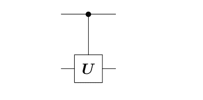

表示Λ(U)门的电路

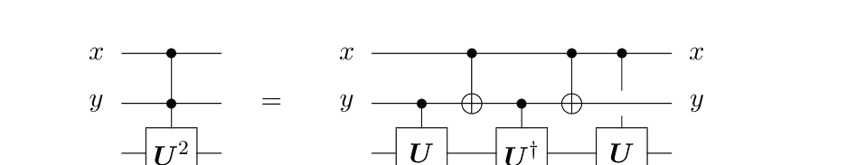

完成任务的电路。我们可以验证第三比特上应用U的次数为 $y-(x\oplus)+x=y-(x+y-2xy)+x=2xy. \quad (5.94)$

就是说，如果 $x=y=1$，则应用 $U^2$，否则应用恒等式；因此，该电路实现了 $\Lambda^2(U^2)$ 门。由于每个酉矩阵 $V$ 都有一个平方根 $U$ 使得 $V=U^2$，这个构造表明，使用两比特门，我们可以实现任意单比特 $V$ 的 $\Lambda^2(V)$ 门。

通过推广这个构造，我们可以找到一个电路来构造 $\Lambda^m(U^2)$，其中使用了 $\Lambda^{m-1}(U)$，$\Lambda^{m-1}(X)$，$\Lambda(U)$和 $\Lambda(U^\dagger)$门。如果我们将前一个电路中的 $\Lambda(X)$ 门替换为 $\Lambda^{m-1}(X)$ 门，并将最后一个 $\Lambda(U)$ 门替换为 $\Lambda^{m-1}(U)$，那么，如果我们用 $m$ 个控制位表示 $x_1, x_2, x_3, \ldots, x_m$，应用于最后一个量子位的 $U$ 的幂 $x_{m-1} - (x_m \oplus x_1 x_2 x_3 \ldots x_{m-1}) = x_m + x_1 x_2 x_3 \ldots x_{m-1} - (x_m + x_1 x_2 x_3 \ldots x_{m-1} - 2 x_1 x_2 x_3 \ldots x_{m-1} x_m) = 2 x_1 x_2 x_3 \ldots x_{m-1} x_m, \quad (5.95)$

这里我们使用了恒等式 $x\oplus y = x+y-2xy$。现在应用 $U^2$ 如果 $x_1 = x_2 = \cdots = x_m = 1$，否则应用恒等式；该电路实现了 $\Lambda^m(U^2)$ 门。

## 5.4 通用量子门

通过递归构造，我们可以看到，使用两量子比特门，我们可以构造出任意V的Λ^2(V)，然后使用这些门和两量子比特门，我们可以构造出任意V的Λ^3(V)，从而可以构造出任意V的Λ^4(V)等等。因此，我们已经展示了如何使用两量子比特门的电路来构造任意V的n量子比特门Λ^{n-1}(V)。

为了完成证明任意U(2^n)元素是两量子比特酉矩阵的乘积的论证，我们只需证明任意2×2酉矩阵可以由Λ^{n-1}(V)和两量子比特门构造出来。注意，Λ^{n-1}(V)实际上是一个2×2酉矩阵——它在由两个计算基态张成的二维空间中应用V。 $\{|111\ldots110\rangle, |111\ldots111\rangle\}$

如果我们希望在由计算状态$\{|x\rangle, |y\rangle\}$张成的空间中应用V，我们可以使用计算基态的置换Σ来实现 $\Sigma: |x\rangle \mapsto |111\ldots110\rangle, \quad |y\rangle \mapsto |111\ldots111\rangle$

构造 $\Sigma^{-1} \circ \Lambda^{n-1}(V) \circ \Sigma$

这应该从右到左阅读，先执行Σ，最后执行Σ^{-1}。但是我们已经在§5.2.2中看到了如何使用Λ^{n-1}(X)门和（单量子位）非门构造计算基态的任意置换，现在我们知道如何使用两量子位门构造Λ^{n-1}(X)（Λ^{n-1}(U)的特殊情况）。因此，使用两量子位门，我们已经构造出了通用的2×2幺正矩阵（在计算基上）如eq.(5.98)所示。这证明了任何U(2^n)的元素都可以通过两量子位门电路实现。事实上，我们证明了一个稍微更强的结果：即两量子位门{Λ(U)}，其中U是任意单量子位门，构成了一个完全通用的门集。

### 5.4.3 有限通用门集合

圆上的密度。如果使用该门集构建电路，则有限门集是通用的，因为这些电路在U(2^n)中是密集的。作为密度的第一个简单例子，考虑圆的旋转群U(1)，例如，Bloch球绕z轴的旋转： $\{ U(\theta) = \exp\left(i\frac{\theta}{2}\sigma_3\right), \theta \in [0, 4\pi) \}$

我们声称，如果$\alpha \in [0,1)$是无理数，则$U(4\pi\alpha)$的正整数幂在$U(1)$中是密集的。换句话说，点 $\{ n\alpha \pmod{1}, \quad n=1, 2, 3, ... \}$

在单位区间中是密集的。要理解原因，首先注意到点$\{n\alpha \pmod{1}\}$都是不同的，因为$n\alpha= m\alpha + k$对于整数$k$和$n=m$将意味着$\alpha$是一个有理数$\alpha=k/(n-m)$。现在考虑以每个点$\{n\alpha \pmod{1}, n=1,2,3, ..., N\}$为中心、宽度为$\varepsilon$的开区间。对于$N\varepsilon > 1$，至少有两个这些区间相交-如果所有区间都不相交，则它们的总长度$N\varepsilon$将超过区间的长度。因此存在不同的正整数$n$和$m$，小于 $1/\varepsilon$使得$|n - m|\alpha \pmod{1} < \varepsilon$；换句话说，正整数$r = |n - m| < 1/\varepsilon$满足$r\alpha \pmod{1} < \varepsilon$。现在，正整数的倍数$r\alpha \pmod{1}$是单位区间上等距离的点，它们之间的间距小于$\varepsilon$。因此，对于足够大的$M$，宽度为$\varepsilon$且以点$\{kr\alpha \pmod{1}, k= 1, 2, 3, \dots, M\}$为中心的区间填满了单位区间。由于$\varepsilon$可以是任意正实数，我们得出结论点$\{n\alpha \pmod{1}, n= 1, 2, 3, \dots\}$在区间中是密集的。通用门的幂。推广这个论证，考虑$U(N)$中一个通用元素的正整数幂。在适当的基础上，$U \in U(N)$是对角的，具有特征值 $\{ e^{i\theta_1/2}, e^{i\theta_2/2}, \dots, e^{i\theta_N/2} \}$。

由于有理数是可数的，而实数不是，对于一个通用的$U$（即$U(N)$的所有元素，除了一个测度为零的集合），每个$\theta_i/\pi$和$\theta_i/\theta_j$都是无理数。对于每个正整数$k$，$U^k$的特征值$\{ e^{-ik\theta_i/2}, i=1, 2, \dots, N\}$定义了一个点在$N$维环面（$N$个圆的乘积）上，并且随着$k$遍历所有正整数，这些点密集地填满整个$N$-环面。我们得出结论，对于任何通用的$U$，元素$\{ U^k, k= 1, 2, 3, \dots \}$在群$U(1)^N$中是密集的，即可以无限接近与$U$在相同基础上对角化的任何酉矩阵。

请注意，这个论证并没有提供任何关于$k$必须有多大才能使$U^k$与$U(1)^N$中的任何指定元素$\varepsilon$-接近的上界。实际上，如果对于某些$m$和$i$，$|m\theta_i \pmod{4\pi}| \ll \varepsilon$，则$k$的要求值可能非常大。使用交换的量子门电路来近似一个指定的酉变换可能很困难（即需要很多门），因为电路实现的酉变换仅取决于每个门被应用的次数，而不取决于门的顺序。使用非交换的门电路来实现一个好的近似要容易得多（需要更少的门）。

## 5.4 通用量子门

如果门是非交换的，则门的应用顺序很重要，并且使用指定大小的电路可以达到比门是交换的情况下更多的酉变换。

达到完整的李代数。假设我们可以构建这两个门 $U = exp (i\boldsymbol{A}),\; V = exp (i\boldsymbol{B}) \in U(N),$

其中$\boldsymbol{A}$和$\boldsymbol{B}$是$N \times N$的厄米矩阵。如果这些是通用门，$U$的正幂可以无限接近于任意实数$\alpha \boldsymbol{A}$，$V$的正幂可以无限接近于任意实数$\beta \boldsymbol{B}$。这足以确保存在一个由$U$和$V$门构成的有限电路，可以无限接近于任意厄米李代数元素$\boldsymbol{C}$。

我们称一个酉变换$U$是可达的，如果对于任意$\varepsilon > 0$，存在一个有限电路实现$\widetilde{U}$，它在上确界范数中与$U$的距离小于$\varepsilon$。注意到

$$\begin{aligned} \lim_{n\to\infty} \left(e^{i\alpha\boldsymbol{A}/n} e^{i\beta\boldsymbol{B}/n}\right)^n &= \lim_{n\to\infty} \left(1 + \frac{i}{n}(\alpha\boldsymbol{A} + \beta\boldsymbol{B}) + O\left(\frac{1}{n^2}\right)\right)^n \\ &= e^{i(\alpha\boldsymbol{A} + \beta\boldsymbol{B})}, \end{aligned}$$ (5.102)

我们可以看到，如果每个 $e^{i\alpha\boldsymbol{A}/n}$ 和 $e^{i\beta\boldsymbol{B}/n}$ 都是可达的，那么任何 $e^{i(\alpha\boldsymbol{A} + \beta\boldsymbol{B})}$ 都是可达的。此外，因为

$$\begin{aligned} \lim_{n\to\infty} \left(e^{i\boldsymbol{A}/\sqrt{n}} e^{i\boldsymbol{B}/\sqrt{n}} e^{-i\boldsymbol{A}/\sqrt{n}} e^{-i\boldsymbol{B}/\sqrt{n}}\right)^n \\= \lim_{n\to\infty} \left(1 - \frac{1}{n}(\boldsymbol{A}\boldsymbol{B} - \boldsymbol{B}\boldsymbol{A}) + O\left(\frac{1}{n^{3/2}}\right)\right)^n = e^{-[\boldsymbol{A},\boldsymbol{B}]}, \end{aligned}$$ (5.103)

我们可以看到 $e^{-[\boldsymbol{A},\boldsymbol{B}]}$ 也是可达的。例如，$SU(2)$ 的一个通用元素的正整数幂使我们能够达到一个 $U(1)$子群；如果我们适当地定向布洛赫球上的轴，这是由泡利算符 $Z$ 生成的子群。$SU(2)$ 的第二个通用元素的正整数幂使我们能够达到一个不同的 $U(1)$子群，由 $\widetilde{X} = X + \gamma Z$（对于某个实数 $\gamma$）和适当选择的轴生成。因为 $[Z, X] = iY$，所以 $\{Z, \widetilde{X}, -i[Z, \widetilde{X}]\}$ 构成了三维 $SU(2)$ 李代数的基。

由此可见，由 $SU(2)$ 的任意两个通用元件构建的电路足以达到 $SU(2)$ 的任何元素。

这个观察结果也适用于更高维的李代数。例如，$SU(4)$ 的李代数是15维的。它包含了各种低维子代数，如 $SU(4)$ 的子群 $U(1)^3$, $SU(2) \times SU(2) \times U(1)$, $SU(3) \times U(1)$, 等等。但是 $SU(4)$ 的李代数中的任意两个通用元件已经足以生成完整的李代数。生成的代数只在其中一个低维子代数上闭合。

只有当一些嵌套的对易子“偶然地”为零时，生成的代数才会在其中一个低维子代数上闭合，这个条件只在 $SU(4)$ 的所有生成元对中的零测度集合中满足。实际上，正如我们已经注意到的，$SU(4)$ 的任意元素都可以达到环面 $U(1)^3$，而且没有 $SU(4)$ 的任何非平凡子群包含两个通用的 $U(1)^3$ 子群。因此，由两个通用的双量子比特门构建的电路足以达到任何双量子比特门（除了整体相位）。由于我们可以用双量子比特门达到 $U(2^n)$ 的任何元素，所以一对通用的双量子比特门提供了一个通用的门集，前提是我们可以将这些门应用于任意一对量子比特。

但实际上，只需要一个通用的两比特门，如果我们不仅可以选择门作用的比特对，还可以选择比特的顺序。也就是说，一个通用的两比特门与交换两个比特的操作符SWAP不可交换。

如果U是一个通用的两比特门，那么 $V = \text{SWAP} \circ U \circ \text{SWAP}$ (5.104)

（相同的门应用于相同的两个比特，但顺序相反）是另一个与U不可交换的两比特门。U的正幂达到SU(4)的一个U(1)^3子群，而V的正幂达到另一个U(1)^3，因此由U和V构建的电路可以达到整个SU(4)。即使是非通用的普适门，特别是其特征值都是π的有理倍数，也可以满足普适性。

作业中讨论的一个例子是门集{CNOT, H, T}，其中H将布洛赫球绕轴旋转π角度。T绕着z轴旋转布洛赫球角度为 π/4。如果我们用 π/2 旋转 T^2 替换T，则门集将不具备普适性；在这种情况下，唯一可实现的单量子比特旋转将是 SU(2) 的一个有限子群中的旋转。但是 SU(2) 只有少数这样的有限非阿贝尔子群（旋转群 SO(3) 的有限非阿贝尔子群只有正多边形和正三维多面体的对称群，即正多面体）。如果门集超越了这些有限子群，它将达到 SU(2) 的一个 U(1) 子群或全部 SU(2)。

### 5.4.4 Solovay-Kitaev逼近

直到现在，我们对通用门的讨论都集中在可达性上，并忽略了复杂性。但是当我们有一个有限的通用门集合时，我们不仅想知道我们是否能够以精度ε近似所需的酉变换，还想知道实现这种近似有多困难。需要多大的电路才足够？这个问题实际上有两个部分。（1）给定一个酉变换 U，需要多大的量子电路来构建 $\tilde{U}$，使得 $\| \tilde{U} - e^{i\phi}U \|_{\text{sup}} \le \varepsilon$? (2) 需要多大的经典电路来找到实现量子电路的量子电路 $\tilde{U}$? 我们将看到，对于任何一个通用的门集 (闭合于逆运算)，用于近似常维度的幺正群元素，两个问题的答案都是polylog($1/\varepsilon$)。我们关心第二个问题的答案，因为知道只有第一个问题的答案并不是很有用。如果这些电路很难找到，那么$U$可以通过小的量子电路很好地近似。

我们将通过设计一个递归算法来证明这个结果，该算法可以逐步获得越来越好的近似。我们称有限的酉变换集合$\mathcal{R}$是$U(N)$中的一个“$\varepsilon$-网”，如果$U(N)$的每个元素与$\mathcal{R}$中的某个元素的距离 (在上确界范数下) 不超过$\varepsilon$，并且我们称$\mathcal{R}$“封闭于逆变换”，如果$\mathcal{R}$中每个元素的逆变换也在$\mathcal{R}$中。递归算法的关键步骤是要证明如果$\mathcal{R}$是一个$\varepsilon$-网，且封闭于逆变换，那么我们可以构造一个新的酉变换集合$\mathcal{R}'$，也封闭于逆变换，并具有以下特性： (1) $\mathcal{R}'$中的每个元素可以通过来自$\mathcal{R}$的最多5个门的电路实现。 (2) $\mathcal{R}'$是一个$\varepsilon'$网，其中 $$\varepsilon' = C\varepsilon^{3/2}, \qquad (5.105)$$ 而 $C$ 是一个常数。

在解释这个步骤如何工作之前，让我们看看为什么它确保我们可以使用一个大小为多项式对数的量子电路来近似任何幺正操作。假设我们首先找到了一个闭合于逆运算的$\varepsilon_0$-网格 $\mathcal{R}_0$，其中 $\mathcal{R}_0$的每个元素都可以通过使用我们的通用门集合中不超过 $L_0$个门的电路来实现。如果$\varepsilon_0 < 1/C^2$，则我们可以调用递归步骤来找到一个$\varepsilon_1$-网格$\mathcal{R}_1$，其中 $\varepsilon_1 < \varepsilon_0$，并且 $\mathcal{R}_1$的每个元素都可以通过使用 $L_1 = 5L_0$个门的电路来实现。通过重复这个步骤 $k$次，我们可以使误差$\varepsilon_k$比0级误差$\varepsilon_0$小得多。迭代关系 $C^2 \varepsilon_k = \left(C^2 \varepsilon_{k-1}\right)^{3/2}, \qquad (5.106)$

k次我们得到 $C^2 \varepsilon_k = \left(C^2 \varepsilon_0\right)^{(3/2)^k}, \qquad (5.107)$

通过取两边的对数，我们得到 $\left(\frac{3}{2}\right)^k = \frac{\log\left(1/C^2 \varepsilon_k\right)}{\log\left(1/C^2 \varepsilon_0\right)}. \qquad (5.108)$

经过 $k$次递归步骤，每个单元的电路大小在 $\varepsilon_k$-网 $\mathcal{R}_k$中不会超过 $L_k$，其中

$$L_k/L_0 = 5^k = \left(\frac{3}{2}\right)^{\log 5 / \log(3/2)} = \left(\frac{\log (1/C^2\varepsilon_k)}{\log (1/C^2\varepsilon_0)}\right)^{\log 5 / \log(3/2)} \quad (5.109)$$

因此，电路大小随着精度 $\varepsilon_k$ 按照 $[\log(1/\varepsilon_k)]^{3.97}$ 的比例缩放。现在让我们看看如何从 $\varepsilon$-网 $\mathcal{R}$ 构建 $\varepsilon'$-网 $\mathcal{R}'$。对于任意的 $U \in SU(N)$，存在一个元素 $\tilde{U} \in \mathcal{R}$，使得 $\|U - \tilde{U}\|_{\sup} \leq \varepsilon$，或者等价地 $\|U\tilde{U}^{-1} - I\|_{\sup} \leq \varepsilon$。现在我们将找到 $W$，构建为 $\mathcal{R}$ 的4个元素的电路，使得 $\|U\tilde{U}^{-1} - W\|_{\sup} \leq \varepsilon'$，或者等价地 $\|U - W\tilde{U}\|_{\sup} \leq \varepsilon'$。因此，$U$ 通过 $W\tilde{U}$ 近似到精度 $\varepsilon'$，这是通过 $\mathcal{R}$ 的5个元素的电路实现的。我们可以写成 $U\tilde{U}^{-1} = e^{iA}$，其中 $A = O(\varepsilon)$。（通过 $A = O(\varepsilon)$ 我们的意思是 $\|A\|_{\sup} = O(\varepsilon)$，即 $\varepsilon$ 足够小时，$\|A\|_{\sup}$ 被一个常数乘以 $\varepsilon$ 上界。）可以找到 $B$，$C$ 的 Hermitian，都是 $O(\varepsilon^{1/2})$ 的，使得 $[B, C] = -iA$。此外，因为 $\mathcal{R}$ 是一个 $\varepsilon$-网，存在一个 $\mathcal{R}$ 的元素 $\tilde{B}$ 接近 $B$，以及一个 $\mathcal{R}$ 的元素 $\tilde{C}$ 接近 $C$。由此可得 $B - \tilde{B} = O(\varepsilon)$ 和 $C - \tilde{C} = O(\varepsilon)$。现在我们考虑电路

$$W = e^{i\tilde{B}} e^{i\tilde{C}} e^{-i\tilde{B}} e^{-i\tilde{C}} = I - [\tilde{B}, \tilde{C}] + O(\varepsilon^{3/2}); \quad (5.110)$$

余项在 $\tilde{B}$ 和 $\tilde{C}$ 的三次阶，因此为 $O(\varepsilon^{3/2})$。首先注意这个电路的逆，$e^{i\tilde{C}} e^{i\tilde{B}} e^{-i\tilde{C}} e^{-i\tilde{B}}$，也可以通过 $\mathcal{R}$ 的四门电路构建。此外，

$$W = I - [B + O(\varepsilon), C + O(\varepsilon)] + O(\varepsilon^{3/2}) = I + iA + O(\varepsilon^{3/2}) \\ = e^{iA} + O(\varepsilon^{3/2}); \quad (5.111)$$

因此 $W$，一个由 $\mathcal{R}$ 组成的4个门的电路，近似于 $U\tilde{U}^{-1}$ 到 $O(\varepsilon^{3/2})$ 的精度，正如我们所想要展示的。

最后，让我们考虑近似一个幺正变换的经典计算成本。经典算法将一个幺正变换 $U$ 作为输入，并产生一个评估 $U$ 的量子电路作为输出，该电路近似于 $U$ 的精度为 $\varepsilon$。为了提高近似精度到 $\varepsilon'$，我们需要调用精度为 $\varepsilon$ 的算法三次，以找到评估 $U$、$e^{iB}$ 和 $e^{iC}$ 的电路。因此，如果精度为 $\varepsilon$ 的经典算法的计算成本为 $t$，那么改进的精度为 $\varepsilon'$ 的经典算法的计算成本为 $t' = 3t +$ 常数，其中常数是为了覆盖成本。

对于不随 $\varepsilon$ 缩放的任务，例如找到满足 $[\boldsymbol{B}, \boldsymbol{C}] = -\mathrm{i}\boldsymbol{A}$ 的矩阵 $\boldsymbol{B}$ 和 $\boldsymbol{C}$，经过 $k$ 次迭代，经典成本的规模如下

$$O(3^k) = O\left(\left[\log(1/\varepsilon_k)\right]^{\log 3/\log(3/2)}\right) = O\left(\left[\log(1/\varepsilon_k)\right]^{2.71}\right),\qquad (5.112)$$

与算法的级别-$k$ 版本所达到的精度成多对数关系。

我们所取得的成果有些令人惊讶。通过将幺正变换与 $O(\varepsilon)$ 误差组合，我们得到了具有更小 $O(\varepsilon^{3/2})$ 误差的幺正变换。我们如何能够用如此粗糙的工具取得如此尖锐的结果呢？秘密在于我们构建了电路，使得 $O(\varepsilon)$ 误差相互抵消，只留下高阶误差。如果 $\mathcal{R}$ 不闭合于逆运算，这种方法就不会奏效。如果我们被迫使用 $O(\varepsilon)$ 近似来逼近 $\boldsymbol{B}$ 和 $\boldsymbol{C}$ 的逆运算，这种抵消就不会发生，我们对改进逼近的追求就会失败。但是，如果我们的通用门集允许我们构造每个门元素的精确逆运算，那么我们可以使用 Solovay-Kitaev 方法递归地改进逼近。

这个方案适用于任何在逆运算下封闭的通用门集。对于特定的门集，可以实现改进的近似。例如，门集 $\{\boldsymbol{H}, \boldsymbol{T}\}$ 可以用来以精度 $\varepsilon$ 近似任意单比特幺正操作，使用 $O(\log(1/\varepsilon))$ 个门，这是对一般论证所建立的 $O\left([\log(1/\varepsilon)]^{3.97}\right)$ 的大幅改进，而且实现这种改进开销的电路可以高效地构建。

## 5.5 总结

**经典电路。** 问题的复杂性可以通过解决该问题的一组统一逻辑电路的大小来刻画：如果电路的大小是输入大小的超多项式函数，则问题是困难的，否则是容易的。一个经典的通用计算机可以高效地模拟另一个计算机，因此复杂性的分类是与机器无关的。3比特的 Toffoli 门对于经典可逆计算是通用的。可逆计算机可以模拟不可逆计算机，而不会有显著的减速和不合理的内存资源消耗。

**量子电路。** 虽然没有证据，但很可能无法通过多项式大小的随机经典电路来模拟多项式大小的量子电路（$\mathsf{BQP} = \mathsf{BPP}$）；然而，多项式空间是足够的（$\mathsf{BQP} \subseteq \mathsf{PSPACE}$）。噪声量子电路可以以可接受的精度模拟大小为 $T$ 的理想量子电路，如果每个量子门的准确度为 $1/T$ 的阶。任何 $n$ 量子比特的幺正变换都可以由两比特门构建。如果一个通用的两比特量子门可以作用于设备中的任意两个量子比特，则足以进行通用量子计算。一个通用的量子计算机可以以多项式对数 $(1/\varepsilon)$ 的代价模拟另一个计算机，因此复杂度类 $\mathsf{BQP}$ 是机器无关的。

通过练习来了解更多关于量子门的通用集合。

## 5.6 练习

### 5.1 托菲利门的线性模拟。

在 §5.2.2 中，我们从 3 位托菲利门 ($\Lambda^2(X)$) 构造了一个 $n$ 位托菲利门 $\Lambda^{n-2}(X)$。电路只需要一个比特的临时空间，但门的数量随着 $n$ 的指数增长。如果有更多的临时空间，我们可以大大减少门的数量。

- a) 找到一个包含 $2n - 5$ 个 $\Lambda^2(X)$ 的电路族，用于计算 $\Lambda^{n-2}(X)$（这里使用了 $n-3$ 个临时比特，它们在计算开始时被设置为 0，在计算结束时返回 0。）
- b) 找到一个包含 $4n - 12$ 个 $\Lambda^2(X)$ 的电路族，用于计算 $\Lambda^{n-1}(X)$，这适用于任意初始值的临时位。（再次，$n-3$ 个临时位返回到初始值，但它们在开始时不需要被设置为零。）

### 5.2 一个完全通用的量子门集合。

这个练习的目的是完成证明控制非门 $\Lambda(X)$ 和任意单量子比特门构成一个完全通用集合。

如果 $U$ 是任意行列式为一的 $2 \times 2$ 酉矩阵，找到酉矩阵 $A$, $B$ 和 $C$，使得

$$ABC = I \tag{5.113}$$

$$AXBXC = U \tag{5.114}$$

提示：根据欧拉角构造，我们知道

$$U = R_z(\psi) R_y(\theta) R_z(\phi) \tag{5.115}$$

其中，例如，$R_z(\phi)$ 表示绕 $z$ 轴旋转角度 $\phi$。我们还知道，例如，

$$XR_z(\phi)X=R_z(-\phi) \tag{5.116}$$

考虑一个受控相位门的两比特门，它在第一个比特为 $|1\rangle$ 时对第二个比特应用 $U = e^{i\alpha} I$，并且在其他情况下不产生任何作用。证明它实际上是一个单比特门。

绘制一个使用 $\Lambda(X)$ 门和单比特门的电路，实现 $\Lambda(U)$，其中 $U$ 是一个任意的 $2 \times 2$ 酉变换。

由于第 5.4.2 节的论证表明，门集 $\{\Lambda(U)\}$ 是完全通用的，我们已经证明了 $\Lambda(X)$ 和单比特门是一个完全通用的集合。

### 5.3 通用量子门 I

在这个练习和接下来的两个练习中，我们将证明几个简单的门集合对于量子计算是通用的。

Hadamard 变换 $H$ 是作用在标准基 $\{|0\rangle, |1\rangle\}$ 上的单比特门，

$$H = \frac{1}{\sqrt{2}} \begin{pmatrix} 1 & 1 \\ 1 & -1 \end{pmatrix} ; \tag{5.117}$$

在量子电路符号中，我们用 Hadamard 门表示为


单比特相位门 $S$ 在标准基上的作用是

$$S = \begin{pmatrix} 1 & 0 \\ 0 & i \end{pmatrix} , \tag{5.118}$$

并且表示为


两比特控制相位门 $\Lambda(S)$ 在标准基 $\{|00\rangle, |01\rangle, |10\rangle, |11\rangle\}$ 上的作用，它是一个 $4 \times 4$ 的对角矩阵

$$\Lambda(S) = \mathrm{diag}(1,1,1,i) \tag{5.119}$$

并且可以表示为


尽管这种误导性的符号表示，门 $\Lambda(S)$ 实际上对两个量子比特起到对称作用：

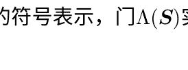

我们将看到，两个门 $H$ 和 $\Lambda(S)$ 构成了一个通用门集——任何幺正变换都可以通过由这些门构建的量子电路来近似到任意精度。

- a) 考虑由量子电路定义的两比特幺正变换 $U_1$ 和 $U_2$

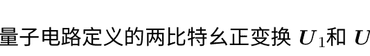

和

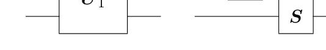

用 $|ab\rangle$ 表示标准基中的元素，其中 $a$ 标记电路图中的上比特，$b$ 标记下比特。将 $U_1$ 和 $U_2$ 写成标准基下的 $4 \times 4$ 矩阵。证明 $U_1$ 和 $U_2$ 在状态上都起到平凡作用

$$|00\rangle, \quad \frac{1}{\sqrt{3}}(|01\rangle + |10\rangle + |11\rangle). \tag{5.120}$$

- b) 因此 $U_1$ 和 $U_2$ 只在由 $\left\{ \frac{1}{\sqrt{2}}(|01\rangle - |10\rangle), \frac{1}{\sqrt{6}}(|01\rangle + |10\rangle - 2|11\rangle) \right\}$ 所张成的二维空间中起到非平凡作用。

$$\left\{ \frac{1}{\sqrt{2}}(|01\rangle - |10\rangle), \frac{1}{\sqrt{6}}(|01\rangle + |10\rangle - 2|11\rangle) \right\}. \tag{5.121}$$

证明，在这个基下表示，它们是

$$U_1 = \frac{1}{4} \begin{pmatrix} 3 + i & \sqrt{3}(-1 + i) \\ \sqrt{3}(-1 + i) & 1 + 3i \end{pmatrix}, \tag{5.122}$$

和

$$U_2 = \frac{1}{4} \begin{pmatrix} 3 + i & \sqrt{3}(1 - i) \\ \sqrt{3}(1 - i) & 1 + 3i \end{pmatrix}. \tag{5.123}$$

- c) 现在以这个二维子空间上的形式表达 $U_1$ 和 $U_2$ 的作用

$$U_1 = \sqrt{i} \left( \frac{1}{\sqrt{2}} - i \frac{1}{\sqrt{2}} \hat{n}_1 \cdot \vec{\sigma} \right) \quad \text{(5.124)}$$

和

$$U_2 = \sqrt{i} \left( \frac{1}{\sqrt{2}} - i \frac{1}{\sqrt{2}} \hat{n}_2 \cdot \vec{\sigma} \right) \quad \text{(5.125)}$$

单位向量 $\hat{n}_1$ 和 $\hat{n}_2$ 是什么？

- d) 考虑变换 $U_2^{-1} U_1$（注意 $U_2^{-1}$ 也可以由门 $H$ 和 $\Lambda(S)$ 构造）。证明它在由基底 (5.121) 张成的二维空间中执行半角度 $\theta/2$ 的旋转，其中 $\cos(\theta/2) = 1/4$。

### 5.4 通用量子门 II

我们已经在练习 5.3 中看到如何组合量子门 $H$ 和 $\Lambda(S)$ 来在两个量子比特的四维希尔伯特空间的二维子空间中执行旋转，旋转角度为 $\cos(\theta/2) = 1/4$。在这个练习中，我们将证明角度 $\theta$ 不是 $\pi$ 的有理倍数。等价地，我们将证明

$$e^{i\theta/2} \equiv \cos(\theta/2) + i\sin(\theta/2) = \frac{1}{4}\left(1 + i\sqrt{15}\right) \quad \text{(5.126)}$$

不是单位根：不存在有限整数幂 $n$ 使得 $(e^{i\theta/2})^n = 1$。

回顾一下，一个次数为 $n$ 的多项式是一个表达式

$$P(x) = \sum_{k=0}^{n} a_k x^k \quad \text{(5.127)}$$

其中 $a_n \neq 0$。如果所有的 $a_k$ 都是有理数，则称多项式为有理多项式；如果 $a_n = 1$，则称其为首一多项式。一个多项式如果所有的 $a_k$ 都是整数，则称其为整数多项式；如果 $\{a_0, a_1, \ldots, a_n\}$ 的最大公约数为 1，则称其为本原多项式。

- a) 证明具有最小次数的首一有理多项式的根为 $e^{i\theta/2}$ 的情况下，该多项式为

$$P(x) = x^2 - \frac{1}{2}x + 1 \quad \text{(5.128)}$$

由结果可知，$e^{i\theta/2}$ 不是单位根。

**定理**：如果 $a$ 是单位根，且 $P(x)$ 是具有最小次数且首一的有理多项式，使得 $P(a) = 0$，则 $P(x)$ 是整系数的。由于具有 $e^{i\theta/2}$ 为根的最小首一有理多项式不是整系数的，我们可以得出结论，$e^{i\theta/2}$ 不是单位根。在本练习的其余部分，我们将证明该定理。

- b) 通过“长除法”，我们可以证明如果 $A(x)$ 和 $B(x)$ 是有理多项式，那么存在有理多项式 $Q(x)$ 和 $R(x)$，使得
$$A(x) = B(x)Q(x) + R(x) , \tag{5.129}$$
其中“余项” $R(x)$ 的次数小于 $B(x)$ 的次数。假设 $a^n = 1$，并且 $P(x)$ 是一个最小次数的有理多项式，使得 $P(a) = 0$。证明存在一个有理多项式 $Q(x)$，使得
$$x^n - 1 = P(x)Q(x) . \tag{5.130}$$

- c) 证明如果 $A(x)$ 和 $B(x)$ 都是本原整数多项式，那么它们的乘积 $C(x) = A(x)B(x)$ 也是本原的。提示：如果 $C(x) = \sum_k c_k x^k$ 不是本原的，那么存在一个质数 $p$ 可以整除所有的 $c_k$。写成 $A(x) = \sum_k a_k x^k$，以及 $B(x) = \sum_k b_k x^k$，让 $a_r$、$b_s$ 分别表示 $A(x)$ 中不可被 $p$ 整除的最低阶系数（如果 $A(x)$ 是本原的，则必然存在），$B(x)$ 中不可被 $p$ 整除的最低阶系数。用 $c_{r+s}$ 和其他的 $a_l$ 和 $b_m$ 来表示 $a_r$、$b_s$ 的乘积，并得出矛盾。

- d) 假设一个首一整系数多项式 $P(x)$ 可以分解为两个首一有理多项式的乘积，$P(x) = A(x)B(x)$。证明 $A(x)$ 和 $B(x)$ 是整系数多项式。提示：首先注意到我们可以写成 $A(x) = (1/r) \cdot \tilde{A}(x)$，以及 $B(x) = (1/s) \cdot \tilde{B}(x)$，其中 $r, s$ 是正整数，而 $\tilde{A}(x)$ 和 $\tilde{B}(x)$ 是本原整数多项式；然后使用 (c) 来证明 $r = s = 1$。

- e) 结合 (b) 和 (d)，证明定理。

我们证明了什么？由于 $U_2^{-1}U_1$ 是以 $\pi$ 的无理倍数旋转，$U_2^{-1}U_1$ 的幂在 $U(1)$ 子群中是稠密的。类似的推理表明，$U_1U_2^{-1}$ 是绕另一个轴旋转相同角度的旋转，因此它的幂在另一个 $U(1)$ 子群中是稠密的。这两个非交换元素的乘积...U(1)子群的元素在包含它们的 SU(2)子群中是稠密的 U1 和 U2 的乘积。

此外，这两个元素的乘积

$$ \Lambda(S) U_2^{-1} U_1 \Lambda(S)^{-1} \text{ 和 } \Lambda(S) U_1 U_2^{-1} \Lambda(S)^{-1} \quad (5.131) $$

在另一个 SU(2)子群中是稠密的，作用于

$$ \left\{ \frac{1}{\sqrt{2}}(|01\rangle - |10\rangle), \frac{1}{\sqrt{6}}(|01\rangle + |10\rangle - 2i|11\rangle) \right\}. \quad (5.132) $$

因此，这两个SU(2)子群与作用在与|00⟩正交的三维空间上的SU(3)子群相互闭合。通过 H⊗H 共轭作用于 SU(3)，我们得到另一个作用在与|++,++⟩正交的三维空间上的 SU(3)。

$$ |+\rangle = 1/\sqrt{2} $$ 唯一包含这两个SU(3)子群的SU(4)子群就是SU(4)本身。

因此，由门集 {H, Λ(S)} 构建的电路在 SU(4) 中是稠密的 - 我们可以以任意精度逼近任何两比特门，这足以实现通用量子计算。呼！

## 5.5 通用量子门 III

我们已经在练习5.3和5.4中证明了门集 {H, Λ(S)} 是通用的。因此，任何可以构建 H 和 Λ(S) 的门集合也是通用的。特别地，我们可以看到 {H, S, Λ^2(X)} 和 {H, T, Λ(X)} 是通用门集合，其中 T = exp(-iπ/8 Z)。

有时候，通过指定门在共轭一个Pauli算符时的作用来表征一个量子门是很方便的。证明 H 和 S 具有以下性质

$$ HXH = Z, \quad HYH = -Y, \quad HZH = X, \quad (5.133) $$

和

$$ SXS^{-1} = Y, \quad SYS^{-1} = -X, \quad SZS^{-1} = Z. \quad (5.134) $$

b) 请注意，由于 S^{-1} = S^3，所以门 K = HS^{-1}HSH 可以使用 H 和 S构建。证明

$$ KXK = Y, \quad KYK = X, \quad KZK = -Z. \quad (5.135) $$

c) 使用门集合构建Λ²(Y)和Λ²(Z)的电路，然后通过使用Λ²(X), Λ²(Y)和Λ²(Z)构建Λ(S)⊗I来完成对该门集合的普适性证明。

d) 通过使用Λ(X)和T构建Λ(S)，证明 {H, T, Λ(X)}是一个通用门集合。提示: 注意到T² = e^{-iπ/4}S, 然后使用练习5.2中建议的构造方法, 注意到T^{-1} T^{-1} T² = I 和 T^{-1} X T^{-1} X T² = T² 。

Toffoli门Λ²(X)对于可逆经典计算是通用的。为了实现量子计算的全部能力, 必须添加什么? 我们刚刚看到, 单比特门H和S, 以及Toffoli门, 足以达到任何酉变换。实际上, 只有H和Λ²(X)就足以高效模拟任何量子计算。

当然, 由于H和Λ²(X)都是实正交矩阵, 由这些门构成的电路必然是实数的——使用这些工具无法构造出一些复数的n比特酉变换。但是, 一个2n维的复向量空间与一个2n+1维的实向量空间是同构的。根据这个规则, 可以将复向量编码为实向量。

> |ψ⟩ = ∑_x ψ_x |x⟩ → |ψ̃⟩ = ∑_x (Re ψ_x)|x,0⟩ + (Im ψ_x)|x,1⟩ , (5.136)

并且一个酉变换U的作用可以表示为一个实正交矩阵U_R定义为

> U_R: |x,0⟩ ↦ (Re U)|x⟩⊗|0⟩ + (Im U)|x⟩⊗|1⟩, |x,1⟩ ↦ -(Im U)|x⟩⊗|0⟩ + (Re U)|x⟩⊗|1⟩ (5.137)

为了证明门集合 {H,Λ²(X)}是“通用”的, 只需证明实际编码Λ(S)_R可以由Λ(S)的真实编码构造而成, 其中Λ²(X)和H.

e) 验证Λ(S)_R = Λ²(XZ).

f) 使用Λ²(X)和H构建一个Λ²(XZ)的电路.

因此, 经典托菲利门不需要太多帮助来释放量子计算的力量. 事实上, 任何非经典的单比特门 (不保持计算基的门), 与托菲利门结合, 就足够了.

## 5.6 从任意纠缠的两比特门实现通用性

我们称两量子比特的酉门为局部门，如果它是单量子比特门的张量积，而两量子比特的门 $U$ 和 $V$ 是局部等价的，如果一个可以通过局部门转换为另一个：

$$V = (A \otimes B) U (C \otimes D). \qquad (5.138)$$

事实证明（你不需要证明这一点），每个两量子比特门都可以局部等价于以下形式的门：

$$V(\theta_x, \theta_y, \theta_z) = \exp \left[ i(\theta_x X \otimes X + \theta_y Y \otimes Y + \theta_z Z \otimes Z) \right], \qquad (5.139)$$

其中

$$-\pi/4 < \theta_x \leq \theta_y \leq \theta_z \leq \pi/4. \qquad (5.140)$$

a) 证明 $V(\pi/4, \pi/4, \pi/4)$ 是（除了整体相位外）交换两个量子比特的 SWAP 操作：

$$\mathrm{SWAP}(|\psi\rangle \otimes |\phi\rangle) = |\phi\rangle \otimes |\psi\rangle. \qquad (5.141)$$

b) 证明 $V(0, 0, \pi/4)$ 在局部上等效于 CNOT 门 $\Lambda(X)$.

如练习5.2所示，CNOT 门 $\Lambda(X)$ 与任意单比特门组合起来可以形成一个完全的通用门集。但实际上，CNOT 门在这方面并没有什么特别之处。

任意两比特门 $U$，与任意单比特门组合起来，除非 $U$ 是局部的或在局部上等效于 SWAP，否则足够实现通用性。

为了证明当辅助本地门时，$U$ 是通用的，只需使用仅包含本地门和 $U$ 门的电路构建 $\Lambda(X)$。

**引理：** 如果 $U$ 在本地上等效于 $V(\theta_x, \theta_y, \theta_z)$，那么可以使用本地门和 $U$ 门构建 $\Lambda(X)$，除非有两种情况：$(1) \theta_x = \theta_y = \theta_z = 0$（$U$ 是本地的），$(2) \theta_x = \theta_y = \theta_z = \pi/4$（$U$ 在本地上等效于 SWAP）。你将在本练习的其余部分证明这个引理。

c) 证明：

$$
\begin{align*}
(I \otimes X) V(\theta_x, \theta_y, \theta_z) (I \otimes X) V(\theta_x, \theta_y, \theta_z) &= V(2\theta_x, 0, 0), \\
(I \otimes Y) V(\theta_x, \theta_y, \theta_z) (I \otimes Y) V(\theta_x, \theta_y, \theta_z) &= V(0, 2\theta_y, 0), \\
(I \otimes Z) V(\theta_x, \theta_y, \theta_z) (I \otimes Z) V(\theta_x, \theta_y, \theta_z) &= V(0, 0, 2\theta_z).
\end{align*}
\qquad (5.142)
$$

d) 证明 $V(0,0,\theta)$ 在局部上等效于受控旋转 $\Lambda[R(\hat{n},4\theta)]$, 其中 $R(\hat{n},4\theta) = \exp[-2i\theta(\hat{n} \cdot \vec{\sigma})]$, 对于任意的旋转轴 $\hat{n}$. (这里 $\vec{\sigma} = (X, Y, Z)$.)

e) 现在使用(c)和(d)的结果来证明引理。

# 第六章

## 量子计算

## 6.1 经典电路

量子计算机的概念在第一章中引入。在这里，我们将更准确地说明我们的量子计算模型，并指出模型的一些基本属性。但在解释量子计算机的工作原理之前，也许我们应该先说一下经典计算机的工作原理。

### 6.1.1 通用门

经典（确定性）计算机评估一个函数：给定输入的$n$位，它产生由输入唯一确定的$m$位输出；也就是说，它找到了

$$f : \{0, 1\}^n \to \{0, 1\}^m, \qquad (6.1)$$

对于特定的$n$位参数。具有$m$位值的函数等效于$m$个具有一位值的函数，因此我们可以说计算机执行的基本任务是评估

$$f : \{0, 1\}^n \to \{0, 1\}. \qquad (6.2)$$

我们可以很容易地计算出这样的函数的数量。有$2^n$个可能的输入，对于每个输入，有两个可能的输出。因此，总共有$2^{2^n}$个将$n$个位转换为一个位的函数。

任何这样的函数的评估都可以简化为一系列基本的逻辑操作。让我们将输入的可能值分为一个集合，其中$f(x) = 1$，以及一个补集，其中

$$ x = x_1 x_2 x_3 \dots x_n, \tag{6.3} $$

将其分为一个集合，其中 $f(x) = 1$，以及一个补集，其中 $f(x) = 0$。对于每个 $x^{(a)}$使得 $f(x^{(a)}) = 1$，考虑函数 $f^{(a)}$如下

$$ f^{(a)}(x) = \begin{cases} 1 & \text{如果 } x = x^{(a)} \\ 0 & \text{否则} \end{cases} \tag{6.4} $$

然后

$$ f(x) = f^{(1)}(x) \vee f^{(2)}(x) \vee f^{(3)}(x) \vee \dots \tag{6.5} $$

$f$是所有$f^{(a)}$的逻辑或($\vee$)。在二进制算术中，两个位的$\vee$操作可以表示为

$$ x \vee y = x + y - x \cdot y; \tag{6.6} $$

如果$x$和$y$都为零，则其值为0，否则为1。

现在考虑$f^{(a)}$的评估。在$x^{(a)} = 111\dots1$的情况下，我们可以写成

$$ f^{(a)}(x) = x_1 \wedge x_2 \wedge x_3 \dots \wedge x_n; \tag{6.7} $$

它是所有$n$位的逻辑与($\wedge$)。在二进制算术中，与操作是乘积。

$$ x \wedge y = x \cdot y. \tag{6.8} $$

对于任何其他的 $x^{(a)}$， $f^{(a)}$再次被表示为 $n$位的AND，但是在每个 $x_i$上先应用NOT ($\neg$)操作使得 $x_i^{(a)} = 0$；例如

$$ f^{(a)}(x) = (\neg x_1) \wedge x_2 \wedge x_3 \wedge (\neg x_4) \wedge \dots \tag{6.9} $$

if

$$ x^{(a)} = 0110 \dots \tag{6.10} $$

### 6.1.2 电路复杂度

NOT操作在二进制算术中表示为
$$ \neg x = 1 - x. $$

我们现在从三个基本逻辑连接构建了函数 $f(x)$：NOT、AND、OR。我们得到的表达式被称为 $f(x)$的“析取范式”。 我们还隐含地使用了另一个操作，COPY，它将一个位变为两个位：COPY: $x \rightarrow xx$。

我们需要COPY操作，因为每个 $f^{(a)}$在析取范式展开中都需要自己的 $x$的副本来进行操作。

事实上，我们可以将我们的基本逻辑连接符集合简化为一个更小的集合。让我们通过定义一个NAND（“非与”）操作来实现
$$ x \uparrow y = \neg (x \wedge y) = (\neg x) \vee (\neg y). $$

在二进制算术中，NAND操作是
$$ x \uparrow y = 1 - xy. $$

如果我们可以进行COPY操作，我们可以使用NAND来执行NOT：
$$ x \uparrow x = 1 - x^2 = 1 - x = \neg x. $$
(或者，如果我们可以准备常数 $y=1$，那么 $x \uparrow 1 = 1-x = \neg x$。 )
此外，
$$ (x \uparrow y) \uparrow (x \uparrow y) = \neg(x \uparrow y) = 1 - (1 - xy) = xy = x \wedge y, $$

和
$$ (x \uparrow x) \uparrow (y \uparrow y) = (\neg x) \uparrow (\neg y) = 1 - (1-x)(1-y) = x + y - xy = x \vee y. $$

因此，如果我们可以复制，NAND也可以执行AND和OR操作。 我们得出结论，单一的逻辑连接词NAND和复制一起足以评估任何函数 $f$。 (您可以验证，另一种可能的选择是NOR作为通用连接词：

$$ x \downarrow y = \neg(x \vee y) = (\neg x) \wedge (\neg y).) $$

如果我们能够准备一个恒定的比特（$x=0$或 $x=1$），我们可以将基本操作的数量从两个减少到一个。NAND/NOT门

$$(x, y) \rightarrow (1-x, 1-xy),$$

计算NAND（如果我们忽略第一个输出比特）并执行复制（如果我们将第二个输入比特设置为 $y=1$，并且随后对两个输出比特应用NOT）。因此，我们可以说NAND/NOT是一种通用门。如果我们有恒定比特的供应，并且我们可以将NAND/NOT门应用于任意选择的输入比特对，那么我们可以执行一系列NAND/NOT门来评估任何函数 $f : \{0, 1\}^n \to \{0, 1\}$对于任何输入值 $x = x_1 x_2 \ldots x_n$。

这些考虑促使了计算的电路模型。 计算机有几个基本组件，可以对位或位对执行基本操作，例如复制、非、与、或。它还可以准备一个常量位或输入一个可变位。计算是一系列这样的操作，应用于指定的输入位字符串的电路。计算的结果是在执行所有基本操作后，所有剩余位的最终值。

在计算理论中，这是一个基本结果，只需要几个基本门就可以评估有限输入的任何函数。 这个结果意味着，通过非常简单的硬件组件，我们可以构建任意复杂的计算。

到目前为止，我们只考虑了对特定固定输入进行的计算，但我们可以考虑对可变大小的输入进行操作的电路族。 电路族提供了一种分析和分类计算复杂性的有用方案，在我们转向量子计算时，这种方案将有一个自然的推广。

### 6.1.2 电路复杂度

在复杂性研究中，我们通常对具有一位输出的函数感兴趣

$$f : \{0, 1\}^n \rightarrow \{0, 1\}$$的评估。

这样的函数 f可以说是对“决策问题”的编码解决方案——函数检查输入并发出YES或NO答案。 通常，一个不会以YES/NO答案的形式在口语中提出的问题可以被“重新包装”为一个决策问题。 例如，定义FACTORING问题的函数是：

$$ f(x, y) = \begin{cases} \text{如果整数 } x \text{ 有小于 } y \text{ 的除数，则为1。} \\ \text{否则为0；} \end{cases} \quad (6.21) $$

对于所有 $y < x$ 的 $f(x, y)$ 的知识等价于知道 $y$ 的最小非平凡因子。 另一个重要的决策问题示例是HAMILTONIAN路径问题：输入是一个 $\ell$-顶点图，由一个 $\ell \times \ell$ 的邻接矩阵表示（$ij$的条目中的1表示存在连接顶点 $i$ 和 $j$ 的边）；函数是

$$ f(x) = \begin{cases} \text{如果图 } x \text{ 有一个哈密顿路径，则为1，} \\ \text{否则为0。} \end{cases} \quad (6.22) $$

(如果一条路径恰好访问每个顶点一次，则称其为哈密顿路径。) 我们希望通过量化解决问题所需的资源来衡量问题的难度。 对于一个决策问题，一个合理的难度度量是计算相应函数 $f : \{0,1\}^n \to \{0,1\}$ 的最小电路的大小。 通过大小，我们指的是我们必须连接在一起以评估 $f$ 所需的基本门或组件的数量。 如果允许许多门并行执行，我们可能还对计算所需的时间感兴趣。 电路的深度是所需的时间步骤数，假设作用于不同位的门可以同时操作（也就是说，深度是电路从输入到输出的最长有向路径的长度）。 电路的宽度是任何一个时间步骤中同时作用的门的最大数量。

我们希望将决策问题分为两类：简单和困难。 但我们应该在哪里划定界限呢？ 为此，我们考虑具有可变输入大小的无限决策问题族；也就是说，输入位数可以是任意整数 $n$。 然后我们可以研究解决问题的电路大小如何随 $n$ 的增长而变化。 如果我们使用电路族的规模行为来表征问题的难度，那么有一个微妙之处。 在电路的设计中隐藏问题的难度是不公平的。 因此，我们应该将注意力限制在具有可接受的“统一性”属性的电路族上——一旦我们构建了具有n+1位输入的电路，就应该“容易”构建具有n位输入的电路。

与函数族{fₙ}（其中fₙ具有n位输入）相关联的是计算函数的电路族{Cₙ}。如果电路族{Cₙ}的大小随着n的增长而不超过n的某个幂次，我们称其为“多项式大小”。

$$\text{大小}(C_n) \leq \text{poly}(n), \quad (6.23)$$

其中poly表示多项式。然后我们定义：\( P = \{由多项式大小电路族解决的决策问题\} \)

(P代表“多项式时间”)。在P中的决策问题是“容易的。”其余的是“困难的。”注意，Cₙ计算fₙ(x)对于每一个可能的n位输入，因此，如果一个决策问题在P中，我们可以找到答案，即使对于最坏情况的输入，使用的电路大小不超过poly(n)。(正如上面所提到的，我们隐含地假设电路族是“均匀的”，这样电路的设计本身可以通过多项式时间算法来解决。

在这个假设下，由电路族在多项式时间内可解等价于由通用图灵机在多项式时间内可解。)当然，要确定计算fₙ的电路的大小，我们必须知道电路的基本组件是什么。幸运的是，一个问题是否属于P并不取决于我们选择了什么门集合，只要门是通用的，门集合是有限的，并且每个门作用于一个有界大小的位集合。一个通用门集合可以模拟另一个门集合。

绝大多数函数族f：{0,1}ⁿ → {0,1}不属于P。对于大多数函数来说，输出基本上是随机的，没有比查阅其值的查找表更好的“计算”f(x)的方法。由于存在2ⁿ n位输入，查找表的大小是指数级的，而编码该表的电路也必须具有指数级的大小。属于P的问题属于一类非常特殊的问题——它们具有足够的结构，以便有效地计算函数f。

特别感兴趣的是那些可以通过展示易于验证的示例来回答的决策问题。例如，给定x和y < x，确定x是否有小于y的因子在最坏情况下是困难的。但是，如果有人友好地提供一个z < y可以整除x，我们很容易检查z是否确实是x的因子。同样，确定一个图是否是连通的是困难的。

## 6.1. 经典电路

哈密顿回路问题是指一个问题可能很难解决，但如果有人友好地提供了一条路径，验证该路径确实是哈密顿路径就很容易。

这个概念可以通过“非确定性”电路的概念来形式化。与电路 $C_n(x^{(n)})$ 相关的非确定性电路 $\tilde{C}_{n,m}(x^{(n)}, y^{(m)})$ 具有以下特性：

当且仅当存在某个 $y^{(m)}$ 使得 $C_n(x^{(n)}) = 1$ 时, $\tilde{C}_{n,m}(x^{(n)}, y^{(m)}) = 1$.  (6.24)

（其中 $x^{(n)}$ 是 $n$ 位， $y^{(m)}$ 是 $m$ 位。）因此，对于特定的 $x^{(n)}$，如果我们很幸运地拥有正确的 $y^{(m)}$，我们可以使用 $\tilde{C}_{n,m}$ 来验证 $C_n(x^{(n)}) = 1$。我们定义：

$NP$: {决策问题，允许多项式大小的非确定性电路族}

（NP代表“非确定性多项式时间”）。如果一个问题属于 $NP$，并不能保证这个问题很容易，只是一旦我们拥有正确的信息，解决方案就很容易检查。显然 $P \subseteq NP$。像 $P$ 一样，$NP$ 问题是所有决策问题的一个小子类。

复杂性理论的很大一部分建立在一个基本的猜想上：

猜想: $P = NP$;  (6.25)

存在一些难的决策问题，其解决方案很容易验证。不幸的是，这个重要的猜想仍然等待证明。但是经过30年试图证明相反的努力后，大多数复杂性专家对其有效性非常有信心。

一个重要的 $NP$ 问题的例子是CIRCUIT-SAT。在这种情况下，输入是一个电路 $C$，具有 $g$ 个门，$m$ 个输入位和一个输出位。问题是找出是否存在任何 $m$ 位输入，使得输出为1。要评估的函数是

$f(C) = \begin{cases} \text{如果存在} x^{(m)} \text{满足} C(x^{(m)}) = 1, \text{那么返回} 1, & \ \text{否则为} 0。 & \end{cases}$  (6.26)

这个问题属于 $NP$，因为给定一个电路，很容易模拟这个电路并对任意特定的输入计算其输出。

我将陈述一些在复杂性理论中非常重要的结果，这对我们来说是相关的。我们没有时间证明。你可以通过查阅该领域的许多教材来了解更多信息；其中一本好书是《计算机与难解性：NP完全性理论指南》，作者是M. R. Garey和D. S. Johnson。

复杂性理论所产生的许多洞见都源自库克的定理（1971年）。该定理指出，NP问题中的每个问题都可以在多项式时间内归约到电路可满足性问题。这意味着对于任何属于NP的问题，都存在一个多项式大小的电路族，将问题的“实例”$x^{(n)}$映射到电路可满足性问题的“实例”$y^{(m)}$上。

$\mathrm{CIRCUIT-SAT}(y^{(m)}) = 1 \text{ 当且仅当 } \mathrm{PROBLEM}(x^{(n)}) = 1. \tag{6.27}$

由此可见，如果我们有一个能够高效解决CIRCUIT-SAT问题的神奇设备（一个CIRCUIT-SAT“预言机”），我们可以将该设备与多项式规约结合起来高效解决PROBLEM问题。Cook的定理告诉我们，如果CIRCUIT-SAT ∈ P，那么 $P = NP$。像CIRCUIT-SAT一样，具有每个NP问题都可以在多项式时间内规约到它的性质的问题被称为NP-complete（NPC）问题。自从Cook以来，已经发现了许多其他的例子。要证明一个NP问题是NP-complete问题，只需找到一个已知为NP-complete问题的另一个问题到PROBLEM的多项式规约即可。例如，可以展示CIRCUIT-SAT到HAMILTONIAN的多项式规约。由Cook的定理可知，HAMILTONIAN也是NP-complete问题。

如果我们假设 $P = NP$，那么存在一些中等难度的NP问题（类别为NPI）。这些问题既不属于P，也不属于NPC。另一个重要的复杂性类别被称为co-NP。从启发式的角度来看，NP决策问题是我们可以通过提供一个示例来回答YES的问题，而co-NP问题可以通过提供一个反例来回答NO的问题。更正式地说：

$\text{对于一个问题}C\text{属于}NP\text{: } C(x) = 1 \text{ 当且仅当存在某个 } y \text{使得 } C(x, y) = 1 \tag{6.28}$

$\text{对于一个问题}C\text{属于}co-NP\text{: } C(x) = 1 \text{ 当且仅当对于所有的 } y, \quad C(x, y) = 1 \tag{6.29}$

显然，存在一个将NP和co-NP联系起来的对称性——我们将一个问题归类为NP或co-NP取决于我们如何提出问题。（“是否存在哈密顿回路？”属于NP。“是否不存在哈密顿回路？”属于co-NP）。但有趣的问题是：一个问题既属于NP又属于co-NP吗？如果是这样，我们可以轻松验证答案。

（一旦有一个合适的例子）无论答案是YES还是NO，都可以相信（尽管没有证明）NP = co-NP。（例如，我们可以通过展示一个例子来证明一个图有哈密顿路径，但我们不知道如何证明它没有哈密顿路径！）假设NP = co-NP，有一个定理说没有co-NP问题包含在NPC中。因此，NP和co-NP的交集中的问题，如果不在P中，是包含在NPI中的好候选问题。实际上，一个被认为不在P中的NP∩co-NP中的问题是FACTORING问题。正如已经指出的，FACTORING在NP中，因为如果我们被提供了x的一个因子，我们可以轻松地检查其有效性。但它也在co-NP中，因为已知如果我们给定一个素数，那么（至少在原则上），我们可以有效地验证其素性。因此，如果有人告诉我们x的素因子，我们可以有效地检查素因子分解是否正确，并且可以排除任何小于y的整数是x的除数。因此，FACTORING很可能在NPI中。

我们被引导到一个粗糙的（猜测的）NP ∪ co-NP结构的图像。NP和co-NP不重合，但它们有一个非平凡的交集。P属于NP ∩ co-NP（因为P = co-P），但交集中还包含不属于P的问题（如因子分解）。NPC nor co-NPC与NP ∩ co-NP不相交。

关于复杂性理论还有很多要说的，但我们将满足于提及与量子复杂性讨论相关的另一个要素。有时候考虑具有随机数生成器访问权限的概率性电路是有用的。例如，概率性电路中的一个门可以以两种方式之一进行操作，并且会抛一枚公平的硬币来决定执行哪种操作。对于一个固定的输入，这样的电路可以采样许多可能的计算路径。由概率性电路执行的算法被称为“随机化的”。

如果我们使用概率计算机攻击一个决策问题，我们会得到一个输出的概率分布。因此，我们不一定总能得到正确的答案。但是，如果得到正确答案的概率大于每个可能输入的$ \frac{1}{2} + \delta$（$\delta > 0$），那么这台机器是有用的。事实上，我们可以多次运行计算，并使用多数投票来实现错误概率小于$\varepsilon$。此外，我们需要重复计算的次数仅在$\varepsilon^{-1}$的多对数范围内。

如果一个问题可以通过多项式大小的概率电路族来解决，总是以大于$\frac{1}{2}$的概率给出正确答案，我们称该问题属于类BPP（“有界误差概率多项式时间”）。很明显

$P \subseteq BPP,$  (6.30)

但是 $NP$ 与 $BPP$ 之间的关系尚未知晓。特别地，尚未证明 $BPP$ 包含在 $NP$ 中。

### 6.1.3 可逆计算

在构建量子计算机模型时，我们将推广经典计算的电路模型。但是我们的量子逻辑门将是幺正变换，因此是可逆的，而经典逻辑门如 NAND 门是不可逆的。在讨论量子电路之前，考虑一些可逆经典计算的特点是有用的。

除了与量子计算的联系外，研究可逆经典计算的另一个动机出现在第一章。正如兰道尔观察到的那样，由于不可逆逻辑元素会抹去信息，它们必然是耗散的，因此需要不可减少的能量消耗。但是如果计算机可逆操作，原则上就不需要耗散和能量需求。我们可以免费计算！可逆计算机评估一个将 $n$ 位转换为 $n$ 位的可逆函数。

$f : \{0,1\}^n \rightarrow \{0,1\}^n,$  (6.31)

函数必须是可逆的，这样每个输出都有唯一的输入；然后我们原则上可以反向运行计算并从输出中恢复输入。由于它是一个一对一的函数，我们可以将其视为 $2^n$ 位字符串的排列 - 有 $(2n)!$ 这样的函数。

当然，任何不可逆的计算都可以被“打包”成一个可逆函数的评估。例如，对于任何 $f : \{0,1\}^n \rightarrow \{0,1\}^m$，我们可以构造 $\tilde{f}: \{0,1\}^{n+m} \rightarrow \{0,1\}^{n+m}$，使得

$\tilde{f}(x;0^{(m)}) = (x; f(x)),$  (6.32)

（其中 $0^{(m)}$ 表示初始设置为零的 $m$ 位）。由于 $\tilde{f}$ 将每个 $(x;0^{(m)})$ 映射到不同的输出，它可以扩展为一个作用于 $n+m$ 位的可逆函数。因此，对于任何将 $n$ 位映射到 $m$ 位的 $f$，都存在一个可逆的 $\tilde{f}$ 将 $n+m$ 位映射到 $n+m$ 位，并计算 $f(x)$ 在 $(x,0^{(m)})$ 上的作用。

那么，我们如何从基本组件构建一个复杂的可逆计算——即，什么构成了一个通用门集？ 我们将看到，一位和两位可逆门是不够的；我们需要三位门来进行通用可逆计算。

在四个1比特 → 1比特门中，有两个是可逆的；平凡门和非门。 在 $(2^4)^2 = 256$ 个可能的2比特 → 2比特门中，有24个是可逆的。 其中一个特别有趣的是控制非门或可逆异或门，在第4章中我们已经遇到过：

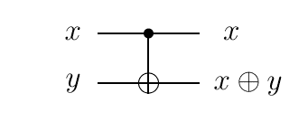

这个门在第一个比特为1时翻转第二个比特，如果第一个比特为0则不做任何操作（因此被称为控制非门）。 它的平方是平凡的，也就是说它会自我反转。 当第一个比特设置为1时，这个门会对第二个比特执行非操作，如果初始时第二个比特为零，则执行复制操作。 (6.34)

使用由三个XOR构成的电路，我们可以交换两个位：

$$(x, y) \to (x, x \oplus y) \to (y, x \oplus y) \to (y, x). \tag{6.35}$$

通过这些交换，我们可以在电路中重新排列位，将它们聚集在一起，以便在特定位置上对它们进行操作。

为了看到一位和两位门是非通用的，我们观察到所有这些门都是线性的。 每个可逆的两位门的作用形式为

$$\begin{pmatrix} x \\ y \end{pmatrix} \to \begin{pmatrix} x' \\ y' \end{pmatrix} = \mathcal{M} \begin{pmatrix} x \\ y \end{pmatrix} + \begin{pmatrix} a \\ b \end{pmatrix}, \tag{6.36}$$

其中常数 $\binom{a}{b}$ 可以取四个可能的值之一，矩阵 $\mathcal{M}$ 是六个可逆矩阵之一

$$ \mathcal{M} = \begin{pmatrix} 1 & 0 \\ 0 & 1 \end{pmatrix}, \begin{pmatrix} 0 & 1 \\ 1 & 0 \end{pmatrix}, \begin{pmatrix} 1 & 1 \\ 0 & 1 \end{pmatrix}, \begin{pmatrix} 1 & 0 \\ 1 & 1 \end{pmatrix}, \begin{pmatrix} 0 & 1 \\ 1 & 1 \end{pmatrix}, \begin{pmatrix} 1 & 1 \\ 1 & 0 \end{pmatrix}. \quad (6.37) $$

（所有加法都是模2进行的。） 将 $\mathcal{M}$ 的六个选择与四个可能的常数组合，我们得到24个不同的门，这穷尽了所有可逆的 $2 \rightarrow 2$ 门。

由于线性变换在组合下是封闭的，由可逆的 $2 \rightarrow 2$（和 $1 \rightarrow 1$）门组成的任何电路都将计算一个线性函数

$$ x \rightarrow \mathcal{M} x + a. \quad (6.38) $$

但是对于 $n \geq 3$，存在非线性的 $n$ 位可逆函数。一个重要的例子是3位 Toffoli 门（或控制控制非门）

$$ \theta^{(3)} : (x, y, z) \rightarrow (x, y, z \oplus xy); \quad (6.39) $$


如果前两位是1，则它会翻转第三位，否则不做任何操作。和XOR门一样，它是自反的。

与可逆的2位门不同，Toffoli门在布尔逻辑中作为通用门，如果我们可以提供固定的输入位并忽略输出位。

如果 $z$ 最初为1，则第三个输出中出现 $x \uparrow y = 1 - xy$ — 我们可以执行NAND操作。如果我们固定 $x = 1$，则Toffoli门的功能类似于XOR门，并且我们可以使用它进行复制。

Toffoli门 $\theta^{(3)}$ 在某种意义上是通用的，我们可以仅使用Toffoli门构建一个电路来计算任何可逆函数（如果我们可以固定输入位并忽略输出位）。直接展示这一点将会很有启发性，而不依赖于我们之前的NAND/NOT是布尔函数通用的论证。

事实上，我们可以证明以下内容：从NOT门开始以及Toffoli门 $\theta^{(3)}$，我们可以构建任意可逆的$n$位函数，只要我们有一个额外的辅助位可用。

第一步是展示从三位Toffoli门 $\theta^{(3)}$我们可以构建一个$n$位Toffoli门 $\theta^{( n)}$，其作用为

$(x_1, x_2, \dots x_{n-1}, y) \to (x_1, x_2, \dots, x_{n-1}, y \oplus x_1x_2 \dots x_{n-1}).$
(6.40)

构造需要额外的一位临时空间。例如，我们可以从电路中的$\theta^{(3)}$构造$\theta^{(4)}$。

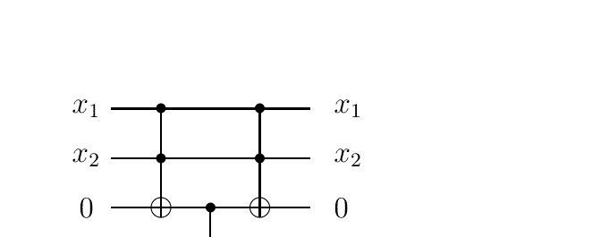

最后一个$\theta^{(3)}$门的目的是将临时位重置为其原始值零。实际上，通过再增加一个门，我们可以得到一个不受临时位初始值影响的$\theta^{(4)}$的实现：

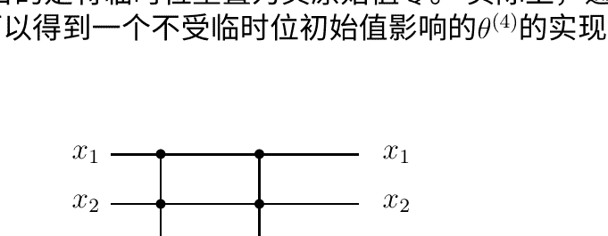

如果我们不介意翻转临时位的值，我们可以消除最后一个门。

我们可以看到临时位确实是必要的，因为$\theta^{(4)}$是24个4位字符串的奇排列（实际上是一个换位）——它将1111和1110进行了换位。但是，作用于任意三个位的$\theta^{(3)}$是一个偶排列；例如，作用于最后三位时，它将0111和0110进行了换位。

和1111与1110。由于偶排列的乘积也是偶排列，我们无法仅通过作用于四个位的$\theta^{(3)}$的乘积来得到$\theta^{(4)}$。

从四个$\theta^{(3)}$的构造立即推广到从两个$\theta^{(n-1)}$和两个$\theta^{(3)}$构造$\theta^{(n)}$（只需在上图中将$x_1$扩展为多个控制位）。通过迭代构造，我们可以用$2^{n-2} + 2^{n-3}$个$\theta^{(3)}$的电路得到$\theta^{(n)}$。此外，只需要一个比特的临时空间就足够了。（当我们需要构造$\theta^{(k)}$时，任何可用的额外比特都可以，因为电路会将临时比特返回到其原始值。）

下一步是注意，通过与NOT门共轭$\theta^{(n)}$，我们可以实际上修改‘触发’门的控制字符串的值。例如，电路


如果$x_1x_2x_3=010$，则此电路会翻转$y$的值，并且在其他情况下不起作用。因此，此电路会互换两个字符串0100和0101。同样地，通过使用$\theta^{(n)}$门和NOT门，我们可以设计一个电路，可以互换仅在一位上不同的任意两个$n$位字符串。（其中不同的位被选择为$\theta^{(n)}$门的目标。）

实际上，将任意两个$n$位字符串互换的置换可以表示为仅互换仅在一位上不同的字符串的置换的乘积。如果$a_0$和$a_s$是汉明距离为$s$的两个字符串（在$s$个位置上不同），那么存在一个链

$a_0, a_1, a_2, a_3, \dots, a_s,$

(6.41)

使得链中的每个字符串与其相邻字符串的汉明距离为一。因此，每个置换

$(a_0a_1), (a_1a_2), (a_2a_3), \dots (a_{s-1}a_s),$

(6.42)

可以通过NOT门共轭实现为 $\theta^{(n)}$门。通过组合置换，我们发现

$(a_{s-2}a_{s-1})(a_{s-1}a_s); \qquad (6.43)$

我们可以通过$2s-1$个汉明距离为1的置换构造汉明距离为$s$的置换。由此可知，我们可以通过$\theta^{(n)}$和NOT门构造$(a_0a_s)$。

最后，由于每个置换都是置换的乘积，我们已经证明了每个 $n$位可逆函数（每个 $n$位字符串的置换）可以使用仅使用一个临时位的 $\theta^{(3)}$和NOT门来实现。当然，如果我们将两个输入位固定为1，则可以使用 $\theta^{(3)}$门执行NOT操作。因此，如果我们可以固定输入位并丢弃输出位，则Toffoli门 $\theta^{(3)}$对于可逆计算是通用的。

### 6.1.4 台球计算机

两位门足以实现通用的不可逆计算，但需要三位门来实现通用的可逆计算。人们很容易认为需要“三体相互作用”，因此构建可逆硬件比构建不可逆硬件更具挑战性。然而，这种说法可能有些误导。

Fredkin描述了如何设计一台基于弹性碰撞的台球计算机，该计算机是通用的可逆计算机。半径为 $\frac{1}{2}$的球在单位格点间隔的方形晶格上移动。在每个整数值时间点，每个球的中心位于一个晶格点上；在特定位置（整数时间点）有球或无球编码了一位信息。在每个单位时间内，每个球沿着晶格方向移动单位距离。偶尔，在整数值时间点，两个占据相距2的位置（由晶格对角线连接）的球之间发生90度的弹性碰撞。

该设备通过在特定位置固定小球来进行编程，使得这些小球成为完美的反射体。该程序通过固定移动小球的初始位置和方向，并根据牛顿力学在有限时间内演化系统来执行。我们通过观察所有移动小球的最终位置来读取输出。碰撞是非耗散性的，因此我们可以通过反转所有小球的速度来逆向运行计算。

为了证明这台机器是一台通用可逆计算机，我们必须解释如何操作通用门。方便起见，我们考虑三位Fredkin门

$$ (x, y, z) \rightarrow (x, xz + \bar{x}y, xy + \bar{x}z), \quad (6.44) $$

如果 $x=0$，则交换 $y$ 和 $z$（我们引入了符号 $\bar{x} = \neg x$）。你可以检查一下，如果我们固定输入并忽略输出，Fredkin门可以模拟一个 NAND/NOT 门。

我们可以从一个更原始的对象，开关门，构建Fredkin门。一个将两个位转换为三个位的开关门的作用是

$$ (x, y) \rightarrow (x, xy, \bar{x}y). \quad (6.45) $$

这个门在“可逆性”方面是可逆的，我们可以反向运行它，作用于一个受限制的3位输入，取四个值之一

$$ \begin{pmatrix} x \\ y \\ z \end{pmatrix} = \begin{pmatrix} 0 \\ 0 \\ 0 \end{pmatrix} \begin{pmatrix} 0 \\ 0 \\ 1 \end{pmatrix} \begin{pmatrix} 1 \\ 0 \\ 0 \end{pmatrix} \begin{pmatrix} 1 \\ 1 \\ 0 \end{pmatrix}, \quad (6.46) $$

此外，开关门本身是通用的；固定输入并忽略输出，它可以执行 NOT（$y=1$，第三个输出）AND（第二个输出）和 COPY（$y=1$，第一个和第二个输出）。因此，不足为奇，我们可以组合开关门来构建一个通用的可逆3→3门。

事实上，电路使用四个开关门（两个正向运行和两个反向运行）构建了Fredkin门。为了保持同步所需的时间延迟没有明确显示。

在台球球计算机中，开关门是由两个反射器构成的，这样（在情况 $x = y = 1$ 下）两个移动的球会碰撞两次。在这种情况下，球的轨迹是：

### 6.1.5 节省空间

但即使不考虑错误控制的问题，还有另一个关键是关于可逆计算的。我们如何管理计算可逆所需的临时存储空间？

在我们讨论Toffoli门的普适性时，我们看到原则上我们可以用非常少的临时空间进行任何可逆计算。但在实践中，找出如何以最小的空间进行特定计算可能是非常困难的，而且在任何情况下，节省空间可能会导致运行时间的代价。

有一种通用策略可以在可逆计算机上模拟不可逆计算。通过固定输入并忽略输出，每个不可逆的 NAND 或 COPY 门可以通过 Toffoli 门进行模拟。我们积累并保存所有需要反转计算步骤的“垃圾”输出位。计算继续进行，然后生成输出的副本。（此 COPY 操作在逻辑上是可逆的。）然后计算以相反的方式运行，清理所有垃圾位，并将所有寄存器恢复到其原始配置。通过这个过程，可逆电路的运行时间只比它模拟的不可逆电路长大约两倍，并且在模拟中产生的所有垃圾都被处理掉，因此没有任何功耗需求。

这个过程是有效的，但需要大量的临时空间——所需空间与模拟的不可逆计算的长度 $T$ 成线性比例增长。事实上，我们可以更有效地利用空间（只有轻微的减速），使所需空间按对数 $T$ 比例增长而不是 $T$。（也就是说，有一种通用方案需要的空间 $\propto \log T$；当然，在模拟特定计算时，我们可能做得更好。）

为了更有效地利用空间，我们将计算分成大致相等大小的小步骤，并在计算过程中尽可能地反向运行这些步骤。然而，正如我们无法在完成步骤 $k$ 之前执行步骤 $k-1$ 一样，如果步骤 $k-1$ 已经以相反的方式执行过，我们也无法反向运行步骤 $k$。我们所需的空间（用于存储垃圾）将按照前向步骤的最大值减去已执行的反向步骤的数量来增长。

我们面临的挑战可以类比为一种游戏——可逆的小石子游戏。要执行的步骤形成一个带有标号为1、2、3...$T$ 的一维有向图。第 $k$ 步的执行通过在图的第 $k$ 个位置放置一个小石子来建模，而反向执行第 $k$ 步则通过从第 $k$ 个位置移除一个小石子来建模。在游戏开始时，没有任何位置被小石子覆盖，在每一轮中我们都会添加或移除一个小石子。但是，除了 $k=1$ 的情况外，我们不能在第 $k$ 个位置放置一个小石子，除非第 $k-1$ 个位置已经被小石子覆盖，而且除了 $k=1$ 的情况外，我们也不能从第 $k$ 个位置移除一个小石子。

目标是在不使用比必要的更多小石子（生成最小量的垃圾）的情况下覆盖第 $T$ 个位置（完成计算）。

实际上，用 $n$ 个小石子我们可以到达站点 $T=2^n-1$，但我们无法继续前进。

我们可以构建一个递归过程，使我们能够用 $n$ 个小石子到达站点 $T=2^{n-1}$，只剩一个小石子在游戏中。让 $F_1(k)$ 表示在站点 $k$ 放置一个小石子，$F_1(k)^{-1}$ 表示从站点 $k$ 上移除一个小石子。然后

$$ F_2(1,2) = F_1(1) F_1(2) F_1(1)^{-1}, \quad (6.47) $$

在站点 $k=2$ 处留下一个小石子，在中间使用最多两个小石子。

> 3 我们保守地假设我们不够聪明，无法提前知道步骤 $k-1$ 的输出的哪一部分可能在以后需要。因此，我们存储了在步骤 $k-1$ 完成后存储更新记录之前的机器配置的完整记录，直到在后续步骤完成后存储了更新记录为止。

> 4 正如 Bennett 所指出的。最近的讨论见 M. Li 和 P. Vitanyi, quant-ph/9703022。

类似地

$$ F_3(1,4) = F_2(1,2) F_2(3,4) F_2(1,2)^{-1}, $$

使用最多三个鹅卵石，到达位置 $k=4$，并

$$ F_4(1,8) = F_3(1,4) F_3(5,8) F_3(1,4)^{-1}, $$

使用四个鹅卵石，到达 $k=8$。显然，我们可以构造 $F_n(1,2^{n-1})$ 使用最多 $n$ 个鹅卵石，并且留下一个鹅卵石在游戏中。（这个例程

$$ F_n(1,2^{n-1}) F_{n-1}(2^{n-1}+1, 2^{n-1}+2^{n-2}) \ldots F_1(2^n-1), $$

留下所有 $n$ 个鹅卵石在游戏中，最大的鹅卵石在位置 $k=2^n-1$。）将其解释为执行 $T=2^{n-1}$ 步计算的例程，这种玩鹅卵石游戏的策略代表了一种需要空间按对数尺度缩放的模拟。这个模拟需要多长时间？在上述递归过程的每个级别中，两个前进步骤被替换为两个前进步骤和一个后退步骤。因此，一个不可逆的计算使用 $T_{\text{irr}}=2n$ 步被模拟为 $T_{\text{rev}}=3^n$ 步，或者

$$ T_{\text{rev}} = (T_{\text{irr}})^{\log 3 / \log 2} = (T_{\text{irr}})^{1.58}, $$

我们可以将这种减速改进为

事实上，我们可以改进减速到对于任何 $\varepsilon >0$。不是用两个步骤向前替换为两个向前和一个向后，而是用 $\ell$ 向前替换为 $\ell$ 向前和 $\ell-1$ 向后。一个递归过程在 $n$ 级别上到达站点 $\ell^n$ 时使用最多 $(\ell-1)+1$ 个鹅卵石。现在我们有 $T_{\text{irr}} = \ell^n$ 和 $T_{\text{rev}}= (2\ell-1)^n$，所以

$$ T_{\text{rev}} = (T_{\text{irr}})^{\log(2\ell-1)/ \log \ell}; $$

描述减速的功率特性是

$$ \frac{\log(2\ell - 1)}{\log \ell} = \frac{\log 2\ell + \log\left(1 - \frac{1}{2\ell}\right)}{\log \ell} \simeq 1 + \frac{\log 2}{\log \ell}, $$

空间需求按比例缩放

$$ S \simeq n\ell \simeq \ell \frac{\log T}{\log \ell} \quad (6.55) $$

因此，对于任意固定的 $\varepsilon >0$，我们可以达到 $S$ 以对数 $T$ 的规模，并且减速不会比 $(T_{\mathrm{irr}})^{1+\varepsilon}$ 更糟。（如果我们的目标是尽可能少地使用鹅卵石来走得更远，那么这不是玩鹅卵石游戏的最佳方式。我们使用更多的鹅卵石来达到步骤 $T$，但我们可以更快地到达那里。）我们现在已经看到可逆电路可以有效地模拟由不可逆门组成的电路，而不需要不合理的内存资源或引起不合理的减速。这为什么重要呢？

你可能会担心，因为可逆计算比不可逆计算“更难”，所以复杂性的分类取决于我们是可逆计算还是不可逆计算。但事实并非如此，因为可逆计算机可以相当容易地模拟不可逆计算机。

## 6.2 量子电路

现在我们准备好了，来制定一个量子计算机的数学模型。我们将经典计算的电路模型推广到量子计算的量子电路模型。

经典计算机处理比特。它配备了一组有限的门，可以应用于比特集合。量子计算机处理量子比特。我们假设它也配备了一组离散的基本组件，称为量子门。每个量子门都是作用于固定数量量子比特的酉变换。在量子计算中，有限数量的量子比特最初被设置为值 $|00...0\rangle$。执行一个由一定数量的量子门构成的电路，这些量子门作用于这些量子比特。最后，对所有量子比特（或量子比特的子集）进行冯·诺伊曼测量，将每个量子比特投影到基 $\{|0\rangle, |1\rangle\}$ 上。这个测量的结果是计算的结果。

这个模型的几个特点需要评论：

(1) 重要但隐含的是，设备的希尔伯特空间具有一个预先确定的低维空间的张量积分解，在这种情况下是量子比特的二维空间。当然，我们也可以考虑使用量子三能级系统的张量积。但是无论如何，我们假设存在一种自然的子系统分解方式，并且量子门只作用于其中的几个子系统。从数学上讲，量子门的这个特性对于建立一个明确定义的量子复杂性概念至关重要。

从物理上讲，自然的子系统分解的根本原因是局域性；可行的量子门必须在有界的空间区域内起作用，因此计算机分解为只与其邻居相互作用的子系统。

(2) 由于酉变换形成一个连续体，假设机器只能执行从离散集合中选择的量子门可能看起来过于限制。尽管如此，我们仍然接受这样的限制，因为我们不想在面对新的计算任务时每次都要发明一种新的物理实现方式。

(3) 我们可以允许我们的量子门是超算子，我们的最终测量是一个 POVM。但是由于我们可以通过在扩展系统上执行一个酉变换来轻松模拟超算子，或者通过在扩展系统上执行一个冯·诺依测量来模拟 POVM，所以所制定的模型具有足够的普遍性。

(4) 我们可以允许最终测量是一个集体测量，或者投影到不同的基底中。但是任何这样的测量都可以通过执行适当的酉变换，然后投影到标准基底 $\{|0\rangle, |1\rangle\}^n$ 来实现。当然，复杂的集体测量可以通过一些困难转化为标准基底的测量，但是在描述算法的复杂性时考虑这种困难是合适的。

(5) 我们可能允许在计算的中间阶段进行测量，并根据这些测量结果选择量子门。但实际上，通过将所有测量推迟到最后，总是可以达到相同的结果。（虽然原则上我们可以推迟测量，但在实践中，在量子算法的中间阶段进行测量可能非常有用。）

量子门作为一个酉变换是可逆的。事实上，经典可逆计算机是量子计算机的特例。

## 经典可逆门

$$ x^{(n)} \rightarrow y^{(n)} = f(x^{(n)}), \quad (6.56) $$

实现对 $n$ 位字符串的置换，可以被看作是作用在“计算基” $\{|x_i\rangle\}$ 上的酉变换，根据

$$ U : |x_i\rangle \rightarrow |y_i\rangle. \quad (6.57) $$

这个动作是幺正的，因为 $2^n$ 个字符串 $|y_i\rangle$ 都是相互正交的。从这样的经典门构建的量子计算将 $|0...0\rangle$ 转换为计算基态之一，因此最终的测量是确定性的。

关于我们模型的三个主要问题需要解决。第一个问题是普适性。可以在 $U(2^n)$ 中执行的最一般的幺正变换是 $U(2^n)$ 的一个元素。如果我们无法达到 $U(2^n)$ 中的某些变换，那么我们的模型似乎是不完整的。事实上，我们将看到有许多方法来选择一个离散的通用量子门集合。使用一个通用门集合，我们可以构建电路，计算一个幺正变换，使其与 $U(2^n)$ 中的任何元素都可以无限接近。

由于普适性的存在，也存在着一个与机器无关的量子复杂性的概念。我们可以定义一个新的复杂性类 BQP——这个类包括那些可以通过多项式大小的量子电路以高概率解决的决策问题。由于一个通用的量子计算机可以有效地模拟另一个，这个类并不依赖于我们硬件的细节（即我们选择的通用门集合）。

注意，一个量子计算机可以轻松模拟一个概率经典计算机：它可以准备 $\frac{1}{\sqrt{2}}(|0\rangle + |1\rangle)$ 然后投影到 $\{|0\rangle, |1\rangle\}$，生成一个随机比特。因此 BQP 肯定包含类 BPP。但正如我们在第1章中讨论的那样，我们有理由相信 BQP 实际上比 BPP 更大，因为一个概率经典计算机不能轻松模拟一个量子计算机。根本的困难在于量子比特的希尔伯特空间非常庞大，维度为 $2^n$，因此空间中一个典型向量的数学描述非常复杂。我们的第二个问题是更好地描述在经典计算机上模拟量子计算机所需的资源。我们将看到，尽管希尔伯特空间非常庞大，一个经典计算机可以模拟一个 $n$ 量子比特的量子计算机，即使受到内存空间的限制。这是多项式的 $n$。这意味着 BQP 包含在复杂性类 PSPACE 中，即可以用多项式空间解决的决策问题，但可能需要指数时间。（我们知道 NP 也包含在 PSPACE 中，因为对于每个 $m$，检查 $C(x^{(n)}, y^{(m)})=1$ 可以在多项式空间内完成。）

我们应该解决的第三个重要问题是准确性。在理想化的假设下，BQP 类被正式定义为可以以完美精度执行量子门的情况下。显然，在任何实际的量子计算实现中，放宽这个假设是至关重要的。如果量子电路中的量子门需要指数级的准确性，那么解决一个困难问题的多项式规模量子电路族就没有太大的兴趣。事实上，我们将证明这并非如此。通过噪声门，可以以可接受的准确性模拟理想化的 T 门量子电路，前提是每个门的错误概率与 $1/T$ 成比例。

我们看到，量子计算机对强丘奇-图灵论题构成了严峻的挑战，该论题认为任何物理上合理的计算模型都可以通过概率经典电路进行模拟，最多只会有多项式的减速。但是到目前为止，还没有确凿的证据表明 BPP = BQP。

而且，这样的证明也不一定会很快出现。6 事实上，一个推论将是 BPP = PSPACE，这将解决复杂性理论中一个长期存在且关键的未解问题。

希望通过另一个复杂性理论的标准猜想，如 P=NP，来证明 BPP=BQP 可能不那么不切实际。到目前为止，还没有找到这样的证明。但是虽然我们还不能证明量子计算机的能力远远超过传统计算机，但我们仍然可能发现一些证据表明 BPP≠BQP。我们将看到，有些问题在经典计算中似乎很难（解决），但可以通过量子电路高效地解决。

5 实际上，还有另一个复杂性层次结构的梯度可能将 BQP 和 PSPACE 分开；我们可以证明 BQP⊆P#P⊆PSPACE，但我们在这里不再进一步考虑 P#P。

6 也就是说，我们不应该期望有一个“非相对化证明”。在本章后面将建立起 BPP 和 BQP“相对于一个预言机”的分离。

因此，很可能在解决问题时，复杂性的分类将取决于我们使用经典计算机还是量子计算机。如果这样的分离确实存在，那么量子分类应该被视为更基本的，因为它更好地基于统治宇宙的物理定律。

### 6.2.1 精度

让我们讨论一下精度问题。我们设想我们希望在一个计算中实现量子门 $U_1, U_2, \ldots$ 依次应用于初始状态 $|\varphi_0\rangle$。我们理想的量子电路准备的状态是

$$ |\varphi_T\rangle = U_T U_{T-1} \ldots U_2 U_1 |\varphi_0\rangle. \quad (6.60) $$

但实际上我们的门并不完全准确。当我们尝试应用酉变换 $U_t$ 时，我们实际上应用了一些“附近”的酉变换 $\tilde{U}_t$。（当然，这不是我们可能考虑的最一般类型的错误——酉变换 $U_t$ 可能被一个超算符所取代。类似于下面的考虑也适用于这种情况，但现在我们将注意力限制在“酉错误”上。）

这些错误导致计算机的实际状态偏离理想状态。它会偏离多远？让 $|\varphi_t\rangle$ 表示在应用 $t$ 个量子门之后的理想状态，即

$$ |\varphi_t\rangle = U_t |\varphi_{t-1}\rangle. \quad (6.61) $$

但如果我们应用实际的变换 $\tilde{U}_t$，那么

$$ \tilde{U}_t |\varphi_{t-1}\rangle = |\varphi_t\rangle + |E_t\rangle, \quad (6.62) $$

其中

$$ |E_t\rangle = (\tilde{U}_t - U_t) |\varphi_{t-1}\rangle, \quad (6.63) $$

是一个未归一化的向量。如果 $|\tilde{\varphi}_t\rangle$ 表示经过 $t$ 步骤后的实际状态，则我们有

$$ |\tilde{\varphi}_1\rangle = |\varphi_1\rangle + |E_1\rangle, \quad |\tilde{\varphi}_2\rangle = \tilde{U}_2 |\tilde{\varphi}_1\rangle = |\varphi_2\rangle + |E_2\rangle + \tilde{U}_2 |E_1\rangle, \quad (6.64) $$

等等，我们最终得到

$$ |\tilde{\varphi}_T\rangle = |\varphi_T\rangle + |E_T\rangle + \tilde{U}_T|E_{T-1}\rangle + \tilde{U}_T\tilde{U}_{T-1}|E_{T-2}\rangle + \ldots + \tilde{U}_T\tilde{U}_{T-1}\ldots\tilde{U}_2|E_1\rangle. \quad (6.65) $$

因此，我们将 $|\tilde{\varphi}_T\rangle$ 和 $|\varphi_T\rangle$ 之间的差异表示为 $T$ 余项之和。产生 $|\tilde{\varphi}_T\rangle$ 与 $|\varphi_T\rangle$ 之间最大偏差的最坏情况是，所有余项都朝同一方向排列，以便错误构成干涉。因此，我们得出结论

$$ \|\, |\tilde{\varphi}_T\rangle - |\varphi_T\rangle \,\| \;\leq\; \|\, |E_T\rangle \,\| + \|\, |E_{T-1}\rangle \,\| + \ldots + \|\, |E_2\rangle \,\| + \|\, |E_1\rangle \,\|, \quad (6.66) $$

其中我们使用了性质 $\|\, U|E_i\rangle \,\| = \|\, |E_i\rangle \,\|$ 对于任意的酉 $U$。让 $\|\, A\,\|_{\sup}$ 表示算符 $A$ 的上确界范数——也就是 $A$ 的特征值的最大模。然后我们有 $\|\, |E_t\rangle \,\| = \|\, (\tilde{U}_t - U_t)|\varphi_{t-1}\rangle \,\| \leq \|\, \tilde{U}_t - U_t \,\|_{\sup} \quad (6.67)$ （因为 $|\varphi_{t-1}\rangle$ 被归一化了）。现在假设，对于每个 $t$ 的值，我们的量子门的误差被限制在

$$ \|\, \tilde{U}_t - U_t \,\|_{\sup} < \varepsilon. \quad (6.68) $$

然后应用量子门之后，我们有

$$ \|\, |\tilde{\varphi}_T\rangle - |\varphi_T\rangle \,\| < T\varepsilon; \quad (6.69) $$

从这个意义上说，状态中的累积误差与计算的长度成线性增长。

方程(6.68)中的有界距离可以等价地表示为 $\|\, W_t - 1\,\|_{\sup}$，其中 $W_t = U_t^{\dagger}\tilde{U}_t$。由于 $W_t$ 是酉矩阵，它的每个特征值都是一个相位 $e^{i\theta}$，而 $W_t - 1$ 的相应特征值的模为

$$ |e^{i\theta} - 1| = (2 - 2\cos\theta)^{1/2}, \quad (6.70) $$

因此，方程(6.68)要求每个特征值满足

$$ \cos\theta > 1 - \varepsilon^2/2. \quad (6.71) $$（或者θ约等于ε，其中ε很小）。方程（6.69）的起源很明确。在每个时间步骤中，|ψ⟩相对于|φ⟩旋转（最差情况下）一个数量级的角度ε，并且向量之间的距离最多增加一个数量级的ε。

多少精度足够好？在我们计算的最后一步中，我们进行了一个正交测量，理想情况下，结果为a的概率是

$$P(a) = |\langle a | \varphi_T \rangle|^2$$ (6.72)

由于误差，实际概率为

$$\tilde{P}(a) = |\langle a | \tilde{\varphi}_T \rangle|^2$$ (6.73)

如果实际向量接近理想向量，则概率分布也接近。如果我们对正交基进行求和 $\{|a\rangle\}$，我们有

$$\sum_a |\tilde{P}(a) - P(a)| \leq 2 \| |\tilde{\varphi}_T\rangle - |\varphi_T\rangle \|$$ (6.74)

这是你将在作业练习中展示的。因此，如果我们保持Tε固定（且较小），当T变大时，概率分布的误差也保持不变。特别地，如果我们设计了一个量子算法，以概率大于 ¹正确解决一个决策问题（在理想情况下），那么我们可以通过使用我们的噪声门，以T ε < O(δ)的精度执行门操作，从而实现成功概率大于 ¹。在我们的噪声门下，如果我们可以以精度Tε < O(δ)执行门操作，则BQP类中的量子电路族可以真正解决困难问题，只要我们可以线性提高门操作的精度与计算规模T。

### 6.2.2 BQP ⊆ PSPACE

当然，经典计算机可以模拟任何量子电路。但是，经典计算机需要多少内存？从直觉上讲，由于模拟一个n量子比特电路涉及到操作大小为2ⁿ的矩阵，似乎需要指数级的内存空间。但是我们将展示模拟可以在多项式空间内以可接受的精度完成（尽管速度非常慢！）。这意味着量子复杂性类BQP包含在可以用多项式空间解决的问题类PSPACE中。

经典模拟的目标是计算最终测量的每个可能结果a的概率
$$\text{Prob}(a) = |\langle a | U_T | 0 \rangle|^2$$ (6.75)

其中
$$ U_T = U_T U_T^{(-1)} ... U_2 U_1, $$ (6.76)
是 $T$量子门的产物。 每个 $U$作用在N个量子比特上，可以用一个$2N \times 2N$的酉矩阵表示，其特征为复矩阵元。

$$ \langle y|U_t|x \rangle, $$ (6.77)
其中$X, Y \in \{0, 1, \ldots, 2N - 1\}$。 将矩阵乘法明确写出，我们有

$$ \langle a|U_T|0 \rangle = \sum_{\{x_t\}} \langle a|U_T|x_{T-1}\rangle\langle x_{T-1}|U_{T-1}|x_{T-2}\rangle ... \langle x_2|U_2|x_1\rangle\langle x_1|U_1|0 \rangle. $$ (6.78)
方程 (6.78)是一种量子计算的“路径积分”表示 - 最终结果A的概率振幅表示为从0开始，在$T$步之后终止的大量 ($2N^{(T-1)}$) 可能计算路径的振幅的相干求和。

我们的经典模拟器是将式子(6.78)中的$2N^{(T-1)}$个复数相加以计算$\langle A|U_T|0\rangle$。 我们面临的第一个问题是有限大小的经典电路进行整数运算，而矩阵元 $\langle Y|U|X \rangle$不一定是有理数。 经典模拟器因此必须进行近似计算以合理的精度。 求和中的每一项都是 $T$个复因子的乘积，总共有$2N^{(T-1)}$项。 如果我们将矩阵元表示为M位精度的数值，其中M远大于$N(T-1)$，则累积误差肯定很小。 因此，我们可以用一对有符号整数代替每个复矩阵元，取值范围为 $\{0, 1, 2, \ldots, 2^M - 1\}$。 这些整数给出了矩阵元的实部和虚部的二进制展开，精度为$2^{-M}$。

我们的模拟器需要计算和累加求和公式 (6.78) 中的每一项。 但每次相加只需要适量的临时空间，而且由于只需要存储累加的子总和用于下一次相加，所以不需要太多的空间来求和所有的项，即使有指数级的项数。

因此，我们只需要考虑求和中的一个典型项，即 $T$矩阵元素的乘积。 我们将需要一个经典电路来评估

$$\langle y|U_t|x\rangle$$; (6.79)

该电路接受2个\(n\)位输入\((x, y)\)，并输出（复数）矩阵元素的\(2m\)位值。如果有一个执行此功能的电路，那么构建一个乘法电路来相乘复数将变得很容易，而且不需要太多的空间。

最后，在这一点上，我们依靠我们对量子门集合的要求 - 门来自于一个离散集合，并且每个门作用于有限数量的量子比特。因为门的数量是固定的（有限的），我们的模拟器只需要能够调用固定数量的门子程序。而且，由于门只作用于少数量子比特，几乎所有的矩阵元素都会消失（当\(n\)很大时），并且可以通过一个简单的电路（需要很少的内存）来确定值\(\langle y|U|x\rangle\)（以所需的精度）。

例如，在作用于第一个量子位的单比特门的情况下，我们有

$$\langle y_1y_2...y_n|U|x_1x_2...x_n\rangle = 0 \quad \text{如果} \quad x_2x_3...x_n = y_2y_3...y_n$$ (6.80)

一个简单的电路可以比较\(x_2\)和\(y_2\)，\(x_3\)和\(y_3\)，等等，并且如果不满足相等关系，则输出零。如果相等，则电路输出四个复数之一

$$\langle y_1|U|x_1\rangle$$ (6.81)

精确到 \(m\) 位。一个简单的电路可以编码这个 \(8m\) 位的信息 \(2 \times 2\) 复数矩阵。同样，一个简单的电路，只需要多项式空间复杂度在 \(n\) 和 \(m\) 中，可以计算任意固定大小的门的矩阵元素。

我们得出结论，一个空间上界为poly(n)的经典计算机可以模拟一个 \(n\) 量子比特的通用量子计算机，因此BQP ⊆ PSPACE。当然，显然我们所描述的模拟需要指数时间，因为我们需要计算 \(2^{n(T-1)}\) 个复数的和。（实际上，大多数项都消失了，但仍然存在指数多的非零项。）

### 6.2.3 通用量子门

我们必须解决关于量子计算的另一个基本问题；我们如何构建一个足够的量子门集合？换句话说，什么构成了一个通用量子计算机？

我们将找到一个令人满意的答案。任何通用的两比特门都足以进行通用量子计算。也就是说，对于除了一个零测度集合之外的所有$4\times 4$酉矩阵，如果我们可以将该矩阵应用于任意一对量子比特，那么我们可以构建一个$n$量子比特电路，计算出一个与$U(2^n)$中的任意元素足够接近的变换。

从数学上讲，这不是一个特别深刻的结果，但从物理上来说，它非常有趣。这意味着，在量子世界中，只要我们能够设计出两个量子比特之间的通用相互作用，并且能够在任意两个量子比特之间准确地实现这种相互作用，我们就可以计算任何复杂度的问题。在量子理论中，非平凡的计算是无处不在的。

除了这个普遍结果之外，展示一些可能在物理上实现起来特别容易的特定通用门集也是有一定意义的。我们将讨论几个例子。

任何通用量子门集的分析都涉及到几个基本要素。

- 1. 通用门的幂次
考虑一个“通用”的$k$量子比特门。这是一个$2^k \times 2^k$的酉矩阵$U$，它具有特征值$e^{i\theta_1}, e^{i\theta_2}, \ldots, e^{i\theta_{2^k}}$。对于除了一个零测度集合之外的所有这样的矩阵，每个$\theta_i$都是$\pi$的无理倍数，并且所有的$\theta_i$都是不可比的（每个$\theta_i/\theta_j$也是无理数）。矩阵$U$的正整数幂$U^n$具有特征值
$$e^{in\theta_1}, e^{in\theta_2}, \ldots, e^{in\theta_{2^k}}. \tag{6.82}$$
每个这样的特征值列表定义了一个$2^k$维环面上的点（$2^k$个圆的乘积）。当$n$取正整数值时，如果$U$是通用的，这些点会密集地填满整个环面。如果$U = e^{iA}$，那么$U$的正整数次幂可以无限接近$U(\lambda) = e^{i\lambda A}$，对于任意实数$\lambda$。我们说任何$U(\lambda)$都可以通过正整数次幂的$U$达到。
- 2. 交换引线
我们可以通过交换 $k$ 个量子比特的标签或者换句话说，通过将门 $U$ 应用到不同顺序的比特上来实现一些（经典的）变换。在长度为 $k$ 的字符串的 $(2k)!$ 排列中，有 $k!$ 可以通过交换量子比特来实现。如果一个应用于标准顺序的 $k$ 个量子比特的门是 $U$，而 $P$ 是通过交换量子比特实现的排列，那么我们可以构造出这个门。

> $$ U' = P U P^{-1}, $$

只需通过在门上切换引线即可。例如，交换两个量子比特可以实现置换

> $$ P : |01\rangle \leftrightarrow |10\rangle, $$

或

> $$ P = \begin{pmatrix} 1 & 0 & 0 & 0 \\ 0 & 0 & 1 & 0 \\ 0 & 1 & 0 & 0 \\ 0 & 0 & 0 & 1 \end{pmatrix}, $$

作用于基础 $\{|00\rangle, |01\rangle, |10\rangle, |11\rangle\}$。通过切换引线，我们可以得到一个门

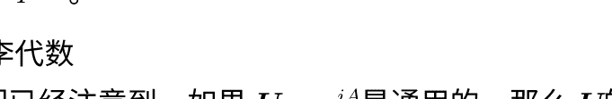

我们还可以构造 $U'$ 的任意正整数幂，$(P U P^{-1})^n = P U^n P^{-1}$。

- 3. 完成李代数
我们已经注意到，如果 $U = e^{iA}$ 是通用的，那么 $U$ 的幂在环 $\{e^{i\lambda A}\}$ 中是稠密的。我们还可以进一步证明，如果 $U = e^{iA}$ 和 $U' = e^{iB}$ 是通用的门，我们可以将它们组合起来，使其趋近于任意的距离。

> $$ e^{i(\alpha A + \beta B)} \text{ or } e^{-\gamma [A,B]}, $$

对于任意实数 α, β, γ。因此，“可达”变换具有一个闭合的李代数。我们说 U = e^{iA} 由 A 生成；如果 A 和 B 都是可达变换的通用生成器，那么 A 和 B 的实线性组合以及 A 和 B 的交换子也是。我们首先注意到

> \lim_{n\to\infty} \left(e^{i\alpha A/n}e^{i\beta B/n}\right)^n = \lim_{n\to\infty} \left(1 + \frac{i}{n}(\alpha A + \beta B)\right)^n = e^{i(\alpha A+\beta B)}.\tag{6.87}

因此，如果每个 e^{i\alpha A/n} 和 e^{i\beta B/n} 都是可达的，那么任何 e^{i(\alpha A+\beta B)} 都是可达的。此外，极限

> \lim_{n\to\infty} \left(e^{iA/\sqrt{n}}e^{iB/\sqrt{n}}e^{-iA/\sqrt{n}}e^{-iB/\sqrt{n}}\right)^n = \lim_{n\to\infty} \left[1 - \frac{1}{n}(AB - BA)\right]^n = e^{-[A,B]},\tag{6.88}

所以 e^{-[A,B]} 也是可达的。

通过调用上述观察结果(1)，(2)和(3)，我们将能够证明通用的两量子比特门。

德意志门。是大卫·德意志(1989)首次指出存在一种通用量子门。德意志的三比特通用门是Toffoli门的量子对应。它是控制-控制-R变换

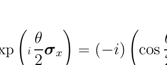

如果前两个量子比特的值为1，则将 R 应用于第三个量子比特；否则它不起作用。这里

> \mathbf{R} = -i\mathbf{R}_x(\theta) = (-i) \exp \left( i\frac{\theta}{2}\sigma_x \right) = (-i) \left( \cos\frac{\theta}{2} + i\sigma_x \sin\frac{\theta}{2} \right)\tag{6.89}

是，相位上，绕 x 轴旋转 θ，其中 θ 是一个特定的与 π 不可约分的角度。

Deutsch 门的第 $n$ 次幂是受控受控-$R^{n}$ 门。特别地，$R^{4} = R_{x}(4\theta)$，因此由$\sigma_{x}$生成的所有一比特转换都可以通过整数次幂的 $R$ 来达到。此外，($4n+1$)次幂是

$$(-i)\left[\cos \frac{(4n+1)\theta}{2} + i\sigma_{x}\sin\frac{(4n+1)\theta}{2}\right], \qquad (6.90)$$

我们可以将其无限接近于 $\sigma_{x}$。因此，Toffoli 门可以通过整数次幂的Deutsch门来实现，而Deutsch门对于经典计算是通用的。

作用于三量子比特计算基

$$\{|000\rangle, |001\rangle, |010\rangle, |011\rangle, |100\rangle, |101\rangle, |110\rangle, |111\rangle\}, \qquad (6.91)$$

Deutsch门的生成器对最后两个元素进行转置

$$|110\rangle \leftrightarrow |111\rangle. \qquad (6.92)$$

我们将这个 $8 \times 8$ 矩阵表示为

$$(\sigma_{x})_{67} = \begin{pmatrix} 0 & 0 \\ 0 & \sigma_{x} \end{pmatrix}. \qquad (6.93)$$

通过Toffoli门，我们可以对这八个元素进行任意排列，特别是

$$P = (6m)(7n), \qquad (6.94)$$

对于任意 $m$ 和 $n$。 因此，我们也可以得到由

$$P(\sigma_{x})_{67}P = (\sigma_{x})_{mn}. \qquad (6.95)$$

此外，

$$[(\sigma_{x})_{56}, (\sigma_{x})_{67}] = \left[\begin{pmatrix} 0 & 1 & 0 \\ 1 & 0 & 0 \\ 0 & 0 & 0 \end{pmatrix}, \begin{pmatrix} 0 & 0 & 0 \\ 0 & 0 & 1 \\ 0 & 1 & 0 \end{pmatrix}\right] = \begin{pmatrix} 0 & 0 & 1 \\ 0 & 0 & 0 \\ -1 & 0 & 0 \end{pmatrix} = i(\sigma_{y})_{57}, \qquad (6.96)$$

同样地，我们可以得到由$(σ_y)_{mn}$生成的任意酉变换。最后

$$[(σ_x)_{mn}, (σ_y)_{mn}] = i(σ_z)_{mn}, \quad (6.97)$$

因此，我们可以通过线性组合生成任何变换$(σ_{x,y,z})_{mno}$。它们覆盖了整个$SU(8)$李代数，因此我们可以生成任何三比特的酉变换（除了无关的整体相位）。

现在回想一下，我们已经发现我们可以通过组合三比特的Toffoli门来构造$n$比特的Toffoli门。电路

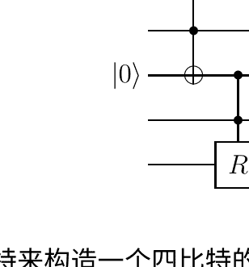

使用一个辅助比特来构造一个四比特的Deutsch门（（控制）$^3$-$R$）从三比特的Deutsch门和两个三比特的Toffoli门，类似的电路构造了$n$比特的Deutsch门从三比特的Deutsch门和两个$(n-1)$比特的Toffoli门。一旦我们有了$n$比特的Deutsch门和通用经典计算，与上述相同的论证表明我们可以达到$SU(2n)$中的任何变换。

通用的两比特门。对于可逆的经典计算，我们看到需要三比特门来实现通用性。但是在量子计算中，两比特门就足够了。由于我们已经知道德意志门是通用的，我们可以通过展示德意志门可以由两比特门组合构建来证明这一点。

事实上，如果

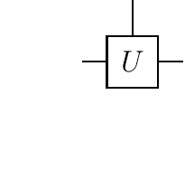

表示控制-$U$门（如果第一个比特为1，则将$2\times 2$的酉矩阵 $U$应用于第二个比特；否则门的作用是平凡的），那么从电路中可以得到一个控制-控制-$U^2$门

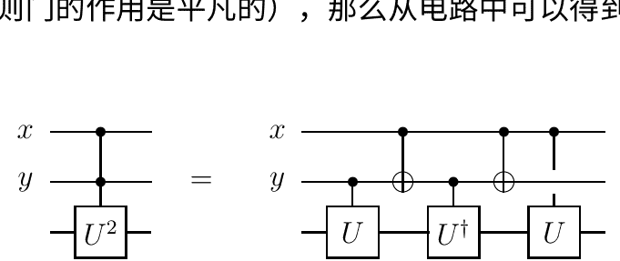

应用于第三个比特的 $U$的幂次是

$$y - (x \oplus y) + x = x + y - (x + y - 2xy) = 2xy. \tag{6.98}$$

因此，我们可以从受控-$U$，受控$U^{-1}$和受控-NOT门构造Deutsch门，其中

$$U^2 = -iR_x(\theta); \tag{6.99}$$

我们可以选择
$$U = e^{-i\frac{\pi}{4}} R_x \left( \frac{\theta}{2} \right). \tag{6.100}$$

正的 $U$ 的幂可以无限接近 $\sigma_x$和 $U^{-1}$，因此仅通过受控-$U$我们就可以构造Deutsch门。 因此，受控-$\left(e^{-i\frac{\pi}{4}} R_x \left( \frac{\theta}{2} \right)\right)$本身是一个通用门，对于 $\theta/\pi$是无理数。（注意上述构造表明，虽然我们无法从两位可逆经典门构造Toffoli门，但我们可以从受控“NOT的平方根”——受控-$U$，其中 $U^2 = \sigma_x$——构造它。）通用的两位门。 现在我们已经找到了特定的两位门（受控旋转），它们是通用门。 因此，为了通用性，如果我们可以构造在一对量子比特上作用的$U(4)$中的变换，那么这肯定是足够的。

实际上，任何通用的两比特门都足以生成所有的$U(4)$。 正如我们所见，如果$A$是 $U(4)$的一个通用元素，我们可以达到由 $A$生成的任何变换。此外，我们可以达到由包含 $A$的极小李代数元素生成的任何变换。

现在考虑一个一般的A（用U(4)的李代数基展开），并考虑一种特定的方案来通过连续的对易构造16个代数元素，从A和B开始。如果一个特定的16×16矩阵的行列式为零，那么这样构造的元素是线性无关的（并且可以推出U(4)中的任何变换是可达的）。除非它恒等于零，否则它的零点只出现在一个零测度的子流形上。但实际上，我们可以选择，比如

```
\[ A = (\alpha I + \beta \sigma_x + \gamma \sigma_y)_{23}, \quad (6.102) \]
```

（对于不可共轭的α, β, γ），并通过明确的计算显示整个16维李代数实际上是由连续的对易生成的，从A和B开始。因此我们得出结论，无法生成整个U(4)代数是非一般的，并且发现几乎所有的两比特门都是通用的。

其他适当的门集合。我们还可以看到，使用由经典多比特门和量子单比特门组成的门集合可以实现通用量子计算。例如，我们可以看到，XOR门与单比特门结合形成了一个通用集合。考虑以下电路

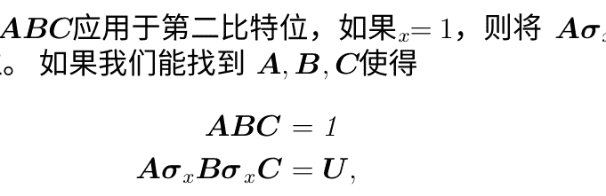

如果x=0，则将ABC应用于第二比特位，如果x=1，则将Aσ_x Bσ_x C应用于第二比特位。如果我们能找到A, B, C使得

```
\[ ABC = 1 \]
\[ A \sigma_x B \sigma_x C = U, \quad (6.103) \]
```

那么这个电路就可以作为一个受控-U门。事实上，对于任何行列式为1的幺正矩阵U，都存在具有这种性质的2×2的幺正矩阵A, B, C（你将在一个练习中证明）。因此，XOR加上任意的一比特门变换形成了一个通用集合。当然，两个一般的（不可交换的）一比特门变换足以达到全部。事实上，通过一个XOR门和一个单比特门旋转，我们可以构造一个不与第一个旋转门交换的第二个一比特门旋转。因此，一个XOR门加上只有一个一般的单比特门就构成了一个通用门集。如果我们能够执行Toffoli门，那么甚至某些非一般的比特门变换也足以进行通用计算。例如（另一个练习），Toffoli门加上绕着 x 和 z 轴的 π/2 旋转就构成了一个通用集合。

精确度。我们对普遍性的讨论主要集中在可达性上，而不考虑复杂性。我们只是建立了一个量子电路，可以无限接近所需的 U(2^n) 元素，而没有考虑我们需要的电路的大小。但从量子复杂性理论的角度来看，普遍性非常重要，因为它意味着一个量子计算机可以在合理的精度下模拟另一个计算机，而不会出现不合理的减速。

实际上，到目前为止，我们对于一个酉变换“接近”另一个酉变换的含义并没有非常精确的定义；我们应该定义一个拓扑。一种可能性是使用我们之前讨论过的精度的上确界作为拓扑距离——矩阵 U 和 W 之间的距离为 ∥ U − W ∥sup。另一种自然的拓扑与内积相关

> $$\langle W|U \rangle \equiv \text{tr } W^{\dagger} U \quad (6.104)$$

（如果 U 和 W 是 N × N 矩阵，这只是在 C^{N^2} 上的通常内积，其中我们将 U_{ij} 看作具有 N^2 个分量的向量）。然后我们可以定义矩阵之间的距离平方为

> $$\| U - W \|^2 \equiv \langle U - W | U - W \rangle \quad (6.105)$$

为了分析复杂性，几乎任何合理的拓扑结构都可以使用。

关键点在于，给定任何通用门集，我们可以在距离 ε 之内达到作用于固定数量量子比特的任意单位ary变换，使用的量子电路的大小上界是 ε^{-1} 的多项式。因此，一个通用量子计算机可以以不超过多项式因子的减速度模拟另一个，精度为 ε。现在我们已经看到，当我们执行大小为 T 的量子电路时，为了获得正确答案的高概率，我们应该将每个量子门的实现精度按 T^{-1} 的比例进行缩放。

因此，如果你有一个多项式大小的量子电路族可以运行，那么在你的量子计算机上，我可以设计一个多项式大小的电路族，在我的机器上运行，并以可接受的精度模拟你的机器。为什么一个多项式 $(\epsilon^{-1})$ 大小的电路可以达到给定的 $k$ 量子比特 $U$ 在距离 $\epsilon$ 内？例如，我们知道一个通用的正整数幂 $k$ 量子比特 $e^{i A}$ 在 $2^k$-环 $\{e^{i \lambda A}\}$ 中是稠密的。在距离 $\epsilon$ 内的环的区域的体积大约为 $\epsilon^{2^k}$，因此（当 $\epsilon$ 足够小时）我们可以在距离 $\epsilon$ 内到达任何 $\{e^{i \lambda A}\}$。$\left(e^{i \lambda A}\right)^n$，其中 $n$ 是大约为 $\epsilon^{-2^k}$ 的整数。我们还知道我们可以获得变换 $\{e^{i A_a}\}$，其中 $A_a$ 的张量覆盖整个 $U(2^k)$ 李代数，使用固定大小的电路（与 $\epsilon$ 无关）。我们可以接近任何指数函数 $(i \sum_a \alpha_a A_a)$ 如方程（6.87）中所示，也具有多项式收敛性。原则上，我们应该能够做得更好，达到所期望的 $k$-qubit 单量子门距离 $\epsilon$ 只需使用 $\text{poly}(\log(\epsilon^{-1}))$ 个量子门。由于我们可以构建作用在 $k$ 量子比特上的大小为 $T$ 的电路数量是指数级的，而电路在 $U(2^k)$ 中大致均匀填充，因此应该存在一个大小为 $T$ 的电路，可以在距离为顺序的 $T$ 的范围内接近 $U(2^k)$ 中的任意点。然而，经典计算中可能存在一个计算上困难的问题，即找出与我们试图达到的幺正门指数级接近的电路。因此，在量子复杂性的渐近分析中，依赖于这种更高效的构造是不诚实的。

## 6.3 一些量子算法

虽然我们还不能证明 $BPP = BQP$，但我们可以通过三种方法来研究经典计算机和量子计算机之间的能力差异：

+   (1) 非指数级加速。我们可以找到量子算法，它们明显比最好的经典算法更快，但不是指数级加速。这些算法对传统复杂性分类没有提供任何启示。但它们确实展示了经典计算机和量子计算机可以执行的任务之间的一种分离类型。
例子：Grover 的量子加速搜索未排序的数据库。
+   (2) “相对化”指数加速。我们可以考虑分析“量子黑盒”的内容的问题。该盒子执行一个先验未知的幺正变换。我们可以为盒子准备一个输入，我们可以测量其输出；我们的任务是找出盒子的作用。可以证明，存在这样的量子黑盒（计算机科学家称之为 oracle<sup>7</sup>）：通过将量子叠加送入盒子，我们可以以指数级加速的方式了解其中的内容，与只允许经典输入所需的时间相比。计算机科学家会说 BPP = BQP “相对于 oracle”。例子：Simon 的指数级量子加速用于找到2对1函数的周期。
+   (3) 对于“表面上”困难的问题，指数级加速。我们可以展示一个量子算法，它可以在多项式时间内解决一个在经典情况下看起来很困难的问题，因此强烈怀疑（尽管没有证明）该问题不属于 BPP。例子：Shor 的因式分解算法。

## Deutsch 的问题

我们将从这三种方法中讨论例子。但首先，我们将通过回顾一个简单的量子算法的例子来热身，该例子之前在 §1.5 中讨论过：Deutsch 用于区分常数和平衡函数 \(f: \{0,1\} \rightarrow \{0,1\}\) 的算法。我们被呈现一个计算 \(f(x)\) 的量子黑盒，即它执行两量子比特的幺正变换

\(U_f: |x\rangle|y\rangle \rightarrow |x\rangle|y \oplus f(x)\rangle,\) (6.106)

当且仅当 \(f(\)第一个量子比特 \() = 1\) 时，翻转第二个量子比特。我们的任务是确定 \(f(0) = f(1)\) 是否成立。如果我们只能使用“经典”输入 \(|0\rangle\) 和 \(|1\rangle\)，我们需要两次访问盒子（ \(x = 0\) 和 \(x = 1\) ）来获得答案。但是如果我们能输入这些“经典”状态的相干叠加态，那么一次就足够了。

解决这个问题的量子电路（在 §1.5 中讨论）是：

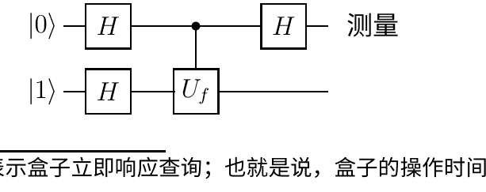

<sup>7</sup>术语“oracle”表示盒子立即响应查询；也就是说，盒子的操作时间不包括在复杂性分析中。

这里 H表示哈达玛变换

H: |x⟩ → \frac{1}{\sqrt{2}} \sum_{y} (-1)^{xy} |y⟩, \quad (6.107)

或

H: |0⟩ → \frac{1}{\sqrt{2}}(|0⟩ + |1⟩) \ |1⟩ → \frac{1}{\sqrt{2}}(|0⟩ - |1⟩); \quad (6.108)

也就是说，H是一个2×2的矩阵

H: \begin{pmatrix} \frac{1}{\sqrt{2}} & \frac{1}{\sqrt{2}} \ \frac{1}{\sqrt{2}} & -\frac{1}{\sqrt{2}} \end{pmatrix}. \quad (6.109)

该电路将输入 |0⟩|1⟩转换为

|0⟩|1⟩ → \frac{1}{2}(|0⟩ + |1⟩)(|0⟩ - |1⟩) \ → \frac{1}{2}\left[(-1)^{f(0)}|0⟩ + (-1)^{f(1)}|1⟩\right] (|0⟩ - |1⟩) \ → \frac{1}{2}\left[\left((-1)^{f(0)} + (-1)^{f(1)}\right)|0⟩ + \left((-1)^{f(0)} - (-1)^{f(1)}\right)|1⟩\right] \frac{1}{\sqrt{2}}(|0⟩ - |1⟩). \quad (6.110)

然后当我们测量第一个量子比特时，如果 f(0) = f(1)（常数函数），我们以概率1得到结果 |0⟩，如果 f(0) ≠ f(1)（平衡函数），我们以概率1得到结果 |1⟩。

量子计算机比经典计算机具有优势，因为它可以调用量子并行性。因为我们输入了一个 |0⟩和|1⟩的叠加态，输出对 f(0)和 f(1)的值都敏感，即使我们只运行了一次盒子。

德意志-约瑟问题。现在我们将考虑德意志问题的一些推广。我们将继续假设我们要分析一个量子黑盒（“量子预言机”）。但为了了解复杂性，我们将想象我们有一个黑盒的家族，输入大小可变。我们对于找出盒子内部内容所需的时间如何随输入大小的增加而变化感兴趣（其中“时间”是通过查询盒子的次数来衡量）。

在德意志-约瑟问题中，我们面对一个将 $n$ 位映射到1的量子黑盒。

$$f : \{0, 1\}^n \rightarrow \{0, 1\}, \qquad \qquad (6.111)$$

并且我们有可靠的消息说 $f$ 要么是常数（$f(x) = c$ 对于所有 $x$），要么是平衡的（$f(x) = 0$ 对于恰好 $2^{n-1}$ 个可能的输入值）。我们要解决的决策问题是： $f$ 是常数还是平衡的？

实际上，我们也可以解决这个问题，只访问一次盒子，使用与德意志问题相同的电路（但将 $x$ 从一个位扩展到 $n$ 位）。我们注意到，如果我们同时对 $n$ 个量子比特应用 $n$ 个哈达玛门。

$$\boldsymbol{H}^{(n)} = \boldsymbol{H} \otimes \boldsymbol{H} \otimes \ldots \otimes \boldsymbol{H}, \qquad \qquad (6.112)$$

那么 $n$ 个量子比特的状态会发生变化

$$\boldsymbol{H}^{(n)} : |x\rangle \rightarrow \prod_{i=1}^{n} \left( \frac{1}{\sqrt{2}} \sum_{y_i = \{0,1\}} (-1)^{x_i y_i} |y_i\rangle \right) \equiv \frac{1}{2^{n/2}} \sum_{y=0}^{2^n-1} (-1)^{x \cdot y} |y\rangle, \qquad (6.113)$$

其中$x, y$表示 $n$位字符串， $x \cdot y$ 表示按位AND（或模2标量积）

$$x \cdot y = (x_1 \wedge y_1) \oplus (x_2 \wedge y_2) \oplus \ldots \oplus (x_n \wedge y_n). \qquad \qquad (6.114)$$

对输入 $(|0\rangle)^{\otimes n} |1\rangle$，电路的作用是

$$(|0\rangle)^{\otimes n} |1\rangle \rightarrow \left( \frac{1}{2^{n/2}} \sum_{x=0}^{2^n-1} |x\rangle \right) \frac{1}{\sqrt{2}}(|0\rangle - |1\rangle)$$
$$\qquad \rightarrow \left( \frac{1}{2^{n/2}} \sum_{x=0}^{2^n-1} (-1)^{f(x)} |x\rangle \right) \frac{1}{\sqrt{2}}(|0\rangle - |1\rangle)$$
$$\qquad \rightarrow \left( \frac{1}{2^n} \sum_{x=0}^{2^n-1} \sum_{y=0}^{2^n-1} (-1)^{f(x)} (-1)^{x \cdot y} |y\rangle \right) \frac{1}{\sqrt{2}}(|0\rangle - |1\rangle) \qquad (6.115)$$

现在让我们来计算这个和

$$\frac{1}{2^n} \sum_{x=0}^{2^n-1} (-1)^{f(x)} (-1)^{x \cdot y}. \qquad \qquad (6.116)$$

如果 f是一个常数函数，那么这个和就是

```
$$(-1)^{f(x)} \left( \frac{1}{2^n} \sum_{x=0}^{2^n-1} (-1)^{x \cdot y} \right) = (-1)^{f(x)} \delta_{y,0};$$
```

除非 y= 0，否则它会消失。因此，当我们测量 n位寄存器时，我们得到的结果是 |y= 0⟩ = (|0⟩)^n的概率为1。但是如果函数是平衡的，那么对于 y= 0，这个和变成了

```
$$\frac{1}{2^n} \sum_{x=0}^{2^{n-1}} (-1)^{f(x)} = 0,$$
```

(因为一半的项是(+1)，另一半是(-1))。因此，获得测量结果 |y= 0⟩的概率为零.

我们得出结论，量子预言机的一次查询足以以100%的置信度区分常数和平衡函数。测量结果 y= 0表示常数，任何其他结果表示平衡。

因此，量子计算完美地解决了这个问题，但这个问题在经典计算中真的很难吗？如果我们只能使用经典输入状态 |x⟩，我们可以重复查询预言机，每次随机选择输入 x（不重复选择）。一旦我们对两个不同查询获得不同的输出，我们就确定该函数是平衡的（不是常数）。但是如果函数实际上是常数，我们将无法确定它是常数直到我们提交了 2^{n-1}+1 个查询并且每次得到相同的响应为止。相比之下，量子计算只需要一次就能给出明确的响应。因此从这个意义上讲（如果我们要求绝对确定性），经典计算需要指数级的查询次数 t，而量子计算则不需要，因此我们可以声称有指数级的量子加速。

但也许要求经典计算的绝对确定性是不合理的（特别是因为任何真实的量子计算机都会受到错误的影响，因此量子计算机也无法达到绝对确定性）。假设我们满足于以某种概率猜测平衡或常数

$$P (\text{成功}) > 1 - \varepsilon.$$

如果函数实际上是平衡的，那么如果我们进行 k次查询，得到每次相同的响应的概率为 p= 2^{- (k-1)}。如果在收到响应后，如果我们猜测函数是平衡的，并且连续多次得到相同的响应，那么快速的贝叶斯分析表明我们猜测错误的概率是 \(\frac{1}{2^{k-1} + 1}\) （假设平衡和恒定的先验概率相等）。因此，如果我们在查询 \(k\) 次后猜测，错误猜测的概率是

\[1 - P(\text{成功}) = \frac{1}{2^{k-1}/(2^{k-1} + 1)} \tag{6.120}\]

因此，我们可以实现成功概率 \(1 - \varepsilon\)，其中 \(\varepsilon = 2^{k-1}/(2^{k-1} + 1)\) 或 \(k\) 约等于 \(\frac{1}{2}\log(\frac{1}{\varepsilon})\)。由于我们可以在多项式次数的试验中获得指数级的成功概率，所以不能说这个问题很难。

## Bernstein-Vazirani问题

完全相同的电路可以用来解决Deutsch-Jozsa问题的另一种变体。假设我们的量子黑盒计算函数 \(f(a)\)，其中

\[f_a(x) = a \cdot x, \tag{6.121}\]

而 \(a\) 是一个 \(n\) 位字符串。我们的工作是确定 \(a\)。量子算法可以在只进行一个（\(n\) 量子比特）的量子查询的情况下确定这个问题。对于这个特定的函数，方程（6.115）中的量子态变为

\[\frac{1}{2^n} \sum_{x=0}^{2^n-1} \sum_{y=0}^{2^n-1} (-1)^{a \cdot x} (-1)^{x \cdot y} |y\rangle. \tag{6.122}\]

但实际上

\[\frac{1}{2^n} \sum_{x=0}^{2^n-1} (-1)^{a \cdot x} (-1)^{x \cdot y} = \delta_{a,y}, \tag{6.123}\]

所以这个态是 \(|a\rangle\)。我们可以执行电路一次并测量 \(n\) 量子比特寄存器，以概率为一找到 \(a\) 的 \(n\) 位字符串。

如果只允许经典查询，我们每次只能获得一位信息，并且需要 \(n\) 次查询才能确定 \(a\) 的值。因此，我们在这个问题上有一个明确的量子和经典难度的分离。即使如此，这个例子并没有探索 \(BPP\) 与 \(BQP\) 之间的关系，因为经典问题并不难。在经典情况下，所需的查询次数仅与输入大小成线性关系，而不是指数关系。

西蒙的问题。伯恩斯坦和瓦齐拉尼设法提出了一个对上述问题的变异，这在经典情况下是困难的，从而首次在量子和经典复杂性之间建立了一个“相对化”的分离。我们将发现，考虑丹尼尔·西蒙稍后提出的一个更简单的例子更有教育意义。

我们再次面临一个量子黑盒，这次我们被保证这个盒子计算一个函数

$$f : \{0,1\}^n \rightarrow \{0,1\}^n, \qquad (6.124)$$

这个函数是2对1的。此外，该函数具有由 n 位字符串 a 给出的“周期”；也就是说

$$f(x) = f(y) \quad \text{当且仅当} \quad y = x \oplus a, \qquad (6.125)$$

其中 ⊕ 表示按位异或操作。（如果我们将 x 视为取值在 (Z_2)^n 而不是 Z_{2^n}，则 a 是周期。）这是我们对 f 的全部了解。我们的任务是确定 a 的值。

经典上，这个问题很难。我们需要查询指数级别的次数才能有合理的概率找到 a。直到我们幸运地选择了两个查询之前，我们都不会得到任何信息，x和 y满足 x ⊕ y = a。例如，假设我们选择了 2^{n/4} 个查询。查询对的数量小于 (2^{n/4})^2，对于每一对 {x, y}，x ⊕ y = a 的概率是 2^{-n}。因此，成功找到 a 的概率小于

$$2^{-n}(2^{n/4})^2 = 2^{-n/2}; \qquad (6.126)$$

即使有指数级别的查询，成功概率也是指数级别的小。

如果我们愿意，我们可以将问题构建为一个决策问题：要么 f 是一个一对一的函数，要么它是一个具有某个随机选择的周期 a 的二对一函数，每个以先验概率 1/2 发生。我们需要确定这个函数是一对一还是二对一。然后，在进行 2^{n/4} 个经典查询之后，我们猜测的正确概率为

$$P(\text{成功}) < \frac{1}{2} + \frac{1}{2^{n/2}}, \qquad (6.127)$$

这个概率不会远离 1/2 当 n 变得很大时。

但是使用量子查询，这个问题很容易！我们使用的电路基本上与上面相同，但现在两个寄存器都扩展到 n个量子比特。我们通过对 |0⟩施加 H^{(n)}来准备所有 n 位字符串的等权重叠加态，然后我们查询oracle：

$$U_f: \left( \sum_{x=0}^{2^n-1} |x\rangle \right) |0\rangle \to \sum_{x=0}^{2^n-1} |x\rangle |f(x)\rangle. \qquad (6.128)$$

现在我们测量第二个寄存器。（这一步实际上并不是必需的，但为了教学上的清晰度，我在这里包括它。）测量结果是从 2^{n}-1 个可能值中随机选择的，每个值出现的概率相等。假设结果是 f(x_0)。因为 f将 x0 和 x0⊕a 这两个值映射到 f(x0)，所以我们已经准备好了状态 x_0 和 x_0 \oplus a，只有这些值被映射到 f(x_0)，我们已经准备好了状态

$$\frac{1}{\sqrt{2}} (|x_0\rangle + |x_0 \oplus a\rangle) \qquad (6.129)$$

在第一个寄存器中。

现在我们想要提取关于 a 的一些信息。显然，在这一点上测量寄存器（在计算基础上）对我们没有好处。我们将会以概率 1获得结果 x_0或 x_0 \oplus a，但是无论结果如何都不会透露出任何关于 a 值的信息。但是假设我们在测量之前对寄存器应用Hadamard变换 H^{(n)}:

$$ \begin{aligned} H^{(n)} : \frac{1}{\sqrt{2}} (|x_0\rangle + |x_0 \oplus a\rangle) \ \to &\frac{1}{2^{(n+1)/2}} \sum_{y=0}^{2^n-1} \left[ (-1)^{x_0 \cdot y} + (-1)^{(x_0 \oplus a) \cdot y} \right] |y\rangle \\ &= \frac{1}{2^{(n-1)/2}} \sum_{a \cdot y=0} (-1)^{x_0 \cdot y} |y\rangle. \end{aligned} \qquad (6.130)$$

如果 a·y= 1，则 |y⟩的系数中的项会相互干涉破坏性地干扰。因此，只有 a·y= 0的状态 |y⟩在对 y的求和中存活。测量结果是从所有可能的 y值中随机选择的，其中 a·y= 0的每个值的概率都是 2^{-(n-1)}。

我们重复运行这个算法，每次得到一个满足 y·a=0 的值 y。一旦我们找到了线性独立的值{y₁, y₂, y₃... yₙ}（即在 (Z₂)ₙ 上线性独立），我们可以解决这些方程

$$ \begin{aligned} y_1 \cdot a &= 0 \\ y_2 \cdot a &= 0 \\ &\vdots \\ y_n \cdot a &= 0, \quad (6.131) \end{aligned} $$

以确定唯一的 a值，从而解决了我们的问题。很容易看出，通过 O(n) 次重复，我们可以获得接近于 1 的指数级接近成功概率。

因此，我们最终找到了一个例子，在给定特定类型的量子oracle的情况下，我们可以通过利用量子叠加在多项式时间内解决问题，而如果我们受限于经典查询，则需要指数时间。正如计算机科学家可能会说的：

> 存在一个相对于 BQP ≠ BPP 的预言机。

请注意，每当我们比较相对于预言机的经典和量子复杂性时，我们考虑的是一个量子预言机（查询和回复是在希尔伯特空间中的状态），但具有首选正交基。如果我们提交一个经典查询（首选基元素），我们总是会收到一个经典响应（另一个基元素）。问题是我们是否可以通过选择更一般的量子查询来实现显著的加速。

## 6.4 量子数据库搜索

我们将研究的下一个算法也像Simon的算法一样表现出与经典算法相比的加速。但在这种情况下，加速仅仅是二次的（量子时间与经典时间的平方根成比例），与Simon问题的指数级加速相比。然而，这个结果（由Lov Grover发现）非常有趣，因为算法具有广泛的实用性。

从启发式的角度来看，我们将要解决的问题是：我们面对一个非常庞大的未排序的数据库，其中包含 $N \gg 1$ 个项目，我们需要找到一个特定的项目，就像在一堆干草中找到一根针。从数学角度来看，数据库可以用一个表或者一个函数 $f(x)$ 来表示，其中 $x \in \{0, 1, 2, \ldots, N-1\}$。我们已经得到保证，条目 $a$ 在表中只出现一次；也就是说，$f(x)$ 只有一个值等于 $a$ 的 $x$。问题是，给定 $a$，要找到这个 $x$ 的值。

如果数据库已经被正确排序，查找 $x$ 就很容易。也许有人好心地按升序列出了 $a$ 的值。那么我们只需要在表中查找 $\log_2 N$ 个条目就可以找到 $x$。假设 $N=2^n$ 是 $2$ 的幂。首先我们查找 $x=2^{n-1}-1$ 时的 $f(x)$，并检查 $f(x)$ 是否大于 $a$。如果是的话，我们接下来查找 $x=2^{n-2}-1$ 的 $f$，以此类推。通过每次表查找，我们将 $x$ 的候选值数量减少一半，所以只需要 $n$ 次查找就可以筛选出所有 $2^n$ 个排序好的项目。你可以使用这个算法在洛杉矶电话簿中查找一个号码，因为名字是按字典顺序排列的。

但是现在假设你知道某人的电话号码，并且你想要查找她的姓名。除非你很幸运能够访问反向目录，否则这是一个繁琐的过程。很有可能在找到她的号码之前，你需要检查很多电话簿条目。

事实上，如果这些 $N$ 个号码是以随机顺序列出的，你需要查找 $N$ 个号码才能达到概率 $P$ 你找到了她的号码（因此也找到了她的名字）。格罗弗发现，如果你有一本量子电话簿，你可以通过仅仅查阅电话簿大概 $\sqrt{N}$ 次，就有很高的概率知道她的名字。

$$f(x) = a.$$

这个问题也可以被表述为一个“黑盒”问题或者“预言机”问题。在这种情况下，预言机就是电话簿或者查找表。我们可以输入一个名字（一个值为 $x$ 的变量）然后预言机会输出 0，如果 $f(x) = a$，或者输出 1，如果 $f(x) \neq a$。我们的任务是尽快找到 $x$ 的值。

为什么这个问题很重要？你可能从未尝试过在电话簿中查找与给定号码匹配的姓名，但如果不那么困难的话，你可能会更经常尝试！更广泛地说，快速搜索未排序的数据库的方法可以用来解决 $NP$ 中的任何问题。我们的预言机可以是一个询问每个潜在的“证人” $y$ 的子程序，潜在地证明问题解决方案的证人。例如，如果我们面对一个图形，并且需要知道它是否存在哈密顿路径，我们可以将路径提交给“预言机”，它可以快速回答路径是否是哈密顿路径。如果我们知道一种快速查询预言机关于所有可能路径的方法，我们将能够高效地找到哈密顿路径（如果存在）。

### 6.4.1 量子预言机

因此，“预言机”可以简称为快速评估决策问题的解决方案的子程序，但让我们继续将预言机抽象地看作一个黑盒子。预言机“知道”长度为 $2^n$ 的可能字符串中的一个（“标记”字符串或“解决方案” $\omega$ ）是特殊的。我们向预言机提交一个查询 $x$，它告诉我们 $x = \omega$ 还是 $x \neq \omega$。换句话说，它返回函数 $f_\omega(x)$ 的值，其中

$$
f_\omega(x) = 0, \quad\quad x = \omega, \\
f_\omega(x) = 1, \quad\quad x \neq \omega. \quad\quad\quad\quad (6.133)
$$

而且，它是一个量子预言机，因此可以响应超级位置的查询。预言机是一个实现了幺正变换的量子黑盒子。

$$\boldsymbol{U}_{f_\omega} : |x\rangle|y\rangle \rightarrow |x\rangle|y \oplus f_\omega(x)\rangle, \quad\quad\quad\quad (6.134)$$

其中 $|x\rangle$ 是一个 $n$ 量子比特状态，而 $|y\rangle$ 是一个单量子比特状态。正如我们之前在其他情境中所见，我们可以选择单量子比特寄存器的状态为 $\frac{1}{\sqrt{2}}(|0\rangle - |1\rangle)$，这样量子神经网络就会起作用

$$\boldsymbol{U}_{f_\omega} : |x\rangle\frac{1}{\sqrt{2}}(|0\rangle - |1\rangle) \rightarrow (-1)^{f_\omega(x)}|x\rangle\frac{1}{\sqrt{2}}(|0\rangle - |1\rangle). \quad\quad\quad\quad (6.135)$$

现在我们可以忽略第二个寄存器，并得到

$$\boldsymbol{U}_\omega : |x\rangle \rightarrow (-1)^{f_\omega(x)}|x\rangle, \quad\quad\quad\quad (6.136)$$

或

$$\boldsymbol{U}_\omega = I - 2|\omega\rangle\langle\omega|. \quad\quad\quad\quad (6.137)$$

Oracle会改变状态 $|\omega\rangle$ 的符号，但对于与 $|\omega\rangle$ 正交的任何状态都不会产生影响。这个变换有一个简单的几何解释。作用于 $2^n$ 维希尔伯特空间中的任意向量， $U_{\omega}$ 将向量关于与 $|\omega\rangle$ 正交的超平面进行反射（它保留超平面上的分量，并翻转沿着 $|\omega\rangle$ 的分量）。

我们知道Oracle对于某个特定的计算基态 $|\omega\rangle$ 执行这个反射，但我们对于字符串 $\omega$ 的值一无所知。我们的任务是以高概率确定 $\omega$，并在最少次数的查询中向Oracle查询。

### 6.4.2 Grover迭代

作为第一步，我们准备状态

$$|s\rangle = \frac{1}{\sqrt{N}} \left( \sum_{x=0}^{N-1} |x\rangle \right), \quad (6.138)$$

所有计算基态的等权重叠加 - 这可以通过对初始态的每个量子比特应用Hadamard变换来轻松实现 $|x=0\rangle$。虽然我们不知道 $\omega$ 的值，但我们知道 $|\omega\rangle$ 是一个计算基态，因此

$$|\langle\omega|s\rangle| = \frac{1}{\sqrt{N}}, \quad (6.139)$$

无论 $\omega$ 的值如何。如果我们通过投影到计算基态来测量状态 $|s\rangle$，我们“发现”标记态 $|\omega\rangle$ 的概率只有 $\frac{1}{N}$。但是根据格罗弗的理论，我们可以重复迭代一个转换，增强我们正在寻找的未知状态 $|\omega\rangle$ 的概率幅度，同时抑制所有不希望的状态 $|x \neq \omega\rangle$ 的幅度。我们通过将由预言机执行的未知反射 $U_{\omega}$ 与我们自己可以执行的已知反射结合来构建这个格罗弗迭代。这个已知反射是

$$U_s = 2|s\rangle\langle s| - I, \quad (6.140)$$

它保持 $|s\rangle$ 不变，但是翻转与 $|s\rangle$ 正交的任何向量的符号。从几何角度来看，作用于任意向量时，它保持沿着 $|s\rangle$ 的分量，并翻转与 $|s\rangle$ 正交的超平面上的分量。

我们将在下面讨论构建一个实现 $U_s$ 的量子电路的问题；现在我们只是假设我们可以高效地执行 $U_s$。一个格罗弗迭代是一个酉变换

$$R_{\text{grov}} = U_s U_{\omega}, \qquad (6.141)$$

一个Oracle查询后跟我们的反射。让我们考虑 $R_{\text{grov}}$ 在由 $|\omega\rangle$ 和 $|s\rangle$ 张成的平面上的作用。如果我们将其几何化，这个作用最容易理解。回想一下

$$|\langle s|\omega\rangle| = \frac{1}{\sqrt{N}} \equiv \sin\theta, \qquad (6.142)$$

所以 $|s\rangle$ 从与 $|\omega^{\perp}\rangle$ 垂直的轴上旋转了 $\theta$。$U_{\omega}$ 关于轴 $|\omega^{\perp}\rangle$ 反射平面上的一个向量，而 $U_s$ 关于轴 $|s\rangle$ 反射一个向量。这两个反射一起将向量旋转了 $2\theta$：

那么，Grover迭代就是在由 $|s\rangle$ 和 $|\omega\rangle$ 确定的平面上旋转 $2\theta$。

### 6.4.3 找到4个中的1个

- 假设，例如，数据库中有N=4个项目，其中一个被标记。使用经典查询，标记的项目可以在第1、第2、第3或第4个查询中找到；平均需要2次查询。最坏的情况下，需要3次查询才能成功。但是由于 $\sin\theta = \frac{1}{\sqrt{4}} = \frac{1}{2}$，所以 $\theta=30^\circ$，$2\theta=60^\circ$。
- $\frac{1}{\sqrt{N}} = \frac{1}{2}$ 经过一次Grover迭代后，$|s\rangle$ 与 $|\omega^{\perp}\rangle$ 成 $90^\circ$ 角对齐，即与 $|\omega\rangle$ 对齐。在一次Grover迭代之后，我们将 $|s\rangle$ 旋转到与 $|\omega^{\perp}\rangle$ 成 $90^\circ$ 角，即与 $|\omega\rangle$ 对齐。当我们通过投影到计算基准上进行测量时，我们以确定性地得到结果 $|\omega\rangle$。只需要一个量子查询就足以找到标记状态，这是经典情况的显著改进。

当然，如果我们知道有一个标记状态，第四个查询实际上是多余的，所以更准确地说最多只需要三个查询，并且平均需要 $2\frac{1}{4}$ 个查询。

有一种可视化Grover迭代的替代方式，有时候很有用，称为“关于平均值的反转”。如果我们在计算基准中展开一个状态 $|\psi\rangle$

$$|\psi\rangle = \sum_x a_x |x\rangle, \qquad (6.143)$$

那么它与 $|s\rangle$ 的内积 $\langle s| = \frac{1}{\sqrt{N}} \sum_x \langle x|$ 是

$$\langle s|\psi\rangle = \frac{1}{\sqrt{N}} \sum_x a_x = \sqrt{N} \langle a\rangle, \qquad (6.144)$$

其中

$$\langle a\rangle = \frac{1}{N} \sum_x a_x, \qquad (6.145)$$

是振幅的平均值。然后，如果我们应用 $U_s = 2|s\rangle\langle s| - I$ 到 $|\psi\rangle$，我们得到

$$U_s|\psi\rangle = \sum_x (2\langle a\rangle - a_x)|x\rangle; \qquad (6.146)$$

振幅被转换为

$$U_s: a_x \to 2\langle a\rangle - a_x, \qquad (6.147)$$

即 $|x\rangle$ 的系数关于振幅的平均值取反。

如果我们再次考虑 $N=4$ 的情况，那么在状态 $|s\rangle$ 中，每个振幅都是 $\frac{1}{2}$。一个查询的预言会翻转被标记状态的振幅的符号，从而将平均振幅减少到 $\frac{1}{4}$。关于平均值的反转然后将所有未标记状态的振幅从 $\frac{1}{4}$ 变为零，并将标记状态的振幅从 $-\frac{1}{4}$ 提高到 $\frac{1}{2}$。因此，我们得出结论，只需要一个查询就可以确定找到标记状态。

我们还可以很容易地看出，如果数据库中有 $N$ 条目，并且其中恰好有 $\frac{1}{4}$ 个标记状态，那么只需要一个查询就足以找到标记状态。

然后，如上所述，一个查询将平均振幅从 $\frac{1}{\sqrt{N}}$ 降低到 $\frac{1}{2\sqrt{N}}$，然后关于平均值的反转将每个未标记状态的振幅降低到零。（当我们比较查询可以是量子而不是经典时，需要查询的次数时，可能有点不公平。）

## 6.4 量子数据库搜索

在量子情况下，只需要一个查询。如果oracle正在运行计算函数的例程，则在计算过程中会填充一些垃圾空间。我们需要通过反向运行计算来清除垃圾，以保持量子相干性。如果经典计算是不可逆的，则无需反向运行oracle。从这个意义上说，一个量子oracle的查询在复杂性上可能大致相当于两个经典oracle的查询。

### 6.4.4 找到1个在N中的

现在让我们回到数据库包含N个项目且恰好有一个项目被标记的情况。每个Grover迭代在由$|s\rangle$和$|\omega\rangle$确定的平面上旋转量子态；经过T次迭代后，状态将从$|\omega^\perp\rangle$轴旋转$\theta+2T\theta$。为了优化在最终进行测量时找到标记状态的概率，我们将迭代直到这个角度接近90°，或者

$$ (2T + 1)\theta \simeq \frac{\pi}{2} \Rightarrow 2T + 1 \simeq \frac{\pi}{2\theta}, \quad (6.148) $$

我们回忆一下$\sin\theta = \frac{1}{\sqrt{N}}$，或者

$$ \theta \simeq \frac{1}{\sqrt{N}}, \quad (6.149) $$

对于N很大的情况；如果我们选择

$$ T = \frac{\pi}{4}\sqrt{N}(1 + O(N^{-1/2})), \quad (6.150) $$

那么获得测量结果$|\omega\rangle$的概率将会是

$$ \text{Prob}(\omega) = \sin^2((2T + 1)\theta) = 1 - O\left(\frac{1}{N}\right). \quad (6.151) $$

我们得出的结论是，只需要大约$\frac{\pi}{4}\sqrt{N}$个查询就可以以高概率确定ω，相对于经典结果有二次加速。

### 6.4.5 多个解决方案

如果有$r>1$个标记状态，并且 $r$已知，我们可以修改迭代次数，以使得找到一个标记状态的概率仍然非常接近1。分析与上述相同，只是Oracle在与该向量正交的超平面上引起了反射。

$$ |\tilde{\omega}\rangle = \frac{1}{\sqrt{r}}\left(\sum_{i=1}^{r}|\omega_i\rangle\right),\tag{6.152} $$

标记的计算基态的等权重叠加 $|\omega_i\rangle$。现在

$$ \langle s|\tilde{\omega}\rangle = \sqrt{\frac{r}{N}} = \sin \theta,\tag{6.153} $$

Grover迭代在由 $|s\rangle$ 和 $|\tilde{\omega}\rangle$张成的平面上将向量旋转$2\theta$；我们再次得出结论，在一定数量的迭代之后，状态接近于$|\omega\rangle$

$$ T \simeq \frac{\pi}{4\theta} = \frac{\pi}{4} \sqrt{\frac{N}{r}}.\tag{6.154} $$

如果我们通过投影到计算基础上进行测量，我们将以接近于一的概率找到一个标记状态（每个状态出现的概率相等）。（随着解的数量增加，找到其中一个解所需的时间会像$r^{-1/2}$一样下降，而不是在经典情况下的$r^{-1}$。）请注意，如果我们继续执行更多的Grover迭代，向量将继续旋转，因此在最终测量时找到标记状态的概率开始下降。Grover算法就像烘烤soufflé – 如果我们把它放在烤箱里时间太长，它就会下降。因此，如果我们对标记状态的数量一无所知，我们可能无法找到其中之一。例如， $T \sim \frac{\pi}{4} \sqrt{\frac{N}{r}}$ 对于 $r=1$，$N$次迭代是最优的，但是对于 $r=4$，这么多次迭代后找到标记状态的概率接近于零。

即使我们不事先知道 $r$的值，我们仍然可以以二次速度超越经典算法找到解决方案（对于 $r \ll N$）。例如，我们可以选择迭代次数在0到$\frac{\pi}{4} \sqrt{N}$的范围内随机选择。那么找到标记状态的预期概率接近于对于每个 $r$，我们有1/2的概率找到一个标记状态，因此我们不太可能在几次尝试后找不到标记状态。

重复。每次测量时，我们可以将找到的状态作为经典查询提交给oracle，以确认该状态是否真的被标记。

特别是，如果我们在几次尝试后没有找到解决方案，那么很可能没有解决方案。因此，我们可以以很高的概率正确回答“是否存在标记状态”的问题。因此，我们可以采用Grover算法来解决任何 NP问题，其中oracle检查一个提议的解决方案，相比于经典的穷举搜索，有二次加速。

### 6.4.6 实现反射

为了执行Grover迭代，我们需要（除了oracle查询之外）一个酉变换

$$ U_s = 2|s\rangle\langle s| - 1, \qquad\qquad (6.155) $$

它将一个向量关于由向量 $|s\rangle$ 定义的轴进行反射。我们如何高效地从量子门构建这个变换？由于 $|s\rangle = \boldsymbol{H}^{(n)}|0\rangle$，其中 $\boldsymbol{H}^{(n)}$ 是比特位哈达玛变换，我们可以写成

$$ U_s = \boldsymbol{H}^{(n)}(2|0\rangle\langle 0| - 1)\boldsymbol{H}^{(n)}, \qquad\qquad (6.156) $$

因此，我们只需要构建关于轴 $|0\rangle$ 的反射。我们可以轻松地从一个 $n$ 比特Toffoli门构建这个反射。
回想一下

$$ H\sigma_xH = \sigma_z; \qquad\qquad (6.157) $$

在哈达玛旋转基础上的一次比特翻转等同于相对相位的翻转 $|0\rangle$ 和 $|1\rangle$。因此：

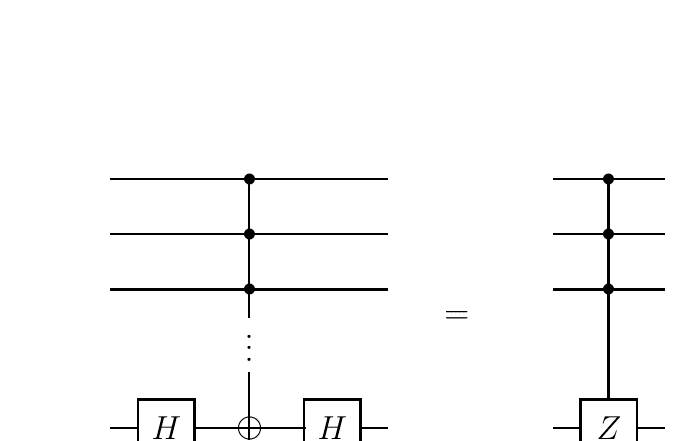

通过 H共轭最后一位，$n$位Toffoli门 $\theta^{(n)}$ 变为控制$^{(n-1)}-\sigma_z$，这将翻转 $|11\ldots1\rangle$ 的相位，$|1\rangle$ 并对所有其他计算基态无影响。通过$\text{NOT}^{(n)}$共轭，我们得到 $U_s$，除了一 个无关紧要的负号。

你将在一个练习中证明，如果有足够的临时空间，$n$位Toffoli门 $\theta^{(n)}$ 可 以由$2n -5$个3位Toffoli门 $\theta^{(3)}$ 构建。因此，构建 $U_s$ 的电路的大小与$n= \log N$成线性关系。Grover的数据库搜索（假设oracle立即回答查询）的时间 复杂度为 $\sqrt{N} \log N$。 如果我们将oracle视为在$p olylog$时间内执行函数评估的子程序，那么搜索所需的时间是阶数的 $\sqrt{N} \ poly(\log N)$。

## 6.5 Grover算法是最优的

Grover的二次量子加速数据库搜索已经引起了人们的兴趣，也有潜在的重 要性，但是我们肯定可以更聪明地做得更好，不是吗？不，事实证明我们 不能。如果根据oracle的查询次数来衡量“时间”，那么Grover的算法提供 了对未排序数据库的最快的量子搜索。

考虑单个标记状态 $|\omega\rangle$的情况，让 $U(\omega, T)$表示调用oracle $T$次的量子电 路。除了指定查询次数外，我们对电路没有任何限制；特别是，我们对量 子门的数量没有限制。这个电路应用于一个初始的

状态 $|\psi(0)\rangle$，产生最终状态

$$ |\psi_{\omega}(t)\rangle = \boldsymbol{U}(\omega, T)|\psi(0)\rangle. \tag{6.158} $$

现在我们要进行一次测量，以区分 $N$ 可能的 $\omega$ 值。如果我们能够完美地区分可能的值，状态 $|\psi_{\omega}(t)\rangle$ 必须相互正交，如果我们要以高概率正确区分，它们必须几乎正交。

现在，如果状态 $\{|\psi_{\omega}\rangle\}$ 是一组正交归一基，那么对于任意固定的归一化向量 $|\varphi\rangle$,

$$ \sum_{\omega=0}^{N-1} \left\| |\psi_{\omega}\rangle - |\varphi\rangle \right\|^2 \ge 2N - 2\sqrt{N}. \tag{6.159} $$

(如果 $|\varphi\rangle$ 是所有基元素的等权重叠加，那么总和将被最小化，$|\varphi\rangle = \frac{1}{\sqrt{N}}\sum_{\omega} |\psi_{\omega}\rangle$，你可以通过引入拉格朗日乘子来进行约束极值的计算，我们的策略是选择适当的状态 $|\varphi\rangle$，以便我们可以利用这个不等式来了解关于oracle调用次数 $T$ 的一些信息。

我们的电路使用 $T$ 个查询构建一个酉变换 $U(\omega, T) = \boldsymbol{U}_{\omega}\boldsymbol{U}_{T}\boldsymbol{U}_{\omega}\boldsymbol{U}_{T-1}\ldots\boldsymbol{U}_{\omega}\boldsymbol{U}_{1}$, (6.160) 其中 $\boldsymbol{U}_{\omega}$ 是oracle变换，$\boldsymbol{U}_{t}$ 是任意非oracle变换。对于我们的状态 $|\varphi(T)\rangle$，我们将选择将 $U(\omega, T)$ 应用于 $|\psi(0)\rangle$ 的结果，除了每个 $\boldsymbol{U}_{\omega}$ 被 $\boldsymbol{I}$ 替换；也就是说，相同的电路，但所有查询都提交给“空oracle”。因此，

$$ |\varphi(T)\rangle = \boldsymbol{U}_{T}\boldsymbol{U}_{T-1}\ldots\boldsymbol{U}_{2}\boldsymbol{U}_{1}|\psi(0)\rangle, \tag{6.161} $$

而

$$ |\psi_{\omega}(T)\rangle = \boldsymbol{U}_{\omega}\boldsymbol{U}_{T}\boldsymbol{U}_{\omega}\boldsymbol{U}_{T-1}\ldots\boldsymbol{U}_{\omega}\boldsymbol{U}_{1}|\psi(0)\rangle. \tag{6.162} $$

为了比较 $|\varphi(T)\rangle$ 和 $|\psi_{\omega}(T)\rangle$，我们利用先前对电路精度误差影响的分析，将 $\omega$ oracle 视为空oracle的“错误”实现。第 $t$ 步的误差向量（参见公式 (6.63)）为

$$ \begin{aligned} \left\| |E(\omega, t)\rangle \right\| &= \left\| (\boldsymbol{U}_{\omega} - 1)|\varphi(t)\rangle \right\| \\ &= 2|\langle \omega|\varphi(t)\rangle|, \end{aligned} \tag{6.163} $$

经过 T次查询后，我们有（参见公式 (6.66) ）

$$ \left\| |\psi_\omega(T)\rangle - |\varphi(T)\rangle \right\| \leq 2 \sum_{t=1}^T |\langle \omega|\varphi(t)\rangle |. \tag{6.164} $$

从恒等式

$$ \begin{aligned} &\left( \sum_{t=1}^T c_t \right)^2 + \frac{1}{2} \sum_{s, t=1}^T (c_s - c_t)^2 \\ &= \sum_{s, t=1}^T \left( c_t c_s + \frac{1}{2} c_s^2 - c_t c_s + \frac{1}{2} c_s^2 \right) = T \sum_{t=1}^T c_t^2, \end{aligned} \tag{6.165} $$

我们得到不等式

$$ \left( \sum_{t=1}^T c_t \right)^2 \leq T \sum_{t=1}^T c_t^2, \tag{6.166} $$

应用于方程(6.164)得到

$$ \left\| |\psi_\omega(T)\rangle - |\varphi(T)\rangle \right\|^2 \leq 4T \left( \sum_{t=1}^T |\langle \omega|\varphi(t)\rangle |^2 \right). \tag{6.167} $$

对 $\omega$求和，我们得到

$$ \sum_\omega \left\| |\psi_\omega(T)\rangle - |\varphi(T)\rangle \right\|^2 \leq 4T \sum_{t=1}^T \langle \varphi(t) | \varphi(t)\rangle = 4T^2. \tag{6.168} $$

调用方程式(6.159)我们得出结论

$$ 4T^2 \geq 2N - 2\sqrt{N}, \tag{6.169} $$

如果状态 $|\psi_\omega(T)\rangle$彼此正交，我们因此发现任何能够区分所有可能值的量子算法标记状态必须查询oracle $T$次，其中

$$ T \geq \sqrt{\frac{N}{2}}, \tag{6.170} $$

(忽略小的修正，当 $N \to \infty$时)。 Grover算法在 $\pi/4 \sqrt{N}$次查询中找到$\omega$，这超过了上限约11%。事实上，可以改进论证以改善上限为 $T \geq \frac{\pi}{4} \sqrt{N}(1 - \varepsilon)$，这在渐近情况下由Grover算法达到饱和。此外，我们可以证明Grover电路在 $T \leq \frac{\pi}{4} \sqrt{N}$ 查询。

当我们意识到数据库搜索算法无法改进时，我们会感到一丝失望（以及对格罗弗的钦佩之情）。这对量子复杂性有什么影响？

对于许多属于 $NP$ 类的优化问题，目前没有比穷举搜索更好的方法。通过利用量子并行性，我们可以实现穷举搜索的二次加速。现在我们已经了解到，如果我们依赖纯粹的量子并行性的能力，而不设计我们的量子算法来利用问题的特定结构，那么二次加速就是最好的可能性。然而，如果我们足够聪明，我们可能会做得更好。

格罗弗算法的最优性可以被解释为 $BQP \supseteq NP$ 的证据。至少，如果 $NP \subseteq BQP$ 并且 $P = NP$ 成立，那么 $NP$ 问题必须共享一个深藏的结构（目前没有证据支持），这个结构与量子电路的特殊能力相匹配。

即使二次加速可能对各种 $NP$-完全的优化问题有用。但是二次加速与指数加速不同，它并没有真正改变可解性和难解性之间的界限。量子计算机可能在执行穷举搜索方面有一天超越经典计算机，但前提是量子设备的时钟速度不能远远落后于经典计算机。

在Grover迭代中，我们执行变换 $U_s = 2|s\rangle\langle s| - 1$，状态 $|s\rangle$ 的优势在于它与每个计算基态的重叠相同。因此，任何标记状态 $|\omega\rangle$ 与 $|s\rangle$ 的重叠都保证为 $|\langle \omega|s\rangle| = 1/\sqrt{N}$。因此，如果我们知道标记状态的数量，我们可以确定需要多少次迭代才能以很高的概率找到一个标记状态 - 所需的迭代次数不取决于哪些状态被标记。

当然，我们可以选择围绕不同的轴进行反射。如果我们能够以合理的效率构建这个酉矩阵 $U$, 那么我们就可以构建

$$ U(2|0\rangle\langle 0| - 1)U^\dagger = 2U|0\rangle\langle 0|U^\dagger - 1, \tag{6.171} $$

这反映在轴上 $U|0\rangle$。

假设

$$ |\langle \omega |U|0\rangle| = \sin\theta, \tag{6.172} $$

其中 $|\omega\rangle$是标记状态。然后，如果我们令 $U$ 替换为Grover迭代中的反射方程(6.171)，一个迭代在由 $|\omega\rangle$ 和 $U|0\rangle$ 确定的平面上执行 $2\theta$ 的旋转（通过与 $U$ 替换 $U_s$ 的相同论证）。因此，在 $T$ 次迭代后，$(2T + 1)\theta \simeq \pi/2$，以计算基础上的测量将高概率地找到 $|\omega\rangle$。因此，如果我们在Grover的量子电路中将 $H^{(n)}$ 替换为 $U$，我们仍然可以搜索数据库，只要$U|0\rangle$ 与标记状态不正交。但是，如果我们没有关于哪个状态被标记的先验信息，那么 $H^{(n)}$ 是最好的选择，不仅因为 $|\omega\rangle$ 与每个标记状态都有已知的重叠，而且因为它与所有可能的标记状态具有最大的平均重叠。

但是有时候当我们在搜索数据库时，我们没有一些关于在哪里查找的信息，这种情况下，上述描述的广义搜索策略可能会很有用。

作为一个带有一些辅助结构的问题的例子，假设 $f(x, y)$是两个 $n$位字符串 $x$和 $y$的一位值函数，我们需要找到 $f(x, y) = 1$的唯一解。使用格罗弗算法，我们可以在 $N^2$个可能值 ($N=2^n$) of $(x, y)$中进行搜索，并在 $\frac{\pi}{4}N$ iterations之后，与经典搜索相比，可以实现二次加速。

但是进一步假设 $g(x)$是一个只依赖于 $x$的函数，并且已知 $g(x)=1$恰好有 $M$个 $x$值，其中 $1 \ll M \ll N$。而且，已知 $g(x_0)=1$。因此，我们可以使用 $g$来帮助我们找到解 $(x_0, y_0)$。

## 6.7. 一些问题无法加速

现在我们有两个咨询的神谕，一个返回 $f(x, y)$ 的值，另一个返回 $g(x)$ 的值。我们的任务是用尽可能少的查询次数找到 $(x_0, y_0)$。

经典上，我们需要大约 $NM$ 次查询才能以合理的概率找到解决方案。我们首先对每个 $x$ 评估 $g(x)$；然后我们将我们对 $f(x, y) = 1$ 的解的搜索限制为只有那些 $M$ 个 $x$ 值使得 $g(x) = 1$。人们自然会想知道是否有一种方法可以在时间上执行一个量子搜索，其时间复杂度是经典时间的平方根。穷举搜索只查询了 $f$ 的 oracle，需要时间 $\sqrt{NM}$，所以不能完成任何任务。我们需要修改我们的量子搜索方法，以利用 $g$ 提供的结构。

更好的方法是首先将 Grover 算法应用于 $g(x)$。大约经过 $\frac{\pi}{4} \sqrt{\frac{N}{M}}$ 次迭代，我们可以得到一个接近于 $g(x) = 1$ 的等权重叠加态的状态。特别地，状态 $|x_0, 0\rangle$ 出现的振幅为 $\frac{1}{\sqrt{M}}$。然后，我们将 Grover 算法应用于 $f(x, y)$ 并固定 $x$。大约经过 $\frac{\pi}{4} \sqrt{N}$ 次迭代，状态 $|x_0, |s\rangle\rangle$ 演化到一个接近于 $|x_0, |y_0\rangle\rangle$ 的状态。因此，状态 $|x_0, y_0\rangle$ 出现的振幅为 $\frac{1}{\sqrt{M}}$。

到目前为止，我们构建的酉变换大约为 $U$。此外，我们知道

$$\langle x_0, y_0 | U | 0, 0 \rangle \cong \frac{1}{\sqrt{M}}. \tag{6.173}$$

因此，如果我们大约进行 $\frac{\pi}{4} \sqrt{M}$ 次广义搜索的迭代，我们将准备好一个非常接近 $|x_0, y_0\rangle$ 的状态。总共大约

$$\left(\frac{\pi}{4}\right)^2 \sqrt{NM}, \tag{6.174}$$

次查询，我们可以以很高的概率找到解决方案。这确实是相对于经典搜索的二次加速。

## 6.7 一些问题没有加速

结构化搜索的例子说明了量子相对于经典算法可以在各种问题上实现二次加速，而不仅仅是对无结构数据库的穷举搜索。甚至可以说，人们希望量子并行性能够显著加速任何经典算法。这个希望现在将被打破——对于许多问题，量子加速是不可能的。

我们继续考虑一个带有量子黑盒的问题，一个计算函数 $f$ 的 oracle，该函数将 $n$ 位映射到 1 位。但我们将稍微修改我们的符号。函数 $f$ 可以表示为一个长度为 $2^n$ 的字符串

$$X = X_{N-1} X_{N-2} \ldots X_1 X_0, \quad (6.175)$$

其中 $X_i$ 表示 $f(i)$。我们的问题是评估 $X$ 的某个一位值函数，也就是回答关于 oracle 属性的是/否问题。我们将展示的是，对于某些 $X$ 的函数，除非量子算法查询 oracle 的次数与经典算法所需的次数相同（或几乎相同），否则我们无法以低错误概率评估函数。

关键思想是任何布尔函数都可以表示为 $X$ 的多项式。此外，量子测量的概率分布可以表示为 $X$ 的多项式，多项式的次数为 $2T$。问题是 $2T$ 次多项式能否合理地近似所关注的布尔函数。

### Oracle的作用可以表示为

$$U_O: |i, y, z\rangle \rightarrow |i, y \oplus X_i, z\rangle, \quad (6.176)$$

其中 $i$ 的取值为 $\{0, 1, ..., N-1\}$，$y \in \{0, 1\}$，$z$ 表示未受 oracle 影响的辅助量子比特的状态。因此，在由 $|i, 0, z\rangle$ 和 $|i, 1, z\rangle$ 跨越的每个 $2 \times 2$ 块中，$U_O$ 是 $2 \times 2$ 矩阵

$$\begin{pmatrix} 1 - X_i & X_i \\ X_i & 1 - X_i \end{pmatrix}. \quad (6.177)$$

除了 oracle 查询之外的量子门对 $X$ 没有依赖。因此，在任何初始状态上作用有 $T$ 个查询的电路之后，得到的状态 $|\psi\rangle$ 的振幅是（最多）$T$ 次多项式关于 $X$ 的。如果我们对 $|\psi\rangle$ 进行 POVM 测量，那么与正算子 $F$ 相关的结果的概率 $\langle \psi | F | \psi \rangle$ 可以表示为关于 $X$ 的最多 $2T$ 次多项式。

现在，任何 $X_i$ 的布尔函数都可以唯一地表示为 $X_i$ 的 $\leq N$ 次多项式。例如，考虑 $N$ 个 $X_i$ 的 OR 函数；它是

$$OR(X) = 1 - (1 - X_0)(1 - X_1) \cdots (1 - X_{N-1}), \qquad (6.178)$$

一个 $N$ 次多项式。假设我们希望我们的量子电路能够确定地评估 OR 函数。那么我们必须能够进行一次测量，有两个结果，0 和 1，其中

$$\begin{aligned}
\text{Prob}(0) &= 1 - \text{Prob}(1) &= OR(X). \qquad (6.179)
\end{aligned}$$

但这些表达式是 $N$ 次多项式，只有在电路查询 oracle 至少 $T$ 次时才会出现，其中

$$T \geq \frac{N}{2}. \qquad (6.180)$$

我们得出结论，少于 $N/2$ 次 oracle 调用的量子电路无法准确计算 OR。事实上，对于这个函数（或者任何只对其 $N$ 个可能参数之一取值为 0 的函数），有一个更强的结论（练习）：我们需要 $T \geq N$ 来确定地评估 OR。

另一方面，评估 OR 函数（回答是/否问题，“是否有一个标记的状态？”）正是 Grover 算法可以在数量级的查询 $\sqrt{N}$ 中实现的。因此，尽管结论是正确的，需要 $N$ 个查询来确定 OR 的结果，但这个结果有点误导人。我们可以用更少的查询概率性地评估 OR。显然，Grover 算法可以构造一个多项式 $\tilde{X}$，尽管只有 $O(\sqrt{N})$ 次的多项式，提供了一个非常充分的近似到 $N$ 次多项式 $OR(X)$。

但是 OR 函数，在 $X \neq \vec{0}$ 以外的每个值都取值为 1，是一个非常简单的布尔函数。我们应该考虑其他可能对量子计算机构成更严峻挑战的函数。我想到的一个是奇偶校验函数：$PARITY(X)$ 如果字符串 $X$ 包含偶数个 1，则值为 0，如果字符串包含奇数个 1，则值为 1。显然，经典算法必须查询 $N$ 次才能确定奇偶性。我们可以通过提交量子查询做得有多好呢？实际上，我们无法做得更好——至少需要 $N/2$ 个量子查询才能找到正确的 $PARITY(X)$ 值，成功概率大于 $1/2+\delta$。

在讨论 PARITY 时，使用新变量很方便

$$\tilde{X}_i = 1 - 2X_i \tag{6.181}$$

取值为 $\pm 1$，因此

$$PARITY(\tilde{X}) = \prod_{i=0}^{N-1} \tilde{X}_i \tag{6.182}$$

也取值为 $\pm 1$。现在，在执行了 altogether $T$ 个 oracle 查询的量子电路之后，我们需要执行一个具有两个可能结果的 POVM，结果将是我们对 $PARITY(X)$ 的估计。

正如我们已经注意到的，获得偶数结果的概率可以表示为一个多项式 $P_{even}^{(2T)}$，其次数（最多）为 $2T$，变量为 $\tilde{X}$。

$$\langle F_{even} \rangle = P_{even}^{(2T)}(\tilde{X}) \tag{6.183}$$

我们的猜测有多准确？考虑求和

$$\sum_{\{\tilde{X}\}} P_{even}^{(2T)}(\tilde{X}) \cdot PARITY(\tilde{X}) = \sum_{\{\tilde{X}\}} P_{even}^{(2T)}(\tilde{X}) \prod_{i=0}^{N-1} \tilde{X}_i \tag{6.184}$$

由于多项式 $P_{even}^{(2T)}(\tilde{X})$ 中每一项最多包含 $2T$ 个 $\tilde{X}_i$，我们可以引用以下恒等式

$$\sum_{\tilde{X}_i \in \{-1,1\}} \tilde{X}_i = 0 \tag{6.185}$$

从而可以看出，如果 $N > 2T$，方程 (6.184) 中的求和必须为零。我们得出结论

$$\sum_{\text{par}(X)=1} P_{even}^{(2T)}(\tilde{X}) = \sum_{\text{par}(X)=-1} P_{even}^{(2T)}(\tilde{X}); \tag{6.186}$$

因此，对于 $T < N/2$，当实际的 $PARITY(X)$ 是奇数时，我们猜测“偶数”的可能性与猜测“奇数”的可能性一样大（平均而言）。我们的量子算法无法告诉我们关于 $PARITY(X)$ 值的任何信息；也就是说，在 $X_i$ 的（先验上等可能的）可能值上，我们猜对和猜错的可能性一样大。

我们还可以通过展示一个明确的算法（练习）来证明，当 $N$ 为偶数时，$N/2$ 次查询足以确定 PARITY（无论是概率上还是确定性上）。从某种意义上说，我们可以实现与经典查询相比的 2 倍加速。但这是我们能做到的最好的。

## 6.8 分布式数据库搜索

我们将从一个新的角度来看待量子数据库搜索算法很有教益。我们想象有两个人，爱丽丝和鲍勃，需要安排在一个双方都同意的日子见面。爱丽丝有一个日历，列出了 $N=2^n$ 天，每天用 0 表示她不可用，用 1 表示她可用。鲍勃有一个类似的日历。他们的任务是找到一个双方都可用的日子。

爱丽丝和鲍勃都有量子计算机，但他们相隔很远。（爱丽丝在地球上，鲍勃去了仙女座星系。）因此，他们之间的通信非常昂贵。他们迫切需要安排他们的约会，但他们必须节约发送和接收信息的数量。

即使存在一个双方都可用的日子，找到它可能并不容易。如果爱丽丝和鲍勃通过发送经典比特来进行通信，那么在最坏的情况下，他们将需要交换大约 $N=2^n$ 个日历条目才能成功安排他们的约会。我们将问：他们通过交换量子比特能否做得更好？$^{13}$（量子）

> $^{13}$在这些笔记的早期版本中，我提出了一个不同的情景，在这个情景中，爱丽丝和鲍勃的表几乎完全相同，只有一个不匹配的条目；他们的任务是找到不匹配位的位置。然而，那个例子选择得不好，因为这个任务只需要经典通信的对数 $N$ 位就可以完成。（感谢 Richard Cleve 指出这个错误。）我们希望爱丽丝能够了解她的表与鲍勃的表不同的一个条目的地址（一个长度为 $N$ 的二进制字符串）。所以鲍勃用一个标签计算他表中 $N/2$ 个条目的奇偶性，并将其中一个奇偶位发送给爱丽丝。爱丽丝将其表中相同条目的奇偶性与之比较，并推断出一个位（最低有效位），即不匹配条目地址的一部分。然后他们对剩下的每个位（$n-1$ 位）做同样的操作，直到爱丽丝知道“错误”的完整地址。总共只需要 $N$ 位。

地球到仙女座的信息高速公路经过精心设计和建造，所以发送量子比特而不是经典比特并不会增加太多成本。对于熟悉量子信息理论基础的人来说，这听起来像是一个愚蠢的问题。霍列沃定理告诉我们，一个单一的量子比特只能传递一个经典比特的信息。然而，进一步思考后，我们发现霍列沃定理并没有真正解决这个问题。虽然它限制了状态准备和测量结果之间的互信息，但它并不能直接保证艾丽丝和鲍勃需要交换和比特一样多的量子比特来比较他们的日历。即便如此，令人耳目一新的是，艾丽丝和鲍勃可以通过交换 $O(\sqrt{N} \log N)$ 量子比特来完成任务，而不是交换 $O(N)$ 经典比特。为了实现这一点，艾丽丝和鲍勃必须协同工作，实施一个分布式版本的数据库搜索。艾丽丝可以访问一个预言机（她的日历），计算一个函数 $f_A(x)$，而鲍勃可以访问一个预言机（他的日历），计算一个函数 $f_B(x)$。他们可以一起查询这个预言机

$$f_{AB}(x) = f_A(x) \wedge f_B(x)。 \quad (6.187)$$

他们中的任何一个都可以实现反射 $U_s$，因此他们可以进行完整的格罗弗迭代，并可以进行详尽的搜索，找到一个适当的日子 $x$，使得 $f_{AB}(x)=1$（当艾丽丝和鲍勃都有空的时候）。如果确实存在一个双方都同意的日子，他们将在大约 $\sqrt{N}$ 查询的时间内成功找到它。

艾丽丝和鲍勃如何查询 $f_{AB}$? 我们将描述他们如何在任何一个计算基态 $|x\rangle$ 上进行操作。首先，艾丽丝执行

$$|x\rangle|0\rangle \rightarrow |x\rangle|f_A(x)\rangle, \quad (6.188)$$

然后她将这 $n+1$ 个量子比特发送给鲍勃。鲍勃执行

$$|x\rangle|f_A(x)\rangle \rightarrow (-1)^{f_A(x) \wedge f_B(x)} |x\rangle|f_A(x)\rangle. \quad (6.189)$$

这个变换显然是幺正的，你可以很容易地验证鲍勃可以通过查询他的预言机来实现它。现在相位乘以 $|x\rangle$ 是 $(-1)^{f_{AB}(x)}$，如期望的那样，但 $|f_A(x)\rangle$ 仍然存储在另一个寄存器中，这被发送（全部从鲍勃发送给爱丽丝）。

> $^{14}$H. Burhman, et al., “Quantum vs. Classical Communication and Computation,” quant-ph/9802040.

会破坏一个超位置的相干性的 $x$ 值。鲍勃无法擦除那个寄存器，但是爱丽丝可以。所以鲍勃把这 $n+1$ 个量子比特发送回给爱丽丝，然后她再次咨询她的预言机来执行

$$(-1)^{f_A(x) \wedge f_B(x)} |x\rangle |f_A(x)\rangle \rightarrow (-1)^{f_A(x) \wedge f_B(x)} |x\rangle |0\rangle. \tag{6.190}$$

通过交换 $2(n+1)$ 个量子比特，他们完成了一个 $f_{AB}$ 预言机的查询，因此可以执行一个 Grover 迭代。

例如，假设爱丽丝和鲍勃知道只有一个相互同意的日期，但是他们对哪个日期是什么没有先验信息。大约经过 $\frac{\pi}{4}\sqrt{N}$ 次迭代，总共需要

$$Q \cong \frac{\pi}{4}\sqrt{N} \cdot 2(\log N + 1), \tag{6.191}$$

量子比特交换，爱丽丝测量，以接近 1 的概率获得好的日期。

因此，在这种特殊情况下，交换 $O(\sqrt{N} \log N)$ 量子比特与交换 $O(N)$ 经典比特一样好。显然，我们在解释霍列沃界限时必须谨慎，它表明量子比特的信息传输能力不超过经典比特！如果爱丽丝和鲍勃事先不知道有多少好的日期，他们仍然可以执行格罗弗搜索（正如我们在 §6.4.5 中提到的），并且有合理的概率找到一个解决方案。通过 $2 \cdot \log N$ 比特的经典通信，他们可以验证他们找到的日期是否真的是相互同意的。

### 6.8.1 量子通信复杂性

更一般地，我们可以想象几个参与方分别拥有一个 $n$ 位输入，并且他们要评估所有输入的一个函数，其中一个参与方最终要学习函数的值。计算该函数所需的最小通信量是多少（确定性或概率性）？研究充分的经典复杂性理论分支，解决这个问题被称为通信复杂性。我们上面所建立的是量子和经典通信复杂性之间的二次分离，针对特定的两方函数类别。

除了用量子比特交换经典比特的方式外，还有其他有趣的方式来推广经典通信复杂性。其中一种方式是假设各方共享一些预先存在的纠缠态（无论是贝尔对还是多方纠缠），并且他们可以利用这种纠缠以及经典通信来执行函数评估。同样，很难立即清楚共享的纠缠是否会使事情变得更容易，因为仅仅纠缠本身并不能让各方交换经典消息。但事实证明，纠缠确实有所帮助，至少有一点。$^{15}$

通信复杂性分析是复杂性理论学者中流行的消遣活动，但这个学科似乎还没有在实际通信工程中占据重要地位。也许这令人惊讶，考虑到在并行计算中高效分配计算负载的重要性已经变得司空见惯。

此外，似乎几乎所有的现实生活中的通信都可以看作是一种远程计算的形式。我并不真的需要接收电话线上传来的所有比特，特别是因为明天我可能只保留与通话相关的少量信息（我们决定去看的电影）。作为一个不太平凡的例子，我们地球上的人可能需要与深空中的机器人进行通信，告诉它是否进入并绕行一个遥远的星系。由于带宽极其有限，我们希望在地球和机器人之间最小化信息交换的情况下计算出正确答案，即“Yes/No”问题“进入轨道？”

也许未来的文明将利用已知的经典和量子通信复杂性之间的二次分离，通过与其舰队交换量子比特而不是比特。也许在某些情况下，将找到指数级的分离，这将显著提高开发所需的量子通信技术的动力。

## 6.9 周期性

到目前为止，我们发现量子算法的速度与相应的经典算法的速度之间存在指数级的分离的唯一情况是 Simon 的问题。Simon 的算法利用量子并行性加速函数周期的搜索。它的成功鼓励我们寻找其他设计用于其他类型周期性查找的量子算法。

> $^{15}$R. Cleve 等人，“量子纠缠与内积函数的通信复杂性”，quant-ph/9708019；W. van Dam 等人，“多方量子通信复杂性”，quant-ph/9710054。

Simon 研究了取值为 $(Z_2)^n$ 的周期函数。为了这个目的，位哈达玛变换 $H^{\otimes n}$ 是一个强大的工具。如果我们希望研究取值为 $Z_2^n$ 的周期函数，（离散）傅里叶变换将是一个具有相当强大能力的工具。

西蒙问题的寓意是，虽然在一堆干草中找到针可能很困难，但在一堆定期间隔的针中找到针却要容易得多。例如，如果我们将光子散射到一组周期性排列的针上，光子很可能会沿着一组优选方向散射，其中满足布拉格散射条件。这些优选方向取决于针之间的间距，因此通过散射一个光子，我们已经可以收集到一些关于间距的有用信息。我们应该进一步探索这个隐喻对于构建高效量子算法的影响。

想象一下一个计算函数的量子预言机

$$f : \{0, 1\}^n \rightarrow \{0, 1\}^m, \tag{6.192}$$

该函数具有未知周期 $r$，其中 $r$ 是满足的正整数

$$1 \lll r \lll 2^n. \tag{6.193}$$

也就是说，

$$f(x) = f(x + mr), \tag{6.194}$$

其中 $m$ 是任意整数，使得 $x$ 和 $x + mr$ 在 $\{0, 1, 2, \ldots, 2^n - 1\}$ 中。我们要找到周期 $r$。经典上，这个问题很难。如果 $r$ 是 $2^{n/2}$ 的阶，我们需要查询 $2^{n/4}$ 次预言机才有可能找到两个映射到相同值的 $x$ 的值，从而了解 $r$ 的一些信息。但我们将看到有一个量子算法可以在多项式时间内找到 $r$。

即使我们知道如何高效计算函数 $f(x)$，确定其周期可能是一个困难的问题。我们的量子算法可以在多项式 $(n)$ 时间内应用于任何我们可以在多项式 $(n)$ 时间内计算的函数的周期查找。高效的周期查找使我们能够高效地# 第6章 量子计算

解决各种（表面上）困难的问题，比如整数的因子分解，或者离散对数的计算。

量子周期查找的关键思想是傅里叶变换可以通过高效的量子电路来计算（由彼得·肖尔发现）。量子傅里叶变换（QFT）利用量子并行性的能力，实现了对众所周知的（经典）快速傅里叶变换（FFT）的指数级加速。由于快速傅里叶变换具有如此广泛的应用，也许量子傅里叶变换（QFT）将来也会得到广泛使用。

## 6.9.1 寻找周期

QFT是对计算基底的幺正变换，定义为

$$QFT : |x\rangle \rightarrow \frac{1}{\sqrt{N}} \sum_{y=0}^{N-1} e^{2\pi ixy/N} |y\rangle, \qquad (6.195)$$

其中 $N = 2^n$。现在假设我们可以高效地执行QFT，并看看它如何使我们能够提取 $f(x)$ 的周期。

模拟Simon算法，我们首先用输入查询oracle $\frac{1}{\sqrt{N}} \sum_{x} |x\rangle$（通过将 $H^{(n)}$ 应用于 $|0\rangle$ 轻松准备），从而准备状态

$$\frac{1}{\sqrt{N}} \sum_{x=0}^{N-1} |x\rangle |f(x)\rangle. \qquad (6.196)$$

然后我们测量输出寄存器，得到结果 $|f(x_0)\rangle$ 对于某些 $x_0$。这个测量在输入寄存器中准备了 $A$ 个值的相干叠加，这些值被映射到 $f(x_0)$：

$$\frac{1}{\sqrt{A}} \sum_{j=0}^{A-1} |x_0 + jr\rangle, \qquad (6.197)$$

其中

$$N - r \leq x_0 + (A - 1)r < N, \qquad (6.198)$$

或

$$A - 1 < \frac{N}{r} < A + 1. \qquad (6.199)$$

实际上，输出寄存器的测量是不必要的。如果省略不计，输入寄存器的状态将是一个不相干的叠加态（在 $\{0,1,\ldots,r-1\}$ 中求和）形式为式 (6.197) 的状态。算法的其余部分在这个初始状态上同样有效。

现在我们的任务是从式 (6.197) 的状态中提取出 $r$ 的值。如果我们此时测量输入寄存器并投影到计算基底，我们将无法得知 $r$ 的任何信息。相反（参见Simon算法），我们应该先进行傅里叶变换，然后再进行测量。

通过将QFT应用于状态式 (6.197)，我们得到

$$\frac{1}{\sqrt{NA}} \sum_{y=0}^{N-1} e^{2\pi i x_0 y} \sum_{j=0}^{A-1} e^{2\pi i j r y / N} |y\rangle. \quad (6.200)$$

如果我们现在在计算基底进行测量，获得结果 $y$ 的概率是

$$\text{Prob}(y) = \frac{A}{N} \left| \frac{1}{A} \sum_{j=0}^{A-1} e^{2\pi i j r y / N} \right|^2. \quad (6.201)$$

这个分布强烈偏向于使 $y$ 的值接近一个整数的情况。例如，如果 $N/r$ 恰好是一个整数（因此等于 $A$），我们将有

$$\text{Prob}(y) = \frac{1}{r} \left| \frac{1}{A} \sum_{j=0}^{A-1} e^{2\pi i j y / A} \right|^2 = \begin{cases} \frac{1}{r} & y = A \cdot (\text{integer}) \\ 0 & \text{否则} \end{cases}. \quad (6.202)$$

更一般地，我们可以求和几何级数

$$\sum_{j=0}^{A-1} e^{i \theta j} = \frac{e^{i A \theta} - 1}{e^{i \theta} - 1}, \quad (6.203)$$

其中

$$\theta_y = \frac{2\pi y r \pmod{N}}{N}. \quad (6.204)$$

在 $\{0,1,\ldots,N-1\}$ 中，有确切地 $r$ 个 $y$ 值满足

$$-\frac{r}{2} \leq y r \pmod{N} \leq \frac{r}{2}. \quad (6.205)$$

（要看到这一点，想象一下在从0到 $rN-1$ 的数轴上标记 $r$ 和 $N$ 的倍数。对于每个 $N$ 的倍数，有一个 $r$ 的倍数不超过距离 $r/2$。对于这些值中的每一个，相应的 $\theta_y$ 满足。）

$$-\pi\frac{r}{N} \leq \theta_y \leq \pi\frac{r}{N}. \quad (6.206)$$

现在，由于 $A - 1 < \frac{N}{r}$，对于这些 $\theta_y$ 的值，方程 (6.203) 中的所有项都位于同一半平面，因此这些项相互干涉并且和是实质性的。我们知道

$$|1 - e^{i\theta}| \leq |\theta|, \quad (6.207)$$

因为从原点到弧长的直线距离小于圆上的弧长，对于 $A|\theta| \leq \pi$，我们知道

$$|1 - e^{iA\theta}| \geq \frac{2A|\theta|}{\pi}, \quad (6.208)$$

因为我们可以看到（无论是图形上还是通过求导来评估），这个距离是一个凸函数。实际上，我们有 $A < \frac{N}{r} + 1$，因此 $A\theta_y < \pi \left(1+\frac{r}{N}\right)$，但通过将上述界限应用于

$$\left| \frac{e^{i(A-1)\theta}-1}{e^{i\theta}-1} + e^{i(A-1)\theta} \right| \geq \left| \frac{e^{i(A-1)\theta}-1}{e^{i\theta}-1} \right| - 1, \quad (6.209)$$

我们仍然可以得出结论

$$\left| \frac{e^{iA\theta}-1}{e^{i\theta}-1} \right| \geq \frac{2(A-1)|\theta|}{\pi|\theta|} - 1 = \frac{2}{\pi}A - \left(1+\frac{2}{\pi}\right). \quad (6.210)$$

忽略可能的二阶修正 $O(1/A)$，我们发现

$$\text{Prob}(y) \geq \left(\frac{4}{\pi^2}\right)\frac{1}{r}, \quad (6.211)$$

对于满足方程(6.205)的每个 $y$ 值，至少以 $4/\pi^2$ 的概率，$y$ 的测量值将满足 $k \frac{N}{r} - \frac{1}{2} \leq y \leq k\frac{N}{r} + \frac{1}{2}$。

$$\frac{N}{r} - \frac{1}{2} \leq y \leq k\frac{N}{r} + \frac{1}{2}, \quad (6.212)$$

或

$$\frac{k}{r} - \frac{1}{2N} \leq \frac{y}{N} \leq \frac{k}{r} + \frac{1}{2N}, \quad (6.213)$$

其中 $k$ 是从 $\{0, 1, ..., r-1\}$ 中选择的整数。计算的输出很可能在离整数倍 $N/r$ 的距离为 $1/(2N)$ 的范围内。

假设我们知道 $r < M \ll N$。因此 $N/r$ 是一个有着小于 $M$ 的分母的有理数。两个不同的有着小于 $M$ 的分母的有理数之间的最小距离为 $1/M^2$，因为 $|\frac{a}{c} - \frac{b}{d}| = \frac{|ad-bc|}{bd} \geq \frac{1}{M^2}$。如果测量结果 $y$ 满足式 (6.212)，那么存在一个 $k/r$ 的唯一值（其中 $r < M$），由 $y/N$ 确定，前提是 $N \geq M^2$。这个 $k/r$ 的值可以通过测量得到的 $y/N$，通过连分数法高效提取。

现在，以超过 $4/\pi^2$ 的概率，我们找到了一个 $k/r$ 的值，其中 $k$ 从 $\{0, 1, 2, ..., r-1\}$ 中（大致等概率地）选择。很有可能 $k$ 和 $r$ 是互质的（没有公共因子），所以我们成功找到了 $r$。通过询问oracle，我们可以检查是否 $f(x) = f(x+r)$。但是如果 $\gcd(k, r) = 1$，我们只找到了 $r$ 的一个因子。

如果我们没有成功，我们可以测试一些附近的值 $y$（测量值可能接近范围 $-r/2 \leq yr(\mod N) \leq r/2$，而不是实际位于内部），或者我们可以尝试几个 $r$ 的倍数 ($\gcd(r_1, r)$ 如果不为1，则可能揭示 $r$ 的一个因子)。如果失败，我们将再次重复量子电路，这次（至少以概率 $4/\pi^2$）获得一个值 $k'/r$。现在 $k'$ 也可能与 $r$ 有一个公因数，这种情况下我们的过程再次确定了一个因子 ($r_2 = r_1/\gcd(r_1, k')$)。但是很有可能 $\gcd(r_1, k') = 1$，这种情况下 $r = \text{lcm}(r_1, r_2)$。

事实上，我们可以估计随机选择的 $k$ 和 $k'$ 是互质的概率如下：由于质数 $p$ 可以整除所有数的 $1/p$，$p$ 同时整除 $k$ 和 $k'$ 的概率是 $1/p^2$。而 $k$ 和 $k'$ 互质的条件是没有质数 $p$ 同时整除它们。因此，

$$\text{Prob}(k, k' \text{互质}) = \prod_{\text{质数 } p} \left(1 - \frac{1}{p^2}\right) = \frac{1}{\zeta(2)} = \frac{6}{\pi^2} \approx 0.607 \quad (6.214)$$

其中 $\zeta(z)$ 表示黎曼 $\zeta$ 函数。因此，我们有可能在算法重复的某个常数次数（与 $N$ 无关）后成功找到周期 $r$。

## 6.9.2 从FFT到QFT

现在让我们考虑量子傅里叶变换的实现。

傅里叶变换

$$ \sum_x f(x)|x\rangle \rightarrow \sum_y \left( \frac{1}{\sqrt{N}} \sum_x e^{2\pi i xy / N} f(x) \right) |y\rangle, \quad (6.215) $$

是乘以一个 $N \times N$ 酉矩阵，其中矩阵元 $(x, y)$ 为 $(e^{2\pi i/N})^{xy}$。从简单的角度来看，这个变换需要 $O(N^2)$ 个基本操作。

但是有一个众所周知且非常有用的（经典）过程，可以将操作次数减少到 $O(N \log N)$。假设 $N=2^n$，我们将 $x$ 和 $y$ 表示为二进制展开式。

$$ \begin{aligned} x &= x_{n-1} \cdot 2^{n-1} + x_{n-2} \cdot 2^{n-2} + \dots + x_1 \cdot 2 + x_0, \\ y &= y_{n-1} \cdot 2^{n-1} + y_{n-2} \cdot 2^{n-2} + \dots + y_1 \cdot 2 + y_0. \end{aligned} \quad (6.216) $$

在 $x$ 和 $y$ 的乘积中，我们可以忽略包含 $n$ 个或更多 $2$ 的幂次的项，因为它们对 $e^{2\pi ixy}/2^n$ 没有贡献。因此 $xy/2^n$ 可以写成

$$ \frac{xy}{2^n} \equiv y_{n-1}(.x_0) + y_{n-2}(.x_1x_0) + y_{n-3}(.x_2x_1x_0) + \dots + y_1(.x_{n-2}x_{n-3}\dots x_0) + y_0(.x_{n-1}x_{n-2}\dots x_0), \quad (6.217) $$

其中括号中的因子是二进制展开；例如，

$$ .x_2x_1x_0 = \frac{x_2}{2} + \frac{x_1}{2^2} + \frac{x_0}{2^3}. \quad (6.218) $$

我们现在可以评估

$$ \tilde{f}(x) = \frac{1}{\sqrt{N}} \sum_y e^{2\pi i xy / N} f(y), \quad (6.219) $$

对于每个 $x$ 的 $N$ 个值。但是 $y$ 的总和可以分解为对 $y_k=0,1$ 的总和，这可以按顺序在时间复杂度为 $n$ 的情况下完成。通过量子并行性，我们可以做得更好。从方程（6.217）中，我们得到

$$ \begin{aligned} QFT :|x\rangle &\rightarrow \frac{1}{\sqrt{N}} \sum_y e^{2\pi i xy / N}|y\rangle \\ &= \frac{1}{\sqrt{2^n}} \left( |0\rangle + e^{2\pi i (.x_0)}|1\rangle \right) \left( |0\rangle + e^{2\pi i (.x_1x_0)}|1\rangle \right) \dots \left( |0\rangle + e^{2\pi i (.x_{n-1}x_{n-2}\dots x_0)}|1\rangle \right). \quad (6.220) \end{aligned} $$

量子傅里叶变换将每个计算基态转化为一个未纠缠的态；因此我们预计它可以高效地实现。事实上，让我们考虑 $n=3$ 的情况。我们可以很容易地看出电路

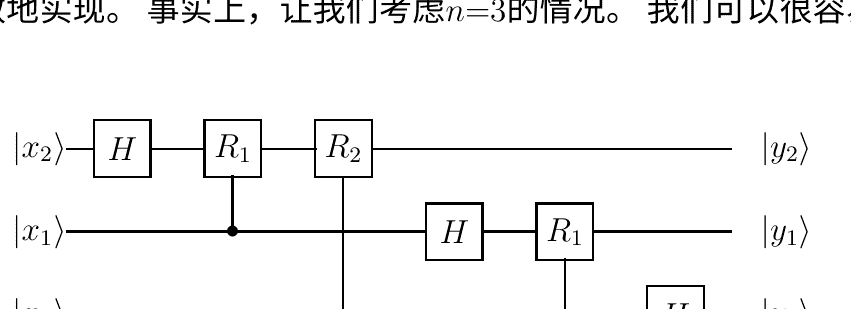

完成了任务（但请注意输出中的位顺序已被颠倒）。每个哈达玛门作用如下

$$H : |x_k\rangle \rightarrow \frac{1}{\sqrt{2}}\left(|0\rangle + e^{2\pi i.(x_k)}|1\rangle\right). \quad (6.221)$$

在第 $k$ 个量子比特中，其他对 $|0\rangle$ 和 $|1\rangle$ 的相对相位的贡献由两比特条件旋转提供，其中

$$R_d = \begin{pmatrix} 1 & 0 \\ 0 & e^{i\pi/2^d} \end{pmatrix}, \quad (6.222)$$

并且 $d = (k-j)$ 是量子比特之间的“距离”。

在情况 $n=3$ 下，QFT由三个 $H$ 门和三个控制-$R$门构成。对于一般的 $n$，这个电路的明显推广需要 $n$ 个 $H$ 门和 $\binom{n}{2} = \frac{1}{2}n(n-1)$ 个控制 $R$ 门。每对量子比特应用一个两比特门，再次具有相对相位 $\pi/2^d$，其中 $d$ 是量子比特之间的“距离”。因此，实现QFT的电路族的规模是 $(\log N)^2$ 的阶。

如果我们愿意接受固定精度的实现，我们可以将电路复杂度降低到对数 $N$ 的线性级别，因为作用在相距较远的量子比特上的两比特门只会产生指数级小的相位。如果我们去掉作用在距离大于 $m$ 的比特对上的门，则方程 (6.217) 中的每一项都会被 $m$ 位精度的近似替代；$xy/2^n$ 的总误差肯定不会超过 $n2^{-m}$，因此我们可以通过 $m \geq \log n/\varepsilon$ 来实现 $\varepsilon$ 精度的 $xy/2^n$。如果我们只保留作用在距离不大于 $m$ 的比特对上的门，则电路规模为 $mn \sim n \log n/\varepsilon$。

实际上，如果我们在实施QFT（或其逆）之后立即在计算基底进行测量，进一步简化是可能的——不需要任何两比特门！我们首先注意到，控制-$R_d$门对两个比特对称地起作用——它在 $|00\rangle$、$|01\rangle$ 和 $|10\rangle$ 上起作用，而在 $|11\rangle$ 上修改相位为 $e^{i\theta_d}$。因此，我们可以交换“控制”和“目标”位而不改变门。

通过这个改变，我们的3比特QFT电路可以重新绘制为：

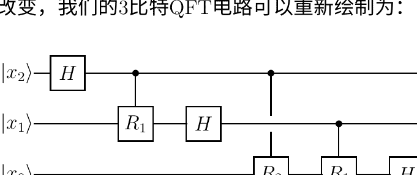

一旦我们测量了 $|y_0\rangle$，我们就知道在作用于前两个比特的控制-$R_1$门中控制位的值。因此，如果我们不是先应用控制-$R_1$ 然后测量，而是先测量 $y_0$，然后根据第一个比特的测量结果在下一个比特上应用 $(R_1)^{y_0}$，我们将获得相同的测量结果的概率分布。类似地，我们可以用单比特旋转替换作用于第三比特的控制-$R_1$ 和控制-$R_2$ 门。

$$ (R_2)^{y_0}(R_1)^{y_1}, \qquad (6.223) $$

（也就是说，在测量了 $y_1$ 和 $y_0$ 之后，进行了一个相对相位为 $\pi/2$ 和 $\pi/4$ 的旋转。）

总之，如果我们在执行QFT之后进行测量，只需要使用Hadamard门和 $O(n)$ 个单比特旋转来实现它。QFT非常简单！

## 6.10 分解

### 6.10.1 分解作为周期性发现

分解问题（找到一个大的复合正整数的质因数）与周期性有什么关系？这是一个众所周知的问题。（随机化）将分解问题归约为确定函数周期的问题。尽管这种归约与量子计算没有直接关系，但为了完整起见，以及使用量子计算机作为分解引擎的前景引起了如此多的兴奋，我们将在这里讨论它。

假设我们想要找到一个 $n$ 位数 $N$ 的因子。选择伪随机数 $a < N$，并计算最大公约数 $\gcd(a, N)$，可以使用欧几里得算法高效地完成（时间复杂度为 $O((\log N)^3)$）。如果 $\gcd(a, N) > 1$，则 $\gcd$ 是 $N$ 的一个非平凡因子，我们完成了。所以假设 $\gcd(a, N) = 1$。

> **附注：欧几里得算法。** 计算 $\gcd(N_1, N_2)$（对于 $N_1 > N_2$），首先将 $N_1$ 除以 $N_2$ 得到余数 $R_1$。然后将 $N_2$ 除以 $R_1$，得到余数 $R_2$。依此类推，将 $R_1$ 除以 $R_2$，等等。直到余数为 0。最后一个非零余数为 $R = \gcd(N_1, N_2)$。要看算法为什么有效，只需注意（1）$R$ 能够整除所有之前的余数，因此也能整除 $N_1$ 和 $N_2$，以及（2）任何能够整除 $N_1$ 和 $N_2$ 的数也能整除所有余数，包括 $R$。能够整除 $N_1$ 和 $N_2$ 的任何数整除的数必定是 $\gcd(N_1, N_2)$。要了解欧几里得算法需要多长时间，注意到
$$R_j = qR_{j+1} + R_{j+2}, \tag{6.224}$$
其中 $q \geq 1$，且 $R_{j+2} < R_{j+1}$；因此 $R_{j+2} < \frac{1}{2} R_j$。- 两个除法将余数至少减少一半，因此最多需要 $2 \log N_1$ 个除法，每个除法使用 $O((\log N)^2)$ 个基本操作；总操作数为 $O((\log N)^3)$。

与 $N$ 互质的小于 $N$ 的数 $a$（与 $N$ 没有公因数）在模 $N$ 下形成一个有限群。[为什么？我们需要证明每个元素 $a$ 都有一个逆元。但对于给定的与 $N$ 互质的 $a$，每个 $ab \pmod{N}$ 都是不同的，因为 $b$ 范围在所有小于 $N$ 且与 $N$ 互质的 $b$ 上。$^{16}$ 因此，对于某个 $b$，我们必须有 $ab \equiv 1 \pmod{N}$；因此 $a$ 的逆元存在。]这个有限群的每个元素 $a$ 都有一个有限阶 $r$，即最小的正整数，使得

$$ a^r \equiv 1 \pmod{N}. \quad (6.225) $$

如果 $N$ 能整除 $a^b - a^{b'}$，则它必定能整除 $b - b'$。

## a mod N的阶是函数的周期

$$ f_{N,a}(x) = a^{x} \pmod{N}. $$ (6.226)

我们知道存在一种高效的量子算法可以找到函数的周期；因此，如果我们能高效地计算 $f_{N,a}$，我们就能高效地找到 $a$的阶。

计算 $f_{N,a}$可能一开始看起来很困难，因为指数 $x$可能非常大。但是如果 $x < 2^{m}$并且我们将 $x$表示为二进制展开式

$$ x = x_{m-1} \cdot 2^{m-1} + x_{m-2} \cdot 2^{m-2} + \ldots + x_{0}, $$ (6.227)

我们有

$$ (a)^{x_{0}}\pmod{N}. $$ (6.228)

每个 $a^{2^{j}}$都有一个很大的指数，但可以通过一个经典的计算机高效地计算出来，使用重复平方

$$ a^{2^{j}} \pmod{N} = (a^{2^{j-1}})^{2} \pmod{N}. $$ (6.229)

所以只需要 $m-1$ (经典) $\mod N$次乘法来组装一个包含所有 $a^{2^{j}}$的表格。

计算 $a^{x}\pmod{N}$的过程是通过执行一个例程来完成的：

输入 1

对于 $j= 0$ 到 $m-1$，如果 $x_{j}= 1$，就乘以 $a^{2^{j}}$。

这个例程最多需要$m \mod N$次乘法运算，每次运算需要$(\log N)^{2}$次基本操作。$^{17}$由于$r < N$，如果我们选择$m\sim^{2}\log N$，那么我们有一个合理的成功提取周期的机会。

因此，计算$f_{N,a}$可以通过大小为$O((\log N)^{3})$的电路族来完成。电路的结构如下所示：

> 使用高效乘法技巧，基本操作的数量可以减少到$O(\log N \log \log N \log \log \log N)$；因此，对于大的$N$，一个大小为$O(\log^{2} N \log \log N \log \log \log N)$的电路族可以计算$f_{N,a}$。

## 6.10. 分解

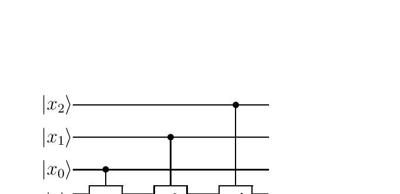

如果控制量子比特$x^j$的值为1，则执行$a^{2^j}$的乘法。
假设我们已经找到了模$N$的周期$r$。然后，如果$r$是偶数，我们有

> $$N \text{整除} \left( a^{r/2} - 1 \right) \left( a^{r/2} + 1 \right) \quad (6.230)$$

我们知道$N$不能整除$a^{r/2}$减1；如果可以，那么$a$的阶数将小于等于$r/2$。
因此，如果$N$也不能整除$a^{r/2}$加1，或者

> $$a^{r/2} \equiv -1 \pmod{N}, \quad (6.231)$$

那么$N$必定与$a^{r/2}$加1和减1有一个非平凡的公因数。因此，GCD($N$, $a^{r/2}$加1) = 1是一个因子（我们可以通过经典计算高效地找到），我们完成了。

我们可以看到，一旦我们找到了$r$，除非$r$是奇数或者$r$是偶数且$a^{r/2} \equiv -1 \pmod{N}$，否则我们成功地分解了$N$。成功的概率有多大？

假设 $N$是两个质数因子 $p_1 = p_2$的乘积

> $$N = p_1 p_2 \quad (6.232)$$

（实际上这是最不利的情况） 对于每个$a < p_1 p_2$，存在唯一的 $a_1 < p_1$和 $a_2 < p_2$，使得

> $$a \equiv a_1 \pmod{p_1}$$
$$a \equiv a_2 \pmod{p_2}. \quad (6.233)$$

因此，选择一个随机的$a < N$等同于选择一个随机的$a_1 < p_1$ 和 $a_2 < p_2$.

> [附注：我们使用了中国剩余定理。方程（6.233）的解是唯一的，因为如果 $a$和 $b$都是解，则 $p_1$和 $p_2$必须整除 $a - b$。 解存在是因为每个 $a < p_1p_2$ 都可以解方程 (6.233) 得到某个 $a_1$和 $a_2$。 由于选择 $a_1$和 $a_2$的方式有 $p_1p_2$种，选择 $a$的方式也有 $p_1p_2$种，唯一性意味着每对 $a_1$, $a_2$都有一个对应的 $a$。 现在让 $r_1$表示 $a_1$对 $p_1$取模的阶数，并让 $r_2$表示 $a_1$对 $p_2$取模的阶数。

中国剩余定理告诉我们，$a^r \equiv 1 \pmod{p_1 p_2}$ 等价于

```
$a_1^r \equiv 1 \pmod{p_1}$
$a_2^r \equiv 1 \pmod{p_2}$. (6.234)
```

因此， $r = \text{最小公倍数}(r_1, r_2)$。 如果 $r_1$和 $r_2$都是奇数，那么 $r$也是奇数，我们失败了。

但是如果 $r_1$或 $r_2$中有一个是偶数，那么 $r$也是偶数，我们仍然在游戏中。如果

```
$a^{r/2} \equiv -1 \pmod{p_1}$
$a^{r/2} \equiv -1 \pmod{p_2}$. (6.235)
```

那么我们有 $a^{r/2} \equiv -1 \pmod{p_1 p_2}$，我们仍然失败。但是如果

```
$a^{r/2} \equiv -1 \pmod{p_1}$
$a^{r/2} \equiv 1 \pmod{p_2}$, (6.236)
```

或

```
$a^{r/2} \equiv 1 \pmod{p_1}$
$a^{r/2} \equiv -1 \pmod{p_2}$, (6.237)
```

那么 $a^{r/2} \equiv -1 \pmod{p_1 p_2}$，我们赢了。 （当然， $a^{r/2} \equiv 1 \pmod{p_1}$ 和 $a^{r/2} \equiv 1 \pmod{p_2}$ 是不可能的，因为这将意味着 $a^{r/2} \equiv 1 \pmod{p_1 p_2}$，并且 $r$不能是 $a$的阶数。）

假设

```
$r_1 = 2^{c_1} \cdot \text{odd}$
$r_2 = 2^{c_2} \cdot \text{odd}$, (6.238)
```

其中 $c_1 > c_2$. 那么 $r = \text{LCM}(r_1, r_2) = 2r_2 \cdot \text{整数}$，这样 $a^{r/2} \equiv 1 \pmod{p_2}$ 并且方程 (6.236) 成立 -我们赢了！ 同样 $c_2 > c_1$ implies 方程 (6.237) - 再次我们赢了。 但是对于 $c_1 = c_2$, $r = r_1 \cdot (\text{奇数}) = r_2 \cdot (\text{奇数'})$ 这样方程 (6.235) 成立 -在这种情况下我们输了。

好的 - 这归结为：对于 c1 = c2 我们输了，对于 c1 ≠ c2 我们赢了。c1 = c2 的可能性有多大？

了解模 p 的乘法群是循环的有助于我们 - 它包含一个阶数为 p -1 的原始元素，因此所有元素都是原始元素的幂次。[为什么？模 p 的整数是一个有限域。如果群不是循环的，元素的最大阶数将小于 p -1，因此 q < p -1，这样 x^q ≡1 (mod p) 将有 p-1 个解。但这是不可能的：在有限域中，不可能有超过 q 个单位根。]

假设 p -1 = 2^k · s，其中 s 是奇数，并考虑阶数为 p -1 的循环群的所有元素。为简洁起见，我们只讨论 k=1 的情况，这对我们来说是最不利的情况。然后，如果 b 是一个原始（阶数为 2s）元素，则 b 的偶次幂具有奇数阶，b 的奇次幂具有 2·(奇数) 的阶。在这种情况下，r = 2^c·(奇数)，其中 c ∈ {0,1}，每个出现的概率相等。因此，如果 p1 和 p2 都是这种（不利的）类型，并且 a1, a2 是随机选择的，则 c1 = c2 的概率是 1/2。因此，一旦我们找到了 r，我们成功找到一个因子的概率至少为 1/2。

+   - 2/3，如果 N 是两个不同的质数的乘积。如果 N 有两个不同的质因数，我们的胜算会更大。如果 N 是一个质数的幂，该方法将失败，N = p^α，但是质数的幂可以通过其他方法高效地分解。

## 6.10.2 RSA

有人在乎分解是容易还是困难吗？嗯，是的，有些人在乎。

分解的预期困难程度是广泛使用的 RSA^18 公钥密码方案的安全基础，如果你曾经在互联网上发送过信用卡号码，可能已经使用过该方案。

公钥密码学的思想是避免在通信双方之间交换秘密密钥（可能被截获和复制）。加密密钥是公开的。但是使用加密密钥推断解密密钥涉及到一个难以计算的过程。因此，鲍勃可以将加密密钥发送给艾丽斯和其他所有人，但只有鲍勃才能解码艾丽斯（或其他任何人）使用该密钥编码的消息。编码是一个“单向函数”，易于计算但非常难以反转。

（当然，如果艾丽斯和鲍勃在之前的秘密会面中决定使用一个私钥，他们本可以避免交换公钥的需要。例如，他们可以约定使用一个长的随机字符串作为一次性密码本来进行编码和解码。但也许艾丽斯和鲍勃从未预料到他们将来会需要进行私密通信。

或者也许他们事先确实同意使用一次性密码本，但他们现在已经用完了他们的私钥，并且他们不愿意重复使用它，因为担心窃听者可能会破解他们的代码。现在他们相距太远，无法安全地交换新的私钥；公钥密码学似乎是他们最安全的选择。）

为了构建公钥，鲍勃选择两个大素数 $p$ 和 $q$。但他不公开它们的值。相反，他计算出乘积

$N = pq$。   (6.239)

由于鲍勃知道 $N$ 的质因数分解，他也知道欧拉函数 $\varphi(N)$ 的值——小于 $N$ 且与 $N$ 互质的数的数量。对于两个质数的乘积，有

$\varphi(N) = N - p - q + 1 = (p-1)(q-1)$，   (6.240)

（只有 $p$ 和 $q$ 的倍数与 $N$ 有公因数）。如果你知道 $N$ 的质因数分解，找到 $\varphi(N)$ 很容易，但如果你只知道 $N$，那就很难了。然后鲍勃伪随机选择一个与 $\varphi(N)$ 互质的 $e$。

他向爱丽丝（和其他听众）透露了 $N$ 和 $e$ 的值，但没有透露其他信息。

爱丽丝将她的消息转换为ASCII码，一个数字 $a < N$。她通过计算来编码消息

$b = f(a) = a^e \pmod{N}$，   (6.241)

她可以通过重复平方快速完成。鲍勃如何解码消息？

假设 $a$ 与 $N$ 互质（如果 $p$ 和 $q$ 非常大，这是极有可能的 - 无论如何，爱丽丝在编码之前可以检查）。那么

$a^{\varphi(N)} \equiv 1 \pmod{N}$   (6.242)

（欧拉定理）。这是因为小于 $N$ 且与 $N$ 互质的数形成了一个（模 $N$ 乘法下的 $\varphi(N)$ 阶）群。

任何群元素必须整除群的阶数（幂次的一个子群）。由于GCD（e, φ(N)）= 1，我们知道 e 有一个乘法逆元 d = e^{-1} mod φ(N) ：

```
$$ed \equiv 1 \pmod{\varphi(N)}. \tag{6.243}$$
```

）d的值是Bob密切保密的秘密；他用它来通过计算解码：

```
$$f^{-1}(b) = b^d \pmod{N}$$
$$= a^{ed} \pmod{N}$$
$$= a \cdot (a^{\varphi(N)})^{\text{integer}} \pmod{N}$$
$$= a \pmod{N}. \tag{6.244}$$
```

> [旁白：Bob如何计算d= e^{-1}? 乘法逆元是执行欧几里得算法计算GCD(e, φ(N))=1的副产品。从底部向上追踪余数链，从R_n = 1开始：

```
$$1 = R_n = R_{n-2} - q_{n-1}R_{n-1}$$
$$R_{n-1} = R_{n-3} - q_{n-2}R_{n-2}$$
$$R_{n-2} = R_{n-4} - q_{n-3}R_{n-3}$$
$$\text{等等...} \tag{6.245}$$
```

（其中 q_j 是商数），因此

```
$$1 = (1 + q_{n-1}q_{n-2})R_{n-2} - q_{n-1}R_{n-3}$$
$$1 = (-q_{n-1} - q_{n-3}(1 + q_{n-1}q_{n-2}))R_{n-3}$$
$$+ (1 + q_{n-1}q_{n-2})R_{n-4},$$
$$\text{等等...} \tag{6.246}$$
```

）继续下去，我们可以将1表示为任意两个连续余数的线性组合；最终我们得到1 = d·e + q·φ(N),

$$\tag{6.247}$$

并将d识别为e^{-1}(modφ(N))。]

当然，如果伊夫拥有超快的因式分解引擎，RSA方案就不安全了。 她分解$N$，找到$\varphi(N)$，并快速计算$d$。 实际上，她并不真正需要分解$N$；计算编码消息$a^e(\bmod N)$的模$N$的阶数就足够了。 由于$e$与$\varphi(N)$互质，$a^e(\bmod N)$的阶数与$a$的阶数相同（两个元素生成相同的轨道或循环子群）。 一旦知道了阶数$\mathrm{Ord}(a)$，伊夫计算出满足以下条件的$\tilde{d}$：

$$\tilde{d}e \equiv 1 \pmod{\mathrm{Ord}(a)} \quad\quad (6.248)$$

以便

$$(a^e)^{\tilde{d}} \equiv a \cdot (a^{\mathrm{Ord}(a)})^{\text{整数}}(\bmod N) \equiv a (\bmod N), \quad\quad (6.249)$$

而且伊芙可以解密这条消息。 如果我们唯一关心的是打败RSA，我们运行Shor算法找到$r=\mathrm{Ord}(a^e)$，我们不需要担心我们是否可以使用$r$来提取$N$的因子。

这样的量子计算机在密码学应用中有多重要？ 当快速量子计算机容易获得时，相关方可以停止使用RSA，或者使用更长的密钥来超越当代技术。 然而，有秘密的人有时希望他们的消息保密一段时间（30年？）。 如果他们对未来技术进步的速度不太有信心，他们可能不会满意更长的密钥。

如果他们避开RSA，他们会使用什么替代品？ 已知的适合的单向函数并不多，而且除了RSA之外，其他函数也可能容易受到量子攻击。 所以确实有很多利害关系。 如果快速大规模的量子计算机可用，密码学的影响可能会产生深远的影响。

但是虽然量子理论带走了一些东西，量子计算机也给予了一些东西；量子计算机可能会破坏公钥方案，但也提供了一种替代方案：安全的量子密钥分发，如第4章所讨论的。

## 6.11 相位估计

有一种替代的观点可以看待因子分解算法（由Kitaev提出），这加深了我们对其工作原理的理解：我们之所以能够进行因子分解，是因为我们能够高效准确地测量某个酉算符的特征值。

考虑一个与N互质的a，让x取值在{0,1,2,...,N-1}之间，并且让U_a表示酉算符

$U_a : |x\rangle \rightarrow |ax \pmod N\rangle$. \qquad (6.250)

这个算符是酉的（计算基的排列）因为模N的乘法是可逆的。

如果 N的模 a的次序是 r，那么

$U_a = 1$. \qquad (6.251)

由此可知， U_a的所有特征值都是 r次单位根：

$\lambda_k = e^{2\pi i k / r}, \quad k \in \{0,1,2,\ldots, r-1\}$. \qquad (6.252)

相应的特征态是

$|\lambda_k\rangle = \frac{1}{\sqrt{r}} \sum_{j=0}^{r-1} e^{-2\pi i k j / r} |a^j x_0 \pmod N\rangle$; \qquad (6.253)

与由 a乘法生成的长度为 r的每个轨道相关联，存在 r个相互正交的特征态

U_a不是厄米算符，但它的相位（生成U_a的厄米算符）是一个可观测量

假设我们可以进行一次测量，投影到 U_a特征态的基底上，并从可能的特征值中等概率选择一个值 λ_k。 因此，测量确定了 k/r的值，就像Shor的算法一样，我们可以以相当高的成功概率来分解 N。 但是我们如何测量一个酉算符的特征值？

假设我们可以在控制位上执行单量子门 U，并考虑电路：


这里 |λ⟩ 表示 U 的本征态，其本征值为 λ (U|λ⟩ = λ|λ⟩)。然后，电路对控制位的作用是

```
|0\rangle \rightarrow \frac{1}{\sqrt{2}}(|0\rangle + |1\rangle) \rightarrow \frac{1}{\sqrt{2}}(|0\rangle + \lambda|1\rangle) \\ \rightarrow \frac{1}{2}(1 + \lambda)|0\rangle + \frac{1}{2}(1 - \lambda)|1\rangle.
```

然后，对控制量子位的测量结果具有概率分布

```
\text{概率}(0) = \left| \frac{1}{2}(1 + \lambda) \right|^2 = \cos^2(\pi\phi) \\ \text{概率}(1) = \left| \frac{1}{2}(1 - \lambda) \right|^2 = \sin^2(\pi\phi),
```

其中 λ = e^{2πiφ}。

正如我们之前讨论过的（例如在与德沃茨基问题相关的讨论中），这个过程可以确定地区分本征值 λ=1 (φ=0) 和 λ=-1 (φ=1/2)。但是，其他可能的 λ 值也可以区分，尽管统计置信度较低。例如，假设 U 作用的状态是 U 的本征态的叠加态

```
\alpha_1|\lambda_1\rangle + \alpha_2|\lambda_2\rangle.
```

)假设我们执行上述电路 n 次，每次使用 n 个不同的控制位。因此，我们准备好了状态

```
\alpha_1|\lambda_1\rangle \left( \frac{1 + \lambda_1}{2}|0\rangle + \frac{1 - \lambda_1}{2}|1\rangle \right)^{\otimes n} + \alpha_2|\lambda_2\rangle \left( \frac{1 + \lambda_2}{2}|0\rangle + \frac{1 - \lambda_2}{2}|1\rangle \right)^{\otimes n}.
```

如果 λ1 = λ2，对于大的 n，两个控制位的重叠非常小-通过测量控制位，我们可以对 {|λ1⟩, |λ2⟩} 基进行正交投影，至少可以得到很好的近似。

如果我们使用足够多的控制位，我们有足够大的样本来测量 Prob (0)= 1/2(1 + cos 2πφ)以合理的统计置信度。通过执行控制-(iU)，我们还可以测量 1/2(1 + sin 2πφ)足以确定 φ 模一个整数。

## 6.11. 相位估计

然而，在因式分解算法中，我们需要以指数精度测量 \(e^{2\pi i k/r}\) 的相位，这似乎需要指数数量的试验。假设我们可以高效地计算 \(U\) 的高次幂（如 \(U_a\)）
\[ U^{2j}. \tag{6.258} \]
通过将上述过程应用于 \(U^{2j}\) 的测量，我们确定
\[ \exp(2\pi i 2^j \phi), \tag{6.259} \]
其中 \(e^{2\pi i\phi}\) 是 \(U\) 的特征值。因此，将 \(U^{2j}\) 测量到一位精度等同于测量 \(U\) 的特征值的第 \(j\) 位。我们可以使用这个相位估计过程进行阶次查找，从而进行因式分解。我们反转方程 (6.253) 以获得
\[ |x_0\rangle = \frac{1}{\sqrt{r}} \sum_{k=0}^{r-1} |\lambda_k\rangle; \tag{6.260} \]
每个计算基态（对于 \(x_0= 0\)）都是 \(U_a\) 的等权重叠加态。

测量本征值，我们得到 \(\lambda_k = e^{2\pi i k/r}\)，其中 \(k\) 从 \(\{0, 1, ..., r-1\}\) 中等概率选择。如果 \(r < 2^n\)，我们测量 2n 位精度以确定 \(k/r\)。原则上，我们可以在存储比计算 QFT 所需的量子比特更少的计算机中执行此过程，因为我们可以一次攻击 \(k/r\) 的一个比特。

但是，想象一下将 QFT 纳入到这个相位估计过程中是很有启发性的。假设电路作用于幺正变换 \(U\) 的本征态 \(|\lambda\rangle\)。但更高效的方法是注意到电路准备的状态是

- 条件 \(U\) 准备 \(\frac{1}{\sqrt{2}}(|0\rangle + \lambda|1\rangle)\)，
- 条件 \(U^2\) 准备 \(\frac{1}{\sqrt{2}}(|0\rangle + \lambda^2|1\rangle)\)，
- 条件 \(U^4\) 准备 \(\frac{1}{\sqrt{2}}(|0\rangle + \lambda^4|1\rangle)\)，等等。

我们可以对每个量子比特执行哈达玛变换并测量，以采样由 \(\phi\) 的第 \(j\) 位控制的概率分布，其中 \(\lambda = e^{2\pi i\phi}\)。
\[ \frac{1}{\sqrt{2^m}} \sum_{y=0}^{2^{m}-1} e^{2\pi i\phi y} |y\rangle \qquad (6.261) \]

在测量之前，学习 \(\phi\) 的更好方法是执行QFT\(^{(m)}\)，而不是哈达玛变换 \(H^{(m)}\)。

为了清晰起见，考虑 \(m= 3\) 的情况，准备并进行Fourier分析状态的电路
\[ \frac{1}{\sqrt{8}} \sum_{y=0}^{7} e^{2\pi i\phi y}|y\rangle \qquad (6.262) \]
是这个电路几乎完全执行了我们上面概述的相位估计策略，但有一个重要的修改。在执行最终的Hadamard变换和测量 \(\tilde{y}_1\) 和 \(\tilde{y}_2\) 之前，进行了一些条件相位旋转。正是这些相位旋转区分了QFT\(^{(3)}\)和Hadamard变换 \(H^{(3)}\)，并且它们极大地增强了我们提取 \(\phi\)值的可靠性。

如果我们假设 \(\phi=tk/8\)，其中 \(k \in \{0,1,2,...,7\}\)，我们可以更好地理解条件旋转的作用；在这种情况下，我们知道傅里叶变换将以概率1生成输出 \(\tilde{y} = k\)。我们可以将 \(k\) 表示为二进制展开式
\[ k = k_2 \cdot 4 + k_1 \cdot 2 + k_0 \qquad (6.263) \]

## 6.12. 离散对数

实际上，傅里叶变换的最低有效位 \(\tilde{y}_0\) 的电路正是应用于幺正 \(U^4\) 的Kitaev测量电路，其特征值为
\[ (e^{2\pi i\phi})^4 = e^{i\pi k} = e^{i\pi k_0} = \pm 1 \quad (6.264) \]
测量电路完美地区分特征值 \(\pm 1\)，因此 \(\tilde{y}_0 = k_0\)。

下一位的电路 \(\tilde{y}_1\) 几乎是用于 \(U^2\) 的测量电路，其特征值为
\[ (e^{2\pi i\phi})^2 = e^{i\pi k/2} = e^{i\pi(k_1\cdot k_0)} \quad (6.265) \]
除了插入了条件相位旋转，将相位乘以 \(exp[i\pi(\cdot k_0)]\)，得到 \(e^{i\pi k_1}\)。再次应用Hadamard变换然后进行测量，我们确定地得到结果 \(\tilde{y}_1 = k_1\)。

类似地，\(\tilde{y}_2\) 的电路测量特征值
\[ e^{2\pi i\phi} = e^{i\pi k/4} = e^{i\pi(k_2\cdot k_1k_0)} \quad (6.266) \]
除了条件旋转会移除 \(e^{i\pi(\cdot k_1k_0)}\)，所以结果是 \(\tilde{y}_2=k_2\) 的确定性。

因此，QFT以最大的巧妙性实现了相位估计例程。我们首先测量 \(\phi\) 的较不显著位，并利用测量获得的信息来提高对较显著位的可靠性估计。记住这个解释，你会发现记住QFT电路很容易！

### 6.12 离散对数

抱歉，我没有时间做这个。

### 6.13 量子系统的模拟

同上。

## 6.14 总结

**经典电路。** 问题的复杂性可以通过解决问题的一组统一逻辑电路的大小来表征：如果电路的大小是输入大小的超多项式函数，则问题很难。一个经典通用计算机可以高效地模拟另一个计算机，因此复杂性的分类是与机器无关的。3比特Toffoli门对于经典可逆计算是通用的。可逆计算机可以在没有显著减速和不合理的内存资源的情况下模拟不可逆计算机。

**量子电路。** 虽然没有证据，但很可能多项式大小的量子电路不能被多项式大小的概率经典电路模拟（\(BQP = BPP\)）；然而，多项式空间是足够的（\(BQP \subseteq PSPACE\)）。如果每个量子门的准确度为 \(1/T\)，那么一个有噪声的量子电路可以以可接受的精度模拟大小为 \(T\) 的理想量子电路。一个通用的量子计算机可以高效地模拟另一个，因此复杂度类 \(BQP\) 是机器无关的。

如果一个通用的两比特量子门可以作用于设备中的任意两个比特，那么它就足够进行通用量子计算。一个控制非门加上一个通用的单比特门也是足够的。

**快速量子搜索。** 在一个未排序的包含 \(N\) 个项目的数据库中，量子计算机可以在时间复杂度为 \(\sqrt{N}\) 内完成搜索，但没有更快。对于一些结构化搜索问题，可以实现二次量子加速，但一些预言机问题没有显著的量子加速。两个各自拥有 \(N\) 个条目的方，可以通过交换 \(O(N)\) 个量子比特，在表之间找到“碰撞”，这似乎违背了霍列沃界限的精神（但不违背其字面意义）。\(\sqrt{N})\) 个量子比特，表面上违背了霍列沃界限的精神（但不违背其字面意义）。

**周期查找。** 利用量子并行性，在 \(N\) 维空间中，量子傅里叶变换可以在 \((\log N)^2\) 的时间内计算（与经典快速傅里叶变换的时间 \(N\log N\) 相比）；如果我们紧接着进行测量，一个量子比特门就足以计算QFT。因此，量子计算机可以高效地解决具有周期结构的某些问题，如因子分解和离散对数问题。

## 6.15. 练习

### 6.1 托菲利门的线性模拟。

在课堂上，我们从3位托菲利门（\(\theta^{(3)}\)）构建了一个 \(\theta(n)\) 的 \(n\) 位托菲利门（\(\theta(n)\)）。该电路只需要一个比特的临时空间，但门的数量随着 \(n\) 的指数增长。通过使用更多的临时空间，我们可以大大减少门的数量。

- a) 找到一个电路族，其中包含 \(2n - 5\) 个 \(\theta^{(3)}\)，用于计算 \(\theta^{(n)}\)。（这里使用了3个临时比特，开始时设置为0，在计算结束时返回到0。）
- b) 找到一个电路族，其中包含 \(4n - 12\) 个 \(\theta^{(3)}\)，用于计算 \(\theta^{(n)}\)，无论临时比特的初始值如何。（再次，\(n - 3\) 个临时比特返回到初始值，但它们不需要在开始时设置为零。）

### 6.2 一个通用的量子门集合。

这个练习的目的是完成演示，证明控制非门和任意一比特门构成一个通用集合。

- a) 如果 \(U\) 是任意行列式为1的 \(2\times 2\) 的酉矩阵，找到酉矩阵 \(A\), \(B\), 和 \(C\)，使得
\[ ABC = 1 \tag{6.267} \]
\[ A\sigma_x B\sigma_x C = U. \tag{6.268} \]
提示: 从欧拉角构造中，我们知道
\[ U = R_z(\psi)R_y(\theta)R_z(\phi), \tag{6.269} \]
其中，例如，\(R_z(\phi)\) 表示绕 \(z\) 轴旋转角度 \(\phi\)。
我们还知道，例如，
\[ \sigma_x R_z(\phi) \sigma_x = R_z(-\phi). \tag{6.270} \]

- b) 考虑一个两比特的控制相位门：如果第一个比特为 \(|1\rangle\)，则将 \(U = e^{i\alpha}I\) 应用于第二个比特，否则不做任何操作。
证明它实际上是一个一比特门

- c) 使用控制非门和单比特门绘制一个电路，实现控制-\(U\)，其中 \(U\) 是任意的 \(2\times 2\) 幺正变换。

### 6.3 精度

这个练习的目的是将量子态的准确性与相应的概率分布的准确性联系起来。

- a) 让 \(\| A \|_{\text{sup}}\) 表示操作符 \(A\) 的上确界范数，并且
\[ \| A \|_{\text{tr}} = \text{tr} \left[ (A^{\dagger} A)^{1/2} \right], \tag{6.271} \]
表示其迹范数。证明
\[ \| AB \|_{\text{tr}} \leq \| B \|_{\text{sup}} \cdot \| A \|_{\text{tr}} \quad \text{和} \quad |\text{tr} A| \leq \| A \|_{\text{tr}}. \tag{6.272} \]

- b) 假设 \(\rho\) 和 \(\tilde{\rho}\) 是两个密度矩阵， \(\{ |a\rangle \}\) 是一个完备或正交基，因此 \(P_a = \langle a| \rho |a\rangle\)，
\[ \tilde{P}_a = \langle a| \tilde{\rho} |a\rangle, \tag{6.273} \]
是相应的概率分布。使用(a)来证明
\[ \sum_a |P_a - \tilde{P}_a| \leq \| \rho - \tilde{\rho} \|_{\text{tr}}. \tag{6.274} \]

- c) 假设 \(\rho = |\psi\rangle\langle\psi|\) 和 \(\tilde{\rho} = |\tilde{\psi}\rangle\langle\tilde{\psi}|\) 是纯态。使用(b)来证明
\[ \sum_a |P_a - \tilde{P}_a| \leq 2 \| |\psi\rangle - |\tilde{\psi}\rangle \|. \tag{6.275} \]

### 6.4 连续时间数据库搜索

具有 \(n\) 比特希尔伯特空间的量子系统具有哈密顿量 \(H_{\omega} = E|\omega\rangle\langle\omega|,\) \tag{6.276}
其中 \(| \omega \rangle\) 是一个未知的计算基态。你需要通过以下步骤来找到 \(\omega\) 的值。打开一个与时间无关的扰动 \(H'\)，使得总哈密顿量变为
\[ H = H_{\omega} + H' \quad (6.277) \]
准备一个初始态 \(|\psi_0\rangle\)，并允许该态根据 H 的演化，在时间 T 内进行测量。根据测量结果，你需要推断出 \(\omega\) 的值。

- a) 假设初始态选择为
\[ | s \rangle = \frac{1}{2^{n/2}} \sum_{x=0}^{2^n - 1} | x \rangle, \quad (6.278) \]
而扰动为
\[ H' = E | s \rangle \langle s |. \quad (6.279) \]
解时间无关的薛定谔方程
\[ i \frac{d}{dt} | \psi \rangle = H | \psi \rangle \quad (6.280) \]
找到时间为 T 的状态。如何选择 T 以优化成功确定 \(\omega\) 的可能性？

- b) 现在假设我们可以任意选择 \(|\psi_0\rangle\) 和 \(H'\)，但是我们要求在时间 T 之后系统的状态是 \(|\omega\rangle\)，以便测量以概率一成功确定 \(\omega\)。推导出 T 必须满足的下界，并与(a)中的结果进行比较。（提示：与课堂上的分析类似，比较由 H 和 \(H'\)（“空谜题”情况）控制的演化，并使用薛定谔方程来限制根据 H 演化的状态与根据 \(H'\) 演化的状态之间的快速偏离。）

## 第7章
## 量子纠错

### 7.1. 量子纠错码

在我们对量子算法的研究中，我们找到了有说服力的证据，表明量子计算机将具有非凡的能力。 但是量子计算机真的能够工作吗？ 我们是否能够建造和操作它们？

为了做到这一点，我们必须应对保护量子信息免受错误的挑战。 正如我们在第一章中已经指出的那样，这个挑战有几个方面。 量子计算机将不可避免地与其周围环境发生相互作用，导致相干衰减和存储在设备中的量子信息的衰变。除非我们能够成功地对抗相干衰减，否则我们的计算机肯定会失败。 即使我们能够通过完全隔离计算机与环境的方式来防止相干衰减，错误仍然会带来严重的困难。 量子门（与经典门相比）是从可能的连续值中选择的幺正变换。 因此，量子门无法实现完全准确；门中的小缺陷效应将累积，最终导致计算的严重失败。 任何有效的策略来防止量子计算机中的错误都必须防范量子电路中的小幺正错误以及相干衰减。

在本章和下一章中，我们将看到如何通过巧妙编码量子信息来保护免受错误的影响（原则上）。 本章将介绍量子纠错码的理论。 我们将了解到，适当编码的量子信息可以存储在量子存储器中，在嘈杂的环境中暴露，并在不受损的情况下恢复。

（如果噪声不太严重）不会受到损坏。然后在第8章中，我们将以两种重要的方式扩展理论。我们将看到即使在恢复过程中偶尔发生错误，恢复过程仍然可以有效进行。我们将学习如何处理编码信息，以便在退相干和故障的量子门的严重影响下成功执行量子计算。

量子纠错码（QECC）可以看作是将k个量子比特（2^k维的希尔伯特空间）映射到n个量子比特（2^n维的希尔伯特空间），其中n > k。这k个量子比特是我们希望保护免受错误影响的“逻辑比特”或“编码比特”。额外的n-k个比特允许我们以冗余的方式存储这k个逻辑比特，以防编码信息受到损坏。

通过回顾第一章中引入的一个例子，Shor的代码，其中n = 9和k = 1，我们可以更好地理解QECC的概念。我们可以通过指定代码子空间的两个基态来描述该代码；我们将这些基态称为|\bar{0}\rangle，即“逻辑零”和|\bar{1}\rangle，即“逻辑一”。它们是
\[ |\bar{0}\rangle = \left[\frac{1}{\sqrt{2}}(|000\rangle + |111\rangle)\right]^{\otimes 3}, \]
\[ |\bar{1}\rangle = \left[\frac{1}{\sqrt{2}}(|000\rangle - |111\rangle)\right]^{\otimes 3}; \tag{7.1} \]
每个基态都是一个由三个量子比特组成的猫态，重复三次。正如您在第4章中对猫态的讨论中所回忆的那样，这两个基态可以通过3比特可观测量 \(\sigma_x^{(1)} \otimes \sigma_x^{(2)} \otimes \sigma_x^{(3)}\)（其中 \(\sigma_x^{(i)}\) 表示作用在第i个量子比特上的Pauli矩阵 \(\sigma_x\)）来区分；我们将使用符号 \(X_1X_2X_3\) 表示这个算符。（在这个符号中，省略了作用在其余量子比特上的隐含算符 \(I\otimes I\otimes \cdots \otimes I\)。）态 \(|\bar{0}\rangle\) 和 \(|\bar{1}\rangle\) 是 \(X_1X_2X_3\) 的本征态，其本征值分别为+1和 -1。但是，通过观察九个量子比特中的任意一个或两个，无法区分 \(|\bar{0}\rangle\) 和 \(|\bar{1}\rangle\)（无法获取有关逻辑量子比特值的任何信息）。从这个意义上说，逻辑量子比特是非局部编码的；它是通过量子比特块中的纠缠性质来表示的。编码信息的这种非局部性质可以提供对噪声的保护，如果我们假设噪声是局部的（即它在量子比特块中的不同比特上独立地或几乎独立地作用）。假设一个未知的量子态已经被准备并编码为 \(a|\bar{0}\rangle + b|\bar{1}\rangle\)。现在发生了一个错误；我们需要诊断错误并进行反转。

它。我们如何继续？ 让我们假设，首先，一个比特翻转发生在前三个量子比特之一上。 然后，如第一章所讨论的，可以通过测量两比特算符来确定比特翻转的位置
\[ Z_1Z_2, \quad Z_2Z_3. \]
逻辑基态 \(|\bar{0}\rangle\) 和 \(|\bar{1}\rangle\) 是这些算符的本征态，其本征值为1。 但是翻转任何一个三比特会改变这些本征值。

例如，如果 \(Z_1Z_2 = -1\) 和 \(Z_2Z_3 = 1\)，那么我们推断第一个比特相对于其他两个比特翻转了。我们可以通过翻转该比特来恢复错误。

我们的测量诊断位翻转的关键是同时对两个量子比特进行集体测量——我们可以得到 \(Z_1Z_2\)的值，但不能得到 \(Z_1\)和 \(Z_2\)的分离值，因为这样做会破坏编码状态。 如何进行这样的集体测量呢？ 实际上，如果我们拥有可以执行控制非门的量子计算机，我们就可以进行集体测量。 我们首先引入一个额外的“辅助”量子比特，将其准备在状态 \(|0\rangle\)，然后执行量子电路最后测量辅助量子比特。 如果量子比特1和2处于 \(Z_1Z_2 = -1\)的状态（即 \(|0\rangle_1|1\rangle_2\) 或 \(|1\rangle_1|0\rangle_2\)），那么辅助量子比特将翻转一次，测量结果将为 \(|1\rangle\)。 但是，如果量子比特1和2处于 \(Z_1Z_2= 1\)的状态（即 \(|0\rangle_1|0\rangle_2\) 或 \(|1\rangle_1|1\rangle_2\)），那么辅助量子比特将翻转两次或不翻转，测量结果将为 \(|0\rangle\)。

同样地，这两个量子比特的操作符
\[ Z_4Z_5, \quad Z_7Z_8, \]
\[ Z_5Z_6, \quad Z_8Z_9, \]
可以通过测量来诊断其他两个三比特簇中的位翻转错误。

一个三比特编码足以保护免受单个位翻转的影响。 重复三次3比特簇的原因是为了保护免受## 第7章 量子纠错

相位误差也是如此。现在假设一个相位误差
$$|\psi\rangle \rightarrow \mathbf{Z}|\psi\rangle \quad (7.4)$$
作用于九个量子比特之一时发生。我们可以通过测量两个六比特可观测量来诊断相位误差发生在哪个簇中。
$$X_1 X_2 X_3 X_4 X_5 X_6, \quad X_4 X_5 X_6 X_7 X_8 X_9 \quad (7.5)$$
逻辑基础态 $|0\rangle$ 和 $|1\rangle$ 都是具有本征值为一的这些可观测量的本征态。在特定的簇中，对任何一个量子比特施加相位误差都会改变该簇中 $X X X$ 的值相对于其他两个量子比特的值；通过测量方程 (7.5) 中的可观测量，可以确定变化的位置。一旦确定了受影响的簇，我们可以通过在该簇中的一个量子比特上施加 Z 来纠正错误。

我们如何测量六比特可观测量 $X_1 X_2 X_3 X_4 X_5 X_6$？注意，如果控制比特的初始状态为 $\frac{1}{\sqrt{2}}(|0\rangle + |1\rangle)$，并且目标比特是 X (即，NOT) 的本征态，则控制非门的作用如下
$$\text{CNOT}: \frac{1}{\sqrt{2}}(|0\rangle + |1\rangle) \otimes |x\rangle \rightarrow \frac{1}{\sqrt{2}}(|0\rangle + (-1)^x |1\rangle) \otimes |x\rangle; \quad (7.6)$$
如果目标是 $X=1$ ($x=0$) 状态，则它的作用是平凡的，如果目标是 $X=-1$ ($x=1$) 状态，则它会翻转控制。因此，要测量一组 X 的乘积，我们执行电路
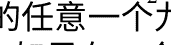
然后在 $\frac{1}{\sqrt{2}}(|0\rangle \pm |1\rangle)$ 基中测量辅助量子比特。我们可以看到，在块中的任意一个九个量子比特上发生的单个错误不会造成不可逆的损害。但是，如果在一个三个量子比特的簇中发生两个比特翻转，则编码信息将被破坏。例如，如果一个簇中的前两个量子比特都翻转，我们将错误地诊断错误并尝试通过翻转第三个量子比特来恢复。总之，错误以及我们的错误的恢复尝试，将运算符 $X_1X_2X_3$ 应用于代码块。由于 $|0\rangle$ 和 $|1\rangle$ 是具有不同特征值的 $X_1X_2X_3$ 的本征态，单个簇中的两个位翻转的效果是编码量子位的相位错误：
$$X_1X_2X_3: a|0\rangle + b|1\rangle \rightarrow a|0\rangle - b|1\rangle \quad (7.7)$$
如果两个不同的簇中发生相位错误，编码信息也会受损。然后，在我们错误的恢复尝试中，我们将在第三个簇中引入一个相位错误，这样总共将应用 $Z_1Z_4Z_7$，从而翻转了编码量子位：
$$Z_1Z_4Z_7: a|0\rangle + b|1\rangle \rightarrow a|1\rangle + b|0\rangle \quad (7.8)$$
如果错误的可能性足够小，并且作用于不同量子比特的错误没有强相关性，那么使用九比特编码将比不编码时更可靠地保护我们的未知量子比特。例如，假设环境作用于每个九比特，独立地使其受到第三章中描述的去极化通道的影响，错误概率为 $p$。然后，位翻转的概率为 $2/3p$，相位翻转的概率为 $2/3p$。两者同时发生的概率为 $1/9p$。我们可以看到，相位错误影响逻辑比特的概率上限为 $4p^2$，位翻转错误的概率上限为 $12p^2$。总错误概率不会超过 $16p^2$；这比未受保护的比特的错误概率 $p$ 要好，前提是 $p < 1/16$。

当然，在这个分析中，我们默认编码、解码、错误综合测量和恢复都是完美无缺的。在第8章中，我们将研究更加现实的情况，即在这些操作过程中发生错误。

## 7.2 量子纠错的标准

在我们对使用九比特编码进行错误恢复的讨论中，我们假设每个量子比特都经历了比特翻转错误或相位翻转错误（或两者皆有）。这不是一个真实的错误模型，我们必须了解如何在更一般的条件下实施量子纠错。

首先，考虑一个单比特，最初处于纯态，并以任意方式与其环境相互作用。我们从第3章中知道，没有损失或一般性（我们仍然可以表示作用于我们比特的最一般超算子），如果我们假设环境的初始态是纯态，我们将其表示为 $|0\rangle_E$。

然后，比特和其环境的演化可以用一个酉变换来描述。从这个酉变换中，我们可以得到比特和环境的联合态的演化方程。
$$ \begin{aligned} U: |0\rangle \otimes |0\rangle_E &\rightarrow |0\rangle \otimes |e_{00}\rangle_E + |1\rangle \otimes |e_{01}\rangle_E, \\ |1\rangle \otimes |0\rangle_E &\rightarrow |0\rangle \otimes |e_{10}\rangle_E + |1\rangle \otimes |e_{11}\rangle_E; \quad (7.9) \end{aligned} $$
这里的四个 $|e_{ij}\rangle_E$ 是环境的状态，不需要归一化，也不需要相互正交（尽管它们满足一些由 $U$ 的幺正性导出的约束条件）。在 $U$ 下，任意状态 $|\psi\rangle = a|0\rangle + b|1\rangle$ 将量子比特的演化描述为
$$ \begin{aligned} U: (a|0\rangle + b|1\rangle)|0\rangle_E &\rightarrow a(|0\rangle|e_{00}\rangle_E + |1\rangle|e_{01}\rangle_E) + b(|0\rangle|e_{10}\rangle_E + |1\rangle|e_{11}\rangle_E) \\ &= (a|0\rangle + b|1\rangle) \otimes \frac{1}{2}(|e_{00}\rangle_E + |e_{11}\rangle_E) \\ &\quad + (a|0\rangle - b|1\rangle) \otimes \frac{1}{2}(|e_{00}\rangle_E - |e_{11}\rangle_E) \\ &\quad + (a|1\rangle + b|0\rangle) \otimes \frac{1}{2}(|e_{01}\rangle_E + |e_{10}\rangle_E) \\ &\quad + (a|1\rangle - b|0\rangle) \otimes \frac{1}{2}(|e_{01}\rangle_E - |e_{10}\rangle_E) \\ &\equiv I|\psi\rangle \otimes |e_I\rangle_E + X|\psi\rangle \otimes |e_X\rangle_E + Y|\psi\rangle \otimes |e_Y\rangle_E + Z|\psi\rangle \otimes |e_Z\rangle_E. \quad (7.10) \end{aligned} $$
作用 $U$ 可以用（幺正）Pauli算符 $\{I, X, Y, Z\}$ 展开，因为它们是 $2 \times 2$ 矩阵向量空间的一组基。从启发式的角度来看，我们可以解释这个展开式，说量子比特可能发生四种可能的事情之一：什么都不发生 ($I$)，比特翻转 ($X$)，相位翻转 ($Z$)，或者两者都发生 ($Y = iXZ$)。然而，这种分类不应该被字面理解，因为除非环境的态 $\{|e_I\rangle, |e_X\rangle, |e_Y\rangle, |e_Z\rangle\}$ 是相互正交的，否则没有可能的测量能够完美地区分这四种选择。

同样地，作用在 $n$ 量子比特希尔伯特空间上的任意 $2^n \times 2^n$ 矩阵可以用 $2^{2n}$ 个 $2^n$ 算符展开
$$ \{I, X, Y, Z\}^{\otimes n}; \qquad \qquad (7.11) $$
也就是说，每个这样的算符可以表示为一个单比特算符的张量积“字符串”，其中字符串中的每个算符都是从单位算符和三个泡利矩阵 $X$、$Y$ 和 $Z$ 中选择的。因此，任意酉算符对 $n$ 个量子比特及其环境的作用可以展开为
$$ |\psi\rangle \otimes |0\rangle_E \rightarrow \sum_a \boldsymbol{E}_a |\psi\rangle \otimes |e_a\rangle_E; \qquad \qquad (7.12) $$
这里索引 $a$ 的范围是 $2^{2n}$ 个值。 $\{\boldsymbol{E}_a\}$ 是作用在 $n$ 个量子比特上的线性无关的泡利算符， $\{|e_a\rangle_E\}$ 是环境的相应态（不一定归一化或相互正交）。对于接下来的内容，这个展开的关键特点是每个 $\boldsymbol{E}_a$ 都是一个酉算符。

方程 (7.12) 提供了量子纠错的概念基础。在设计量子纠错码时，我们确定了一个子集 $\mathcal{E}$ of all the Pauli operators,
$$ \mathcal{E} \subseteq \{\boldsymbol{E}_a\} \equiv \{I, X, Y, Z\}^{\otimes n}; \qquad \qquad (7.13) $$
这些是我们希望能够纠正的错误。我们的目标是对代码块中的 $qubits$ 进行集体测量，以诊断发生了哪个错误 $\boldsymbol{E}_a \in \mathcal{E}$。如果 $|\psi\rangle$ 是代码子空间中的一个状态，那么对于某些（但不是全部）码来说，这个测量将准备一个状态 $\boldsymbol{E}_a|\psi\rangle \otimes |e_a\rangle_E$，其中 $a$ 的值可以从测量结果中得知。由于 $\boldsymbol{E}_a$ 是幺正的，我们可以继续应用 $\boldsymbol{E}_a^\dagger (= \boldsymbol{E}_a^{-1})$（将 $\boldsymbol{E}_a$）添加到代码块中，从而恢复未受损状态 $|\psi\rangle$。

每个Pauli算子都可以分配一个权重，一个整数 $t$，其中 $0 \le t \le n$；权重是由非平凡Pauli矩阵作用的量子比特数。从启发式的角度来看，我们可以将展开式中的一个项eq. (7.12) 解释为 $\boldsymbol{E}_a$ has weight $t$ 的事件，其中错误发生在 $t$ 个量子比特上（但如果状态 $\{|e_a\rangle_E\}$ 不是相互正交的，则不能过于字面地解释这一点）。通常，我们将 $\mathcal{E}$ 取为权重最多为 $t$ 的所有Pauli算子的集合；因此，如果我们能够从具有对集合 $\mathcal{E}$ 有支持的任何错误超算符中恢复，我们将说这个代码可以纠正错误。在采用这样一个错误集时，我们隐含地假设不同量子比特上的错误只有弱相关性，因此在量子比特上出现多个错误的幅度相对较小。

给定要纠正的错误集 $\mathcal{E}$，为了实现恢复，必须满足哪些必要和充分条件？让我们用 $\{| \bar{i} \rangle\}$ 表示码子空间的正交基。（我们将这些基元素称为“码字”。）显然，必须满足以下条件：
$$\langle \bar{j} | E_b^\dagger E_a | \bar{i} \rangle = 0, \text{当} i \neq j \text{时。} \quad (7.14)$$
其中 $E_{a,b} \in \mathcal{E}$。如果对于某些 $i \neq j$，这个条件不满足，那么错误将能够破坏正交码字的完美可区分性，编码的量子信息肯定会受到损坏。（下面将详细介绍这个必要条件的推导。）我们还可以很容易地看出，一个充分条件是
$$\langle \bar{j} | E_b^\dagger E_a | \bar{i} \rangle = \delta_{ab} \delta_{ij}. \quad (7.15)$$
在这种情况下， $E_a$ 将代码子空间转化为一组相互正交的“错误子空间”
$$\mathcal{H}_a = E_a \mathcal{H}_{\text{code}}. \quad (7.16)$$
假设一个任意的状态 $|\psi\rangle$ 在代码子空间中被准备好，并且遭受了一个错误。代码块和环境的结果状态是
$$\sum_{E_a \in \mathcal{E}} E_a |\psi\rangle \otimes |e_a\rangle_E, \quad (7.17)$$
其中求和限制在错误集合 $\mathcal{E}$ 中。然后，我们可以进行一个正交测量，将代码块投影到其中一个空间 $\mathcal{H}_a$，使得状态变为
$$E_a |\psi\rangle \otimes |e_a\rangle_E. \quad (7.18)$$
最后，我们对代码块应用幺正算符 $E_a^\dagger$ 来完成恢复过程。

满足条件eq. (7.15)的代码被称为非退化代码。这个术语表示存在一种测量方法可以明确地诊断出发生的错误 $E$ 属于 $\mathcal{E}$。但是九量子比特代码的例子已经告诉我们，更一般的代码是可能的。

九量子比特代码是退化的，因为作用在同一组三个量子比特上的相位错误会以完全相同的方式影响代码子空间（例如， $Z_1|\psi\rangle = Z_2|\psi\rangle$ ）。尽管没有测量方法可以确定哪个量子比特遭受了错误，但这并不会对成功恢复造成障碍。

恢复可能的必要和充分条件很容易表述：
$$\langle \bar{j} | \mathbf{E}_b^\dagger \mathbf{E}_a | \bar{i} \rangle = C_{ba} \delta_{ij}, \quad (7.19)$$
其中 $\mathbf{E}_{a,b} \in \mathcal{E}$，而 $C_{ba} = \langle \bar{i} | \mathbf{E}_b^\dagger \mathbf{E}_a | \bar{i} \rangle$ 是任意的厄米矩阵。这个条件的非平凡内容超越了更弱的必要条件eq. (7.14)，即 $\langle \bar{i} | \mathbf{E}_b^\dagger \mathbf{E}_a | \bar{i} \rangle$ 不依赖于 $i$。这个条件的起源很容易理解 - 如果情况不是这样的话，在识别一个错误子空间 $\mathcal{H}_a$ 时，我们将获得关于编码状态的一些信息，从而不可避免地干扰该状态。

为了证明条件eq. (7.19)的必要性和充分性，我们引用了第3章中发展的超算符理论。作用于代码块上的错误由一个超算符描述，问题是否可以构造另一个超算符（恢复过程）来逆转错误的影响。事实上，我们在第3章中学到的是，唯一可以被反转的超算符是幺正算符。但现在我们要求的稍微少一些。我们不需要能够反转错误超算符对代码块中任何状态的作用；相反，只需要能够在初始状态位于 $k$-qubit 编码子空间时反转错误。

一种表达错误对代码基态 $|\bar{i}\rangle$（和环境）作用的替代方式是
$$|\bar{i}\rangle \otimes |0\rangle_E \to \sum_{\mu} \mathbf{M}_{\mu} |\bar{i}\rangle \otimes |\mu\rangle_E, \quad (7.20)$$
其中，现在环境的状态 $|\mu\rangle_E$ 是环境的正交基元素，矩阵 $\mathbf{M}_{\mu}$ 是 Pauli 算符的线性组合。 $\mathcal{E}$ 中包含的 $\epsilon$ 满足算符和归一化条件
$$\sum_\mu M_\mu^\dagger M_\mu = I. \tag{7.21}$$
如果存在算符 $R_\nu$，错误可以通过恢复超算符来逆转
$$\sum_\nu R_\nu^\dagger R_\nu = I, \tag{7.22}$$
和
$$\begin{aligned}
\sum_{\mu,\nu} R_\nu M_\mu |\bar{i}\rangle \otimes |\mu\rangle_E \otimes |\nu\rangle_A \\
= |\bar{i}\rangle \otimes |\text{stuff}\rangle_{EA};
\end{aligned} \tag{7.23}$$
用于实现恢复操作的正交基的元素，而环境和辅助态 $|\text{stuff}\rangle_{EA}$ 不能依赖于 $i$。由此可得
$$R_\nu M_\mu |\bar{i}\rangle = \lambda_{\nu\mu} |\bar{i}\rangle; \tag{7.24}$$
对于每个 $\mu$ 和 $\nu$；作用于码子空间的乘积 $R_\nu M_\mu$ 是标量倍数的单位矩阵。利用 $R_\nu$ 的归一化条件，我们可以推断出
$$M_\delta^\dagger M_\mu |\bar{i}\rangle = M_\delta^\dagger \left( \sum_\nu R_\nu^\dagger R_\nu \right) M_\mu |\bar{i}\rangle = \sum_\nu \lambda_{\nu\delta}^* \lambda_{\nu\mu} |\bar{i}\rangle, \tag{7.25}$$
这样， $M_\delta^\dagger M_\mu$ 也是作用在代码子空间上的单位矩阵的倍数。换句话说
$$\langle \bar{j}| M_\delta^\dagger M_\mu |\bar{i}\rangle = C_{\delta\mu} \delta_{ij}; \tag{7.26}$$
因为每个 $\mathbf{E}_a$ in $\mathcal{E}$ 都是 $M_\mu$ 的线性组合，所以根据等式(7.19)可得。理解为什么等式(7.26)是错误恢复的必要条件的另一种有益的方法是注意，如果代码块在状态 $|\psi\rangle$ 下准备好，并且根据等式(7.20)发生错误，那么通过对代码块进行追踪得到的环境的密度矩阵为
$$\rho_E = \sum_{\mu,\nu} |\mu\rangle_E \langle \psi | M_\nu^\dagger M_\mu |\psi \rangle_E \langle \nu|. \tag{7.27}$$

## 7.2. 量子纠错的标准

只有在无法通过对环境进行测量来获取关于状态 \(|\psi\rangle\) 的任何信息时，错误恢复才能成功进行。因此，如果 \(|\psi\rangle\) 是编码子空间中的任意状态，我们要求 \(\rho_E\) 与 \(|\psi\rangle\) 无关；方程 (7.26) 随之得出。

为了看到方程 (7.26) 既是恢复的充分条件也是必要条件，我们可以明确构造反转错误的超算符。为此，我们选择环境的基础 \(\{|\mu\rangle_E\}\) 方便地对方程 (7.26) 中的矩阵 \(C_{\delta \mu}\) 进行对角化：

\[\langle \bar{j} | M_{\delta}^{\dagger} M_{\mu} | \bar{i} \rangle = C_{\mu} \delta_{\delta \mu} \delta_{ij}, \tag{7.28}\]

其中 \(\sum_{\mu} C_{\mu} = 1\) 是由算符和归一化条件得出的。对于每个 \(\nu\) 满足 \(C_{\nu} = 0\)，令

\[R_{\nu} = \frac{1}{\sqrt{C_{\nu}}} \sum_{i} |\bar{i}\rangle \langle \bar{i}| M_{\nu}^{\dagger}, \tag{7.29}\]

这样 \(R_{\nu}\) 的作用就是

\[R_{\nu} : M_{\mu} |\bar{i}\rangle \rightarrow \sqrt{C_{\nu}} \delta_{\mu \nu} |\bar{i}\rangle. \tag{7.30}\]

然后我们很容易看出

\[\begin{aligned}
\sum_{\mu, \nu} R_{\nu} M_{\mu} |\bar{i}\rangle \otimes |\mu\rangle_E \otimes |\nu\rangle_A &= |\bar{i}\rangle \otimes \left(\sum_{\nu} \sqrt{C_{\nu}} |\nu\rangle_E \otimes |\nu\rangle_A\right); \tag{7.31}
\end{aligned}\]

由 \(R_{\nu}\) 定义的超算符确实可以逆转错误。只需检查 \(R_{\nu}\) 的归一化条件是否满足。我们有

\[\sum_{\nu} R_{\nu}^{\dagger} R_{\nu} = \sum_{\nu, i} \frac{1}{C_{\nu}} \sum_{\nu} M_{\nu} |\bar{i}\rangle \langle \bar{i}| M_{\nu}^{\dagger}, \tag{7.32}\]

这是对能够通过错误作用于码字而达到的状态空间的正交投影。因此，我们可以通过将一个更多的元素添加到算符和中——投影到互补子空间上，来完成恢复超算符的规范化。

# 第7章 量子纠错

运算符基）。我们可以看到，一旦确定了可能错误的集合 $\mathcal{E}$，恢复操作就被确定了。特别地，我们不需要关于与错误$E_a$相关的环境态 $|e_a\rangle$ $E$的任何信息。因此，该编码对于控制幺正错误或退相干错误同样有效（只要集合$\mathcal{E}$之外的错误的振幅可以忽略不计）。当然，在非简并编码的情况下，$C_a$ $_b$已经在Pauli基下对角化，我们可以将恢复基表示为

$$R_a = \sum_{i} |i\rangle\langle i|E_a^\dagger;$$

对于每个 $E_a$，都存在一个对应的 $R_a$。我们将错误纠正描述为一个两步过程：首先进行集体测量以诊断错误，然后根据测量结果应用一个酉变换来逆转错误。这种观点有很多优点。特别是，量子测量过程似乎使我们能够驯服可能的错误连续体，因为测量将损坏的状态投影到一组离散的结果之一，对于每个结果都有恢复的方法。但实际上，测量并不是量子纠错的必要条件。方程式（7.31）的恢复超算符当然可以被视为作用在编码块和辅助块上的酉变换。如果我们想象辅助块被施加了一个正交测量，那么这个超算符可以描述一个测量后的酉算符，但测量并不是必要的。

如果没有测量，我们会得出一个关于逆向退相干的不同观点。当代码块与其环境相互作用时，它与环境纠缠在一起，环境的冯·诺依曼熵增加（代码块的熵也增加）。如果我们无法控制环境，那么它的熵增加将永远无法逆转；那么，量子纠错如何可能？方程（7.31）给出的答案是，我们可以对数据和我们控制的辅助量进行幺正变换。

如果满足量子纠错的标准，可以选择这个幺正变换将数据与环境的纠缠转化为辅助量与环境的纠缠，恢复数据的纯度。在这个过程中，如下所示：


虽然测量不是错误纠正的必要部分，但辅助位是绝对必要的。辅助位作为一个容器，用于存储由错误插入到代码块中的熵 - 当数据“冷却”时，它“加热”。如果我们要长时间保护存储在量子存储器中的量子信息，就应该提供连续的辅助量子比特供使用后丢弃。或者，如果要回收辅助位，则必须首先擦除它。 如第1章所讨论的，擦除是耗散的，并需要耗费能量。因此，热力学原理规定我们无法免费实现（量子）错误纠正。 错误导致熵渗入数据中。 这种熵可以通过可逆过程转移到辅助位，但需要工作来将熵从辅助位泵回环境中。

### 7.3. 量子纠错码的一些基本特性

### 7.3.1 距离

如果一个量子码可以用比特表示，则称其为二进制量子码。 在二进制码中，一个维度为2^k的码子空间嵌入到一个维度为2^n的空间中，其中 k和n > k是整数。 实际上，并不需要要求这些空间的维度是2的幂次（见练习）；然而，在这里我们主要关注二进制编码，这是最简单的情况。

除了块大小 n和编码比特数 k之外，描述码的另一个重要参数是其距离 d。 距离 d是一个保罗算符 E的最小权重，使得

⟨i|E_a|j⟩ ≠ C_a δ_ij. (7.34)

我们将一个具有块大小n、k编码比特和距离 d的量子码描述为“[[n, k, d]] 量子码”。我们使用双括号表示量子码的表示法，与用于经典码的 [n, k, d] 表示法有所区别。

如果一个量子纠错码的恢复集 $\mathcal{E}$ 包含了所有重量小于等于 $t$ 的 Pauli 算符，则我们说它可以纠正 $t$ 错误。我们的距离定义意味着纠错的标准：$\langle i|E_a^{\dagger} E_b|j\rangle=C_{a b} \delta_{i j}$ (7.35) 只要 $d \geq 2 t+1$，所有重量小于等于 $t$ 的 Pauli 算符 $E_{a b}$ 都能满足纠错的条件。因此，距离 $d=2 t+1$ 的量子纠错码可以纠正 $t$ 错误。

### 7.3.2 定位错误

无论错误在码块中的位置如何，距离 $d = 2t + 1$ 的码可以纠正 $t$ 错误。但在某些情况下，我们可能知道特定的量子比特更有可能发生错误。也许我们看到一个锤子击中了那些量子比特。或者你给我发送了一个包含 $n$ 个量子比特的块，但其中 $t < n$ 个量子比特丢失了并且没有收到。我相信那些到达的 $n - t$ 个量子比特被很好地打包并且没有损坏。但是我用（任意选择的）状态 $|00...0\rangle$ 替换了丢失的 $t$ 个量子比特，我很清楚这些量子比特很可能出现错误。

如果错误发生在已知位置而不是未知位置，给定的代码可以更好地保护免受错误的影响。事实上，一个距离为 $d = t+1$ 的量子纠错码可以纠正在已知位置上的 $t$ 个错误。在这种情况下，要纠正的错误集合 $\mathcal{E}$ 是所有在指定位置上具有支持的保罗算符的集合（每个 $E_a$ 在其他 $n - t$ 个量子比特上都作用平凡）。但是，对于每个在 $E$ 中的 $E_a$ 和 $E_b$，乘积 $E_a^{\dagger} E_b$ 的权重也最多为 $t$。因此，只要代码的距离至少为 $t + 1$，所有 $E_{a,b} \in \mathcal{E}$ 的错误纠正准则都得到满足。

特别地，一个可以在任意位置纠正 $t$ 个错误的量子纠错码可以在已知位置纠正 $2t$ 个错误。

### 7.3.3 错误检测

在某些情况下，即使我们无法完全诊断或逆转错误，我们可能满足于检测错误是否发生。设计用于错误检测的测量有两种可能的结果：“好”和“坏”。如果好的结果发生，我们可以确保量子态没有受到损坏。 如果坏的结果发生，就意味着已经受到了损害，需要丢弃该态。

如果错误超算符的支持集合在重量不超过 $t$ 的所有 Pauli 算符的集合 $\mathcal{E}$ of 上，并且可以进行一次正确诊断错误的测量，那么我们可以检测到 $t$ errors 。错误检测比错误纠正更容易，因此给定的编码可以检测到更多的错误。事实上，一个距离为 $d = t + 1$ 的量子纠错编码可以检测到 $t$ errors。

这样的编码具有以下特性
$$\langle \bar{i}|E_a|\bar{j}\rangle = C_a \delta_{ij}$$ (7.36)
对于重量不超过 $t$ 的每个 Pauli 算符 $E_a$，或者
$$E_a|\bar{i}\rangle = C_a|\bar{i}\rangle + |\varphi_{ai}^{\perp}\rangle,$$ (7.37)
其中 $|\varphi_{ai}^{\perp}\rangle$ 是一个正交于码子空间的非标准化向量。

因此，具有支持于 $\mathcal{E}$ 的错误超算符对码子空间中的状态 $|\psi\rangle$ 的作用是
$$|\psi\rangle \otimes |0\rangle_E \rightarrow \sum_{E_a \in \mathcal{E}} E_a|\psi\rangle \otimes |e_a\rangle_E = |\psi\rangle \otimes \left( \sum_{E_a \in \mathcal{E}} C_a|e_a\rangle_E \right) + |\text{orthog}\rangle,$$ (7.38)
其中 $|\text{orthog}\rangle$ 表示一个正交于码子空间的向量。

现在我们可以对数据执行一个“模糊”的正交测量，有两个结果：状态被投影到码子空间或补充空间。 如果得到第一个结果，那么未受损的状态 $|\psi\rangle$ 将被恢复。 如果得到第二个结果，那么就检测到了一个错误。 我们得出结论，我们的距离为 $d$ 的量子纠错码可以检测 $d - 1$ 个错误。 特别地，一个可以纠正 $t$ errors 的量子纠错码可以检测到 $2t$ 个错误。

### 7.3.4 量子码和纠缠

通过在一个块中将量子信息进行编码并进行非局部共享，量子纠错码可以保护量子信息免受错误的影响。 因此，量子码字是一种高度纠缠的状态。事实上，一个距离为$d = t + 1$的非退化码具有以下特性：选择码子空间中的任意状态 $|\psi\rangle$和块中的任意 $t$ 个量子比特。对剩余的$(n - t)$个量子比特进行追踪操作，得到

$\rho^{(t)} = \mathrm{tr}_{(n-t)} |\psi\rangle\langle\psi|, \quad (7.39)$

即 $t$ 个量子比特的密度矩阵。那么这个密度矩阵是完全随机的：

$\rho^{(t)} = \frac{1}{2^t} I; \quad (7.40)$

(在任何距离为$(t + 1)$的码中，我们无法通过观察块中的任何 $t$ 个量子比特来获取有关编码数据的任何信息；也就是说，$\rho^{(t)}$是一个常数，与码字无关。但只有当码是非退化的时候，个量子比特的密度矩阵才是单位矩阵的倍数。）为了验证等式(7.40)的特性，我们注意到对于一个非退化距离 $(t + 1)$ 代码,

$\langle \bar{i} | \boldsymbol{E}_a | \bar{j} \rangle = 0 \quad (7.41)$

对于任何非零权重的 $\boldsymbol{E}_a$，最多到 $t$，所以

$\mathrm{tr}(\rho^{(t)} \boldsymbol{E}_a) = 0, \quad (7.42)$

对于任何不是单位算子的 $t$-qubit Pauli算子 $\boldsymbol{E}_a$。现在 $\rho^{(t)}$，像任何 Hermitian $2^t \times 2^t$ 矩阵一样，可以用Pauli算子展开：

$\rho^{(t)} = \left( \frac{1}{2^t} \right) I + \sum_{\boldsymbol{E}_a \neq I} \rho_a \boldsymbol{E}_a . \quad (7.43)$

由于 $\boldsymbol{E}_a$ 满足

$\left( \frac{1}{2^t} \right) \mathrm{tr}(\boldsymbol{E}_a \boldsymbol{E}_b) = \delta_{ab} , \quad (7.44)$

我们发现每个 $\rho_a = 0$，并且我们得出结论 $\rho^{(t)}$ 是单位的倍数。

## 7.4. 失败的概率

### 7.4.1 保真度界限

如果错误超算符的支持仅包含我们知道如何纠正的Pauli算符集合 $\mathcal{E}$，则我们可以以完美的保真度恢复编码的量子信息。但在现实的错误模型中，不在 $\mathcal{E}$ 中的错误将具有小但非零的振幅，因此恢复的状态将不完美。关于恢复状态的保真度，我们能说些什么？

错误超算符的Pauli算符展开可以分为对“好”算符（在 $\mathcal{E}$ 中的算符）和“坏”算符（不在 $\mathcal{E}$ 中的算符）的求和，因此它根据编码子空间中的状态 $|\psi\rangle$ 作用于 $|0\rangle$ $\mathcal{E} \rightarrow \Sigma$
$$
\begin{aligned}
|\psi\rangle \otimes |0\rangle_E &\rightarrow \sum_a \mathbf{E}_a |\psi\rangle \otimes |e_a\rangle_E \\
&\equiv \sum_{\mathbf{E}_a \in \mathcal{E}} \mathbf{E}_a |\psi\rangle \otimes |e_a\rangle_E + \sum_{\mathbf{E}_b \notin \mathcal{E}} \mathbf{E}_b |\psi\rangle \otimes |e_b\rangle_E \\
&\equiv |\text{GOOD}\rangle + |\text{BAD}\rangle.
\end{aligned}
$$ (7.45)

恢复操作（作用于数据和辅助量子比特的幺正操作）然后将 $|\text{GOOD}\rangle$ 映射到一个包含数据、环境和辅助量子比特的状态 $|\text{GOOD}'\rangle$。$|\text{BAD}\rangle$ 转换为一个状态 $|\text{BAD}'\rangle$，这样在恢复后我们得到该状态
$$
|\text{好} '\rangle + |\text{坏} '\rangle ;
$$ (7.46)
这里（因为恢复在好状态上完美运作）
$$
|\text{好}'\rangle = |\psi\rangle \otimes |\text{状态}\rangle_{\text{环境}}
$$ (7.47)
其中 $|\text{状态}\rangle_{\text{环境}}$ 是环境和辅助状态的某个状态。
假设状态 $|\text{好}\rangle$ 和 $|\text{坏}\rangle$ 是正交的。如果特别地，环境的所有“好”状态与所有“坏”状态正交，那么这个假设成立；也就是说，如果
$$
\langle \mathbf{E}_a | \mathbf{E}_b \rangle = 0 \quad \text{对于} \quad \mathbf{E}_a \in \mathcal{E},\quad \mathbf{E}_b \notin \mathcal{E}.
$$ (7.48)
让 $\rho_{\text{rec}}$ 表示恢复状态的密度矩阵，通过追踪环境和辅助状态得到，然后
$$
F = \langle \psi | \rho_{\text{rec}} | \psi \rangle
$$ (7.49)
表示其保真度。现在，由于 |坏⟩与 |好'⟩正交 (也就是说， |坏⟩没有沿着 |ψ⟩|状态⟩环境的分量) ，保真度将会是

$$F = \langle\psi|\rho_{\text{GOOD'}}|\psi\rangle + \langle\psi|\rho_{\text{BAD'}}|\psi\rangle, \quad (7.50)$$

其中

$$\rho_{\text{GOOD'}} = \text{tr}_{EA} (|\text{GOOD'}\rangle\langle\text{GOOD'}|), \quad \rho_{\text{BAD'}} = \text{tr}_{EA} (|\text{BAD'}\rangle\langle\text{BAD'}|), \quad (7.51)$$

因此，恢复状态的保真度满足

$$F \geq \langle\psi|\rho_{\text{GOOD'}}|\psi\rangle = \| |s\rangle_{EA} \|^2 = \| |\text{GOOD'}\rangle \|^2, \quad (7.52)$$

此外，由于恢复操作是酉操作，我们有∥ |GOOD'⟩ ∥ = ∥ |GOOD⟩ ∥，因此

$$F \geq \| |\text{GOOD}\rangle \|^2 = \left\| \sum_{E_a \in \mathcal{E}} E_a |\psi\rangle \otimes |e_a\rangle_E \right\|^2, \quad (7.53)$$

一般而言，|BAD⟩不一定与|GOOD⟩正交，因此 |BAD'⟩不一定与|GOOD'⟩正交。然后，|BAD'⟩可能在|GOOD'⟩方向上有一个干涉破坏|GOOD'⟩的分量从而降低保真度。即使在这种更一般的情况下，我们仍然可以通过将|BAD'⟩分解为沿着|GOOD'⟩的分量和一个正交分量来得到保真度的下界，如

$$|\text{坏'}\rangle = |\text{坏}_{\parallel}'\rangle + |\text{坏}_{\perp}'\rangle, \quad (7.54)$$

然后按照上面的推理，我们得到

$$F \geq \| |\text{好'}\rangle + |\text{坏}_{\parallel}'\rangle \|^2, \quad (7.55)$$

)当然，由于错误操作和恢复操作都是作用在数据、环境和辅助位上的幺正操作，完整的状态 |好'⟩ + |坏'⟩ 被归一化，或者

$$\| |\text{好'}\rangle + |\text{坏}_{\parallel}'\rangle \|^2 + \| |\text{坏}_{\perp}'\rangle \|^2 = 1, \quad (7.56)$$

等式(7.55)变为

$$F \geq 1 - \| |\text{BAD}_{\perp}'\rangle \|^2, \quad (7.57)$$

## 7.4. 失败的概率

最后，|BAD′⊥⟩的范数不能超过|BAD′⟩的范数，因此我们得出结论

$$1 - F \leq || |\text{BAD}'\rangle ||^2 = || |\text{BAD}\rangle ||^2 = || \sum_{E_b \in \mathcal{E}} E_b |\psi\rangle \otimes |e_b\rangle_E ||^2 . \qquad (7.58)$$

这是我们对恢复操作的“失败概率”的一般界限。当 |GOOD⟩和 |BAD⟩是正交态时，结果等式(7.53)成立。

### 7.4.2 无关错误

现在让我们考虑一些对于错误作用在不同量子比特上完全不相关的情况下的结果的影响。在这种情况下，错误超算符是单比特超算符的张量积。如果事实上错误以相同的方式作用于所有量子比特，我们可以将n比特超算符表示为

$$\mathcal{E}^{(n)}_{\text{错误}} = \left[ \mathcal{E}^{(1)}_{\text{错误}} \right]^{\otimes n} , \qquad (7.59)$$

其中$\mathcal{E}^{(1)}_{\text{错误}}$是一个单比特超算符，其作用（在其幺正表示中）具有以下形式

$$|\psi\rangle \otimes |0\rangle_E \rightarrow |\psi\rangle \otimes |e_I\rangle_E + X|\psi\rangle \otimes |e_X\rangle_E + Y|\psi\rangle \otimes |e_Y\rangle_E + Z|\psi\rangle \otimes |e_Z\rangle_E . \qquad (7.60)$$

如果我们进一步假设环境的三个状态 |e_{X,Y,Z}⟩与状态 |e_I⟩正交，那么分析编码信息上的错误效应就特别容易。在这种情况下，每个量子比特是否发生错误的记录会永久地印在环境中，因此可以谈论每个量子比特的错误概率 p_{error}，其中

$$\langle e_I | e_I \rangle = 1 - p_{\text{error}} \qquad (7.61)$$

如果我们的量子代码能够纠正 t个错误，那么“好”的Pauli算符的权重最多为 t，而“坏”的Pauli算符的权重大于 t；除非至少有t+ 1个量子比特受到错误的影响，否则恢复一定会成功。由此可得，保真度服从以下界限

$$1 - F \leq \sum_{s=t+1}^{n} \binom{n}{s} p_{\text{错误}}^{s} (1 - p_{\text{错误}})^{n-s} \leq \binom{n}{t+1} p_{\text{错误}}^{t+1} . \qquad (7.62)$$

对于每一个 $\binom{n}{t+1}$ 在选择 $t+1$ 个位置的方式中，出现错误的概率是 $p^t$ 错误，我们忽略剩余的 $n-t-1$ 个位置是否发生额外的错误。因此，方程 (7.62) 中的最终表达式是至少发生 $t+1$ 个错误的概率的上界，其中我们忽略了在 $n$ 个量子比特的块中是否发生额外的错误。对于 $p$ 错误较小且 $t$ 较大的情况，编码数据的保真度相比于未受保护的量子比特的保真度 $F=1-O(p)$ 有了显著的提高。

对于作用在单比特上的一般误差超算符，没有明确的“错误概率”的概念；当Pauli算符 $\boldsymbol{I}$ 作用时，比特和其环境的状态与作用Pauli算符 $\boldsymbol{X}$, $\boldsymbol{Y}$ 和 $\boldsymbol{Z}$ 时获得的状态不正交（因此不能完全区分）。在极端情况下，根本没有退相干——“错误”是由于未知的酉变换作用于比特上。

（如果作用在比特上的酉变换 $\boldsymbol{U}$ 已知，我们可以通过应用 $\boldsymbol{U}^{\dagger}$ 来恢复“错误”。）考虑作用在代码块中的N个比特上的不相关酉误差，每个误差形式为（忽略一个无关的相位）

$$\boldsymbol{U}^{(1)} = \sqrt{1-p} + i\sqrt{p}\ \boldsymbol{W},$$ (7.63)

其中 $\boldsymbol{W}$ 是 $\boldsymbol{X}$, $\boldsymbol{Y}$ 和 $\boldsymbol{Z}$ 的（无迹，厄米）线性组合，满足 $\boldsymbol{W}^2 = \boldsymbol{I}$。如果比特的状态 $|\psi\rangle$ 被准备好，然后发生了单位误差（式 (7.63)），则结果状态的保真度为

$$F = |\langle\psi|\boldsymbol{U}^{(1)}|\psi\rangle|^2 = 1 - p\left(1 - (\langle\psi|\boldsymbol{W}|\psi\rangle)^2\right) \geq 1 - p.$$ (7.64)

如果在代码块中的每个量子比特上都发生了形式为方程 (7.63) 的酉误差，并且结果状态按照Pauli算符的项展开，如方程 (7.45) 所示，那么状态 $|\text{BAD}\rangle$（它由至少作用于 $t+1$ 个量子比特的 $\boldsymbol{W}$ 项引起）的范数是 $(\sqrt{p})^{t+1}$ 阶的，方程 (7.58) 变为

$$1-F = O(p^{t+1}).$$ (7.65)

我们可以看到，无论非相关误差是由于相干损耗还是由于未知酉变换，编码都提供了相同阶数的保真度改善。

## 7.5 经典线性码

为了避免混淆，让我们强调上述讨论中“不相关”的含义。我们考虑作用在单位错误上的幺正操作对于$n$量子比特，如果它是单比特幺正变换的张量积，不管作用在不同量子比特上的幺正操作如何相互关联，我们称之为“不相关”。例如，如果所有量子比特绕一个共同轴旋转角度$\theta$，这种“错误”可以通过量子纠错有效处理；恢复后的保真度将为$F = 1 - O(\theta^{2(t+1)})$，如果编码可以防护$t$不相关错误。相反，一种可能引起更大麻烦的幺正错误是形如$U^{(n)} \sim 1 + i\theta E^{(n)}_{\text{bad}}$的错误，其中 $E^{(n)}_{\text{bad}}$ 是一个$n$量子比特的保罗算子，其权重大于$t$。然后$|BAD\rangle$的范数是$\theta$的阶数，恢复后的典型保真度将为$F = 1 - O(\theta^2)$。

量子纠错码是在不到四年前首次发明的，但经典纠错码有着更长的历史。在过去的五十年里，一个非常美丽和强大的经典编码理论已经建立起来。这个理论的很大一部分可以在构建量子纠错码时利用。在这里，我们将快速回顾经典理论的一些要素，将注意力限制在二进制线性码上。

在二进制码中，$k$位被编码成长度为$n$的二进制字符串。也就是说，在长度为$n$的$2^n$个字符串中，我们指定一个子集包含$2^k$个字符串 - 编码词。通过选择这$2^k$个编码词之一来编码一个$k$位的消息。

在二进制线性码的特殊情况下，编码词形成了一个$k$维闭合线性子空间$C$ of 二进制向量空间$F_2^n$。也就是说，两个编码词的按位异或运算结果仍然是一个编码词。编码空间$C$ of 该码由$k$个向量$v_1, v_2, \ldots, v_k$的基底张成；任意编码词可以表示为这些基底向量的线性组合：

$$v(\alpha_1, \ldots, \alpha_k) = \sum_i \alpha_i v_i , \quad \quad (7.66)$$

其中每个$\alpha_i \in \{0, 1\}$，加法是模2运算。我们可以说长度为$k$的向量$v(\alpha_1 \ldots \alpha_k)$编码了$k$位的消息$\alpha = (\alpha_1, \ldots, \alpha_k)$。

基向量 $v_1, \ldots, v_k$ 可以组装成一个 $k \times n$ 矩阵

$$G = \begin{pmatrix} v_1 \\ \vdots \\ v_k \end{pmatrix} \quad (7.67)$$

称为码的生成矩阵。然后在矩阵表示中，方程 (7.66) 可以重写为

$$v(\alpha) = \alpha G \quad (7.68)$$

矩阵 $G$ 从左边作用，对消息 $\alpha$ 进行编码。描述 $k$ 维码子空间的另一种方法是指定 $n - k$ 线性约束。存在一个 $(n - k) \times n$ 矩阵 $H$ 使得

$$Hv = 0 \quad (7.69)$$

对于所有属于码 $C$ 的向量 $v$，且仅对于这些向量。这个矩阵 $H$ 被称为码 $C$ 的奇偶校验矩阵。矩阵 $H$ 的行是 $n - k$ 线性独立向量，码空间是与所有这些向量正交的向量空间。正交性是相对于模 2 的位内积定义的；两个长度为 $n$ 的二进制字符串在偶数个位置上“碰撞”（都取值为 1）时是正交。注意

$$HG^T = 0; \quad (7.70)$$

其中 $G^T$ 是 $G$ 的转置；$G$ 的行与 $H$ 的行正交。对于经典比特，唯一的错误类型是比特翻转。在一个 $n$ 比特字符串中发生的错误可以用一个 $n$ 分量向量 $e$ 来描述，其中 $e$ 中的 1 表示错误发生的位置。当受到错误 $e$ 的影响时，字符串 $v$ 变为

$$v \rightarrow v + e. \quad (7.71)$$

应用奇偶校验矩阵可以检测错误。如果 $v$ 是一个码字，那么

$$H(v + e) = Hv + He = He. \quad (7.72)$$

$He$ 被称为错误 $e$ 的综合。用 $E$ 表示我们希望能够纠正的错误集合 $\{e_i\}$。只有当所有错误 $e_i$ 具有不同的综合时，才能进行错误恢复。如果是这种情况，我们可以根据综合 $He$ 明确诊断错误，然后通过翻转由 $e$ 指定的比特来进行恢复。

$$v + e \to (v + e) + e = v.$$ (7.73)

另一方面，如果 $He_1 = He_2$ 对于 $e_1 \neq e_2$，那么我们可能会错误地将一个 $e_1$ 错误解释为一个 $e_2$ 错误；我们的恢复尝试会产生以下影响

$$v + e_1 \to v + (e_1 + e_2) = v.$$ (7.74)

恢复的消息 $v + e_1 + e_2$ 位于编码中，但与预期的消息 $v$ 不同；编码信息已经损坏。一个代码 $C$ 的距离 $d$ 是任何向量 $v \in C$ 的最小权重，其中权重是字符串 $v$ 中1的数量。具有距离 $d= 2t+ 1$ 的线性码可以纠正 $t$ 个错误；该代码为每个 $e\in \mathcal{E}$ 分配一个不同的综合，其中 $\mathcal{E}$ 包含所有权重小于等于 $t$ 的向量。这是因为，如果 $He_1 = He_2$，那么

$$0 = He_1 + He_2 = H(e_1 + e_2) ,$$ (7.75)

因此 $e_1 + e_2 \in C.$ 但是如果 $e_1$ 和 $e_2$ 不相等，并且每个的权重都不大于 $t$，则 $e_1 + e_2$ 的权重大于零且不大于 $2t.$ 由于 $d= 2t+ 1$，在 $C$ 中没有这样的向量。因此 $e_1$ 和 $e_2$ 不能相等。

在经典编码理论中，一个有用的概念是对偶码。我们已经看到编码 $C$ 的 $k \times n$ 生成矩阵 $G$ 和 $(n - k) \times n$ 奇偶校验矩阵 $H$ 之间的关系是 $HG^T = 0.$ 取转置，得到 $GH^T = 0.$ 因此我们可以将 $H^T$ 看作是一个 $(n - k)$ 维码的生成矩阵，将 $G$ 看作是该码的奇偶校验矩阵，该码被表示为 $C^\perp$ 并称为 $C$ 的对偶码。换句话说， $C^\perp$ 是C的正交补空间。

如果一个向量的权重是偶数，那么它是自正交的，所以C和$C^\perp$可能会相交。如果一个码字的权重都是偶数且彼此正交，那么这个码字包含它的对偶。如果 $n = 2k$，那么可能会有 $C = C^\perp$，在这种情况下，$C$ 被称为自对偶的。关于码字C和它的对偶$C^\perp$的一个恒等式在下一节中会很有用。

以下是相关内容：

$$\sum_{v\in C} (-1)^{v\cdot u} = \begin{cases} 2^k, & u\in C^\perp \\ 0, & u\notin C^\perp. \end{cases}$$ (7.76)

这个恒等式的非平凡内容是对于 $u\in C^\perp$，和的总和为零的陈述。这很容易从熟知的恒等式推导出来。

$$\sum_{v\in \{0,1\}^{k}} (-1)^{v\cdot w} = 0, \quad w\neq 0,$$ (7.77)

其中 $v$ 和 $w$ 是长度为 $k$ 的字符串。我们可以将 $v$ 表示为 $G$ 的元素

$$v = \alpha G,$$ (7.78)

其中 $\alpha$ 是一个 $k$ 维向量。然后

$$\sum_{v\in C} (-1)^{v\cdot u} = \sum_{\alpha\in \{0,1\}^k} (-1)^{\alpha\cdot Gu} = 0,$$ (7.79)

对于 $Gu=0$. 由于 $C$ 的生成矩阵 $G$ 是 $C^\perp$ 的奇偶校验矩阵，我们得出结论，在 $u\in C^\perp$时，这个和为零。

## 7.6 CSS 码

经典线性码理论的原理可以用于构建量子纠错码。我们将在这里描述一种 QECC 家族，即 Calderbank–Shor–Steane（CSS）码，它利用了对偶码的概念。

设 $C_1$ 为具有 $(n-k_1)\times n$ 奇偶校验矩阵 $H_1$ 的经典线性码，并设 $C_2$ 为 $C_1$ 的子码，具有 $(n-k_2)\times n$ 奇偶校验矩阵 $H_2$，其中 $k_2 < k_1$。矩阵 $H_2$ 的前 $n-k_1$ 行与 $H_1$ 的行相同，但还有 $k_1 - k_2$ 个线性独立的行；因此 $C_2$ 中的每个码字都包含在 $C_1$ 中，但 $C_2$ 中的码字还遵守一些额外的线性约束。子码 $C_2$ 在 $C_1$ 中定义了一个等价关系；我们说 $u, v \in C_1$ 等价 ($u \equiv v$) 当且仅当存在一个 $w \in C_2$ 使得 $u = v + w$。等价类是 $C_2$ 在 $C_1$ 中的陪集。

### 7.6.1 CSS代码

CSS代码是一个 $k=k_1-k_2$ 的量子代码，它将每个等价类与一个码字关联起来。代码子空间的基向量可以表示为

$$ |\bar{w}\rangle = \frac{1}{\sqrt{2^{k_2}}} \sum_{v \in C_2} |v + w\rangle , \quad (7.80) $$

等权重叠加了 $w$ 所代表的陪集中的所有码字。有 $2^{k_1-k_2}$ 个陪集，因此有 $2^{k_1-k_2}$ 个线性独立的码字。状态 $|\bar{w}\rangle$ 显然是归一化的且相互正交的；即，如果 $w$ 和 $w'$ 属于不同的陪集，则 $\langle \bar{w}|\bar{w}'\rangle=0$。

现在考虑一下，如果我们对码字 $|\bar{w}\rangle$ 应用比特位的Hadamard变换 $H^{(n)}$ 会发生什么：

$$ H^{(n)}: |\bar{w}\rangle_F \equiv \frac{1}{\sqrt{2^{k_2}}} \sum_{v \in C_2} |v + w\rangle \\ \rightarrow |\bar{w}\rangle_P \equiv \frac{1}{\sqrt{2^n}} \sum_{u} \frac{1}{\sqrt{2^{k_2}}} \sum_{v \in C_2} (-1)^{u\cdot v} (-1)^{u\cdot w} |u\rangle \\ = \frac{1}{\sqrt{2^{n-k_2}}} \sum_{u \in C_2^\perp} (-1)^{u\cdot w} |u\rangle ; \quad (7.81) $$

我们得到了一个相干叠加态，受到相位加权，由双重码 $C_2^\perp$ 中的单词组成（在最后一步中，我们使用了等式（7.76）的恒等式）。在这最后一个表达式中再次显现出来的是，码字仅取决于 $C_2$ 余集所代表的 $w$ —— 将 $w$ 按 $C_2$ 的元素进行平移不会产生任何影响。$(-1)^{u\cdot w}$ 如果 $u$ 在代码中对偶于 $C_2$。

现在假设代码 $C_1$ 的距离为 $d_1$，代码 $C_2^\perp$ 的距离为 $d_2^\perp$，使得

$$ d_1 \geq 2t_F + 1, \\ d_2^\perp \geq 2t_P + 1. \quad (7.82) $$

然后我们可以看到相应的CSS代码可以纠正 $t_F$ 个位翻转和 $t_P$ 个相位翻转。如果 $e$ 是一个长度为 $n$ 的二进制字符串，让 $E^{(\text{flip})}_e$ 表示在每个位置 $i$ 上有一个 $X$ 作用的Pauli算子，它根据状态 $|v\rangle$ 进行作用

$$ E^{(\text{flip})}_e : |v\rangle \rightarrow |v + e\rangle . \quad (7.83) $$

并且让 $E_e^{(\text{phase})}$ 表示作用在 $Z$ 上的泡利算符，其中 $e_i=1$；它的作用是

$$E_e^{(\text{phase})} : |v\rangle \rightarrow (-1)^{v\cdot e}|v\rangle$$

在哈达玛旋转基下变为

$$E_e^{(\text{phase})} : |u\rangle \rightarrow |u + e\rangle$$

现在，在原始基础上（即 $F$ 或“翻转”基础），代码 $C_1$ 中的每个基态 $|\bar{w}\rangle_F$ 都是代码中单词的叠加。为了诊断位翻转错误，我们对数据和辅助位执行如下酉变换

$$|v\rangle \otimes |0\rangle_A \rightarrow |v\rangle \otimes |H_1v\rangle_A$$

然后测量辅助量。测量结果 $H_1e_F$ 是位翻转综合症。如果翻转的次数是 $t_F$ 或更少，我们可以从这个综合症中正确推断出发生了位翻转的位置标记为 $e_F$。我们通过在这些位置上的量子比特应用 $X$ 来恢复。

为了纠正相位错误，我们首先执行位逐位的哈达玛变换，从 $F$ 基础转换到 $P$（“相位”）基础。在 $P$ 基础上，CSS代码的每个基础状态 $|\bar{w}\rangle_P$ 是代码中单词的叠加 $C_2^{\perp}$。为了诊断相位错误，我们执行一个酉变换

$$|v\rangle \otimes |0\rangle_A \rightarrow |v\rangle \otimes |G_2v\rangle_A$$

并测量辅助量子比特（$G_2$，生成矩阵 $C_2$ 的同时也是奇偶校验矩阵 $C_2^{\perp}$）。测量结果 $G_2e_P$ 是相位错误综合症。如果相位错误的数量不超过 $t_P$ 个，我们可以从这个综合症中正确推断出相位错误发生在标记为 $e_P$ 的位置。我们通过在这些位置上的量子比特上应用 $Z$（在 $P$ 基上）来恢复。最后，我们再次应用比特位Hadamard变换，将码字旋转回原始基。（等效地，我们可以在旋转回 $F$ 基后，通过在受影响的量子比特上应用 $Z$ 来从相位错误中恢复。）

如果 $e_F$ 的权重小于 $d_1$ 且 $e_P$ 的权重小于 $d_2^{\perp}$，那么

$$\langle \bar{w}|E_{e_P}^{(\text{phase})}E_{e_F}^{(\text{flip})}|\bar{w}'\rangle = 0$$

(除非 $e_F=e_P=0$)。任何Pauli算子都可以表示为一个相位算子和一个翻转算子的乘积 - 一个 $Y$ 错误只是一个位翻转和相位错误同时影响同一个量子比特。因此，CSS代码的距离 $d_{\text{of}}$ 满足
$$d \ge \min(d_1, d_2^{\perp}).$$
CSS代码具有特殊属性（更一般的QECC不共享）恢复过程可以分为两个独立的操作，一个用于纠正位翻转，另一个用于纠正相位错误。

等式（7.86）（或等式（7.87））的酉变换可以通过执行一个简单的量子电路来实现。与校验矩阵 $H_1$ 的每一行相关联的是要提取的综合位。

为了找到综合症的第 $a$ 位，我们准备一个处于状态的辅助位 $|0\rangle_{A,a}$，对于每个值为 $\lambda$ 的 $(H_1)_{a\lambda}=1$，我们执行一个控制非门，以辅助位作为目标位，数据块中的qubit $\lambda$ 作为控制位。当测量时，辅助qubit显示出奇偶校验位 $\sum_{\lambda} (H_1)_{a\lambda} v_{\lambda}$。

在CSS码的完整纠错电路中，其形式如下：

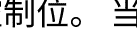

分别测量综合症以诊断位翻转错误和相位错误。CSS构造的一个重要特例是当一个码字 $C$ 包含其对偶码 $C^{\perp}$。然后我们可以选择 $C_1 = C$ 和 $C_2 = C^{\perp} \subseteq C$；$C$ 奇偶校验在$F$基和$P$基上计算以确定两个综合症。

## 7.7 7比特码

最简单的CSS码是由安德鲁·斯蒂恩首次提出的$\[[n, k, d]] = [7, 1, 3]$ 量子码。它由经典的7比特汉明码构建而成。

汉明码是一个 $[n, k, d] = [7, 4, 3]$ 的经典码，具有$3 \times 7$的校验矩阵。

### 奇偶校验矩阵

$$ H = \begin{pmatrix} 1 & 0 & 1 & 0 & 1 & 0 & 1 \\ 0 & 1 & 1 & 0 & 0 & 1 & 1 \\ 0 & 0 & 0 & 1 & 1 & 1 & 1 \end{pmatrix}. \qquad\qquad (7.90) $$

为了证明码的距离为$d=3$，首先注意到权重为3的字符串$(1110000)$通过奇偶校验，并且因此在码中。现在我们需要证明码中没有权重为$1$或$2$的向量。如果$e_{1}$的权重为$1$，则$He_{1}$是$H$的列之一。但是$H$的任何列都不是平凡的（全为零），因此$e_{1}$不能在码中。任何权重为$2$的向量都可以表示为$e_{1}+e_{2}$，其中$e_{1}$和$e_{2}$是不同的权重为$1$的向量。但是
$$ H(e_{1}+e_{2})=He_{1}+He_{2}=0, \qquad\qquad (7.91) $$
因为 $H$的所有列都是不同的。因此， $e_{1}+e_{2}$不能在编码中。

矩阵 $H$的行本身通过奇偶校验，因此也在编码中。（与通常的线性代数直觉相反，有限域 $F_{2}$上的非零向量可以与自身正交。）海明码的生成矩阵 $G$可以写成
$$ G = \begin{pmatrix} 1 & 0 & 1 & 0 & 1 & 0 & 1 \\ 0 & 1 & 1 & 0 & 0 & 1 & 1 \\ 0 & 0 & 0 & 1 & 1 & 1 & 1 \\ 1 & 1 & 1 & 0 & 0 & 0 & 0 \end{pmatrix}; \qquad\qquad (7.92) $$
前三行与 $H$的行相同，并将重量为3的码字（1110000）附加为第四行。海明码的对偶是[7, 3, 4]码，由 $H$生成。在这种情况下，码的对偶实际上包含在码中 - 实际上，它是海明码的偶子码，只包含那些偶重量的海明码字。奇数码字（1110000）是偶子码的非平凡余类的代表。对于CSS构造，我们将选择 $C_{1}$为海明码， $C_{2}$为其对偶，即偶子码。因此， $C_{2}^{\perp} = C_{1}$再次是海明码；我们将使用海明奇偶校验同时检测 $F$基中的位翻转和 $P$基中的相位翻转。

### 7.7.7量子比特编码

在F基下，这个CSS码的两个正交归一码字，每个与偶子码的不同陪集相关联，可以表示为
$$|\bar{0}\rangle_F = \frac{1}{\sqrt{8}} \sum_{\substack{\text{偶数} v \\ \in \text{Hamming}}} |v\rangle,$$ $$|\bar{1}\rangle_F = \frac{1}{\sqrt{8}} \sum_{\substack{\text{奇数} v \\ \in \text{Hamming}}} |v\rangle. \tag{7.93}$$

由于$|\bar{0}\rangle_F$和$|\bar{1}\rangle_F$都是Hamming码字的叠加，可以通过进行H奇偶校验来诊断位翻转。在Hadamard旋转基下，这些码字变为
$$H^{(7)} : |\bar{0}\rangle_F \to |\bar{0}\rangle_P \equiv \left(\frac{1}{4}\right) \sum_{v \in \text{Hamming}} |v\rangle = \frac{1}{\sqrt{2}}(|\bar{0}\rangle_F + |\bar{1}\rangle_F)$$ $$|\bar{1}\rangle_F \to |\bar{1}\rangle_P \equiv \left(\frac{1}{4}\right) \sum_{v \in \text{Hamming}} (-1)^{\text{wt}(v)}|v\rangle = \frac{1}{\sqrt{2}}(|\bar{0}\rangle_F - |\bar{1}\rangle_F). \tag{7.94}$$

在这个基础上，状态是哈明码字的叠加，因此在 P 基础上的位翻转（在原始基础上的相位翻转）可以再次通过 H 奇偶校验进行诊断。（我们顺便提一下，对于这个码，执行位哈达玛变换也实现了对编码数据的哈达玛旋转，这一点将与我们在下一章中讨论的容错量子计算相关。）Steane的量子码可以纠正块中任意一个七比特的单比特翻转和单相位翻转。但是，如果两个不同的比特同时经历位翻转或相位翻转，恢复将失败。如果 $e_1$ 和 $e_2$是两个不同的权重为一的字符串，则 $He_1 + He_2$是两个不同列的和 $H$，因此是 $H$的第三列（长度为3的所有非平凡字符串都出现在 $H$的列中）。因此，存在另一个权重为一的字符串 $e_3$，使得 $He_1 + He_2 = He_3$，或者
$$H(e_1 + e_2 + e_3) = 0; \tag{7.95}$$
因此 $e_1 + e_2 + e_3$是汉明码中的一个权重为3的字。我们将把综合症 $He_3$解释为错误 $v \to v + e_3$已经发生的指示，并且我们将尝试通过应用操作 $v \to v + e_3$来恢复。总的来说，

因此，两个位翻转错误和我们错误的恢复尝试的影响是将 $e_1 + e_2 + e_3$ （一个奇权重的汉明码字）添加到数据中，这将导致编码后的量子比特翻转
$$|\overline{0}\rangle_F \leftrightarrow |\overline{1}\rangle_F. \quad (7.96)$$

类似地，F基础上的两个相位翻转在P基础上是两个位翻转，在错误恢复之后对编码后的量子比特产生影响
$$|\overline{0}\rangle_P \leftrightarrow |\overline{1}\rangle_P, \quad (7.97)$$
或者等价地
$$|\overline{0}\rangle_F \rightarrow |\overline{0}\rangle_F$$
$$|\overline{1}\rangle_F \rightarrow -|\overline{1}\rangle_F, \quad (7.98)$$
在 F基上对编码比特进行相位翻转。如果有一个比特翻转和一个相位翻转（无论是在同一个比特上还是不同的比特上），恢复将会成功。

## 7.8 一些码参数的限制

Shor的码可以保护一个编码比特免受块中任意一个九个比特的错误影响，而Steane的码将块大小从九个减少到七个。我们还能做得更好吗？

### 7.8.1 量子海明界限

为了了解我们可能做得更好的程度，让我们看看是否可以推导出给定的 $[[n, k, d]]$ 量子码的距离 $d= 2t+ 1$ 的任何界限。$n$ 和 $k$. 首先，假设我们将注意力限制在非退化码上，这些码为每个可能的错误分配一个不同的综合征。在给定的量子比特上，有三种可能的线性独立错误 $X$, $Y$, 或 $Z$. 在一组量子比特中，有 $\binom{n}{j}$ 种选择 $j$ 个受错误影响的量子比特的方式，每个量子比特有三种可能的错误；因此，重量不超过 $t$ 的可能错误总数为
$$N(t) = \sum_{j=0}^{t} 3^j \binom{n}{j} . \quad (7.99)$$

如果有$k$个编码量子比特，则有$2^k$个线性独立的码字。如果所有的 $\mathbf{E}_a| \overline{j} \rangle$都是线性独立的，其中 $\mathbf{E}_a$是重量不超过 $t$的任何错误，$|\overline{i}\rangle$是码字基的任何元素，则 $N(t) \cdot 2k$个独立向量需要足够大的$2^n$希尔伯特空间维度来容纳；因此

$$N(t) = \sum_{j=0}^{t} 3^{j} \binom{n}{j} \leq 2^{n-k}. \quad \text{(7.100)}$$

这个结果被称为量子海明界限。对于经典分块码也存在类似的界限，但没有$3^j$的因子，因为只有一种类型的错误（翻转）可以影响经典比特。我们还强调，量子海明界限仅适用于非退化编码的情况，而经典海明界限适用于一般情况。然而，截至1999年1月，尚未构建出违反量子海明码的非退化量子码。

对于具有一个编码量子比特（$k=1$）且纠正一个错误（$t=1$）的码字的特殊情况，量子海明界限变为

$$1 + 3n \leq 2^{n-1}, \quad \text{(7.101)}$$

对于 $n \geq 5$，这个不等式成立。实际上，当 $n=5$时，不等式达到饱和（$1+15=16$）。如果存在一个非退化的$[[5,1,3]]$量子码，它是完美的：需要整个32维希尔伯特空间来容纳作用于所有码字上的所有可能的单比特错误—没有浪费的空间。

### 7.8.2 无克隆界限

然而，我们仍然可以想知道是否存在一个退化的 $n=4$编码可以纠正一个错误。事实上，很容易看出这样的编码是不存在的。我们已经知道一个可以在任意位置纠正 $t$个错误的编码也可以用来纠正已知位置的$2t$个错误。假设我们有一个 $[[4,1,3]]$量子编码。然后我们可以将一个单比特编码到这个四比特块中，并将块分成两个子块，每个子块包含两个比特。

如果我们在这两个子块中分别附加 $|00\rangle$，那么原始块就会产生两个后代，每个后代都有两个定位错误。如果我们能够纠正每个后代中的两个定位错误，我们将获得两个相同的父块副本——我们将克隆一个未知的量子态，这是不可能的。因此，不存在 $[[4,1,3]]$ 量子编码。我们得出结论，$n=5$ 是纠正一个错误的量子编码的最小块大小，无论编码是否退化。相同的推理表明，$[[n, k \geq 1, d]]$ 编码只能存在于
$$ n > 2(d - 1) . $$

### 7.8.3 量子Singleton界

我们现在将看到这个结果等式 (7.102) 可以被加强为
$$ n - k \geq 2(d - 1). $$
等式 (7.103) 类似于经典码参数的Singleton界，
$$ n - k \geq d - 1, $$
因此被称为“量子Singleton界”。对于一个经典线性码来说，Singleton界是显而易见的：只有当奇偶校验矩阵的任意 d-1列线性无关时，码才能具有距离 d. 由于这些列的长度为 n - k，最多只能有 n - k 列线性无关；因此 d-1不能超过 n - k. Singleton界也适用于非线性码。

可以找到一个优雅的证明量子Singleton界的方法，利用了 §5.2中讨论的Von Neumann熵的次可加性。我们首先引入一个 k量子比特的辅助量子比特，并构造一个将辅助量子比特与QECC的$2^k$码字最大纠缠的纯态：
$$ |\Psi\rangle_{AQ} = \frac{1}{\sqrt{2^k}} \sum |x\rangle_A |\bar{x}\rangle_Q , $$
其中 $\{ |x\rangle_A \}$ 表示辅助比特的$2^k$维希尔伯特空间的正交基， $\{ |\bar{x}\rangle_Q \}$ 表示编码子空间的$2^k$维正交基。如果我们追踪长度为N的编码块 Q，辅助比特的密度矩阵 $\rho_A$ 为
$$ \frac{1}{2^k} I , \text{其熵为} $$
$$ S(A) = N = S(Q). $$

现在，如果编码距离为 $d$，那么 $d - 1$ 个定位错误可以被纠正；或者，正如我们所见，作用于 $d - 1$ 个比特的任何可观测量都无法揭示编码状态的任何信息。换句话说，这个可观测量对于处于纠缠态 $|\Psi\rangle$ 的辅助比特的状态没有任何信息。

现在，由于我们已经知道 $n > 2(d - 1)$（如果 $k \geq 1$），让我们想象将代码块 $Q$ 分为三个不相交的部分：一组 $d - 1$ 量子比特 $Q_{d-1}^{(1)}$，另一组不相交的 $d - 1$ 量子比特 $Q_{d-1}^{(2)}$，以及剩余的量子比特 $Q_{n - 2(d-1)}^{(3)}$。如果我们追踪 $Q^{(2)}$ 和 $Q^{(3)}$，我们得到的密度矩阵必须不包含 $Q^{(1)}$ 和辅助比特 $A$ 之间的相关性。这意味着系统 $AQ^{(1)}$ 的熵是可加的：
$$S(Q^{(2)}Q^{(3)}) = S(AQ^{(1)}) = S(A) + S(Q^{(1)}). \tag{7.107}$$

同样地，
$$S(Q^{(1)}Q^{(3)}) = S(AQ^{(2)}) = S(A) + S(Q^{(2)}). \tag{7.108}$$

此外，一般来说，冯·诺依曼熵是次可加的，因此
$$\begin{aligned}
S(Q^{(1)}Q^{(3)}) &\leq S(Q^{(1)}) + S(Q^{(3)}) \\
S(Q^{(2)}Q^{(3)}) &\leq S(Q^{(2)}) + S(Q^{(3)})
\end{aligned} \tag{7.109}$$

将这些不等式与上述等式结合起来，我们得到
$$\begin{aligned}
S(A) + S(Q^{(2)}) &\leq S(Q^{(1)}) + S(Q^{(3)}) \\
S(A) + S(Q^{(1)}) &\leq S(Q^{(2)}) + S(Q^{(3)}).
\end{aligned} \tag{7.110}$$

只有同时满足这两个不等式时，才能够成立
$$S(A) \leq S(Q^{(3)}) \tag{7.111}$$

现在 $Q^{(3)}$ 的维度为 $n - 2(d - 1)$，它的熵上界由其维度限制
$$S(A) = k \leq n - 2(d - 1), \tag{7.112}$$
这就是量子Singleton界限。

$[[5,1,3]]$码达到了这个界限，但对于大多数的 $n$ 和 $k$，这个界限并不紧密 Rains得到了更强的结果，即一个 $[[n, k, 2t + 1]]$码，其中 $k \geq 1$ 必须满足
$$t \leq \left\lfloor \frac{n + 1}{6} \right\rfloor, \tag{7.113}$$
其中 $[x] = \text{“floor } x\text{”}$ 表示大于等于 $x$ 的最大整数。因此，能够纠正 $t= 1,2,3,4,5$ 个错误的最小长度的 $k=1$ 码是 $n= 5,11,17,23,29$。除了 $[[23,1,9]]$ 码，所有这些参数的码都已经构造出来了。

## 7.9 稳定码

### 7.9.1 一般公式

我们将能够构建一个（非退化的） $[[5,1,3]]$ 量子码，但是为了做到这一点，我们需要一个比CSS程序更强大的构建量子码的过程。

回想一下，为了建立一个错误恢复可能性的标准，我们发现将一个错误超算符展开为$n$-qubit Pauli算符的形式非常有用。但是直到现在，我们还没有利用这些算符的群结构（Pauli算符的乘积是一个Pauli算符）。事实上，我们将看到群论是构建QECC的强大工具。对于一个单比特，我们现在更方便地选择所有的Pauli算符由实矩阵表示，所以我现在将使用一个符号，其中 $\boldsymbol{Y}$ 表示反厄米矩阵。
$$ \boldsymbol{Y} = i\sigma_y = \begin{pmatrix} 0 & 1 \\ -1 & 0 \end{pmatrix}, \qquad \qquad (7.114) $$
满足 $\boldsymbol{Y}^2 = -\boldsymbol{I}$。然后运算符
$$ \{\pm \boldsymbol{I}, \pm \boldsymbol{X}, \pm \boldsymbol{Y}, \pm \boldsymbol{Z}\} \equiv \pm\{\boldsymbol{I}, \boldsymbol{X}, \boldsymbol{Y}, \boldsymbol{Z}\}, \qquad \qquad (7.115) $$
是一个8阶群的元素。$^1$单量子比特Pauli算符的$n$次张量积也形成一个群
$$ G_n = \pm \{\boldsymbol{I}, \boldsymbol{X}, \boldsymbol{Y}, \boldsymbol{Z}\}^{\oplus n}, \qquad \qquad (7.116) $$
阶数为 $|G_n|= 2^{2n+1}$ (因为有 $4^n$ 个可能的张量积，再加上一个 $\pm$ 符号的因素) 我们将 $G_n$ 称为 $n$ 量子比特 $Pauli$ 群。(实际上，我们将术语“Pauli群”用来指代抽象的)

$^1$它不是四元数群，而是8阶的另一个非阿贝尔群——正方形的对称群。元素 $\boldsymbol{Y}$，阶为4，可以看作是平面的$90^{\circ}$旋转，而 $\boldsymbol{X}$ 和 $\boldsymbol{Z}$ 是关于两个正交轴的反射。

## 7.9. 稳定码

群 $G_n$，以及它的维度为 $2^n$ 的忠实么正表示，通过 $2 \times 2$ 矩阵的张量积来表示；它唯一的维度大于 1 的不可约表示。）注意，$G_n$ 有两个元素的中心 $Z_2 = \{ \pm I^{\otimes n} \}$。如果我们将中心降维，我们得到群 $\bar{G}_n \equiv G_n/Z_2$；这个群也可以看作是一个维度为 $2^{2n}$ 的二进制向量空间，这是我们将要利用的性质。

$(2^n$维表示的) Pauli群 $G_n$ 显然具有以下特性：

- (i) $G_n$ 中的每个 $M$ 都是么正的，$M^{-1}= M^\dagger$。
- (ii) 对于 $G_n$ 中的每个元素 $M$，$M^2 = \pm I \equiv \pm I^{\otimes n}$。此外，如果张量积中的 $Y$ 的数量是偶数，则 $M^2 = I$；如果 $Y$ 的数量是奇数，则 $M^2 = -I$。
- (iii) 如果 $M^2 = I$，则 $M$ 是厄米的 ($M = M^\dagger$)；如果 $M^2 = -I$，则 $M$ 是反厄米的 ($M = -M^\dagger$)。
- (iv) $G_n$ 中的任意两个元素 $M$ 和 $N$ 要么交换，要么反交换：$MN = \pm NM$。

我们将使用Pauli群来描述量子纠错码（QECC），具体如下：让 $S$ 表示Pauli群 $G$ 的一个阿贝尔子群。因此，$S$ 对 $\mathcal{H}_{2^n}$ 上的所有元素的作用都可以同时对角化。那么，与 $S$ 相关的稳定子码 $\mathcal{H}_S \subseteq \mathcal{H}_{2^n}$ 是所有 $S$ 的元素的特征值为 1 的同时特征空间。也就是说，

对于所有 $M \in S$，如果 $|\psi\rangle \in \mathcal{H}_S$，则 $M|\psi\rangle = |\psi\rangle$。 		 (7.117)

群 $S$ 被称为码的稳定子，因为它保持所有码字不变。

群 $S$ 可以通过其生成元来描述。这些生成元是独立的（没有一个可以表示为其他元素的乘积），并且每个 $S$ 的元素都可以表示为生成元的乘积。如果 $S$ 有 $n-k$ 个生成元，我们可以证明码空间 $\mathcal{H}_S$ 具有 $2^k$ 维，即有 $k$ 个编码比特。

为了验证这一点，首先注意到每个 $M \in S$ 必须满足 $M^2 = I$；如果 $M^2 = -I$，那么 $M$ 不能有特征值 $+1$。此外，对于每个 $M = \pm I$ 在 $G_n$ 中平方为一的情况，特征值 $+1$ 和 $-1$ 具有相等的简并度。这是因为对于每个 $M = \pm I$，存在一个 $N \in G_n$ 与 $M$ 反对易，

$$NM = -MN; \quad (7.118)$$

因此， $M|\psi\rangle = |\psi\rangle$ 当且仅当 $M(N|\psi\rangle) = -N|\psi\rangle$，而单位 $N$ 的作用建立了 $M$ 的+1特征态和 -1特征态之间的一一对应关系。因此有 $\frac{1}{2} (2^n) = 2^{n-1}$ 相互正交的状态

$$M_1|\psi\rangle = |\psi\rangle, \quad (7.119)$$

其中 $M_1$ 是 $S$ 的一个生成元。

现在让 $M_2$ 成为 $G$ 中与 $M_1$ 交换的另一个元素，使得我们可以找到一个 $N \in G$，它与 $M_1$ 交换，但与 $M_2$ 反交换；因此 $N$ 保持 $M_1$ 的 +1 特征空间，但在这个空间中，它交换 $M_2$ 的 +1 和 -1 特征态。由此得出满足条件的空间

$$M_1|\psi\rangle = M_2|\psi\rangle = |\psi\rangle, \quad (7.120)$$

具有维度 $2^{n-2}$。

继续这样下去，我们注意到如果 $M_j$ 与 $\{M_1, M_2, ... M_{j-1}\}$ 独立，那么存在一个与 $M_1, ..., M_{j-1}$ 交换的 $N$ (我们将在下面更详细地讨论如何找到这样的 $N$)。因此，限制在 $M_1=M_2=...=M_{j-1}=1, M_j$ 的空间中，具有与 -1 特征向量一样多的 +1 特征向量。

稳定子语言很有用，因为它提供了一种简单的方式来描述代码可以检测和纠正的错误。我们可以将 $n - k$ 个稳定子生成元 $M_1, ..., M_{n-k}$ 视为代码的检查算子，即我们用来诊断错误的集体可观测量。

如果编码信息没有损坏，那么我们将找到 $M_i = 1$ 对于每个发生器；但是如果对于某些 $i$, $M_i = -1$，那么数据与编码子空间正交，表示发生了错误。

回想一下，错误超算符可以用元素 $E_a$ 展开，$E_a$ 是 Pauli 群的一个元素。一个特定的 $E_a$ 要么与特定的稳定子生成器 $M$ 交换，要么与其反交换。如果 $E_a$ 和 $M$ 交换，那么

$$M E_a|\psi\rangle = E_a M|\psi\rangle = E_a|\psi\rangle, \quad (7.121)$$

对于 $|\psi\rangle \in \mathcal{H}_S$，因此错误保持值 $M = 1$。但是如果 $E_a$ 和 $M$ 反对易，则

$$M E_a|\psi\rangle = -E_a M|\psi\rangle = -E_a|\psi\rangle, \tag{7.122}$$

这样错误会翻转 $M$ 的值，并且可以通过测量 $M$ 来检测错误。

对于稳定子生成器 $M_i$ 和错误 $E_a$，我们可以写成

$$M_i E_a = (-1)^{s_{ia}} E_a M_i, \tag{7.123}$$

这些 $s_{ia}$ 的值，$i=1, \dots, n-k$ 构成了错误 $E_a$ 的综合症，如果错误 $E_a$ 发生，测量 $M_i$ 的结果将会是 $(-1)^{s_{ia}}$。对于非退化码的情况，所有 $E_a \in \mathcal{E}$ 的 $s_{ia}$ 值都是不同的，因此测量 $n-k$ 个稳定子生成器将完全诊断错误。

更一般地，让我们找到一个满足稳定器的条件，以确保错误恢复是可能的。回想一下，对于每个 $E_a$，$E_b \in \mathcal{E}$ 和归一化的 $|\psi\rangle$ 在编码子空间中，我们有

$$\langle \psi | E_a^\dagger E_b | \psi \rangle = C_{ab}, \tag{7.124}$$

其中 $C_{ab}$ 与 $|\psi\rangle$ 无关。我们可以看到，只要对于每个 $E_a$，$E_b \in \mathcal{E}$，以下情况之一成立：

- 1) $E_a^\dagger E_b \in S$，
- 2) 存在一个 $M \in S$ 与 $E_a^\dagger E_b$ 反对易。

在情况 (2) 中，假设 $M \in S$ 且 $M E_a^\dagger E_b = -E_a^\dagger E_b M$。然后

$$\begin{aligned}
\langle \psi | E_a^\dagger E_b | \psi \rangle &= \langle \psi | E_a^\dagger E_b M | \psi \rangle \\
&= -\langle \psi | M E_a^\dagger E_b | \psi \rangle = -\langle \psi | E_a^\dagger E_b | \psi \rangle, \tag{7.125}
\end{aligned}$$

因此 $\langle \psi | E_a^\dagger E_b | \psi \rangle = 0$。

因此，一个纠错集 $\mathcal{E}$ 的稳定码是由一个Pauli群的阿贝尔子群 $S$ 固定的空间 $\mathcal{H}_S$，其中每个 $E_a^\dagger E_b$ 与 $E_{a,b} \in \mathcal{E}$ 之间的关系满足条件 (1) 或 (2)。如果条件 (1) 对于任何 $E_a^\dagger E_b$ 都不满足，则该码是非退化的。

显然，我们也可以选择代码子空间为 $G^n$ 的任意一个 $2^{n-k}$ 个独立交换元素的同时本征空间。但实际上，所有这些代码都是等价的。我们可以认为，如果两个稳定子代码只是在量子比特的标签和每个单比特希尔伯特空间的基础上有所不同，那么它们是等价的。这意味着一个代码的稳定子可以通过量子比特的排列和单比特变换的张量积转换为另一个代码的稳定子。如果我们将稳定子生成元分为两组 $\{M_1, ..., M_j\}$ 和 $\{M_{j+1}, ..., M_{n-k}\}$，那么存在一个 $N \in G_n$，它与第一组的每个成员都交换，与第二组的每个成员都反交换。将 $N$ 应用于 $|\psi\rangle \in \mathcal{H}_S$ 会保持第一组的本征值，同时翻转第二组的本征值。由于 $N$ 只是单比特酉变换的张量积，所以在选择所有本征值为1时没有损失（等价）。此外，由于负号在指定稳定子时并不重要，我们可以说，如果在相位上，两个代码的稳定子通过 $X, Y, Z$ 的每个单比特的排列而不同，那么它们是等价的。

如果存在一个与稳定子交换但不在稳定子中的 $E_a^\dagger E_b$，恢复可能失败。这是一个保持编码子空间 $\mathcal{H}_S$ 的算符，但在该空间中可能会有非平凡的作用；因此它可以修改编码信息。由于 $E_a|\psi\rangle$ 和 $E_b|\psi\rangle$ 具有相同的综合症状，我们可能会错误地将 $E_a$ 错误解释为 $E_b$ 错误；错误以及恢复尝试的效果是数据上应用了 $E_b^\dagger E_a$，这可能会造成损害。

距离为 $d$ 的稳定子码具有以下特性：对于每个 $G_n$ 中权重小于 $d$ 的 $E \in G_n$，它要么在稳定子中，要么与稳定子的某个元素反对易。如果稳定子不包含权重小于 $d$ 的元素，则该码是非退化的。距离为 $d = 2t + 1$ 的码可以纠正 $t$ 个错误，距离为 $s + 1$ 的码可以检测 $s$ 个错误或在已知位置纠正 $s$ 个错误。

### 7.9.2 辛几何符号

稳定子码的性质通常最好通过线性代数的语言来解释和表达。码的稳定子 $S$ 是码的一个阶为2的 $n-k$ 阿贝尔子群，其所有元素的平方等于单位元，可以等价地看作是一个维度为 $n - k$ 的闭合线性子空间，对于某个（辛）内积是自正交的。

群 $\bar{G} = G_n/Z_2$ 同构于二进制向量空间 $\mathbb{F}_2^{2n}$。我们通过观察得出这一点，因为 $Y = ZX$，Pauli群的任意元素（上下 $\pm$ 符号）都可以表示为 $Z$ 和 $X$ 的乘积；我们可以写成

$$M = Z_M \cdot X_M$$

其中 $Z_M$ 是 $Z$ 的张量积，$X_M$ 是 $X$ 的张量积。更明确地说，一个Pauli算符可以写成

$$(\alpha|\beta) \equiv Z(\alpha)X(\beta) = \bigotimes_{i=1}^n Z^{\alpha_i} \cdot \bigotimes_{i=1}^n X^{\beta_i} \tag{7.127}$$

其中 $\alpha$ 和 $\beta$ 是长度为 $n$ 的二进制字符串。（然后 $Y$ 在 $\alpha$ 和 $\beta$ “碰撞”的位置起作用。）在 $G_n$ 中的乘法映射到 $\mathbb{F}_2^{2n}$ 中的加法：

$$(\alpha|\beta)(\alpha'|\beta') = (-1)^{\alpha' \cdot \beta}(\alpha + \alpha'|\beta + \beta') ; \tag{7.128}$$

相位的产生是因为 $\alpha' \cdot \beta$ 计算了在将乘积重新排列为式 (7.127) 的标准形式时， $Z$ 与 $X$ 交换的次数。根据式 (7.128)， Pauli算符的交换性质可以表示为

$$(\alpha|\beta)(\alpha'|\beta') = (-1)^{\alpha \cdot \beta' + \alpha' \cdot \beta}(\alpha'|\beta')(\alpha|\beta) \tag{7.129}$$

因此，如果对应的向量在“辛内积”下正交，则两个Pauli算子相互交换

$$\alpha \cdot \beta' + \alpha' \cdot \beta . \tag{7.130}$$

我们还注意到，一个Pauli算子的平方是

$$(\alpha|\beta)^2 = (-1)^{\alpha \cdot \beta}I , \tag{7.131}$$

因为 $\alpha \cdot \beta$ 计算算子中 $I$ 的数量；它的平方等于单位矩阵当且仅当

$$\alpha \cdot \beta = 0.\qquad (7.132)$$

请注意，具有这种属性的闭子空间是自正交的，因为

$$\alpha \cdot \beta' + \alpha' \cdot \beta = (\alpha + \alpha') \cdot (\beta + \beta') - \alpha \cdot \beta - \alpha' \cdot \beta' = 0;\qquad (7.133)$$

在群语言中，即 $G_n$ 的一个子群，每个元素平方等于 $I$ 的子群自动是阿贝尔群。

使用线性代数语言，可以通过计算线性约束来轻松验证关于 Pauli 群的一些陈述。

如果对应的向量在 $\mathbb{F}_2^{2n}$ 上线性无关，则元素是独立的，因此我们可以将稳定子的 $k$ 个生成元视为维度为 $k$ 的线性子空间的基。我们将使用符号 $S$ 来表示线性空间和相应的阿贝尔群。

然后，$S^\perp$ 表示与 $S$ 中的每个向量正交（相对于辛内积）的向量的维度为 $n+k$ 空间。注意，$S^\perp$ 包含 $S$，因为 $S$ 中的所有向量是相互正交的。在群语言中，对应于 $S^\perp$ 的是 $S$ 在 $\bar{G}$ 中的正规化子（或中心化子）群 $N(S) (\equiv S^\perp)$ - 包含所有与 $S$ 的每个元素相交换的元素的 $\bar{G}$ 的子群。由于 $S$ 是阿贝尔的，它包含在它自己的正规化子中，该子群还包含其他元素（将在下面进一步讨论）。距离码的稳定子具有每个 $(\alpha|\beta)$ 的权重 $\sum_i (\alpha_i \lor \beta_i)$ 小于 $d$ 的性质，要么位于稳定子空间 $S$ 中，要么位于正交空间 $S^\perp$ 之外。

一个代码可以通过其稳定子来描述，一个稳定子可以通过其生成元来描述，并且这些生成元可以用一个 $(n-k) \times 2n$ 矩阵表示

$$H = (H_Z | H_X).\qquad (7.134)$$

这里每一行都是一个 Pauli 算子，用 $(\alpha|\beta)$ 表示。一个错误 $E_a$ 的综合症是由其与生成元 $M_i = (\alpha'_i|\beta'_i)$ 的交换性质决定的；也就是说

$$s_{ia} = (\alpha_a|\beta_a) \cdot (\alpha'_i|\beta'_i) = \alpha_a \cdot \beta'_i + \alpha'_i \cdot \beta_a.\qquad (7.135)$$

在非退化码的情况下，每个错误都有一个不同的综合症。如果代码是退化的，可能会有几个具有相同综合症的错误，但我们可以应用观察到的综合症对应的任何一个 $E^{\dagger}_a$ 来进行恢复。

### 7.9.3 一些稳定码的例子

(a) 九量子比特码。这个 $\[[9,1,3]]$ 码有八个稳定器生成元，可以表示为

$$
\begin{aligned}
Z_1 Z_2, \quad Z_2 Z_3, \quad Z_4 Z_5, \quad Z_5 Z_6, \quad Z_7 Z_8, \quad Z_8 Z_9 \\
X_1 X_2 X_3 X_4 X_5 X_6, \quad X_4 X_5 X_6 X_7 X_8 X_9.
\end{aligned}
\tag{7.136}
$$

在方程 (7.134) 的符号表示中，它们变为

| $H_Z$ | $H_X$ |
| :--- | :--- |
| 1 1 0 0 0 0 0 0 0 | 0 0 0 0 0 0 0 0 0 |
| 0 1 1 0 0 0 0 0 0 | 0 0 0 0 0 0 0 0 0 |
| 0 0 0 1 1 0 0 0 0 | 0 0 0 0 0 0 0 0 0 |
| 0 0 0 0 1 1 0 0 0 | 0 0 0 0 0 0 0 0 0 |
| 0 0 0 0 0 0 1 1 0 | 0 0 0 0 0 0 0 0 0 |
| 0 0 0 0 0 0 0 1 1 | 0 0 0 0 0 0 0 0 0 |
| 0 0 0 0 0 0 0 0 0 | 1 1 1 1 1 1 0 0 0 |
| 0 0 0 0 0 0 0 0 0 | 0 0 0 1 1 1 1 1 1 |

(b) 七量子比特码。这个 $\[[7,1,3]]$ 码有六个稳定器生成元，可以表示为

$$H \sim \left( \begin{array}{c|c}
H_{\text{ham}} & 0 \\
\hline
0 & H_{\text{ham}}
\end{array} \right),
\tag{7.137}$$

其中 $H_{\text{ham}}$ 是经典 $[7,4,3]$ 汉明码的 $3 \times 7$ 奇偶校验矩阵。这三个校验算符

$$
\begin{aligned}
M_1 &= Z_1 Z_3 Z_5 Z_7 \\
M_2 &= Z_2 Z_3 Z_6 Z_7 \\
M_3 &= Z_4 Z_5 Z_6 Z_7,
\end{aligned}
\tag{7.138}
$$

检测位翻转和三个检查运算符

$$
\begin{aligned}
M_4 &= X_1 X_3 X_5 X_7 \\
M_5 &= X_2 X_3 X_6 X_7 \\
M_6 &= X_4 X_5 X_6 X_7,
\end{aligned}
\tag{7.139}$$

检测相位错误。满足海明奇偶校验的码字张成了空间 $M_1 = M_2 = M_3 = 1$。回忆一下，哈达玛变换将 $Z$ 和 $X$ 互换，我们可以看到在哈达玛旋转基下，满足海明奇偶校验的码字张成了空间 $M_4 = M_5 = M_6$。事实上，我们通过要求在两个基下都满足海明奇偶校验来构造了七比特编码。生成器相互对易是因为海明码包含了它的对偶码，即每一行 $H_{\text{ham}}$ 都满足海明奇偶校验。

(c) CSS代码。回想一下，当一个 $[n, k, d]$ 经典码 $C$ 包含它的对偶码 $C^{\perp}$ 时，我们可以进行CSS构造来获得一个 $\[[n, 2k-n, d]]$ 量子码。该码的稳定子可以写成

$$H \sim = \left( \begin{array}{c|c}
H & 0 \\
\hline
0 & H
\end{array} \right), \qquad \qquad (7.140)$$

其中 $H$ 是 $C$ 的 $(n-k) \times n$ 奇偶校验矩阵。对于七比特码，稳定子是可交换的，因为 $C$ 包含 $C^{\perp}$，并且码子空间由满足 $H$ 奇偶校验的状态所张成，无论是在 $Z$ 基底还是在 $X$ 基底下。等价地，码字满足 $H$ 奇偶校验并且在下述变换下保持不变

$$|v\rangle \rightarrow |v + w\rangle, \qquad \qquad (7.141)$$

其中 $w \in C^{\perp}$。

(d) 更一般的CSS代码。更一般地考虑，一个稳定子其生成元可以选择为 $Z$ 的乘积 $(\alpha|0)$ 或者 $X$ 的乘积 $(0|\beta)$。那么生成元的形式为

$$H \sim = \left( \begin{array}{c|c}
H_Z & 0 \\
\hline
0 & H_X
\end{array} \right). \qquad \qquad (7.142)$$

## 7.9 稳定码

现在，如果 \(H_X\) 和 \(H_Z\) 的 \(Z\) 生成元和 \(X\) 生成元要满足什么条件才能交换？由于 \(Z\) 必须与 \(X\) 碰撞一次或多次，我们有

\[H_X H_Z^T = H_Z H_X^T = 0. \tag{7.143}\]

但这只是要求码的对偶 \(C_X^\perp\) 的码要包含在码 \(C_Z\) 的对偶 \(H_Z\) 的码中。换句话说，这个QECC适用于CSS框架，其中

\[C_2 = C_X^\perp \subseteq C_1 = C_Z. \tag{7.144}\]

因此，我们可以将CSS代码描述为那些且仅那些满足稳定子具有形式 eq. (7.142) 的代码。然而，有一个注意事项。由 eq. (7.142) 定义的代码只有在错误限制为权重小于 \(d= \min(d_Z, d_X)\) （其中 \(d_Z\) 是 \(C_Z\) 的距离，\(d_X\) 是 \(C_X\) 的距离）时才是非退化的。但是，量子纠错码的真实距离可能超过 \(d\)。例如，9比特的代码在这个广义意义上是CSS代码。但是在这种情况下，经典代码 \(C_X\) 的距离为1，反映了，例如，\(Z_1Z_2\) 包含在稳定子中。尽管如此，CSS代码的距离为 \(d= 3\)，因为没有权重为2的Pauli算符位于 \(S^\perp \setminus S\) 中。

### 7.9.4 编码量子比特

我们已经看到，麻烦的错误是那些与稳定器交换但位于其外部的错误。这些Pauli算符还有另一个有趣之处：它们可以被看作是对由代码保护的编码数据进行作用的“逻辑”操作。

从“线性代数”观点来看，我们可以看到稳定器的正规化子群包含 \(n\) 个独立生成元- 在 \((\alpha|\beta)\) 的 \(n\) 维空间中，包含与每个线性独立向量正交的向量的子空间的维度为 \(k\)。在 \((\alpha|\beta)\) 的 \(2n\) 维空间中，包含与每个 \(n-k\) 个线性无关向量正交的向量的子空间具有维度

在这个空间中，有 \(n + k\) 个向量，其中 \(n - k\) 个可以选择为稳定器本身的生成元。剩下的

\(2k\) 个生成元保持编码子空间，因为它们与稳定子群交换，但在 \(k\) 个编码量子比特上起非平凡作用。

事实上，这两个 \(2k\) 操作可以选择为单比特操作 \(Z_i\)、 \(X_i\)，其中 \(i=1,2,..., k\)，其中 \(Z_i\)、 \(X_i\) 是Pauli算符 \(Z\) 和 \(X\) 的作用

在标记为 \(i\) 的编码量子位上。首先，注意我们可以将 \(k\) 稳定子生成元扩展为一组最大的 \(k\) 可交换算符。我们添加到该集合中的算符可以表示为 \(\bar{Z}_1, . . . \bar{Z}_k\)。然后，我们可以将 \(\bar{Z}\) 的同时本征态视为 . . . 在代码子空间 \(\mathcal{H}_S\) 中，将 \(\bar{Z}_1, . . .\) 的逻辑基态表示为 \(|\bar{z}_1, . . . , \bar{z}_k\rangle\)，其中 \(\bar{z}_j = 0\) 对应于 \(\bar{Z}_j = 1\)，而 \(\bar{z}_j = 1\) 对应于 \(\bar{Z}_j = -1\)。剩余的 \(k\) 生成器可以选择为相互交换和与稳定器交换，但它们将不会与任何 \(\bar{Z}_i\) 的交换。通过调用 Gram-Schmidt 正交化程序，我们可以选择这些生成器，表示为 \(\bar{X}_i\)，使其对角化简单辛形式，即

\[\bar{Z}_i \bar{X}_j = (-1)^{\delta_{ij}} \bar{X}_j \bar{Z}_i \tag{7.145}\]

因此，每个 \(\bar{X}_j\) 翻转相应的 \(\bar{Z}_j\) 的特征值，并且可以将其视为作用在编码量子位 \(i\) 上的Pauli算符 \(X\)。

-   **(a) 9量子比特代码。**

正如我们之前讨论的，逻辑运算符可以选择为

\[\bar{Z} = X_1 X_2 X_3,\]
\[\bar{X} = Z_1 Z_4 Z_7. \tag{7.146}\]

这些彼此反对易（一个 \(X\) 和一个 \(Z\) 在位置1碰撞），与稳定子生成器对易，并且与生成器无关（稳定子中没有包含三个 \(X\) 或三个 \(Z\) 的元素）。

-   **(b) 7量子比特代码。**

我们已经看到

\[\bar{X} = X_1 X_2 X_3,\]
\[\bar{Z} = Z_1 Z_2 Z_3; \tag{7.147}\]

然后 \(\bar{X}\) 添加一个奇数个汉明码字，而 \(\bar{Z}\) 翻转一个奇数个汉明码字的相位。这些操作在基础 \(\{|0\rangle_F, |1\rangle_F\}\)（在方程 (7.93) 中定义）中实现了一个比特翻转和一个相位翻转。

## 7.10 五量子比特码

到目前为止，我们考虑的所有量子纠错码都是CSS类型的 - 每个稳定子生成元要么是 \(Z\) 的乘积，要么是 \(X\) 的乘积。但并非所有稳定子码都具有这个特性。非CSS稳定子码的一个例子是完美非退化 \([[5,1,3]]\) 码。

它的四个稳定子生成元可以表示为

\[
\begin{aligned}
M_1 &= XZZXI, \\
M_2 &= IXZZX, \\
M_3 &= XIXZZ, \\
M_4 &= ZXIXZ,
\end{aligned}
\quad (7.148)
\]

通过对qubit进行循环置换，可以得到 \(M_{2,3,4}\)。（通过对qubit进行循环置换得到的第五个算符， \(M_5 = ZZXIX = M_1 M_2 M_3 M_4\) 与其他四个算符不独立）由于生成元的循环置换仍然是一个生成器，所以码本身是循环的 - 码字的循环置换仍然是一个码字。

显然，每个 \(M_i\) 都不包含 \(Y\)，所以平方为 \(I\)。对于每对生成元，存在两个碰撞，一个是 \(X\) 和 \(Z\) 之间的碰撞，另一个是生成元之间的碰撞，使得生成元可交换。可以快速检查每个重量为1或重量为2的Pauli算符与至少一个生成元反对易，因此代码的距离为3。

例如，考虑是否存在在前两个量子比特上具有支持的错误算符与所有四个生成元都可交换。重量为2的算符，要与 \(M_2\) 中的 \(IX\) 和 \(M_3\) 中的 \(XI\) 可交换，必须为 \(XX\)。但是， \(XX\) 与 \(M_1\) 中的 \(XZ\) 和 \(M_4\) 中的 \(ZX\) 反对易。在辛符号表示法中，稳定器可以表示为

\[
H \sim \begin{pmatrix}
01100 & 10010 \\
00110 & 01001 \\
00011 & 10100 \\
10001 & 01010
\end{pmatrix}
\quad (7.149)
\]

这个矩阵有一个很好的解释，因为它的每一列可以看作是一个单比特错误的综合症。例如，单比特位翻转算符 \(X_j\)，如果 \(M_i\) 在位置 \(j\) 上有 \(I\) 或 \(X\)，则与 \(M_i\) 可交换，如果 \(M_i\) 在位置 \(j\) 上有 \(Z\)，则反对易。因此，表格为

|    | X1 | X2 | X3 | X4 | X5 |
|:--:|:--:|:--:|:--:|:--:|:--:|
| M1 | 0  | 1  | 1  | 0  | 0  |
| M2 | 0  | 0  | 1  | 1  | 0  |
| M3 | 0  | 0  | 0  | 1  | 1  |
| M4 | 1  | 0  | 0  | 0  | 1  |

在位翻转事件中，测量结果列表为 \(M_{1,2,3,4}\)。（例如，如果第一个位翻转，测量结果 \(M_1 = M_2 = M_3= 1, M_4 = -1\)，则诊断错误。）同样，\(H\) 的右半部分可以被视为相位错误的综合表。

|    | Z1 | Z2 | Z3 | Z4 | Z5 |
|:--:|:--:|:--:|:--:|:--:|:--:|
| M1 | 1  | 0  | 0  | 1  | 0  |
| M2 | 0  | 1  | 0  | 0  | 1  |
| M3 | 1  | 0  | 1  | 0  | 0  |
| M4 | 0  | 1  | 0  | 1  | 0  |

由于 \(Y\) 与 \(X\) 和 \(Z\) 都反对易，我们通过对 \(X\) 和 \(Z\) 表的第 \(i\) 列求和来获得错误 \(Y_i\) 的综合症。

|    | Y1 | Y2 | Y3 | Y4 | Y5 |
|:--:|:--:|:--:|:--:|:--:|:--:|
| M1 | 1  | 1  | 1  | 1  | 0  |
| M2 | 0  | 1  | 1  | 1  | 1  |
| M3 | 1  | 0  | 1  | 1  | 1  |
| M4 | 1  | 1  | 0  | 1  | 1  |

通过检查，我们发现 \(X\)、\(Y\) 和 \(Z\) 综合表的15列都是不同的，因此我们再次验证我们的代码是一个非退化的代码，可以纠正一个错误。事实上，该代码是完美的 - 长度为4的15个非平凡二进制字符串都出现在其中一个表的列中。由于代码的循环特性，我们可以轻松地描述其稳定子的所有 15个非平凡元素。除了 \(M_1 = XZZXI\) 和通过量子位的循环排列得到的四个算符之外，稳定子还包含

\[M_3M_4 = -YXXYI, \tag{7.150}\]

以及它的循环排列，以及

\[M_2M_5 = -ZYYZI, \tag{7.151}\]

以及它的循环排列。显然，稳定子的所有元素都是重量为4的Pauli算符。
对于我们的逻辑算符，我们可以选择

\[\bar{Z} = ZZZZZ, \quad \bar{X} = XXXXX; \tag{7.152}\]

它们与 \(M_{1,2,3,4}\) 相互交换，平方为 \(I\)，并且彼此反对易。由于它们的重量为5，它们本身不包含在稳定子中。
因此，如果我们不介意破坏编码状态，我们可以通过测量每个量子比特的 \(Z\) 来确定编码比特的值，并评估结果的奇偶性。事实上，由于代码的距离为三，存在 \(S^{\perp} \setminus S\) 的权重为三的元素；通过乘以稳定子的元素，可以得到 \(\bar{Z}\) 和 \(\bar{X}\) 的替代表达式。例如，我们可以选择

\[\bar{Z} = (ZZZZZ) \cdot (-ZYYZI) = -IXXIZ, \tag{7.153}\]

（或其循环排列之一），以及

\[\bar{X} = (XXXXX) \cdot (-YXXYI) = -ZIIZX, \tag{7.154}\]

（或其循环排列之一）。因此，通过仅测量块中三个量子比特的 \(X\) 或 \(Z\)，并评估结果的奇偶性，可以确定 \(\bar{X}\) 或 \(\bar{Z}\) 的值。

如果我们愿意，我们可以构建一个码子空间的正交基，如下所示。从任意状态 \(|\psi_0\rangle\) 开始，我们可以得到

\[|\Psi_0\rangle = \sum_{M \in S} M|\psi_0\rangle, \tag{7.155}\]

这个（非归一化）状态满足对于每个 \(M' \in S\)，都有 \(M'|\Psi_0\rangle = |\Psi_0\rangle\)，因为稳定子的乘法只是对和式中的项进行置换。为了得到 \(\bar{Z}=1\) 编码态 \(|\bar{0}\rangle\)，我们可以从以下状态开始
\(|00000\rangle\)，它也是一个 \(\bar{Z}=1\) 本征态，但不在稳定子中；我们发现

（归一化后）

\[
\begin{aligned}
|\bar{0}\rangle &= \sum_{M \in S} M |00000\rangle \\
&= |00000\rangle + (M_1 + \text{循环排列}) |00000\rangle \\
&\quad + (M_3 M_4 + \text{循环排列}) |00000\rangle + (M_2 M_5 + \text{循环排列}) |00000\rangle \\
&= |00000\rangle + (|11001\rangle + \text{循环排列}) \\
&\quad - (|11110\rangle + \text{循环排列}) \\
&\quad - (|01100\rangle + \text{循环排列}) \quad . \tag{7.156}
\end{aligned}
\]

然后我们可以通过将 \(\bar{X}\) 应用于 \(|\bar{0}\rangle\) 来找到 \(|\bar{1}\rangle\)，即翻转所有5个量子比特：

\[
\begin{aligned}
|\bar{1}\rangle = \bar{X}|\bar{0}\rangle &= |11111\rangle + (|01101\rangle + \text{循环排列}) \\
&\quad - (|00001\rangle + \text{循环排列}) \\
&\quad - (|10011\rangle + \text{循环排列}) \quad . \tag{7.157}
\end{aligned}
\]

综合征如何测量？可以执行的电路来测量 \(M_1 = XZZXI\) 是：

- 图 -

对于第一个和第四个量子比特的Hadamard旋转将 \(M_1\) 旋转到 \(Z\) 的张量积 \(ZZZIZ\)，然后CNOT门将该算符的值印在辅助比特上。最后的Hadamard旋转将编码块返回到标准编码子空间。通过循环置换编码块中的五个量子比特，可以得到测量 \(M_2, M_3, M_4\) 的电路。

编码方面怎么样？我们想构建一个酉变换

\[U_{\text{encode}} : |0000\rangle \otimes (a|0\rangle + b|1\rangle) \rightarrow a|\bar{0}\rangle + b|\bar{1}\rangle. \tag{7.158}\]

我们已经看到 \(|00000\rangle\) 是一个 \(\bar{Z} = 1\) 的本征态，而 \(|00001\rangle\) 是一个 \(\bar{Z} = -1\) 的本征态。因此（归一化后）

\[a|\bar{0}\rangle + b|\bar{1}\rangle = \left( \sum_{M \in S} M \right) |0000\rangle \otimes (a|0\rangle + b|1\rangle). \tag{7.159}\]

### 7.10.5 编码电路

因此，我们需要找出如何构建一个电路，将 \(\left( \sum M \right)\) 应用于初始态。

由于生成元是独立的，稳定子的每个元素都可以表示为生成元的唯一乘积方式，因此我们可以将求和重写为

\[ \sum_{M \in S} M= (\boldsymbol{I} + \boldsymbol{M}_4)(\boldsymbol{I} + \boldsymbol{M}_3)(\boldsymbol{I} + \boldsymbol{M}_2)(\boldsymbol{I} + \boldsymbol{M}_1). \tag{7.160} \]

现在进一步进行，方便起见，我们可以用另一种形式来表示稳定子。注意我们可以自由地用生成元 \(M_i\) 替换 \(M_iM_j\) 而不改变稳定子。这种替换等价于在矩阵 \(\tilde{H}\) 中将第 \(j\) 行加到第 \(i\) 行。通过这样的行操作，我们可以对 \(4 \times 5\) 矩阵 \(H_X\) 进行高斯消元，从而得到稳定子的新表示。

\[ \tilde{H}' = \left(\begin{array}{ccccc|ccccc} 1 & 1 & 0 & 1 & 1 & 1 & 0 & 0 & 0 & 1 \\ 0 & 0 & 1 & 1 & 0 & 0 & 1 & 0 & 0 & 1 \\ 1 & 1 & 0 & 0 & 0 & 0 & 0 & 1 & 0 & 1 \\ 1 & 0 & 1 & 1 & 1 & 0 & 0 & 0 & 1 & 1 \end{array} \right), \tag{7.161} \]

或

\[ \begin{aligned} \boldsymbol{M}_1 &= \boldsymbol{Y}\boldsymbol{Z}\boldsymbol{I}\boldsymbol{Z}\boldsymbol{Y} \\ \boldsymbol{M}_2 &= \boldsymbol{I}\boldsymbol{X}\boldsymbol{Z}\boldsymbol{Z}\boldsymbol{X} \\ \boldsymbol{M}_3 &= \boldsymbol{Z}\boldsymbol{Z}\boldsymbol{X}\boldsymbol{I}\boldsymbol{X} \\ \boldsymbol{M}_4 &= \boldsymbol{Z}\boldsymbol{I}\boldsymbol{Z}\boldsymbol{Y}\boldsymbol{Y} \end{aligned} \tag{7.162} \]

以这种形式，\(\boldsymbol{M}_i\) 只对块中的第 \(i\) 个和第5个量子比特进行 \(\boldsymbol{X}\) (翻转)操作。采用这种形式的稳定子，我们可以应用 \(\frac{1}{\sqrt{2}}(\boldsymbol{I} + \boldsymbol{M}_1)\) 转换为一个状态 \(|0, z_2, z_3, z_4, z_5\rangle\) 通过执行电路

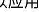

Hadamard门准备 \(\frac{1}{\sqrt{2}}(|0\rangle + |1\rangle)\)。如果第一个量子位是 \(|0\rangle\)，则其他操作不起作用，因此应用 \(\boldsymbol{I}\)。但如果第一个量子位是 \(|1\rangle\)，则已经对该量子位应用了 \(\boldsymbol{X}\)，并且电路中的其他门应用

ZZIZY, 在第一个量子位为 \(|1\rangle\) 的条件下。因此， \(Y ZIZY = M_1 - \frac{1}{2}(I + M_2)\) 已经应用。可以构建类似的电路来应用 \(|z_1, 0, z_3, z_4, z_5\rangle\) 等等。除了Hadamard门外，这些电路只对第1到第4个量子位应用 \(Z\) 和条件 \(Z\)；这些量子位不会翻转。（为了确保我们在 \(H_X\) 上执行了高斯消元。）因此，我们可以构建我们的编码电路如下


此外，作用于 \(|0\rangle\) 的每个 \(Z\) 门都可以被替换为恒等门，因此我们可以通过消除所有这样的门来简化电路，得到

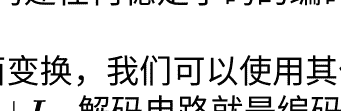

这个过程可以推广到构建任何稳定子码的编码电路。由于编码变换是酉变换，我们可以使用其伴随变换进行解码。而且，由于每个门的平方是 \(\pm I\)，解码电路就是编码电路的逆运行。

## 7.11 量子秘密共享

\([[5,1,3]]\) 码提供了一个可能应用量子纠错码的很好的例子。^2

假设一些绝密信息要委托给 \(n\) 个参与方。因为没有人完全可信，所以秘密被分成 \(n\) 份，以便每个参与方只能访问自己的份额，对于秘密一无所知。但是，如果足够多的参与方聚集在一起并共享他们的份额，他们可以解密秘密或其中的一部分。

特别是，一个 \((m, n)\) 阈值方案具有以下特性： \(m\) 份份额足以重构所有的秘密信息。但是从 \(m - 1\) 份份额开始

> ^2 R. Cleve, D. Gottesman, 和 H.-K. Lo, “如何分享一个量子秘密,” quant-ph/9901025.

## 7.11. 量子秘密分享

份额，无法提取任何信息。（这被称为阈值方案，因为当份额1， 2， 3...， m -1逐个收集时，没有学到任何东西，但是下一个份额越过阈值并揭示了一切。）我们应该区分两种类型的秘密：经典秘密是先验未知的比特串，而量子秘密是先验未知的量子状态。任何类型的秘密都可以被分享。特别是，我们可以通过从一组相互正交（纠缠）的量子态中选择一个，并将该态分配给各方来分发一个经典秘密。

我们可以看到，例如，[[5，1，3]]码可以在（3，5）门限方案中使用，其中共享信息是经典的。一个经典比特通过准备两个正交态之一 $|0\rangle$ 或 $|1\rangle$ 来编码，然后将这五个量子比特分发给五个参与方。我们已经看到（由于码是非退化的），如果任意两个参与方聚在一起，那么他们两个量子比特的密度矩阵 $\rho$ 是

\[ \rho^{(2)} = \frac{1}{4} \mathbf{1} \] (7.163)

因此，他们无法从任何对他们的两个量子比特的测量中获得关于量子态的任何信息。但我们也看到，该编码可以纠正两个定位错误或两个擦除错误。当任意三方聚在一起时，他们可以纠正两个错误（两个丢失的量子比特）并完美地重构编码态 $|0\rangle$ 或 $|1\rangle$。

很明显，通过类似的过程，可以共享一个量子信息的单比特 - [[5， 1， 3]]码也是（（3， 5））量子门限方案的基础（如果共享的信息是量子信息，则使用（（m， n））表示法，如果共享的信息是经典信息，则使用（m， n）表示法）。这个量子秘密共享场景如何推广到更多比特？假设我们准备了一个纯态 $|\psi\rangle$ 的n比特 - 它能在（（m， n））门限方案中使用吗？

我们知道m比特足以重构状态；因此可以纠正n-m个擦除错误。根据我们的一般纠错准则，任何权重为（n-m）的可观测量的期望值必须与状态 $|\psi\rangle$ 无关。

\[ \langle \psi | E | \psi \rangle \text{ 与 } |\psi\rangle \text{ 独立， } \text{wt}(E) \leq N - M \] (7.164)

因此，如果M个参与者拥有全部信息，其他N - M个参与者就没有任何信息。这是有道理的，因为量子信息无法被复制。

另一方面，我们知道M－1个分享不会透露任何信息，或者说

> ⟨ψ|E|ψ⟩与 |ψ⟩独立，wt(E) ≤ M－1。 (7.165)

由此可得M－1个擦除可以被纠正，或者说其他N－M+1个参与者拥有全部信息。

从这两个观察中我们得到了两个不等式

> N－M < M ⇒ N < 2M , M－1 < N－M+1 ⇒ N > 2M－2 。 (7.166)

由此可见

> n = 2m－1 , (7.167)

在一个（（m， n））纯态量子门限方案中，每个参与方都有一个单比特。换句话说，当手中的量子比特数量从少数派超过占所有n量子比特的大多数时，就达到了门限。

我们可以看到，如果每个份额都是一个量子比特，那么一个量子纯态门限方案就是一个[[2m－1， k， m]]量子码，其中 k ≥1。但事实上，[[3，1，2]]和[[7，1，4]]码不存在，并且根据Rains界限可知，m >3的码也不存在。从某种意义上说，[[5，1，3]]码是唯一的量子门限方案。

有一些限制条件——如果每个份额是一个 q维系统而不是一个比特，那么限制条件n= 2m－1仍然适用，但是各种各样的

> [[2m－1， 1， k]]q (7.168)

可以构建代码以满足q >2. （请参考练习中的示例。）此外，我们可能允许共享信息是一个混合态（编码一个纯态）。例如，如果我们丢弃五比特中的一个比特，我们就有一个（（3，4））方案。同样，一旦我们有了三个比特，我们就可以纠正两个擦除错误，一个是因为第四个共享比特在另一方手中，另一个是因为一个比特被丢弃了。

最后，我们假设共享信息是量子信息。但是，如果我们只共享经典信息，那么纠正擦除错误的条件就不那么严格。例如，贝尔对可以被看作是一种用于两个经典信息比特的（2，2）阈值方案，其中经典信息通过选择其中之一进行编码

四个相互正交的状态 $|\phi^{\pm}\rangle, |\psi^{\pm}\rangle$。拥有其中一个量子比特的一方无法访问任何这些经典信息。但是这不是一个分享量子秘密的方案，因为这些贝尔态的线性组合不具有 $\rho = \frac{1}{2}$的性质。

如果我们追踪其中一个量子比特，结果为1。

## 7.12 其他稳定码

### 7.12.1 [[6， 0， 4]] 码

一个 $k=0$的量子码具有一维码子空间；也就是说，只有一个编码状态。该码不能用于存储未知的量子信息，但即便如此，$k=0$的码可能具有有趣的特性。由于它们可以检测和诊断错误，它们可能对研究与环境相互作用引起的退相干中的相关性有用。

如果 $k=0$，那么 $S$和 $S^{\perp}$重合 - 一个与稳定子的所有元素都交换的Pauli算子必须位于稳定子中。在这种情况下，距离 $d$被定义为稳定子中任何Pauli算子的最小权重。因此，距离为$d$的码可以“检测 $d-1$个错误；”也就是说，如果作用在码状态上的任何权重小于 $d$的Pauli算子，结果将与该状态正交。

与[[5， 1， 3]]码相关联的是一个[[6， 0， 4]]码，其编码状态可以表示为

$$ |0\rangle \otimes |\bar{0}\rangle + |1\rangle \otimes |\bar{1}\rangle, \tag{7.169} $$

其中 $|\bar{0}\rangle$和 $|\bar{1}\rangle$是[[5， 1， 3]]码的Z eigenstates。你可以验证这个码的距离 $d=4$（一个练习）。

[[6，0，4]]编码很有趣，因为它的编码状态是最大纠缠的。我们可以从这六个中选择任意三个量子比特。通过对其他三个进行追踪，得到的这三个的密度矩阵 $\rho^{(3)}$是完全随机的，$\rho^{(3)} = \frac{1}{8} I$。从这个意义上说，[[6，0，4]]态是两个量子比特贝尔态的自然多粒子类比。它比六比特猫态 $\frac{1}{\sqrt{2}}(|000000\rangle + |111111\rangle)$更加“纠缠”。

如果我们在猫态下测量其中一个六比特量子比特，在 $\{|0\rangle, |1\rangle\}$基矢下，我们对剩下的五个量子比特的状态了解一切。但是我们可以测量[[6，0，4]]态中的任意三个量子比特上的任意可观测量，以及

我们对剩下的三个量子比特了解不多，它们仍然被描述为由 $\rho^{(3)} = \frac{1}{8}$ I。 我们的 $[[6, 0, 4]]$态更加有趣的是，事实证明（但并不简单证明）它的推广到更多量子比特是不存在的。 也就是说，对于 n > 3，不存在 $[[2n, 0, n + 1]]$的二进制量子码。 不过，在练习中你会看到，还有其他的非二进制、最大纠缠态可以构建。

### 7.12.2 错误检测码[[2m， 2m - 2， 2]]

贝尔态 $|\phi^+\rangle = \frac{1}{\sqrt{2}} (|00\rangle + |11\rangle)$ 是一个具有稳定子生成元的 $[[2, 0, 2]]$码。

$$ \begin{array}{c} ZZ, \\ XX. \end{array} \qquad \qquad (7.170) $$

该代码的距离为2，因为没有权重为1的Pauli算子与两个生成元都对易（没有 $X$、$Y$、$Z$ 与 $X$ 和 $Z$ 都对易）。 相应地，作用于 $|\phi^+\rangle$中的任一量子比特的位翻转（$X$）或相位翻转（$Z$），或者两者（$Y$）都会将其转化为正交状态（另外三个贝尔态之一）。 $|\phi^-\rangle, |\psi^+\rangle, |\psi^-\rangle)$。

将贝尔态推广到更多量子比特的一种方法是考虑具有稳定子生成元的$n= 4, k= 2$代码

$$ \begin{array}{c} ZZZZ, \\ XXXX. \end{array} \qquad \qquad (7.171) $$

出于与之前相同的原因，这是一个距离为 $d = 2$的代码。 代码子空间由具有偶校验性质（$ZZZZ$）且在同时翻转所有四个量子比特（$XXXX$）下不变的状态所张成。 一组基是：

$$ \begin{array}{c} |0000\rangle \ + \ |1111\rangle , \\ |0011\rangle \ + \ |1100\rangle , \\ |0101\rangle \ + \ |1010\rangle , \\ |0110\rangle \ + \ |1001\rangle . \end{array} \qquad \qquad (7.172) $$

显然，作用于任何量子比特的$X$或$Z$会将这些状态转变为与码子空间正交的状态；因此，任何单比特错误都可以被检测到。

进一步的推广是[[2m， 2m-2， 2]]码，其稳定子生成器为

$$ \begin{aligned} &ZZ \quad\ldots\quad Z, \\ &XX \quad\ldots\quad X, \end{aligned} \tag{7.173} $$

（长度必须为偶数，以便生成器可以交换。）码子空间由我们熟悉的 $2^{n-2}$ 猫态张成

$$ \frac{1}{\sqrt{2}}(|x\rangle+|\neg x\rangle), \tag{7.174} $$

其中x是长度为n=2m的偶权重字符串。

### 7.12.3 [[8， 3， 3]]码

正如我们在[[5， 1， 3]]码的讨论中已经注意到的，具有稳定子生成器的稳定子码

$$ \tilde{H} = (H_Z|H_X), \tag{7.175} $$

如果满足以下条件，则可以纠正一个错误：（1） $\tilde{H}$ 的列是不同的（每个X和Z错误有不同的综合情况），以及（2） HZ的每一列与HX的相应列的和与$\tilde{H}$的每一列以及所有其他这样的和都不同（每个Y错误可以与其他所有单比特错误区分开）。

我们可以很容易地构造一个5×16的矩阵$\tilde{H}$，并由此得到[[8，3，3]]码的稳定子；我们选择

$$ \tilde{H} = \begin{pmatrix} H & \vline & H^{\sigma} \\ \hline 11111111 & \vline & 00000000 \\ 00000000 & \vline & 11111111 \end{pmatrix}. \tag{7.176} $$

这里，H是一个3×8的矩阵

$$ H = \begin{pmatrix} 1 & 0 & 1 & 0 & 1 & 0 & 1 & 0 \\ 0 & 1 & 1 & 0 & 0 & 1 & 1 & 0 \\ 0 & 0 & 0 & 1 & 1 & 1 & 1 & 0 \end{pmatrix} \tag{7.177} $$

其列是所有长度为3的不同二进制字符串，而Hσ则是通过对列进行适当的排列从H得到的。这

排列选择使 $H$ 的八个列和与对应的 $H^{\sigma}$ 的列和都不相同。我们可以通过检查来看到一个合适的选择是

$$ H^{\sigma} = \begin{pmatrix} 0 & 1 & 1 & 0 & 0 & 1 & 1 & 0 \\ 0 & 0 & 0 & 1 & 1 & 1 & 1 & 0 \\ 1 & 1 & 0 & 0 & 1 & 1 & 0 & 0 \end{pmatrix} \tag{7.178} $$

因此，列和为

$$ \begin{pmatrix} 1 & 1 & 0 & 0 & 1 & 1 & 0 & 0 \\ 0 & 1 & 1 & 1 & 1 & 0 & 0 & 0 \\ 1 & 1 & 0 & 1 & 0 & 0 & 1 & 0 \end{pmatrix} . \tag{7.179} $$

$\tilde{H}$ 的最后两行用于区分每个 $X$ 综合症和每个 $Y$ 综合症或 $Z$ 综合症，并且 $H^{\sigma}$ 的上述属性确保所有 $Y$ 综合症都是不同的。因此，我们构建了一个长度为8的代码，$k=8-5=3$，可以纠正一个错误。实际上，它是由Gottesman构建的一个无限类别中最简单的 $[[2^m, 2^m - m - 2, 3]]$ 代码，其中 $m \geq 3$ 。

我们刚刚描述的$[[8, 3, 3]]$量子代码是“扩展汉明码”的近亲，它是通过在汉明码的$[7, 3, 4]$对偶码中添加一个额外的奇偶校验位得到的自对偶$[8, 4, 4]$经典码。它的奇偶校验矩阵（也是生成矩阵）为

$$ H_{\text{EH}} = \begin{pmatrix} 1 & 0 & 1 & 0 & 1 & 0 & 1 & 0 \\ 0 & 1 & 1 & 0 & 0 & 1 & 1 & 0 \\ 0 & 0 & 0 & 1 & 1 & 1 & 1 & 0 \\ 1 & 1 & 1 & 1 & 1 & 1 & 1 & 1 \end{pmatrix} \tag{7.180} $$

这个矩阵 $H_{\text{EH}}$ 具有以下特性：不仅其八列不同，而且任意两列的和与其他列都不同；因为两列的和的第四位是0而不是1。

## 7.13 在 $GF(4)$ 上的编码

我们通过猜测稳定子生成器并检查 $d=3$ 来构建了$[[5, 1, 3]]$编码。是否有更系统的方法？

事实上，是有的。我们怀疑[[5，1，3]]编码可能存在的原因是它的参数达到了量子球体包络不等式的饱和点，对于t=1的编码：

$$ 1 + 3n = 2^{n−k}, \quad (7.181) $$

（16=16， 对于n=5和k=1）。 对于一个编码论者来说，这个方程可能看起来很熟悉。

除了我们到目前为止关注的二进制代码之外，经典代码还可以由长度为n的符号字符串构成，这些符号的取值不是{0，1}，而是有q个元素的有限域GF(q)。这样的有限域存在于任何q=p^m的情况下，其中p是素数。（GF是“Galois Field”的缩写，以纪念它们的发现者。）

对于这种非二进制代码，我们可以将错误建模为域中的元素相加，即q个符号的循环移位。然后存在q-1个非平凡错误。在GF(q)中，向量的权重是其非零元素的数量，而两个向量之间的距离是它们差异的权重（不同元素的数量）。[[n，k，d]]_q经典代码由GF(q)中的q^k个码字组成，其中一对码字之间的最小距离为d。对于d=3的情况，存在的[[n，k，d]]_q代码必须满足球装填界限。

$$ 1 + (q - 1)n \leq q^{n-k}, \quad (7.182) $$

事实上，对于q=2，饱和这个界限的完美二进制海明码具有以下参数

$$ n = 2^m - 1, \quad k = n - m, \quad (7.183) $$

可以通过任意GF(q)构建完美的海明码；在GF(q)上的完美海明码可以通过以下方式构建

$$ n = \frac{q^m - 1}{q - 1}, \quad k = n - m, \quad (7.184) $$

[[5，1，3]]量子码是从经典的[[5，3，3]]_4海明码（当q=4和m=2时）演化而来的。

经典GF(4)码与二进制量子稳定码有什么关系？这种联系是因为稳定码可以与在GF(4)上封闭加法下的一组向量相关联。

域 $GF(4)$ 有四个元素，可以表示为 $0, 1, \omega, \bar{\omega}$

$$ \begin{aligned} 1 + 1 &= \omega + \omega = \bar{\omega} + \bar{\omega} = 0, \\ 1 + \omega &= \bar{\omega}, \end{aligned} \tag{7.185} $$

且 $\omega^2 = \bar{\omega}$，$\omega\bar{\omega} = 1$。因此，域 $GF(4)$ 的加法结构呼应了 Pauli 算符 $X, Y, Z$ 的乘法结构。实际上，长度为 $2n$ 二进制字符串 $(\alpha|\beta)$ 用于表示 Pauli 群的一个元素，也可以等价地看作是域 $GF(4)$ 中的长度为 $n$ 的向量

$$ (\alpha|\beta) \leftrightarrow \alpha + \beta\omega. \tag{7.186} $$

稳定子，具有 $2^{n-k}$ 个元素，可以看作是域 $GF(4)$ 的一个子码，闭合于加法并包含 $2^{n-k}$ 个码字。

请注意，码字不一定是域 $GF(4)$ 上的向量空间，因为它不要求对域 $GF(4)$ 中的标量 $\in \text{GF}(4)$ 进行乘法封闭。在特殊情况下，如果码字是一个向量空间，则称为线性码。

关于 $GF(4)$ 的编码已经有很多研究成果，因此这个联系为（经典的）编码理论家构建了许多量子纠错码的机会。$^3$ 然而，并不是 $GF(4)$ 的每个子码都与一个量子码相关联；我们还没有强制要求稳定子群是阿贝尔的——

代码所张成的 $(\alpha|\beta)$ 必须在辛内积中相互正交

$$ \alpha \cdot \beta' + \alpha' \cdot \beta. \tag{7.187} $$

这个正交条件对于编码理论家来说可能看起来很奇怪，他们更习惯于将两个向量在 $GF(4)$ 中的内积定义为 $GF(4)$ 中的一个元素，即

$$ v * u = \bar{v}_1 u_1 + \cdots + \bar{v}_n u_n, \tag{7.188} $$

其中共轭，用一个横线表示，交换了 $\omega$ 和 $\bar{\omega}$。如果两个向量 $v$ 和 $u$ 的“共轭”内积 $*$ 是

$$ v * u = a + b\omega \in GF(4), \tag{7.189} $$

$^3$ Calderbank， Rains， Shor， and Sloane， “Quantum error correction via codes over $GF(4)$，” quant-ph/9608006.

## 7.13. 在 GF(4)上的编码

那么我们的辛内积是

$v \cdot u = b$ . (7.190)

因此，辛内积的消失是一个比厄米内积的消失更弱的条件。事实上，在一个线性码的特殊情况下，关于厄米内积的自正交性实际上等价于关于辛内积的自正交性。我们观察到，如果 $v * u = a + b\omega$，那么在辛内积中的正交性要求 $b=0$。但是如果 $u$ 在一个线性码中，那么 $\bar{\omega}u$ 也在其中。

$v * (\bar{\omega}u) = b + a\bar{\omega}$ (7.191)

因此

$v \cdot (\bar{\omega}u) = a$ . (7.192)

我们可以看到，如果 $v$ 和 $u$ 属于一个线性 $GF(4)$ 码，并且在辛内积下正交，则它们在厄米内积下也是正交的。因此，我们得出结论，一个线性 GF(4) 码只有在厄米内积下是自正交的时候，才能定义一个量子稳定码。具有这些性质的经典码已经被广泛研究。

特别是，再次考虑 [5, 3, 3]$_4$ 海明码。它的奇偶校验矩阵（以非传统的方式表示）可以表示为

$H = \begin{pmatrix} 1 & \omega & \omega & 1 & 0 \\ 0 & 1 & \omega & \omega & 1 \end{pmatrix}$ , (7.193)

这也是它的对偶码的生成矩阵，一个线性自正交的 [5, 2, 4]$_4$ 码。事实上，这个 [5, 2, 4]$_4$ 码，有 $4^2 = 16$ 个码字，正是 [[5, 1, 3]] 量子码的稳定器。通过将 $1 \equiv X$，$\omega \equiv Z$ 进行对应，我们将 $H$ 的两行识别为稳定器生成元 $M_1, M_2$。海明码的对偶码是一个线性码，所以行的线性组合包含在码中。将行相加并乘以 $\omega$，我们得到 $\omega(1, \bar{\omega}, 0, \bar{\omega}, 1) = (\omega, 1, 0, 1, \omega)$, (7.194)

这是 $M_4$。如果我们将 $M_4$ 加上 $M_2$ 并乘以 $\bar{\omega}$，我们会发现

$\bar{\omega}(\omega, 0, \omega, \bar{\omega}, \bar{\omega}) = (1, 0, 1, \omega, \omega)$, (7.195)

这是 $M_3$。[[5, 1, 3]] 码只是一个相当普遍的构造的例子。考虑一个子码 $C$ of $GF(4)^n$，它是加法的（在加法下封闭），并且相对于辛内积是自正交的（包含在其对偶中）。这个 $GF(4)$ 码可以被认为是一个长度为 $n$ 的二进制 QECC 的稳定器。如果 $GF(4)$ 码包含 $2^{n-k}$ 个码字，那么 QECC 具有 $k$ 个编码的量子比特。QECC 的距离 $d$ 是 $C^{\perp} \setminus C$ 中向量的最小权重。

另一个自正交线性 $GF(4)$ 码的例子是 $m= 3$ Hamming 码的对偶码，其

$$n = \frac{1}{3}(4^3 - 1) = 21. \quad\quad (7.196)$$

Hamming 码有 $4^{n-m}$ 码字，其对偶码有 $4^m= 2^6$ 码字。我们立即得到了一组参数为

$$[[21, 15, 3]] \quad\quad (7.197)$$

的 QECC，可以纠正一个错误。

## 7.14 好的量子码

如果一个 $[[n, k, d]]$ 码族包含“速率” $R = k/n$ 和“错误概率” $p = t/n$（其中 $t= (d - 1)/2$）都趋近于非零极限，当 $n \to \infty$ 时。我们可以使用稳定子形式主义来证明存在好的量子码的“量子 Gilbert-Varshamov”界限。实际上，可以选择非退化的好码。

我们只会简要概述论证，而不会精确计算。设 $\mathcal{E} = \{ \boldsymbol{E}_a \}$ 为待纠正的错误集合，并用 $\mathcal{E}^{(2)} = \{ \boldsymbol{E}_a^{\dagger} \boldsymbol{E}_b \}$ 表示 $\mathcal{E}$ 的元素对的乘积。因此，为了构建一个能够纠正 $\mathcal{E}$ 中错误的非退化码，我们必须找到一组稳定子生成元，使得其中某个生成元与 $\mathcal{E}^{(2)}$ 的每个元素反对易。

要确定长度为 $n$ 且具有 $k$ 量子比特的码是否能够完成任务，首先考虑所有具有 $\mathcal{S}^{(n-k)}$ 个阿贝尔子群的 Pauli 群。我们将逐步排除那些不适合纠正 $\mathcal{E}$ 中错误的子群，然后看是否还有剩余的子群。

每个非平凡错误 $E$ 与一个分数 $\sim 1/2^{n-k}$ 的所有群都是可交换的，因为它需要与群的每个 $n-k$ 个生成元都可交换。（对于较大的 $n$，我们可以忽略这个分数的微小修正。）每次我们向 $\mathcal{E}^{(2)}$ 添加另一个元素时，都必须拒绝一个分数 $2^{k-n}$ 的所有稳定器候选者。当 $\mathcal{E}^{(2)}$ 完全组装好后，我们最多拒绝了一个分数 $|\mathcal{E}^{(2)}| \cdot 2^{k-n}$ (7.198) 的所有子群都包含在 $\mathcal{S}^{(n-k)}$ 中（其中 $|\mathcal{E}^{(2)}|$ 是 $\mathcal{E}^{(2)}$ 的元素数量）。只要这个分数小于一，对于较大的 $n$，就会存在一个能完成任务的稳定器。

如果我们想要纠正 $t = p n$ errors，那么 $\mathcal{E}^{(2)}$ 包含的权重不超过2的运算符 $t$，我们可以估计

$$\log_2 |\mathcal{E}^{(2)}| \lesssim \log_2 \left[ \binom{n}{2p n} 3^{2p n} \right] \sim n \left[ H_2(2p) + 2p \log_2 3 \right]. \tag{7.199}$$

因此，存在能够纠正 $p n$ errors 的非退化量子稳定码，其渐近速率 $R = k/n$ 由以下给出

$$\log_2 |\mathcal{E}^{(2)}| + k - n < 0, \quad \text{or} \quad R < 1 - H_2(2p) - 2p \log_2 3. \tag{7.200}$$

因此，这是（渐近形式的）量子 Gilbert-Varshamov 界限。

我们得出结论，存在具有非零速率的码，可以保护免受任何错误概率 $p < p_{\text{GV}} \simeq .0946$ 的错误。Rains 界限允许的最大错误概率为 $p= 1/6$，对于一个能够保护免受每个权重 $\leq p n$ 的错误算符的码。尽管存在好的量子码，但明确构造好的码族是另一回事。事实上，目前没有这样的构造方法。

## 7.15 一些能够纠正多个错误的代码

### 7.15.1 连接码

到目前为止，我们明确构建的所有 QECC 的 $d= 3$（或 $d= 2$），因此最多只能纠正一个错误。现在我们将描述一些具有更高距离的代码示例。

构建能够纠正更多错误的代码的一种特别简单的方法是连接能够纠正一个错误的代码。连接码是一个代码中的代码。假设我们有两个 $k=1$ 的 QECC，一个 $[[n_1, 1, d_1]]$ 代码 $C_1$ 和一个 $[[n_2, 1, d_2]]$ 代码 $C_2$。想象构建一个 $C_2$ 的长度为 $n_2$ 的码字，并将码字扩展为一组态的相干叠加，其中每个量子比特处于状态 $|0\rangle$ 或 $|1\rangle$。现在，使用代码 $C_1$ 将每个量子比特替换为长度为 $n_1$ 的编码状态；即用 $|\bar{0}\rangle$ 替换 $|0\rangle$，用 $|\bar{1}\rangle$ 替换 $|1\rangle$，其中 $|\bar{0}\rangle$ 和 $|\bar{1}\rangle$ 是 $C_1$ 的编码。结果是一个长度 $n = n_1 n_2$, $k=1$, 且距离不小于 $d = d_1 d_2$。 我们将 $C_2$ 称为“外部”代码，$C_1$ 称为“内部”代码。

实际上，我们已经讨论过这种构造的一个例子：Shor 的 9 比特代码。在那种情况下，内部代码是三比特重复码，带有稳定子生成器。

$$ZZI , IZZ , (7.201)$$

而外部代码是三比特“相位码”，带有稳定子生成器。

$$XXI , IXX (7.202)$$

（Hadamard 旋转重复码）。我们构造连接码的稳定子如下：对外部代码块中的每个三比特量子比特进行操作，我们包括内部代码的两个生成器 $Z_1 Z_2$, $Z_2 Z_3$（总共六个生成器）。然后，我们添加外部代码的两个生成器，但将 $X, Z$ 替换为内部代码的编码操作；在这种情况下，这两个生成器是

$$\bar{X}\bar{X}\bar{I}, \bar{I}\bar{X}\bar{X}, (7.203)$$

其中 $\bar{I} = III$ 且 $\bar{X} = XXX$。你会认出这些是我们之前描述的 Shor 代码的八个稳定器生成器。在这种情况下，内部和外部代码都具有距离 1（例如，$ZII$ 与内部代码的稳定器相互对易），但是连接码的距离 $3 > d_1 d_2 = 1$。这是因为代码被巧妙地构造以使内部代码的权重为 1 和 2 的编码操作与外部代码的稳定器不对易。（如果我们将重复代码与自身连接而不是与相位码连接，情况将不同！）

通过将 [[5,1,3]] 代码与自身连接，我们可以获得一个距离为 9 的代码（能够纠正四个错误）。长度 $n=25$ 是已知的具有 $k=1$ 和 $d=9$ 的任何代码的最小长度。（一个 [[n,1,9]] 代码，其中 $n=23,24$ 将符合 Rains 界限，但目前尚不清楚是否真的存在这样的代码。）

[[25,1,9]] 连接码的稳定子群有 24 个生成元。其中，有 20 个是作用于外码的五个子块上的四个生成元 $M_{1,2,3,4}$ 得到的，剩下的四个是外码的编码算符 $\bar{M}_{1,2,3,4}$。注意到稳定子群中有权重为 4 的元素（作用于五个内码上的稳定子群元素）；因此，该码是退化的。这是连接码的典型特征。

没有必要止步于两级连接；从参数为 $[[n_1, 1, d_1]] , ..., $ 的 $L$ 个 QECC，我们可以构建一个包含 $L$ 级码的层次码；它的长度为

$$n = n_1 n_2 ... n_L, \quad\quad (7.204)$$

和距离

$$d \geq d_1 d_2 ... d_L. \quad\quad (7.205)$$

特别是，通过将 [[5,1,3]] 代码 $L$ 次连接起来，我们可以构建一个具有参数

$$[[5^L, 1, 3^L]]. \quad\quad (7.206)$$

的代码。严格来说，这类代码无法对与长度成线性关系的错误进行保护。相反，可以纠正的错误数量与长度的比率是 $t$

$$\frac{t}{n} \sim \frac{1}{2} \left( \frac{3}{5} \right)^L, \quad\quad (7.207)$$

对于较大的 $L$，这个比率趋近于零。但是，距离 $d$ 可能会误导我们对代码性能的评估——如果在选择 $t \ll pn$ errors 的某些方式时恢复失败，只要在选择 $pn$ 错误的典型方式时恢复成功即可。事实上，串联代码可以纠正 $pn$ 典型错误，对于 $n$ 大且 $p > 0$。

实际上，通常使用的串联码的方式并没有充分利用它们纠正错误的能力。具体来说，考虑 [[5,1,3]] 在每个量子比特独立地受到错误概率为 $p$（即 $X$, $Y$, $Z$ 错误每个以概率 $p/3$ 发生）的去极化信道的情况下，该代码的情况如下。如果块中发生的错误少于两个，则恢复一定会成功。因此，如 §7.4.2 中所述，我们可以通过以下方式限制失败概率。

$$p_{\text{fail}} \equiv p^{(1)} \le \binom{5}{2}p^2 = 10p^2。 \tag{7.208}$$

现在考虑串联 [[25, 1, 9]] 码的性能。为了简化问题，我们将以一种简单（但非最优）的方式进行恢复：首先，我们对每个子块执行恢复操作，测量 $M_{1,2,3,4}$ 以获得每个子块的错误综合。在修正子块之后，我们再测量外部码的稳定子生成器 $\overline{M}_{1,2,3,4}$，获得其综合，并根据综合结果对其中一个子块应用编码 $\overline{X}$、$\overline{Y}$ 或 $\overline{Z}$，如果综合结果显示存在错误。

对于外部编码，只要子块中至多一个受损，恢复就会成功，而对子块的损坏概率 $p^{(1)}$ 受到限制，如等式 (7.208) 所示；我们得出结论，对于 [[25, 1, 9]] 编码，恢复失败的概率上界为

$$p^{(2)} \le 10(p^{(1)})^2 \le 10(10p^2)^2 = 1000p^4。 \tag{7.209}$$

我们的恢复过程显然不是最佳的，因为如果两个不同子块中各有两个错误，就会导致失败。由于该编码的距离为九，存在一种更好的过程，可以始终成功地从四个错误中恢复，这样 $p^{(2)}$ 的阶数将是 $p^5$ 而不是 $p^4$。然而，次优的过程具有易于广义化（和分析）的优势，如果有多个级联层次的话。

实际上，如果有 $L$ 个级联层，我们从最内层开始恢复，然后逐步向上工作。解决递归问题

$$p^{(\ell)} \le C[p^{(\ell-1)}]^2, \tag{7.210}$$

从 $p^{(0)} = p$ 开始，我们得出结论

$$p^{(L)} \le \frac{1}{C}(Cp)^{2^L}, \tag{7.211}$$

（这里 $C= 10$）。我们看到只要 $p < 1/10$，通过添加足够多的层级到编码中，我们可以使失败概率尽可能小。我们可以写成

$$p^{(L)} \leq p_o \left( \frac{p}{p_o} \right)^{2L} \tag{7.212}$$

其中 $p_o$ 是可以容忍的阈值误差概率的估计（我们将在下面获得更好的编码和更好的阈值估计）。请注意，为了得到

$$p^{(L)} < \varepsilon, \tag{7.213}$$

我们可以选择块大小 $n= 5^L$，以便

$$n \leq \left[ \frac{\log(p_o / \varepsilon)}{\log(p_o / p)} \right]^{\log_2 5}。 \tag{7.214}$$

原则上，高层级的串联码可能在少于 $n/10$ 个错误的情况下失败，但这些错误必须以一种高度共谋的方式分布，这在 $n$ 大的情况下是相当不可能的。

未知量子态的串联编码可以逐层进行。例如，要在 [[25,1,9]] 块中编码 $a|0\rangle + b|1\rangle$，我们可以首先在五比特块中准备状态 $a|\bar{0}\rangle + b|\bar{1}\rangle$，使用之前描述的编码电路，并且还可以准备四个五比特块处于状态 $|\bar{0}\rangle$。下一层次可以通过再次执行编码电路来对 $a|\bar{0}\rangle + |\bar{1}\rangle$ 进行编码，但这次所有门都被替换为作用于五比特块的编码门。我们将在下一章中看到这些编码门是如何构建的。

### 7.15.2 托里克码

托里克码是另一类编码，与串联码一样，它们的性能远远超出了基于它们距离的预期。它们将由发现它们的 Kitaev 教授进行描述。

### 7.15.3 里德-缪勒码

构建能够纠正许多错误的编码的另一种方法是使用 CSS 构造。特别是回想一下，适用于包含在其对偶码中的经典码 $C$ 的特殊情况（我们称之为“弱自对偶”）。在 CSS 构造中，与 $C$ 在 $C^\perp$ 中的每个陪集相关联一个码字。因此，我们得到一个 $[[n, k, d]]$ 量子码，其中 $n$ 是 $C$ 的长度，$d$ 至少是 $C^\perp$ 的距离，而 $k = \dim C^\perp - \dim C$。

因此，对于纠正许多错误的 CSS 码的构造，我们寻求具有较大最小距离的弱自对偶经典码。

一类弱自对偶经典码是 Reed-Muller 码。虽然它们不是特别高效，但它们非常方便，因为它们易于编码，恢复简单，并且不难解释它们的数学结构。⁴

为了准备构建 Reed-Muller 码，考虑布尔函数在 $m$ 位上，

$$ f : \{0,1\}^m \to \{0,1\} . \quad (7.215) $$

有 $2^{2^m}$ 个这样的函数，形成我们可以看作是二进制向量空间的维度为 $2^m$。对于这个空间，拥有一个基是很有用的。回想一下（§6.1），任何布尔函数都有一个析取范式。由于一个位 $x$ 的非是 $1 - x$，两个位 $x$ 和 $y$ 的或可以表示为

$$ x \lor y == x + y - xy , \quad (7.216) $$

布尔函数中的任何一个都可以展开为 $m$ 个二进制变量 $x_{m-1}, x_{m-2}, \ldots, x_1, x_0$ 的多项式。多项式向量空间的基由 $2^m$ 个函数组成

$$ 1, x_i, x_i x_j, x_i x_j x_k, \ldots , \quad (7.217) $$

（由于 $x^2 = x$, 我们可以选择每个单项式的因子是不同的）。每个这样的函数 $f$ 都可以用长度为 $2^m$ 的二进制字符串表示，在二进制字符串 $x_{m-1} x_{m-2} \ldots x_1 x_0$ 所标记的位置上的值是 $f(x_{m-1}, x_{m-2}, \ldots, x_1, x_0)$。例如，对于 $m=3$，

$$
\begin{aligned}
1    &= (11111111) \\
x_0  &= (10101010) \\
x_1  &= (11001100) \\
x_2  &= (11110000) \\
x_0x_1 &= (10001000) \\
x_0x_2 &= (10100000) \\
x_1x_2 &= (11000000) \\
x_0x_1x_2 &= (10000000) . \quad (7.218)
\end{aligned}
$$

如果我们将多项式的次数限制在 $r$ 或更低，则可以得到该向量空间的子空间。这个子空间是 Reed-Muller（或 RM）码，记作 $R(r, m)$。它的长度为 $n=2^m$，维度为

$$k = 1 + \binom{m}{1} + \binom{m}{2} + \ldots + \binom{m}{r}. \quad (7.219)$$

一些特殊的感兴趣的情况是：

- $R(0, m)$ 是长度为 $2^m$ 的重复码。
- $R(m-1, m)$ 是重复码的对偶，即所有长度为 $2^m$ 的偶权重字符串的空间。
- $R(1, 3)$ 是由 $1, x_0, x_1, x_2$ 张成的长度为 $8, 4, 4$ 的码；实际上，它是我们已经讨论过的 [8,4,4] 扩展汉明码。
- 更一般地说，$R(m-2, m)$ 是一个扩展的海明码，对于每个 $m \ge 3$，其维度为 $d=4$。如果我们对这个码进行剪切（从所有码字中删除最后一位），我们得到了一个 $[n=2^m-1, k=n-m, d=3]$ 完美的海明码。
- $R(1, m)$ 的维度为 $d=2^{m-1}-\frac{1}{2}$，它是扩展海明码的对偶码，被称为“一阶”Reed-Muller 码。它在实际中具有相当大的实用价值，既因为它的大距离，也因为它的解码特别容易。

⁴ 参见，例如，MacWilliams 和 Sloane 的第 13 章。

我们可以通过对 m 进行归纳来计算码 R(r, m) 的距离。首先，我们必须确定 R(m+1, r) 与 R(m, r) 的关系。一个关于 x_m, . . . , x_0 的函数可以表示为

```
f(x_m, . . . , x_0) = g(x_{m-1}, . . . , x_0) + x_m h(x_{m-1}, . . . , x_0),
(7.220)
```

如果 f 的次数为 r，则 g 的次数必须为 r，h 的次数必须为 r-1。将 f 视为长度为 2^{m+1} 的向量，我们有

```
f = (g|g) + (h|0)
(7.221)
```

其中 g，h 是长度为 2^m 的向量。考虑 f 和 f' 之间的距离

```
f' = (g'|g') + (h'|0)。
(7.222)
```

对于 h=h' 和 f=f'，这个距离是 wt(f-f') = 2·wt(g-g') ≥ 2·dist(R(r, m))；对于 h≠h'，这个距离至少是 wt(h-h') ≥ dist(R(r-1, m))。如果 d(r, m) 表示 R(r, m) 的距离，那么我们可以看到

```
d(r, m+1) = min(2d(r, m), d(r-1, m)).
(7.223)
```

现在我们可以通过对 m 进行归纳来证明 d(r, m) = 2^{m-r}。首先，我们检查 d(r, m=1) = 2^{1-r} 对于 r=0, 1；R(1, 1) 是所有长度为 2 的字符串的空间，而 R(0, 1) 是长度为 2 的重复码。接下来假设对于所有 m≤M 和 0≤r≤m，有 d = 2^{m-r}。然后我们推断出

```
d(r, m+1) = min(2^{m-r+1}, 2^{m-r} + 1) = 2^{m-r} + 1,
(7.224)
```

对于每个 1 ≤ r ≤ m。很明显，d(m+1, m+1) = 1，因为 R(m+1, m+1) 是长度为 2^{m+1} 的所有二进制字符串的空间，而 d(0, m+1) = 2^{m+1}，因为 R(0, m+1) 是长度为 2^{m+1} 的重复码。这完成了归纳步骤，并证明了 d(r, m) = 2^{m-r}。

特别地，由此可知 R(m-1, m) 的距离为 2，因此 R(r, m) 的对偶是 R(m-r-1, m)。首先我们注意到二项式系数 ∑_{j=0}^{m-r-1} \binom{m}{j} 求和为 2^m，使得 R(m-r-1) 具有正确的维度，以便 R(r, m)^⊥。因此，只需证明 R(m-r-1) 包含在 R(r, m) 中。但是，如果 f ∈ R(r, m) 且 g ∈ R(m-r-1, m)，它们的乘积是一个次数最多为 m-1 的多项式，因此它属于 R(m-1, m)。在 $R(m-1, m)$ 中的向量具有偶数权重，因此内积 $f \cdot g$ 为零；因此 $g$ 属于对偶 $R(r, m)^\perp$。这表明 $R(r, m)^\perp = R(m - r - 1, m)$。

(7.225)

正是因为这种良好的对偶性质，Reed-Muller码非常适用于量子码的CSS构造。

特别地，对于 $r \leq m - r - 1$，Reed-Muller码是弱自对偶的，或者对于 $2r \geq m - 1$，Reed-Muller码是自对偶的。在自对偶的情况下，距离为

$$d = 2^{m-r} = 2^{\frac{1}{2}(m+1)} = \sqrt{2n},$$

(7.226)

编码位数的数量为

$$k = \frac{1}{2}n = 2^{m-1}.$$

(7.227)

这些自对偶码，对于 $m = 3,5,7$，具有参数

$$[8,4,4],\ [32,16,8],\ [128,64,16].$$

(7.228)

([8,4,4]码是扩展的汉明码，我们已经注意到了。) 与这些自对偶码相关的是 $k = 0$ 的量子码，其参数为

$$[[8,0,4]],\ [[32,0,8]],\ [[128,0,16]],$$

(7.229)

等等。

获得 $k=1$ 的量子码的一种方法是对自对偶的Reed-Muller码进行删孔操作，即从码中删除一个 $n=2^m$ 位。(删除哪个位并不重要。) 经典的删孔码具有参数 $n' = 2^m - 1$, $d'=2^{m-1} - 1$, $k'=1/2(n+1)$。此外，删孔码的对偶码是其偶子码。(偶子码由那些被删孔操作移除的位为零的RM码字组成，由于RM码的自对偶性质，这些码字与删孔码的所有码字(奇重量和偶重量)都正交。) 通过这些删孔码，我们可以得到通过CSS构造的 $k=1$ 的量子码，其参数为 $[[7,1,3]],\ [[31,1,7]],\ [[127,1,15]]$ 等等。通过删去[8,4,4] RM码的部分位得到[7,4,3]海明码，相应的[7,1,3] QECC当然是斯蒂恩码。这些QECC的距离随着长度的增加而增加，增长速度类似于长度的平方根。

这些k=1的码不是已知QECC中最高效的码之一。然而，它们具有特殊的性质，特别适合在编码数据上实现容错量子门，正如我们将在第8章中看到的那样。特别地，自对偶RM码的一个有用特性是它们是“双偶”的——所有码字的权重都是四的整数倍。

当然，我们也可以通过将CSS构造应用于RM码来构造k>1的量子码。例如R(3,6)，参数为

```
n = 2^m = 64
d = 2^{m-r} = 8
k = 1 + 6 + \binom{6}{2} + \binom{6}{3} = 1 + 6 + 15 + 20 = 42 , (7.231)
```

是对偶的R(2,6)，具有参数

```
n = 2^m = 64
d = 2^{m-r} = 16
k = 1 + 6 + \binom{6}{2} = 1 + 6 + 15 = 22 , (7.232)
```

因此，CSS构造产生了具有参数的QECC

```
[[64, 20, 8]] . (7.233)
```

还有许多其他已知的弱自对偶码，同样可以使用。

### 7.15.4 哥雷码

从纯数学的角度来看，最重要的纠错码（经典或量子）之一也是最早在发表的文章中描述的之一 - 哥雷码。在这里，我们将简要描述哥雷码，因为它也可以通过CSS构造转化为一个很好的QECC。（也许这个QECC并不重要到足以值得在本章中有一个小节；但是，我还是为了好玩而包含了它。）

（扩展）Golay码是一种自对偶的[24,12,8]经典码。如果我们删去其中的任意一个24位，我们得到[23,12,7]Golay码，它可以纠正三个错误。实际上，这个码是完美的，因为它达到了球装填界限：

$1 + \binom{23}{1} + \binom{23}{2} + \binom{23}{3} = 2^{11} = 2^{23 - 12} \quad (7.234)$

事实上，能够纠正多于一个错误的完美码非常罕见。可以证明⁵，任何有限域上的（线性或非线性的）唯一能够纠正多于一个错误的完美码是[23,12,7]码和由Golay发现的另一个二进制码，参数为[11,6,5]。

[24,12,8]Golay码具有非常复杂的对称性。这种对称性由它的自同构群——将码字映射到码字的置换群来描述。这就是Mathieu群M₂₄，一个在19世纪发现的阶数为244823040的分离简单群。

这2¹²=4096个码字具有（用明显的符号表示）的权重分布

$0^1 8^{759} 12^{2576} 16^{759} 24^1 \quad (7.235)$

特别注意每个权重都是4的倍数（代码是双偶的）。数字759（=3.11.23）的意义是什么？实际上，它是

$\binom{24}{5}/\binom{8}{5}=759 \quad (7.236)$

它是由于以下组合原因而出现的：对于每个权重为8的码字，我们将其与其支持的八元素集合（“八元组”）相关联。24位的每个5元素子集都恰好包含在一个八元组中（代码的大对称性的反映）。

哥雷码在数学中的重要性是什么？它的发现在1949年引发了一系列事件，到1980年左右，导致了有限简单群的完全分类。这个分类是20世纪数学最伟大的成就之一。

（如果一个群没有非平凡的正规子群，则该群是简单的。有限简单群可以看作是所有有限群的基本构建模块。对于任何有限群 $G$，存在唯一的分解形式

```
$G = G_0 \supset G_1 \supset G_2 \supset \ldots \supset G_n,$
```

其中每个 $G_{j+1}$ 是 $G_j$ 的正规子群，每个商群 $G_j/G_{j+1}$ 是简单的。有限简单群可以分为各种无限家族，以及26个额外的“零星”简单群，这些群难以分类。）

> ⁵MacWilliams和Sloane §6.10。

1964年，高雷码引导利奇（Leech）发现了一个在24维空间中非常紧密的球堆叠，被称为利奇格子Λ。格点（球的中心）是具有24个分量的整数向量具有以下特性：要确定 $\vec{x} = (x_1, x_2, \ldots, x_{24})$ 是否包含在Λ中，将每个分量 $x_j$ 写成二进制表示，

```
$x_j = \ldots x_{j3} x_{j2} x_{j1} x_{j0}$
```

那么 $\vec{x} \in \Lambda$ 如果

- (i) $x_{j0}$ 要么全为0，要么全为1。
- (ii) $x_{j2}$ 是一个偶校验的24位字符串，如果 $x_{j0}$ 为0，是一个奇校验的24位字符串，如果 $x_{j0}$ 为1。
- (iii) $x_{j1}$ 是一个包含在Golay码中的24位字符串。

当这些规则被应用时，一个负数被表示为它的二进制补码，例如

-1 = ...11111 ,
-2 = ...11110 ,
-3 = ...11101 ,
等等.

我们可以很容易地检查Λ是一个格子；也就是说，它在加法下是封闭的。（除了二进制展开中的最后三位之外的位）是不受限制的。

我们现在可以计算原点附近的最近邻的数量（或者接触任何给定球体的球体的数量）。这些点都是(距离)²=32 远离原点:

(±2)⁸ : 2⁷·759
(±3)(∓1)²³ : 2¹²·24
(±4)² : 2²·\binom{24}{2}
(7.240)

也就是说，有759·2⁷个具有八个分量的邻居，其值为±2—它们的支持位于759个重量为8的Golay码字之一上，并且−符号的数量必须是偶数。有2¹²·24个邻居，其中一个分量的值为±3（这个分量可以有24种选择），其余的23个分量的值为(∓1)。如果，比如说，选择了+3，那么+3的位置，以及−1的位置，可以是具有值1的2¹¹个Golay码字中的任意一个位置。有2²·\binom{24}{2}个邻居，每个邻居有两个分量，每个分量取值为±4（符号不受限制）。总体上，晶格的配位数为196,560。

利奇晶格具有一个非凡的自同构群，由康威在1968年发现。这是24维旋转群SO(24)中保持晶格不变的有限子群。这个有限群的阶数（称为·0，或者“点零”）是

2²²·3⁹·5⁴·7²·11·13·23 = 8,315,553,613,086,720,000 ≃ 8.3×10¹⁸
(7.241)

如果将其两个元素的中心去除，就得到了零点零的孤立简单群·1。在其发现时，·1是已经构造的孤立简单群中最大的一个。

利奇晶格及其自同构群最终（通过一条不在此处解释的路径）在1982年引导格里斯构造了有史以来最令人惊叹的孤立简单群（其存在早在费舍尔和格里斯之前已经推断出来）。它是一个在₁₉₆,₈₈₃维旋转群中的有限子群，其阶数约为8.08×10⁵³。这个巨兽被称为F₁，赢得了“怪物”的绰号（尽管格里斯更喜欢称其为“友好的巨人”）。它是孤立简单群中最大的，也是最后一个被发现的。

因此，有限简单群的分类在很大程度上归功于（经典的）编码理论，特别是高雷码。也许量子误差纠正码还能为数学提供一些有价值且广泛感兴趣的东西！

无论如何，由于（扩展的）[24,12,8]高雷码是自对偶的，通过删去一位得到的[23,12,7]码是弱自对偶的；它的[23,11,8]对偶码是它的偶子码。通过CSS方法，可以构造一个[23,1,7]量子误差纠正码。这个码不是能够纠正三个错误的最高效量子码（存在一个[17,1,7]码达到了Rains界限），但它具有特别好的性质，有利于容错量子计算，我们将在第8章中看到。

## 7.16 量子信道容量

迄今为止，我们在构建量子纠错码时的目标是在给定码长n和编码比特数k的情况下，最大化码距d。较大的码距可以更好地保护免受错误的影响，因为一个码距为d的码可以纠正d-1个位置上的擦除错误，或者纠正（d-1）/2个未知位置上的错误。我们已经观察到可以构建“好”的码，它们在大的n下保持有限的编码比率k/n，并且可以纠正与n成线性关系的一定数量的错误pn。现在我们将讨论关于量子纠错码的渐近性能的一个相关但相当不同的问题。考虑一个作用于Hilbert空间H中的密度算符的超算符S。

现在考虑S独立地作用于n倍张量积中的每个H的副本。

$\mathcal{H}^{(n)} = \mathcal{H} \otimes \dots \otimes \mathcal{H}$. (7.242)

我们希望选择一个编码子空间$\mathcal{H}_{\text{code}}^{(n)}$来存储在$\mathcal{H}^{(n)}$中的量子信息，以便可以对其进行超算符操作

$\mathscr{S}^{(n)} = \mathscr{S} \otimes \dots \otimes \mathscr{S}$, (7.243)

而且仍然可以高保真度地解码。编码的速率定义为

$R = \frac{\log \mathcal{H}_{\text{code}}^{(n)}}{\log \mathcal{H}^{(n)}}$; (7.244)

这是用于传输一比特编码信息所需的比特数。超算符$\mathscr{S}$的量子信道容量$Q(\mathscr{S})$是在具有任意好的保真度的信道上发送量子信息的最大渐近速率。也就是说，$Q(\mathcal{N})$ 是最大的数使得对于任何 $R < Q(\mathcal{N})$ 和任何 $\varepsilon > 0$，都存在一个速率至少为 $R$ 的编码 $\mathcal{H}_{\text{code}}^{(n)}$，使得对于任何 $|\psi\rangle \in \mathcal{H}_{\text{code}}^{(n)}$，通过 $\mathcal{N}^{(n)}$ 传输后恢复的状态 $\rho$ 具有保真度

```
$$F = \langle \psi| \rho | \psi \rangle > 1 - \varepsilon. \qquad\qquad(7.245)$$
```

因此，$Q(\mathcal{N})$ 是香农为经典噪声信道定义的量子版本。正如我们在第5章中已经看到的那样，这个 $Q(\mathcal{N})$ 并不是与量子信道相关的唯一一种容量。还有一个非常有趣的问题是关于 $C(\mathcal{N})$，即在具有任意小的错误概率的量子信道中传输经典信息的最大速率。对于这个问题的正式回答在第5.4节中已经给出，但只适用于一类受限的编码方案；一般的答案仍然未知。与量子信道的经典容量 $C(\mathcal{N})$ 相比，量子信道容量 $Q(\mathcal{N})$ 的理解还要更加困难。请注意，$Q(\mathcal{N})$ 与通过“良好的” $[[n, k, d]]$ QECC（量子纠错码）可以实现的最大渐近速率 $k/n$ 不是同一概念。在量子信道容量的情况下，我们不需要坚持纠正任何 $pn$ 可能的错误分布，只要不能纠正的错误在大 $n$ 时变得极不典型即可。

在这里，我们主要限制讨论两个有趣的例子，即作用于单比特的量子通道——量子抹除通道（其 $Q$ 已完全知道）和极化通道（其 $Q$ 仍未可知，但可以推导出有用的上下界）。这些通道是什么？在量子抹除通道的情况下，通过通道传输的比特要么完好无损地到达，要么（以概率 $p$）丢失并永远无法接收。我们可以通过将比特嵌入到具有正交基 $\{|0\rangle, |1\rangle, |2\rangle\}$ 的三维希尔伯特空间中，找到该通道的一个酉表示。该通道的作用如下

```
$$\begin{aligned}
|0\rangle \otimes |0\rangle_E &\rightarrow \sqrt{1-p} |0\rangle \otimes |0\rangle_E + \sqrt{p} |2\rangle \otimes |1\rangle_E, \\
|1\rangle \otimes |0\rangle_E &\rightarrow \sqrt{1-p} |1\rangle \otimes |0\rangle_E + \sqrt{p} |2\rangle \otimes |2\rangle_E, \qquad\qquad(7.246)
\end{aligned}$$
```

其中 $\{|0\rangle_E, |1\rangle_E, |2\rangle_E\}$ 是环境的相互正交态。接收器可以测量可观测量 $|2\rangle\langle2|$ 来确定量子比特是否未受损或已被“擦除”。

在 §3.4.1中详细讨论了失真通道（错误概率为p）。我们可以看到，对于p ≤ 3/4，我们可以这样描述通过通道传输的量子比特的命运：以概率1 - q（其中q = 4/3p），量子比特未受损到达；以概率q，量子比特被破坏，此时它由随机密度矩阵描述。

擦除通道和极化通道都以指定的概率破坏一个量子比特。两个通道之间的关键区别在于，在擦除通道的情况下，接收者知道哪些量子比特已经被破坏；而在极化通道的情况下，受损的量子比特没有任何标识，这使得恢复更具挑战性。

当然，对于这两个通道，发送者无法提前知道哪些量子比特将被抹去。

### 7.16.1 擦除通道

擦除通道的量子信道容量可以精确确定。首先，我们将推导出对Q的上界，并且我们将展示存在可以实现高保真度并且接近上界的速率的编码。

作为计算容量上界推导的第一步，我们展示了当p > 1/2时，Q=0。

我们观察到，如果爱丽丝将一个量子比特发送给鲍勃，然后第三方查理以随机的方式决定要么窃取比特（概率为p），要么让比特无损地传递给鲍勃（概率为1-p），那么我们可以实现擦除通道。

如果爱丽丝发送大量的量子比特，则约有(1-p)n个比特到达鲍勃，而pn个比特被查理拦截。因此，对于p > 1/2，查理最终拥有的量子比特比鲍勃多，如果鲍勃能够恢复爱丽丝编码的量子信息，那么查理肯定也能。因此，如果Q(p) > 0，对于p > 1/2，鲍勃和查理可以复制爱丽丝发送的未知编码量子态，这是不可能的。（严格来说，他们可以以F=1-ε的保真度进行复制，对于任何ε > 0。）我们得出结论，对于p > 1/2，Q(p) = 0。

为了在情况$p < \frac{1}{2}$中获得对$Q(p)$的界限，我们将诉诸于以下引理。假设爱丽丝和鲍勃通过一个完美无噪声信道和一个容量为$Q$的噪声信道相连。假设爱丽丝通过完美信道发送$m$个量子比特，并通过噪声信道发送$n$个量子比特。那么鲍勃可以恢复出具有任意高保真度的编码量子比特的数量$r$必须满足

$$ r \leq m + Qn. \qquad (7.247) $$

我们通过注意到爱丽丝和鲍勃可以通过发送$m/Q$个量子比特通过噪声信道来模拟通过完美信道发送的$m$个量子比特，从而实现速率

$$ R = \frac{r}{mQ + n} = \left( \frac{r}{m + Qn} \right) Q, \qquad (7.248) $$

通过噪声信道。如果$r$超过$m + Qn$，那么速率$R$将超过信道容量，这是一个矛盾。因此，等式(7.247)成立。

如何考虑误差概率为$p_1$的擦除信道，并假设$Q(p_1) >0$。然后我们可以通过$p_2 \leq p_1$来限制$Q(p_2)$。
(换句话说，如果我们在$(p, Q)$平面上绘制$Q(p)$，并从绘图上的任意一点$(p_1, Q_1)$画一条直线线段到点$(p=0, Q=1)$，那么曲线$Q(p)$必须在区间$0 \leq p \leq p_1$上或下；如果$Q(p)$二次可微，则其二阶导数不能为正。)为了得到这个界限，想象一下，爱丽丝向鲍勃发送了$n$个量子比特，事先知道有$n(1 - p_2/p_1)$个指定的量子比特会安全到达。剩下的$n(p_2/p_1)$个量子比特以概率$p_1$被擦除。因此，爱丽丝和鲍勃同时使用一个完美信道和一个擦除信道，擦除概率为$p_1$；等式(7.247)成立，并且他们可以达到的速率$R$受到限制。

$$ Q(p_2) \leq 1 - \frac{p_2}{p_1} + \frac{p_2}{p_1} Q(p_1). \qquad (7.249) $$

另一方面，对于大的$n$，大约有$np_2$个量子比特被擦除，而$(1-p_2)n$个安全到达。因此，爱丽丝和鲍勃有一个擦除概率为$p_2$的擦除信道，除此之外，他们还有额外的优势。

$$ R \leq 1 - \frac{p_2}{p_1} + \frac{p_2}{p_1} Q(p_1). \qquad (7.250) $$

事先知道爱丽丝发送的某些量子比特不会被擦除。 有了这个信息，他们不会比没有这个信息更糟糕；等式(7.249)随之得出。 相同的限制也适用于极化信道。

现在，对于$p > 1/2$的情况下，结果$Q(p) = 0$可以与方程(7.249)结合起来 。我们得出结论，曲线$Q(p)$必须在连接点$(p=0, Q=1)$和$(p=1/2, Q=0)$的直线上或下方。 或者

$$ Q(p) \leq 1 - 2p, \quad 0 \leq p \leq \frac{1}{2} \qquad (7.251) $$

事实上，存在稳定码可以实际达到速率$1 - 2p$，我们可以通过借用克劳德·香农的一个想法来看到这一点，并对随机稳定码进行平均。 想象一下，依次选择总共$n-k$个稳定生成器。 每个生成器都从$4^n$个Pauli算符中选择，其中每个算符的先验概率相等，除了每个生成器都必须与之前选择的所有生成器都可交换。

现在，爱丽丝使用这个稳定码来编码一个任意的量子态在$2^k$维码子空间中，并通过一个擦除通道以擦除概率 $p$发送给鲍勃。 鲍勃能够恢复爱丽丝发送的态吗？

鲍勃用状态 $|0\rangle$替换每个被擦除的量子比特，然后测量所有的 $n - k$个稳定子生成器。 通过这个综合测量，他希望推断作用在替换量子比特上的Pauli算符 $E$。 一旦 $E$被确定，我们可以应用 $E^\dagger$来恢复一个完美的副本，即爱丽丝发送的态。对于较大的 $n$，鲍勃必须替换的量子比特数量约为 $pn$，如果存在唯一的Pauli算符 $E$能够产生他找到的综合测量结果，他将成功恢复。 如果作用在替换的量子比特上的多个Pauli算符具有相同的综合测量结果，则恢复可能失败。

失败的可能性有多大？ 由于大约有 $pn$个被替换的量子比特，因此有大约$4^{pn}$个Pauli算符作用在这些量子比特上。 此外，对于任何特定的Pauli算符 $E$，随机稳定码会生成一个随机的综合症——每个稳定生成器与之交换的概率为$1/2$，与$E$反对易的概率为$1/2$。 因此，两个Pauli算符具有相同综合的概率是$(1/2)^{(n-k)}$。 至少有一个特定的Pauli算符作用于被替换的比特，其综合由Bob找到。 但是，另一个Pauli算符具有相同综合的概率（因此恢复失败的概率）不会更差。

其他Pauli算符具有相同综合的概率（因此恢复失败的概率）不会更差。

$$ P_{\text{失败}} \leq 4^{pn} \left(\frac{1}{2}\right)^{n(1-2p-R)} = 2^{-n(1-2p-R)} \quad (7.252) $$

其中，$R = k/n$ 是速率。方程（7.252）限制了失败概率，如果我们对所有速率为$R$的稳定码进行平均，那么至少存在一个特定的稳定码，其失败概率也满足这个限制。

对于那个特定的码字，当$n \rightarrow \infty$ 时，$P_{\text{fail}}$可以任意小，对于任何速率$R = 1 - 2p - \delta$严格小于$1 - 2p$。因此，$R = 1 - 2p$是渐近可达的；将这个结果与不等式方程（7.251）结合起来，我们得到了量子擦除信道的容量：

$$ Q(p) = 1 - 2p, \quad 0 \leq p \leq \frac{1}{2} \quad (7.253) $$

如果我们希望确保对于所有损坏了$pn$个擦除比特的方式，都能分配一个不同的综合症，那么我们需要一个$[[n, k, d]]$量子码，其中$d > pn$。我们的Gilbert-Varshamov界限（第7.14节）保证了存在这样一个码字。

$$ R < 1 - H_2(p) - p \log_2 3 \quad (7.254) $$

这个速率可以通过一个能够从可能的任何擦除方式中恢复的编码来实现，擦除的方式可以达到$pn$ qubits。它严格低于$p > 0$时的容量，因为为了实现高平均保真度，只需要能够纠正典型的擦除，而不是所有可能的擦除。

### 7.16.2 退极化通道

退极化通道的容量仍然不确定，但我们可以得到一些有趣的上下界。

至于擦除通道，我们可以通过引用不可克隆定理来找到容量的上界。回想一下，对于错误概率为$p < 3/4$的退极化通道，每个量子比特要么以概率$1 - 4/3p$安全通过，要么以概率$q = 4/3p$被随机化（替换为最大混合态$\rho = \frac{1}{2} I$）。然后，窃听者查理可以通过以概率$q$拦截量子比特，并替换它们来模拟通道。

每个被盗的量子比特都与一个最大混合的量子比特配对。 对于$q > 1/2$，查理偷走了超过一半的量子比特，比鲍勃更有能力解码爱丽丝发送的状态。 因此，为了防止克隆，从爱丽丝发送到鲍勃的量子信息传输速率必须严格为零，当$q > 1/2$或$p > 3/8$时：

$$ Q(p) = 0, \quad p > \frac{3}{8}. \qquad (7.255) $$

事实上，我们可以通过注意到查理可以选择更好的窃听策略来获得更强的界限——他可以使用你在一道作业问题中研究过的最优近似克隆器。 这个设备应用于爱丽丝发送的每个量子比特，将其替换为两个近似原始比特的量子比特，保真度 $F= 5/6$，或

$$ |\psi\rangle\langle\psi| \rightarrow \left[(1-q)|\psi\rangle\langle\psi| + q \frac{1}{2}I\right]^{\otimes 2}, \qquad (7.256) $$

其中 $F=5/6=1-1/2q$。通过操作克隆器，查理和鲍勃都可以接收通过 $q=1/3$去极化信道传输的爱丽丝的状态。 因此，可达到的速率必须为零；否则，通过将近似克隆器与量子纠错相结合，鲍勃和查理将能够完全克隆爱丽丝的未知状态。 我们得出结论，当$q > 1/3$或$p > 1/4$时，容量为零：

$$ Q(p) = 0, \quad p > \frac{1}{4}. \qquad (7.257) $$

根据不等式（7.249），我们推断出

$$ Q(p) \leq 1-4p, \quad 0 \leq p \leq \frac{1}{4}. \qquad (7.258) $$

这个结果实际上与我们在 §7.8中找到的$[[n, k, d]]$码的速率的界限相一致，其中 $k \geq 1$且 $d \geq 2pn+ 1$。容量的界限与$[[n, k, d]]$码的允许错误概率的界限不是同一回事（在后一种情况下，Rains界限更严格）。 然而，这两个结果的相似性可能并不完全令人惊讶，因为这两个界限都是从不可克隆定理推导出来的。

我们可以通过估计通过随机稳定器编码可以达到的速率来获得容量的下界，就像我们对擦除通道所做的那样。

现在，当鲍勃测量随机选择的、可交换的稳定器生成器时，他希望得到一个指向在非可忽略概率下可能出现的典型Pauli错误算子中的唯一算子的综合症。这些错误算子是由爱丽丝发送的qubits在去极化通道作用下可能出现的。典型Pauli算子的数量$N_{\text{typ}}$，其总概率为$1-\varepsilon$，可以被限制为

$$ N_{\text{typ}} \leq 2^{n(H_2(p) + p \log_2 3 + \delta')}; \tag{7.259} $$

对于任意的$\delta'$, $\varepsilon>0$和足够大的$n$。如果另一个典型Pauli算子与实际错误算子具有相同的综合症，鲍勃的恢复尝试可能会失败。由于随机码将随机的$(n-k)$位综合症分配给每个Pauli算子，故失败概率可以被限制为

$$ P_{\text{失败}} \leq 2^{n(H_2(p)+p \log_2 3+\delta)}2^{k-n} + \varepsilon. \tag{7.260} $$

这里第二项限制了一个非典型错误的概率，第一项限制了在典型错误情况下的模糊综合体的概率。我们可以看到，对于任意的 $\delta' < 0$ 和速率 $R$，随机稳定器码的失效概率在大的$N$下变得任意小。

$$ R \equiv \frac{k}{n} < 1 - H_2(p) - p \log_2 3 - \delta'. \tag{7.261} $$

如果在码字上平均失效概率很小，那么存在一个特定的码字，其失效概率很小，我们可以得出结论，速率 $R$是可达到的；去极化信道的容量在下界上受限于

$$ Q(p) \geq 1 - H_2(p) - p \log_2 3. \tag{7.262} $$

不巧的是，随机编码所能达到的速率与非退化$[[n, k, d]]$码的量子海明上界的渐近形式一致，其中 $d > 2pn$；我们通过为每个典型错误分配不同的综合症得到了这两个结果。当然，吉尔伯特-瓦尔沙莫夫下界对于$[[n, k, d]]$码的速率低于 $Q(p)$，因为它要求码能够纠正所有权重小于等于$pn$的错误，而不仅仅是典型错误。

这种随机编码论证也可以应用于一个稍微更一般的信道，其中 $X$、$Y$ 和 $Z$错误以不同的速率发生。（我们将

如果发生$X$错误的概率为$p_X$，发生$Y$错误的概率为$p_Y$，发生$Z$错误的概率为$p_Z$，不发生错误的概率为$p_I\equiv1-p_X-p_Y-p_Z$，则在$n$个量子比特上的典型错误数量为

$$ \frac{n!}{(p_Xn)!(p_Yn)!(p_Zn)!(p_In)!} \sim 2^{nH(p_I,p_X,p_Y,p_Z)} , \qquad (7.263) $$

其中

$$ H \equiv H(p_I, p_X, p_Y, p_Z) = -p_I\log_2 p_I - p_X\log_2 p_X - p_Y\log_2 p_Y - p_Z\log_2 p_Z , \qquad (7.264) $$

是概率分布$\{p_I, p_X, p_Y, p_Z\}$的香农熵。现在我们找到

$$ Q(p_I, p_X, p_Y, p_Z) \geq 1 - H(p_I, p_X, p_Y, p_Z) ; \qquad (7.265) $$

如果速率 $R$ 满足 $R < 1 - H$, 那么一个随机稳定码的单个综合很可能只指向一个典型错误算子。

### 7.16.3 退化和容量

我们对退化通道容量的下界推导与 §5.1.3 中对经典二元对称通道容量下界的论证非常相似。在经典情况下，有一个匹配的上界。如果速率更大，那么就没有足够的综合来连接所有典型错误。

在量子情况下，匹配上界的推导无法进行，因为量子码可以是退化的。我们可能不需要为每个典型错误使用不同的综合，因为一些可能的错误在码子空间上可以是平凡的。事实上，不仅推导失败，匹配的上界实际上是错误的——超过 $1 - H_2(p) - p \log_2 3$ 实际上可以实现。^6

Shor和Smolin研究了通过串联码（其中外码是随机稳定码，内码是退化码）可以实现的速率。

^6 P.W. Shor和J.A. Smolin，“量子纠错码不需要完全透露错误综合征”quant-ph/9604006；D.P. DiVincenzo，P.W. Shor和J.A. Smolin，“非常嘈杂信道的量子信道容量”quant-ph/9706061。

代码是一个具有相对较小块大小的退化码。 他们的想法是内码的退化性将允许足够的典型错误在码空间中起到平凡作用，从而可以实现比仅通过随机编码更高的速率。

为了研究这个方案，想象一下编码和解码分别在两个阶段进行。 在第一阶段，使用她和Bob商定的（随机的）外码，Alice将她选择的状态编码到一个大的$n$-qubit块中。 在第二阶段，Alice对每个这些$qubit$在一个 $m$量子比特的块中有$n$个qubit，使用内部编码。 类似地，当鲍勃收到 $m$个qubit的块时，他首先解码每个内部块的$m$个qubit，然后随后解码 $n$个块。

我们可以明显地用另一种语言描述这个过程——爱丽丝和鲍勃只使用外部编码，但是量子比特通过一个复合通道传输。

这个修改后的通道包括（如图所示）：首先是内部编码器，然后是通过原始噪声通道的传播，最后是内部解码和内部恢复。 通过串联编码，通过原始通道可以达到的速率与通过随机编码通过修改后的通道可以达到的速率相同。

具体来说，假设内部编码是一个 $m$个量子比特重复码，具有稳定器

$$ Z_1 Z_2, \quad Z_1 Z_3, \quad Z_1 Z_4, \ldots, \quad Z_1 Z_m. \qquad (7.266) $$

这不是一个很好的量子码，它的距离为1，因为它对相位错误不敏感——每个 $Z_j$与稳定器对易。 但在当前情况下，它的重要特征是它的高简并性，所有 $Z_i$错误是等价的。

重复码的编码（和解码）电路只包含 $m -1$个CNOT门，因此我们的复合信道在 $m=$ 3的情况下如下所示。

其中$\mathcal{E}$表示原始噪声信道。（我们还省略了解码的最后恢复步骤；例如，如果测量的量子比特都读取为1，我们应该翻转数据比特。实际上，为了简化复合信道的分析，我们将省略此步骤。）

由于我们回忆起CNOT门将位翻转向前传播（从控制到目标），相位翻转向后传播（从目标到控制），我们可以看到对于辅助量子比特的每种可能的测量结果，复合通道是一个Pauli通道。如果我们想象一下对外部块的每个量子比特进行这个测量，那么Pauli通道会独立地作用于每个量子比特，但是作用于不同量子比特的通道具有不同的参数（错误概率）。

$p_{I}, p_{X}^{(i)}, p_{Y}^{(i)}, p_{Z}^{(i)}$ 是第$i$个量子比特的典型错误算子的数量。现在作用于$n$个量子比特的典型错误算子的数量是

$$ 2^{\sum_{i=1}^n H_i} \tag{7.267} $$

其中

$$ H_i=H(p_{I}^{(i)}, p_{X}^{(i)}, p_{Y}^{(i)}, p_{Z}^{(i)}) \tag{7.268} $$

是作用在第 $i$ 个量子比特上的Pauli通道的香农熵。根据大数定律，我们将会有

$$ \sum_{i=1}^{n} H_i = n \langle H \rangle, \tag{7.269} $$

对于较大的 $n$，其中$\langle H \rangle$是在内部编码的额外比特测量的$2^{m-1}$个经典结果上平均的香农熵。因此，随机外部编码可以达到的速率是

$$ R = \frac{1 - \langle H \rangle}{m}, \tag{7.270} $$

（我们除以 $m$，因为串联编码的长度是随机编码的 $m$ 倍。）

Shor和Smolin发现，在适当范围的 $m$ 值（重复编码）中，$1-\langle H \rangle$是正数，而$1-H_2(p)-p\log_2 3$是负数。在这个范围内，容量 $Q(p)$是非零的，表明下界方程（7.262）不是紧密的。

通过随机编码可以实现非零渐近速率。如果将随机外码与5比特内部重复码（$m = 5$被证明是最佳选择）串联起来，则对于 $p < p'_{\text{max}} \simeq 0.19036$，有$1-\langle H\rangle > 0$；对于可实现非零速率的最大错误概率增加了约0.6%。在这个错误概率范围内，串联码是否能超越随机码并不明显，尽管正如我们所指出的，由于重复码的（相位）退化性，这可能是可以预期的。

同样，$m = 5$是否是最佳选择也不明显，但可以通过对 $\langle H\rangle$进行明确计算来验证。^7

^7 通过将一个随机码与练习中描述的25比特广义Shor码串联起来，可以实现非零速率的 $p < p''_{\text{max}} \simeq 0.19056$（比重复编码的最大可容忍错误概率再提高0.1%）。

去极化通道是量子通道中最简单的之一。然而，即使对于这种情况，表征和计算容量的问题仍然基本上没有解决。这个例子说明了由于存在退化编码的可能性，量子通道的容量问题比经典通道要复杂得多。

我们已经看到（如果错误可以很好地由去极化通道描述），只要每个量子比特的错误概率小于19%，就可以从量子存储器中恢复量子信息，并且保真度可以任意高。相对于我们发现的可以通过$[[5,1,3]]$码串联处理的10%错误率而言，这是一个改进。事实上，根据Rains界限，对于任何分布在$p$以下的错误，不存在可以从中恢复的$[[n, k, d]]$码，其中 $p > 1/6$。在16.7%和19%之间的错误率可以实现非零容量，因为量子纠错编码只需要能够纠正典型错误而不是所有可能的错误。

然而，即使19%的量子比特受损，恢复仍然是可能的，这一说法在一个重要方面是非常误导人的。这个结果适用于编码、解码和恢复可以无缺陷地执行的情况。但是，这些操作实际上是非常复杂的量子计算，在实践中肯定会容易出错。只有当我们学会设计一个即使协议的执行有缺陷也能够稳健地保护量子信息的错误恢复协议时，我们才能充分理解编码对量子信息的保护效果。这样的容错协议将在第8章中开发。

# 第7章 量子纠错## 7.17 总结

量子纠错码：量子纠错可以保护量子信息免受退相干和由于量子门的不完美实现而产生的“幺正错误”的影响。在（二进制）量子纠错码（QECC）中，$k$个编码后的量子比特的$2^k$维希尔伯特空间 $\mathcal{H}_{\text{code}}$嵌入到$n$个量子比特的$2^n$维希尔伯特空间中。只要对 $n$个量子比特的错误作用是可逆的，那么对于$\mathcal{H}_{\text{code}}$中的任何$|\psi\rangle$和任意两个Kraus算子$M_{\mu}, M_{\nu}$在错误超算符展开中， $\langle \psi | M_{\mu}^{\dagger} M_{\nu} | \psi \rangle / \langle \psi | \psi \rangle$是独立于 $|\psi\rangle$的。恢复超算符将环境与代码块的纠缠转化为环境与可以丢弃的辅助量子比特的纠缠。

量子稳定码：大多数已构建的量子纠错码都是稳定码。二进制稳定码的特征是其稳定子$S$，它是 $n$量子比特Pauli群 $G_n$的阿贝尔子群（其中 $X$，$Y$，$Z$是单比特Pauli算符）。码子空间是 $S$的所有元素的特征值为1的同时特征空间；如果 $S$有 $n - k$个独立的生成元，则有 $k$个编码比特。稳定码可以纠正 $G_n$的子集 $\mathcal{E}$中的每个错误，如果对于每个 $\mathcal{E}_a$， $\mathcal{E}_b \in \mathcal{E}$， $\mathcal{E}_a^{\dagger} \mathcal{E}_b$ either lies in the stabilizer $S$ or outside of the normalizer $S^{\perp}$ of the stabilizer. 如果某个 $\mathcal{E}_a^{\dagger} \mathcal{E}_b$在 $S$中，则该码是 $degenerate$；否则，它是 $nond egenerate$。在 $S^{\perp} \setminus S$中的运算符是作用于编码量子信息的“逻辑”运算符。稳定子$S$可以与一个关于有限域 $GF(4)$ 的加法码相关联，该码对于一个辛内积是自正交的。Pauli算符的 $weight$是其作用非平凡的比特数，而稳定码的距离$d$是 $S^{\perp} \setminus S$中的元素的最小$weight$。长度为 $n$，编码比特数为$k$，距离为 $d$的码称为$[[n, k, d]]$量子码。如果该码能够从支持在Pauli算符上的 $t$或更少权重的任何错误超算符中恢复，我们称该码“可以纠正 $t$错误”。具有距离 $d$的码可以纠正未知位置的$[(d-1)/2]$个错误或已知位置的 $d-1$个错误。可以构建“好”的稳定码族，其中 $d/n$和 $k/n$在当 $n \to \infty$时保持远离零。

例子：能够纠正一个错误的最小长度代码是一个与经典$GF(4)$ Hamming代码相关的$[[5, 1, 3]]$量子代码。给定一个经典线性代码 $C_1$和子代码 $C_2 \subseteq C_1$，可以构造一个Calderbank-Shor-Steane (CSS) 量子代码，其中 $k= \dim(C_1) - \dim(C_2)$编码的量子比特。CSS代码的距离 $d$满足 $d \geq \min(d_1, d_2^{\perp})$。

## 7.18 练习

## 7.1 相位纠错码

a) 构造一个能够纠正单比特翻转的3,1码的稳定子生成器；也就是说，确保对于集合 $\mathcal{E} = \{III, XII, IXI, IIX\}$ 中的任何错误，都可以进行恢复。找到该二维码子空间的正交基。

b) 构建一个能够纠正单相位错误的 $[[n, k]] = [[3,1]]$ 码的稳定子生成器；也就是说，确保对于集合 $\mathcal{E} = \{III, ZII, IZI, IIZ\}$ 中的任何错误，都可以进行恢复。找到二维码子空间的正交基。

## 7.2 错误检测码

a) 构建一个 $[[n, k, d]] = [[3, 0, 2]]$ 量子码的稳定子生成器。使用这个码，我们可以检测任何单比特错误。找到编码后的状态。（看起来熟悉吗？）

b) 如果一个置换比特的操作，结合单比特酉变换，可以将 $C_1$ 的码子空间转换为 $C_2$ 的码子空间，则两个长度相同的量子纠错码 $C_1$ 和$C_2$是等价的。所有 $[[3, 0, 2]]$ 稳定码都是等价的吗？

c) 是否存在[[3,1,2]]稳定码？

## 7.3 最大纠缠

考虑[[5,1,3]]量子码，其稳定生成器为$M_1 = XZZXI$，以及通过循环排列得到的$M_{2,3,4}$为$M_1$的变体，并选择编码操作$Z$为$Z = ZZZZZZ$。从带有编码的态$|\bar{0}\rangle$，其中$Z|\bar{0}\rangle = |\bar{0}\rangle$，以及$|\bar{1}\rangle$，其中$Z|\bar{1}\rangle = -|\bar{1}\rangle$，构造编码状态为$n=6$，$k=0$的码。
$$\frac{1}{\sqrt{2}}\left(|0\rangle \otimes |\bar{0}\rangle + |1\rangle \otimes |\bar{1}\rangle\right) .$$

- a) 为这个$n=6$，$k=0$编码构建一组稳定子生成器。
- b) 找到这个编码的距离。（回想一下，对于一个$k=0$编码，距离被定义为稳定子中任意元素的最小权重。）
- c) 找到当选择三个量子比特并追踪剩下的三个时所得到的密度矩阵$\rho^{(3)}$。

## 7.4 编码字和非局域性

对于具有与前面问题中相同的稳定子生成器和逻辑运算符的[[5,1,3]]编码，

- a) 将$Z$表示为一个权重为3的Pauli算子，即$I$的张量积，$X$和$Z$（没有$Y$）。请注意，由于编码是循环的，你的表达式的所有循环排列都是等效的表示方式。
- b) 使用爱因斯坦的局部隐藏变量假设来预测在(a)中发现的五个（循环相关的）可观测量与可观测量$ZZZZZ$之间的关系。这个关系在状态$|\bar{0}\rangle$下是否成立？
- c) 爱因斯坦会说什么？

## 7.5 广义 Shor 码

对于整数$m \geq 2$，考虑 Shor 的九量子比特码的一般化，其中码子空间由两个状态张成：
$$|\bar{0}\rangle = (|000 \ldots 0\rangle + |111 \ldots 1\rangle)^{\otimes m} ,$$
$$|\bar{1}\rangle = (|000 \ldots 0\rangle - |111 \ldots 1\rangle)^{\otimes m} .$$

## 7.18. 练习

a) 为该代码构建稳定器生成器，并构建逻辑操作 Z 和 X，使得
$$Z |0\rangle = |0\rangle, \quad X |0\rangle = |1\rangle,$$
$$Z |1\rangle = -|1\rangle, \quad X |1\rangle = |0\rangle. \qquad (7.273)$$
b) 这个代码的距离是多少？
c) 假设 m 是奇数，并假设每个 $m^2$ 量子比特都受到错误概率为 p 的退化通道的影响。这个代码对编码后的量子比特提供了多大的保护？具体来说，(i) 估计在 p 的主导非平凡阶段中发生逻辑位翻转错误 $|\bar{0}\rangle \leftrightarrow |\bar{1}\rangle$ 的概率，以及 (ii) 估计在 p 的主导非平凡阶段中发生逻辑相位错误 $|\bar{0}\rangle \to |\bar{0}\rangle$， $|\bar{1}\rangle \to -|\bar{1}\rangle$ 的概率。
d) 考虑你对 (c) 的答案在 m 很大时的渐近行为。什么条件 p 应该满足，以便代码能够对 (i) 位翻转和 (ii) 相位错误提供良好的保护？在 $m \to \infty$极限？

## 7.6 编码电路

对于一个 [[n,k,d]] 量子码，编码变换是一个作用为单位 U 的酉变换，
$$U : |\psi\rangle \otimes |0\rangle^{\otimes(n-k)} \to |\bar{\psi}\rangle , \qquad (7.274)$$
其中 $|\psi\rangle$ 是任意的 k 量子比特状态，而 $|\bar{\psi}\rangle$ 是相应的编码状态。设计一个实现编码变换的量子电路，用于
- a) Shor 的 [[9,1,3]] 码。
- b) 斯蒂恩的 [[7,1,3]] 码。

## 7.7 缩短量子码

a) 考虑一个二进制 [[n, k, d]] 稳定码。证明可以选择 n - k 稳定生成器，使得最多有两个对最后一个量子位施加非平凡操作。（也就是说，剩下的 n - k - 2 个生成器对最后一个量子位施加 I 操作。）

b) 这些对最后一个量子位施加 $I$ 操作的 $n-k-2$ 个稳定生成器，如果我们去掉最后一个量子位，它们仍然是可交换且独立的。因此，它们是长度为 $n-1$ 且 $k+1$ 个编码量子位的生成器。证明如果原始码是非退化的，则缩短码的距离至少为 $d-1$。（提示：首先证明如果存在一个与缩短码的稳定生成器可交换的重量为 $(n-1)$ 个量子位的 Pauli 群元素，则存在一个与原始码的稳定生成器可交换的重量至多为 $t+1$ 的 $n$ 个量子位的 Pauli 群元素。）

c) 将代码缩短过程应用于 $[[5,1,3]]$ QECC。你能识别出结果是什么代码吗？(提示: 利用对某些量子比特进行基变换的自由可能会有帮助。)

## 7.8 用于多维量子系统的编码

一个多维量子系统是一个 $d$ 维量子系统。Pauli 算符 $I, X, Y, Z$ 作用于量子比特时可以推广到多维量子系统。

让 $\{|0\rangle, |1\rangle, \ldots, |d-1\rangle\}$ 表示单个多维量子系统的希尔伯特空间的正交基。定义算符：
$$X: |j\rangle \rightarrow |j+1 \pmod d\rangle, \quad Z: |j\rangle \rightarrow \omega^j |j\rangle, \qquad (7.275)$$
其中 $\omega = \exp(2\pi i/d)$。然后， $d \times d$ 的 Pauli 算符 $E_{r,s}$ 是
$$E_{r,s} \equiv X^r Z^s, \quad r,s = 0,1,\ldots,d-1. \qquad (7.276)$$
- a) 这些 $E_{r,s}$ 是否构成作用在 qubit 上的算符空间的基底？它们是否是幺正的？计算 $\mathrm{tr}(E_{r,s}^\dagger E_{t,u})$。
- b) Pauli 算符遵循以下关系 $$E_{r,s} E_{t,u} = (\eta_{r,s;t,u}) E_{t,u} E_{r,s} \qquad (7.277)$$ 其中 $\eta_{r,s;t,u}$ 是一个相位。计算这个相位。

这些 qudit Pauli 算符的 $n$ 次张量积形成一个群 $G_n^{(d)}$ of order $d^{2n+1}$ (如果我们去掉它的 $d$ 个中心元素，我们得到

## 7.18. 练习

阶为 $d^{2n}$ 的群 $G_n^{(d)}$。为了构造一个 qudit 的稳定码，我们选择 $G_1^{(d)}$ 的一个阿贝尔子群，它有 $d-1$ 个独立的生成元；码字是这些生成元的特征态，特征值为1。如果 $d$ 是素数，那么码子空间的维度为 $d^{n - (d-1)}$，因此 $n-(d-1)$ 个逻辑量子比特被编码在 $n$ 个量子比特的一个块中。

- c) 解释当 $d$ 不是素数时维度可能不同的原因。提示：考虑 $d=4$ 和 $n=1$ 的情况。

## 7.9 量子比特的综合测量

通过测量稳定器生成元来诊断量子比特上的错误。为此，我们可以使用两量子比特门SUM（类似于控制非门），作用为
SUM: $|a, b\rangle \rightarrow |a, a+b \pmod d\rangle. \qquad (7.278)$
- a) 描述一个包含SUM门的量子电路，可以执行以测量形式为 $\prod_a Z_a^{s_a}$ 的可观测量。 (7.279)
如果 $d$ 是质数，那么对于每个 $r, s=0,1,2,\ldots,d-1$，存在一个单 qudit 的幺正算子 $U_{r,s}$ 使得 $U_{r,s} E_{r,s} U_{r,s}^{\dagger} = Z$. (7.280)
- b) 描述一个包含SUM门和 $U_{r,s}$ gates的量子电路，可以执行以测量形式为 $\prod_a E_{r_a,s_a}$ 的 $G_n^{(d)}$ 中的任意元素。 (7.281)

## 7.10 用于 qudits 的错误检测码

一个具有 $d=3$ 的 qudit 被称为 qutrit。考虑一个长度为 $n=3$ 且编码为 $k=1$ 的 qutrit 稳定器 code，由两个稳定器生成器定义
$$ZZZ, \quad XXX. \qquad (7.282)$$

- a) 生成元是否可交换？
- b) 计算这个代码的距离。
- c) 用关于正交基 $\{|0\rangle, |1\rangle, |2\rangle\}$ 的术语，明确写出三维代码子空间的正交基。
- d) 构造一个能检测一个错误的 $d$-qudit 代码（其中 $d$ 是任意正整数），具有参数 $n = d, k = d - 2$。
- e) 构造一个能检测一个错误的 qudit 代码，参数为 $n = d, k = d - 2$。

## 7.11 用于多维量子位的纠错代码

考虑一个5量子位稳定子代码， $k=1$，稳定子生成元为
$$\begin{array}{ccccc} X & Z & Z^{-1} & X^{-1} & I \\ I & X & Z & Z^{-1} & X^{-1} \\ X^{-1} & I & X & Z & Z^{-1} \\ Z^{-1} & X^{-1} & I & X & Z \end{array} \qquad (7.283)$$
(第二、第三和第四个生成器通过对量子位的循环排列得到)。

- a) 找出每个生成器的阶。这些生成器真的是独立的吗？它们是否可交换？第五个循环排列 $Z Z^{-1} X^{-1} I X$ 是否与其他生成器无关？
- b) 找出这个码的距离。这个码是非退化的吗？
- c) 构造编码操作 $\bar{X}$ 和 $\bar{Z}$，每个操作都表示为权重为3的算符。（确保检查这些算符在任何 $d$ 值下是否满足正确的交换关系。）

## # 物理219课程讲义：量子计算

约翰·普雷斯基尔

加州理工学院

2004年6月14日

## # 目录

- 9. 拓扑量子计算 4
    - 9.1 任意子，任何人都可以吗？ 4
    - 9.2 通量-电荷复合体 7
    - 9.3 自旋和统计 9
    - 9.4 合并任意子 11
    - 9.5 辫子群的酉表示 13
    - 9.6 拓扑简并 16
    - 9.7 托里克码再探 20
    - 9.8 非阿贝尔阿哈罗诺夫-布姆效应 21
    - 9.9 非阿贝尔流子的编织 24
    - 9.10 非阿贝尔超导体的超选择扇区 29
    - 9.11 用非阿贝尔流子进行量子计算 32
    - 9.12 任意子模型的推广 40
        - 9.12.1 标签 40
        - 9.12.2 融合空间 41
        - 9.12.3 编织：R矩阵 44
        - 9.12.4 融合的结合性：F矩阵 45
        - 9.12.5 多个任意子：标准基 46
        - 9.12.6 标准基下的编织：B-矩阵 47
    - 9.13 用量子电路模拟任意子 49
    - 9.14 斐波那契任意子 52
    - 9.15 量子维度 53
    - 9.16 五边形和六边形方程 58
    - 9.17 用斐波那契任意子模拟量子电路 61
    - 9.18 结语 63
        - 9.18.1 切尔-西蒙斯理论 63
        - 9.18.2 S-矩阵 64
        - 9.18.3 边缘激发 65
    - 9.19 参考文献注释 65

## # 目录 3

## # 参考文献 67

## # 9 拓扑量子计算

## 9.1 任意子，任何人都可以吗？

量子理论的一个核心主题是不可区分粒子（也称为相同粒子）。例如，世界上的所有电子都是完全相同的。因此，对于一个有许多电子的系统，交换两个电子的操作（交换它们的位置）是一种对称性——它不改变物理性质。这种对称性由作用在多电子波函数上的幺正变换表示。

对于我们在物理学中通常讨论的三维空间中的不可区分粒子，粒子交换有两种不同的表示方式。如果粒子是玻色子（例如，超流体中的 ⁴He 原子），那么两个粒子的交换由恒等算符表示：波函数不变，我们说粒子遵循玻色统计。如果粒子是费米子（例如，金属中的电子），那么交换由乘以（-1）表示：波函数改变符号，我们说粒子遵循费米统计。

在一维空间中，相同粒子统计的概念变得模糊。原因是在一维中，两个粒子要交换位置，需要彼此穿过。如果当两个相同粒子交换时，波函数改变符号，我们可以说这些粒子是非相互作用的费米子，但我们也可以说这些粒子是相互作用的玻色子，这样的符号变化是由粒子相互作用引起的，当粒子彼此穿过时。更一般地，交换可以通过乘以一个多值相位 $e^{i\theta}$ 来修改波函数，这个相位可以取除了 +1 或 -1 之外的其他值，但我们可以通过将粒子描述为玻色子或费米子来解释这个相位变化。

## 9.1 任意子，任何人都可以吗？

因此，在三维（或更多）空间维度和一维空间中，相同粒子统计是一个相当温和的概念。但在这两种乏味的情况之间，在二维空间中，存在着一种非常丰富的粒子统计类型，以至于在我们能够对所有可能性进行有用的分类之前，我们还有很长的路要走。

在二维空间中，既不是玻色子也不是费米子的不可分辨粒子被称为任意子。任意子是一个迷人的理论构造，但它们与可以在实验室中研究的真实系统的物理有关吗？令人惊讶的答案是：“是的！”即使在我们的三维世界中，通过将电子困在两个半导体板之间的薄层中，可以实现二维电子气体，以便在低能量下，电子在垂直于层的方向上的运动被冻结。在足够强的磁场和足够低的温度下，并且如果材料中的电子足够移动，二维电子气体将达到一个与所有激发态相隔一定能隙的深度纠缠基态。此外，系统中的低能量粒子激发不具有电子的量子数；相反，它们是任意子，并携带电荷的大小是电子电荷的分数。任意子对样品的输运性质产生了显著的影响，表现为分数量子霍尔效应。

Anyons将是我们下一个话题。但为什么呢？没错，我已经说了足够的话来证明anyons是一个深奥而迷人的主题。但这不是一个关于凝聚态系统中奇异相行为的课程。这是一门关于量子计算的课程。

事实上，这是一个由Alexei Kitaev在1997年首次认识到的联系：anyons提供了一种不寻常、令人兴奋且可能有前途的实现容错量子计算的方法。

所以这听起来像是我们应该感兴趣的东西。毕竟，我已经讲了12节关于量子纠错和容错量子计算理论的课。这是一个美丽的理论；我很享受告诉你们这些，希望你们也喜欢听到。但它也是令人望而生畏的。我们已经看到，一个理想的量子电路可以通过一个有噪声门的电路忠实地模拟，只要这些噪声门不太嘈杂，并且我们已经看到，为了成功模拟所需的电路规模和深度开销是合理的。

这些观察结果极大地增强了我们对大规模量子计算机真正会被建造和运行的信心。然而，要使容错性有效，量子门需要具有相当高的保真度（按照当前实验物理的标准），而实现容错性的开销是相当大的。尽管原则上可以使用带有噪声门的可靠量子计算，但总会有存在## 9 拓扑量子计算

通过改善硬件而不是通过巧妙的电路设计来弥补硬件的缺陷，可以提高计算的准确性，这将成为改进计算准确性的强大动力。通过使用任意子，我们可以通过设计具有固有抗干扰和其他错误的硬件来实现容错性，从而显著减少电路模拟的大小和深度增加。显然，我们有足够的动力来学习任意子。此外，这将是有趣的！

在某些圈子中，这个主题有一个声誉（在我看来并不完全应得）是晦涩和难以理解的。我打算从基础开始，不要在讨论中加入主要与我们中心目标无关的细节。这样，我希望保持演示清晰，而不是真正地简化它。

这些目标是什么？我不会解释任何子体理论如何与观察到的分数量子霍尔系统中的现象相连接。特别地，大多数应用中出现的是阿贝尔任意子。从量子信息的角度来看，阿贝尔任意子与量子信息的稳定存储相关（我们在研究托里克量子码时已经略知一二）。我们将在阿贝尔任意子，但我们的主要兴趣将在非阿贝尔任意子上，正如我们将看到的，它们可以具备令人惊讶的计算能力。

Kitaev (quant-ph/9707021) 指出，具有适当属性的非阿贝尔任意子系统可以有效地模拟量子电路；这个想法由Ogburn和我 (quant-ph/9712048) 进一步阐述，并由Mochon (quant-ph/0206128, quant-ph/0306063) 推广。在Kitaev的原始方案中，需要进行测量来模拟一些量子门。Freedman，Larsen和Wang (quant-ph/000110) 观察到，如果我们使用正确类型的任意子，所有测量可以推迟到计算结果的最终读取。Freedman，Kitaev和Wang (quant-ph/0001071) 还表明，任意子系统可以通过量子电路有效地模拟；因此，任意子量子计算机和量子电路模型具有等效的计算能力。这些讲座的目的是解释这些重要结果。

我们将重点关注任意子对量子计算的应用，而不是关于如何实际实现具有理想性质的任意子系统的同样重要问题。*这将留给你来解决！

*最近的文献中讨论了两种实现非阿贝尔任意子的有趣方法——使用超导结合点阵和使用光学晶格中的冷原子。

## 9.2 通量-电荷复合体

对于那些对抽象数学构造感到困惑的人来说，通过思考一个具体模型来开始我们对任意子理论的探索将会很有帮助。所以让我们先回顾一个更熟悉的概念，阿哈罗诺夫-布姆效应。

想象一下在二维世界中的电磁学，其中“磁通管”是一个局部化的“点状”物体（在三维中，你可以想象一个与平面垂直的磁性螺线管与平面相交）。磁通可能被不可穿透的墙壁所包围，以至于外部的物体永远无法进入磁场非零的区域。但即使如此，磁场对磁通管外的带电粒子有可测量的影响。如果一个电荷$q$（逆时针方向）绕着磁通$\Phi$进行绝热传输，电荷的波函数将获得一个拓扑相位$e^{i\pi q\Phi}$（在这里我们使用单位制，其中$\hbar = c = 1$）。这里的“拓扑”意味着阿哈罗诺夫-布姆相位在我们改变带电粒子的轨迹时是稳定的——唯一重要的是电荷围绕磁通的“绕数”。

拓扑不变性的概念在研究容错性时自然而然地出现。拓扑性质是指当我们平滑地改变系统时保持不变的性质，而容错量子门是指在我们通过添加噪声改变门的实现时，对受保护信息的作用保持不变（或几乎不变）。阿哈罗诺夫-布姆现象的拓扑不变性是我们希望在量子门设计中利用的关键性质。

我们通常将阿哈罗诺夫-布姆效应视为在量子电动力学中发生的现象，其中光子是完全无质量的。但是认识到阿哈罗诺夫-布姆现象也可以在大质量理论中发生是有用的。例如，我们可以考虑一个由带电粒子组成的“超导”系统，这样具有非零电荷的复合物体形成一个凝聚态（其中$n$是一个整数）。在这个超导体中，存在一个量子通量$\Phi_0 = 2\pi / ne$，这是一个最小的非零通量，当一个带电（$n$）的粒子在通量周围传输时，会获得一个平凡的阿哈罗诺夫-布姆相位。

包含一个磁通量的孤立区域是一个被超导凝聚体包围的正常材料的岛屿，磁通量无法穿透超导体，因此无法扩散。也就是说，它是一个稳定的粒子，我们可以称之为“磁通子”。当一个电荷粒子绕着磁通子运动时，它的波函数会获得非平凡的拓扑相位$\Phi_0 = 2\pi / n$。

但在超导体中，光子通过希格斯机制获得质量，没有无质量粒子。这些拓扑相位与大质量理论相容是重要的，因为无质量粒子容易被激发，可能导致退相干的丰富源泉。

现在，让我们想象，在我们的二维世界中，磁通和电荷永久地绑在一起（由于某种原因）。一个磁通子可以被想象为被困在一个不可穿透的圆形墙内的磁通$^{\Phi}$，并且一个电荷$q$粘在墙的外面。这个磁通-电荷复合体的角动量是多少？假设我们仔细地将物体逆时针旋转$2\pi$角度，将其恢复到原来的方向。这样做，我们将电荷$q$绕磁通$^{\Phi}$运输，产生一个拓扑相位$e^{iq\Phi}$。这个旋转$2\pi$在希尔伯特空间中由酉变换表示

$$U(2\pi) = e^{-i2\pi J} = e^{iq\Phi}$$， (9.1)

其中 $J$是角动量。因此，角动量的可能本征值是

$$J = m - \frac{q\Phi}{2\pi} \quad (m = 整数)$$. (9.2)

我们可以用一个角度变量 $\theta \in [0, 2\pi)$来描述这个谱，定义为 $\theta = q\Phi (mod \ 2\pi)$，并且可以说本征值通过 $-\theta/2\pi$从整数值偏移。我们将用表示逆时针旋转$2\pi$的相位 $e^{i\theta}$来表示复合物体的拓扑自旋。

但是，旋转$2\pi$对物理系统没有任何作用吗（难道不是什么都不做吗）？不，我们从三维旋量的经验中知道得更多。对于一个具有费米子数 $F$ 的系统，我们有

$$e^{-2\pi iJ} = (-1)^F$$; (9.3)

如果费米子数是奇数，则 $J$ 的本征值将从整数中偏移$1/2$。这种偏移在物理上是可接受的，因为存在一个$(-1)^F$超选择规则：没有可观测的局部算符能够改变$(-1)^F$的值（没有能够创建或销毁孤立费米子的物理过程）。作用于具有不同值的$(-1)^F$的相干叠加态上，$e^{-2\pi iJ}$的效果是

$$e^{-i2\pi J} (a|\ even \ F \rangle + b|\ odd \ F \rangle) = a|\ even \ F \rangle - b|\ odd \ F \rangle.$$ (9.4)

超级位置中的相对符号翻转，但这对所有可观测量没有可检测到的物理效应，因为在$(-1)^F$基下所有的可观测量都是块对角的。

同样，在二维空间中，如果存在则角动量谱中的相移$e^{-2\pi iJ}=e^{i\theta}$没有不可接受的物理后果。一个 θ超选择规则，确保具有不同 θ值的状态的叠加态的相对相位在物理上是无法访问的（不仅仅是在实践中，甚至在原则上也是如此）。至于费米子，没有允许的物理过程可以创建或破坏一个孤立的任意子。

在三维空间中，只有 θ= 0, π是允许的，因为（正如你可能知道的）三维旋转群SO(3)的拓扑性质：从单位元开始并以4π旋转结束的SO(3)中的闭合路径可以平滑地收缩为一个平凡路径。由此可知，4π的旋转实际上由单位元表示，因此2π的旋转的特征值为+1和 −1。但是二维旋转群SO(2)没有这种拓扑性质，因此原则上可以有任何 θ的值。

请注意，角动量 J在时间反演下改变符号 (T) 并且在空间反演下也改变符号 (P) 除非 θ= 0 或 π，否则 J的频谱关于零是不对称的，因此任意子的理论通常不具有 T或 P不变性。在我们的磁通-电荷复合模型中，这种对称性破缺的起源并不神秘 - 它来自非零的磁场。但在没有内在 T和 P破缺的系统中，如果存在任意子，则这些对称性必须自发破缺，或者粒子谱必须“加倍”，以便对于每个具有交换相位 e^{iθ}的任意子，还存在一个在其他方面相同的粒子，其交换相位为 e^{-iθ}

## 9.3 自旋和统计

在三维中，对于相同的粒子，自旋和统计之间有一个众所周知的联系：具有整数自旋的不可区分粒子是玻色子，而具有半奇数自旋的不可区分粒子是费米子。在二维中，自旋可以是任意实数。这种“分数自旋”的新可能性对统计学意味着什么？答案是，统计学也可以“分数化”！

如果我们以逆时针的方式交换两个复合物体的流量电荷，会发生什么？每个电荷 q被绝热地运输到另一个物体的流量Φ的一半位置。因此，我们可以预见，每个电荷将获得一个阿哈诺夫-博姆相位，该相位是电荷围绕流量进行完整旋转所产生相位的一半。将两个电荷运输产生的相位相加，我们发现交换两个流量电荷复合体会改变它们的波函数，使其相位发生变化。

$$ \exp \left[ i \left( \frac{1}{2} q \Phi + \frac{1}{2} q \Phi \right) \right] = e^{i q \Phi} = e^{i \theta} = e^{-2 \pi i J} . \qquad (9.5) $$

当两个物体交换时产生的相位与当两个物体中的一个旋转2π时产生的相位相匹配。因此，自旋和统计之间的联系仍然存在，并且以一种自然的方式推广了适用于玻色子和费米子的联系。

这种联系的起源在我们的流量-电荷复合模型中相当清楚，但实际上它具有更普遍的意义。为什么呢？阅读相对论量子场论的教科书，人们很容易得出这样的印象，即自旋-统计联系建立在洛伦兹不变性的基础上，并且与复洛伦兹群的性质有关。

实际上，这种印象是非常误导人的。自旋-统计联系成立的关键是存在反粒子。特殊相对论并不是必要的要素。

考虑一个任意子，其特征相位为θ，并假设该粒子有相应的反粒子。这意味着当粒子和其反粒子结合时，它们的量子数是平凡的（特别是零角动量），因此存在着可以产生和湮灭粒子-反粒子对的物理过程。在时空中绘制一个代表两个粒子-反粒子对被创建的过程的世界线（一个对在左边，另一个对在右边），右边对中的粒子与左边对中的粒子以逆时针方向进行交换。向左移动，然后两对都重新湮灭。（世界线具有方向性；如果向前指向时间，则表示一个粒子，如果向后指向时间，则表示一个反粒子。）将我们的图表旋转90°，我们得到一个过程的描绘，其中创建了一个单粒子-反粒子对，粒子和反粒子以顺时针方向交换，然后对重新湮灭。再次将其旋转90°，我们有一个过程，其中创建了两对，并且右侧对的反粒子以逆时针方向与左侧对的反粒子交换，然后重新湮灭。

我们从这些操作中得出什么结论？用 R_{ab} 表示表示类型 a 和 b 的粒子的逆时针交换的酉算符（因此逆算符 R_{ab}^{-1} 表示顺时针交换），用 \bar{a} 表示 a 的反粒子。我们已经发现

$$R_{aa} = R_{a\bar{a}}^{-1} = R_{\bar{a}\bar{a}} . \tag{9.6}$$

如果 $a$是一个具有交换相位 $e^{iθ}$的任意子，则其反粒子 $\bar{a}$也具有相同的交换相位。此外，当 $a$和 $\bar{a}$逆时针交换时，所获得的相位为 $e^{-iθ}$。

从我们对任意子的磁通-电荷复合模型的解释角度来看，这些结论并不令人意外。具有磁通$Φ$和电荷 $q$的物体的反粒子具有磁通 $-Φ$和电荷 $-q$。因此，当我们交换两个反粒子时，负号相互抵消，效果与粒子交换相同。但是，如果我们交换一个粒子和一个反粒子，那么电荷和磁通的相对符号导致交换相位 $e^{-iqΦ} = e^{-iθ}$。

但是这些关于统计学的观察和自旋之间有什么联系呢？继续思考同一个时空图，让我们考虑它对粒子方向的影响。为了跟踪方向，方便起见，我们将粒子的世界线想象成时空中的一条带子。我声称我们的过程可以平滑地变形成一个创建粒子-反粒子对，将粒子逆时针旋转2π，然后对偶重新湮灭的过程。验证这个断言的一种方便方法是脱下你的腰带（或者借用朋友的）。一端的扣环指定了一个方向；将拇指指向扣环，按照右手法则，在重新扣上之前将腰带扭曲2π。你应该能够检查出你可以展开腰带以匹配之前描述的任何交换过程的时空图，以及粒子旋转2π的过程。

因此，从拓扑角度来看，将一个粒子逆时针旋转2π实际上与逆时针交换两个粒子是一样的（或者与顺时针交换粒子和反粒子是一样的），这为一般的自旋-统计关系提供了一个令人满意的解释。†我再次强调，这个论证涉及到产生和湮灭粒子-反粒子对的过程，因此反粒子的存在是其适用的一个重要前提。

## 9.4 合并任意子

我们知道，由两个费米子组成的复合物是玻色子。当我们通过组合两个任意子来构建一个复合物时会发生什么？

> †实际上，这个讨论已经过于简化了。尽管对于阿贝尔任意子来说是足够的，但我们将看到在非阿贝尔任意子的情况下，它必须进行修正，因为在非阿贝尔情况下，$R_{ab}$ has 有多个特征值。类似地，下一节中关于“组合任意子”的讨论需要进一步阐述，因为在非阿贝尔情况下，当两个任意子融合在一起时可以得到多种复合任意子。

假设 a是一个具有交换相位θ的任意子，我们从这些任意子中构建一个“分子”。在两个分子之间逆时针交换时，会获得什么相位？

在我们的荷电-磁通复合模型中，答案是明确的。一个分子中的每个电荷在另一个分子中的每个磁通周围运输一半的距离时，会获得一个相位θ/2. 因此，总共产生了2^2个相位θ/2，结果是总相位

> $$e^{i\theta n} = e^{in^2\theta}$$

换句话说，相位θ总共发生了2次，因为实际上一个分子中的任意子正在与另一个分子中的任意子交换。与我们可能天真地期望的相反，如果我们将一个费米子（例如）分裂成两个相同的组分，这些组分的交换相位不是 √−1 = i，而是( e^{i\pi})^{1/4}=e^{i\pi/4}。

这种行为与自旋统计联系兼容：n-任意子分子的角动量J满足

> $$e^{(-2\pi i J_n)} = e^{(-2\pi i n^2 J)} = e^{(i n^2 2\theta)}.$$

例如，考虑一个由两个任意子组成的分子，并想象将分子逆时针旋转2π。不仅每个分子中的任意子旋转2π；此外，其中一个任意子还围绕另一个旋转。一次旋转相当于两次连续交换，因此旋转产生的相位为e^{(i 2\theta)}. 两次旋转和一次围绕的总效果是相位

> $$exp[i(\theta + \theta + 2\theta)] = e^{(i 4\theta)}$$

理解任意子分子中的任意子的角动量为何不以加法方式组合的另一种方法是注意到分子的总角动量由两部分组成 - 两个任意子的自旋角动量S（可加性）和任意子对的轨道角动量L。因为一个任意子绕另一个的逆时针运输产生了非平凡的相位对于两个任意子波函数ψ在相对方位角φ上的依赖，不是单值的；而是

> $$\psi(\varphi + 2\pi) = e^{(-i 2\theta)} \psi(\varphi).$$

这意味着轨道角动量L的光谱偏离整数值：

> $$e^{(-i 2\pi L)} = e^{(i 2\theta)}$$

而这个轨道角动量与自旋S相加产生总角动量

$$-2\pi J = -2\pi L - 2\pi S = 2\theta + 2\theta + 2\pi(整数) = 4\theta + 2\pi(整数). (9.12)$$

另一方面，如果我们从一个任意子 a和它的反粒子 \bar{a}构建一个分子 \bar{a}a，会怎么样呢？然后，正如我们所见，自旋 S与分子的 aa自旋相同。但是交换相位的值相反，因此轨道角动量的非整数部分为 -2πL = -2θ，而不是 -2πL= 2θ，总角动量 J = L + S是一个整数。当然，如果 \bar{a}a对能够在不留下携带非平凡角动量的物体的情况下湮灭是必要的。

## 9.5 辫子群的酉表示

我们已经注意到，角动量谱在二维空间和三维空间中具有不同的性质，因为SO(2)具有不同的拓扑性质，而SO(3) (SO(3)具有一个紧致的单连通覆盖群SU(2)，但SO(2)没有)。这个观察结果提供了一个看到为什么任意子在二维中可能而在三维中不可能的方法。观察到粒子交换在二维空间和三维空间中具有不同的拓扑性质是很有启发性的。

正如我们在讨论粒子和反粒子之间统计关系时发现的那样，将粒子的交换视为在时空中发生的过程是很有用的。特别是，我们可以方便地想象我们通过对粒子历史的求和来计算涉及n个粒子的时间相关过程的量子跃迁振幅（尽管对于我们的目的来说，实际上并不需要计算任何路径积分）。

考虑一个被限制在二维空间表面上（暂时假设为平面）的不可区分的点状粒子系统，并假设任意两个粒子不允许占据重合位置。我们可以将粒子在固定时间的配置想象为一个带有指定位置的“穿孔”平面，也就是说，我们将每个粒子与表面上的一个半径无限小的孔关联起来。禁止粒子重叠的条件是通过要求平面上恰好有 n puncture来实施的。

此外，就像粒子是不可区分的一样，每个 puncture与其他任何一个 puncture都是相同的。因此，如果我们对 puncture进行排列，这对物理没有影响；无论哪个是哪个，所有的 puncture都是相同的，所以没有区别。在平面上，唯一重要的是 n distinct particle positions。

为了评估在时间 t=0时具有指定初始位置的 nparticles的量子振幅，使其演化到在时间 t = T时具有指定最终位置的 nparticles的配置，我们需要对插值于初始配置和最终配置之间的 nparticles的所有经典历史进行求和，权重为 e^{iS}，其中 S是历史的经典作用量。如果我们将每个粒子的世界线视为一根线，那么 nparticles的每个历史都变成了一个 braid，在初始 (t=0) 时间切片上的每个粒子可以通过一根线与最终 (t = T) 时间切片上的任何一个粒子相连。此外，由于粒子世界线禁止交叉，这些 braid可以分为不同的拓扑类别，它们之间不能平滑地变形，路径积分可以分解为贡献的总和，每个贡献都来自不同的拓扑类别的历史。

在最后的时间片上作用于粒子的非平凡交换操作会改变辫子的拓扑类别。因此我们可以看到，由交换生成的对称群的元素与拓扑类别一一对应。这个 (无限) 群被称为 B_n，即由 n个股线组成的辫子群；群的组合法则对应于辫子的串联 (即跟随一个辫子后面跟随另一个辫子)。在量子理论中，不可区分粒子的量子态属于一个希尔伯特空间，该空间作为辫子群 B n的一个幺正表示进行变换。

该群可以被表示为遵守特定定义关系的生成元集合。为了理解这些定义关系，我们可以想象粒子占据有序位置 (标记为1,2,3,...,n) 排列在一条线上。让 σ_1 表示最初占据位置1和2的粒子的逆时针交换，让 σ_2 表示最初占据位置2和3的粒子的逆时针交换，依此类推。任何辫子都可以构造为相邻粒子交换的连续序列；因此 σ_1, σ_2, ..., σ_{n-1} 是该群的生成元。

这些生成器满足的定义关系有两种类型。第一种类型是

```
σ_j σ_k = σ_k σ_j , |j - k| ≥ 2 , (9.13)
```

这只是说交换不相交的粒子对是可交换的。第二种稍微微妙一些的关系是

```
σ_j σ_{j+1} σ_j = σ_{j+1} σ_j σ_{j+1} , j = 1,2,...,n-2 , (9.14)
```

有时被称为 Yang-Baxter关系。你可以通过在纸上画出两个辫子 σ_1 σ_2 σ_1 和 σ_2 σ_1 σ_2 来验证 Yang-Baxter关系，观察到两者都描述了一个过程，其中初始位置为1和3的粒子被逆时针交换。## 9.5 辫子群的酉表示

关于标记为2的粒子，它保持不变 - 即这些是拓扑等价的辫子。

由于辫子群是无限的，它有无限多个幺正不可约表示，实际上有无限多个一维表示。作为辫子群的一维表示变换的不可分辨粒子被称为阿贝尔任意子。在一维表示中，每个生成元σ_j → of B_n被表示为相位σ_j = e^{iθ_j}。此外，Yang-Baxter关系变为e^{iθ_j}e^{iθ_{j+1}}e^{iθ_j} = e^{iθ_{j+1}}e^{iθ_j}e^{iθ_{j+1}}，这意味着e^{iθ_j} = e^{iθ_{j+1}} = e^{iθ} - 所有交换都由相同的相位表示。当然，这是有道理的；如果粒子真的是不可分辨的，交换相位不应该取决于交换的是哪一对。对于θ=0，我们得到玻色子，对于θ=π，费米子。

辫子群还有许多非阿贝尔表示，其维度大于一；以这种表示变换的不可区分粒子被称为非阿贝尔任意子（有时也称为非阿贝尔粒子）。为了理解非阿贝尔任意子的物理性质，我们需要了解其中一些表示的数学结构。在这些讲座中，我希望通过详细讨论一些例子来传达关于非阿贝尔任意子的一些直觉。

不过，现在我们已经可以预见到我们希望实现的主要目标。对于非阿贝尔任意子，由任意子实现的不可约表示作用于一个“拓扑向量空间”V_n，其维度随n呈指数增长。对于具有适当属性的任意子，表示的像可能在SU(D_n)中是稠密的。然后，任意子的编织可以模拟量子计算 - 通过执行适当选择的编织，可以实现对指数级大向量空间V_n的任意（特殊）幺正变换，并且可以以任意好的保真度实现。

因此，我们对辫群的非阿贝尔表示非常感兴趣。但我们也应该强调（并将将在更大范围内讨论）稍后会讲到长度)的是，任意子模型不仅仅是辫子群的一种简单表示。在我们的流量管模型中，我们不仅能够描述任意子交换的效果，还能描述当两个或多个任意子组合在一起时可以得到的粒子类型。同样，在一般的任意子模型中，任意子有不同的类型，并且模型包含了“融合规则”，规定了当特定类型的两个任意子组合时可以得到的类型。由于融合是关联的（将a与b融合，然后将结果与c融合等价于将b与c融合，然后将结果与a融合），所以会出现非平凡的一致性条件，并且融合规则必须与辫子规则一致。尽管这些一致性条件非常严格，但存在许多解决方案，因此原则上可以实现许多不可交换任意子的不同模型。

## 9.6 拓扑简并

但在进入非阿贝尔任意子之前，还有另一个关于阿贝尔任意子的重要概念需要讨论。在任意子的任何模型中（实际上，在具有质量间隙的任何局域量子系统中），存在一个基态或真空态，即没有粒子存在的状态。

在平面上，基态是唯一的，但对于具有非平凡拓扑的二维曲面，基态是简并的，简并度取决于拓扑性质。我们在研究特定的量子纠错码，Kitaev的托里克码时，已经遇到了“拓扑简并”的这种现象。现在我们将观察到拓扑简并是（阿贝尔）任意子模型的一个普遍特征。

通过研究一个简单的算符代数的表示，我们可以得到拓扑简并的概念。考虑一个被表示为具有相对边界的正方形的环面，并考虑环面的两个基本1-循环：C₁，它绕着正方形以x₁方向旋转，以及C₂，它绕着x₂方向旋转。

可以构造一个幺正算符 T₁来描述一个过程，在这个过程中产生一个任意子-反任意子对，任意子在环境中传播，然后对重新湮灭。类似地，可以构造一个幺正算符 T₂来描述一个过程，在这个过程中产生一个对，任意子在环境中传播，然后对重新湮灭。

这两个算符 T₁和 T₂都保持系统的基态（即没有粒子的状态）不变；事实上，它们都与哈密顿量H对易。因此，它们可以同时对角化。哈密顿量H（T₁和 T₂都是对称性）。然而，T₁和 T₂彼此不对易。如果我们的环面具有无限的空间体积，并且存在一个质量间隙（使得唯一的远距离分离的任意子之间的相互作用是由阿哈罗诺夫-波姆效应引起的)，那么 $T_1$ 和 $T_2$ 的对易子是

```
$$T_2^{-1}T_1^{-1}T_2T_1 = e^{-i2\theta}I$$
```

其中 $e^{i\theta}$ 是任意子的交换相位。 非平凡的对易子产生的原因是以下过程

- 1. 一个任意子绕着 $C_1$ 旋转
- 2. 一个任意子绕着 $C_2$ 旋转
- 3. 一个任意子以相反方向绕着 $C_1$ 旋转
- 4. 一个任意子以相反方向绕着 $C_2$ 旋转

与一个任意子顺时针绕着另一个任意子的过程在拓扑上是等价的。为了验证这个说法，将 $T_2^{-1}T_1^{-1}T_2T_1$ 的作用视为时空中的一个过程。首先注意到由算符 $T_1^{-1}T_1$ 描述的过程，其中一个任意子的世界线首先穿过 $C_1$，然后立即以相反顺序穿过 $C_1$，可以变形为一个任意子世界线穿过一个拓扑平凡的环，该环可以平滑地收缩到一个点（与 $T_1^{-1}T_1$ 实际上是单位算符的性质一致）。类似地，由算符 $T_2^{-1}T_1^{-1}T_2T_1$ 描述的过程可以变形为两个闭合环穿过彼此一次的过程，而且一个环以与通过右手定则从其边界环继承的方向相反的方向穿过另一个环所界定的表面。这个过程可以平滑地变形为一个创建两对的过程，其中一个任意子顺时针绕着另一个任意子，然后两对都湮灭。顺时针旋转等效于两次连续的顺时针交换，在我们的一维表示中，用相位 $e^{-i2\theta}$ 表示。我们得出结论，$T_1$ 和 $T_2$ 是不对易的，除非 $\theta=0$（玻色子）和 $\theta = \pi$（费米子）。

由于$T_1$和$T_2$都与哈密顿量$H$对易，它们都保持$H$的本征空间，但由于$T_1$和$T_2$彼此不对易，它们不能同时对角化。由于$T_1$是幺正的，它的本征值是相位；让我们用角变量$\alpha\in[0, 2\pi)$来标记$T_1$的本征态，其本征值为$e^{i\alpha}$：

```
$$T_1|\alpha\rangle=e^{i\alpha}|\alpha\rangle$$
```

然后将$T_2$应用于$T_1$的本征态，将$\alpha$的值增加$2\theta$：

```
$$T_1(T_2|\alpha\rangle)=e^{i2\theta}T_2T_1|\alpha\rangle=e^{i2\theta}e^{i\alpha}(T_2|\alpha\rangle)$$
```

假设$\theta$是$2\pi$的有理倍数，我们可以表示为

```
$$\theta = \pi p/q$$
```

其中$q$和$p$ ($p<2q$) 是没有公因数的正整数。然后，我们得出结论，$T_1$必须至少具有$q$个不同的特征值；$T_1$作用于$\alpha$会生成一个具有$q$个不同值的轨道：

```
$$\alpha + \left(\frac{2\pi p}{q}\right)k \pmod{2\pi}, \quad k = 0, 1, 2, \ldots, q-1$$
```

由于$T_1$与$H$相互对易，在环面上，我们任意子系统的基态（实际上是任何能量本征态）的简并度必须是$q$的整数倍。事实上，在一般情况下（除非有进一步的对称性或偶然的简并度），简并度预计将恰好为$q$。对于具有$g$个“手柄”的二维曲面（球面），这种拓扑简并度的程度变为$q^g$，因为每个手柄都有类似于$T_1$和$T_2$的算符，并且所有类似于$T_1$的算符可以同时对角化。此外，如果在系统的边缘处可以创建和销毁单个任意子，则我们可以对有限平面介质应用类似的论证。例如，考虑一个环状区域，在该区域的内部和外部边缘可以出现或消失任意子。然后，我们可以将幺正算符$T_1$定义为描述任意子顺时针绕环状区域运动的过程，将幺正算符$T_2$定义为描述任意子出现在外部边缘，传播到内部边缘并消失的过程。这些算符$T_1$和$T_2$与在环面上定义的相应算符具有相同的对易子，因此我们得出结论，对于$\theta = \pi p/q$，环状区域上的基态具有$q$重简并度。对于具有$h$个孔的圆盘，存在一个类似于的算符 $T_1$是绕每个孔逆时针绕绕的任意子计数的算符，而类似于 $T_2$的算符则将任意子从圆盘的外边界传播到孔的边缘；因此，简并度为$q^h$。

我们在这里描述的是一个稳健的拓扑量子存储。

当一个任意子逆时针绕另一个任意子旋转时所获得的相位$\theta = e^{i2\pi p/q} = \omega$ 是一个原始的 $q$th单位根，而在具有孔的平面系统中，算符 $T_1$ 可以被看作作用在与特定孔相关联的 $q$维系统上的编码Pauli算符 $Z$。物理上，$Z$的本征值 $\omega^s$ 表示“卡在”孔内的任意子数量。算符 $T_2$ 可以被看作是补充的Pauli算符 $X$，它通过将一个任意子从系统边界带入孔中来增加 $s$的值。由于量子信息被编码在系统的非局部性质中，因此它受到环境退相干的良好保护。同样，将量子态存储在记忆中，并读取出来，可能对该系统来说是具有挑战性的，尽管原则上可以通过执行干涉实验来测量 $Z$，其中一个任意子弹射物会散射到孔上。我们将在后面看到，通过使用非阿贝尔任意子，我们将能够简化读出；此外，使用非阿贝尔任意子，我们可以利用拓扑性质来处理量子信息以及存储量子信息。

这个量子存储器有多强大？我们需要担心由于热波动和量子波动引起的错误。热波动可能会激发出任意子的产生，并且热任意子可能会在样品中的一个孔或从一个边界到另一个边界扩散，从而导致编码错误。如果温度 $T$ 相对于能隙 $\Delta$（在样品边缘创建单个任意子或在体积中创建一对任意子的最小能量代价）足够小，热误差将受到Boltzman因子 $e^{(-\Delta/T)}$ 的严重抑制。有害的量子波动是虚拟任意子-反任意子对出现并且任意子在一个孔周围传播后重新湮灭的隧道过程，或者虚拟任意子出现在一个孔的边缘并且在消失之前传播到另一个边界。如果孔洞足够大并且彼此之间以及外边界足够分离，那么由于量子隧穿引起的这些错误将被大大抑制。$^{\ddagger}$

请注意，我们得出的拓扑简并性有限的结论取决于角度 $\theta$ 是 $\pi$ 的有理倍数的假设。我们可以说，如果有限层面上的拓扑简并性对于有限亏格的任何表面都是有限的（对于非阿贝尔任子而言，如果

> $^{\ddagger}$如果您熟悉欧几里得路径积分方法，您会发现在主导半经典近似下，任子在隧穿距离 $L$ 上传播的振幅 $A$具有形式 $A = C e^{-L/L_0}$，其中 $C$是一个常数， $L_0=\hbar (2m^*\Delta)^{-1/2}$；这里的 $\hbar$是普朗克常数， $m^*$是任子的有效质量，定义为任子以速度 $v$行进时的动能 $\frac{1}{2} m^* v^2$。

## 9 拓扑量子计算

拓扑矢量空间 \(V_n\) 对于任意有限数量的任意子 \(n\) 是有限维的。我们可以预期，在任何物理上合理的系统中出现的任意子在这个意义上是有理数的，因此应该具有作为单位根的交换相位。

## 9.7 托里克码再探

如果关于拓扑简并性的这些观察似曾相识，那可能是因为我们在讨论托里克码时使用了非常类似的论证。

托里克码可以被看作是占据环面上方格网络链路的量子比特系统的（退化的）基态，其哈密顿量为 \(H = -\frac{1}{4}\Delta \left(\sum_P Z_P + \sum_S X_S\right)\)， (9.20)

其中方格算符 \(Z_P = \bigotimes_{\ell \in P} Z_\ell\) 是包含在方格\(P\)中的四个量子比特链路上的 \(Z\) 的张量积，而位点算符 \(X_S = \bigotimes_{\ell \supset S} X_\ell\) 是与位点 \(S\) 相交的四个量子比特链路上的 \(X\) 的张量积。这些方格算符和位点算符只是托里克码的（可交换的）稳定子生成器。基态是所有稳定子生成器的特征值为1的同时特征态。

这个模型有两种局部粒子激发——方块激发，其中 \(Z_P = -1\)，我们可以将其视为磁通子，以及点激发，其中 \(X_S = -1\)，我们可以将其视为电荷。作用在链接上的 \(Z\) 错误会在链接连接的两个点上创建一对电荷，作用在链接上的 \(X\) 错误会在共享链接的两个方块上创建一对磁通子。能隙 \(\Delta\) 是创建任一类型一对粒子的代价。

相对于彼此，这些电荷是玻色子（它们的交换相位 \(e^{i\theta} = 0\)），而磁通子也是相对于彼此的玻色子。由于磁通子与电荷是可区分的，将电荷与磁通子交换是没有意义的。但是，使其成为任意子模型的是当电荷绕磁通子运动时会获得一个相位 \((-1)\)。基态的简并度（码空间的维度）可以理解为粒子的这个性质的结果。

对于这个在环面上的模型，因为有两种类型的粒子，有两种类型的 \(T_1\) 算符：\(T_{1, S}\)，它在1-循环 \(C_1\) 周围传播电荷（位错），和 \(T_{1, P}\)，它在1-循环 \(C_1\) 周围传播流子（方块缺陷）。类似地，有两种类型的 \(T_2\) 算符，

非平凡的对易子是

```
$$T_{2,P}^{-1} T_{1,S}^{-1} T_{2,P} T_{1,S} = -1 = T_{2,S}^{-1} T_{1,P}^{-1} T_{2,S} T_{1,P} \quad (9.21)$$
```

两种类型的电荷和流子的世界线彼此连接一次时产生这些算符。因此，$T_{1,S}$ 和 $T_{2,S}$ 可以同时对角化，并且可以看作作用在两个受保护量子比特上的编码Pauli算符$\bar{Z}_1$和$\bar{Z}_2$。算符 $T_{2,P}$，它与$\bar{Z}_1$对易并与$\bar{Z}_2$反对易，可以看作是编码的 $\bar{X}_1$，类似地，$T_{1,P}$是编码的 $\bar{X}_2$。

在环面上，我们构建的理想哈密顿量的四个基态的简并性是精确的（粒子具有无限有效质量）。弱局部扰动将打破简并性，但只有当环面的线性尺寸L增加时，扰动的影响才会指数级地减小。具体来说，假设扰动是一个指向z方向的均匀“磁场”，与量子比特的磁矩耦合：

```
$$H' = -h \sum_{\ell} Z_{\ell} \quad (9.22)$$
```

由于存在非零的能隙，为了在微扰理论中计算简并性的分裂，只需考虑扰动对未受扰动系统的基态所张成的四维子空间的影响即可。在托里克码中，该子空间中具有非平凡矩阵元的算符是那些作用于形成环绕环面的闭合回路上的$Z_{\ell}$（或作用于形成环绕环面的对偶回路上的$X_{\ell}$）的算符。对于环面上的$L \times L$晶格，这样一个闭合回路的最小长度是$L$；因此，在微扰理论中，非零矩阵元直到$L$阶才会出现，并且被$h^{L}$所抑制。因此，对于小的$h$和大的$L$，由于量子涨落引起的记忆错误只会以指数级小的振幅发生。

## 9.8 非阿贝尔阿哈罗诺夫-布姆效应

有一个美丽的非阿贝尔任意子的抽象理论，我们将在适当的时候深入研究这个理论。但我更愿意通过描述一个更具体的模型来开始我们对这个主题的研究。

为了达到这个目标，让我们回顾一些色动力学的性质，色动力学是关于原子核和其他强相互作用粒子中的夸克和胶子的理论。在现实世界中，夸克被永久地束缚在一起，永远无法被隔离，但是在我们的讨论中，让我们想象一个虚构的世界，在这个世界中夸克之间的力量是弱，以至于夸克束缚的特征距离尺度非常大。

夸克携带一种隐喻性地称为颜色的自由度。也就是说，有三种夸克，根据这个隐喻，我们称之为红色（$R$）、黄色（$Y$）和蓝色（$B$）。所有三种颜色的夸克在物理上是相同的，除非当我们将两个夸克放在一起时，我们可以判断它们的颜色是相同的（相同颜色之间的库仑相互作用是斥力的），还是不同的（不同颜色之间的相互作用是吸引力的）。没有什么可以阻止我在实验室建立一个夸克标准局，将有颜色的夸克分成三个容器；同一个容器中的夸克具有相同的颜色，而不同容器中的夸克具有不同的颜色。我们可以给这三个容器附加（任意的）标签 - $R$、$Y$和$B$。

如果在实验室外徒步旅行时，我发现了一个以前未见过的夸克，起初可能对它的颜色感到不确定。但我可以找出来。我捕捉了夸克并将其带回实验室，非常小心地不要扰乱它的颜色（在色动力学中，有一种 parallel transport of color的概念）。一旦回到夸克标准局，我可以将这个新夸克与之前校准过的夸克进行比较，从而确定新夸克应该被标记为 $R$, $Y$, 或 $B$。听起来很简单，但有一个问题：在色动力学中，颜色的平行传输是path dependent due to an Aharonov-Bohm phenomenon that affects color。假设在夸克标准局准备了一个夸克，其颜色由量子态描述

```
$$ |\psi_q\rangle = q_R|R\rangle + q_Y|Y\rangle + q_B|B\rangle ; \qquad (9.23) $$
```

它是一个相干叠加态，具有红色、黄色和蓝色状态的振幅 $q_R$, $q_Y$, $q_B$。夸克沿着绕着一个色磁通管的路径被带走，并返回到夸克标准局，其颜色可以重新校准。返回后，颜色状态已经旋转：

```
$$ \begin{pmatrix} q'_R \\ q'_Y \\ q'_B \end{pmatrix} = U \begin{pmatrix} q_R \\ q_Y \\ q_B \end{pmatrix} , \qquad (9.24) $$
```

其中 $U$ 是一个（特殊的）幺正$3\times3$矩阵。同样，当一个新发现的夸克被带回标准局时，对其颜色的测量结果将取决于它在航行过程中是经过磁通管的左侧还是右侧。

颜色平行传输的路径依赖性与曲面上切向量的平行传输的路径依赖性密切相关。在色动力学中，磁场是决定路径依赖性程度的“曲率”。

一般来说，描述颜色平行传输效应的SU(3)矩阵U取决于路径的起点和终点，以及路径所经过的闭合回路C。矩阵U的特征值具有不变的“几何”意义，用于表征平行传输，但U本身取决于我们在基点上建立的约定。你可能更喜欢在基点x0上选择一个与我选择的基底不同的正交基底，以便得到你的标准颜色。

R，Y和B通过SU(3)矩阵V（x0）的作用与我的不同。然后，当我用矩阵U来描述环C上的平行传输效应时，你用另一个矩阵来描述它

```
V(x0)U(C, x0)V(x0)^{-1}, (9.25)
```

它通过V(x0)的共轭变换与我的不同。物理学家有时将重新定义约定的自由称为规范的选择，并说U本身是规范相关的，而其特征值是规范不变的。

在我们考虑的距离尺度上（远小于夸克束缚的特征距离尺度），色动力学类似于具有长程库仑相互作用的电动力学，其中夸克之间通过“胶子”场进行介导。我们更倾向于考虑一种保留了色动力学某些特征（特别是色传输的路径依赖性），但没有容易激发光胶子的理论。在电动力学的情况下，我们通过考虑一个“超导体”来消除光子，其中带电粒子形成一个凝聚态，磁场被排斥，而孤立物体的磁通量是量子化的。让我们在这里借用相同的想法。我们考虑一个二维非阿贝尔超导体。这个世界包含携带“磁通量”的粒子（类似于色动力学中的色磁通量）和携带电荷的粒子（类似于色荷的夸克）。磁通量取值于一个非阿贝尔有限群G，而电荷是群G的幺正不可约表示。在这个背景下，我们可以构建一些有趣的非阿贝尔任意子模型。

让R表示G的一个特定的不可约表示，其维度表示为|R|。我们可以建立一个“标准电荷局”，并在那里为其定义一个任意选择的正交基 作用于R的|R|维向量空间：

```
|R, i>, i=1,2,...,|R|。 (9.26)
```

当一个电荷R绕一个封闭路径运动时，该路径包围了一个流量对于G中的一个元素a，存在一个非平凡的阿哈诺夫-博姆效应 - 这是R的基础通过表示 $a$ 的单位矩阵 $D^R$ 旋转

$$|R, j\rangle \mapsto \sum_{i=1}^{|R|} |R, i\rangle D_{ij}^R(a) .$$ (9.27)

矩阵元素 $D_{ij}^R(a)$ 原则上是可测量的，例如通过进行干涉实验，其中一束校准电荷可以通过磁通的任一侧。（复数 $D_{ij}^R(a)$ 的相位决定了干涉条纹的位移的大小，而 $D_{ij}^R(a)$ 的模确定了条纹的可见度。）因此，一旦我们为电荷选择了一个标准基础，我们就可以使用电荷将标签（$G$ 的元素）附加到所有的磁通上。只要表示 $R$ 是忠实的，并且没有任何群自同构（会产生我们可以自由解决的歧义），磁通标签就是明确的。

然而，我们附加到通量上的群元素取决于我们的约定。假设我被呈现出 $k$ 个通量子（携带通量的粒子），并且我使用我的标准电荷来测量每个粒子的通量。我将群元素分配为 $a_1, a_2, ..., a_k \in G$ 给 $k$ 个通量子。然后要求你测量通量，以验证我的分配。但是你的标准电荷与我的不同，因为它们已经被偷偷地运输到另一个通量（我会用 $g \in G$ 标记）。因此，你将群元素分配为 $g a_1 g^{-1}, g a_2 g^{-1}, ..., g a_k g^{-1}$ 给 $k$ 个通量子；我们的分配通过 $g$ 的整体共轭而有所不同。这个故事的寓意是，将群元素分配给通量子在本质上是模糊的，没有不变的含义。但是，由于将群元素分配给通量子只通过某个元素 $g \in G$ 的共轭变换而有所不同，通量在 $G$ 中的共轭类在所有观察者都会同意的意义上具有不变性。事实上，即使我们在标准电荷局固定了我们的约定，我们分配给特定通量子的群元素也可能会改变，如果该通量子参与了一个物理过程，在该过程中它与其他通量子编织在一起。因此，属于同一共轭类的通量子应被视为不可区分的粒子，即使它们有许多种（每个类的代表都有一种），当我们在特定的时间和地点进行测量时可以区分它们：通量子是非阿贝尔任意子。

## 9.9 非阿贝尔任意子的编织

我们将看到，对于具有适当性质的非阿贝尔超导体，通过操作任意子，可以实现容错的通用量子计算机。

关键是要理解当两个任意子互换时会发生什么。为此，想象我们仔细校准了两个任意子，并用群 $G$ 的元素标记它们。这些标签是通过为基点 $x_0$ 上的带电粒子建立一个标准基来分配的。然后选择一个标准路径 $\alpha$，该路径从 $x_0$ 开始，逆时针绕左侧的任意子旋转，并返回到 $x_0$。最后，带电粒子沿着闭合路径 $\alpha$ 运行，并观察到在这种平行输运下，粒子受到 $D^R(a)$ 的作用，其中 $D^R$ 是根据带电粒子变换的 $G$ 的表示，$a \in G$ 是我们分配给任意子的特定群元素。类似地，选择另一个标准路径 $\beta$，该路径从 $x_0$ 开始，逆时针绕右侧的任意子旋转，并返回到 $x_0$；在 $\beta$ 周围的平行输运效果被发现是 $D^R(b)$，因此右侧的任意子被标记为 $b \in G$。现在想象在两个任意子之间进行逆时针交换后，重新进行校准程序。现在任意子将如何标记？

为了找到答案，考虑路径 $\alpha\beta\alpha^{-1}$；这里我们使用 $\alpha^{-1}$ 表示路径 $\alpha$ 的逆序遍历，并且我们采用约定 $\alpha\beta\alpha^{-1}$ 表示先遍历 $\alpha^{-1}$，然后是 $\beta$，最后是 $\alpha$ 的路径。现在观察一下，如果在两个任意子交换的过程中，我们改变路径使得它们永远不会被任意子交叉，那么路径 $\alpha\beta\alpha^{-1}$ 就会变形成路径 $\alpha$，而路径 $\alpha$ 会变形成 $\beta$：

$$\alpha\beta\alpha^{-1} \rightarrow \alpha ， \alpha \rightarrow \beta . (9.28)$$

由此可知，在交换之后，绕路径 $\alpha$ 传输电荷的效果等同于在交换之前绕路径 $\alpha\beta\alpha^{-1}$ 传输的效果；同样，绕路径 $\beta$ 传输的效果也是一样的。

交换后，与绕 $\alpha$ 运输的效果相同。我们得出结论，辫子算符 $R$ 代表逆时针方向的作用为

$$R: |a, b\rangle \mapsto |b, b^{-1}ab\rangle . (9.29)$$

$$R^{-1}: |a, b\rangle \mapsto |b, b^{-1}ab\rangle . (9.30)$$

请注意，一对任意子的总通量可以通过一个穿过包围两个成员的路径 $\alpha\beta$ 的带电粒子来检测。由于原则上检测这个总通量的电荷可能远离，交换不应该改变总通量；事实上，我们发现乘积通量 $ab$ 由 $R$ 和 $R^{-1}$ 保持不变。两次逆时针交换的效果是“单值性”算子 $R^{2}$，表示一个任意子绕另一个任意子的逆时针旋转，其作用是

$$R^{2}: |a, b\rangle \mapsto |(ab)a(ab)^{-1}, (ab)b(ab)^{-1}\rangle; (9.31)$$

两个通量都由总通量共轭。也就是说，绕着 $a$ 逆时针绕着 $b$，$b$ 与 $a$ 共轭（同样地，绕着 $b$ 顺时针绕着 $a$，$a$ 与 $b$ 的共轭是 $b$ 的倒数）。非平凡的单值性意味着如果平面上分布着许多通量子，其中一个通量子要被带到我的实验室进行分析，我给这个通量子分配的群元素可能取决于通量子在前往我的实验室的过程中所经过的路径。如果对于一条路径的选择，通量子被标记为 $a\in G$，那么对于其他路径，原则上可以分配任何其他元素 $bab^{-1}$。因此，在 $G$ 中表示的共轭类是不变的，但该类的特定代表是不确定的。

例如，假设群是 $G = S_{3}$，即三个对象的置换群。其中一个共轭类包含所有的两个循环置换（两个对象的互换），共有三个元素 $\{(12), (23), (31)\}$。当两个这样的两个循环置换组合在一起时，总共有三种可能的通量——平凡的通量 $e$，或者三个循环通量 $(123)$ 或 $(132)$。如果总的通量是平凡的，那么两个任意子的编织也是平凡的（$a$ 和 $b = a^{-1}$ 交换）。但是如果总的通量是非平凡的，那么编织算符 $R$ 具有长度为三的轨道：

$$
R : |(12), (23)\rangle \mapsto |(31), (12)\rangle \mapsto |(23), (31)\rangle \mapsto |(12), (23)\rangle , \\
R : |(23), (12)\rangle \mapsto |(31), (23)\rangle \mapsto |(12), (31)\rangle \mapsto |(23), (12)\rangle ,
(9.32)
$$

因此，如果两个任意子交换三次，它们交换位置（交换次数为奇数），但状态的标签不变。这个观察意味着在相同共轭类中，携带不同标签的两个任意子之间可以存在量子干涉，加强了携带共轭标签的任意子应被视为不可区分的粒子的概念。

由于编织算子作用于两个二周期任意子对上满足 $R^3 = I$，它的特征值是单位根。例如，通过线性组合具有总通量 $(123)$ 的三个状态，我们得到了 $R$ 的特征态

$$
\begin{aligned}
R=1: & \quad |(12),(23)\rangle + |(31),(12)\rangle + |(23),(31)\rangle, \\
R=\omega: & \quad |(12),(23)\rangle + \bar{\omega}|(31),(12)\rangle + \omega|(23),(31)\rangle, \\
R=\bar{\omega}: & \quad |(12),(23)\rangle + \omega|(31),(12)\rangle + \bar{\omega}|(23),(31)\rangle, \quad (9.33)
\end{aligned}
$$

其中 $\omega = e^{2\pi i/3}$。

尽管一对具有平凡总通量的任意子 $|a, a^{-1}\rangle$ 在辫编性质上是无趣的，但它因为另一个原因而有趣——它携带电荷。检测物体的电荷的方法是围绕物体携带一个流 $b$（逆时针）；这通过 $D^R(b)$ 的作用修改了物体，其中 $R$ 是某个表示 $G$ 的表示。如果电荷为零，则表示是平凡的——对于所有 $b \in G$，$D^R(b) = I$。但是，如果我们逆时针围绕状态 $|a, a^{-1}\rangle$ 携带流 $b$，状态会发生变换

$$|a, a^{-1}\rangle \mapsto |bab^{-1}, ba^{-1}b^{-1}\rangle, \qquad (9.34)$$

如果 $b$ 至少属于一个共轭类，则对于某些 $b$，它对应的作用是非平凡的。事实上，对于每个共轭类 $\alpha$，存在一个唯一的状态 $|0; \alpha\rangle$，其电荷为零，是类代表的均匀叠加态：

$$|0; \alpha\rangle = \frac{1}{\sqrt{|\alpha|}} \sum_{a \in \alpha} |a, a^{-1}\rangle, \qquad (9.35)$$

其中 $|\alpha|$ 表示 $\alpha$ 的阶。在类 $\alpha$ 中可以通过局部过程创建的一对任意子不得携带任何守恒荷，因此必须处于状态 $|0; \alpha\rangle$。与 $|0; \alpha\rangle$ 正交的其他线性组合携带非零电荷。一对任意子携带的这种电荷可以被其他任意子检测到，但奇怪的是这种电荷不能局域在一对粒子的核心上。相反，它是一对粒子的集体属性。如果两个携带非零总电荷的任意子聚集在一起，由于电荷守恒，这对任意子的完全湮灭将被禁止，即使总通量为零。

例如，在 $G=S_3$ 的二周期类中，对于一对来自二周期类的任意子，存在一个二维子空间，其总通量为零，但电荷非平凡。我们可以选择这个子空间作为基：

$$
\begin{aligned}
|0\rangle &= |(12), (12)\rangle + \bar{\omega}|(23), (23)\rangle + \omega|(31), (31)\rangle, \\
|1\rangle &= |(12), (12)\rangle + \omega|(23), (23)\rangle + \bar{\omega}|(31), (31)\rangle.
\end{aligned}
$$

如果一个通量 $b$ 绕过这对任意子，那么两个通量都会被 $b$ 共轭；因此，$S_3$ 对这些状态的作用是通过共轭来进行的。

$$
D^R(12) = \begin{pmatrix} 0 & 1 \\ 1 & 0 \end{pmatrix}, \quad D^R(23) = \begin{pmatrix} 0 & \bar{\omega} \\ \omega & 0 \end{pmatrix}, \quad D^R(31) = \begin{pmatrix} 0 & \omega \\ \bar{\omega} & 0 \end{pmatrix}, \\
D^R(123) = \begin{pmatrix} \omega & 0 \\ 0 & \bar{\omega} \end{pmatrix}, \quad D^R(132) = \begin{pmatrix} \bar{\omega} & 0 \\ 0 & \omega \end{pmatrix}. (9.37)
$$

这个作用正是 $S_3$ 的二维不可约表示 $R=[2]$，因此我们得出这对任意子的电荷为 $[2]$。

此外，在编织过程中，一对任意子所携带的电荷可以转移到其他粒子身上。例如，考虑一对粒子，每个粒子都携带电荷但没有通量（我将这样的粒子称为“荷粒子”），使得这对粒子的总电荷为平凡。如果其中一个荷粒子按照 $G$ 的幺正不可约表示 $R$ 进行变换，那么存在一个唯一的共轭表示 $\bar{R}$ 可以与 $R$ 结合得到平凡表示；如果 $|R, i\rangle$ 是 $R$ 的基，那么可以选择 $|R, i^{-}\rangle$ 作为 $\bar{R}$ 的基，使得具有平凡电荷的荷粒子对可以表示为

$$|0; R\rangle = \frac{1}{\sqrt{|R|}} \sum_i |R, i\rangle \otimes |\bar{R}, i\rangle. (9.38)$$

假设我们创建了一对处于状态 $|0; \alpha\rangle$ 的任意子，并且创建了一对处于状态 $|0; R\rangle$ 的荷粒子。然后，我们将荷粒子以电荷 $R$ 逆时针绕着具有类别 $\alpha$ 的任意子旋转，然后再将这两个荷粒子聚集在一起，看它们是否会湮灭。

会发生什么？对于固定值 $a \in \alpha$ 的情况下，旋转对两个荷粒子的状态的影响是

$$|0; R\rangle \mapsto \frac{1}{\sqrt{|R|}} \sum_{i,j} |R, j\rangle \otimes |\bar{R}, i\rangle D_{ji}^R(a); (9.39)$$

如果对这对电荷子进行测量，找到零总电荷的概率就是该状态与之重叠的平方 $|0; R\rangle$，即

$$\text{概率}(0) = \left| \frac{\chi^R(a)}{|R|} \right|^2, (9.40)$$

其中

$$\chi^R(a) = \sum_i D^R_{ii}(a) = \text{tr } D^R(a) (9.41)$$

是表示 $R$ 的特征标，在 $a$ 处求值。事实上，共轭不变性使得特征标（迹）对于所有 $a \in \alpha$ 都具有相同的值。因此，方程（9.40）也是当一个荷粒子（最初是状态 $|0; R\rangle$ 中的一对成员）绕一个任意子（最初是状态 $|0; \alpha\rangle$ 中的一对成员）旋转时，一对荷粒子的总电荷为零的概率。当然，由于四个粒子的总电荷为零且电荷守恒，旋转后两对粒子具有相反的电荷——如果荷粒子对的总电荷为 $R'$，则任意子对的总电荷必须为 $\bar{R'}$，与 $R'$ 相结合得到平凡的总电荷。具有零总电荷和通量的一对粒子可以湮灭，不留下稳定的粒子，而具有非零电荷的一对粒子将无法完全湮灭。因此，我们得出结论，如果一对任意子和一对荷粒子的世界线相连一次，两对粒子都能够湮灭的概率由方程（9.40）给出。只要 $R$ 的表示不是一维的且类 $\alpha$ 不是平凡表示，这个概率就小于一。因此，世界线的相连导致了两对粒子之间的电荷交换。

例如，在 $\alpha$ 是 $G = S_3$ 的两个循环类的情况下，当 $R=[2]$（$S_3$ 的二维不可约表示）时，根据公式（9.37），我们可以看到 $\chi^{[2]}(\alpha) = 0$。因此，在转动之后，任意子对和荷粒子对都会以 $R' = [2]$ 的形式转化。

## 9.10 非阿贝尔超导体的超选择扇区

在我们对非阿贝尔超导体的讨论中，我们一直考虑了两种粒子：任意子，它们携带通量但不携带电荷，以及荷粒子，它们携带电荷但不携带通量。这些不是最一般的可能粒子。当我们将一个任意子与一个荷粒子结合起来时，我们将得到一个复合粒子，这将是有益的。

特别是，复合物的电荷是多少？这个问题非常微妙；为了明确回答，我们应该仔细思考电荷如何被测量。

原则上，电荷可以在阿哈罗诺夫-玻姆干涉实验中被测量。我们可以将待测电荷的物体隐藏在两个缝隙之间的屏幕后面，向屏幕发射一束经过精确校准的任意子，并在另一侧检测到任意子。通过检测到的任意子的位置，我们可以确定每个 $b \in G$ 的 $D^R(b)$ 并推断 $R$ 的偏移和可见度。

然而，如果被分析的物体携带了一个非平凡的通量 $b \in G$ 以及电荷，就会有一个问题。由于携带通量 $b$ 绕通量 $a$ 的情况会将 $a$ 变为 $bab^{-1}$，如果 $b$ 和 $a$ 不对易，那么 $b$ 通量所经过的两条可能路径就不会干涉。在检测到 $b$ 通量之后，我们可以检查 $a$ 通量是否被修改，并确定 $b$ 通量是通过左侧缝隙还是右侧缝隙。由于通量（$a$ 或 $bab^{-1}$）与“哪条路径”信息（左侧或右侧缝隙）相关联，干涉效应被破坏。

因此，实验只有在揭示电荷信息时才有效，当 $a$ 和 $b$ 可交换。因此，附着在通量为 $a$ 的电荷不被描述为 $G$ 的一个不可约表示，而是 $G$ 的一个子群的不可约表示，即 $a$ 的正规化子群，其定义为

$$N(a) = \{b \in G | ab = ba\}. (9.42)$$

正规化子群 $N(a)$ 和 $N(bab^{-1})$ 是同构的，因此我们可以将正规化子群与 $G$ 的一个共轭类 $\alpha$ 相关联，而不是与一个特定元素相关联，并将其表示为 $N(\alpha)$。因此，我们的非阿贝尔超导体中可能出现的每种粒子都有两个标签：一个描述通量的共轭类 $\alpha$，以及描述电荷的 $N(\alpha)$ 的不可约表示 $R^{(\alpha)}$。我们称 $\alpha$ 和 $R^{(\alpha)}$ 为理论的超选择扇区，因为这些是一个局部化对象在所有局部物理过程中必须保持不变的属性。

对于携带标签 $(\alpha, R^{(\alpha)})$ 的粒子，可以在特定的时间和地点建立一个“标准局”，在那里可以区分出 $|\alpha| \cdot |R^{(\alpha)}| \equiv d(\alpha, R^{(\alpha)})$ 不同的粒子种类。这个数量被称为该扇区的维度。但是，如果这些粒子与其他粒子编织在一起，物种可能会发生变化，而标签 $(\alpha, R^{(\alpha)})$ 保持不变。

在任何任意子理论中，可以为每种粒子分配一个维度，尽管如我们将看到的那样，维度不必是整数，并且可能没有直接解释与相同类型的不同物种的计数有关。总维度 $\mathcal{D}$ 可以通过对所有类型求和来定义；在非阿贝尔超导体的情况下，我们有

$$
\mathcal{D}^2 = \sum_{\alpha} \sum_{R^{(\alpha)}} d_{(\alpha, R^{(\alpha)})}^2 = \sum_{\alpha} |\alpha|^2 \sum_{R^{(\alpha)}} |R^{(\alpha)}|^2. (9.43)
$$

由于有限群的所有不可约表示的维度平方之和等于群的阶，而正规化子 $N(\alpha)$ 的阶是 $|G|/|\alpha|$，我们得到

$$
\mathcal{D}^2 = \sum_{\alpha} |\alpha| \cdot |G| = |G|^2; (9.44)
$$

总维度为 $\mathcal{D} = |G|$。
对于 $G=S_3$ 的情况，有8种粒子类型，如下所示：

| 类型 | 通量 | 电荷 | 维度 |
|:---:|:---:|:---:|:---:|
| A | $e$ | $[+]$ | 1 |
| B | $e$ | $[-]$ | 1 |
| C | $e$ | $[2]$ | 2 |
| D | $(12)$ | $[+]$ | 3 |
| E | $(12)$ | $[-]$ | 3 |
| F | $(123)$ | $[1]$ | 2 |
| G | $(123)$ | $[\omega]$ | 2 |
| H | $(123)$ | $[\overline{\omega}]$ | 2 |

如果通量是平凡的 ($e$)，那么电荷可以是 $S_3$ 的三个不可约表示之一——平凡的一维表示 $[+]$，非平凡的一维表示 $[-]$ 或者二维表示 $[2]$。如果通量是一个二周期，则正规化子群是 $Z_2$，电荷可以是平凡表示 $[+]$ 或非平凡表示 $[-]$。如果通量是一个三周期，则正规化子群是 $Z_3$，电荷可以是平凡表示 $[1]$，非平凡表示 $[\omega]$ 或其共轭表示 $[\overline{\omega}]$。你可以验证总维度为 $\mathcal{D} = |S_3| = 6$，与预期相符。

请注意，由于 $a$ 与 $N(\alpha)$ 中的所有元素都交换（根据定义），表示 $R^{(\alpha)}$ 中的矩阵 $D^{R^{(\alpha)}}(a)$ 与表示中的所有矩阵都交换；因此根据舒尔引理，它是单位矩阵的倍数：

$$ D^{R^{(\alpha)}}(a) = \exp\left(i\theta_{R^{(\alpha)}}\right)I. \qquad(9.45) $$

为了理解相位 $\exp\left(i\theta_{R^{(\alpha)}}\right)$ 的重要性，考虑一个包含电荷的荷-通量复合体，其中表示 $R^{(\alpha)}$ 的电荷被束缚在通量 $a$ 上，并想象将复合体逆时针旋转 $2\pi$。这个旋转将电荷绕通量旋转，产生相位

$$ e^{i 2\pi J} = e^{i\theta_{R^{(\alpha)}}}; \qquad(9.46) $$
因此，每个超选择扇区都有一个确定的拓扑自旋值，由 $\theta_{R^{(\alpha)}}$ 决定。

当两种不同的粒子类型融合在一起时，复合物可以是各种类型的，并且理论的融合规则指定了哪些类型是可能的。复合物的磁通可以属于可以通过两个组分标记的类的代表的乘积获得的任何共轭类。找到复合物的电荷特别棘手，因为我们必须分解一个张量积的将两个不同正规子群的表示表示为正规子群乘积流的表示之和。在情况G=S₃下，例如，控制两个D类粒子融合的规则是

$$D \times D = A + C + F + G + H \quad (9.47)$$

我们已经注意到，两个两准粒子通量的融合可以产生一个平凡的总通量或一个三周期通量，并且具有平凡总通量的复合物的电荷可以是+1或-1。如果总通量是一个三周期，那么电荷本征态就是我们在公式(9.33)中构造的辫子算符本征态。

对于两个任意子系统，为什么总电荷的本征态也是辫子算符的本征态呢？我们可以通过思考两个任意子复合体的角动量来更普遍地理解这种联系。单值性算符R²捕捉了一个粒子绕另一个粒子逆时针旋转的效果。这种旋转几乎等同于将复合系统逆时针旋转2π，只是复合系统的旋转还会同时旋转两个组成部分。我们可以通过跟随复合体的逆时针旋转来补偿组成部分的顺时针旋转。因此，单值性算符可以表示为

$$(R_{ab}^c)^2 = e^{-2\pi i J_c} e^{2\pi i J_a} e^{2\pi i J_b} = e^{i(\theta_c - \theta_a - \theta_b)} \quad (9.48)$$

这里R_{ab}^c表示将类型为a和b的粒子逆时针交换成一个组合类型c的辫子操作符，我们使用比之前更简洁的符号表示，其中a，b，c是超选择扇区的完整标签（在非阿贝尔超导体模型中，指定了流量和电荷）。由于每个超选择扇区都有一个确定的拓扑自旋，并且单值性算符在拓扑自旋基矢中是对角的，我们可以看到辫子算符的本征态与电荷本征态重合。请注意，方程(9.48)推广了我们关于阿贝尔任意子的早期观察结果，即两个相同任意子的组合具有拓扑自旋e^{i4θ}，而任意子-反任意子对（总自旋为零）的交换相位为e^{-iθ}。

## 9.11 用非阿贝尔流子进行量子计算

任意子模型的特征由两个基本问题的答案来确定：(1) 当两个任意子组合在一起时会发生什么（融合规则是什么）？(2) 当两个任意子交换时会发生什么（编织规则是什么）？我们已经讨论了如何回答这些问题。

在与非阿贝尔有限群 $G$ 相关的非阿贝尔超导体模型的特殊情况下，现在我们希望看到如何在量子电路的模拟中调用这些融合和编织规则。

在制定模拟时，我们将假设具有以下物理能力：

- 成对产生和识别。 我们可以创建粒子对，并且对于每对粒子，我们可以识别粒子类型（对于每对粒子中的通量的共轭类$\alpha$的不可约表示 $R$ ($^\alpha$) 的粒子的电荷 - 通量的正规子群$N$ ($\alpha) $ ）。 这个假设是合理的，因为没有将不同类型的粒子相关联的对称性；它们具有可区分的物理特性 - 例如，不同的能隙和有效质量。 实际上，只需要无电荷的通量子和无通量的电荷子。

- 对消。 我们可以将两个粒子靠近，观察它们是否完全对消。 因此，我们得到了这个问题的答案：这对粒子是否具有平凡的通量和电荷？这个假设是合理的，因为如果这对粒子携带某个守恒量的非平凡值，当它们融合时必定会留下一个局部激发，这个残留粒子原则上是可以被检测到的。

- 编织。 我们可以引导粒子沿着指定的轨迹运动，从而进行粒子的交换。通过选择粒子的世界线来模拟量子门的操作。

这些基本能力使我们能够实现一些进一步的派生能力，这些能力将被反复使用。 首先，我们可以使用电荷子来校准通量子并组装一个通量标准局。 假设我们有两对处于状态 $|a, a^{-1}\rangle$的通量子 $|b, b^{-1}\rangle$，我们希望确定流量 $a$ 和 $b$是否匹配。 我们创建一个电荷-反电荷对，其中电荷的电荷是不可约表示 $R$ 的 $G$。 然后，我们将电荷绕闭合路径运动，该路径包围了第一个流量对的第一个成员和第二个流量对的第二个成员，然后我们将电荷和反电荷重新结合，并观察电荷对是否湮灭。由于电荷路径所围绕的总流量是$ab^{-1}$，电荷对湮灭的概率为

$$ 概率(0) = \left| \frac{\chi^R(ab^{-1})}{|R|} \right|^2, \qquad (9.49) $$

如果流量 \(ab^{-1}\) 不是单位元（假设表示 \(R\) 不是一维且以 \(ab^{-1}\) 非平凡方式表示），则该概率小于1。因此，如果电荷对的湮灭不发生，我们可以确定 \(ab\) 和 \(b\) 是不同的流量，并且每次湮灭发生时，\(a\) 和 \(b\) 相等的可能性越来越大。通过重复这个过程若干次，我们可以得出关于 \(ab\) 和 \(b\) 是否相同的结论，并具有高统计置信度。

这个过程允许我们将流子对分成不同的箱子，每个箱子中的每对流子具有相同的流量。如果一个箱子包含 \(n\) 对流子，那么它的状态通常是一种形式的混合态。

$$\sum_{a \in G} \psi_a |a, a^{-1}\rangle^{\otimes n}。(9.50)$$

通过丢弃箱子中的一对流子，每个这样的状态都变成了一种混合态。

$$\sum_{a \in g} \rho_a (|a\rangle\langle a|)^{\otimes (n-1)};(9.51)$$

我们可以将每个箱子视为包含 \((n-1)\) 对流子，所有流子具有相同的未知流量。哪个箱子是哪个？我们想要用 \(G\) 的元素来标记箱子。为了得到一致的标记，我们从三个不同的箱子中取出流子对。假设这三对流子是 \(|a, a^{-1}\rangle\)、\(|b, b^{-1}\rangle\) 和 \(|c, c^{-1}\rangle\)，并且我们想要检查 \(c = ab\)。我们创建一个电荷子-反电荷子对，将电荷子沿着一个闭合路径绕行，该路径包围了第一对流子的第一个成员，第二对流子的第一个成员和第三对流子的第二个成员，并观察重新结合的电荷子对是否湮灭。由于电荷子路径所围绕的总流量是 \(abc^{-1}\)，通过重复这个过程，我们可以以高统计置信度确定 \(ab\) 和 \(c\) 是否相同。

这些观察使我们能够以某种与组成规则一致的方式标记箱子。除了群自同构（以及由任何自同构引起的歧义），这种标记是唯一的。

一旦建立了流量标准局，我们就可以用它来测量未标记对的未知流量。如果要测量的对的状态是 \(|d, d^{-1}\rangle\)，我们可以从一个箱子中取出标记的对 \(|a, a^{-1}\rangle\)，并使用电荷对来测量流量 \(ad^{-1}\)。通过重复这个过程与其他标记的流量，我们最终可以确定流量的值，实现流量的投影测量。

对于使用流量子模拟量子电路，我们需要执行作用于流量值的逻辑门。我们将使用的基本门是通过逆时针绕一个流量子对来实现的。 \(|a, a^{-1}>\)围绕另一个流子对的第一个成员，其状态为 \(|b, b^{-1}>\)。由于 \(|a, a^{-1}>\) 对的总流量是平凡的，所以 \(|b, b^{-1}>\) 对不受此过程的影响。但由于实际上流量 b绕着初始状态为 \(|a, a^{-1}>\) 的成员对的两个成员逆时针旋转，所以这对成员被转化为

$$|a, a^{-1}> \mapsto |bab^{-1}, ba^{-1}b^{-1}>.$$

我们将这个操作称为作用在流子对上的共轭门。

- 总结到目前为止，我们的原始和派生能力使我们能够：
  1. 进行投影通量测量
  2. 进行破坏性测量以确定一对通量和电荷是否平凡
  3. 执行共轭门

现在我们必须讨论如何使用这些能力模拟量子电路。

下一步是决定如何使用通量子编码量子比特。可以以多种方式选择适当的编码方式；我们将坚持一种特定的选择，以说明关键思想-即我们将使用一对通量子来编码量子比特，其中对的总通量是平凡的。我们选择两个不可交换的元素 a， b ∈ G，并为量子比特选择一个计算基础。

$$|0> = |a, a^{-1}>, |1> = |bab^{-1}, ba^{-1}b^{-1}>.$$

关键点是，一个孤立的单个fluxon与共轭flux bab^{-1}相同。因此，如果一对fluxon彼此远离，与环境的局部相互作用不会导致状态 |0>和 |1>的叠加解相干。量子信息受到保护，因为它是通过利用流子和反流子固定在远离位置的拓扑简并态来存储的。

然而，与具有阿贝尔任意子的系统中出现的拓扑简并相比，这个受保护的量子位可以相对容易地测量，而不需要使用精细的干涉程序来提取阿哈罗诺夫-博姆相位。我们已经描述了如何使用先前校准的fluxon来测量flux；因此，我们可以对编码的Pauli算符Z进行投影测量（投影到基础 {|0>, |1>} ）。我们也可以测量互补的Pauli算符 X，尽管是破坏性和不完美的。

$$|\pm> = \frac{1}{\sqrt{2}} (|0> \pm |1>) \equiv \frac{1}{\sqrt{2}} \left(|a, a^{-1}> \pm |bab^{-1}, ba^{-1}b^{-1}>\right);$$

因此，状态|−⟩与零电荷状态正交

$$|0; \alpha\rangle = \frac{1}{\sqrt{|\alpha|}} \left( \sum_{c \in \alpha} |c, c^{-1}\rangle \right) \quad, \tag{9.55}$$

其中 $\alpha$ 是包含 $a$ 的共轭类。另一方面，状态 $|+\rangle$ 与 $|0; \alpha\rangle$ 有非零重叠

$$\langle + | 0; \alpha\rangle = \sqrt{2/|\alpha|} \quad; \tag{9.56}$$

因此，如果两个流子对的成员聚集在一起，当对的状态为 $|−\rangle$ 时，完全湮灭是不可能的，而当状态为$|+\rangle$ 时，发生的概率为$\mathrm{Prob}(0) = 2/|\alpha |$.

请注意，也可以准备一个处于状态 $|+\rangle$ 的流子对。其中一种方法是创建一个处于状态$|0; \alpha\rangle$ 的配对。如果$\alpha$ 只包含两个元素$a$ 和$bab^{-1}$，那么我们就完成了。否则，我们将新创建的配对与每个状态$| c, c^{-1}\rangle$中的校准配对进行比较，其中$ c \in \alpha$ 且$ c $与$ a $和$ bab^{-1} $都不相同。如果该配对与这些$| c, c^{-1}\rangle$配对中的任何一个不匹配，那么它的状态必须是$|+\rangle$。

要进一步深入，我们需要确定共轭门的计算能力。让我们使用更紧凑的符号表示法，其中一个流子配对的状态$|x, x^{-1}\rangle$ 简单地表示为$|x\rangle$，并考虑可以通过共轭门构建的状态$|x, y, z\rangle$ 的变换。通过将第三对穿过第一对，无论是顺时针还是逆时针，我们可以执行这些门。

$$|x, y, z\rangle \mapsto |x, y, xzx^{-1}\rangle \quad, \quad |x, y, z\rangle \mapsto |x, y, x^{-1}zx\rangle \quad, \tag{9.57}$$

通过将第三对线圈穿过第二对线圈，无论是顺时针还是逆时针，我们都可以执行

$$|x, y, z\rangle \mapsto |x, y, yzy^{-1}\rangle \quad, \quad |x, y, z\rangle \mapsto |x, y, y^{-1}zy\rangle \quad; \tag{9.58}$$

此外，通过从标准局借用带有磁通 $|c\rangle$ 的一对线圈，我们可以执行

$$|x, y, z\rangle \mapsto |x, y, czc^{-1}\rangle \tag{9.59}$$

对于任意常数 $c \in G$。 通过组合这些基本操作，我们可以执行任何形式的门

$$|x, y, z\rangle \mapsto |x, y, f\ zf^{-1}\rangle \quad, \tag{9.60}$$

其中函数 $f(x, y)$ 可以表示为乘积形式，即作为有限群元素的乘积，其中出现的元素可以是输入 $x$ 和 $y$，它们的逆 $x^{-1}$ 和 $y^{-1}$，或者是常数元素 $G$，每个元素可以出现任意次数。

哪些函数 $f(x, y)$ 可以用这种形式表示？答案取决于群 $G$ 的结构，但以下描述对我们的目的足够。回顾一下，有限群 $G$ 的子群 $H$ 如果对于任意 $H$ 中的元素 $h$ 和任意 $G$ 中的元素 $g$，$ghg^{-1}$ 属于 $H$，则 $H$ 是 $G$ 的正规子群，而有限群 $G$ 被称为简单群，如果 $G$ 除了自身和平凡子群 $\{e\}$ 之外没有其他正规子群。事实证明，如果 $G$ 是一个简单的非阿贝尔有限群，则任何函数 $f(x, y)$ 都可以用乘积形式表示。在计算机科学文献中，一个密切相关的结果通常被称为巴林顿定理。

特别是，如果群 $G$ 是一个非阿贝尔简单群，则存在一个函数 $f$ 可以表示为乘积形式，使得

$$f(a, a) = f(a, bab^{-1}) = f(bab^{-1}, a) = e, f(bab^{-1}, bab^{-1}) = b \quad (9.61)$$

因此对于 $x, y, z \in \{a, bab^{-1}\}$，如果 $x = y = bab^{-1}$，则动作方程式(9.60)会导致第三对的磁通“翻转”；我们已经从基本操作中构建了一个在计算基础上的Toffoli门。因此，共轭门足以对标准基态进行通用可逆经典计算。

最小阶的非阿贝尔简单群是 $A_5$，即五个对象的偶排列群，其阶数为 $|A_5| = 60$。因此，使用共轭门进行通用经典计算的一个具体实现是选择 $a$ 为三循环元素 $a = (345) \in A_5$，以及选择 $b$ 为两个二循环的乘积 $b = (12)(34) \in A_5$，这样 $bab^{-1} = (435)$。

通过这个明智的群选择 $G$，我们实现了通用经典计算的拓扑实现，但是我们如何进一步实现通用量子计算呢？我们有能力准备计算基态，以计算基进行测量，并执行托菲利门操作，但这些工具完全是经典的。我们唯一拥有的非经典技巧是准备 $\overline{X} = 1$ 的特征态，以及进行不完美的破坏性 $\overline{X}$ 测量的能力。幸运的是，这些额外的能力足够了。

在我们之前关于量子容错性的讨论中，我们已经注意到，如果我们能够进行经典门Toffoli和CNOT，那么能够应用每个Pauli算符 $X$，$Y$ 和 $Z$，以及能够执行每个 $X$，$Y$ 和 $Z$ 的投影测量就足以实现通用量子计算。我们已经知道如何应用经典门 $X$ 并测量 $Z$（即，投影到计算基）。

我们的技能库中仍然缺少对 $X$ 和 $Y$ 的投影测量以及对 $Z$ 的执行。（当然，如果我们能够应用 $X$ 和 $Z$，我们也可以应用它们的乘积 $ZX = iY$。）

接下来，让我们看看如何将我们对 X 的不完美破坏性测量提升为可靠的 X 的投影测量。回想一下CNOT对Pauli算符的共轭作用：

CNOT : XI → XX , (9.62)

其中第一个量子比特是控制比特，第二个量子比特是CNOT的目标。因此，CNOT门与准备 X=1 的本征态以及执行 X 的破坏性测量足以实现 X 的投影测量。我们可以准备一个辅助量子比特，使其处于 X=1 的本征态，将辅助比特作为控制，待测数据作为目标进行CNOT，然后破坏性地测量辅助比特。测量将数据准备在 X 的本征态中，其本征值与辅助测量结果相匹配。

在我们的情况下，破坏性测量不是完全可靠的，但我们可以多次重复测量。每次我们准备和测量一个新的辅助比特，在几次重复之后，我们对测量结果有可接受的统计置信度。

现在我们可以投影地测量 X ，我们可以准备 X = -1 的本征态以及 X = 1 的本征态（例如，我们可以在 Z 测量之后进行 X 测量，直到最终得到结果 X = -1）。然后，通过对一个 X = -1 的目标进行CNOT门操作，我们可以实现在控制量子比特上的Pauli算符 Z。只需证明可以实现 Y 的测量。

一开始，测量 Y 似乎有问题，因为我们的物理能力没有提供任何区分 Y = 1 和 Y = -1 本征态（即，一个状态 ψ 和它的复共轭 ψ*）的方法。然而，这种不确定性实际上并不会带来严重的困难，因为不管如何解决这种不确定性都没有影响。如果我们在模拟一个酉变换 U 时，将 Y 的测量替换为 - Y 的测量，那么效果将是模拟 U*；这种替换不会改变在标准计算基下的测量结果的概率分布。

为了明确起见，我们可以通过注意到首先应用目标量子位是 X = -1 本征态的Toffoli门来制定一个测量 Y 的协议。这实现了作用在两个控制量子位上的控制相位门Λ(Z)。通过将这个门与CNOT门Λ(X)组合，我们得到作用为Λ(iY)的门

| 控制 (X本征态) | 目标 (Y本征态) | 结果 (目标) |
| :--- | :--- | :--- |
| $\|X = +1\rangle$ | $\|Y = +1\rangle$ | $\|Y = +1\rangle$ |
| $\|X = +1\rangle$ | $\|Y = -1\rangle$ | $\|Y = -1\rangle$ |
| $\|X = -1\rangle$ | $\|Y = +1\rangle$ | $\|Y = -1\rangle$ |
| $\|X = -1\rangle$ | $\|Y = -1\rangle$ | $\|Y = +1\rangle$ |

(9.63)

其中第一个量子比特是控制比特，第二个是目标比特。现在假设我的可靠朋友给我一个他保证已经准备好的态为 |Y = 1⟩ 的量子比特。我知道如何准备 |X = 1⟩ 态，并且我可以执行 Λ(iY) 门；因此，由于以 |Y = 1⟩ 为目标的 Λ(iY) 门将 |X = 1⟩ 变换为 |Y = 1⟩，我可以从我的朋友那里得到的 |Y = 1⟩ 态制作出许多副本。 当我想要测量 Y 时，我应用逆 Λ(iY) 的操作，目标是要测量的量子比特，控制是我的一个 Y = 1 状态；然后我对辅助比特进行 X 测量，以读取 Y 测量的结果。

如果我的朋友对我撒谎，并给我一个状态的副本 |Y = -1⟩ 呢？那么我会制作许多 |Y = -1⟩ 状态的副本，并且当我认为我在测量Y时，实际上我会测量 -Y。我的模拟将与之前完全相同；实际上，我将模拟理想电路的复共轭，但这不会改变量子计算的最终结果。如果我的朋友抛硬币决定给我 |Y = 1⟩ 状态还是 |Y = -1⟩ 状态，这也不会影响我的模拟保真度。因此，事实证明我根本不需要朋友的帮助 - 与从他那里收到的 |Y = 1⟩ 状态不同，我可以使用随机态 ρ = I/2（等权混合态 |Y = 1⟩ 和 |Y = -1⟩），我知道如何自己准备。

这证明了我们可以有效地和容错地使用非阿贝尔超导体的流子和电荷子来模拟量子电路，至少在 G 是一个简单的非阿贝尔有限群的情况下。作为一个整体来看，包括所有状态准备和流量校准，这个模拟可以这样描述：准备许多对任意子（流子和电荷子），任意子的世界线遵循特定的编织方式，对任意子对进行融合以观察它们是否会湮灭。这个模拟是非确定性的，也就是说，任意子执行的实际编织取决于在模拟过程中通过融合进行的测量结果。如果温度低于能隙，并且粒子彼此保持足够远（除了创建和融合对时），以抑制虚拟任意子的交换，那么它是稳健的。只要粒子的编织处于正确的拓扑类中，粒子的世界线的微小变形对计算结果没有影响。

> 莫琛已经证明了对于更大类别的群体，普适量子计算是可能的。

## 9.12 任意子模型的推广

我们对于非阿贝尔超导体模型的讨论为使用任意子进行容错量子计算提供了存在性证明。但是这个模型肯定有缺点。我们描述的方案缺乏美感、优雅和简洁。

我详细讨论了这个模型，因为它相当具体，有助于我们对于非阿贝尔任意子的性质建立直觉。但是现在我们对于任意子模型中编织和融合的关键概念有了更好的理解，我们准备开始以更一般和抽象的方式思考任意子。我们的新视角将引导我们进入新的模型，其中一些比我们迄今考虑的模型简单得多。我们将能够摆脱非阿贝尔超导体模型的许多多余负担，例如流子和电荷子之间的区别、流量的校准以及模拟非经典门所需的测量。我们现在将遇到的更简单的模型更自然地有助于容错计算，并且在合理的物理系统中更有可能实现。

任意子模型是一个关于二维表面上的粒子的理论（我们假设表面是平面），其中粒子携带局部守恒的电荷。我们还假设该理论存在质量间隙，因此粒子之间不会通过无质量粒子进行远程相互作用。该模型具有三个定义性质：

- 1. 粒子类型的列表。这些类型是标签，用于指定粒子可能携带的守恒电荷的可能值。
- 2. 融合和分裂规则，用于指定已知电荷的两个粒子组合在一起时可能获得的电荷值，以及单个粒子携带的电荷如何分裂成两部分的可能方式。
- 3. 编织规则，用于指定两个粒子交换时的情况（或者当一个粒子旋转 2π 时的情况）。

现在让我们更详细地讨论这些属性。

### 9.12.1 标签

我将使用拉丁字母 {a, b, c, ...} 来标记不同粒子的类型。（对于非阿贝尔超导体的情况，标签为 (α, R(α))，指定一个共轭类和一个不可约表示的正规化子，但现在我们的符号将更加简洁）。我们假设可能的标签集是有限的。符号 a 表示所携带的守恒荷的值。

粒子。 有时我们说这个标签指定了理论的一个超选择扇区。 这个术语只是意味标签 $a$ 是一个局部物理过程无法改变的局部化对象的属性。

也就是说，如果一个粒子始终与其他粒子完全隔离，它的标签将永远不会改变。 特别地，粒子与其环境之间的局部相互作用可能会使粒子受到震动，但不会改变标签。 电荷的局部守恒是任意子适用于容错量子信息处理的基本原因。

有一个特殊的标签——身份标签1。 带有标签1的粒子实际上与没有粒子是一样的。 此外，对于每个粒子标签$a$，都有一个共轭标签$\bar{a}$，并且有一个电荷共轭操作$C$（其中$C^2=I$），它作用于标签将一个标签映射到其共轭：

$$C : a \rightarrow \bar{a} \rightarrow a.$$

一个标签可能是自共轭的，即$\bar{a}=a$。 例如，$\bar{1}=1$。

我们将考虑粒子的状态，其中粒子具有指定的顺序。 因此，方便起见，我们可以想象粒子按照特定的顺序排列在一条线上（如实轴）从左到右连续排列。 粒子的标签为 $(a_1, a_2, a_3 \ldots a_n)$，其中 $a_1$ 附加到最左边的粒子上， $a_n$ 附加到最右边的粒子上。

### 9.12.2 融合空间

当两个粒子结合在一起时，复合物也具有一个电荷。 模型的融合规则指定了当组成部分具有电荷 $a$ 和 $b$ 时，总电荷 $c$ 的可能值。这可以写成

$$a \times b = \sum_{c} N_{ab}^{c} \, c,$$

其中每个 $N_{ab}^{c}$ 是一个非负整数，求和遍历完整的标签集。 请注意， $a$、$b$ 和 $c$ 是标签，而不是向量空间；左侧的乘积不是张量积，右侧的求和不是直和。 相反，融合规则可以被视为标签集上的一个抽象关系，将有序三元组 $(a, b; c)$ 映射到 $N_{ab}^{c}$。 这个关系在 $a$ 和 $b$ 中是对称的（$a \times b = b \times a$）——复合物的可能电荷不取决于 $a$ 是在左边还是右边。 反过来看，融合规则指定了电荷 $c$ 如何分裂为具有电荷 $a$ 和 $b$ 的两部分的可能方式。 如果 $N_{ab}^{c} = 0$，则当我们结合 $a$ 和 $b$ 时，$c$ 不可能出现。如果 $N_{ab}^{c} = 1$， 那么 $c$ 可以以唯一的方式获得。 如果 $N_{ab}^{c} > 1$， 那么 $c$ 可以以 $N_{ab}^{c}$ 可区分的方式获得。

从群表示理论来看，将两个电荷融合可以得到第三个电荷的多种可能方式应该是熟悉的。例如，SU(3)的两个八重表示的融合规则是$8\times8=1+8+8+10+\overline{10}+27$ (9.66) 所以 $N_{88}^{8} = 2$。 然而，我们再次强调，虽然群表示的融合规则可以解释为将向量空间的张量积分解为向量空间的直和，但是在任意子模型中，融合规则没有这样的解释。

通过融合 $a$ 和 $b$ 可以得到 $c$ 的 $N_{ab}^{c}$ 可区分的方式可以被看作是希尔伯特空间 $V_{ab}^{c}$ 的正交基态。我们称 $V_{ab}^{c}$ 为融合空间，其中包含的状态称为融合态。$V_{ab}^{c}$ 的基元素可以表示为 ${|a,b; c, \mu \rangle , \mu=1,2,\ldots,N_{ab}^{c} } . (9.67)$

引入融合基础态的图形表示法非常方便：

状态 $|a,b;c,\mu\rangle$ 用一个包含符号 $\mu$ 的圆圈表示；与圆圈相连的线标有 $a$ 和 $b$ 的入射箭头，表示正在融合的电荷，以及标有 $c$ 的出射箭头，表示融合的结果。存在一个对偶向量空间 $V_{c}^{ab}$ 描述当电荷 $c$ 分裂成电荷 $a$ 和 $b$ 时产生的状态，并且具有箭头方向相反的对偶基底（$c$ 进入，$a$ 和 $b$ 出去）。空间 $V_{ab}^{c}$ 具有不同的值 $c$ 是相互正交的，使得融合基元满足 $\langle a,b; c', \mu'| a,b; c, \mu\rangle = \delta_{cc'}\delta_{\mu\mu'}, (9.68)$

融合基的完备性可以表示为 $\sum_{c,\mu} |a,b; c, \mu\rangle\langle a,b; c, \mu| = I_{ab} , (9.69)$

其中 $I_{ab}$ 表示投影到空间 $\oplus_{c} V_{ab}^{c}$ 的投影算子，是任意子对 $ab$ 的完整希尔伯特空间。

融合空间之间存在一些自然同构。首先，$V_{ab}^{c} \cong V_{ba}^{c}$；这些向量空间与两个粒子的不同标记相关联（如果 $a = b$，则相同），因此应该被视为不同的，但它们是同构空间，因为融合是对称的。我们还可以通过用其共轭替换标签来“升降指标”，例如，$V_{ab}^{c} \cong V_{a\bar{c}}^{\bar{b}} \cong V_{ab\bar{c}}^{1} \cong V_{a}^{\bar{b}c} \cong V_{c}^{\bar{a}\bar{b}} \cong \cdots; \quad (9.70)$

在图示符号中，我们可以通过共轭线的标签上来共轭线的方向。空间 $V_{ab\bar{c}}^{1}$，表示为具有三条入射线的图示，是由融合三个带有标签 $a$， $b$， $\bar{c}$ 的粒子获得总电荷为1的可区分方式所张成的空间。

电荷1之所以被称为电荷1，是因为它与其他粒子融合起来是微不足道的：$a \times 1 = a . \quad (9.71)$

由于同构 $V_{a1}^{a} \cong V_{a\bar{a}}^{1}$，我们得出结论，$\bar{a}$ 是唯一可以与 $a$ 融合产生1的标签，并且这种融合只能以一种方式发生。类似地， $V_{a\bar{a}}^{1} \cong V_{1}^{a\bar{a}}$ 意味着由真空产生的粒子对具有共轭电荷。

如果一个任意子模型是非阿贝尔的，那么 $\dim \left( \bigoplus_c V_{ab}^{c} \right) = \sum_c N_{ab}^{c} \ge 2 \quad (9.72)$ 对于至少一对标签 $ab$；否则模型是阿贝尔的。在一个阿贝尔模型中，任意两个粒子以唯一的方式融合，但在一个非阿贝尔模型中，有一些粒子对可以以多种方式融合，并且由这些可区分的状态构成的二维或更高维的希尔伯特空间。我们将称之为“拓扑”空间任意子的“希尔伯特空间”，强调这种量子信息是非局域编码的——它是这对任意子的集体属性的编码，而不是局部粒子上的编码。 事实上，当标记为 a 和 b 的两个粒子相距很远时，拓扑希尔伯特空间中的不同状态在局部上看起来是相同的。 因此，这种量子信息是很好隐藏的，并且不容易受到与环境的局部相互作用引起的退相干的影响。

正是出于这个原因，我们建议在量子计算的操作中使用非阿贝尔任意子。 当然，非局域编码的信息不仅对环境隐藏，我们自己也无法读取它。 然而，对于非阿贝尔任意子，我们可以两全其美！ 在量子计算结束时，当我们准备进行读取时，我们可以将任意子聚集在一起并观察融合的结果。 实际上，只需区分复合粒子的电荷 $c \neq 1$ 的情况和 $c = 1$ 的情况即可，即区分具有非平凡守恒电荷的残余粒子（由于其非平凡守恒电荷而无法衰变）和根本没有粒子的情况。 请注意，对于每对任意子，这个拓扑希尔伯特空间是有限维的。 具有这种性质的任意子模型被称为有理的。 与我们对阿贝尔模型的拓扑简并基态的讨论类似，有理非阿贝尔模型中的任意子总是具有单位根的拓扑自旋。

### 9.12.3 编织：R矩阵

当具有标签a和b的两个粒子进行逆时针交换时，它们的总电荷c保持不变。 因此，由于这两个粒子在线上交换位置，交换引起了一个自然同构，将希尔伯特空间$V_{ba}^{c}$映射到$V_{ab}^{c}$；这个映射是辫子算符。$R: V_{ba}^{c} \to V_{ab}^{c}$

如果我们选择这两个空间的规范基{ $|ba; c, \mu\rangle$ }和{ $|ab; c, \mu' \rangle$ }，R可以表示为一个酉矩阵。$R: |ba; c, \mu\rangle \to \sum_{\mu'} |ab; c, \mu'\rangle (R^{ab}_c)^{\mu'}_{\mu};$

请注意，R对融合态可能有非平凡的作用。 当我们以图形方式表示R的作用时，固定标签a和b在传入线上的位置，并将线逆时针扭曲向融合顶点。应用R后得到的$V_{ab}^{c}$中的状态 $|ba; c, \mu\rangle$，可以用$V_{ab}^{c}$的规范基展开。

## 单值性算子

$R^2 : V_{ab}^{c} \rightarrow V_{ab}^{c}$ 是一个从 $V_{ab}^{c}$ 到自身的同构映射，代表了绕 $a$ 逆时针旋转时的效果绕 $b$ 逆时针旋转一周。正如我们在非阿贝尔超导体的讨论中已经提到的，单值性算子等价于将 $c$ 旋转 $2\pi$，同时将 $a$ 和 $b$ 旋转 $-2\pi$；因此，单值性算子的特征值由粒子的拓扑自旋决定：$$(R_{ab}^{c})^2 = e^{-2\pi i J_c} e^{2\pi i J_a} e^{2\pi i J_b} = e^{i(\theta_c - \theta_a - \theta_b)}$$

此外，正如我们对阿贝尔任意子的情况所讨论的那样，拓扑自旋由作用在具有平凡总电荷的粒子-反粒子对上的辫子算符确定：$e^{-i\theta_a} = R_{a\bar{a}}^1$ (因为创建一对、交换和湮灭等价于将粒子旋转 $-2\pi$)。

## 9.12.4 融合的结合性：F矩阵

融合是结合的：$(a \times b) \times c = a \times (b \times c)$

从数学上讲，这是任意子模型融合规则满足的公理。从物理上讲，这是因为三个粒子的总电荷是三个粒子的固有属性，不应该取决于我们首先融合 $a$ 和 $b$，然后再融合结果与 $c$，还是首先融合 $b$ 和 $c$，然后再融合结果与 $a$。因此，当三个带电荷 $a$、$b$、$c$ 的粒子融合得到总电荷 $d$ 时，有两种自然的方式将拓扑希尔伯特空间分解为粒子对的融合空间：$V_{abc}^{d} \cong \bigoplus_e V_{ab}^{e} \otimes V_{ec}^{d} \cong \bigoplus_{e'} V_{ae'}^{d} \otimes V_{bc}^{e'}$

相应地，对于 $V_{abc}^{d}$，有两个自然正交基，我们可以表示为
$$|(ab)c \rightarrow d; e,\mu,\nu\rangle = |ab; e, \mu\rangle \otimes |ec; d, \nu\rangle,$$
$$|a(bc) \rightarrow d; e',\mu',\nu'\rangle = |ae'; d, \nu'\rangle \otimes |bc; e', \mu'\rangle, \quad\quad (9.80)$$
并且它们通过一个酉变换 $F$ 相关：
$$|(ab)c \rightarrow d; e\mu\nu\rangle = \sum_{e'\mu'\nu'} |a(bc) \rightarrow d; e'\mu'\nu'\rangle \left(F_{abc}^{d}\right)_{e\mu\nu}^{e'\mu'\nu'}. \quad\quad (9.81)$$

酉矩阵 $F_{abc}^{d}$ 有时被称为融合矩阵；但是，为了避免F和融合规则$N_{ab}^{c}$之间的混淆，我将其称为F-矩阵。

在任意子量子计算中，我们通过编织任意子来处理拓扑量子态。

## 9.12.5 多个任意子：标准基

为了描述这种计算，采用一个标准基来描述这样的希尔伯特空间是方便的。假设有 $n$ 个总电荷为 $c$ 的任意子，按顺序排列在一条线上，标记为$a_1$，$a_2$，$a_3$，…，$a_n$。

想象一下融合任意子1和2，然后融合结果与任意子3，再然后融合结果与任意子4，依此类推。与按此顺序进行的融合相关联的是任意子的拓扑希尔伯特空间的分解。

$$V_{a_1 a_2 a_3 \cdots a_n}^{c} \cong \bigoplus_{b_1, b_2, \dots, b_{n-2}} V_{a_1 a_2}^{b_1} \otimes V_{b_1 a_3}^{b_2} \otimes V_{b_2 a_4}^{b_3} \otimes \cdots \otimes V_{b_{n-2} a_n}^{c}. \quad\quad (9.82)$$

请注意，这个空间不能自然地分解为与局部粒子相关的子系统的张量积；相反，我们将其表示为许多张量积的直和。对于非阿贝尔任意子，其维度 $\dim \left(V_{a_1 a_2 a_3 \cdots a_n}^{c}\right) = \sum_{b_1, b_2, b_3, \dots, b_{n-2}} N_{a_1 a_2}^{b_1} N_{b_1 a_3}^{b_2} N_{b_2 a_4}^{b_3} \cdots N_{b_{n-2} a_n}^{c}. \quad\quad (9.83)$

指数级增长在n；因此拓扑希尔伯特空间是一个适合强大量子信息处理的场所。

这个分解暗示了一个标准基底，其元素由中间电荷 $b_1, b_2, \ldots, b_{n-2}$ 和基底元素 $\{ |\mu_j\rangle \}$ 用于融合空间 $V_{b_{j-1}, a_{j+1}}^{b_j}$ 组成：$\{|a_1 a_2; b_1, \mu_1\rangle |b_1 a_3; b_2, \mu_2\rangle \cdots |b_{n-3} a_{n-1}; b_{n-2}, \mu_{n-2}\rangle |b_{n-2} a_n; c, \mu_{n-1}\rangle\}$ , (9.84)

或者用图示符号表示。

当然，这个基是任意选择的。如果我们愿意，我们可以想象以不同的顺序融合粒子，从而得到不同的基，这些基可以通过标准基与F矩阵的帮助来表示。

### 9.12.6 标准基下的编织： B-矩阵

我们想要考虑当粒子彼此交换时，拓扑向量空间V中的状态会发生什么。

当粒子互相交换时，具有标签 $a_1 a_2 a_3 \ldots a_n$ 的任意子状态可能会发生什么变化。实际上，由于交换可以交换具有不同标签的粒子的位置，它们可以通过重新排列标签将一个拓扑向量空间映射到另一个。尽管如此，我们可以考虑与标签的所有可能排列相关联的向量空间的直和，这将提供辫子群$B$的表示。只需说明相邻粒子的交换如何表示；也就是说，指定辫子群的生成元的作用。然而，到目前为止，我们只讨论了辫子群对具有确定总电荷的一对粒子的作用（$R$矩阵），这本身还不足以告诉我们它对标准基的作用。

摆脱这个困境的方法是观察到，通过应用$F$矩阵，我们可以从标准基转移到$R$矩阵是分块对角的基中，应用$R$，然后应用$F$的逆来返回标准基：

这三个操作的组合，表达了在标准基中编织的效果，被表示为 $B$ 矩阵，有时被称为“编织矩阵”；但为了避免 $B$ 和 $R$ 之间的混淆，我将其称为 $B$ 矩阵。

考虑沿着线上的位置 $j$ 和 $j+1$ 交换任意子粒子。

在我们对 $V_{a_1 a_2 a_3 \ldots a_n}^{c}$ 进行分解的时候，交换作用于空间 $V^{b_j}_{b_{j-2},a_j,a_{j+1}} = \bigoplus_{b_{j-1}} V^{b_j}_{b_{j-2},a_j} \otimes V^{b_j}_{b_{j-1},a_{j+1}}.$ \quad (9.85)

为了减少下标的数量，我们将这个空间称为 $V^{d}_{acb}$，通过交换进行转换 $B: V^{d}_{acb} \to V^{d}_{abc}.$ \quad (9.86)

让我们用两个空间 $V^{d}_{acb}$ 和 $V^{d}_{abc}$ 的标准基来表示 $B$ 的作用。为了避免方程式过于混乱，我省略了融合空间基元的标签（很明显它们应该在哪里）。因此我们写成
$$B|(ac)b \to d; e\rangle = \sum_f |a(cb) \to d; f\rangle \left( F^{d}_{acb} \right)^f_e$$
$$= \sum_f |a(bc) \to d; f\rangle R^{f}_{bc} \left( F^{d}_{acb} \right)^f_e$$
$$= \sum_{f,g} |(ab)c \to d; g\rangle \left[ \left( F^{-1} \right)^{d}_{abc} \right]^g_f R^{f}_{bc} \left( F^{d}_{acb} \right)^f_e,$$ \quad (9.87)

## 9.13 用量子电路模拟任意子

我们已经按照预期，在标准基下表达了 $B$-矩阵的作用，使用了 $F$-矩阵 和 $R$-矩阵。

因此，由任意子实现的辫群表示完全由 $F$-矩阵和 $R$-矩阵确定。此外，我们还看到 $R$-矩阵还确定了任意子的拓扑自旋，因此我们实际上构造了一个更大的群的表示，其生成元包括邻近粒子的交换和粒子的 $2\pi$旋转。这个群的一个好名字可以是带状群，因为它的元素与编织的带子（可以扭曲）的拓扑类一一对应；然而，数学家已经将其命名为“具有 $n$ 个 punctures 的球面的映射类群”。通过这个观察，我们已经完成了对这个一般情况下的任意子模型的描述。该模型由以下几个方面确定：（1）标签集，（2）融合规则，（3）$R$-矩阵和（4）$F$-矩阵。

我们构建的数学对象被称为幺拓扑模块化函子，它与其他两个经过广泛研究的对象密切相关：2+1维时空中的拓扑量子场论和1+1维时空中的共形场论。然而，我们只会称之为任意子模型。

一个拓扑量子计算分为三个步骤执行：

1.  初始化：创建粒子-反粒子对 $c_1\bar{c}_1, c_2\bar{c}_2, c_3\bar{c}_3, \ldots, c_m\bar{c}_m$。每对粒子都具有指定的类型，并且总电荷为零。
2.  处理。这些 $n=2m$ 粒子沿着轨迹引导，它们的世界线遵循指定的辫子。
3.  读出。相邻粒子的配对被融合在一起，并记录每对粒子是否完全湮灭。这个记录是计算的输出。

（在非阿贝尔超导体计算模型的情况下，我们允许编织操作依赖于处理阶段中融合操作的结果。但现在我们考虑的是一种模型，其中所有测量都延迟到最终读出。）这种计算模型有多强大？我声称这种拓扑量子计算机可以通过量子电路有效地模拟。

由于拓扑希尔伯特空间的任意子系统没有简单和自然的张量积分解，这个论断可能不是立即显而易见的。为了证明这一点，我们必须解释：

1.  如何使用普通量子比特编码拓扑希尔伯特空间。
2.  如何使用量子门有效地表示编织操作。
3.  如何模拟任意子对的融合。

编码。由于初始化过程中产生的每对任意子的总电荷都是平凡的，任意子的初始状态也具有平凡的总电荷。因此，拓扑希尔伯特空间是

$$V^{\bar{1}}_{a_1 \leftarrow a_2 \leftarrow a_3 \ldots \leftarrow a_n} \cong \bigoplus_{b_1,b_2,\ldots,b_{n-3}} V^{\bar{1}}_{a_1 \leftarrow a_2} \otimes V^{\bar{b_2}}_{b_1 \leftarrow a_3} \otimes \ldots \otimes V^{\bar{a_n}}_{b_{n-3} \leftarrow a_{n-1}}$$ (9.90)

对于标签选择为 $a_1, a_2, a_3, \ldots a_n$ 的某些情况，每个求和项中出现了 $n-3$ 个中间电荷和 $n-2$ 个融合空间。粒子的交换会交换标签，但每次交换后，向量空间仍然具有形式eq. (9.90)，标签由原始标签的某个排列给出。

尽管每个N-任意子拓扑希尔伯特空间本身不是子系统的张量积，但所有这些空间都包含在内

$$(\mathcal{H}_d)^{\otimes(n-2)},$$ (9.91)

其中

$$\mathcal{H}_d = \bigoplus_{a,b,c} V^{\bar{1}}_{abc}.$$ (9.92)

在这里，$a, b, c$ 在模型的完整标签集上求和（我们假设是有限的），所以 $\mathcal{H}_d$ 包含了三个粒子的所有可能融合状态，而 $\mathcal{H}_d$ 的维度是

$$d = \sum_{a,b,c} N^{\bar{1}}_{abc}.$$ (9.93)

因此，$n$ 任意子的状态可以编码在 $n-2$ 个 *qudits* 的希尔伯特空间中，其中 $d$ 是某个常数（取决于任意子模型但与$n$无关）。

这个qudit的基态可以选择为 { $|a, b, c; \mu\rangle$ }, 其中 $\mu$标记融合空间的基础元素 $V_{abc}^1$。

编织。在拓扑量子计算机中，通过执行一系列交换来执行编织操作。每个交换作用于一对相邻的粒子。在标准基下，每个交换的效果由$B$矩阵描述。$B$在我们对拓扑矢量空间的编码中是如何表示的（使用qudits)？忽略融合态，我们的两qudit态的基可以表示为 $|a, b, c\rangle|d, e, f\rangle$。但在拓扑量子计算机中，标签$d$ 和 $c$总是匹配的，因此为了执行编织的模拟，我们只需要考虑标签在这个意义上匹配的两qudit态：

然后，$B$矩阵对这些基态的作用是 
$$ B: |a, b, d\rangle|d, e, f\rangle \mapsto \sum_g |a, e, g\rangle|g, b, f\rangle (B_{aeb}^f)_d^g $$ (9.94)

正如所期望的那样，我们将 $B$表示为作用在一对相邻的qudit上的2×2矩阵。

融合。通过两个qudit的测量可以模拟任意子的融合，而这可以通过 $F$矩阵的帮助来简化为单个qudit的测量：

考虑一对相邻qudit的基态 $|a, b, d\rangle|d, e, f\rangle$；对于任意子对 $(be)$ ，其总电荷为平凡的振幅是多少？使用 $F$移动，状态可以展开为 
$$ F: |a, b, d\rangle|d, e, f\rangle \mapsto \sum_g |a, g, f\rangle|b, g, e\rangle (F_{abe}^f)_d^g = |a, 1, f\rangle|b, 1, e\rangle (F_{abe}^f)_d^1 + \sum_{g \neq 1} |a, g, f\rangle|b, g, e\rangle (F_{abe}^f)_d^g $$ ;(9.95)

我们将求和项$g$分解为与$(be)$融合为1的分量以及剩余部分。在$F$-移动(即特定的双量子位门)之后，我们可以通过在基础上对第二个量子位进行投影测量，并记录$g=1$的概率来采样。

这完成了我们证明量子电路可以有效模拟拓扑量子计算机的过程。

## 9.14 斐波那契任意子

现在我们已经证明拓扑量子计算与量子电路模型的能力是相同的-任何可以通过编织非阿贝尔任意子有效解决的问题也可以通过量子电路有效解决。但是它是否同样强大呢？我们能通过编织任意子来模拟通用量子计算机吗？答案取决于任意子的具体属性：一些非阿贝尔任意子模型是通用的，而其他一些则不是。要找到特定任意子模型的答案，我们需要了解由$F$-矩阵和$R$-矩阵确定的辫群表示的属性。这个模型是最简单的非阿贝尔模型-共形场论学家称之为“杨-李模型”，但我将其称为“斐波那契模型”，原因很快就会明白。

在斐波那契模型中，只有两个标签——平凡标签，我现在称之为0，和一个非平凡标签，我称之为1，其中$1^{-1}=1$。而且只有一个非平凡的融合规则：

$$1 \times 1 = 0 + 1; \quad (9.96)$$

当两个任意子相遇时，它们要么湮灭，要么融合成一个单一的任意子。该模型是非阿贝尔的，因为两个任意子可以以两种可区分的方式融合。

考虑希尔伯特空间$V_{1}^n$ of $n$ anyons的标准基，其中每个基元素描述了任意子可以融合以给出总电荷$b\in\{0,1\}$的可区分方式。如果最左边的两个任意子首先融合，得到的电荷可以是0或1；然后这个电荷可以与第三个任意子融合，得到的总电荷为0或1，依此类推。最后，最后一个任意子与第一个的总电荷融合。

$n-1$个任意子给出总电荷$b$。总共有$n-2$个中间电荷$b_1, b_2, b_3, \dots b_{n-2}$在融合过程的描述中出现；因此，相应的基态元素可以用长度为$n-2$的二进制字符串表示。如果总电荷为0，则融合的结果为

$n-1$个任意子的数量必须为1，因此基态被标记为长度为$n-3$的字符串。

然而，并不是所有的二进制字符串都被允许——0后面必须跟着1。不能有两个连续的0，因为当0与1融合时，唯一可能的结果是总电荷为1。

否则，对序列没有限制。因此，基态与不包含连续两个0的二进制字符串一一对应。

因此，拓扑希尔伯特空间的维度 $N_n^0$ 遵循一个简单的递归关系。如果前两个粒子的融合产生了平凡的总电荷，那么剩下的$n-2$个粒子可以以 $N_{n-2}^0$ 种不可区分的方式融合，如果前两个粒子的融合产生了非平凡电荷的任意子，那么该任意子可以与其他$n-2$个任意子以 $N_{n-1}^0$ 种方式融合；因此，

$$ N_n^0 = N_{n-1}^0 + N_{n-2}^0 \tag{9.97} $$

由于 $N_1^0=0$ 和 $N_2^0=1$，这个递归关系的解为

| $n$ | 1 | 2 | 3 | 4 | 5 | 6 | 7 | 8 | 9 | ... |
| :--- | :---: | :---: | :---: | :---: | :---: | :---: | :---: | :---: | :---: | :---: |
| $N_n^0$ | 0 | 1 | 1 | 2 | 3 | 5 | 8 | 13 | 21 | ... |

——尺寸是斐波那契数（这就是为什么我称之为“斐波那契模型”）的原因。

斐波那契数以 $N_n^0 \approx C\phi^n$ 的速度增长，其中 $\phi$ 是黄金比例 $\phi = \frac{1+\sqrt{5}}{2} \approx 1.618$。因为 $\phi$ 决定了当任意子被添加时希尔伯特空间扩大的速度，所以我们说 $d = \phi$ 是斐波那契任意子的量子维度。这个“维度”是一个无理数，生动地说明了拓扑希尔伯特空间没有自然的分解成子系统的张量积的性质，而是拓扑编码的量子信息是$N$个任意子的集体属性。

## 9.15 量子维度

我们很快会回到斐波那契模型的特性，但首先让我们更深入地探讨量子维度的概念。对于一般的任意子模型，应该如何定义标签的维度$d$？为了这个目的，方便起见，我们可以想象一个物理过程，在这个过程中创建了两对粒子（每对粒子的总电荷都是平凡的）；然后右边一对中的粒子与左边一对中的反粒子结合。这些粒子会湮灭吗？

在适当的相位约定下，湮灭发生的振幅是一个实数，范围在单位区间$[0, 1]$内。让我们将这个数定义为$1/d$。

$a$ 的值（即$1/|R|$是湮灭发生的概率）。请注意，根据这个定义，$d=1/|R|$。对于$a$是群$G$的一个不可约表示$R$的标签的情况，维度就是$|R_a|$ 的值。

$d_a = |R_a|$，表示表示的维度。这在图示上很容易理解：

如果两对粒子同时产生并立即湮灭，这两对的世界线形成两个闭合回路，而$|R|$表示每个回路中传播的不同“颜色”的数量。但是，如果每对粒子中的粒子与另一对中的反粒子湮灭，只有一个闭合回路，因此只有一个颜色求和；如果我们将左侧的过程归一化为单位，右侧过程的振幅将被$1/|R|$的因子抑制。用方程表示相同的意思，一个$R\bar{R}$对的归一化态为

$$|R\bar{R}\rangle = \frac{1}{\sqrt{|R|}} \sum_{i} |i\rangle |\bar{i}\rangle, (9.99)$$

其中，$|i\rangle$表示正交基$R$，而$|\bar{i}\rangle$表示$\bar{R}$的基底。假设有两对$|R\bar{R}\rangle$和$|R'\bar{R}'\rangle$被创建；如果这些对在交换伙伴后融合，湮灭的振幅为

$$\langle R\bar{R}, R'\bar{R}'|R\bar{R}', R'\bar{R}\rangle = \frac{1}{|R|^2} \sum_{i,i',j,j'} \langle j\bar{j}, j'\bar{j}'|i\bar{i}', i'\bar{i}\rangle = \frac{1}{|R|^2} \sum_{i,i',j,j'} \delta_{ji}\delta_{j'i'}\delta_{j'i'}\delta_{j'i} = \frac{1}{|R|^2} \sum_{i} \delta_{ii} = \frac{1}{|R|}. (9.100)$$

总的来说，量子维度没有直接的解释，不能用“颜色”来计数，也没有理由它必须是一个整数。

这样的量子维度与拓扑希尔伯特空间的维度有什么关系？为了看到这种联系，改变我们的规范约定非常有用。注意，我们可以在类型为$a$的粒子的世界线中引入许多“之字形”，通过创建许多$a\bar{a}$对。

将每对粒子的粒子与相邻对的反粒子融合在一起。然而，每个之字形都会将振幅再次减小 $1/d_a$ 的因子。如果我们通过 $\sqrt{d_a}$ 的因子加权每个对的产生或湮灭事件，我们可以补偿这些 $1/d_a$ 的因子。有了这个新的约定，我们可以将一个粒子的世界线向前或向后弯曲。

在不支付任何罚款的情况下及时完成：

现在，赋予世界线的权重是一个拓扑不变量（当我们扭曲线时它不变），而类型为 $a$ 的世界线形成一个闭环，其权重为 $d_a$。

根据我们的新约定，我们可以证明这个操作序列：

每个图表表示两个（非常规化）状态的内积。我们已经插入了对标签（$c$）和对应的融合状态（$\mu$）进行完整求和的操作，这些状态可以在 $a$ 和 $b$ 融合时出现。利用图表的拓扑不变性，我们将其“翻转”，然后收缩融合状态（获得因子 $N_{ab}^c$，它计算 $\mu$ 的可能值）。我们推导出的方程为：

$$ d_a d_b = \sum_c N_{ab}^c d_c = \sum_c (N_a)_b^c d_c, \quad (9.101) $$

说向量 $\vec{d}$，其分量是量子维度，是矩阵 $N_a$的特征向量，其特征值为 $d_a$，描述了标签 $a$与其他标签融合的方式：

$$N_a \vec{d} = d_a \vec{d} .$$ (9.102)

此外，由于 $N_a$的非负元素和 $\vec{d}$的所有分量都是正数，$d_a$是 $N_a$的最大特征值且不可约。（这个简单的观察有时被称为Perron-Frobenius定理。）对于具有标签 $a$的任意任子，拓扑希尔伯特空间 $V_{aaa \cdots a}^b$的维度为

$$N_{aaa\cdots a}^b = \sum_{\{b_i\}} N_{aa}^{b_1} N_{ab_1}^{b_2} N_{ab_2}^{b_3} \cdots N_{ab_{n-2}}^b = \langle b | (N_a)^{n-1} |a \rangle .$$ (9.103)

矩阵 $N_a$可以对角化，并表示为

$$N_a = |v\rangle d_a \langle v| + \cdots ,$$ (9.104)

其中

$$|v\rangle = \frac{\vec{d}}{D} , \quad D = \sqrt{\sum_{c} d_c^2} ,$$ (9.105)

并且次要特征值已被省略；因此

$$N_{aaa\cdots a}^b = d_a^{n} d_b / D^2 + \cdots ,$$ (9.106)

省略号表示在大的 $n$下指数级抑制的项。我们可以看到，量子维度 $d_a$控制了任意子类型 $a$的 $n$粒子希尔伯特空间的增长速率。

因为标签0具有平凡的电荷，融合时与其融合结果仍为0，所以我们有 $d_0 = 1$。在斐波那契模型的情况下，根据融合规则 $1 \times 1 = 0 + 1$，我们得到 $d_1^2 = 1 + d_1$，这个方程的解是 $d_1 = \phi$，正如我们之前发现的；因此 $D^2 = d_0^2 + d_1^2 = 1 + \phi^2 = 2 + \phi$。我们的公式变为

$$N_{111\cdots 1}^0 = \left(\frac{1}{2+\phi}\right) \phi^n ,$$ (9.107)

即使对于较小的 $n$值，它也是斐波那契数的一个很好的近似。

假设创建了一个 $a\bar{a}$对和一个 $\bar{b}b$ pair。如果将 $a$和 $b$粒子融合，它们的总电荷将以多大的概率 $p(ab \to c)$成为 $c$？这个问题可以使用相同类型的图形操作来回答：

通过除以 $d_a d_b$ 以恢复内积的适当重整化，我们得出结论

$$p(ab \rightarrow c) = \frac{N^c_{ab} d_c}{d_a d_b}, \tag{9.108}$$

这推广了我们用来定义量子维度的公式 $p(a \bar{a} \rightarrow 1) = 1/d^2_a$，并满足归一化条件

$$\sum_{c} p(ab \rightarrow c) = 1. \tag{9.109}$$

为了得出量子维度的另一种解释，想象一下创建了一个稠密的任意子气体，然后允许其退火一段时间 - 任意子相互碰撞和融合，逐渐减少粒子的数量。最终，在热平衡达到之前很久，碰撞速率变得非常缓慢，融合过程有效地停止。到了这个阶段，无论初始粒子类型的分布如何，都会达到一个稳态分布，这个分布在碰撞中保持不变。如果在稳态下，类型为 $a$ 的粒子以概率 $p_a$ 出现，则

$$\sum_{ab} p_a p_b \, p(ab \rightarrow c) = p_c. \tag{9.110}$$

使用

$$\sum_{a} N^c_{ab} \, d_a = \sum_{a} N^a_{b\bar{c}} \, d_{\bar{a}} = d_b d_{\bar{c}} = d_b d_c, \tag{9.111}$$

我们可以轻松验证这个条件是否被满足。

$$p_a = \frac{d^2_a}{\mathcal{D}^2}. \tag{9.112}$$

我们得出结论，如果任意子是在随机过程中产生的，那么具有更大量子维度的标签更有可能被产生，这与具有更大维度的任意子具有更多量子态的属性一致。

## 9.16 五边形和六边形方程

为了评估像斐波那契模型这样的任意子模型的计算能力，我们需要了解任意子的编织性质，这由 R和 F矩阵决定。 我们将看到编织规则受到代数一致性条件的严格限制。 对于斐波那契模型，这些一致性条件足以确定与融合规则兼容的唯一编织规则。

一致性条件的出现是因为我们可以通过一系列“F-移动”和“R-移动”来获得将两个拓扑希尔伯特空间相关联的同构。 这个同构可以被看作是将两个不同空间的规范正交基之间关联的酉矩阵； 这个酉变换不依赖于构建同构的特定移动序列，只依赖于初始和最终基。

例如，有五种不同的方式可以融合四个粒子（没有任何粒子交换），这些方式通过 F-移动相关：

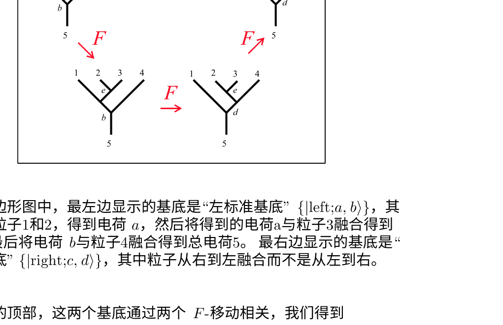

在这个五边形图中，最左边显示的基底是“左标准基底” {|left;a, b⟩}，其中先融合粒子1和2，得到电荷 a，然后将得到的电荷a与粒子3融合得到电荷 b，最后将电荷 b与粒子4融合得到总电荷5。最右边显示的基底是“右标准基底” {|right;c, d⟩}，其中粒子从右到左融合而不是从左到右。

在五边形的顶部，这两个基底通过两个 F-移动相关，我们得到

$$|\text{left}; a, b\rangle = \sum_{c,d} |\text{right}; c, d\rangle \left( F_{125}^{\text{C}} \right)^d_a \left( F_{\text{A} \ 34}^5 \right)^\text{C}_{\text{B}}. \quad \quad (9.113)$$

在五边形的底部，底边通过三个 $F$-移动相关，我们发现

$$|\text{left}; a, b\rangle = \sum_{\text{C}, \text{D}, \text{E}} |\text{right}; c, d\rangle \left( F_{234}^{\text{D}} \right)^{\text{C}}_e \left( F_1^5 \text{E} \right)^d_b \left( F_{123}^{\text{B}} \right)^{\text{E}}_a. \quad \quad (9.114)$$

将我们对 $|\text{left}; a, b\rangle$ 的两个表达式等式化，我们得到五边形方程：

$$\left( F_{125}^{\text{C}} \right)^d_a \left( F_{\text{A} \ 34}^5 \right)^{\text{C}}_{\text{B}} = \left( F_{234}^{\text{D}} \right)^{\text{C}}_e \left( F_1^5 \text{E} \right)^d_b \left( F_{123}^{\text{B}} \right)^{\text{E}}_a. \quad \quad (9.115)$$

通过考虑三个粒子融合的各种方式，我们可以找到另一个非平凡的一致性条件：

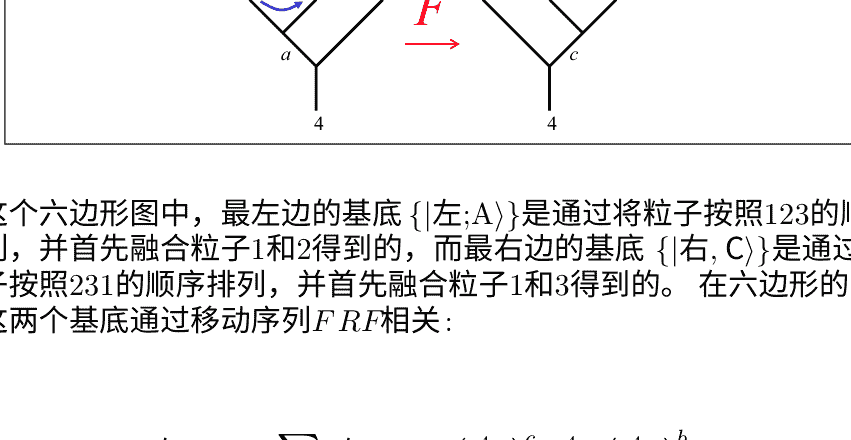

在这个六边形图中，最左边的基底 $\{|\text{left}; a\rangle\}$ 是通过将粒子按照123的顺序排列，并首先融合粒子1和2得到的，而最右边的基底 $\{|\text{right}; c\rangle\}$ 是通过将粒子按照231的顺序排列，并首先融合粒子1和3得到的。在六边形的顶部，这两个基底通过移动序列 $FRF$ 相关：

$$|\text{left} , a\rangle = \sum_{b,c} |\text{right}; \quad c\rangle \left( F_{231}^4 \right)^c_b R_{1b}^4 \left( F_{123}^4 \right)^b_a. \quad \quad (9.116)$$

在六边形的底部，基底通过移动序列 $RFR$ 相关，并且我们发现

$$|\text{left} , a\rangle = \sum_{c} |\text{right}; \quad c\rangle R_{13}^c \left( F_{213}^4 \right)^c_a R_{12}^a. \quad \quad (9.117)$$

将我们对 |left; a⟩ 的两个表达式等同，我们得到了六边形方程：

$R_{13}^c (F_{213}^4)_a^c R_{12}^a = \sum_b (F_{231}^4)_b^c R_{1b}^4 (F_{123}^4)_a^b$. (9.118)

一个美丽的定理，在这里我不会证明，它说没有进一步的条件必须被施加以确保编织和融合的一致性。也就是说，对于任何选择的初始和最终基底，将初始基底转化为最终基底的所有 R-移动和 F-移动序列都会产生相同的同构，前提是满足五边形方程和六边形方程。这个定理是范畴论中的一个基本结果，称为 Mac Lane 一致性定理。五边形和六边形方程一起被称为 Moore-Seiberg 多项式方程，它们与物理学的相关性首次在 20 世纪 80 年代的 (1+1) 维共形场论研究中得到认识。

多项式方程的解定义了一个可行的任意子模型。因此，存在一个系统的过程来构建任意子模型：

1.  选择一组标签并假设一个融合规则。
2.  解多项式方程得到 R 和 F 的值。

如果没有解存在，则假设的融合规则与局部量子物理的原则不兼容，必须被拒绝。如果存在多个解（彼此之间不能通过任何标签重新排列、基底重新定义等方式相关），则每个不同的解都定义了一个具有假设融合规则的不同模型。

为了说明该过程，考虑斐波那契融合规则的多项式方程。只有两个 F-矩阵出现，我们将其表示为

$F_{0111} \equiv F_0, \quad F_{1111} \equiv F_1$. (9.119)

$F_0$ 实际上是 1 × 1 矩阵。

$(F_0)_a^b = \delta_a^1 \delta_1^b$, (9.120)

而 $F_1$ 是一个 2 × 2 矩阵时，五边形方程变为

$(F_c)_a^d (F_a)_b^c = \sum_e (F_d)_e^c (F_e)_b^d (F_b)_a^c$. (9.121)

对于 $F \equiv F_1$ 的一般解为

$F = \begin{pmatrix} \tau & e^{i\phi} \sqrt{\tau} \\ e^{-i\phi} \sqrt{\tau} & -\tau \end{pmatrix}$, (9.122)

其中 $e^{i\phi}$是任意相位（我们可以通过适当的相位约定将其设置为1），且 $\tau = \frac{\sqrt{5}-1}{2} = \phi - 1 \approx .618$，满足 $\tau^2 + \tau = 1$。

描述两个斐波那契任意子逆时针交换的2×2 R-矩阵具有两个特征值——当任意子对的总电荷是平凡的情况下为 $R^0$，当总电荷是非平凡的情况下为 $R^1$。六边形方程变为

$$R^c (F)_a^c R^a = (F)_0^c (F)_a^0 + (F)_1^c R^1 (F)_a^1.$$

使用通过解五边形方程得到的 $F$的表达式，我们可以解六边形方程得到 $R$。

$$R = \begin{pmatrix} e^{4\pi i/5} & 0 \\ 0 & -e^{2\pi i/5} \end{pmatrix}, \quad F = \begin{pmatrix} \tau & \sqrt{\tau} \\ \sqrt{\tau} & -\tau \end{pmatrix}.$$

唯一的其他解是这个解的复共轭；这第二个解实际上描述了相同的模型，但顺时针和逆时针编织互换了。因此，具有斐波那契融合规则的任意子模型确实存在，并且基本上是唯一的。

## 9.17 用斐波那契任意子模拟量子电路

现在我们已经了解足够的知识来回答是否可以使用斐波那契任意子来模拟通用量子计算机。我们需要解释如何使用任意子编码量子比特，并实现一套通用的量子门。

首先我们注意到希尔伯特空间 $V_4^0 \equiv V_{1111}^0$ 的维度 $N_4^0=2$；因此一个量子比特可以由四个总电荷为零的任意子编码。这些任意子按照从左到右的顺序编号为1234；在标准基态 $|0\rangle$ 中，任意子1和2融合得到总电荷为0，而在标准基态 $|1\rangle$ 中，任意子1和2融合得到总电荷为1。作用于这个标准基态，辫子群生成元$\sigma_1$（1号和2号粒子的逆时针交换）表示为

$$\sigma_1 \to R = \begin{pmatrix} e^{4\pi i/5} & 0 \\ 0 & -e^{2\pi i/5} \end{pmatrix},$$

而生成元 $\sigma_2$表示为

$$\sigma_2 \to B = F^{-1}RF, \quad F = \begin{pmatrix} \tau & \sqrt{\tau} \\ \sqrt{\tau} & -\tau \end{pmatrix}.$$

这些矩阵生成了一个辫子群 $B_3$在三个股上的表示，其图像在SU(2)中是稠密的。实际上， $R$ 和 $B$生成了 $Z_{10}$U(2)的子群，围绕两个不同的轴，没有包含这两个子群的有限子群 - 因此，表示在包含所有行列式等于10次单位根的U(2)元素的群上闭合。 类似地，对于总电荷为零的任意子，辫子群的表示的图像在SU($N$ $\hbar$)中是稠密的。

为了模拟作用在$N$量子比特的量子电路，总共使用了4N个任意子。 我们刚刚看到，通过在每个四个任意子的群集内编织，可以实现任意单比特门。 为了完成一个通用集合，我们还需要两比特门。 但是，两个相邻的比特由八个任意子编码，这些任意子的交换生成了一个在SU($N_8^0$) = SU(13)中图像稠密的 $B_8$的表示，其中当然包括作用于两个编码比特的SU(4)。

因此，通用集合中的每个门可以通过某个有限辫子以任意精度模拟。

由于我们可以顺时针和逆时针编织，每个交换门的逆门也在我们的技能范围内。 因此，我们可以应用Solovay-Kitaev定理得出结论，电路模型的通用门可以通过长度为poly(log(1/ε))的编织物以精度 ε进行模拟。 由此可知，作用于全部 $L$门的理想量子电路可以使用4N个任意子和长度为$O(L \cdot poly(log(L)))$的编织物以固定精度进行模拟。正如所期望的，我们已经证明了通用量子计算机可以高效地进行模拟，使用的是斐波那契任意子。 请注意，与使用非阿贝尔超导体模型进行模拟不同，不需要中间测量来实现通用门。

在上面的分析中，我们假设模拟中除了限制Solovay-Kitaev近似理想门的准确性之外，没有其他错误。 因此，隐含的是温度与模型的能隙相比足够小，热激发的任意子太稀少以至于不会引起问题，任意子之间保持足够远，可以忽略电荷的无控制交换，并且一般来说，拓扑量子计算中的错误是不重要的。 如果错误率很小但不完全可以忽略，则可以调用量子容错的标准理论来提高模拟的准确性，需要额外的多对数开销 $L$。 容错程序应包括一种控制编码量子位的“泄漏”的方法，即防止四个量子位簇从二维计算空间 $V_4^0$漂移到其三维正交补空间 $V_4^1$。

## 9.18 结语

这是我在课堂上学到的程度。我将在这里简要提及一些其他的话题，如果我没有时间用完，我可能会涉及到。

### 9.18.1 切尔-西蒙斯理论

我们已经讨论了如何通过多项式方程的蛮力解决方案构建任意子模型。这种方法是绝对可靠的，但在实践中，模型通常是使用其他更高效的方法构建的。事实上，大多数已知的任意子模型都是作为切尔-西蒙斯理论的实例发现的。

切尔-西蒙斯理论的融合规则是李群不可约表示的融合规则的截断版本。例如，与SU(2)群相关联的是一系列以正整数 k 为索引的切尔-西蒙斯理论。对于SU(2)，不可约表示带有标签 $j=0, \frac{1}{2}, 1, \frac{3}{2}, 2, \frac{5}{2}, \ldots$，融合规则的形式为

$$j_1 \times j_2 = \sum_{j=|j_2-j_1|}^{j_1+j_2} j.$$

在被标记为SU(2)$_k$的Chern-Simons理论中，半整数标签受到限制，即 $j \leq k/2$，而标签 $j$ 仅包含在 $j_1 \times j_2$中，当且仅当 $j_1+j_2+j \leq k$时。

例如，SU(2)$_1$模型是阿贝尔的，而SU(2)$_2$模型的非平凡融合规则是

$$\begin{aligned}
\frac{1}{2} \times \frac{1}{2} &= 0 + 1 , \\
\frac{1}{2} \times 1 &= \frac{1}{2} , \\
1 \times 1 &= 0 .
\end{aligned}$$

因此，标签 $\frac{1}{2}$的量子维度为 $d_{1/2} = \sqrt{2}$，而具有总电荷为0的$2m$个 $\frac{1}{2}$ 粒子拓扑Hilbert空间的维度为

$$N^{0}_{(\frac{1}{2})^{2m}} = 2^{m-1}.$$

这些融合规则的多项式方程有多个解（其中只有一个描述了SU(2)$_2$模型的编织性质），但是得到的模型都没有计算上的通用编织规则。空间 $V_{\frac{1}{2} \frac{1}{2} \frac{1}{2} \frac{1}{2}}^{0}$ 是二维的，$2 \times 2$矩阵 $F \equiv F_{\frac{1}{2} \frac{1}{2} \frac{1}{2} \frac{1}{2}}^{0}$ 和 $R \equiv R_{\frac{1}{2} \frac{1}{2}}^{\frac{1}{2} \frac{1}{2}}$ 在整体相位和复共轭的情况下，

$$F = H = \frac{1}{\sqrt{2}} \begin{pmatrix} 1 & 1 \\ 1 & -1 \end{pmatrix}, \quad R = P = \begin{pmatrix} 1 & 0 \\ 0 & i \end{pmatrix}.$$

存在Clifford群量子门，不足以实现通用性。
然而，对于k ≥ 3的SU(2)$_k$模型是计算上通用的。
SU(2)$_3$的非平凡融合规则是

$$\begin{aligned}
\frac{1}{2} \times \frac{1}{2} & = 0 + 1, \\
\frac{1}{2} \times 1 & = \frac{1}{2} + \frac{3}{2}, \\
\frac{1}{2} \times \frac{3}{2} & = 1, \\
1 \times 1 & = 0 + 1, \\
1 \times \frac{3}{2} & = \frac{1}{2}, \\
\frac{3}{2} \times \frac{3}{2} & = 0.
\end{aligned}$$ (9.132)

我们研究的Fibonacci (Yang-Lee) 模型是通过截断SU(2)$_3$, 进一步消除非整数标签 $\frac{1}{2}$ 和 $\frac{3}{2}$得到的
(i.e., 这是Chern-Simons理论SO(3)$_3$); 然后唯一剩下的非平凡融合规则是
1 × 1 = 0 + 1.

Wang (未发表) 最近构建了所有不超过四个标签的任意子模型，并发现所有模型都与Chern-Simons理论中发现的模型密切相关。

### 9.18.2 S-矩阵

任意子模型的模块化 S-矩阵 可以用两个任意子世界线形成的Hopf链来定义:

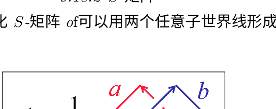

这里 $\mathcal{D}$ 是模型的总量子维数，并且我们使用了未链接的环将具有值 $d_a d_b$ 的归一化；然后矩阵 $S_a^b$ 是对称和幺正的。在阿贝尔任意子模型中，Hopf链在我们对拓扑简并性的讨论中出现，在该讨论中我们描述了当任意子在环的一个周期周围传输时，环面上的任意子模型的真空态如何受到影响。非阿贝尔情况下，S-矩阵有类似的解释。

通过基本推理，S可以与融合规则相关联:

$$(N_a)_b^c = \sum_d S_b^d \left( \frac{S_a^d}{S_1^d} \right) \left( S^{-1} \right)_d^c;$$ (9.133)

也就是说，S-矩阵同时对所有矩阵 $\{ N_{a} \}$（Verlinde关系）进行对角化。请注意，根据定义，$S_{1}^{a} = d_{a} / \mathcal{D}$。

### 9.18.3 边缘激发

在我们的任意子模型的构建中，我们已经讨论了二维空间中粒子的融合和编织。但是，二维介质物理学还有另一个方面，即样本的一维边缘的性质。通常，如果一个二维系统在体积中支持任意子，则还会有沿着一维边缘传播的手性无质量激发。在非零温度 $T$ 下，边缘上存在能量流，其表达式为 $J =$

$$J = \frac{\pi}{12} c_{-} T^{2} ; \quad (9.134)$$

这里的常数 $c_{-}$ ，称为边缘的手征中心荷，是一个与系统底层哈密顿量的微小变化无关的普适性质。

虽然这个手征中心荷是二维介质的固有属性，但是体内任意子的性质并不能完全决定它；相反，我们有

$$\frac{1}{\mathcal{D}} \sum_{a} d_{a}^{2} e^{2\pi i J_{a}} = e^{(2\pi i / 8) c_{-}} , \quad (9.135)$$

其中求和是在任意子模型的完整标签集上进行的，而 $e^{2\pi i J_{a}} = R_{a}^{a}$ 是标签 $a$ 的拓扑自旋。这个表达式将边缘理论的特征量 $c_{-}$ 与体内理论的量子维度和拓扑自旋联系起来，但只能模8确定 $c_{-}$。因此，至少在原则上，可以有多个与体内任意子理论对应的边缘理论。

## 9.19 参考文献注释

关于任意子理论的一些开创性论文被收录在[1]中。

我所称之为“非阿贝尔超导体”模型在文献中通常被称为“量子双态”，并且使用Hopf代数的表示论进行研究。有关综述，请参阅[2]。

首次在[3]中提出了使用非阿贝尔任意子进行容错量子计算的想法。本文还讨论了托里克码以及具有非阿贝尔相的相关晶格模型。在非阿贝尔超导体中实现通用量子计算的一个特定实现## 9 拓扑量子计算

在[4,5]中进行了讨论。我对通用门集的讨论基于[6]，该论文还讨论了更一般的模型。其他方案，更广泛地利用电荷并且对于较小的群（如 S_3）是通用的，在[7]中有描述。

图解方法，如我在量子维度讨论中使用的方法，在[8]中广泛应用于推导任意子的性质。多项式方程（五边形和六边形方程）在（1+1）维共形场论中的作用在[9]中讨论。使用量子电路模拟任意子在[10]中讨论。使用SU(2)_{k=3}的任意子的Chern-Simons理论讨论了通用量子计算机的模拟，[11]中讨论。在[12]中指出杨李模型也是通用的。

我在讲座中没有讨论物理实现，但我仍然在这里列出了一些相关的参考文献：使用超导约瑟夫森结阵列实现阿贝尔和非阿贝尔任意子的想法在[13]中讨论。提出并解决了具有最近邻相互作用的自旋模型，其中包含非阿贝尔任意子（尽管不是计算上通用的），并在[14]中描述了使用光晶格中的冷原子实现此模型的提议。在[16]中讨论了在相互作用电子系统中实现（计算上通用的）SU(2)_{k=3}模型的一些想法。

我对非阿贝尔任意子计算理论的理解很大程度上来源于与Alexei Kitaev的许多有益讨论。

# 参考文献

> [1] F. Wilczek, 分数统计与任意子超导 (世界科学出版社, 新加坡, 1990).
> [2] M. de Wild Propitius和F. A. Bais, “离散规范理论,” arXiv: hep-th/9511201 (1995).
> [3] A. Yu. Kitaev, “容错量子计算与任意子,” Annals Phys. **303**, 2-30 (2003), arXiv: quant-ph/9707021.
> [4] R. W. Ogburn和H. Preskill, “拓扑量子计算,” Lect. Notes in Comp. Sci. **1509**, 341-356 (1999).
> [5] J. Preskill, “容错量子计算,” arXiv: quant-ph/9712048 (1997).
> [6] C. Mochon, “非可解有限群的任意子足以进行通用量子计算”, 物理评论A **67**, 022315 (2003), quant-ph/0206128.
> [7] C. Mochon, “具有较小群的任意子计算机”, 物理评论A **69**, 032306 (2004), arXiv: quant-ph/0306063.
> [8] J. Fr\"ohlich和F. Gabbiani, “局部量子理论中的辫统计”, 数学物理评论 **2:3**, 251-353 (1990).
> [9] G. Moore和N. Seiberg, “经典和量子共形场论”, 数学物理通讯 **123**, 171-254 (1989).
> [10] M. H. Freedman, A. Kitaev和Z. Wang, “量子计算机模拟拓扑场论”, 数学物理通讯 **227**, 587-603 (2002), arXiv: quant-ph/0001071.
> [11] M. H. Freedman, M. Larsen, and Z. Wang, “一个对量子计算普适的模块化函子”, arXiv: quant-ph/0001108 (2000).
> [12] G. Kuperberg, 未发表.
> [13] B. Doucot, L. B. Ioffe, and J. Vidal, “二维晶格中的离散非阿贝尔规范理论及其在Josephson结阵列中的实现”, Phys. Rev. B **69**, 214501 (2004), arXiv: cond-mat/0302104.
> [14] A. Kitaev, “蜂窝格上的任意子”, 未发表.
> [15] L.-M. Duan, E. Demler, and M. D. Lukin, “控制光学晶格中超冷原子的自旋交换相互作用”, Phys. Rev. Lett. **91**, 090402(2003), arXiv: cond-mat/0210564.
> [16] M. Freedman, C. Nayak, K. Shtengel, K. Walker, and Zhenghan Wang, “一类P,T不变的相互作用电子的拓扑相,” cond-mat/0307511 (2003).

## 量子信息

### 第10章. 量子香农理论

约翰·普雷斯金尔

量子信息与物质研究所

加州理工学院

更新于2016年6月

如需进一步更新和附加章节，请访问：

http://www.theory.caltech.edu/people/preskill/ph219/

请将更正发送至preskill@caltech.edu

## 目录

- 前言 ... vi
- 第10章 量子香农理论 ... 1
- 10.1 香农的入门 ... 1
- 10.1.1 香农熵和数据压缩 ... 2
- 10.1.2 联合典型性、条件熵和互信息 ... 4
- 10.1.3 分布式源编码 ... 6
- 10.1.4 噪声信道编码定理 ... 7
- 10.2 冯·诺伊曼熵 ... 12
- 10.2.1 数学性质 H(ρ) ... 14
- 10.2.2 混合、测量和熵 ... 15
- 10.2.3 强次可加性 ... 16
- 10.2.4 互信息的单调性 ... 18
- 10.2.5 熵和热力学 ... 19
- 10.2.6 贝肯斯坦熵界 ... 20
- 10.2.7 熵不确定关系 ... 21
- 10.3 量子源编码 ... 23
- 10.3.1 量子压缩：一个例子 ... 24
- 10.3.2 一般情况下的舒马赫压缩 ... 27
- 10.4 纠缠浓缩和稀释 ... 30
- 10.5 量化混合态纠缠 ... 35
- 10.5.1 在LOCC下的渐近不可逆性 ... 35
- 10.5.2 压扁纠缠 ... 37
- 10.5.3 纠缠的独占性 ... 38
- 10.6 可访问信息 ... 39
- 10.6.1 我们可以从测量中学到多少？ ... 39
- 10.6.2 Holevo界 ... 40
- 10.6.3 Holevo χ的单调性 ... 41
- 10.6.4 通过编码改善可区分性：一个例子 ... 42
- 10.6.5 量子通道的经典容量 ... 45
- 10.6.6 纠缠破坏通道 ... 48
- 10.7 量子通道容量和解耦 ... 50
- 10.7.1 相干信息和量子通道容量 ... 50
- 10.7.2 解耦原理 ... 52
- 10.7.3 退化通道 ... 54
- 10.8 量子协议 56
- 10.8.1 父亲：辅助纠缠量子通信 56
- 10.8.2 母亲：量子态传输 58
- 10.8.3 强子可加性的操作意义 61
- 10.8.4 热力学中的负条件熵 62
- 10.9 解耦不等式 64
- 10.9.1 解耦不等式的证明 65
- 10.9.2 母亲不等式的证明 66
- 10.9.3 父亲不等式的证明 68
- 10.9.4 量子信道容量再探 70
- 10.9.5 黑洞作为镜子 71
- 10.10 总结 73
- 10.11 参考文献注释 75
- 练习 76
- 参考文献 88

本文是《量子信息》的一章，该书将由剑桥大学出版社首次出版。○Work, John Preskill, 2016

注意：本网站上显示的《Work》副本是草稿，未经出版的副本。《Work》的最终出版版本可通过剑桥大学出版社和其他标准分销渠道购买。此草稿副本仅供个人使用，不得出售或重新分发。

## 前言

这是我书《量子信息》的第十章，也是最后一章，基于我自1997年以来在加州理工学院教授的课程。这一章的早期版本（最初的第5章）自1998年以来一直在课程网站上提供，但这个版本经过了大幅修订和扩展。

详细程度不均匀，因为我旨在提供一个简明的介绍，但我也试图避免不正确或晦涩的陈述。一般来说，我选择包括既有用又相对容易解释的主题；我不得不放弃很多好东西，但另一方面，这一章已经相当长了。

我的量子香农理论版本不能替代Wilde的书[1]中更仔细的处理，但对初学者可能更合适。本章偶尔提到我书中的早期章节，但我希望它在独立阅读其他章节时也能理解，包括关于量子纠错码的章节。

这是第10章的工作草稿，我将继续更新。请查看标题页上的URL以获取进一步的更新和其他章节的草稿。如果您注意到错误，请发送电子邮件至preskill@caltech.edu。

最终，这本完整的书将由剑桥大学出版社出版。我不敢预测出版日期——他们对我一直非常耐心。

## 10 量子香农理论

量子信息科学是20世纪三个伟大思想的综合：量子物理学、计算机科学和信息论。直到现在，我们对这个三位一体中的信息论方面给予了很少的重视，现在我们要纠正这个疏忽。

这一章的一个合适的名称本可以是量子信息理论，但我更喜欢这个术语具有更广泛的含义，包括已经在本书中介绍的许多内容。相反，我将其称为量子香农理论，以强调我们将主要致力于将克劳德·香农的伟大（经典）贡献推广和应用到量子环境中。量子香农理论有几个主要方向：

- 1. 压缩量子信息。
- 2. 通过嘈杂的量子信道传输经典和量子信息。
- 3. 量化、表征、转换和使用量子纠缠。

一个重要的主题将这些话题联系在一起——冯·诺伊曼熵的性质、解释和应用。

我的目标是介绍量子香农理论的一些主要思想和工具，但有很多内容我们不会涉及。例如，我们主要考虑在渐近设置下的信息理论，即同一个量子信道或状态被任意多次使用，因此我们关注的是原则性问题，而不是更实际的关于设计高效协议的问题。

## 10.1 香农的入门

在我们理解冯·诺伊曼熵及其与量子信息的相关性之前，我们应该讨论一下香农熵及其与经典信息的相关性。

克劳德·香农在他的里程碑式论文中建立了经典信息理论的两个核心结果。他解决的两个核心问题是：

- 1. 一条消息可以被压缩多少；即信息有多少冗余？这个问题可以通过“源编码定理”或称为“无噪声编码定理”来回答。
- 2. 在一个嘈杂的信道上，我们能以什么速率可靠地进行通信？即，为了防止错误，需要将多少冗余信息嵌入到消息中？这个问题可以通过“噪声信道编码定理”来回答。

这两个问题都涉及冗余性 - 消息的下一个字母的出现有多么出乎意料，平均而言。香农的一个关键洞察是，熵提供了一种适当的方式来量化冗余。

我将这一部分称为“香农入门”，因为我将尽量简明扼要地解释香农的思想，减少分散注意力的细节。这样，我可以将经典信息论压缩到大约14页。

### 10.1.1 香农熵和数据压缩

一条消息是一个字母串，每个字母都是从一个包含k个可能字母的字母表中选择的。我们将考虑一个理想化的情境，即消息是由一个“信息源”产生的，该信息源通过从概率分布中采样来选择每个字母。

```
X := \{x, p(x)\}; (10.1)
```

也就是说，该字母具有数值

```
x \in \{0, 1, 2, \dots, k-1\} (10.2)
```

以概率 p(x)出现。如果源发出一个 n个字母的消息，特定的字符串 x = x_1 x_2 \dots x_n 以概率出现

```
p(x_1 x_2 \dots x_n) = \prod_{i=1}^{n} p(x_i). (10.3)
```

由于字母在统计上是独立的，并且每个字母都是通过咨询相同的概率分布 X产生的，我们说这些字母是独立且相同分布的，简称为 i.i.d.我们将使用 X^n 来表示由 X采样独立生成的 n个字母消息的集合，并使用 \vec{x} = (x_1 x_2 \dots x_n)表示一串比特。

现在考虑长 n字母消息，n ≫ 1. 我们问：是否可能将消息压缩成一个较短的字母串，传达基本相同的信息？答案是：是可能的，除非分布X是均匀随机的。

如果字母表是二进制的，那么每个字母要么是0（概率为1 - p），要么是1（概率为 p），其中0 ≤ p ≤ 1. 对于非常大的 n，大数定律告诉我们，典型的字符串将包含约 n(1 - p)个0和约 np个1。这种形式的不同字符串的数量是二项式系数的数量级 \binom{n}{np}，通过斯特林近似公式 log n! = n log n - n + O(log n)我们得到

```
\log \binom{n}{np} = \log \left( \frac{n!}{(np)! (n(1-p))!} \right) \approx n \log n - n - (np \log np - np + n(1-p) \log n(1-p) - n(1-p)) = n H(p), (10.4)
```

其中

```
H(p) = -p \log p - (1-p) \log(1-p) (10.5)
```

是熵函数。

在这个推导中，我们使用了适用于自然对数的斯特林近似。但是从现在开始，我们更倾向于使用以2为底的对数，形式表示信息的数量；因此，如果没有指明底数，除非另有说明，否则默认底数为2。按照这个约定，在 H(p) 的表达式中，典型字符串的数量大致为 2^{nH(p)}。

为了传达由一串N位二进制数携带的几乎所有信息，只需选择一个块编码，为典型字符串分配一个非负整数。这个块编码需要区分大约2N H(P)个消息（几乎等概率出现），因此我们可以使用长度略长于2^{nH(P)}的二进制字符串来指定任何一个消息。由于对于0 ≤ P ≤ 1，有0 ≤ H(P) ≤ 1，并且只有当P = 2^{-1}时，H(P) = 1，块编码才会缩短消息（当0和1不等概率时）。这是香农的结果。关键思想是我们不需要为每个字母序列都有一个编码词，只需要为典型序列提供编码。实际消息是非典型的概率在渐近情况下变得可以忽略，即在极限N→∞下。

类似的推理适用于 X 从 k 个字母表中取样的情况。在一个包含 n 个字母的字符串中，x 通常出现约 np(x) 次，而典型字符串的数量大约是

```
\frac{n!}{\prod_x (np(x))!} \simeq 2^{-nH(X)}
```

在这里我们再次使用了斯特林近似，并且现在

```
H(X) = - \sum_x p(x) \log_2 p(x)
```

是集合 X = \{x, p(x)\} 的香农熵（或简称熵）的定义。采用将整数分配给典型序列的块编码，字符串中的信息量为 n 个字母可以压缩到大约 nH(X) 位。从这个意义上说，从集合中选择的一个字母 x 平均携带 H(X) 位信息。

使用大数定律重新仔细陈述这个推理是很有用的，大数定律断言，在许多次试验的极限中，随机变量的样本平均几乎肯定收敛于其期望值。如果我们从分布Y = \{y, p(y)\}中进行抽样，让 y_i, i ∈ \{1, 2, ..., n\} 表示第 i 个样本，且让

```
\mu[Y] = <y> = \sum_y y p(y)
```

表示 y 的期望值。那么对于任意的正 ε 和 δ，存在一个正整数 N，使得

```
\left| \frac{1}{n} \sum_{i=1}^n y_i - \mu[Y] \right| \leq \delta
```

对于所有 n ≥ N，至少以 1-ε 的概率成立。我们可以将这个陈述应用于随机变量 \log_2 p(x)。如果一个序列的 n 个字母是 δ-典型的，那么让我们说它是 δ-典型的。

```
H(X) - \delta \leq - \frac{1}{n} \log_2 p(x_1 x_2 \dots x_n) \leq H(X) + \delta;
```

那么大数定律表明，对于任意的 ε, δ > 0 和足够大的 n，一个 n 字母序列将以概率 ≥ 1 - ε 成为 δ-典型的。由于每个 δ-典型的 n 字母序列 \vec{x} 出现的概率满足

```
p_{\min} = 2^{-n(H+\delta)} \leq p(\vec{x}) \leq 2^{-n(H-\delta)} = p_{\max}
```

我们可以推断出典型序列的数量 \(N_{\text{typ}}(\epsilon, \delta, n)\) 的上下界：

```
N_{\text{typ}} p_{\min} \leq \sum_{\text{typical } x} p(x) \leq 1, \quad N_{\text{typ}} p_{\max} \geq \sum_{\text{typical } x} p(x) \geq 1 - \epsilon, \quad (10.12)
```

意味着

```
2^{n(H+\delta)} \geq N_{\text{typ}}(\epsilon, \delta, n) \geq (1 - \epsilon) 2^{n(H-\delta)}. \quad (10.13)
```

因此，我们可以使用长度为 \(n(H+\delta)\) 的块编码来编码所有典型序列。这样，只要消息是典型的，源发出的任何消息都可以成功地进行压缩和解码；无论如何解码非典型序列，压缩过程都可以实现一个成功概率 \(p_{\text{success}} \geq 1 - \epsilon\)。

如果我们尝试进一步压缩消息，比如每个字母只使用 \(H(X) - \delta'\) 位，其中 \(\delta'\) 是与消息长度 \(n\) 无关的常数，会发生什么呢？那么我们会遇到麻烦，因为没有足够的码字来覆盖所有典型消息，我们将无法以可忽略的错误概率解码压缩的消息。

成功解码消息的概率将被上界限制为

```
成功概率 \leq 2^{n(H-\delta')} 2^{-n(H-\delta)} + \epsilon = 2^{-n(\delta'-\delta)} + \epsilon; \quad (10.14)
```

我们只能正确解码 \(2^{n(H-\delta')}\) 典型消息，每个消息的发生概率不超过 \(2^{-n(H-\delta)}\)；我们添加 \(\epsilon\)，作为非典型消息的概率上界，乐观地允许我们以某种方式正确解码非典型消息。由于我们可以选择 \(\epsilon\) 和 \(\delta\) 尽可能小，如果 \(\delta'\) 是一个正常数，这个成功概率将随着 \(n \to \infty\) 而变小。

每个字母编码的比特数称为压缩消息的比特率，我们说一个比特率 \(R\) 是渐近可达的（当 \(N \to \infty\)）如果存在一系列比特率至少为 \(R\) 且错误概率趋近于零的编码序列在大N的极限下。总结我们的结论，我们发现压缩率 \(= H(X) + O(1)\) 是可达到的，压缩率 \(= H(X) - \Omega(1)\) 是不可达到的。

```
(10.15)
```

5) 其中 \(O(1)\) 表示一个可以选择得足够小的正数，\(\Omega(1)\) 表示一个正常数。这是香农的源编码定理。

我们还没有讨论压缩编码的细节。我们可以想象一个巨大的查找表，将每个消息分配一个唯一的编码词和反之亦然，但是因为这样的表的大小是指数量级的，对于压缩和解压长消息来说是相当不切实际的。研究如何在保持接近最佳压缩率的同时使编码和解码高效是非常有趣的，也是非常重要的，如果我们真的想要压缩一些东西。但是这个经典压缩理论的实际方面超出了本书的范围。

### 10.1.2 联合典型性、条件熵和互信息

香农熵量化了我对信息源输出每个字母的无知。如果源 \(X\) 产生一个 \(n\) 个字母的消息，那么 \((H(X) + 1)\) 比特足以传达消息的内容，而 \((H(X) - \Omega(1))\) 比特则不足够。

两个信息源 \(X\) 和 \(Y\) 可以相关。从源中抽取的字母受到联合分布 \(XY = \{(x, y), p(x, y)\}\) 的控制，其中一对字母 \((x, y)\) 以概率 \(p(x, y)\) 出现。如果 \(p(x, y) = p(x)p(y)\)，则源是独立的。

如果X,Y是一个联合分布，我们用X表示边缘分布，定义为

$$X = \left\{ x, p(x) = \sum_{y} p(x, y) \right\}$$

对于Y也是类似的。如果X和Y相关，则通过读取由Y生成的随机变量，我可以减少对由X生成的随机变量的未知，这应该使得压缩X的输出比如果我没有访问Y更进一步成为可能。为了使这个想法更加精确，我们使用了联合典型序列的概念。从分布X和Y中进行采样，即从联合分布X,Y中进行n次采样，以概率产生一个消息 $\vec{x} = (x_1x_2...x_n)$， $\vec{y} = (y_1y_2...y_n)$。

$$p(\vec{x}, \vec{y}) = p(x_1, y_1) p(x_2, y_2) ...p(x_n, y_n)$$

假设$(\vec{x}, \vec{y})$从 $X^n Y^n$ 中抽取，则联合 $\delta$-典型的定义是

$$2^{-n(H(X)+\delta)} \leq p(\vec{x}) \leq 2^{-n(H(X)-\delta)},$$
$$2^{-n(H(Y)+\delta)} \leq p(\vec{y}) \leq 2^{-n(H(Y)-\delta)},$$
$$2^{-n(H(X,Y)+\delta)} \leq p(\vec{x}, \vec{y}) \leq 2^{-n(H(X,Y)-\delta)}.$$
(10.18)

然后，同时将大数定律应用于这三个分布。通过 $X^n$, $Y^n$ 和 $X^n Y^n$ 的推断，我们可以得出结论，在 $\varepsilon$, $\delta > 0$ 和 $n$ 足够大的情况下，从 $X^n Y^n$ 中抽取的序列将具有概率 $\geq 1-\varepsilon$ 成为 $\delta$-典型序列。使用贝叶斯规则，我们可以得到关于联合典型序列的条件概率 $p(\vec{x} | \vec{y})$ 的上下界：

$$p(\vec{x} | \vec{y}) = \frac{p(\vec{x}, \vec{y})}{p(\vec{y})} \geq \frac{2^{-n(H(X,Y)+\delta)}}{2^{-n(H(Y)-\delta)}} = 2^{-n(H(X|Y)+2\delta)}$$
$$p(\vec{x} | \vec{y}) = \frac{p(\vec{x}, \vec{y})}{p(\vec{y})} \leq \frac{2^{-n(H(X,Y)-\delta)}}{2^{-n(H(Y)+\delta)}} = 2^{-n(H(X|Y)-2\delta)}.$$
(10.19)

在这里，我们介绍了数量

$$H(X|Y) = H(X,Y) - H(Y) = \langle -\log p(x, y) + \log p(y) \rangle = \langle -\log p(x|y) \rangle,$$
(10.20)

这被称为给定Y的条件熵。

条件熵量化了一旦我知道Y后对X的剩余不确定性。从方程（10.19）中我们可以看到，如果 $(\vec{x}, \vec{y})$ 是联合典型的（对于大的N的情况下，这是高概率的），那么与已知的 $\vec{y}$ 兼容的 $\vec{x}$ 的可能值不超过 $2^{n(H(X|Y)+2\delta)}$；因此我们可以以高成功概率传递 $\vec{x}$，每个字母只使用 $H(X|Y) + o(1)$ 位。另一方面，我们不能做得更好，因为如果我们只使用 $2^{n(H(X|Y)-\delta')}$ 个码字，我们只能可靠地传递不超过所有联合典型消息的 $2^{-n(\delta' - 2\delta)}$ 的一部分。总结一下，

$H(X|Y)$是指在已知Y的情况下，为了指定 $\vec{x}$ 和 $\vec{y}$ 所需的每个字母的额外位数。同样地，$H(Y|X)$是指在已知X的情况下，为了指定 $\vec{x}$ 和 $\vec{y}$ 所需的每个字母的额外位数。

当我了解Y时，我获得关于X的信息量是通过这个量来量化的，指定X所需的每个字母的位数在已知Y的情况下减少了。因此，I(X;Y)≡H(X)−H(X|Y)

$$I(X;Y) = H(X) - H(X|Y) \\ = H(X) + H(Y) - H(X,Y) \\ = H(Y) - H(Y|X), \quad (10.21)$$

互信息I(X;Y)量化了如何指定X所需的每个字母的位数在已知Y的情况下减少了。X和Y是相关的，并且在交换X和Y时对称：我通过学习Y来了解X的信息与通过学习X来了解Y的信息一样多。学习Y不会减少我对X的知识，所以I（X；Y）显然是非负的，而且确实存在不等式。

H(X) ≥ H(X|Y) ≥ 0很容易从对数函数的凸性得出。

当然，如果X和Y完全不相关，我们有p(x, y) = p(x)p(y)，并且

$$I(X;Y) = \left\langle \log \frac{p(x, y)}{p(x)p(y)} \right\rangle = 0; \quad (10.22)$$

如果X和Y之间没有相关性，通过学习Y我们不会了解任何关于X的信息。

### 10.1.3 分布式源编码

为了加深我们对条件熵操作意义的理解，考虑以下情况：假设联合分布 X,Y 被采样了 n 次，其中爱丽丝收到了长度为 n的消息 $\vec{x}$，鲍勃收到了长度为 n的消息 $\vec{y}$。现在爱丽丝要给鲍勃发送一条消息，使得鲍勃能够以很高的成功概率确定 $\vec{x}$，并且爱丽丝希望尽可能少地发送比特给鲍勃。这个任务比 §10.1.2 中考虑的情景要更难，那里我们假设编码器和解码器对 $\vec{y}$ 有完全的了解，并且可以根据$\vec{y}$ 选择压缩 $\vec{x}$ 的编码。然而，事实证明，即使在这种更具挑战性的情况下，爱丽丝也可以将发送给鲍勃的消息压缩到 (H(X|Y) + o(1)) 比特，这使用了一种称为Slepian-Wolf编码的方法。

在收到 $(\vec{x}, \vec{y})$ 之前，爱丽丝和鲍勃同意将爱丽丝可能收到的所有可能的n个字母的消息分成$2^{nR}$个可能的箱子，箱子的选择对爱丽丝和鲍勃都是已知的。当爱丽丝收到 $\vec{x}$ 时，她向鲍勃发送$R$个比特，用于识别包含 $\vec{x}$ 的箱子。鲍勃收到这条消息后，他知道 $\vec{y}$ 和包含 $\vec{x}$ 的箱子。如果在该箱子中有一个唯一的消息与 $\vec{y}$ 联合典型，则鲍勃相应地解码。否则，他将任意解码。这个过程可能失败，要么是因为 $\vec{x}$ 和 $\vec{y}$ 不是联合典型的，要么是因为箱子中有多个与 $\vec{x}$ 联合典型的消息。否则，鲍勃肯定能正确解码。

由于 $\vec{x}$ 和 $\vec{y}$ 与很高的概率联合典型，如果一个箱子包含与 $\vec{y}$ 联合典型的错误消息的概率很低，压缩方案就能起作用。如果 $\vec{y}$ 是典型的，我们对与 $\vec{y}$ 共同典型的消息数量 $N_{typ|\vec{y}}$ 有什么说法？使用方程式 (10.19)，我们有

$$1 \geq \sum_{\text{典型的 } \vec{x}|\vec{y}} p(\vec{x}|\vec{y}) \geq N_{\text{typ}|\vec{y}} 2^{-n(H(X|Y)+2\delta)}, \quad (10.23)$$

因此

$$N_{\text{typ}|\vec{y}} \leq 2^{n(H(X|Y)+2\delta)}. \quad (10.24)$$

现在，为了估计解码错误的概率，我们需要指定如何选择箱子。 让我们假设箱子是均匀随机选择的，或者等价地，让我们均匀地考虑将长度为N的字符串分成$2^{nR}$个大小相等的箱子的所有编码。 那么一个特定的箱子包含与指定的 $\vec{y}$ 共同典型的的消息纯粹是偶然的概率上界受到限制。

$$2^{-nR} N_{\text{typ}|\vec{y}} \geq 2^{-n(R-H(X|Y)-2\delta)} \quad (10.25)$$

我们得出结论，如果爱丽丝每个字母向鲍勃发送 $R$ 位，其中

$$R = H(X|Y) + o(1) \quad (10.26)$$

那么在极限情况下，解码错误的概率将消失，至少在我们均匀地对所有编码进行平均时。 显然，必须存在一系列特定的编码序列，爱丽丝和鲍勃可以使用这些编码序列来实现速率 $R = H(X|Y) + o(1)$，正如我们所希望的那样。

在这种情况下，爱丽丝和鲍勃共同知道 $(x, y)$，但最初爱丽丝和鲍勃都无法访问他们共享的所有信息。 目标是在最小的爱丽丝向鲍勃传递信息的情况下，合并鲍勃一侧的所有信息，我们已经发现对于这个目的，每个字母只需要 $H(X|Y) + o(1)$ 比特的通信。 同样，鲍勃通过 $H(Y|X) + o(1)$ 比特的通信将信息合并到爱丽丝的一侧，每个字母从鲍勃到爱丽丝的通信中需要 $o(1)$ 比特的通信。

### 10.1.4 噪声信道编码定理

假设爱丽丝想要向鲍勃发送一条消息，但是连接爱丽丝和鲍勃的通信渠道存在噪声。 每次他们使用通信渠道，如果爱丽丝发送字母 $x$，鲍勃以概率 $p(y|x)$ 接收到字母 $y$。 通过使用通信渠道1次，爱丽丝希望向鲍勃传输一条长消息。

爱丽丝和鲍勃意识到，尽管存在噪声，为了可靠地进行通信，他们应该使用某种编码。 例如，爱丽丝可以尝试发送相同的比特 $k$ 次，鲍勃使用他接收到的 $k$ 个噪声比特的多数投票来解码爱丽丝发送的内容。 人们想知道：对于给定的通信渠道，是否可以在渠道使用次数 $n \rightarrow \infty$ 的极限下确保完美传输？ 关于编码的速率，也就是每个传输的消息字母需要发送多少比特，有什么可以说的？

香农回答了这些问题。他证明了任何信道只要在输入和输出之间存在一定的相关性，就可以用于完全可靠的通信，尽管速率在渐近非零的情况下。 此外，他还找到了一个可实现的最佳速率的有用公式。 这些结果是噪声信道编码定理的内容。

## 二元对称信道的容量。

具体来说，假设我们使用二进制字母表 $\{0, 1\}$ 和二元对称信道；该信道独立地作用于每个位，以概率 $p$ 翻转其值，并以概率 $1-p$ 保持不变。 因此，描述该信道的条件概率为

$$p(0|0) = 1-p, \quad p(0|1) = p, \\ p(1|0) = p, \quad p(1|1) = 1 - p. \quad (10.27)$$

## 量子香农理论

我们希望构建一个随着块大小增加而增加的代码族 n，使得解码错误的概率随着 n→∞而趋近于零。对于每个 n，代码包含在长度为 n 的可能字符串中，有 $2^{nR}$ 个码字。代码的速率 R，即信道传输的每个物理比特携带的编码数据比特数，为 $$R = \frac{k}{n}$$ (10.28)

为了防止错误，我们应该选择码字之间尽可能‘远离’。对于给定的 n 和 k 值，我们希望最大化改变一个码字到另一个码字所需翻转的位数，即汉明距离。对于任意的 n 位输入消息，我们预计约有 np 的位翻转—输入会扩散到大约 $2^{nH(p)}$ 个典型的输出字符串中，占据一个‘错误球’以‘汉明半径’ np 围绕输入字符串。为了可靠解码，我们希望选择输入码字，使得两个不同码字的错误球不会有重叠。否则，两个不同的输入有时会产生相同的输出，必然会发生解码错误。为了避免这种解码模糊性，所有 $2^{nR}$ 个错误球中包含的字符串总数不应超过输出消息中的总位数；因此我们要求

$$2^{nH(p)} 2^{nR} \leq 2^n$$

或

$$R \leq 1 - H(p) := C(p).$$

如果传输非常可靠，我们不能期望代码的速率超过 C(p)。但是，速率 R = C(p)是否可以渐近地实现呢？

事实上，当 R = C - o(1)且解码错误概率可忽略时，传输是可能的。也许香农最巧妙的想法是，这个速率可以通过‘随机编码’的平均值来实现。尽管随机选择编码似乎不是一个聪明的策略，但令人惊讶的是，在极限情况下，随机编码实现了与任何其他编码方案一样高的速率 n→∞。由于 C 是在嘈杂信道上可靠传输数据的最佳速率，因此被称为信道容量。

假设 X 是一个单个比特的均匀随机集合（要么为0，概率为 1/2 要么为1，概率为 1/2），我们从 X 中采样 $2^{nR}$ 次以生成 $2^{nR}$ 个‘随机码字’。得到的编码被 Alice 和 Bob 都知道。为了发送 nR 个信息比特，Alice 选择一个码字并通过使用通道 n 次将其发送给 Bob。为了解码他收到的 n 比特消息，Bob 绘制一个‘Hamming球’，其‘半径’略大于 np，其中包含

$$2^{n(H(p)+\delta)}$$

个字符串。如果这个球中包含唯一的码字，Bob 将相应地解码消息。如果球中包含多个码字或没有码字，Bob 将任意解码。

解码错误的概率有多大？对于任何正数 $\delta$，当 n 足够大时，Bob 的解码球足够大，很有可能包含 Alice 发送的码字。因此，我们只需要担心球可能仅仅是偶然包含了另一个码字。由于总共有 $2^n$ 个可能的字符串，Bob 的球中包含的是一个比例。

$$f = \frac{2^{n(H(p)+\delta)}}{2^n} = 2^{-n(C(p)-\delta)},$$

由于码字是均匀随机的，除了由爱丽丝发送的码字之外，鲍勃的球体包含任何特定码字的概率是 f，而球体包含$2^{nR} - 1$个无效码字中的任何一个的概率不超过
$$2^{nR} f = 2^{-n(C(p)-R-\delta)}. \quad (10.33)$$
由于 $\delta$可以尽可能小，我们可以选择 $R = C(p) - c$，其中 $c$是任意的正常数，当 $n\to\infty$时，解码错误的概率将趋近于零。

当我们谈论随机选择的编码时，我们实际上是在对许多可能的编码进行平均。到目前为止的论证表明，平均错误概率很小，我们在随机编码的选择上进行平均，并且对于每个指定的编码，我们还对所有码字进行平均。由此可知，在极限 $n\to\infty$下，必然存在一系列特定的编码序列，使得平均错误概率（在对码字进行平均时）趋近于零。我们希望得到一个更强的结果-对于每个码字，错误的概率都很小。

为了建立更强的结果，让$p_i$表示在发送编码字$i$时出现解码错误的概率。对于任意正的$\varepsilon$和足够大的$n$，我们已经证明了存在这样的编码，使得
$$\frac{1}{2^{nR}} \sum_{i=1}^{2^{nR}} p_i \leq \varepsilon. \quad (10.34)$$
让$N_{2\varepsilon}$表示具有$p_i \geq 2\varepsilon$的编码字的数量。然后我们推断出
$$\frac{1}{2^{nR}}(N_{2\varepsilon})2\varepsilon \leq \varepsilon \text{ 或 } N_{2\varepsilon} \leq 2^{nR-1}. \quad (10.35)$$
我们可以看到，为了实现每个编码字的$p_i \leq 2\varepsilon$，我们最多可以舍弃一半的编码字。我们构建的新编码具有
$$\text{速率} = R - \frac{1}{n}, \quad (10.36)$$
当$n\to\infty$时，它趋近于R. 因此，我们已经看到速率$R = C(p) \to (1)$在几乎没有错误的概率下是渐近可达的，其中$C(p) = 1 - H(p)$。

## 互信息作为可实现的速率。

现在考虑如何将这个随机编码论证应用于更一般的字母表和通道。通道的特征是 $p(y|x)$，即在发送字母 $x$时接收到字母 $y$的条件概率。我们固定一个输入字母的集合 $X = \{x, p(x)\}$，并通过采样生成一个速率为 $R$的长度为N的编码词。
从分布 $X^n$中采样$2^{nR}$次，发送者Alice和接收者Bob都知道这个编码。为了传递一个编码后的N位消息，通过通道发送$2nR$个字母的编码词。通道独立地作用于这N个字母，每次使用时都遵循相同的条件概率分布$p(y|x)$。
输入集合 $X$和描述通道的条件概率共同确定了每个发送字母的联合集合 $XY$，因此也确定了通道的N次使用的联合集合 $X^nY^n$。输入集合X和描述通道的条件概率共同确定了每个发送字母的联合集合XY，因此也确定了通道的N次使用的联合集合X^nY^n。
为了定义一个解码过程，我们使用在§10.1.2中引入的联合典型性的概念。当Bob接收到输出消息 $\vec{y}$时，他确定是否存在与 $\vec{y}$联合典型的输入码字 $\vec{x}$。如果存在这样的 $\vec{x}$并且是唯一的，

Bob相应地解码。如果不存在与 $\vec{y}$联合典型的 $\vec{x}$，或者存在多个这样的 $\vec{x}$，Bob将任意解码。

解码错误的可能性有多大？对于任意的正数 $\varepsilon$和 $\delta$，从 $X^{n}Y^{n}$中抽取的 $(\vec{x}, \vec{y})$具有至少 $1-\varepsilon$的联合 $\delta$-典型概率，如果 $n$足够大。因此，我们只需要担心可能存在多个与 $\vec{y}$联合典型的码字。

假设爱丽丝采样 $X^{n}$来生成一个码字 $\vec{x}$，然后她通过信道发送给鲍勃使用信道 $n$次。然后爱丽丝再次采样 $X^{n}$，产生另一个码字 $\vec{x}'$。几乎以一的概率， $\vec{y}$和 $\vec{x}'$都是 $\delta$-典型的。但是 $\vec{x}'$与 $\vec{y}$联合 $\delta$-典型的概率是多少？

由于样本是独立的，绘制这两个码字的概率分解为 $p(\vec{x}', \vec{x}) = p(\vec{x}')p(\vec{x})$，同样，当第一个码字发送时，信道输出 $\vec{y}$与第二个信道输入 $\vec{x}'$是独立的，所以 $p(\vec{x}', \vec{y}) = p(\vec{x}')p(\vec{y})$。

从方程 (10.18) 我们得到了关于数量 $N_{j.t.}$的上界。关于共同 $\delta$-典型 $(\vec{x}, \vec{y})$ 的

$$1 \geq \sum_{j.t.(\vec{x},\vec{y})} p(\vec{x}, \vec{y}) \geq N_{j.t.} 2^{-n(H(X,Y)+\delta)} \implies N_{j.t.} \leq 2^{n(H(X,Y)+\delta)}.$$
(10.37)

我们还知道每个 $\delta$-典型 $\vec{x}'$出现的概率 $p(\vec{x}') \leq 2^{-n(H(X)-\delta)}$ 和每个 $\delta$-典型 $\vec{y}$出现的概率 $p(\vec{y}) \leq 2^{-n(H(Y)-\delta)}$。因此， $\vec{x}'$和 $\vec{y}$共同 $\delta$-典型的概率上界为

$$\sum_{j.t.(\vec{x}',\vec{y})} p(\vec{x}')p(\vec{y}) \leq N_{j.t.} 2^{-n(H(X)-\delta)}2^{-n(H(Y)-\delta)}$$
$$\leq 2^{n(H(X,Y)+\delta)}2^{-n(H(X)-\delta)}2^{-n(H(Y)-\delta)}$$
$$= 2^{-n(I(X;Y)-3\delta)}.$$
(10.38)

如果有 $2^{nR}$个码字，都是通过独立采样 $X^{n}$生成的，那么除了 $\vec{x}$以外的任何其他码字与 $\vec{y}$的联合典型性的概率都有上界

$$2^{nR}2^{-n(I(X;Y)-3\delta)} = 2^{n(R-I(X;Y)+3\delta)}.$$
(10.39)

由于 $\varepsilon$和 $\delta$可以任意小，我们可以选择 $R = I(X;Y) - c$，其中 $c$是任意正常数，当 $n\to\infty$时，解码错误概率将趋近于零。

到目前为止，我们已经证明了当我们对代码和码字进行平均时，错误概率很小。为了完成论证，我们使用了与我们对二进制对称信道容量的讨论相同的推理。当我们对码字进行平均时，必然存在一个特定的代码序列，其错误概率在极限 $n\to\infty$时为零。通过修剪码字，以可忽略的速率减少，我们可以确保对于每个码字，错误概率都很小。我们得出结论，速率

$$R = I(X;Y) - o(1)$$
(10.40)

在可忽略的错误概率下，渐近可实现。这个结果为互信息 $I(X;Y)$提供了一个具体的操作解释；它是我们可以通过信道传输的每个字母的信息量，支持启发式的说法

当我们可以访问 $Y$时，互信息 $I(X;Y)$量化了我们对 $X$的信息获取。互信息 $I(X;Y)$不仅取决于信道的条件概率 $p(y|x)$，还取决于定义码字集合的先验概率 $p(x)$。

$X$。对于随机编码的可实现性论证适用于任何选择的 $X$，因此我们于速率 R 的情况下，可以在嘈杂的信道上实现无错误传输。

$$C:= \max_{X} I(X; Y).$$ (10.41)

这个量 C 被称为信道容量；它仅取决于定义信道的条件概率 p(y|x)。

## 容量的上界

我们现在已经证明了任何速率 R < C 都是可实现的，但是当 n 趋向于无穷大时，R 不能超过 C 且错误概率仍趋于 0。为了证明超过 C 的无误传输速率是不可能的，我们可以这样推理。

考虑任何具有 $2^{nR}$ 个码字的编码，考虑在码字上的均匀集合，记为 $\tilde{X}^n$，其中每个码字的概率为 $2^{-nR}$。显然，

$$H(\tilde{X}^n) = nR.$$ (10.42)

通过 n 次信道发送码字，我们得到一个输出状态的集合 $\tilde{Y}^n$ 和一个联合集合 $\tilde{X}^n \tilde{Y}^n$。

因为信道对每个字母都是独立作用的，所以条件概率为信道的使用次数 n 分解为：

$$p(y_1 y_2 \cdots y_n | x_1 x_2 \cdots x_n) = p(y_1 | x_1) p(y_2 | x_2) \cdots p(y_n | x_n),$$ (10.43)

并且条件熵满足

$$\begin{aligned}
H(\tilde{Y}^n | \tilde{X}^n) &= \langle -\log p(\tilde{y} | \tilde{x}) \rangle = \sum_i \langle -\log p(y_i | x_i) \rangle \\
&= \sum_i H(\tilde{Y}_i | \tilde{X}_i),
\end{aligned}$$ (10.44)

其中 $\tilde{X}_i$ 和 $\tilde{Y}_i$ 是由我们对码字的分布确定的第 i 个字母的边缘概率分布。因为香农熵是次可加的，$H(XY) \leq H(X) + H(Y)$，我们有

$$H(\tilde{Y}^n) \leq \sum_i H(\tilde{Y}_i),$$ (10.45)

因此

$$\begin{aligned}
I(\tilde{Y}^n; \tilde{X}^n) &= H(\tilde{Y}^n) - H(\tilde{Y}^n | \tilde{X}^n) \\
&\leq \sum_i \left( H(\tilde{Y}_i) - H(\tilde{Y}_i | \tilde{X}_i) \right) \\
&= \sum_i I(\tilde{Y}_i; \tilde{X}_i) \leq nC.
\end{aligned}$$ (10.46)

发送和接收的消息的互信息上界由每个字母的互信息之和和每个字母的互信息上界限制，因为 C 被定义为在所有输入集合上的 I(X; Y) 的最大值。

回顾互信息的对称性，我们有

$$\begin{aligned}
I(\tilde{X}^n; \tilde{Y}^n) &= H(\tilde{X}^n) - H(\tilde{X}^n | \tilde{Y}^n) \\
&= nR - H(\tilde{X}^n | \tilde{Y}^n) \leq nC.
\end{aligned}$$ (10.47)

现在，如果我们能够可靠地解码为 $n \to \infty$，这意味着输入码字完全由接收到的信号确定，或者输入的条件熵（每个字母）必须变小

$$\frac{1}{n} H(\tilde{X}^n | \tilde{Y}^n) \to 0. \quad (10.48)$$

如果可以实现无误传输，则方程（10.47）变为

$$R \le C + o(1), \quad (10.49)$$

在极限 $n \to \infty$ 中。渐近速率不能超过容量。在练习 10.9 中，你将进一步完善方程（10.48）的陈述，证明

$$\frac{1}{n} H(\tilde{X}^n | \tilde{Y}^n) \le \frac{1}{n} H_2(p_e) + p_e R, \quad (10.50)$$

其中 $p_e$ 表示解码错误的概率，而 $H_2(p_e) = -p_e \log_2 p_e - (1 - p_e) \log_2(1 - p_e)$。

我们现在已经看到，容量 $C$ 是通过噪声信道实现的最高通信速率，其中错误概率随着消息中的字母数量趋近于零。这就是香农的噪声信道编码定理。

特别值得注意的是，尽管容量是由长度很长的消息实现的，但我们已经得到了一个关于容量的单字母公式，该公式用最优互信息 $I(X;Y)$ 表示，仅使用一次信道。

我们用的方法来证明 $R = C - o(1)$ 是可行的，通过对随机码进行平均，但这种方法并不具有建设性。由于随机码没有结构或模式，编码和解码是笨重的，需要一个指数级大的码书。然而，这个定理是重要和有用的，因为它告诉我们在原则上可以实现什么，而不能实现什么。此外，由于 $I(X;Y)$ 是 $X = \{x, p(x)\}$（在 $\{p(y|x)\}$ 固定的情况下）的凹函数，它有一个唯一的局部最大值，并且 $C$ 通常可以计算出来（至少在数值上）对于感兴趣的信道。寻找可以高效编码和解码，并接近达到容量的编码是一个非常有趣的追求，但超出了我们对香农理论的简要介绍的范围。

## 10.2 冯·诺伊曼熵

在经典信息理论中，我们经常考虑一个源，它准备消息 $n$ 个字母（$n \gg 1$），其中每个字母都是独立从一个集合 $X$ 中抽取的。我们已经看到，Shannon 熵 $H(X)$ 是每个字母携带的不可压缩信息位数（当 $n \to \infty$ 时渐近地）。

我们也可能对消息之间的相关性感兴趣。字母集合 $X$ 和 $Y$ 之间的相关性由条件概率 $p(y|x)$ 来描述。

我们已经看到互信息

$$I(X;Y) = H(X) - H(X|Y) = H(Y) - H(Y|X), \quad (10.51)$$

是每个字母关于 $X$ 的信息位数，我们可以通过阅读 $Y$（或反之亦然）来获取。如果 $p(y|x)$ 的特征是一个有噪声的信道，那么 $I(X;Y)$ 是每个字母的信息量可以通过信道传输（给定信道输入的 $a\ priori$ 分布 $X$）。

我们希望将这些考虑推广到量子信息。我们可以考虑一个量子源，其中每个字母都是从一个量子态的集合中选择的。信号字母表由一组量子态 $\{\rho(x)\}$ 组成，每个量子态都具有特定的先验概率 $p(x)$。

正如我们在第 2 章中详细讨论的那样，如果观察者对准备的字母一无所知，那么从该集合中选择的任何字母的任何测量结果的概率可以完全由密度算符来描述。

$$\rho = \sum_x p(x)\rho(x);\tag{10.52}$$

对于一个 POVM $E = \{E_a\}$，结果 $a$ 的概率是

$$\mathrm{Prob}(a) = \mathrm{tr}(E_a \rho).\tag{10.53}$$

对于这个（或任何）密度算符，我们可以定义冯·诺伊曼熵

$$H(\rho) = -\mathrm{tr}(\rho \log \rho).\tag{10.54}$$

当然，我们可以选择一个正交基 $\{|a\rangle\}$，使得 $\rho$ 对角化，

$$\rho = \sum_a \lambda_a |a\rangle\langle a|;\tag{10.55}$$

特征值向量 $\lambda(\rho)$ 是一个概率分布，冯·诺依曼熵就是这个分布的香农熵，

$$H(\rho) = H(\lambda(\rho)).\tag{10.56}$$

如果 $\rho_A$ 是系统 $A$ 的密度算符，我们有时会使用记号

$$H(A) := H(\rho_A).\tag{10.57}$$

我们用 A, B, C,... 表示量子系统和用 X, Y, Z,... 表示经典概率分布。

在信号字母表 $\{|\varphi(x)\rangle, p(x)\}$ 由相互正交的纯态组成的情况下，量子源简化为经典源；所有信号态可以完美区分，并且 $H(\rho) = H(X)$，其中 $X$ 是经典集合 $\{x, p(x)\}$。

当信号态 $\{\rho(x)\}$ 不相互对易时，量子源更加有趣。我们将论证冯·诺伊曼熵量化了量子源的不可压缩信息内容（在信号态为纯态的情况下），就像香农熵量化了经典源的信息内容一样。

事实上，我们将发现冯·诺伊曼熵扮演了多重角色。它不仅量化了纯态集合每个字母的量子信息内容（可靠编码信息所需的最小比特数），还量化了其经典信息内容（通过最佳测量获得的关于准备过程的最大信息量，以比特而非量子比特计算）。我们还将看到冯·诺伊曼信息以其他方式进入量子信息，例如量化双分体纯态的纠缠程度。

因此，量子信息理论主要关注冯·诺依曼熵的解释和用途，就像经典信息理论主要关注香农熵的解释和用途一样。

事实上，我们需要发展量子信息理论的数学工具与香农的数学工具非常相似（典型序列，随机编码，...）；它们非常相似，以至于有时会模糊概念背景实际上是相当不同的事实。

### 10.2.1 数学性质 $H(\rho)$

冯·诺依曼熵 $H(\rho)$ 的一些特性经常很有用，其中许多特性与香农熵 $H(X)$ 的相应特性非常相似。这些特性的证明是练习 10.1、10.2、10.3。

- 1. 纯态. 纯态 $\rho = |\varphi\rangle\langle\varphi|$ 的 $H(\rho) = 0$。

- 2. 幺正不变性. 熵在基变换下保持不变，$$H(U\rho U^{-1}) = H(\rho),\tag{10.58}$$ 因为 $H(\rho)$ 只依赖于 $\rho$ 的特征值。

- 3. 最大值. 如果 $\rho$ 有 $d$ 个非零特征值，那么 $$H(\rho) \leq \log d,\tag{10.59}$$ 当所有非零特征值相等时，熵达到最大值。当量子态是最大混合态时，熵达到最大值。

- 4. 凹性. 对于 $\lambda_1, \lambda_2, \cdots, \lambda_n \geq 0$ 且 $\lambda_1 + \lambda_2 + \cdots + \lambda_n = 1$，$$H(\lambda_1\rho_1 + \cdots + \lambda_n\rho_n) \geq \lambda_1H(\rho_1) + \cdots + \lambda_nH(\rho_n).\tag{10.60}$$ 冯·诺依曼熵在我们对状态的准备方式越无知时越大。这个性质是对数函数凸性的结果。

- 5. 次可加性. 考虑一个双分系统 $AB$ 处于状态 $\rho_{AB}$。那么 $$H(AB) \leq H(A) + H(B)\tag{10.61}$$ (其中 $\rho_A = \text{tr}_B(\rho_{AB})$ 和 $\rho_B = \text{tr}_A(\rho_{AB})$)，当 $\rho_{AB} = \rho_A \otimes \rho_B$ 时等号成立。因此，熵对于不相关的系统是可加的，但对于相关的系统，整体的熵小于各部分的熵之和。这个性质是香农熵的量子推广： $$H(XY) \leq H(X) + H(Y).\tag{10.62}$$

- 6. 二分纯态. 如果二分系统 $AB$ 的状态 $\rho_{AB}$ 是纯态，那么 $$H(A) = H(B),\tag{10.63}$$ 因为 $\rho_A$ 和 $\rho_B$ 具有相同的非零特征值。

- 7. 量子互信息. 与经典情况类似，我们定义两个量子系统的互信息为 $$I(A; B) = H(A) + H(B) - H(AB),\tag{10.64}$$ 这是非负的，因为冯·诺依曼熵的次可加性，只有在一个乘积态 $\rho_{AB} = \rho_A \otimes \rho_B$ 时为零。

- 8. 三角不等式 (阿拉基-利布不等式). 对于一个二分系统， $$H(AB) \geq |H(A) - H(B)|.\tag{10.65}$$

为了推导三角不等式，考虑三部分纯态 $|\psi\rangle_{ABC}$ 纯化 $\rho_{AB}= \text{tr}_C(|\psi\rangle\langle\psi|)$。由于 $|\psi\rangle$ 是纯态，$H(A) = H(BC)$ 且 $H(C) = H(AB)$；将子可加性应用于 $BC$ 得到 $H(A) \leq H(B) + H(C) = H(B) + H(AB)$。同样的不等式在 $A$ 和 $B$ 互换的情况下也成立，由此我们得到等式(10.65)。

三角不等式与 Shannon 熵的类似性质形成鲜明对比， $$H(XY) \geq H(X), H(Y).$$ 经典二分体系统的一部分的 Shannon 熵不能大于整个系统的 Shannon 熵。但是 Von Neumann 熵不是这样！例如，在纠缠的二分体纯量子态的情况下，我们有 $H(A) = H(B) >0$，而 $H(AB) = 0$。全局系统的熵消失，因为我们的无知是最小的 - 我们对 $AB$ 的了解与量子物理定律允许的一样多。但是我们对部分 $A$ 和 $B$ 的了解是不完全的，我们的无知由 $H(A) = H(B)$ 来量化。对于量子系统，但对于经典系统不是这样，信息可以编码在系统部分之间的相关性中，但当我们逐个观察部分时，它是看不见的。

等价地，一个在经典情况下成立但在量子情况下不成立的性质是 $$H(X|Y) = H(XY) - H(Y) \geq 0.$$ 香农条件熵 $H(X|Y)$ 量化了我们在已知 $Y$ 的情况下对 $X$ 的剩余不确定性，当我们已知 $Y$ 时，它等于零，表示我们对 $X$ 已经确定。另一方面，冯·诺伊曼条件熵 $$H(A|B) = H(AB) - H(B),$$ 可以是负值；特别地，如果 $\rho_{AB}$ 是一个纠缠纯态，我们有 $H(A|B) = -H(A) = -H(B) <0$。“知道”子系统 $B$ 使我们对子系统 $A$ “超过确定”有何意义？我们将在第 10.8.2 节回答这个有趣的问题。

当 $X$ 和 $Y$ 完全相关时，$H(XY) = H(X) = H(Y)$；条件熵为 $H(X|Y) = H(Y|X) = 0$，互信息为 $I(X;Y)=H(X)$。相比之下，对于一个双分体纯态 $AB$，我们可以将 $A$ 和 $B$ 视为完全相关的量子态，互信息为 $I(A;B)=2H(A)$。从这个意义上说，量子相关性比经典相关性更强。

### 10.2.2 混合、测量和熵

Shannon 熵还具有一种称为 Schur 凹性的特性，这意味着如果 $X = \{x, p(x)\}$ 和 $Y = \{y, q(y)\}$ 是两个集合，使得 $p \prec q$，则 $H(X) \geq H(Y)$。事实上，对于概率向量的任何函数，如果它对其参数的排列具有不变性，并且在每个参数上都是凹的，则它是 Schur 凹的。回想一下，$p \prec q$（$q$ 主导 $p$）意味着“$p$ 至少与 $q$ 一样随机”，即 $p = Dq$，其中 $D$ 是一个双随机矩阵。因此，$H$ 的 Schur 凹性表明具有更多随机性的集合具有更高的熵。

密度算符的冯·诺伊曼熵 $H(\rho)$ 是其特征值向量 $\lambda(\rho)$ 的香农熵。此外，我们在练习 2.6 中证明，如果量子态集合 $\{ |\varphi(x)\rangle, p(x) \}$ 实现了 $\rho$，则 $p \prec \lambda(\rho)$；因此 $H(\rho) \leq H(X)$，其中等号仅在互相正交的态集合中成立。熵 $H(X)-H(\rho)$ 量化了当我们混合非正交纯态时失去的可区分性。

正如我们很快将看到的，通过测量 $\rho$ 我们可以获得的信息量不超过 $H(\rho)$ 比特，因此如果 $H(\rho)<H(X)$，那么关于哪个态被准备的一些信息已经无法恢复。

如果我们对 $\rho$ 进行正交测量，投影到基 $\{|y\rangle\}$ 上，那么结果 $y$ 以概率 $$q(y) = \langle y|\rho|y\rangle = \sum_a |\langle y|a\rangle|^2 \lambda_a, \quad \text{其中} \quad \rho = \sum_a \lambda_a |a\rangle\langle a| \quad (10.69)$$ 发生，而 $\{|a\rangle\}$ 是 $\rho$ 对角化的基。由于 $D_{ya} = |\langle y|a\rangle|^2$ 是一个双随机矩阵，$q \prec \lambda(\rho)$，因此 $H(Y) \ge H(\rho)$，只有当测量是在基 $\{|a\rangle\}$ 中时才成立。从数学上讲，结论是对于一个非对角和非负的厄米矩阵，对角元素比特征值更随机。从物理上讲，如果我们测量与密度算符对易的可观测量，正交测量的结果最容易预测，如果我们在不同的基上测量，结果变得不可预测。

这种主导性质还有一个进一步的结果，对我们讨论量子压缩很有用。假设 $\rho$ 是一个维度为 $d$ 的密度算符，具有特征值 $\lambda_1 \ge \lambda_2 \ge \cdots \ge \lambda_d$，并且 $E' = \sum_{i=1}^{d'} |e_i\rangle\langle e_i|$ 是一个维度为 $d' \le d$ 的子空间 $\Lambda$ 上的投影算符，具有正交基 $\{|e_i\rangle\}$。那么

$$\mathrm{tr} \left( \rho E' \right) = \sum_{i=1}^{d'} \langle e_i|\rho|e_i\rangle \le \sum_{i=1}^{d'} \lambda_i, \quad (10.70)$$

这个不等式成立是因为在基 $\{|e_i\rangle\}$ 中，$\rho$ 的对角元素被 $\rho$ 的特征值主导。换句话说，如果我们进行一个两结果的正交测量，投影到 $\Lambda$ 或其正交补空间 $\Lambda^\perp$，投影到 $\Lambda$ 的概率不会大于 $\rho$ 的 $d'$ 个最大特征值的和 (Ky Fan dominance principle)。

### 10.2.3 强次可加性

除了子可加性属性之外，经典随机变量的相关性还遵循一种被称为强子可加性的属性：

$$I(X; Y Z) \ge I(X; Y). \quad (10.71)$$

这是一个非常合理的陈述，即 X 与 YZ 的相关性至少与 X 与 Y 的相关性一样强。

还有一种有用的思考 (classical) 强子可加性的方式。回顾互信息的定义，我们有

$$\begin{aligned}
I(X; Y Z) - I(X; Y) &= - \left\langle \log \frac{p(x)p(y, z)}{p(x, y, z)} + \log \frac{p(x, y)}{p(x)p(y)} \right\rangle \\
&= - \left\langle \log \frac{p(x, y)}{p(y)} \frac{p(y, z)}{p(y)} \frac{p(y)}{p(x, y, z)} \right\rangle \\
&= - \left\langle \log \frac{p(x|y)p(z|y)}{p(x, z|y)} \right\rangle \\
&= \sum_y p(y) I(X; Z|y) \ge 0. \quad (10.72)
\end{aligned}$$

对于每个固定的 $y$，$p(x, z|y)$ 是一个归一化的概率分布，非负。

## 10.2 冯·诺伊曼熵

10.2 冯·诺伊曼熵 17互信息；因此 I(X;Y Z) - I(X;Y)是非负的凸组合。量 I(X; Z|Y) := I(X;YZ) - I(X;Y)被称为条件互信息，因为它量化了在已知 Y 的情况下 X 和 Z之间的相关性；强次可加性可以重新表述为条件互信息的非负性。

$$I(X; Z|Y) \geq 0. \quad\quad\quad\quad (10.73)$$

有人可能会问，在什么条件下强次可加性成立为等式；也就是说，当条件互信息为零时，这些条件是否都为零？由于 I(X; Z|Y) 是非负项的和，如果 I(X; Z|Y) = 0，则每一项都必须为零。因此，对于每个满足 p(y) > 0的y，我们有 I(X; Z|y) = 0. 互信息仅在乘积分布下为零，因此

$$p(x, z|y) = p(x|y)p(z|y) \Rightarrow p(x, y, z) = p(x|y)p(z|y)p(y). \quad\quad\quad\quad (10.74)$$

这意味着 x和 z之间的相关性仅仅来自它们与 y的共同相关性，这种情况下我们说 x和 z是条件独立的。

量子系统的相关性也遵循强次可加性：

$$I(A; BC) - I(A; B) := I(A; C|B) \geq 0. \quad\quad\quad\quad (10.75)$$

但是，尽管在经典情况下证明是基本的，但在量子情况下，强次可加性是一个相当深入的结果，具有许多重要的后果。 我们将推迟证明直到 §10.8.3，届时我们将能够通过给出明确的操作意义来证明量子陈述的正确性。 我们还将在练习10.3中看到，强次可加性很容易从另一个深层次的性质，即相对熵的单调性，得出。

$$D(\rho_A || \sigma_A) \leq D(\rho_{AB} || \sigma_{AB}), \quad\quad\quad\quad (10.76)$$

其中

$$D(\rho||\sigma) := \text{tr } \rho (\log \rho - \log \sigma) . \quad\quad\quad\quad (10.77)$$

在系统 AB上，两个密度算符的相对熵不能小于子系统 A上的诱导相对熵。 就相对熵作为密度算符之间“距离”的度量而言，单调性是一个合理的说法，即当我们观察子系统 A时，量子态变得与观察整个系统 AB时一样难以区分。 它还可以推导出（练习10.3），量子通道 \mathcal{N}的作用不能增加相对熵：

$$D(\mathcal{N}(\rho)||\mathcal{N}(\sigma)) \leq D(\rho||\sigma) \quad\quad\quad\quad (10.78)$$

还有几种有助于记住的强次可加性的表述方式。 通过用冯·诺伊曼熵来表达量子互信息，我们可以得到

$$H(ABC) + H(B) \leq H(AB) + H(BC). \quad\quad\quad\quad (10.79)$$

虽然A、B、C是三个不相交的量子系统，我们可以将 AB和 BC视为具有交集 B和并集 ABC的重叠系统；然后强次可加性表明两个重叠系统的熵之和至少不小于两个系统熵之和。它们的并集和交集的熵。 从条件熵的角度来看，强次可加性变为

$$H(A|B) \geq H(A|BC); \tag{10.80}$$

粗略地说，当我们只知道 $B$时，我们对 $A$的无知不会比我们同时知道 $B$和 $C$时更小，但是对于量子信息来说，“无知”有时可能是负的！

与经典情况类似，强次可加性中的等式条件是很有启发性的。 系统具有量子条件独立性意味着什么，很容易制定一个充分条件。 假设系统$B$可以分解为Hilbert空间的张量积的直和

$$\mathcal{H}_B = \bigoplus_j \mathcal{H}_{B_j} = \bigoplus_j \mathcal{H}_{B_j^L} \otimes \mathcal{H}_{B_j^R}, \tag{10.81}$$

并且 $ABC$的状态具有块对角形式

$$\rho_{ABC} = \bigoplus_j p_j \rho_{AB_j^L} \otimes \rho_{B_j^RC}. \tag{10.82}$$

在标记为 $j$的每个块中，状态是一个张量积，具有条件互信息

$$I(A; C|B_j) = I(A; B_jC) - I(A; B_j) = I(A; B_j^L) - I(A; B_j^L) = 0; \tag{10.83}$$

不太明显的是，反过来也是正确的 - 任何具有 $I(A; C|B) = 0$的状态都可以像公式(10.82)中那样分解。这是一个有用的事实，尽管我们不会在这里给出证明。

### 10.2.4 互信息的单调性

强次可加性意味着量子互信息的另一个重要性质，即其单调性 - 作用在系统$B$上的量子信道不能增加$A$和$B$的互信息。 为了推导出单调性，假设一个量子信道$\mathcal{N}_{B \rightarrow B'}$将$B$映射到$B'$。 像任何量子信道一样，$\mathcal{N}$具有一个等距扩展，它的Stinespring扩张$U_{B \rightarrow B'E}$将$B$映射到$B'$和一个合适的环境系统 $E$。 由于等距扩展$U$不会改变密度算符的特征值，它保持$B$和$AB$的熵不变，

$$H(B) = H(B'E), H(AB) = H(AB'E), \tag{10.84}$$

这意味着

$$\begin{aligned}
I(A; B) &= H(A) + H(B) - H(AB) \\
&= H(A) + H(B'E) - H(ABE') = I(A; B'E).
\end{aligned} \tag{10.85}$$

从强次可加性，我们得到

$$I(A; B) = I(A; B'E) \geq I(A, B') \tag{10.86}$$

所需的单调性陈述。

### 10.2.5 熵和热力学

熵的概念首先通过研究热力学进入科学，而我们列举的熵的数学性质具有许多有趣的热力学含义。在这里，我们只提到了量子相对熵的非负性和单调性与热力学中遇到的思想之间的几种方式。

有两种不同的方法来探索量子统计物理的基础。在其中一种方法中，我们考虑一个孤立的封闭量子系统的演化，但是如果我们只能访问完整系统的一部分，我们会观察到什么。即使完整系统的演化是幺正的，子系统的演化却不是，并且在后期子系统可以被热平衡系统准确描述。最初以局部编码的信息在系统演化过程中变得越来越非局部编码，最终对于子系统的观察者变得不可见。

在另一种方法中，我们考虑与未观测环境E接触的开放系统A的演化，并仅跟踪A的演化。从基本的角度来看，这第二种方法可以被视为第一种方法的特例，因为AE是封闭的，A是一个特权子系统。然而，在实践中，使用主方程来描述开放系统的演化通常更方便，而不需要明确引用环境。

### 自由能和第二定律。

量子Shannon理论的工具可以帮助我们理解为什么具有哈密顿量H的开放系统的状态可能接近于热Gibbs态。

$$\rho_\beta = \frac{e^{-\beta H}}{\text{tr}(e^{-\beta H})}, \tag{10.87}$$

其中kT = β^{-1}是温度。在这里，让我们观察这个值得注意的特征状态。对于任意的密度算符 ρ，考虑其自由能

$$F(\rho) = E(\rho) - \beta^{-1} S(\rho) \tag{10.88}$$

其中E(ρ) = ⟨H⟩_ρ表示该状态下哈密顿量的期望值；在本小节中，我们遵循热力学的约定，用S(ρ)表示冯·诺依曼熵，而不是H(ρ)（以免与哈密顿量H混淆），并使用自然对数。将F(ρ)和Gibbs状态的自由能F(ρ_β)表示为

$$\begin{aligned} F(\rho) &= \text{tr}(\rho H) - \beta^{-1} S(\rho) = \beta^{-1} \text{tr} \rho (\ln \rho + \beta H), \\ F(\rho_\beta) &= -\beta^{-1} \ln \left( \text{tr} e^{-\beta H} \right), \tag{10.89} \end{aligned}$$

我们可以看到ρ和ρ_β的相对熵是

$$D(\rho || \rho_\beta) = \text{tr}(\rho \ln \rho) - \text{tr}(\rho \ln \rho_\beta) = \beta (F(\rho) - F(\rho_\beta)) \geq 0, \tag{10.90}$$

只有在ρ=ρ_β时才相等。相对熵的非负性意味着在给定温度β^{-1}下，吉布斯态ρ_β具有最低的自由能量。我们的开放系统与温度为 $\beta^{-1}$ 的热库接触时，如果希望最小化自由能，它将倾向于选择吉布斯态。

关于开放系统的热平衡过程，我们能说些什么呢？我们可以预期系统和热库的联合幺正演化会导致作用于系统的量子通道 $\mathcal{N}$，而我们知道相对熵是单调的——如果

$$\mathcal{N}: \rho \to \rho', \mathcal{N}: \sigma \to \sigma', \tag{10.91}$$

那么

$$D(\rho' \| \sigma') \le D(\rho \| \sigma). \tag{10.92}$$

此外，如果吉布斯态是一个平衡态，我们期望这个通道能保持吉布斯态不变。

$$\mathcal{N}: \rho_\beta \to \rho_\beta; \tag{10.93}$$

因此，

$$D(\rho' \| \rho_\beta) = \beta \left( F(\rho') - F(\rho_\beta) \right) \le \beta \left( F(\rho) - F(\rho_\beta) \right) = D(\rho \| \rho_\beta), \tag{10.94}$$

因此

$$F(\rho') \le F(\rho). \tag{10.95}$$

保持吉布斯态的任何通道都不能增加自由能；相反，在开放态演化下，非平衡态的自由能是单调递减的。这个陈述是热力学第二定律的一个版本。

### 10.2.6 贝肯斯坦熵界

类似的思路导致了贝肯斯坦对量子场论中熵的限制。尽管场论的细节很有趣，但会让我们远离主题。要点是贝肯斯坦提出了一个关于有界空间区域能量和熵的不等式。这个限制是由引力物理学推动的，但可以在没有引力的情况下进行表述，并且可以从相对熵的性质推导出来。

一个微妙之处是量子场论中的一个区域的熵是无穷大的，因为来自区域边界附近任意短波长量子涨落的贡献。因此，我们必须进行减法来定义一个有限的数量。这样做的自然方式是减去理论的真空态中相同区域的熵，因为在有限体积中的任何有限能量态在非常短的距离上与真空具有相同的结构。尽管真空是一个纯态，但它和任何其他合理的态在有限区域都有一个高度混合的边缘态，这是由于区域与其补集之间的纠缠。

为了我们在这里的讨论目的，我们可以将任何混合态 $\rho_0$ 选择在有界区域中支持的状态称为“真空”，并定义相应的“模块化哈密顿量” $\mathbf{K}$。

$$\rho_0 = \frac{e^{-\mathbf{K}}}{\operatorname{tr}(e^{-\mathbf{K}})}, \tag{10.96}$$

状态视为 $K$ 的热混合态，温度任意设置为单位（这只是对 $K$ 的归一化约定）。然后通过重写等式(10.90)，我们可以看到，对于任何状态 $\rho$，$D(\rho \| \rho_0) \ge 0$ 意味着

$$S(\rho) - S(\rho_0) \leq \text{tr} (\rho K) - \text{tr} (\rho_0 K).$$

左边，减去真空熵的熵，不大于右边，减去真空能量的（模块化）能量。这是贝肯斯坦界的一个版本。在这里，无量纲的 $K$ 可以被粗略地解释为 $ER$，其中 $E$ 是区域中包含的能量， $R$ 是其线性尺寸。

虽然上界很容易从相对熵的非负性得到，但是论证的微妙之处在于认识到（适当减去的）模块化哈密顿量的期望值是定义 $ER$ 的一个合理方式。对此的详细证明涉及到相对论量子场论的性质，我们在这里不会详细讨论。简而言之，因为我们通过将真空的边缘态视为与哈密顿量 $K$ 相关的吉布斯态来构造 $K$ ，所以我们期望 $K$ 在能量上是线性的，然后根据量纲分析需要包含因子 $R$ （在单位制中 $\hbar = c=1$ ）。

贝肯斯坦通过思考黑洞热力学得出了这样一个界限的猜想。为了对事物的数量级有所了解，不考虑数值因子，黑洞的熵与周长 $\sim R$ 成正比，即 $S \sim R^2/G$，而其质量（能量）与 $R/G$ 成正比，其中 $G$ 是牛顿引力常数；因此对于一个黑洞， $S \sim ER$。贝肯斯坦意识到，除非对于任意状态和区域， $S = O(ER)$，否则我们可以将额外的物质投入到该区域，使得黑洞的熵低于初始状态，从而违反了（广义的）热力学第二定律。尽管黑洞提供了动机，但是不考虑引力常数 $G$，这个不等式仍然成立，即使在非引力的相对论量子场论中也是如此。

### 10.2.7 熵不确定关系

不确定性原理断言，不可对易的观测量不能同时具有确定的值。为了将这个陈述翻译成数学语言，回忆一下，一个 Hermi-tian 可观测量 $A$ 具有谱表示

$$A = \sum_x |x\rangle a(x)\langle x|$$

其中 $\{|x\rangle\}$ 是 $A$ 的正交归一基底的特征向量， $\{a(x)\}$ 是相应的特征值向量；如果在状态 $\rho$ 下测量 $A$，结果 $a(x)$ 以概率 $p(x) = \langle x| \rho |x\rangle$ 发生。因此 $A$ 的期望值为 $\text{tr}(\rho A)$，方差为

$$(\Delta A)^2 = \text{tr} \left( \rho A^2 \right) - \left( \text{tr} \rho A \right)^2$$

使用柯西-施瓦茨不等式，我们可以证明如果 $A$ 和 $B$ 是两个 Hermitian 可观测量， $\rho = |\psi\rangle\langle\psi|$ 是一个纯态，那么

$$\Delta A \Delta B \geq \frac{1}{2} |\langle \psi| [A, B] |\psi\rangle|$$

方程 (10.100) 是不确定性原理的一个有用陈述，但它也有缺点。它取决于态 $|\psi\rangle$，因此不能完全捕捉两个可观测量的不相容性。此外，方差不能很好地描述测量结果的不可预测性；熵将是一个更具信息量的度量。

事实上，存在着熵不确定关系，它们不受这些缺陷的影响。如果我们通过投影到正交基 {|x⟩}来测量状态 ρ，结果将定义一个经典集合

$$X = \{x, p(x) = \langle x|\rho|x\rangle \}; \qquad (10.101)$$

也就是说，一个概率向量，其条目是 ρ在 x-基底的对角元素。香农熵 H(X)量化了我们在进行测量之前对结果的不确定性。如果 {|z⟩}是另一个正交基，那么存在一个对应的经典集合 Z描述了在我们测量相同状态 ρ在 z-基底时的概率分布。如果这两个基是不兼容的，我们对 X 和 Z的不确定性之间存在一个权衡，由不等式所捕捉

$$H(X) + H(Z) \geq \log \left( \frac{1}{c} \right) + H(\rho), \qquad (10.102)$$

其中

$$c= \max_{x,z} |\langle x|z\rangle|^2. \qquad (10.103)$$

右侧的第二项，如果 ρ是纯态则为零，提醒我们当状态是混合态时我们的不确定性增加。像量子信息理论中的许多好东西一样，这个熵不确定关系是由量子相对熵的单调性推导出来的。

对于每个测量，都有一个相应的量子通道，通过执行测量并将结果打印在经典寄存器中实现，M_X : ρ →

$$\sum_x |x\rangle\langle x|\rho|x\rangle\langle x| =: \rho_X, \quad M_Z : \rho \to \sum_z |z\rangle\langle z|\rho|z\rangle\langle z| =: \rho_Z. \qquad (10.104)$$

测量结果分布的香农熵也是相应通道输出状态的冯·诺伊曼熵,

$$H(X) = H(\rho_X), \quad H(Z) = H(\rho_Z); \qquad (10.105)$$

这个输出状态的熵可以用输入和输出的相对熵以及通道输入的熵来表示，如下所示

$$H(X) = -\text{tr} \rho_X \log \rho_X = -\text{tr} \rho \log \rho_X = D(\rho\|\rho_X) + H(\rho). \qquad (10.106)$$

利用相对熵在通道作用下的单调性 M_Z，我们有

$$D(\rho\|\rho_X) \geq D(\rho_Z\|M_Z(\rho_X)), \qquad (10.107)$$

其中

$$D(\rho_Z\|M_Z(\rho_X)) = -H(\rho_Z) - \text{tr} \rho_Z \log M_Z(\rho_X), \qquad (10.108)$$

并且

$$M_Z(\rho_X) = \sum_{x,z} |z\rangle\langle z|x\rangle\langle x|\rho|x\rangle\langle x|z\rangle\langle z|. \qquad (10.109)$$

写作

$$\log \mathcal{M}_Z(\rho_X) = \sum_{z} |z\rangle \log \left( \sum_{x} \langle z|x\rangle \langle x|\rho|x\rangle \langle x|z\rangle \right) \langle z|, \tag{10.110}$$

我们看到

$$-\text{tr}\rho_Z \log \mathcal{M}_Z(\rho_X) = -\sum_{z} \langle z|\rho|z\rangle \log \left( \sum_{x} \langle z|x\rangle \langle x|\rho|x\rangle \langle x|z\rangle \right). \tag{10.111}$$

现在，因为 $-\log(\cdot)$是一个单调递减的函数，我们有

$$\begin{aligned}
-\log \left( \sum_{x} \langle z|x\rangle \langle x|\rho|x\rangle \langle x|z\rangle \right) &\geq -\log \left( \max_{x,z} |\langle x|z\rangle|^2 \sum_{x} \langle x|\rho|x\rangle \right) \\
&= \log \left( \frac{1}{c} \right),
\end{aligned} \tag{10.112}$$

因此

$$-\text{tr}\rho_Z \log \mathcal{M}_Z(\rho_X) \geq \log \left( \frac{1}{c} \right). \tag{10.113}$$

最后，将方程(10.106)，(10.107)，(10.108)，(10.113)放在一起，我们得到

$$\begin{aligned}
H(X) - H(\rho) &= D(\rho\|\rho_X) \geq D(\rho_Z\|\mathcal{M}_Z(\rho_X)) \\
&= -H(Z) - \text{tr}\rho_Z \log \mathcal{M}_Z(\rho_X) \geq -H(Z) + \log \left( \frac{1}{c} \right),
\end{aligned} \tag{10.114}$$

这等同于方程(10.102)。

我们说，对于一个$d$维希尔伯特空间，两个不同的基 $\{|x\rangle\}$, $\{|z\rangle\}$是互不偏斜的，如果对于所有的$x, z, |\langle x|z\rangle|^2=\frac{1}{d};$

$$\frac{1}{d}; \tag{10.115}$$

因此，如果我们在$z$基上测量任意的$x$基态 $|x\rangle$，所有的$d$结果是等概率的。 对于在一个纯态上进行的两个互不偏斜基的测量，熵不确定关系变为

$$H(X) + H(Z) \geq \log d. \tag{10.116}$$

显然，这个不等式是紧束的，因为它被$x$基态（或$z$基态）所饱和，对于这些态有 $H(X)=0$ 和 $H(Z)=\log d.$

## 10.3 量子源编码

什么是Shannon的源编码定理的量子模拟？

让我们考虑一个由$n$个字母组成的长消息，其中每个字母是从集合$\{|\varphi(x)\rangle, p(x)\}$中随机选择的纯量子态。这个集合中的态是相互正交的，那么消息就可以看作是经典的；有趣的量子情况是态不正交的情况。

因此，这些态并不能完全区分开。由这个集合实现的密度算符是

$$ \rho = \sum_x p(x) |\varphi(x)\rangle\langle\varphi(x)| $$

整个n个字母的消息的密度算符是

$$ \rho^{\otimes n} = \rho \otimes \cdots \otimes \rho $$

这条信息中的量子信息有多么冗余？我们希望设计一个量子编码，使得我们可以将信息压缩到一个更小的希尔伯特空间中，但又不会太大程度地损失信息的保真度。也许我们有一个量子存储设备，并且我们知道记录数据的统计特性；具体来说，我们知道ρ。我们希望通过压缩数据来节省我们（非常昂贵的）量子硬盘上的空间。

最优的压缩方案是由舒马赫发现的。正如你可能猜到的那样，这条信息可以被压缩到一个希尔伯特空间ℋ中，其中

$$ \dim \mathcal{H} = 2^{\wedge} n (H(\rho)+o(1)) $$

在n→∞的情况下，可以实现几乎没有损失保真度的压缩，而无错误地压缩到维度2^∧n (H(ρ),Ω(1))是不可能的。从这个意义上讲，冯·诺伊曼熵是每个信息字母携带的量子信息比特数。除非ρ是最大混合态，否则总是可以进行压缩，就像我们总是可以压缩一个经典信息一样，除非信息源是均匀随机的。这个结果为冯·诺伊曼熵提供了一个精确的操作解释。

一旦了解并理解了香农的结果，证明舒马赫的压缩定理并不困难，因为所需的数学思想与香农使用的非常相似。但是在概念上，量子压缩与经典压缩非常不同，因为非正交量子态的不完全可区分性是其核心思想。

## 10.3 量子源编码

### 10.3.1 量子压缩：一个例子

在全面讨论舒马赫的量子压缩协议之前，考虑一个简单的例子会很有帮助。假设每个字母都是从集合中抽取的单个量子比特

$$ |\uparrow_z\rangle = \begin{pmatrix} 1 \\ 0 \end{pmatrix}, \quad p = \frac{1}{2}, $$

$$ |\uparrow_x\rangle = \begin{pmatrix} \frac{1}{\sqrt{2}} \\ \frac{1}{\sqrt{2}} \end{pmatrix}, \quad p = \frac{1}{2}, $$

因此，每个字母的密度算符为

$$ \rho = \frac{1}{2} |\uparrow_z\rangle\langle\uparrow_z| + \frac{1}{2} |\uparrow_x\rangle\langle\uparrow_x| = \frac{1}{2} \begin{pmatrix} 1 & 0 \\ 0 & 0 \end{pmatrix} + \frac{1}{2} \begin{pmatrix} \frac{1}{2} & \frac{1}{2} \\ \frac{1}{2} & \frac{1}{2} \end{pmatrix} = \begin{pmatrix} \frac{3}{4} & \frac{1}{4} \\ \frac{1}{4} & \frac{1}{4} \end{pmatrix}. $$

从对称性显然可以看出，ρ 的本征态是沿着轴 n̂ 方向上和下的量子比特

$$
\frac{1}{\sqrt{2}}(\hat{x} + \hat{z}),
$$

$$
\begin{aligned}
|0'\rangle &\equiv |\uparrow_{\hat{n}}\rangle = \begin{pmatrix} \cos \frac{\pi}{8} \\ \sin \frac{\pi}{8} \end{pmatrix}, \\
|1'\rangle &\equiv |\downarrow_{\hat{n}}\rangle = \begin{pmatrix} \sin \frac{\pi}{8} \\ -\cos \frac{\pi}{8} \end{pmatrix};
\end{aligned}
$$
(10.124)

特征值是

$$
\begin{aligned}
\lambda(0') &= \frac{1}{2} + \frac{1}{2\sqrt{2}} = \cos^2 \frac{\pi}{8}, \\
\lambda(1') &= \frac{1}{2} - \frac{1}{2\sqrt{2}} = \sin^2 \frac{\pi}{8};
\end{aligned}
$$
(10.125)

显然，λ(0') + λ(1') = 1 且 λ(0')λ(1') = 1/8 = det ρ。本征态 |0'⟩ 与两个信号态都有相等（且相对较大）的重叠

$$
|\langle 0' | \uparrow_z \rangle|^2 = |\langle 0' | \uparrow_x \rangle|^2 = \cos^2 \frac{\pi}{8} = .8535,
$$
(10.126)

当 |1'⟩ 与两者都有相等（且相对较小）的重叠时，

$$
|\langle 1' | \uparrow_z \rangle|^2 = |\langle 1' | \uparrow_x \rangle|^2 = \sin^2 \frac{\pi}{8} = .1465.
$$
(10.127)

因此，如果我们不知道是 |↑_z⟩ 还是 |↑_x⟩ 被发送了，我们能做出的最好猜测是这个猜测与 ρ 的最大保真度

$$
F = \frac{1}{2}|\langle \uparrow_z | \psi \rangle|^2 + \frac{1}{2}|\langle \uparrow_x | \psi \rangle|^2,
$$
(10.128)

在所有可能的单比特态 |ψ⟩ 中（F = .8535）。

现在想象一下，爱丽丝需要给鲍勃发送三封信，但她只能发送两个量子比特。尽管如此，她希望鲍勃能以最高的准确度重构她的状态。她可以给鲍勃发送她的两封信，并要求鲍勃猜测第三封信的内容为 |0'⟩。然后鲍勃以完美的准确度收到两封信，他对第三封信的猜测准确度为 F = .8535，因此总准确度为 F = .8535。但是是否有一种更聪明的方法可以实现更高的准确度呢？

是的，有。通过对 ρ 进行对角化，我们将单个量子比特的希尔伯特空间分解为一个“可能”的一维子空间（由 |0'⟩ 张成）和一个“不太可能”的一维子空间（由 |1'⟩ 张成）。以类似的方式，我们可以将三个量子比特的希尔伯特空间分解为可能和不太可能的子空间。如果 |ψ⟩ = |ψ₁⟩ ⊗ |ψ₂⟩ ⊗ |ψ₃⟩ 是任何信号态，其中每个量子比特的状态要么是 |↑_z⟩ ，要么是 |↑_x⟩ ，我们有

$$
\begin{aligned}
|\langle 0'0'0'|\psi\rangle|^2 &= \cos^6 \left(\frac{\pi}{8}\right) = .6219, \\
|\langle 0'0'1'|\psi\rangle|^2 &= |\langle 0'1'0'|\psi\rangle|^2 = |\langle 1'0'0'|\psi\rangle|^2 = \cos^4 \left(\frac{\pi}{8}\right) \sin^2 \left(\frac{\pi}{8}\right) = .1067, \\
|\langle 0'1'1'|\psi\rangle|^2 &= |\langle 1'0'1'|\psi\rangle|^2 = |\langle 1'1'0'|\psi\rangle|^2 = \cos^2 \left(\frac{\pi}{8}\right) \sin^4 \left(\frac{\pi}{8}\right) = .0183, \\
|\langle 1'1'1'|\psi\rangle|^2 &= \sin^6 \left(\frac{\pi}{8}\right) = .0031.
\end{aligned}
$$
(10.129)

因此，我们可以将空间分解为可能的子空间 Λ，由 {|0'0'0'⟩, |0'0'1'⟩, |0'1'0'⟩, |1'0'0'⟩}，以及其正交补空间 Λ⊥。如果我们进行不完全正交测量将信号态投影到\(\Lambda\)或\(\Lambda^\perp\)，投影到可能子空间\(\Lambda\)的概率是

$$ p_{\text{可能}} = .6219 + 3(.1067) = .9419, $$## 10.3.2 一般情况下的舒马赫压缩

香农无噪声编码定理的关键是我们可以编码典型序列并忽略其余部分，而不会损失太多的保真度。为了量化量子信息的可压缩性，我们将典型序列的概念提升为典型子空间的概念。舒马赫无噪声量子编码定理的关键是我们可以编码典型子空间并忽略其正交补空间，而不会损失太多的保真度。

我们考虑一条由$n$个字母组成的信息，其中每个字母是从集合 $\{|\varphi(x)\rangle, p(x)\}$ 中随机选择的纯量子态，因此单个字母的密度算符为
$$\rho = \sum_{x} p(x)|\varphi(x)\rangle\langle\varphi(x)|. \tag{10.139}$$
由于字母是独立选择的，整个信息的密度算符为
$$\rho^{\otimes n} = \rho \otimes \cdots \otimes \rho. \tag{10.140}$$
我们声称，对于大的$n$，这个密度矩阵几乎全部支持在完整希尔伯特空间的一个子空间上，这个子空间的维度渐近地接近$2^{nH(\rho)}$。

这个声称直接来自于相应的经典陈述，因为我们可以将 $\rho$ 看作由正交纯态组成的集合，即其本征态，其中每个本征态的概率是相应的本征值。在这个基础上，我们的量子信息源实际上是经典的，产生的信息是 $\rho$ 本征态的张量积，每个本征态的概率由相应的本征值的乘积给出。对于给定的$n$和$\delta$，将 $\delta$-典型子空间$\Lambda$定义为由 $\rho^{\otimes n}$ 的本征向量张成的空间，其中本征值 $\lambda$满足
$$2^{-n(H-\delta)} \geq \lambda \geq 2^{-n(H+\delta)}. \tag{10.141}$$

直接借用Shannon的论证，我们推断对于任意的$\delta, \varepsilon > 0$ 和 $n$ 足够大，满足这个条件的 $\rho^{\otimes n}$ 的特征值之和满足
$$\mathrm{tr}(\rho^{\otimes n} E) \geq 1 - \varepsilon, \tag{10.142}$$
其中 $E$表示投影到典型子空间$\Lambda$上，而$\Lambda$的维数 $\mathrm{dim}(\Lambda)$ 满足
$$2^{n(H+\delta)} \geq \mathrm{dim}(\Lambda) \geq (1-\varepsilon)2^{n(H-\delta)}. \tag{10.143}$$
我们的编码策略是忠实地发送典型子空间中的状态。我们可以进行测量，将输入信息投影到$\Lambda$或$\Lambda^{\perp}$中；结果将以概率$p_{\Lambda} = \mathrm{tr}(\rho^{\otimes n} E) \geq 1-\varepsilon$得到$\Lambda$。在这种情况下，投影的状态被编码并发送。渐近地，另一种结果的概率变得可以忽略不计，所以在那种情况下我们做什么并不重要。

投影状态的编码仅仅是将其打包，以便可以用最少的量子比特来携带。例如，我们应用一个基变换 $U$，将每个状态 $|\psi_{\mathrm{typ}}\rangle$在$\Lambda$中转换为一个形式的状态
$$U|\psi_{\mathrm{typ}}\rangle = |\psi_{\mathrm{comp}}\rangle \otimes |0_{\mathrm{rest}}\rangle, \tag{10.144}$$
其中 $|\psi_{\mathrm{comp}}\rangle$是一个由$(H + \delta)$ 个量子比特组成的态，而 $|0_{\mathrm{rest}}\rangle$表示状态 $|0\rangle \otimes \ldots \otimes |0\rangle$是剩余量子比特的状态。爱丽丝将 $|\psi_{\mathrm{comp}}\rangle$发送给鲍勃，鲍勃通过附加 $|0_{\mathrm{rest}}\rangle$并应用 $U^{-1}$ 来解码。

### 假设

$|\varphi(\vec{x})\rangle = |\varphi(x_1)\rangle \otimes ... \otimes |\varphi(x_n)\rangle, \tag{10.145}$
表示可能发送的任意一个长度为$n$的纯态消息。在进行编码、传输和解码后，鲍勃重建了一个状态
$|\varphi(\vec{x})\rangle\langle\varphi(\vec{x})| \mapsto \rho'(\vec{x}) = \mathbf{E}|\varphi(\vec{x})\rangle\langle\varphi(\vec{x})|\mathbf{E} + \rho_{\text{Junk}}(\vec{x})\langle\varphi(\vec{x})|(\mathbf{I} - \mathbf{E})|\varphi(\vec{x})\rangle, \tag{10.146}$
其中 $\rho_{\text{Junk}}(\vec{x})$ 是我们选择发送的状态，如果测量结果为 $\Lambda^\perp$。我们能对这个过程的保真度说些什么呢？保真度因消息而异，因此我们考虑在可能的消息集合上的平均保真度：
$$\bar{F} = \sum_{\vec{x}} p(\vec{x}) \langle \varphi(\vec{x}) | \rho'(\vec{x}) | \varphi(\vec{x}) \rangle = \sum_{\vec{x}} p(\vec{x}) \langle \varphi(\vec{x}) | \mathbf{E} | \varphi(\vec{x}) \rangle \langle \varphi(\vec{x}) | \mathbf{E} | \varphi(\vec{x}) \rangle + \sum_{\vec{x}} p(\vec{x}) \langle \varphi(\vec{x}) | \rho_{\text{Junk}}(\vec{x}) | \varphi(\vec{x}) \rangle \langle \varphi(\vec{x}) | \mathbf{I} - \mathbf{E} | \varphi(\vec{x}) \rangle \geq \sum_{\vec{x}} p(\vec{x}) \langle \varphi(\vec{x}) | \mathbf{E} | \varphi(\vec{x}) \rangle^2, \tag{10.147}$$
其中最后一个不等式成立是因为“垃圾”项是非负的。由于任何实数 $z$ 满足
$$(z - 1)^2 \geq 0, \text{ or } z^2 \geq 2z - 1, \tag{10.148}$$
我们有（设置 $z = \langle \varphi(\vec{x}) | \mathbf{E} | \varphi(\vec{x}) \rangle$）
$$\langle \varphi(\vec{x}) | \mathbf{E} | \varphi(\vec{x}) \rangle^2 \geq 2 \langle \varphi(\vec{x}) | \mathbf{E} | \varphi(\vec{x}) \rangle - 1, \tag{10.149}$$
因此
$$\bar{F} \geq \sum_{\vec{x}} p(\vec{x}) (2 \langle \varphi(\vec{x}) | \mathbf{E} | \varphi(\vec{x}) \rangle - 1) = 2 \text{ tr}(\boldsymbol{\rho}^{\otimes n} \mathbf{E}) - 1 \geq 2(1 - \varepsilon) - 1 = 1 - 2\varepsilon. \tag{10.150}$$
由于$\varepsilon$ 和 $\delta$可以尽可能小，我们已经证明了可以将消息压缩到$(H + o(1))$量子比特，同时实现平均保真度随着$n$的增大而任意好的目标。

进一步压缩是否可能？让我们假设Bob将通过附加量子比特和应用一个酉变换来解码他收到的消息 $\rho_{\text{comp}}(\vec{x})$，$U^{-1}$，获得
$$\rho'(\vec{x}) = U^{-1} (\rho_{\text{comp}}(\vec{x})) U$$
并假设 $\rho_{\text{comp}}(\vec{x})$ 已经压缩到 $n(H - \delta’)$量子比特。然后，无论输入消息如何编码，解码后的消息都包含在鲍勃的希尔伯特空间的子空间$\Lambda’$中，其中 $\text{dim}(\Lambda’) = 2^{n(H - \delta’)}$。

如果输入消息是 $|\varphi(\vec{x})\rangle$，那么鲍勃重建的密度算符可以对角化为
$$\rho'(\vec{x}) = \sum_{a_{\vec{x}}} |a_{\vec{x}}\rangle \lambda_{a_{\vec{x}}} \langle a_{\vec{x}}|, \tag{10.152}$$
其中 $|a_{\vec{x}}\rangle$是$\Lambda’$中相互正交的状态。重建信息的准确度为
$$F(\vec{x}) = \langle \varphi(\vec{x})|\rho'(\vec{x})|\varphi(\vec{x})\rangle = \sum_{a_{\vec{x}}} \lambda_{a_{\vec{x}}} \langle \varphi(\vec{x})|a_{\vec{x}}\rangle \langle a_{\vec{x}}|\varphi(\vec{x})\rangle \le \sum_{a_{\vec{x}}} \langle \varphi(\vec{x})|a_{\vec{x}}\rangle \langle a_{\vec{x}}|\varphi(\vec{x})\rangle \le \langle \varphi(\vec{x})|\mathbf{E}'|\varphi(\vec{x})\rangle, \tag{10.153}$$
其中， $\mathbf{E}'$表示在子空间$\Lambda'$上的正交投影。因此，平均保真度遵循
$$\bar{F} = \sum_{\vec{x}} p(\vec{x}) F(\vec{x}) \le \sum_{\vec{x}} p(\vec{x}) \langle \varphi(\vec{x})|\mathbf{E}'|\varphi(\vec{x})\rangle = \mathrm{tr}(\boldsymbol{\rho}^{\otimes n} \mathbf{E}'). \tag{10.154}$$
但是，根据第10.2.2节中讨论的Krein-Milman支配原理，由于$\mathbf{E}'$投影到一个维度为$2^{n(H-\delta')}$的空间上， $\mathrm{tr}(\boldsymbol{\rho}^{\otimes n} \mathbf{E}')$不会大于$\boldsymbol{\rho}^{\otimes n}$的$2^{n(H-\delta')}$最大特征值之和。$\boldsymbol{\rho}^{\otimes n}$的$\delta$-典型特征值不会小于$2^{-n(H-\delta)}$，因此$2^{n(H-\delta')}$最大特征值的和可以被上界限制为：
$$\mathrm{tr}(\boldsymbol{\rho}^{\otimes n} \mathbf{E}') \le 2^{n(H-\delta')} 2^{-n(H-\delta)} + \varepsilon = 2^{-n(\delta'-\delta)} + \varepsilon, \tag{10.155}$$
其中 $+ \varepsilon$考虑了来自非典型特征值的贡献。由于我们可以选择 $\varepsilon$ 和 $\delta$足够小，使得 $n$足够大，我们得出结论：如果我们将 $H(\rho)$压缩到$\Omega(1)$个量子比特每个字母，那么平均保真度$\bar{F}$会随着 $n\to \infty$而变小。我们发现，如果我们要获得良好的保真度，那么每个字母的压缩量为 $H(\rho)$比特是可以实现的量子信息的最佳压缩。这是舒马赫的量子源编码定理。上述论证适用于任何可想象的编码方案，但仅适用于一类受限的解码方案，即酉解码。论证的推广到一般解码方案在 §10.6.3中概述。结论是相同的。关键是$(H - \delta)$比特太少，无法忠实地编码典型子空间。

还有一种有用的思考舒马赫量子压缩协议的方式。假设爱丽丝的密度算符 $\boldsymbol{\rho}_A^{\otimes n}$有一个纯化态 $|\psi\rangle_{RA}$，爱丽丝与罗伯特共享。爱丽丝希望以尽可能少的比特将她的 $|\psi\rangle_{RA}$的一部分传递给鲍勃，并保持高保真度。为了完成这个任务，爱丽丝可以使用上述描述的相同过程，试图通过投影到其典型子空间$\Lambda$来压缩 A的状态。爱丽丝的投影成功的概率为$P(E) = \langle\psi|I \otimes E|\psi\rangle = \mathrm{tr}(\boldsymbol{\rho}^{\otimes n} \mathbf{E}) \ge 1 - \varepsilon, \tag{10.156}$
其中 $\mathbf{E}$投影到$\Lambda$，当成功时准备状态
$$\frac{(\mathbf{I} \otimes \mathbf{E}) |\psi\rangle}{\sqrt{P(\mathbf{E})}}. \tag{10.157}$$
因此，当Bob解压缩后，他与Robert分享的状态具有fidelity $F_e$
$$F_e \geq \langle \psi| I \otimes E |\psi\rangle\langle \psi| I \otimes E |\psi\rangle = \left( \text{tr} \left( \rho^{\otimes n} E \right) \right)^2 \geq (1-\varepsilon)^2 \geq 1-2\varepsilon. \quad (10.158)$$
我们得出结论，通过发送 $nH(\rho) + o(n)$ qubits，Alice可以将她的纯态$|\psi\rangle_{RA}$分享给Bob，实现任意好的entanglement fidelity $F_e$ as $n\to\infty$。

总结一下，Shannon的经典源编码定理和Schumacher的量子源编码定理之间存在着密切的类比关系。在经典情况下，几乎所有的长消息都是典型序列，因此我们只需要对这些序列进行编码，仍然有很小的错误概率。在量子情况下，几乎所有的长消息与典型子空间具有几乎完美的重叠，因此我们只需要对典型子空间进行编码，仍然可以实现良好的fidelity。

或者，爱丽丝可以向鲍勃发送经典信息，字符串 $x_1 x_2 \cdots x_n$，并且鲍勃可以按照这些经典指令重构爱丽丝的状态 $|\varphi(x_1)\rangle \otimes \cdots \otimes |\varphi(x_n)\rangle$。通过这种方式，他们可以实现对每个字母的高保真压缩，每个字节（或量子比特）只需 $H(X) + o(1)$比特，其中 $X$ 是经典集合 $\{x, p(x)\}$。但是，如果 $\{|\varphi(x)\rangle, p(x)\}$ 是一组非正交纯态的集合，这种经典可实现的压缩量不是最优的；一些关于状态准备的经典信息是多余的，因为非正交态无法完全区分。舒马赫编码进一步实现了最优压缩到 $H(\rho) + o(1)$ 每个字母的量子比特。量子压缩比经典压缩更高效，但代价是鲍勃接收到了爱丽丝打算发送的量子态，但鲍勃不知道他接收到了什么。与经典情况相比，鲍勃无法准确地解读爱丽丝的量子信息。任何试图读取信息的尝试都将不可避免地干扰它。

## 10.4 纠缠浓缩和稀释

任何非纯态的二分纯态都是纠缠的。但是如何纠缠呢？我们能够比较两个态并说一个比另一个更纠缠吗？例如，考虑这两个二分纯态
$$|\phi^+\rangle = \frac{1}{\sqrt{2}}(|00\rangle + |11\rangle), \quad |\psi\rangle = \frac{1}{\sqrt{2}}|00\rangle + \frac{1}{2}|11\rangle + \frac{1}{2}|22\rangle. \quad (10.159)$$
$|\phi^+\rangle$是两个量子比特的最大纠缠态，而 $|\psi\rangle$是两个量子三态的部分纠缠态。哪个更纠缠呢？这个问题是否有一个有意义的答案并不立即清楚。为什么我们能够找到一种明确的方式根据纠缠程度对所有二分纯态进行排序呢？我们能否比较一对量子三态和一对量子比特，就像比较苹果和橙子一样？

纠缠的一个关键特征是它不能通过局部操作和经典通信（LOCC）来创建。特别地，如果爱丽丝和鲍勃共享一个双分离纯态，那么当爱丽丝或鲍勃对其所拥有的部分进行幺正变换，或者当爱丽丝或鲍勃对其所拥有的部分进行测量时，其施密特数不会增加，即使爱丽丝和鲍勃之间交换关于他们的行动和测量结果的经典信息。因此，任何量化纠缠的度量都应该具有LOCC不能增加它的特性，并且对于非纠缠的乘积状态应该为零。

一个明显的候选者是施密特数，但仔细考虑后，它似乎并不令人满意。考虑 $|\psi_{\epsilon}\rangle = \sqrt{1-2|\epsilon|^2} |00\rangle + \epsilon|11\rangle + \epsilon|22\rangle$, (10.160) 对于任何 $|\epsilon| >0$, 其施密特数为3。我们真的想说 $|\psi_{\epsilon}\rangle$ 比 $|\phi^+\rangle$ “更纠缠”吗？毕竟，纠缠可以被看作是一种资源——例如，我们可能计划将其用于传送，而 $|\psi_{\epsilon}\rangle$ (对于 $|\epsilon|\ll1$) 显然是一种比 $|\phi^+\rangle$ 更不可取的资源。

然而，事实证明，有一种自然且有用的方法来量化任何二分纯态的纠缠度。为了比较两个状态，我们使用LOCC将两个状态转换为可以直接比较的共同货币。这个共同的货币是最大纠缠度，并且共享纠缠度的数量可以用贝尔对（最大纠缠的两比特态），也称为纠缠比特的单位来表示。

为了量化特定二分纯态的纠缠度，想象一下准备$n$个相同副本的该态。爱丽丝和鲍勃共享大量的最大纠缠贝尔对。使用LOCC，他们可以将$k$个贝尔对 ($|\phi^+\rangle_{AB}^{\otimes k}$) 转换为$n$个高保真度的所需态的副本 ($|\psi\rangle_{AB}^{\otimes n}$)。他们可以用最少的贝尔对数量$k_{\text{min}}$来完成这个任务吗？

为了获得精确的答案，我们考虑渐近设置，在大的极限下要求任意高保真度的转换。我们称从速率$R$到的转换为$R$的转换。$|\phi^+\rangle$ 到 $|\psi^+\rangle$ 的渐近可实现性是指对于任意 $\varepsilon$, $\delta >0$, 存在一个LOCC协议，使得
$$\frac{k}{n} \leq R + \delta, \tag{10.161}$$
其中准备目标态 $|\psi^+\rangle^{\otimes n}$ 的保真度 $F \geq 1 - \varepsilon$。我们定义 $|\psi\rangle$ 的纠缠成本 $E_C$ 为可实现转换速率的下确界：
$$E_C(|\psi\rangle) := \inf \{ \text{从贝尔对创建} |\psi\rangle \text{的可实现速率} \}. \tag{10.162}$$

渐近地，我们可以通过消耗 $E_C$ Bell对来创建许多 $|\psi\rangle$ 的副本。现在想象一下，$n$ 个 $|\psi\rangle_{AB}$ 已经由爱丽丝和鲍勃共享。使用LOCC，爱丽丝和鲍勃可以将 $(|\psi\rangle_{AB})^{\otimes n}$ 转换回标准货币：$k'$ Bell对 $|\phi^+\rangle^{\otimes k'}_{AB}$。他们能从中提取的最大Bell对数量 $k'_{\text{max}}$ 是多少？

在这种情况下，如果对于任意 $\varepsilon$, $\delta >0$, 存在一个LOCC协议，其中 $k'$
$$\frac{k'}{n} \geq R' - \delta, \tag{10.163}$$
它准备目标态 $|\phi^+\rangle^{\otimes k'}$, 其保真度 $F \geq 1 - \varepsilon$。我们定义 $|\psi\rangle$ 的可提取纠缠度 $E_D$ 为可实现转换速率的上确界：
$$E_D(|\psi\rangle) := \sup \{ \text{从} |\psi\rangle \text{提取贝尔对的可实现速率} \}. \tag{10.164}$$

在渐近情况下，我们可以将 $|\psi\rangle$ 的许多副本转换为贝尔对，每消耗一个 $|\psi\rangle$ 副本获得 $E_D$ 个贝尔对。

由于LOCC不能创建纠缠，这是一个不可侵犯的原则，因此
$$E_D(|\psi\rangle) \leq E_C(|\psi\rangle); \tag{10.165}$$
否则，艾丽斯和鲍勃可以通过转换将他们共享的贝尔对数量增加。

将它们转换为 |ψ⟩ 的副本，然后再转换回贝尔对。 实际上，对于双方纯态，纠缠成本和可提取纠缠是相等的（对于双方混合态，情况更加复杂；请参见 §10.5）。 因此，至少对于纯态，我们可以省略下标，使用 E(|ψ⟩) 来表示 |ψ⟩ 的纠缠。 我们不需要区分纠缠成本和可提取纠缠，因为从一种形式转换为另一种形式的纠缠是一个渐近可逆的过程。 E量化了我们为创建 |ψ⟩ 而支付的贝尔对数量，以及在消耗纠缠的量子传送等任务中 |ψ⟩ 在贝尔对中的价值。

但是 E(|ψ⟩_AB) 的值是多少？ 也许你可以猜到——它是

$$
E(|\psi\rangle_{AB}) = H(\rho_A) = H(\rho_B), \tag{10.166}
$$

这是 Alice 的密度算符 ρ_A (或者等价地 Bob 的密度算符 ρ_B) 的冯·诺伊曼熵。 在 |ψ⟩_AB 是 k 个贝尔对的情况下，这显然是正确的答案。 在这种情况下，Alice (或 ρ_B) 的密度算符是每个量子比特的 ½I。

$$
\rho_A = \left(\frac{1}{2}I\right)^{\otimes k}, \tag{10.167}
$$

和

$$
H(\rho_A) = k H\left(\frac{1}{2}I\right) = k. \tag{10.168}
$$

我们如何看出 E = H(ρ_A) 对于任何二分纯态是正确的答案？

虽然使用贝尔对作为比较二分纠缠态的通用货币是完全可以的，但在渐近设置中，允许使用贝尔对的一部分更简单和更自然，这就是我们在这里要做的。 也就是说，我们将考虑两个 d 维系统的最大纠缠态为 log₂d 个贝尔对，即使

+   d 不是2的幂。因此我们的目标是要证明爱丽丝和鲍勃可以使用 LOCC 将维度为 d = 2^{n(H(ρ_A)+δ)} 的系统的共享最大纠缠转化为 n 个 |ψ⟩ 的副本，对于任意正数 δ，并且当 n → ∞ 时具有任意好的保真度，并且反过来，爱丽丝和鲍勃可以使用 LOCC 将 n 个 |ψ⟩ 转化为共享的维度为 d 的系统的最大纠缠态，并且具有任意好的保真度。这足以证明 E_C(|ψ⟩) = E_D(|ψ⟩) = H(ρ_A)。 首先让我们看到，如果爱丽丝和鲍勃共享 k = n(H(ρ_A)+δ) 个贝尔对，那么他们可以使用 LOCC 高保真度地准备 |ψ⟩^{⊗n}_{AB}。 他们通过将量子隐形传态与舒马赫压缩相结合来完成这个任务，称为纠缠稀释。

为了开始，爱丽丝在她的实验室里本地创建了 n 个 |ψ⟩_{AC} 的副本，其中 A 和 C 是她控制的系统。 接下来，她希望将这些副本的 C 部分传送给鲍勃，但为了最小化贝尔对的消耗，她应该在传送之前压缩 C。

如果 A 和 C 是 d 维的，那么双分体态 |ψ⟩_{AC} 可以用其施密特基表示为

$$
|\psi\rangle_{AC} = \sqrt{p} |0,0\rangle + \sqrt{p(d-1)} |d-1, d-1\rangle, \tag{10.169}
$$

和 \( n \) 个状态的副本可以表示为

$$
|\psi\rangle_{AC}^{\otimes n} = \sum_{x_1, \dots, x_n = 0}^{d-1} \sqrt{p(x_1) \dots p(x_n)} \, |x_1 x_2 \dots x_n\rangle_{A^n} \otimes |x_1 x_2 \dots x_n\rangle_{C^n}
= \sum_{\vec{x}} \sqrt{p(\vec{x})} \, |\vec{x}\rangle_{A^n} \otimes |\vec{x}\rangle_{C^n}, \qquad\qquad (10.170)
$$

其中 \( \sum_{\vec{x}} p(\vec{x}) = 1 \)。 如果爱丽丝试图投影到 \( C^n \) 的 \( \delta \)-典型子空间，她有很高的概率成功

$$
P = \sum_{\substack{\delta\text{-典型} \ \vec{x}}} p(\vec{x}) \ge 1 - \varepsilon \qquad\qquad (10.171)
$$

并且在成功时准备后测量状态

$$
|\Psi\rangle_{A^n C^n} = P^{-1/2} \sum_{\substack{\delta\text{-典型} \ \vec{x}}} \sqrt{p(\vec{x})} \, |\vec{x}\rangle_{A^n} \otimes |\vec{x}\rangle_{C^n}, \qquad\qquad (10.172)
$$

使得

$$
\langle\Psi|\psi^{\otimes n}\rangle = P^{-1/2} \sum_{\substack{\delta\text{-典型} \ \vec{x}}} p(\vec{x}) = \sqrt{P} \ge \sqrt{1 - \varepsilon}. \qquad\qquad (10.173)
$$

由于典型子空间的维度最多为 \( 2^{n(H(\rho)+\delta)} \)，爱丽丝可以使用不超过 \( n(H(\rho)+\delta) \) 个贝尔对将 \( |\Psi\rangle \) 的一半完美地传输给鲍勃。传输过程使用LOCC：爱丽丝的纠缠测量，从爱丽丝到鲍勃的经典通信以传递测量结果，以及鲍勃根据结果进行的酉变换。最后，在传输之后，鲍勃进行解压缩，这样爱丽丝和鲍勃共享的状态与原始状态具有高保真度。

该协议证明了纠缠成本 \( E_C(|\psi\rangle) \) 不超过 \( H(\rho_A) \)。

现在考虑可提取的纠缠度 \( E_D \)。 假设爱丽丝和鲍勃共享这个态。由于 \( |\psi\rangle_{AB} \) 通常是一个部分纠缠的态，爱丽丝和鲍勃所共享的纠缠度是稀释的。他们希望浓缩他们共享的纠缠度，将其压缩到可能的最小希尔伯特空间；也就是说，他们想要将其转化为最大纠缠的对。 我们将展示爱丽丝和鲍勃至少可以“提取”出 \( k' = n(H(\rho_A) - \delta) \) 个贝尔对，成功的可能性很高。

为了说明纠缠浓度的原理，想象一下爱丽丝和鲍勃有 \( n \) 个复制品的满秩纯态 \( |\psi\rangle \)。 (10.174) 他们可以从 \( |\psi\rangle^{\otimes n}_{AB} \) 中提取出高概率成功的贝尔对。 这是一个关于信息物理学的导论与概览。

$$
|\psi(p)\rangle = \sqrt{1-p} \, |00\rangle + \sqrt{p} \, |11\rangle, \qquad\qquad (10.175)
$$

其中 \( 0 \le p \le 1 \)，用其施密特基表示。 也就是说，爱丽丝和鲍勃共享该状态

$$
|\psi(p)\rangle^{\otimes n} = \left( \sqrt{1-p} \, |00\rangle + \sqrt{p} \, |11\rangle \right)^{\otimes n}. \qquad\qquad (10.176)
$$

当我们在 \( \{ |0\rangle, |1\rangle \} \) 基中展开该状态时，我们发现有 \( 2^n \) 项，其中爱丽丝和鲍勃持有完全相同的长度为 \( n \) 的二进制字符串。

现在假设爱丽丝（或鲍勃）对她（他）的 n 量子比特进行本地测量，测量沿 z 轴的总自旋

$$
\sigma_{3}^{(\text{总})} = \sum_{i=1}^{n} \sigma_{3}^{(i)}. \quad (10.177)
$$

等价地，测量确定了爱丽丝的量子比特的汉明重量，即爱丽丝的 n 位字符串中 |1⟩ 的数量，即指向上的自旋的数量。|\psi(p)\rangle^{\otimes n} 的展开中有每个项的振幅相同：(1-p)^{(n-m)/2}p^{m/2}。因此，爱丽丝的测量发现汉明重量为 m 的概率是

$$
p(m) = \binom{n}{m} (1-p)^{n-m} p^{m}. \quad (10.178)
$$

此外，由于爱丽丝在进行测量时除了汉明重量之外不获取任何额外信息，通过测量汉明重量 m，她准备了所有可能的均匀叠加，具有 m 向上自旋的字符串。因为爱丽丝和鲍勃的字符串完全相关，如果鲍勃测量他的量子比特的汉明重量，他会得到与爱丽丝相同的结果。或者，爱丽丝可以通过经典消息向鲍勃报告她的结果，省去鲍勃自己进行测量的麻烦。因此，爱丽丝和鲍勃共享一个最大纠缠态

$$
\sum_{i=1}^{D} |i\rangle_A \otimes |i\rangle_B, \quad (10.179)
$$

其中求和范围为 D = \binom{n}{m} 具有汉明重量 m 的字符串。对于较大的 n，二项分布 \{p(m)\} 趋近于一个尖峰函数，关于 m 的均值为 \mu = np 和方差为 \sigma^2 = np(1-p)。因此，偏离均值的概率较大，

$$
|m - np| = \Omega(n), \quad (10.180)
$$

是 p = exp(-\Omega(n))。 使用斯特林逼近，可以得出

$$
2^{n(H(p)-o(1))} \leq D \leq 2^{n(H(p)+o(1))}. \quad (10.181)
$$

当 n \to \infty 时，以接近于 1 的概率，其中 H(p) = -p \log_2 p - (1-p) \log_2(1-p) 是熵函数。因此，以很高的概率，爱丽丝和鲍勃共享希尔伯特空间 \mathcal{H}_A 和 \mathcal{H}_B 的最大纠缠态，其中 \dim(\mathcal{H}_A) = \dim(\mathcal{H}_B) = D 和 \log_2 D \geq n(H(p) - \delta)。从这个意义上说，爱丽丝和鲍勃可以从每个 |\psi\rangle_{AB} 的副本中提取 H(p) - \delta 个贝尔对。尽管爱丽丝（或鲍勃）在测量中找到的向上自旋的数量通常接近 np，但它可能会在这个值周围波动。有时候爱丽丝和鲍勃会很幸运，然后他们将能够从每个 |\psi\rangle_{AB} 的副本中提取出更多的 H(p) 个贝尔对。但是随着 n \to \infty，显著改善的概率变得可以忽略不计。

相同的思想适用于更大的希尔伯特空间中的双分体纯态。如果 A 和 B 是 d 维系统，则 |\psi\rangle_{AB} 具有 Schmidt 分解。

$$
|\psi(X)\rangle_{AB} = \sum_{i=0}^{d-1} \sqrt{p(x_i)} |x_i\rangle_A \otimes |x_i\rangle_B, \quad (10.182)
$$

## 10.5 量化混合态纠缠

|\psi⟩ 的 n 个副本的 Schmidt 分解是

$$
\sum_{x_1,x_2,...,x_n=0}^{d-1} \sqrt{p(x_1)p(x_2)...p(x_n)} |x_1 x_2 ... x_n\rangle_{A^n} \otimes |x_1 x_2 ... x_n\rangle_{B^n} \quad (10.183)
$$

现在，爱丽丝（或鲍勃）可以测量她（他）所拥有的 |0⟩ 的总数，|1⟩ 的总数等等。如果她发现 m_0 个 |0⟩ 的数量为 m_1 个 |1⟩ 的数量等等，那么她的测量将准备一个具有 Schmidt 数的最大纠缠态

$$
D(m_0, m_1, \ldots, m_{d-1}) = \frac{n!}{m_0! m_1! \ldots m_{d-1}!} \quad (10.184)
$$

并且这个结果发生的概率是

$$
p(m) = D(m_0, m_1, \ldots, m_{d-1}) p(0)^{m_0} p(1)^{m_1} \ldots p(d-1)^{m_{d-1}}. \quad (10.185)
$$

对于大的 n，Alice 通常会发现 m_x \approx n p(x)，而且大偏差的概率很小，因此根据 Stirling 近似

$$
2^{n(H(X)-o(1))} \leq D \leq 2^{n(H(X)+o(1))} \quad (10.186)
$$

有很高的概率。因此，当 n \to \infty 时，n(H(\rho_A) - o(1)) 高保真度的贝尔对可以从 n 份 |\psi\rangle 中提取出来，从而建立了 E_D(|\psi\rangle) \geq H(\rho_A)，并且因此 E_D(|\psi\rangle) = E_C(|\psi\rangle) = E(|\psi\rangle)。这种纠缠浓缩协议使用本地操作，但不需要任何经典通信。当爱丽丝和鲍勃进行相同的测量时，他们总是得到相同的结果，所以他们没有必要进行通信。然而，执行纠缠稀释确实需要经典通信。我们在这里描述的基于传送的协议，每个贝尔对消耗两个比特的经典单向通信；在更聪明的协议中，这可以减少到 O(\sqrt{n}) 比特，但不能再进一步减少。由于经典通信成本是 O(\sqrt{n}) 的子线性，所以每个 |\psi\rangle 的比特的经典通信所需的数量在极限 n \to \infty 下变得可以忽略不计。

### 10.5.1 在LOCC下的渐近不可逆性

纠缠成本 E_C 和可提取纠缠 E_D 是量化纠缠的自然和操作上有意义的方式。令人满意的是，由于纯态纠缠稀释和浓缩对于纯态具有渐近可逆性，这两个纯态双分体纠缠的度量是一致的，并且为边缘量子态的冯·诺伊曼熵提供了另一个操作上的角色。

我们可以像对纯态一样定义双分体混合态的 E_C 和 E_D，但是情况更加复杂——当我们准备许多由爱丽丝和鲍勃共享的混合态的副本时，贝尔对的稀释通常不可逆，即使是渐近地，而可提取的纠缠可能严格小于纠缠成本，尽管它永远不会更大。甚至存在着具有非零纠缠成本和零可提取纠缠的双分体混合态，这种现象被称为有界纠缠。这种不可逆性并不令人震惊；任何将许多纯态 |\phi^+\rangle_{AB} 映射到许多混合态 \rho_{AB} 的双分体操作必然会丢弃一些信息给环境，而我们通常不希望一个遗忘信息的过程是可逆的。信息的遗忘通常是不可逆的，我们不会期望一个遗忘信息的过程是可逆的。

这种 E_C 和 E_D 之间的分离引发了一个问题，当两个参与方共享一个混合量子态时，如何量化纠缠的程度是首选的方式？答案是，这取决于情况。已经提出了许多不同的双分量混合态纠缠度量，每种都具有自己独特的优势和劣势。尽管它们并不总是一致的，但 E_C 和 E_D 都是有效的度量标准。还可以区分在参与方之间进行单向通信时可以提取纠缠的速率 E_{D1} 和进行双向通信时的速率 E_D。存在一些双分量混合态，其中 E_D > E_{D1}，甚至存在一些状态，其中 E_D 不为零而 E_{D1} 为零。与纯态情况不同，我们没有各种纠缠度量的精确公式，尽管存在有用的上界和下界。我们将在第10.8.2节（哈希不等式）中推导出 E_{D1} 的下界。

任何合理的二分量量子纠缠度测量都应具备一定的特性。最重要的是，在局部操作和经典通信下，它不能增加，因为量子纠缠不能仅通过LOCC产生。在LOCC下非增的二分量态函数被称为纠缠单调函数。请注意，纠缠单调函数也在局部酉操作 U_{AB} = U_A \otimes U_B 下保持不变，因为如果 U_{AB} 可以降低纠缠度，它的逆操作可以增加纠缠度。

第二个重要特性是二分量纠缠度测量必须对可分离态为零。回顾第4章，如果一个二分量混合态可以表示为一组乘积态的凸组合，那么它是可分离的。

$$
\rho_{AB} = \sum_{x} p(x) |\alpha(x)\rangle\langle\alpha(x)|_A \otimes |\beta(x)\rangle\langle\beta(x)|_B. \qquad\qquad (10.187)
$$

可分离态不是纠缠态，因为可以使用LOCC创建。通过经典通信，爱丽丝和鲍勃可以建立一个共享的随机源，即分布。然后他们可以共同从 X 中采样；如果结果是 x，爱丽丝准备 |\alpha(x)\rangle 而鲍勃准备 |\beta(x)\rangle。双分体纠缠度测量的第三个理想属性是对于双分体纯态，它应该与 E = E_C = E_D 一致。纠缠成本和可提取纠缠度都遵守这三个属性。

我们顺便提一下，尽管LOCC下纠缠稀释是不可逆的，但存在一种数学上可行的方法来制定一个可逆的双分体纠缠理论，即使对于混合态也适用。在这种表述中，我们允许爱丽丝和鲍勃执行无法创建纠缠的任意双分体操作；这些操作包括LOCC以及无法使用LOCC实现的其他操作。在这个框架中，纠缠的稀释和浓缩即使对于混合态也成为渐近可逆的，并且可以制定一个唯一的纠缠度测量，用于描述 \rho_{AB} 的副本与这些非纠缠操作使用的贝尔对之间的最佳转换速率。

不可逆的二分纠缠理论在LOCC下，以及可逆的理论在非纠缠的二分操作下，都是资源理论的例子。在资源理论框架中，一个或多个参与方能够执行一定受限制的操作类别，并且能够使用这些操作来准备一定受限制的状态类别。此外，参与方还可以访问资源状态，

### 10.5.2 压扁纠缠

作为一种替代的二分纠缠度量，考虑被压缩的纠缠度 E_{\text{sq}}，定义为

$$
E_{\text{sq}}(\rho_{AB}) = \inf\left\{\frac{1}{2}I(A; B|C) : \rho_{AB} = \text{tr}_C(\rho_{ABC})\right\} \quad (10.188)
$$

纠缠态 \rho_{AB} 的压缩纠缠度是所有可能扩展到三部分态 \rho_{ABC} 的量子条件互信息的最大下界；它被证明是一种纠缠单调量。“压缩”一词传达了选择最佳条件系统 C 时，消除 A 和 B 之间的非量子相关性。

对于纯态来说，扩展是多余的，因此

$$
E_{\text{sq}}(|\psi\rangle_{AB}) = \frac{1}{2}I(A; B) = H(A) = H(B) = E(|\psi\rangle_{AB}). \quad (10.189)
$$

对于可分离态，我们可以选择扩展

$$
\rho_{ABC} = \sum_{x} p(x) |\alpha(x)\rangle\langle\alpha(x)|_A \otimes |\beta(x)\rangle\langle\beta(x)|_B \otimes |x\rangle\langle x|_C. \quad (10.190)
$$

其中 \{|x\rangle_C\} 是一组正交基；状态 \rho_{ABC} 具有块对角形式 eq.(10.82)，因此 I(A; B|C) = 0。反之，如果 \rho_{AB} 有任何扩展 \rho_{ABC} 满足如果 I(A; B|C) = 0，那么 \rho_{ABC} 的形式为 eq.(10.82)，因此 \rho_{AB} 是可分离的。

计算 E_{\text{sq}} 是困难的，因为要在所有可能的扩展上求下确界，其中系统 C 可能具有任意高的维度。这个性质还引发了一个逻辑上的可能性，即存在一些非可分离的态，使得下确界为零；虽然一个非可分离的 \rho_{AB} 没有有限维的扩展使得 I(A; B|C) = 0，但是当 C 的维度增加时，I(A; B| C) 可能趋近于零。幸运的是，虽然这并不容易证明，但事实证明对于任何非可分离的态，E_{\text{sq}} 都是严格正的。从这个意义上说，它是一种忠实的纠缠度量，当且仅当态是非可分离的时候，它才是严格正的。

E_{\text{sq}} 与 E_C 和 E_D 不同的一个可取的性质是它对张量积的可加性 (练习10.6)，

$$
E_{\text{sq}}(\rho_{AB} \otimes \rho_{A'B'}) = E_{\text{sq}}(\rho_{AB}) + E_{\text{sq}}(\rho_{A'B'}). \quad (10.191)
$$

然而，与 E_C 和 E_D 不同，压缩纠缠没有明显的操作意义。

任何与双方纯态匹配的可加纠缠单调量都被$E^C$和$E^D$分别上下界限制。

$E^C \geq E^{2} \geq E^{D}$

### 10.5.3 纠缠的独占性

经典相关性是多元的；它们可以在许多参与者之间共享。如果爱丽丝和鲍勃读同一份报纸，那么他们有共同的信息并且相关。没有什么能阻止克莱尔阅读同一份报纸；那么克莱尔与爱丽丝和鲍勃的相关性与爱丽丝和鲍勃之间的相关性一样强。

此外，大卫、伊迪丝和他们所有的朋友也可以阅读报纸并参加派对。

量子相关性不同于其他相关性；它们更难以分享。如果鲍勃的状态是纯态，那么三方量子态是一个乘积 $\rho_B \otimes \rho_{AC}$，鲍勃与爱丽丝和克莱尔完全无关。如果鲍勃的状态是混合态，那么他可以与其他参与者纠缠。但是，如果鲍勃与爱丽丝完全纠缠（分享纯态），那么态是一个乘积 $\rho_{AB} \otimes \rho_{C}$；鲍勃通过与爱丽丝分享已经用尽了他的纠缠能力，他无法与克莱尔有任何相关性。相反，如果鲍勃与克莱尔分享纯态，态是 $\rho_{A} \otimes \rho_{BC}$，鲍勃与爱丽丝无关。因此，我们说量子纠缠是唯一的。

纠缠度量遵守单一性不等式，反映了三方状态中鲍勃与爱丽丝以及克莱尔的纠缠之间的权衡。特别是，压缩纠缠遵守单一性关系，这个关系很容易从其定义中得出，这也是我们引入这个量的主要动机；我们有

$E_{sq}(A;B) + E_{sq}(A;C) \leq E_{sq}(A;BC)$

特别是，在纯三方状态的情况下，$E_{sq} = H(A)$是A和BC之间共享的（纯态）纠缠。如果爱丽丝的系统被分成子系统$A_1$和$A_2$，使得三方纯态为

$|\psi\rangle_{ABC} = |\psi_1\rangle_{A_1 B} \otimes |\psi_2\rangle_{A_2 C}$

一般来说，将方程（10.192）与方程（10.193）结合起来可以得到

$E_D(A; B) + E_D(A; C) \leq E_C(A; BC)$

粗略地说，纠缠成本 $E_C(A; BC)$ 对于爱丽丝与鲍勃和克莱尔分别纠缠的能力施加了限制，要求她牺牲一些与鲍勃的可提取纠缠来增加与克莱尔的可提取纠缠。为了证明单一性关系方程（10.193），我们注意到互信息遵循链式规则，这实际上只是条件互信息定义的重新表述：

$I(A; BC) = I(A; C) + I(A; B|C)$

如果我们在第四个系统D上进行条件约束，那么一个类似的方程可以直接从定义中得出D,

$I(A; BC|D) = I(A; C|D) + I(A; B|CD)$

现在，$E_{sq}(A; BC)$ 是在所有可能的 $\rho_{ABC}$ 的扩展中 $I(A; BC|D)$ 的下确界 $\rho_{ABCD}$。但是由于 $\rho_{ABCD}$ 也是 $\rho_{AB}$ 和 $\rho_{AC}$ 的扩展，我们有

$$I(A; BC|D) \geq E_{sq}(A; C) + E_{sq}(A; B) \quad (10.198)$$

对于任何这样的扩展都成立。对所有 $\rho_{ABCD}$ 取下确界得到 eq.(10.193)。当我们考虑将量子态扩展到更多的参与方时，单一性的另一个方面出现了。 如果存在一个 ($k+1$) 部分的态 $\rho_{A B}$，我们称系统 $A$ 和 $B$ 的双分态 $\rho_{AB}$ 是 $k$-extendable 的 且 $\rho_{AB}$ 的边际状态在排列 $B_1, B_2 \dots B_k$ 下是不变的。 可分离态对于每个 $k$ 都是 $k$-可扩展的，而纠缠纯态甚至不是 2-可扩展的。 每个纠缠混合态都无法对于某个有限 $k$ 是 $k$-可扩展的，我们可以将这样一个对称扩展存在的最大值 $k_{\max}$ 视为状态纠缠程度的一个粗略度量——具有越大 $k_{\max}$ 的二分纠缠态越接近可分离态。

## 10.6 可访问信息

### 10.6.1 我们可以从测量中学到多少？

考虑一个由爱丽丝和鲍勃玩的游戏。爱丽丝从集合 $\mathcal{E} = \{\rho(x), p(x)\}$ 中选择一个量子态，并将该态发送给鲍勃。鲍勃知道这个集合，但不知道爱丽丝选择发送的具体态。 收到态后，鲍勃使用元素 $\{E(y)\} \equiv E$ 进行POVM测量，希望尽可能多地了解爱丽丝发送的内容。 如果爱丽丝发送 $\rho(x)$，那么鲍勃获得结果的条件概率是 $p(y|x) = \text{tr}(E(y)\rho(x))$，而控制爱丽丝的准备和鲍勃的测量的联合分布是 $p(x, y) = p(y|x)p(x)$。

在他测量之前，鲍勃对爱丽丝的状态一无所知，这可以用 $H(X)$ 来量化，即指定 $x$ 所需的“每个字母的比特数”；在他测量之后，他的无知减少到 $H(X|Y) = H(XY) - H(Y)$。 测量所取得的鲍勃的知识改进是鲍勃的信息增益，即互信息

$$I(X; Y) = H(X) - H(X|Y)。 \quad (10.199)$$

鲍勃的最佳策略（他的 $optimal measurement$）最大化了这个信息增益。 鲍勃可以实现的最佳信息增益，$\text{Acc}(\mathcal{E}) = \max_E I(X; Y), \quad (10.200)$

是一个被称为 $\mathcal{E}$ 的集合的 $accessible information$ 的属性。 如果状态 $\{\rho(x)\}$ 彼此正交，则它们是完全可区分的。 通过选择 $E(x)$ 为投影到 $\rho(x)$ 的支撑上的投影算子，鲍勃可以确定爱丽丝的状态；然后 $p(y|x) = \delta_{x,y} = p(x|y)$，因此 $H(X|Y) = \langle -\log p(x|y)\rangle = 0$, $\text{Acc}(E) = H(X)$。 如果爱丽丝的状态不是正交的，鲍勃的任务就更具挑战性。 那么没有任何测量能够完全确定状态，因此 $H(X|Y)$ 必然是正的且 $\text{Acc}(\mathcal{E}) < H(X)$。

虽然没有一个简单的普遍公式来计算一个集合的可访问信息，但我们可以推导出一个有用的上界，称为霍列沃界。 对于一个纯态集合 $\mathcal{E} = \{|\varphi(x)\rangle, p(x)\}$ 的特殊情况，霍列沃界变为

$$\text{Acc}(\mathcal{E}) \leq H(\rho), \quad \text{其中} \quad \rho = \sum_x p(x)|\varphi(x)\rangle\langle\varphi(x)|, \quad (10.201)$$

对于一个混合态集合，我们可以得到一个更精确的陈述，正如我们将看到的那样。由于一个量子系统的熵与维度 d 的关系不能超过log d，霍列沃界断言，通过向鲍勃发送 n个量子比特 (d= 2^n)，爱丽丝无法传递超过 n比特的信息。即使鲍勃一次性对所有量子比特进行复杂的集体测量，而不是逐个测量它们，这个结论仍然成立。

因此，如果爱丽丝想通过发送量子比特将经典信息传递给鲍勃，她最好将量子比特视为经典信息，发送每个量子比特处于两个正交状态之一 {|0⟩,|1⟩}以传输一位。这个陈述并不那么明显。爱丽丝可能尝试将更多的经典信息塞入一个单一的量子比特中，通过发送从布洛赫球上均匀分布的纯单比特信号状态的大字母表中选择的状态。但是扩大的字母表没有用，因为随着可能信号的数量增加，信号也变得越来越难以区分，鲍勃无法提取爱丽丝希望存储在量子比特中的额外信息。

如果我们可以通过使用一组相互正交的状态的字母表更有效地发送信息，为什么我们要对非正交状态的可访问信息感兴趣呢？有很多可能的原因。也许爱丽丝发现发送信号（如相干态）更容易，这些信号不完全可区分而不是相互正交的信号。或者也许爱丽丝通过一个嘈杂的信道向鲍勃发送信号，以至于进入信道时正交的信号在到达鲍勃时不完全可区分。

当实验物理学家试图使用量子系统作为探针来测量未知的经典力时，可访问的信息博弈也会出现。例如，为了测量磁场的 z分量，我们可以准备一个指向 x方向的自旋-1/2粒子；自旋在未知场中旋转一段时间 t，产生一组可能的最终状态（如果初始准备不完美或实验过程中发生了退相干，则这将是一组混合态的集合）。我们对自旋的最终状态获得的信息越多，我们就越能准确地确定磁场的值。

### 10.6.2 Holevo界

请记住，量子互信息遵循单调性原则——如果一个量子通道将 B 映射到 B'，则 I(A; B ) ≥ I(A; B')。我们通过将互信息的单调性应用于可访问信息博弈来推导出霍列沃界。我们假设爱丽丝将她选择的状态记录在一个经典寄存器 X中，鲍勃也将他的测量结果记录在另一个寄存器 Y中，因此鲍勃的信息增益是这两个寄存器的互信息 I(X; Y)。在爱丽丝准备她的系统之后

一个，XA的联合态是

$$
\rho_{XA} = \sum_x p(x) |x\rangle\langle x| \otimes \rho(x). \quad (10.202)
$$

鲍勃的测量是一个将 A映射到 AY的量子通道，根据

$$
\rho(x) \rightarrow \sum_y M(y) \rho(x) M(y)^\dagger \otimes |y\rangle\langle y|, \quad (10.203)
$$

其中 $M(y)^{\dagger}M(y) = E(y)$，得到 $XAY$ 的状态

$$
\rho'_{XAY} = \sum_{x} p(x)|x\rangle\langle x| \otimes M(y)\rho(x)M(y)^{\dagger} \otimes |y\rangle\langle y|.\tag{10.204}
$$

现在我们有

$$
I(X; Y)_{\rho'} \leq I(X; AY)_{\rho'} \leq I(X; A)_{\rho},\tag{10.205}
$$

其中下标表示评估互信息的状态；第一个不等式使用状态 $\rho'$ 的强次可加性，第二个使用通道映射 $\rho$ 到 $\rho'$ 的单调性。

量 $I(X; A)$ 是集合 $\mathcal{E}$ 的内在属性；它被表示为 $\chi(\mathcal{E})$ 并称为集合的 Holevo chi。我们已经证明，无论 Bob 如何选择测量，他的信息增益都受到 Holevo chi 的上界限制；因此，$Acc(\mathcal{E}) \leq \chi(\mathcal{E}) := I(X; A)_{\rho}$.

$$\tag{10.206}$$

这是 Holevo 界限。

现在让我们明确地计算 $I(X; A)_{\rho}$。我们注意到

$$
\begin{aligned} H(XA) &= -\mathrm{tr}\left(\sum_{x}p(x)|x\rangle\langle x| \otimes \boldsymbol{\rho}(x) \log \left(\sum_{x'}p(x')|x'\rangle\langle x'| \otimes \boldsymbol{\rho}(x')\right)\right)\ &= -\sum_{x} \mathrm{tr}\ p(x)\boldsymbol{\rho}(x)\left(\log p(x) + \log \boldsymbol{\rho}(x)\right)\ &= H(X) + \sum_{x} p(x)H(\boldsymbol{\rho}(x)),\tag{10.207} \end{aligned}
$$

因此

$$
H(A|X) = H(XA) - H(X) = \sum_{x} p(x)H(\boldsymbol{\rho}(x)).\tag{10.208}
$$

使用 $I(X; A) = H(A) - H(A|X)$，我们可以得到

$$
\chi(\mathcal{E}) = I(X; A) = H(\boldsymbol{\rho}_A) - \sum_{x} p(x)H(\boldsymbol{\rho}_A(x)) \equiv H(A)_{\mathcal{E}} - \langle H(A)\rangle_{\mathcal{E}}\tag{10.209}
$$

对于一个纯态集合，$\chi$ 只是由集合产生的密度算符的熵，但对于一个混合态集合，它是一个严格较小的量 - 信号态熵的凸和的熵和信号态熵的凸和之间的差异；这个差异总是非负的，因为熵函数的凹性（或者因为互信息是非负的）

### 10.6.3 Holevo $\chi$ 的单调性

由于 Holevo $\chi$ 是经典寄存器 $X$ 和量子系统 $A$ 的互信息 $I(X; A)$，互信息的单调性也意味着 $\chi$ 的单调性。如果 $\mathcal{N}: A \to A'$ 是一个量子通道，则 $I(X; A') \leq I(X; A)$，因此$\chi(\mathcal{E}') \leq \chi(\mathcal{E})$，

$$\tag{10.210}$$

其中

$$
\mathcal{E} = \{\boldsymbol{\rho}(x)), p(x)\} \quad \text{和} \quad \mathcal{E}' = \{\boldsymbol{\rho}'(x) = \mathcal{N}(\boldsymbol{\rho}(x)), p(x)\}.\tag{10.211}
$$

通道不能增加一个集合的Holevo χ。

它的单调性进一步表明 χ(𝓔)是一个有用的量子态集合中编码的信息度量；量子通道描述的退相干可以减少这个量，但永远不会增加它。相比之下，冯·诺伊曼熵在通道的作用下可能增加或减少。

将纯态映射为混合态可以增加H，但通道可能将集合中的混合态映射为固定的纯态|0⟩⟨0|，从而降低H并提高每个信号态的纯度，但不改善状态的可区分性。

我们在第10.3.2节讨论了量子压缩每个字母的渐近极限H(ρ)。在那里，我们考虑了么正解码；利用Holevo χ的单调性可以解释为什么更一般的解码器不能做得更好。假设我们使用编码器𝒩ₑ和解码器𝒩ₔ对集合𝓔⊗ⁿ进行压缩和解压缩，其中两个映射都是量子通道：

$$
\mathcal{E}^{\otimes n} \xrightarrow{\mathcal{N}_e} \mathcal{E}'^{(n)} \xrightarrow{\mathcal{N}_d} \mathcal{E}''^{(n)} \approx \mathcal{E}^{\otimes n}
\tag{10.212}
$$

输入纯态乘积系列的Holevo χ是可加的，χ(𝓔⊗ⁿ) = H(ρ⊗ⁿ) = nH(ρ)，而且χ对于一个d维系统来说不会超过log₂ d；因此，如果系列𝓔^(n)被压缩成每个字母 q量子比特，那么由于 χ的单调性，解压缩后的系列𝓔'^(n)每个字母的Holevo χ(𝓔'^(n)) ≤ q。如果解压缩后的输出系列与输入系列具有高保真度，它的每个字母的 χ应该与输入系列的每个字母的 χ几乎相匹配，因此

$$
q \geq (1/n) \chi(\mathcal{E}'^{(n)}) \geq H(\rho) - \delta
\tag{10.213}
$$

对于任意正数 δ和足够大的N。我们得出结论，即使在压缩和解压缩映射是任意通道的情况下，高保真压缩到少于 H(ρ)比特每个字母是不可能的渐近情况。

### 10.6.4 通过编码改善可区分性：一个例子

为了更好地了解可访问信息的概念，让我们考虑一个单比特的例子。爱丽丝准备了三种可能的纯态之一

$$
|\varphi_1\rangle = |\uparrow_{\hat{n}_1}\rangle = \begin{pmatrix} 1 \\ 0 \end{pmatrix},
|\varphi_2\rangle = |\uparrow_{\hat{n}_2}\rangle = \begin{pmatrix} -1/2 \\ \sqrt{3}/2 \end{pmatrix},
|\varphi_3\rangle = |\uparrow_{\hat{n}_3}\rangle = \begin{pmatrix} -1/2 \\ -\sqrt{3}/2 \end{pmatrix};
\tag{10.214}
$$

一个自旋½的物体指向在XZ平面上对称分布的三个方向之一。每个状态有先验概率 ⅓。显然，爱丽丝的信号态是非正交的：

$$
\langle\varphi_1|\varphi_2\rangle = \langle\varphi_1|\varphi_3\rangle = \langle\varphi_2|\varphi_3\rangle = -1/2.
\tag{10.215}
$$

鲍勃的任务是尽可能多地了解爱丽丝通过制作的准备工作

合适的测量。爱丽丝的集合的密度矩阵是

$$
\rho = \frac{1}{3}(|\varphi_1\rangle\langle\varphi_1| + |\varphi_2\rangle\langle\varphi_2| + |\varphi_3\rangle\langle\varphi_3|) = \frac{1}{2}I,
\tag{10.216}
$$

其中 $H(\rho)=1$。因此，霍列沃界告诉我们，爱丽丝的准备和鲍勃的测量结果之间的互信息不能超过1比特。实际上，可访问信息远远小于霍列沃界允许的1比特。在这种情况下，爱丽丝的集合具有足够的对称性，以至于猜测最佳测量并不困难。鲍勃可以选择一个具有三个结果的POVM，其中

$$
E_a = \frac{2}{3}(I - |\varphi_a\rangle\langle\varphi_a|), \quad a=1,2,3;
\tag{10.217}
$$

我们看到

$$
p(a|b) = \langle\varphi_b|E_a|\varphi_b\rangle = \begin{cases} 0 & a=b, \\ \frac{1}{2} & a \neq b. \end{cases}
\tag{10.218}
$$

测量结果 $a$ 排除了爱丽丝准备的可能性，但保留了等概率的后验概率 $(p=\frac{1}{2})$ 对于其他两个状态。鲍勃的信息增益是

$$
I = H(X) - H(X|Y) = \log_2 3 - 1 = .58496.
\tag{10.219}
$$

为了证明这个测量确实是最优的，我们可以引用戴维斯定理的一个变体，该定理保证我们可以选择具有与输入集合中的三个状态相同的三重对称性的最优POVM。

这个结果限制了可能的POVM，以便我们可以通过明确的计算来检查eq. (10.217)是否是最优的。因此，我们发现集合 $\mathcal{E} = \{|\varphi_a\rangle, p_a=\frac{1}{3}\}$ 具有可访问信息。

$$
\text{Acc}(\mathcal{E}) = \log_2 \left(\frac{3}{2}\right) = .58496...
\tag{10.220}
$$

霍列沃界限未达到饱和状态。

现在假设爱丽丝有足够的现金，可以负担得起发送两个量子比特给鲍勃，其中每个量子比特都来自集合 $\mathcal{E}$。爱丽丝显而易见的做法是准备其中的一个九个态

$$
|\varphi_a\rangle \otimes |\varphi_b\rangle, \quad a,b=1,2,3,
\tag{10.221}
$$

每个态的概率为 $p_{ab}=1/9$。然后鲍勃的最佳策略是在两个量子比特上执行POVM方程(10.217)，每个量子比特实现0.58496比特的互信息，与之前一样。

但是，为了取得更好的效果，爱丽丝和鲍勃决定采用不同的策略。爱丽丝将准备其中的一个三个两比特态

$$
|\Phi_a\rangle = |\varphi_a\rangle \otimes |\varphi_a\rangle, \quad a=1,2,3,
\tag{10.222}
$$

每个事件的先验概率 $p_a=1/3$。考虑一个量子比特，爱丽丝的选择由集合 $\mathcal{E}$ 决定，但现在她的两个量子比特具有（经典的）相关性 - 两者以相同的方式准备。

这三个 $|\Phi_a\rangle$ 是线性无关的，因此构成了一个三维子空间

在四维两比特希尔伯特空间中。在练习10.4中，你将证明密度算符

> $$ \rho = \frac{1}{3} \left( \sum_{a=1}^{3} |\Phi_a\rangle \langle \Phi_a| \right), \tag{10.223} $$

具有非零特征值$1/2, 1/4, 1/4$，因此

> $$ H(\boldsymbol{\rho}) = -\frac{1}{2} \log_2 \frac{1}{2} - 2 \left( \frac{1}{4} \log_2 \frac{1}{4} \right) = \frac{3}{2}. \tag{10.224} $$

霍列沃界限要求每个量子比特的可访问信息不超过3/4比特，这至少与通过九态方法获得的每个量子比特的0.58496比特一致。

表面上看，如果爱丽丝选择发送仅有的三种可能状态之一，她似乎无法向鲍勃传递太多的经典信息。但是经过进一步的思考，这个结论并不明显。确实，爱丽丝可以选择的信号较少，但是这些信号更易于区分；我们有

> $$ \langle \Phi_a| \Phi_b \rangle = \frac{1}{4}, \quad a=b, \tag{10.225} $$

而不是方程(10.215)。鲍勃可以利用这种改进的可区分性来选择测量方式。特别是，鲍勃会发现同时对两个量子比特进行集体测量比逐个测量它们更有优势。

现在不再明显鲍勃的最佳测量是什么。但是鲍勃可以调用一个通用的过程，虽然不能保证最优，但通常至少是相当好的。我们将通过这个过程构建的POVM称为“相当好的测量”（或PGM）。

考虑一些向量集合 $|\tilde{\Phi}_a\rangle$，它们不被假定为正交或归一化。我们希望设计一个能够合理区分这些向量的POVM。让我们首先构造 $G =$

> $$ \sum_{a} |\tilde{\Phi}_a\rangle \langle \tilde{\Phi}_a|; \tag{10.226} $$

这是空间中以 $|\tilde{\Phi}_a\rangle$ 为基的正算子。因此，在该子空间上，$G$ 有一个逆矩阵，$G^{-1}$，并且该逆矩阵有一个正平方根 $G^{-1/2}$。现在我们定义

> $$ E_a = G^{-1/2} |\tilde{\Phi}_a\rangle \langle \tilde{\Phi}_a| G^{-1/2}, \tag{10.227} $$

并且我们可以看到

> $$ \begin{align*}
\sum_{a} E_a &= G^{-1/2} \left( \sum_{a} |\tilde{\Phi}_a\rangle \langle \tilde{\Phi}_a| \right) G^{-1/2} \\
&= G^{-1/2} G G^{-1/2} = I, \tag{10.228}
\end{align*} $$

在 $|\tilde{\Phi}_a\rangle$ 的张量上。如果需要，我们可以用一个额外的正算子，即投影算子 $E_0$ 到 $|\tilde{\Phi}_a\rangle$ 的正交补空间上，从而构造一个POVM。这个POVM是与向量 $|\tilde{\Phi}_a\rangle$ 相关联的PGM。

在特殊情况下，当 $|\tilde{\Phi}_a\rangle$ 互相正交时，

> $$ |\tilde{\Phi}_a\rangle = \sqrt{\lambda_a} |\phi_a\rangle, \tag{10.229} $$

（其中 $|\Phi_a\rangle$ 互相正交），我们有

> $$ E_a = \sum_{a,b,c} (|\phi_b\rangle \lambda_b^{-1/2} \langle\phi_b|) (|\phi_a\rangle \lambda_a \langle\phi_a|) (|\phi_c\rangle \lambda_c^{-1/2} \langle\phi_c|) = |\phi_a\rangle \langle\phi_a|; \tag{10.230} $$

这是完全区分 $|\Phi_a\rangle$ 的正交测量，因此显然是最优的。如果 $|\tilde{\Phi}_a\rangle$ 线性独立但不正交，则 PGM 仍然是正交测量（因为在n维空间中，一维算符只有在彼此正交的情况下才能构成 POVM — 参见练习3.11），但在这种情况下，测量可能不是最优的。

在练习10.4中，你将构建向量的PGM，即$|\Phi_a\rangle$ 在方程(10.222)中，并且你将展示

> $$ p(a|a) = \langle\Phi_a| E_a|\Phi_a\rangle = \frac{1}{3} \left(1 + \frac{1}{\sqrt{2}}\right)^2 = .971405 \tag{10.231a} $$
> $$ p(b|a) = \langle\Phi_a| E_b|\Phi_a\rangle = \frac{1}{6} \left(1 - \frac{1}{\sqrt{2}}\right)^2 = .0142977, \tag{10.231b} $$

(对于 $b \neq a$). 由此可知，输入的条件熵为

> $$ H(X|Y) = 0.215893, \tag{10.232} $$

而且由于 $H(X) = \log_2(3) = 1.58496$，信息增益为

> $$ I(X;Y) = H(X) - H(X|Y) = 1.36907, \tag{10.233} $$

每个量子比特的互信息为0.684535比特。因此，艾丽丝信号的改进可辨识度确实取得了成果 - 我们超过了从单个量子比特中提取的0.58496比特。我们仍然没有达到霍列沃界限（在这种情况下，I ≤ 1.5），但我们比以前更接近了。

这个例子首先由佩雷斯和伍特斯描述，教给我们一些有用的经验。首先，艾丽丝通过“修剪”她的码字集合能够向鲍勃传递更多信息。她最好选择辨识度更高的较少信号，而不是辨识度较低的更多信号。一个由三个字母组成的字母表比一个由九个字母组成的字母表编码更多信息。

其次，如果鲍勃进行集体测量而不是分别测量每个量子比特，他能够读取更多信息。他的最佳正交测量将艾丽丝的信号投影到一组纠缠态的基上。

### 10.6.5 量子通道的经典容量

这个例子说明了编码和集体测量如何增强可访问信息，但是尽管使用了编码缩小了可访问信息和集合的Holevo chi之间的差距，但并没有完全消除这个差距。在信息论中经常如此，我们可以通过考虑渐近i.i.d.设置来更精确地描述可访问信息。具体来说，我们将考虑通过噪声量子信道 $\mathcal{N}^{A \to B}$ 可靠地发送经典信息的任务。由Alice准备的输入信号态集合 $\mathcal{E} = \{\rho(x), p(x)\}$ 通过信道映射到输出信号态集合 $\mathcal{E}' = \{\mathcal{N}(\rho(x)), p(x)\}$。如果Bob测量输出，他的信息增益为

> $$ \chi(\mathcal{E}') \leq I(X; B) = \chi(\mathcal{E}'). \tag{10.234} $$

受限于输出集合的Holevo chi $\mathcal{E}'$ 的上界。 为了通过信道传递尽可能多的信息，Alice和Bob可以选择使输出集合$\mathcal{E}'$的Holevo chi最大化的输入集合 $\mathcal{E}$。 最大值

> $$ \chi(\mathcal{N}) := \max_{\mathcal{E}} \chi(\mathcal{E}') = \max_{\mathcal{E}} I(X; B), \tag{10.235} $$

对于 $\chi(\mathcal{E}')$的值是信道的一个属性，我们将其称为 $\mathcal{N}$的Holevo chi。正如我们所见，Bob在这个单次传输的最佳信息获取可能会低于 $\chi(\mathcal{E}')$。但是，假设Alice和Bob不只使用信道一次，而是使用信道$n \gg 1$次，其中Alice发送从一个编码中选择的信号状态，而Bob执行最佳测量来解码他接收到的信号。因此，当$n$趋近于无穷大时，每个字母的信息增益可以达到$\chi(\mathcal{N})$比特。

我们用$\mathcal{E}^{(n)}$表示爱丽丝编码的$n$个字母信号状态的集合，用$X^n$表示信号携带的经典标签的集合，用$Y^n$表示鲍勃测量结果的集合。 假设编码率为$R$，那么爱丽丝可以从$2^{nR}$个可能的信号中选择发送。 如果经典信息可以以速率$R$传输通过信道，鲍勃可以在$n$趋近于无穷大时几乎无误差地解码信号，那么我们称速率$R$是可实现的。 量子信道 $\mathcal{N}^{A \to B}$的经典容量$C(\mathcal{N})$是所有可实现速率的上确界。

就像我们在第10.1.4节讨论经典信道容量时一样，当错误概率趋近于无穷小时，每个字母的条件熵$H(X^n|Y^n)$也趋近于零；因此，

> $$ \begin{align*}
R &\leq \frac{1}{n} (I(X^n; Y^n) + o(1)) \\
  &\leq \frac{1}{n} \left(\max_{\mathcal{E}^{(n)}} I(X^n; B^n) + o(1)\right) = \frac{1}{n} \left(\chi(\mathcal{N}^{\otimes n}) + o(1)\right),
\end{align*} \tag{10.236} $$

我们通过等式(10.47)得到第一个不等式，并通过引用Holevo界限优化所有可能的n个字母输入集合得到第二个不等式。 因此，我们推断出

> $$ C(\mathcal{N}) \leq \lim_{n \to \infty} \frac{1}{n} \chi(\mathcal{N}^{\otimes n}); \tag{10.237} $$

经典容量由渐近Holevo $\chi$每个字母的上界 $\mathcal{N}^{\otimes n}$限制。

事实上，这个上界实际上是一个可达到的速率，因此等于经典容量 $C(\mathcal{N})$。 然而，这个经典容量的公式并不是很有用，因为它要求我们优化任意长度的消息集合的Holevo $\chi$。 我们称容量的公式为规范化的，如果像这种情况一样，它涉及到一个极限，其中信道的数量趋于无穷大。 将我们对 $C(\mathcal{N})$的表达式简化为只涉及一次信道使用的单字母公式将更好。 对于经典信道，将规范化的表达式简化为单字母公式是可能的，因为使用信道的n次条件熵是可加的，如等式(10.44)所示。

对于量子信道，情况更加复杂，因为已知存在这样的通道，使得Holevo $\chi$严格超加性：$\chi(\mathcal{N}_1 \otimes \mathcal{N}_2) > \chi(\mathcal{N}_1) + \chi(\mathcal{N}_2)$。

> $$ \chi(\mathcal{N}_1 \otimes \mathcal{N}_2) > \chi(\mathcal{N}_1) + \chi(\mathcal{N}_2) \tag{10.238} $$

因此，至少对于某些通道，我们被困在不太有用的经过正则化的经典容量公式中。但是，如果我们对Alice和Bob使用的编码施加限制，我们可以得到一个单字母公式来计算最优可实现的通信速率。一般来说，Alice有权选择在通道的多次使用中纠缠的输入编码字，当允许使用这样的纠缠编码时，计算经典通道容量可能会很困难。但是假设我们要求Alice的所有编码字都是乘积态。在这种限制下，Holevo chi变为次可加性，我们可以将最优速率表示为$C_1(\mathcal{N}) = \chi(\mathcal{N})$。

> $$ C_1(\mathcal{N}) = \chi(\mathcal{N}) \tag{10.239} $$

$C_1(\mathcal{N})$被称为通道的产品状态容量。让我们验证产品状态码的次可加性 $\chi$。产品通道 $\mathcal{N}^{\otimes n}$将产品状态映射到产品状态；因此，如果爱丽丝的输入信号是产品状态，那么鲍勃的输出信号也是产品状态，我们可以将鲍勃的N个字母集合表示为$\mathcal{E}^{(n)} = \{\rho(x_1) \otimes \rho(x_2) \otimes \dots \otimes \rho(x_n), p(x_1 x_2 \dots x_n)\}$。

> $$ \mathcal{E}^{(n)} = \{\rho(x_1) \otimes \rho(x_2) \otimes \dots \otimes \rho(x_n), p(x_1 x_2 \dots x_n)\} \tag{10.240} $$

其中Holevo $\chi$

> $$ \chi(\mathcal{E}^{(n)}) = I(X^n; B^n) = H(B^n) - H(B^n|X^n) \tag{10.241} $$

冯·诺依曼熵是次可加的，

> $$ H(B^n) \leq \sum_{i=1}^n H(B_i) \tag{10.242} $$

条件熵的负值

> $$ -H(B^n|X^n) = -\sum_{\vec{x}} p(\vec{x}) H (\rho(\vec{x})) \tag{10.243} $$

(见方程(10.209)) 一般而言不是次可加的。但对于乘积态系列eq.(10.240)，由于乘积的熵是可加的，我们有

> $$ \begin{align*}
H(B^n|X^n) &= \sum_{x_1, x_2, \dots, x_n} p(x_1 x_2 \dots x_n) \left(\sum_{i=1}^n H (\rho(x_i))\right) \\
&= \sum_{i=1}^n \sum_{x_i} p_i(x_i) H(\rho(x_i)) = \sum_{i=1}^n H(B_i|X_i)
\end{align*} \tag{10.244} $$

其中 $x_{-i} = \{x_{-i}, p_{-i}(x_{-i})\}$ 是第 $i$ 个字母的边际概率分布。方程（10.244）是方程（10.44）的量子类比，适用于乘积态集合，但不适用于一般的纠缠态集合。结合方程（10.241）、（10.242）、（10.244），我们有

> $$ I(X^n; B^n) \leq \sum_{i=1}^n (H(B_i) - H(B_i|X_i)) = \sum_{i} I(X_i; B_i) \leq \chi(\mathcal{N}) \tag{10.245} $$

因此，当限制在乘积态码字上时，信道的Holevo $\chi$是次可加的，正如我们所希望的。

我们不会在这里给出一个仔细的论证，证明 $C_1(\mathcal{N})$ 是渐近可实现的速率，使用乘积态码字；我们只会给出一个大致的思路。 我们通过类似于香农的随机编码论证来证明可实现性。爱丽丝固定一个输入集合 $\mathcal{E} = \{\rho(x), p(x)\}$，并从乘积集合 $\mathcal{E}^{\otimes n}$ 中抽样生成一个码字；也就是说，码字是

> $$ \rho(\vec{x}) = \rho(x_1) \otimes \rho(x_2) \otimes \cdots \otimes \rho(x_n) \tag{10.246} $$

以概率选择，概率为 $p(\vec{x}) = p(x_1)p(x_2)...p(x_n)$。(实际上，爱丽丝应该选择每个 $\rho(\vec{x})$ 为纯态以优化通信速率。) 这个码字通过信道 $\mathcal{N}$ 的使用发送，鲍勃接收到的是乘积态

> $$ \mathcal{N}^{\otimes n}(\rho(\vec{x})) = \mathcal{N}(\rho(x_1)) \otimes \mathcal{N}(\rho(x_2)) \otimes \cdots \otimes \mathcal{N}(\rho(x_n)) \tag{10.247} $$

在码字上取平均，Alice的经典寄存器 $X^n$ 和Bob的系统的联合态 $B^n$ 是

> $$ \rho_{X^n B^n} = \sum_{\vec{x}} p(\vec{x}) |\vec{x}\rangle\langle \vec{x}| \otimes \mathcal{N}^{\otimes n}(\rho(\vec{x})). \tag{10.248} $$

为了解码，Bob执行了一个POVM，用于有效地区分码字；一个变种的pretty good measurement（见§10.6.4）足够完成这个任务。 Bob接收到的状态主要集中在一个具有维度的典型子空间上 $2^{n(H(B)+o(1))}$，对于Alice发送的每个典型码字，Bob接收到的状态主要集中在一个维度较小的典型子空间上，维度为$2^{n(H(B|X)+o(1))}$。 关键点在于这些空间的比率与互信息成指数关系 $X$ 和 $B$:

> $$ \frac{2^{n(H(B|X)+o(1))}}{2^{n(H(B)+o(1))}} = 2^{-n(I(X;B)-o(1))} \tag{10.249} $$

鲍勃的每个POVM元素都支持起源于艾丽斯的特定码字的典型子空间。 任何码字纯粹地被错误地映射到不同码字的解码子空间的概率被比率 eq.(10.249) 所抑制。 因此，即使有 $2^{nR}$ 个码字需要区分，解码错误的概率仍然很小，其中 $R = I(X; B) - o(1)$。

我们用标准的香农理论来完成论证。 由于在平均码字时解码错误的概率很小，对于特定的码字序列来说，平均解码错误的概率也很小。 然后通过修剪一半的码字，以可忽略的程度降低速率，我们可以确保解码错误对于代码中的每个码字都是不太可能的。 因此， $I(X; B)$ 是经典通信的可实现速率。 在所有乘积态输入集合上进行优化，我们得到 eq.(10.239)。

为了将这变成一个诚实的论证，我们需要更明确地指定鲍勃的解码测量并进行仔细的误差分析。 这变得有点技术性，所以我们将跳过细节。 有点令人惊讶的是，证明量子通道在发送经典信息以外的其他任务时的容量定理更容易。 我们将在第10.7节讨论这个问题。

### 10.6.6 纠缠破坏通道

尽管Holevo chi对于某些量子通道是超加性的，但对于某些通道，chi是加性的，并且对于任何这样的通道 $\mathcal{N}$，经典容量$C(\mathcal{N})$不需要任何正则化。 例如，考虑纠缠-破坏通道。 我们说如果对于任何输入状态 $\rho_{RA}$，$I \otimes \mathcal{N}(\rho_{RA})$ 是 $RA$ 上的可分离态 - $\mathcal{N}$ 对 $A$ 的作用总是破坏其与 $R$ 的纠缠。 我们声称如果 $\mathcal{N}_1$ 是纠缠破坏的，并且 $\mathcal{N}_2$ 是任意通道，那么

> $$ \chi (\mathcal{N}_1 \otimes \mathcal{N}_2) \leq \chi(\mathcal{N}_1) + \chi(\mathcal{N}_2). \tag{10.250} $$

为了限制乘积通道的 $\chi$ 值，考虑一个输入集合

> $$ \rho_{XA_1A_2} = \sum_{x} p(x) |x\rangle\langle x| \otimes \rho(x)_{A_1A_2}. \tag{10.251} $$

因为 $\mathcal{N}_1$ 是纠缠破坏的， $\rho(x)_{A_1A_2}$ 被乘积通道映射为一个可分离态:

> $$ \mathcal{N}_1 \otimes \mathcal{N}_2 : \rho(x)_{A_1A_2} \to \sum_{y} p(y|x) \, \sigma(x, y)_{B_1} \otimes \tau(x, y)_{B_2}. \tag{10.252} $$

现在 $\chi(\mathcal{N}_1 \otimes \mathcal{N}_2)$ 是 $I(X; B_1B_2)_{\rho'}$ 的最大值，在状态中计算

> $$ \rho'_{XB_1B_2} = \sum_{x,y} p(x)p(y|x)|x\rangle\langle x| \otimes \sigma(x, y)_{B_1} \otimes \tau(x, y)_{B_2} \tag{10.253} $$

可以视为 （在追踪 $Y$后） 的边际状态

> $$ \tilde{\rho}'_{XYB_1B_2} = \sum_{x,y} p(x, y)|x, y\rangle\langle x, y| \otimes \sigma(x, y)_{B_1} \otimes \tilde{\tau}(x, y)_{B_2} \tag{10.254} $$

因为在条件 $(x, y)$ 下 $\tilde{\rho}'$ 成为一个乘积态，它满足

> $$ H(B_1B_2|XY) = H(B_1|XY) + H(B_2|XY), \tag{10.255} $$

从熵的次可加性和强次可加性我们可以得到

> $$ \begin{aligned}
I(X; B_1B_2) &\leq I(XY; B_1B_2) = H(B_1B_2) - H(B_1B_2|XY) \\
&\leq H(B_1) + H(B_2) - H(B_1|XY) - H(B_2|XY) \\
&= I(XY; B_1) + I(XY; B_2).
\end{aligned} \tag{10.256} $$

右边的上界是 $\chi(\mathcal{N}_1) + \chi(\mathcal{N}_2)$，最大化左边得到方程(10.250)。

一个破坏纠缠的通道的例子是一个经典-量子通道，也被称为c-q通道，其作用如下## 10.7 量子通道容量和解耦

### 10.7.1 相干信息和量子通道容量

正如我们已经强调的那样，经典信道的容量可以用信道的输入和输出之间的最佳相关性来表示，这是一个奇妙的事实。
$$C := \max_X I(X; Y). \quad (10.258)$$
这个公式的另一个令人愉悦的特点是它的稳健性。例如，如果我们允许发送方和接收方共享随机性，或者允许接收方向发送方提供反馈，容量不会增加。但是对于量子信道，情况就更加复杂了。我们已经看到，对于允许信道输入之间存在纠缠的量子信道，目前还没有已知的简单的单字母公式来计算经典容量，而且我们很快会看到，对于量子容量也是如此。此外，共享发送方和接收方之间的纠缠可以提升某些信道的经典和量子容量，而且从接收方向发送方进行“反向”通信也可以实现这一点。对于量子信道，有各种不同的容量概念，都相当自然，并且具有不同的可实现速率。

尽管Shannon关于在嘈杂的经典信道上的经典通信理论是完美而优雅的，但对于在嘈杂的量子信道上的通信理论来说，至少在目前的状态下，情况并非如此。它仍然是一个正在进行中的工作。也许有一天，像Shannon一样的天才会构建一个关于量子容量的美丽理论。目前，至少我们可以对可实现的速率说很多有趣的事情。此外，用于解决关于量子容量问题的工具在通信理论之外还有其他应用。

经典信道的经典容量的最直接类比是没有共享纠缠或反馈的量子信道的量子容量。量子信道 $\mathcal{N}^{A \to B}$ 是从 $\mathcal{H}_A$ 到 $\mathcal{H}_B$ 的TPCP映射，Alice要使用该信道n次以高保真度将量子态传递给Bob。她在在一个编码子空间中准备她的态 $|\psi\rangle$
$$\mathcal{H}^{(n)} \subseteq \mathcal{H}_A^{\otimes n} \quad (10.259)$$
然后将其发送给鲍勃，鲍勃应用解码映射，试图恢复 $|\psi\rangle$。速率编码的比特数每个信道使用的编码比特数，
$$R = \log_2 \dim \left( \mathcal{H}^{(n)} \right), \quad (10.260)$$
我们说速率R是可实现的，如果存在一系列编码，其编码比特数递增对于任意$\varepsilon,\delta>0$和足够大的n，速率至少为$R-\delta$，鲍勃的恢复状态$\rho$的保真度 $F = \langle \psi | \rho | \psi \rangle \geq 1 - \varepsilon$。量子信道容量$Q(\mathcal{N})$是所有可实现速率的上确界。

有一个关于$Q(\mathcal{N})$的规范化公式。为了理解这个公式，我们首先需要回顾任何信道 $\mathcal{N}_{A \to B}$ 都有一个等距的Stinespring扩张 $U^{A \to BE}$，其中E是通道的“环境”。此外，任何输入密度算子$\rho_A$都有一个纯化；如果我们引入一个参考系统R，对于任何$\rho_A$，都存在一个纯态$\psi_{RA}$使得 $\rho_A= \text{tr}_R (|\psi\rangle\langle\psi|)$。（有时我们会使用$\psi$而不是狄拉克凯特$|\psi\rangle$来表示一个纯态矢量，当上下文清楚并且凯特符号显得不必要繁琐时。）将通道的膨胀应用于$\psi_{RA}$，我们得到一个输出纯态$\phi_{RBE}$，我们用图形表示为：

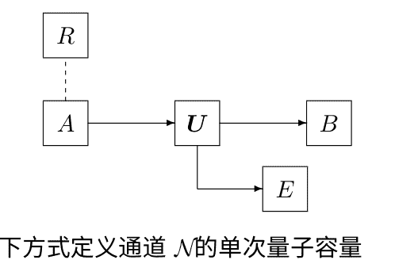

然后我们通过以下方式定义通道 $\mathcal{N}$ 的单次量子容量
$$Q_1(\mathcal{N}) := \max_{\rho_A} \left( -H(R|B)_{\phi_{RBE}} \right). \qquad (10.261)$$
在这里，最大值是在所有可能的输入密度算符 $\{\rho_A\}$ 上取得的，并且 $H(R|B)$ 是量子条件熵
$$H(R|B) = H(RB) - H(B) = H(E) - H(B), \qquad (10.262)$$
在最后一个等式中，我们使用了 $H(RB) = H(E)$ 在 $RBE$ 的纯态中。量 $-H(R|B)$ 在量子通信理论中起着如此关键的作用，以至于它值得拥有自己的特殊名称。我们称之为从 $R$ 到 $B$ 的相干信息，并将其表示为
$$I_c(R \rangle B)_{\phi} = -H(R|B)_{\phi} = H(B)_{\phi} - H(E)_{\phi}. \qquad (10.263)$$
这个数量不依赖于纯化 $\phi_{RBE}$ of 密度算子 $\rho_A$ 的方式选择；任何一个纯化都可以通过作用于 $R$ 的幺正变换从任何其他纯化中获得，这不会改变 $H(B)$ 或 $H(E)$。事实上，由于表达式 $H(B) - H(E)$ 只取决于 $BE$ 的边缘状态，为了计算这个数量，我们可以考虑通道的输入是通过追踪参考系统 $R$ 得到的混合态 $\rho_A$。

对于经典信道，$H(R|B)$ 总是非负的，相干信息永远不会是正的。在量子设置中，如果参考系统$R$与通道输出$B$比与环境 $E$ 更强相关，则 $I_c( R \rangle B)$ 是正的。事实上，表达相干信息的另一种方式是
$$I_c(R \rangle B) = \frac{1}{2} \left( I(R; B) - I(R; E) \right) = H(B) - H(E), \qquad (10.264)$$
我们注意到 (因为 $\phi_{RBE}$ 是纯的)
$$\begin{aligned}
I(R; B) &= H(R) + H(B) - H(RB) = H(R) + H(B) - H(E), \\
I(R; E) &= H(R) + H(E) - H(RE) = H(R) + H(E) - H(B). \qquad (10.265)
\end{aligned}$$

现在我们可以陈述量子信道容量的正规化公式 - 它是每个字母的最佳渐近相干信息
$$Q(\mathcal{N}^{A \to B}) = \lim_{n \to \infty} \max_{\rho_{A^n}} \frac{1}{n} I_c(R^n \rangle B^n)_{\phi_{R^n B^n E^n}}, \qquad (10.266)$$
输入密度算子 $\rho_{A^n}$ 可以在通道上纠缠使用。如果相干信息是次可加的，我们可以将这个表达式简化为一个单字母的量，即单次容量 $Q_1(\mathcal{N})$。但是，不幸的是，对于某些信道，相干信息可能是超加的，这种情况下，规范化公式并不是非常有信息量。至少我们可以说 $Q_1(\mathcal{N})$ 是一个可实现的速率，因此是容量的下界。

## 量子香农理论

### 10.7.2 解耦原理

在我们讨论可实现性之前，让我们了解为什么eq.(10.266)是容量的上界。首先，我们注意到互信息的单调性意味着相干信息也具有相应的单调性质。假设信道 $\mathcal{N}_1^{A \to B}$ 后面跟着一个通道 $\mathcal{N}_2^{B \to C}$。由于互信息是单调的，我们有
$$I(R; A) \geq I(R; B) \geq I(R; C), \tag{10.267}$$
这也可以表示为
$$H(R) - H(R|A) \geq H(R) - H(R|B) \geq H(R) - H(R|C), \tag{10.268}$$
因此
$$I_c(R \rangle A) \geq I_c(R \rangle B) \geq I_c(R \rangle C). \tag{10.269}$$
量子通道不能增加相干信息，这被称为量子数据处理不等式。

假设现在 $\rho_A$ 是一个量子编码状态，并且连续作用的两个通道是一个噪声通道 $\mathcal{N}^{A \to B}$ 和解码映射 $\mathcal{D}^{B \to \hat{B}}$ 由Bob应用于通道输出以恢复通道输入。考虑 $\mathcal{N}$ 的扩张作用 $U^{A \to BE}$ 后跟 $\mathcal{D}$ 的扩张作用 $V^{B \to \hat{B}B'}$ 对输入纯化$\psi_{RA}$的影响，在Bob能够完美恢复的假设下：
$$\psi_{RA} \xrightarrow{U} \phi_{RBE} \xrightarrow{V} \tilde{\psi}_{R\hat{B}B'E} = \psi_{R\hat{B}} \otimes \chi_{B'E}. \tag{10.270}$$
如果解码是完美的，那么解码后Bob在系统 $\hat{B}$ 中持有 $R$ 的纯化状态，这样
$$H(R) = I_c(R \rangle A)_\psi = I_c(R \rangle \hat{B})_{\tilde{\psi}}. \tag{10.271}$$
由于初始态和最终态具有相同的相干信息，量子数据处理不等式暗示中间态也必须具有相同的相干信息。
$$\begin{aligned}
H(R) &= I_c(R \rangle B) = H(B) - H(E) \\
&\implies H(B) = H(RE) = H(R) + H(E). \tag{10.272}
\end{aligned}$$
因此，$RE$ 的状态是一个乘积态。我们发现，如果鲍勃能够完全从通道膨胀 $U^{A \to BE}$ 对纯态 $\psi_{RA}$ 的作用中恢复过来，那么，在结果通道输出的纯态 $\phi_{RBE}$ 中，边缘态 $\rho_{RE}$ 必须是乘积态 $\rho_R \otimes \rho_E$。

反过来，假设 $\psi_{RA}$ 是一个纠缠的纯态，爱丽丝希望通过将其发送到噪声通道 $U^{A \to BE}$ 来将 $R$ 的纯化传输给鲍勃。并且假设在得到的三方纯态 $\phi_{RBE}$ 中，$RE$ 的边缘态因子分解为 $\rho_{RE} = \rho_R \otimes \rho_E$。然后 $B$ 分解为子系统 $B=\hat{B}_1B_2$，使得
$$\phi_{RBE}=\tilde{\psi}_{RB_1} \otimes \chi_{B_2E}. \tag{10.273}$$
现在鲍勃可以构建一个等距解码器 $V^{B_1 \to \hat{B}}$，提取R的纯化到鲍勃的首选子系统$\hat{B}$。由于R的所有纯化在鲍勃的一侧通过等距变换不同，鲍勃可以选择他的解码映射输出状态 $\psi_{R\hat{B}}$；然后输入状态从 RA传输到 R B，如期望的那样。此外，我们可以选择初始状态为与量子码的编码空间具有最大纠缠的参考系统的状态$\Phi_{RA}$；如果 RE的边缘状态在结果输出的纯态 $\phi_{RBE}$中分解，则根据第3章的相对态方法，我们得出结论：通过信道可以发送编码空间中的任何状态，并且Bob可以以完美的保真度进行解码。

我们发现，通过噪声信道传输的纯化的量子信息只有在参考系统与信道的环境完全无关，或者有时我们称之为与环境解耦时，才能完全纠正。这就是解耦原理，这是量子信道理论中许多关键结果的强大概念。

到目前为止，我们已经证明了精确可纠正性与精确解耦性的对应关系。但是我们同样可以看到，近似可纠正性与近似解耦性相对应。例如，假设 RE的状态接近于 $L^1$范数下的乘积态：
$$\|\rho_{RE} - \rho_R \otimes \rho_E\|_1 \leq \varepsilon$$
正如我们在第2章中学到的那样，如果两个密度算符在这个范数下彼此接近，那么它们的保真度也接近于1，因此它们具有大的重叠度的纯化态。任何乘积态 $\rho_R \otimes \rho_E$的纯化形式为
$$\tilde{\phi}_{RBE} = \psi_{RB_1} \otimes \chi_{B_2E}$$
由于 $\rho_{RE}$的所有纯化形式可以通过作用在纯化系统 $B$上的等距变换相互转化，因此可以选择分解 $B = B_1 B_2$的方式使得
$$F(\rho_{RE}, \rho_R \otimes \rho_E) = |\langle \phi_{RBE}|\tilde{\phi}_{RBE}\rangle|^2 \geq 1 - \|\rho_{RE} - \rho_R \otimes \rho_E\|_1 \geq 1 - \varepsilon$$
此外，由于保真度是单调的，无论是在追踪 $E$$的过程中还是在Bob的解码映射的作用下，由于Bob可以完美解码 $\tilde{\phi}_{RBE}$，我们得出结论
$$F\left( \mathcal{D}^{B \to \hat{B}} \left(\rho_{RB}\right), \psi_{R\hat{B}} \right) \geq 1 - \varepsilon$$
如果Bob选择适当的解码映射 $\mathcal{D}$。因此，在 $L^1$ norm中的近似解耦意味着高保真度的可纠正性。值得注意的是，如果 $\rho_{RE}$在 $L^1$ norm中与 $\tilde{\rho}_R \otimes \tilde{\rho}_E$ $\varepsilon$-接近，其中 $\tilde{\rho}_R$不一定是$\text{tr}_E(\rho_{RE})$和 $\tilde{\rho}_E$不一定是$\text{tr}_R(\rho_{RE})$。我们将在接下来的内容中使用这种论证形式。

另一方面，如果（近似）解耦失败，鲍勃解码的状态的保真度将受到严重损害。假设在状态 $\phi_{RBE}$中我们有
$$H(R) + H(E) - H(RE) = \varepsilon > 0$$
那么 $\phi$的相干信息是
$$I_c(R \rangle B)_\phi = H(B)_\phi - H(E)_\phi = H(RE)_\phi - H(E)_\phi = H(R)_\phi - \varepsilon \tag{10.280}$$
根据量子数据处理不等式，我们知道鲍勃解码的状态 $\psi_{R\hat{B}}$的相干信息不会更大；因此
$$I_c(R \rangle \hat{B})_\psi = H(R)_\psi - H(R\hat{B})_\psi \leq H(R)_\psi - \varepsilon,$$
因此
$$H(R\hat{B})_{\psi} \geq \varepsilon \tag{10.281}$$
与完全解耦的偏离意味着解码后的 $R\hat{B}$ 状态与环境 $E$ 之间存在一些残余纠缠，因此是不纯的。

现在我们有了推导量子信道容量上界的工具 $Q(\mathcal{N})$。对于 $n$ 个信道使用，让 $\psi^{(N)}$ 成为参考系统的最大纠缠态 $\mathcal{H}_R^{\otimes n} \subseteq \mathcal{H}_R^{\otimes N}$，其中编码空间 $\mathcal{H}_A^{(N)} \subseteq \mathcal{H}_A^{\otimes N}$，其中 $\dim \mathcal{H}_A^{(N)} = 2^{nR}$，因此
$$I_c(R^n; A^n)_{\psi^{(N)}} = H(R^n)_{\psi^{(N)}} = nR \tag{10.282}$$
现在，$A$通过$B$传输 $(U^{A \to BE})^{\otimes n}$，产生纯态$\phi^{(n)}$。如果$Bob$能够高度准确地解码，那么他解码后的状态必须具有相干信息$H(R^n)_{\psi^{(n)}}$，量子数据处理不等式则暗示
$$I_c(R^n; B^n)_{\phi^{(n)}} = H(R^n)_{\psi^{(n)}} - H(E^n)_{\phi^{(n)}} \to nR \tag{10.283}$$
因此
$$R = \frac{1}{n} I_c(R^n; B^n)_{\phi^{(n)}} + H(E^n)_{\phi^{(n)}}. \tag{10.284}$$
当$n \to \infty$时，我们可以看到eq.(10.266)中的$Q(\mathcal{N})$表达式是量子信道容量的一个上界。在练习10.10中，你将进一步明确eq.(10.283)的陈述，证明
$$H(R^n) - I_c(R^n; B^n) \leq 2H_2(\varepsilon) + 4\varepsilon nR. \tag{10.285}$$
为了证明 $Q(\mathcal{N})$是一个可实现的速率，而不仅仅是一个上界，我们需要制定一个量子版本的Shannon随机编码论证。我们的策略(见 §10.9.3)将是证明存在一种代码，可以实现 $E^n$ 与 $R^n$ 的近似解耦。

### 10.7.3 退化通道

尽管在某些情况下，相干信息可能是超加性的，但存在一些通道类别，其中相干信息是加性的，因此量子通道容量与单次容量相匹配，存在一个单字母公式。

这样的类别之一是可退化通道的类别。

为了理解什么是可退化通道，我们首先需要了解互补通道的概念。任何通道 $\mathcal{N}^{A \to B}$ 都有一个Stinespring扩张 $U^{A \to BE}$，从中我们通过追踪环境 $E$ 获得 $\mathcal{N}^{A \to B}$。或者我们可以得到该通道 $\mathcal{N}_c^{A \to E}$ 通过追踪$B$而不是 $\mathcal{N}^{A \to B}$的互补性。由于我们有自由组合 $U^{A \to BE}$ 与等距变换 $V^{E \to E'}$ 而不改变 $\mathcal{N}^{A \to B}$，互补通道仅在 $E$ 上的等距变换下定义。这种缺乏唯一性不会困扰我们，因为互补通道的有趣属性在这种等距变换下是不变的。

如果我们可以通过将 $\mathcal{N}^{A \to B}$ 与将 $B$ 映射到 $E$ 的通道组合来获得其互补通道，则我们称该通道 $\mathcal{N}^{A \to B}$ 是可退化的：
$$\mathcal{N}_c^{A \to E} = \mathcal{T}^{B \to E} \circ \mathcal{N}^{A \to B}. \tag{10.286}$$
粗略地说，当爱丽丝通过通道发送一个状态时，持有系统 $B$的鲍勃收到的副本比持有系统 $E$的伊夫收到的副本更少噪声。现在假设 $U^{A_1 \to B_1 E_1}$ 和 $U^{A_2 \to B_2 E_2}$ 是可降解通道 $\mathcal{N}_1$和 $\mathcal{N}_2$的扩张。爱丽丝引入一个参考系统 $R$并准备一个输入纯态 $\psi_{RA_1 A_2}$，然后通过 $\mathcal{N}_1 \otimes \mathcal{N}_2$将状态发送给鲍勃，准备输出纯态 $\phi_{RB_1 B_2 E_1 E_2}$。我们想要评估这个状态中的相干信息 $I_c(R \rangle B_1 B_2)_\phi$。

关键点在于，因为两个通道都是可降解的，存在一个乘积通道 $\mathcal{T}_1 \otimes \mathcal{T}_2$将 $B_1 B_2$映射到 $E_1 E_2$，因此互信息的单调性暗示
$$I(R; B_1 B_2) \geq I(R; E_1 E_2). \quad (10.287)$$
因此，相干信息满足
$$\begin{aligned}
I_c(R \rangle B_1 B_2) &= H(B_1 B_2) - H(E_1 E_2) \\
&= H(B_1) + H(B_2) - I(B_1; B_2) - H(E_1) - H(E_2) + I(E_1; E_2) \\
&\leq H(B_1) - H(E_1) + H(B_2) - H(E_2). \quad (10.288)
\end{aligned}$$
这些量都在状态 $\phi_{RBE}$中计算 但请注意，对于 $H(B_1) - H(E_1)$ 的系统 $A_2$的选择是无关紧要的。这个量实际上与相干信息 $I_c(RA_2 \rangle B_1)$相同，现在我们将 $A_2$视为输入到信道 $\mathcal{N}_1$的参考系统的一部分。同样地， $H(B_2) - H(E_2) = I_c(RA_1 \rangle B_2)$，因此，
$$I_c(R \rangle B_1 B_2) \leq I_c(RA_2 \rangle B_1) + I_c(RA_1 \rangle B_2) \leq Q_1(\mathcal{N}_1) + Q_1(\mathcal{N}_2), \quad (10.289)$$
在最后一个不等式中，我们使用了一次性容量的定义，即相干信息在所有输入中的最大化。由于 $Q_1(\mathcal{N}_1 \otimes \mathcal{N}_2)$同样由最大化相干信息 $I_c(R \rangle B_1 B_2)$来定义，我们发现
$$Q_1(\mathcal{N}_1 \otimes \mathcal{N}_2) \leq Q_1(\mathcal{N}_1) + Q_1(\mathcal{N}_2) \quad (10.290)$$
如果 $\mathcal{N}_1$和 $\mathcal{N}_2$是可降解的。

容量的正则化公式为 $\mathcal{N}$的
$$Q(\mathcal{N}) = \lim_{n \to \infty} \frac{1}{n} Q_1(\mathcal{N}^{\otimes n}) \leq Q_1(\mathcal{N}), \quad (10.291)$$
最后一个不等式是基于等式(10.290)的假设，假设 $\mathcal{N}$是可降解的。我们将看到 $Q_1(\mathcal{N})$实际上是一个可实现的速率，因此是一个关于可降解信道的单字母公式的量子容量。

作为一个具体的可降解信道的例子，考虑具有扩张的广义退相干信道
$$U^{A \to BE} : |x\rangle_A \to |x\rangle_B \otimes |\alpha_x\rangle_E, \quad (10.292)$$
其中 $\{|x\rangle_A\}, \{|x\rangle_B\}$是 $\mathcal{H}_A, \mathcal{H}_B$的正交基，环境的状态 $\{|\alpha_x\rangle_E\}$不一定正交。相应的通道是
$$\mathcal{N}^{A \to B} : \rho \to \sum_{x,x'} |x\rangle\langle x| \rho |x'\rangle\langle x'| \langle \alpha_{x'} | \alpha_x \rangle, \quad (10.293)$$它具有互补通道

$$
N_c^{A\rightarrow E}: \rho \rightarrow \sum_x |\alpha_x\rangle\langle x| \rho |x\rangle\langle\alpha_x|.
$$

在状态 $\{| \alpha_x \rangle_E = |x\rangle_E\}$ 是正交的特殊情况下，我们得到完全退相干通道

$$
\Delta^{A\rightarrow B}: \rho \rightarrow \sum_x |x\rangle\langle x| \rho |x\rangle\langle x|,
$$

其互补通道 $\Delta^{A\rightarrow E}$ 与 $\Delta^{A\rightarrow B}$ 具有相同的形式。我们可以轻松验证

$$
N_c^{A\rightarrow E} = N_c^{C\rightarrow E} \circ \Delta^{B\rightarrow C} \circ N^{A\rightarrow B};
$$

因此 $N_c \circ \Delta$ 会使 $N$ 退化为 $N_c$。因此 $N$ 是可退化的，且 $Q(N) = Q_1(N)$。更多关于可退化信道的例子将在练习10.12中讨论。

## 10.8 量子协议

在独立同分布的情况下，利用解耦原理，我们可以证明两个基本量子协议的可实现速率。这些协议被亲切地称为父协议和母协议，因为每个协议都会产生一系列有趣的推论。我们将在本节中阐述这些协议并讨论它们的一些“子协议”，将证明推迟到第10.9节。

### 10.8.1 父亲：辅助纠缠量子通信

父协议是一种用于辅助纠缠的量子通信方案。通过多次使用噪声量子信道 $\mathcal{N}^{A\rightarrow B}$，该协议可以将量子信息以高保真度从爱丽丝发送给鲍勃，同时消耗一些爱丽丝和鲍勃之间事先准备的量子纠缠。该协议执行的任务由父资源不等式总结。

$$
\left\langle \mathcal{N}^{A\rightarrow B}: \rho_A \right\rangle + \frac{1}{2} I(R;E)[qq] \geq \frac{1}{2} I(R;B)[q\rightarrow q],
$$

在渐近独立同分布的设置中，左侧的资源可以用于实现右侧的结果。也就是说，对于任何正数 $\varepsilon$，量子信道 $\mathcal{N}$ 可以被使用 $n$ 次来传输 $n I(R; B) - o(n)$ 个量子比特，保真度 $F \geq 1 - \varepsilon$，同时消耗 $n I(R; E) + o(n)$ 个纠缠比特的发送者和接收者之间共享的纠缠。

这些熵量是在一个三部分纯态 $\phi_{RBE}$ 中评估的，该纯态是通过将Stinespring膨胀 $U^{A\rightarrow B}_E$ 应用于输入的纯化 $\psi_{RA}$ 的结果获得的，该输入的密度算符 $\rho_A$。方程 (10.297) 意味着对于任何输入的密度算符 $\rho_A$，存在一种编码过程，以特定速率消耗纠缠来实现量子通信。

要记住父资源不等式，有助于记住 $I(R; B)$ 量化了某种好，即与参考系统的相关性在信道传输过程中保持不变，而 $I(R; E)$ 量化了某种坏，即参考系统 $R$ 与信道环境 $E$ 之间的相关性，导致传输的信息失去相干。好的量 $I(R; B)$ 越大，量子通信的速率越高。坏的量 $I(R; E)$ 越大，量子通信的速率越低。

纠缠来克服信道中的噪声。为了记住 $\frac{1}{2}$ 在 $I(R; B)$ 前面的因子，考虑一个无噪声的量子信道，其中 $\psi_{RA}$ 是最大纠缠的；在这种情况下，没有环境。

$$ \phi_{RB} = \frac{1}{\sqrt{d}} \sum_{i=0}^{d-1} |i\rangle_R \otimes |i\rangle_B, \qquad\qquad (10.298) $$

和 $\frac{1}{2} I(R; B) = H(R) = H(B) = \log_2 d$ 只是 $A$ 中量子比特的数量。为了记住 $\frac{1}{2}$ 在 $I(R; E)$ 前面的因子，考虑一个无噪声的经典信道，在这种情况下，量子信息在一个优选基下完全退相干。

$$ \phi_{RBE} = \frac{1}{\sqrt{d}} \sum_{i=0}^{d-1} |i\rangle_R \otimes |i\rangle_B \otimes |i\rangle_E, \qquad\qquad (10.299) $$

然后父不等式仅仅表示我们可以通过消耗 $2$ 个 ebit 和发送 $n$ 个经典比特来传送 $n$ 个 qubit 。在证明父资源不等式之前，我们将首先讨论一些有趣的结果。

### 纠缠辅助的经典通信。

假设爱丽丝想要向鲍勃发送经典信息，而不是量子信息。然后我们可以使用超密编码将父协议实现的量子通信转化为经典通信，但需要消耗一些额外的纠缠。通过引用超密编码资源不等式 $SD: [q \rightarrow q] + [qq] \geq 2[c \rightarrow c] \qquad\qquad (10.300)$

结合父资源不等式，我们可以在使用通道时实现 $I(R; B)$ 比特的经典通信，同时消耗一定数量的 ebit。

$$ \frac{1}{2} I(R; E) + \frac{1}{2} I(R; B) = H(R) \qquad\qquad (10.301) $$

每个信道使用。因此，我们通过噪声量子信道获得了一个可实现的纠缠辅助经典通信速率：

$$ \langle \mathcal{N}^{A \rightarrow B}: \rho_A \rangle + H(R) [qq] \geq I(R; B) [c \rightarrow c]. \qquad\qquad (10.302) $$

我们可以将纠缠辅助经典容量 $C_E(\mathcal{N})$ 定义为每个信道使用的经典通信速率的可实现速率的上确界，假设无限量的纠缠可免费获得。然后，资源不等式 eq.(10.302) 意味着

$$ C_E(\mathcal{N}) \geq \max_A I(R; B). \qquad\qquad (10.303) $$

在这种情况下，存在一个匹配的上界，因此 $C_E(\mathcal{N})$ 实际上是一个等式，因此纠缠辅助经典容量的单字母公式。此外，eq.(10.302) 告诉我们达到容量所需的纠缠消耗速率。如果我们忽略纠缠的成本，父协议表明可以实现纠缠辅助量子通信的速率是噪声信道 $\mathcal{N}$ 的纠缠辅助经典容量 $C_E(\mathcal{N})$ 的一半。这显然是正确的，因为通过消耗纠缠，我们可以使用量子隐形传态将 $n$ 位经典通信转换为 $n/2$ 个量子通信比特。

## 量子香农理论

### 量子信道容量。

可能是Alice想要将量子信息发送给Bob，但是Alice和Bob并没有幸运地拥有预先存在的纠缠。如果我们愿意借给他们一些纠缠，他们仍然可以利用父协议。之后他们需要偿还。在这种情况下，我们说纠缠催化了量子通信。纠缠是激活这个过程的必要条件，但在过程结束时，没有净纠缠被消耗。

在这种催化设置中，Alice和Bob每次使用信道都借用 $\frac{1}{2}I(R; E)$ 个纠缠位，执行父协议，然后牺牲他们生成的一些量子通信来替换借用的纠缠，通过资源不等式。

$$ [q \rightarrow q] \geqq [qq]. \tag{10.304} $$

偿还债务后，爱丽丝和鲍勃保留了每个通道使用的量子比特的数量

$$ \frac{1}{2} I (R; B) - \frac{1}{2} I (R; E) = H (B) - H (E) = I_c (R \rangle B) , \tag{10.305} $$

从 $R$ 到 $B$ 的信道的相干信息。因此，我们得到了量子通信的可实现速率

$$ \left\langle \mathcal{N}^{A \rightarrow B} : \rho_{A}\right\rangle \geq I_{c} (R \rangle B) [q \rightarrow q] , \tag{10.306} $$

尽管在催化剂设置中。实际上可以证明，在不引入催化剂的情况下也可以实现相同的速率（见 §10.9.4）。然而，正如在 §10.7.1中已经讨论的那样，由于相干信息的超加性，这个资源不等式并不能给出量子信道容量 $Q(\mathcal{N})$ 的一般单字母公式。

### 10.8.2 母亲：量子态传输

在母协议中，艾丽斯、鲍勃和伊芙最初共享一个三部分纯态 $\phi_{ABE}$；因此，艾丽斯和鲍勃共同持有伊芙系统的纯化 $E$。艾丽斯希望以尽可能少的无噪声量子通信比特将她的纯化份额发送给鲍勃。因此，艾丽斯将她的系统 $A$ 分成两个子系统

$A_1$ 和 $A_2$，其中 $A_1$ 尽可能小且与 $E$ 不相关。她保留 $A_2$ 并将 $A_1$ 发送给鲍勃。收到 $A_1$ 后，鲍勃将 $A_1B$ 分成两个子系统 $B_1$ 和 $B_2$，其中 $B_1$ 纯化 $E$，而 $B_2$ 纯化 $A_2$。因此，在协议结束时，鲍勃持有 $E$ 的纯化，在 $B_1$ 中，此外，艾丽斯和鲍勃在 $A_2B_2$ 中共享一个双部分纯态。该协议在下图中描述：

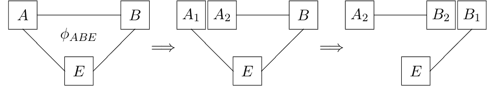

在母协议的独立同分布版本中，初始状态为 $\phi_{ABE}^{\otimes n}$，并且协议实现的任务由母资源不等式总结

$$ \langle\phi_{ABE}\rangle + \frac{1}{2}I(A; E)[q \rightarrow q] \geq \frac{1}{2}I(A; B)[qq] + \langle\phi'_{BE}\rangle, \tag{10.307} $$

在渐近独立同分布的设置中，左侧的资源可以用来实现右侧的结果，并且熵量在状态 $\phi_{ABE}$中进行评估。也就是说，如果 $A^{(n)}_1$表示爱丽丝发送的状态， $A^{(n)}_2$表示她保留的状态，那么对于任意正数 $\varepsilon$， $A^{(n)}_2 E^n$的状态在 $L^1$ norm 下与一个乘积状态 $\varepsilon$-接近，其中 $\log$

$$ \left| A^{(n)}_2 \right| = \frac{n}{2} I(A; E) + o(n), \text{ 而 } A^{(n)}_2 B^{(n)}_2 \text{ 包含了 } \frac{n}{2} I(A; B) - o(n) $$

共享的纠缠比特。 方程式(10.307)意味着对于任何输入的纯态 $\phi_{ABE}$ 都有一种选择子系统 $A^{(n)}_2$的方式，使得 $A^{(n)}_2$ 和 $E^n$ 几乎不相关，并且收集到了指定数量的纠缠在 $A^{(n)}_2 B^{(n)}_2$。

从某种意义上说，母协议是父协议的对偶。虽然父协议消耗纠缠来实现量子通信，母协议消耗量子通信并收集纠缠。对于母协议， $I(A; B)$量化了协议开始时Alice和Bob之间的相关性（某种好的东西），而 $I(A; E)$量化了初始共享纠缠中的噪声（某种坏的东西）。母协议也可以看作是 §10.1.3中讨论的Slepian-Wolf分布压缩协议的量子推广。母协议通过将Alice的份额发送给Bob来合并 $E$的纯化份额，就像分布源编码通过将Alice的经典信息发送给Bob来合并Alice和Bob之间的经典相关性一样。因此，母协议被称为完全量子Slepian-Wolf协议；“完全”这个修饰词将在 §10.8.2中得到解释，当我们讨论一个假设经典通信是自由可用的量子状态转移的变体时。

我们还可以将母协议视为纠缠浓缩协议的推广，该协议在第10.4节中讨论，在三个方面进行了扩展：

1.  阿丽斯和鲍勃共享的初始纠缠态可以是混合态而不是纯态。
2.  阿丽斯到鲍勃的通信是量子通信而不是经典通信。
3.  执行该协议所需的通信量由资源不等式进行量化。

还要注意，如果 $AE$的状态是纯态（与 $B$不相关），那么母协议将简化为舒马赫压缩。在这种情况下， $\frac{1}{2}I(A; E) = H(A)$，而母资源不等式表明，可以使用 $H( A) + o(n)$比特的量子通信将 $A_n$的纯化以高保真度传输给鲍勃。

在证明母资源不等式之前，我们首先讨论一些有趣的结果。

### 哈希不等式。

假设爱丽丝和鲍勃希望从许多副本的状态 $\phi_{ABE}$中提取纠缠，只使用本地操作和经典通信（LOCC）。在催化设置中，他们可以借用一些量子通信，使用母协议提取一些共享纠缠，然后使用经典通信和他们收集的纠缠通过量子隐形传态来偿还债务。使用隐形传态资源不等式

$$ TP: [qq] + 2[c \to c] \geq [q \to q] \qquad (10.308) $$

$\frac{1}{2}I(A;E)$倍，并结合母资源不等式，我们得到

$$ \langle \phi_{ABE} \rangle + I(A; E)[c \to c] \geq I_c(A \rangle B)[qq] + \langle \phi'_{BE} \rangle, \qquad (10.309) $$

由于每份 $\phi$ 通过母协议实现的蒸馏纠缠净量为 $\frac{1}{2}I(A;B)$，而通过隐形传态消耗的每份为 $\frac{1}{2}I(A;E)$，因此

$$ \frac{1}{2}I(A;B) - \frac{1}{2}I(A;E) = H(B) - H(E) = I_c(A\rangle B). \qquad (10.310) $$

方程 (10.309) 是哈希不等式，它量化了从混合态 $\rho_{AB}$ 的多份副本中，通过单向经典通信从爱丽丝和鲍勃之间共享的纠缠比特中提取的可实现速率，假设 $I_c(A\rangle B) = -H(A|B)$ 为正数。
此外，哈希不等式告诉我们需要多少经典通信来实现这个目的。

在状态 $\rho_{AB}$ 是纯态的情况下，$I_c(A\rangle B) = H(A) - H(AB) = H(A)$ 且没有环境 $E$；因此我们恢复了之前关于纯态双分体纠缠浓度的结论——每个副本可以提取 $H(A)$ Bell 对，并且几乎没有经典通信成本。

### 状态合并。

假设爱丽丝和鲍勃共享伊芙的纯化状态，并且爱丽丝想要将她的纯化份额转移到鲍勃，此时爱丽丝可以无限制地进行经典通信，而不需要任何费用。与母协议相反，即使需要发送更多的比特以发送更少的量子比特，爱丽丝也希望以尽可能少的单向量子通信实现转移。

在催化设置中，爱丽丝和鲍勃可以借用一些量子通信，执行母协议，然后使用传送和母协议提取的纠缠来偿还部分借用的量子通信。将 $\frac{n}{2} I(A;B)$ 量子比特的传送与母资源不等式相结合，我们得到

$$ \langle\phi_{ABE}\rangle + H(A|B)[q \rightarrow q] + I(A;B)[c \rightarrow c] \geq \langle\phi'_{BE}\rangle, \qquad (10.311) $$

使用

$$ \frac{1}{2}I(A;E) - \frac{1}{2}I(A;B) = H(E) - H(B) = H(AB) - H(B) = H(A|B). \qquad (10.312) $$

方程式(10.311)是状态合并不等式，表达了在i.i.d.设置中实现状态传输所需的量子和经典通信的程度，假设 $H(A|B)$ 是非负的。

与母协议类似，这个状态合并协议可以看作是合并经典相关性的Slepian-Wolf协议的（部分）量子版本。在经典设置中，$H(X|Y)$ 量化了鲍勃对爱丽丝信息的剩余不确定性。当Bob只知道 $Y$ 时，Alice可以通过发送 $X$ 来向Bob透露 $X$，$H(X|Y)$ 每个 $X$ 的字母位数。同样，状态合并为量子条件信息 $H(A|B)$ 提供了操作上的意义，作为每个 $\phi$ 的副本，Alice发送给Bob以传达她在 $E$ 的纯化中的份额，假设经典通信是免费的。从这个意义上说，当Bob只持有 $B$ 时，我们可以将 $H(A|B)$ 视为Bob对 $E$ 的共享纯化的剩余“无知”的度量。在经典情况下，$H(X|Y)$ 是非负的，并且当且仅当Bob已经确定了 $XY$ 时为零，但在量子情况下，$H(A|B)$ 可以是负的。Bob如何对 $AB$ 的量子状态有“负的不确定性”？如果 $H(A|B) < 0$，或者等价地，如果 $I(A;E) < I(A;B)$，那么母协议产生的量子纠缠比它消耗的量子通信更多。因此，当 $H(A|B)$ 为负时（即 $I_c(A\rangle B)$ 为正态），母资源不等式意味着哈希不等式，它断言从爱丽丝到鲍勃的经典通信不仅实现了状态传输，还每份 $\phi$ 的副本提取了 $-H(A|B)$ 个纠缠位。这些提取的纠缠位可以存入纠缠银行，以便在未来的状态合并回合中根据需要提取。鲍勃今天的“负不确定性”降低了明天要执行的量子通信成本。

### 10.8.3 强次可加性的操作意义

观察到 $H(A|B)$ 是状态合并的量子通信成本，使我们能够以简单的操作证明冯·诺伊曼熵的强次可加性，表达为

$$ H(A|BC) \leq H(A|B), \quad \text{或者} \quad -H(A|B) \leq -H(A|BC). \tag{10.313} $$

当 $H(A|B)$ 是正数时，方程(10.313)明显地表明，如果Bob持有 $C$ 和 $B$，那么将Alice的系统与Bob的系统合并起来并不更困难。当 $H(A|B)$ 是负数时，方程(10.313)明显地表明，如果Bob持有 $C$ 和 $B$，那么Alice和Bob在单向经典通信中无法提取更少的纠缠。

为了完成这个论证，我们需要知道 $H(A|B)$ 不仅是可实现的，而且是状态合并的最优量子通信成本，而且 $-H(A|B)$ ebits是哈希的最优产量。这个最优性是根据一个原则得出的，对于一个双分离纯态，$k$ 比特的量子通信不能使 $AB$ 的共享纠缠增加超过 $k$ ebits。

如果 $H(A|B)$ 是负数，考虑将系统 $ABE$ 切割成两个部分 $AE$ 和 $B$，如下图所示：


在哈希协议中，应用于 $n$ 个 $\phi_{ABE}$ 的副本，协议开始时，这个切割处的纠缠度为 $nH(B)$。协议结束时，$E$ 从 $A^{(n)}_2$ 解耦，并与 $B^{(n)}_1$ 纠缠，忽略 $O(n)$ 修正。如果Alice和Bob共享 $k$ 位纠缠度，最终 $AE$-$B$ 切割处的纠缠度为

$$ nH(E) + k \leq nH(B) \implies \frac{k}{n} \leq H(B) - H(E) = -H(A|B). \tag{10.314} $$

这个不等式成立是因为LOCC不能增加切割面上的纠缠度，并且意味着在哈希协议中，每个 $\phi_{ABE}$ 的副本中不能提取出超过 $-H(A|B)$ ebits的纠缠度。

另一方面，如果 $H(A|B)$ 是正的，在状态合并的结论时，$B^{(n)}_1$ 与 $E^n$ 纠缠，$AE$-$B$ 切割面上的纠缠度至少为 $nH(E)$。为了实现纠缠度的增加，从爱丽丝发送给鲍勃的量子比特数量必须至少为

$$ k \geq nH(E) - nH(B) \implies \frac{k}{n} \geq H(E) - H(B) = H(A|B) \tag{10.315} $$

### 10.8.4 热力学中的负条件熵

作为解耦母资源不等式的进一步应用，我们现在重新审视了朗道尔原理，从而对负量子条件熵的影响产生了另一种视角。回想一下，擦除一个比特是一个将比特映射为0的过程，不考虑其初始值。这个过程是不可逆的——仅仅知道擦除后的最终状态为0，我们无法确定擦除前的初始状态是0还是1。不可逆性意味着擦除会产生不可避免的热力学代价。根据朗道尔原理，以温度 \(T\) 擦除一个比特需要的功不少于 \(W = kT \ln 2\)。

在练习10.16中，我们分析了一种特定的擦除过程。假设一个两级量子系统具有能量本征态 \(|0\rangle\) 和 \(|1\rangle\)，对应的本征值为 \(E_0\) 和 \(E_1\)，其中 \(E = E_1 - E_0 \geq 0\)。最初，量子比特处于这两个状态的未知混合态，并且能量分裂为 \(E = 0\)。我们通过三个步骤来擦除比特。在第一步中，我们将比特与温度为 \(T > 0\) 的热浴接触，并等待比特与热浴达到热平衡。在这一步中，比特“忘记”了它的初始值，但是比特还没有被擦除，因为它还没有被重置。在第二步中，比特仍然与热浴接触，我们打开一个控制场，慢慢增加 \(E_1\) 的值，使其远大于 \(kT\)，同时保持热平衡，从而将比特重置为 \(|0\rangle\)。在第三步中，我们将比特与热浴隔离，并关闭控制场，使比特的两个状态再次变为简并态。

如习题10.16所示，执行第2步需要做功 \(W = kT \ln 2\)，并将能量以热量的形式从比特流向浴中。我们还可以反向运行最后两个步骤，在比特与浴隔离时增加 \(E_1\)，然后在比特与浴接触时减少 \(E_1\)。这个过程将状态 \(|0\rangle\) 映射到比特的最大混合态，并从浴中提取功 \(W = kT \ln 2\)。

擦除是不可逆的，因为执行擦除的代理人不知道正在被擦除的信息。（如果信息的副本存储在她的记忆中，那么副本的存活意味着擦除没有成功）。从信息论的角度来看，擦除比特的热力学熵的减少，以及执行擦除所需的工作，是因为擦除减少了代理人对比特状态的无知，这种无知由香农熵量化。但更准确地说，它是系统在代理人记忆的状态下的条件熵，它捕捉了擦除之前代理人的无知，因此也捕捉了擦除的热力学成本。因此，擦除系统 \(A\) 所需的最小工作应该表示为

\[ W(A|O) = H(A|O) kT \ln 2, \]

其中 \(O\) 是执行擦除操作的观察者的记忆，而 \(H(A|O)\) 量化了观察者对 \(A\) 状态的无知。

但是如果 \(A\) 和 \(O\) 是量子系统呢？我们知道，如果 \(A\) 和 \(O\) 是纠缠的，那么条件熵 \(H(A|O)\) 可能是负值。这是否意味着我们可以在擦除 \(A\) 的同时提取能量，而不是消耗能量？

是的，我们可以！例如，假设 \(A\) 和 \(O\) 是量子比特，它们的初始状态是最大纠缠态。通过控制 \(AO\) 与热浴之间的接触，观察者可以在将 \(AO\) 转化为最大混合态的同时提取能量 \(W = 2kT \log 2\)，使用与上述相同的能量提取协议。然后，她可以通过做功 \(W = kT \log 2\) 将 \(A\) 恢复到状态 \(|0\rangle\)。这样做的净效果是在提取能量 \(W = kT \log 2\) 的同时擦除 \(A\)，满足等式 (10.316)。

为了理解为什么这个技巧有效，我们应该考虑 \(AO\) 的联合状态，而不仅仅是 \(A\) 的状态。尽管 \(A\) 的边缘状态在协议开始时是混合的，在结束时是纯粹的，但 \(AO\) 的状态在开始时是纯粹的，在结束时是混合的。通过牺牲 \(AO\) 的纯度来提取正功。为了推广这个想法，让我们考虑系统 \(A\) 和记忆 \(O\) 的 \(n\) 个副本的状态 \(\rho_{AO}\)。我们的目标是将 \(A\) 的 \(n\) 个副本映射到擦除状态 \(|000\ldots0\rangle\)，同时使用或提取最优数量的功。事实上，在 \(n \to \infty\) 极限下，每个副本的最优功由方程 (10.316) 给出。

为了实现每个副本的渐近功率，观察者首先将 \(A\) 的 \(n\) 个副本投影到其典型子空间，成功的概率为 \(1 - o(1)\)。然后，通过一个酉变换，将典型子空间旋转到一个包含 \(H(A) + o(1)\) 个量子比特的子系统 \(\bar{A}\)，同时擦除补充的比特，如方程 (10.144) 所示。现在只剩下擦除 \(\bar{A}\)。母资源不等式确保我们可以将 \(\bar{A}\) 分解为子系统 \(\bar{A}_1\) 和 \(\bar{A}_2\)，使得 \(\bar{A}_2\) 包含 \(n\left(I(\bar{A};O) - o(1)\right)\) 量子比特，并且与 \(O^n\) 的一个子系统几乎是最大纠缠的。对于擦除协议来说，重要的是我们可以找到一个包含 \(n\left(I(\bar{A};O) - o(1)\right)\) 量子比特的 \(AO^n\) 的子系统，它与一个纯态只有距离 \(o(1)\)。通过控制这个子系统与热浴之间的接触，我们可以提取出的功 \(W = n\left(I(\bar{A};O) - o(1)\right) kT \log 2\)，同时将子系统转化为最大混合态。然后我们开始擦除 \(\bar{A}_1\)，消耗的功为 \(kT \log |\bar{A}_1| = n\left(H(\bar{A}_1) + o(1)\right) kT \log 2\)。每个 \(\rho_{AO}\) 的擦除的净功耗是

\[ W = \left(H(A) - I(A; O) + o(1)\right) kT \log 2 = \left(H(A|O) + o(1)\right) kT \log 2, \qquad (10.317) \]

擦除成功的概率为 \(1 - o(1)\)。该协议的一个显著特点是，只有与 \(\bar{A}_2\) 纠缠的 \(O^n\) 子系统受到影响。与内存 \(O\) 的任何相关性与其他系统保持完好，并且可以在将来利用它们来降低擦除这些其他系统的成本。

与状态合并协议一样，该擦除协议提供了强子可加性的操作解释。对于正的 \(H(A|O)\)， \(H(A|O) \geq H(A|OO')\) 意味着如果观察者同时可以访问 \(O\) 和 \(O'\)，则擦除 \(A\) 不会更困难，而如果她只能访问 \(O\)，则擦除 \(A\) 更容易。对于负的 \(H(A|O)\)， \(-H(A|OO') \geq -H(A|O)\) 意味着我们可以从 \(AOO'\) 中提取至少与其子系统 \(AO\) 一样多的功。为了执行该协议并在擦除 \(A\) 的同时提取最优数量的工作，我们需要知道 \(O^n\) 的哪个子系统提供了 \(\bar{A}_2\) 的纯化。解耦论证确保了该子系统的存在，但并未提供一种具体的方法来找到它，因此没有关于以最优成本擦除的具体协议。

这个困境是香农理论的特点；例如，香农的噪声信道编码定理确保存在一个实现信道容量的编码，但并不提供任何明确的编码构造。

## 10.9 解耦不等式

通过使用随机编码，可以推导出量子协议的可实现速率，就像经典的香农理论一样。但是，经典和量子香农理论之间的这种相似性是表面的——在更深层次的概念上，量子协议与经典协议有实质性的不同。事实上，解耦原理是量子香农理论的许多关键发现的基础，提供了一个统一的主题，将许多不同的结果联系在一起。特别地，母资源不等式和父资源不等式，以及上面列举的所有它们的后代，都可以从一个不等式中得出，该不等式指定了解耦的充分条件。

这个解耦不等式涉及以下问题：假设爱丽丝和伊芙共享一个量子态 \(\sigma_{AE}\)，其中 \(A\) 是一个 \(n\) 量子比特系统。这个态可能是混合态，但一般来说 \(A\) 和 \(E\) 是相关的；也就是说，\(I(A; E) > 0\)。现在爱丽丝开始逐个丢弃量子比特，其中每个比特是爱丽丝所持有的随机选择的二维子系统。每次爱丽丝丢弃一个比特，她与 \(E\) 的关联就变得更弱。她应该丢弃多少个量子比特，以便她保留的子系统与 Eve 的系统 \(E\) 之间的相关性可以忽略不计？

为了使问题明确，我们需要形式化什么是丢弃一个随机的量子比特。更一般地，假设 \(A\) 的维度为 \(|A|\)，Alice 将 \(A\) 分解为子系统 \(A_1\) 和 \(A_2\)，然后丢弃 \(A_1\) 并保留 \(A_2\)。我们希望考虑许多选择丢弃系统的可能方式，其具有指定的维度 \(|A_1|\)。等价地，我们可以考虑一个固定的分解 \(A = A_1 A_2\)，在丢弃 \(A_1\) 之前对 \(A\) 应用一个酉变换 \(U\)。然后丢弃一个具有维度 \(|A_1|\) 的随机子系统就等同于在丢弃固定子系统 \(A_1\) 之前应用一个随机酉变换 \(U\)：


为了分析丢弃一个随机子系统的后果，我们需要能够计算在酉群 \(|A| \times |A|\) 矩阵组上均匀平均 \(U\) 时的函数 \(f(U)\) 的期望值。我们将这个期望值表示为 \(\mathbb{E}_U[f(U)]\)；为了进行计算，我们只需要知道 \(\mathbb{E}_U\) 是适当归一化的，并且在任意常数酉 \(V\) 的左乘或右乘下是不变的。

\[ \mathbb{E}_U[I] = 1, \quad \mathbb{E}_U[f(U)] = \mathbb{E}_U[f(VU)] = \mathbb{E}_U[f(UV)]. \qquad (10.318) \]

这些条件唯一地定义了 \(\mathbb{E}_U[f(U)]\)，有时被描述为在酉群上使用不变测度或 Haar 测度的积分。

如果我们将酉变换 \(U\) 应用于 \(A\)，然后丢弃 \(A_1\)，那么边际态是

\[ \sigma_{A_2E}(U) := \mathrm{tr}_{A_1} \left( (U_A \otimes I_E) \sigma_{AE} \left( U_A^\dagger \otimes I_E \right) \right). \qquad (10.319) \]

解耦不等式表达了当我们对 \(U\) 进行平均时，\(\sigma_{A_2E}\) 在 \(L^1\) 范数上接近一个乘积状态的程度：

\[ \left( \mathbb{E}_U \left[ \| \sigma_{A_2E}(U) - \sigma_{A_2}^{\max} \otimes \sigma_E \|_1 \right] \right)^2 \leq \frac{|A_2| \cdot |E|}{|A_1|} \mathrm{tr} \left( \sigma_{AE}^2 \right), \qquad (10.320) \]

其中

\[ \sigma_{A_2}^{\max} := \frac{1}{|A_2|} I_{A_2} \qquad (10.321) \]

表示 \(A_2\) 上的最大混合态，\(\sigma_E\) 是 \(\mathrm{tr}_A \sigma_{AE}\) 的边际态。

即使在没有系统 \(E\) 的情况下，这个不等式也有有趣的后果。当 \(E\) 不存在且 \(\sigma_A\) 是纯的时候，它变成

\[ \left( \mathbb{E}_U \left[ \| \sigma_{A_2}(U) - \sigma_{A_2}^{\max} \|_1 \right] \right)^2 \leq \frac{|A_2|}{|A_1|} \mathrm{tr} \left( \sigma_A^2 \right) = \frac{|A_2|}{|A_1|}. \qquad (10.322) \]

方程(10.322)暗示着，在随机选择的双分系统 \(A = A_1A_2\) 的纯态下，其中 \(|A_2|/|A_1| \approx 1\)，\(A_2\) 上的密度算子几乎以很高的概率接近最大混合状态。同样可以证明 \(A_1A_2\) 的纠缠熵的期望值非常接近最大值：\(\mathbb{E}[H(A_2)] \geq \log_2|A_2| - |A_2|/(2|A_1|\ln 2)\)。因此，例如如果 \(A_2\) 是50个量子比特，\(A_1\) 是100个量子比特，典型的熵与最大值的偏差仅约为 \(2^{-50} \approx 10^{-15}\)。

### 10.9.1 解耦不等式的证明

为了证明解耦不等式，我们首先将距离 \(\| \sigma_{A_2E}(U) - \sigma_{A_2}^{\max} \otimes \sigma_E \|_2\) 限制在 \(L^2\) 范数下，并且使用柯西-施瓦茨不等式得到一个在 \(L^1\) 范数下的界限。方程 (10.320) 由此得出

\[ \mathbb{E}_U \left[ \| \sigma_{A_2E}(U) - \sigma_{A_2}^{\max} \otimes \sigma_E \|_2^2 \right] \leq \frac{1}{|A_1|} \mathrm{tr} \left( \sigma_{AE}^2 \right), \qquad (10.323) \]

结合 \((\mathbb{E}[f])^2 \leq \mathbb{E}[f^2]\) 和 \(\|M\|_1^2 \leq d \|M\|_2^2\) (对于非负 \(f\) 和 \(d\) 维系统 \(M\))，这意味着

\[ \left( \mathbb{E}[\|\cdot\|_1] \right)^2 \leq \mathbb{E}[\|\cdot\|_1^2] \leq |A_2| \cdot |E| \cdot \mathbb{E}[\|\cdot\|_2^2]. \qquad (10.324) \]

我们还注意到

\[ \| \sigma_{A_2E} - \sigma_{A_2}^{\max} \otimes \sigma_E \|_2^2 = \mathrm{tr} \left( \sigma_{A_2E} - \sigma_{A_2}^{\max} \otimes \sigma_E \right)^2 = \mathrm{tr} \left( \sigma_{A_2E}^2 \right) - \frac{1}{|A_2|} \mathrm{tr} \left( \sigma_E^2 \right), \qquad (10.325) \]

因为

\[ \mathrm{tr} \left( \left( \sigma_{A_2}^{\max} \otimes \sigma_E \right)^2 \right) = \mathrm{tr} \left( \left( \sigma_{A_2}^{\max} \right)^2 \right) \cdot \mathrm{tr} \left( \sigma_E^2 \right) = \frac{1}{|A_2|} \mathrm{tr} \left( \sigma_E^2 \right); \qquad (10.326) \]

且交叉项为零：

\[ \mathrm{tr} \left( \sigma_{A_2E} \left( \sigma_{A_2}^{\max} \otimes \sigma_E \right) \right) = \mathrm{tr} \left( \sigma_{A_2} \sigma_{A_2}^{\max} \right) \cdot \mathrm{tr} \left( \sigma_E^2 \right) = \frac{1}{|A_2|} \mathrm{tr} \left( \sigma_E^2 \right). \qquad (10.327) \]

因此，要证明方程（10.320），只需证明

\[ \mathbb{E}_U \left[ \mathrm{tr} \left( \sigma_{A_2 E}^2(U) \right) \right] \leq \frac{1}{|A_2|} \mathrm{tr} \left( \sigma_E^2 \right) + \frac{1}{|A_1|} \mathrm{tr} \left( \sigma_{A E}^2 \right). \qquad (10.328) \]

我们可以通过一个巧妙的技巧简化计算 \(\mathbb{E}_U \left[ \mathrm{tr} \left( \sigma_{A_2 E}^2(U) \right) \right]\)。对于任何双分系统 \(BC\)，想象引入系统的第二个副本 \(B'C'\)。然后（练习10.17）

\[ \mathrm{tr}_C \left( \sigma_C^2 \right) = \mathrm{tr}_{BCB'C'} \left( I_{BB'} \otimes S_{CC'} \right) \left( \sigma_{BC} \otimes \sigma_{B'C'} \right), \qquad (10.329) \]

其中 \(S_{CC'}\) 表示交换算符，作用于

\[ S_{CC'}: |i\rangle_{C} \otimes |j\rangle_{C'} \rightarrow |j\rangle_{C} \otimes |i\rangle_{C'}. \qquad (10.330) \]

特别是，

\[ \begin{aligned} \mathrm{tr}_{A_2 E} \left( \sigma_{A_2 E}^2(U) \right) &= \mathrm{tr}_{A_1 A_1' A_2 A_2' E E'} \left( I_{A_1 A_1'} \otimes S_{A_2 A_2'} \otimes S_{EE'} \right) \left( \sigma_{AE}(U) \otimes \sigma_{A'E'}(U) \right) \\ &= \mathrm{tr}_{A E A' E'} \left( M_{AA'}(U) \otimes S_{EE'} \right) \left( \sigma_{AE} \otimes \sigma_{A'E'} \right), \qquad (10.331) \end{aligned} \]

其中

\[ M_{AA'}(U) = \left( U_A^\dagger \otimes U_{A'}^\dagger \right) \left( I_{A_1 A_1'} \otimes S_{A_2 A_2'} \right) \left( U_A \otimes U_{A'} \right). \qquad (10.332) \]

\(M_{AA'}(U)\) 的期望值在练习10.17中进行评估；我们在那里发现

\[ \mathbb{E}_U \left[ M_{AA'}(U) \right] = c_I I_{AA'} + c_S S_{AA'} \qquad (10.333) \]

其中

\[ \begin{aligned} c_I &= \frac{1}{|A_2|} \left( \frac{1-1/|A_1|}{1-1/|A|} \right) \leq \frac{1}{|A_2|}, \\ c_S &= \frac{1}{|A_1|} \left( \frac{1-1/|A_2|}{1-1/|A|} \right) \leq \frac{1}{|A_1|}. \qquad (10.334) \end{aligned} \]

将其代入方程(10.331)，我们得到

\[ \begin{aligned} &\mathbb{E}_U \left[ \mathrm{tr}_{A_2 E} \left( \sigma_{A_2 E}^2(U) \right) \right] \\ &\leq \mathrm{tr}_{A E A' E'} \left( \left( \frac{1}{|A_2|} I_{AA'} + \frac{1}{|A_1|} S_{AA'} \right) \otimes S_{EE'} \right) \left( \sigma_{AE} \otimes \sigma_{A'E'} \right) \\ &= \frac{1}{|A_2|} \mathrm{tr} \left( \sigma_E^2 \right) + \frac{1}{|A_1|} \mathrm{tr} \left( \sigma_{AE}^2 \right), \qquad (10.335) \end{aligned} \]

从而证明了方程(10.328)的正确性。

### 10.9.2 母资源不等式的证明

母资源不等式方程(10.307)是在 i.i.d. 设置下由解耦不等式方程(10.320)推导出来的。假设爱丽丝、鲍勃和伊芙共享纯态 \(\phi_{ABE}^{\otimes n}\)。然后，存在 \(\bar{A}\)、\(\bar{B}\) 和 \(\bar{E}\) 的联合典型子空间，我们将其表示为 \(\bar{A}\)、\(\bar{B}\)、\(\bar{E}\)，使得

\[ |\bar{A}| = 2^{nH(A)+o(n)}, \quad |\bar{B}| = 2^{nH(B)+o(n)}, \quad |\bar{E}| = 2^{nH(E)+o(n)}. \qquad (10.336) \]

此外，通过将 \(\phi_{ABE}^{\otimes n}\) 投影到 \(\bar{A} \otimes \bar{B} \otimes \bar{E}\) 获得的归一化纯态 \(\phi'_{\bar{A}\bar{B}\bar{E}}\) 与 \(\phi^{\otimes n}_{ABE}\) 的距离为 \(o(1)\)（在 L1 范数下）。

## 10.9 解耦不等式

然后，她将压缩后的系统 $\bar{A}$ 分成两部分 $\bar{A}_1\bar{A}_2$，并在发送 $\bar{A}_1$ 给Bob之前对 $\bar{A}$ 进行随机幺正变换。如果 $\bar{A}_2$ 与 $\bar{E}$。

因为 $\phi'_{A\bar{B}\bar{E}}$ 接近于 $\phi^{\otimes n}_{ABE}$，我们可以通过假设初始状态为 $\phi'_{A\bar{B}\bar{E}}$ 而不是 $\phi^{\otimes n}_{ABE}$ 来分析协议是否成功。根据解耦不等式

$$\left(\mathbb{E}_{U}\left[\left\|\sigma_{\bar{A}_2 \bar{E}}(U)-\sigma_{\bar{A}_2}^{\max } \otimes \sigma_{\bar{E}}\right\|_{1}\right]\right)^{2} \leq \frac{|\bar{A}| \cdot|\bar{E}|}{|\bar{A}_1|^{2}} \operatorname{tr}\left(\sigma_{\bar{A} \bar{E}}^{2}\right)$$

$$=\frac{1}{|\bar{A}_1|^{2}} 2^{n(H(A)+H(E)+o(1))} \operatorname{tr}\left(\sigma_{\bar{A} \bar{E}}^{2}\right)=\frac{1}{|\bar{A}_1|^{2}} 2^{n(H(A)+H(E)-H(B)+o(1))}; \qquad (10.337)$$

在第二行中，我们使用了典型子空间的性质，以及 $\sigma_{\bar{A}\bar{E}}$ 和 $\sigma_{\bar{B}}$ 具有相同的非零特征值的性质，因为 $\phi'_{A\bar{B}\bar{E}}$ 是纯的。

方程 (10.337) 限制了从一个乘积态到 $\sigma_{\bar{E}}(U)$ 的 $L^1$ 距离对所有的酉变换取平均时的值，因此至少存在一个酉变换 $U$，使得L1距离的上界被限制住。

因此，通过选择这个 $U$，爱丽丝可以通过发送给Bob来将 $\bar{A}_2$ 从 $E^n$ 中解耦，达到 $\epsilon^{(1)}$ 的精度。

$$\log_2 |\bar{A}_1| = \frac{n}{2}(H(A) + H(E) - H(B) + o(1)) = \frac{n}{2}(I(A;E) + o(1)) \qquad (10.338)$$

从 $A$ 的 (压缩的) 典型子空间中随机选择的量子比特。Alice保留了她的压缩系统中的 $nH(A) - \frac{n}{2}I(A;E) - o(n)$ 量子比特，这些量子比特几乎是最大混合和与 $E^n$ 不相关的；因此，在协议结束时，她与Bob共享这么多量子比特对，这些量子比特与最大纠缠态具有高保真度。由于 $\phi_{ABE}$ 是纯态，因此 $H(A) = \frac{1}{2}(I(A;E) - I(A;B))$，我们得出结论，Alice和Bob提取出了 $\frac{n}{2}I(A;B) - o(n)$ ebits 的纠缠度，从而证明了母资源不等式。

我们可以通过粗略的计数论证来验证这个结论是合理的。

忽略指数中的 $o(n)$ 修正，状态 $\phi_{ABE}^{\otimes n}$ 在 $A^n E^n$ 的典型子空间上几乎是最大混合的，其维度为 $2^{nH(AE)}$，即 $\bar{A}\bar{E}$ 上的边缘状态可以被实现为这么多相互正交的状态的近似均匀集合。如果随机选择 $A_1$ 并且足够小，我们预期对于该集合中的每个状态，$\bar{A}_1$ 与更大的系统 $\bar{A}_2\bar{E}$ 的一个子系统几乎是最大纠缠的，并且来自 $\bar{A}\bar{E}$ 中不同状态的 $\bar{A}_2\bar{E}$ 上的边缘状态具有较小的重叠。因此，我们预期追踪 $\bar{A}_1$ 会得到一个在维度为 $|\bar{A}_1|2^{nH(AE)}$ 的子空间上几乎是最大混合的 $\bar{A}_2\bar{E}$ 上的状态。

当该状态在 $\bar{A}_2\bar{E}$ 上达到满秩时，近似解耦发生，因为在这种情况下，它在 $\bar{A}_2\bar{E}$ 上接近最大混合态，因此在其支撑上接近一个乘积态。因此，状态传输成功，只要

$$|\bar{A}_1|2^{nH(AE)} \approx |\bar{A}_2| \cdot |\bar{E}| = \frac{|\bar{A}| \cdot |\bar{E}|}{|\bar{A}_1|} \approx \frac{2^{n(H(A)+H(E))}}{|\bar{A}_1|}$$

$$\Longrightarrow |\bar{A}_1|^2 \approx 2^{nI(A;E)}, \qquad (10.339)$$

如方程(10.338)中所示。

我们基于随机编码推导出的母资源不等式并没有展示出任何实际的协议能够达到所声称的速率，也不能保证存在任何能够高效执行所需量子处理的协议。关于后一点，值得注意的是，我们对解耦不等式的推导不仅适用于在幺正群上均匀平均的期望值，还适用于满足eq.(10.333)的任何幺正变换的平均值。事实上，这个恒等式适用于Clifford群上的均匀平均，这意味着存在一些在$\bar{A}$上实现特定速率的Clifford变换。任意n比特的Clifford变换可以通过一个包含$O(n^2)$个门的电路实现。由于已知舒马赫压缩可以通过多项式时间的量子计算实现，Alice的编码操作可以高效地进行。

实际上，在压缩后，爱丽丝使用稳定码（带有Clifford编码器U）对她发送给鲍勃的量子信息进行编码，并且鲍勃在接收到$\bar{A}_1$后的任务是纠正$\bar{A}_2$的擦除。鲍勃可以用标准态$|0\rangle$替换每个被擦除的量子比特，然后测量代码的校验算子。很有可能存在一个唯一的作用在被擦除的量子比特上的Pauli算子，将鲍勃的状态恢复到代码空间中，恢复操作可以使用线性代数高效计算。因此，鲍勃的母协议部分和爱丽丝的一样，可以高效执行。

### 10.9.3 父亲不等式的证明

### 一次性版本。

在父协议的一次性版本中，爱丽丝和鲍勃共享一对最大纠缠系统$A_1B_1$，此外爱丽丝还持有输入态$\rho_{A_2}$她想要传达给鲍勃的系统$A_2$的信息。爱丽丝通过对$A_2$进行编码$\rho_{A_2}$通过对系统$A = A_1 A_2$应用一个酉变换$V$，然后通过嘈杂的量子信道$\mathcal{N}_{A \to B_2}$将$A$发送给鲍勃。鲍勃将一个解码映射$\mathcal{D}_{B_1 B_2 \to \tilde{A}_2}$同时应用于信道输出和他与爱丽丝共享的纠缠态的一半，希望以高保真度恢复爱丽丝的输入态：

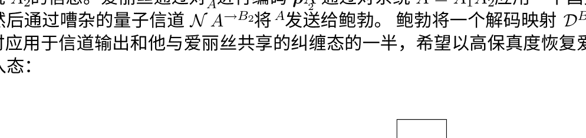

我们想要知道爱丽丝和鲍勃需要多少共享纠缠才能成功。

这个问题可以通过解耦不等式来回答。首先，我们引入一个与$A_2$最大纠缠的参考系统$R'$；然后，如果鲍勃的解码器能够提取$R'$的纯化态，他就会成功。因为系统$R'B_1$和$A_1A_2$是最大纠缠的，作用在$A_1A_2$上的编码酉变换$V$可以被作用在$R'B_1$上的其转置$V^T$替代。我们也可以用其Stinespring扩张来替代$\mathcal{N}$。$U^{A_1 A_2 \to B_2 E}$，使得扩展输出状态 $\phi$ of $R' B_1 B_2 E$是纯的：

最后，我们引用解耦原理 - 如果R’和E解耦，那么R’会被B₁B₂的一个子系统纯化，这意味着Bob可以恢复ρ_A

$$(\mathbb{E}_{V}[\|\sigma_{R'E}(V) - \sigma_{R'}^{\max} \otimes \sigma_E\|_1])^2 \leq \frac{|R’|·|E|}{|B_1|^2} \operatorname{tr}(\sigma_{R'E}^2), \qquad (10.340)$$

方程 (10.340) 断言，当在所有酉矩阵V上均匀平均时，从乘积态到L¹距离有一个上界；因此必须存在某个特定的编码酉矩阵V满足相同的上界。我们得出结论，只要近乎完美地解耦R’E，并且因此可以实现对B₂的高保真解码

$$|A_1| = |B_1| \gg |R’|·|E| \operatorname{tr}(\sigma_{R'E}^2) = |A_2|·|E| \operatorname{tr}(\sigma_{B_2}^2), \qquad (10.341)$$

在获得第二个等式时，我们使用了φ_{RB}的纯度 并回忆起参考系统R’与A₂的最大纠缠。

### 独立同分布版本

在父协议的独立同分布版本中，爱丽丝和鲍勃通过使用量子信道N^{A→B}的N次来实现高保真度的辅助纠缠量子通信。他们用于此目的的编码可以描述如下：考虑系统A的输入密度算符ρ_A，它通过参考系统R的纯化。通过将纯化的输入态ψ_{RA}通过U^{A→BE}发送，生成三部分纯态φ_{RBE}。显然，应用ψ_{RA}^⊗n 产生 φ_{RBE}^⊗n。

但是现在假设在将状态传输给Bob之前，Alice将A^n投影到其典型子空间Ā，以概率1 - o(1)成功地准备了一个几乎是最大纠缠的ĀR̄状态，其中R̄是R^n的典型子空间。想象将R̄随机分成一个子系统B₁和其补充子系统R’；然后存在一个相应的A = A₁A₂的分解，使得A₁与B₁几乎是最大纠缠的，A₂与R’几乎是最大纠缠的。

如果我们将B₁解释为与Alice共享的A₁B₁的纠缠态的Bob的一半，那么这就成为适用于单次父协议的设置，如果我们忽略A₁B₁和R’A₂中最大纠缠的小偏差。至于我们对i.i.d.母协议的分析，我们将单次父不等式应用于φ_{RBE}^⊗n 的附近状态φ’_{R̄B̄Ē}，其中B和E是ⁿB和E和ⁿ分别。应用方程 (10.340) ，并利用典型子空间的性质，我们可以通过选择 $B_1$ 的方式，限制 $R'E$与乘积态的 $L_1$偏差的平均值，通过

$$\frac{|\bar{R}| \cdot |\bar{E}|}{|B_1|^2} \ \mathrm{tr}\left(\sigma_B^2\right)=\frac{2^{n(H(R)+H(E)-H(B)+o(1))}}{|B_1|^2}=\frac{2^{n(I(R; E)+o(1))}}{|B_1|^2} ; \quad (10.342)$$

因此，该限制也适用于某种特定的选择 $B_1$的方式。这个选择定义了Alice和Bob在协议中使用的代码，该代码消耗

$$\log_2 |B_1| = \frac{n}{2} I(R; E) + o(n) \qquad (10.343)$$

比特的纠缠，并从Alice传递给Bob

$$n H(B) - \frac{n}{2} I(R; E) - o(n) = \frac{n}{2} I(R; B) - o(n) \qquad (10.344)$$

高保真量子比特。这证明了父资源不等式。

### 10.9.4 量子信道容量再探

在 $\S 10.8.1$中，我们证明了相干信息是在噪声量子信道上可实现的速率。这个推导是父资源不等式的一个推论，适用于催化设置，即发送方和接收方之间可以借用和还回共享纠缠。有用的是，我们可以在没有催化剂的情况下实现相同的速率，这是我们可以从解耦不等式的另一个版本推导出来的结果。

这个版本适用于下面所示的设置：

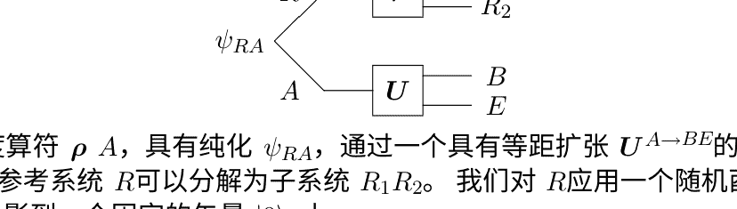

系统$A$的密度算符 $\rho_A$，具有纯化 $\psi_{RA}$，通过一个具有等距扩张 $U^{A \to BE}$的信道 $\mathcal{N}^{A \to B}$进行传输。参考系统 $R$可以分解为子系统 $R_1R_2$。我们对 $R$应用一个随机酉变换 $V$，然后将 $R_1$投影到一个固定的矢量 $|0\rangle_{R_1}$上，并重新调整结果状态。实际上，我们将$R$投影到一个维度为$|R_2|$的子空间上，从而净化了$A$的相应码子空间。这个过程准备了一个归一化的纯态$\phi_{R_2BE}$，并且相应的归一化边缘态$\sigma_{R_2E}$到$R_2$的映。

如果$R_2$与$E$解耦，那么$R_2$可以通过应用于$B$的解码器来净化，这意味着$A$的码子空间可以被恢复。近似解耦的一个充分条件可以从不等式中得到

$$\left( \mathbb{E}_V \left[ \ldots \leq |R_2| \cdot \ldots \right] \right)^{1/2} \leq |R_2| \cdot |E| \cdot \mathrm{tr} \left( \sigma_{R_2 E}^2 \right). \qquad (10.345)$$

方程(10.345)类似于方程(10.320)，可以通过类似的方法推导出来。注意，方程(10.345)的右侧相对于方程(10.320)的右侧增强了一个因子 $|R_1|$。这个因子的产生是因为在将 $R_1$投影到固定状态之后，我们需要通过乘以 $|R_1|$来重新归一化状态，而另一方面，投影抑制了从乘积态到期望距离平方的因子。

在使用噪声信道进行N次的i.i.d.设置中，我们考虑 $\phi_{RBE}^{\otimes n}$，并且成功地投影到R^n B^n E^n的联合典型子空间 R̄ B̄ Ē 上，概率很高。我们通过将R投影到一个随机子空间，其维度为 |R_2|，来选择一个编码。然后，方程(10.345)的右侧变为

$$|R_2| \cdot 2^{n(H(E)-H(B)+o(1))}$$

由于在V上均匀平均时不等式成立，所以它肯定对某个特定的V成立。该酉变换定义了一个编码，实现了解耦并具有速率

$$\frac{1}{n} \log_2 |R_2| = H(E) - H(B) - o(1) = I_c(R; B) - o(1)$$

因此，相干信息是在噪声信道上进行高保真量子通信的可实现速率。

### 10.9.5 黑洞作为镜子

作为解耦不等式的最后一个应用，我们考虑了一个高度理想化的黑洞动力学模型。假设爱丽丝拥有一个 k量子比特系统 A，她希望将其隐藏起来不让鲍勃知道。为了安全起见，她将她的量子比特丢弃到一个巨大的黑洞中，她知道鲍勃不敢跟随。黑洞 B是一个 (n-k)-量子比特系统，在与 A合并后变为 n量子比特，其中 n远大于 k。

黑洞并不完全是黑色的——它们会发射霍金辐射。但是量子比特从蒸发的黑洞中泄漏出来的速度非常缓慢，每单位时间的速率按照 n^{-1/2}的比例缩放。相应地，黑洞辐射掉其量子比特的一个显著部分需要Θ(n^{3/2})的时间。由于黑洞的希尔伯特空间非常庞大，这需要非常长的时间，对于一个太阳质量的黑洞来说大约是10^{67}年，其中 n ≈ 10^{78}。

尽管爱丽丝的量子比特可能不会永远保密，但她满意地知道它们将在10^{67}年内免受鲍勃的威胁。

但是在匆忙中，爱丽丝没有注意到她的黑洞非常非常古老。它已经蒸发了很长时间，已经辐射掉了超过一半的量子比特。让我们假设黑洞和其发射的辐射的联合态是纯态，并且进一步假设辐射是整个系统的哈尔随机子系统。

由于黑洞 B非常古老，|B|远小于辐射子系统的维度；因此，正如等式(10.322)中所预期的那样，我们期望 B的状态在很大概率上非常接近最大混合态。我们用 R_B表示纯化 B的发射辐射的子系统；因此 B R_B的状态非常接近最大纠缠态。我们假设 R_B已经被鲍勃收集并在他的控制下。

为了跟踪爱丽丝的 k量子比特的变化，我们假设她的 k-量子比特系统 A与参考系统 R_A是最大纠缠的。在 A进入黑洞后，鲍勃等待一段时间，直到 k'-量子比特系统 A'在黑洞的霍金辐射中被发射出来。在检索 A'后，鲍勃希望通过对 A' R_B应用适当的解码映射来恢复 R A的纯化。他能成功吗？

我们已经了解到，如果剩余的黑洞系统 B'与爱丽丝的参考系统 R_A解耦，那么鲍勃可以以高保真度成功。假设霍金辐射中发射的量子比特是随机选择的；也就是说， A'是一个哈尔随机的 k'比特子系统，属于如下所示的 n比特子系统 AB:

量子香农理论

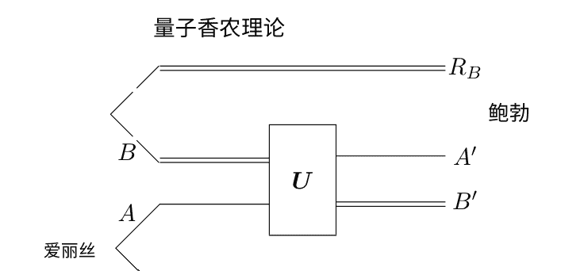

双线表示非常大的系统 $B$ 和 $B'$，单线表示较小的系统 $A$ 和 $A'$。由于辐射的量子比特是随机的，我们可以通过解耦不等式来确定是否 $R_A B'$ 解耦，对于这种情况，解耦不等式变为

$$\mathbb{E}_{U}\left[\left\|\sigma_{B' R_{A}}(U)-\sigma_{B'}^{\max} \otimes \sigma_{R_{A}}\right\|_{1}\right] \leq \sqrt{\frac{\left|A B R_{A}\right|}{\left|A^{\prime}\right|^{2}} \operatorname{tr}\left(\sigma_{A B R_{A}}^{2}\right)}. \qquad (10.348)$$

因为 $A R_{A}$ 的状态是纯净的，并且 $B$ 与 $R_{B}$ 是最大纠缠的，所以我们有 $\operatorname{tr}\left(\sigma_{A B R_{A}}^{2}\right)=1 /|B|$，因此 $\sigma_{B' R}$ 的哈尔平均 $L^{1}$ 距离从一个纯态上界受限于

$$\sqrt{\frac{\left|A R_{A}\right|}{\left|A^{\prime}\right|^{2}}}=\frac{|A|}{\left|A^{\prime}\right|}. \qquad (10.349)$$

因此，如果Bob只等待 $k+c$ 个Hawking辐射量子被发射出来，Alice投掷她的 $k$ 个量子之后，Bob可以以极高的保真度 $F \geq 1-2^{-c}$ 解码她的量子。

Alice犯了一个严重的错误。与其等待$\Omega(n)$个量子从黑洞中出现，当Bob收集到比 $k$ 个量子多一点时，他就可以很好地解码Alice的秘密。而Bob是一位出色的物理学家，他对黑洞动力学有足够的了解，可以推断出编码酉变换 $U$，这些信息他用来找到正确的解码映射。

我们可以更加散文地描述结论，即随机幺正矩阵 $U$ 作用于 $A B$ 时，编码了一个良好的量子纠错码，通过一个高擦除概率的信道实现了高保真度的辅助纠缠传输。在输入量子比特中，只有 $k'$ 个随机选择的比特被Bob接收到，其余的比特留在黑洞内部，因此无法访问。然后，输入量子比特以概率 $p=\left(n-k^{\prime}\right) / n$ 被擦除，而从输入量子比特中几乎无误差地恢复出比特的速率为

$$R=\frac{k}{n}=1-p-\frac{k^{\prime}-k}{n} ; \qquad (10.350)$$

在极限情况下，当 $n \rightarrow \infty$ 且 $c=k^{\prime}-k$ 固定时，这个速率趋近于 $1-p$，即擦除信道的辅助纠缠量子容量。

到目前为止，我们假设发射的系统 $A'$ 是一个随机选择的子系统 of $A B$。对于一个真实的黑洞来说，这是不正确的。然而，人们认为实际黑洞的内部动力学会迅速混合量子信息（快速混沌猜想）。对于一个温度为 $T$ 的黑洞，每个量子比特在霍金辐射中发射需要大约 $\hbar / k T$ 的时间，而动力学混合黑洞自由度所需的时间则仅比这个时间长一个对数因子 $\log n$，以便我们的解耦估计能够以合理的准确性成立。对于一个太阳质量的黑洞艾丽斯的量子比特在她放置它们后仅几毫秒就会被揭示出来，比她原本希望的10^67年要快得多！因为鲍勃持有系统 R_B，它可以净化 B，并且他知道应用于 A'R_B 的正确解码映射，所以黑洞就像一个信息镜子——艾丽斯的量子比特会直接反弹回来！如果艾丽斯更加小心，她将把她的量子比特倾倒到一个年轻的黑洞中。如果我们假设初始黑洞 B 处于纯态，那么 σ_{ABR} 也是纯粹的，并且Haar平均的 L^1 距离为 σ_{B'R}^A 从一个乘积态开始，上界被限制在
$$\sqrt{\frac{|ABR_A|}{|A'|^2}} = \frac{2^{n+k}}{2^{2k'}} = \frac{1}{2^c}$$
之后
$$k' = \frac{1}{2}(n + k + c)$$
发射了 qubits。在这种情况下，Bob需要等待很长时间，直到 AB 中的 qubits 超过一半才会辐射出去。一旦Bob获得的 qubits 比黑洞中仍然存在的数量多 k + c，他就有能力以 F ≥ 1 - 2^{-c} 的准确度解码Alice的 k qubits。实际上，Alice的子系统 A 没有什么特别之处；通过适当调整解码映射，Bob可以从初始黑洞 AB 中的 k qubits 中选择解码任何他想要的 qubits。

关于黑洞量子信息处理还有很多需要学习的地方，这是当前研究的一个活跃领域（截至2016年），但我们在这里不会深入探讨这个迷人的话题。然而，我们可以相信，在本书中讨论的量子信息理论的工具和概念将有助于解决量子引力的许多未解之谜。

## 10.10 总结

香农熵和经典数据压缩。一个集合 X = {x, p(x)} 的香农熵 H(X) ≡ ⟨-log p(x)⟩；它量化了经典信息的可压缩性。一个由 X 中独立抽取的每个字母组成的长度为 n 的消息可以被压缩到每个字母 H(X) 位（且不能再进一步压缩），然而在 n → ∞ 的情况下仍然可以以任意高的准确度解码。

条件熵和信息合并。条件熵 H(X|Y) = H(XY) - H(Y) 量化了当 Y 已知时，信息源 X 可以被压缩的程度。如果从 XY 中抽取字母，其中Alice持有 X，Bob持有 Y，Alice可以通过发送 H(X|Y) 比特每个字母将 X 传递给Bob，当 n → ∞ 时渐近地。

互信息和经典信道容量。互信息 I(X;Y) = H(X) + H(Y) - H(XY) 量化了信息源 X 和 Y 之间的相关性；当我们了解 y 的值时，我们平均获得 I(X;Y) 比特关于 x 的信息，反之亦然。无记忆噪声经典通信信道的容量是 C = max_X I(X;Y)。这是通过使用最佳编码、在 n → ∞ 时具有可忽略错误概率的情况下，通过 n 次使用信道传输的每个字母的最大比特数。

冯·诺伊曼熵和量子数据压缩。密度算符 ρ 的冯·诺伊曼熵是
$$H(ρ) = -tr ρ \log ρ;$$
它量化了纯量子态集合的可压缩性。一个由集合{ | φ(x)⟩, p(x) }中独立抽取的字母组成的长为n的消息，可以压缩为每个字母 H(ρ)比特（且不能再进一步压缩），其中 ρ = \sum_{x} p(x)| φ(x)\rangle\langle φ(x)| ，但仍然可以以任意好的保真度解码，如 n \to \infty。

纠缠浓缩和稀释。一个双分体纯态 |ψ\rangle_{AB} 的纠缠 E是 E = H(ρ_A)，其中 ρ_A = \mathrm{tr}_B(|ψ\rangle\langleψ|)。通过局部操作和经典通信，我们可以从nE个贝尔对（但不是更少）中制备n个|ψ\rangle_{AB}的副本，并且我们可以从n个 |ψ\rangle_{AB} 的副本中提取nE个贝尔对（但不是更多），当n→∞时渐近地。

可访问信息. 一个量子态集合 \mathcal{E} = \{ρ(x), p(x)\} 的Holevo chi是
\[ \chi(\mathcal{E}) = H \left( \sum_x p(x)ρ(x) \right) - \sum_x p(x)H(ρ(x)). \qquad (10.354) \]
一个量子态集合 \mathcal{E} 的可访问信息是关于该态的制备可以获得的最大信息位数（平均而言），并且使用最佳测量。可访问信息不能超过集合的Holevo chi。一个量子信道 \mathcal{N} 的产品态容量是
\[ C_1(\mathcal{N}) = \max_{\mathcal{E}} \chi(\mathcal{N}(\mathcal{E})). \qquad (10.355) \]
这是通过量子信道传输的每个字母的最大经典比特数，假设每个编码字是一个产品态。在使用量子信道的n次传输中，可以传输的经典比特数最大化，且错误概率可以忽略不计，假设每个编码字是一个产品态。

解耦和量子通信。在一个三部分纯态 ϕ_{RBE} 中，如果 RE 的边缘密度算符是一个产品态，则我们说系统 R 和 E 解耦，此时 R 由 B 的一个子系统纯化。通过一个噪声量子信道 \mathcal{N}^{A \to B} （具有等距扩张 U^{A \to BE} ）传输的量子态可以被准确解码，如果一个纯化信道输入 A 的参考系统 R 几乎与信道环境 E 解耦。

父亲和母亲协议。父亲和母亲资源不平等分别指定了纠缠辅助量子通信和量子态传输的可实现速率。这两者都源于解耦不等式，该不等式为三部分混合态的近似解耦提供了充分条件。通过将父亲和母亲协议与超密编码和传送结合起来，我们可以推导出其他协议的可实现速率，包括纠缠辅助经典通信、量子通信、纠缠提纯和量子态合并。

向本·舒马赫致敬：本·舒马赫。
他很棒。
我记得
当
他向我展示了如何将
一个量子比特
放入一个小盒子中。

我想知道那种感觉
被压缩的感觉。
然后通过
一个保真度测试。

或者它是否有感觉
如果有的话
我会尖叫吗
还是像以前一样？

如果不撤销
我会变成我开始时的样子
并写一份备忘录
关于随机性。
它感觉像一条
朗姆酒的腰带吗？

而且它是否可以预测我会
上瘾，渴望我的压缩会话
？

我会再次爬
到本的面前。
并且呼叫，
放下你的笔！
不要拖延！
让我变小！

## 10.11 参考文献注释

Cover和Thomas [2]是一本关于经典信息理论的优秀教材。Shannon的原始论文[3]仍然非常值得阅读。Nielsen和Chuang [4]对量子Shannon理论的某些方面进行了清晰的介绍。Wilde [1]是一本更为现代化且非常详尽的著作。
熵的性质在[5]中进行了回顾。Von Neumann熵的强次可加性由Lieb和Ruskai [6]证明，而相等条件由Hayden等人[7]推导出来。Nielsen和Kempe [8]指出了可分离性与主导关系之间的联系。
Bekenstein的熵界限在[9]中被提出，并由Casini [10]推导出来。关于熵的不确定关系在[11]中进行了回顾，并且我遵循了他们的推导。Maassen和Uffink [12]的原始推导使用了不同的方法。
Schumacher压缩首次在[13, 14]中被讨论，并且Bennett等人[15]提出了纠缠浓缩和稀释的协议。混合态纠缠的度量在[16]中进行了回顾。Brandão和Plenio [17]提出了关于混合态纠缠的可逆理论。Squashed纠缠由Christandl和Winter [18]引入，并且Koashi和Winter [19]讨论了它的唯一性。
Brandão，Christandl和Yard [20]证明了对于任何非可分离的二分体态，squashed纠缠是正的。Doherty，Parrilo和Spedalieri [21]证明了每个非可分离的二分体态对于某个有限的k来说是不可扩展的。Holevo界限在[22]中被推导出来。Peres-Wootters编码在[23]中被讨论。
Holevo [24]和Schumacher导出了产品状态容量公式和Westmoreland [25]。Hastings [26]证明了Holevo chi可以是超加性的。Horodecki, Shor和Ruskai [27]引入了纠缠破坏通道，并由Shor [28]证明了Holevo chi对于这些通道的可加性。
Schumacher和Nielsen [29]通过解耦原则制定了量子纠错的必要和充分条件；Schumacher [30], Schumacher和Nielsen [29]以及Barnum et al.[31]证明了（规范化的）相干信息是量子容量的上界。Lloyd [32]和Schumacher [30]猜测相干信息是量子通信的可实现速率，然后由Shor [33]和Devetak [34]证明。Devetak和Winter [35]证明它也是纠缠精炼的可实现速率。Schumacher [30]导出了量子Fano不等式。
Schumacher和Westmoreland [36]分析了近似解耦，并Devetak [34]通过Horodecki et al .[37], Hayden et al.[38], Abeyesinghe et al.[39]证明了容量定理。Lubkin [40], Lloyd和Pagels [41], Page [42]早先讨论了Haar随机子系统的熵。Devatak, Harrow和Winter [43, 44]引入了母协议和父协议及其后代。Devetak和Shor [45]引入了可降解的量子通道，并证明了这些通道的相干信息是可加的。Bennett et al.[46, 47]找到了关于纠缠辅助经典容量的单字母公式。Shor和Smolin [48]以及DiVincenzo etal.[49]发现了相干信息的超加性。Smith和Yard [50]找到了超加性的极端例子，即当两个零容量通道联合使用时，它们具有非零容量。Horodecki et al.[37]推导出了状态合并的可实现速率，并用它们证明了Von Neumann熵的强次可加性。
Renner等人[51]将解耦应用于Landuaer原理，并由Hayden和Preskill [52]将其应用于黑洞。Sekino和Susskind [53]提出了快速混乱猜想。

## 练习

### 10.1量子相对熵的正定性

a) 证明对于所有正实数x，$\ln x \leq x - 1$，当且仅当 $x = 1$时等号成立。

b) 概率分布的（经典）相对熵 ${p(x)}$相对于${q(x)}$被定义为
$$D(p \parallel q) = \sum_{x} p(x) (\log p(x) - \log q(x)). \qquad (10.356)$$
证明
$$D(p \parallel q) \geq 0, \qquad (10.357)$$
当且仅当概率分布相同时，等式成立。提示：应用(a)中的不等式到$\ln (q(x)/p(x))$。

c) 相对于密度算符 $\rho$的量子相对熵是定义为
$$D(\rho \parallel \sigma) = \operatorname{tr} \rho (\log \rho - \log \sigma). \qquad (10.358)$$
记 ${p_i}$为 $\rho$的特征值，记 ${q_a}$为 $\sigma$的特征值。
证明
\(D(\rho \| \sigma) = \sum\limits_{i} p_i \left( \log p_i - \sum\limits_{a} D_{ia} \log q_a \right)\) , (10.359)
其中 \(D_{ia}\) 是一个双随机矩阵。用特征态表示 \(D_{ia}\) \(\rho\) 和 \(\sigma\)。（一个矩阵是双随机的，如果它的元素是非负实数，每一行和每一列的和都为一。）

d) 证明如果 \(D_{ia}\) 是双随机的，则对于每个 \(i\) 成立
\(\log \left( \sum\limits_{a} D_{ia} q_a \right) \geq \sum\limits_{a} D_{ia} \log q_a\) , (10.360)
仅当 \(D_{ia} = 1\)（对于某个 \(a\)）时才成立

e) 证明
\(D(\rho \| \sigma) \geq D(p \| r)\) , (10.361)
其中 \(r_i = \sum\limits_{a} D_{ia} q_a\).

f) 证明 \(D(\rho \| \sigma) \geq 0\)，当且仅当 \(\rho = \sigma\) 时成立

### 10.2 Von Neumann熵的性质

a) 利用量子相对熵的非负性证明Von Neumann熵的次可加性
\(H(\rho_{AB}) \leq H(\rho_A) + H(\rho_B)\), (10.362)
等式成立当且仅当 \(\rho_{AB} = \rho_A \otimes \rho_B\)。提示：考虑相对熵 \(\rho_{AB}\) 和 \(\rho_A \otimes \rho_B\)。

b) 使用次可加性证明冯·诺伊曼熵的凹性：
\(H\left(\sum\limits_{x} p_x \rho_x\right) \geq \sum\limits_{x} p_x H(\rho_x)\) . (10.363)
提示：考虑
\(\rho_{AB} = \sum\limits_{x} p_x (\rho_x)_A \otimes (|x\rangle\langle x|)_B\) , (10.364)
其中状态 \(\{|x\rangle_B\}\) 彼此正交。

c) 使用条件
\(H(\rho_{AB}) = H(\rho_A) + H(\rho_B)\) 当且仅当 \(\rho_{AB} = \rho_A \otimes \rho_B\) (10.365)
以此证明，如果所有的 \(p_x\) 都不为零，
\(H \left( \sum\limits_{x} p_x \rho_x \right) = \sum\limits_{x} p_x H(\rho_x)\) (10.366)
当且仅当所有的 \(\rho_x\) 都相同。

### 10.3 量子相对熵的单调性

量子相对熵具有一种被称为单调性的属性:
\(D(\rho_A \| \sigma_A) \leq D(\rho_{AB} \| \sigma_{AB})\); (10.367)
在系统 \(AB\) 上的两个密度算符的相对熵不能小于子系统 \(A\) 上的诱导相对熵。

- a) 使用量子相对熵的单调性证明冯·诺伊曼熵的强次可加性性质。提示: 在一个三部分系统 $ABC$ 上，考虑 $\rho_{ABC}$ 和 $\rho_A \otimes \rho_{BC}$ 的相对熵。
- b) 利用量子相对熵的单调性证明一个量子通道 $\mathcal{N}$ 不能增加相对熵的作用：
$$D(\mathcal{N}(\rho)\|\mathcal{N}(\sigma)) \leq D(\rho\|\sigma)$$
提示：回想一下，任何量子通道都有一个等距扩展。

### 10.4 Peres-Wootters POVM

考虑在讲义笔记的第10.6.4节中描述的Peres-Wootters信息源。它准备了三个状态之一
$$|\Phi_a\rangle = |\varphi_a\rangle \otimes |\varphi_a\rangle, \quad a = 1,2,3,$$
每个状态的先验概率都是 $1/3$，其中 $|\varphi_a\rangle$ 的定义在等式(10.214)中。

a)用贝尔基底的最大纠缠态{|Φ±⟩,|Ψ±⟩}来表达密度矩阵
$$\rho = \frac{1}{3} \left( \sum_a |\Phi_a\rangle\langle\Phi_a| \right),$$
并计算 $H(\rho)$。
- b) 对于三个向量 $|\Phi_a\rangle$，其中 $a=1,2,3$，构建在方程（10.227）中定义的“很好的测量”。（再次在贝尔基中展开 $|\Phi_a\rangle$。）在这种情况下，PGM是一种正交测量。用贝尔基表示PGM基的元素。
- c) 计算PGM结果和准备的互信息。

### 10.5 可分性和主导性

纠缠的特点是，在纠缠态中，整体比其部分更不随机。但在可分离态中，相关性基本上是经典的，因此预期遵循经典原则，即部分比整体更不无序。这个问题的目标是通过证明如果双分体（混合）态 $\rho_{AB}$ 是可分离的，那么
$$\lambda(\rho_{AB}) \prec \lambda(\rho_A), \quad \lambda(\rho_{AB}) \prec \lambda(\rho_B).$$
这里 $\lambda(\rho)$ 表示 $\rho$ 的特征值向量，而 $\prec$ 表示主导关系。
可分离态可以表示为纯粹的乘积态的集合，所以如果 $\rho_{AB}$ 是可分离的，它可以表示为
$$\rho_{AB} = \sum_a p_a |\psi_a\rangle\langle\psi_a| \otimes |\varphi_a\rangle\langle\varphi_a|.$$
我们也可以对 $\rho_{AB}$ 进行对角化，表示为
$$\rho_{AB} = \sum_j r_j |e_j\rangle\langle e_j|,$$
还要注意，ρ_A可以对角化，使得
$$\rho_A = \sum_a p_a |\psi_a\rangle\langle\psi_a| = \sum_\mu s_\mu |f_\mu\rangle\langle f_\mu|; \qquad (10.375)$$
这里 {|f_μ>}表示 A的一个正交基，根据HJW定理，存在一个酉矩阵 U使得
$$\sqrt{p_a} |\psi_a\rangle = \sum_\mu U_{a\mu} \sqrt{s_\mu} |f_\mu\rangle. \qquad (10.376)$$
现在证明存在一个双随机矩阵 D 使得
$$r_j = \sum_\mu D_{j\mu} s_\mu. \qquad (10.377)$$
也就是说，你必须检查 D_{jμ}的元素是实数且非负，并且求和 ∑_j D_{jμ} = 1_μ ∑_j D_{jμ} ∑_j。因此，我们得出结论 λ(ρ_{AB}) ≺ λ(ρ_A)。仅通过交换 A和 B，相同的论证也表明 λ(ρ_{AB}) ≺ λ(ρ_B)。
备注：请注意，根据Shannon熵的Schur凹性，如果 ρ_{AB}是可分离的，则von Neumann熵具有性质 H(AB) ≥ H(A)。

### 10.6压缩纠缠的可加性

假设爱丽丝持有系统 A, A′，鲍勃持有系统 B, B′。系统 AA′与 BB′的纠缠与系统 A与 B以及系统 A′与B′的纠缠有何关系？在这个问题中，我们将证明压缩纠缠是超加性的。
$$E_{sq}(\rho_{ABA'B'}) \geq E_{sq}(\rho_{AB}) + E_{sq}(\rho_{A'B'}) \qquad (10.378)$$
并且对于张量积，它是严格可加的。
$$E^2(\rho_{AB} \otimes \rho_{A'B'}) = E^2(\rho_{AB}) + E^2(\rho_{A'B'}). \qquad (10.379)$$
- a) 使用互信息链式法则eq.(10.196)和eq.(10.197)以及量子条件互信息的非负性，证明
I(AA'; BB'|C) ≥ I(A; B|C) + I(A'; B'|AC), (10.380)
并证明方程(10.378)成立。
- b) 证明对于任意扩展 ρ_{ABC} ⊗ ρ_{A'B'C'}的乘积态 ρ_{AB} ⊗ ρ_{A'B'}，我们有
I(AA'; BB'|CC') ≤ I(A; B|C) + I(A'; B'|C'). (10.381)
得出结论
E_{sq}(\rho_{AB} \otimes \rho_{A'B'}) \leq E_{sq}(\rho_{AB}) + E_{sq}(\rho_{A'B'}), (10.382)## 10.7 冯·诺依曼熵的第一定律

结合方程 (10.378)，可以推导出方程 (10.379)。

将密度算符写成其模哈密顿量的形式，如第 10.2.6 节所示，

$$ \rho = \frac{e^{-K}}{\text{tr}(e^{-K})} $$

考虑当密度算符稍微扰动时，熵 $S(\rho) = -\text{tr}(\rho \ln \rho)$ 如何变化：

$$ \rho \to \rho' = \rho + \delta \rho $$

由于 $\rho$ 和 $\rho'$ 都是归一化的密度算符，我们有 $\text{tr}(\delta \rho) = 0$。证明

$$ S(\rho') - S(\rho) = \text{tr}(\rho' K) - \text{tr}(\rho K) + O\left((\delta \rho)^2\right); $$

即，

$$ \delta S = \delta \langle K \rangle $$

对 $\rho$ 的小变化进行一阶近似。这个陈述推广了热力学第一定律；对于具有 $K = T^{-1} H$（其中 $H$ 是哈密顿量，$T$ 是温度）的热密度算符的情况，它变成了更熟悉的陈述

$$ \delta E = \delta \langle H \rangle = T \delta S. $$

## 10.8 量子态的信息增益从均匀集合中抽取

假设爱丽丝准备了一个从集合中抽取的量子态 $\{\rho(x), p(x)\}$，鲍勃进行了一个测量 $\{E(y)\}$ 得到结果 $\{y\}$ 的概率为如第 10.6.1 节所述，鲍勃对爱丽丝的准备的信息增益是互信息 $I(X; Y) = H(X) - H(X|Y)$。如果 $x$ 是连续变量，而 $y$ 是离散的，使用互信息的对称性更方便地写成 $I(X; Y) = H(Y) - H(Y|X)$，其中

$$ H(Y|X) = \sum_y \int dx \cdot p(x) \cdot p(y|x) \cdot \log p(y|x); $$

这里 $p(x)$ 是一个概率密度（也就是说，$p(x)dx$ 是 $x$ 落在区间 $[x, x+dx]$ 的概率）。

例如，假设 Alice 在一个 $d$ 维希尔伯特空间中准备了一个任意的纯态 $|\varphi\rangle$，Bob 进行了一个正交测量，投影到基底 $\{|e_y\rangle\}$，希望了解 Alice 准备了什么。那么 Bob 以概率获得结果 $y$

$$ p(y|\theta) = |\langle e_y|\varphi\rangle|^2 = \cos^2 \theta $$

其中 $\theta$ 是 $|\varphi\rangle$ 和 $|e_y\rangle$ 之间的夹角。因为 Alice 的集合是均匀的，Bob 的结果也是均匀分布的；因此 $H(Y) = \log d$。此外，测量结果 $y$ 只能揭示关于 $\theta$ 的信息；Bob 无法获得其他信息。

其他关于 $|\varphi\rangle$ 的信息。因此，方程 (10.388) 表明信息增益可以表示为

$$ I(X; Y) = \log d - d \int d\theta \cdot p(\theta) \cdot \cos^2\theta \cdot \log \cos^2\theta. \quad (10.390) $$

这里 $p(\theta)d\theta$ 是矢量 $|\varphi\rangle$ 指向与轴 $|e_y\rangle$ 夹角为 $\theta$ 的概率密度函数，其中 $0 \leq \theta \leq \pi/2$。

## 证明

$$ p(\theta) \cdot d\theta = -(d-1) [1 - \cos^2\theta]^{d-2} \cdot d\cos^2\theta. \quad (10.391) $$

提示：选择一个基准，使固定轴 $|e_y\rangle$ 成为

$$ |e_y\rangle = (1, 0) \quad (10.392) $$

并写

$$ |\varphi\rangle = (e^{i\phi} \cos\theta, \psi^\perp), \quad (10.393) $$

其中 $\theta \in [0, \pi/2]$，而 $|\psi^\perp\rangle$ 表示一个复数 $(d-1)$-分量向量其长度为 $\sin\theta$。现在注意到相位 $\phi$ 位于半径为 $\cos\theta$ 的圆上（因此周长为 $2\pi\cos\theta$），而 $|\psi^\perp\rangle$ 位于半径为 $\sin\theta$ 的球上（因此球的体积，除一个乘法常数，为 $\sin^{2d-3}\theta$）。

b) 现在计算积分方程 (10.390) 以证明测量所获得的信息增益以 nats 为单位。

$$ I(X; Y) = \ln d - \left( \frac{1}{2} + \frac{1}{3} + \dots + \frac{1}{d} \right). \quad (10.394) $$

（如果对数是自然对数，则信息以 nats 为单位表示；I 以 nats 为单位与 I 以 bits 为单位的关系为 $I_{\text{bits}} = I_{\text{nats}}/\ln 2$）提示：要计算积分

$$ \int_0^1 dx(1 - x)^p x \ln x, \quad (10.395) $$

观察到

$$ x \ln x = \frac{d}{ds} x^s \bigg|_{s=1}, \quad (10.396) $$

然后计算 $\int_0^1 dx(1 - x)^p x^s$ 通过反复积分。

c) 证明在大 $d$ 的极限下，信息增益以 bits 为单位趋近于

$$ I_{d=\infty} = \frac{1 - \gamma}{\ln 2} = .60995 \dots, \quad (10.397) $$

其中 $\gamma = .57721...$ 是欧拉常数。

我们计算得到的 $H(Y|X)$ 的值可以另一种方式解释：假设我们固定一个正交测量，选择一个典型的状态，并对该选择的状态进行重复测量。那么测量结果将不会均匀分布。相反，在大希尔伯特空间维度的极限下，结果的熵将比最大值少 .60995 bits。

## 10.9 范诺不等式

假设 $X = \{x, p(x)\}$ 是从一个包含 $d$ 个可能字母的字母表中随机选择的字母 $x$ 的概率分布，$Y$ 是与 $x$ 相关的另一个随机变量 $y$ 的联合分布。在收到 $y$ 后，我们通过评估函数 $\hat{x}(y)$ 来估计 $x$ 的值。我们可以预期，如果我们的估计通常是正确的，那么条件熵 $H(X|Y)$ 必定很小。在这个问题中，我们将验证这个期望。

让 $e \in \{0, 1\}$ 表示一个二进制随机变量，如果 $x = \hat{x}(y)$，则 $e$ 取值为 $e=0$，如果 $x \neq \hat{x}(y)$，则 $e$ 取值为 $e=1$。$XYE$ 表示 $x, y, e$ 的联合分布。错误概率 $P_e$ 是 $e=1$ 的概率，平均计算在这个分布上。我们的目标是推导出一个关于 $H(X|Y)$ 的上界，取决于 $P_e$。

a) 证明

$$ H(X|Y) = H(X|YE) + H(E|Y) - H(E|XY). \quad (10.398) $$

注意 $H(E|XY) = 0$，因为当 $x$ 和 $y$ 已知时，$e$ 就确定了，并且注意 $H(E|Y) \leq H(E)$，因为互信息是非负的。因此，

$$ H(X|Y) \leq H(X|YE) + H(E). \quad (10.399) $$

b) 注意到

$$ H(X|YE) = p(e=0)H(X|Y, e=0) + p(e=1)H(X|Y, e=1), \quad (10.400) $$

并且当 $H(X|Y, e=0)=0$ 时（因为 $x=\hat{x}(y)$ 在没有错误的情况下由 $y$ 决定），证明

$$ H(X|YE) \leq P_e\log_2(d-1). \quad (10.401) $$

c) 最后，证明

$$ H(X|Y) \leq H_2(P_e) + P_e\log_2(d-1), \quad (10.402) $$

这就是范诺不等式。

d) 使用范诺不等式推导出等式 (10.50)，从而完成了经典信道容量 $C$ 对于在有可忽略错误概率的噪声信道上的通信可达速率的上界的证明。

## 10.10 范诺不等式的量子版本

a) 在一个 $d$ 维系统中，假设一个密度算符 $\rho$ 近似于纯态 $|\psi\rangle$ 的保真度

$$ F = \langle\psi|\rho|\psi\rangle = 1 - \varepsilon. \quad (10.403) $$

证明

$$ H(\rho) \leq H_2(\varepsilon) + \varepsilon\log_2(d-1). \quad (10.404) $$

提示：回想一下，如果对状态 $\rho$ 进行完全正交测量，得到的结果分布为 $X$，则 $H(\rho) \leq H(X)$，其中 $H(X)$ 是 $X$ 的香农熵。

b) 如同第 10.7.2 节所述，假设有噪声通道 $\mathcal{N}^{A \rightarrow B}$ 作用于纯态 $\psi_{RA}$，然后是解码映射 $\mathcal{D}^{B \rightarrow C}$。证明

$$ H(R)_{\rho} - I_c(R; B)_{\rho} \leq 2H(RC)_{\sigma}, \quad (10.405) $$

其中

$$ \rho_{RB} = \mathcal{N}(\psi_{RA}), \quad \sigma_{RC} = \mathcal{D} \circ \mathcal{N}(\psi_{RA}). \quad (10.406) $$

因此，如果解码器的输出（即 $RC$ 的状态）几乎是纯的，那么通道的相干信息 $\mathcal{N}$ 接近于匹配其输入熵。提示：使用数据处理不等式 $I_c(R \rangle C)_{\sigma} \leq I_c(R \rangle B)_{\rho}$ 和冯·诺伊曼熵的次可加性。方便起见，考虑参考系统、输出和 $\mathcal{N}$ 和 $\mathcal{D}$ 的扩张环境的联合纯态。

c) 假设解码映射以高保真度恢复通道输入，

$$ F(\mathcal{D} \circ \mathcal{N}(\psi_{RA}), \psi_{RC}) = 1 - \varepsilon. \quad (10.407) $$

证明

$$ H(R)_{\rho} - I_c(R; B)_{\rho} \leq 2H_2(\varepsilon) + 2\varepsilon \log_2(d^2 - 1), \quad (10.408) $$

假设 $R$ 和 $C$ 是 $d$ 维的。这是 Fano 不等式的量子版本，我们可以用它来推导出对量子信道容量的上界。

## 10.11 GHZ态的母协议

母资源不等式表达了一种渐近资源转换，如果爱丽丝、鲍勃和伊芙共享 $N$ 个纯态 $\phi_{ABE}$ 的话：通过向鲍勃发送 $N \bar{I}(A; E)$ 比特，爱丽丝可以破坏她的状态与伊芙状态之间的相关性，从而鲍勃独自拥有伊芙状态的纯化，并且爱丽丝和鲍勃在协议结束时共享 $N \bar{I}(A; B)$ 比特的纠缠；在这里 $\bar{I}(A; E)$ 和 $\bar{I}(A; B)$ 表示在状态 $\phi_{ABE}$ 下评估的量子互信息。

通常，资源转换只能在极限情况下以任意好的保真度实现 $n \rightarrow \infty$。但在这个问题中，我们将看到如果 Alice、Bob 和 Eve 只共享三比特 GHZ 态的 2 个副本，转换可以是完美的

$$ |\phi\rangle_{ABE} = \frac{1}{\sqrt{2}} (|000\rangle + |111\rangle). \quad (10.409) $$

实现这种完美转换的协议使用了第 4 章中定义的相干经典通信的概念。

a) 证明在 GHZ 态 $|\phi\rangle_{ABE}$ 中，$I(A; E) = I(A; B) = 1$。因此，对于这个态，母不等式变为

$$ 2\langle\phi_{ABE}\rangle + [q \rightarrow q]_{AB} \geq [qq]_{AB} + 2\langle\phi'_{BE}\rangle. \quad (10.410) $$

b) 假设在 GHZ 态中，爱丽丝测量 Pauli 算符 $X$，得到结果 $+1$，并将结果广播给鲍勃和伊芙。那么鲍勃和伊芙分享的状态是什么？如果爱丽丝得到结果 $-1$ 呢？

c) 假设爱丽丝、鲍勃和伊芙只分享了一份 GHZ 态 $\phi_{ABE}$。找到一个协议，使得经过一次连续的经典通信，分享的状态变为 $|\phi^+\rangle_{AB} \otimes |\phi^+\rangle_{BE}$，其中 $|\phi^+\rangle = \frac{|00\rangle + |11\rangle}{\sqrt{2}}$ 是一个最大纠缠的贝尔对。

d) 现在假设爱丽丝、鲍勃和伊芙一开始拥有两份 GHZ 态，并且假设爱丽丝和鲍勃可以借用一个 ebit 的纠缠，以后会偿还，来催化资源转换。使用连续超密编码构建一个协议，完美地实现 (catalytic) 转换等式 (10.410)。

## 10.12 振幅阻尼和擦除的可降解性

量子比特振幅阻尼通道 $\mathcal{N}_{\text{a.d.}}^{A \to B}(p)$ 在 §3.4.3 中讨论了 dilation $U^{A \to BE}$，使得

$$ U: \begin{cases} |0\rangle_A \to |0\rangle_B \otimes |0\rangle_E, \\ |1\rangle_A \to \sqrt{1-p}|1\rangle_B \otimes |0\rangle_E + \sqrt{p}|0\rangle_B \otimes |1\rangle_E; \end{cases} $$

处于“基态”的量子比特 $|0\rangle_A$ 不受通道影响，而处于“激发态”的量子比特 $|1\rangle_A$ 以概率 $p$ 衰变到基态，并且衰变过程会激发环境。注意 $U$ 在系统 $B$ 和 $E$ 互换下不变，伴随着变换 $p \leftrightarrow (1-p)$。因此，与通道 $\mathcal{N}_{\text{a.d.}}^{A \to B}(p)$ 互补的通道是 $\mathcal{N}_{\text{a.d.}}^{A \to E}(1-p)$。

a) 证明 $\mathcal{N}_{\text{a.d.}}^{A \to B}(p)$ 对于 $p \leq 1/2$ 是可降解的。因此，振幅阻尼信道的量子容量是其优化的一次性相干信息。提示：只需证明

$$ \mathcal{N}_{\text{a.d.}}^{A \to E}(1-p) = \mathcal{N}_{\text{a.d.}}^{B \to E}(q) \circ \mathcal{N}_{\text{a.d.}}^{A \to B}(p), \quad (10.411) $$

其中 $0 \leq q \leq 1$。

擦除信道 $\mathcal{N}_{\text{erase}}^{A \to B}(p)$ 具有扩张 $U^{A \to BE}$，使得

$$ U: |\psi\rangle_A \to \sqrt{1-p}|\psi\rangle_B \otimes |e\rangle_E + \sqrt{p}|e\rangle_B \otimes |\psi\rangle_E; \quad (10.412) $$

爱丽丝的系统以概率 $1-p$ 传递给鲍勃，或者以概率 $p$ 传递给伊芙，而另一方接收到与爱丽丝希尔伯特空间正交的“擦除符号” $|e\rangle$。因为 $U$ 在系统 $B$ 和 $E$ 的互换下是不变的，伴随着变换 $p \leftrightarrow (1-p)$，与之互补的信道是 $\mathcal{N}_{\text{erase}}^{A \to E}(1-p)$。

b) 证明当 $p \leq 1/2$ 时，$\mathcal{N}_{\text{erase}}^{A \to B}(p)$ 是可退化的。因此，擦除信道的量子容量是其优化的一次性相干信息。提示：只需证明

$$ \mathcal{N}_{\text{erase}}^{A \to E}(1-p) = \mathcal{N}_{\text{erase}}^{B \to E}(q) \circ \mathcal{N}_{\text{erase}}^{A \to B}(p), \quad (10.413) $$

其中 $0 \leq q \leq 1$。

c) 证明对于 $p \leq 1/2$，擦除信道的量子容量为

$$ Q(\mathcal{N}_{\text{erase}}^{A \to B}(p)) = (1-2p) \log_2 d, \quad (10.414) $$

其中 $A$ 是 $d$ 维的，并且容量在 $1/2 \leq p \leq 1$ 时消失。

## 10.13 量子Singleton界

正如第 7 章中所指出的，一个 [[n, k, d]] 量子纠错码（在一个块中保护 k 个 qudits，块中有 n 个 qudits，码距为 d）必须满足以下约束条件

$$ n - k \geq 2(d - 1). \quad (10.415) \quad \text{量子Singleton界} $$

这个界限实际上是一个更强的陈述的推论，你将在这个练习中证明它。

假设在纯态 $\phi_{RA}$ 中，参考系统 $R$ 与 $A$ 的码子空间是最大纠缠的，并且 $E_1$ 和 $E_2$ 是系统 $A$ 的两个不相交的可纠正子系统（擦除 $E_1$ 或 $E_2$ 可以被纠正）。你需要证明

$$ \log |A| - \log |R| \geq \log |E_1| + \log |E_2|. \quad (10.416) $$

让 $E^c$ 表示与 $E_1 E_2$ 互补的 $A$ 子系统，使得 $A = E^c E_1 E_2$。

a) 回顾误差纠正条件 $\rho_{RE_1} = \rho_R \otimes \rho_{E_1}$ 和 $\rho_{RE_2} = \rho_R \otimes \rho_{E_2}$，证明 $\phi_{RE^c E_1 E_2}$ 具有以下性质

$$ H(R) = H(E^c) - \frac{1}{2} I(E^c; E_1) - \frac{1}{2} I(E^c; E_2). \quad (10.417) $$

b) 证明方程 (10.417) 蕴含方程 (10.416)。

## 10.14 去极化信道的容量

考虑去极化通道 $\mathcal{N}_{\text{depol.}}(p)$，它作用于一个纯态 $|\psi\rangle$ 的单比特，根据

$$ \mathcal{N}_{\text{depol.}}(p) : |\psi\rangle\langle\psi| \mapsto \left(1 - \frac{4}{3}p\right) |\psi\rangle\langle\psi| + \frac{4}{3}p \cdot \frac{1}{2} I. \quad (10.418) $$

对于这个通道，计算产品态经典容量 $C_1(p)$，辅助纠缠经典容量 $C_E(p)$，以及一次性量子容量 $Q_1(p)$。将结果作为 $p$ 的函数绘制。当 $p$ 取什么值时，$Q_1$ 为零？

去极化通道不可退化，实际上当通道足够嘈杂时，量子容量 $Q(p)$ 大于 $Q_1(p)$。函数 $Q(p)$ 仍然未知。

## 10.15 嘈杂的超密编码和传送

a) 通过将母协议实现的纠缠转化为经典通信，证明嘈杂的超密编码资源不等式：嘈杂 SD: $\langle\phi_{ABE}\rangle + H(A)[q \to q] \geq I(A; B)[c \to c]$. (10.419)

验证当 $\phi$ 是 AB 的最大纠缠态时，它与标准无噪声超密编码资源不等式相匹配。

b) 通过将母协议实现的纠缠转化为量子通信，证明嘈杂的传送资源不等式：嘈杂 TP: $\langle\phi_{ABE}\rangle + I(A; B)[c \to c] \geq I_c(A\rangle B)[q \to q]$. (10.420)

验证当 $\phi$ 是 $AB$ 的最大纠缠态时，这与标准无噪声传送资源的不等式相匹配。

## 10.16 擦除的成本

擦除一个比特是将比特的状态重置为0的过程。擦除是不可逆的——只知道擦除后的最终状态为0，我们无法确定擦除前的初始状态是0还是1。这种不可逆性意味着擦除会产生不可避免的热力学成本。根据兰道尔原理，在温度为 T 时擦除一个比特需要的工作 $W \geq kT \log 2$。在这个问题中，您将验证实现擦除的特定过程是否符合兰道尔原理。

假设比特的两个状态都具有零能量。我们分两步擦除比特。在第一步中，我们将比特与温度大于0的热库接触，并等待比特与热库达到热平衡。在这一步中，比特“忘记”了它的初始值，但比特还没有被擦除，因为它还没有被重置。

在第二步中，我们通过缓慢地打开一个控制场 λ 来重置位的值，这样可以分裂两个状态的简并度。对于 λ ≥0，状态0的能量 $E_0=0$，状态1的能量 $E_1 = λ$。在第一步中，位热化后，λ 的值从初始值 λ=0逐渐增加到最终值 λ=∞；λ 的增加足够缓慢，使得量子位在任何时候都与热库保持热平衡。随着 λ 的增加，量子位处于状态0的概率 $P(0)$趋近于1 — 即位被重置为状态0，其能量为零。

- (a) 对于 λ=0，找到量子位处于状态0的概率 $P(0)$和处于状态1的概率 $P(1)$。

- (b) 将控制场从 λ增加到 λ + dλ 需要多少工作?

- (c) 当 λ 从 λ=0 慢慢增加到 λ=∞时，需要多少工作? (你需要计算一个积分，可以通过解析方法完成。)

## 10.17 解耦不等式的证明

在这个问题中，我们完成了在 §10.9.1 中概述的解耦不等式的推导。

- a) 验证方程式(10.329)。

为了推导出方程式(10.333)中 $\mathbb{E}_U [\mathbf{M}_{AA'}(U)]$ 的表达式，我们首先注意到不变性质方程式(10.318)意味着 $\mathbb{E}_U [\mathbf{M}_{AA'}(U)]$ 与任何幺正 $V \otimes V$都是可交换的。因此，根据舒尔引理，$\mathbb{E}_U [\mathbf{M}_{AA'}(U)]$ 是幺正群的不可约表示的投影的加权和。两个基本表示的张量积 $U(d)$ 包含两个不可约表示——对称和反对称张量表示。因此，我们可以写成

$$\mathbb{E}_U [\mathbf{M}_{AA'}(U)] = c_{\text{sym}} \mathbf{\Pi}_{AA'}^{(\text{sym})} + c_{\text{anti}} \mathbf{\Pi}_{AA'}^{(\text{anti})}$$

这里 $\mathbf{\Pi}_{AA'}^{(\text{sym})}$ 是 $AA'$对称的正交投影算子，在 $A$ 和 $A'$的交换下是对称的子空间，$\mathbf{\Pi}_{AA'}^{(\text{anti})}$ 是反对称子空间的投影算子，$c_{\text{sym}}, c_{\text{anti}}$是适当的常数。注意

$$\mathbf{\Pi}_{AA'}^{(\text{sym})} = \frac{1}{2} (\mathbf{I}_{AA'} + \mathbf{S}_{AA'}), \quad \mathbf{\Pi}_{AA'}^{(\text{anti})} = \frac{1}{2} (\mathbf{I}_{AA'} - \mathbf{S}_{AA'})$$

其中 $S_{AA}$ 是交换算子，对称和反对称子空间的维度分别为 $\frac{1}{2}|A|(|A|+1)$ 和 $\frac{1}{2}|A|(|A|-1)$。

即使你对群表示理论不熟悉，你可能会把方程(10.421)视为显而易见的。我们可以把 $M(AA')(U)$ 写成两项的和，一项在 $A$ 和 $A'$ 交换下对称，另一项在 $A$ 和 $A'$ 交换下反对称。对称部分的期望值必须是对称的，反对称部分的期望值必须是反对称的。此外，对幺正群进行平均确保没有对称态优于其他任何态。

为了评估常数 $c_{\text{sym}}$，将方程(10.421)两边都乘以 $\Pi(\text{sym})$ 并对两边取迹，从而找到

$$c_{\text{sym}} = \frac{|A_1| + |A_2|}{|A| + 1}.$$
\hfill (10.423)

为了评估常数 $c_{\text{anti}}$，将方程(10.421)两边都乘以 $\Pi(\text{anti})$ 并对两边取迹，从而找到

$$c_{\text{anti}} = \frac{|A_1| - |A_2|}{|A| - 1}.$$
\hfill (10.424)

- d) 使用

$$c_I = \frac{1}{2}(c_{\text{sym}} + c_{\text{anti}}), \quad c_S = \frac{1}{2}(c_{\text{sym}} - c_{\text{anti}})$$
\hfill (10.425)

证明方程(10.334)。

# 参考文献

- [1] M. M. Wilde, 量子信息理论 (Cambridge, 2013).
- [2] T. M. Cover and J. A. Thomas, 信息理论 (Wiley, 1991).
- [3] C. E Shannon and W. Weaver, 通信的数学理论 (Illinois, 1949).
- [4] M. A. Nielsen and I. L. Chuang, 量子计算与量子信息 (Cambridge, 2000).
- [5] A. Wehrl, 熵的一般性质, Rev. Mod. Phys. 50, 221 (1978).
- [6] E. H. Lieb 和 M. B. Ruskai, 量子力学熵的一个基本性质, Phys. Rev. Lett. 30, 434 (1973).
- [7] P. Hayden, R. Jozsa, D. Petz 和 A. Winter, 满足强次可加性的状态的结构, Comm. Math. Phys. 246, 359-374 (2003).
- [8] M. A. Nielsen 和 J. Kempe, 可分离态在全局上比局部更无序, Phys. Rev. Lett. 86, 5184 (2001).
- [9] J. Bekenstein, 有界系统的熵能比的普遍上界, Phys. Rev. D 23, 287 (1981).
- [10] H. Casini, 相对熵和 Bekenstein 界限, Class. Quant. Grav. 25, 205021 (2008).
- [11] P. J. Coles, M. Berta, M. Tomamichel, S. Wehner, 熵不确定性关系及其应用, arXiv:1511.04857 (2015).
- [12] H. Maassen and J. Uffink, 物理评论快报 60, 1103 (1988).
- [13] B. Schumacher, 量子编码, 物理评论 A 51, 2738 (1995).
- [14] R. Jozsa and B. Schumacher, 量子无噪声编码理论的新证明, 现代光学 41, 2343-2349 (1994).
- [15] C. H. Bennett, H. J. Bernstein, S. Popescu, and B. Schumacher, 通过局部操作集中部分纠缠, 物理评论 A 53, 2046 (1996).
- [16] R. Horodecki, P. Horodecki, M. Horodecki, and K. Horodecki, 量子纠缠, Rev. Mod. Phys. 81, 865 (2009).
- [17] F. G. S. L. Brandão and M. B. Plenio, 一个可逆的纠缠理论及其与第二定律的关系, Comm. Math. Phys. 295, 829-851 (2010).
- [18] M. Christandl and A. Winter, “压缩纠缠”: 一种可加性纠缠度量, J. Math. Phys. 45, 829 (2004).
- [19] M. Koashi and A. Winter, 量子纠缠和其他相关性的唯一性, Phys. Rev. A 69, 022309 (2004).
- [20] F. G. S. L. Brandão, M. Christandl, and J. Yard, 忠实的压缩纠缠, Comm. Math. Phys. 306, 805-830 (2011).
- [21] A. C. Doherty, P. A. Parrilo, and F. M. Spedalieri, 完整的可分离性准则家族, Phys. Rev. A 69, 022308 (2004).
- [22] A. S. Holevo, 量子通信信道传输信息量的界限, Probl. Peredachi Inf. 9, 3-11 (1973).
- [23] A. Peres and W. K. Wootters, 量子信息的最佳检测, Phys. Rev. Lett. 66, 1119 (1991).
- [24] A. S. Holevo, 具有一般信号状态的量子信道容量, arXiv: quant-ph/9611023.
- [25] B. Schumacher and M. D. Westmoreland, 通过噪声量子信道发送经典信息, Phys. Rev. A 56, 131-138 (1997).
- [26] M. B. Hastings, 使用纠缠输入的通信容量的超加性, Nature Physics 5, 255-257 (2009).
- [27] M. Horodecki, P. W. Shor 和 M. B. Ruskai, 纠缠破坏通道, Rev. Math. Phys. 15, 629-641 (2003).
- [28] P. W. Shor, 纠缠破坏量子通道的经典容量的可加性, J. Math. Phys. 43, 4334 (2002).
- [29] B. Schumacher 和 M. A. Nielsen, 量子数据处理和错误纠正, Phys. Rev. A 54, 2629 (1996).
- [30] B. Schumacher, 通过噪声量子通道发送纠缠, Phys. Rev. A 54, 2614 (1996).
- [31] H. Barnum, E. Knill 和 M. A. Nielsen, 关于量子保真度和通道容量, IEEE Trans. Inf. Theory 46, 1317-1329 (2000).
- [32] S. Lloyd, 噪声量子通道的容量, 物理评论 A 55, 1613 (1997).
- [33] P. W. Shor, 未发表 (2002).
- [34] I. Devetak, 量子通道的私有经典容量和量子容量, IEEE信息论杂志 51, 44-55 (2005).
- [35] I. Devetak 和 A. Winter, 从量子态中提取秘密密钥和纠缠, 皇家学会 A 461, 207-235 (2005).
- [36] B. Schumacher 和 M. D. Westmoreland, 近似量子纠错, 量子信息处理 1, 5-12 (2002).
- [37] M. Horodecki, J. Oppenheim 和 A. Winter, 量子态合并和负信息, 数学物理通讯 269, 107-136 (2007).
- [38] P. Hayden, M. Horodecki, A. Winter, and J. Yard, Open Syst. Inf. Dyn. 15, 7-19 (2008).
- [39] A. Abeyesinghe, I. Devetak, P. Hayden, and A. Winter, Proc. Roy. Soc. A, 2537-2563 (2009).
- [40] E. Lubkin, 从与一个 k-热库的相关性中计算一个 n系统的熵, J. Math. Phys. 19, 1028 (1978).
- [41] S. Lloyd and H. Pagels, 复杂性作为热力学深度, Ann. Phys. 188, 186-213 (1988).
- [42] D. N. Page, 子系统的平均熵, Phys. Rev. Lett. 71, 1291 (1993).
- [43] I. Devetak, A. W. Harrow, and A. Winter, 一个量子协议的家族, Phys. Rev. Lett. 93, 230504 (2004).
- [44] I. Devetak, A. W. Harrow, and A. Winter, 量子Shannon理论的资源框架, IEEE Trans. Inf. Theory 54, 4587-4618 (2008).
- [45] I. Devetak and P. W. Shor, 一个量子信道同时传输经典和量子信息的容量, Comm. Math. Phys. 256, 287-303 (2005).
- [46] C. H. Bennett, P. W. Shor, J. A. Smolin, and A. V. Thapliyal, 噪声量子信道的纠缠辅助经典容量, Phys. Rev. Lett. 83, 3081 (1999).
- [47] C. H. Bennett, P. W. Shor, J. A. Smolin, and A. V. Thapliyal, 量子信道的纠缠辅助经典容量和逆向Shannon定理, IEEE Trans. Inf. Theory 48, 2637-2655 (2002).
- [48] P. W. Shor 和 J. A. Smolin, 量子纠错码不需要完全揭示错误综合症, arXiv:quant-ph/9604006.
- [49] D. P. DiVincenzo, P. W. Shor 和 J. A. Smolin, 非常嘈杂的量子信道的量子信道容量, Phys. Rev. A 57, 830 (1998).
- [50] G. Smith 和 J. Yard, 零容量信道的量子通信, Science 321, 1812-1815 (2008).
- [51] L. del Rio, J. Aberg, R. Renner, O. Dahlsten 和 V. Vedral, 负熵的热力学意义, Nature 474, 61-63 (2011).
- [52] P. Hayden 和 J. Preskill, 黑洞作为镜子: 随机子系统中的量子信息, JHEP 09, 120 (2007).
- [53] Y. Sekino 和 L. Susskind, 快速扰动器, JHEP 10, 065 (2008).