# 北邮人工智能课件（王晓茹）

# 01-什么是机器学习

# 目录

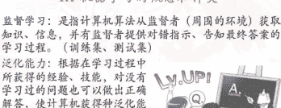

# 1 机器学习

机器学习：就是让计算机具有像人一样的学习能力的技术，是从数据中学习（也称为大数据）中寻找出有用知识的技术。机器学习的种类：根据处理的数据类型不同，可以分为监督学习、无监督学习和强化学习等。


## 1.1 机器学习的概念和分类

监督学习：是指计算机解决从监督者（周围的环境）获取知识、信息，并有监督者提供的指示、指导、参考答案的学习过程。（训练集、测试集）
泛化能力：根据在学习过程中所获得的经验，能处理、对没有学习过的问题也可以做正确解答，使计算机获得泛化能力，是监督学习的最终目标。
应用：预测数值型数据的回归、预测分类标签的分类等。


## 1.1 机器学习的概念和种类

无监督学习：是指计算机算法在没有监督者的情况下，自学获取知识、信息。

无监督学习的应用：不仅能够解决没有监督学习算法的有关参数需要确定的问题，因而学习目标不止十分明确。在人脸识别、数据挖掘、视频分析、社会网络分析等声音信号分析等方面应用十分广泛。


## 1.1 机器学习的概念和种类

强化学习：是指在没有监督者提示的情况下，计算机算法自己对所测量的结果进行评价的方法。

与监督学习的关系：也可以使计算机没有监督学习的向问题正交解解释的迭代能力为基础，但是在学习过程中，不能总是提供标准答案，参考系统需要不断地从周围环境中获得反馈信息，强化学习就变成无监督学习了。


## 1.2 机器学习的例子

回归：是指一个或多个自变量和因变量之间的关系建立模型，求解的一类统计方法；即把函数在样本点附近加以近似的有监督的数据拟合问题。

以输入向量作为输入，实数作为输出的回归问题，如时间序列问题。在监督学习中，通常的函数数据拟合问题，作为训练集的输入输出样本{(x_i,y_i)}^n_{i=1}是已知的。


## 1.2 机器学习的例子

分类：是指对于指定的模式进行识别的有监督的模型识别问题。

在这里，以下列的实数向量作为输入样本，所有的输出样本，可以被分为k个类别的离散数据进行识别，作为训练集的输入输出样本{(x_i,y_i)}^n_{i=1}是已知的。但是，分类问题中输出样本只能是1，2，…，C0，并不是具体的值，而是分别代表类别1,2,…,C0。


## 1.2 机器学习的例子

聚类：与分类问题相同，也是模式识别问题，但属于无监督学习的一种。

即将输出输入样本{x_i}^n_{i=1}，然后判断各个样本分别属于1,2,…,中的哪一个簇。类属相同类的样本之间具有相似的属性，不同类的样本之间具有不同的属性。在聚类问题中，如何准确地计算样本之间相似度是重要难题。


## 1.2 机器学习的例子

降维：是指从高维度数据中提取关键信息，将其转换成为易于计算的低维度问题进而求解的方法。

当输入样本{x_i}^n_{i=1}维数非常大时，可以把样本转换到易于处理的样本{z_i}^n_{i=1}。根据数据类型的不同，可以分为监督学习和无监督学习两种。


## 1.2 机器学习的例子

异常检测：是指将输入样本{x_i}^n_{i=1}中所包含的异常数据的识别问题。

在已知正常数据与异常数据的例子情况下，若与异常的分类问题是相对的。但是，一般情况下，在异常检测中，对于样本的聚类是异常的，什么样的数据是正常的，什么样的数据是异常的。在这种情况下异常检测问题中，一般采用密度估计的方法，把密度值中心的数据作为正常的数据，把密度值离中心的数据作为异常的数据。


## 1.3 机器学习的方法

机器学习有多种不同的流派：

+   - 产生式分类
+   - 判别式分类,
+   - 概率派
+   - 贝叶斯派

### 1.3.1 生成的分类和识别的分类

**判别式的分类：**在已知模式 x 的时候，如果能求得使分类类别 y 的条件概率 p(y|x) 达到最大值的类别 y 的话，就可以进行模式识别了。

ŷ = argmaxᵧ p(y|x)

“argmax”是取得最大值时参数的意思。所以，maxᵧ p(y|x) 是指当 y 取值使 p(y|x) 的最大值，而 argmaxᵧ p(y|x) 是指当 y 取值时对应的 y 的值。在模式识别里，条件概率 p(y|x) 通常也被称为后验概率。

### 1.3.1 生成的分类和识别的分类

**生成式的分类：**在模式识别里，联合概率 p(x,y) 也称为数据生成概率。通过预测模型生成概率 p(x,y) 来进行模式识别的分类方法，称为生成的分类。

p(y|x) = p(x,y) / p(x)

通过上述，我们可以发现生成的分类和判别的分类各有优缺点。生成式分类是生成概率模型，判别式分类直接对条件概率进行建模。

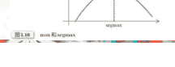

#### 判别式 VS 生成式

**Vladimir Naumovich Vapnik，俄罗斯统计学家、数学家：**在实际问题中，信息往往是有限的。在解决一个信息量的问题时，不要把解决一个更一般的问题作为一个中间步骤。要试图得到所有需要的答案，而不是更一般的答案。很可能拥有足够的信息来很好地解决一个感兴趣的特定问题，但却没有足够的信息来解决一个一般性的问题。

p(y|x) = p(x,y) / p(x) = p(x,y) / Σᵧ p(x,y)

即使手头的信息量不足以解决一般性问题，但对于解决特定问题，深可能是足够的。

#### 判别式 VS 生成式

如果数据生成概率 p(x,y) 是已知的，那么，从下面就可以推出后验概率 p(y|x)。然而，如果后验概率 p(y|x) 是已知的，却不能由此推导出数据生成概率 p(x,y)。

p(y|x) = p(x,y) / p(x) = p(x,y) / Σᵧ p(x,y)


### 1.3.2 统计概率和布尔贝叶斯

统计概率：以包含全局的概率 p(x,y) 为例，将模式 x 作为决定的变量，使用手头的训练样本 D={(xᵢ,yᵢ)}ₙᵢ₌₁ 对模式进行学习。例如，在最大似然估计中，一般对函数训练集 D 的概率分布进行学习。

maxθ ∏ⁿᵢ₌₁ q(xᵢ,yᵢ;θ)

在统计概率方法中，如何对训练集 D 得到高精度的模式是主要的研究课题。

### 1.3.2 统计概率和布尔贝叶斯

朴素贝叶斯：以包含全局的概率 p(x,y) 为例，将模式 x 作为概率变量，对其先验概率 p(θ) 加以考虑，计算与训练集 D 相关的生成概率 p(D|θ)。在朴素贝叶斯判断定理，可以从使用先验概率 p(θ) 来求解后验概率 p(θ|D)。

p(θ|D) = p(D|θ)p(θ) / p(D) = [∏ⁿᵢ₌₁ q(xᵢ,yᵢ;θ)]p(θ) / ∫[∏ⁿᵢ₌₁ q(xᵢ,yᵢ;θ)]p(θ)dθ

在朴素贝叶斯算法中，如何精确地计算后验概率是一个主要的研究课题。

#### 02-学习模型

如何使待定函数与数据集相近似

#### 主要的学习模型

+   - 线性模型：线性回归模型
+   - 核模型：高斯核函数
+   - 层次模型：逻辑回归


### 问题引入

假设有一个房屋销售的数据如下：

| 面积(m²) | 销售价 |
| --- | --- |
| 133 | 250 |
| 150 | 520 |
| 80 | 160 |
| 102 | 220 |

如果录入了一个新的面积值，而在销售记录表中没有对应记录，如何处理？

解决方法：用一条直线去尽量地拟合这些数据，然后当有新的面积值进入表时，我们可以在拟合线上将对应的值返回。如果用一条直线去拟合，可能是下面的样子：

## 2.1 线性模型

在上图中，θ₀ 是截距项，θ₁ 是斜率，f(x)=θ₀+θ₁x，...，θₙ；其中 n 是参数的个数。假设我们有 m 个训练样本，(x⁽ⁱ⁾, y⁽ⁱ⁾)，i=1,...,m。最小二乘法是求使代价函数 J(θ)=1/(2m)∑(hθ(x⁽ⁱ⁾)-y⁽ⁱ⁾)² 最小的 θ。代价函数是凸函数。

在上述建模中，增加一个线性项的一般形式为：

f(x)=∑θ_iφ_i(x)=θ^TΦ(x)

说明：特征函数作为基函数；图中十个圆圈为多项式基函数的方法。

### 乘法模型 VS 加法模型


#### 回归模型

回归：属于监督学习中的一种方法。该方法的核心思想是从连续型统计数据中得到数学模型，然后将该数学模型用于预测或者分类。

回归最早出现在统计学中，由 Francis Galton 发明。Galton 在 1877 年完成了一次对回归的研究，目的是从上一代遗传的种子（双亲）的尺寸来预测下一代豆荚种子的尺寸（身高）。Galton 在大量数据上应用了回归，基于子代的身高，他得出了结论：如果双亲的身高高于平均身高，他们的子女也倾向于高于平均身高，但相对于双亲而言，会向平均身高回归。这可以被称为：孩子的身高向平均身高回归。Galton 在多项研究上都注意到了这一点，并将此种研究方法称为回归。

#### 常用概念和符号

- 房屋销售记录表：训练集（training set）或者训练数据（training data），是我们流程中的输入数据，一般称为 x。
- 房屋销售价格：输出数据，一般称为 y。
- 拟合的函数（或者称为假设或者模型）：一般写做 y = h(x)。
- 训练数据的条目数：一条训练数据是由一对输入数据和输出数据组成的；输入数据的维度（特征的个数，#features）。
- 这个例子中的特征是二维的，结果是一维的。然而回归方法能够解决特征多维、结果是一维或多维连续值的问题。

#### 学习过程

首先给出一个输入数据，然后通过一系列的过程得到一个估计的函数，这个函数有能力对没有见过的新数据给出一个新的估计，也就被称为构造一个模型。就像上面的线性回归函数。


#### 线性回归

- 线性回归（Linear regression）是利用称为线性回归方程的最小平方函数对一个或多个自变量和因变量之间关系进行建模的一种回归分析。
- 线性回归属于监督学习，因此方法和监督学习应该是一样的，先选定一个训练集，根据这个训练集学出一个假设函数，然后测试这个函数训练得好不好（比如函数是否够好地拟合训练数据），挑选出最好的函数（cost function 最小）即可。

注意：
1. 因为是线性回归，所以学习到的函数为线性函数，即直线的函数。
2. 因为是单变量，因此只有一个 x。

单变量线性回归模型：

hθ(x) = θ₀ + θ₁x

- X: feature
- h(x): hypothesis

问题：线性函数拟合得好不好？

#### 代价函数

代价函数（Cost Function）：对模型的误差进行统计，cost function 越小的函数，说明拟合数据越好的函数。

(1) vector x
(2) vector y
↓
cost function
↓
cost value

J(θ₀, θ₁) = 1/(2m) ∑(hθ(x⁽ⁱ⁾) - y⁽ⁱ⁾)²

其中：
- J(θ₀, θ₁) 表示代价函数的值；
- hθ(x⁽ⁱ⁾) 表示模型的预测值；
- y⁽ⁱ⁾ 表示真实值；
- m 表示训练样本的数目。

代价函数与参数的关系：J(θ₀, θ₁) = 1/(2m) ∑(hθ(x⁽ⁱ⁾) - y⁽ⁱ⁾)²

注意：如果假设函数只有 θ₀、θ₁ 两个参数，则 cost function J(θ₀, θ₁) 的图形是一个碗状，即只有一个最小值。

#### 一般情况（多变量）

一般情况：x⁽ⁱ⁾ ∈ Rⁿ

hθ(x) = θ₀ + θ₁x₁ + ... + θₙxₙ

J(θ) = 1/(2m) ∑(hθ(x⁽ⁱ⁾) - y⁽ⁱ⁾)²

最小二乘法求解：

min_θ J(θ)

要点：
- 最小二乘法：θ = (XᵀX)⁻¹Xᵀy，是一个直接的数学公式，不过要涉及矩阵运算。
- 梯度下降法。

#### 梯度下降

Gradient Descent（梯度下降）：找到 cost function 的最小值。

梯度下降法：梯度下降法是一种迭代法，假设我们在一个山坡上，往下走，从最陡的方向向下走一步，重复直到最低点。

方法：
1. 先确定一个学习率 α，取一个 learning rate。
2. 初始化一个 θ 值。
3. 每次迭代更新 θ 值，同时计算 cost function，并更新 θ。
4. 当梯度下降到小于某个值时，停止迭代。

#### 线性回归的梯度下降算法

梯度下降算法：

```
repeat until convergence:
    θ_j := θ_j - α ∂/∂θ_j J(θ)

simultaneously update:
    temp0 := θ₀ - α ∂/∂θ₀ J(θ)
    temp1 := θ₁ - α ∂/∂θ₁ J(θ)
    θ₀ := temp0
    θ₁ := temp1
```

特点：
1. 梯度不为零时，算法的收敛速度不快，因此梯度下降法比其它最优化方法收敛慢。
2. 选择合适的 α，下降速度更快。

问题：如何确定局部最小值（local minimum）的位置？梯度下降法如何做？

如果我们从一个点开始，cost function 会下降到一个局部最小值。

如果我们选择一个正的 α，cost function 会逐渐下降到局部最小值。

要点：要找到最小值，cost function J(θ₀, θ₁) 的值会随着迭代次数的增加逐渐下降到一个小值。

#### 线性回归的梯度下降

注意：下降的步长大小非常重要，因为如果太小，收敛速度会慢；如果太大，则可能无法收敛，甚至 overshoot。

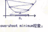

如果 learning rate 值太大，发现 cost function 增长了，则需要减小 learning rate 的值。

#### Gradient Descent for Linear Regression

求解下列问题：给定一组训练样本，求使损失函数最小的参数。采用梯度下降法，不断更新参数。

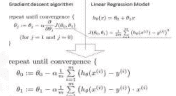

## 2.2 核模型

在线性模型中，多项式或者三角多项式等基函数与训练样本组合得到模型。核模型使用核函数将输入样本映射到高维特征空间。

核模型：以使用核函数为基础的二元函数。核函数可以定义为：

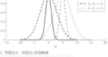

在众多的核函数中，以高斯核函数的使用最为广泛。

其中，σ 表示尺度因子，决定核函数的宽度。

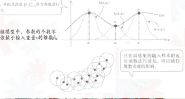

## 2.3 层次模型

与参数呈非线性关系的模型，称之为非线性模型。层次模型是常用的非线性模型，在神经网络中广泛应用。逻辑回归也是一种层次模型。

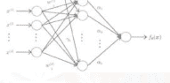

### 逻辑回归（Logistic Regression）

- 逻辑回归的模型是一个非线性模型。
- sigmoid 函数，又称逻辑回归函数，但是它本质上又是一个线性回归模型。
- 因为除去 sigmoid 映射函数关系，其他的步骤、算法都是线性回归的。
- 可以说，逻辑回归都是以线性回归为理论支持的。
- 只不过，线性模型无法做 sigmoid 的非线性形式，sigmoid 可以轻松处理 0/1 分类问题。

### 二分类问题

二分类问题是指预测的值只有两个取值（0 或 1）。二分类问题可以扩展到多分类问题。例如：垃圾邮件过滤系统中，输入是邮件的特征，预测的值就是邮件的类别，即垃圾邮件还是正常邮件。对于这种案例我们通常称为正类（positive class）和负类（negative class）。在垃圾邮件的例子中，正类就是正常邮件，负类就是垃圾邮件。

应用举例：是否垃圾邮件分类？是否患肺癌？是否金融欺诈？

### Logistic 函数

在二分类问题中，取值是一个离散的数值（0 或 1）。如果我们继续使用线性回归来预测取值，这样预测出的数值很有可能不在 0、1 之间。逻辑回归使用一个非线性函数，将函数值压缩到 0 和 1 之间，这个函数称为 Logistic 函数。

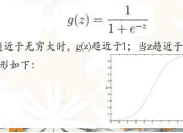

Logistic 函数当自变量趋于正无穷大时，函数值趋近于 1；当自变量趋于负无穷大时，函数值趋近于 0。


#### Sigmoid 函数(sigmoid function)的性质：

$$g'(z)=\frac{d}{dz}\frac{1}{1+e^{-z}}=\frac{1}{(1+e^{-z})^2}(e^{-z})=\frac{1}{1+e^{-z}}\left(1-\frac{1}{1+e^{-z}}\right)=g(z)(1-g(z)).$$

#### 分类问题

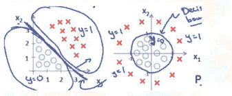

#### 线性决策边界

对于硬性边界的情况，边界形式如下：
$$\theta_0+\theta_1x_1+\cdots+\theta_nx_n=\sum_{i=0}^{n}\theta_ix_i$$
构造预测函数：
$$h_\theta(x)=g(\theta^Tx)=\frac{1}{1+e^{-\theta^Tx}}$$
函数 $h_\theta(x)$ 的值有两种含义，它表示给定观测的概率。因此对于输入的分类情况分别为：
$$P(y=1|x;\theta)=h_\theta(x)$$
$$P(y=0|x;\theta)=1-h_\theta(x)$$

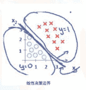

Logit函数与标签如下，它们是基于最大似然估计得到的。
$$Cost(h_\theta(x),y)=\begin{cases}-\log(h_\theta(x)),&y=1\\-\log(1-h_\theta(x)),&y=0\end{cases}$$
$$J(\theta)=-\frac{1}{m}\sum_{i=1}^{m}\left[y^{(i)}\log h_\theta(x^{(i)})+(1-y^{(i)})\log(1-h_\theta(x^{(i)}))\right]$$

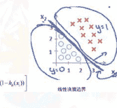

#### 梯度下降

梯度下降算法：
同时更新
$$\theta_j:=\theta_j-\alpha\frac{\partial}{\partial\theta_j}J(\theta)$$

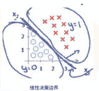

#### 正则化Regularization

过拟合问题
对于线性回归问题，可能会有拟合程度过高，导致模型复杂度过高，容易过拟合。正则化可以通过惩罚模型复杂度来降低过拟合风险。

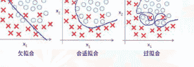

#### 正则化Regularization

- 问题的主要：过拟合问题特征过多的特征。
- 解决方法
  - 1）减少特征数量（减少特征会失去一些信息，即使特征选择的很好）
    - 可用人工选择保留的特征；
    - 模型选择算法；
  - 2）正则化（特征较多时比较有效）
    - 保留所有特征，但减小参数的大小。

#### 正则化方法

正则化是通过惩罚模型复杂度的实现，是在经验风险上加一个正则化项或惩罚项，让模型更加简单。常用的正则化方法包括岭回归、Lasso回归等。

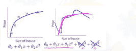

#### 正则化 Regularization

正则化可以对不同的参数，名词问题中参数方差不同，就要惩罚不同的参数，也可以用L1范式。假设方差同时，则惩罚是连续参数为： J(θ)=1/(2m)∑(hθ(x(i))-y(i))²+λ∑θj²

## II 有监督回归

## [II-有监督回归]

## Description

第二部分将介绍机器学习中各种可用的有监督学习算法。 可与指定真实数据集样本从而所能实现适当的各种有监督的机器学习问题。

## 3.0 引言

## [03-最小二乘学习法]

- 本章将以X作为输入，以实数值Y作为输出的函数 y = f(X) 的学习问题进行介绍。
- 这里的真实函数关系尚未明确，通过学习过程中作为训练集的输入输出样本集{(Xi,Yi)}来估计进行学习。
- 在一般情况下，输出样本集的真实函数f(X)中经常会出现噪声。

## 3.1 最小二乘学习法

## 3.1 最小二乘学习法

- 最小二乘学习法是对模型的参数fθ(X)和训练集的输出{y_i}_{i=1}^n 的平方误差
- J_LS(θ)=1/2∑_{i=1}^n (f_θ(X_i)-y_i)^2 (3.1)
- 为最小化时参数θ进行作用 θ_LS = arg min_θ J_LS(θ)
- 因此，最小二乘学习法也称为L2损失最小化学习法。

如果使用线性模型 f_θ(X)=1/n∑_{j=1}^p θ_j φ_j(X)=θ^T Φ(X) (3.1) 则训练样本的平方误差J_LS能表示为下述形式。 ∂_LS(θ)=1/2||Φθ - y||^2

## 3.1 最小二乘学习法

### 一个例子

- 训练样本的系数矩阵Φ的系数向量θ的最小二乘估计θ_LS为：
- ∇_θL_LS = (∂L/∂θ_i, ∂L/∂θ_j)^T Φ^T Φ θ - Φ^T Φ y
- 将误差置为0，最小二乘解满足方程组：
- Φ^T Φ θ = Φ^T y

对基函数
φ(x) = (1, sin x/2, cos x/2, sin 2x/2, cos 2x/2, ..., sin 15x/2, cos 15x/2)^T
进行最小二乘法学习，可以对非奇异的非线性函数进行拟合。

这个方程组的解通常通过计算核矩阵的广义逆矩阵Φ⁺来进行计算，则
θ_LS = Φ⁺ y

当Φ⁺有逆矩阵时，广义逆矩阵Φ⁺可以表示为：
Φ⁺ = (Φ^T Φ)^-1 Φ^T

### 一个例子

### 加权最小二乘法学习

```
n=50; M=100; x=linspace(-3,3,6); ...
... 
figure(1); clf; hold on; axis([-2 2 0 -0.5 1.2]);
plot(x,g,'r'); plot(x,y,'bo');
```


权函数为的训练样本的系数矩阵是权矩阵W≥0进行加权，此时系数用加权最小二乘法学习，这被称为加权最小二乘学习。
min_θ ½ Σ w_i (f_θ(x_i) - y_i)^2

加权最小二乘学习，与没有加权时相同，可以通过以下进行求解，
(WΦ)^T (WΦ) θ = (WΦ)^T W y
但这里，上述中的W是w_i, ..., w_n对应的对角矩阵。

权函数，系数矩阵扩展为40维时，相应的θ为... p=... 拟合误差为... 提高了效果。

### 在核模型上的应用

## 3.2 最小二乘解的性质：渐进无偏性

对于核模型
f_θ(x) = Σ α_k K(x, x_k)  (3.2)

通过对计算核矩阵再设定下面而定义核矩阵K，可以以类似与线性模型相同的方法来求解核模型时的最小二乘。
K = [K(x_i, x_j)]

首先考虑为计算核模型的系数分解。
Φ = Σ_{k=1}^{m(n)} K_m W_m φ_k

其中 K_m, W_m, φ_k 分别表示... 左奇异向量，右奇异向量。奇异值全部降序排列，奇异值需要正交规范。

ψ_i ψ_j^T = {1, i=j; 0, i≠j}  ψ_i^T ψ_j = {1, i=j; 0, i≠j}

### 最小二乘解的性质：渐进无偏性

### 最小二乘解的性质：渐进无偏性

设处理中的奇异值分解后，其广义逆矩阵可以表示为：
Φ⁺ = Σ k_i⁺ φ_i ψ_i^T
其中 K⁺ 是核矩阵K的广义逆矩阵，
K⁺ = {K⁻¹, K≠0; 0, K=0}

因此，最小二乘解θ_LS可以表示为
θ̂_LS = Σ_{i=1}^{min(n,m)} k_i⁻¹ (y_i^T W_i) ψ_i

把最小二乘学习中得到的函数记为f̂_θ(x)，估计出(f_θ(x_i))_{i=1}^n 为观测值，可写
(f_θ(x_1),...,f_θ(x_n))^T = Φ θ_LS = Φ Φ⁺ y

显然上式中Φ Φ⁺是投影到Φ的正交投影矩阵，因此最小二乘学习的输出是由观测值y通过投影矩阵得到的。

### 最小二乘解的性质：渐近无偏性

利用真实函数中的参数θ，把它以θ的形式代入上式，真实函数的输入（x_i）和输出的估计值（ŷ_i）可以改写为：

因此，真的输出值应该就在R(θ)中。由此可见，采用最小二乘法的真实空间R(θ)的正被精确得到的方法，就可以把θ中的噪声去除了。


### 最小二乘解的性质：渐近无偏性

特别是，如果噪声的期望值为0，则最小二乘解θ̂无偏是其最参数的无偏估计量。

在上式中，E为噪声的期望值。即使真实函数没有包含在模型中（即无论对什么样的θ，都存在f≠f₀），如果增加样本参数θ的话，E[θ̂]也会向有关模型中的最优参数方向收敛——这种性质就是渐近无偏性。

## 3.3 大规模数据的学习算法

设计矩阵中的维数为n×d，当训练样本数或每个样本越来越大时，经常会出现内存不足的现象。在这种情况下，使用随机梯度算法。随机梯度算法是沿着滑动窗口方面函数的梯度下降，对参数θ依次迭代学习的方法。

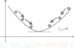

> 当使用随机梯度下降时，根据式(3.3)，每次会更新当前的梯度和参数。随机梯度下降可以有效解决大规模数据的学习问题。

## 3.3 大规模数据的学习算法

一般而言，与线性模型相对应的训练样本数越大，θ为d维向量。θ的偏置为负数是线性模型的一个重要性质。

上述式是成立的。因为当函数是只有一个峰值的函数，所以通过梯度法就可以得到训练样本子误差最优值，因此随着样本的规模增加，θ会逐步降低。

## 3.3 大规模数据的学习算法

J(θ)(1−θ)J(θ₁)+(1−θ)J(θ₂)

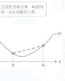

> 在随机梯度下降的过程中，需要根据当前样本计算梯度，并沿着梯度方向更新参数。该方法适合处理大规模数据。

### 核函数的例子

对于大气的高斯核函数模型，使用随机梯度算法。

fθ(X)=∑ᵢ₌₁ⁿ θᵢK(x,xᵢ)

K(x,c)=exp(−||x−c||²/(2σ²))

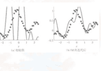

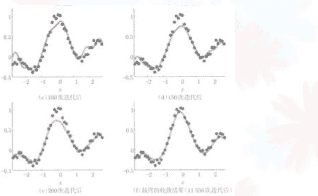

### 参考代码

```
n=50; m=1000; x=linspace(-3,3,n); y=linspace(-3,3,m);\n...\nfor k=1:n*100\n    ...\nend\nfigure(1); clf; hold on;\nplot(x,y,'r'); plot(x,y,'b');
```


### 梯度法的收敛速度

梯度法的收敛速度，虽然依赖于梯度下降的步幅（上例中 η=0.1）以及收敛结果的判断方法（上例中 norm(t−t0)<0.000001），但一般都会合理地逐渐逼近最优解，这意味着梯度法能够得到一定程度的提高。

- 对于梯度下降的步幅，可以首先估计其最为最大的值，然后再慢慢地调整为较小的值。（实际保证降序下降的步幅最为最优）

## 04 带有约束条件的最小二乘学习方法

## 4.0 引言

- 单纯的最小二乘法对于包含噪声的学习过程经常带过拟合的缺点。
- 学习模型对于训练样本而言过度复杂。
- 本章将介绍能够控制模型复杂程度的、带有约束条件的最小二乘学习方法。

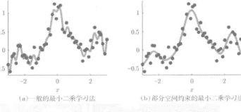

## 4.1 部分空间约束的最小二乘学习法

在有参数的线性模型

f(x)=∑ᵢ₌₁ᵈ θᵢφᵢ(x)=θᵀφ(x)

的一般最小二乘学习中，因为参数{θᵢ}ᵢ₌₁ᵈ可以自由设定，所以使用的是完全参数空间，如上图4.2a。本节将介绍的部分空间约束的最小二乘法，则是通过把参数空间限制在一定范围内，防止过拟合现象。

在这里，是满足Pθ=Pθᵀ=Pθ的约束条件，表示的是矩阵P的值域R(P)的正交投影矩阵。通过对θ作这样的约束条件，来限制θ不会被限制在值域R(P)的范围外。

带分空间约束的最小二乘学习法的解，一般是通过求解一个二次学习法的对偶问题得到。其解为：

θ̂=(ΦP)†y

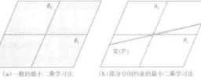

线性模型的最小二乘学习法的精确实例（降噪参数的例子），使用了三条参数式φᵢ(x)（i=1, 2, 3），其中θ₁、θ₂、θ₃分别对应三个基函数。部分空间约束的最小二乘学习法中添加了约束条件，使参数限制在子空间内。

```
n=50; M=1000; x=linspace(-3,3,n)'; X=linspace(-3,3,100)';
phi=...;
y=sin(pi*x)+randn(n,1)*0.2;
P=...;
for i=1:5
  ...
end
figure(1); plot(x,y,'x'); hold on;
plot(X, f(X, ...)); plot(X, ...);
legend('最小二乘','部分空间约束');
```

### 4.2 ℓ₂ 约束的最小二乘学习法

部分空间约束的最小二乘学习法中，只使用了参数空间的一部分，但是由于正则项受到严格的限制或者约束失效的原因，因此应先确定应用中参数是否合理。本节将介绍保留相对而言最少的约束的最小二乘学习法。

min_θ J_{LS}(θ)，约束条件 ‖θ‖₂ ≤ R（4.1）

实际上给出的条件是，约束参数的最小二乘学习法要求参数空间的原点在圆心，在其中任意范围内的任意一个解都被认为是合理的。

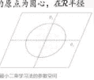

#### 拉格朗日对偶问题

> 可变分的约束：原问题和对偶问题之间的关系，以及约束条件的最优化问题。

### 4.2 ℓ₂ 约束的最小二乘学习法

利用拉格朗日对偶问题，通过求解下面的最优化问题，就可以得到最优回归问题（4.1）的解。

max_α min_θ [J_{LS}(θ)+ λ/2 (‖θ‖²-R)]，约束条件 λ≥0

对给定的对偶问题的解，若不根据KKT决定，直接指定参数，ℓ₂约束的最小二乘学习法的解就可以通过以下式子求得：

θ̂=arg min_θ [J_{LS}(θ)+ λ/2 ‖θ‖²]（4.2）

J_{LS}(θ)表示对训练样本的拟合程度，通过与‖θ‖²相结合得到最小值，防止过拟合。

### 4.2 ℓ₂ 约束的最小二乘学习法

式（4.2）的目标函数进行关于参数的偏导，并设为0，ℓ₂约束的最小二乘学习法的解就可以通过以下式子求得：

θ̂=(ΦᵀΦ+λI)⁻¹Φᵀy

- 1. 在这里，I是单位矩阵。从式（4.3）可知，在ℓ₂约束的最小二乘学习中，通过将矩阵ΦᵀΦ加上相对较小的正则项，通常可以使其稳定地进行矩阵求逆。
- 2. 因此，ℓ₂约束的最小二乘学习法也成为正则化的最小二乘学习法。
- 3. 式（4.2）中的第二项正则项为正则项，因为正则化参数λ越大，越是限制了模型参数的取值范围。

### 4.2 ℓ₂ 约束的最小二乘学习法

如果考虑将核进行中的参数条件。

Φ=∑_{i=1}^{m}K_{x_i}ψ(x_i)

- ➢ ℓ₂约束的最小二乘学习法中的解可以表示为：
- 
- θ̂=∑_{i=1}^{m} K_{x_i}/(K_{x_i}ᵀK_{x_i}+λ) ψ(x_i)
- 
- ➢ 当λ=0时，ℓ₂约束的最小二乘学习法与一般的最小二乘学习法相同。
- ➢ 通过在分母中加入正则项，可以避免过拟合，成为正则化最小二乘学习法。

#### 例子

h(x)=∑ᵢ βᵢ K(x,xᵢ)

K(x,c)=exp(−‖x−c‖²/(2σ²))

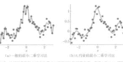

#### 示例代码

```
n=50; N=1000; x=linspace(-3,3,n)'; x1=linspace(-3,3,N)';
y=sin(pi*x)/(pi*x)+0.1*x+0.2*randn(n,1);
k2=x1.^2; K2=x2.^2; h2=2*0.3^2; Is=0.1;
K=exp(-(repmat(x2,1,n)-repmat(x2',n,1)).^2/(h));
K=K./repmat(sum(K,2),1,n);
t=K'*y; [F2,F2]=...;
figure(1); clf; hold on; axis([-2 2 -1.5 1.5]);
plot(x1,F,'r'); plot(x2,'b');
legend('LS','L2-constrained LS');
```

#### 一般约束的最小二乘学习法

虽然ℓ₂约束的最小二乘学习法中加入了ℓ₂正则，但是通过限制参数θ的取值范围来防止过拟合，可以将其扩展为一般约束的最小二乘学习法。

min_θ J_{LS}(θ)，约束条件 θᵀGθ ≤ R（4.1）

在式中，对约束项进行变换，由θᵀGθ可以表示模型在椭圆形参数空间内的取值范围。

θ̂=(ΦᵀΦ+λG)⁻¹Φᵀy

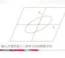

## 4.3 模型的选取

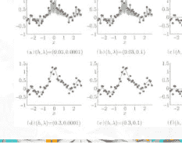

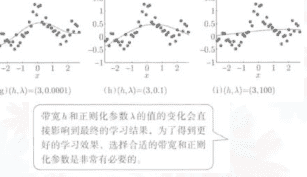

当模型与正则化参数的组合变化合适时，拟合曲线与学习数据的拟合程度会随着学习数据的学习参数的改变而改变。为了更好地观察拟合曲线与学习数据的拟合程度，学习参数的改变和正则化参数的变化是非常必要的。

模型选择：通过采用不同的输入样本来决定被拟合学习数据中各个参数值的大小。模型选择的一致流程：

- 1. 准备候选的模型 M1...Mm。
- 2. 对各候选模型 M1...Mm 拟合学习数据 D 得到 f1...fm。
- 3. 对各学习数据 f1...fm 的泛化误差 G1...Gm 进行评估。
- 4. 选择泛化误差 G1...Gm 最小的模型作为模型。

- ✓ 监督学习的目的是不是能够输入的样本集，而是未知和测试样本输入样本本可能正确地被预测出；
- ✓ 泛化误差学习对未知和测试样本输入样本的预测能力；
- ✓ 泛化误差是相对未知和测试样本输入样本的预测所做出的预测的误差。


## 4.3 模型的选取——交叉验证

当 λ 取 (0.03, 0.3, 3) 中取值，正则化系数 λ 取 (0.0001, 0.1, 100) 选取，分别会含 m 为 5。
把分训练集 m 个训练样本的交叉验证方法，称作 k 个样本进行学习，将其分为 k 个部分作为测试样本，称为每一次交叉验证。
每一交叉验证将包含 m 个训练样本，如果和成块，变量较多时同时进行。


### 留一交叉验证的简化方法

G = 1/m Σ H(yᵢ, ŷᵢ)²
若上式中 H 为下述形式 y = θᵀ x 时
H = f - θᵀ x
为简化计算，H 是关于 θ 的线性函数，则 H 的期望与方差可表示为
解法：... 记为 A = (A + b bᵀ)⁻¹ = A⁻¹ - A⁻¹ b bᵀ A⁻¹ / (1 + bᵀ A⁻¹ b)

```
method = 'ridge' ...
... 
for k in 1:K
    ...
    ...
end
... 
plot(x, y, ...)
```


## 数据仓库与数据挖掘

### 第二章 认识数据、描述数据

## 主要内容

- 1.1 数据对象与属性类型
- 1.2 数据的基本统计描述
- 1.3 数据可视化
- 1.4 度量数据的相似性和相异性

## 1.1 数据对象与属性类型

- 1. 数据对象与属性
- 2. 属性类型
  - 标称属性
  - 二元属性
  - 序数属性
  - 数值属性
- 3. 离散属性与连续属性

### 1. 数据对象

- 数据集由数据对象组成
- 一个数据对象代表一个实体
- 例子：
  - 销售数据库（sales database）：客户/顾客、商店/商品、销售记录
  - 医学数据库：患者、治疗
  - 大学数据库：学生、教授、课程
- 又称为样本、事例、实例、数据点、对象、元组（tuples）。
- 数据对象由属性来描述
- 数据库的行 -> 数据对象；列 -> 属性。

### 属性

- 属性（Attribute）（或维度、特征、变量）：一个数据字段，表示一个数据对象的某个特征。
  - 例如：customer_ID、name、address
- 类型：
  - 标称属性，或名词性属性（Nominal attribute）
  - 二元属性（Binary attribute）
  - 数值属性（Numeric attribute）
    - 区间属性（Interval-scaled）
    - 比率标度属性（Ratio-scaled）
  - 序数属性（Ordinal attribute）

### 2. 属性类型——名词属性

- 标称属性，名词属性（Nominal）：
  - 属性的值是一些符号或事物的名称。每个值代表某种类别、编码或状态，因此标称属性常被看作是分类的（categorical）。
  - 属性的值不具有有意义的序，因为是无序的，或是枚举的（enumeration）。
  - 属性的值没有数学运算的意义，即均值、中位数等没有意义。
- 举例：类别、状态，或“名目”
  - 发色 = {赤褐色、黑色、金黄色、棕色、灰色、红色、白色}
  - 婚姻状态 = {单身、已婚、离异、丧偶}
  - Customer_ID = {0001, 0002, ……}
  - 邮政编码

### 2. 属性类型——二元属性

- 二元属性（Binary attribute）
  - 具有两个状态的标称属性：
    - 只有2个状态的名词属性（0 和 1）
  - 对称二元（Symmetric binary）
    - 同样重要的两种状态
    - 例如：性别
  - 非对称（Asymmetric binary）
    - 非同等重要的状态
    - 例如：医疗检查（阳性 vs. 阴性）
    - 惯例（Convention）：将 1 分配给最重要的结果（例如，HIV 阳性）

### 2. 属性类型——序数属性

- 序数属性（Ordinal attribute）
  - 属性值之间具有有意义的序或级别（ranking），但相继值之间的差是未知的
    - 例如：drink_size（杯型）：大、中、小
    - 例如：grade（等级）：A+、A-、A、B+、B-
  - 对于不能具有有意义的主观质量评估的记录，使用序数属性，如等级评定调查
    - 例如：顾客满意度
  - 数值属性的离散化：
    - 将某种属性的数值量划分成有限个有序类别。
    - 标称、二元和序数属性都是定性的，它们描述数据对象的特征，而不给出实际的大小或数量，是一种代表类别的词。

### 2. 属性类型——数值属性

- 数值属性（Numeric attribute）
  - 是定量的，是可度量的量，通常用数或实数值表示；
  - 分为区间标度或比率标度
- 区间（Interval-scaled）
  - 用相等的单位度量
  - 属性值有序，可以为正、零、负。
  - 没有真正的零点，无法计算倍数
  - 例如：以 ℃ 或 ℉ 表示的温度；日历日期
- 比率标度属性（Ratio-scaled）
  - 有真正的零点，被测量值可以进行比率比较（10K 是 5K 的两倍）。
  - 例如：温度（在开尔文）；长度；计数；货币等
  - 工作年限、字数、重量、高度、速度、温度、度量等

### 3. 离散属性与连续属性

- 离散属性（Discrete Attribute）
  - 一个有限的或可数的数据值集合
  - 例如：邮政编码、文档集合中的单词集合
  - 有时表示为整数变量
  - 注：二元属性是离散属性的一个特殊情况
- 连续属性（Continuous Attribute）
  - 属性值为实数
  - 例如：温度、高度或重量
  - 实际上，变量只能通过有限数据进行测量和表示
  - 连续属性通常表示为连续变量

## 1.2 数据描述

对于成功的数据预处理而言，把握数据的全貌是至关重要的。基本统计描述可以用来识别数据的性质，凸显哪些数据值应该视为噪声或离群点，并帮助选择何种适用的数据挖掘算法等。

- 1. 数据的计量和类型
- 2. 中心趋势度量：均值、中位数和众数
- 3. 数据散布度量：极差、四分位数、方差、标准差和四分位数极差
- 4. 数据的基本统计图形显示

### 1. 数据描述——数据的计量与类型

- 数据的计量尺度
- 数据的类型
- 数据的表现形式

### 数据的计量尺度

- 数据的计量尺度（Levels of Measurement）
  - 一般认为，数据是对客观现象计量的结果。
  - 按照对事物计量的精确程度，可将所采用的计量尺度由低级到高级分为四个层次：
    - 定类尺度（Nominal Level）
    - 定序尺度（Ordinal Level）
    - 定距尺度（Interval Level）
    - 定比尺度（Ratio Level）

**（1）定类尺度**

- 定类尺度（列名尺度）：
  - 按照事物的某种属性对其进行平行的分类或分组。
  - 例：人口的性别（男、女）；企业的所有制性质（国有、集体、私营等）
  - 计量层次最低
  - 对事物进行平行的分类
  - 各类别可以指定数字代码表示
  - 具有=或≠的数学特性
  - 数据表现为“类别”

**定类尺度**

定类尺度只测量了事物之间的类别差，而对各类之间的其他差别却无法从中得知，因此各类别地位相同，顺序可以任意改变。

对定类尺度的计量结果，可以且只能计算每一类中各元素个体出现的频数（frequency）。

对事物进行分类时，必须符合穷尽（exhaustive）和互斥（mutually exclusive）要求。

**（2）定序尺度**

- 定序尺度（顺序尺度）：
  - 是对事物之间等级或顺序差别的一种测度。
  - 例：产品等级（一等品、二等品…）；考试成绩（优、良、中、可、差）
  - 对事物分类的同时给出各类别的顺序
  - 比定类尺度精确
  - 不仅可以测量类别差别（分类），还可以测度次序差（比较优劣或排序）
  - 数据表现为“类别”，但有序

**定序尺度**

无法测出类别之间的准确差值。该尺度的计量结果只能排序，不能进行算术运算。具有 > 或 < 的数学特性。

### 2. 中心趋势度量：均值、中位数和众数

**（1）定类数据：众数（mode）**

- 出现次数最多的变量值
- 用 M_o 表示
- 不受极端值的影响
- 可能没有众数或有几个众数
- 主要用于定类数据，也可用于定序数据和数值型数据

**众数的非唯一性**

- 无众数：原始数据：10 5 9 12 6 8
- 一个众数：原始数据：6 5 9 8 5 5
- 多于一个众数：原始数据：25 28 28 36 42 42

**众数的例子**

**例子：某家公司对其客户对各类广告的偏好分布**

| 广告类别 | 人数(人) | 比例 | 百分比(%) |
|---------|---------|------|----------|
| 商品广告 | 112 | 0.56 | 56.0 |
| 服务广告 | 51 | 0.255 | 25.5 |
| 企业广告 | 9 | 0.045 | 4.5 |
| 娱乐广告 | 18 | 0.09 | 9.0 |
| 其他广告 | 10 | 0.05 | 5.0 |
| 合计 | 200 | 1 | 100 |

解：这里的变量为“广告类型”，这是个定类变量，不可按大小排列其观察值。我们看到，在所调查的200人当中，关注商品广告的人数最多，为112人，占总人数的56%，因此众数为“商品广告”这一类别，即 M_o = 商品广告。

**（2）定序数据：中位数（median）**

- 排序后处于中间位置上的值
- 用 Me 表示
- 不受极端值的影响
- 主要用于定序数据，也可用于数值型数据，但不能用于定类数据
- 各变量值与中位数的离差绝对值之和最小，即 Σ|xi - Me| 最小

**中位数**

中位数位置 = (N+1)/2

Me =
- 当 N 为奇数时：X[(N+1)/2]
- 当 N 为偶数时：1/2 (X[N/2] + X[N/2+1])

**中位数的例子（定序数据）**

**例子：某城市家庭对电视广告满意程度频数分布**

| 满意类别 | 户数(户) | 累计频数 |
|---------|---------|---------|
| 非常不满意 | 24 | 24 |
| 不满意 | 108 | 132 |
| 一般 | 93 | 225 |
| 满意 | 45 | 270 |
| 非常满意 | 30 | 300 |
| 合计 | 300 | — |

解：中位数的位置为：300/2=150。从累计频数看，中位数在“一般”这一组别中。因此，Me=一般。

**中位数的例子（数值型数据）**

- 原始数据：24 22 21 26 20
- 排 序：20 21 22 24 26
- 位 置：1 2 3 4 5

位置 = (N+1)/2 = (5+1)/2 = 3
中位数 = 22

**中位数的例子（数值型数据）**

- 原始数据：10 5 9 12 6 8
- 排 序：5 6 8 9 10 12
- 位 置：1 2 3 4 5 6

位置 = (N+1)/2 = (6+1)/2 = 3.5
中位数 = (8+9)/2 = 8.5


## （3）定序数据：四分位数（quartile）

- 排序后处于25%和75%位置上的值
- 用Q_L和Q_U表示
- 不受极端值的影响
- 主要用于定序数据，也可用于数值型数据，但不能用于定类数据

## 四分位数

方法1：定义算法
Q_L位置 = n/4
Q_U位置 = 3n/4

方法2：线性插算法
Q_L位置 = (n+1)/4
Q_U位置 = 3(n+1)/4

## 四分位数

方法3：Q位置 = [ (n+1)/2 ] +1 /2

其中[ ]中位数的位取整。这样计算出的四分位数的位置，要么是整数，要么在两个数之间0.5的位置上。

## 四分位数的例子（定序数据）

| 甲市家庭居住状况满意度分析的频数分布 甲城市 | | |
|---|---|---|
| 回答类别 | 户数(户) | 累计频数 |
| 非常不满意 | 24 | 24 |
| 不满意 | 108 | 132 |
| 一般 | 93 | 225 |
| 满意 | 45 | 270 |
| 非常满意 | 30 | 300 |
| 合计 | 300 | — |

解：Q_L位置 = (300×4)/4 =75
Q_U位置 = (3×300)/4 =225
从累积频数看，Q_L在“不满意”这一组当中，Q_U在“一般”这一组当中
四分位数为
Q_L = 不满意
Q_U = 一般

## 四分位数的例子（数值型数据）

- 9个家庭的人均收入数据
- 原始数据：1500 750 780 1080 850 960 2000 1250 1630
- 排序：750 780 850 960 1080 1250 1500 1630 2000
- 位 置：1 2 3 4 5 6 7 8 9

方法1
Q_L位置 = 9/4 =2.25
Q_U位置 = 3×9/4 =6.75
Q_L =780+(850-780)×0.25 =797.5
Q_U =1250+(1500-1250)×0.75 =1437.5

## 四分位数的例子（数值型数据）

- 9个家庭的人均收入数据
- 原始数据：1500 750 780 1080 850 960 2000 1250 1630
- 排序：750 780 850 960 1080 1250 1500 1630 2000
- 位 置：1 2 3 4 5 6 7 8 9

方法2
Q_L位置 = (9+1)/4 =2.5
Q_U位置 = 3(9+1)/4 =7.5
Q_L = (780+850)/2 =815
Q_U = (1500+1630)/2 =1565

## 四分位数的例子（数值型数据）

- 9个家庭的人均收入数据
- 原始数据：1500 750 780 1080 850 960 2000 1250 1630
- 排序：750 780 850 960 1080 1250 1500 1630 2000
- 位 置：1 2 3 4 5 6 7 8 9

方法3
Q位置 = [ (9+1)/2 ] +1 /2 =3
Q_L =850
Q_U =1500

## （4）数值型数据：平均数（mean）

- 一组数据相加后除以数据的个数而得到的结果，也称为均值
- 集中趋势的最常用测度值
- 易受极端值的影响
- 根据总体数据计算的，称为平均数，记为μ；根据样本数据计算的，称为样本平均数，记为x̄

## 简单平均数

设一组数据为：x₁, x₂, …, xₙ (总体数据xᵢ)

样本平均数 x̄ = (x₁ + x₂ + … + xₙ)/n = (∑ᵢ₌₁ⁿ xᵢ)/n

总体平均数 μ = (x₁ + x₂ + … + x_N)/N = (∑ᵢ₌₁^N xᵢ)/N

## 加权平均数

设各组的组中值为：M₁, M₂, …, Mₖ
相应的频数为：f₁, f₂, …, fₖ

样本加权平均 x̄ = (M₁f₁ + M₂f₂ + … + Mₖfₖ)/(f₁ + f₂ + … + fₖ) = (∑ Mᵢfᵢ)/n

总体加权平均 μ = (M₁f₁ + M₂f₂ + … + Mₖfₖ)/(f₁ + f₂ + … + fₖ) = (∑ Mᵢfᵢ)/N

## 加权平均数

- 简单平均数大小只和变量值本身大小有关
- 加权平均数大小不仅受各组组中值(Mᵢ)大小的影响，而且各变量值出现的频数或权数(fᵢ)大小的影响。
- 举例：有两个10家企业，他们的各家企业收入如下
- 甲组：考察变量(xᵢ)：0 20 100
- 人数分布(fᵢ)：1 1 8
- 乙组：考察变量(xᵢ)：0 20 100
- 人数分布(fᵢ)：8 1 1

x̄甲 = (∑ xᵢfᵢ)/n = (0×1 + 20×1 + 100×8)/10 = 82(分)
x̄乙 = (∑ xᵢfᵢ)/n = (0×8 + 20×1 + 100×1)/10 = 12(分)

## 平均数的数学性质

- 各变量值与平均数的离差之和等于零
  ∑ᵢ₌₁ⁿ (xᵢ - x̄) = 0
- 各变量值与平均数的离差平方和最小
  ∑ᵢ₌₁ⁿ (xᵢ - x̄)² = min

## （5）几何平均数

- 1. n 个变量值乘积的 n 次方根
- 2. 适用于对比率数据的平均
- 3. 主要用于计算平均增长率
- 4. 计算公式为 Gₘ = √[n]{x₁×x₂×…×xₙ} = √[n]{∏ᵢ₌₁ⁿ xᵢ}
- 5. 可看作是平均数的一种变形
   lg Gₘ = (1/n)(lg x₁ + lg x₂ + … + lg xₙ) = (∑ lg xᵢ)/n

## 几何平均数的例子

- 例一 某位投资者持有某一股票，在2000、2001、2002和2003年收益率分别为4.5%、2.1%、25.5%、1.9%。计算该投资者在这四年内的平均收益率

几何平均：
Ḡ = √[4]{104.5%×102.1%×125.5%×101.9%} − 1 = 8.0787%
算术平均：
Ḡ = (4.5% + 2.1% + 25.5% + 1.9%)/4 = 8.5%

## 众数、中位数和平均数的关系


## 众数、中位数、平均数的特点和应用

- 1. 众数
  - 不受端值影响
  - 具有不唯一性
  - 数据分布偏斜程度较大且有明显峰值时应用
- 2. 中位数
  - 不受端值影响
  - 数据分布偏斜程度较大时应用
- 3. 平均数
  - 易受端值影响
  - 数学性质优良
  - 数据对称分布或接近对称分布时应用

## 标准分数的性质

- 均值等于0
  \[\bar z=\frac{\sum z_i}{n}=\frac{1}{n}\sum\frac{(x_i-\bar x)}{s}=\frac{1}{n}\frac{\sum(x_i-\bar x)}{s}=0\]
- 方差等于1
  \[s_z^2=\frac{\sum(z_i-\bar z)^2}{n}=\frac{\sum(z_i-0)^2}{n}=\frac{\sum z_i^2}{n}=\frac{1}{n}\frac{\sum(x_i-\bar x)^2}{s^2}=\frac{s^2}{s^2}=1\]

## 标准分数的性质

- 标准分数只是将原始数据进行了线性变换，它并没有改变一个数据在改组数据中的位置，也没有改变该组数据的形状，而只是将该组数据变为均值为0，标准差为1。

| 原始数据 | 25 | 28 | 31 | 34 | 37 | 40 | 43 |
|---|---|---:|---:|---:|---:|---:|---:|
| 离差 | -9 | -6 | -3 | 0 | 3 | 6 | 9 |
| 标准分数 | -1.5 | -1.0 | -0.5 | 0 | 0.5 | 1.0 | 1.5 |

## 经验法则

- 经验法则表明：当一组数据对称分布时
  - 约有68%的数据在平均数加减1个标准差的范围之内
  - 约有95%的数据在平均数加减2个标准差的范围之内
  - 约有99%的数据在平均数加减3个标准差的范围之内
- 在三个标准差之外的数据，称为异常值或离群点

## 切比雪夫不等式

- 对于任意分布形态的数据，切比雪夫不等式指出：至少有\(1-1/k^2\)的数据落在\(k\)个标准差之内。
  - 至少有75%的数据落在平均数加减2个标准差的范围之内
  - 至少有89%的数据落在平均数加减3个标准差的范围之内
  - 至少有94%的数据落在平均数加减4个标准差的范围之内

## （7）相对离散程度：离散系数（coefficient of variation）

- 标准差是绝对离散程度
- 对数据相对离散程度的测度
- 消除了数据水平高低和计量单位的影响
- 用于对不同组别数据离散程度的比较

\[v_s=\frac{s}{\bar{x}}\]

## 离散系数的例子

- 某管理局抽查了所属的8家企业，其产品销售数据如表。试比较产品销售额与销售利润的离散程度

| 企业编号 | 产品销售额（万元）x₁ | 销售利润额（万元）x₂ |
|---:|---:|---:|
| 1 | 170 | 8.1 |
| 2 | 220 | 12.5 |
| 3 | 390 | 18.0 |
| 4 | 430 | 22.0 |
| 5 | 480 | 26.5 |
| 6 | 650 | 40.0 |
| 7 | 950 | 64.0 |
| 8 | 1000 | 69.0 |

## 离散系数的例子

\[\bar{x}_1=536.25(万元)\qquad \bar{x}_2=32.5215(万元)\]
\[s_1=309.19(万元)\qquad s_2=23.09(万元)\]
\[v_1=\frac{309.19}{536.25}=0.577\qquad v_2=\frac{23.09}{32.5215}=0.710\]
结论：计算结果表明，\(v_1<v_2\)，说明产品销售额的离散程度小于销售利润额的离散程度。

## 数据类型与离散程度测度值

| 数据类型 | 定类数据 | 定序数据 | 数值型数据 |
|---|---|---|---|
| 适用的测度值 | —— | 异众比率 | 异众比率 |
|  | —— | 四分位差 | 极差、四分位差 |
|  | —— | —— | 平均差 |
|  | —— | —— | 极差 |
|  | —— | —— | 四分位差 |
|  | —— | —— | 异众比率 |


## 3. 定类数据的整理与显示

- 基本过程：
  - 列出各类别
  - 计算各类别的频数
  - 制作频数分布表
  - 用图形显示数据
- 主要指标：
  - 频数：落在各类别中的数据个数
  - 比例：某一类别数据占全部数据的比值
  - 比率：不同类别数值的比值
  - 百分比：将对比的基数作为100而计算的比值

### 定类数据的显示——频数分布表

- 例：为研究广告市场的状况，一家广告公司在某城市随机抽取200人就广告问题做了邮寄问卷调查，其中的一个问题是“您比较关心下列哪一类广告？”
- 1. 商品广告；2. 服务广告；3. 金融广告；4. 房地产广告；5. 招生招聘广告；6. 其他广告。

| 广告类型 | 人数（人） | 比例 | 频率（%） |
|---|---:|---:|---:|
| 商品广告 | 112 | 0.560 | 56.0 |
| 服务广告 | 51 | 0.255 | 25.5 |
| 金融广告 | 9 | 0.045 | 4.5 |
| 房地产广告 | 16 | 0.080 | 8.0 |
| 招生招聘广告 | 10 | 0.050 | 5.0 |
| 其他广告 | 2 | 0.010 | 1.0 |
| 合计 | 200 | 1 | 100 |

### 定类数据的显示——条形图

- 条形图是用宽度相同的条形的高度或长短来表示数据变动的图形
- 在表示定类数据的分布时，是用条形图的高度来表示各类别数据的频数或频率
- 绘制时，各类别可以放在纵轴，称为条形图，也可以放在横轴，称为柱形图

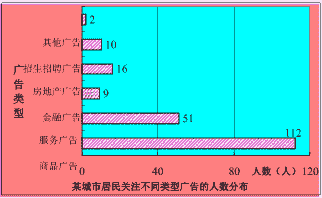

### 定类数据的显示——柱形图（略）

### 定类数据的显示——对比柱形图

- 分类变量在不同时间或不同空间上有多个取值
- 对比分类变量的取值在不同时间或不同空间上的差异或变化趋势

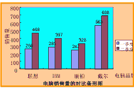

### 定类数据的显示——Pareto图

按各类别数据出现的频数多少排序后绘制的柱形图

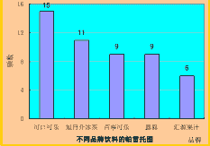

### 定类数据的显示——圆形图

- 也称饼图，是用圆形及圆内扇形的面积来表示数值大小的图形
- 主要用于表示总体中各组成部分所占的比例，对于研究结构性问题十分有用
- 在绘制圆形图时，总体中各部分所占的百分比用圆内的各个扇形面积表示，这些扇形的中心角度，是按各部分百分比占360°的相应比例确定的
- 例如，关注服务广告的人数占总人数的百分比为25.5%，那么其扇形的中心角度就应为360°×25.5%=91.8°，其余类推。

## 定序数据的整理与显示

- 主要指标：
  - 累计频数：对各类别的频数逐级累加
  - 累计频率：将各类别的频率自下而上逐级累加

例如，在某城市住房调查中，调查人员对居民住房满意度进行了调查，分别调查了300户，其中一个问题是：“你对家庭住房是否满意？”，其答案在居民中是如何分布的？
1. 非常不满意；2. 不满意；3. 一般；4. 满意；5. 非常满意。

| 满意程度 | 户数 | 频率(%) | 户数 | 频率(%) | 累计频数 | 累计频率(%) |
|---|---|---|---|---|---|---|
| 非常不满意 | 24 | 8 | 23 | 8.0 | 300 | 100.0 |
| 不满意 | 108 | 36 | 125 | 41.7 | 276 | 92 |
| 一般 | 90 | 30 | 75 | 25.0 | 168 | 56 |
| 满意 | 45 | 15 | 59 | 19.7 | 78 | 26 |
| 非常满意 | 33 | 11 | 18 | 6.0 | 33 | 11 |
| 合计 | 300 | 100.0 | 300 | 100.0 | - | - |

### 定序数据的显示——累计频数分布图

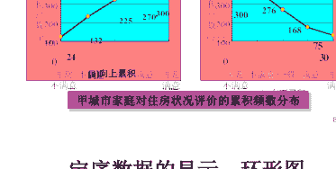

甲城市家庭对住房状况评价的累计频数分布

### 定序数据的显示——环形图

- 环形图中间有一个“空洞”，总体中的每一部分数据用环中的一段表示
- 环形图与圆形图类似，但又有区别
  - 圆形图只能显示一个总体各部分所占的比例
  - 环形图则可以同时绘制多个总体的数据系列，每一个总体的数据系列为一个环
- 环形图可用于进行比较研究
- 环形图可用于展示定类和定序的数据

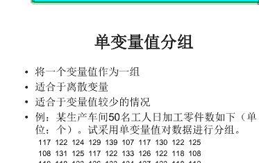

## 数值型数据的整理与显示

- 按照研究需要，将原始数据按照某种标准划分成不同的组别，称为数据分组
- 数据分组的方法：
  - 单变量值分组：将每一个变量值作为一组
  - 组距分组：将全部变量值依次划分为若干区间，并将这一区间的变量值作为一组

### 单变量值分组

- 将一个变量值作为一组
- 适合于离散变量
- 适合于变量值较少的情况
- 例：某生产车间50名工人日加工零件数如下（单位：个）。试对数据进行分组。

117 122 124 129 107 139 117 130 122 125
108 131 125 117 122 133 126 122 118 108
110 118 123 126 133 134 127 123 118 112
112 134 127 123 119 113 120 123 127 135
137 114 120 128 124 115 139 128 124 121

某车间50名工人日加工零件数分组表

| 零件数(个) | 频数(人) | 零件数(个) | 频数(人) | 零件数(个) | 频数(人) |
|---|---:|---:|---:|---:|---:|
| 107 | 1 | 119 | 1 | 128 | 2 |
| 108 | 2 | 120 | 2 | 129 | 1 |
| 110 | 1 | 121 | 1 | 130 | 1 |
| 112 | 2 | 122 | 4 | 131 | 1 |
| 113 | 1 | 123 | 4 | 133 | 2 |
| 114 | 1 | 124 | 3 | 134 | 2 |
| 115 | 1 | 125 | 2 | 135 | 1 |
| 117 | 3 | 126 | 2 | 137 | 1 |
| 118 | 3 | 127 | 3 | 139 | 2 |

### 组距分组

- 组距分组方法分为：
  - 等距分组
  - 异距分组
- 特点：
  - 将变量值的一个区间作为一组
  - 适合于连续变量
  - 适合于变量值较多的情况
  - 必须遵循“不重不漏”的原则
  - 可采用等距分组，也可采用不等距分组

#### 组距分组的步骤

1. 确定组数：组数的确定可以根据数据的分布特点和规律来确定。在实际分组时，可以按 Sturges 提出的经验公式来确定组数：

$$K=1+\frac{\lg(n)}{\lg(2)}$$

2. 确定各组的组距：组距（Class Width）是一个组的上限与下限之差，可根据全部数据的最大值和最小值及所分的组数来确定，即

**组距 =（最大值－最小值）÷ 组数**

3. 根据分组整理成频数分布表

#### 组距分组的几个概念

- 下限：一个组的最小值
- 上限：一个组的最大值
- 组距：上限与下限之差
- 组中值：下限与上限之间的中点

$$\text{组中值}=\frac{\text{下限值}+\text{上限值}}{2}$$

#### 等距分组表（上下组限重叠）

某车间50名工人日加工零件数分组表

| 按零件数分组 | 频数（人） | 频率（%） |
|---|---:|---:|
| 105~110 | 3 | 6 |
| 110~115 | 5 | 10 |
| 115~120 | 8 | 16 |
| 120~125 | 14 | 28 |
| 125~130 | 10 | 20 |
| 130~135 | 6 | 12 |
| 135~140 | 4 | 8 |
| 合计 | 50 | 100 |

#### 等距分组表（上下组限间断）

某车间50名工人日加工零件数分组表

| 按零件数分组 | 频数（人） | 频率（%） |
|---|---:|---:|
| 105~109 | 3 | 6 |
| 110~114 | 5 | 10 |
| 115~119 | 8 | 16 |
| 120~124 | 14 | 28 |
| 125~129 | 10 | 20 |
| 130~134 | 6 | 12 |
| 135~139 | 4 | 8 |
| 合计 | 50 | 100 |

#### 等距分组表（使用开口组）

某车间50名工人日加工零件数分组表

| 按零件数分组 | 频数（人） | 频率（%） |
|---|---:|---:|
| 110以下 | 3 | 6 |
| 110~114 | 5 | 10 |
| 115~119 | 8 | 16 |
| 120~124 | 14 | 28 |
| 125~129 | 10 | 20 |
| 130~134 | 6 | 12 |
| 135以上 | 4 | 8 |
| 合计 | 50 | 100 |

#### 组距分组与异距分组

- **等距分组**
  - 由于各组组距相同，各组频数的分布不受组距大小的影响
  - 可直接根据绝对频数来观察频数分布的特征和规律
- **异距分组**
  - 各组频数的分布受组距大小不同的影响
  - 各组绝对频数的多少不能反映频数分布的实际状况
  - 需要用频数密度（频数密度=频数/组距）反映频数分布的实际状况

### 数值型数据的显示

- 分组数据的显示
- 原始数据的显示
- 时间序列数据的显示
- 多变量数据的显示

### 分组数据的显示——直方图

- 用矩形的宽度和高度来表示频数分布的图形，实际上是用矩形的“面积”来表示各组的频数分布
- 在直角坐标中，用横轴表示数据分组，纵轴表示频数或频率，各组与相应的频数就形成了一个矩形，即直方图（Histogram）
- 直方图下的总面积等于1


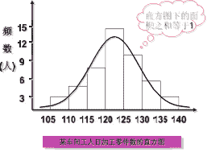

## 分组数据的显示——直方图

- 条形图是用条形的长度（横置时）表示各类别频数的多少，其宽度（表示类别）则是固定的
- 直方图是用面积表示各组频数的多少，矩形的高度表示每一组的频数或百分比，宽度则表示各组的组距，其高度与宽度均有意义
- 直方图的各矩形通常是连续排列，条形图则是分开排列

## 分组数据的显示——折线图

- 折线图也称频数多边形（Frequency polygon）
- 在直方图的基础上，把直方图顶部的中点（组中值）用直线连接起来，再把原来的直方图抹掉
- 折线图的两个终点要与横轴相交，具体的做法是：
  - 第一个矩形的顶部中点通过边缘中点（即该组频数一半的位置）连接到横轴，最后一个尖部即中点与其最近中点连接到横轴
  - 折线图下所围成的面积与直方图的面积相等，二者所表示的频数分布是一致的

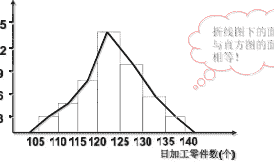

## 原始数据的显示——茎叶图

- 用于显示未分组的原始数据的分布
- 由“茎”和“叶”两部分构成，其图形是由数字组成的
- 以该组数据的高位数值作树茎，低位数字作树叶
- 对于 n(20≤n≤300)个数据，茎叶图最大行数不超过 L=⌈10×log n⌉
- 茎叶图类似于横置的直方图，但又有区别
- 直方图可大体上看出一组数据的分布状况，但没有给出具体的数值
- 茎叶图既能给出数据的分布状况，又能给出每一个原始数值，保留了原始数据的信息

| 树茎 | 树叶 | 数据个数 |
|---|---|---:|
| 10 | 768 | 3 |
| 11 | 023447778889 | 13 |
| 12 | 001222233344466777889 | 24 |
| 13 | 0133445799 | 10 |

## 原始数据的显示——箱线图

- 用于显示未分组的原始数据或分组数据的分布
- 箱线图由一组数据的5个特征值绘制而成，它由一个箱子和两条线段组成
- 其绘制方法是：
  - 首先找出一组数据的5个特征值，即最大值、最小值、中位数 Me 和两个四分位数（下四分位数 QL 和上四分位数 QU）
  - 连接两个四分位数画出箱子，再将两个极值点与箱子相连接

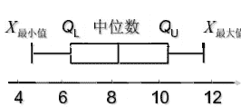

## 原始数据的显示—箱线图

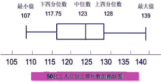

## 原始数据的显示—箱线图

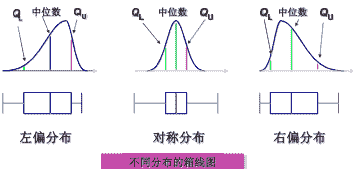

## 时间序列数据的显示—线图

- 线图是在平面坐标上用折线表现数据变化特征的图形
- 时间一般绘在横轴，指标数据绘在纵轴

例：已知1991～1998年我国城乡居民家庭的人均收入数据如下表。

| 年份 | 城镇居民 | 农村居民 |
|---|---:|---:|
| 1991 | 1700.6 | 708.6 |
| 1992 | 2026.6 | 784.0 |
| 1993 | 2577.4 | 921.6 |
| 1994 | 3496.2 | 1221.0 |
| 1995 | 4283.0 | 1577.7 |
| 1996 | 4838.9 | 1926.1 |
| 1997 | 5160.3 | 2091.1 |
| 1998 | 5425.1 | 2162.0 |

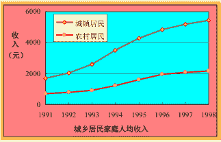

## 多变量数据的显示—雷达图

- 雷达图（Radar Chart）是显示多个变量的常用图示方法
- 在显示或对比各变量的数值总和时十分有用
- 假定各变量的取值具有相同的正负号，总的绝对值与圆形所围成的区域成正比
- 可用于研究多个样本之间的相似程度

设有n个样本S₁、S₂、…、Sₙ，每个样本测得P个变量X₁、X₂、…、Xₚ，要绘制这P个变量的雷达图，其具体做法是：

- 先做一个圆，将圆格等分，得到P个点，这P个点分别对应P个变量，在将这P个点与圆心连线，得到一个辐射状的半径。这P个半径分别作为P个变量的坐标轴，每个变量的大小由半径上的点到圆心的距离表示
- 再将同一样本的值在P个坐标上的点连线。这样，n个样本形成的n个多边形就是一个雷达图

- 例：1997年我国城乡居民家庭平均每人各项生活消费支出数据如下表。

| 项目 | 城镇居民 | 农村居民 |
|---|---:|---:|
| 食品 | 1942.59 | 890.28 |
| 衣着 | 520.91 | 109.41 |
| 家庭设备用品及服务 | 316.38 | 85.41 |
| 医疗保健 | 179.65 | 62.45 |
| 交通通讯 | 132.90 | 53.92 |
| 娱乐教育文化服务 | 448.38 | 148.18 |
| 居住 | 358.64 | 233.23 |
| 杂项商品与服务 | 185.65 | 34.72 |
| 合计 | 4185.64 | 1617.15 |

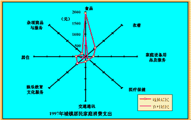

## 数据类型的图显示总结

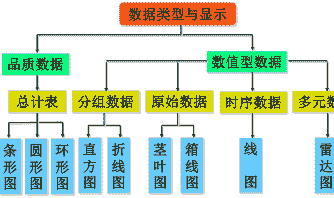

## 几种常见的频数分布类型

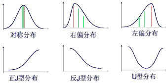

## 4 相似性和相异性的度量

### 1.相似性和相异性

- **相似性(Similarity)**
  - 描述两个对象相似程度的数值度量。
  - 如果两个对象越相似，则它们的相似度越高。
  - 在区间[0,1]之间取值。
- **相异性(Dissimilarity)**
  - 描述两个对象差异程度的数值度量。
  - 对象越相似，它们的相异度就越低。
  - 有时相异度在区间[0,1]之间取值，但是相异度在0和无穷大之间取值也很常见。
- **邻近性(Proximity)**是用来表示相似性和相异性的

### （1）简单属性的相似/相异度

- p and q are the attribute values for two data objects

| Attribute Type | Dissimilarity | Similarity |
|---|---|---|
| Nominal | d = 0 if p = q; d = 1 if p ≠ q | s = 1 if p = q; s = 0 if p ≠ q |
| Ordinal | 将值转换为整数，然后使用相异度和相似度公式 | s = 1 − d |
| Interval or Ratio | d = \|p − q\| | s = −d，或 s = 1 − d/dmax |

### （2）数据对象的相异度:欧氏距离

- 欧氏距离
  - d(x,y) = √[Σᵢ(xᵢ − yᵢ)²]
  - n是维数，而xᵢ和yᵢ分别是x和y的第k个属性（分量）

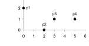

| point | x | y |
|---|---:|---:|
| p1 | 0 | 2 |
| p2 | 2 | 0 |
| p3 | 3 | 1 |
| p4 | 5 | 1 |

|  | p1 | p2 | p3 | p4 |
|---|---:|---:|---:|---:|
| p1 | 0 | 2.828 | 3.162 | 5.099 |
| p2 | 2.828 | 0 | 1.414 | 3.162 |
| p3 | 3.162 | 1.414 | 0 | 2 |
| p4 | 5.099 | 3.162 | 2 | 0 |

## 闵可夫斯基距离

- Minkowski距离是欧氏距离的推广
- d(x,y) = [Σᵢ|xᵢ − yᵢ|ʳ]¹⁄ʳ
- 其中r是参数
  - r = 1，城市街区距离（也称曼哈顿、出租车、L₁范数）距离。
  - r = 2，欧几里得距离。
  - r → ∞，上确界距离，这是对欧属性之间的最大距离，更正式地，最大距离由下列公式定义。
  - d(x,y) = limᵣ→∞ [Σᵢ|xᵢ − yᵢ|ʳ]¹⁄ʳ

## 距离的性质

- 距离，具有一些众所周知的性质
  1. 非负性：d(x, y) ≥ 0 for all x and y, and d(x, y) = 0 only if x = y。
  2. 对称性：d(x, y) = d(y, x) for all x and y。
  3. 三角不等式：d(x, z) ≤ d(x, y) + d(y, z) for all points x, y, and z。
- where d(x, y) is the distance (dissimilarity) between points (data objects), x and y。


## 非度量的相异度

### 数据对象之间的相似度

- 有些相异度并不满足一个或多个度量性质
  - 例1. 集合
    - 每个对象是一个集合
    - 相异度用集合元素的数目定义
    - d(A,B) = size(A-B)
      - 显然，若 A-B = B-A，则 size(A-B) = size(B-A)
    - 或定义 d(A,B) = size(A-B) + size(B-A)
  - 例2. 时间
    - d(t_i,t_j) = t_i - t_j，如果 t_i ≥ t_j
    - d(t_i,t_j) = 24 + (t_i - t_j)，如果 t_i < t_j

- 设 s(x,y) 是数据点 x 和 y 之间的相似度
  - 通常，0 ≤ s(x,y) ≤ 1
  - s(x,y) = 1，如果 x = y
- 三角不等式（或类似性质）通常不成立
- 通常，s(x,y) 具有如下性质
  - s(x,y) = 1（或最大相似度）仅当 x = y
  - 对所有 x 和 y，s(x,y) = s(y,x)（对称性）
- 有时可以将相似度变换成一种度量距离
  - 如，余弦相似度、Jaccard相似度

### （3）简单匹配系数 / Jaccard系数

### 简单匹配系数 / Jaccard系数：例

- 设 x 和 y 是两个对象，都由两个二进制属性组成
  - f00 = x 取 0 并且 y 取 0 的属性个数
  - f01 = x 取 0 并且 y 取 1 的属性个数
  - f10 = x 取 1 并且 y 取 0 的属性个数
  - f11 = x 取 1 并且 y 取 1 的属性个数
- 简单匹配系数（Simple Matching Coefficient, SMC）
  - SMC = 相同属性个数 / 全部属性 = (f11 + f00) / (f00 + f01 + f10 + f11)
- Jaccard系数（Jaccard Coefficient）
  - J = 匹配的个数 / 不涉及0-0匹配的属性个数 = f11 / (f01 + f10 + f11)

- 例：两个对象 x 和 y
  - x = (1, 0, 0, 0, 0, 0, 0, 0, 0, 0)
  - y = (0, 0, 0, 0, 0, 0, 1, 0, 0, 1)
  - f01 = 2：x 取 0 并且 y 取 1 的属性个数
  - f10 = 1：x 取 1 并且 y 取 0 的属性个数
  - f00 = 7：x 取 0 并且 y 取 0 的属性个数
  - f11 = 0：x 取 1 并且 y 取 1 的属性个数
  - SMC = (f11 + f00) / (f00 + f01 + f10 + f11) = (0 + 7) / (2 + 1 + 0 + 7) = 0.7
  - J = f11 / (f01 + f10 + f11) = 0 / (2 + 1 + 0) = 0

### （4）余弦相似度

### 余弦相似度：例

- 设 x 和 y 是两个向量，则
  - cos(x,y) = (x · y) / (||x|| ||y||)
  - “·”表示向量点积
  - x · y = Σ x_i y_i
  - ||x|| 是向量的长度
  - ||x|| = √(Σ x_i²) = √(x·x)
- 几何解释
  - cos(x,y) = (x·y) / (||x|| ||y||) = x' · y'
  - 其中，x' = x / ||x||，y' = y / ||y|| 是长度为 1 的向量


- 例：两个数据向量对象
  - x = (3, 2, 0, 5, 0, 0, 0, 2, 0, 0)
  - y = (1, 0, 0, 0, 0, 0, 0, 1, 0, 2)
  - x · y = 3×1 + 2×0 + 0×0 + 5×0 + 0×0 + 0×0 + 0×0 + 2×1 + 0×0 + 0×2 = 5
  - ||x|| = √(3×3 + 2×2 + 0×0 + 5×5 + 0×0 + 0×0 + 0×0 + 2×2 + 0×0 + 0×0) = 6.48
  - ||y|| = √(1×1 + 0×0 + 0×0 + 0×0 + 0×0 + 0×0 + 0×0 + 1×1 + 0×0 + 2×2) = 2.45
  - cos(x,y) = 5 / (6.48×2.45) = 0.31

### （5）广义Jaccard系数

- 广义Jaccard系数（Tanimoto系数）
  - 设 x 和 y 是两个向量，则
  - E_J(x,y) = (x·y) / (||x||² + ||y||² - x·y)

### 5. 相关性的度量

- 对象之间的相关性是对象属性之间线性联系的度量
- 设 x 和 y 是两个向量
  - 标准差
    - s_x = √[1/(n-1) Σ (x_i - x̄)²]
    - s_y = √[1/(n-1) Σ (y_i - ȳ)²]
  - 协方差
    - s_xy = 1/(n-1) Σ (x_i - x̄)(y_i - ȳ)
  - 皮尔森相关（Pearson's correlation）系数
    - corr(x,y) = s_xy / (s_x s_y)
    - -1 ≤ corr(x,y) ≤ 1，corr(x,y)=0，不相关
    - corr(x,y)=1（-1），正（负）相关

## 数据仓库与数据挖掘

### 第2章 数据预处理

### 数据挖掘

### 第2章讲义

### 数据预处理简介

### 一个例子

如果只给你一组数据，但不告诉你数据的含义……

```
012 232 33.5 0 10.7
020 121 16.9 2 210.1
027 165 24.0 0 427.6
...
```

每行包含一个人的信息，由5个字段组成。我们想使用前4个字段预测最后一个字段。

### 关于数据的一些事

本章将讨论与数据相关的问题。它们对于数据挖掘成功或失败至关重要。

### 2.1 什么是数据？

- 数据对象及其属性的集合
- 属性是对象的特定特征
- 例如：人的眼睛颜色、温度等
- 属性值也称为变量、字段、符号或要素
- 属性的集合描述对象
- 对象也称为记录、点、向量、样本、实体或实例

| # | 退款 | 婚姻状况 | 应税收入 | 欺诈 |
|---|---|---|---|---|
| 1 | 是 | 单身 | 125K | 否 |
| 2 | 否 | 已婚 | 100K | 否 |
| 3 | 否 | 单身 | 70K | 否 |
| 4 | 是 | 已婚 | 120K | 否 |
| 5 | 否 | 离异 | 95K | 是 |
| 6 | 否 | 已婚 | 60K | 否 |
| 7 | 是 | 单身 | 220K | 否 |
| 8 | 否 | 单身 | 85K | 是 |
| 9 | 否 | 已婚 | 75K | 否 |
| 10 | 否 | 单身 | 90K | 是 |

### 2.1.1 属性值

- 属性值是分配给属性的数字或符号
- 属性与属性值之间是有区别的
- 同一属性可以映射到不同的属性值
- 示例：高度可以用英尺或米为单位测量

### 测量标度

测量标度是将数值或符号值与对象的属性相关联的规则（函数）。

测量过程是使用测量标度将一个值（符号值或数值）与一个特定对象的特定属性相关联的过程。

### 属性的类型

### 属性值的性质

### 离散属性和连续属性

- **离散属性**
  - 只有有限或可数无限个值
  - 例如：邮政编码、计数或文档集合中的单词集
  - 通常表示为整数变量。
  - 注意：二元属性是离散属性的特例
- **连续属性**
  - 属性值为实数
  - 例如：温度、高度或重量。
  - 实际上，实数值只能用有限位数来测量和表示。
  - 连续属性通常表示为浮点变量。

### 2.1.2 数据集的类型

- **记录数据**
  - 数据矩阵
  - 文档数据
  - 事务数据
- **基于图形的数据**
  - 万维网
  - 分子结构
- **有序数据**
  - 空间数据
  - 时间数据
  - 序列数据
  - 遗传序列数据

### 2. 记录数据

数据集是记录（records，数据对象）的汇集，每个记录包含固定的数据项或属性集。记录数据通常放在平面文件或关系数据库中。数据挖掘一般不在关系数据库上直接进行。

### 非对称的属性

对于非对称的属性（asymmetric attribute），出现非零属性值才是最重要的。

例如：大学的选课记录数据集中，数据集的对象是每个学生，每个学生记录了学生是否选了某个课程。对于每个学生，如果选修了对应属性的课程，则对应属性取值为1，否则为0。由于学生只选修了可选课程的很小一部分，则这种数据集的大部分值都是0。因此，关注非零值将更有意义，更有效。如果在不选修的课程上比较，则大部分学生都是相似的。

### 1. 结构化数据的重要特征

- **维度**
  - 是数据集中对象具有的属性的数目
  - 低维度数据特征与中、高维度数据有质的不同
  - 维度诅咒（Curse of Dimensionality）使降维（dimensionality reduction）变得更加必要
- **稀疏性**
  - 对象具有非常稀疏的数值数据，一个对象大部分属性的值都为 0，如非零属性只有1%
  - 稀疏性对于存储和处理是非常有利的
- **分辨率**
  - 可以在不同的分辨率下得到数据，并且在不同分辨率下数据的性质也不同
  - 数据的模式依赖于分辨率，如果模式太小，模式可能看不出来，或者被噪声所掩盖；如果数据太粗糙，模式可能就不显现出来

### 数据矩阵

如果数据集中所有的数据对象具有相同的数值型属性集，则数据集可以看作多维空间中的点（向量），其中每维代表对象的同一个属性。数据对象集合可以用一个 m×n 的矩阵表示，一行一个对象，一列一个属性。可以使用标准的矩阵操作对数据进行处理。


## Document Data 文档数据

每个文档都成为一个“词项”向量：

- 每个词项是向量的一个分量（属性）。
- 每个分量的值是对应词项在文档中出现的次数。

|  |  |  |  |  |  |  |  |  |  |  |
|--|--|--|--|--|--|--|--|--|--|--|
| Document 1 | 3 | 0 | 5 | 8 | 2 | 6 | 0 | 2 | 0 | 2 |
| Document 2 | 0 | 7 | 0 | 2 | 1 | 0 | 3 | 0 | 0 |  |
| Document 3 | 6 | 1 | 0 | 0 | 1 | 2 | 0 | 3 | 0 | 8 |

## Transaction Data 事务数据

一种特殊类型的记录数据，其中：

- 每个记录 (transaction) 涉及一系列项 (items)。
- 例如，购物篮数据 (market basket data)，顾客一次购物所购物品的集合就构成一个事务，购买的商品是项 (item)。
- 记录数据具有非对称的属性，常也是二元的，指出商品是否已买，可以是离散的或连续的。

| TID | Items |
|---|---|
| 1 | Bread, Coke, Milk |
| 2 | Beer, Bread |
| 3 | Beer, Coke, Diaper, Milk |
| 4 | Beer, Bread, Diaper, Milk |
| 5 | Coke, Diaper, Milk |

## 3. Graph Data 基于图形的数据

Examples: Generic graph and HTML Links

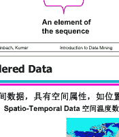

```
<a href="papers/html/666">Data Mining</a>
<a href="papers/html/aaa">Graph Partitioning</a>
<a href="papers/html/ttt">Parallel Solution of Sparse Linear System of Equations</a>
<a href="papers/html/fff">N-Body Computation and Dense Linear System Solvers</a>
```

## Chemical Data

Benzene Molecule 苯分子: C6H6

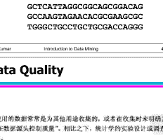

## 4. Ordered Data 有序数据

某些数据类别，属性之间没有时间或顺序的联系。
Sequences of transactions 时序数据，时间数据 (temporal data) Items/Events


### Ordered Data

数据集是各个实体的序列，除了没有时间戳之外，与时序数据类似，只有序列中项的位置被考虑。

- Genomic sequence data 基因组序列数据

```
GGTTCGCGCTCATGGCCGCGGCC
CGCAGGGCCCGCCCGCGCGCTC
GAGAAGGGCCCGCTCGCGCGCG
GGGGGAGGGCGCGCGCCCGAGAC
CCAACGAGTCGCCACGAGTGCC
CCCTCTGTCGCAGACTACCTGA
GCTCATTAGGCGGCGAGCAG
GCCAAGTAGAACCGCGAGACGC
TGGGCTGCCTCTGCGACCAGGG
```

### Ordered Data

空间数据，具有空间属性，如位置或区域

- Spatio-Temporal Data 空间温度数据 Jan
  Average Monthly Temperature of land and ocean


## 2.2 Data Quality

数据被收集用的数据常常为其相互追踪收集，或是在收集时未同时收集，因此，数据收集不完全。
“数据质量”是指数据收集、统计学的实际设计或潜在的各种数据收集过程。
由于无法重新收集数据，因此对数据质量问题的处理局限于两个方面：
（1）识别和纠正错误的数据，通常称作数据清理（data cleaning）。
（2）使用可以容忍数据错误的方法。

## 数据预处理的流程

- 数据清理
  - 填充缺失值，识别/去除离群点，光滑噪声，并纠正数据中的不一致
- 数据集成
  - 多个数据库，数据立方体，或文件集成
- 数据变换
  - 规范化和聚集
- 数据规约
  - 得到原表的约简表示，它小得多，但产生相同或类似的分析结果；维数缩减，数量归约，数据压缩
- 数据离散化和概念分层

## 数据预处理的流程

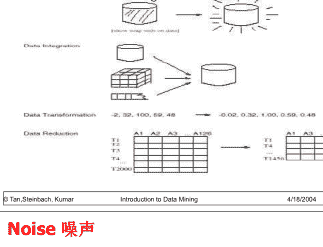

## Data Quality

What kinds of data quality problems?
How can we detect problems with the data?
What can we do about these problems?

Examples of data quality problems:

- Measurement error 测量误差
- Noise and outliers 噪声和离群点
- missing values 缺失值
- duplicate data 重复数据

## Noise 噪声

Noise refers to modification of original values

- Examples: distortion of a person's voice when talking on a poor phone and "snow" on television screen

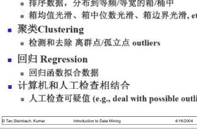

## Outliers 离群点

Outliers are data objects with characteristics that are considerably different than most of the other data objects in the data set

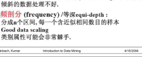

## 去噪技术

- 分箱 Binning method:
  - 排序数据，分布到等频的箱中
  - 箱均值光滑、箱中位数光滑、箱边界光滑，etc.
- 聚类 Clustering
  - 检测和去除离群点/孤立点 outliers
- 回归 Regression
  - 回归函数拟合数据
- 计算机和人工检查相结合
  - 人工检查可疑值 (e.g., deal with possible outliers)

## 分箱：简单的离散化方法

分箱：通过考察数据的近邻（即周围的值）来光滑有序数据的值。由于考察近邻的值，因此是一种局部光滑技术。

## Binning Methods for Data Smoothing

- Sorted data for price (in dollars): 4, 8, 9, 15, 21, 24, 25, 26, 28, 29, 34
- Partition into (equi-depth) bins:
  - Bin 1: 4, 8, 9, 15
  - Bin 2: 21, 24, 25
  - Bin 3: 26, 28, 29, 34
- Smoothing by bin means:
  - Bin 1: 9, 9, 9, 9
  - Bin 2: 23, 23, 23, 23
  - Bin 3: 29, 29, 29, 29
- Smoothing by bin boundaries:
  - Bin 1: 4, 4, 4, 15
  - Bin 2: 21, 21, 25, 25
  - Bin 3: 26, 26, 26, 34

## 聚类：clustering

通过聚类检测离群点，将类似的值组织成群或簇。直观地，落在簇集合之外的值视为离群点。

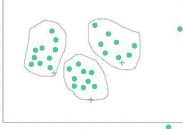

## 回归：Regression

用一个函数（如回归函数）拟合数据来光滑数据。分为线性回归和多元回归。

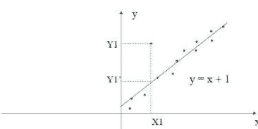

## Missing Values 缺失值

- **Reasons for missing values**
  - Information is not collected
    - (e.g., people decline to give their age and weight)
  - Attributes may not be applicable to all cases
    - (e.g., annual income is not applicable to children)
- **Handling missing values**
  - Eliminate Data Objects
  - Estimate Missing Values
  - Ignore the Missing Value During Analysis
  - Replace with all possible values (weighted by their probabilities)

## 如何处理缺失数据？

为属性填上丢失的值：

- 忽略元组
- 人工填写缺失值
- 使用一个全局常量填充缺失值
- 使用属性的均值填充缺失值
- 使用与给定元组属同一类的所有样本的属性均值
- 使用最可能的值填充缺失值

## 如何处理缺失数据？

- **忽略元组**
  - 当缺失类标号时，通常这样做（假定挖掘任务涉及分类）。除非元组有多个属性缺少值，否则该方法不是很有效；
- **人工填写缺失值**
  - 未免费时费力且不可行

## 如何处理缺失数据？

- **自动填充**
  - 使用一个全局常量填充缺失值
    - 将缺失的属性值用同一个常数，如 unknown, -∞, ∞。
    - 可能会形成一个新的 class，这个新 class 具有相同的填充常数值。
  - 使用属性的均值填充缺失值
    - 例如用平均薪水值填写某个缺失的 salary 属性值；
  - 使用与给定元组属同一类的所有样本的属性均值
    - 先给元组分类，用不同类别的均值填充缺失的本类属性值；
  - 使用最可能的值填充缺失值
    - 基于推理的方法，如 Bayes，回归，决策树等推理预测。

## Duplicate Data 重复数据

- Data set may include data objects that are duplicates, or almost duplicates of one another
  - Major issue when merging data from heterogeneous sources
- Examples:
  - Same person with multiple email addresses
- Data cleaning
  - Process of dealing with duplicate data issues

## 重复数据处理：模式集成

来自多个信息源的现实世界的等价实体如何匹配？

- 实体识别问题 Entity identification problem:
  - 数据库中的 customer_id 与数据库中的 cust_number 是相同的吗？
  - Bill Clinton = William Clinton?
- 集成不同来源的数据
  - 冲突数据值的检测和解决
    - 现实世界的实体，其不同来源的属性值可能不同
    - 原因：不同的表示、不同的尺度，如公制 vs 英制


## 冗余数据的处理

- 冗余数据（Redundant data）（集成多个数据库时出现）
- 对象识别：同一个属性在不同的数据库中有不同的名称
- 衍生数据：一个属性值可由其他属性推导得出，例如：年收入
- 将多个来源的数据集成可以帮助检测和避免数据集中的冗余和不一致，提高数据处理的准确度和质量

## 检测冗余数据：相关分析

- 相关分析（correlation analysis）/协方差分析（covariance analysis）
- 可用于检测冗余数据
- 相关系数（Correlation coefficient，也称皮尔逊积矩相关系数）
- 相关系数（皮尔逊相关系数）
  r_AB = Σ_i (a_i - Ā)(b_i - B̄) / ((n-1)σ_A σ_B)
  其中，Σ_i (a_i - Ā)(b_i - B̄) 是 A 和 B 的协方差，σ_A 和 σ_B 分别是标准差；Σ_i (a_i - Ā)(b_i - B̄) 是 AB 的交叉乘积（cross-product）。
- 如果 r_AB > 0，则 A 和 B 同向增加（A 的值随 B 的增加而增加）。值越大，相关程度越高。
- r_AB = 0：不相关；r_AB < 0：负相关

## 相关性的视觉评价

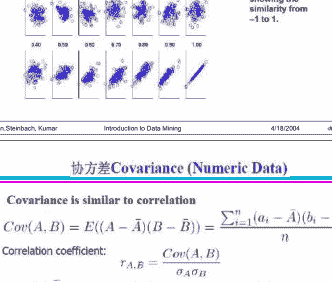

## 相关（线性关系）

- 相关度量的是对象之间的线性关系
- 为了计算相关性，我们对数据对象 A 和 B 进行标准化，然后求它们的点积
- a'_k = (a_k - mean(A)) / std(A)
- b'_k = (b_k - mean(B)) / std(B)
- correlation(A, B) = A' • B'

## 协方差（Covariance，数值数据）

- 协方差与相关性类似。
  Cov(A, B) = E[(A - Ā)(B - B̄)] = Σ_{i=1}^n (a_i - Ā)(b_i - B̄) / n
  相关系数：r_AB = Cov(A, B) / (σ_A σ_B)
  其中 Ā 和 B̄ 分别为 A 和 B 的均值，σ_A 和 σ_B 分别为各自标准差。
- 正协方差：如果 Cov_AB > 0，则 A 和 B 都大于其预期值。
- 负协方差：如果 Cov_AB < 0，则 A 增加时，B 更可能小于其预期值。
- 独立性：Cov_AB = 0，但反过来不一定成立：
  某些成对的随机变量可能协方差为 0，但并非独立。只有在一些额外假设下（例如数据服从多元正态分布），协方差为 0 才意味着独立。

## 协方差：一个例子

- Cov(A, B) = E[(A - Ā)(B - B̄)] = Σ_{i=1}^n (a_i - Ā)(b_i - B̄) / n
  计算上可简化为：
  Cov(A, B) = E[A·B] - Ā B̄
- 两只股票 A 和 B 一周内的价格如下 (2, 5), (3, 8), (5, 10), (4, 11), (6, 14)。
- 如果股票受同行或同趋势影响，它们的价值会一起上升或下降吗？
- E(A) = (2 + 3 + 5 + 4 + 6)/5 = 20/5 = 4
- E(B) = (5 + 8 + 10 + 11 + 14)/5 = 48/5 = 9.6
- Cov(A,B) = (2×5 + 3×8 + 5×10 + 4×11 + 6×14)/5 - 4 × 9.6 = 4
- 因此，由于 Cov(A, B) > 0，A 和 B 一起上升。

## 相关分析（名义数据，Nominal Data）

- χ²（卡方）检验用于检验
- σ_ij 是 (a_i, b_j) 的观察频度（实际计数）
- e_ij 是 (a_i, b_j) 的期望频度
- N 是数据元素的总个数
  χ² = Σ_i Σ_j (σ_ij - e_ij)² / e_ij
  e_ij = count(A = a_i) * count(B = b_j) / N
- χ² 值越大，相关的可能性越大
- χ² 值越小（越接近零），实际值与期望值差异越小
- 相关不意味着因果关系。

## 卡方（Chi-Square）值计算：示例

|  | 下棋 | 不下棋 | 行合计 |
|---|---|---|---|
| 看小说 | 250(90) | 200(360) | 450 |
| 不看小说 | 50(210) | 1000(840) | 1050 |
| 列合计 | 300 | 1200 | 1500 |

e_ij = count(行合计) × count(列合计) / N = 450 × 300 / 1500 = 90
χ²（卡方）计算中，括号内为每个格子的期望值，由每个实际值与期望值计算差异：
χ² = (250-90)²/90 + (50-210)²/210 + (200-360)²/360 + (1000-840)²/840 = 507.93
结论表明，“看小说”与“下棋”相关。

## 2.3 数据预处理（Data Preprocessing）

- 聚集（Aggregation）
- 抽样（Sampling）
- 维度约简（Dimensionality Reduction）
- 特征子集选择（Feature subset selection）
- 特征创建（Feature creation）
- 离散化和二元化（Discretization and Binarization）
- 变量变换（Attribute/variable Transformation）

### 2.3.1 聚集（Aggregation）

聚集将两个或多个对象合并成单个对象

- 目的
  - 数据约简
    - 减少属性或对象的数量
  - 改变尺度
    - 将城市聚集为地区、州、国家等
  - 数据更“稳定”
    - 聚集数据往往具有较小的变异性
- 缺点
  - 丢失有价值的信息

### 聚集

澳大利亚降水量的变化

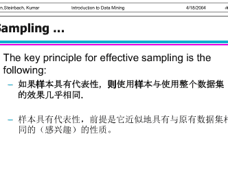

### 2.3.2 抽样（Sampling）

抽样是一种选择数据对象子集进行分析的常用方法。

统计学家进行抽样，是因为获取整个感兴趣的数据集过于昂贵或耗时。

数据挖掘中使用抽样，是因为处理整个感兴趣的数据集过于昂贵或耗时。

### 抽样 ...

有效抽样的关键原则如下：

- 如果样本具有代表性，则使用样本与使用整个数据集的效果几乎相同。
- 样本具有代表性的前提是它具有与原有数据集相同的（感兴趣）的性质。

### 1. 抽样类型

- 简单随机抽样（Simple Random Sampling）
  - 选取任何特定项的概率相同
- 无放回抽样（Sampling without replacement）
  - 每个项目被选中后，即从总体中移除。
- 有放回抽样（Sampling with replacement）
  - 对象被选入样本时不会从总体中移除。
    - 在有放回抽样中，同一对象可能被多次选中。
- 分层抽样（Stratified sampling）
  - 当总体由不同的对象组成，某些类型的对象稀缺或极其重要时，简单随机抽样就不能充分代表相关的类别。
  - 将数据分成若干层，然后从每一层中随机抽取样本。

### 样本量与信息损失


8000 个点
2000 个点
500 个点

### 样本量

需要多大的样本量才能从 10 个组中各至少获得一个对象？


维度归约可以删除不相关的特征，并降低噪声
避免维灾难
使得模型更加易于理解
更加可视化

## 2.3.3 维度归约
维度归约

### 维度归约

+   目的：
+   - 避免维度灾难
+   - 减少数据挖掘算法所需的时间和内存
+   - 使数据更容易可视化
+   - 可能有助于消除不相关的特征或减少噪声

+   技术
+   - 主成分分析（Principle Component Analysis）
+   - 奇异值分解（Singular Value Decomposition）
+   - 其他：有监督和非线性技术

## 1. 维度灾难

当数据维度的增加时，数据在所占据的空间中越来越稀疏：
- 对分布：则可能信息率没有足够的样本对象来验证某种模型。
- 对聚类：点之间距离和最近邻点（对聚类非常重要的）都将失去意义。

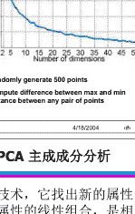

## 维度归约：主成分分析（PCA）

适用于连续属性的线性代数技术，它找出新的属性（主成分）这些属性是原属性的线性组合，是相互交的，并且捕获了数据的最大变异。


## 维度归约：PCA

+   - 找到协方差矩阵的特征向量
+   - 特征向量定义了新的空间


## 维度归约：ISOMAP

作者：Tenenbaum, de Silva, Langford（2000）


构建邻域图
对于图中每一对点，计算最短路径距离——测地距离

## 2.3.4 特征子集选择

另一种降低数据维度的方法

## 特征子集选择

+   技术：
+   - 蛮力法（Brute-force approach）
+     * 尝试所有可能的特征子集作为数据挖掘算法的输入
+   - 嵌入方法（Embedded approaches）
+     * 特征选择作为数据挖掘算法的一部分自然发生
+   - 过滤方法（Filter approaches）
+     * 在运行数据挖掘算法之前选择特征
+   - 包装方法（Wrapper approaches）
+     * 使用数据挖掘算法作为黑盒来寻找最佳属性子集

## 特征子集选择：特征加权

保留或删除特征的方法


图2-11 特征子集选择流程图

## 2.3.5 特征创建

创建新属性，使其能够比原始属性更高效地捕获数据集中的重要信息

+   三种通用方法：
+   - 特征提取（Feature Extraction）
+     - 领域特定
+   - 将数据映射到新的空间（Mapping Data to New Space）
+   - 特征构造（Feature Construction）
+     - 组合特征

## 将数据映射到新空间

+   - 傅里叶变换
+   - 小波变换


两个正弦波
两个正弦波 + 噪声
频率

## 使用类别标签的离散化

## 基于熵的方法


x 和 y 均为 3 个类别
x 和 y 均为 5 个类别

## 不使用类别标签的离散化


数据
等宽区间
等频
K-均值

## 变量变换

一个函数，将给定属性的整个值集映射为一组新的替代值，使得每个旧值可以对应一个新值

+   - 简单函数：x^k, log(x), e^x, |x|
+   - 标准化和归一化


## 2.3.6 离散化和概念分层

+   - 二类数据类型：
+     -  nominal — 来自无序集合的值，例如颜色、职业
+     -  ordinal — 来自有序集合的值，例如军衔或学术等级
+     -  numeric — 实数
+   - 离散化 Discretization: 把连续属性的区域分成区间
+     - 区间符号可以代表数值数据
+     - 利用数据减少数据量
+     - 不能丢失 vs. 无意义，是舍弃使用的信息
+     - 某些属性上可以进行离散化
+     - 分层 Split (top-down) vs. 合并merge (bottom up)
+       - 自底向上: 从一个小区间开始合并成更大的区间
+   - 连续离散化属性，产生属性值分层/多分辨划分，概念分层

## 1. 数值数据离散化/概念分层

+   - 分箱 Binning（自顶向下划分，无监督）
+     - 直方图（自顶向下划分，无监督）
+     - 聚类（无监督，自顶向下划分或自底向上合并）
+     - 基于χ²分析的区间合并（无监督，自底向上合并）
+     - 基于熵 Entropy-based discretization
+     - 根据自然划分

## 不使用类别（分箱与聚类）


## 基于熵的离散化

给定一个数值数据属性 A，其基于熵 A 离散化的方法如下：
1. A 的每个可能值可以为一个值所在的同一个区间
2. 选择划分的 T 使得其划分结果的信息熵最大
I(S,T)=|S1|/|S| Ent(S1)+|S2|/|S| Ent(S2)
其中，S1 和 S2 分别对应于中属性值 A < T 和 A ≥ T 的样本
Ent(S1)= -∑ pi log2(pi)
其中，pi 是类 i 在 S1 中的概率。
等价于 S1 中的样本总数为 S1 中样本总数。
3. 连续地进行上述操作 Ent(S) - (I(S,T)) > δ

## Chi-merge离散化

+   - Chi-merge：基于χ²的离散化
+   - 有监督：使用类别信息
+   - 初始向上：寻找最佳相邻区间（具有相似的类分布，即低χ²值）进行合并
+   - 递归合并，直到满足预定义的停止条件

## 示例

## 颜色的量化

一幅图像的颜色数量非常多，尤其是彩色图像，因此对方向的统计数据会非常多。假设对 HSV 颜色空间进行量化时，我们计算每个像素的 H 值和 S 值。在 HSV 空间中，H 从 0 到 360 变化时，颜色依次从红色到橙色到黄色到绿色到青色到蓝色到紫色，再回到红色。每一种颜色对应的 H 分量值域并不相同，因此需要对颜色的 H 分量进行量化。H、S、V 三个分量分别进行颜色的量化。等价于将 H、S、V 分别划分到不同的区间。7 等于 V 为 0 时，视其颜色为黑色，可以忽略 H 的取值。最后量化结果为：

## 颜色直方图

根据以上对颜色的量化，把 3 个颜色分量分成一个维度的直方图。
1- H: QV + SQ + V... 颜色直方图
定义直方图 H 为：
H = [h(d1), h(d2), ..., h(dk), ..., h
|dn| ∑... = 1.0 每个 dk 代表在图像中出现次数。
这样，颜色直方图可以用来描述图像的颜色分布。

```
伪代码片段：
While ...
Function ...
...
```

## 图像特征的离散化


## 向量的表示及基变换：内积和投影

- 两个维数相同的向量的内积被定义为：
- (a1,a2,...,an)^T·(b1,b2,...,bn)^T = a1b1 + a2b2 + ... + anbn
- 内积运算将两个向量映射为一个实数。

设A和B是两个n维向量，n维向量可以等价地表示为从原点出发的有向线段。 A = (x1,y1) B = (x2,y2)

## 基的数学含义

## 协方差矩阵及优化目标

## 协方差

## 基变换的矩阵表示

## 方差

## 协方差矩阵

## 协方差矩阵推广

设有m个n维的数据记录，将其列成m×n的矩阵X，设C = 1/m XXᵀ。

则C是一个协方差矩阵，其对角线分别是各自变量的方差，而第i行第j列则相同，表示两个变量的协方差。

1/m XXᵀ = ( 1/m Σxᵢ²   1/m Σaᵢbᵢ ; 1/m Σaᵢbᵢ   1/m Σbᵢ² )

- 1）实际的数据矩阵X通常不是在原点处，所以需要先做中心化处理。
- 2）协方差矩阵A是对称阵，实对称矩阵可以对角化为A = E Λ Eᵀ，其中E的列向量是标准正交。
- 3）...

E = (e₁ e₂ ... eₙ)

Eᵀ C E = Λ = ( λ₁ λ₂ ... ; ... λₙ )

P = Eᵀ

## 协方差矩阵对角化

- 目标：要求找到矩阵P使协方差矩阵对角化，即使新坐标轴相互正交且Σ=0，并且在对角线上将元素最大化。
- 设Y = P X, 则Y与X的协方差矩阵为D, 我们推导出Y与D的关系：

D = 1/m YYᵀ = 1/m (PX)(PX)ᵀ = 1/m PXXᵀPᵀ = P C Pᵀ

P是能让原始协方差矩阵对角化的矩阵。换句话说，优化目标变成了从一个k维子空间中挑选前K行，使投影后的数据满足优化条件。

## PCA算法

- 设有m条数据记录。
- 1）将原始数据整理成m×n矩阵X
- 2）对每一行（代表一个n维样本）进行均值化，即减去这一行的均值
- 3）求协方差矩阵 C = 1/m XXᵀ
- 4）求出协方差矩阵的特征值和特征向量
- 5）将特征值按对应特征值大小从上到下排列成矩阵，取前k行组成矩阵P
- 6）Y = P X 即为降维到k维后的数据

P = ( 1/√2 1/√2 ; -1/√2 1/√2 )


## 提升分类器 & AdaBoost

弱分类器 VS 强分类器

## 大纲

- 提升分类器的概述
- AdaBoost 算法
- AdaBoost 如何以及为何有效？
- AdaBoost 在人脸检测中的应用

## PAC学习模型

- PAC学习模型
  - 机器学习中，训练样本再大也不能代表某类事物本身，所以从训练样本中学习得到“规则”不能对某类事物完全适用，都有失效的情况出现，所以机器学习的目标是概率逼近正确学习！
  - 1984年Valiant提出PAC（Probably Approximately Correct）学习模型，文中提出强学习和弱学习两个概念。

## 强学习 VS 弱学习

强学习：令ε为充分大的N个数据点(x₁,y₁), …, (xN,yN)的样本集，其中xᵢ是按照某种固定但未知的分布D(x)随机独立抽取的，yᵢ=f(xᵢ)，f属于某个已知的函数类F。如果对于任意的D，任意的ε、δ，任意的h∈F，学习算法生成一个满足Pr[h(x)≠f(x)]≤ε的估计h的概率大于1−δ，并且学习算法的运行时间与1/ε、1/δ成多项式关系，那么称这种学习算法为强学习算法。

弱学习：其定义与强学习算法类似，只是弱学习算法中只需存在某对ε、δ满足上述条件即可。

Kearns和Valiant提出了弱学习算法与强学习算法间的等价问题，即是否能把弱学习算法转化为强学习算法？如果答案为是，那么只要找到一个比随机猜测好的弱学习算法就可以直接将其提升为强学习算法，而不必直接去找很难获得的强学习算法。在文献[4]中Kearns和Valiant证明只要有足够的数据，弱学习算法就能通过集成的方式生成低偏离度的估计。

## 弱学习 -> 强学习

- Valiant的贡献：Valiant指出弱学习转换为强学习的可行性。实际运用中，人们根据生产经验可以较为容易的找到弱学习方法，但是很少情况下要找到强学习方法是不容易的。有时候人们倾向于通过对弱学习进行组合的方式得到强学习方法，而Valiant证明了这种方式的可行性。

## 怎样实现弱学习转换为强学习

- 核心思想：通过组合使弱学习互补。
- 学习是不适定问题，在有限的样本上，不同的学习方法得到不同的“规则”，并在不同的情况下失效，没有一种学习算法总是在任何领域产生最好的分类效果。

#### 例子

学习算法A在a情况下失效，学习算法B在b情况下失效，那么在a情况下可以用B算法，在b情况下可以用A算法解决。这说明通过某种合适的方式把各种算法组合起来，可以提高准确率。

为实现弱学习互补，面临两个问题：
1. 怎样获得不同的弱分类器？
2. 怎样组合弱分类器？

## 怎样获得不同的弱分类器？

- 使用不同的弱学习算法得到不同基学习器参数估计、非参数估计……
- 使用相同的弱学习算法，但用不同的超参数：K-Mean不同的K，神经网络不同的隐含层……
- 相同输入对象的不同表示：不同的表示可以显现物体的特征
- 使用不同的训练集：装袋（bagging）、提升（boosting）

## 怎样组合弱分类器

- 多专家组合：一种并行结构，所有的弱分类器结合出各自的预测结果，通过“组合器”把这些预测结果转换为最终结果。eg. 投票（voting）及其变种、混合专家模型
- 多级组合：一种串行结构，其中下一个分类器只在前一个分类器预测不够优（不够自信）的实例上进行训练或检测。eg. 级联算法（cascading）

## 弱学习小结

- bagging在给定样本上随机抽取（有放回）训练子集，每个训练子集上用不稳定的学习算法训练分类器
- boosting在前一个弱分类器错分的实例在后续的弱分类器上得到更大权重
- 从训练子集的获取方式上看：bagging常靠“运气”，boosting有“依据”

## AdaBoost的先验知识

1990年，Schapire最先将弱学习算法通过一种多项式复杂度的算法提升为强学习算法，明显优于Boosting算法。这样带来的弱分类器可以逐步聚焦难以被正确分类的数据集。一年后，Freund提出了一种效率更高的Boosting算法。1993年，Drucker和Schapire等人以构造网络的方式为弱学习器建立多个分类器的ORC问题。由于Boosting算法最终能够构造出强分类器，因此AdaBoost算法在实际应用中表现良好。

## 原理

- AdaBoost的核心思想：“关注”被错分的样本，“聚重”性能好的弱分类器
- 怎么实现：
  1. 不同的训练集→调整样本权重
  2. “关注”→增加错分样本权重
  3. “聚重”→好的分类器权重大
  4. 样本权重间接影响分类器权重

## AdaBoost & Its Applications

## 提升分类器与其实践应用

## 概述

## 引言

## AdaBoost

自适应提升  
一种学习算法  
由大量较弱的分类器构建一个强分类器

## AdaBoost 概念


## 弱分类器

$h_1(x)\in\{-1,+1\}$  
$h_2(x)\in\{-1,+1\}$  
$\cdots$  
$h_T(x)\in\{-1,+1\}$

弱分类器

略优于随机

- 每个弱分类器通过考虑一个简单的特征来学习。
- 应选择对分类最有益的特征。
- 如何：
  - 定义特征？
  - 选择有益的特征？
  - 训练弱分类器？
  - 管理（加权）训练样本？
  - 为每个弱分类器关联权重？

## 强分类器

$h_1(x)\in\{-1,+1\}$  
$h_2(x)\in\{-1,+1\}$  
$\cdots$  
$h_T(x)\in\{-1,+1\}$

弱分类器

略优于随机

强分类器会有多好？

$H_T(x)=\operatorname{sign}\left[\sum_{t=1}^{T}\alpha_t h_t(x)\right]$

强分类器

## AdaBoost & Its Applications

The AdaBoost Algorithm

AdaBoost 算法

1995年Freund提出AdaBoost算法，1999年Schapire在一篇会议论文上对Freund的AdaBoost重新表述，基本原理不变但更易理解，下面以Schapire的版本介绍AdaBoost。

## The AdaBoost Algorithm

AdaBoost 算法

Given: $(x_1,y_1),\ldots,(x_m,y_m)$ where $x_i\in X,y_i\in\{-1,+1\}$

Initialization: $D_1(i)=1/m,\ i=1,\ldots,m$

For $t=1,\ldots,T$:

- Find classifier $h_t:X\rightarrow\{-1,+1\}$ which minimizes error with respect to $D_t$, i.e. $h_t=\arg\min_h\sum_iD_t(i)\mathbb{I}[h(x_i)\ne y_i]$.
- Weight classifier: $\alpha_t=\frac{1}{2}\ln\frac{1-\epsilon_t}{\epsilon_t}$
- Update distribution: $D_{t+1}(i)=\frac{D_t(i)\exp(-\alpha_t y_i h_t(x_i))}{Z_t}$, where $Z_t$ is for normalization.

Output final classifier: $\operatorname{sign}[\sum_{t=1}^{T}\alpha_t h_t(x)]$

Freund 等在 1995 年提出了 Discrete AdaBoost 算法，其具体算法如下：
1. 对于训练样本 $(x_i,y_i)$，初始化权重 $D_1(i)=1/m$。
2. 初始化弱分类器 $h_t(x)$。
3. 对于 $t=1,\ldots,T$：
   - 训练弱分类器 $h_t$，使其在当前权重分布下的分类误差最小。
   - 计算分类器权重 $\alpha_t=\frac{1}{2}\ln\frac{1-\epsilon_t}{\epsilon_t}$。
   - 更新样本权重 $D_{t+1}(i)=\frac{D_t(i)\exp(-\alpha_t y_i h_t(x_i))}{Z_t}$。
4. 最终得到分类器 $H(x)=\operatorname{sign}[\sum_{t=1}^{T}\alpha_t h_t(x)]$。

## Schapire AdaBoost Algorithm

Schapire AdaBoost 算法

```
Given: m examples $(x_1,y_1),\ldots,(x_m,y_m)$ where $x_i\in X,y_i\in\{-1,+1\}$
Initialize $D_1(i)=1/m$
For $t=1$ to $T$
  1. Train learner $h_t$ with error $\epsilon_t=\Pr_{x\sim D_t}[h_t(x)\ne y]$
  2. Compute the hypothesis weight $\alpha_t=\frac{1}{2}\ln\left(\frac{1-\epsilon_t}{\epsilon_t}\right)$
  3. For each example $(x_i,y_i)$:
     $D_{t+1}(i)=\frac{D_t(i)}{Z_t}\exp(-\alpha_t y_i h_t(x_i))$
Output: $H(x)=\operatorname{sign}\left(\sum_t\alpha_t h_t(x)\right)$
```

## The AdaBoost Algorithm

AdaBoost 算法

Given: $(x_1,y_1),\ldots,(x_m,y_m)$ where $x_i\in X,y_i\in\{-1,+1\}$

Initialization: $D_1(i)=1/m,\ i=1,\ldots,m$

For $t=1,\ldots,T$:

- Find classifier $h_t:X\rightarrow\{-1,+1\}$ which minimizes error with respect to $D_t$.
- Weight classifier: $\alpha_t=\frac{1}{2}\ln\frac{1-\epsilon_t}{\epsilon_t}$
- Update distribution: $D_{t+1}(i)=\frac{D_t(i)\exp(-\alpha_t y_i h_t(x_i))}{Z_t}$

Output final classifier: $\operatorname{sign}[\sum_{t=1}^{T}\alpha_t h_t(x)]$


## Boosting 插图

- 弱分类器 1
- 权重增加
- 弱分类器 2
- 权重增加
- 弱分类器 3
- 最终分类器是弱分类器的组合

## AdaBoost 及其应用

AdaBoost 如何以及为什么有效？AdaBoost 想要达到什么目标？

### AdaBoost 算法

给定 \(\{(x_i,y_i)\}_{i=1}^m\)，其中 \(x_i \in X\)，\(y_i \in \{-1,+1\}\)。

- 初始化：\(D_1(i)=1/m\)，\(i=1,\ldots,m\)。
- 对于 \(t=1,\ldots,T\)：
  - 寻找分类器 \(h_t: X \to \{-1,+1\}\) 使其相对于 \(D_t\) 的误差最小：
    \[
    h_t = \arg\min_h \sum_i D_t(i)[y_i \neq h(x_i)], \qquad \epsilon_t = \sum_i D_t(i)[y_i \neq h_t(x_i)].
    \]
  - 赋予分类器权重：\(\alpha_t = \frac{1}{2}\ln\frac{1-\epsilon_t}{\epsilon_t}\)。
  - 更新分布：
    \[
    D_{t+1}(i) = \frac{D_t(i)\exp(-\alpha_t y_i h_t(x_i))}{Z_t},
    \]
    其中 \(Z_t\) 用于归一化。
- 输出最终分类器：
  \[
  \operatorname{sign}(H(x)) = \operatorname{sign}\left(\sum_t \alpha_t h_t(x)\right).
  \]


### 目标

最终分类器：
\[
\operatorname{sign}(H(x)) = \operatorname{sign}\left(\sum_t \alpha_t h_t(x)\right).
\]

AdaBoost 最小化指数损失：
\[
\operatorname{loss}_{\exp}[H(x)] = \mathbb{E}_{x,y}[e^{-yH(x)}].
\]

等价地，它最大化间隔 \(yH(x)\)。

### 选择 \(\alpha_t\)

定义
\[
H_t(x) = H_{t-1}(x) + \alpha_t h_t(x), \qquad H_0(x)=0.
\]
则 \(H(x)=H_T(x)\)。

\[
\mathbb{E}_{x,y}[e^{-yH_T(x)}] = \mathbb{E}_x\left[\mathbb{E}_y[e^{-yH_{t-1}(x)-y\alpha_t h_t(x)} \mid x]\right].
\]

设
\[
\frac{\partial}{\partial\alpha_t}\mathbb{E}_{x,y}[e^{-yH_t(x)}]=0,
\]
故
\[
\mathbb{E}_x\left[e^{-H_{t-1}(x)}\left(-e^{-\alpha_t}P(y=h_t(x)) + e^{\alpha_t}P(y\neq h_t(x))\right)\right] = 0.
\]

因此
\[
\alpha_t = \frac{1}{2}\ln\frac{P(y=h_t(x))}{P(y\neq h_t(x))}
= \frac{1}{2}\ln\frac{1-\epsilon_t}{\epsilon_t},
\]
其中
\[
\epsilon_t = P(\text{error}) = \sum_i D_t(i)[y_i \neq h_t(x_i)].
\]

### 更新分布

分布更新与 \(D_{t+1}(i)=D_t(i)e^{-\alpha_t y_i h_t(x_i)}\) 成正比，归一化后：
\[
D_{t+1}(i) = \frac{D_t(i)e^{-\alpha_t y_i h_t(x_i)}}{Z_t},
\]
其中 \(Z_t\) 是归一化因子。

## AdaBoost 用于人脸检测

### 挑战

- 在图像上滑动窗口并在每个位置评估人脸模型。
- 滑动窗口检测器必须评估数万个位置/尺度组合。
- 人脸很少：每张图像 0–10 个。
  - 为了计算效率，我们应尽可能少地花费时间在非人脸窗口上。
  - 一张兆像素图像有 ~10^6 个像素和相当数量的候选人脸位置。
  - 为了避免每张图像都出现假阳性，我们的假阳性率必须小于 \(10^{-6}\)。

### Viola/Jones 人脸检测器

- 实时目标检测的开创性方法。
- 训练缓慢，但检测非常快。
- 关键思想：
  - 积分图像用于快速特征评估。
  - Boosting 用于特征选择。
  - 注意力级联用于快速拒绝非人脸窗口。


## 图像特征


矩形滤波器

特征值 = ∑(白色区域内的像素) − ∑(黑色区域内的像素)

## 图像特征


矩形滤波器

特征值 = ∑(白色区域内的像素) − ∑(黑色区域内的像素)

## 特征空间大小


矩形滤波器

- 对于 24×24 的检测区域，有多少种可能的矩形特征？
- A+B: 2, 3, 4, ...
- C: ...
- D: ...
- **160,000**

## 特征选择


- 对于 24×24 的检测区域，有多少种可能的矩形特征？
- A+B: ...
- C: ...
- D: ...
- **160,000**

哪些特征对人脸检测有帮助？

## 特征选择


- 对于 24×24 的检测区域，有多少种可能的矩形特征？
- A+B: ...
- C: ...
- D: ...
- **160,000**
- 我们能否仅使用所有可能特征中的一小部分来构建一个良好的分类器？
- 如何选择这样一个子集？

## 积分图像

- 积分图像在每个像素 (x, y) 计算一个值，该值是 (x, y) 左上方像素值的总和，包含自身。


## 计算积分图像

- 积分图像在每个像素 (x, y) 计算一个值，该值是 (x, y) 左上方像素值的总和，包含自身。
- 这可以通过一次遍历图像快速计算。


s(x,y) = s(x−1,y) + i(x,y)
ii(x,y) = ii(x−1,y) + s(x,y)

## 矩形内求和的计算


任何大小的矩形只需 3 次加法！

## 缩放

- 积分图像使我们能够以恒定时间评估所有矩形大小。
- 因此，无需对图像进行缩放。
- 改为缩放矩形特征！


## Boosting

- Boosting 是一种分类方案，通过将弱学习器组合成更精确的集成分类器来工作
  - 弱学习器只需比随机猜测做得好
- 训练由多个 boosting 轮次组成
  - 在每个 boosting 轮次中，我们选择一个在之前弱学习器难以处理的示例上表现良好的弱学习器
  - “难度”由附加到训练示例的权重来体现

> Y. Freund and R. Schapire. A short introduction to boosting. Journal of Japanese Society for Artificial Intelligence, 14(5):771-780, September, 1999.

## AdaBoost 算法

```
Given: (x1,y1),...,(xm,ym) where xi ∈ X, yi ∈ {-1,+1}
Initialization: D1(i)=1/m i=1,...,m   [D_t is the probability distribution of x_i at time t]
For t=1,...,T
• Find classifier ht: X→{-1,+1} which minimizes error w.r.t. D_t i.e.
ht = argmin_h where ε_t = Σ D_t(i)[h(x_i) ≠ y_i]   [minimize weighted error]
• Weight classifier: α_t = ½ ln[(1-ε_t)/ε_t]   [larger weight for smaller error]
• Update distribution: D_{t+1}(i)= D_t(i)exp(-α_t y_i h_t(x_i))/Z_t   Z_t is for normalization
Note: misclassified patterns raise their weight for training
```

## AdaBoost 算法

```
Given: (x1,y1),...,(xm,ym) where xi ∈ X, yi ∈ {-1,+1}
Initialization: D1(i)=1/m i=1,...,m
For t=1,...,T
• Find classifier ht: X→{-1,+1} which minimizes error w.r.t. D_t i.e.
ht = argmin_h where ε_t = Σ D_t(i)[h(x_i) ≠ y_i]
• Weight classifier: α_t = ½ ln[(1-ε_t)/ε_t]
• Update distribution: D_{t+1}(i)= D_t(i)exp(-α_t y_i h_t(x_i))/Z_t   Z_t is for normalization
Output final classifier: H(x) = sign( Σ α_t h_t(x) )
```

## 人脸检测的弱学习器

```
Given: (x1,y1),...,(xm,ym)
Initialization: D1(i)=1/m i=1,...,m
For t=1,...,T
• Find classifier ht: X→{-1,+1} which minimizes error w.r.t. D_t i.e.
ht = argmin_h where ε_t = Σ D_t(i)[h(x_i) ≠ y_i]
• Weight classifier: α_t = ½ ln[(1-ε_t)/ε_t]
• Update distribution: D_{t+1}(i)= D_t(i)exp(-α_t y_i h_t(x_i))/Z_t   Z_t is for normalization
Output final classifier: H(x) = sign( Σ α_t h_t(x) )
```

人脸检测合适的基学习器是什么？

## 人脸检测的弱学习器

```
h_t(x) = { 1 if p_t f_t(x) < p_t θ_t
           0 otherwise }
```

- 矩形特征的值
- 奇偶性
- 阈值
- 窗口

## Boosting

- 训练集包含人脸和非人脸示例
  - 初始时权重相等
- 对于每次 boosting 轮次：
  - 在每个示例上评估每个矩形滤波器
  - 为每个滤波器选择最佳阈值
  - 选择最佳滤波器/阈值组合
  - 重新加权示例
- 学习计算复杂度：O(M N K)
  - M 轮次，N 个示例，K 个特征

## Boosting 选择的特征

Boosting 选择的前两个特征：


该特征组合可实现 100% 检测率和 50% 误报率


## 200特征分类器的 ROC 曲线

一个200特征分类器可以获得95%的检测率和1/1408的误报率。


## 注意力级联

- 我们从简单的分类器开始，这些分类器可以拒绝大部分负子窗口，同时检测几乎所有正子窗口。
- 第一个分类器的正响应会触发第二个（更复杂）分类器的评估，以此类推。
- 任何阶段的负结果都会导致该子窗口被立即拒绝。


## 注意力级联

- 链式分类器，复杂度逐步增加，误报率更低


## 链式分类器的检测率和误报率


- 级联的检测率和误报率是通过将各个阶段的相应率相乘得到的。
- 如果每个阶段的检测率为0.99，误报率约为0.30，则10阶段级联可以实现0.99的检测率和数量级为10⁻⁶的误报率。


## 训练级联

- 为每个阶段设定目标检测率和误报率
- 不断向当前阶段添加特征，直到达到其目标率
    - 需要降低AdaBoost阈值以最大化检测率（而不是最小化总分类误差）
    - 在验证序列上进行测试
- 如果整体误报率不够低，则添加另一个阶段
- 将当前阶段的误报作为下一阶段的负训练样本

表2. 构建级联检测器的训练算法。

1. 用户选择最小可接受误报率和检测率的值。
2. 设置当前阶段的目标检测率。
3. 设置目标误报率。
4. 如果未达到目标误报率，则添加特征并重新训练。
5. 重复直到达到期望的级联性能。

## ROC 曲线 级联分类器与单体分类器


## ROC 曲线 级联分类器与单体分类器


- 两者在准确性方面几乎没有差异。
- 在速度方面差异很大。
    - 级联分类器快近10倍，因为其第一阶段排除了大部分非人脸，因此它们永远不会被后续阶段评估。

## 置信风险->结构风险

- 置信风险与两个量有关：
    - 一是样本数量，显然给定样本数量越大，我们的学习结果越有可能正确，此时置信风险越小。
    - 二是分类器的VC维，显然VC维越大，推广能力越强，置信风险会变大。
- 泛化误差界的公式：
    - R(w)≤Remp(w)+Φ(n/h)
    - 公式中R(w)就是真实风险，Remp(w)就是经验风险；
    - Φ(n/h)就是置信风险。
    - 统计学习的目标从经验风险最小化变为寻找经验风险与置信风险的和最小，即结构风险最小。

## SVM的特点：

- 基于最小化结构风险的算法：
    - 小样本：
        - 并不是说样本的绝对数量少（实际上，对任何算法来说，更多的样本几乎总是能带来更好的效果），而是指与问题的复杂度比起来，SVM算法要求的样本数是相对比较少的。
    - 非线性：
        - 是指SVM擅长应付样本数据线性不可分的情况，主要通过核变量（也有人叫变换变量）和核函数技术来实现，这一部分是SVM的精髓。

## SVM与文本分类

- 高维模式识别是指样本维数很高，例如文本的向量表示，如果没有经过降维处理，出现几万维的信息很正常，其它算法基本上就没能力应付了，SVM却可以，主要原因是为SVM产生的分类器很简洁，用到的样本信息很少（仅仅用到那些样本中支持向量样本，此为后话），使得它即使样本维数很高，也不会给存储和计算带来大麻烦（相对而言，kNN算法在分类时就要用到所有样本，样本数巨大，每个样本维数再一高，这日子就没法过了……）。

线性分类器（在文本分类上可以叫做线性感知机）是简单而有效的小样本学习器中一个很典型的例子，可以看作SVM的原型，并且根据更多SVM的核思想。

## PART 1: 线性分类器

### 1. 线性可分

- C1和C2是要区分的两个类别，在二维平面中它们的样本如上图所示。中间的直线就是一个分类函数，它可以将两类样本完全分开。
- 一般地，如果一个线性函数能够将样本完全正确的分开，就说该数据集是线性可分的，否则就称非线性可分。
- 中间的分类函数不是唯一的。


### 2. 线性函数和超平面

- 线性函数：在一维空间里就是一个点，在二维空间里就是一条直线，三维空间里就是一个平面，可以如此想象下去，如果不关注空间的维数，这种线性函数还有一个统一的名称——超平面（Hyper Plane）！
    - g(x)=wx+b: X为样本向量
    - 一个实值函数
    - 阈值
    - 离散型的输出结果

### 分类间隔：分类器的评价指标

### 几何间隔：样本点到超平面的距离


## 误分次数与几何间隔

- 误分次数：代表分类器的误差。误分次数的上界由几何间隔决定！
- 几何间隔越大时，它的误差上界越小。
- 因此最大化几何间隔成为了我们训练阶段的目标。

误分次数 ≤ (2R / δ)²

- δ是样本集到分类面的间隔；
- R=max{||x_i||} i=1...n,即R是所有样本中|x_i|是以原点为中心的样本不...而样本的分布有多么广

## 线性分类器的求解——问题的描述 Part2

- 一般地，一个求最小值的问题就是一个优化问题（也叫最小问题，或规划——Programming），它同样由两部分组成，目标函数和约束条件（函数C），可以用下面的式子表示：

min f(x)
subject to c_i(x) ≤ 0 i=1,2,...p
c_j(x)=0 j=p+1,p+2,...p+q

基于可行域的寻最优解

## 线性分类器的求解

## 更严格的SVM中的求解定义

## 最大化集合间隔：寻找最小的||w||

δ_{M} = 1/||w|| |g(x)|

min ||w||    min 1/2 ||w||²

min 1/2 ||w||²
subject to y_i(w·x_i)+b-1 ≥0 i=1,2,...D Q是样本数

基于可行域的寻最优解

## 支持向量

- 支持向量：可行域上的边界点
- 凸集：一个点的集合，其中任意两个点连一条直线，这条线上的点仍然在这个集合内部。
- 二次规划：能够找到最优解的规划
- 变量是w，而目标函数是w的二次式，所有的约束条件都是w的线性函数和这个是一个二次规划的例子。
- 由它的可行域是一个凸集，所以它是一个二次规划。

min 1/2 ||w||²
subject to y_i[(w·x_i)+b]-1 ≥0 i=1,2,...D Q是样本数

## 求解W

- 样本确定了w。用数学的语言描述，就是w可以表示为样本的某种组合：
- w=α₁x₁+α₂x₂+...+αₙxₙ
- α被称作拉格朗日乘子
- α_i x_i 表示系数和向量的乘积
- g(x)的表达式严格的形式应该是 g(x)=<w,x>+b

g(x)=<w,x>+b
≤ Σ_i (α_i y_i x_i),x>+b

- x是变量，即待分类的文档，而x_i是已知的样本。
- 注意到式子中只有w和x是向量，因此，得到g(x)的式子为：

g(x)= Σ_i α_i y_i <x_i,x> + b （式2）


## 核函数

- 线性分类器，只能对线性可分的样本做处理。
- 如果提供的样本线性不可分，结果很简单，线性分类器的求解程序会无限循环，永远也解不出来。
- 这使得它的适用范围大大缩小，而它的很多优点我们实在不愿意放弃，怎么办呢？
- 是否有某种方法，让线性不可分的数据变得线性可分呢？

## 一个线性不可分的例子

- 横轴上端点a和b之间红色部分里的所有点定为正类，两边的黑色部分里的点定为负类，试问能否找到一个线性函数把两类数据重新分开？
- 不能，因为二维空间里的线性函数就是指直线，显然找不到符合条件的直线。

## 核函数：升维后的线性可分

通过点在这条曲线的上方还是下方就可以判断点所属的类别，即一条二次曲线： g(x)=c0+c1x+c2x²

## 核函数：升维后的线性可分

解决线性不可分问题的根本思路——
- 向高维空间转化，使其变得线性可分。
- 找到映射到高维的方法

g(x)=<w,x>+b f(x)=<w,x> g(x)=f(y)=a y

## 核函数：升维后的线性可分

g(x)=c0+c1x+c2x² f(y)=<a,y> g(x)=f(y)=a y

- 一个文本分类的例子来看这种高维空间映射从而分类的方法：
- 文本与类别间的原始空间是1000维的（即你要分类的文档被表示为一个1000维的向量），在这1000维空间上线性是不可分的。现在我们有一个2000维空间的映射函数。
- 它能够把原向量变换得可以分。假设其中w是R2000维的向量，w是定值，而x是变量。
- 现在输入是一个1000维的向量x，分类的过程是先把x变换到2000维的向量，然后求这个变换后的向量与向量w的内积，再把这个内积的恒值b相加，就得到了结果，若结果大于阈值还是小于阈值就得到了分类结果。

我们其实关心那个高维空间里内积的值，那个值算出来——分类结果就算出来了

- 是否能有这样一种函数K(w,x),他接受低维空间的输入值，却能算出高维空间的内积值<w,x>? 
- g(x)=K(w,x)+b 
- 低维空间下将x输入到K核函数中，得得到与f(x)一样的值 f(x)=<w,x>+b

原始的经拉格朗日分解的线性分类器 f(x')=∑_{i=1}^{n} α_i y_i <x_i', x'> + b

利用核函数，求向量内积 g(x)=∑_{i=1}^{n} α_i y_i K(x_i, x) + b

## 核函数:核函数的基本作用就是接受两个低维空间里的向量，能够计算出经过某个变换后在高维空间里的向量内积值

## 两个问题：

- 1. 既然有很多的核函数，针对具体问题该怎么选择？
- 2. 如果使用核函数向高维空间映射后，问题仍然是线性不可分的，那怎么办？

## 近似线性可分问题


想象我们有另一个训练集，只比原先这个训练集多了一篇文章，同时到高维空间以后（当然，也使用了相同的核函数）也就多了一个样本点，但是这个样本点的位置是这样的：图中黄色那个点，它是力方的，因此它是实类的一个样本，这单独的一个样本，使得原本线性可分的问题变成了线性不可分的。这样类似的问题（仅有少数点线性不可分）叫做“近似线性可分”的问题。

## 松弛变量-增加计算机的容噪方法


$y_i(w^Tx_i+b)\ge 1-\xi_i\ (i=1,2,\ldots,l)$（是样本数）

$\xi_i\ge 0$

$\min \frac{1}{2}\|w\|^2+C\sum\xi_i$

subject to $y_i(w^Tx_i+b)\ge 1-\xi_i\ (i=1,2,\ldots,l)$（是样本数）

## 关于松弛变量（1）

- 并非所有的样本点都有一个松弛变量与其对应。
- 实际上只有“离群点”才有，所有没有离群点的松弛变量都等于0。
- 松弛变量的值实际上标示出了对应的点到底离群有多远，值越大，点就越远。
- 惩罚因子C决定了你有多重视离群带来的损失，显然当所有离群点的松弛变量的和一定时，你定的C越大，对目标函数的损失也越大，此时就意味着你非常不愿意放弃这些离群点，最极端的情况是你把C定为无限大，这样只要有一个点离群，目标函数的值马上变成无穷大，马上让问题变成无解，这就是代价了很高啊。

## 关于松弛变量（2）

- 惩罚因子C不是一个变量，整个优化问题在解的时候，C是一个你必须事先指定的值；
- 指定这个值以后，得到一个分类器，然后用测试数据看看结果怎么样，如果不够好，换一个C的值，再解一次优化问题，得到另一个分类器，再看看效果，如此就是一个参数寻优的过程；
- 与这优化问题本身决不是一回事，优化问题在解的过程中，C一直是定值，要记住。

## 关于松弛变量（3）

- 惩罚因子C不是一个变量，整个优化问题在解的时候，C是一个你必须事先指定的值；
- 指定这个值以后，得到一个分类器，然后用测试数据看看结果怎么样，如果不够好，换一个C的值，再解一次优化问题，得到另一个分类器，再看看效果，如此就是一个参数寻优的过程；
- 与这优化问题本身决不是一回事，优化问题在解的过程中，C一直是定值，要记住。

## 松弛变量的经验之谈

- 优化问题求解的过程：
- 就是先试着确定一下w，也就是确定了前面图中的三条直线，这时看着间隔有多大，又有多少点离群，把目标函数的值算一算，再换一组三条直线。
- 分类的直线位置如果移动了，有些原来离群的点会变得不再离群，而有的本来不离群的点会变成离群点，再把目标函数的值算一算，如此重复（迭代），直到最终找到目标函数最小的w。

## 核函数和松弛变量

- 两者都是解决线性不可分的方法。
- 先用核函数：在原始的低维空间中，样本相当的不可分，无论你怎么找分类平面，总会有大量的离群点，此时用核函数变换向高维空间映射一下，虽然结果仍然是不可分的，但比原始空间里的要更加接近线性可分的状态。
- 达到了近似线性可分的状态，此时再用松弛变量处理那些少数“离项不化”的离群点。

## 数据偏斜问题

方形的点是负类。H₁、H₂、H₃
是根据鸢的样本算出来的分类
面，由于负类的样本很少，
所以有一些本来是负类的样本
点没有提供，比较图中两个方
形的方形点。如果这里负类有
所提供的话，那算出来的分类面
应该是H₁、H₂和H₃，他们都是
和之前的结果有出入，实际上
负类给的样本越多，就越容易
把要有正类点附近的点，归入
负类出的分类面就越接近于负
类的分类面。但现在由于正类
的现象存在，使得离散的点
变成可以分类而分类器的分类
错误。白色那部分看起来很
模糊。


数据集偏斜（unbalanced），它指的是参与
分类的两个类别（也可以指多个类别）样本
数量差异很大


## 惩罚因子C

min 1/2 ||w||² + C Σ ξ_i
subject to y_i(w·x_i + b) ≥ 1 - ξ_i  (i=1,2,...,D) (Q是样本总数) (式1)
ξ_i ≥ 0

- C起到的作用：表示你有多么重视离群点，C越
大越重视，越不想丢弃它
- 没有任何模型能够很好地对所有的样本变量都使用
同一个惩罚因子，我们完全可以对每一个簇群
都使用不同的C，这时就意味着我们对每个样本
本的重视程度都不一样

## 数据偏斜的处理

- 数据集偏斜问题的解决方法之一：使用惩罚因子
- 给样本数量少的负类更大的惩罚因子，表示我们重视这部分样本
- 因此目标函数中因惩罚变量而损失的部分就变成了：
C_+ Σ_{i=1}^{p} ξ_i + C_- Σ_{j=p+1}^{p+q} ξ_j
ξ_i ≥ 0

## 如何确定C和C_

- 它们的大小是试出来的（参数调优），但是他们的比例可以有些方法来确定
  - 按照正负样本的数量比例确定
  - 按照正负样本的分布来确定
- 计算负类样本本在空间中占据了多大的体积，例如给负类样本一超球一就是高维里的球一它可以包含所有负类的样本，再给正类找一个，比比两个球的大小，就可以用大致判断分布情况。
- 虽然半径大的分布就比较广，就给它一点的惩罚因子

## SVM的后续

- 如何让二值的SVM完成多类分类任务？
- 如何使用SVM

## SVM用于多分类

- SVM是一种典型的两类分类器，即它只回答属于正类还是负类的问题。而现实中要解决的问题，往往是多类的问题
- 如何由两类分类器得到多类分类器，就是一个值得研究的问题。

多个超平面把空间划分为多个区域，每个区域划分为一个类，给出文本，若它落在某区域就知道它的类。

？只是这种方法就很难普及在现实上，因为一次性的算法计算量实在太大，大到无法使用地步。


## 方法

- 1 VS Rest
  - 分类重叠
  - 不可分类
- 1 VS 1
  - 分类器的数量：如果有k个类别，则总的两类分类器数目为k(k-1)/2
  - 有分类重叠现象，但不出现不可分类
  - 训练时间短，但测试时需要调用所有分类器

## DAG SVM

- 1 VS 1方式训练，按照下面方式组织分类器进行测试


## DAG SVM的优缺点？

- 调用分类器少：如果类别数是k，则只调用k-1个
- 没有分类重叠和不可分类
- 泛化误差限明确
- 存在错误向下累积现象


## SVM的计算复杂度

- 使用SVM进行分类的时候，实际上是训练和分类两个完全不同的过程，因而讨论复杂度就不能一概而论。我们这里所说的主要是训练阶段的复杂度，即解那个二次规划问题的复杂度。对这个问题的解，基本上要划分为两大块，解析解和数值解。

## 解析解

- 解析解就是理论上的解，它的形式是表达式，因此它是精确的。一个问题只要有解它的解析解一定是存在的。
- 当然存在是一回事，能够解出来，或者可以在可接受的时间范围内解出来，就是另一回事了。
- 对SVM来说，求得解析解的时间复杂度最高可以达到 $O(N_{sv}^3)$，其中 $N_{sv}$ 是支持向量的个数，而虽然没有固定的比例，但支持向量的个数多少也和训练集的大小有关。

## 数值解

- 数值解就是可以使用的解，是一个一个的数，往往都是近似解。
- 求数值解的过程非常像穷举法，从一个数开始，试一试它当解效果怎样，不满足一定条件（比如停止条件），就只能满足这个点就可以停止迭代了，不需要继续算下去；对该点不满足，当然下一个数不满足的，也有一定算法可循。
- 有的算法，每次只尝试一个数，有的就尝试多个，而且找下一个数字（或下一级数）的方法也各不相同，得出条件也各不相同，最终得到的解精度也各不相同。可见对求数值解的复杂度的讨论不能脱开具体的算法。

## 一个问题

- 一对一与一对其余哪个速度更快？

## 分类算法：贝叶斯学习

- 贝叶斯法则
- 贝叶斯法则和概念学习
- 朴素贝叶斯分类器
- 实例：文本分类

## 主要内容

## 概率学习系统的一般框架

## 贝叶斯法则

- 基本术语
  - D：训练数据集
  - H：假设空间
  - h：假设
  - P(h)：假设的先验概率(Prior Probability)
  - 即没有训练数据前提下假设h拥有的初始概率
  - P(D)：训练数据集的先验概率
  - 即没有假设某一致成立时假设D的概率
  - P(D|h)：似然度，在假设h成立的情况下，观察到D的概率
  - P(h|D)：后验概率，给定训练数据D时h成立的概率

## 贝叶斯法则

- 贝叶斯推理提供了推理的一种概率手段
- 两个基本假设
  - a) 考虑假设的先验概率分布
  - b) 可根据这些假设及已观察到的数据进行推理，或作出最终的决策
- 贝叶斯推理对机器学习十分重要
  - 它为衡量多个假设的相对优劣提供了定量的方式
  - 直接操作假设的先验概率提供了基础
  - 为其他算法的分析提供了理论框架

## 贝叶斯法则

机器学习的任务：在给定训练数据D时，确定假设空间H中的最佳假设

最大似然：在给定数据D以及其中不同假设的先验概率均可知情况下的最优假设

贝叶斯法则提供了另一种基于假设的先验概率、以及观察到的数据本身计算其后验概率的方法

## 贝叶斯法则

贝叶斯定理 P(h|D) = P(D|h) P(h) / P(D)

- 后验概率正比于P(h)和P(D|h)
- 反比于P(D)
- D越支持h出现的可能性越大，则D对h的支持越小

## 贝叶斯法则

极大似然假设 (Maximum Likelihood, ML) 当样本中的假设具有相同的先验概率时，给定h，似P(D|h)最大的假设h_ML：

## 贝叶斯法则

- 贝叶斯公式 P(h|D) = P(D|h)P(h)/P(D)
- 极大后验(maximum a posteriori, MAP) 假设
  给定数据D可能最大似然的假设h∈H
  计算公式 h_MAP = argmax_{h∈H} P(h|D) = argmax_{h∈H} P(D|h)P(h)/P(D) = argmax_{h∈H} P(D|h)P(h)
- 极大似然(maximum likelihood, ML) 假设
  依据P(D|h) (给定特定数据D的似然) 最大的假设
  计算公式 h_ML = argmax_{h} P(D|h)

## 贝叶斯法则

- 举例：一个天气估计问题
  - 两个假设H: h1={晴天}, h2={非晴天}
  - 可观察到的数数据：温度高+和温度低-
  - 先验知识p(h)
    - 北京晴天的概率: 0.99, P(h1)=0.99
    - 非晴天: 0.01, P(h2)=0.01
  - 观察到的概率P(D|h):
    - P(温度高 | 晴天) = 0.85
    - P(温度低 | 非晴天) = 0.93
  - 问题：现在观察到温度低，判断是否非晴天？

## 贝叶斯法则

- 极大后验计算
  - P(非晴天 | 温度低) ∝ P(温度低|非晴天)*P(非晴天) = 0.93*0.01 = 0.0093
  - P(晴天 | 温度低) ∝ P(温度低|晴天)*P(温度高) = 0.15*0.99 = 0.1485
  - 答案：晴天

## 贝叶斯法则

- 极大似然计算
  - P(非晴天 | 温度低) ∝ P(温度低|非晴天) = 0.93
  - P(晴天 | 温度低) ∝ P(温度低|晴天) = 0.15
  - 答案：非晴天

## 贝叶斯法则

- 另一个例子：医疗诊断问题
  - 两个假设H: h1={病人有癌症} h2={病人无癌症}
  - 可观察数据为化验结果：⊕(正)和⊖(负)
  - 先验知识: P(cancer)=0.008
  - 现象数据: P(⊕|cancer)=0.98 P(⊖|-cancer)=0.97
  - 问题: 新来的病人的检查结果为⊕, 应如何诊断？

## 贝叶斯法则—示例

已知假设, 病人有癌症, 病人无癌症 P(cancer)=0.008 P(-cancer)=0.992 P(⊕|cancer)=0.98 P(⊕|-cancer)=0.02 P(⊖|cancer)=0.02 P(⊖|-cancer)=0.97 假设有一病人, 化验结果为⊕, 该病人有癌症吗？ P(⊕|cancer)P(cancer)=(0.98)(0.008)=0.00784 h_MAP = argmax P(D|h)P(h)/P(D) P(⊕|-cancer)P(-cancer)=(0.02)(0.992)=0.01984 因此, h_MAP = -cancer 注: (1)贝叶斯推理的结论很大程度上依赖于先验概率; (2)并没有完全地接受检测结果的确定性, 而只是在观察到较多的证据后使得可能性增大或减小了。

## 基本概率公式表

- 乘法规则: P(A∧B)=P(A|B)P(B)=P(B|A)P(A)
- 加法规则: P(A∨B)=P(A)+P(B)-P(A∧B)
- 贝叶斯法则: P(h|D)=P(D|h)P(h)/P(D)
- 全概率法则: 如果事件A1...An互斥, 且满足 ΣP(Ai)=1, 则 P(B)=ΣP(B|A_i)P(A_i)

## 主要内容

- 贝叶斯法则
- 贝叶斯法则和概念学习
- 朴素贝叶斯分类器
- 实例: 文本分类


## 贝叶斯法则和概念学习

- ➢ 贝叶斯法则为计算给定训练数据下任一假设的后验概率提供了原则性方法
- ➢ 概念学习问题
  - • 定义在实例空间X上的有限的假设空间H，任务是学习某个目标概念 c:X→{0,1}
- ➢ Brute-Force MAP学习算法
  - • 对于H中每个假设 h，计算后验概率
  - • 选出具有最高后验概率的假设
  - • Brute-Force算法需要计算每个假设的后验概率，计算复杂度较高

$P(h|D)=\frac{P(D|h)P(h)}{P(D)}$

$h_{MAP}=\arg\max P(h|D)$

- ➢ 假定
  - • 训练数据是无噪声的，即$d_i=c(x_i)$
  - • 目标概念包含在假设空间H中
  - • 每个假设的概率相同
- ➢ 从而
  - • 由于所有假设的概率之和是1，因此$P(h)=1/|H|$
  - • 由于训练数据无噪声，那么给定假设时，与h一致的D的概率为1，不一致的概率为0，因此$P(D|h)=\begin{cases}1,&\forall d_i,h(x_i)\\0,&otherwise\end{cases}$

## MAP假设和一致学习器

- ➢ 考虑Brute-Force MAP算法
  - • h与D不一致
  - • h与D一致
  - • 每个一致的假设都是MAP假设

$P(h|D)=\frac{0\cdot P(h)}{P(D)}=0$

$P(h|D)=\frac{1\cdot\frac{1}{|H|}}{P(D)}=\frac{1}{|H|P(D)}$

## MAP假设和一致学习器

- ➢ P(D)的计算
  $P(D)=\sum_{h\in H}P(D|h)P(h)$

$=\sum_{h\in H}\frac{1}{|H|}+\sum_{h\notin H}0\times\frac{1}{|H|}$

$=\frac{1}{|H|}\times\frac{|V_{S,D}|}{|H|}$

因此，$P(h|D)=\frac{1/|H|}{P(D)}=\frac{1}{|V_{S,D}|}$

## MAP假设和一致学习器

## 假设的概率演化情况

- ● 初始时所有假设具有相同的概率
- ● 当训练数据逐步出现后，不一致假设的概率变为0，而整个概率的和为1，它们均匀分布到剩余的一致假设中


## MAP假设和一致学习器

- ➢ 一致学习器
  - • 如果某个学习器输出的假设在训练样例上为0错误率，则称为一致学习器
- ➢ 枚举出所有的无噪声，即训练数据是确定性和无噪声的，任意一致学习器将输出一个MAP假设
- ➢ Find-S算法搜索得到一组的顺序较复杂假设空间，并输出一个较大特殊的、最被假设，因此可知在上面定义的P(h)和P(h)概率分布下，它输出MAP假设
- ➢ 进一步地，对于先验概率偏好于更特殊假设的任何概率分布，Find-S输出的假设都不是MAP假设
- ➢ 因此，贝叶斯框架提出了一种新的学习算法（如Find-S算法）行为算法，即使该学习算法不进行概率操作

## MAP假设和一致学习器

- ➢ 贝叶斯学习的重要性
  - • 能够计算显式的假设概率，是解决相应学习问题的最有效方法之一
  - • 为需要基于样本选择任一有效的学习器，而这些算法不会一定直接操作概率数据
- ➢ 特点
  - • 观察到的每个训练样例可以增强或降低候选假设的可信程度
  - • 某些先验会在某个假设与任一样例不一致时完全去掉该假设
  - • 先验知识可以与观察数据一起决定假设的最终概率
  - • 贝叶斯方法可以评估做出的不确定性的预测
  - • 比如今天是晴天的概率为93%

## 小结

- ➢ 贝叶斯法则
- ➢ 贝叶斯法则和概念学习
- ➢ 朴素贝叶斯分类器
- ➢ 实例：文本分类

## 主要内容

## 贝叶斯最优分类器

- 前面我们讨论的问题是
- 给定训练数据，最可能假设是什么？
- 另一个相关的更有意义的问题是
- 给定训练数据，对新实例的最可能分类是什么？

## 贝叶斯最优分类器

- 贝叶斯最优分类器
- 如果新实例的可能取值集合V中任一v_j，那么概率P(v_j|D)可先验地分解为v_j的概率
- P(v_j|D)=∑_{h∈H}P(v_j|h)P(h|D)
- 新实例的最优分类为P(v_j|D)最大的v_j，为：
- arg max_{v_j∈V}∑_{h∈H}P(v_j|h)P(h|D)

## 贝叶斯最优分类器

- 例子
- 假设空间H：包含三个假设h1，h2，h3
- 给定数据D时，三个假设的后验概率分别是
- P(h1|D)=0.4，P(h2|D)=0.3，P(h3|D)=0.3
- 若新实例x被h1分类为正，被h2和h3分类为反
- 问题：给出x的分类？

## 贝叶斯最优分类器

- 例子
- 已知：
- 新实例的可能分类集合V={+,-}
- P(h1|+)=0.4，P(h1|-)=0，P(+|h1)=1
- P(h2|+)=0.3，P(h2|-)=1，P(+|h2)=0
- P(h3|+)=0.3，P(h3|-)=1，P(+|h3)=0
- 因此
- ∑_{h∈H+}P(h|D)=0.4   ∑_{h∈H-}P(h|D)=0.6
- arg max_{v_j∈V}∑_{h∈H}P(v_j|h)P(h|D)=--

## 贝叶斯最优分类器

贝叶斯最优分类器能从给定训练数据中获得最好的性能，但算法的开销很大

## 朴素贝叶斯分类器

- 学习任务
- 给定训练集合D={<x_i,y_i>}，其中每个实例x=<a1,...,an>，由属性值所描述，y_i∈V
- 学习一个分类函数f(x)
- 对给定的实例x=<a1,...,an>，得到最可能的自标值v_MAP
- v_MAP=arg max_{v_j}P(v_j|a1,...,an)

## 朴素贝叶斯分类器

## 朴素贝叶斯分类器

- 使用贝叶斯公式
- v_MAP=arg max_{v_j}P(a1,...,an|v_j)P(v_j)/P(a1,...,an)
- =arg max_{v_j}P(a1,...,an|v_j)P(v_j)
- 基于训练数据估计P(v)和P(x|v)
- 估计P(v_j)很容易
- 计算每个单独值v_j出现次数除以训练样本中的频率
- 估计P(a1,...,an|v_j)遇到困难
- 除非有一个非常大的训练集，否则无法获得可靠的估计

## 朴素贝叶斯分类器

## 朴素贝叶斯分类器

- 独立性假设
- 在给定目标值时，属性值之间相互条件独立，即
- P(a1,...,an|v_j)=∏_{i}P(ai|v_j)
- 最终的朴素贝叶斯分类器
- v_NB=arg max_{v_j∈V}P(v_j)∏_{i}P(ai|v_j)

## 朴素贝叶斯分类器

- - 从训练数据中估计不同P(a_i|v_j)项的数量比估计P(a_1,...,a_n|v_j)项所需的量少得多
- - 只要条件独立性假设满足，朴素贝叶斯分类器V_NB等于MAP分类器，否则近似
- - 朴素贝叶斯分类器与其他学习方法的区别
  - - 没有明确地假设数据是如何产生的
  - - 训练的和测试不可靠数据，只关注学习地估计训练样本到不同数据集合出现的频率

## 朴素贝叶斯分类器

- - 例子
- - 给定条件分类为：<Outlook=sunny, Temperature=cool, Humidity=high, Wind=strong>

| Day | Outlook | Temperature | Humidity | Wind | PlayTennis |
| D1 | Sunny | Hot | High | Weak | No |
| D2 | Sunny | Hot | High | Strong | No |
| D3 | Overcast | Hot | High | Weak | Yes |
| D4 | Rain | Mild | High | Weak | Yes |
| D5 | Rain | Cool | Normal | Weak | Yes |
| D6 | Rain | Cool | Normal | Strong | No |
| D7 | Overcast | Cool | Normal | Strong | Yes |
| D8 | Sunny | Mild | High | Weak | No |
| D9 | Sunny | Cool | Normal | Weak | Yes |
| D10 | Rain | Mild | Normal | Weak | Yes |
| D11 | Sunny | Mild | Normal | Strong | Yes |
| D12 | Overcast | Mild | High | Strong | Yes |
| D13 | Overcast | Hot | Normal | Weak | Yes |
| D14 | Rain | Mild | High | Strong | No |

## 朴素贝叶斯分类器

- - 朴素贝叶斯分类器
  v_NB = arg max v_j P(v_j) Π_i P(a_i|v_j)
  = arg max v_j P(v_j) P(Sunny|v_j) P(Wo... ) P(Strong|v_j)
- - 根据上式计算两类值的概率值
  - P(yes)=9/14=0.64
  - P(no)=5/14=0.36
  - P(strong|yes)=3/9=0.33
  - P(strong|no)=3/5=0.60
- - 求V_NB
  - P(yes)P(sunny|yes)P(cool|yes)P(high|yes)P(strong|yes)=0.0053
  - P(no)P(sunny|no)P(cool|no)P(high|no)P(strong|no)=0.0206
  - V_NB=no

## 朴素贝叶斯分类器

- - 估计概率
  - 最常见通过在全体训练样本上观察某事件出现的比例来估计
  - 当样本很小时，采用平滑法，m-估计
    (n_i + m p_i)/(n + m)
- - p是待求概率的先验估计
  - 在某些情况下，训练样本的一致性分类方法导致分类器，此处假设
  - p可以是1/|V|，其中|V|是类标记的数目
- - m是一个称之为等效样本大小的常量
  - 个别地，m可以被解释为假设训练样本中包含m个类的概率估计为p，加上上面
  个别训练样本的数目

## 朴素贝叶斯分类器

- - 贝叶斯法则
- - 贝叶斯法则和概念学习
- - 朴素贝叶斯分类器
- - 实例：文本分类

## 大纲

## 朴素贝叶斯分类器

- - 问题框架
  - 假设空间X包含了所有的文本文档
  - 给定未知目标值标记的(x_i, t(x_i))的一组训练样本D={(x_i, t(x_i))}
  - f(x)的未知目标值有保持V
  - 任务是学习训练样本中学习，预测后续文本的目标值
- - 应用实例
  - 垃圾邮件
  - 邮件查询的电子新闻稿
  - 许多机器学习方法网页

## 文本分类

## 文本分类

- - 设计朴素贝叶斯分类器的两个主要问题：
  - 支撑的表示
    - 怎样将任意文档表示为属性值形式
  - 概率的估计
    - 如何估计朴素贝叶斯分类器所需的概率

## 文本分类

- - 假设：
  - 我们共有1000个训练文档
    - 其中700个分类为dislike, 300个分类为like,
  - 现在要对下面的新文档进行分类：
    - This is an example document for the naive Bayes classifier. This document contains only one paragraph, or two sentences.


## 文本分类

- 文档的表示
- 每篇文档表示为，对每个类别的位值文档一个属性，该属性的值就是此属性在该文档上的取值
- 例如：以下文档
- 这是一个朴素贝叶斯分类器的示例文档。该文档仅包含一个段落，或两句话
- 可表示为
- 19个属性
- 每个属性的值
- a1=this, a2=is, a3=an, ...

## 文本分类

概率估计
v_naive = argmax_{v_j ∈ {like,dislike}} P(v_j) ∏_{i=1}^{n} P(a_i | v_j)
= argmax P(v_j) P(a_1="this" | v_j)...P(a_n="sentences" | v_j)

- 此处贝叶斯分类器隐含的独立性假设并不成立。通常某个位置上出现的某个单词与前后面位置上出现的单词是相关的
- 但是在实践中，朴素贝叶斯学习器在许多文本分类问题中性能非常好

## 文本分类

- 概率P(v_j)的估计
- P(v_i)的估计，P(dislike)=0.7，p(like)=0.3
- 概率P(a_i=w_k | v_j)的估计
- 后一变量三个参数
- 位置 i，单词 k，类别 j
- 需要估计的概率总数：2 * 19 * 50000 ≈ 2000000
- 引入新的假设以减少统计计算的变量数量
- 假设每个单词在文档中出现的概率与位置无关，即 P(a_i=w_k | v_j)=P(w_k | v_j)
- 新的变量估计的概率总数：2 * 50000 ≈ 100000

## 文本分类

- 概率项P(a_i=w_k | v_j)的估计
- 采用m-估计方法
- P(w_k | v_j) = (n_k + m p) / (n + m) = (n_k + 1) / (n + |Vocabulary|)
- n 是在类别 v_j 中出现的位值总数（或者说词频总数）
- n_k 是 w_k 出现的位置总数（或者说词频）
- m = |Vocabulary|
- p = 1 / |Vocabulary|

## 文本分类的朴素贝叶斯算法

Learn_naive_Bayes_text(Examples, V)
Examples 为训练文档集，V 为类别集合。学习算法的输出为每个类别的先验概率 P(v_j) 以及每个单词在每个类别中的条件概率 P(w_k | v_j)
1. 统计文档集合中每个类别的文档数，计算先验概率 P(v_j)
Vocabulary = 训练文档中所有单词的集合
2. 对每个类别 v_j，统计每个单词 w_k 在该类别文档中出现的次数 n_k 以及该类别文档中总词数 n
...

## 文本分类的朴素贝叶斯算法

Classify_naive_Bayes_test(Doc)
对文档 Doc 进行分类，假设 Doc 中包含 n 个单词。
position_i 在 Doc 中对应的位置，Vocabulary 中未出现的单词位置
... v_naive = argmax_{v_j} P(v_j) ∏ P(a_i | v_j)

## 实验结果

- Joachims将此算法用于新闻组文章的分类
- 每个新闻组的分类是该新闻组所属的新闻组名称
- 20个新闻组，每个新闻组有1000篇文档，共2万个文档
- 2/3作为训练样本，1/3进行测试测量
- 词汇表中包含最常用词（比如the, of）和罕见词（数据集中出现次数少于3）
- 结论
- 那么随机猜测的分类精度为5%。由程序获得的精度为89%

## 实验结果

- Lang提出其算法学习目标概念“感兴趣的新闻组”
- NewsWeeder系统，让用户阅读新闻组文章并对其评分，然后使用这些评分作为训练数据来预测用户感兴趣的文章
- 例如，采集后用户文章是否是用户感兴趣的
- 每天向用户显示前10%的自动评分文章，这样用户可以从列表中挑选出用户感兴趣的文章通过率3-4倍
- 例如：若一个用户对通常的文章有16%感兴趣，则对于NewsWeeder推荐的文章有59%感兴趣。

## 数据挖掘算法—聚类

- - 聚类概念
- - 聚类应用
- - 聚类目标
- - 相似性计算方法
- - 聚类方法分类
- - 划分方法
- - 层次方法
- - 密度方法
- - 网格方法
- - 聚类方法分析

## 数据挖掘算法—聚类

### 一、聚类：

- - 根据数据之间的相似性，对数据集进行分组或分类（簇 cluster）的过程，试图使类内距离最小化，类间距离最大化。
- - 利用分类结果，可以提取数据集中隐藏的信息，对未来数据进行预测和分类。应用于数据挖掘、模式识别、图像处理、经济学……

## 聚类分析原理

> “物以类聚，人以群分”


聚类分析应用于许多研究领域，包括数据挖掘、统计学、机器学习、模式识别等。作为一个数据挖掘中的一个功能，聚类分析作为一个独立的工具来获取数据分布的信息，并且能够指出每个簇的特点，或者来关注对特定类的某些数据做进一步的分析。
数据挖掘技术的 一个突出特点是处理巨大的、复杂的数据集。这对聚类分析技术提出了特殊的挑战，要求算法具有可伸缩性、处理不同类型的数据能力、有效地处理噪声、处理高维数据的能力等。根据潜在的各数据响应，数据挖掘对聚类分析方法提出了不同要求。

## 二、聚类在数据挖掘中的类型应用：

- - 聚类分析可以作为其它方法的预处理步骤；利用聚类进行数据预处理，可以获得数据的基本概况，在此基础上进行特种抽取或分类可以以较精确的程度和控制率得到，也可以将结果用于进一步关联分析，以获得进一步的有用信息。
- - 可以作为一个独立的工具来获取数据的分布概况。聚类分析能够独立地揭示数据的潜在规律。通过观察聚类得到的每个簇的特点，可以集中对特定的某些操作进一步分析。这在诸如市场细分、目标顾客定位、业务评估、生物分类等领域均有其相当的应用价值。
- - 聚类分析可以完成独立点检测。许多数据挖掘算法试图独立地识别异常点或离群点。然而而孤立点本身可能是非常有用的。在如欺诈监测中，孤立点可能指示着欺诈行为的存在。

## 广泛的应用领域

- - 商务：帮助市场分析人员从客户信库中发现不同的客户群，用购买模式来绘制不同的客户群的特征
- - 土地使用：在地球观测数据库中识别土地使用情况相似的地区
- - 保险业：汽车保险持有者的分组
- - 城市规划：根据房子的类型，价值和地理分布对房子分组
- - 生物学：推动植物和动物的类，对基因进行分类
- - WEB文档分类
- - 例如：地球观测数据库中相邻地区的确定；各类保险投保人的分组；一个城市不同类型、价值、地理位置房子分组等。

## 三、聚类分析的目标：

- - 聚类分析的目标就是形成<|start|>聚簇集，并且满足下面两个条件：
- - 一个簇内的数据尽可能相似（high intra-class similarity）；
- - 不同簇的数据尽可能不相似（low inter-class similarity）。
- - 衡量一个聚类算法的质量，依赖：
- - 相似度测量机制是否合适。
- - 是否能发现数据背后潜藏的、手工难以发现的类知识。

## 聚类算法的要求

- - 可伸缩性
- - 处理不同类型属性的能力
- - 处理动态数据的能力
- - 发现任意形状簇的能力
- - 确定输入参数所需领域知识最少
- - 能够处理噪声和离群点
- - 对输入记录的顺序不敏感
- - 高维
- - 结合用户指定的约束（用户指定的约束，譬如“不同人”）
- - 可解释性和可用性（可解释，可使用）

## 相似性度量

- - 距离相似性度量
- - 角度相似性度量

## 四、相似性计算方法—数值类型

- - Dissimilarity/Similarity 度量： 相似性通常以距离函数表示，该距离通常是度量：d(i, j)
- - 对于不同的数据类型，相似度函数的定义又是非常不同的
- - 区间标度变量(Interval-scaled variables)
- - 二元变量(Binary variables)
- - 标称型、序数和比例标度
- - 混合型

## 四、相似性计算方法—区间标度度量

- - 距离通常是用来作为对象之间相似度和不相似度的最主要的方法
- - 区间标度是一个略微线性标度的连续度量。典型的例子包括重量和高度、经度和纬度坐标（聚类分析）、以及大气温度。

## 四、相似性计算方法—区间标度度量

- - 一些常用的包括： 闵可夫斯基距离 (Minkowski distance): d(i,j) = ( |x_i1 - x_j1|^q + ... + |x_ip - x_jp|^q )^{1/q} where i = (x_i1, x_i2, ..., x_ip) and j = (x_j1, x_j2, ..., x_jp) are two p-dimensional data objects, and q is a positive integer
- - 如果 q = 1, d 是 曼哈顿距离(Manhattan distance) d(i,j) = |x_i1 - x_j1| + |x_i2 - x_j2| + ... + |x_ip - x_jp|

## 四、相似性计算方法—区间标度度量

- - 如果 q = 2, d 是 欧几里得距离 Euclidean distance: d(i,j) = sqrt( (x_i1 - x_j1)^2 + ... + (x_ip - x_jp)^2 )
- - Properties
  - d(i,j) >= 0
  - d(i,i) = 0
  - d(i,j) = d(j,i)
  - d(i,j) <= d(i,k) + d(k,j)
- - 此外，还可以使用加权距离，或其他不相似度度量

## 四、相似性计算方法—二元变量

- - 一个二元变量只有两种状态: 0或1, 0表示改变量为零, 1表示改变量存在。
- - 例如，给出一个描述人的变量 smoker, 1表示该人抽烟, 0表示该人不抽烟。
- - 我们可以对给定的数据集构建度量矩阵。如果假设所有的二元变量具有相同的权值，我们得到一个两列两列的可能性

## 四、相似性计算方法—二元变量

- - 二元数据的列联表

|  | Object j |  |  |
|  | 1 | 0 | sum |
| Object i | 1 | a | b | a+b |
|  | 0 | c | d | c+d |
|  | sum | a+c | b+d | p |

- - a是对于对象i和j都取值为1的变量的数目。
- - b是对于对象i取值为1而对于对象j取值为0的变量的数目。
- - c是对于对象i取值为0而对于对象j取值为1的变量的数目。
- - d是对于对象i和j都取值为0的变量的数目。
- - 变量的总数目 p = a+b+c+d

## 四、相似性计算方法—二元变量

- - 对称的二元变量: 如果它的两种状态是同等价的，并在相同的程度上被观察到，则二元变量是对称的。也就是说两个值0和1没有优先状态。例如，“型”变量就是这样的一个例子，它有两个值“女性”和“男性”。
- - 简单匹配系数: 简单匹配系数 (invariant, if the binary variable is symmetric):

|  | Object j |  |  |
|  | 1 | 0 | sum |
| Object i | 1 | a | b | a+b |
|  | 0 | c | d | c+d |
| sum | a+c | b+d | p |

d(i,j) = (b + c) / (a + b + c + d)


## 1、K-均值算法

k-means 算法，也被称为 k-平均或 k-均值，是一种得到广泛使用的聚类算法。相似度的计算根据一个簇中对象的平均值来进行。

1. 首先将所有对象随机分配到 k 个非空的簇中。
2. 计算每个簇的平均值，并用该平均值代表相应的簇。
3. 根据每个对象与各个簇中心的距离，将对象分配给最近的簇。
4. 然后转第二步，重新计算每个簇的平均值。这个过程不断重复直到满足某个准则或迭代次数停止。

### 算法：k-means 算法

**输入**：簇的数目 k 和包含 n 个对象的数组。  
**输出**：k 个簇，使方差准则函数最小。

- (1) 为均值赋初始值：任意选择 k 个对象作为初始的平均值
- (2) 重复
- (3) 对于 j=1 到 n，将每个 x_j 分配到最近的簇
- (4) 对于 i=1 到 k，计算 x̄_i = (1/|C_i|) Σ_{x∈C_i} x  //更新平均值
- (5) 计算 E = Σ_{i=1}^k Σ_{x∈C_i} ||x - x̄_i||^2  //计算误差函数 E
- (6) 直到 E 不再明显地变化。

### 示例

启发式方法：k-平均算法和 k-中心点算法

- k-均值算法：每个簇用该簇中对象的平均值来表示。
- k-中心点算法：每个簇用接近簇中心的一个对象来表示。

### k-means 算法的优缺点分析

### k-means 算法的几种改进算法

| 序号 | 属性1 | 属性2 |
| 1 | 1 | 1 |
| 2 | 2 | 1 |
| 3 | 1 | 2 |
| 4 | 2 | 2 |
| 5 | 4 | 3 |
| 6 | 5 | 3 |
| 7 | 4 | 4 |
| 8 | 5 | 4 |

## 2、k-中心点算法（k-medoids）

- 也称 PAM 算法（Partitioning Around Medoids），基于有代表性的数据（中心点），而不是均值代表每个簇。
- 思路：
  1. 为每个簇随机选择一个代表对象（中心点）；
  2. 剩余的对象根据其与代表对象的距离分配给与其最近的一个簇；
  3. 反复使用非代表对象来替换代表对象，以提高聚类的质量，直至找到最合适的中心点。


一个数据对象的替代代价 C_{jih}：用 h 代替 i 后，到中心点距离的变化。计算用非代表对象替换代表对象的总代价：TC_{ih} = ∑_j C_{jih}。

为了判定一个非代表对象 O_h 是否是当前一个代表对象 O_i 的好的替代，对于每一个非中心点对象 O_j，下面的四种情况被考虑：

- 第一种情况：O_j 当前隶属于中心点对象 O_i。如果 O_h 代替 O_i 作为中心点，且 O_j 离另一个中心点 O_m 最近，那么 O_j 被重新分配给 O_m。
- 第二种情况：O_j 当前隶属于中心点对象 O_i。如果 O_h 代替 O_i 作为中心点，且 O_j 离 O_h 最近，那么 O_j 被重新分配给 O_h。
- 第三种情况：O_j 当前隶属于 O_m（m≠i）。如果 O_h 代替 O_i 作为中心点，而 O_j 离 O_h 最近，那么 O_j 被重新分配给 O_h。
- 第四种情况：O_j 当前隶属于 O_m（m≠i）。如果 O_h 代替 O_i 作为中心点，且 O_j 离 O_m 最近，那么 O_j 被重新分配给 O_m。

```text
算法 PAM（k-中心点算法）
输入：簇的数目 k 和包含 n 个对象的数据集。
输出：k 个簇，使得所有对象与其最近的中心点的相异度总和最小。
(1) 任意选择 k 个对象作为初始中心点。
(2) REPEAT
(3) 指派每个剩余的对象给离它最近的中心点所代表的簇；
(4) REPEAT
(5) 选择一个未被选择的中心点 O_i；
(6) REPEAT
(7) 选择一个未被选择的非中心点对象 O_h；
(8) 计算 O_h 代替 O_i 的总代价并记录在 S；
(9) UNTIL 所有的非中心点都被选择经过；
(10) UNTIL 所有的中心点都被选择经过；
(11) 在步骤(6)中，对每个中心点被所有非中心点代替所计算出的代价，选取代价最小的非中心点，并用它代替 O_i，形成一个新的中心点集合；
(12) UNTIL 没有再发生簇的重新分配，即所有的 S 都大于 0。
```

PAM 作为最早提出的 k-中心点算法之一，它选用簇的中心点作为代表对象，试图对对象给出 k 个划分。

- 代表对象也被称为是中心点，其他对象则被称为非代表对象。
- 最初随机选择 k 个对象作为中心点，该算法反复地用非代表对象来代替代表对象，试图找出更好的中心点，以改进聚类的质量。
- 在每次迭代中，所有可能的对象对都被分析，每一对对象中的一个对象是中心点，而另一个是非代表对象。
- 对可能的各种组合，估算聚类结果的质量。一个中心点 O_i 可被产生最小平方误差的对象代替。在一次迭代中产生的最佳对象集合成为下次迭代中的中心点。


每当重新分配发生时，平方-误差所产生的差别被计算，对象被重新分配。因此，如果一个对象的中心点被另一个对象代替，代价函数计算平方-误差值所产生的差别。

- 如果总代价是负的，那么实际的平方-误差将会减小，可以接受该改动。
- 如果总代价是正的，则当前的中心点 O_i 被认为是可接受的，在本次迭代中没有变化。

总代价定义如下：

TC_{ih} = ∑_j C_{jih}

其中 C_{jih} 表示当 O_h 替换 O_i 时对象 O_j 产生的代价。下面介绍上面所述的四种情况中代价函数的计算公式，其中所引用的符号 O_i 和 O_m 是两个原始中心点，O_h 将替换 O_i 作为新的中心点。

### 实例

假如空间中的五个点（A、B、C、D、E）如图1所示，各点之间的距离关系如表1所示，根据所给的数据对其运行 PAM 算法实现划分聚类（设 k=2）。样本点间距离如下表所示：

| 样本点 | A | B | C | D | E |
|---|---:|---:|---:|---:|---:|
| A | 0 | 1 | 2 | 2 | 3 |
| B | 1 | 0 | 2 | 4 | 3 |
| C | 2 | 2 | 0 | 1 | 5 |
| D | 2 | 4 | 1 | 0 | 3 |
| E | 3 | 3 | 5 | 3 | 0 |


第一步 建立初始：假设有 5 个对象，随机选取的 2 个中心点为 {A, B}，则样本被划分为 {A, C, D} 和 {B, E} 两个簇，如图所示。

第二步 交换试验：假设中心点 A、B 分别被非中心点 {C, D, E} 替换，根据 PAM 算法需要计算下列代价：TC_AC、TC_AD、TC_AE、TC_BC、TC_BD、TC_BE。

### PAM 算法特点

- 比 k-means 健壮，但对于大数据集效率不高。
- 当存在“噪声”和离群数据时，k-中心点方法比 k 均值方法具有更强的处理噪声的能力，这是因为中心点不像平均那样容易被离群数据影响。
- k-中心点方法的执行代价比 k-平均高。

以 TC_AE 为例说明计算过程：

a) 当 A 被替换以后，A 不再是一个中心点，因为 A 离 B 比离 A 更近。
b) A 被分配到中心点 B 所在的簇，C_AE=d(A,B)-d(A,A)=1。
c) B 原来在中心点 B 所在的地方，当 A 被替换以后，C 不再是中心点，C 被分配到中心点 A 所在的簇，C_AE=d(C,A)-d(C,B)=0。
d) D 原来在 A 中心点所在的地方，当 A 被替换以后，D 离最近的中心点是 C，根据 PAM 算法代价函数的第二种情况，C_AE=d(D,C)-d(D,A)=1-2=-1。
e) E 原来在 B 中心点所在的地方，当 A 被替换以后，离 E 最近的中心点仍然是 B，根据 PAM 算法代价函数的第三种情况，C_AE=0。

因此，TC_AE=C_AE+C_B...=0+0-1+0=-2。

请分别计算代价 TC_AD、TC_AE；然后再分别计算代价 TC_BC、TC_BD、TC_BE。

在上述代价计算完毕后，我们要选取一个最小的代价，显然有多种替换可选，选择第一个最小代价的替换（也许是 C 替换 A），根据图（a）所示，样本点被分为 {B, A, E} 和 {C, D} 两个簇。图（b）和图（c）分别表示了 D 替换 A、E 替换 A 的情况和相应的代价。

### 改进算法

- CLARA（Clustering Large Applications），1990
  - 用较大数据的抽样来替代整个数据集，然后再在这些抽样的数据集上利用 K-medoids 算法得到最终的中心点。
  - 如果样本是以随机的方式选取，它应当足以代替原来的数据集集合。从中选出的代表对象（中心点）很可能与从整个数据集选出的代表相似。

### 改进算法

CLARANS（“随机化的”CLARA），1994

利用多次不同抽样来改进 CLARA。

其聚类过程可以被描述为对一个图的搜索过程，图中每一个节点都是一个簇的集合，即一个中心点的集合。在替换了一个中心点后得到的聚类被发现为聚类结构较好的局部；如果一个更优的邻居被发现，也就意味着它有更好的平方误差值，CLARANS 移动到该邻居节点，处理过程重新开始；如果没有发现更好的邻居，则达到局部最优。

## 七、层次聚类方法

层次聚类方法对给定的数据集进行层次的分解，直到某种条件满足为止。其主要可分为：

- 聚合的层次聚类：——自底向上或自顶向下。
- 分裂的层次聚类：采用自顶向下的策略，它首先将所有对象置于一个簇中，然后逐渐细分为越来越小的簇，直到达到某种结束条件。
- 层次聚类的代表是 AGNES 算法。层次分裂的代表是 DIANA 算法。


## 层次聚类方法 (Hierarchical Clustering)

使用距离作为合并或分裂的标准。这种方法不需输入聚类的数目k, 但是需要一个终止条件


### 1. AGNES算法

AGNES (AGglomerative NEsting) 算法最初将每个对象作为一个簇，然后这些簇根据某些规则被一步步合并。两个簇间的相似度由这两个不同簇中距离最近的数据点对的相似度来确定。聚类的合并并反复进行直到所有的对象最终满足簇数目。

### 1. AGNES算法

- 算法 AGNES (自底向上聚类算法)
- 输入: 包含多个对象的数据库, 终止条件簇的数目k.
- 输出: k个簇, 达到终止条件规定簇数目。
- (1) 将每个对象当成一个初始簇;
- (2) REPEAT
- (3) 根据两个簇中最接近的数据点找到最近的两个簇;
- (4) 合并两个簇, 生成新的簇集合;
- (5) UNTIL 达到定义的簇的数目;

### 1. AGNES算法

先将五个样本都分别看成是一个簇, 最靠近的两个簇是3和4, 因为他们具有最小的簇间距离 D (3, 4) =5.0. 第一步: 合并簇3和4, 得到新簇集合1,2, (34) ,5


### 1. AGNES算法

更新距离矩阵;
D(1, (34)) = min(D(1,3), D(1,4)) = min(20.6, 22.4) = 20.6;
D(2, (34)) = min(D(2,3), D(2,4)) = min(14.1, 11.2) = 11.2;
D(5, (34)) = min(D(3,5), D(4,5)) = min(25.0, 25.5) = 25.0;
原有簇1,2,5间的距离不变, 修改后的距离矩阵如图所示, 在四个簇1,2,(34),5中, 最靠近的两个簇是1和5, 它们具有最小簇间距离D(1,5)=7.07。

### 1. AGNES算法


### 1. AGNES算法


** solid lines show the minimum distances between clusters

### 实例

序号 | 数据编号 | ...

第1步, 根据初始计算每个簇之间的距离, 随机找出距离最小的两个对象, 进行合并, 最小距离为1, 合并1,2。2,6点成为一个簇。 第2步, 对上一次合并后的簇重新计算距离, 找出距离最近的两个对象进行合并, 合并3,4, 4点成为一个簇。 第3步, 重复第2步的工作, 5, 6点成为一个簇。 第4步, 重复第2步的工作, 7, 8点成为一簇。 第5步, 合并{1,2,3},{3,4}为一个包含四点的簇。 第6步, 合并{5,6},{7,8}为一个包含四点的簇, 由于合并后的簇数目已达6个用户指定的终止条件。

## AGNES算法的性能分析

AGNES算法比较简单，但经常会遇到合并点选择的困难。假如有一对象被合并，下一次的变换将在新形成的簇上进行，已被处理不能合并，类簇之间也不能交换对象。如果在某一次没有很好的选择合并的决定，可能会导致低质量的结果。

这种聚类方法不具有很好的可伸缩性，因为合并的决定需要检查非常大的对象数目对簇的影响。

需要算法在开始的时候有一个簇，在结束的时候有1个簇。因此在主循环中会有n次迭代，在第i次迭代中，我们必须在n-i+1个簇中找到最近的两个簇。另类算法必须计算所有对象两两之间的距离，因此这个算法的复杂度为O(n²)，该算法对于n很大的情况是不适用的。

### 2. DIANA集族

- DIANA (Divisive ANalysis)算法是典型的分裂聚类方法。
- 在聚类中，用户能定义希望得到的簇数目作为一个给条件。同时，它使用下面两种距离度法：
- 簇的直径：在一个簇中的任意两个数据点的距离中的最大值。
- 平均相异度（平均距离）： d_avg(C_i, C_j) = 1/(n_i n_j) sum_{x∈C_i} sum_{y∈C_j} |x - y|

### 算法 DIANA（自顶向下分裂算法）

- 输入：包含n个对象的数据库，按对象索引的数目k。
- 输出：k类。达到期望的类簇数目条件。
- (1) 将所有对象看做一个初始的簇，
- (2) FOR (i=1; i<=k; i++) DO BEGIN
- (3) 在所有簇中找出具有最大直径的簇C；
- (4) 找出C中与对象点平均距离最大的一个点p并把p放入 splitter group，剩余的点放在old party中；
- (5) REPEAT
- (6) 在old party里找出到最近的splitter group中的点的距离不大于到old party中最远的距离的点，并将该点加入 splitter group。
- (7) UNTIL 没有新的old party的点能分配给splitter group；
- (8) 将old party和splitter group中的分裂成两个簇，与其它簇一起组成新的簇集合。
- (9) END.

请动手：对于表中给定的样本数据，用AGNES算法将它们聚为两个簇。

| 序号 | 属性1 | 属性2 |
| 1 | 1 | 0 |
| 2 | 4 | 0 |
| 3 | 0 | 1 |
| 4 | 1 | 1 |
| 5 | 3 | 1 |
| 6 | 5 | 1 |
| 7 | 4 | 2 |
| 8 | 1 | 3 |

### 3. BIRCH (1996)

- Birch(Balanced Iterative Reducing and Clustering using Hierarchies)平衡迭代消减聚类法 (SIGMOD'96)
- 这是一种结合的层次聚类的方法，它介绍了两个概念，聚类特征和聚类特征树，它们是用来表示聚类的。这些结构能够帮助聚类方法运行得更快，能处理较大数据量。

### 层次聚类方法的改进

- 层次聚类方法常常简单，但经常会遇到合并或分裂点的选择的困难。
- 改进层次方法的聚类质量的一个有希望的方向是将层次聚类和其他聚类技术进行集成，形成多阶段聚类。
- 下面介绍两个改进的层次聚类方法CURE和BIRTH。

请动手：对于表中给定的样本数据，用DIANA算法将它们聚为两个簇。

| 序号 | 属性1 | 属性2 |
| 1 | 1 | 0 |
| 2 | 4 | 0 |
| 3 | 0 | 1 |
| 4 | 1 | 1 |
| 5 | 3 | 1 |
| 6 | 5 | 1 |
| 7 | 4 | 2 |
| 8 | 1 | 3 |

### 3. BIRCH (1996)

- 递增的构建 CF (Clustering Feature) tree，一个层次数据结构
- Phase 1: birch 扫描数据流，建立一个初始存在内存的CF树，它可以被看作数据的多层次缩略，试探保留数据内在的聚类结构
- Phase 2: birch采用某种聚类算法对CF树的叶结点进行聚类

### 3. BIRCH (1996)

- 聚集特征
- 是由关于表示子集的三量总概括变量组成。假设在一个子集中有N个点记录，那么这个子类的聚集特征就是CF=(N,L,S,S) (记录) 的直线相加，SS是N个点的平方和相加。
- 一个聚集特征记录基本上是对给定子类的统计和，它记录了衡量一个子类的最关键的部分，用存储统计值代替了存储整类的记录，提高了存储的效率。

### 3、 BIRCH (1996)

### Clustering Feature Vector

Clustering Feature: CF = (N, LS, SS)
N: Number of data points
LS: Σ_{i=1}^N x_i
SS: Σ_{i=1}^N x_i^2


### 3、 BIRCH (1996)

### CF-Tree in BIRCH

- 一个 CF 树 是高度平衡的树，它存储了层次聚类的聚集特征。
- 树中的非叶节点还有后代或“孩子”。
- 他们存储了其孩子的CF信息，即汇总了关于其孩子的聚集信息。
- CF 树 有两个参数
- 分支因子 B: 定义了每个非叶节点的子节点的最大数目
- 聚类阈值 T: 给出了在存储在树叶节点中子聚类的最大直径。
- 这两个参数影响了结果结构的大小

### 3. BIRCH (1996)

- 聚集特征树
- 是一个重直非平衡树，它为一个层次聚类存了多个步骤的聚集特征。约定义一个“非叶子节点”就是“孩子”的，这个“非叶子节点”记录了它的孩子们的聚集特征。一个聚集特征树有两个参数“分支因子B”和“阈值T”，B限定了每个“非叶子节点”最多含有的孩子的个数，T限定了存在叶节点的子聚类的最大半径，这两个参数影响了最后产生的树的大小。

### CF Tree


### 3、 BIRCH (1996)

### 3、 BIRCH (1996)

BIRCH算法主要分两个阶段进行：

- 阶段一：聚集特征树随着记录一个一个的加入而自动形成的。
- 一个记录被放入到离它最近的叶节点（类）中。如果放入后这个子类的半径大于阈值的话，那么这个叶节点就会分裂，可以通过信息也会传递到根节点中。聚集特征树的大小可以通过调整参数来改变，如果存储的内存内的数据量过大，就需要将小节点重新建立一棵树，这个过程并不需要将每个记录扫描两次。而是建立在老的树的叶节点的基础上，因此，建立一个聚集特征需要非常快，此外，还进一步指记录以提高聚集特征的质量。当建好以后，可以在第二阶段用其他的聚类算法了

- 阶段二: birch采用某种聚类算法对CF树的叶结点进行聚类


## 3、BIRCH (1996)

BIRCH聚类算法图利用可用的资源产生最好的聚类结果。实验证明，BIRCH算法具有可伸缩性及较好的聚类质量，通过对数据集的首次扫描产生一个基本聚类，二次扫描则进一步改善聚类质量并处理孤立点。BIRCH算法处理速度较快，只是对非球形聚类处理效果不好。

## 八、密度聚类方法

密度聚类方法的指导思想是，只要一个区域中的点的密度大于某个阈值，就把它加到与之相邻的稠密区域中去。这类算法克服了基于距离的算法只发现“类圆形”的聚类的缺点，可发现任意形状的聚类，且对噪声数据不敏感。但计算密度单元的数目及参数较大，需要建立空间索引来降低计算量，且对数据密度的敏感性差。这方法适合于处理整个数据库，每个对象对每个对象都要进行一次比较，因此当数据量大时会造成繁琐的I/O操作。代表性算法：DBSCAN，OPTICS，DENCLUE方法等。

### 1、DBSCAN

- DBSCAN (Density-Based Spatial Clustering of Applications with Noise) 一个比较有代表性的基于密度聚类算法。与划分和层次聚类方法不同，它将簇定义为密度相连点的最大集合，能把具有足够高密度的区域划分为簇
- DBSCAN算法可以利用类的高密度连通性，快速发现任意形状的类
- 在一个数据空间中，高密度区总是被低密度区所分割
- 它能够从含有噪声的空间数据集中发现任意形状的聚类

### 1、DBSCAN

- 基本思想
- 对于一个类中的每个对象，在其给定半径的邻域中包含的对象不能少于某一给定的最小数目
- 在DBSCAN中，发现一个类的过程基于这样的事实：一个类能够被其的任意一个核心对象所确定


### 1、DBSCAN

- 定义1 对象的ε-邻域（Eps 邻域），给对象对应半径内的区域。
- 定义2 核心对象：如果一个对象的ε-邻域至少包含最小数目MinPts个对象，则该对象为核心对象。
- 例子：在图中，ε=1cm，MinPts=5，q是一个核心对象。
- 定义3 直接密度可达，给定一个对象集D，如果p在q的ε-领域内，而q是一个核心对象，我们就说p从q出发是直接密度可达的。
- 例子：在图中，ε=1cm，MinPts=5，q是一个核心对象。对象p从对象q出发是直接密度可达的。


### 1、DBSCAN

- 定义4 密度可达：如果存在一个对象序列 p1, p2, ..., pn, pn+1, pn+1 = p, pi ∈ D, (1<=i<=n), pi+1是从pi关于ε和MinPts直接相连的，则对象pn关于对象pn+1和ε和MinPts密度可达。
- 例子：在图中，ε=1cm, MinPts=5, q是一个核心对象, p1是从q关于ε和MinPts直接密度可达, p是关于p1和ε和MinPts直接密度可达。则对象p从对象q关于ε和MinPts密度可达（即间接密度可达）。


### 1、DBSCAN

- 定义5 密度相连：如果对象集D中存在一个对象o，使得对象p和q是从关于ε和MinPts密度可达的，那么对象p和q是关于ε和MinPts密度相连的。
- 定义6 噪声：一个基于密度的簇是基于密度可达性的最大密度相连和对象的集合，不包含在任何簇中的对象就认为是“噪声”


- 数据对象集合、聚类和噪声的图示


DBSCAN通过检查数据集中每个对象的ε-领域来寻找聚类。如果一个点的ε-领域包含多于MinPts个对象，则创建一个作为核心点对象的簇。然后，DBSCAN反复地寻找从这些核心点对象直接或间接可达的对象。这个过程可递归地一直进行下去直到簇内所有的点都可以被添加到任何簇时，该过程结束。具体如下：

## DBSCAN算法描述

输入：包含对象的数据集，半径ε，最少数目MinPts。输出：所有生成的簇，达到密度要求。1. REPEAT 2. 从数据集中选择一个未被处理的对象 3. IF 输出的是核心点，TDBSCAN输出所有从该点可达的对象，形成一个簇 4. ELSE 输出的是从边缘点（非核心对象），跳出本次循环，寻找下一个 5. UNTIL 所有点都被处理；

## 算法执行过程

| 序号 | 属性1 | 属性2 | 密度可达性 | 在中心点附近 | 统计结果的聚类结果 |
|---|---|---|---|---|---|
| 1 | 1 | 1 | 无 |  | 无 |
| 2 | 4 | 0 | 无 |  | 无 |
| 3 | 0 | 1 | 无 |  | 无 |
| 4 | 1 | 1 | 簇{C1, 3, 4, 5, 9, 10, 12} |  | 已有一个簇中， |
| 5 | 2 | 1 |  |  |  |
| 6 | 3 | 1 |  |  |  |
| 7 | 4 | 1 | 簇{C2, 6, 7, 8, 11} |  |  |
| 8 | 5 | 1 |  |  |  |
| 9 | 0 | 2 |  |  | 已有一个簇中， |
| 10 | 1 | 2 |  |  | 已有一个簇中， |
| 11 | 4 | 2 |  |  | 已有一个簇中， |
| 12 | 1 | 3 |  |  |  |

第1步：在数据集中选择一点1，由于它以它为中心的，以1为半径的圆内包含2个点（小于2），因此它不是核心点，丢弃下一点。第2步：在数据集中选择一点2，它可以以它为圆心，以1为半径的圆内包含2个点，因此它不是核心点，丢弃下一点。第3步：在数据集中选择一点3，它可以以它为圆心，以1为半径的圆内包含2个点，因此它不是核心点，丢弃下一点。第4步：在数据集中选择一点4，它可以以它为圆心，以1为半径的圆内包含6个点，因此它是核心点，输出一个簇，簇{C1, 3, 4, 5, 9, 10, 12}。第5步：在数据集中选择一点5，它可以以它为圆心，以1为半径的圆内包含6个点，因此它是核心点，输出一个簇，簇{C1, 3, 4, 5, 9, 10, 12}。第6步：在数据集中选择一点6，它可以以它为圆心，以1为半径的圆内包含4个点，因此它是核心点，输出一个簇，簇{C2, 6, 7, 8, 11}。第7步：在数据集中选择一点7，它可以以它为圆心，以1为半径的圆内包含4个点，因此它是核心点，输出一个簇，簇{C2, 6, 7, 8, 11}。第8步：在数据集中选择一点8，它可以以它为圆心，以1为半径的圆内包含4个点，因此它是核心点，输出一个簇，簇{C2, 6, 7, 8, 11}。第9步：在数据集中选择一点9，它可以以它为圆心，以1为半径的圆内包含4个点，因此它是核心点，输出一个簇，簇{C1, 3, 4, 5, 9, 10, 12}。第10步：在数据集中选择一点10，它可以以它为圆心，以1为半径的圆内包含4个点，因此它是核心点，输出一个簇，簇{C1, 3, 4, 5, 9, 10, 12}。第11步：在数据集中选择一点11，它可以以它为圆心，以1为半径的圆内包含4个点，因此它是核心点，输出一个簇，簇{C2, 6, 7, 8, 11}。第12步：选择点12，已经检验完，由此已是所有点都已处理，程序结束。

## DBSCAN算法的应用

- 在交通事故多发点排查问题
- 在一条公路上，已知交通事故发生车辆的次数及每次车辆发生地点的里程数，如何找到事故多发点？
- 交通事故多发点可以理解为一条交通道路上发生交通事故频率或密度最大的地方，DBSCAN算法是基于密度的聚类分析算法
- DBSCAN算法在道路交通事故多发点的排查上就可以理解为，排查在半径为eps公里内发生Minpts以上交通事故的地点或者路段

## 在交通事故多发点排查问题

2001年公安部交通管理局发布了《全面排查交通事故多发地点排查工作方案》，其中对公路交通事故多发地点的鉴别标准，做了明确规定（1）多发点，约500m范围内，一年之中发生3次以上交通事故的路段。（2）多发路段，为2000m范围内连续的，涵盖的全部，一年之中发生3次以上交通事故的路段。根据上述分析，我们可以利用DBSCAN算法进行聚类分析

## 得到结论如下：

- 基于密度可达性的最大的密度相连对象集合称为交通事黑点，这些点必须重点关注
- 不属于任何黑点中的事故对象被认为是“噪声”，这些点事故的发生是偶然因素

## DBSCAN算法的缺点

对参数EPS和Minpts非常敏感，但是这两个参数都是通过主观判断取主要依赖于观察判断 如果数据库比较大的时候要进行大量的I/O开销

下面给出一个样本数据集（见左图），它采用DBSCAN算法，其参数的选择通常是对数据进行DBSCAN计算。以下方法步骤如下：设ε=1，用户输入ε=1，MinPts=5。DBSCAN算法执行过程表

| 序号 | 属性1 | 属性2 | 密度可达性 | 在中心点附近 | 统计结果的聚类结果 |
|---|---|---|---|---|---|
| 1 | 1 | 1 |  |  | 无 |
| 2 | 4 | 0 |  |  | 无 |
| 3 | 0 | 1 |  |  | 无 |
| 4 | 1 | 1 |  |  | 簇{C1, 3, 4, 5, 9, 10, 12} 已有一个簇中， |
| 5 | 2 | 1 |  |  |  |
| 6 | 3 | 1 |  |  |  |
| 7 | 4 | 1 |  |  | 簇{C2, 6, 7, 8, 11} |
| 8 | 5 | 1 |  |  |  |
| 9 | 0 | 2 |  |  | 已有一个簇中， |
| 10 | 1 | 2 |  |  | 已有一个簇中， |
| 11 | 4 | 2 |  |  | 已有一个簇中， |
| 12 | 1 | 3 |  |  |  |

聚出的结果为{1, 3, 4, 5, 9, 10, 12}、{2, 6, 7, 8, 11}可达也可

| 序号 | 属性1 | 属性2 |
|---|---|---|
| 1 | 1 | 0 |
| 2 | 4 | 0 |
| 3 | 0 | 1 |
| 4 | 1 | 1 |
| 5 | 2 | 1 |
| 6 | 3 | 1 |
| 7 | 4 | 1 |
| 8 | 5 | 1 |
| 9 | 0 | 2 |
| 10 | 1 | 2 |
| 11 | 4 | 2 |
| 12 | 1 | 3 |

请计算：对于给出的样本数据库 若指定ε=1, MinPts=5, 对它实施DBSCAN算法，簇的结果有什么变化？ 若指定ε=2, MinPts=4, 对它实施DBSCAN算法，簇的结果有什么变化？


## OPTICS: Some Extension from DBSCAN

OPTICS算法是对DBSCAN算法的改进，因为在DBSCAN算法中需要用户设定ε-邻域和MinPts，但是在实际应用中用户往往很难确定这些参数，而且这些参数设置的不同往往会导致聚类结果有很大差别。


## 基于密度的聚类：OPTICS 及其应用


## DENCLUE：使用统计密度函数

DENCLUE算法的依据是某个数据点在邻域内的影响可以用一个数学函数来形式化地表达，这个函数为影响函数。被聚类数据空间的整体密度函数是所有数据点影响函数的总和。在聚类时就根据全局密度函数的局部最大值，即密度吸引子点来确定。

- 由 Hinneburg & Keim 提出的基于密度的聚类 (KDD’98)
- 使用统计密度函数：
  - 影响函数及整体密度函数公式
- 主要特点
  - 坚实的数学基础
  - 适用于噪声较多的数据集
  - 允许对高维数据集中任意形状的簇进行紧凑的数学描述
  - 比现有算法（如 DBSCAN）显著更快
  - 但需要大量参数

## Denclue：技术精髓

- 影响函数：描述数据点在其邻域内的影响
- 数据空间的整体密度可以计算为所有数据点影响函数的总和
- 簇可以通过识别密度吸引子在数学上确定
- 密度吸引子是整体密度函数的局部最大值

## 密度吸引子


## 中心定义和任意形状


## 九、网格聚类

- 将对象空间量化为有限数目的单元，形成一个网格结构，所有的聚类都在这个网格结构中进行。
- 其优点是处理速度很快，其处理时间不取决于数据的数目，只与量化空间中每一维的单元数目有关。

在网格聚类方法中，有利用存储在小格单元中的统计信息进行聚类的STING算法、利用小波变换方法进行聚类的WaveCluster方法，以及在高维数据空间基于网格和密度的聚类方法。

### STING算法

STING算法的主要优点是效率高，通过对数据集的一次扫描来计算单元的统计信息，因此产生聚类的时间复杂度是O(n)。在建立层次结构以后，查询的时间复杂度是O(g)，g远小于n。STING算法采用网格结构，有利于并行处理和增量更新。

STING（Statistical Information Grid-based method）是一种基于网格的多分辨率聚类技术，它将空间区域划分为矩形单元。针对不同的分辨率，通常在多个级别形成矩形单元，这些单元形成了一个层次结构。每一级的每个单元被划分为多个下一层的单元。高层单元的统计参数可以很轻松地从底层单元的统计参数得到。这些参数包括与数据无关的参数count、与属性相关的参数m（平均值）、s（标准差）、min（最小值）、max（最大值），以及该单元中属性值的分布类型。STING算法采用了一种多分辨率层次结构进行聚类分析，该聚类算法的顶层采用粗粒度网格的最近邻聚类。如果粒度比较细，处理的代价会显著增加；如果粒度较粗，则聚类质量会受到影响。

### CLIQUE算法

基于网格和密度的聚类CLIQUE算法主要步骤：

- （1）将数据空间划分为互不相交的长方形单元，记录每个单元中的对象数。
- （2）用先验性质识别包含簇的子空间。
- （3）在感兴趣的子空间中先找出密集单元，再找出相连接的密集单元，以识别簇。
- （4）为每个簇生成最小化的描述。

### WaveCluster方法

- WaveCluster方法首先通过在数据空间上强加一个多维网格结构来汇总数据，每个网格单元汇总了一组映射到该单元中的点的信息，然后采用一种小波变换对原始数据进行变换，重点信息在进行小波变换时使用，变换后在变换空间中集中到类区域。
- 小波变换的聚类是无监督聚类，不用事先假设聚类的形状，可以发现任意形状的聚类，边界弱信号不会被屏蔽，可以剔除孤立点，本身运算开销不大。

## 总结

- 聚类分析基于对象的相似性对对象进行分组，具有广泛的应用
- 相似性度量可以针对各种类型的数据计算
- 聚类算法可分为划分方法、层次方法、基于密度的方法、基于网格的方法和基于模型的方法
- 异常检测和分析对于欺诈检测等非常有用，可以通过统计、基于距离或基于偏差的方法进行
- 聚类分析仍存在大量研究问题

## 第一章 概述

- 人工智能及发展
- 研究基础内容
- 研究领域

人工智能（Artificial Intelligence AI）

研究如何在机器上实现人类智能的学科。

### 不同定义

- （1）人工智能是指由计算机实现的人造智能。人工智能就是用人工的方法在机器（计算机）上实现的智能。作为一门学科，人工智能可以定义为：人工智能是一门研究如何构造智能机器（智能计算机）或智能系统，使它能模拟、延伸、扩展人类智能的学科。（能力）
- （2）人工智能是一门交叉边缘学科，与人工智能有关的学科有：计算机科学、数学、哲学、语言学、神经生理学、神经心理学、脑科学、认知科学、逻辑学、控制论等（学科）
- 定义3 人工智能是一种使计算机能思维，使机器具有智力的激动人心的新尝试（Haugeland,1985）。
- 定义4 人工智能是与人的思维、决策、问题求解和学习等有关活动的自动化（Bellman,1978）。
- 定义5 人工智能是用计算模型研究智力行为（Charniak和McDermott,1985）。
- 定义6 人工智能是研究那些使理解、推理和行为成为可能的计算（Winston,1992）。
- 定义7 人工智能是一种能够执行需要人的智能的创造性机器的技术（Kurzweil,1990）。
- 定义8 人工智能研究如何使计算机做事让人过得更好（Rich和Knight,1991）。
- 定义9 人工智能是一门通过计算过程力图理解和模仿智能行为的学科（Schalkoff,1990）。
- 定义10 人工智能是计算机科学中与智能行为的自动化有关的一个分支（Luger和Stubblefield,1993）。

### 智能

有效获取、传递、处理、再生和利用信息，从而在任意给定的环境下达到预定目的的能力。

**智能特征：**

- 具有感知能力。通过视觉、听觉、触觉、味觉和嗅觉感知外部世界。
- 具有记忆与思维能力。记忆能存储由感知器官感知到的外部信息以及由思维所产生的知识。思维用于对记忆的信息进行处理。思维可分为逻辑思维和形象思维。
- 具有学习能力及自适应能力。
- 具有行为能力。

- 计算智能（能存会算）
- 感知智能（能听会说、能看会认）
- 认知智能（能理解会思考）

**相关学说：**

- **思维理论/认知科学：** 研究人们认识世界规律和方法的一门学科，在于揭开大脑思维功能的奥秘。
- **知识阈值理论：** 智能行为取决于知识数量及一般化的程度。


## 人工智能研究方法

## **#结构派**：（神经计算、 生理学派、 连接主义）

网络连接为主的联结主义；

主要观点：
智能活动的基元是神经细胞；
智能活动过程是神经网络的状态演化过程；
智能活动的基础是神经细胞的突触联结机制；
智能系统的工作模式是模仿人脑模式。

主要特征：
1、通过神经元之间的并行协同作用实现信息处理，具有并行性、动态性、全局性。
2、通过神经元间分布式的物理联接存储信息。联想记忆、容错性。
3、通过神经元间连接强度的动态调整实现自学习和自适应功能。
4、善于模拟人类的形象思维过程。

## **#功能派**：（符号主义、心理学派、逻辑学派）

符号处理为核心的方法；

主要观点：
思维的基元是符号；
思维的过程是符号运算；
智能的核心是知识，利用知识推理进行问题求解；
智能活动的基础是物理符号系统，人脑电脑都是物理符号系统；
知识可用符号表示，可建立基于符号逻辑的智能理论体系。

主要特征：
1、立足于逻辑运算和符号操作，适合于模拟人的逻辑思维过程。
2、知识用显式的符号表示，容易表达人的心理模型。
3、现有的数字计算机可以方便地实现高速的符号处理。
4、能与传统的符号数据库进行链接，易于模块化。
5、以知识为基础。

## **#行为模拟派**（行为主义、进化主义、控制论学派）

基于感知-行为模型的研究途径和方法。

主要观点：
智能行为的基础是感知－行动的反应机制；
智能系统的智能行为需要在真实世界的复杂境遇中进行学习和训练，在与周围环境的信息交互与适应过程中不断进化和体现；
强调智能系统与环境的交互，认为智能取决于感知和行动；
智能行为可以不要知识。

研究角度：
符号智能：运用知识解决问题；
计算智能：神经计算、模糊系统、遗传算法、进化程序设计；
人工生命：生成或构造表现自然生命系统行为特点的仿真系统或模型系统。

- 人工智能发展
  - 孕育期（1956年以前）
  - 形成期（1956～1969）
    - 起源于美国1956年的一次夏季讨论会（达特茅斯会议）
    - 1956年提出了“Artificial Intelligence（人工智能）”
  - 发展期（1970--80年代）知识工程时代
    - 1970年，知识工程的提出。
    - 以Feigenbaum为首的一批年轻科学家改变了战略思想，1977年提出了知识工程的概念，以知识为基础的专家咨询系统开始广泛的应用。
  - 第四阶段（80年代中～90年代初）新的神经元网络时代
  - 第五阶段（90年代初～现在）数据与网络时代
    - 网络给 AI 带来无限的机会
    - 知识发现与数据挖掘
    - AI走向实用化


## ■ 人工智能研究基础内容

$ 研究角度分：
符号智能：运用知识解决问题；
计算智能：神经计算、模糊系统、遗传算法、进化程序设计；
人工生命：生成或构造表现自然生命系统行为特点的仿真系统或模型系统
$ 功能分：
机器感知/知识获取：机器听觉、视觉
机器思维/知识处理：知识推理、问题求解、学习、理解
机器行为/知识运用：智能机器系统

$ 基于实现技术的领域划分
1、知识工程与符号处理技术。
2、神经网络技术

$ 基于计算机系统结构的领域划分
1、智能操作系统。并行性、分布性和智能性。
2、智能多媒体系统。人工智能与多媒体技术的有机结合。
3、智能计算机系统。
4、智能网络系统。模糊和神经网络技术应用于网络的业务量预测和控制、资源动态分配、动态路由选择等方面。

## 传统领域：

- 专家系统；
- 决策支持；
- 机器学习；
- 模式识别；
- 自然语言理解；
- 智能软件工具/平台；
- 博弈
- 智能体/主体理论

## 当前人工智能的研究热点：

- 深度学习
- 分布式处理
- 智能 Agent
- 数据挖掘 (Data Mining) 知识发现
- 环境适应
- 与各应用领域的结合（智能通讯、智能 CAD...）
- 语音识别

## 第二章 知识表示和组织

- 知识基本内容
- 知识表达方法
- 知识的组织与管理


## 二 知识的层次

对不同的知识学习和理解的难易程度不同；

1 事实：知识的最底层，对事、符号事件之间的各种关系。
2 概念：关于具有相同属性的、对象、事件和符号的知识。
3 规则：一组操作步骤，用于完成某一个目标、解决某一问题或产生某种结果；
4 启发式知识：
是知识的最高层，是基于规则的知识，是事实、概念和规则的综合

## 四 知识的表示方法

## 2.1 知识及其特性

## 数据和信息、知识

数据：包括事实和数字，未经加工的事件和符号。

信息：从数据中提取出来的有关信息，经过各种处理的数据形成信息。数据是信息的载体和表示，信息是数据在特定条件下的具体表现。

知识：

> Fischer(1987)：知识是可被存储的信息，被人用于解释、预测和控制。
> Pasaye, Chignell(1988)：允许人们进行决策的，有关那部信息。
> 对：
> 是有关系关联到一起形成的信息集合，或某些或某种事件中事物之间的关系。

## 知识的特性

客观性：
相对正确性：
一定条件、时间、环境。
进化性：
依赖性：或个体体的知识是没有的。
不确定性：
信息和知识的模糊性、模糊性、不完全性。
经验性：
可表示性；
可利用性；
可重用性；
共享性。

## 三 知识的分类

1 作用范围：常规性和领域性知识；
2 作用及表现：
静态性知识
动态性知识
控制性知识
3 确定性、确定性知识、不确定性知识
4 结构和表现形式：逻辑性知识、形象性知识
5 其他：领域知识、元知识

总之：
知识表示是如何将已获得的有关知识以计算机内部代码形式加以合理地描述、存储、有效地利用。

## 1 知识表示的定义：

知识表示研究用机器表示知识的可行性、有效性的一类方法。
知识表示是智能推理的部分理论；
知识表示是有效计算的数据体。
知识表示是交流的媒介（如计算机网络）；
知识表示是对知识的一种描述，是一种机器可以接受的用于描述知识的数据结构；

## 2 选择考虑因素；

- 充分表示领域知识；
- 有利于对知识的利用；
- 便于对知识的组织、管理与维护；
- 便于理解和实现
- 是否加入启发信息
- 是否有高效的算法
- ...

## 3 基本方法

产生式规则、语义网络、框架、谓词逻辑、Petri网等

- 基于逻辑的知识表达；
  一阶谓词、非经典逻辑（模态逻辑、模糊逻辑、时序逻辑、非单调逻辑）；

- 面向对象的知识表示；
  对象、框架、语义网；Agent;

- 基于规则的知识表达；
  产生式系统；

- 基于模型的知识表示：

## 例：十五码棋

| 1 | 2 | 3 | 4 |
| 5 | 6 | 7 | 8 |
| 9 |10 |11 |12 |
|13 |14 |15 |  |
S

| 1 |15 |14 |13 |
| 2 |12 |11 |10 |
| 3 | 9 | 8 | 7 |
| 4 | 5 | 6 |  |
G

f1i: 第i个棋子向左移动；
f2i: 第i个棋子向右移动；
f3i: 第i个棋子向上移动；
f4i: 第i个棋子向下移动；
从初始状态出发，每次增加一个操作，改变状态，建立操作序列，直到目标状态。
(S, F, G)

## 二 例

## 1 钱币翻转

设初始状态为（反，正，反），每次翻转有三枚钱，其初次翻转可得到（正，正，反）或（反，反，反）。
解：引入三枚状态变量Q={q1,q2,q3}，分别表示三枚钱的状态，q0表示正，q1表示反；
S={1, 0, 1}，G={0, 0, 0}, {1, 1, 1}
引入三元操作算子：
f1:把q1翻一面；
f2:把q2翻一面；
f3:把q3翻一面；
(S, {f1,f2,f3}, G)


## 2.2 状态空间表示

## 一 概念

## 1 方法

利用状态变量和操作符号，表示系统和问题的有关知识的符号体系。
三元组：{S, F, G}
S = {S1, S2, ... Sn}T 表示初始状态；
F = {f1, f2, ... fn} 表示操作，表示引起状态变化的过程性知识的一组关系和函数，使问题从一种状态变化到另一种状态的手段。
G = {G1, G2, ... Gn}T 表示目标状态；

## 2 图示

图：节点、弧线
节点：对应相应的状态描述；
弧线：旁边的标号表示操作及状态的变化；
寻找操作序列等价于寻找图的某一路径；
最佳路径：两节点间具有最短代价；
显式说明：所有节点和弧线都明确给出；
隐式说明：引入后继函数，诞生后继节点，扩大状态空间。


## 2 在状态描述中应用变量

猴子、香蕉问题


引入四维变量（x,y,z）

- w：表示猴子所处的位置；
- x：猴子是否在台子上（x=1在，x=0不在）；
- y：箱子所处的水平位置；
- z：猴子是否拿到香蕉（z=1拿到，z=0没有拿到）；

引入操作集：

- goto(u)：(w,0,y,z) → (u,0,y,z)
- pushbox(v)：(w,0,w,z) → (v,0,v,z)
- climbbox：(w,0,w,z) → (w,1,w,z)
- grasp：(c,1,c,0) → (c,1,c,1)

### 2.3 与或树表示

- 问题归约法
  - 方法：已知问题描述，通过一系列变换把问题最终变为一个可解问题集合，并可以直接求解，解决初始问题。
  - 构成：
    - （1）初始问题描述；
    - （2）分解/转换的规则/操作符；
    - （3）本原问题描述：具有明显解答，已解决的问题等。

### 二 与或图

用类似图的结构来表示把问题归约为后继问题的替换集合。

- 1. 与图：将复杂的大问题分解为一组简单的小问题；
- 2. 或图：将复杂的大问题变换为等价或等效的问题；


- 3. 构成：
  - 初始节点：原始问题
  - 终叶节点：本原问题，无后裔
  - 与节点：子问题对应的节点为与逻辑
  - 或节点：子问题对应的节点为或逻辑
- 4. 可解节点：
  - （1）终叶节点为可解节点；
  - （2）非终叶节点为或节点，后继节点中至少有一个为可解节点；
  - （3）非终叶节点为与节点，后继节点全部为可解节点。
- 5. 不可解节点
  - （1）没有后继的非终叶节点；
  - （2）或节点其后继节点全部为不可解节点；
  - （3）与节点其后继至少有一个为不可解节点；

### 三 例

梵塔问题


### 2.4 产生式规则表示法

### 一 概念

产生式规则也称基于规则的表示法。1943年由Post提出，为目前应用最为广泛的方法之一。

### 二 结构：

产生式规则的基本结构为：
前提状态 → 结论动作
IF 前提 THEN 动作结论

例：R
IF 动物是鸟 AND 会游泳 AND 不会飞
AND 有黑白色
THEN 该动物是企鹅

### 三 特点

- **优点：**
  - (1) 善于表达领域知识
  - (2) 控制和知识分离
  - (3) 知识的模块化
  - (4) 便于实现推理
  - (5) 便于使用自身知识
- **缺点：**
  - (1) 单条规则容易解释，但规则之间的依赖关系难以确定
  - (2) 规则数太大(万条级)，知识库的一致性难以维护
  - (3) 某些类型的知识难以表示，如结构性的知识。

(1) P：所有的研究生都很努力；
Q：张红是一名研究生；
张红学习很努力？

(2) P1：张红是一名研究生；
P2：王东是一名研究生；
。。。。。。

两个谓词公式等价：
P、Q 两个个体谓词公式，D 为共同个体域。对 D 上的任何一个个体，P、Q 都有相同的值。两者为等价。

谓词公式表示知识：
(1) 设定谓词，指出每个谓词的精确含义。
(2) 用连接词将相关谓词连接起来，用公式表达完整意义。

### 二 例：

- (1) 我喜欢音乐和绘画：
  - LIKE(x, y)
  - LIKE(I, music) ∧ LIKE(I, painting)
- (2) 李明打篮球或踢足球。
  - PLAY(x, y)
  - PLAY(李明, basketball) ∨ PLAY(李明, football)
- (3) 所有机器猫人都是灰色的；
  - ∀X[ROBOTS(x) → COLOR(x, GRAY)]

### 四 基于规则的系统

基于规则的系统的三个主要模块：
1. 知识库：存储大量规则
2. 数据库：问题的事实和从规则推出发生的事实，中间结果
3. 推理机：将关于问题的事实与知识库中的规则匹配，求解。


### 2.5 谓词表示法

命题逻辑、谓词逻辑，人工智能应用中的两种逻辑。

### 一 概念

1. 命题：具有真假意义的语句。写大写英文字母表示。
   无法表达复杂物体的结构、逻辑关系、不表示物体的共同特征。

2. 谓词：由谓词名和个体常量或变量元组构成；
   个体常量表示个体存在的特征或构成的概念。
   谓词可由两个个体变量构成，表示这两个个体间的关系。
   P(x1,x2,...,xn) 元组
   一阶谓词、二阶谓词

### 二 谓词公式

连接词：将命题逻辑连接起来构成一个复合命题，表示复杂的含义。
¬ ∧ ∨ → ↔ ∃x ∀x

谓词公式：谓词逻辑的合式公式。
(1) 单个命题是合式公式，原子谓词公式。
(2) 加上连接词后仍是合式公式。
(3) 加上连接词 ∧ ∨ → ↔ 后仍是合式公式。
(4) 加上连接词 ∃x ∀x 后仍是合式公式。
P(x) ∧ Q(y) A(P)(W)

谓词逻辑中的蕴涵式和产生式规则的基本形式相同，是其特殊情况：
(1) 谓词逻辑表示精确的知识，而产生式规则不仅可以表示精确知识，也可以表示不精确的，例后跟可信度；
(2) 在推理匹配过程中，产生式规则可进行不精确匹配。

### 2.6 语义网络法

### 一 概念

语义网络是用图来表示知识，表示事物概念及语义关系。

- 节点：表示概念、实体、事物、事件等；
- 弧或链路：表示关系。

### 二 表示

- 1. 基本单元：<节点><语义关系><节点>
  网络：<基本单元>组合
- 2. 表示基本事物和概念：


- 3. 表示情况、动作、事件；
  用一节点表示，拥有一组向外的弧，表示不同的情况。
  例：小燕是一只燕子，从春天到秋天占有一个窝：


- 4. 连接逻辑关系
  增加设合、取消、增加设注。
  例：与会者有男有女、有年老的、有年轻的。


- 5. 量化（部分网络）：网络分区与全称链
  将复杂命题分解若干子问题，每一子问题用一简单的语义网络表示，称为一个子空间。多个子空间构成一个大空间。
  例：每个学生都会有一首诗歌。


### 二 求解

- 1. 继承推理；
  语义联系上若能承含义，能有结构的继承。
- 2. 匹配；
  构造问题的语义网络片段；
  与存储的知识网络进行匹配求解。

例：
赵云是一个学生，在东方大学主修计算机专业。入学时间是2000年。
问题：
赵云主修什么专业？

- 6. 多元网络：一个节点有多条向外的弧。
  例：北大与清华举行了一场足球比赛。比分是2：1。

- 7. 常见语义联系：
  - A member of：个体和集合
  - Composed of：构成
  - have：占有、拥有
  - Before, After, At：时间
  - Located_on：事物间相对关系
  - Similar to：比较
  - A Kind of：分类
  - Part：聚集、从属


### 四 特点

- **优点：**
  - 联想性，体现联想思维结构；
  - 自然性，表现问题直观，利于理解；
  - 结构性，结构化的知识表示方式。
- **缺点：**
  - 非严格性，无统一公认的形式表示体系；
  - 处理复杂性；
  - 对时间相关知识、深层知识或与时间相关动态知识不善于表达。

### 框架网络

- (1) 框架间联系：
  框架中值域和槽值是另一个框架的名字，例如教师框架、作业框架、工作框架等之间的调用。
- (2) 纵向联系：
  用继承来建立纵向联系，下层框架可以继承上层框架的值。
  例如教授工作框架和数学教师框架之间。

如果咳嗽、发烧且流涕/或鼻塞，是感冒。
需要服用感冒清，一日三次，每次2~3粒，多喝开水。

### 2.7 框架表示法

### 一 构成

- 1. 框架提供一种结构和组织，描述一种格式相对固定的语义网络的节点和槽。
  - 以框架作为基本单位，语义网络可看作框架集合。
- 2. 构成：
  - 框架名
  - 槽
  - 侧面
  - 值
  - 约束条件

### 二 表示

- 1. 基本描述
  - 例：购买商品的描述。
  - 框架名：<购买商品>
  - 槽：
    - 商品名称；
    - 生产厂家；
    - 出售商店；
    - 存放；
  - 侧面：
    - 购买方式；
    - 购买时间：年 月 日
    - 送货时间；
  - 填值：对于定义的框架填入具体的信息和值，得到相应框架的实例框架

- 3. 槽、侧面的设置和组织
  - (1) 充分表达各方面的属性
  - (2) 充分表达相关事物之间的关系。常见规则：
    - ISA：框架间关系，是一个、一类、一种；
    - AKO：具体类属关系，是一种；
    - Subclass：子类、子集；
    - Instance：AKO的逆关系，指某一下层框架；
    - Part of. 部件与全部的关系。
    - Infer：表示两框架之间的隐含关系，蕴涵、条件与结论；
  - (3) 对框架和面进行合理的组织
    - 共同相联、适合的槽
  - (4) 有利于进行解释和推理

### 三 求解

- 1. 默认推理，继承推理


框架名：<教师孙>
AKO：<教师>
姓名：孙林
年龄：28
健康状况：健康
部门：计算机应用教研室
语种：英语
开始工作时间：1987
…

问题：查询30岁以下、身体健康的男教师；构造相应的问题框架；进行匹配、推理与求解。

框架名：<教师X>
姓名：
年龄：<30
性别：男
健康状况：健康
职称：讲师

## 2 相似网络

候选框架不能满足项目匹配要求时，可寻找其他可选的网络，建立一种框架相似网络。

## 四 特点

结构性：采用嵌套式结构，能深入表达知识；
自然性；
继承性；
不善于表达过程性知识。

## 2.8 剧本表示法

### 一 概念

剧本可视为框架的一种特殊形式，用一组原子概念描述事件的发生序列。
20世纪70年代，夏克（R.C.Schank）提出概念依赖理论，用一组原子概念来描述生活中的故事、事件和情节。

例如，对动作进行抽象，可得到11种原子动作（PROPEL，GRASP，MOVE，ATRANS，PTRANS，ATTEND，INGEST，EXPEL，SPEAK，MTRANS，MBUILD）。

### 二 构成

剧本由以下几个部分构成：
（1）开场条件：前提条件
（2）角色：人物
（3）道具：与事件相关的物体等
（4）场景：事件发生的情景、因果链和顺序
（5）结果：事件发生后的情况

### 三 推理

准备好剧本后，根据所给条件和事件进行推理，预测未发生或未提及的事件。

描述缺陷：呆板、局限。

+   开始条件
+   1. 病人有病。
+   2. 病人的疾病需要住院治疗。
+   3. 病人有钱或有医疗保险。
+   4. 病人能够诊断。

+   角色
+   病人、医生、护士。

+   道具
+   医院、医生、护士、电子病历、药方、药房、钱、药。

+   场景
+   场景1 进入医院
+   （1）进入医院
+   （2）病人挂号
+   （3）病人在候诊厅中坐着等候
+   （4）病人看病

+   场景2 看病
+   （1）病人进入医生的办公室
+   （2）病人向医生说明病状
+   （3）医生向病人解释病情
+   （4）医生给病人开药方

+   场景3 交费
+   （1）病人到交费处
+   （2）病人交费
+   （3）病人拿药
+   （4）病人回家

+   场景4 取药
+   （1）病人到药房
+   （2）病人接受药物
+   （3）病人离开药房

+   场景5 回家
+   （1）病人回家住院

+   结果
+   1. 病人有病了，明白了。
+   2. 自己的病症是怎么回事。
+   3. 病人花了钱，买了药。
+   4. 医生给了药方。
+   5. 医院的药房给了药。

## 2.9 面向对象的表示法

### 一 以面向对象的观点进行描述

研究领域和世界由各种对象构成，对象又可被划分成对象类。

### 二 表示

按照面向对象方法学的观点，对象的形式定义为：
对象：<属性，MS，MP>，其中：
IO为对象标识名；
MS描述对象当前的内部状态和所具有的静态属性；
MP说明对象所具有的内部处理方法或对受理消息的操作过程。

操作过程：
M1为对象接收外部信息和驱动内部方法的对外接口。

例：定义新车对象
Class car: motorized vehicle
    Attribute
        Number of the doors;
        Color;
        Power;
        Air Condition;
        Produced by;
        …
    Method
        Move(direction,speed);
        Stop;
        …

例示：建立某一个或几个实例。

### 三 继承性

单继承性：每个对象类只有唯一的父类；
多继承性：允许对象类从一个以上的父类中继承信息。

### 四 封装性

封装性用于定义一个对象的实例属性和方法；这些属性和方法仅属于该对象，对其他对象不可见。

## 五、面向对象知识表示与语义网络、框架的比较

（1）它们都是结构化的知识表示方法，其中面向对象知识表示法的结构化程度最高。

（2）语义网络中的节点对应于面向对象表示中的对象；有向弧定义的语义关系可对应于对象间的消息传递；实例联系等可对应于对象、类、子类之间的继承关系。

语义网络虽然开发和维护较简单，但对象的增加、网络的维护和属性的修改变得困难；面向对象的封装能力可以在一定程度上缓解这些问题。

（3）框架表示与面向对象表示很类似，可以使用类的概念按一定的层次结构进行组织。

框架知识表示的模块性难以简洁地定义；框架之间的关系既可能是具有继承关系的子类连接和成员连接，也可能是表示全体与部分关系的组成连接；规则可以通过一个框架传递到另一个框架。

在面向对象表示中，两个类之间的连接关系只有子类连接；规则用作某个类的内部方法，不会出现跨越两个对象的规则；对象之间通过消息传递进行交互。

## 小结

研究知识表示的目的在于：探索和提供机器表达知识的方法和技术，以便把知识有效、合理地转换并存储到机器中，并在此基础上进行运用、推理和求解。

+   图示法：状态空间，与或图
+   公式法：命题逻辑，谓词公式
+   陈述式表示：语义网络，框架，剧本
+   过程式表示：过程
+   结构性
+   不确定性表示：概率论、可信度、证据理论...
+   规则
+   ...

对下列描述用括号中要求的方法进行描述：

+   1. 番地上留下一个脚印，有大的，有小的，有深的，有浅的。（语义网络）
+   2. 构造一个描述你的寝室的框架系统。（框架）
+   3. 欲穷千里目，更上一层楼。（谓词逻辑）
+   4. 喜欢读《三国演义》的人必喜欢读《水浒》。（谓词逻辑）
+   5. 每个学生都有一台计算机。（语义网络）
+   6. 603班从3月至6月在国学院讲《人工智能原理》课程。
+   7. 甲队与乙队进行篮球比赛，最后以89：102的比分结束。
+   8. 计算机系的学生都喜欢编程。

一个农夫要带一条狼、一只羊和一筐菜从河的左岸乘船到右岸，但是：（1）农夫每次只能带一样东西过河；（2）如果没有农夫看管，狼要吃羊，羊要吃菜。请设计过河方案，使得所有对象都能安全过河。（状态空间法）

## 第三章　问题求解

问题求解：在知识表示的基础上进行机器思维、求解问题，是知识利用的基础。

推理技术：问题求解（从初始状态到目标状态）的方法和途径，与知识表示技术密切相关。
图搜索方法：基于图的知识表示，是从图中相当于初始状态的出发节点搜索到相当于目标状态的终止节点的路径搜索过程，包括广度优先搜索、深度优先搜索等。
逻辑论证法：基于谓词逻辑或其他形式逻辑方法的知识表示。
不确定性推理。
非单调推理。

推理方法：
是否充分：
　推理算法：推理过程完备，能找到解。
　推理步骤：推理过程不完备，不一定能求得问题的解。
是否加入启发性知识：
　启发式推理：在推理过程中运用与问题有关的启发性知识，即解决问题的策略、技巧、窍门，以及对问题特性和规律的估计等实践经验和知识，以加快推理过程、提高搜索效率。
　非启发式推理：在求解问题的推理过程中不运用启发性知识，只按一般的逻辑法则或控制性知识进行通用性推理。

## 3.1 一般搜索原理

## 一般性图搜索策略

+   1. 图搜索：在图中寻求从初始状态到目标状态的路径。
+   2. 盲目搜索：无信息搜索，非启发性搜索。
+   3. 搜索策略：
+      （1）相关数据结构及概念：
+      - OPEN表：用于存放刚生成的节点。
+      - CLOSED表：用于存放已经扩展或已扩展的节点。
+      - 扩展：用定义的算子或算符对节点进行操作，生成子节点。
+      - 指针：用以记录节点被扩展的路径，反向指向父节点。
+      - 搜索图：通过搜索所得的图。
+      - 搜索树：由搜索图中所有节点及反向指针所构成的集合。

### （2）一般性图搜索策略


## 宽度优先搜索

搜索按层进行；在对下一层节点进行搜索之前，必须搜索完本层的所有节点。


## 深度优先搜索

搜索按深度进行，首先扩展最新产生的节点。


有界深度优先搜索：
深度优先搜索不完备，可能陷入无限深度，因此引入搜索深度界限。

## 3.2 启发式搜索

### 一、思想

找到一种有效的方法处理当前节点（非均匀扩展节点），利用问题本身的特性进行扩展，以提高搜索效率。
有信息搜索。
有序搜索：选择最有希望的节点作为扩展节点。
通过定义某一衡量标准来决定扩展程度。

（1）决定下一个要扩展的节点；
（2）决定生成哪一个或哪几个后继节点；
（3）决定从搜索树中选择或修剪节点。

## 估价函数

估价函数定义如下：
一般形式为：f(n) = g(n) + h(n)
f为估价函数，f(n)按启发式搜索中节点的估价值排序。
g(n)表示从初始节点到节点n的实际代价。
h(n)是从节点n到目标节点的启发式估计代价，利用了领域信息等。

例如，用f(n)对OPEN表上的节点进行排序，选择其估价值最大或最小的节点作为下一个搜索节点。

## 有序搜索策略

又称启发式搜索。
有序搜索的几种方法也可以看成有界搜索的特例。

例：八数码问题，定义估价函数：
f(n)=d(n)+w(n)
其中，d(n)为搜索树中节点的深度，
w(n)用以计算节点n相对于目标状态错放的棋子数。

## 3.3 与或树搜索策略

### 一 与或树一般搜索策略

+   1 可解标记过程：由可解的子节点确定其父节点、祖节点可解。〈依据可解标记定义〉
+   2 不可解标记过程：由不可解的子节点确定其父节点、祖节点不可解。
+   3 解树：由初始节点和目标节点可解的子节点构成。
+   4 一般搜索过程：

广度优先：深度小的节点优先；
深度优先：深度深的节点优先。

局部优先搜索（深度）：对邻域的当前节点按代价大小排序；
全局优先搜索（宽度）：对OPEN表中所有节点按代价大小排序。

对于节点的选择，如果没有合适的价值衡量标准，则：
① 在时间和空间之间进行折衷。
② 搜索一个最佳解或最差解。

解的三种情况：
① 求解最佳〈最小代价〉解。
② 当找不到最优解时，求满意解；满意解的值域与最佳值很难确定。
③ 找到一个解即可。


两个删除过程：


# 4 α-β 剪枝技术

基本思想：根据倒推值的计算方法，或取中大、与中取小，在扩展和计算过程中，能剪掉不必要的分枝，提高效率。

定义：
α值：有或后继节点，取当前节点中子节点中的最大倒推值为其下界，称α为上界，节点倒推值：αi；
β值：有与后继节点，取当前节点中子节点中的最小倒推值为其上界，称β为下界，节点倒推值：βi；

# α-β 剪枝：

+   (1) β剪枝：节点x的倒推值不能低于其父节点的β值，x以下的分支可直接剪掉，倒推值可直接返回；
+   (2) α 剪枝：节点x的倒推值不能高于其父节点的α值，x以下的分支可直接剪掉，x的倒推值可返回；


# 3.4 归结/消解演绎推理

# 一 逻辑推理

# 1 方式：

+   (1) 演绎推理：从一般到个别；
+   最典型，三段论；
+   (2) 归纳推理：从个别到一般，从多个特例中归纳出一般性结论；
+   (3) 假设推理：如知不完全的情况下，默认某一条件/事实成立，使之推理；

# 2 控制策略：

+   (1) 正向推理；
+   (2) 反向推理

混合推理；
双向推理；

# 3 模式匹配：再如“知识”模式则调用公式、规则、语义网络”比较、完全一致或部分一致，将可匹配；
是推理中的重要过程。

# 二 置换与合一

# 1 置换：

项对元素的替换，用变量，常量或函数来替换变量。目的是使两个公式一致。

例：
P (x, f(y), B)  S1≡{z/x, w/y}
P (x, f(y), B) S1= P (z, f(w), B)

# 2 合一：

+   (1) 完备：公式F={F1, F2, ..., Fn}，若存在一个置换θ使得：
+   F1θ=F2θ=...=Fnθ，称找到的一个θ，F1, F2, ..., Fn可合一。
+   例：F={P(x,y), f(y), P(a, g(x), z)}
+   λ={g(a)/y, a/x, f(g(x))/z}
+   (2) 最一般合一：
+   S为F的合一，若为其合一，若存在一置换S'，存在一置换S'，有：
+   S = S'θ FS = (Fg) S'，
+   称S为其最一般合一。
+   (3) 失败：从公式各中取对应的一对不一致符号构成的集合D。
+   例：F={P(x,y,z), P(x,z, h(b))}
+   {y, f(x), (z, h(b))}

置换复合：
θ={u1/x1, u2/x2, ..., un/xn}
λ={v1/y1, v2/y2, ..., vm/ym}
θ λ={t1/x1, t2/x2, ..., tn/xn, u1/y1, u2/y2, ..., um/ym}
其中
制法如下两条公式：
t1 λ/xi  当t1 λ xi
ui/y i  当yi∈{x1,x2...xn}
置换复合，而不满足：
(PS1) S2 = P S1 S2
(S1 S2) S3 = S1 (S2 S3)
S1 S2≠S2 S1
例：θ={f(y)/x, x/z}
λ={a/x, b/y, c/z}
θ λ={f(b)/x, y/z, a/z, b/y, c/z}

# (4)求最一般合一算法：

思想：从一个对应差异集合开始，寻求求对变量的置换。

+   (a) k=0, Fk= Gk, θk={};
+   (b) 若各公式表示式一致，则算法停止，θk为最一般合一；
+   (c) 找出其差异集合Dk；
+   (d) 若Dk中存在变量a1, t1, 其中t1为项，a1为变量，且a1不在t1中出现，则：
+   θk+1 = θk, {t1/a1}, Fk+1 = Fk{θk/a1}
+   k=k+1,转(b)；
+   (e) 递归终止，F最一般合一不存在。

# 基于预训练模型BERT的智能应用案例

预训练语言模型已经成为自然语言处理领域的重要技术，BERT模型通过双向Transformer编码器实现了对文本深层语义的建模，在众多NLP任务上取得了显著效果。

## 模型架构

BERT的核心架构是双向Transformer编码器，由多层自注意力机制和前馈神经网络组成。它使用Masked Language Model和Next Sentence Prediction两种预训练目标进行训练，能够学习到丰富的上下文语义表示。

+   - 输入嵌入：Token Embedding + Segment Embedding + Position Embedding
+   - 编码器层数：12层（BERT-Base）或24层（BERT-Large）
+   - 注意力头数：12/16
+   - 隐藏层维度：768/1024

## 应用场景

该模型广泛应用于文本分类、命名实体识别、问答系统、情感分析和机器阅读理解等任务，在多个基准数据集上刷新了准确率记录。

谓词逻辑：C1, C2是两个没有相同变元的子句，L1，L2分别为C1、C2中的文字，若是L1，¬L2的一般合一，则：
C12=（C1∧¬{L1}）∨（C2∧¬{L2}）
为C1、C2的二元归结式。

例：C1=P(a)∨¬Q(x)∨R(x)
C2=¬P(y)∨¬Q(b)
C12=¬Q(x)∨R(x)∨Q(b)    δ={a/y}
C′12=¬P(a)∨R(b)∨¬P(y)    δ={b/x}

# 2 归结原理

定理：
（1）C1、C2是子句集S中的两子句，C12是其归结式，若将C12加入S中，得到新子句集S2，S与S2在不可满足的意义上等价：
S2的不可满足性 ⇔ S的不可满足性

（2）C1、C2是子句集S中的两子句，C12是其归结式，若用C12代替C1和C2后得到新子句集S1，则：
S1不可满足性 ⇒ S不可满足性

# 3 归结反演方法

将真性约定的正归结化为不可满足性：
将P→Q转化为P∧¬Q不可满足。
（永真：如果谓词公式对个体域上的任何一个解释都取得真值，则称P在L上是永真的；不可满足：若P对L上的任何一个解释都为假，则P在L上是不可满足的。）

对于一阶谓词逻辑，若子句集是不可满足的，则必存在一个从该子句集到空子句的归结演绎；若从子句集中存在一个空子句集的演绎，则该子句集是不可满足的。

# 4 归结反演证明

a) 基本过程：

已知：条件公式集P，求证：目标公式L
将P化为子句集S；
否定L为¬L，化为子句集L；
将L′添加到S中，得到子句集S′；
对S′做归结过程，每次得到的归结式并入S′中，反复直至推出一个空子句。

化为子句的形式：
（1）¬P(A)∨P(B)∨P(C)
（2）¬P(A)∨P(B)∨¬P(C)
（3）¬P(B)∨P(C)
（4）¬P(C)

进行归结过程：
（5）¬P(B)          （3）（4）
（6）¬P(A)∨P(C)    （2）（5）
（7）P(B)∨P(C)     （1）（6）
（8）P(C)          （3）（7）
（9）NIL            （4）（8）

b) 例：
某公司招聘工作人员，A、B、C三人应试，经面试后，决定：
（1）三人中至少录取一人；
（2）若录取A而不录取B，则一定录取C；
（3）若录取B，则一定录取C；
则公司一定录取C。
解：定义谓词逻辑表达问题。
P(x)：表示公司录取x，则用谓词公式来表达问题和结论：
（1）P(A)∨P(B)∨P(C)
（2）P(A)∧¬P(B)→P(C)
（3）P(B)→P(C)
L：P(C)


# 5 归结反演求解

a) 基本过程

已知：条件公式集P，求解：目标公式L
将P化为子句集S；
否定L为¬L，将¬L∨Answer化为子句集S′（Answer中的每个L上的变元一致）；
将L′添加到S中，得到子句集S′；
对S′做归结过程，每次得到的归结式并入S′中，反复直至归结出关于Answer的子句。

¬L∨Answer：
目标公式和目标公式的否定，重言式。

b) 例：

已知：
（1）王是李的老师；
（2）李和张是同班同学；
（3）若X与Y是同班同学，则X的老师也是Y的老师。

求：张的老师是谁？
解：定义谓词逻辑表达问题：

T(x, y)：x是y的老师；
C(x, y)：x与y是同班同学；
（1）T(wang, li)
（2）C(li, zhang)
（3）C(x, y) ∧ T(z, x) → T(z, y)
（4）T(u, zhang)


+   （2）支持集策略（完备）：
+   每一次归结时，两个亲子句（父子句）中至少有一个是由目标公式的否定所得的子句或其后继。
+   
+   （3）线性输入（不完备）：
+   参加归结的两个子句必须至少一个是初始子句中的一个；
+   
+   （4）单文字子句（不完备）
+   参加归结的两个子句必须至少有一个是单文字子句；
+   
+   （5）祖先过滤策略（完备）：
+   参加归结的两个子句必须以下两条作为之一：
+   C1、C2至少有一个为初始子句；
+   一个是另一个的祖先。

喜欢篮球的大学生也喜欢足球；
张勇喜欢篮球；
张勇喜欢的运动则也喜欢；
张勇是大学生；
吴刚是大学生；
篮球是一种运动；
足球是一种运动。
用归结原理的方法证明：吴刚喜欢足球。

化为子句形式，并变换目标子句：
（1）T(wang, li)
（2）C(li, zhang)
（3）¬C(x, y) ∨ ¬T(z, x) ∨ T(z, y)
（4）¬T(u, zhang) ∨ Answer(u)

进行归结过程：
（5）¬C(li, y) ∨ T(wang, y)　（1）（3）（wang/z,li/x）
（6）¬C(li, zhang) ∨ Answer(wang)　（4）（5）（wang/u, zhang/y）
（7）Answer(wang)　（2）（6）

归结出的归结式Answer中包含问题的解答，为：
王是张的老师。

# 6 归结策略

a) 归结一般过程：
从初试子句集中，每两个子句间进行比较和归结；产生的归结式加入原子句集中，与原来子句及新的子句间两两比较归结；如此一级一级，直到产生空子句。

缺点：效率不高，产生许多无用和重复的子句。

b) 处理策略：
（1）删除策略：
纯文字，单一文字；
重言式；
包含割除，包含子句。 （C1∧C2，C1包含于C2，把子句集中包含的子句删除，不影响子句集的不可满足性）

练习：

设A，B，C三人中有人不说真话，也有人不说假话。某人向这三人分别提出同一个问题：谁是说谎者？

A答：“B和C都是说谎者”；
B答：“A和C都是说谎者”；
C答：“A和B中至少有一个是说谎者”。

求：谁说真话，谁说谎？

某处被盗，五个侦察员去调查。研究案情时，A说：“赵与钱中至少有一个人作案”，B说：“钱与孙中至少有一个作案”，C说：“孙与李中至少有一个作案”，D说：“赵与孙中至少有一个人与此案无关”，E说：“钱与李中至少有一个人与此案无关”。
如果这五个侦察员说的都可信，试用归结演绎推理求出谁是盗窃犯。


# 3.7 与或形演绎推理

已知事实、规则，求取目标；
正向推理：从事实状况向目标动作进行操作；
逆向推理：从目标向事实状况进行操作。

## 一 与或形式问推理

+ 1. 事实表达式与或形式变换
+ 在系统中，将事实转化为与或形。
+ 步骤：
+ （1）消去蕴涵；
+ （2）减少否定连域；
+ （3）量词变换，存在量词；
+ （4）主要含取或的变量不同名；
+ （5）删去全称量词。


读假子句：
Q(z,a)
¬S(x,y) ∨ ¬R(y)
¬S(x,y) ∨ ¬P(y)

## 5 推理过程

+ （1）将事实转换成与或树的形式；
+ （2）将F规则运用到与或树上：将L与其能合一的叶节点相匹配，扩展与或树，将L作为新的节点扩展；
+ （3）重复（2），直到产生一个含有以目标节点为叶节点的一致解图。

例：
已知事实：~P(a) ∨ (Q(a) ∧ R(a))
F规则：r1: ~P(x) → ~S(x)
　　　r2: Q(y) → N(y)
求证：~S(a) ∨ N(a)

例：公司招聘
（1）P(A) ∨ P(B) ∨ P(C)
（2）P(A) ∧ ¬P(B) → P(C)　　 P(A) → P(B) ∨ P(C)
（3）P(B) → P(C)


例：
∃x ∀y { Q(y,x) ∧ ¬ [ (R(y) ∨ P(y)) ∧ S(x,y) ] }
变换为：
Q(z,a) ∧ { ¬R(y) ∨ ¬P(y) ∨ ¬S(a,y) }

## 2 与或图表示事实表达式

### （1）方法

+ 析取：用K线连接符来分解析取式，连接到父节点；
+ 合取：单线连接符连接到父节点上；
+ 性质：读取叶节点上的析取，可以构成表达式的子句集。

## 3 与或图的F规则变换

在正向推理中，把允许作用规则推理的公式类型限制为：　　　　L → W
其中L是单文字，W为与或形的公式，而且规则中都为全称量化了整个蕴涵式。

+ F规则变换步骤：
+ （1）消去蕴涵；
+ （2）减少否定连域；
+ （3）量词变换，存在量词；
+ （4）删去全称量词；
+ （5）再转换为蕴涵的形式。

## 4 目标公式：

转换为子句的形式。

读假子句：
~S(a) ∨ N(a)
~S(a) ∨ R(a)


r1: ~P(x) → ~S(x)
r2: Q(y) → N(y)

## 一 与或形逆向推理

## 1 目标表达式的与或形

与正向推理的事实变换类似，有一点区别：
用斯柯林函数消去存在量词中的全称量词，并使各主要析取式具有不同元。
例：∃y∀x { Q(y,x) ∨ ¬ [ (R(y) ∧ P(y)) ∨ S(x,y) ] }
变换为：
Q(z,f(z)) ∨ { ¬R(y) ∨ ¬P(y) ∨ ¬S(f(y), y) }

## 2 目标表达式与或图表示

+ 合取：用K线连接符来分解合取式，连接到父节点；
+ 析取：单线连接符连接到父节点上。

例：
（1）θ1={x/y}，θ2={y/z}
　　T={x,y}
　　X={y,z}
（2）θ1={a/x}，θ2={b/x}
　　T={a,b}
　　X={x,x}

（3）表示：一般以一定取值范围表示[-1,1]；表示方法要直观、表达充分，便于推理。

（4）计算推理：不确定性推理模型选择（数值、非数值；概率、模糊理论）；匹配组合；传递算法。

# — 可信度方法

可信度：用以表示事物为真的可信程度。
可信度方法是结合概率论、基于可信度的不确定性表示方法。

# 3.8 不确定性推理

## 基本概念

1 不确定推理：
根据不确定的初始条件，运用不确定性的知识，得到近似但合理的不确定性结论。

2 基本问题
　（1）证据/条件不确定性：用户提供，中间结论；
　（2）知识/规则不确定性：条件和结论之间的一种关系，专家给出；

2　知识/规则的不确定性表示：
IF E THEN H：E为条件，H为结论。

CF（H，E）表示规则/知识的可信度[-1，1]，表示E为真时，对结论H为真的支持程度。

再引入：
MB（H，E）：表示因条件/证据E，使H为真的信任增长度；
MD（H，E）：表示因条件/证据E，使H为真的不信任增长度。

定义：　CF（H，E）=MB（H，E）－MD（H，E）

有：
（1）CF（H，E）>0，表示E以CF（H，E）的可信度支持H；
（2）CF（H，E）<0，表示E以CF（H，E）的可信度削弱H；
（3）CF（H，E）=0，表示与H无关。

3　条件/证据的不确定性表示
（1）初始条件CF（E），可由用户给出的可信程度；
（2）中间结果，通过计算得到。

MB（H，E）=
　　{ 1　　　　　　　　　P[H]=1
　　　max [P(H/E), P(H)]－P(H)
　　　————————————　　P[H]≠1
　　　1－P(H)

MD（H，E）=
　　{ 1　　　　　　　　　P[H]=0
　　　min [P(H/E), P(H)]－P(H)
　　　————————————　　P[H]≠0
　　　－P(H)

有：
（1）P(H/E)<P(H)，则MB(H,E)=0，MD(H,E)>0，E削弱H；
（2）P(H/E)>P(H)，则MD(H,E)=0，MB(H,E)>0，E支持H；
（3）P(H/E)=P(H)，则MD(H,E)=0，MB(H,E)=0，E与H无关。

（3）组合证据：
合取E1∧E2∧…∧En，CF（E）
　　　=min{CF(E1), CF(E2),…，CF(En)}
析取E1∨E2∨…∨En，CF（E）
　　　=max{CF(E1), CF(E2),…，CF(En)}

4 不确定性推理
（1）CF（H，E∧）（CF(H))=CF(H,E) * max{0, CF（E）}
没有考虑证据为假时对H的影响。

（2）多条规则/知识得到相同结论
IF　E1　THEN　H；
IF　E2　THEN　H；

(a) CF(H,E1)+CF(H,E2)－CF(H,E1)*CF(H,E2)
　　　　　　　　　　　　　 CF(H,E1),CF(H,E2)>0

(b) CF(H,E1)+CF(H,E2)+CF(H,E1)*CF(H,E2)
　　　　　　　　　　　　　 CF(H,E1),CF(H,E2)<0

(c)　　CF(H,E1)+CF(H,E2)
　　　 ——————————————
　　　 1－min{|CF(H,E1)|，|CF(H,E2)|}
　　　　　　　　　　　　　 CF(H,E1),CF(H,E2)异号

# 例：已知：

rule1: if E1 then A with CF=0.9
rule2: if E2 then A with CF=0.7
rule3: if E3 then A with CF= -0.8
rule4: if E4 and E5 then E1 with CF=0.7
rule5: if E6 and (E7 or E8) then E2 with CF=1
CF(E3)=0.3, CF(E4)=0.9, CF(E5)=0.6, CF(E6)=0.7, CF(E7)= -0.3, CF(E8)=0.3, 求 CF(A)？

解：（1）画出对应的与或图，（2）根据CF模型进行计算 CF(E1)=min(CF(E4),CF(E5))*CF(r4)=0.6*0.7=0.42 CF(A,E1)=CF(E1)*CF(r1)=0.42*0.9=0.378 同理： CF(A,E2)=(0.7*1)*0.7=0.49 CF(A,E3)=0.3*(-0.8)= -0.24 CF(A,E1&E2)=0.49+0.378-0.49*0.378=0.68 CF(A,E1&E2&E3)=0.68-0.24*1-0.24=0.58

# 3.9 非单调推理

## 一 基本概念
1 单调推理；
已知为真的命题数目随着时间而增加。新命题的“真命题”不会导致既知为真或为假的命题被证明为假。
基于上述特点的推理是单调的，有以下优点：
（1）当加入新的命题时，不必重新检验与原有知识间的不相容；
（2）对每一个已证明的命题，不必保留一个命题表，不存在某一命题被证实为真的情况。

2 非单调推理；
随着时间的推移和推理的进行，推出的结论或证明为真的命题并不总是增加。

## 二 缺省推理

1 加上工程中涉及到各种形式的缺省推理，即是在没有证据可证明A不存在的前提下，就认为A的存在。
2 缺省信息的几种解释：
（1）若X不知道，则得到结论Y；
（2）若X不能被证实，那么得到结论Y；
（3）若X不能在某个指定的时间被证明，那么得到结论Y。

## 三 非单调推理系统TMS

非单调推理通常有四种代表性的理论或系统：
（1）赖特（Reiter）的默认理论；
（2）安东尼奥·麦克德莫特（McDermott）的界限理论；
（3）约翰·麦卡锡（McCarthy）的界限理论；
（4）多尔（Doyle）的正向推理系统。

3 非单调推理适合于几个循环系统：
（1）当知识不完备时，不能得到某些较弱的假说，但当获得更多的知识时，这些假说可能被证实或否定。
（2）当环境发生变化时，原先的定论可能不再正确；
（3）在寻求求解时，有时需要作出临时性的假说，随着问题的解决，这些假说可能不再成立。

支持表SL（Support-List justification）
支持表证明的形式如下：
命题节点（SL（IN表，OUT表））
表示当前节点在其依赖的节点。当前只要IN表中每个节点为IN和OUT表中每个节点为OUT，就是实为有效的。
SL为支持表，表示前置条件，总为有效。
其非空IN表和非空OUT表的安装达到了一般的推理。

条件证明妥CP（Condition-Proof justification）
其形式为：CP（条件）（IN表）（OUT）
只要在IN表中的结论为IN，OUT表中的节点为OUT，结论节点为IN，条件证明就有效。


## 小结：

一定的知识推理方法建立在一定的知识表达基础之上。

- (1) 一般图搜索方法；
- (2) 启发式搜索方法；
- (3) 规则演绎推理系统；
- (4) 规则演绎系统：正向、逆向、双向；
- (5) 不确定性推理，可信度方法；
- (6) 非单调推理。

A和B同时知道C的生日。他们想知道C的生日日期。C最终给他们十个可能日期：
5月15日，5月16日，5月19日
6月17日，6月18日
7月14日，7月16日
8月14日，8月15日，8月17日
C告诉A她出生的月份比B出生在的月份大。
A说：我不知道C的生日，但我知道B不会知道。
B说：我一开始不知道C的生日，现在我知道了。
A说：那我就知道C的生日了。
那么，C的生日是哪天？

“张、王和李都属于高山协会。该协会的每个成员不是滑雪运动员，就是登山运动员。其中不喜欢雨的运动员是滑雪运动的，不喜欢滑雪的运动员不是滑雪运动员。
王不喜欢张所喜欢的一切东西，也不喜欢李所喜欢的一切东西。张喜欢李，李喜欢张。”
试用与或形的逆向推理证明：
“高山俱乐部中没有一个成员，他是一个登山运动员，但不是一个滑雪运动员？”

## 对于积木世界：

- 事实：
- ONTABLE(A),
- ONTABLE(C),
- ON(D,C),
- ON(B,A),
- HEAVY(B),
- CLEAR(E),
- CLEAR(D),
- HEAVY(D),
- WOODEN(B),
- ON(E,B)

有如下规则：
1.BLUE(x1) ∧ HEAVY(x1) ∧ ON(x1,y1) → GREEN(y1)
2.HEAVY(x2) ∧ WOODEN(x2) ∧ ON(x2,y2) → GREEN(y2)
3.CLEAR(x3) ⇒ BLUE(x3)
4.WOODEN(x4) ⇒ BLUE(x4)

用与或形的逆向推理求：
求：GREEN(x) ∧ ON(y,x)

设有如下规则：
r1: 如果 E1 则 H，CF=0.7
r2: 如果 E2 则 H，CF=0.1
r3: 如果 E3 则 H，CF=1
r4: 如果 (E11 且 E12 且 E13) 则 E1，CF=1
且已知：CF(E11)=1, CF(E12)=0.6, CF(E13)=0.6, CF(E2)=0.9, CF(E3)=1
求CF(H, E1&E2&E3)=?

P先生，Q先生他知道某子的抽屉里有16张扑克牌：红桃A、Q、4 黑桃J、8、4、2、7、3 草花K、Q、5、4、6 方块A、5。
约翰教授从这16张牌中抽一张牌来，并把这张牌的点数字告诉P先生，把这张牌的花色告诉Q先生。这时，约翰教授问P先生和Q先生：你们能从已知的点数或花色中推知这张牌是什么牌？于是，如下的对话：
P先生：我不知道这张牌。
Q先生：我知道你不知道这张牌。
P先生：现在我知道这张牌了。
Q先生：我也知道了。
请问：这张牌是什么牌？

化为子句集：
(∀x)(∀y)(∃z)(P(x,y) → Q(x,y) ∨ R(x,z))


