# 北邮数据挖掘课件（郑岩）


## 1 概述

- 1.1 背景
- 1.2 数据挖掘定义
- 1.3 基本概念
- 1.4 主要功能
- 1.5 数据挖掘模型
- 1.6 实现流程
- 1.7 数据挖掘的应用
- 1.8 未来趋势

### 1.1 背景

二十世纪末以来，全球信息量以惊人的速度急剧增长—据估计，每二十个月将增加一倍。许多组织机构的IT系统中都收集了大量的数据（信息）。目前的数据库系统虽然可以高效地实现数据的录入、查询、统计等功能，但无法发现数据中存在的关系和规则，无法根据现有的数据预测未来的发展趋势。为了充分利用现有信息资源，从海量数据中找出隐藏的知识，数据挖掘技术应运而生并显示出强大的生命力。

数据挖掘是八十年代投资AI研究项目失败后，AI转入实际应用时提出的。它是一个新兴的，面向商业应用的AI研究。

1989年8月，在美国底特律召开的第11届国际人工智能联合会议的专题讨论会上首次出现数据库中的知识发现（Knowledge Discovery in Database, KDD）这一术语。

随后，在1991年、1993年和1994年都举行KDD专题讨论会，汇集来自各个领域的研究人员和应用开发者，集中讨论数据统计、海量数据分析算法、知识表示、知识运用等问题。最初，数据挖掘是作为KDD中利用算法处理数据的一个步骤，其后逐渐演变成KDD的同义词。

现在，人们往往不加区别地使用两者。KDD常常被称为数据挖掘（Data Mining），实际两者是有区别的。一般将KDD中进行知识学习的阶段称为数据挖掘（Data Mining），数据挖掘是KDD中一个非常重要的处理步骤。

数据挖掘是近年来出现的客户关系管理（Customer Relationship Management，CRM）、商业智能（Business Intelligence，BI）等热点领域的核心技术之一。

### 1.2 数据挖掘定义

Data Mining...

- Finding patterns in data
- Describing the patterns - one way is by rules
- Predicting from the rules - classification - forecasting

or

Knowledge Discovery in Databases

- Extracting knowledge
- Representing knowledge acquired
- Using the knowledge for future examples

- 技术角度的定义

数据挖掘（Data Mining）是从大量的、不完全的、有噪声的、模糊的、随机的实际应用数据中，提取隐含其中的、人们事先不知道的、但又是潜在有用的信息和知识的过程。与数据挖掘相近的同义词包括：数据融合、数据分析 and 决策支持等。

这一定义包括好几层含义：数据源必须是真实的、海量的、含噪声的；发现的是用户感兴趣的知识；发现的知识要可接受、可理解、可运用；并不要求发现放之四海皆准的知识，仅支持特定的发现问题。

- 商业角度的定义

数据挖掘是一种新的商业信息处理技术，其主要特点是对商业数据库中的大量业务数据进行抽取、转换、分析和其他模型化处理，从中提取辅助商业决策的关键性信息。

简言之，数据挖掘其实是一类深层次的数据分析方法。因此，数据挖掘可以描述为：按企业既定业务目标，对大量的企业数据进行探索和分析，揭示隐藏的、未知的或验证已知的规律性，并进一步将其模型化的有效方法。

## What Data?

- What sort of data?
- Consider here only textual type data
  - characters or numbers
- Data that has been structured in some way
- Data can also be be visual, aural or tactile
- Pattern recognition in other data
  - visual analysis of data – *later*

## Data sets

Data set concerning bridges in USA

```
E13,A,33,CRAFTS,HIGHWAY,?,2,N,THROUGH,WOOD,?,S,WOOD
E15,A,28,CRAFTS,RR,?,2,N,THROUGH,WOOD,?,S,WOOD
E16,A,25,CRAFTS,HIGHWAY,MEDIUM,2,N,THROUGH,IRON,MEDIUM,S-F,SUSPEN
E17,M,4,CRAFTS,RR,MEDIUM,2,N,THROUGH,IRON,MEDIUM,?,SIMPLE-T
E18,A,28,CRAFTS,RR,MEDIUM,2,N,THROUGH,IRON,SHORT,S,SIMPLE-T
E19,A,29,CRAFTS,HIGHWAY,MEDIUM,2,N,THROUGH,WOOD,MEDIUM,S,WOOD
E20,A,32,EMERGING,HIGHWAY,MEDIUM,2,N,THROUGH,WOOD,MEDIUM,S,WOOD
E21,M,16,EMERGING,RR,?,2,?,THROUGH,IRON,?,S,SIMPLE-T
E23,M,1,EMERGING,HIGHWAY,MEDIUM,?, ?,THROUGH,STEEL,LONG,F,SUSPEN
E22,A,24,EMERGING,HIGHWAY,MEDIUM,4,G,THROUGH,WOOD,SHORT,S,WOOD
E24,O,45,EMERGING,RR,?,2,G,?,STEEL,?, ?,SIMPLE-T
E25,M,10,EMERGING,RR,?,2,G,?,STEEL,?, ?,SIMPLE-T
E27,A,39,EMERGING,RR,?,2,G,THROUGH,STEEL,?,F,SIMPLE-T
E26,M,12,EMERGING,RR,MEDIUM,2,G,THROUGH,STEEL,MEDIUM,S,SIMPLE-T
E30,A,31,EMERGING,RR,?,2,G,THROUGH,STEEL,MEDIUM,F,SIMPLE-T
E29,A,26,EMERGING,HIGHWAY,MEDIUM,2,G,THROUGH,STEEL,MEDIUM,?,SUSPEN
E28,M,3,EMERGING,HIGHWAY,MEDIUM,2,G,THROUGH,STEEL,MEDIUM,S,ARCH
E32,A,30,EMERGING,HIGHWAY,?,2,G,THROUGH,IRON,MEDIUM,F,SIMPLE-T
E31,M,8,EMERGING,RR,MEDIUM,2,G,THROUGH,STEEL,MEDIUM,S,SIMPLE-T
E34,O,41,EMERGING,RR,LONG,2,G,THROUGH,STEEL,LONG,F,SIMPLE-T
E33,M,19,EMERGING,HIGHWAY,MEDIUM,?,3,G,THROUGH,IRON,MEDIUM,F,SIMPLE-T
E36,O,45,MATURE,HIGHWAY,?,2,G,THROUGH,IRON,SHORT,F,SIMPLE-T
E35,A,27,MATURE,HIGHWAY,MEDIUM,2,G,THROUGH,STEEL,MEDIUM,F,SIMPLE-T
E38,M,17,MATURE,HIGHWAY,?,2,G,THROUGH,IRON,MEDIUM,F,SIMPLE-T
E37,M,18,MATURE,RR,MEDIUM,2,G,THROUGH,STEEL,MEDIUM,S,SIMPLE-T
E39,A,25,MATURE,HIGHWAY,?,2,G,THROUGH,STEEL,MEDIUM,F,SIMPLE-T
E4,A,27,MATURE,AQUEDUCT,MEDIUM,1,N,THROUGH,WOOD,SHORT,S,WOOD
E40,M,22,MATURE,HIGHWAY,?,2,G,THROUGH,STEEL,MEDIUM,F,SIMPLE-T
E41,M,11,MATURE,HIGHWAY,?,2,G,THROUGH,IRON,MEDIUM,F,SIMPLE-T
E42,M,9,MATURE,HIGHWAY,LONG,2,G,THROUGH,STEEL,LONG,F,SIMPLE-T
```


## 数据集

| 深度 | 描述 | 分类 | W_n % | W_l % | W_p % | I_p % | I_l % | ρ_b Mg/m³ | ρ_d Mg/m³ | c_u kN/m² | φ' ° | m_v m²/MN | C_c |
|---|---|---|---|---|---|---|---|---|---|---|---|---|---|
| 1 |  | CL |  |  |  |  |  | 2.11 |  |  | 0 |  |  |
| 6.5 | 软灰色海相 | CV | 39 |  |  |  |  | 1.81 | 1.31 | 11.00 | 0 |  | 0.20 |
| 27.5 | 软灰色海相 | CV | 50 | 83 | 29 | 54 | 0.39 | 1.66 | 1.11 | 41.00 | 0 |  | 0.72 |
| 6.5 | 极软灰色海相 | CV | 49 | 78 | 29 | 49 | 0.41 | 1.62 | 1.07 | 12.00 | 0 |  | 0.53 |
| 9.6 | 极软灰色海相 | CV | 58 | 83 | 29 | 54 | 0.54 | 1.59 | 1.00 | 7.00 | 25.00 |  |  |
| 12.5 | 极软灰色海相 | CV | 67 | 81 | 28 | 53 | 0.74 | 1.49 | 0.89 | 5.00 | 0.00 |  | 0.5 |
| 21.5 | 硬质粉质黏土 | CH | 26 | 63 | 24 | 39 | 0.05 | 1.94 | 1.54 |  |  |  | 0.1 |
| 12.5 | 极软灰色海相 | MV | 47 | 90 | 42 | 48 | 0.10 | 1.57 | 1.07 |  |  |  |  |
| 30.5 | 极软灰色海相 | CV | 48 | 76 | 28 | 48 | 0.42 | 1.69 | 1.15 |  |  |  |  |
| 8.0 | 极硬黏质粉土 | CL | 22 | 30 | 20 | 10 | 0.19 | 1.12 | 1.74 | 26.00 |  |  |  |
| 12.7 | 极软灰色海相 | CE | 58 | 93 | 22 | 71 | 0.51 | 1.66 | 1.05 | 25.00 | 0.00 | 0.52 | 0.69 |
| 18.6 | 坚实灰色粉质黏土 | CH | 33 | 65 | 22 | 43 | 0.26 | 1.93 | 1.45 | 87.00 | 4.00 |  |  |
| 21.7 | 极软灰色海相 | CV | 45 | 84 | 22 | 62 | 0.36 | 1.78 | 1.23 | 17.00 | 0.00 | 0.33 |  |
| 24.7 | 极硬灰色粉质 | CH | 25 | 55 | 22 | 33 | 0.09 | 1.99 | 1.57 | 46.00 | 5.60 |  |  |
| 27.7 | 坚实深灰色粉土 | CH | 43 | 58 | 22 | 36 | 0.57 | 1.81 | 1.27 | 40.00 | 3.00 |  | 0.58 |
| 17.1 | 极软灰色海相 | CH | 27 | 57 | 22 | 35 | 0.14 | 1.98 | 1.56 | 107.00 | 5.00 |  |  |
| 26.2 | 软灰色黏土 | CH | 50 |  |  |  |  | 1.67 | 1.13 |  |  | 0.28 | 0.61 |
| 30.7 | 硬质粉质黏土 | CH | 30 | 58 | 22 | 36 | 0.21 | 1.96 | 1.51 | 58.00 | 4.80 |  |  |
| 12.5 | 软灰色黏土 | CV | 61 | 84 | 29 | 55 | 0.58 | 1.57 | 0.98 | 19.00 | 0.00 |  | 0.68 |
| 27.5 | 软灰色黏土 | CV | 49 | 71 | 26 | 45 | 0.51 | 1.66 | 1.11 | 17.00 | 0.00 |  | 0.56 |
| 21.5 | 粉质黏土含 | CL | 22 | 33 | 15 | 18 | 0.39 | 1.95 | 1.59 | 22.00 | 0.00 |  | 0.16 |
| 20.7 | 极软灰色海相 | CV | 48 | 82 | 22 | 60 | 0.43 | 1.76 | 1.19 | 29.00 | 0.00 | 0.37 | 0.16 |
| 11.2 | 软灰色海相 | CL | 58.3 |  |  |  |  | 1.66 | 1.05 | 20.00 | 0.00 | 0.62 | 0.67 |

格式直接取自电子表格

## 数据结构

- 数据分为三个部分
- 关系具有
- 属性具有

关于咖啡杯数的关系

咖啡有**属性**，如**大小**、**糖分**、**温度**等

**大小**有**实例**：**小**、**中**、**大**
**糖分**有**实例**：**是**或**否**
**温度**有**实例**：**39.8**、**54.7** 或 **41.0** 摄氏度

## 数据

- 每杯咖啡都有属性-值（记录）
- 实例可以是数值型或标称型
- 数据准备、过滤和离散化可能相当繁琐——既是一门科学，也是一门艺术

## 示例

- 卡布奇诺咖啡关系

属性-值

缺失数据

属性作为数字或名称

离散化过程

注意此属性

## 咖啡？

| 大小 | 奶泡 | 巧克力 | 温度 | 地点 | 喜欢？ |
|---|---|---|---|---|---|
| 大 | 过浓 | 适中 | 适中 | 共和国咖啡馆 | 是 |
| 中 | 适中 | 适中 | 适中 | 加利亚诺斯 | 是 |
| 大 | 适中 | ? | 冷 | 可可 | 否 |
| 大 | 过浓 | 过浓 | 热 | 麦克斯韦 | 是 |
| 小 | 不足 | 不足 | 热 | 咖世家 | 否 |
| 大 | 不足 | 不足 | 适中 | 星巴克 | 是 |
| 大 | 过浓 | 适中 | 冷 | 弗洛伊德 | 是 |
| 小 | 适中 | 适中 | 热 | 阿尔夫咖啡馆 | 否 |
| 中 | 适中 | 适中 | 热 | 兰道夫酒店 | 是 |
| 小 | 适中 | 不足 | 适中 | 咖啡速递 | 否 |

新（测试）数据提出疑问...

中,过浓,?,适中,惠特利,是

## 卡布奇诺咖啡关系

找到的最佳规则：

a b   <-- 分类为
1 0 | a = 是
0 0 | b = 否

- 1. 奶泡=过浓 3 ==> 大小=大 喜欢=是 3
- 2. 大小=大 奶泡=过浓 3 ==> 喜欢=是 3
- 3. 奶泡=过浓 喜欢=是 3 ==> 大小=大 3
- 4. 奶泡=过浓 3 ==> 喜欢=是 3
- 5. 奶泡=过浓 3 ==> 大小=大 3
- 6. 大小=小 3 ==> 喜欢=否 3
- 7. 大小=大 巧克力=适中 2 ==> 奶泡=过浓 喜欢=是 2
- 8. 奶泡=过浓 巧克力=适中 2 ==> 大小=大 喜欢=是 2
- 9. 大小=大 奶泡=过浓 巧克力=适中 2 ==> 喜欢=是 2
- 10. 大小=大 巧克力=适中 喜欢=是 2 ==> 奶泡=过浓 2


## 我们想要做什么？
- `enjoy` 属性的值为 **yes** 或 **no**
- 在示例中，我们想要发现是否存在某些条件组合会导致某种咖啡比其他咖啡更令人愉悦
- 因此，我能否预测我是否会喜欢某一种特定的咖啡？

## 数据挖掘会尝试做什么？
- 数据挖掘会尝试找到将数据与 yes 或 no 实例联系起来的规则或关系
- 换句话说，数据中有什么是 yes（或 no）实例所共有的？

## 它是如何工作的？
- 数据挖掘算法分析数据
- 用于分析的众多类型算法
  - 从数据中推断规则
  - 在数据中寻找模式或关联
- 已知示例的数据 – 训练数据
- 分析得出的结果可用于新数据 – 测试数据 – 以生成...
  - 决策树
  - 分类
  - 预测

## 不仅仅是统计
- 数据挖掘
  - 数学、逻辑、统计、人工智能的混合
- 例如 - 简单分类规则的算法...

```
for each attribute,
for each value of that attribute, make a rule as follows:
    count how often each class appears maths
    find the most frequent class stats
    make a rule that assigns that class to this attribute-value AI
    calculate the error rate of the rules stats
    choose the rules with the smallest error rate logic
```

## 多变量数据
- 另一种看待正在发生的事情的方式
- 数值数据...

| X | Y | Z |
|---|---|---|
| 0 | 3 | 23 |
| 1 | 23 | 5 |
| 2 | 25 | 3 |
| 3 | 3 | 24 |
| 4 | 15 | 13 |
| 5 | 8 | 16 |
| 6 | 22 | 0 |
| 7 | 10 | 17 |
| 8 | 21 | 3 |
| 9 | 12 | 14 |
| 10 | 9 | 18 |
| 11 | 10 | 15 |
| 12 | 6 | 18 |
| 13 | 11 | 13 |
| 14 | 8 | 19 |
| 15 | 12 | 14 |
| 16 | 20 | 4 |
| 17 | 13 | 10 |
| 18 | 1 | 23 |
| 19 | 21 | 2 |
| 20 | 20 | 7 |
| 21 | 4 | 23 |
| 22 | 21 | 1 |
| 23 | 20 | 8 |
| 24 | 7 | 20 |
| 25 | 19 | 10 |

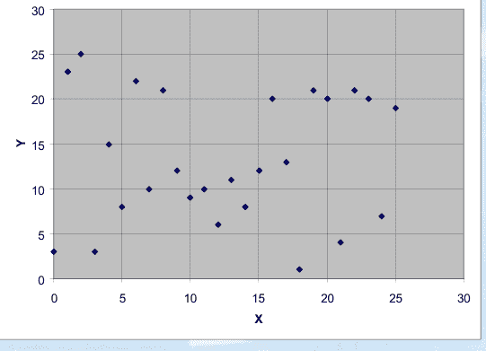

X Y 绘图显示出很少的模式

## 多变量数据
- 另一种看待正在发生的事情的方式
- 数值数据...

| X | Y | Z |
|---|---|---|
| 0 | 3 | 23 |
| 1 | 23 | 5 |
| 2 | 25 | 3 |
| 3 | 3 | 24 |
| 4 | 15 | 13 |
| 5 | 8 | 16 |
| 6 | 22 | 0 |
| 7 | 10 | 17 |
| 8 | 21 | 3 |
| 9 | 12 | 14 |
| 10 | 9 | 18 |
| 11 | 10 | 15 |
| 12 | 6 | 18 |
| 13 | 11 | 13 |
| 14 | 8 | 19 |
| 15 | 12 | 14 |
| 16 | 20 | 4 |
| 17 | 13 | 10 |
| 18 | 1 | 23 |
| 19 | 21 | 2 |
| 20 | 20 | 7 |
| 21 | 4 | 23 |
| 22 | 21 | 1 |
| 23 | 20 | 8 |
| 24 | 7 | 20 |
| 25 | 19 | 10 |

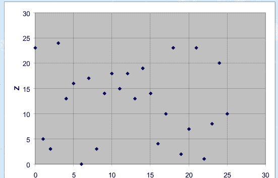

X Z 绘图也显示出很少的模式

3D 绘图

## 多变量数据
- 另一种看待正在发生的事情的方式
- 数值数据...

Z 值与 X 和 Y 有关系

每个变量以另一种维度影响与其他变量的关系

可能存在更多变量 - 多变量

| X | Y | Z |
|---|---|---|
| 0 | 3 | 23 |
| 1 | 4 | 5 |
| 2 | 5 | 3 |
| 3 | 3 | 24 |
| 4 | 15 | 13 |
| 5 | 8 | 16 |
| 6 | 22 | 0 |
| 7 | 10 | 17 |
| 8 | 21 | 3 |
| 9 | 12 | 14 |
| 10 | 9 | 18 |
| 11 | 10 | 15 |
| 12 | 6 | 18 |
| 13 | 11 | 13 |
| 14 | 8 | 19 |
| 15 | 12 | 14 |
| 16 | 20 | 4 |
| 17 | 13 | 10 |
| 18 | 1 | 23 |
| 19 | 21 | 2 |
| 20 | 20 | 7 |
| 21 | 4 | 23 |
| 22 | 21 | 1 |
| 23 | 20 | 8 |
| 24 | 7 | 20 |
| 25 | 19 | 10 |

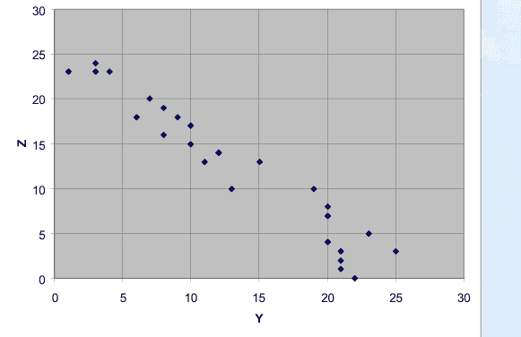

Y Z 绘图显示出一种关系

## 示例
- 数据挖掘方法的简单示例
- 天气数据

```
Relation about the weather for going cycling

attribute name {values, values, values}

attribute outlook {sunny, overcast, rainy}
attribute temperature real
attribute humidity real
attribute windy {TRUE, FALSE}
attribute cycle {yes, no}
```

```
data from previous events

outlook,temp,humid,wind,cycle

sunny,85,85,FALSE,no
sunny,80,90,TRUE,no
overcast,83,86,FALSE,yes
rainy,70,96,FALSE,yes
rainy,68,80,FALSE,yes
rainy,65,70,TRUE,no
overcast,64,65,TRUE,yes
sunny,72,95,FALSE,no
sunny,69,70,FALSE,yes
rainy,75,80,FALSE,yes
sunny,75,70,TRUE,yes
overcast,72,90,TRUE,yes
overcast,81,75,FALSE,yes
rainy,71,91,TRUE,no
```

- 使用算法在数据中寻找模式
- 从模式中形成规则
- 使用规则进行预测或分类


## Example
- 从训练数据生成的天气关系规则

```
Test mode:      10-fold cross-validation
=== Classifier model (full training set)
J48 pruned tree
----------------------
outlook = sunny
|   humidity <= 75: yes (2.0)
|   humidity > 75: no (3.0)
outlook = overcast: yes (4.0)
outlook = rainy
|   windy = TRUE: no (2.0)
|   windy = FALSE: yes (3.0)

Number of Leaves  : 5
Size of the tree  : 8
```

## Example
- 对天气关系数据进行关联分析并以树形显示
- 众多分析与显示选项之一
- 归纳规则并应用于新情况 – 构建专家系统

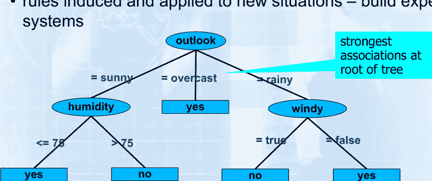

## Example
- 天气关系
- 新数据

# result

```
New (test) data

Decide not to go cycling - is that the right decision?

@data
sunny,70,85,FALSE,no
```

```
=== Confusion Matrix ===

a b  <-- classified as
0 0 | a = yes
0 1 | b = no
```

> interesting result...
> why?

### Value of data mining
- 商业用途与收益

- Somerfield Stores 使用数据挖掘探索面包购买模式，以更好地预测销售量
- Leeds Building Society 使用数据挖掘识别可能违约的按揭账户
- Norwich Union Life & Pensions 使用数据挖掘技术开发知识型系统以自动化承保决策
- Halfords 使用数据挖掘开发方法以选择最大营业额的商店选址
- BBC 使用数据挖掘用于节目排期以最大化观众份额
- DTI 资助使用数据挖掘的安全与欺诈项目

### Somerfield Stores
- 初始目标问题是利用在“篮子”级别捕获并存储在其“数据仓库”中的大量数据分析面包购买模式。由于面包保质期短，因此必须做出准确的门店级购买预测以确保最佳新鲜度和可用性。情况因产品促销和“多米诺”效应而变得复杂，即一种面包售罄后销售转移到其他品牌。
- 通过使用数据挖掘，对购买趋势的理解加深，能够实现更好的面包供应和更高的客户满意度。
- 数据挖掘流程在面包管理优化中得到验证后，Somerfield Stores 正将其应用于业务的其他领域。

### main points so far
- 已展示简单示例 – 更大、更复杂的数据集才是常态
- 各类数据均可挖掘：数值型和/或名义型 – 或其他类型
- 可容纳噪声或缺失数据
- 数据的详细准备至关重要
- 可用的数据挖掘算法和技术种类繁多
- 必须理解数据、问题和答案

### 数据挖掘的演化

| 进化阶段 | 商业问题 | 支持技术 | 产品厂家 | 产品特点 |
|---|---|---|---|---|
| 数据搜集（60年代） | “过去五年中我的总收入是多少？” | 计算机、磁带和磁盘 | IBM,CDC | 提供历史性的、静态的数据信息 |
| 数据访问（80年代） | “在新英格兰的分部去年三月的销售额是多少？” | 关系数据库（RDBMS），结构化查询语言（SQL），ODBC Oracle、Sybase、Informix、IBM、Microsoft | Oracle、Sybase、Informix、IBM、Microsoft | 在记录级提供历史性的、动态数据信息 |
| 数据仓库；决策支持（90年代） | “在新英格兰的分部去年三月的销售额是多少？波士顿据此可得出什么结论？” | 联机分析处理（OLAP）、多维数据库、数据仓库 | Pilot、Comshare、Arbor、Cognos、Microstrategy | 在各种层次上提供回溯的、动态的数据信息 |
| 数据挖掘（正在流行） | “下个月波士顿的销售会怎么样？为什么？” | 高级算法、多处理器计算机、海量数据库 | Pilot、Lockheed、IBM、SGI、其他初创公司 | 提供预测性的信息 |

### 数据挖掘与其他科学的关系

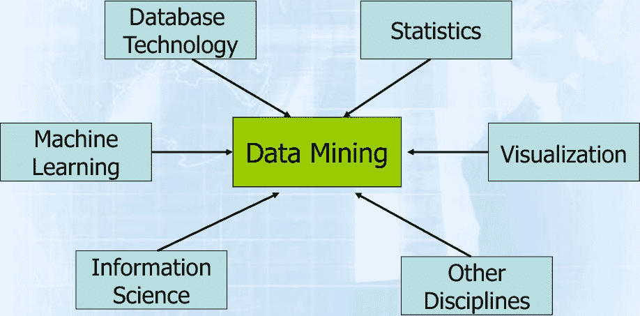

Database Technology

Statistics

Machine Learning

Data Mining

Visualization

Information Science

Other Disciplines

### 数据挖掘与其他科学的关系

数据挖掘作为一门新兴的交叉学科，涉及数据库系统、数据仓库、统计学、机器学习、可视化、信息检索和高性能计算等诸多领域。

此外，还与神经网络、模式识别、空间数据分析、图像处理、信号处理、概率论、图论和归纳逻辑等等领域关系密切。

### 数据挖掘与统计学的关系

近几年，人们逐渐发现数据挖掘中有许多工作都是由统计方法来完成的。甚至有些人（尤其是统计学家）认为数据挖掘是统计学的一个分支，当然大多数人（包括绝大多数数据挖掘研究人员）并不这么认为。

但是，统计学和数据挖掘的目标非常相似，而且数据挖掘中的许多算法也源于数理统计，统计学对数据挖掘发展的贡献功不可没。


### 数据挖掘与传统数据分析方法区别
- (1) 数据挖掘的数据源与以前相比有了显著的改变；
- 数据是海量的；
- 数据有噪声；
- 数据可能是非结构化的；

（2）传统的数据分析方法一般都是先给出一个假设然后通过数据验证，在一定意义上是假设驱动的；与之相反，数据挖掘在一定意义上是发现驱动的，模式都是通过大量的搜索工作从数据中自动提取出来。即数据挖掘是要发现那些不能靠直觉发现的信息或知识，甚至是违背直觉的信息或知识，挖掘出的信息越是出乎意料，就可能越有价值。

在缺乏强有力的数据分析工具而不能分析这些资源的情况下，历史数据库也就变成了“数据坟墓”——里面的数据几乎不再被访问。也就是说，极有价值的信息被“淹没”在海量数据堆中，领导者决策时还只能凭自己的经验和直觉。因此改进原有的数据分析方法，使之能够智能地处理海量数据，即演化为数据挖掘。

### 国外数据挖掘的现状
IEEE的Knowledge and Data Engineering会刊率先在1993年出版了KDD技术专刊。并行计算、计算机网络和信息工程等其他领域的国际学会、学刊也把数据挖掘和知识发现列为专题和专刊讨论。数据挖掘已经成了国际学术研究的重要热点之一。

此外，在Internet上还有不少KDD电子出版物，其中以半月刊Knowledge Discovery Nuggets最为权威（http://www.kdnuggets.com/subscribe.html）。在网上还有许多自由论坛，如DM Email Club等。

### 数据挖掘、Web挖掘、文本挖掘与知识发现
数据挖掘咨询 | 数据挖掘职位 | 广告 | 联系我们 | 日本語ページ

整合文本、Web和调查数据...

### Clementine 10.0
高性能 ... 文本、Web和调查数据 ... 实时部署 ... Clementine 10.0

KDnuggets新闻：数据挖掘与知识发现通讯，数据挖掘新闻、职位、软件、课程等（免费订阅）

本期：NEW 06.n13 7月11日：哪些是最流行且增长最快的数据挖掘应用？Web使用挖掘课程材料：DM博客

KDnuggets新闻2006年各期 | 日程 | 存档 | 提交 | 订阅！

想要从数据中获得可操作的信息？数据挖掘能为你带来结果。点击免费获取数据挖掘技巧

M2006会议 参加M2006拉斯维加斯会议，10月23-24日

投票：如果你全职工作，2006年你休了（或计划休）多少假期（选择最接近的答案）：没有 1周或更少

数据挖掘开放论坛 还有为初学者、专家、分类与聚类、应用等设立的数据挖掘论坛...

匹配短语范围：[最近] 帮助

自1989年KDD术语出现以来，由美国人工智能协会主办的KDD国际研讨会已经召开了10次以上，规模由原来的专题讨论会发展到国际学术大会。而亚太地区也从1997开始举行PAKDD年会。

- 1989 IJCAI知识发现数据库研讨会（Piatetsky-Shapiro）
  - 数据库中的知识发现（G. Piatetsky-Shapiro和W. Frawley，1991）
- 1991-1994知识发现数据库研讨会
  - 知识发现与数据挖掘进展（U. Fayyad、G. Piatetsky-Shapiro、P. Smyth和R. Uthurusamy，1996）
- 1995-1998知识发现数据库与数据挖掘国际会议（KDD’95-98）
  - 数据挖掘与知识发现期刊（1997）
- 1998 ACM SIGKDD、SIGKDD’1999-2001会议及SIGKDD Explorations
- 更多数据挖掘会议
  - PAKDD、PKDD、SIAM-Data Mining、(IEEE) ICDM等。

### 国内数据挖掘研究现状
与国外相比，国内对数据挖掘的研究起步稍晚，但发展势头强劲。

1993年，国家自然科学基金首次资助复旦大学对该领域的研究项目。

目前，国内的许多科研单位和高等院校竞相开展知识发现的基础理论及其应用研究。

### 数据挖掘的发展趋势
近年来，数据挖掘的研究重点逐渐从发现方法转向系统应用，注重多种发现策略和技术的集成，以及多学科之间的相互渗透。

例如，1998年在美国纽约举行的第四届知识发现与数据挖掘国际学术会议不仅进行了学术讨论，并且有30多家软件公司展示了他们的数据挖掘软件产品，不少软件已在北美、欧洲等国得到应用。

### 实施数据挖掘的目的
不再是单纯为了研究，更主要是为商业决策提供真正有价值的信息，进而获得利润。

所有企业面临的一个共同问题是：企业数据量非常大，而其中真正有价值的信息却很少，因此需要从大量的数据中经过深层分析，获得有利于商业运作、提高竞争力的信息，就像从矿石中淘金一样，数据挖掘也由此而得名。

## 1.3 基本概念
- 信息
  是事物运动的状态和状态变化的方式。
- 数据
  指一个有关事实F的集合（如学生档案数据库中有关于学生基本情况的各条记录），用来描述事物有关方面的信息。一般而言，这些数据都是准确无误的。
  数据可能存储在数据库、数据仓库和其他信息资料库中。
- 知识

人们实践经验的结晶且为新的实践所证实的；是关于事物运动的状态和状态变化的规律；是对信息加工提炼所获得的抽象化产物。

知识的形式可能是模式、关联、变化、异常以及其他有意义的结构。

### 模式
对于集合F中的数据，我们可以用语言L来描述其中数据的特性，得出一个表达式E，E所描述的数据是集合F的一个子集FE。只有当表达式E比列举所有FE中元素的描述方法更为简单时，我们才可称之为模式。如：“如果成绩在81-90之间，则成绩优良”可称为一个模式，而“如果成绩为81、82、83、84、85、86、87、88、89或90，则成绩优良”则不能称之为一个模式。

## 1.4 主要功能
### 1. 概念/类别描述（Concept/Class Description）
概念/类别描述是指对数据集做一个简洁的总体性描述并/或描述它与某一对照数据集的差别。

例1：我们收集移动电话费月消费额超出1000元的客户资料，然后利用数据挖掘进行分析，获得这类客户的总体性描述：35—50岁，有工作，月收入5000元以上，拥有良好的信用度…；

例2：对比移动电话费月消费额超出1000元的客户群与移动电话费月消费额低于100元的客户群。

利用数据挖掘可作出如下描述：移动电话月消费额超出1000元的客户80%以上年龄在35—50岁之间，且月收入5000元以上；而移动电话月消费额低于100元的客户60%以上要么年龄过大要么年龄过小，且月收入2000元以下。

### 2. 关联分析（Association Analysis）
从一个项目集中发现关联规则，该规则显示了给定数据集中经常一起出现的属性—值条件元组。

例如：关联规则X=>Y所表达的含义是满足X的数据库元组很可能满足Y。关联分析在交易数据分析、支持定向市场、商品目录设计和其他业务决策等方面有着广泛的应用。


## 1.4 主要功能

### 3. 分类与估值（Classification and Estimation）

分类指通过分析一个类别已知的数据集的特征来建立一组模型，该模型可用以预测类别未知的数据项的类别。该分类模型可以表现为多种形式：分类规则（IF-THEN），决策树或者数学公式，乃至神经网络。

估值与分类类似，只不过它要预测的不是类别，而是一个连续的数值。

### 4. 聚类分析（Clustering Analysis）

聚类分析又称为“同质分组”或者“无监督的分类”，指把一组数据分成不同的“簇”，每簇中的数据相似而不同簇间的数据则距离较远。相似性可以由用户或者专家定义的距离函数加以度量。

好的聚类方法应保证不同类间数据的相似性尽可能地小，而类内数据的相似性尽可能地大。

### 5. 时间序列分析（Time-Series Analysis）

时间序列分析即预测（Prediction），是指通过对大量时间序列数据的分析找到特定的规则和感兴趣的特性，包括搜索相似序列或者子序列，挖掘序列模式、周期性、趋势和偏差。预测的目的是对未来的情况作出估计。

### 6. 其它功能

包括：偏差分析（Deviation Analysis）、孤立点分析（Outlier Analysis）等。

随着数据挖掘技术的发展，可能还会继续出现新的数据挖掘功能。

## 1.5 数据挖掘模型

为了使数据挖掘技术在产业界得到更好的应用，欧洲委员会联合一些数据挖掘软件厂商开发了CRISP-DM（Cross Industry Standard Process for Data Mining）模型，目的是把数据挖掘的过程标准化，使数据挖掘项目的实施速度更快、成本更低、更可靠并且更容易管理。

CRISP-DM模型最先在1996年被提出，当前的白皮书版本是1.0。

### CRISP-DM（Cross Industry Standard Process for Data Mining）模型

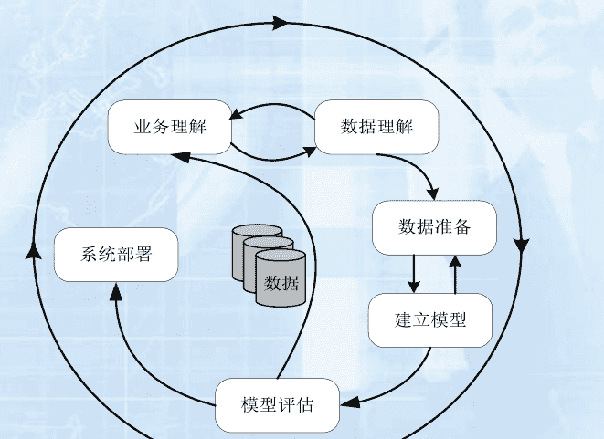

CRISP-DM模型中，数据挖掘包括六个步骤：

### 1. 业务理解（Business Understanding）阶段

具体地，包括：

- 确定业务目标：分析项目的背景，从业务视点分析项目的目标和需求，确定业务角度的成功标准；
- 项目可行性分析：分析拥有的资源，条件和限制，风险估计，成本和效益估计；
- 确定数据挖掘目标：明确确定数据挖掘的目标和成功标准，数据挖掘的目标和业务目标是不一样的，前者指技术上的，例如生成一棵决策树等；
- 提出初步的项目计划：对整个项目做一个计划，初步估计用到的工具和技术。

### 2. 数据理解（Data Understanding）阶段

具体地，包括：

- 收集原始数据：收集本项目所涉及到的数据，如有必要，把数据装入数据处理工具，并作一些初步的数据集成的工作，生成相应报告；
- 描述数据：对数据做一些大致的描述，例如记录数、属性数等，给出相应报告；
- 探索数据：对数据做简单的统计分析，例如关键属性的分布等；
- 检查数据质量：包括数据是否完整、数据是否有错、是否有缺失值等问题。

### 3. 数据准备（Data Preparation）阶段

具体地，包括：

- 数据选择：根据数据挖掘目标和数据质量选择合适的数据，包括表的选择、记录选择和属性选择；
- 数据清洁：提高选择好的数据的质量，例如去除噪音，估计缺失值等；
- 数据创建：在原有数据的基础上生成新的属性或记录；
- 数据合并：利用表连接等方式将几个数据集合并在一起；
- 数据格式化：把数据转换成适合数据挖掘处理的格式。

### 4. 建立模型（Modeling）阶段

具体地，包括：

- 选择建模技术：确定数据挖掘算法和参数，可能会利用多个算法；
- 测试方案设计：设计某种测试模型的质量和有效性的机制；
- 模型训练：在准备好的数据集上运行数据挖掘算法，得出一个或者多个模型；
- 模型测试评估：根据测试方案进行测试，从数据挖掘技术的角度确定数据挖掘目标是否成功。

### 5. 模型评估（Evaluation）阶段

具体地，包括：

- 结果评估：从商业角度评估得到的模型，甚至实际试用该模型测试其效果；
- 过程回顾：回顾项目的所有流程，确定每一个阶段都没有失误；
- 确定下一步工作：根据结果评估和过程回顾得出的结论，确定是部署该挖掘模型还是从某个阶段开始重新开始。

### 6. 部署（Deployment）阶段

具体地，包括：

- 部署计划：对在业务运作中部署模型作出计划；
- 监控和维护计划：如何监控模型在实际业务中的使用情况，如何维护该模型；
- 作出最终报告：项目总结，项目经验和项目结果；
- 项目回顾：回顾项目的实施过程，总结经验教训；对数据挖掘的运行效果做一个预测。

## 1.6 实现流程

各步骤之间互相影响、反复调整，形成一种螺旋式上升过程。

### 数据准备

KDD的处理对象是大量的数据，这些数据一般存储在数据库系统中，是长期积累的结果。但往往不合适直接在这些数据上进行知识挖掘，需要做一些准备工作，也就是数据的预处理。数据预处理包括数据的选择（选择相关数据）、净化（消除噪音、冗余数据）、推测（推算缺值数据）、转换（离散型数据与连续型数据之间的转换）、数据缩减（减少数据量）等。

数据准备是KDD的第一个步骤，也是比较重要的一个步骤。数据准备得好坏将直接影响数据挖掘的效率和准确度以及最终模式的有效性。

## 数据挖掘

数据挖掘是最为关键的步骤，它根据KDD的目标，选取相应算法的参数，分析数据，得到可能形成知识的模式模型。目前采用较多的技术有决策树、分类、聚类、粗糙集、关联规则、神经网络、遗传算法等。

### 模式的评估、解释

通过上面步骤所得到的模式，有可能是没有意义或没有实用价值的，因此需要评估，确定哪些是有效的、有用的模式。此外，大部分模式是用数学手段描述的表达式，很难被人理解，还需要将其解释成可理解的方式以呈现给用户。

### 知识运用

发现知识是为了运用，如何使知识能被运用也是KDD的步骤之一。运用知识有两种方法：一种是只需看知识本身所描述的关系或结果，就可以对决策提供支持；另一种是要求对新的数据运用知识，由此可能产生新的问题，而需要对知识做进一步的优化。

KDD过程可能需要多次的循环反复，每一个步骤一旦与预期目标不符，都要回到前面的步骤，重新调整，重新执行。

数据挖掘过程的分步实现，不同的步骤需要不同的专业人员参与完成，大体分为三类：

- 业务分析人员：要求精通业务，能够解释业务对象，并根据各业务对象确定出用于数据定义和挖掘算法的业务需求。
- 数据分析人员：精通数据分析技术，并对统计学有较熟练的掌握，有能力把业务需求转化为数据挖掘的各步操作，并为每步操作选择合适的技术。
- 数据管理人员：精通数据管理技术，并从数据库或数据仓库中收集数据。

从上可见，数据挖掘是一个多领域专家合作的过程，也是一个在资金上和技术上高投入的过程。这一过程要反复进行，在反复过程中，不断地趋近事物的本质，不断地优化问题的解决方案。

## 数据挖掘

增强支持业务决策的潜力

- 制定决策
- 数据呈现
  - 可视化技术
- 数据挖掘
  - 信息发现
- 数据探索
  - 统计分析、查询与报告
- 数据仓库/数据集市
  - OLAP、MDA
- 数据源
  - 纸质文档、文件、信息提供者、数据库系统、OLTP
- 最终用户
- 业务分析师
- 数据分析师
- 数据库管理员（DBA）


### 1.7 Applications of Data Mining

The emergence of data mining technology itself has a strong application-driven background; it has been application-oriented from the very beginning. Data mining technology has broad applications in market analysis, business management, decision support, and other fields, and is one of the important technical means for implementing CRM and BI. Specifically, business problems involving data mining include market analysis behaviors such as database marketing, customer segmentation & classification, profile analysis, cross-selling, as well as churn analysis, credit scoring, and fraud detection.

At present, data mining has successful application cases in commercial fields such as banking, telecommunications, insurance, transportation, and retail (e.g., supermarkets). Moreover, with intensifying competition, the demand for data mining will become increasingly urgent and strong.

A recent Gartner Group high-level technology survey ranked data mining and artificial intelligence as the first among the "five key technologies that will have a profound impact on industry in the next three to five years," and also listed parallel processing and data mining as the top two of the ten emerging technologies that will be investment focuses in the next five years. According to Gartner's recent HPC research, "with the rapid development of data capture, transmission, and storage technologies, large-system users will increasingly need to adopt new technologies to mine value beyond the market, and use more extensive parallel processing systems to create new business growth points."

### 1.8 Future Trends

- Hot application areas in the future
  - Web site data mining
  - Bioinformatics or gene data mining
  - Textual mining
  - Multimedia mining

Currently, various e-commerce websites on the Internet are emerging rapidly, and competition in e-commerce business is more intense than in traditional business. A customer can switch from one e-commerce website to a competitor with just a few mouse clicks, making customer retention in the e-commerce environment more difficult than in traditional business. To survive and win in competition, you must understand customers better than your competitors. E-commerce websites may generate millions of online transactions every day, producing a large number of log files and registration forms. How to analyze and mine these data, promptly understand customers' preferences, purchasing patterns, and even momentary impulses, and design personalized websites that meet the needs of different customer groups to increase competitiveness has become almost imperative.

In terms of analysis and modeling techniques and algorithms, Web site data mining is not particularly different from traditional data mining; many methods and analytical ideas can be applied. The difference is that a large part of the data format on websites comes from clickstreams, which is distinct from traditional database formats. Therefore, the main task in data mining for e-commerce websites is data preparation. At present, many vendors are committed to developing software specifically for Web mining.

- Bioinformatics or gene mining

Bioinformatics or gene data mining belongs to a completely different field. It is hard to say how much commercial value it has, but it is of great benefit to humanity. For example, gene combinations are ever-changing. What is the difference between the genes of people with a certain disease and those of normal people? Can we identify the differences and then modify them to turn them into normal genes? All this requires the support of data mining technology.

Compared with ordinary data mining, bioinformatics or gene data mining is far more complex in terms of data complexity, data volume, and the algorithms used for analysis and model building. In terms of analysis algorithms, newer and more efficient algorithms are particularly needed. Many vendors are currently researching this area, but both the technology and software are still far from mature.

- Textual mining

Textual mining is another topic of concern. For example, in a customer service center, converting conversations with customers into textual data and then mining these data can reveal customers' satisfaction with services, their needs, and relationships among customers.

Textual data mining differs greatly from data mining in both data structure and analysis processing methods. Textual mining is not an easy task, especially in terms of analysis methods, where many topics still need to be studied. Currently, there are some similar software products on the market, but most methods simply move text around or calculate the frequency of certain words, without truly realizing semantic analysis.

- Multimedia Mining

Description-based retrieval systems
- Create indexes based on image descriptions and implement object retrieval, such as keywords, titles, sizes, and creation times.
- Manual implementation is extremely time-consuming and labor-intensive.
- Automatic implementation often yields unsatisfactory results.

Content-based retrieval systems
- Support retrieval based on image content, such as color, texture, shape, objects, and wavelet transforms.

## C-BIRD: Content-Based Image Retrieval from Digital Libraries

### Search
- by image colors
- by color percentage
- by color layout
- by texture density
- by texture layout
- by object model
- by illumination invariance
- by keywords

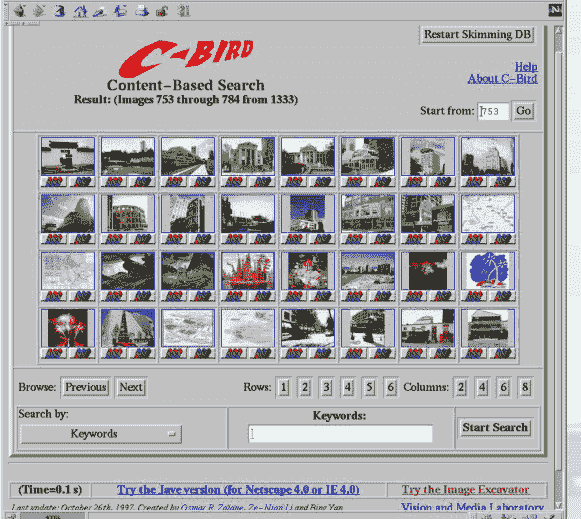

- Future research hotspots
  - Formal description of discovered languages
  - Seeking visualization methods in the data mining process
  - Research on data mining technology in a network environment
  - Strengthening mining of various unstructured data
  - Knowledge maintenance and update

- **Formal description of discovered languages**
  That is, to study data mining languages specifically for knowledge discovery, seeking a data mining language similar to SQL in databases, so as to formalize and standardize the mining process.
- **Seeking visualization methods in the data mining process**
  To enable users to understand the knowledge discovery process and facilitate human-computer interaction during knowledge discovery.
- **Research on data mining technology in a network environment**
  Especially to establish a DMKD server on the Internet and cooperate with database servers to implement Web mining.

- Strengthening mining of various unstructured data
  Such as mining textual data, graphical data, video image data, sound data, and even comprehensive multimedia data.
- Knowledge maintenance and update
  The result of data mining—knowledge—is time-sensitive, so it is necessary to study knowledge maintenance and update technologies, such as incremental knowledge updating and model evolution.


## 2 Data Warehouse and OLAP Technology
- 2.1 Data Warehouse
- 2.2 ETL Process
- 2.3 Design and Implementation of Data Warehouse in the Telecommunications Domain
- 2.4 Application of Data Warehouse—OLAP

### 2.1 Data Warehouse
#### 2.1.1 Definition of Data Warehouse
#### 2.1.2 Components of Data Warehouse
#### 2.1.3 Data Model of Data Warehouse
#### 2.1.4 Relationship between Data Warehouse and Database

A data warehouse is a subject-oriented, integrated, time-variant, and non-volatile collection of data in support of enterprise management and decision-making.

This definition was given by Mr. William H. Inmon, the most authoritative figure known as the "father of data warehouse."

- **Subject-oriented**
  This is relative to the application-oriented nature of traditional databases. Application-oriented means that during system implementation, the focus is mainly on certain applications or functions. Subject-oriented, on the other hand, considers specific problem domains and gives equal importance to the data involved in the problem domain and the functions used to analyze the data.

- **Typical subject areas**
  Customers, products, transactions or activities, insurance policies, claims, and accounts.

- Integrated

The data in the data warehouse comes from various different data sources (operational databases). Due to historical reasons, the organizational structures of operational databases are often different. Before these heterogeneous data enter the data warehouse, an integration process must be undergone.

- Integrated

This is the most important characteristic. Application problem designers make different design decisions, and representation methods differ. For example, inconsistencies exist in coding, naming conventions, actual attributes, and attribute measurements.

When data enters the data warehouse, various inconsistencies need to be eliminated. For example, the coding of customer "gender" in the data warehouse can adopt "male/female" or "m/f"; which method is used is not important, but what is important is that the coding should be unified in the data warehouse. If the application data is coded as "X/Y", then conversion is needed when entering the data warehouse.

In addition, consistency must be considered for all issues involved in applications, such as naming conventions, key structure, attribute measurements, and data characteristics.

- Time-variant

The data warehouse organizes data in the form of dimensions, and the time dimension is a very important dimension in the data warehouse. Moreover, the data in the data warehouse spans a large time range, from several years to even decades, and is called historical data.


### 2.1.1 数据仓库的定义

数据仓库中数据随时间变化的特性表现在：

- 数据仓库中的数据时间期限要远远长于操作型数据库中的数据时间期限。操作型数据库的时间期限一般是60～90天，而数据仓库中数据的时间期限通常是5～10年。
- 操作型数据库含有“当前值”的数据，这些数据的准确性在访问时是有效的，同样当前值的数据能被更新。而数据仓库中的数据仅仅是一系列某一时刻生成的复杂的快照。
- 操作型数据的键码结构可能包含也可能不包含时间元素，如年、月、日等。而数据仓库的键码结构总是包含某一时间元素。

### 2.1.1 数据仓库的定义

- 不可修改的

面向应用的事务数据库需要对数据进行频繁的插入、更新操作，而对于数据仓库中数据的操作仅限于数据的初始导入和记录查询。

操作型数据是一次访问和处理一个记录，可以对操作型数据库中的数据进行更新。但数据仓库中的数据则不同，通常是一起载入与访问的，在数据仓库环境中并不进行一般意义上的数据更新。

数据仓库是决策支持系统（Decision Support System，DSS，DSS）的基础。

在数据仓库中只有单一集成的数据源，并且数据是可访问的。所以与传统数据库相比，在数据仓库环境中DSS分析员的工作将较为容易。

### 2.1.2 数据仓库的组成

- 一个数据仓库的大小一般都是在100GB以上
- 通常，数据仓库系统应该包含下列程序：
  1. 抽取数据与加载数据
  2. 整理并转换数据（采用一种数据仓库适用的数据格式）
  3. 备份与备存数据
  4. 管理所有查询（即将查询导向适当的数据源）

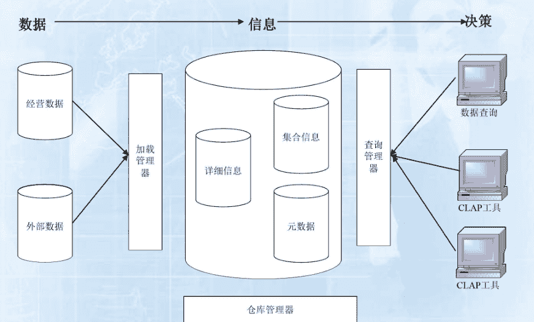

### 数据仓库的管理器

- **加载管理器**
  执行程序：抽取与加载程序
  功能：抽取并加载数据、在加载数据之前与进行中执行简单的转换

- **仓库管理器**
  执行程序：数据整理与转换程序、备份与备存程序
  功能：转换并管理数据仓库数据、备份与备存数据

- **查询管理器**
  执行程序：查询管理程序
  功能：引导并管理数据仓库的查询

### 加载管理器

- 功能
  支持数据抽取与加载
- 实现途径
  （1）外购的软件工具
  （2）针对特殊要求而编写程序、存储过程以及脚本文件

### 加载管理器

#### 建议

用户尽量选用合适的软件工具来协助进行整个加载管理的工作；
但是，因为源数据的特性存在很大的差异，数据仓库中加载管理器的功能无法一致，所以不可能完全使用外购的软件工具，而必须自行设计针对特殊需要而编写的程序、存储过程或是脚本文件。

### 加载管理器的具体功能

- 抽取来自源系统的数据
- 将抽取的数据快速加载临时保存介质
- 执行简单的数据转换任务
- 将转换后数据加载至与数据仓库类似的数据结构之中

### 仓库管理器

- **功能**
  执行管理一个数据仓库所必需的必要程序
- **实现途径**
  （1）外购的系统管理工具
  （2）针对特殊需要而编写的程序以及脚本文件
- **复杂度**
  因自动化的程度而异

### 仓库管理器的具体功能

- 检验各字段相互之间的关系与一致性
- 将临时保在存储介质中的数据转换与合并，然后加载至数据仓库
- 对数据仓库数据添加索引、视图、数据分区
- 根据需要进行数据的标准化
- 根据需要生成新的集合信息
- 更新已有的集合信息
- 备份数据仓库（完整或是递增式）
- 备存数据仓库中过时的数据（另存至其它存储介质）

### 查询管理器

- 功能
  执行管理数据仓库系统中所有查询工作的相关处理程序。
- 实现途径
  （1）外购调度软件
  （2）使用用户存取工具
  （3）数据仓库系统所提供的系统监控工具
  （4）数据库管理系统所提供的管理工具
  （5）针对特殊需要而编写程序以及脚本文件
- 复杂度
  视数据仓库系统而定。

### 查询管理器的具体功能

- 将查询引导至正确的表
- 实现客户查询的调度

查询管理器将把查询统计分析的结果存入查询概述文件，供仓库管理器使用，以决定为哪些项目执行数据集的工作。

### 2.1.3 数据仓库的数据模型

数据模型是对现实世界的一种抽象，根据抽象程度的不同，可形成不同抽象层次上的数据模型。与数据库的数据模型相似，数据仓库的数据模型也分为三个层次：

- 概念模型
- 逻辑模型
- 物理模型

### 2.1.3 数据仓库的数据模型

- 概念模型

客观世界到计算机系统的一个中间层次，它最常用的表示方法是E-R法（实体-关系）。

目前，数据仓库一般是建立在关系型数据库的基础之上，所以其概念模型与一般关系型数据库采用的概念模型相一致。

- 逻辑模型

指数据的逻辑结构，如多维模型、关系模型、层次模型等。数据仓库的逻辑模型描述了数据仓库的主题的逻辑实现，即每个主题对应的模式定义。

- 物理模型

是逻辑模型的具体实现，如物理存取方式、数据存储结构、数据存放位置以及存储分配等。在设计数据仓库的物理模型时，需要考虑一些提高性能的技术，如表分区，建立索引等。

目前，对数据仓库模型的讨论大多集中在逻辑模型，其中最常用的是多维模型。

#### ✓ 维

人们观察数据的特定角度。例如，企业常常关心不同销售数据随时间的变化情况，所以时间就是一个维；

#### ✓ 维的层次

人们观察数据的某个特定角度还可以存在细节程度不同的多个描述，这就是维的层次。一个维往往有多个层次，比如描述时间维时，可以从年份、季度、月份、天等不同层次来描述，那么年份、季度、月份和天就是时间维的层次；

#### ✓ 维成员

维的一个取值称为该维的一个成员。如果一个维是多层次的，那么该维的成员就是在不同层次取值的组合。例如时间维分为年、月和天三个层次则分别在其上各取一个值组合起来即得到日期维的一个成员，即“某年某月某日”；

#### ✓ 度量

描述了要分析的数值，例如话费、用户数量等；

#### ✓ 粒度

粒度是指数据仓库的数据单位中保存数据的细化或综合程度的级别。细化程度越高，粒度级就越小；相反，细化程度越低，粒度级就越大。

粒度深深地影响存放在数据仓库中数据量的大小，同时影响数据仓库所能回答的查询类型。

在数据仓库中的数据粒度与查询的详细程度之间要做出权衡。

当提高粒度级别时，数据所能回答查询的能力会随之降低。换言之，在一个很低的粒度级别上，几乎可以回答任何问题，但在高粒度级别上，数据所能处理的问题的数量是有限的。

例如：一个顾客一个月的每个电话的细节 每月40000个字节 每月200个记录

例如：一个顾客一个月的电话综合 200个字节 每月1个记录

- 活动记录
- 日期
- 时间
- 被叫
- 是否长途
- 通话时间
- 通话费用
- ……

- 活动记录
- 月
- 累计时长
- 累计次数
- 累计费用
- ……

左图是一个低粒度级，每个活动（在这里是一次电话）被详细记录下来，数据的格式如图所示。到月底每个顾客平均有200条记录（全月中每个电话都记录一次），因而总共需要40000个字节；

右图的边是一个高粒度级。数据代表一位顾客一个月的综合信息，每位顾客一个月只有一个记录，这样的记录大约只需200个字节。

问题： “上星期某某顾客是否给某某人打了电话？”

在低粒度级别上，完全可以回答这一问题，虽然这种回答将花费大量资源去查询大量的记录，但是问题结果是可以确定的。

在高粒度级别上，则无法明确地回答这个问题。假如在数据仓库中存放的只是所打电话的总数，那么就无法确定其中是否有一个电话是打给某人的。

### 2.1.3 数据仓库的数据模型

- 数据仓库的数据模型
  星型结构
  雪花型结构
  星型雪花型结构
- 数据仓库的数据＝事实数据＋维度数据
  不论是星型、雪花型或者是星型雪花型结构都是以事实表为中心。不同点只是在外围维度表相互之间的关系不同而已。


### 2.1.3 数据仓库的数据模型

- 星型架构的维度表只会与事实表生成关系，维度表与维度表之间并不会生成任何的关系。
- 雪花型架构描述可合并在一起使用的维度数据。

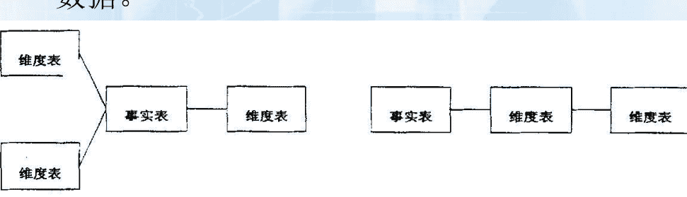

### 星型结构的实例

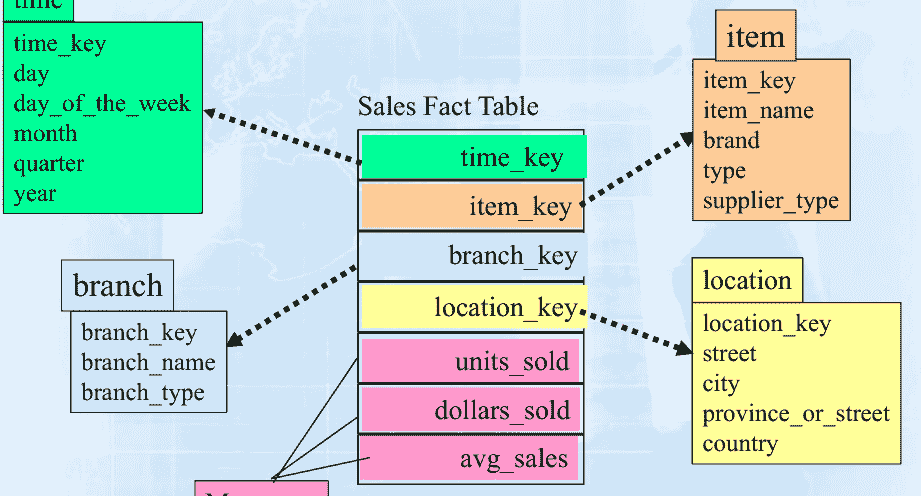

### 雪花结构的实例

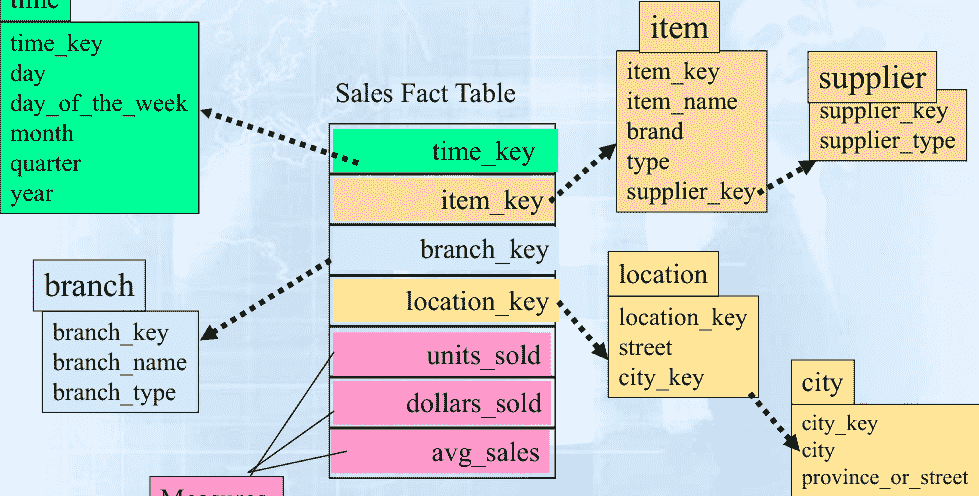

### 星型雪花型结构的实例

time
time_key
day
day_of_the_week
month
quarter
year

Sales Fact Table
time_key
item_key
branch_key
location_key
units_sold
dollars_sold
avg_sales

item
item_key
item_name
brand
type
supplier_type

Shipping Fact Table
time_key
item_key
shipper_key
from_location
to_location
dollars_cost
units_shipped

branch
branch_key
branch_name
branch_type

location
location_key
street
city
province_or_street
country

Measures

shipper
shipper_key
shipper_name
location_key
shipper_type

### 2.1.4 数据仓库与数据库的关系

到目前为止，数据仓库在国外已经发展了十几年的时间。在国内，虽然起步较晚，但发展较为迅速。

目前有很多的大公司或企业正在建或计划建设不同规模的数据仓库和数据集市。

### 2.1.4 数据仓库与数据库的关系

数据仓库建立在传统事务型数据库的基础之上，为企业决策支持系统、OLAP及数据挖掘系统提供数据源。

### 2.1.4 数据仓库与数据库的关系

- 数据库的应用包括：事务型应用和分析型应用
- 物理数据库实际存储的数据包括：
  事务型数据（或称操作数据）和分析型数据（也可称为汇总数据、信息数据）。
- 起初，两类数据放到一起，即分散存储在各底层业务数据库中。
- 后来，随着企业规模的扩展、数据量的增加、以及希望在决策分析时得到更多支持需求的日益迫切，并且考虑保证原有事务数据库的高效性与安全性。因此将分析型数据与事务型数据相分离，单独存放，即形成了所谓的数据仓库。

### 2.1.4 数据仓库与数据库的关系

数据仓库只不过是因为用户需求增加而对某一类数据库应用的一个范围的界定。单就其是数据的存储容器这一点而言，数据仓库与数据库并没有本质的区别。

而且在更多的时候，我们是将数据仓库作为一个数据库应用系统来看待的。

因此，不应该说数据库到数据仓库是技术的进步。

### 数据库与数据仓库的区别

| | 业务数据库 | 数据仓库 |
|---|---|---|
| 内容 | 与业务相关的数据 | 与决策相关的信息 |
| 数据模型 | 关系、层次结构的 | 关系的/多维的 |
| 访问 | 经常是随机的读写操作 | 经常是只读操作 |
| 负载 | 事务处理量大、但每个事务涉及的记录数较少 | 查询量少，但每次要查询大量的记录 |
| 事务输出量 | 一般很少 | 可能非常大 |
| 停机时间 | 可能意味着灾难性错误 | 可能意味着延迟决策 |

### 演变过程

- 60年代
  - 数据收集、数据库创建、信息管理系统（IMS）和网络数据库管理系统（Network DBMS）

- 70年代
  - 关系数据模型以及关系型DBMS

### 演变过程

- 80年代至今
  - 高级数据模型 (具有扩充关系的, 面向对象的, 演绎的等等) 和 面向应用的 DBMS (空间的, 科学的, 工程的等等)
- 90年代至今
  - 数据挖掘和数据仓库, 多媒体数据库和Web数据库。

### 数据收集和数据库创建
（20世纪60年代和更早）
- 原始文件处理

### 数据库管理系统
（70年代）
- 层次和网状数据库
- 数据库管理系统
- 数据库建模工具；实体-关系模型
- 索引和数据组织技术；B+树，散列等
- 查询语言；SQL等
- 用户界面：表单、报告等
- 查询处理和优化
- 事务管理：恢复和并发控制等
- 联机事务处理（OLTP）

### 高级数据库系统
（80年代中期—现在）
- 高级数据模型：
  扩展关系、面向对象、
  对象—关系、演绎
- 面向应用：
  空间的、时间的、多媒体的、
  主动的、科学的、
  知识库

### 基于WEB的数据库系统
（90年代—现在）
- 基于XML的数据库系统
- Web挖掘

### 数据仓库和数据挖掘
（80年代后期—现在）
- 数据仓库和OLAP技术
- 数据挖掘和知识发现

### 新一代综合信息系统
（2000年—...）

### 数据库的局限性

传统数据库所能做到的只是对已有的数据进行存取以及简单的查询统计，即使是一些流行的OLAP工具，也无非是另一种数据展示方式而已。人们仍然无法发现数据中存在的关系和规则，无法根据现有的数据预测未来的发展趋势。这也直接导致了目前“数据爆炸但知识贫乏”的现状。

### 2.2 ETL过程

- 2.2.1 ETL的概念
- 2.2.2 ETL的功能
- 2.2.3 ETL的目标
- 2.2.4 ETL的流程
- 2.2.5 ETL的框架
- 2.2.6 ETL的组成
- 2.2.7 ETL的相关技术
- 2.2.8 ETL的实现方法
- 2.2.9 ETL的工具
- 2.2.10 ETL的应用

#### 2.2.1 ETL的概念

将原来业务系统的数据经过抽取、转换、加载到数据仓库所在的中心存储库的过程称为ETL（Extraction，Transformation and Loading）过程，制定这个过程的策略称之为ETL策略，而完成ETL过程的工具则是ETL工具。相对于数据仓库中的表而言，业务系统数据库中的表称为源表，业务系统数据库称为源数据库，数据仓库中所有的数据都来自于业务系统数据库。在打造一个数据仓库的过程中，ETL的实施是一项繁琐、冗长而艰巨的任务，因为它关系到数据仓库中数据的质量问题，如果导入的数据漏洞百出，对决策者来说无疑是个噩耗。

ETL过程是搭建“数据仓库”时**最重要的和最易误解的**步骤之一。

#### 2.2.1 ETL的概念

ETL过程不仅仅是数据的迁移(Migration)或净化(Cleansing)，也应该是企业数据管理策略中不可缺少的一部分。

ETL过程的功能是：发现数据仓库需要的数据，将其从源系统中抽取出来，并进行一定的处理，然后装载到数据仓库中去。

#### 2.2.2 ETL的功能

- 提高数据质量
- 搭建数据仓库 (Warehousing Processes)
  - 操作型活动 (Operational Activities)
  - 数据获取 (Data Acquisition)
  - 仓库存储 (Warehouse Storage)
- EAI的数据集成

### ETL功能—提高数据质量

- 数据清洁
  - 补充缺失值，平滑噪声数据，识别与删除异常数据以及有效解决数据的一致性问题
- 数据集成
  - 多个数据库、数据立方体或文件的数据整合
- 数据转换
  - 实现数据的归一化
- 数据简化
  - 在不影响分析结果的前提下，缩减数据量
- 数据离散化
  - 对于数值型数据可通过取样实现离散化以降低数据量

### ETL功能—提高数据质量

Data Cleaning

[water to clean dirty-looking data]
[show soap suds on data]
['clean' -looking data]

Data Integration


Data Transformation

-2, 32, 100, 59, 48 → -0.02, 0.32, 1.00, 0.59, 0.48

Data Reduction

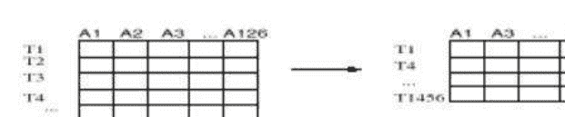

### ETL功能—搭建数据仓库

### Operational Activities

ERP Applications

Databases

Groupware

Legacy Applications

Web

Documents

Multimedia

### Data Acquisition

Staging

Integration

Transformation

### Warehouse Storage

Data Warehouse

ODS

Warehouse Delivery & Access


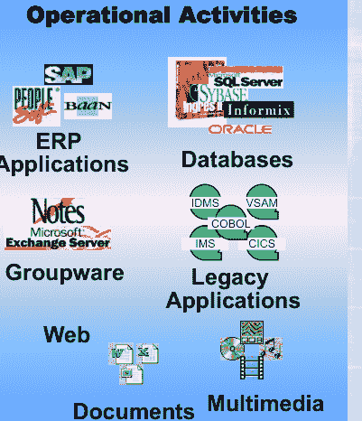

### ETL功能—搭建数据仓库

### 现有数据的特点

- 分散的
- 非整合的
- 难以访问的
- 多种的数据源
- 多种的平台
- 低劣的数据质量
- 冗余的数据
- 难以理解
- 不能分析
- 数据量很大，甚至是海量的

### ETL功能—搭建数据仓库

- “数据仓库”中的信息为战略经营提供决策支持
  - 整合的
  - 便于多维分析和报表
  - 根据历史信息预测未来的发展趋势

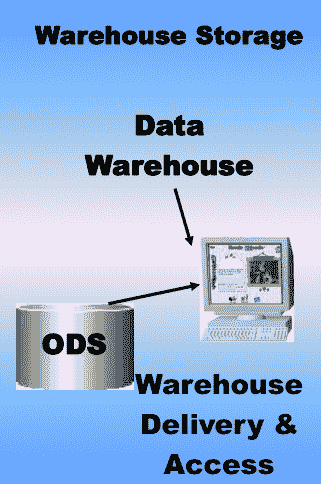

### ETL功能—搭建数据仓库

本质上，ETL过程完成了将“生数据”(Raw Data)转化为“信息”(Information)的过程，即传递有用的数据至数据仓库（中央数据库）中；

- 首先是从各种操作型数据源中抽取“有用”的数据；
- 然后，将操作型数据转换成“具有战略意义”的信息；
- 最后，将“具有战略意义”的信息装载到数据仓库中，以备决策支持使用。

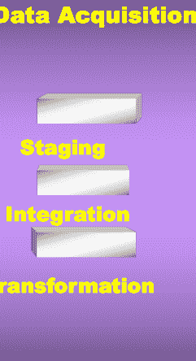

### ETL功能— EAI数据集成

- 使用相应的工具完成现有应用数据的集成（即数据的抽取、转换和存贮）

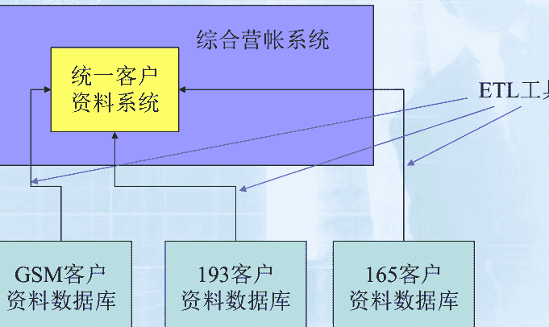

#### 2.2.3 ETL的目标

- 提高数据质量
- 提供一种统一的、跨平台的存取数据方法
- 将数据“信息化”，为企业决策者的经营分析提供信息来源

#### 2.2.4 ETL的流程

- 抽取 → 转换/清洁 → 装载

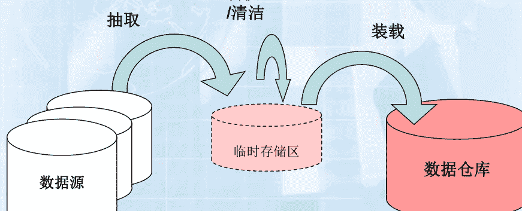

- All driven by metadata

#### 2.2.4 ETL的流程

（1）预处理。这是正式开始作业之前的准备工作，包括清空工作区、检查过渡 / 准备区。如果需要直接访问操作型数据源系统时，要检查远程数据库服务器状态，并核对目标区数据加载状态，以核算出加载作业的参数，如加载数据的时间间隔和范围（是24小时的数据，还是前3天的数据）。（2）启动数据加载的批作业。

#### 2.2.4 ETL的流程

（3）因为维度表有事实表所参照的主键，所以要先完成对维表的加载，生成维表主键，并作为以后加载事实表所需要的外键。在加载维表时，有时要处理好缓慢变化的维的问题，并可能涉及到版本号的处理问题。

（4）加载事实表。这中间也涉及到键查找的问题，即从有关维表中找到相应的主键，并以此作事实表的外键。

#### 2.2.4 ETL的流程

（5）事实表加载完成后，再对总计方阵体系进行刷新，以保障总计方阵与它的基础数据同步。

（6）应设计具有完善的出错处理机制和作业控制日志系统，以监测和协调整个加载的过程。

### ETL流程—数据抽取

数据提取是ETL处理的首要部分，解决的主要问题是确定需要提取的数据，并确定适当的提取方式。

指从一个或多个源数据库中通过记录选取进行数据复制的过程。抽取过程将记录写入ODS（Operational Data Store）或者临时区（Staging Area）以备进一步处理。

### ETL流程－数据抽取

- 预抽取
  - 识别数据（Formal;Informal）
  - 元数据（Metadata）
    - 元数据定义（实体、记录、数据项、模型、主键、外键）
    - 源应用系统（操作系统、DBMS、位置）
    - 更新的频率
    - 数据（交易）量
    - 源数据的拥有者（IS管理员、经营部门主管）
    - 业务含义描述
    - 可靠性、完整性评估（通过浏览数据）

### ETL流程—数据抽取

- 后台技术结构(Back Room Tech Architecture)
  - 单文件系统——平面文件、COBOL、VSAM...
  - 早期的DBMSs——IMS,IDMS,Adabas,Mark IV,...
  - 第三方应用软件
  - ERP系统——一些已经具有数据仓库能力，但很有限
  - 企业报表系统——很难回溯到原始数据
  - ODS——操作型数据存储（Part of DW/not part of DW，最细粒度、面向主题、整合的、经常新增交易数据、企业视点、星型模型）

### ETL流程—数据抽取

- 预抽取（续）
  - 选择数据源（原则）
    - 可访问性
    - 操作型活动的最近阶段
    - 最接近真实的数据（不是派生的）
    - 与新开发的OLTP系统一致
  - 注意:任何没有被选中的数据源，应该记录原因
  - 分析源数据
    - 理解源系统的元数据（数据字典）
    - 业务规则获取（ Business Rule Capture ）

### ETL流程—数据抽取

### Both Data and Metadata

Schema

Metadata

EXTRACT

describes
conforms to

Database

Data Warehouse

EXTRACT

describes
conforms to

CLEANSING

### ETL流程—数据抽取

- 数据抽取策略（从操作型DBs到DW）：
  - 陈旧的存档数据
    - 少见;保险公司;危险品公司
  - 现存于操作型环境中的全部数据
  - 只获取与上一次抽取相比更新的数据
    - 时间戳（time-stamped）
    - DELTA 文件
    - 日志文件
    - 触发器
    - 比较两次数据库快照（Snapshot）

### ETL流程—数据抽取

其中最重要的是变化数据捕获（Change Data Capture，CDC）。有几种方法实现CDC：时间戳、读取RDBMS系统的日志文件、使用源系统中的触发器或者自己开发CDC程序来检查日志文件。

使用时间戳是最简单的，也是相当普遍的方法。前提是所有的源表都有时间戳。

例如：超市的业务系统数据库中几乎每个表都保障有“插入记录日期”、“更新记录日期”两个字段。这是规范数据库的一个基本标准。

### 数据抽取的实现

在多数情况下，数据源系统与数据仓库并不处于同一个数据服务器中，它们往往是独立的，并处在远程系统中。数据的提取往往是以远程的、分布式的提取模式进行，并涉及各种各样的方法和手段，其中包括：

- （1）应用SQL*Plus提取到文本文件；
- （2）应用OCI or Pro*C程序，或者Oracle UTIL_FILE提取到文本文件；
- （3）应用Oracle Export Utility实用程序提取到 Oracle Export Files文件；

### 数据抽取的实现

- （4）远程数据复制
- （5）信息流

### ETL流程—数据转换

- **数据转换**
  将抽取出的数据进行过滤、合并、解码、翻译等转换，为数据仓库创建有效数据的过程。
- 一旦数据抽取或选取过程完成，就要设计并确定转换规则（Business Rules）应用于已抽取出的数据
- 转换过程需要理解业务侧重点（Business Focus）、信息需求（Informational Needs）和目前可用的源数据（Available Sources）。

### ETL流程—数据转换

- 转换规则
  - 字段级的
    - 数据类型转换
    - 增加“上下文”数据 如，时间戳
    - 解码（Decoding）如，将数值型的地域编码替换成地域名称
  - 清洁和净化
    - 保留字段具有特定值或特定范围的记录
    - 引用完整性检查
    - 去除重复记录

### ETL流程—数据转换

- 转换规则(续)
  - 多数据源整合
    - 字段映射（Mapping）
    - 代码变换（Transposing）—将不同数据源中的数据值规范成数据仓库数据值。例如，将原系统非英文编码转换成数据仓库英文编码；将原系统信息编码转换成数据仓库信息编码等。
    - 合并（Merging）—将两个或更多个源系统记录合并为一个输出或“目标”记录
    - 派生（Derivations）—根据源数据，利用数学公式产生数据仓库需要的数据。例如，由身份证号码计算出出生日期、性别、年龄等。
  - 聚合(Aggregation)和汇总(Summarization)
    - Detail > light agg/sum > levels of rollups > more agg/sum


### ETL Process—Data Cleansing

The data warehouse must store “quality data”—data that is consistent, generally accepted or verified as valuable, and conforms to metadata definitions. The cleansing function can detect data that violates the rules; once detected, such data is either discarded or converted into “clean” data that conforms to the rules, and then loaded into the data warehouse.

If data from operational data sources contains unclean components and non-standard formats, it will cause many problems and troubles for the establishment and maintenance of the data warehouse, especially for the use of Online Analytical Processing (OLAP). These must be resolved during the ETL process, typically including the following methods:

- a. Design spell checking, classification, and cross-checking against standard value tables
- b. Handle names and addresses
- c. Build auxiliary tables or online dictionaries for names and addresses, and use them for verification and correction
- d. Data conversion functions and subroutine libraries

- “Dirty” Data
  - Data does not conform to consistency
  - Use database design tools to define Checks, Validation Criteria, Integrity Constraints
  - Database designers are not very clear about DBMS
  - Constraints have been removed because they degrade operational performance
  - Use certain special codes, flags, or dummy values
  - Multiple target fields—a field depends on other fields, but inconsistently
  - ……

- Cleansing “dirty” data includes three levels:
  - Data cleansing at the data source and application layer (difficult to implement)
  - Data cleansing at the integration and transformation layer
    - Elementization—parsing into atomic data
    - Standardizing the representation of each element value
    - Verifying whether the standardized element values meet consistency requirements
  - Data cleansing within the data warehouse

Usually, the above three approaches are used in combination to achieve high efficiency.

- Principles to ensure smooth data cleansing
  - First, analyze and systematically design the data cleansing process.
  - Second, design a series of data reference tables and data cleansing program libraries based on the main problems and characteristics of the data.
  - The effective combination of the two can address ever-changing and diverse data cleansing problems.

- The data cleansing process
  - Preprocessing: Pre-diagnose and inspect large data load files (especially new files and data sets) rather than loading them blind. Sometimes it is necessary to write a small diagnostic program on the fly, called a “puppy,” which sniffs this huge object (the unknown file) for a hygiene check.
  - Standardization: Apply standard dictionaries built inside the data warehouse to standardize region names, person names, company names, product names, and category names.
  - Duplicate checking: Use various data query methods to avoid introducing duplicate data.
  - Error handling and correction: Write erroneous records and data to log files for further processing.

### ETL Process—Data Loading

- Use loading tools or data query language (SQL)
  - Efficiency issues
  - Avoid violating constraint relationships; pay attention to the loading order

Although the transformation work is rather tedious, it is the simplest of the three steps.

Many ETL tools provide powerful transformation functions. For example, DTS includes: copy field transformation, lowercase string transformation, uppercase string transformation, mid-string transformation, trim string transformation, date-time string transformation, read file transformation, write file transformation, and ActiveX script transformation.

Among these transformation operations, the most commonly used is ActiveX script transformation, because it allows you to write VBScript or JScript yourself to convert data in the source fields into data in the target fields.

In fact, if none of the aforementioned transformations can meet the requirements, ActiveX script transformation is the final choice.

#### 2.2.5 ETL Framework

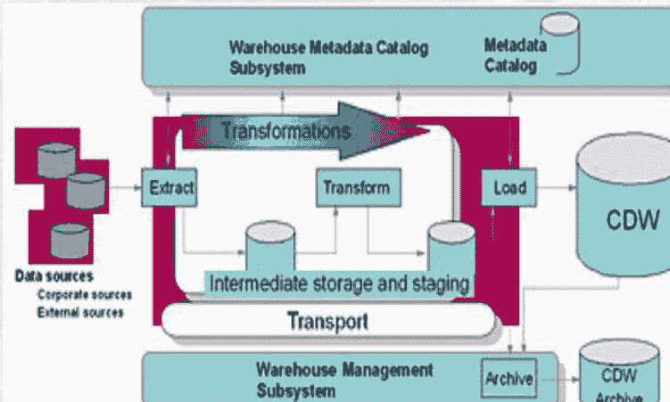

DW Populating subsystem reference architecture
Scott Howard (IBM)

#### 2.2.6 Composition of ETL

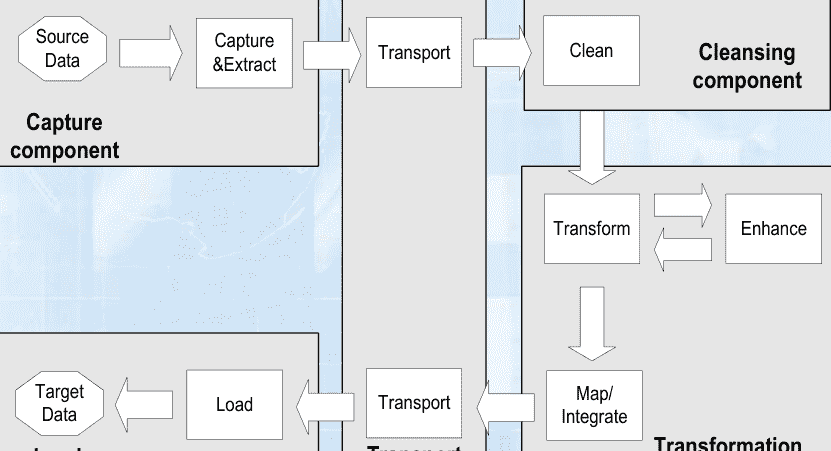

#### 2.2.7 Related Technologies of ETL

- DTS (Microsoft SQL Server)
- Logically, there are three strategies for implementing the ETL process
  - Remote Extraction
  - Push
  - Pull
- Parallelism
- Data Bulk Load

#### ETL Technology—DTS

SQL Server’s Data Transformation Services (abbreviated as DTS) provides a set of OLE DB-based COM objects. Using VBScript, PerlScript, or Microsoft JScript scripting languages to create data transformation programs, it can implement data transformation operations between different OLE DB data sources.

#### 2.2.8 ETL Implementation Methods

- Remote Extraction
  - The ETL process is performed on an independent remote platform.
  - It is minimally affected by the existing systems of data sources or the structure of the target warehouse.
  - It hardly affects the CPU and capacity of the source and target systems.
  - It may increase costs; it has high requirements on network bandwidth.

- “Push”
  - The ETL process is carried out in the existing system environment.
  - This method is often used when the existing systems have ample capacity and will not exceed the CPU processing limit.
  - This approach is often used when the existing systems are homogeneous.

- “Pull” (Collocation)
  - The ETL process is carried out at the “warehouse” end.
  - It is often adopted when the existing systems are heterogeneous.
  - It can offer certain advantages when the “warehouse” platform has the required performance and capacity.
  - Since the “warehouse” continues to grow, a long-term strategy may need to be developed.

- (1) High-speed loading: in memory; communicate through the local file system; limited input/output requests
- (2) Bandwidth preservation: avoids accessing the network, so other network-dependent applications are unaffected.

- Parallelism
  - Multithreaded server-side software
  - Multiprocessors (SMP)
- Data Bulk Load
  - “Bulk” is the fastest data loading method.
  - There is a bulk loader in the database; ETL also supports this feature.
  - Avoid using “Insert” or “Update” operations and avoid using ODBC.

#### 2.2.9 ETL Tools

- Tools that assist in developing the ETL process are called ETL or ETLM tools. They can standardize ETL process development and make the running and ongoing maintenance processes more efficient.
- Design Studio (Sagent)
- Decision Stream (Cognos)
- ……

#### 2.2.10 ETL Applications

For example: “Unified Customer Profile Accumulation Subsystem” (UCIS-etl)

- Framework of UCIS-etl
- Implementation tool — Sagent
- Problems and solutions

#### Position of UCIS-ETL in the Unified Customer Profile System

Interface / Service

- Business interface
- Billing interface
- Payment interface
- Other interfaces

Middleware platform (TUXEDO)

Unified Customer Profile Information Model / Database

- Basic profile
- Subscription data
- Billing data
- Other data

Customer Profile Accumulation Subsystem (UCIS-etl)

- 165
- 193
- GSM

User data of existing specialized billing systems

#### UCIS-etl Framework—System Function Diagram

Unified Customer Profile

ETL Process

- Generation of customer identifiers and loading of customer profiles
- Conflict detection for basic customer profiles
- Data cleansing, extraction, and transformation
- Formulation of data cleansing, extraction, and transformation rules
- System management
  - Resolving conflicts in basic customer profiles
  - Configuring the mapping between old and new information codes

- 165
- 193
- GSM

User data of existing specialized billing systems

#### UCIS-etl Framework—ETL Activity Diagram

ETL Process Activity Diagram

- Extract, Transform & Cleanse
- Staging Area
- Transform, Cleanse & Load
- Formulate rules for data cleansing, extraction, and transformation
- Rule library for cleansing, extraction, and transformation
- Data cleansing, extraction, and transformation
- Specialized databases
- 165
- 193
- GSM
- Intermediate database of the accumulation system
- Conflict database of basic customer profiles in the accumulation system
- Detect whether basic customer profiles conflict
  - Yes
  - No
- Generation of customer identifiers and loading of customer profiles
- Unified customer profile repository

#### UCIS-etl Implementation Tool—Sagent

- Data Source DBs
- Data Target DBs
- Sagent Data Access/ Load Server
- Data Flow Service
- Sagent Admin
- Sagent Repository (Oracle, SQL Server...)
- Sagent Design Studio
- System diagram of Sagent ETL series tools


### 客户资料沉淀系统

### Sagent Repository
规则库

系统管理

制定数据的清洁和转换规则

制定客户基本资料冲突规则

### Sagent Design Studio

数据的转换和清洁

检测客户基本资料是否冲突

客户标识的生成

沉淀系统中间数据库

沉淀系统客户基本资料冲突数据库

沉淀系统数据库

消除客户基本资料冲突

数据的抽取

### Sagent Data Flow Service

客户标识的生成和客户资料的装载

专业数据库

统一客户资料库

No

Yes

### 存在的问题及解决办法

- 克服网络拥塞(Remote Repository—>Local)
- ETL的实质—SQL
  - GUI vs. Script
  - SQL优化
  - 提高数据库查询性能（Index）
- 提高工作效率，缩短ETL周期
  - 以中间数据库为界，实现抽取和装载并行

### 2.3 电信领域数据仓库的设计与实现

#### 2.3.1 电信领域数据仓库的设计

#### 2.3.2 电信领域数据仓库的实现

#### 2.3.1 电信领域数据仓库的设计

##### （1）确定数据仓库的主题

根据电信业务和电信运营的需求，电信公司涉及的最主要三个主题是：

- 客户发展
- 收益分析
- 呼叫特性分析

#### 2.3.1 电信领域数据仓库的设计

#### 客户发展

主要是对客户群体进行分类后，从不同的角度展现电信公司提供服务的客户数量情况。划分的角度可以按照客户本身的自然属性，例如客户本身的自然属性，例如客户性别、年龄、客户入网的时间、客户的类型（公费、私人等）、客户受教育的程度等。

#### 2.3.1 电信领域数据仓库的设计

#### 收益分析

收益分析主要是通过不同的角度对电信企业的收益情况进行分析。收益分析的角度可以按照客户的自然属性和扩展属性划分；也可以按照电信公司的业务运（品牌、交费方式）进行划分；还可以按照机构设置、地理角度对收益进行划分。

#### 2.3.1 电信领域数据仓库的设计

#### 呼叫特性分析

呼叫特性分析即分析不同类型客户在呼叫上所具有的特性，特性可能包括下列衡量指标：

- 按照呼叫时间划分为：成长呼叫、中呼叫和短呼叫
- 按照呼叫类型可划分为：本地通话、长途通话、漫游通话。（其中长途又可以划分成国际长途、国内长途；漫游通话可划分成省内、省际、国内漫游等等）
- 按照呼叫金额可以划分为：高额呼叫和非高额呼叫
- 按照呼叫所在地区域考察呼叫的热点区域

#### 2.3.1 电信领域数据仓库的设计

##### （2）数据仓库模型的设计——可用的数据

例如，要完成客户发展、收益分析、呼叫特性分析三个主题，下列三部分信息是必要的，即：

- 客户的基本信息表
- 客户的账单信息表
- 客户的呼叫信息表

### 客户基本信息表的常见字段

| 客户基本信息表字段 |
| --- |
| 客户识别码 |
| 客户号码 |
| 客户类别 |
| 客户信用度 |
| 客户姓名 |
| 客户通信地址 |
| 客户身份证号 |
| 客户联系电话 |
| 客户邮编 |
| 客户归属局 |
| 通信费支付方式 |
| 开户日期 |

### 客户帐单信息的常见字段

| 客户帐单字段 |
| --- |
| 客户号码 |
| 月租费 |
| 附加功能费 |
| 本地话费 |
| 省内漫游费 |
| 省际漫游费 |
| 国际漫游费 |
| 账单金额 |
| 短信费 |
| 滞纳金金额 |
| 总话费 |
| 付款方式 |

### 呼叫信息表的常见字段

| 客户呼叫信息表字段 |
| --- |
| 呼叫类型 |
| IMSI号 |
| 主叫号码 |
| 被叫号码 |
| 通话开始时间 |
| 通话时长 |
| 基本通话费 |
| 基本通话附加费 |
| 长途费 |
| 长度附加费 |
| 通话位置 |
| 漫游类型 |

#### 2.3.1 电信领域数据仓库的设计

##### （2）数据仓库模型的设计——粒度的确定

在数据仓库设计中，最重要的步骤是确定数据的粒度。

- ➢ **单一粒度**

对于客户基本信息表，由于它属于增长较为缓慢的信息（随着客户数量的增长，客户业务信息的变更表会增长），可以使用单一的数据粒度。

如果客户数量很大，每个月生成一张客户信息表将浪费大量的空间，因为只有客户信息变化了或者新增加了客户，才需要修改原先的客户信息表。增加一个“当前标志”字段，用于表示客户的当前信息，并选择“数据变更日期”作为时间字段。

- 客户识别码
- 客户号码
- 客户类别
- 客户信用度
- 客户姓名
- 客户通信地址
- 客户身份证号
- 客户联系电话
- 客户邮编
- 客户归属局
- 通信费支付方式
- 开户日期

- 客户识别码
- 数据变更日期
- 当前标志
- 客户号码
- 客户类别
- 客户信用度
- 客户姓名
- 客户通信地址
- 客户身份证号
- 客户联系电话
- 客户邮编
- 客户归属局
- 通信费支付方式
- 开户日期

使用单一粒度的客户基本信息表

### 数据仓库模型的设计——粒度的确定

对于客户的账务信息表，每个月一个客户号码只在账务信息中对应一条记录，因此数据本身就具有一定的综合性，可以采用单一的数据粒度。

### 客户账单字段

- 月份
- 客户号码
- 月租费
- 附加功能费
- 本地话费
- 省内漫游费
- 省际漫游费
- 国际漫游费
- 账单金额
- 短信费
- 滞纳金金额
- 总话费
- 付款方式

### 客户账单字段

- 月份
- 客户号码
- 月租费
- 附加功能费
- 本地话费
- 省内漫游费
- 省际漫游费
- 国际漫游费
- 账单金额
- 短信费
- 滞纳金金额
- 总话费
- 付款方式

使用单一粒度的客户帐务信息表

### 数据仓库模型的设计——粒度的确定

- 双重粒度

呼叫／计费数据是电信公司中数据量最大的部分，对于一个客户的一次通话（无论是主叫还是被叫，因为一次通话实际上将生成主叫、被叫两条记录）；在呼叫表中都将出现一个通话记录，因此对于一个大型电信公司，其呼叫／计费数据的数据量非常大，所以采用双重粒度来记载呼叫／计费数据。

对于近3—4个月的细节呼叫／计费数据，保留在数据仓库中，并定期聚合成按月综合的数据，然后将细节数据导出，另外保存，为新的细节数据腾出足够的空间。

- 呼叫类型
- IMSI号
- 主叫号码
- 被叫号码
- 通话开始时间
- 通话时长
- 基本通话费
- 基本通话附加费
- 长途费
- 长度附加费
- 通话位置
- 漫游类型


### 按月综合的数据

- 客户呼叫信息表字段
- 呼叫类型
- IMSI号
- 主叫号码
- 被叫号码
- 通话开始时间
- 通话时长
- 基本通话费
- 基本通话附加费
- 长途费
- 长度附加费
- 通话位置
- 漫游类型


- IMSI号
- 主叫号码
- 被叫号码
- 通话开始时间
- 通话时长
- 基本通话费
- 基本通话附加费
- 长途费
- 长度附加费
- 通话位置
- 漫游类型

### 其它空间


### 3个月之前的细节数据

### 使用双重粒度的呼叫信息

#### 2.3.1 电信领域数据仓库的设计

##### （2）数据仓库模型的设计——OLAP模型的设计

针对每一个主题确定其需要的维度和度量变量，然后为每一个主题定义关系模式，从而形成一个星型结构，在这个星型结构的基础上，可以生成多维数据表，建立多维数据库。

以客户信息主题为例，客户信息主题的维度设计书如下：

### 客户信息主题的维度设计书

模型名称：客户基本信息

模块功能：用于客户数量的分析以及客户属性的分析

事实表：客户信息事实表

度量：客户数量

数据粒度：
每个客户每月计算一次收益，事实表中每条记录表示一个客户的属性。
事实表中存放1年以内的数据，超过10年的数据按月进行滚动，最初的数据进行汇总后从事实表中卸出。

相关维度：

- （1）客户详细资料维
- （2）客户性别维
- （3）客户年龄层次维
- （4）客户在网时间维
- （5）客户消费层次维
- （6）客户信用度层次维
- （7）是否大客户维
- （8）交费类型维
- （9）地理维
- （10）客户流失概率层次维
- （11）客户挽留价值层次维
- （12）成为大客户概率层次维


### 客户基本信息的星型结构图

客户信息事实表

Cust_ID
Sex_ID
AgeLevel_ID
BeVIP_ID
PayType_ID
InServTimeLevel_ID
Geo_ID
PayLevel_ID
ChurnLevel_ID
CreditLevel_ID
DetainValueLevel_ID
CustValueLevel_ID
BeVIPLevel_ID

客户详细资料维
Cust_ID

客户性别维
Sex_ID

客户年龄层次维
AgeLevel_ID

客户在网时间维
InServTimeLevel_ID

消费层次维
PayLevel_ID

客户信用层次维
CreditLevel_ID

是否大客户维
BeVip_ID

缴费类型维
PayType_ID

地理维
Geo_ID

客户流失概率层次维
ChurnLevel_ID

客户挽留价值维
DetainValueLevel_ID

成为大客户的概率层次维
BeVIPLevel_ID

#### 2.3.1 电信领域数据仓库的设计

##### （2）数据仓库模型的设计—— ETL过程

数据提取—转换—加载随着应用和系统环境的不同而具有不同的特点。一般而言，总包括下面的处理过程：

- a. 预处理

正式开始作业之前的准备工作，包括清空工作区、检查过渡/准备区。如果需要直接访问操作型数据源系统时，要检查远程数据库服务器状态，并核对目标区数据加载状态，以核算出加载作业的参数，如加载数据的时间间隔和范围（24小时的数据，还是前3天的数据）。

- b. 启动数据加载的批作业

- c. 因为维度表有事实表所参照的主键，所以要先完成对维表的加载，生成维表主键，并作为以后加载事实表所需要的外键。在加载维表中，有时要处理好缓慢变化的维的问题，并可能涉及到版本的处理问题。

- d. 加载事实表

这中间也涉及到键查找的问题，即从有关维表中找到相应的主键，并以此作事实表的外键。

- e. 事实表加载完成后，再对总计方阵体系进行刷新，以保障总计方阵与它的基础数据同步。

- f. 设计具有完善的出错处理机制和作业控制日志系统，用以监测和协调整个加载的过程。

#### 2.3.2 电信领域数据仓库的实现

- > 抽取数据到临时数据区

数据仓库的数据源不是来自终端客户每天输入的数据，而是主要来自企业的OLTP系统数据。

### 抽取数据到临时数据区的好处

- - 简单电信数据仓库的数据库工具采用微软公司的SQL Server 2000，在将其数据加载到数据仓库前，需先将OLTP系统的数据抽取到一个临时数据区，并在临时数据区进行数据清理和校验工作，待数据正确无误后，再加载到数据仓库，以保证数据质量。这是采用临时数据区的一个好处。
- - 临时数据区事实上就是一个数据库，此数据库作为数据仓库的数据源，数据仓库直接从临时数据区加载数据，从而避开OLTP系统，这样就避免了OLTP系统和数据仓库系统之间处理上的冲突，避免了OLTP系统因数据抽取而影响其响应时间的问题。这是采用临时数据区的另外一个好处。

临时数据区暂存将要加载到数据仓库的维度数据和事实数据，它利用关系表映射数据仓库的星型和雪花架构。因为系统是建立在SQL Server 2000数据库工具基础上，所以从OLTP系统抽取数据时，必然会用到存储过程以及脚本文件。

#### 2.3.1 电信领域数据仓库的实现

##### ➢ 加载数据到数据仓库的具体步骤

- 1. 设置数据库和数据源
- 2. 建立多维数据集
- 3. 设计存储和处理多维数据集
- 4. 为多维数据集创建分区

#### 2.3.2 电信领域数据仓库的实现

##### 企业级数据仓库的实现途径

- > 从建造某个部门特定的数据集市开始，逐步扩充数据仓库所包含的主题和范围，最后形成一个能够完全反映企业全貌的企业级数据仓库；
- > 从一开始就从企业的整体来考虑数据仓库的主题和实施。

第一种方法类似于软件工程中“自底向上”的方法，投资少、周期短且易于见到成果，但由于该设计开始时是以特定的部门级主题为框架的，向其他的主体和部门扩充往往比较困难；

第二种方法与第一种相反，即“自顶向下”的方法，投资大、周期长。实际中大多采用第一种方法。

“自底向上”地建立数据库，并不意味着不需要在设计阶段的长远规划。采用逐步积累的方式建立数据库，其最大的问题是已有的框架无法把新的业务集成进来。因此在设计阶段就必须充分考虑到这一点。例如，部门级的主题是否有助于形成企业级的主题，数据加载模块是否能够重复等等。数据库的长远规划，并不仅仅是技术部门的事情，应当把数据库的构建作为企业发展战略的一个组成部分。在设计阶段需要不同部门的沟通和协调，技术框架和系统设计必须从整个企业的角度来考虑，即使刚开始实施的时候是面向某个部门的。从这一点来看，建立一个企业级的数据仓库，主要的障碍不是技术，而是不同部门之间组织、协调的问题。

### 2.4 OLAP技术

#### 2.4.1　OLAP的定义和特点

#### 2.4.2　OLAP的分类

#### 2.4.3　OLAP的典型操作

### 2.4.1 OLAP的定义、特点

- - 60年代，关系数据库之父E. F. Codd提出了关系模型，促进了联机事务处理（OLTP）的发展(数据以表格的形式而非文件方式存储)。
- - 1993年，E. F. Codd提出了OLAP概念，认为OLTP已不能满足终端客户对数据库查询分析的需要，SQL对大型数据库的简单查询也不能满足终端客户分析的要求。客户的决策分析需要对关系数据库进行大量计算才能获得结果，而查询的结果并不能满足决策者提出的需求。因此，E. F. Codd提出了多维数据库和多维分析的概念，即OLAP。

- - OLAP (On-Line Analysis Processing) 定义
  是数据仓库上的分析展示工具，它建立在数据多维视图的基础上。
- - OLAP的主要特点
  一是在线性 (On Line)，体现为对用户请求的快速响应和交互式操作；
  二是多维分析 (Multi_Analysis)，这是OLAP技术的核心所在。

整个数据（仓）库系统的工具层大致可以分为三类，或者说三个发展阶段：

- (1) 以MIS为代表的查询、报表类工具
- (2) 以OLAP为代表的验证型工具
- (3) 以及以DM为代表的挖掘型工具

- - OLAP与OLTP的区别

（1）OLTP主要面向公司职员；OLAP则主要面向公司领导者。

（2）OLTP应用主要是用来完成客户的事务处理，其数据基础是操作型数据库，如民航订票系统、银行储蓄系统等等，通常需要进行大量的更新操作，同时对响应时间要求较高；而OLAP是以数据仓库库或数据多维视图为基础的数据分析处理，是针对特定问题的联机数据访问和分析，它一般不对仓库数据作修改处理，而只是查询，其应用主要是对客户当前及历史数据进行分析，辅助领导决策，其典型的应用有对银行信用卡风险的分析与预测、公司市场营销策略的制定等，主要是进行大量的查询操作，对时间的要求不太严格。

### OLAP与OLTP的不同

|  | OLTP | OLAP |
|---|---|---|
| 使用者 | 职员、IT人员 | 知识工作者 |
| 功能 | 日常操作 | 决策支持 |
| 数据库设计 | 面向应用的 | 面向主题的 |
| 数据特点 | 当前的，更新的；详细的，关系型的；孤立的 | 历史的，汇总的，多维的；集成的，consolidated |
| 使用 | repetitive | ad-hoc |
| 存取方式 | 读/写；索引 | 大量的扫描 |
| unit of work | 简单的事务处理 | 复杂的查询 |
| 记录访问量 | 几十 | 上百万 |
| 用户数量 | 数以千计 | 数以百计 |
| 数据库规模 | 100MB-GB | 100GB-TB |

### 2.4.1 OLAP的定义和特点

#### OLAP与数据挖掘的比较

- - **相同之处**
  - OLAP与DM都是数据库（数据仓库）上的分析工具；

- - **不同之处**
  - （1）在实际应用中各有侧重。前者是验证型的，后者是挖掘型的；
  - （2）前者建立在多维视图的基础之上，强调执行效率和对用户请求命令的及时响应，而且其直接数据源一般是数据仓库；后者建立在各种数据源的基础上，重在发现隐藏在数据深层次的对人们有用的模式，一般并不过多考虑执行效率和响应速度。


### 2.4.1 Definition and Characteristics of OLAP

#### Comparison of OLAP and Data Mining

(3) Data mining differs from OLAP, mainly in the depth of data analysis and the automation of the analysis process. Automation means that the analysis process does not require customer participation. This is its advantage, and it is also its shortcoming. In practice, customers also want to participate in the mining process, for example, by mining only a certain subset of data, mining data at different extraction and integration levels, or dynamically selecting mining algorithms according to their own needs.

Therefore, OLAP and data mining each have their own strengths.

#### Combination of OLAP and Data Mining—OLAM

Combining OLAP with data mining to develop a data warehouse with new OLAP capabilities that serves data mining will better meet practical needs.

OLAM (On-Line Analytical Mining) is exactly the product of this combination.

### 2.4.2 Classification of OLAP

Depending on how data are organized, OLAP is divided into two types:

- OLAP based on multidimensional databases (MD-OLAP)
- OLAP based on relational databases (ROLAP)

The former has fast response speed and high execution efficiency, but due to structural limitations, its flexibility is not high. In contrast, the latter, because it is built on a large number of existing databases (data warehouses), is much more flexible and scalable, and is also stronger than the former in supporting large data volumes and a larger number of dimensions. Therefore, although it is somewhat inferior in response speed and execution efficiency, it has still been widely used. Most existing OLAP tools are based on the latter.

### 2.4.3 Typical Operations of OLAP

OLAP operations on data in a data warehouse are performed on multidimensional data views (also called hypercubes). Typical operations on a cube include slicing, dicing, and rotation.

- Slicing: selecting a two-dimensional subset of a multidimensional array;
- Dicing: selecting a three-dimensional subset of a multidimensional array;
- Rotation: changing the dimensional orientation in which a cube is displayed, allowing people to observe data more clearly and intuitively from different angles.

Slice    Dice    Rotation
Region    Year    Product    Region

**Figure 2.1 Typical operations on a hypercube**

### Multidimensional Data

- Sales volume as a function of product, month, and region

Dimensions: Product, Location, Time
Hierarchical summarization paths

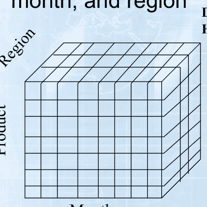

- Industry / Category / Product
- Region / Country / City / Office
- Year / Quarter / Month / Week / Day

### Cube Example

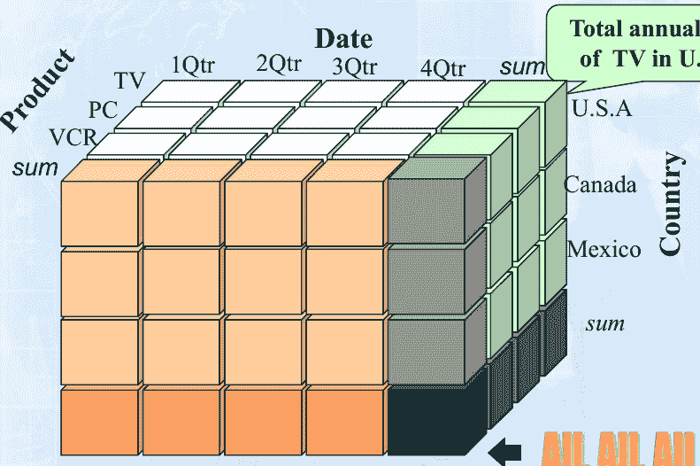

| Dimension | Member |
| --- | --- |
| Product | TV, PC, VCR, sum |
| Date | 1Qtr, 2Qtr, 3Qtr, 4Qtr, sum |
| Country | U.S.A., Canada, Mexico, sum |

> Total annual sales of TV in U.S.A.

ALL, ALL, ALL

### Browsing the Data Cube

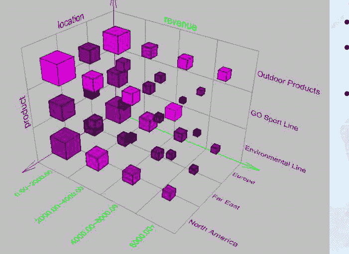

- Visualization
- OLAP capabilities
- Interactive manipulation

### Main Contents

1. Overview
2. Data Warehouse and OLAP Technology
3. Data Mining Technology
4. Applications of Data Mining in Telecommunications
5. Data Mining Tools

### Main Contents

1. Overview
2. Data Warehouse and OLAP Technology
3. Data Mining Technology
4. Applications of Data Mining in Telecommunications
5. Data Mining Tools
6. Data Mining Examples

### 3 Data Mining Technology

- 3.1 Clustering
- 3.2 Classification
- 3.3 Association
- 3.4 Prediction
- 3.5 Visualization of Data Mining
- 3.6 Implementation of Data Mining

#### 3.1 Clustering

### 3.1.1 Definition

##### 3.1.2 Clustering Algorithms

- 3.1.2.1 Classification of Clustering Methods
- 3.1.2.2 K-Means Algorithm
- 3.1.2.3 K-Medoids Algorithm
- 3.1.2.4 C-Means Algorithm

### 3.1.1 Definition

**Cluster Analysis**

It refers to the process of clustering or grouping complex and multifarious data according to the principles of maximizing within-cluster similarity and minimizing between-cluster similarity, such that objects in the same cluster are highly similar while objects in different clusters have low similarity.

### 3.1.2.1 Classification of Clustering Methods

- Partitioning-based clustering methods
- Hierarchical clustering methods
- Density-based clustering methods
- Grid-based clustering methods
- Model-based clustering methods


#### Partitioning-Based Clustering Methods

Given a data set consisting of n objects, construct k partitions (k≤n) of this data set, with each partition representing a cluster; that is, an algorithm that divides the data set into multiple clusters.

Requirements:

1. Each cluster must have at least one object;
2. Each object must belong to exactly one cluster.

Typical algorithms: the k-means and k-medoids algorithms, etc.

#### Hierarchical Clustering Methods

It is a clustering process that decomposes a given data set layer by layer. Specifically, it mainly includes the agglomerative method and the divisive method.

The agglomerative method initially regards each object as a cluster, and then repeatedly merges similar clusters until a satisfactory termination condition is reached. The divisive method is just the opposite: it first places all data in one cluster, and then repeatedly splits the data items with the smallest similarity to each other, causing clusters to be divided into smaller clusters until a satisfactory termination condition is reached.

Depending on the distance measure used between clusters, hierarchical methods can be divided into different types. Commonly used distance measures include minimum distance, maximum distance, mean distance, and average distance.

Typical algorithms: CURE, Chameleon, and BIRCH, etc.

#### Hierarchical Clustering Methods

These methods do not need a parameter (the number of clusters) to be specified in advance, but they do need a termination condition.

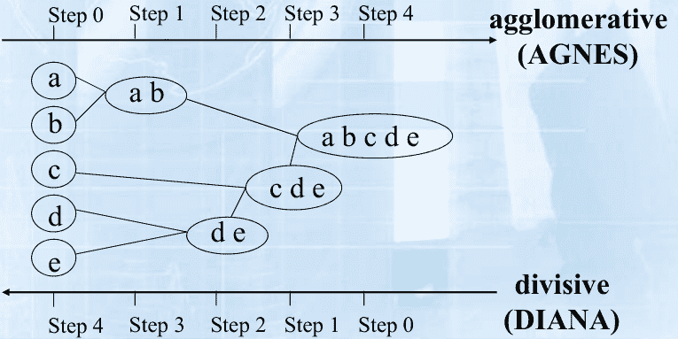

#### CURE Algorithm Description

- Randomly select s samples;
- Partition all samples into p clusters, with each cluster containing s/p samples;
- Divide each cluster into q subsets, with each subset containing s/pq samples;
- Remove outlier data;
- Randomly select;
- If a cluster changes slowly, remove the cluster;
- Merge some of the subsets.

#### CURE Algorithm—Data Partitioning and Clustering

- s = 50
- p = 2
- s/p = 25
- s/pq = 5

#### CURE Algorithm — Shrinking Representative Points

- Shrink the multiple representative points towards the gravity center by a fraction of α.
- Multiple representatives capture the shape of the cluster.

#### CHAMELEON Algorithm

- The CHAMELEON algorithm is a dynamic hierarchical clustering method proposed by G. Karypis, E.H. Han, and V. Kumar in 1999.
- It computes similarity based on a dynamic model: two clusters are merged only when their similarity is higher than the similarity among objects within the clusters.
- Essentially, it is a two-stage algorithm:
  1. First, use a graph partitioning algorithm to divide the data set into multiple subsets;
  2. Then, repeatedly merge these subsets using the agglomerative method in hierarchical clustering until the final clustering result is obtained.

#### CHAMELEON Algorithm

- Construct Sparse Graph
- Data Set
- Partition the Graph
- Merge Partition
- Final Clusters

#### Density-Based Clustering Methods

The idea of these algorithms is that whenever the density in the neighborhood of a cluster exceeds a certain threshold, the cluster is expanded and clustering continues. Such algorithms can obtain clusters of arbitrary shapes.

Typical algorithms: DBSCAN, OPTICS, and DENCLUE, etc.

#### Grid-Based Clustering Methods

Grid-based clustering algorithms first quantize the problem space into a finite number of cells, forming a spatial grid structure, and then perform clustering among these grids. Such algorithms are relatively fast.

Typical algorithms: STING, WaveCluster, and CLIQUE, etc.

#### Model-Based Clustering Methods

Model-based clustering algorithms assume a model for each cluster and seek the best fit of the data to the given model. The underlying assumption is that data are generated according to an underlying probability distribution.

Typical algorithms: COBWEB and neural network algorithms, etc.


### 3.1.2.1 聚类方法分类

- 上述方法属于传统聚类的范畴。一般地，传统聚类算法对于维度较低的数据集较有效，而当维度较高时，可能就不适合了。
- 此外，大型数据库的聚类研究受到越来越多的重视。随着数据库技术的普及，积累了大量的数据信息，因此这一分支成为一个研究热点。

### 模式矩阵

一般地，数据对象采用矢量表示法，即通过一个在多维空间中的矢量，来描述一个对象多方面的特征。矢量的每个维度描述对象的一个特征。多个对象的矢量构成一个模式矩阵（Pattern Matrix），即 \((x_{ij})_{m \times n}\)，其中每行代表一个对象，每列描述一个特征。

### 相似度

在各种聚类算法中，通常是需要借助量化的指标以表征数据对象之间的特征差异和不同，称之为聚类统计量。聚类统计量包括：距离或相似度。

### 标准化

由于不同的特征采用不同的度量标准或尺度，这将对聚类结果产生不同的影响，为了消除这一差别，常进行标准化变换，使所有的特征能用一个共同的标准度量。

### 距离的计算

标准化处理后，计算对象间距离最常用的方法有：欧氏距离、曼哈顿距离（又称绝对距离）、闵可夫斯基（Minkowski）距离等。

### 相似度的计算

n 个对象彼此之间的相似性或近似性可通过相似度矩阵（Similarity Matrix）表示。它是一个 n 阶、对角线元素为 1 的对称矩阵，即 \((r_{ij})_{n \times n}\)。其中，\(r_{ij}\) 是对象 i 和 j 之间相似性的量化表示。通常其值是非负的。对象之间关系越亲密，其绝对值越接近 1；彼此关系越疏远，其值越接近于 0。

对象间相似度的计算方法包括：夹角余弦法、相关系数法及指数相似系数法等。

### 评价聚类方法的标准

- 聚类分析是一种无监督学习，事先对给定数据集合的结构一无所知，没有利用任何先验知识。无论采用哪种聚类算法，其聚类结果的合理性和有效性都有待评价。
- 聚类有效性对聚类分析具有重要意义，被认为是聚类分析的一个瓶颈。对于相同的数据集合，采用不同的聚类方法，可能得到不同的聚类结果。
- 即便是采用同一种聚类方法，若选择不同的初始参数（如聚类数、聚类中心等）也可能会得到不同的聚类结果。

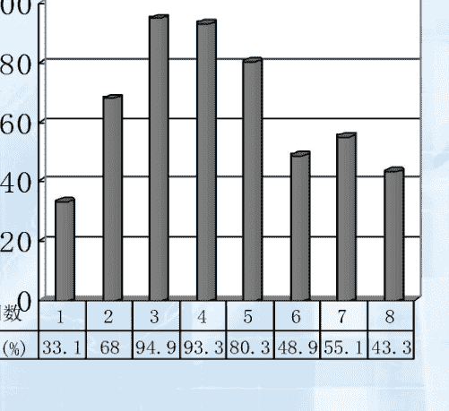

例如，采用相同的 k-均值聚类算法对同一个 wine 测试集进行聚类实验，当预设聚类类别数分别为 1～8 时，则所得到的聚类正确率是不同的，如柱状图所示。

- **可伸缩性**

  即算法中模式数发生变化的情况。有些算法在模式数小的条件下，算法的性能很好，但是模式数增大后，算法性能下降。如 PAM 算法是一种 k-中心点算法，它对小的数据集合非常有效，但对大的数据集合则没有良好的可伸缩性。

- **高维性**

  即算法中模式属性个数发生变化的情况。同样，有些算法只擅长处理低维数据。在高维空间中聚类是一个挑战，特别是数据有可能非常稀疏和偏斜。

- **发现任意形状的聚类**

  一个簇可能是任意形状的，但一般的聚类算法是基于欧氏距离和曼哈顿距离度量实现聚类，更趋于发现球状簇。在这方面，基于密度的聚类方法较好。

- **处理噪声数据的能力**

  噪声数据可能是数据本身不完整，也可能是孤立点数据（Outlier）。有些算法不擅于处理孤立点数据，因此还专门出现了发现孤立点数据的算法。

- 用于决定输入参数的领域知识最小化和输入记录顺序不敏感性

  一方面要求降低算法对输入参数的敏感程度，另一方面要求输入记录顺序对算法的结果影响小。如经典的 k-均值算法，需要预先给出簇的数目。在一些知识发现应用中，这一参数对聚类的质量影响很大。这常常是高效率算法的弱点。

- 可解释性和可用性

  知识发现过程中，聚类结果总是表现为一定的知识，这就要求聚类结果可解释、易理解。这与可视化密切相关，同时也与实际应用有关。如 SOM（Self-Organizing Map）算法用于文本聚类可以产生知识地图，表现了良好的可视化性能。

### 3.1.2.2 K均值算法

K均值（k-means）是一种简便、实用的无监督聚类分析算法。这种算法在已知簇的个数时，可很好地实现数据的聚类分析。

#### 基本思想

1. 首先，随机选择 k 个数据点作为聚类中心；
2. 然后，计算其他点到这些聚类中心点的距离，通过对簇中距离平均值的计算，不断改变这些聚类中心的位置，直到这些聚类中心不再变化为止。

#### K均值的流程

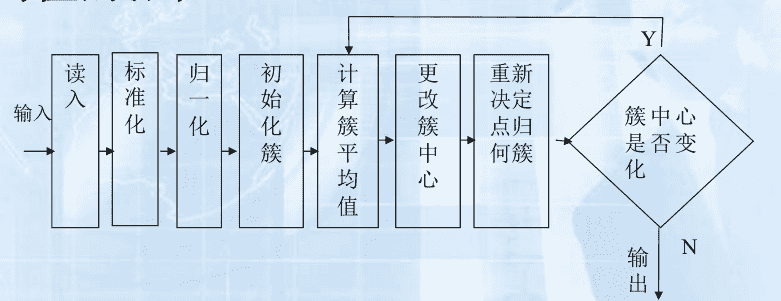

由流程图可知，k-均值算法是一种基于数据划分方法的聚类算法。它是一个不断趋于最优解的试探过程。每一次迭代都试图使簇中心的选择更加接近于数据集的实际簇中心。

#### K均值的实现过程

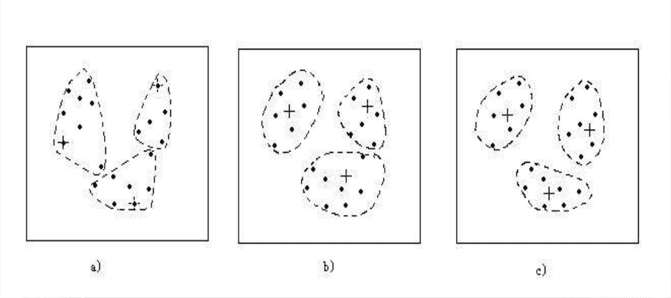

#### 优势

1. 算法简单；
2. 执行和收敛过程相对较快，是一种常见的聚类算法。

#### 局限性

1. 必须事先知道聚类数；
2. 算法要求簇是密集的、簇和簇之间的差异比较大；
3. 数据集的平均值的计算必须有适当的定义；
4. 不能用于非凸形状的聚类；
5. 对于某些孤立数据和“噪声”点敏感等。

### 3.1.2.3 K中心点算法

k-中心点算法是对 k-均值的改进。

#### 主要的改进

不采用簇中对象的平均值作为参照点，选用簇中位置最中心的对象，即中心点。这样的划分方法依然是基于最小化所有对象与其参照点之间的相异度之和的原则来执行的。

#### 基本思想

首先为每个簇随机地赋予一个样本作为中心点，将剩余的点依照距离的远近分配给最近的簇；随后用其他的非中心点数据作为中心点，并查看聚类情况。如果替换后的聚类总代价小于零，那么就执行替换直到中心点不再发生变化，也就是说达到代价最小值时停止算法。

#### 算法步骤

输入：簇的个数 k，包含 n 个样本的数据集  
输出：各样本属于 k 个簇的信息

1. 随机选择 k 个样本作为初始中心点；
2. repeat
3. 将非中心点的数据依照与各中心点的距离划分到最近的簇中；
4. 随机地在非中心点中选择一个样本；
5. 计算使用该点作为中心点来代替原中心点的代价；
6. if 代价 < 0 then 用该点替换原中心点，形成新的簇集合；
7. until 中心点不再发生变化。

### 3.1.2.4 C均值算法

1. 选取聚类块数 \(k\)；
2. 从训练集中任意选定 \(k\) 个向量 \(c_1,c_2,\cdots,c_k\) 作为聚类中心；
3. 将每个样本向量（\(n\) 为输入向量维数），按下列欧氏距离公式，归入中心为 \(c_i\) 的类中；
4. 重新调整聚类中心。对于 \(c_{im}\)，其中 \(m=1,2,3,\cdots,n\)，由下式计算得出：

   \[
   c_{im}=\frac{\sum_{x_l\in \text{cluster}_i}x_{lm}}{N_i}
   \]

   其中 \(N_i\) 是第 \(i\) 个聚类块中的向量数，\(i=1,2,3,\cdots,k\)；

5. 如果步骤 4 中的聚类中心不再变化，则终止。否则，转至步骤 3。

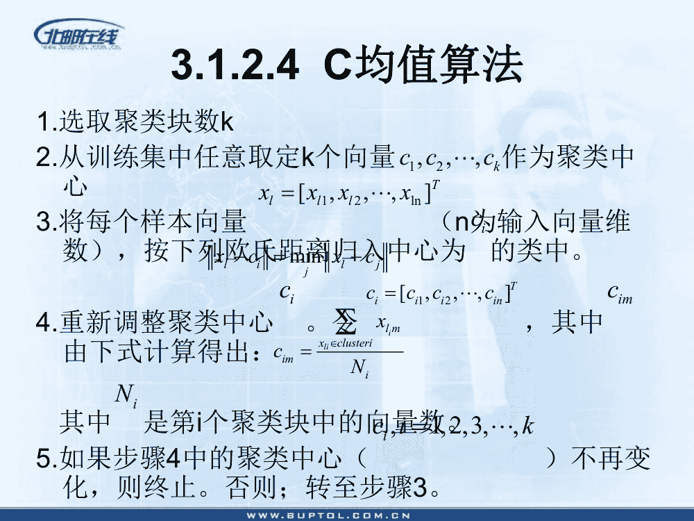

### 3.2 分类

- 3.2.1 概述
- 3.2.2 常见的分类算法
  - 3.2.2.1 决策树算法
  - 3.2.2.2 CLS 算法
  - 3.2.2.3 ID3 算法
  - 3.2.2.4 C4.5 算法
  - 3.2.2.5 AutoClass 算法
- 3.2.3 算法实现

### 3.2.1 概述

- 分类是数据挖掘中的一个重要课题。
- 分类的目的是获得一个分类函数或分类模型（也常常称作分类器），该模型能把数据库中的数据项映射到某一个给定类别。
- 分类可用于提取描述重要数据类的模型或预测未来的数据趋势。

#### 分类的实现

- 构建模型：预设分类类别
  - 对每个样本进行类别标记
  - 训练集构成分类模型
  - 分类模型可表示为：分类规则、决策树或数学公式
- 使用模型：识别未知对象的所属类别
  - 模型正确性的评价
    - 已标记分类的测试样本与模型的实际分类结果进行比较
    - 模型的正确率是指测试集中被正确分类的样本数与样本总数的百分比。测试集与训练集相分离，否则将出现过拟合（over-fitting）现象。


### 分类的实现—模型构建

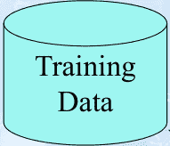

| 姓名 | 职级 | 年限 | 是否终身教职 |
|---|---|---:|---|
| Mike | 助理教授 | 3 | 否 |
| Mary | 助理教授 | 7 | 是 |
| Bill | 教授 | 2 | 是 |
| Jim | 副教授 | 7 | 是 |
| Dave | 助理教授 | 6 | 否 |
| Anne | 副教授 | 3 | 否 |

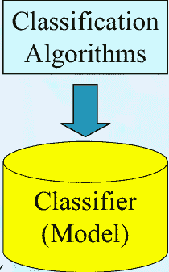

> IF rank = ‘professor’  
> OR years > 6  
> THEN tenured = ‘yes’

### 分类的实现—利用模型预测

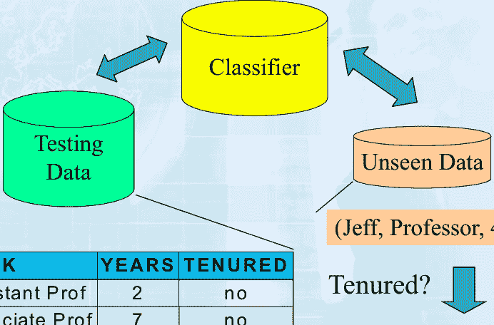

| 姓名 | 职级 | 年限 | 是否终身教职 |
|---|---|---:|---|
| Tom | 助理教授 | 2 | 否 |
| Merlisa | 副教授 | 7 | 否 |
| George | 教授 | 5 | 是 |
| Joseph | 助理教授 | 7 | 是 |

Classifier

Testing Data

Unseen Data

(Jeff, Professor, 4)

Tenured?

Yes

### 分类方法的评价标准

- 预测的正确性
- 时间
  - 构建模型的时间
  - 使用模型所需的时间
- 健壮性
  - 处理噪声及缺失值的能力
- 可扩展性
- 可操作性
- 规则的优化
  - 决策树的 大小
  - 分类规则的简洁性

### 3.2.1 概述

### 常见的分类方法

- 决策树分类

决策树归纳是一种经典的分类算法。它采用自顶向下、递归的、各个击破的方式构造决策树。树的每一个结点上使用信息增益度量选择属性，可以从所生成的决策树中提取出分类规则。

### 3.2.1 概述

- **KNN分类**

即K最近邻法，最初由Cover和Hart于1968年提出的，是一个理论上比较成熟的方法。该方法的思路非常简单直观：如果一个样本在特征空间中的k个最相似（即特征空间中最邻近）样本中的大多数属于某一个类别，则该样本也属于这个类别。该方法在分类决策上只依据最邻近的一个或者几个样本的类别来决定待分类样本所属的类别。

该算法较适用于样本容量比较大的类域的自动分类，而那些样本容量较小的类域采用这种算法比较容易产生误分。

### 3.2.1 概述

- SVM分类方法

即支持向量机（Support Vector Machine）法，由Vapnik等人于1995年提出，具有相对优良的性能指标。该方法是建立在统计学习理论基础上的机器学习方法。通过学习，SVM可以自动寻找出那些对分类有较好区分能力的支持向量，由此构造出的分类器可以最大化类与类的间隔，因而有较好的适应能力和较高的分淮率。该方法只需要由各类域的边界样本的类别来决定最后的分类结果。

SVM法对小样本情况下的自动分类有着较好的分类结果。

### 3.2.1 概述

- VSM分类方法

即向量空间模型（Vector Space Model）法，由Salton等人于60年代末提出。这是最早也是最著名的信息检索方面的数学模型。其基本思想是将文档表示为加权的特征向量：D=D(T1, W1; T2, W2; ...; Tn, Wn)，然后通过计算文本相似度的方法来确定待分类样本的类别。当文本被表示为空间向量模型的时候，文本的相似度就可以借助特征向量之间的内积来表示。

VSM法相对其他分类方法而言，更适合于专业文献的分类。

### 3.2.2.1 决策树算法

决策树分类是用属性值对样本集逐级划分，直到一个节点仅含有同一类的样本为止。

决策树首先起源于Hunt等人提出的概念学习系统（Concept Learning System, CLS），然后发展到Quinlan的ID3算法，最后演化为能处理连续属性值的C45算法。

### 3.2.2.1 决策树算法

- 决策树的输入
  - 一组带有类别标记的样本
- 决策树的输出
  - 一棵二叉或多叉树。
  - 二叉树的内部节点（非叶子节点）一般表示为一个逻辑判断，如形式为(ai=vi)的逻辑判断，其中ai是属性，vi是该属性的某个属性值；树的边是逻辑判断的分支结果。
  - 多叉树（ID3）的内部节点是属性，边是该属性的所有取值，有几个属性值，就有几条边。树的叶子节点则是类别标记。

### 3.2.2.1 决策树算法

### 决策树的构造

采用自上而下的递归构造。
以多叉树为例，其构造思路是：如果训练样本集中所有样本是同类的，则将它作为叶子节点，节点内容即是该类别标记；否则，根据某种策略选择一个属性，按照属性的不同取值，将样本集划分为若干子集，使得每个子集上的所有样本在该属性上具有同样的属性值。然后再依次处理各个子集。实际上就是“分而治之”（divide-and-conquer）的策略。二叉树同理，差别仅在于要选择一个好的逻辑判断。

### 3.2.2.1 决策树算法

### 决策树构造的条件

构造好的决策树的关键是：如何选择好的逻辑判断或属性。对于同样一组样本，可以有很多决策树能符合这组样本。研究表明，一般情况下，树越小则树的预测能力越强。要构造尽可能小的决策树，关键在于选择恰当的逻辑判断或属性。由于构造最小的树是NP问题，因此只能采用启发式策略选择好的逻辑判断或属性。

### 3.2.2.1 决策树算法

实际中，用于模型学习的训练数据往往不是完美的，原因是：

- ① 某些属性字段上缺值（missing values）；
- ② 缺少必需的数据而造成数据不完整；
- ③ 数据不准确含有噪声甚至是错误的。

此时，需要克服噪声和决策树剪枝。

### 3.2.2.1 决策树算法

基本的决策树构造算法没有考虑噪声，生成的决策树完全与训练样本拟合。在有噪声的情况下，完全拟合将导致过分拟合（overfitting），即对训练数据的完全拟合反而不具有很好的预测性能。

### 3.2.2.1 决策树算法

- **剪枝技术**
  - 是一种克服噪声的技术，同时它也能使树得到简化而变得更容易理解。
- **剪枝的类型**
  - 向前剪枝（forward pruning）在生成树的同时决定是继续对不纯的训练子集进行划分还是停机。
  - 向后剪枝（backward pruning）是一种两阶段法：拟合-化简（fitting-and-simplifying），首先生成与训练数据完全拟合的一棵决策树，然后从树的叶子开始剪枝，逐步向根的方向剪。

### 3.2.2.1 决策树算法

- **剪枝的局限性**

剪枝并不是对所有的数据集都好，就像最小树并不是最好（具有最大的预测率）的树。当数据稀疏时，要防止过分剪枝（over-pruning）。从某种意义上而言，剪枝也是一种偏向（bias），对有些数据效果好而有些数据则效果差。

Attributes = {Outlook, Temperature, Humidity, Wind}
PlayTennis = {yes, no}

Outlook
sunny
Humidity
high
no
normal
yes
overcast
yes
rain
Wind
strong
no
weak
yes

### 打高尔夫球的决策树实例（自顶向下）

图 公司福利条件决策树示例

根据加薪百分比、工作时长、法定节假日、及医疗保险三个属性来判断一个企业的福利状况(good或bad)。

### 3.2.2.2 CLS算法

- CLS (Concept Learning System) 系统

以一棵空决策树开始，并通过增加结点逐步求精，直到产生一棵能正确分类训练样本的决策树为止，是一个循环递归过程。设PN为已知训练子集，则：

- 1 （1）如果PN中的所有样本均为正例，则生成一个YES结点并终止；如果PN中的所有样本均为反例，则生成一个NO结点并终止；否则，根据某种启发策略选择一个属性A，设A取值为 v1，v2...vr，并生成新结点。
- 2 （2）将PN中的样本根据其属性A的取值加以划分，生成r个子集记为PN1, PN2...PNr。
- （3）递归地应用该算法到每个子集PNi。


### 3.2.2.2 CLS算法

- **CLS算法的局限性**

分类属性的选择决定了算法的效率与所生成的决策树的繁简程度、预测效果。选择属性是决策树归纳算法的关键。

CLS算法可以产生所有可能的决策树，正确分类训练样本，并能选择最简单的决策树。但是属性选择的不确定性，在实际应用中往往受问题大小的限制。

### 3.2.2.3 ID3算法

Quinlan提出的ID3算法，对CLS算法做出了改进。它的基本算法仍然来自于CLS，但使用熵来选择属性，效果非常理想。

- 举例

根据天气状况决定某天早上是否合适打高尔夫球，合适的属于正例记为P，不合适的属于反例记为N。天气由四个属性描述，即

outlook(天气形势)取值分别为sunny, overcast和rain;

temperature(温度)取值分别为cool, mild和hot;

humidity(湿度)取值为normal和high;

windy(风)取值为false和true

|  | outlook | temperature | humidity | windy | class |
|---|---|---|---|---|---|
| 1 | sunny | hot | high | false | N |
| 2 | sunny | hot | high | true | N |
| 3 | overcast | hot | high | false | P |
| 4 | rain | hot | high | false | P |
| 5 | rain | cool | normal | false | P |
| 6 | rain | cool | normal | true | N |
| 7 | overcast | cool | normal | true | P |
| 8 | sunny | mild | high | false | N |
| 9 | sunny | cool | normal | false | P |
| 10 | rain | mild | normal | false | P |
| 11 | sunny | mild | normal | true | P |
| 12 | overcast | mild | high | true | P |
| 13 | overcast | hot | normal | false | P |
| 14 | rain | mild | high | true | N |

表 打高尔夫球天气情况的样本集（14个）

### ID3 算法举例

$I(p,n)=-\frac{9}{14}\log_2\frac{9}{14}-\frac{5}{14}\log_2\frac{5}{14}=0.940$

$E(outlook)=\frac{5}{14}I(p_1,n_1)+\frac{4}{14}I(p_2,n_2)+\frac{5}{14}I(p_3,n_3)$

$=\frac{5}{14}I(2,3)+\frac{4}{14}I(4,0)+\frac{5}{14}I(3,2)$

$=\frac{5}{14}\times0.971+\frac{4}{14}\times0+\frac{5}{14}\times0.971$

$=0.694$

其中 $p=9，n=5$。

$gain(outlook)=I(p,n)-E(outlook)=0.940-0.694=0.246$

### ID3 算法举例

类似地，可得：
gain(temperature) = 0.029
gain(humidity) = 0.151
gain(windy) = 0.048

因此，outlook具有最大的信息增益，因此outlook被选为根结点并向下扩展，通过类似的方法，得到相应的ID3决策树。

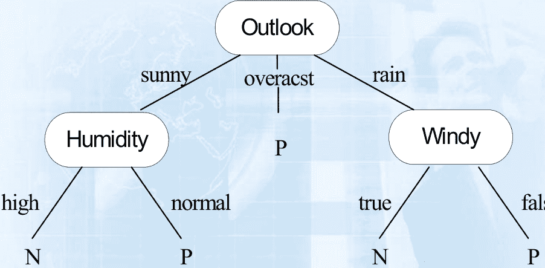

图　打高尔夫球问题的决策树

### 3.2.2.3 ID3算法

- 优势
  - 算法理论清晰
  - 方法简单
  - 学习能力较强
- 不足之处
  - 对较小的数据集有效
  - 对噪声比较敏感
  - 当数据集增大时，决策树可能会改变。

### 3.2.2.4 C45算法

- C45算法

ID3有很多改进算法，其中Quinlan在1994年开发出的C45算法流行最广。

C45的改进主要体现在两方面：

- （1）解决了连续数据值的学习问题；
- （2）提供了将学习结果决策树到等价规则集的转换功能。

### 3.2.2.4 C45算法

- C45算法

C45属于一种归纳学习算法。归纳学习（Inductive Learning）旨在从大量经验数据中归纳抽取一般的判定规则和模式，它是机器学习（Machine Learning）中最核心、最成熟的一个分支。

根据有无导师指导，归纳学习又分为有导师学习（Supervised Learning，又称为示例学习）和无导师学习（Unsupervised Learning）。

C45属于有导师的学习算法。

### 3.2.2.4 C45算法

- 示例学习算法分为两大类：
  - 覆盖算法（covering algorithms）
  - 分治算法（divide-and-conquer algorithms）

- 前者归纳生成规则，后者归纳生成决策树。

### 3.2.2.5 Autoclass算法

- Autoclass算法
  是一个基于Bayesian网络的无监督的分类算法，该算法可以处理连续和离散的属性。对于连续属性值，用户应先验说明属性的概率分布类别（比如正态分布）；而对于离散属性，用户可以说明属性可能的所有取值。

Autoclass算法可以把属性单独考虑，也可以先验说明某些属性的联合分布。该算法根据先验的概率分布类别，探索性地将数据集多次分成不同个数的类，然后比较这些分类，给出较优的几个结果。

### 3.2.2.6 神经网络算法

人工神经网（Artificial Neural Network, ANN）是20世纪80年代后期迅速发展起来的人工智能技术，它对噪声数据具有很高的承受能力，对未经训练的数据具有分类模拟的能力，因此在网站信息、生物信息和基因以及文本的数据挖掘等领域得到了越来越广泛的应用。在多种ANN模型中，反向传播（Back Propagation, BP）网络是应用最广的一种。

### 神经元

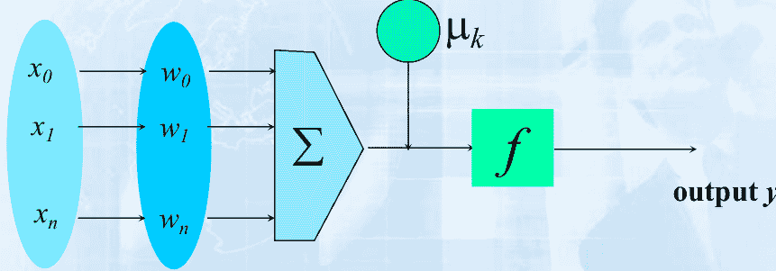

通过非线性函数n维的输入向量 x 被映射为变量 y

### 神经网络的组成

基本的BP网络由输入层、输出层和隐层组成。

输入向量

输出节点

隐层节点

输入节点

输入向量: $x_i$

$Err_j = O_j(1-O_j)\sum_k Err_k w_{jk}$

$\theta_j = \theta_j + (l)Err_j$

$w_{ij} = w_{ij} + (l)Err_j O_i$

$Err_j = O_j(1-O_j)(T_j - O_j)$

$w_{ij}$

$O_j = \frac{1}{1+e^{-I_j}}$

$I_j = \sum_i w_{ij} O_i + \theta_j$

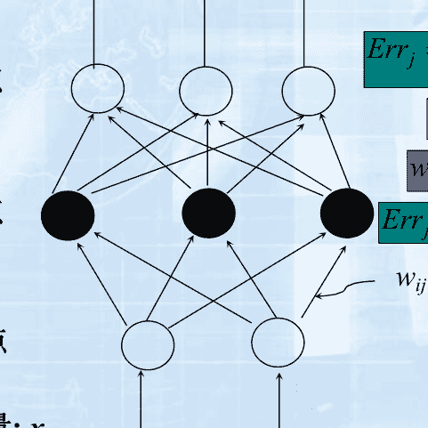

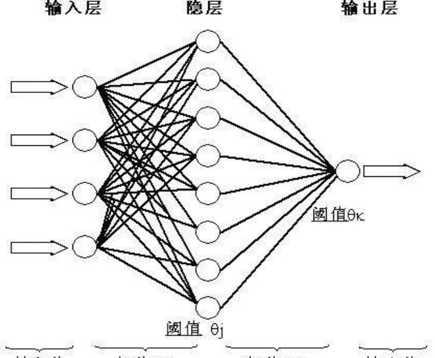

### 输入层

### 隐层

### 输出层

阈值θk

阈值 θj

输入值

权值W_ij

权值W_jk

输出值

### 神经网络的拓扑结构

神经网络训练之前，需要设计网络拓扑结构。设计网络拓扑的关键是，确定隐层的神经元个数及各神经元初始权值和阈值（偏差）。理论上讲，隐层的神经元数越多，逼近越精确。但实际上，隐层神经元数不宜过多；否则会极大加长训练时间，并造成网络容错能力下降。经训练后的神经网络若其准确性不能被接受，则必须重新进行拓扑设计或改用不同的初始权值和阈值（偏差）。

### 神经网络的训练

- 训练的终止条件
  - 获得一组权重值，使得训练集中几乎所有样本都分类正确
- 训练步骤
  - 利用随机值对权值进行初始化
  - 将训练样本逐一地输入给神经网络，进行训练
  - 对于每个神经元
    - 将其所有的输入值进行线性求和计算得到总的输入
    - 利用激励函数计算其输出值
    - 计算误差
    - 修正网络权值和阈值（偏差）

### BP神经网络

BP神经网络通过迭代处理一组训练样本，将各样本的网络预测与实际已知类标号进行比较实现学习训练，反向修改网络的权值，使得网络预测与实际类之间的误差平方最小。BP神经网络按照最优训练准则反复迭代，确定并不断调整神经网络结构，通过迭代修改，当误差收敛时学习过程终止。

因此，具有分类准确、收敛性好、动态性好和鲁棒性强等优点。


### BP神经网络存在的问题
- 收敛速度问题
BP分类器最大的弱点是其训练速度非常缓慢，难以收敛。尤其是当网络的训练达到一定程度后，收敛更为缓慢。
- 局部极小点问题
BP算法采用的是梯度下降法，对一个复杂的网络而言，其误差曲面是一个高维空间中的曲面，其中分布着许多局部极小点，一旦陷入了局部极小点则算法很难逃离出来。
- 网络瘫痪问题

在训练过程中，权值可能变得很大，这会使神经元的网络输入变得更大，从而使得其激励函数的一阶导函数在此点上的取值很小。此时的训练步长会变得非常小，最终导致网络停止收敛，这种现象即是所谓的网络瘫痪现象。

### 其它的分类算法
- 基于案例推理的分类
- 基于遗传算法的分类
- 基于粗糙集的分类
- 基于模糊集的分类

### 3.3 关联
### 3.3.1 基本概念
### 3.3.2 典型算法
### 3.3.3 算法实现

### 3.3.1 基本概念
- 关联
自然界中某种事物发生时其他事物也会发生，则这种联系称之为关联。反映事件之间依赖或关联的知识称为关联型知识（又称依赖关系）。
- 关联的类型
分为简单关联、时序关联、因果关联。
- 关联规则

关联是两个或多个变量取值之间存在的一类重要的可被发现的某种规律性。

#### 关联规则的数学定义

先设 I={i1，i2，…，im} 是一个以 m 个不同项为元素的集合，T 是针对 I 的交易的集合，每一笔交易包含若干个属于 I 的项。关联规则可表示为 X⇒Y，其中 X，Y ⊂ I 且 X ∩ Y=Φ

X 称为规则的前提或前项，Y 称为结果或后项。每一规则有两个度量标准，即支持度（Support）和可信度（Confidence）

规则的支持度定义为：support（X⇒Y）=support（X ∪ Y）

规则的可信度定义为：confidence（X⇒Y）=support（X ∪ Y）/support（X）
- 关联规则的形式

R: X=> Y
其中，X及Y是两个不相交的集合，即X,Y⊂I且X∩Y=Φ

关联规则可以理解为一个命题，即如果一个交易支持项集X，则它也以一定的可能性支持项集Y，这一可能性称之为规则的可信度，记为conf(R)或C(R)
- 举例
- 规则形式: Body → Head [support, confidence]
- buys(x, “diapers”) → buys(x, “beers”) [0.5%, 60%]
- major(x, “CS”) ^ takes(x, “DB”) → grade(x, “A”) [1%, 75%]
- 关联规则的性质
- 规则的非结合性
- 规则的不可分解性
- 规则的不可传递性
- 规则的可扩展性

### 关联规则挖掘实例

通过发现顾客放入其购物篮中不同商品之间的联系，分析顾客的购买习惯。通过了解哪些商品频繁地被顾客同时购买，这种关联的发现可以帮助零售商制定营销策略。例如，在同一次购物中，如果顾客购买牛奶的同时，也购买面包（和什么类型的面包）的可能性有多大？

这种信息可以引导销售，可以帮助零售商有选择地经销和安排货架。例如，将牛奶和面包尽可能放近一些，可以进一步刺激一次去商店同时购买这些商品。

### 关联规则挖掘实例

购物篮

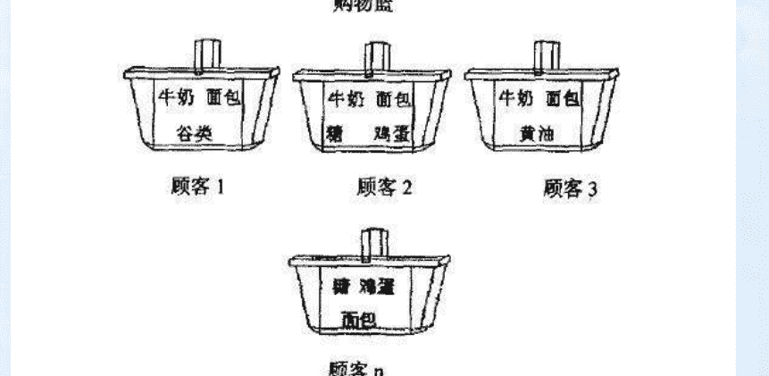

# 购物篮关联分析实例图

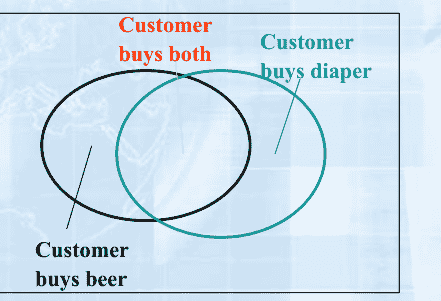

“啤酒与尿布”的关联规则

### 关联挖掘实例

| Transaction ID | Items Bought |
|---|---|
| 2000 | A,B,C |
| 1000 | A,C |
| 4000 | A,D |
| 5000 | B,E,F |

Min. support 50%
Min. confidence 50%

| Frequent Itemset | Support |
|---|---|
| {A} | 75% |
| {B} | 50% |
| {C} | 50% |
| {A,C} | 50% |

For rule A ⇒ C
support = support({A C}) = 50%
confidence = support({A C})/support({A}) = 66.6%
For C ⇒ A (50%, 100%)
The Apriori principle:
Any subset of a frequent itemset must be frequent

### 3.3.2 典型算法
- 典型算法
- AIS 算法（R. Agrawal等提出）
- Apriori算法（及变种AprioriTid和AprioriHybrid）
- SETM 算法（M. Houtsma等提出）
- DHP 算法（J. Park等提出）
- PARTITION 算法（A.Savasere等提出）
- Sampling 算法（H.Toivonen提出）
- FP-growth 算法（Jiawei Han提出）
- AIS算法的主要思想

其主要思想是一边扫描数据库，一边产生候选项集并累计支持度。具体地说，在对数据库进行第k次扫描时，候选项集是由第k−1次扫描所产生的边界集（frontier set）通过增加当前事务中的项得到，同时计算候选项集中元素的支持数，直到某次扫描所产生的边界集为空。

缺点：生成的候选项集太大。
- **Apriori算法的主要思想**

该算法利用了频繁项集所具有的任意频繁项集的子集都是频繁项集的这一性质对数据库进行多次扫描：第一次扫描得到频繁项集的集合 L₀，第 k 趟扫描前先利用上次扫描的结果项目集 Lₖ₋₁，产生候选 k 项集的集合 Cₖ，然后再通过扫描数据库确定 C 中每一个候选 k 项集的支持数，最后在该次扫描结束时求出频繁 k 项集的集合 Lₖ，算法的终止条件是 Cₖ 或 Lₖ 为空。

优点：所产生的候选项集比 AIS 算法少得多，效率较高。事实上，它被视为关联规则挖掘最经典的算法，其他很多算法都是其变种或改进。

#### SETM算法的主要思想

该算法实际上也是AIS算法的变形。SETM把候选集的产生和累计分开，在一个线性存储结构里存储了所有候选集和相应的交易的标识符（TID）。每次扫描结束后，不再读取数据库，而是对TID进行排序并累计各个候选集的支持度。其思想是扫描候选集的编码（TID）来代替扫描数据库，实质上是把数据库中与支持有关的信息单独提取出来，构成一个较小但充分的TID库。这种做法大大减少了数据库访问的时间。

缺点：候选项集过大。

#### DHP算法的主要思想

该算法利用散列表（hash table）产生候选集，是对Apriori算法的直接改进。在遍历一次数据库得到候选k−1项集的支持度，得到频繁k−1项集后，DHP算法将每一个事务的可能的(k+1)−项集通过哈希规则形成散列表。散列表的每一栏包括所有通过散列规则映射到该栏中的项集的数目。根据结果的散列表，可以生成一个位向量，当散列表中对应的该栏中的数值大于或者等于最小支持时，对应的位置为1，否则为0。用该向量可以过滤掉下一次生成候选时所不必要的项集：如果候选项在向量中对应位的值为0，则舍弃。这对候选2−项集的产生尤其为有效，可以在第二次就大大减小候选集的规模。

### DHP算法
- 优点

在某些场合，DHP算法的效率比 Apriori算法明显提高。

#### PARTITION算法的主要思想

该算法主要针对大型数据库，包括两部分：

(1) 将目标数据库分为n个互不相交的子数据库D1，…，Dn，每个Di（i=1，2，…，n）的大小都要能容纳在内存中。然后把每个Di，读入内存并按一般算法发现频繁项集Li。再把所有的Li合并为数据库D的潜在频繁项集PL = ∪i Li；

(2) 计算潜在频繁项集PL在D中的支持度，得出频繁项集L。

• Sampling算法的主要思想

对数据库D进行随机抽样得到抽样事务数据库D′，先以小于指定的支持度（minsup）挖掘D′中的频繁项集L′，再在剩余的数据集D-D′中继续计算L′中各元素的支持数，最后再以minsup求出L。这在大多数情况下就可以求得所有的频繁项集，但是有时会漏掉一些。这时可以对D进行二次扫描以发现漏掉的频繁项集。

优点：多数情况下只需对数据库扫描一次，最坏情况下也只需扫描两次。


### 3.3.3 算法实现

- **Apriori 算法的实现**
  1. 由候选项集（candidate itemset）产生频繁项集（frequent itemset）；
  2. 由频繁项集（frequent itemset）产生强关联规则（strong association rule）。

- **Apriori算法的基本流程**

使用逐层搜索的迭代方法，通过对数据库的多次扫描发现所有的频繁项集。在每一趟扫描中只考虑具有同一长度k(即为项集中所含项目的个数)的所有项集。算法的第一次扫描仅仅计算每个项目的具体支持度，以确定长度为1的频繁项集。在后继的每一次扫描中，首先使用在前一次获得的频繁项集Lk-1和Apriori-gen函数产生的候选项集Ck，接着扫描数据库，计算Ck中候选项的支持度，最后确定候选项集中哪些真正成为频繁项集。重复上述过程直到再也发现不了新的频繁项集为止。

**Apriori算法实例**

**Database D**

| TID | Items |
|---|---|
| 100 | 1 3 4 |
| 200 | 2 3 5 |
| 300 | 1 2 3 5 |
| 400 | 2 5 |

Scan D

**C₁**

| itemset | sup. |
|---|---:|
| {1} | 2 |
| {2} | 3 |
| {3} | 3 |
| {4} | 1 |
| {5} | 3 |

**L₁**

| itemset | sup. |
|---|---:|
| {1} | 2 |
| {2} | 3 |
| {3} | 3 |
| {5} | 3 |

**C₂**

| itemset |
|---|
| {1 2} |
| {1 3} |
| {1 5} |
| {2 3} |
| {2 5} |
| {3 5} |

Scan D

**C₂**

| itemset | sup |
|---|---:|
| {1 2} | 1 |
| {1 3} | 2 |
| {1 5} | 1 |
| {2 3} | 2 |
| {2 5} | 3 |
| {3 5} | 2 |

**L₂**

| itemset | sup |
|---|---:|
| {1 3} | 2 |
| {2 3} | 2 |
| {2 5} | 3 |
| {3 5} | 2 |

**C₃**

| itemset |
|---|
| {2 3 5} |

Scan D

**L₃**

| itemsets | sup |
|---|---:|
| {2 3 5} | 2 |

设定最小支持度阈值为2


| 交易号 | 项集合 |
| --- | --- |
| T100 | I1, I2, I5 |
| T200 | I2, I4 |
| T300 | I2, I3 |
| T400 | I1, I2, I4 |
| T500 | I1, I3 |
| T600 | I2, I3 |
| T700 | I1, I3 |
| T800 | I1, I2, I3, I5 |
| T900 | I1, I2, I3 |

设定最小支持度阈值为2

扫描D，对每个候选项计数，生成C₁：

| 项集 | 支持度计数 |
| --- | --- |
| {I1} | 6 |
| {I2} | 7 |
| {I3} | 6 |
| {I4} | 2 |
| {I5} | 2 |

比较候选项支持度计数与最小支持度计数，生成L₁：

| 项集 | 支持度计数 |
|------|------------|
| {I1} | 6 |
| {I2} | 7 |
| {I3} | 6 |
| {I4} | 2 |
| {I5} | 2 |

由L₁产生候选集C₂：

| 项集 |
| --- |
| {I1, I2} |
| {I1, I3} |
| {I1, I4} |
| {I1, I5} |
| {I2, I3} |
| {I2, I4} |
| {I2, I5} |
| {I3, I4} |
| {I3, I5} |
| {I4, I5} |

再次扫描D，对每个候选项计数，产生L₂：

| 项集 | 支持度计数 |
| --- | --- |
| {I1, I2} | 4 |
| {I1, I3} | 4 |
| {I1, I5} | 2 |
| {I2, I3} | 4 |
| {I2, I4} | 2 |
| {I2, I5} | 2 |

对L₂进行连接&剪枝，产生C₃，即最终结果。

| 项集 |
| --- |
| {I1, I2, I3} |
| {I1, I2, I5} |

### 3.3.2 典型算法

- **Apriori 算法的局限性**

由于依赖于候选项集产生频繁项集的理论（Apriori类算法）所开发的算法具有先天的弱点，使得在基于Apriori算法开发的应用没有实质性突破。

Han等提出的一种新的算法理论，用一种压缩的数据结构(FP-tree)存储关联规则挖掘所需的全部数据信息，通过对源数据的两次扫描，将数据信息存到这种结构里，避开了产生候选项集的步骤，极大地减少了数据交换和频繁匹配的开销。这就是所谓无候选项集产生的算法(Frequent Patterns Growth, FP-growth)。

### 3.3.3 算法实现

- **改进的算法——FP-growth**

(1)它构造了一种新颖的、紧凑的数据结构FP-tree。它是一种扩展的前缀树结构，存储了关于频繁模式数量的重要信息。

(2)开发了基于FP-tree的模式片段成长算法，它从长度为1的频繁模式开始，只检查它的条件模式构建它的条件模式树，并且在这个树上递归地进行挖掘。模式的成长通过联合条件模式树新产生的后缀模式实现。

(3)挖掘过程中采用的搜索技术是基于分区的，通过分割再解决的方法，而不是Apriori类算法的自下向上产生频繁模式的集合。

- **FP-growth算法的主要思想**

该算法主要是为了克服类Apriori算法的产生候选项集的缺点，通过采用一种新的数据结构FP-tree来达到目的。

优点：只扫描数据库一次，并且不用产生候选项集，提高了效率。

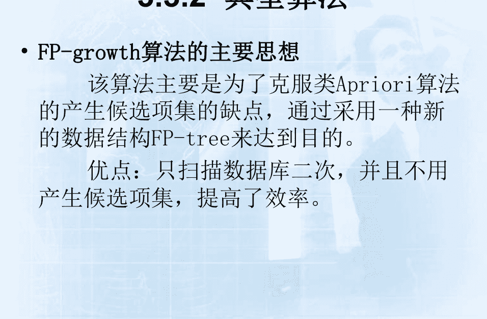

**FP-growth 算法实现**

| 交易编号 | 所有购物项 | （排序后的）频繁项 |
|---|---|---|
| 100 | f, a, c, d, g, i, m, p | f, c, a, m, p |
| 200 | a, b, c, f, l, m, o | f, c, a, b, m |
| 300 | b, f, h, j, o | f, b |
| 400 | b, c, k, s, p | c, b, p |
| 500 | a, f, c, e, l, p, m, n | f, c, a, m, p |

其中，最小支持度阈值为3

**FP-growth算法树的构造**

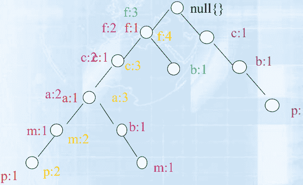

1. `f, c, a, m, p`
2. `f, c, a, b, m`
3. `f, b`
4. `c, b, p`
5. `f, c, a, m, p`

**FP-growth 算法实例**

**头表**

| 项 | 节点的头 |
|---|---| 
| f |  |
| c |  |
| a |  |
| b |  |
| m |  |
| p |  |

节点链性质对任意频繁项 a_i，顺着 a_i 的节点链，从 a_i 的头开始，可以找到包含 a_i 的所有频繁模式。

生成的FP树

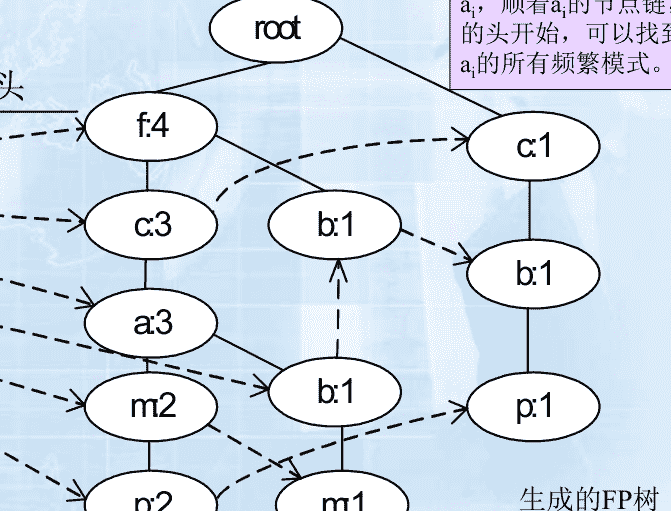

**FP-growth 与 Apriori的比较**

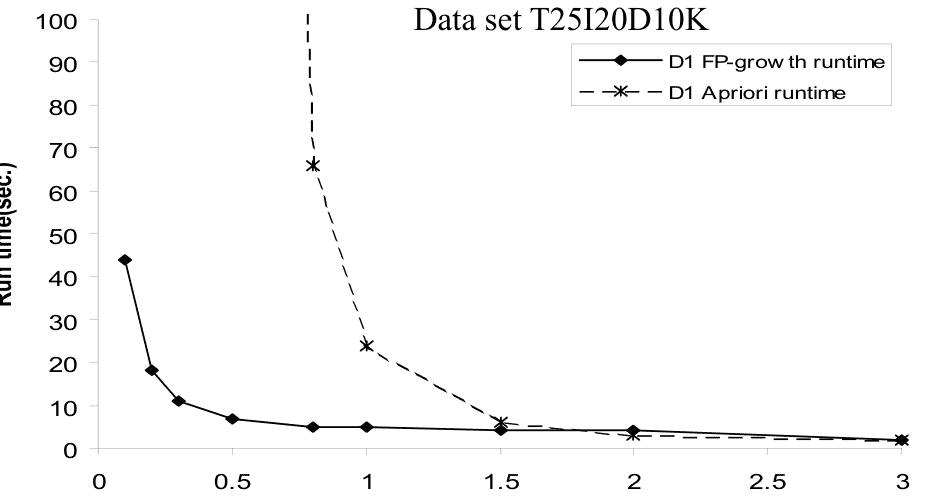

### 3.4 预测

### 3.4.1 概述

- 一方面，预测与分类相似
  - 首先，构建模型
  - 其次，使用模型预测未知值
- 预测的主要方法是回归
  - 线性回归和多元回归
  - 非线性回归
- 另一方面，预测不同于分类
  - 分类预测的是类别，而非连续的数值

### 3.4.2 典型算法

#### 3.4.3 算法实现


### 3.4.1 概述

#### 传统的预测方法

- 趋势外推法
- 时间序列法
- 回归分析法等

这些算法的原理简单，理论相对成熟，能用标准的技术来分析模型中的参数。

- 趋势外推法

通常用描散点图的方法定性地确定变化趋势，再按照该变化趋势对未来情况作出预测，特点是不对其中的随机成分作统计处理。

- 时间序列法

将因变量（预测目标）和自变量（影响预测目标的因素）均看成随机变量。实际问题中，多数预测目标的观测值构成的序列表现为（广义）平稳的随机序列或可以转化为平稳的随机序列。虽然在某一给定时刻预测目标的观测值是随机的，但从整个观测序列看，却呈现出某种随机过程（如平稳随机过程）的特性。随机时间序列方法正是依据这一规律性来建立和估计产生实际序列的随机过程的模型，然后用这些模型进行预测。

- 回归分析法

假设同一个或多个独立变量存在相关关系，寻找相关关系的模型。不同于时间序列法的是：模型的因变量是随机变量，而自变量是可控变量。

分为线性回归和非线性回归。

目前多用多元线性回归模型。

随着科学技术的迅速发展，预测理论也得到了长足的进步，出现了不少新的研究方法，综合起来主要包括：

- 人工神经网络（ANN）预测方法
- 专家系统预测方法
- 模糊预测方法
- 小波分析预测方法
- 优选组合预测方法等

- 人工神经网络（ANN）预测方法

目前应用最广泛的短期预测方法。它是一种通用的非线性自适应函数估计器，通过对研究目标的历史数据训练，建立起复杂的非线性映射模型。它不依赖于输入变量和预测目标之间明确的表达式，输入变量和预测目标之间的关系通过训练过程来形成，避免了建模过程的困难；另一显著特征是它的自适应算法，在每一时刻都可以选择新的训练样本来估计和调整系统参数，得到预测值。现在多采用误差反向传播（BP）算法和径向基函数（RBF）方法。但是，它的隐层神经元个数不易确定，易陷入局部最优点，需要大量训练样本且训练时间较长。

- 专家系统预测方法

基于知识建立起来的计算机系统，它拥有某个领域内专家们的知识和经验，能像专家们那样运用这些知识，通过推理作出决策。实践证明，专家系统预测不仅需要新技术的支持，同时也需要融入人类自身的经验和智慧。因此，需要专家系统的相关技术。但是，知识获取的“瓶颈”问题妨碍了专家系统的快速开发。

- 模糊预测方法

建立在模糊数学理论上的一种预测新技术，模糊数学是用数学方法来研究和处理具有“模糊性”的现象。所谓模糊性主要是指有关事物差异的中间过渡中的不分明性，如温度值的“高与低”等，这些模糊现象很难明确划分其界限。

- 小波分析预测方法

20世纪数学研究成果中最杰出的代表。它是一种时域—频域分析方法，在时域和频域上同时具有良好的局部化性质。

- 优选组合预测方法（两种）
  - 一是指将几种预测方法所得预测结果，选取适当权重进行加权平均；
  - 二是指将几种预测方法进行比较，选择拟合优度最佳或标准离差最小的预测模型作为最优模型进行预测。

组合预测方法是建立在信息利用最大化的基础上，它集结多种单一模型所包含的信息，进行最优组合。因此，在大多数情况下，通过组合预测可以达到改善预测结果的目的。

### 3.4.2 典型算法

- 线性回归　　Y = α + β X
  - 利用实际数据估计参数 α 和 β
  - 对已知值的 Y1, Y2, …, X1, X2, …. 进行最小平方运算
- 多元回归　　Y = b0 + b1 X1 + b2 X2.
  - 很多非线性方程均可以转换为上述的形式
- Log-linear 模型
  - 联合概率的多维表近似为低阶表的乘积。
  - Probability: p(a, b, c, d) = αab βac χad δbcd

#### 3.4.2 典型算法—Polynom

- **Polynom算法**

一个经典的多元回归算法。其原理如下：
设 y 为预测目标变量，x₁，x₂，……xₚ 为 p 个影响目标的因素。假定它们满足公式：
y = a₁x₁ + a₂x₂² + …… + aₚxₚᵖ，则可以根据已有的数据估算出系数 a₁，a₂，……aₚ 的变化，从而作出预测。

### 数据的预测

#### 相关性分析

利润:

-365.00~480.00
805.00~1000.00
1260.00~6005.00
480.00~605.00
1130.00~1260.00

| # | 预测名称 | 值 |
|---|---|---|
| 1 | Sale_Price (4950.000 ~ 91950.000) |  |
| 2 | Channel |  |
| 3 | Cost_of_Goods_Sold (3900.000 ~ 86900.000) |  |
| 4 | Advertising_Cost (0.000 ~ 1715.000) |  |
| 5 | Average_Sales_Area (1130.000 ~ 4230.000) |  |

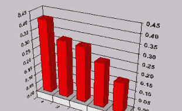

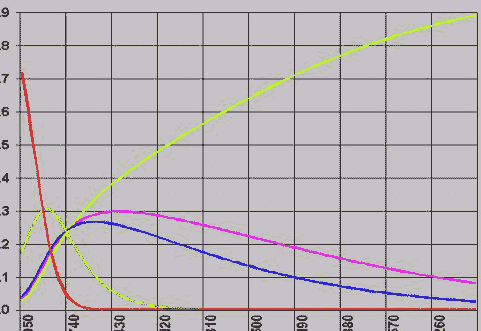

### 类别的预测

#### 相关性分析

利润:

-365.00~-480.00
805.00~1000.00
1260.00~6005.00
480.00~605.00
1130.00~1260.00

露营连锁

GO Outlet

独立

大众营销商

运动连锁

| # | 预测名称 | 值 |
|---|---|---|
| 1 | Sale_Price (-4950.000 ~ 91950.000) |  |
| 2 | Channel |  |
| 3 | Cost_of_Goods_Sold (-3900.000 ~ 85900.000) |  |
| 4 | Advertising_Cost (0.000 ~ 1715.000) |  |
| 5 | Average_Sales_Area (1130.000 ~ 4230.000) |  |

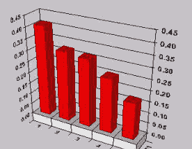

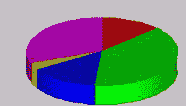

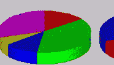


### 3.5 数据挖掘的可视化

以可视化的方式展示数据挖掘获取的相关知识。例如：

- 散点图和盒图 (obtained from descriptive data mining)
- 决策树
- 关联规则
- 聚类
- 异常点
- 规则

#### SAS Enterprise Miner 的散点图

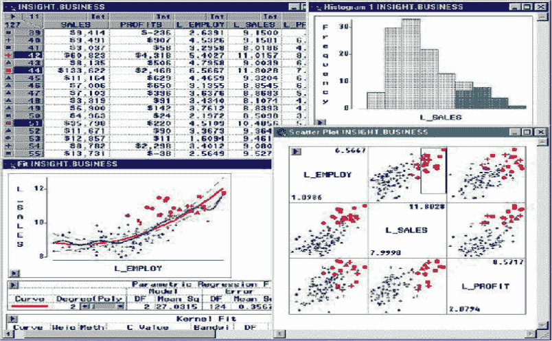

#### 关联规则的可视化（MineSet 3.0）

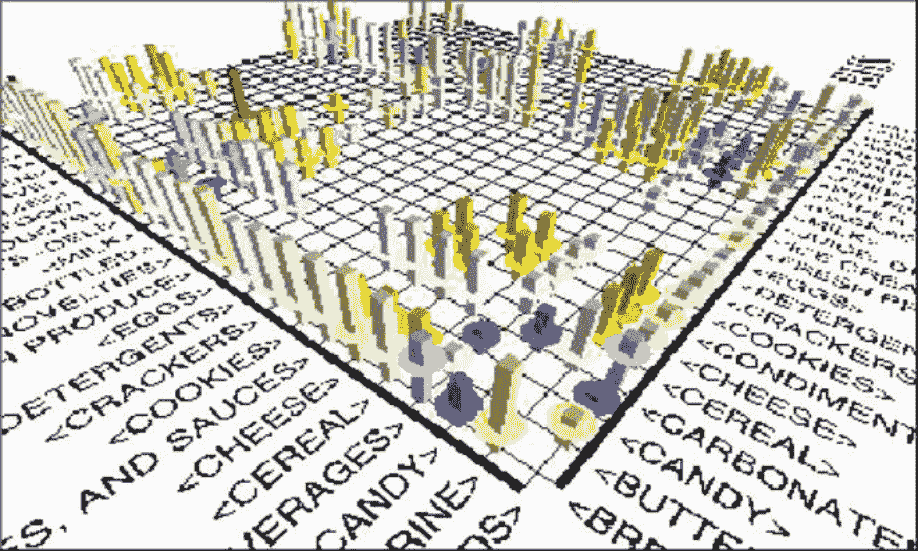

#### 决策树的 可视化（MineSet 3.0）

期限已过:
Acme Inc.
$33,346.01, 目标的89%，去年的36%

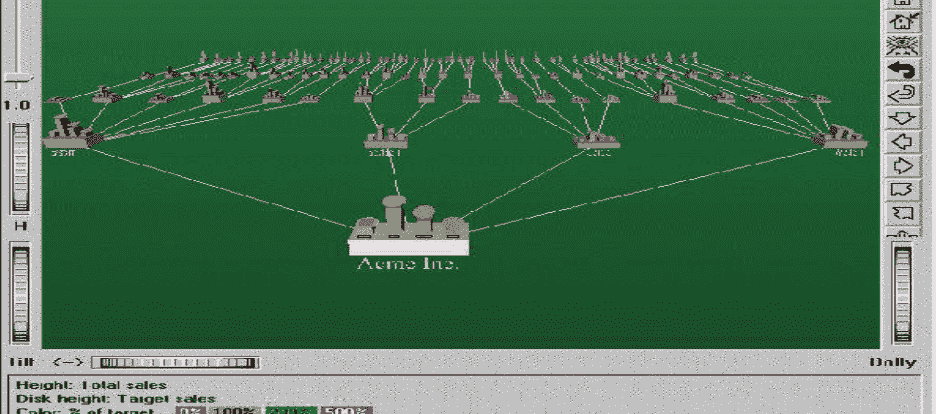

高度: 总销售额
磁盘高度: 目标销售额
颜色: 目标百分比
D3 100% 200% 500%

Acme Inc.


### 聚类的可视化（Intelligent Miner）

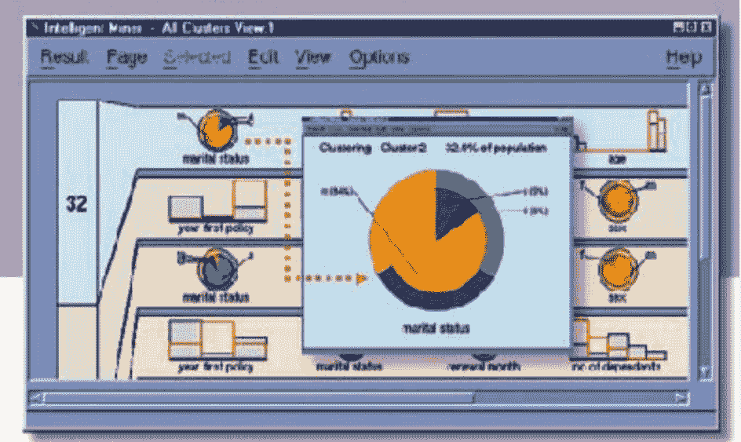

### 3.6 数据挖掘的实施

一般而言，一个企业实施数据挖掘项目有三种方式可供选择：

- 购买成熟的模型
- 购买一般性数据挖掘系统软件
- 构建数据挖掘系统

### 3.6 数据挖掘的实施

- 第一种方式实现简单，可以直接应用，但是要求模型所模拟的环境必须和企业的产品、客户以及市场条件相类似。当模型所涉及的环境条件改变的时候，这种模型不能根据环境的变化作出修改和调整。

### 3.6 数据挖掘的实施

- 第二种方式可以利用数据挖掘系统根据企业自己的数据生成模型。但是，一个通用的数据挖掘系统在对特定行业商业问题的理解上可能需要做很多工作；同时，如何与企业原有系统自动化集成也是一个需要着重考虑的问题。
- 第三种方式可以较好地解决与原有系统集成的问题，并可以直接面向特定的商业问题的解决。但是这种方式实现较复杂，项目实施周期长，成本较高。

### 3.6 数据挖掘的实施

当然企业也可以把上述方式结合起来。
例如：购买包含模型的数据挖掘软件或购买通用数据挖掘软件系统，然后进行针对本企业特点的二次开发等。

### 数据挖掘系统的典型结构

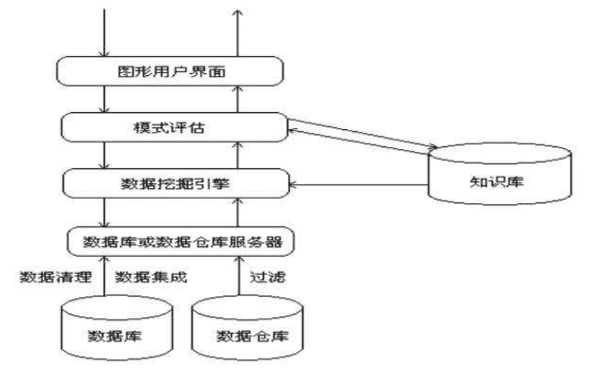

### 4 数据挖掘在电信领域的应用

#### 4.1 CRM与 ERP

#### 4.2 数据挖掘在电信领域的应用

#### 4.1 CRM与ERP

- CRM

CRM（Customer Relationship Management，客户关系管理），作为一种旨在改善企业与客户之间关系的新型管理机制。

CRM系统以数据仓库技术为基础，数据挖掘技术为核心。

#### 4.1 CRM与ERP

- ERP

ERP（Enterprise Resource Planning，即企业资源规划），是前几年国内外兴起的一种企业运作管理软件，它的侧重点是对企业内部的业务流程以及企业的资源进行管理。解决的是企业内部各环节的协调问题，如财务、生产、采购和仓储等部门间的协调关系。

#### 4.1 CRM与ERP

- ERP与CRM两者的关系

同样作为现代企业的管理软件，ERP与CRM在企业运营过程中，处于不同的位置，担任不同的角色。一个面向后台，一个面向前台。一个保证企业生产出更高质量的产品，而另一个帮助企业理顺与客户的关系，向客户提供最好的服务。这是企业在激烈的市场竞争保证胜利的不可或缺的两个环节。

#### 4.1 CRM与ERP

通过ERP与CRM系统的紧密集成，把企业供应商和服务商等都联成一个有机的整体，真正形成一个以客户为核心进行运作的虚拟企业，并最大限度地满足客户需要和最大限度地降低企业成本。


图 CRM与ERP有机结合的企业运作模式

### CRM的应用

数据挖掘在CRM中的市场营销，业务分析，客户服务等方面都有广泛的应。

例如：发展客户、提升客户价值、挽留客户等。

### CRM的应用

- 发展客户

每一个企业都希望能更快地发展新的客户，更多的客户意味着更大的市场占有率和更好的规模效益。数据挖掘技术可以帮助更准确地发现有价值的潜在客户，从而可以显著地降低发展新客户的成本，提高市场拓展的投入产出比（ROI）。

### CRM的应用

例如，假设一个电信业务提供商利用邮寄宣传材料开拓市场，一份宣传材料的成本是¥1.00。如果漫无目的地随机分发10000份，将有150人成为该公司用户，而其中能给公司带来利润的仅有100人。也就是说投入¥10000，得到了100个有价值的客户。现在采用数据挖掘技术，根据以前随机分发的数据或者新取样500人分发获取数据而后建立模型，根据该模型，发现前面的10000人中只有5000人值得投资，对此5000人邮寄宣传材料后有95人成为客户，其中90人可带来利润。结果是投入¥5500，获得了90个有价值的客户，显著地提高了投入产出比。

### CRM的应用

- 挽留客户

据一般经验估计，留住一个老客户地成本是发展一个新客户成本的3-5倍。留住有价值的客户保持利润的有力手段。而在电信行业，客户的频繁换网现象（churn）十分严重，留住客户比其它行业更加困难。数据挖掘在此问题上也有较好的应用。

### CRM的应用

要挽留客户首先要找出可能离网的客户，因此数据挖掘解决该问题的第一步即是建立离网客户预测模型。该模型可以利用已离网客户的历史资料（包括个人信息、消费行为等）来获得。第二步当然还得判断该客户是否值得挽留，这也用到预测模型，因为有些客户虽然目前是有微弱价值的但是最终毫无价值，有些客户则可能恰恰相反。

### CRM的应用

- 提升客户价值

提升现有客户的价值是提高利润的重要手段。在电信行业，客户价值提升包括交叉销售、增值销售和基本业务价值提升。数据挖掘是发现交叉销售/增值销售机会和分析基本业务价值提升可能性的重要手段。

### CRM的应用

发现交叉销售/增值销售机会涉及到两个模型。第一个模型用来确定哪些用户可以进行推销，哪些用户则不希望被打扰。如果多次对第二类用户进行推销，则可能失去该用户。第二个模型则用来发现对特定的用户推销哪些产品。显然，即使不考虑推销成本，多次向客户推销他并不想要的产品肯定会降低他对该企业的满意度。关联规则可能是第二个模型的重要组成部分。

### CRM的应用

基本业务价值提升要考虑的重要问题是预测用户在企业采取某种措施后其利润的变化情况。例如假设某个电信运营商采取某特定用户群亲友电话费减半的优惠策略来刺激消费，则必须要求这些用户的消费额增加或者能增加市场占有率公司才可能获得效益。

#### 4.2 电信领域的应用

- 4.2.1 客户行为与潜在客户分析
- 4.2.2 用户信用度分析
- 4.2.3 黑名单、红名单
- 4.2.4 优惠策略
- 4.2.5 甄别欺诈
- 4.2.6 趋势预测


#### 4.2 电信领域的应用

- 目的
利用成熟的数据挖掘工具或算法，对用户帐务数据、行为数据、基本信息数据，以及各营业点的销售记录等进行分析挖掘，找出各种数据之间的潜在关系，为企业经营者制定销售策略提供科学依据。

- 数据源
用户帐务数据库、用户行为数据库（话单数据）、用户基本信息库等。

#### 4.2.1 用户行为分析

对于企业的某一类或几类产品/业务来说，大致可将其用户分为四类：

- （1）潜在用户

目前还不是公司任何一项产品/业务的用户，但有使用该产品/业务的潜在趋势，这是市场竞争初期的重要营销对象。

- （2）增量用户

是公司某项产品或业务的使用者，并且有增加使用量的趋势。

#### 4.2.1 用户行为分析

（3）交叉增量用户
是企业某一产品/业务的使用者，并且有使用本公司另一类产品/业务的可能性。

（4）挽留客户
目前是公司的某一类或几类产品/业务的使用者，但有终止使用或转向别的产品/业务提供者转移的可能性。

### 客户行为信息数据库

### 按利润的等级排序规则

抽样

评分

统计分析

类别利润等级信息

抽样样本数据

聚类分析

类别模型

1

2

3

4

5

6

7

7

8

5

### 实现步骤

- 第一步　采用聚类算法对用户行为进行分类，根据得到的类别模型与客户行为信息库对个客户行为进行评分，结果写回客户行为信息库。
- 衡量用户行为的主要特征指标包括：
  - 客户ID
  - 时段
  - 工作日性质----工作日和非工作日
  - 消费金额
  - 业务类型（重要指长话，市话等通话业务），目的（重要指本地，长途，我网他网等信息）

### 实现步骤

- 第二步

统计分析各类别的行为特性，首先按照各行为类别的利润贡献大小对各类别进行排序。

例如：类别利润计算公式
类别平均利润=Σ（各行为消费金额）/类别行为个数

### 实现步骤

类别行为特性按不同主题有多种考察重点，如某一种业务或业务组合在各类别行为中出现的百分比，各行为的时间段分布情况等；这里得到两类类别统计信息表：按类别组织和按各种主题（如业务类型，业务量）组织。


#### 4.2.1 用户行为分析

主要包括两方面的分析：

- 群体分析
  利用聚类或分类算法，将企业客户根据某种规则分为若干群体。
- 行为分析（又称倾向建模）
  根据客户以前的消费行为，分析某几类有显著特征的行为模式，并据此对客户未来的行为进行预测。

上述两种建模技术均可以被用来提高企业营销目标对象的准确性并提高相应的收益。为达到这个目的，目前有很多的分析工具被应用，如：

- 交叉报表工具
- 基于机器学习的数据挖掘工具。如 MineSet、Intelligent Miner等
- 基于统计学的分析工具，如SAS、SPSS;
- 神经网络

#### 4.2.2 用户信用度分析

- 用户信用度等级描述
  详细描述用户信用度等级的具体含义。
- 信用等级分布表示
  客户的利润、客户的基本信息和行为分类如时间段、业务类型等的分布表示。类似于客户行为分析。
- 信用度的相关分析
  分析影响用户信用度的因素之间的概率依赖关系、强度及其可信度。这一方面用于预测客户信用度的发展趋势，当发生变化时，对其信用等级进行相应的调整。

利用上述分析结果，给出从一个信用度等级到另一个信用度等级变化可能性大的客户。可能决策者主要关心从高等级到低等级（最低等级）和从低等级到最高等级可能性大的用户群。

根据影响用户信用度的主要因素，对用户的账务数据进行分类，建立分类模型，并对用户进行评分，给出用户的信用度级别（类别）。

影响用户信用度的主要因素包括：

- (1) 交费的及时度
- (2) 用户的社会性质
- (3) 用户的通话业务量
- (4) 用户申请的业务数量
- (5) 用户申请的业务种类和用户的投诉情况

- 用户信用度分析的实现
  <1> 系统初装时，没有用户的信用度级别信息，这时采用聚类算法，按照用户的帐务行为信息将其分为若干类。在此基础上，依照每类各指标的统计数据和一定的等级评定规则，将各类的信用度赋于高低级别；
  <2> 在系统运转过程中，用户（指本系统用户）可能会对用户已有信用度级别提出异议，或加以修改，这样，对做了相应级别修正后的用户数据，采用有监督的分类学习，就会导致更为准确的分类模型，而且这个模型也是不断在更新的。相应的，随着用户信用行为特征的变化，其信用级别也会不断变动。

信用度类别分类依据的用户帐务信息数据包括：

- 开户平均时长
- 欠费次数
- 金额(如本月欠费，则为欠费金额，此值为负，如本月不欠费，则为通话费用，此值非负)
- 欠费时长
- 帐务人社会性质

##### 步骤1　用户信用度初始化

历史帐务信息数据库


抽样样本数据


类别模型1


信用度模型
更新模块

类别统计信息


修正的类别模型1

等级评定规则

##### 数据抽样

- 抽样的原则

样本尽量具有代表性，且数据量能保证学习耗时不是太多。

例如，可采用一个随机数产生器随机产生要抽取的样本。

历史帐务数据库

抽取

帐务记录ID

抽样

随机数发生器

供学习用样本数据

##### 步骤2 信用度模型更新

初始化后的帐务历史数据库

上月帐务数据

用户基本信息库

抽样

信用度人为设定

用户信用更新模块

信用度历史记录

训练样本数据

分类模型

有监督分类学习

##### 步骤3 用户信用度级别更新

当月帐务数据库

用户基本信息库

评分

分类模型

信用度历史记录库

营销接口

仓库接口

##### 步骤4 新开户信用度设定

用户的信用度级别设定是由用户的帐务信息决定的，而新开户用户没有任何帐务记录，故根据已有的信用度模型没法设置其信用度。考虑到有不同帐务行为的用户有不同的基本信息，即某种信用等级的用户具有相似的基本信息，我们可以分析新开户的基本信息，与各个信用等级的用户基本信息做比较，以确定他属于哪个信用级别，分为以下两步：

- 1. 分类模型确定
- 2. 新开户信用等级评定

用户基本信息数据


训练样本数据


分类模型

#### 4.2.4 优惠策略分析

优惠策略（包括营销优惠策略和话费优惠策略）主要完成：

- （1）定义优惠规则和优惠方式；
- （2）用户优惠规则参数化处理；
- （3）对已有优惠策略的性能分析；
- （4）优惠套餐的设置；
- （5）各种优惠和业务、以及其他信息分布关系的展示功能。

优惠规则分为：

- 时段优惠

用户可享受国家规定的时段优惠外，系统还应提供有各个公司制定的适用于本地的时段优惠措施
- 总量优惠

对用户的业务量达到一定的程度后，给予不同的优惠措施。

##### 优惠方式分析

- 对于各种优惠方式（包括优惠套餐），给出其受益客户的类别、信用度类别分布、欺诈情况和投诉类别分布等。例如，优惠策略的行为类别分布及其柱状图和饼状图等。
- 新优惠套餐设置分析。给出新的优惠套餐的设置与客户群的分析及利润分析。（优惠套餐的设置参数必须在以前的优惠策略中出现过），分析优惠套餐使用者的其他各项属性的概率，从而给出这种优惠（资费）的客户群体。同时可以查找最优化的优惠设置。

- 优惠策略或优惠套餐潜在客户分析。
- 优惠策略的性能分析。通过分析优惠策略和业务量和收入之间的关系，给出优惠策略的性能。

#### 4.2.5 甄别欺诈

当前恶意欠费客户给电信运营商造成了巨大的利润损失，如何减少欺诈行为带来的损失是每一家电信企业所必须面对的问题。在识别欺诈客户，降低经营风险方面数据挖掘已经不少有了成功的应用案例。

识别欺诈客户的主要途径：

- 1. 第一个是区分用户的信用度，通过建立用户信用打分模型把用户分成不同的信用度等级，给不同的等级确定不同的月高额限制，超出限额的认为是潜在恶意欠费客户。
- 2. 第二是建立恶意欠费客户的消费识别模型，如果某一客户的消费模式吻合欺诈消费模式，则认为是潜在恶意欠费客户。

甄别欺诈策略分析类似优惠分析，建立在信用度管理的基础之上。

- 分析防欺诈策略的相关变量：高额话费额度、欠费停机额度和用户具有不同的欠费停机额度等。
- 指定防欺诈策略
- 分析信用度、客户的满意程度、高额花费警告额度和停机额度之间的关系。根据分析结果调整用户的基本信息。
- 分析信用度、客户的满意程度和用户催缴周期、催缴频率之间的关系。

#### 4.2.6 预测

预测主要指业务预测，是针对电信量发展的短期预测。它建立在对大量数据（业务资料数据、社会基础资料数据、市场调查资料、其他运营者资料数据）统计分析的基础上，通过模型运算、统计分析等数据处理手段，完成对电信业务的业务发展、用户需求数量、用户分布、市场占有率等几方面的预测分析。

### 数据挖掘的认识误区

- ◆ 挖掘出的结果都是正确的

数据挖掘得出的结果一般都是经验性的，它并不是一条经过严格数学证明的定理（事实上数据挖掘得出的规则绝大多数不可证明）。例如数据挖掘号称能通过历史数据的分析来预测客户的行为，而事实上客户自己可能都不明确自己下一步要做什么。挖掘算法并不保证结果的完全正确，挖掘出的结果只具有概率上的意义，只具有参考价值。


### 数据挖掘的认识误区

- ◆ 挖掘获得的模型可普遍适用

数据挖掘仅仅根据它所处理的数据得出结果，结果的适用范围受限于数据的选择。我们不能保证一个在美国运行得非常成功的银行信用卡客户信用评级模型在中国也同样可信；当然我们也不能保证一个零售业的客户利润分析模型同时适用于电信行业。

- 数据挖掘可以完全自动化

当然数据挖掘可以做到完全的自动化，但是，挖掘结果对商业目标的价值不是挖掘算法所能判断的，用户需要在他们能理解的背景环境中，观察挖掘输出的结果并与之交互。很多时候一个挖掘目标的完成需要多次叠代的挖掘过程才能完成。在一定的意义上，一个半自动的数据挖掘环境可能是更好的。

数据挖掘是一个工具，而不是魔杖。它不会坐在数据库上一直监视着数据库，然后当发现有意义的模型时给管理者发一封电子邮件。它仍然需要了解用户的业务，理解用户的数据，弄清分析方法。数据挖掘只是帮助专业人士更深入、更容易的分析数据。而无法告知某个模型对企业的实际价值。而且数据挖掘中得到的模型必须在现实生活中进行验证。

### 主要内容

- 1. 概述
- 2. 数据仓库与OLAP技术
- 3. 数据挖掘技术
- 4. 数据挖掘在电信领域的应用
- 5. 数据挖掘工具
- 6. 数据挖掘实例

### 5 数据挖掘工具

- 5.1 概述
- 5.2 几种数据挖掘工具比较
- 5.3 典型工具介绍
- 5.3.1 DBMiner
- 5.3.2 Admocs
- 5.3.3 Predictive—CRM
- 5.3.4 SAS/EM（Enterprise Miner）
- 5.3.5 Weka

#### 5.1 概述

目前，世界上比较有影响的典型数据挖掘系统包括：

- Enterprise Miner（SAS公司）
- Intelligent Miner（IBM公司）
- SetMiner（SGI公司）
- Clementine（SPSS公司）
- Warehouse Studio（Sybase公司）
- See5（RuleQuest Research公司）
- CoverStory
- EXPLORA
- Knowledge Discovery Workbench
- DBMiner
- Quest等

- http://www.datamininglab.com


该网站提供了许多数据挖掘系统和工具的性能测试报告。

- IBM Intelligent Miner
  - A wide range of data mining algorithms
  - Scalable mining algorithms
  - Toolkits: neural network algorithms, statistical methods, data preparation, and data visualization tools
  - Tight integration with IBM's DB2 relational database system
- SAS Enterprise Miner
  - A variety of statistical analysis tools
  - Data warehouse tools and multiple data mining algorithms
- Microsoft SQLServer 2000
  - Integrate DB and OLAP with mining
  - Support OLEDB for DM standard

#### 5.2 几种数据挖掘工具比较

| 产品 | 公司 | 主页 | 版本 |
|---|---|---|---|
| Clementine | Integral Solutions, Ltd. | http://www.isl.co.uk/clem.html | 4.0 |
| Darwin | Thinking Machines, Corp. | http://www.think.com/html/products/products.htm | 3.0.1 |
| Enterprise Miner | SAS Institute | http://www.sas.com/software/components/miner.html | Beta |
| Intelligent Miner | IBM | http://www.software.ibm.com/data/iminer/ | 2 |
| PRW | Unica Technologies, Inc. | http://www.unica-usa.com/prodinfo.htm | 2.1 |
| Scenario | Cognos | http://www.cognos.com/busintell/products/index.html | 2 |

### 平台和数据库连接方式的比较

| 产品 | 单机版 | C/S版 | 数据源 |
|---|---|---|---|
| Clementine | PC和UNIX | 无 | ODBC |
| Darwin | 无 | Unix Server/PC Client | ODBC |
| Enterprise Miner | PC | Unix Server/PC Client和NTServer/PC | ODBC 和Native Database Drivers |
| Intelligent Miner | PC | Unix Server/PC Client | Native Database Drivers |
| PRW | PC | 无 | ODBC |
| Scenario | PC | 无 | 仅支持数据库文件（Debase、excel、csv等） |

### 算法方面的比较

| 算法 | Clementine | Darwin | Enterprise Miner | Intelligent Miner | PRW | Scenario |
|---|---|---|---|---|---|---|
| 决策树 | 有 | 有 | 有 | 有 | 无 | 有 |
| 神经网络 | 有 | 有 | 有 | 有 | 有 | 无 |
| 回归分析 | 有 | 无 | 有 | 有 | 有 | 无 |
| Radial Basis Functions | 无 | 有 | 无 | 有 | 有 | 无 |
| 最近邻 | 无 | 无 | 有 | 无 | 有 | 无 |
| 最近均值 | 无 | 无 | 无 | 无 | 有 | 无 |
| Kohonen Self-Organizing Maps | 有 | 无 | 有 | 无 | 无 | 无 |
| 聚类 | 有 | 无 | 无 | 有 | 有 | 无 |
| 关联规则 | 有 | 无 | 无 | 有 | 无 | 无 |

### 比较与分析

在算法参数控制和扩展功能选项方面，对比这些产品可以发现，Enterprise Miner和PRW对参数控制实现的较好，而Intelligent Miner在这方面较弱。几乎所有的产品都提供对决策树的实数值的处理和图形展示等扩展功能，但只有Clementine和Scenario较好地实现了树的修剪选项功能。此外，神经网络的扩展功能方面也有较大差别。

### 易用性方面的比较

| 产品 | 数据装载和操纵 | 模型建立 | 模型理解 | 技术支持 | 总体感觉 |
|---|---|---|---|---|---|
| Clementine | ＋＋＋ | ＋＋＋ | ＋＋＋ | ＋＋＋ | ＋＋＋ |
| Darwin | ＋－ | ＋＋ | ＋＋＋ | ＋＋ | ＋＋ |
| Enterprise Miner | ＋－ | ＋＋ | ＋＋ | ＋＋ | ＋＋ |
| Intelligent Miner | ＋－ | ＋＋ | ＋＋ | ＋＋ | ＋＋ |
| PRW | ＋＋＋ | ＋＋＋ | ＋＋＋ | ＋＋＋ | ＋＋＋ |
| Scenario | ＋－ | ＋＋＋ | ＋＋＋ | ＋＋ | ＋＋＋ |

### 挖掘过程自动化的比较

| 产品 | 对自动化的支持 |
|---|---|
| Clementine | 可视化编程和编程语言支持 |
| Darwin | 编程语言支持 |
| Enterprise Miner | 可视化编程和编程语言支持 |
| Intelligent Miner | 仅提供向导界面，不支持编程 |
| PRW | 有一个实验管理组件，支持宏 |
| Scenario | 自动化支持较弱，很多过程需手工完成 |


### 小结

这六种工具都是非常优秀的数据挖掘工具，但每一种可能适用于不同的环境。IBM的Intelligent Miner在市场上比较领先并有良好的技术支持；SAS的Enterprise Miner明显地偏向统计（因此更适用于适合统计的环境）；

在不清楚那种算法更好的情况下Unica的PRW是较好的选择，Cognos的Scenario则是其数据仓库系列产品的重要组件……。

### 如何选择数据挖掘工具

- 商用数据挖掘系统各不相同
  - 不同的数据挖掘功能和方法
  - 数据集的类型可能完全不同
- 多维视图
- 数据类型
  关系型的, 事务型的, 文本的, 时间序列, 空间的?
- 系统问题
  - 支持一种还是多种操作系统?
  - C/S 架构?
  - 提供Web接口，且允许输入/输出 XML 数据?

### 如何选择数据挖掘工具

- 数据源
  - ASCII文件、文本文件, 多个关系型数据源
  - 支持 ODBC 连接 (OLE DB, JDBC)?
- 数据挖掘功能与方法
  - 实现多种数据挖掘功能
  - 每种功能提供多种实现方法提供更多的数据挖掘功能和实现方法将使用者具有更大的灵活性和更强大的分析能力与数据库或数据仓库的耦合性
  - 四种耦合方式: 非耦合, 松散耦合, 半紧密耦合 和 紧密耦合
    - 理想情况下, 数据挖掘系统应该与数据库是紧密耦合的

### 如何选择数据挖掘工具

- **可伸缩性**
  - 行或数据库大小可伸缩性
  - 列或维度可伸缩性
  - 维度灾难：使系统具备列可伸缩性比行可伸缩性要困难得多

- **可视化工具**
  - “一图胜千言”
  - 可视化类别：数据可视化、挖掘结果可视化、挖掘过程可视化以及可视化数据挖掘

- **数据挖掘查询语言与图形用户界面**
  - 易于使用且高质量的图形用户界面
  - 对于用户引导的、高交互性的数据挖掘至关重要

#### 5.3.1 典型工具—DBMiner

- DBMiner 的主要功能
  - 基于发现的、OLAP 的多维分析
  - 关联和频繁模式分析
  - 分类（决策树分析）
  - 聚类分析
  - 3-D 立方体查看器和分析器
- 其他功能
  - OLAP 服务、立方体探索、统计分析
  - 序列模式分析（开发中）
  - 可视化分类（开发中）

### DBMiner Data and Mining Views (Working Panel)


### Mining Wizard - Mine

DBMiner 想发现什么样知识？

- OLAP Browser
- 3D Cube Explorer
- Association
- Classification
- Clustering

- Back
- Next >
- Cancel
- Help
- Finish

### OLAP (Summarization) Display Using MS/Excel 2000

DBMiner Enterprise - [#3: Cube Browse]

Window Options Edit View Insert Format Tools Chart File Mining Help

Field Button Prod...

Time 1997

Profit

PivotTable

PivotChart

Custom... Educat... Gender Marita... Product

Promot... Promot... Store Store... Store...

Time Yearly...

Product Family
Drink
Food
Non-Consumable

Deluxe Supermarket
Gourmet Supermarket
Mid-Size Grocery
Small Grocery
Supermarket

Drink
Food
Non-Consumable

Store Type

Chart1 Sheet1


### Display of Association Rules in Rule Plane Form

DBMiner Enterprise - [#8- Associator]

File Mining Associator View Window Options Help

Color: 1% >> Confidence >> 100%

Height: Support

Promotions = [No Promotion] ==> Gender = [M]; [support: 37.06%, confidence: 50.55%]

### Display of Decision Tree (Classification Results)

### DBMiner Enterprise - [#12- Classifier]

File Mining Classifier View Window Options Help

Classifying Attribute Gender
F
M

[Education Level] [Education Level] (Bachelors Degree)

[Education Level] [Education Level] (Graduate Degree)

[Education Level] [Education Level] (High School Degree)

[Customers] [City] (Altadena)

[Customers] [City] (Arcadia)

[Customers] [City] (Bellflower)

[Customers] [City] (Berkeley)

[Customers] [City] (Beverly Hills)

[Customers] [City] (Burbank)

### 3D Cube Browser

### DBMiner Enterprise - [#1 - 3D Cube Explorer]

File Mining 3D Cube View Window Options Help

Customers

Education Level

Gender

Bachelors Degree

Graduate Degree

High School Degree

Partial College

High School

M

CA

OR

WA

Color: 6.31481 Sales Average 6.6283

Size: $162.72 Profit 20520.1

For Help, press F1


### DBMiner的发展

- 从 DBMiner2.0 发展到 DBMiner2.5
  - 关系数据库与数据仓库系统的平滑集成
  - 支持 Microsoft OLEDB for Data Mining
  - 增加快速关联挖掘和序列模式挖掘方法
  - 增加可视化分类方法
- 朝向 RetailMiner、WeblogMiner、WebMiner、GeoMiner、MultiMediaMiner 和 DNAMiner 发展


### 相关链接

- 访问以下网址可获得 DBMiner 免费试用（90 天）
  - DBMiner 2.0 可从 www.dbminer.com 下载

#### 5.3.2 典型工具——Amdocs

在多年前，电信行业已经开始利用数据挖掘技术进行网络出错预测等方面的工作，而近年来随着 CRM 理念的盛行，数据挖掘技术开始在市场分析和决策支持等方面得到广泛应用。市场上更出现了针对电信行业的包含数据挖掘功能的软件产品。比较典型的有 Amdocs 和 S1p Infoware。

#### 5.3.2 典型工具——Amdocs

Amdocs 提供了整个电信运营企业的软件支撑平台。在其 Clarify CRM 产品组件中，利用数据挖掘技术支持以下应用：

- 客户流失管理（churn management）
- 终身价值分析（lifetime value analysis）
- 产品分析（product analysis）
- 欺诈甄别（fraud detection）。

Amdocs 产品中的数据分析和数据分析应用曾获得三届 KDD 杯奖。

#### 5.3.3 典型工具——Predictive CRM

S1p Infoware 开发的 Predictive CRM 软件是一个面向电信行业的 CRM 平台软件，其中应用了大量的数据挖掘和统计学技术。其数据挖掘部分实际上是把 SAS Institute、SPSS 和 UNICA 等公司的数据挖掘产品加以二次开发，以适应电信行业的需求。数据挖掘在 P-CRM 中的应用包括客户保持、交叉销售、客户流失管理、欺诈甄别等方面。

#### 5.3.4 典型工具——SAS/EM

利用 SAS 软件技术进行数据挖掘可以有三种方式：

- （1）使用 SAS 软件模块组合进行数据挖掘
- （2）将若干 SAS 软件模块联结成一个适合需求的综合应用软件
- （3）使用 SAS 数据挖掘的集成软件工具 SAS/EM

SAS/EM 是一个图形化界面、菜单驱动的、对用户非常友好且功能强大的数据挖掘集成软件，集成了：

- 数据获取工具
- 数据筛选工具
- 数据挖掘数据库
- 多种形式的回归工具
- 决策树浏览工具
- 数据挖掘的评价工具
- 数据取样工具
- 数据变量转换工具
- 数据挖掘过程
- 建立决策树的数据剖分工具
- 人工神经元网络


### SAS/EM—数据获取工具

通过对话框指定要使用的数据集的名称，并指定要在数据挖掘中使用的数据变量。变量分为两类：

- 区间变量（Interval Variable）

是指那些要进行统计处理的变量。对于这样一些变量，在数据输入阶段你就可以指定它们是否要作最大值、最小值、平均值、标准差等的处理。还可给出该变量是否有值的缺漏，缺漏的百分比是多少等。利用这些指定可对输入数据在获取伊始就进行了一次检查，并把结果告诉你，你可初步审视其质量如何。

- 分类变量（Class Variable）

区间变量以外的变量称之为分类变量。

在数据输入阶段将会提供给你每个分类变量共有多少种值可供分类之用。

### SAS/EM—数据取样工具

对获取的数据，可再从中作取样操作。取样的方式是多种多样的。主要包括：

- 随机取样
- 等距取样
- 分层取样
- 从起始顺序取样
- 分类取样
- ……

- 随机取样

在采用随机取样方式时，数据集中的每一组观测值都有相同的被取样的概率。如按 10% 的比例对一个数据集进行随机取样，则每一组观测值都有 10% 的机会被取到。

- 等距取样

如按 5% 的比例对一个有 100 组观测值的数据集进行等距取样，则有：100 / 5 = 20，等距取样方式是取第 20、40、60、80 和第 100 等五组观测值。

- 分层取样

在这种取样操作时，首先将样本总体分成若干层次（或者说分成若干个子集）。在每个层次中的观测值都具有相同的被选用的概率，但对不同的层次你可设定不同的概率。这样的取样结果可能具有更好的代表性，进而使模型具有更好的拟合精度。

- 从起始顺序取样

从输入数据集的起始处开始取样。取样的数量可以给定一个百分比，或者就直接给定选取观测值的组数。

- 分类取样

在前述几种取样方式中，取样的单位都是一组观测值。分类取样的单位是一类观测值。这里的分类是按观测值的某种属性进行区分，如按客户名称分类、按地址区域分类等。显然在同一类中可能会有多组观测值。分类取样的选取方式就是前面所述的几种方式，只是取样以类为单位。

### SAS/EM—数据筛选工具

通过数据筛选工具可从观测值样本中筛选掉不希望包括进来的观测值。对于分类变量可给定某一类的类值，说明此类观测值是要排除于取样范围之外的。对于区间变量可指定其值大于或小于某值时的这些组观测值是要排除于取样范围之外的。

通过数据筛选使样本数据更适合数据挖掘的目标。

### SAS/EM—数据变量转换工具

利用此工具可将某一个数据进行某种转换操作，然后将转换后的值作为新的变量存放在样本数据中。转换的目的是为了使数据和将来要建立的模型拟合得更好。例如，原来的非线性模型线性化、加强变量的稳定性等。可进行取幂、对数、开方……等转换。当然，也可给定一个公式进行转换。

### SAS/EM—建立数据库

在进行数据挖掘分析模型的操作之前，要建立一个数据挖掘的数据库（DMDB），其中放置此次要进行操作的数据。因为此后可能要进行许多复杂的数学运算，在这里建立一个专门的数据集可提高工作效率。在处理之前，可对所选取的各个变量预先进行诸如最大、最小、平均、标准差……等处理。对一些要按其分类的变量的等级也先放入元数据之中，以利后继操作。

总之，在这个数据库中为数据挖掘建立一个良好的工作环境。

### SAS/EM—为建立决策树的数据剖分工具

对数据集进行聚类、建立决策树，是近来数据处理、进行决策支持常用的方法。在 SAS/EM 中亦支持这一功能。在建立决策树的过程中可有多种数据聚类、剖分的方法可供选择。

图形化界面的交互式操作，可分成六个层：

- （1）对数据挖掘数据库中选定数据集的操作
- （2）对数据集中的变量的处理
- （3）聚类、剖分时的基本选择项
- （4）聚类、剖分时的进一步操作选择项
- （5）模型的初步确定
- （6）结果的评价

### SAS/EM—决策树浏览工具

最后作出满意的决策树可能是个“枝繁叶茂”的架构。SAS/EM 提供了可视化的浏览工具。这一点很重要，一个复杂的决策树若难以观察，则会影响实施决策的效率，甚至是有效性。决策树浏览工具包括：

- 决策树基本内容和统计值的汇总表
- 决策树的导航浏览
- 决策树的图形显示
- 决策树的评价图表

### SAS/EM—数据挖掘评价工具

在 SAS/EM 的评价工具中，提供了一个通用的数据挖掘评价的架构，可以比较不同的模型效果；预报各种不同类型分析工具的结果。

在进行了各种比较和预报的评价之后，将给出一系列标准的图表，供用户进行定量评价。可能用户会有自己独特的评价准则，在 SAS/EM 的评价工具中，还可以进行客户化的工作，对那些标准的评价图表按你的具体要求进行更改。因此，评价工作可能会更有意义。

#### 5.3.5 典型工具——Weka

- 随机信息
  - Weka...
    - 怀卡托知识分析环境
  - Weka – 新西兰本土鸟类
  - 使用 Java 开发 – 具有跨平台能力
  - 用于研究、教育和应用
  - http://www.cs.waikato.ac.nz/ml/weka/


### Weka 界面

- 命令行
- 探索者（Explorer）
  - 预处理、属性选择、学习、可视化
- 知识流（Knowledge Flow）
  - KDD 过程的可视化设计
  - 功能类似于探索者
- 实验者（Experimenter）
  - 测试和评估机器学习算法


### Weka的功能

- 预处理
- 分类
- 聚类
- 关联
- 属性选择
- 可视化

### 预处理

- 预处理
  - 数据检查
  - 过滤，例如
    - 基于属性：归一化、离散化
    - 基于实例：删除、随机化
  - 选择训练数据
  - 选择测试数据
- 从文件导入：ARFF、CSV、C4.5、二进制
- 从 URL 或 SQL 数据库导入（使用 JDBC）
- 预处理过滤器
  - 添加/删除属性
  - 属性值替换
  - 离散化（MDL、Kononenko 等）
  - 时间序列过滤器（delta、shift）
  - 采样、随机化
  - 缺失值管理
  - 归一化及其他数值变换

### 属性选择

- 非常灵活：搜索与评估方法的任意组合
- 过滤方法和包装方法均可
- 搜索方法
  - 最佳优先
  - 遗传
  - 排名 ...
- 评估度量
  - ReliefF
  - 信息增益
  - 增益率 ...
- 演示：weather_nominal.arff – PCP + ranker 搜索

### 分类方法

- 分类
  - 算法

| 分类方法 | 说明 |
|---|---|
| 基础规则 | 1R – 单层决策树 – 仅使用最佳一级规则 |
| 统计建模 | 朴素贝叶斯 – 使用类先验概率与实例概率相结合 – 假设属性相互独立 |
| 决策树 | ID3 / C4.5 决策树归纳 – 在每个节点计算信息增益或增益率，以决定沿哪个分支继续划分 – 最大化类别分离度 |
| 覆盖规则 | 发现覆盖每个类别所有实例的规则 – 选择属性-值对以最大化分类规则 – PRISM 方法 |
| 关联规则 | 寻找具有高覆盖率和指定最小置信度的项集 – 适用于标称值 – Apriori 算法 |
| 线性模型 | 数值预测 – 通过线性回归最小化实际值与预测值之间的差异 |
| 基于实例的学习 | 计算属性集的欧几里得距离以找到最近邻算法 – 筛选 k 个最近邻匹配 |

### 分类

- 预测属性为类别型
- 已实现的方法
  - 朴素贝叶斯
  - 决策树和规则
  - 神经网络
  - 支持向量机
  - 基于实例的分类器 ...
- 演示：iris.arff、mushroom_simple.arff
- 评估
  - 测试集
  - 交叉验证 ...

### 聚类

- 聚类
  - 期望最大化（EM）
  - 简单 k-means
  - Cobweb
  - 最远优先
- 已实现的方法
  - *k*-Means
  - EM
  - Cobweb
  - X-means
  - FarthestFirst...
- 聚类结果可以可视化，并与“真实”聚类进行比较（如果提供）

### 回归

- 预测属性为连续值
- 已实现的方法
  - 线性回归
  - 神经网络
  - 回归树 ...
- 演示：goods.arff、cpu.arff

### 关联发现

- 仅适用于离散属性
- 已实现的方法
  - APRIORI
  - TERTIUS
- 能力有限 → GUHA
- 演示：baskets1n.arff

### 优点

- 可扩展性
- 特性
  - 方法
  - KDD 阶段
- 多模式使用与接口
  - 脚本化
- 免费（GPL）

### 关联

- 关联
  - Apriori
  - Tertius

### 选择属性

- 属性评估器，例如
  - 分类器子集评估器
  - 卡方属性评估器
- 搜索方法，例如
  - 最佳优先
  - 随机优先

### 输出

- 输出
  - 取决于所使用的具体方法
- 规则
- 类
- 树 – 可视化
- 聚类
- 关联
- 错误检查 – 可视化


### 演示
- Weka
  - 天气关系
    - 打开文件/data/weather.arff（数值型和标称型数据）
    - 预处理/颜色 {outlook play}/属性|1..5|
    - 分类/选择/树/J48/（类别设为play）/开始
    - 分类器输出/J48剪枝树/可视化树
  - 天气关系
    - 打开文件/weatherNominal.arff（标称型数据）
    - 预处理/颜色 {outlook play}/属性|1..5|
    - 分类/选择/树/J48/（类别设为play）/开始
    - 分类器输出/J48剪枝树/可视化树
    - 测试选项/提供的测试集/设置/打开文件/weatherNominalTest.arff

### 演示
- Weka
  - wBase 岩土工程数据关系
    - 打开文件/data/wBase-14x773num.arff（数值型和标称型数据）
    - 预处理/颜色 {class}/属性|1..14|/名称
    - 分类/选择/懒惰/IBk()/开始
    - 聚类/SimpleKMeans/开始/可视化聚类分配
    - 聚类/EM/开始/可视化聚类分配
    - 分类器输出/J48剪枝树/可视化树

### 数据准备
- 数据格式
- 电子表格文件
- CSV文件

### 数据格式 - 文件头
- 数据格式
  - 文件保存为 Filename.arff
  - arff = 属性关系文件格式
- 数据行用逗号分隔
- 关于属性的文件头信息

```
@relation weather-1
@attribute outlook {sunny, overcast, rainy}
@attribute temperature real
@attribute humidity real
@attribute windy {TRUE, FALSE}
@attribute play {yes, no}
@data
```

### 数据格式 - 数据
### 数据格式

```
@data
sunny,85,85,FALSE,no
sunny,80,90,TRUE,no
overcast,83,86,FALSE,yes
rainy,70,96,FALSE,yes
...
sunny,72,95,FALSE,no
sunny,69,70,FALSE,yes
rainy,75,80,FALSE,yes
sunny,75,70,?,yes
overcast,72,90,TRUE,yes
overcast,81,75,FALSE,yes
rainy,71,91,TRUE,no
```

表示数据块的开始

属性值用逗号分隔

缺失值用 '?' 表示

- 数据可以有成百上千行
- 任何数量的属性都可容纳，但...
- 挖掘算法在选定的属性上同样有效...
- 因此数据分析和准备至关重要！

### 生成CSV文件
- 将电子表格文件保存为 `relationFile.csv` 格式
  （逗号分隔值）
- 打开 Word 或任何文本处理器
- 插入（导入）`relationFile.csv` 文件
  - 进行任何数据处理
- 保存为纯文本格式
  `relationFile.txt`
- 将文件名改为 `relationFile.arff`

### 主要内容
- 1. 概述
- 2. 数据仓库与OLAP技术
- 3. 数据挖掘技术
- 4. 数据挖掘在电信领域的应用
- 5. 数据挖掘工具
- 6. 数据挖掘实例

### 小结

目前，虽然已经有了许多成熟的商业数据挖掘工具，但这些工具一般都是一个独立的系统，不容易与电信企业现业务支撑系统集成；而且由于数据挖掘技术本身的特点，一个通用的数据挖掘系统可能并不适用于电信企业。

切实可行的办法是借鉴成熟的经验，结合自身特点开发专用数据挖掘系统。

### 再见！


北京邮电大学 计算机科学与技术学院

郑岩 副教授/博士后

电子邮件：yanzheng@bupt.edu.cn

手机：13301170378

