# 北邮机器学习课件（xgwang）


## 机器学习

$x \rightarrow f(x) \rightarrow y$

Class label (Classification)

Real-valued vector (Regression)


Object recognition

{dog, cat, horse, flower, ...}


Super resolution


Low-resolution image

High-resolution image

## 分类

- $f(x)$ 预测 $x$ 所属的类别
- $f : \mathcal{R}^D \to \{1,\dots,K\}$
- $f(x)$ 由决策边界决定
- 作为一种变体，$f$ 也可以预测给定 $x$ 的类别概率分布，$f(x) = P(y|x)$。类别预测为 $y^* = \arg\max_k P(y = k|x)$

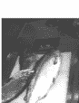

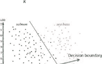

> (Duda et al. Pattern Classification 2000)

## 回归

- 预测实值输出
- $f : ℝ^D → ℝ^M$
- Example: linear regression
- $y = w^T x = Σ_{d=1}^D w_d x_d + w_0$

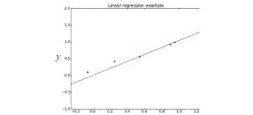

> (Bengio et al. Deep Learning 2014)

## 训练

- Training: estimate the parameters of f from {(x_i^(train), y_i^(train))}
- Decision boundary, parameters of P(y|x), and w in linear regression
- Optimize an objective function on the training set. It is a performance measure on the training set and could be different from that on the test set.

均方误差

- Mean squared error (MSE) for linear regression
- MSE_train = 1/N Σ_i || w^T x_i^(train) - y_i^(train) ||_2^2

交叉熵

- Cross entropy (CE) for classification
- CE_train = 1/N Σ_i log P(y = y_i^(train) | x_i^(train))

Why not use classification errors #{ f(x_i^(train)) ≠ y_i^(train) }?

## 优化

- The choice of the objective function should be good for optimization
- Take linear regression as an example

∇_w MSE^(train) = 0
⇒ ∇_w || X^(train) w − y^(train) ||_2^2 = 0
w = (X^(train)ᵀ X^(train))⁻¹ X^(train)ᵀ y^(train)
where X^(train) = [x₁^(train), …, x_N^(train)] and y^(train) = [y₁^(train), …, y_N^(train)].

## 泛化

- We care more about the performance of the model on new, previously unseen examples
- The training examples usually cannot cover all the possible input configurations, so the learner has to generalize from the training examples to new cases
- Generalization error: the expected error over ALL examples
- To obtain theoretical guarantees about generalization of a machine learning algorithm, we assume all the samples are drawn from a distribution p(x, y), and calculate generalization error (GE) of a prediction function f by taking expectation over p(x, y)

GE_f = ∫_{x,y} p(x,y) Error(f(x), y)

## 泛化

- However, in practice, $p(\mathbf{x}, y)$ is unknown. We assess the generalization performance with a test set $\{\mathbf{x}_i^{(\text{test})}, y_i^{(\text{test})}\}$

$\text{Performance}_{\text{test}} = \frac{1}{M} \sum_{i=1}^{M} \text{Error}(f(\mathbf{x}_i^{(\text{test})}), y_i^{(\text{test})})$

- We hope that both test examples and training examples are drawn from $p(\mathbf{x}, y)$ of interest, although it is unknown

# 欠拟合

- The learner cannot find a solution that fits training examples well
- For example, use linear regression to fit training examples {x_i^(train), y_i^(train)} where y_i^(train) is an quadratic function of x_i^(train)
- Underfitting means the learner cannot capture some important aspects of the data
- Reasons for underfitting happening
- Model is not rich enough
- Difficult to find the global optimum of the objective function on the training set or easy to get stuck at local minimum
- Limitation on the computation resources (not enough training iterations of an iterative optimization procedure)
- Underfitting commonly happens in deep learning with large scale training data and could be even a more serious problem than overfitting in some cases


## 过拟合

- 学习器能够很好地拟合训练数据，但失去了良好的泛化能力，即其训练误差较小，但泛化误差较大。
- 容量大的学习器容易过拟合。
  - 函数族过大（相对于训练数据规模而言），其中包含许多都能很好拟合训练数据的函数。
  - 在数据不足的情况下，学习器无法区分哪一个最合适，只好在这些看似不错的解中任意选择。
  - 单独的验证集有助于选择更合适的解。
  - 在大多数情况下，数据受到噪声的污染。容量大的学习器倾向于描述随机误差或噪声，而不是数据（类）的底层模型。

在大多数情况下，数据受到噪声的污染。容量大的模型倾向于描述随机误差或噪声，而不是数据（类）的底层模型。

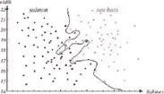

过于复杂的模型会导致决策边界复杂化。它能在训练样本上实现完美分类，但在新样本上表现不佳。

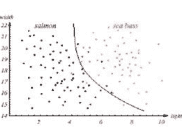

该决策边界可能代表了训练集性能与分类器简单性之间的最优折中，从而在新样本上获得最高准确率。

> (Duda et al. Pattern Classification 2000)

机器学习的基本要素是模型容量和泛化之间的权衡。

- 机器学习的基本要素是容量与泛化之间的权衡。
- 奥卡姆剃刀原理指出，在能够解释训练数据的相互竞争的函数中，应选择“更简单”的那个。简单性与容量相对。
- 奥卡姆剃刀原理建议我们选择的函数族应刚好大到只剩下一个能很好拟合数据的候选。

## 最优容量

- 训练误差与泛化误差之间的差异随学习器容量的增大而增大。
- 泛化误差是容量的 U 形函数。
- 最优容量与从欠拟合到过拟合的转变相关。
  - 可以使用验证集凭经验监测泛化误差。
- 最优容量应随训练样本数量的增加而增大。

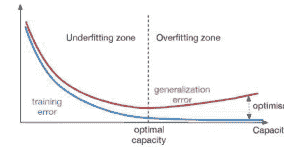

容量与训练误差及泛化（或测试）误差之间的典型关系。随着容量增大，训练误差可以降低，但乐观估计（训练误差与泛化误差之差）会增大。在某个点上，乐观估计的增幅大于训练误差的降幅（通常当训练误差已经很低且无法再大幅降低时），此时我们进入过拟合区间，即容量过大，高于最优容量。在达到最优容量之前，我们处于欠拟合区间。

> (Bengio et al. Deep Learning 2014)

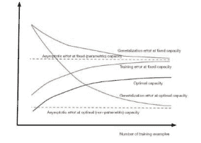

随着训练样本数量的增加，最优容量（黑色粗线）增大（我们可以承受更大、更灵活的模型），相应的泛化误差（绿色粗线）会降低，最终达到（非参数）渐近误差（绿色虚线）。如果容量固定（参数化设置），增加训练样本数量也会降低泛化误差（上方红色曲线），但速度较慢，而训练误差会缓慢增加（下方红色曲线），最终两者会汇聚到一个渐近值（红色虚线），该值对应于某类学习函数中可实现的最佳解。

> (Bengio et al. Deep Learning 2014)

## 练习题

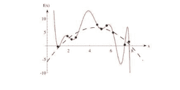

- 在上图中，训练数据（10 个黑点）是从一个二次函数加上高斯噪声中选出的，即 f(x) = w2 x² + w1 x + b + ε，其中 p(ε) = N(0, σ²)。10 次多项式完美拟合了这些数据。为了更好地预测新样本，应选择哪个学习器？是二次函数还是 10 次函数？
- 如果这 10 个训练样本是由一个 10 次多项式加上高斯噪声生成的，应选择哪个学习器？
- 如果这 100 万个训练样本是由一个二次函数加上高斯噪声生成的，应选择哪个学习器？


## 如何降低容量？

- 减少特征数量
- 减少**独立参数**的数量
- 减少深度模型网络规模
- 减少训练迭代次数
- 为学习器添加正则化
- . . .

## 维度灾难

- 为什么我们需要降低特征空间的维度？

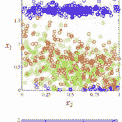

三个类别的训练数据的散点图。使用了两个特征。目标是对用 'x' 表示的新测试点进行分类。

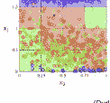

特征空间被均匀划分为单元。如果该单元中大多数训练样本来自同一类别，则该单元被标记为该类别。测试点根据其所在的单元的标签进行分类。

> (Duda et al. Pattern Classification 2000)

## 维度灾难

- 每个单元中的训练样本越多，分类器越稳健
- 单元的数量随特征空间维度的增加而指数增长。如果每个维度被划分为三个区间，单元的数量为 $N = 3^n$
- 当单元数量非常大时，一些单元是空的！

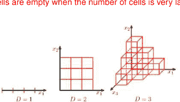

> (Duda et al. Pattern Classification 2000)

## 正则化

- 等价于对学习器可以作为解获得的函数集合施加偏好
- 在贝叶斯学习中，它体现为学习器可以评估的函数空间（或等价地其参数）上的先验概率分布
- 正则化通过对复杂性添加惩罚来防止过拟合
- 训练分类器/回归器是为了最小化
  训练集上的预测误差 + 正则化
- 示例
  - 线性回归的目标函数变为
    MSE_train + regularization = 1/N Σ_i (w^T x_i^(train) - y_i^(train))^2 + λ ||w||_2^2
- 多任务学习，迁移学习，dropout，稀疏性，预训练

bias(θ̂) = E(θ̂) − θ

其中期望是对从底层分布中抽样的大小为 n 的所有训练集求取的

- 如果 E(θ̂) = θ，则估计量称为无偏
- 示例：高斯分布。p(x_i; θ) = N(θ, Σ) 且估计量为 θ̂ = 1/n Σ_{i=1}^n x_i^{(train)}

E(θ̂) = E[ 1/n Σ_{i=1}^n x_i^{(train)} ] = 1/n Σ_{i=1}^n E[ x_i^{(train)} ] = 1/n Σ_{i=1}^n θ = θ

## 函数空间

学习器的函数族

f̂ 的变化

容量较低的学习器

## 函数空间

学习器的函数族

f̂ 的变化

容量较大的学习器

## 函数空间

学习器的函数族

f̂ 的变化

设计更好的学习器

## 总结：机器学习中需要关注的问题

- 有效的优化方法和模型来解决欠拟合问题
- 如何在容量和泛化之间取得平衡？
- 如何有效地降低容量（这也意味着降低估计方差）而不使偏差增加太多？
- 对于具有大数据训练的机器学习，如何有效地增加容量以覆盖或更接近待估计的真实函数？

## 开放讨论

- 为什么深度学习在大规模训练下与其他机器学习方法的行为不同？

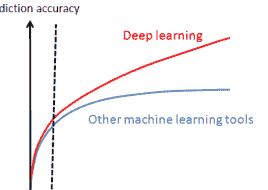

## 判别式模型

- 直接建模 $P(y|x)$ 和决策边界
- 学习判别函数 $g_k(x)$
  $$y = \arg\max_k g_k(x)$$
- 在线性情况下，$g_k(x) = w_k^T x$
- $P(y|x)$ 可以从线性判别函数估计得到
  $$P(y = j|x) = \frac{e^{w_j^T x}}{\sum_{k=1}^K e^{w_k^T x}}$$
  它也被称为 softmax 函数
- 示例：SVM，boosting，K-最近邻

## 判别式模型

- 判别式模型更易于拟合数据

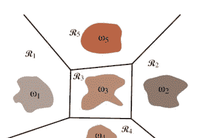


## 判别模型

- 参数 θ = {w_k} 可通过最大化数据似然来估计
- θ̂ = arg max_θ P(D_n|θ) = arg max_θ ∏_{i=1}^n P(y_i^{(train)} | x_n^{(train)}, θ)
- 最大后验（MAP）估计
- θ = arg max_θ p(θ|D_n) = arg max_θ log P(D_n|θ) + log p(θ)
- 根据贝叶斯规则，即 p(θ|D_n) = P(D_n|θ)p(θ)/P(D_n)。
- θ = arg max_θ log P(D_n|θ) + log p(θ)
- θ = arg max_θ Σ_{i=1}^n log P(y_n^{(train)} | x_n^{(train)}, θ) + log p(θ)
- 先验 p(θ) 对应于一个正则化项，例如
- p(θ) = e^{-λ||θ||^2}

## 生成模型

- 估计潜在的类条件概率密度 p(x|y = k)，然后使用贝叶斯决策理论构建分类器
- $P(y = k|x) = \frac{p(x|y = k)P(y = k)}{p(x)} = \frac{p(x|y = k)P(y = k)}{\sum_{k'=1}^{K} p(x|y = k')P(y = k')}$
- p(x|y) 和 P(y) 由 θ 参数化
- 先验 P(y) 可用于对预测之间的依赖关系建模，例如像素的分割标签或语音序列的预测。
- 对类条件概率密度建模更加困难。然而，这也为模型拟合增加了更强的正则化，因为学习到的模型不仅需要预测类别标签，还需要生成输入数据。
- 在设计 p(x|y) 的模型时，更容易加入领域知识。

## 监督学习与无监督学习

- 监督学习：目标是利用输入-标签对 (x, y) 学习一个函数 f，在给定输入时预测标签（或标签上的分布），即 ŷ = f(x)
- 无监督学习：不提供标签或其他目标。数据由一组样本 x 组成，目标是了解 x 本身的统计结构。
- 弱监督学习：训练数据与监督学习一样包含 (x, y) 对，但标签 y 要么不可靠地存在（即存在缺失值），要么带有噪声（即给定的标签不是真实标签）。

## 无监督学习

- 寻找数据的“最佳”表示，在比 **x** 更“简单”的同时，尽可能保留关于 **x** 的信息。
- 以线性情况为例

$$\tilde{x}=a_0+\sum_{i=1}^{d'}a_i e_i$$

- 低维表示：$d' < d$
- 稀疏表示：非零 $a_i$ 的数量很少
- 独立表示：解缠数据分布背后的变化来源，使得表示的各个维度在统计上独立，即 $a_i$ 与 $a_j$ 统计独立
- 深度学习的目的也是学习数据表示，只不过是以非线性且分层的方式。

## 主成分分析（PCA）

- 有 n 个 d 维样本 x₁, ..., xₙ。
- PCA 寻找由 d′（d′ < d）个正交单位向量 e₁, ..., e_d′ 张成的主子空间，使得
- 样本在该子空间上的投影（x̂_k = a₀ + Σ_{i=1}^{d′} a_{ki} e_i）具有最大方差；或者等价地，
- 样本与其投影之间的均方距离被最小化。
- 投影 {a_{ki}} 互不相关（如果假设数据分布为高斯分布，则它们相互独立）。

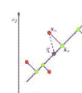

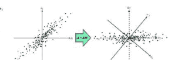

## PCA 的公式化表述

或

arg max_{ {e_i} } sum_{k=1}^{n} || x̃_k - x̄ ||^2

arg min_{ {e_i} } sum_{k=1}^{n} || x_k - x̃_k ||^2

( || x_k - x̄ ||^2 = || x_k - x̃_k ||^2 + || x̃_k - x̄ ||^2 )

## PCA 的零维和一维表示

- 零维表示：使用单个向量 x₀ 表示所有样本，并最小化平方误差函数

J₀(x₀) = Σₖ=1ⁿ ||x₀ − xₖ||²

- 其解为 x₀ = x̄ = 1/n Σₖ=1ⁿ xₖ

- 一维表示：将数据投影到一条穿过样本均值的直线上，x̃ₖ = x̄ + aₖ₁ e₁，并最小化平方误差准则函数

J₁(a₁₁, ..., aₙ₁, e₁) = Σₖ=1ⁿ ||x̃ₖ − xₖ||²


## 求主成分 $a_{k1}$

$$
J_1(a_{11},\dots,a_{n1},\mathbf{e}_1)
= \sum_{k=1}^{n} \|\bar{\mathbf{x}} + a_{k1}\mathbf{e}_1 - \mathbf{x}_k\|^2
= \sum_{k=1}^{n} \|a_{k1}\mathbf{e}_1 - (\mathbf{x}_k - \bar{\mathbf{x}})\|^2
$$

$$
= \sum_{k=1}^{n} a_{k1}^2 \|\mathbf{e}_1\|^2
- 2 \sum_{k=1}^{n} a_{k1}\mathbf{e}_1^t(\mathbf{x}_k - \bar{\mathbf{x}})
+ \sum_{k=1}^{n} \|\mathbf{x}_k - \bar{\mathbf{x}}\|^2
$$

由于 $\mathbf{e}_1$ 是单位向量，$\|\mathbf{e}_1\| = 1$。为最小化 $J_1$，令 $\frac{\partial J_1}{\partial a_{k1}} = 0$ 并得到

$$
a_{k1} = \mathbf{e}_1^t(\mathbf{x}_k - \bar{\mathbf{x}})
$$

- 我们通过将向量 $\mathbf{x}_k$ 投影到通过均值且方向为 $\mathbf{e}_1$ 的直线上得到最小二乘解。

## 求最优投影方向 $\mathbf{e}_1$

$$
J_1(\mathbf{e}_1)
= \sum_{k=1}^{n} a_{k1}^2
- 2 \sum_{k=1}^{n} a_{k1}^2
+ \sum_{k=1}^{n} \|\mathbf{x}_k - \bar{\mathbf{x}}\|^2
$$

$$
= -\sum_{k=1}^{n} \left[\mathbf{e}_1^t(\mathbf{x}_k - \bar{\mathbf{x}})\right]^2
+ \sum_{k=1}^{n} \|\mathbf{x}_k - \bar{\mathbf{x}}\|^2
$$

$$
= -\sum_{k=1}^{n} \mathbf{e}_1^t(\mathbf{x}_k - \bar{\mathbf{x}})(\mathbf{x}_k - \bar{\mathbf{x}})^t\mathbf{e}_1
+ \sum_{k=1}^{n} \|\mathbf{x}_k - \bar{\mathbf{x}}\|^2
$$

$$
= -\mathbf{e}_1^t S \mathbf{e}_1
+ \sum_{k=1}^{n} \|\mathbf{x}_k - \bar{\mathbf{x}}\|^2
$$

- $S = \sum_{k=1}^{n}(\mathbf{x}_k-\bar{\mathbf{x}})(\mathbf{x}_k-\bar{\mathbf{x}})^t$ 是散布矩阵。
- $\mathbf{e}_1^t S \mathbf{e}_1 = \sum_{k=1}^{n} a_{k1}^2 \left(\sum_{k=1}^{n} a_{k1}=0\right)$ 是投影数据的方差。
- 使 $J_1$ 最小的向量 $\mathbf{e}_1$ 也在约束 $\|\mathbf{e}_1\| = 1$ 下最大化 $\mathbf{e}_1^t S \mathbf{e}_1$。
- 使用拉格朗日乘数法在约束 $\|\mathbf{e}_1\|=1$ 下最大化 $\mathbf{e}_1^t S \mathbf{e}_1$：

$$
u = \mathbf{e}_1^t S \mathbf{e}_1 - \lambda(\mathbf{e}_1^t\mathbf{e}_1 - 1)
$$

$$
\frac{\partial u}{\partial \mathbf{e}_1} = 2S\mathbf{e}_1 - 2\lambda\mathbf{e}_1 = 0
$$

- 将梯度向量设为零，我们看到 $\mathbf{e}_1$ 必须是散布矩阵的特征向量：

$$
S\mathbf{e}_1 = \lambda \mathbf{e}_1
$$

- 由于 $\mathbf{e}_1^t S \mathbf{e}_1 = \lambda \mathbf{e}_1^t\mathbf{e}_1 = \lambda$，为最大化 $\mathbf{e}_1^t S \mathbf{e}_1$，我们选择具有最大特征值的特征向量。

## PCA 的 $d'$-维表示

- $d'$-维表示：$\tilde{\mathbf{x}}_k = \bar{\mathbf{x}} + \sum_{i=1}^{d'} a_{ki}\mathbf{e}_i$
- 均方准则函数：

$$
J_{d'} = \sum_{k=1}^{n} \left\| \left( \bar{\mathbf{x}} + \sum_{i=1}^{d'} a_{ki}\mathbf{e}_i \right) - \mathbf{x}_k \right\|^2
$$

- 通过在所有与已考虑方向正交的可能方向中选择使 $J$ 最小的每个新方向，以增量的方式定义额外的主成分。
- 为最小化 $J_{d'}$，$\mathbf{e}_1, \dots, \mathbf{e}_{d'}$ 是散布矩阵的 $d'$ 个具有最大特征值的特征向量。$a_{ki}$ 是样本的主成分。
- 由于散布矩阵是实对称的，其特征向量正交且特征值非负。
- 平方误差：

$$
J_{d'} = -\sum_{i=1}^{d'} \lambda_i + \sum_{k=1}^{n} \|\mathbf{x}_k - \bar{\mathbf{x}}\|^2
$$

$$
J_d = 0 \Rightarrow \sum_{k=1}^{n} \|\mathbf{x}_k - \bar{\mathbf{x}}\|^2 = \sum_{i=1}^{d} \lambda_i
$$

$$
J_{d'} = \sum_{i=d'+1}^{d} \lambda_i
$$

## PCA 子空间捕获的数据方差

- 数据投影到前 $d'$ 个特征向量上的方差为 $\sum_{i=1}^{d'} \lambda_i$。
- 衡量前 $d'$ 个特征向量捕获的方差比例：

$$
\frac{\sum_{i=1}^{d'} \lambda_i}{\sum_{j=1}^{d} \lambda_j}
$$

## 主成分的协方差矩阵

- 投影在 $e_i$ 和 $e_j$ $(i \neq j)$ 上的相关性为

$$
\sum_{k=1}^{n} a_{ki}a_{kj}
= \sum_{k=1}^{n} \mathbf{e}_i^t(\mathbf{x}_k-\bar{\mathbf{x}})(\mathbf{x}_k-\bar{\mathbf{x}})^t\mathbf{e}_j
= \mathbf{e}_i^t S \mathbf{e}_j
= \lambda_j \mathbf{e}_i^t\mathbf{e}_j
= 0
$$

- 样本在 PCA 子空间中的协方差矩阵为

$$
\operatorname{diag}[\lambda_1,\ldots,\lambda_d]
$$

## PCA 总结

- 主子空间由 $d'$ 个标准正交向量 $\mathbf{e}_1,\ldots,\mathbf{e}_{d'}$ 张成，它们是散布矩阵 $\mathbf{S}$ 的 $d'$ 个具有最大特征值 $\lambda_1,\ldots,\lambda_{d'}$ 的特征向量。
- 样本的主成分 $a_{ki}$ 计算为 $a_{ki}=\mathbf{e}_i^t(\mathbf{x}_k-\bar{\mathbf{x}})$。
- 投影到该主子空间的样本的方差为 $\sum_{i=1}^{d'}\lambda_i$。
- 样本与其投影之间的均方距离为 $\sum_{i=d'+1}^{d}\lambda_i$。
- PCA 在假设这种变化为高斯分布的前提下，解耦了数据底层变化的因素。
- 我们感兴趣的是学习能够解耦更复杂特征依赖形式的表示。


## 平滑性先验

- 浅层模型假设待学习的预测函数具有平滑性先验，即
  $$f^*(\mathbf{x}) \approx f^*(\mathbf{x}+\epsilon)$$
  其中 $\epsilon$ 是一个微小的变化。

- K近邻预测器假设预测函数是分段常数的
  - 对于分类且 $K = 1$ 时，$f(x)$ 是训练集中与 $x$ 的最近邻相关联的输出类别
  - 对于回归，$f(x)$ 是与 $x$ 的 $K$ 个最近邻相关联输出的平均值
  - 可区分区域的数量不能超过训练样本的数量

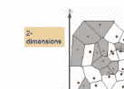

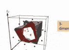

## 使用核函数的插值

f(x) = b + Σ_{i=1}^{n} α_i K(x, x_i)

K 是一个核函数，例如高斯核

K(u, v) = N(u − v, 0, σ²)

- b 和 α_i 可以通过支持向量机（SVM）学习
- 将每个 x_i 视为一个模板，核函数视为一个相似性函数，用于匹配模板和测试样本

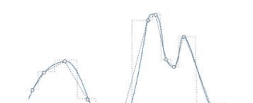

## 局部表示

- 可以将训练样本视为控制结点，它们局部地指定预测函数的形状

- 平滑性先验只允许学习器在局部进行泛化。如果 $(\mathbf{x}_i, y_i)$ 是一个有监督训练样本，且 $\mathbf{x}_i$ 是 $\mathbf{x}$ 的近邻，那么我们期望 $f(\mathbf{x}) \approx y_i$。使用更多的近邻可以获得更好的泛化。

- 为了在输入空间中区分 $O(N)$ 个区域，浅层模型需要 $O(N)$ 个样本（通常有 $O(N)$ 个参数与这 $O(N)$ 个区域相关联）。

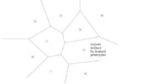

## 局部表示

- 如果函数很复杂，就需要更多的区域和更多的训练样本。
- 深度模型学到的表示可以进行非局部泛化

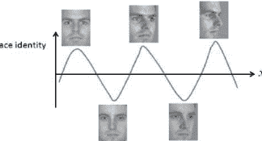

Yoshua Bengio、Ian Goodfellow 和 Aaron Courville，《深度学习》第1章“机器学习基础”，MIT Press 筹备中的图书，2014年。

http://www.iro.umontreal.ca/~bengioy/dlbook

## 多层神经网络

Xiaogang Wang

xgwong@ee.cuhk.edu.hk

2015年1月18日

## 神经网络的历史

- 神经网络数学模型的开创性工作
  - McCulloch 和 Pitts，1943年
  - 包括循环和非循环（带有“圈”）网络
  - 使用阈值函数作为非线性激活
  - 没有学习

- 神经网络学习的早期工作
  - 始于 Rosenblatt，1958年
  - 使用阈值函数作为非线性激活阻碍了用链式法则计算导数，因此误差无法反向传播来指导梯度的计算

- 自1960年以来，反向传播历经多个步骤逐渐发展起来
  - 其关键思想是使用链式法则计算导数
  - 这一思想在多篇工作中有所体现，最早来自控制领域

## 神经网络的历史

- 神经网络的标准反向传播
  - Rumelhart、Hinton 和 Williams，*Nature* 1986年。他们深刻认识到反向传播的能力，并在关键任务上展示了它的效果，并将其广泛应用于模式识别
  - 1985年，Yann LeCun 独立开发了一种三层网络的学习算法，该方法传播的是目标值而非导数。1986年，他证明了该算法等价于标准反向传播

- 证明三层神经网络的通用表达能力
  - Hecht-Nielsen，1989年

- 卷积神经网络
  - 由 Kunihiko Fukushima 于1980年提出
  - 由 LeCun、Bottou、Bengio 和 Haffner 于1998年改进

## 神经网络的历史

- 深度信念网络（DBN）
  - Hinton、Osindero 和 Tech，2006年

- 自编码器
  - Hinton 和 Salakhutdinov，2006年（《科学》）

- 深度学习
  - Hinton. 学习多层表示。《认知科学趋势》，2007年。

- 无监督多层预训练 + 有监督微调（BP）

- 语音识别中的大规模深度学习
  - Geoff Hinton 和 Li Deng 于2009年底在微软研究院雷德蒙分院开始了这项研究

- 生成式 DBN 预训练并非必要

- 成功来自于大规模训练数据 + 带有大型、与上下文相关的输出层的大型深度神经网络（DNN）


## 神经网络的历史
- 大规模图像的无监督深度学习
  - Andrew Ng 等人 2011
  - 无监督特征学习
  - 16000 个 CPU
- ImageNet 图像分类中的大规模监督深度学习
  - Krizhevsky, Sutskever, and Hinton 2012
  - 使用卷积神经网络进行监督学习
  - 无无监督预训练

## 两层神经网络模型线性分类器

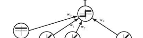

(Duda et al. Pattern Classification 2000)

g(x) = f(∑_{i=1}^{d} x_i w_i + w_0) = f(w' x)

f(s) = { 1, if s ≥ 0 ; -1, if s < 0 }

## 两层神经网络模型线性分类器
- 线性分类器无法解决简单的异或问题

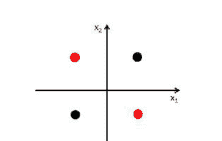

## 添加隐藏层以建模非线性分类器

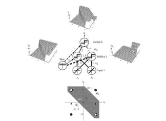

(Duda et al. Pattern Classification 2000)

## 三层神经网络

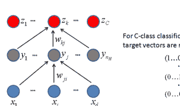

对于 C 类分类问题，目标向量表示为
(1...0...0)
...
(0...1...0)
...
(0...0...1)

## 三层神经网络
- 网络激活：每个隐藏单元 j 计算其输入的加权和
  
  $net_j = \sum_{i=1}^{d} x_i w_{ij} + w_{j0} = \sum_{i=0}^{d} x_i w_{ij} = w_j^T x$

- 激活函数：每个隐藏单元输出其激活的非线性函数
  
  $y_j = f(net_j)$
  
  $f(net) = Sgn(net) = \begin{cases} 1, & \text{if } net \ge 0 \\ -1, & \text{if } net < 0 \end{cases}$

激活函数有多种选择，只要它们几乎处处连续且可微即可。不同节点的激活函数可以不同。

## 三层神经网络
输出单元 k 的网络激活

net_k = Σ_{i=1}^{n_h} y_i w_{kj} + w_{k0} = Σ_{j=0}^{n_h} y_j w_{kj} = w_k^T y

输出单元发出

z_k = f(net_k)

神经网络的输出等价于一组判别函数

g_k(x) = z_k = f( Σ_{j=1}^{n_h} w_{kj} f( Σ_{i=1}^{d} w_{ji} x_i + w_{j0} ) + w_{k0} )

## 三层神经网络的表达能力
- 它可以表示**任意**判别函数
- 然而，所需要的隐藏单元数量可能非常大...
- 大多数广泛使用的模式识别模型（如 SVM、boosting 和 KNN）可以近似为具有一层或两层隐藏层的神经网络。它们被称为具有浅层架构的模型。
- 浅层模型将特征空间划分为区域并在局部区域匹配模板。表示 N 个区域需要 O(N) 个参数。
- 深度架构：对于某些问题，随着层数的增加，隐藏节点数量可以呈指数级减少。

## 三层神经网络的表达能力

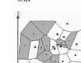

KNN
input x
hidden d(x, x_i)
output g(x)=label
j = argmin_i d(x, x_i)

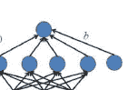

SVM
input x
hidden K(x, x_i)
output g(x)=b + sum_i a_i K(x, x_i)

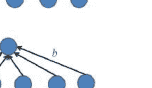

## 反向传播
- 多层神经网络监督训练的最通用方法
- 呈现一个输入模式并改变网络参数，使实际输出更接近目标值
- 学习输入到隐藏和隐藏到输出的权重
- 然而，没有明确的教师来说明隐藏单元的输出应该是什么。反向传播为每个隐藏单元计算一个有效误差，从而推导出输入到隐藏权重的学习规则。

## 训练误差

J(W) = 1/2 Σ_{k=1}^c (t_k - z_k)^2 = 1/2 ||t - z||^2

- 可微分
- 还有其他选择，例如交叉熵

J(W) = - Σ_{k=1}^c t_k log(z_k)

两者 {z_k} 和 {t_k} 都是概率分布。


## 梯度下降

- 权重以随机值初始化，然后朝着减少误差的方向进行调整

  $$\Delta w = -\eta \frac{\partial J}{\partial W}$$

  或分量形式

  $$\Delta w_{pq} = -\eta \frac{\partial J}{\partial w_{pq}}$$

  其中 \(\eta\) 是学习率。

- 迭代更新

  $$w(m + 1) = w(m) + \Delta w(m)$$

## 隐藏层到输出层的权重 \(w_{kj}\)

真实值

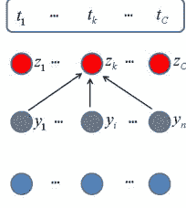

$$z_k = f(net_k)$$

$$net_k = \sum_{j=1}^{n_H} w_{kj} y_j + w_{k0}$$

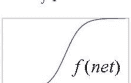

$$\frac{\partial J}{\partial w_{kj}} = \frac{\partial J}{\partial net_k}\frac{\partial net_k}{\partial w_{kj}} = -\delta_k \frac{\partial net_k}{\partial w_{kj}}$$

- 单元 \(k\) 的灵敏度

  $$\delta_k = -\frac{\partial J}{\partial net_k} = -\frac{\partial J}{\partial z_k}\frac{\partial z_k}{\partial net_k} = (t_k - z_k)f'(net_k)$$

  描述整体误差如何随单元的网络激活值变化。

- 权重更新规则。由于 \(\partial net_k / \partial w_{kj} = y_j\)，

  $$\Delta w_{kj} = \eta \delta_k y_j = \eta (t_k - z_k)f'(net_k) y_j.$$

## 激活函数

- \(f(\cdot)\) 的常用选择
  - Softmax：通常用作输出层的非线性函数，用于预测离散概率

    $$f(s_k) = \frac{e^{s_k}}{\sum_{k'=1}^{C} e^{s_{k'}}}$$

  - Maxout：它在假设存在多个网络激活值的情况下推广了整流器

    $$f(s_1, \dots, s_n) = \max_i (s_i)$$

## 示例 2

- 选择交叉熵作为训练误差度量，并在输出层使用 softmax 作为激活函数
- 灵敏度 \(\delta_k = -t_k(z_k - 1)\)（如何得到？）
- 如果误差很大，即使 \(z_k\) 接近 0，\(\delta_k\) 也很大
- Softmax 会产生更稀疏的输出

## 输入层到隐藏层的权重

真实值

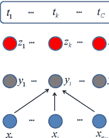

$$y_j = f(net_j)$$

$$net_j = \sum_{i=1}^{d} w_{ji} x_i + w_{j0}$$

$$\frac{\partial J}{\partial w_{ji}} = \frac{\partial J}{\partial y_j}\frac{\partial y_j}{\partial net_j}\frac{\partial net_j}{\partial w_{ji}}$$

- 隐藏单元输出 \(y_j\) 如何影响每个输出单元处的误差

  $$\frac{\partial J}{\partial y_j} = \frac{\partial}{\partial y_j}\left[\frac{1}{2}\sum_{k=1}^{c}(t_k - z_k)^2\right] = -\sum_{k=1}^{c}(t_k - z_k)\frac{\partial z_k}{\partial y_j} = -\sum_{k=1}^{c}(t_k - z_k)\frac{\partial z_k}{\partial net_k}\frac{\partial net_k}{\partial y_j} = -\sum_{k=1}^{c}(t_k - z_k)f'(net_k)w_{kj} = -\sum_{k=1}^{c}\delta_k w_{kj}$$

- 隐藏单元 \(j\) 的灵敏度

  $$\delta_j = -\frac{\partial J}{\partial net_j} = -\frac{\partial J}{\partial y_j}\frac{\partial y_j}{\partial net_j} = f'(net_j)\sum_{k=1}^{c}w_{kj}\delta_k$$

  \(\sum_{k=1}^{c}w_{kj}\delta_k\) 是隐藏单元 \(j\) 的有效误差。

- 权重更新规则。由于 \(\partial net_j/\partial w_{ji} = x_i\)，

  $$\Delta w_{ji} = \eta x_i \delta_j = \eta f'(net_j)\left[\sum_{k=1}^{c}w_{kj}\delta_k\right]x_i$$

## 误差反向传播

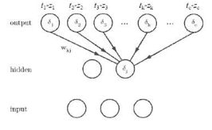

（Duda 等，《模式分类》，2000）隐藏单元的灵敏度与输出单元灵敏度的加权和成正比：

$$\delta_j = f'(net_j)\sum_{k=1}^{c} w_{kj}\delta_k$$

因此，输出单元的灵敏度被“反向”传播到隐藏单元。

## 随机梯度下降

- 给定 \(n\) 个训练样本，我们的目标函数可以表示为

  $$J(w) = \sum_{p=1}^{n} J_p(w)$$

- 批量梯度下降

  $$w \leftarrow w - \eta \sum_{p=1}^{n} \nabla J_p(w)$$

- 在某些情况下，计算求和梯度在计算上可能非常昂贵。随机梯度下降在每一步对部分求和函数进行采样。这在大型机器学习问题中非常有效。在随机梯度下降中，\(J(w)\) 的真实梯度由单个样本（或一小批样本）的梯度来近似：

  $$w \leftarrow w - \eta \nabla J_p(w)$$

## 随机反向传播

### 算法 1（随机反向传播）

```text
1 begin initialize network topology (# hidden units), w, criterion θ, η, m ← 0
2 do m ← m + 1
3 X^m ← randomly chosen pattern
4 w_ij ← w_ij + ηδ_j x_i; w_jk ← w_jk + ηδ_k y_j
5 until ΔJ(w) < θ
6 return w
7 end
```

> （Duda 等，《模式分类》，2000）

- 在随机训练中，一次权重更新可能会降低当前所呈现的单个样本的误差，但可能会增加整个训练集上的误差。


## 摘要

- 随机学习
  - 梯度的估计是有噪声的，权重可能不会在每次迭代中精确地沿梯度下降
  - 比批量学习更快，尤其是在训练数据存在冗余时
  - 噪声往往会导致更好的解
  - 权重会波动，可能不会完全收敛到局部最小值
- 批量学习
  - 收敛条件是众所周知的
  - 一些加速技术仅在批量学习中运行
  - 权重动力学和收敛速率的理论分析更简单

## 训练集上的学习曲线

- 平均训练误差通常随着 epoch 数量的增加而下降，并达到渐近值
- 如果发生欠拟合，该渐近值可能很高。原因可能是
  - 分类问题困难（贝叶斯误差很高）且训练样本数量很多
  - 网络的表达能力不足（权重、层数和每层节点数）
  - 初始化不良并陷入局部最小值（预训练以获得更好的初始化）
- 如果学习率低，训练误差趋于单调下降，但收敛缓慢。如果学习率高，训练误差可能振荡。

## 测试集和验证集上的学习曲线

- 验证集或测试集上的平均误差几乎总是高于训练集。当发生**过拟合**时，它可能会增加或振荡。原因可能是
  - 训练样本不足
  - 网络的表达能力过高
  - 初始化不良并陷入局部最小值（预训练以获得更好的初始化）
- 在验证集误差的最小值处停止训练

## BP 是链式法则的应用

∂C(g(θ))/∂θ = ∂C(g(θ))/∂g(θ) ∂g(θ)/∂θ

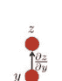

Δz = ∂z/∂y Δy
Δy = ∂y/∂x Δx
Δz = ∂z/∂y ∂y/∂x Δx
∂z/∂x = ∂z/∂y ∂y/∂x

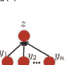

∂z/∂x = Σ_{i=1}^n ∂z/∂y_i ∂y_i/∂x

> (Bengio et al. Deep Learning 2014)

## 流图前向计算

- $u_1, \dots, u_N$ 是具有定义偏序的节点
- $a_i = (u_j)_{j \in \text{parents}(i)}$ 是节点 $u_i$ 的父节点集合，且 $u_i = f_i(a_i)$

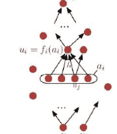

```
for i = 1...M do
  u_i <- x_i
end for
for i = M + 1...N do
  a_i <- {u_j}_{j \in parents(i)}
  u_i <- f_i(a_i)
end for
return u_N
```

> (Bengio et al. Deep Learning 2014)

## 流图上的 BP

```
∂loss/∂x_N ← 1
for j = N − 1 down to 1 do
  ∂loss/∂x_j ← Σ_{k ∈ parents(j)} ∂loss/∂x_k · ∂x_k/∂x_j
end for
return {∂loss/∂x_i}_{i=1}^M
```

> (Bengio et al. Deep Learning 2014)

∂u_N/∂w_i = ∂u_N/∂u_j · ∂u_j/∂net_j · ∂net_j/∂w_i = ∂u_N/∂u_j · ∂u_j/∂net_j · f'(net_j) u_i

- BP 在计算复杂度上是最优的，因为不存在能在 O(·) 意义上更快计算梯度的算法
- 它是动态规划原理的应用

## 非线性特征映射

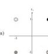

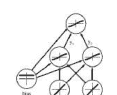

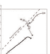

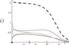

(a) 2-2-1 反向传播网络和 XOR 问题四种模式

(b) 每个模式下隐藏单元的输出；随着网络学习，这些输出在 y1-y2 空间中移动

(c) 各模式的学习曲线以及总误差随 epoch 的变化

> (Duda et al. Pattern Classification 2000)

## 非线性特征映射

- 多层神经网络提供输入到隐藏单元特征表示的非线性映射
- 初始权重较小时，每个隐藏单元的净激活值较小，因此使用其激活函数的线性部分。这种从 x 到 y 的线性变换在 XOR 问题中仍使模式线性不可分。
- 随着学习的进行，输入到隐藏的权重幅度增大，隐藏单元的非线性会扭曲和变形从输入到隐藏单元空间的映射
- 学习结束时由隐藏到输出权重找到的线性决策边界用直线虚线表示；输入处的非线性可分问题被转换到隐藏单元处的线性可分


## 非线性特征映射

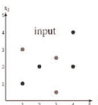

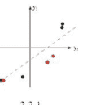

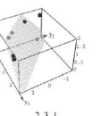

> (Duda et al. Pattern Classification 2000)

- 2-2-1 网络的表达能力不足以分离全部七个模式，即使在训练后达到全局最小误差。
- 通过增加一个隐藏单元来增强表达能力，这些模式可以被分离。

## 滤波器学习

- 单个隐藏单元的输入到隐藏权重描述了导致该隐藏单元最大激活的输入模式，类似于“匹配滤波器”
- 隐藏单元找到对隐藏到输出层权重实现的线性分类器有用的特征分组

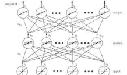

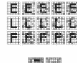

(Duda et al. Pattern Classification 2000)

## 激活函数推荐的 Sigmoid 函数

激活函数

```
f(x) = 1.79159 \frac{e^{\frac{3}{2}x} - e^{-\frac{3}{2}x}}{e^{\frac{3}{2}x} + e^{-\frac{3}{2}x}}
```

f(±1) = ±1, linear in the range of -1 < x < 1, f'(x) has extrema near x = ±1.

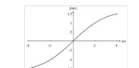

> Y. LeCun, Generalization and network design strategies. Proc. Int'l Conf. on Neural Networks, 1988.

## 激活函数的期望特性

- 必须是非线性的：否则等价于线性分类器
- 其输出具有最大值和最小值：保持权重和激活有界并限制训练时间
  - 当输出旨在表示概率时是期望的特性
  - 对于生物神经网络模型是期望的特性，其中输出表示神经放电率
  - 在回归网络中可能不是期望的，因为可能需要宽的动态范围
- 几乎处处连续且可微
- 单调性：否则会在误差曲面上引入额外的局部极值
- 对于较小的 net 值具有线性，这将使系统能够在足够产生低误差时实现线性模型

- 节点输出的平均值接近于零，因为这些输出是下一层的输入
- 节点输出的方差也为 1。

## 全局与局部表示

- Tanh 函数（将 sigmoid 的中心平移到 0）具有上述所有特性
  - 它对大范围输入有较大响应。任何特定输入 x 很可能通过多个隐藏单元产生活动。这提供了输入的分布式或全局表示。
  - 如果隐藏单元的激活函数仅对小范围内的输入有显著响应，则输入 x 通常导致较少隐藏单元被激活——局部表示。
- 分布式表示更优越，因为在任何给定输入区域，更多数据会影响后验。
- 全局表示可以通过更多层更好地实现

全局表示

局部表示

东方面孔

西方面孔

大鼻子？(1/0)

蓝眼睛？(1/0)

黄皮肤？(1/0)

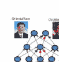

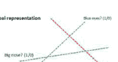

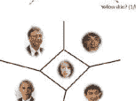

## 选择目标值

- 避免将目标值设为 sigmoid 的渐近线
  - 由于目标值只能渐近达到，它会使输出因此权重变得非常大，而 sigmoid 导数接近于零。因此权重可能卡住。
  - 当输出饱和时，网络无法给出置信度指示。大的权重会迫使所有输出到 sigmoid 的尾部，而不是接近决策边界。
- 确保节点不被限制在 sigmoid 的线性部分
- 在 sigmoid 上选择最大二阶导数点作为目标值，以避免饱和输出单元


## 阅读材料
- R. O. Duda, P. E. Hart, and D. G. Stork, "Pattern Classification," Chapter 6, 2000.
- Y. Bengio, I. J. GoodFellow, and A. Courville, "Feedforward Deep Networks," Chapter 6 in "Deep Learning", Book in preparation for MIT Press, 2014.

## 参考文献
- W. S. McCulloch and W. Pitts. A logical calculus of ideas immanent in nervous activity. *Bulletin of Mathematical Biophysics*, 5:115-133, 1943.
- F. Rosenblatt. The perceptron: A probabilistic model for information storage and organization in the brain. *Psychological Review*, 65:386-408, 1958.
- D. Rumelhart, G. E. Hinton, and R. J. Williams. Learning internal representations by back-propagating errors. *Nature*, 323:533-536, 1986.
- Y. LeCun. A learning scheme for asymmetric threshold networks. In *Proceedings of Cognitiva 85*, pages 599-604, Paris, France, 1985.
- Y. LeCun. Learning processes in an asymmetric threshold network. In Elie Bienenstock, Francoise Fogelman-Soulie, and Gerard Weisbuch, editors, *Disordered systems and biological organization*, pages 233-240, Les Houches, France, 1986. Springer-Verlag.
- R. Hecht-Nielsen. Theory of the backpropagation neural network. In *Proceedings of the IEEE International Joint Conference on Neural Networks, Vol. 1*, pages 593-605, 1989.

## 参考文献
- K. Fukushima. Neocognitron: A self-organizing neural network model for a mechanism of pattern recognition unaffected by shift in position. *Biological Cybernetics*, 36(4): 93-202, 1980.
- Y. LeCun, L. Bottou, Y. Bengio, and P. Haffner. Gradient-based learning applied to document recognition. *Proceedings of the IEEE* 86 (11): 2278-2324, 1998.
- G. E. Hinton, S. Osindero, and Y. W. Teh. A fast learning algorithm for deep belief nets. *Neural Computation*, 18:1527-1554, 2006.
- G. E. Hinton, and R. R. Salakhutdinov. Reducing the dimensionality of data with neural networks. *Science*, 313:504-507, 2006.
- G. E. Hinton. Learning multiple layers of representation. *Trends in Cognitive Sciences*, Vol. 11, pp. 428-434, 2007.

## 自编码器

Xiaogang Wang

xgwang@ee.cuhk.edu.hk

February 14, 2015

## 大纲
- 1. Autoencoder
- 2. Regularized autoencoders
- 3. Multimodal autoencoders

## 深度自编码器

Stack multiple encoders (and their corresponding decoders)

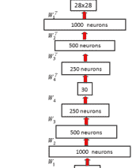

## 压缩图像的方法比较

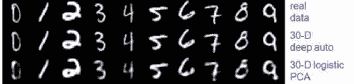

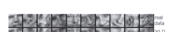

## 预测稀疏分解
- Sparse coding
  - Solving the encoder $f_0$ is non-trivial because of $L_1$ minimization and entails an iterative optimization
  - $y^* = f_0(x) = \arg\min_y \|x - Wy\|_2^2 + \lambda\|y\|_1$
  - $J_{SC} = \sum_n \|x^{(n)} - Wy^{(n)}\|_2^2$
- Predictive sparse decomposition
  - Approximation to sparse coding
  - Add sparse penalty to auto-encoder
  - Replace the costly and highly non-linear encoding step by a fast non-iterative approximation

The training criterion is simultaneously optimized with respect to the hidden codes (representation) $y^{(n)}$ and with respect to the parameters $\theta$

$J_{PSD} = \sum_n \lambda\|y^{(n)}\|_1 + \|x^{(n)} - Wy^{(n)}\|_2^2 + \|y^{(n)} - f_0(x^{(n)})\|_2^2$

$f_0(x^{(n)}) = \sigma(b + W^T x^{(n)})$

## 多模态深度学习
- Ngiam et al. ICML'11 (audio-visual speech recognition)
- Multimodal fusion: data from all modalities is available at all phases
- Cross modality learning: data from multiple modalities is available only during feature learning; during supervised training and testing, only data from a single modality is provided. The aim is to learn better single modality representations given unlabeled data from multiple modalities.
- Matching across different modalities
- A direct approach is to train a RBM over the concatenated audio and video data. Limited as a shallow model, it is hard for a RBM to learn the highly nonlinear correlations and form multimodal representations
- It was found that learning a shallow bimodal RBM results in hidden units that have strong connections to variables from individual modality but few units that connect across the modalities.


## 多模态深度学习

- 双模态 DBN：对每个模态，在预训练层之上逐层贪心训练一个 RBM；通过学习到的多层表示来表示数据，模型可以更容易地学习跨模态的高阶相关性。在 (d) 中，第一层表示对应音素和视位，第二层对它们之间的关系进行建模。

- 问题
  - 模型可能找到这样的表示：某些隐藏单元只针对音频，而另一些只针对视频
  - 它不适用于交叉模态学习场景，即在监督训练和测试时仅存在一种模态。


(d) 双模态 DBN

## 多模态深度自编码器

- 在 (a) 中，深度自编码器被训练为在仅给定视频数据时重建两种模态，从而发现跨模态的相关性。
- 用双模态 DBN 的权重初始化深度自编码器，并丢弃任何不再存在的权重。中间层可用作新的特征表示。
- 当监督训练和测试时仅存在单一模态时，使用模型 (a)


## 多模态深度自编码器

用于图像分割：Luo 等人，CVPR'12


## 阅读材料

- G. E. Hinton 和 R. R. Salakhutdinov，“Reducing the Dimensionality of Data with Neural Networks，”Science，第 313 卷，第 504-507 页，2006 年 7 月。
- K. Kavukcuoglu、M. Ranzato 和 Y. LeCun，“Fast Inference in Sparse Coding Algorithms with Applications to Object Recognition，”CBLL-TR-2008-12-01，NYU，2008 年。
- J. Ngiam、A. Khosla、M. Kim、J. Nam、H. Lee 和 A. Y. Ng，“Multimodal Deep Learning，”ICML 2011。
- P. Luo、X. Wang 和 X. Tang，“Hierarchical Face Parsing via Deep Learning，”CVPR 2012。

## 大纲

- 1. HMM
  - 马尔可夫模型
  - 隐马尔可夫模型
- 2. 循环神经网络
  - 循环神经网络
  - 基于 RNN 的 BP
  - RNN 的变体
- 3. 长短期记忆循环网络
  - 长期依赖的挑战
  - 结合短路径和长路径
  - 长短期记忆网络
- 4. 应用

## 对序列数据建模

- 从某个分布中对数据序列进行采样
  $P(x_1,\dots,x_T)$
- 生成自然语句来描述图像
  $P(y_1,\dots,y_T\mid I)$
- 从视频序列中进行活动识别
  $P(y\mid x_1,\dots,x_T)$


## 对序列数据建模

- 生成自然语句来描述视频
  $P(Y_1,\dots,Y_T \mid X_1,\dots,X_T)$
- 语言翻译
  $P(Y_1,\dots,Y_T \mid X_1,\dots,X_T)$

Ulrich UNK，奥迪汽车制造商董事会成员，声称多年来在董事会会议之前收集手机以防止它们被用作远程监听设备已成为一种常见做法。

Ulrich Hackenberg，奥迪汽车制造商董事会成员，声明在董事会会议之前收集手机以防止它们被用作远程监听设备，多年来一直是一种常见做法。

## 对序列数据建模

- 使用链式法则来表示观测序列的联合分布
  $p(\mathbf{x}_1,\dots,\mathbf{x}_T)=\prod_{t=1}^{T} p(\mathbf{x}_t|\mathbf{x}_1,\dots,\mathbf{x}_{t-1})$

- 考虑未来观测对所有先前观测的一般依赖性是不切实际的 $p(\mathbf{x}_t|\mathbf{x}_{t-1},\dots,\mathbf{x}_0)$

- 随着观测数量的增加，复杂度将无限增长

- 在预测未来值时，可以预期最近的观测比更久远的观测提供更多信息


## 马尔可夫模型

- 马尔可夫模型假设依赖最近的历史观测
- 一阶马尔可夫模型


- 二阶马尔可夫模型


## HMM 的参数

- 初始状态参数 $P(h_t = \omega_i) = \pi_i, \sum_i \pi_i = 1$
- 转移概率 $P(h_t = \omega_j | h_{t-1} = \omega_i) = a_{ij}, \sum_j a_{ij} = 1$。$A = [a_{ij}]$ 为转移矩阵
- 发射概率 $p(x_t | h_t)$
  - 若 $x_t$ 为单个离散变量，$x_t = v_i \in \{v_1, \ldots, v_m\}$，$P(x_t = v_k | z_t = \omega_j) = b_{jk}, \sum_k b_{jk} = 1$


- **评估问题**：确定某一特定数据序列 $x_1, \ldots, x_T$ 由该模型生成的概率，

  $$P(x_1, \ldots, x_T)$$

- **解码问题**：给定一组观测 $x_1, \ldots, x_T$，确定导致这些观测的最可能的隐状态序列 $h_1, \ldots, h_T$

  $$(h_1^*, \ldots, h_T^*) = \arg\max_{h_1,\ldots,h_T} P(h_1, \ldots, h_T | x_1, \ldots, x_T)$$

- **学习问题**：给定一组可见变量的训练观测（不知道隐变量），确定 HMM 的参数。

  $$\theta^* = \arg\max_{\theta} P(x_1, \ldots, x_T; \theta)$$

## 循环神经网络（RNN）

- HMM 是生成模型，而 RNN 是判别模型
- 对由外部信号 $x_t$ 驱动的动态系统建模
- $h_t = F_\theta(h_{t-1}, x_t)$
- $h_t$ 包含整个过去序列的信息。上式隐式定义了一个函数，它将整个过去序列 $(x_1, \ldots, x_t)$ 映射到当前状态 $h_t = G_\theta(x_1, \ldots, x_t)$


左图：RNN 的物理实现，可视为一个电路。黑色方块表示延迟 1 个时间步。右图：同一网络的展开流程图，此时每个节点都与特定的时间实例相关联。

- 这种概括是有损的，因为它将任意长度的序列 $(x_1, \ldots, x_t)$ 映射为固定长度的向量 $h_t$。取决于训练准则，$h_t$ 保留了过往序列的某些重要方面。
- 参数共享：在不同时间步，人工神经元的实例使用相同的权重
- 与 CNN 思想类似：用带参数共享的局部连接替代全连接网络
- 这使得网络可以应用于不同长度的输入序列，并预测不同长度的输出序列


### 根据输入预测序列的原始 RNN

$$P(y_1, \ldots, y_T | x_1, \ldots, x_T)$$

- 前向传播方程，假设隐单元使用双曲正切非线性，对于分类问题输出使用 softmax

  $$h_t = \tanh(W_{in} x_t + W_{hh} h_{t-1} + b_h)$$

  $$z_t = \mathrm{softmax}(W_{hz} h_t + b_z)$$

  $$p(y_t = c) = z_{t,c}$$


### RNN 的反向传播

- 回顾流程图上的 BP


```
∂loss/∂w ← 1
for j = N − 1 down to 1 do
  ∂u_j/∂w ← Σ_{k∈parents(j)} (∂u_k/∂u_j) (∂u_k/∂w) / ∂u_j
end for
return (∂u_N/∂w)^M_{j=1}
```

> （Bengio 等人，《深度学习》，2014）

$$\partial u_j/\partial w_i = \partial u_j/\partial a_i \cdot \partial a_i/\partial net_i \cdot \partial net_i/\partial w_i$$

### 关于 W_hz 和 b_z 的梯度

$$\partial L/\partial L_t = 1, \quad \partial L/\partial z_t = \partial L/\partial L_t \, \partial L_t/\partial z_t = \partial L_t/\partial z_t$$

$$\partial L/\partial W_{hz} = \sum_t \partial L_t/\partial z_t \, \partial z_t/\partial W_{hz}$$

$$\partial L/\partial b_z = \sum_t \partial L_t/\partial z_t \, \partial z_t/\partial b_z$$


### 关于 W_hh 和 W_xh 的梯度

$$\partial L/\partial W_{hh} = \sum_t \partial L/\partial h_t \, \partial h_t/\partial W_{hh}$$

$$\partial L/\partial h_t = \partial L/\partial h_{t+1} \, \partial h_{t+1}/\partial h_t + \partial L/\partial z_t \, \partial z_t/\partial h_t$$


## 输出具有循环的网络

记忆来自于对前一个目标的预测，这限制了其表达能力，但使训练更容易


## 生成式 RNN 建模 P(x₁, ..., x_T)

- 它可以从该分布生成序列
- 在训练阶段，观测序列中的每个 x_t 既作为当前时间步的输入，也作为前一个时间步的目标
- 输出 z_t 编码了条件分布 P(x_{t+1}|x₁, ..., x_t) = P(x_{t+1}|z_t) 的参数，用于在给定过去序列 x₁, ..., x_t 的情况下生成 x_{t+1}


## 生成式 RNN 建模 P(x₁, ..., x_T)

成本函数：x 的负对数似然，L = Σ_t L_t

P(x) = P(x₁, ..., x_T) = ∏_{t=1}^T P(x_t | x₁, ..., x_{t-1})

L_t = - log P(x_t | x₁, ..., x_{t-1})

在生成模式下，x_{t+1} 从条件分布 P(x_{t+1} | x₁, ..., x_t) = P(x_{t+1} | z_t) 中采样（虚线箭头），然后该生成的样本 x_{t+1} 被反馈作为输入以计算下一个状态 h_{t+1}


## 生成式 RNN 建模 P(x₁, ..., x_T)

- 如果 RNN 用于生成序列，还必须在输出中加入信息以随机决定何时停止生成新的输出元素
- 当输出是从词汇表中取出的符号时，可以添加一个表示序列结束的特殊符号
- 也可以直接通过某种参数分布对序列长度 T 进行建模。P(x₁, ..., x_T) 被分解为

P(x₁...x_T) = P(x₁...x_T | T) P(T)

## RCNNs 表示条件分布 P(y|x)

- 如果 x 是一个固定大小的向量，我们可以简单地将其作为生成 y 序列的 RNN 的额外输入。提供额外输入的常见方式有
  - 作为每个时间步的额外输入，或
  - 作为初始状态 h₀，或
  - 两者兼有
- 示例：为图像生成标题


## RCNNs 表示条件分布 P(y|x)

- 输入 x 是一个与输出序列 y 长度相同的序列
- 去掉虚线后，它假设在给定过去输入序列的情况下 y_i 彼此独立，即 P(y_i|y_1,...,y_{i-1},x_1,...,x_{i-1}) = P(y_i|x_i,...,x_{i-1})
- 在没有条件独立性假设的情况下，添加虚线，y_{t-1} 的预测基于过去的 x 和过去的 y


## 双向 RNN

- 在某些应用中，我们希望在时间 t 输出一个预测，该预测可能依赖于整个输入序列
  - 在语音识别中，对当前声音作为音素的正确解释可能取决于接下来的几个音素，因为共 artic ulation，并且可能取决于接下来的几个词，因为词之间的语言依赖关系
- 双向循环神经网络被提出以解决此类需求
- 它结合了正向 RNN 和反向 RNN
- 该思想可以扩展到 2D 输入，使用四个方向的 RNN

## 双向 RNN

g_t 总结了来自过去序列的信息，而 h_t 总结了来自未来序列的信息


## 平原和高原

- 训练深度神经网络的误差曲面包括局部最小值、平原（误差随权重变化仅轻微变化的区域）和悬崖（梯度急剧上升的区域）
- 平原和高原比局部最小值更重要的训练障碍
  - 在平原中有效地更新参数非常困难（或缓慢）
  - 当参数接近悬崖区域时，梯度更新步可能使学习器移动到非常糟糕的配置，破坏最近训练迭代中取得的很大进展。


## 梯度消失与梯度爆炸

- 训练一个非常深的网络会使问题变得更加严重，因为经过多层反向传播后，梯度会变得非常小或非常大
- 在建模长期依赖时，RNN 可以被视为一个深层网络


- 在非常深的网络和循环网络中，最终输出由大量非线性变换组成
- 尽管其中每一个非线性阶段可能相对平滑，但它们的组合会变得“更非线性”，其含义是整个组合的导数往往非常小或非常大，且有更多的起伏


当组合许多非线性函数时（如深度或循环神经网络中的激活非线性），结果高度非线性，通常大部分值对应极小的导数，一些值对应较大的导数，并且有许多起伏（此处未显示）

这源于雅可比矩阵（导数矩阵）的组合是各阶段雅可比矩阵的乘积，即如果

f = f_T ∘ f_{T-1} ∘ ... ∘ f_2 ∘ f_1

f(x) 关于其输入向量 x 的导数雅可比矩阵为

f' = f'_T f'_{T-1} ... f'_1

其中

f' = ∂f(x)/∂x

且

f'_i = ∂f_i(α_i)/∂α_i

其中 α_i = f_{i-1}(f_{i-2}(... f_2(f_1(x))...))，即组合被矩阵乘法所取代

- 在标量情况下，我们可以想象相乘许多数往往会变得非常大或非常小
- 在所有乘积中的数都具有相同值 α 的特殊情况下，这很明显，因为当 T 增大时，α^T 在 α < 1 时趋向于 0，在 α > 1 时趋向于 ∞
- 非相同数的更一般情况可以通过取这些数的对数，将其视为随机，并计算这些对数之和的方差来理解。尽管可能发生一些抵消，但方差随 T 增长。如果这些数是独立的，它随 T 线性增长，这意味着乘积大致按 e^T 增长。
- 该分析可以推广到相乘方阵的情况

## 学习长期依赖的困难

- 考虑时间 T 处的损失 $L_T$ 关于循环函数 $F_\theta$ 的参数 $\theta$ 的梯度

  $h_t = F_\theta(h_{t-1}, x_t)$

  $\frac{\partial L_T}{\partial \theta} = \sum_{t=1}^{T} \frac{\partial L_T}{\partial h_T} \frac{\partial h_T}{\partial h_t} \frac{\partial F_\theta(h_{t-1}, x_t)}{\partial \theta}$

  $\frac{\partial L_T}{\partial h_T} \frac{\partial h_T}{\partial h_t} \frac{\partial F_\theta(h_{t-1}, x_t)}{\partial \theta}$ 在 $T - t$ 很大时编码长期依赖


∂h_T/∂h_t = ∂h_T/∂h_{T-1} ∂h_{T-1}/∂h_{T-2} ... ∂h_{t+1}/∂h_t

- 每一层雅可比矩阵 ∂h_{t+1}/∂h_t 是两个矩阵的乘积：(a) 循环矩阵 W 和 (b) 对角矩阵，其条目为与隐藏单元相关联的非线性函数的导数，根据时间步而变化。这使得连续的雅可比矩阵很可能具有相似的特征向量，从而使这些雅可比矩阵的乘积更快地爆炸或消失

- ∂h_T/∂h_t 是跨度为 T − t 的项的加权和，其权重对于将状态 t 与状态 T 关联的长期依赖而言呈指数级变小（或变大）

- 关于长期依赖的信号往往会被源自短期依赖的最小波动所掩盖

## 在展开流图中结合短路径和长路径

- 更长的延迟连接允许过去状态通过短路径连接到未来状态
- 梯度会随时间步数呈指数消失
- 如果我们具有时间延迟为 D 的循环连接，那么而不是在 T 步上按 O(λ^T) 消失或爆炸（其中 λ 是雅可比矩阵 ∂h_t/∂h_{t-1} 的最大特征值），展开的循环网络现在具有梯度按 O(λ^{T/D}) 增长的路径，因为有效步数是 T/D


## 自连接的泄漏单元

$$h_{t+1} = (1 - 1/\tau) h_t + 1/\tau \tanh(W_{xh} x_t + W_{hh} h_t + b_h)$$

- 状态 $h_{t+1}$ 的新值是 $h_t$ 的线性和非线性部分的组合。
- 误差更容易通过红色线条的路径反向传播，这些路径是线性的。


- 当 $\tau = 1$ 时，没有线性自递归，只有我们在普通循环网络中可以找到的非线性更新。
- 当 $\tau > 1$ 时，这种线性递归允许梯度更容易传播。当 $\tau$ 很大时，状态变化非常缓慢，整合与输入序列相关的过去值。
- $\tau$ 控制着遗忘旧状态的速率。它可以被视为先前模型思想的平滑变体。
- 通过将不同的时间尺度 $\tau$ 与不同的单元关联，可以得到对应于不同遗忘率的不同路径。
- 这些时间常数可以手动固定，也可以作为自由参数进行学习。

## 长短期记忆 LSTM 网络

$$f_t = \sigma(W_{fx} x_t + W_{fh} h_{t-1} + b_f), \quad i_t = \sigma(W_{ix} x_t + W_{ih} h_{t-1} + b_i)$$

$$o_t = \sigma(W_{ox} x_t + W_{oh} h_{t-1} + b_o)$$

$$g_t = \tanh(W_{gx} x_t + W_{gh} h_{t-1} + b_g), \quad c_t = f_t \odot c_{t-1} + i_t \odot g_t$$

$$h_t = o_t \odot \tanh(c_t), \quad z_t = \mathrm{softmax}(W_z h_t + b_z)$$


- LSTM 的核心是一个记忆单元 $c_t$，它在每个时间步编码到该步为止所观察到的输入的知识。
- 记忆单元 $c_t$ 与普通循环网络具有相同的输入 $h_{t-1}$ 和 $x_t$ 以及输出 $h_t$，但具有更多参数和一套门控单元来控制信息流。
- $c_t$ 具有类似于泄漏单元的线性自连接，但自连接权重由遗忘门单元 $f_t$ 控制，该单元通过 sigmoid 单元将此权重设置为 0 到 1 之间的值：
  $$f_t = \sigma(W_{fx} x_t + W_{fh} h_{t-1} + b_f)$$
- 输入门单元 $i_t$ 与遗忘门类似计算，但使用自己的参数。
- LSTM 单元的输出 $h_t$ 也可以通过输出门 $o_t$ 关闭 $h_t = o_t \odot \tanh(c_t)$，它也是用于门控的 sigmoid 单元：
  $$o_t = \sigma(W_{ox} x_t + W_{oh} h_{t-1} + b_o)$$

- (c): 深度也可以添加到隐藏到输出的变换中。
- (d): RNN 的层次结构，可以彼此堆叠。


## 序列到序列语言翻译

- Sutskever, Vinyals, and Le, NIPS 2014.
- 模型 $P(Y_1,\dots,Y_{T'}|X_1,\dots,X_T)$。输入和输出序列长度不同，未对齐，甚至没有单调关系。
- 使用一个 LSTM 按时间步读取输入序列 $(x_1,\dots,x_T)$，得到一个大型的固定维度向量表示 $v$，它由 LSTM 的最后一个隐藏状态给出。
- 然后以 $v$ 为条件，第二個 LSTM 生成输出序列 $(y_1,\dots,y_{T'})$ 并计算其概率：

$$p(y_1,\dots,y_{T'}|v)=\prod_{t=1}^{T'}p(y_t|v,y_1,\dots,y_{t-1})$$


模型读取输入句子 "ABC" 并生成 "WXYZ" 作为输出句子。模型在输出句末标记后停止预测。

- 它要求每个句子以特殊的结束序列符号 `"<EOS>"` 结尾，这使得模型能够定义所有可能长度的序列上的分布。
- 将输入序列的词序反转是有价值的。例如，不是将句子 a, b, c 映射到句子 α, β, γ，而是要求 LSTM 将 c, b, a 映射到 α, β, γ，其中 α, β, γ 是 a, b, c 的翻译。这样，a 与 α 接近，b 与 β 相对接近，等等，这一事实使得随机梯度下降很容易在输入和输出之间“建立通信”。它在数据中引入了许多短期依赖关系，使得优化问题变得容易得多。


## 序列到序列语言翻译


该图显示了处理图中短语后得到的 LSTM 隐藏状态的二维 PCA 投影。短语按含义聚类，在这些示例中，这主要是一个词序的函数，这对于词袋模型来说很难捕捉。该图清楚地显示，表示对词序很敏感，而对主动语态替换为被动语态则相对不敏感。

## 序列到序列语言翻译

- LSTM 可以正确翻译非常长的句子

| 类型 | 句子 |
|------|----------|
| 我们的模型 | Ulrich UNK, membre du conseil d’administration du constructeur automobile Audi, affirme qu’il y a déjà une pratique courante depuis des années pour que les téléphones portables ne soient pas éteints, d’après la FCC. « Si l’innovation portait les antennes relais du constructeur automobile était qu’ils ne soient pas utilisés comme appareils d’écoute à distance. |
| 真实 | Ulrich Hackenberg, membre du conseil d’administration du constructeur automobile Audi, déclare que la collecte des téléphones portables avant les trajets du conseil, afin qu’ils ne soient pas utilisés comme appareils d’écoute à distance, est une pratique courante depuis des années. |
| 我们的模型 | « Les téléphones cellulaires, qui sont vraiment une question, non seulement parce qu’ils pourraient potentiellement causer des interférences avec les appareils de navigation, mais aussi parce qu’ils pourraient interférer avec les tours de téléphone cellulaire lorsqu’ils sont dans l’air », dit UNK. |
| 真实 | « Les téléphones portables sont véritablement un problème, non seulement parce qu’ils pourraient éventuellement créer des interférences avec les instruments de navigation, mais aussi parce qu’ils pourraient interférer avec les antennes relais de téléphone mobile si ils sont utilisés à bord », a déclaré Rosenber. |
| 我们的模型 | Avec la création, il y a un « sentiment de violence contre le corps d’un être cher » qui sera réduit à une pile de cendres », en très peu de temps, au lieu d’un processus de décomposition, qui accompagnera les phases du deuil. |
| 真实 | Il y a, avec la création, « une violence faite au corps aimé » qui va être « réduit à un tas de cendres » en très peu de temps, et non après un processus de décomposition, qui accompagnera les phases du deuil. |

## 生成图像描述

- Vinyals et al. arXiv 2014
- 使用 CNN 作为图像编码器并将其转换为固定长度向量
- 它被用作生成目标序列的“解码器”RNN 的初始隐藏状态


## 生成图像描述

- 学习过程是最大化给定图像的正确描述的概率

θ* = arg max Σ_{(I,S)} log P(S|I; θ)

log P(S|I) = Σ_{t=0}^{N} log P(S_t | S_0, ..., S_{t-1})

I 是图像，S 是其正确描述


## 生成图像描述

- 用 S₀ 表示特殊的起始词，用 S_N 表示特殊的停止词
- 图像和词都被映射到同一空间，图像通过使用 CNN，词通过使用词嵌入 W_e
- 图像 I 仅在 t = 1 时输入一次，以告知 LSTM 图像内容
- 采样：根据 P₁ 采样第一个词，然后提供相应的嵌入作为输入并采样 P₂，如此继续，直到采样到特殊的句末标记

x₋₁ = CNN(I)

x_t = W_e S_t, t ∈ {0, ..., N − 1}

P_{t+1} = LSTM(x_t), t ∈ {0, ..., N − 1}

L(I, S) = Σ_{t=1}^{N} log P_t(S_t)

## 将视频翻译为句子

- Venugopalan et al. arXiv 2014
- 挑战在于捕捉帧序列和对应词序列的联合依赖
- 以往的工作通过检测一组固定的语义角色作为中间表示来简化问题，例如主语、动词和宾语，并采用过度简化的僵化句子模板。

输入视频：


机器输出：A cat is playing with toy.

人类：A Ferret and cat fighting with each other. / A cat and a ferret are playing. / A kitten and a ferret are playfully wrestling.


## 将视频翻译为句子

- 使用 CNN 将视频转换为固定长度的表示向量 v
- 使用 RNN 将向量解码为句子，就像语言翻译一样
- 使用两层 LSTM（一个 LSTM 堆叠在另一个之上）

p(y₁, …, y_T | v) = ∏_{t=1}^T p(y_t | v, y₁, …, y_{t-1})

## 将视频翻译为句子

FGM：因子图模型，使用模板生成句子
YT_LSTM 在 YouTube 视频数据集上训练
YT_C_LSTM 在 Coco 图像数据集上预训练
YT_CF_LSTM 在 CoCo 和 Flickr 图像数据集上预训练
GT：来自人工描述的真实值

FGM：A person is playing a guitar in the ...
YT：A group of performing on stage.
YT_C：A man is jumping on a pole.
GT：A man working on a high building.

FGM：A person playing a guitar in the house.
YT：A man is walking.
YT_C：A man is doing a woman.
GT：A man is doing algebraic equations on a white board.

FGM：A group of people riding the horse
YT：A group of young
YT_C：A group of elephants are walking
GT：An elephant leads. It's young.

FGM：A person playing the goal of the
YT：A player playing in a goal.
YT_C：A man playing a soccer ball.
GT：A soccer player is want to
YT：Two teams are playing soccer.

FGM：A person is running a race on the
YT：A group of people
YT_C：A group of people are running.
GT：Eight men are running race on a field.


## 概要

- 1. 优化基础
- 2. 深度神经网络训练的优化
- 3. 多 GPU 训练

## 局部最小值、局部最大值和鞍点

- 当 \(\nabla J(\theta)=0\) 时，梯度无法提供关于移动方向的信息
- \(\nabla J(\theta)=0\) 处的点被称为 **临界点** 或 **驻点**
- 局部最小值是指 \(J(\theta)\) 比所有邻近点都低的点，因此通过无穷小步长无法再减小 \(J(\theta)\)
- 局部最大值是指 \(J(\theta)\) 比所有邻近点都高的点，因此通过无穷小步长无法再增大 \(J(\theta)\)
- 有些临界点既不是最大值也不是最小值。这些被称为 **鞍点**


## 局部最小值、局部最大值和鞍点

- 在深度学习的上下文中，我们优化的函数可能存在许多非最优的局部最小值，以及被非常平坦区域包围的许多鞍点。所有这些都使优化变得非常困难，尤其是在函数的输入是多维的情况下。
- 因此我们通常满足于找到一个非常低的 J 值，但不一定在任何形式意义上都是最小的。


## 雅可比矩阵和海森矩阵

- 雅可比矩阵包含向量值函数所有元素的偏导数
- 函数 f : R^m → R^n，则 f 的雅可比矩阵 J ∈ R^{n×m} 定义为 J_{ij} = ∂/∂x_j f(x)_i
- 二阶导数 ∂²/∂x_i∂x_j f 告诉我们一阶导数如何随输入变化。它用于确定临界点是局部最大值、局部最小值还是鞍点。
  - f'(x) = 0 且 f''(x) > 0：局部最小值
  - f'(x) = 0 且 f''(x) < 0：局部最大值
  - f'(x) = 0 且 f''(x) = 0：鞍点或平坦区域的一部分
- 海森矩阵包含函数的所有二阶导数
  H(f)(x)_{ij} = ∂²/∂x_i∂x_j f(x)

## 雅可比矩阵和海森矩阵


## 海森矩阵

- 条件数：考虑函数 f(x) = A⁻¹x。当 A ∈ Rⁿˣⁿ 具有特征值分解时，其条件数
  maxᵢ,ⱼ |λᵢ / λⱼ|
  即最大和最小特征值幅度的比值。当该数很大时，矩阵求逆对输入误差特别敏感

- 海森矩阵对于理解梯度下降的性能也很有用。当海森矩阵的条件数很差时，梯度下降表现不佳。这是因为在一个方向上，导数迅速增加，而在另一个方向上，增加缓慢。梯度下降无法感知这种导数变化，因此不知道需要在导数保持负值更长时间的方向上优先探索。


## Hessian matrix

梯度下降未能利用 Hessian 中包含的曲率信息。这里我们对一个二次函数使用梯度下降，其 Hessian 矩阵的条件数为 5。红色线条表示梯度下降所遵循的路径。这个非常细长的二次函数类似于一条长峡谷。梯度下降会浪费时间反复下降峡谷壁，因为它们是最陡峭的特征。由于步长有些过大，它有一种超出函数底部的趋势，因此需要在下一次迭代中下降相反的峡谷壁。对应于指向该方向的特征向量的 Hessian 的大正特征值表明该方向导数正在迅速增加，因此基于 Hessian 的优化算法可以预测在这种情况下最陡的方向实际上并不是一个有希望的搜索方向。

## Second-order optimization methods

- 梯度下降仅使用梯度，被称为一阶优化。像牛顿法这样也使用 Hessian 矩阵的优化算法被称为二阶优化算法。

- 使用牛顿法更新

  $\mathbf{x}^* = \mathbf{x}_0 - H(f)(\mathbf{x}_0)^{-1} \nabla_x f(\mathbf{x}_0)$

  当函数可以局部近似为二次函数时，迭代更新近似并跳到近似的最小值可以比梯度下降更快地达到临界点。

- 在许多其他领域，优化的主导方法是为有限的函数族设计优化算法。

- 深度学习中使用的函数族相当复杂和复杂

## Stochastic gradient descent

- 给定 $n$ 个训练样本，我们的目标函数可以表示为

  $$J(w) = \sum_{p=1}^{n} J_p(w)$$

- 批量梯度下降

  $$w \leftarrow w - \eta \sum_{p=1}^{n} \nabla J_p(w)$$

- 在某些情况下，计算和梯度可能在计算上很昂贵。随机梯度下降在每一步采样一部分被加和函数。这在大规模机器学习问题中非常有效。在随机梯度下降中，$J(w)$ 的真实梯度被单个样本（或一个小批量样本）的梯度近似：

  $$w \leftarrow w - \eta \nabla J_p(w)$$

## Stochastic backpropagation

### Algorithm 1 (Stochastic backpropagation)

```
1 begin initialize network topology (# hidden units), w, criterion θ, η, m ← 0
2 do m ← m + 1
3 x^m ← randomly chosen pattern
4 w_ij ← w_ij + η ∂J/∂w_ij; w_jk ← w_jk + η ∂J/∂w_jk
5 until ∇J(w) < θ
6 return w
7 end
```

在随机训练中，权重更新可能会降低正在呈现的单个模式的误差，却增加整个训练集的误差。

## Mini-batch based stochastic gradient descent

- 将训练集划分为小批量。
- 在每个 epoch 中，随机排列小批量并依次取一个小批量来近似梯度
  - 一个 epoch 对应于训练集中所有模式的一次呈现
- 每次迭代的估计梯度更可靠
- 从较小的批量大小开始，并在训练过程中增加大小

## Batch backpropagation

### Algorithm 2 (Batch backpropagation)

```
1 begin initialize network topology (# hidden units), w, criterion θ, η, r ← 0
2 do r ← r + 1 (increment epoch)
3 m ← 0; Δwij ← 0; Δwjk ← 0
4 do m ← m + 1
5 x^m ← select pattern
6 Δwij ← Δwij + ηδj x_i; Δwjk ← Δwjk + ηδk y_j
7 until m = n
8 wij ← wij + Δwij; wjk ← wjk + Δwjk
9 until ∇J[w] < θ
10 return w
11 end
```

## Summary

- **Stochastic learning**
  - 梯度估计是噪声的，权重可能不会在每次迭代中精确地沿梯度移动
  - 比批量学习更快，尤其是在训练数据具有冗余时
  - 噪声通常会导致更好的解
  - 权重会波动，可能不会完全收敛到局部最小值
- **Batch learning**
  - 收敛条件是众所周知的
  - 一些加速技术仅在批量学习中运行
  - 权重动力学和收敛速率的理论分析更简单


## 在训练集和验证集上绘制学习曲线


绘制平均每样本误差（即 1/n ∑_p J_p）与 epoch 数量的关系图。

## 训练集上的学习曲线

- 平均训练误差通常随着 epoch 数量的增加而下降，并达到一个渐近值。
- 如果发生欠拟合，该渐近值可能很高。原因可能是：
  - 分类问题困难（贝叶斯误差高）且训练样本数量很大。
  - 网络的表达能力不足（权重、层数和每层节点数）。
  - 初始化不良并陷入局部最小值（预训练以获得更好的初始化）。
- 如果学习率较低，训练误差倾向于单调下降，但收敛缓慢。如果学习率较高，训练误差可能会振荡。

## 测试集和验证集上的学习曲线

验证集或测试集上的平均误差几乎总是高于训练集上的误差。当发生**过拟合**时，它可能会增加或振荡。原因可能是：

- 训练样本不足。
- 网络的表达能力过高。
- 初始化不良并陷入局部最小值（预训练以获得更好的初始化）。

在验证集误差的最小值处停止训练。

## 数据增强

- 如果训练集很小，可以通过向真实训练样本添加高斯噪声来合成一些训练样本。
- 可以利用领域知识来合成训练样本。例如，在图像分类中，可以通过平移、缩放和旋转来合成更多训练图像。

## 输入归一化

- 如果一个输入特征的动态范围远大于其他特征，在训练过程中，网络将主要调整该特征上的权重而忽略其他特征。
- 我们不希望仅仅因为测量单位不同就偏好某个特征。
- 为避免此类困难，输入模式应先平移，使其在训练集上的每个特征的平均值为零，然后缩放，使每个特征的方差为 1。
- 输入变量应尽可能不相关。
  - 如果输入不相关，则可以求解一个权重的值而无需考虑其他权重。
  - 对于相关输入，必须同时求解多个权重，这是一个更困难的问题。
  - PCA 可用于去除输入中的线性相关性。

## 打乱训练样本

打乱训练集

- 网络从最意外的样本中学得最快。
- 打乱训练集，使连续的训练示例永远（或很少）属于同一类别。
- 比产生小误差的示例更频繁地呈现产生大误差的输入示例。
  - 该技术应用于包含异常值的数据时可能是灾难性的，因为异常值可能产生大误差但不应频繁呈现。

## 误差曲面

- 反向传播基于梯度下降，试图找到误差曲面 **J(w)** 的最小点。
- 一般来说，很不可能找到全局最小值，因为误差曲面通常非常复杂。
- 反向传播在局部最小值和平台期停止（误差随权重变化仅轻微变化的区域）。
- 因此，找到反向传播的良好初始化非常重要（通过预训练）。


## 学习率

- 当权重向量“振荡”时降低学习率，当权重向量沿稳定方向移动时增加它。
- 可以为每个权重选择不同的学习率，以便网络中的所有权重以大致相同的速度收敛。


在不同学习率下 1D 二次准则的梯度下降。最优学习率为 η_opt = (∂²J / ∂w²)⁻¹。


## 学习率

- 批量模式下训练的线性网络示例。


- 随机学习，η = 0.2


## 动量的引入

- 误差曲面通常存在高原，在那里权重“过多”（尤其当层数很大时），因此误差对其中任何一个权重的依赖都很弱。

- 在随机反向传播中加入前一次权重更新的一部分 α

  **w(m + 1) = w(m) + (1 − α)Δw_bp(m) + αΔw(m − 1)**

  其中 Δw_bp(m) 是反向传播算法所要求的 w(m) 的变化

  **Δw(m) = w(m) − w(m − 1)**

- 允许网络在误差曲面存在高原时更快地学习。


## 高原与悬崖

- 训练深度神经网络的误差曲面包含局部最小值、高原（误差随权重变化仅轻微变化的区域）以及悬崖（梯度急剧上升的区域）。

- 高原和悬崖是训练神经网络比局部最小值更重要的障碍
  - 在高原中有效更新参数非常困难（或很慢）。
  - 当参数接近悬崖区域时，梯度更新步可能使学习器移动到非常糟糕的配置，破坏最近训练迭代中取得的许多进展。


## 高阶非线性

- 二阶方法或动量假设最小值周围为二次形状。它们在低曲率方向上增大步长，在高曲率方向上减小步长（山谷的陡峭侧面）。

- 在训练深度模型时，高阶导数引入了大量非线性，这通常不具有二阶“山谷”图像在我们脑海中构建的良好对称形状。


## 梯度裁剪

- 为解决悬崖的存在，一个有用的启发式方法是裁剪梯度的大小，仅在梯度大小超过阈值（即超参数）时保留其方向。这有助于避免接近悬崖时，无论从上方还是下方接近，都会发生的破坏性大步移动。


## 梯度消失与爆炸

梯度消失/爆炸问题

- 训练非常深的网络会使问题变得更加严重，因为经过多层反向传播后，梯度变得非常小或非常大。

- 在非常深的网络和循环网络中，最终输出由大量非线性变换组成。

- 尽管这些非线性阶段中的每一个都可能相对平滑，但它们的组合会变得“更非线性”，其含义是整个组合的导数往往非常小或非常大，并且有更多的起伏。


当组合许多非线性（如深度或循环神经网络中的激活非线性）时，结果高度非线性，通常大部分值与微小的导数相关联，一些值与大的导数相关联，并且有许多起伏（此处未显示）。

这源于组合的雅可比矩阵（导数矩阵）是每个阶段雅可比矩阵的乘积，即如果

\[
f = f_T \circ f_{T-1} \circ \ldots \circ f_2 \circ f_1
\]

\(f(x)\) 关于其输入向量 \(x\) 的导数雅可比矩阵为

\[
f' = f'_T f'_{T-1} \ldots f'_2 f'_1
\]

其中

\[
f' = \frac{\partial f(x)}{\partial x}
\]

并且

\[
f'_t = \frac{\partial f_t(\alpha_t)}{\partial \alpha_t}
\]

其中 \(\alpha_t = f_{t-1}(f_{t-2}(\ldots f_2(f_1(x))\ldots))\)，即组合已被矩阵乘法所取代。


## 梯度消失与梯度爆炸

- 在标量情况下，我们可以想象将许多数字相乘往往会变得非常大或非常小
- 在所有乘积中的数字都具有相同值 \(\alpha\) 的特殊情况下，这很明显，因为当 \(T\) 增大时，\(\alpha^T\) 在 \(\alpha < 1\) 时趋向于 0，在 \(\alpha > 1\) 时趋向于 ∞
- 非相同数字的更一般情况可以通过取这些数字的对数，将它们视为随机，并计算这些对数之和的方差来理解。虽然会发生一些抵消，但方差随着 \(T\) 的增长而增长。如果这些数字是独立的，它随 \(T\) 线性增长，这意味着乘积大致按 \(e^T\) 增长。
- 该分析可以推广到相乘方阵的情况

## 为什么需要多 GPU？

- 进一步加速
- 单个 GPU 的内存大小有限
  - GeForce GTX 670: 2GB
  - TITAN: 6GB
  - TITAN X: 12GB
  - Tesla K40: 12GB
  - Tesla K80: two K40
- 训练更大的模型
- 数据并行
- 模型并行

## 使用多 GPU 的成本

- 同步
- 通信开销
  - 同一服务器内 GPU 之间的通信
  - GPU 服务器之间的通信

## 数据并行

- 小批量被拆分到多个 GPU 上。每个 GPU 负责计算相对于所有模型参数的梯度，但使用的是小批量中样本的子集
- 模型（参数）在每个 GPU 中都有完整（相同）的副本
- 从多个 GPU 计算得到的梯度被平均以更新两个 GPU 中的参数


## 数据并行的缺点

- 需要 GPU 之间相当大的通信，因为每个 GPU 必须在每次更新步骤中通信梯度和参数值
- 每个 GPU 必须使用大量样本才能有效利用高度并行的设备；因此，小批量大小有效地乘以 GPU 的数量，阻碍收敛

## 模型并行

- 由将单个网络的计算拆分到多个 GPU 组成
- 例如，具有 N 个滤波器的卷积层可以在两个 GPU 上运行，每个 GPU 将其输入与 N/2 个滤波器进行卷积


架构被拆分为两列，使得在两个 GPU 之间拆分计算变得更容易

## 模型并行

- 一个小批量在每个 GPU 中都有相同的副本
- 如果在 GPU 中计算梯度需要较低层的所有特征图的输出，则 GPU 必须在每一层同步并通信


## 模型并行

- Krizhevsky 等人定制了网络的架构以更好地利用模型并行：架构由两个“列”组成，每个列分配在一个 GPU 上
- 列仅在一个中间层和最顶层的全连接层有交叉连接


A. Krizhevsky, I. Sutskever, and G. Hinton, "ImageNet classification with deep convolutional neural networks," in NIPS, 2012.

## 模型并行

- 虽然模型并行更难实现，但相对于数据并行，它有两个潜在优势
  - 当交叉连接涉及较小的中间特征图时，它可能需要更少的通信带宽
  - 它允许实例化对于单个 GPU 内存来说太大的模型

## 混合数据和模型并行

- 数据并行和模型并行可以混合使用。


模型并行和数据并行如何结合以便有效利用 4 个 GPU 的示例

## 混合数据和模型并行


使用不同形式的并行时，ImageNet 上的测试误差随时间变化。所有实验均使用相同的小批量大小（256）并运行 100 个 epoch（此处仅显示前 10 个以便于可视化），架构和超参数设置与 AlexNet 相同。如果按权重更新次数绘制，所有这些曲线几乎会完全重合。


## 混合数据并行与模型并行

| 配置 | 完成 100 个 epoch 的时间 |
|---|---|
| 1 GPU | 10.5 天 |
| 2 GPUs 模型并行 | 6.6 天 |
| 2 GPUs 数据并行 | 7 天 |
| 4 GPUs 数据并行 | 7.2 天 |
| 4 GPUs 模型 + 数据并行 | 4.8 天 |

## 使用 CPU 核心的分布式计算

- 模型并行：只有那些跨越分区边界的边的节点才需要在机器之间传输其状态。即使在节点有多条边跨越分区边界的情况下，其状态也只会发送到该边界另一侧的机器一次。
- 在每个分区内，单个节点的计算将并行化到所有可用的 CPU 核心。
- 它需要在训练和推理期间在机器之间进行数据同步和数据传输。


- 具有局部连接结构的模型由于通信需求较低，通常比全连接结构更适合广泛分布。
- 具有大量参数或高计算需求的模型通常受益于访问更多 CPU 和内存，直到通信成本占主导为止。
- 这意味着加速不能随着无限数量的机器而不断增加。
- 低于理想加速的典型原因是不同机器之间的处理时间差异，导致许多机器等待单个最慢的机器完成计算的给定阶段。

## 阅读材料

- R. O. Duda, P. E. Hart, and D. G. Stork, "Pattern Classification," Chapter 6, 2000.
- Y. LeCun, L. Bottou, G. B. Orr, and K. Muller, "Efficient BackProp," Technical Report, 1998.
- Y. Bengio, I. J. Goodfellow and A. Courville, "Numerical Computation" in "Deep Learning", Book in preparation for MIT Press.
- Y. Bengio, I. J. Goodfellow and A. Courville, "Numerical Optimization" in "Deep Learning", Book in preparation for MIT Press.
- O. Yadan, K. Adams, Y. Taigman, and M. Ranzato, "Multi-GPU Training of ConvNets", arXiv:1312.583, 2014.
- J. Dean, G. S. Corrado, R. Monga, and K. Chen, "Large Scale Distributed Deep Networks," NIPS 2012.

## 深度领域自适应

From: Deep Visual Domain Adaptation: a Survey

Mei Wang

Beijing University of Posts and Telecommunications

2018.12.28

## 为什么我们需要迁移学习

机器确实有其弱点：它们没有“迁移学习”的能力。训练好的模型不能在不同的相关场景中采用，例如 AlphaGo 不能下中国象棋。


Slide credit: Qiang Yang

在人类进化中，迁移学习的能力非常重要。我们可以将学习到的知识扩展到其他场景。例如，学会骑自行车后，骑摩托车就非常容易了。


虽然深度学习在许多任务中取得了巨大成功，但在应用中解决这些问题并非易事：

- 1. 小数据


- 2. 可靠性


- 3. 个性化


## 什么是迁移学习？

传统深度学习在训练和测试共享相似分布时：

经验风险：min 1/n Σ_{i=1}^n L(x_i, y_i, θ)


## 什么是迁移学习？

给定源域 $D_S$ 和学习任务 $T_S$，目标域 $D_T$ 和学习任务 $T_T$，迁移学习旨在利用 $D_S$ 和 $T_S$ 中的知识来帮助改进 $D_T$ 中目标预测函数 $f_T(\cdot)$ 的学习，其中 $D_S \neq D_T$，或 $T_S \neq T_T$。


## 什么是域适应？

- **域适应：**
  - 源域：大量有标签数据。
  - 目标域：少量或没有有标签数据。
  - 任务相同，但数据分布不同。


> [1] Pan S J, Yang Q. A survey on transfer learning[J]. IEEE Transactions on knowledge and data engineering, 2010, 22(10): 1345-1359.

## 什么是域适应？

由于多种因素（例如，光照、姿势和图像质量），两个域之间总会存在**分布变化或域偏移**，这会降低性能。


[2] M. Wang and W. Deng. *Deep visual domain adaptation: A survey*. Neurocomputing, 312:135–153, 2018.

## 什么是域适应？

由于两个域之间存在分布变化或域偏移，为源域学习到的分类器无法应用于目标域。


### SVHN→MNIST


(a) non-adapted

### SVHN→MNIST


(a) adapted

## 什么是域适应？

- **监督式 DA**，存在少量有标签的目标数据。然而，有标签数据通常不足以完成任务。
- **半监督式 DA**，在训练阶段目标域中同时存在有限的有标签数据和冗余的无标签数据，这使得网络能够学习目标域的结构信息。
- **无监督式 DA**，在训练网络时没有有标签但有足够无标签的目标域数据可观察。


## 迁移学习的关键

迁移学习的关键要素是发现两个领域之间的共同点。一旦发现这种共同点，迁移学习就变得容易了。我们在机器学习中称这种共同点为共同特征。


VS


## 浅层域适应

- **传统深度学习**
  
  min 1/n Σ_{i=1}^n L(x_i, y_i, θ)
- **特征适应**
  
  min 1/n Σ_{i=1}^n L(φ(x_i^s), y_i^s, θ)
- **实例适应**
  
  min 1/n Σ_{i=1}^n w_i L(x_i^s, y_i^s, θ)
- **模型适应**
  
  min 1/n Σ_{i=1}^n L(x_i^s, y_i^s, θ)

Slide credit: Meina Kan

> [1] Pan S J, Yang Q. A survey on transfer learning[J]. IEEE Transactions on knowledge and data engineering, 2010, 22(10): 1345-1359.

## Deep visual domain adaptation: A survey

使用有标签或无标签的目标数据微调深度网络以减小域偏移

使用域判别器通过对抗目标来鼓励域混淆

使用数据重建作为辅助任务以确保特征不变性

### 基于差异的 DA

### 基于对抗的 DA

### 基于重建的 DA

- class criterion
- architecture criterion
- statistic criterion
- geometric criterion

- generative models
- non-generative models

- encoder-decoder reconstruction
- adversarial reconstruction


## 监督式 DA 方法：微调

它展示了迁移性如何受到两个不同问题的负面影响：与在脆弱协同适应的层中间分割网络相关的优化困难，以及高层特征对原始任务的专门化以牺牲目标任务上的性能为代价。

|  | The size of target dataset |  |  |
|  | Low | Medium | High |
| The distance between domains | Low | Freeze | freeze or tune | Tune |
|  | Medium | freeze or tune | Tune | Tune |
|  | High | freeze or tune | Tune | Tune |


## 无监督域自适应

- 传统深度学习

  $$\min \frac{1}{n}\sum_{i=1}^{n} L(x_i, y_i, \theta)$$

- 特征自适应

  $$\min \frac{1}{n}\sum_{i=1}^{n} L(\phi(x_i^s), y_i^s, \theta)$$

- 实例自适应

  $$\min \frac{1}{n}\sum_{i=1}^{n} w_i L(x_i^s, y_i^s, \theta)$$

- 模型自适应

  $$\min \frac{1}{n}\sum_{i=1}^{n} L(x_i^s, y_i^s, \theta)$$

- KL 散度：

  $$KL(P,Q)=\sum_i P(i)\log\frac{P(i)}{Q(i)}$$

- MMD：

  $$MMD^2(\mathcal{D}_s,\mathcal{D}_t)=\left\|\frac{1}{M}\sum_{i=1}^{M}\phi(x_i^s)-\frac{1}{N}\sum_{i=1}^{N}\phi(x_i^t)\right\|_{\mathcal{H}}^2$$

- $\mathcal{H}$-散度：

  $$\hat{d}_\mathcal{A}=2(1-2\varepsilon)$$

- Wasserstein 距离（Earth mover distance）

  $$W(P_1,P_2)=\inf_{\gamma\sim\prod(P_1,P_2)}\mathbb{E}_{(x,y)\sim\gamma}[||x-y||]$$

## 无监督域自适应方法

大多数深度域自适应方法试图通过将两个域映射到一个域不变的特征空间来学习更具可迁移性的表示，然后直接将仅从源标签学习到的分类器应用于目标域。


一些论文通过最小化域差异的某些度量来探索域不变特征空间，例如统计损失、对抗损失和重构损失

### 无监督域自适应方法：DDC (1.1)


| 方法 | A → W | D → W | W → D | 平均值 |
|---|---:|---:|---:|---:|
| GEK(PLS,PCA) [16] | 15.0 ± 0.4 | 44.6 ± 0.3 | 49.7 ± 0.5 | 36.4 |
| SA [13] | 15.3 | 50.1 | 56.9 | 40.8 |
| DA-NBNN [3] | 23.3 ± 2.7 | 67.2 ± 1.9 | 67.4 ± 3.0 | 52.6 |
| DLID [8] | 26.1 | 68.9 | 84.9 | 60.0 |
| DeCAF6 S [11] | 52.2 ± 1.7 | 91.5 ± 1.5 | — | — |
| DaNN [14] | 35.0 ± 0.2 | 70.5 ± 0.0 | 74.3 ± 0.0 | 59.9 |
| **Ours** | **59.4 ± 0.8** | **92.5 ± 0.3** | **91.7 ± 0.8** | **81.2** |


### 无监督域自适应方法：DAN (1.2)

DAN 通过添加多个自适应层并探索多个核来匹配域间边缘分布的偏移，假设条件分布保持不变。

自适应单个层无法消除源域和目标域之间的数据集偏差，因为存在其他不可迁移的层。具有不同带宽的多个核可以匹配低阶矩和高阶矩以最小化域差异。

$$\mathcal{K} = \left\{ k = \sum_{u=1}^{m} \beta_u k_u : \sum_{u=1}^{m} \beta_u = 1, \beta_u \ge 0, \forall u \right\}$$


> [5] M. Long , Y. Cao , J. Wang , M. Jordan , Learning transferable features with deep adaptation networks, in ICML, 2015, pp. 97–105 .

### 无监督域自适应方法：RTN (1.3)

$$\min \frac{1}{n} \sum_{i=1}^{n} L(x_i^s, y_i^s, \theta)$$

由于深度特征最终沿网络从通用到特定转变：（1）全连接层 fc6–fc8 专用于建模任务特定结构，因此它们不可安全迁移，应使用 MK-MMD 最小化进行自适应；（2）监督分类器不可安全迁移，因此它们通过残差层 fc9–fc10 进行桥接，使得 f_S(x) = f_T(x) + Δf(f_T(x))。


我们不是使用残差块来建模特征映射，而是使用它来桥接源分类器 f_S(x) 和目标分类器 f_T(x)，其中 x ≜ f_T(x)，H(x) ≜ f_S(x)，且 F(x) ≜ Δf(f_T(x))


> [6] M. Long , H. Zhu , J. Wang , M.I. Jordan , Unsupervised domain adaptation with residual transfer networks, in NIPS, 2016, pp. 136–144 .

### 无监督域自适应方法：JAN (1.4)

当域可能通过输入特征 X 和输出标签 Y 的联合分布 P(X,Y) 发生变化时，迁移学习将变得更具挑战性。分布偏移可能源于边缘分布 P(X)、条件分布 P(Y|X) 或两者。

核嵌入可以很容易地使用张量积特征空间推广到两个或多个变量的联合分布。

$$C_{X^{1:m}}(P) \triangleq \mathbb{E}_{X^{1:m}}[\otimes_{\ell=1}^{m}\phi^{\ell}(X^{\ell})] = \int_{\times_{\ell=1}^{m}\Omega^{\ell}} (\otimes_{\ell=1}^{m}\phi^{\ell}(x^{\ell})) dP(x^{1},...,x^{m})$$

$$D_{\mathcal{L}}(P,Q) \triangleq \|C_{Z^{s,1:|\mathcal{L}|}}(P) - C_{Z^{t,1:|\mathcal{L}|}}(Q)\|_{\otimes_{\ell=1}^{|\mathcal{L}|}\mathcal{H}^{\ell}}^{2}$$


(a) 联合自适应网络 (JAN)

(b) 对抗联合自适应网络 (JAN-A)

> [7] M. Long, J. Wang, and M. I. Jordan. Deep transfer learning with joint adaptation networks. arXiv preprint arXiv:1605.06636, 2016.


## 无监督域适应方法：JAN (1.4)

表 1. Office-31 数据集上无监督域适应的分类准确率（%）(AlexNet 和 ResNet)

| 方法 | A → W | D → W | W → D | A → D | D → A | W → A | 平均 |
|---|---|---|---|---|---|---|---|
| AlexNet (Krizhevsky et al., 2012) | 61.6±0.5 | 95.4±0.3 | 99.0±0.2 | 63.8±0.5 | 51.1±0.6 | 49.8±0.4 | 70.1 |
| TCA (Pan et al., 2011) | 61.0±0.0 | 93.2±0.0 | 95.2±0.0 | 60.8±0.0 | 51.6±0.0 | 50.9±0.0 | 68.8 |
| GFK (Gong et al., 2012) | 60.4±0.0 | 95.6±0.0 | 95.0±0.0 | 60.6±0.0 | 52.4±0.0 | 48.1±0.0 | 68.7 |
| DDC (Tzeng et al., 2014) | 61.8±0.4 | 95.0±0.5 | 98.5±0.4 | 64.4±0.3 | 52.1±0.6 | 52.2±0.4 | 70.6 |
| DAN (Long et al., 2015) | 68.5±0.5 | 96.0±0.3 | 99.0±0.3 | 67.0±0.4 | 54.0±0.5 | 53.1±0.5 | 72.9 |
| RTN (Long et al., 2016) | 73.3±0.3 | 96.8±0.2 | 99.6±0.1 | 71.0±0.2 | 50.5±0.3 | 51.0±0.1 | 73.7 |
| RevGrad (Ganin & Lempitsky, 2015) | 73.0±0.5 | 96.4±0.3 | 99.2±0.3 | 72.3±0.3 | 53.4±0.4 | 51.2±0.5 | 74.3 |
| JAN (ours) | 74.9±0.3 | 96.6±0.2 | 99.5±0.2 | 71.8±0.2 | 58.3±0.3 | 55.0±0.4 | 76.0 |
| JAN-A (ours) | 75.2±0.4 | 96.6±0.2 | 99.6±0.1 | 72.8±0.3 | 57.5±0.2 | 56.3±0.2 | 76.3 |
| ResNet (He et al., 2016) | 68.4±0.2 | 96.7±0.1 | 99.3±0.1 | 68.9±0.2 | 62.5±0.3 | 60.7±0.3 | 76.1 |
| TCA (Pan et al., 2011) | 72.7±0.0 | 96.7±0.0 | 99.6±0.0 | 74.1±0.0 | 61.7±0.0 | 60.9±0.0 | 77.6 |
| GFK (Gong et al., 2012) | 72.8±0.0 | 95.0±0.0 | 98.2±0.0 | 74.5±0.0 | 63.4±0.0 | 61.0±0.0 | 77.5 |
| DDC (Tzeng et al., 2014) | 75.6±0.2 | 96.0±0.2 | 98.2±0.1 | 76.5±0.3 | 62.2±0.4 | 61.5±0.5 | 78.3 |
| DAN (Long et al., 2015) | 80.5±0.4 | 97.1±0.2 | 99.6±0.1 | 78.6±0.2 | 63.6±0.3 | 62.8±0.2 | 80.4 |
| RTN (Long et al., 2016) | 84.5±0.2 | 96.8±0.1 | 99.4±0.1 | 77.5±0.3 | 66.2±0.2 | 64.8±0.3 | 81.6 |
| RevGrad (Ganin & Lempitsky, 2015) | 82.0±0.4 | 96.9±0.2 | 99.1±0.1 | 79.7±0.4 | 68.2±0.4 | 67.4±0.5 | 82.2 |
| JAN (ours) | 85.4±0.3 | 97.4±0.2 | 99.8±0.2 | 84.7±0.3 | 68.6±0.3 | 70.0±0.4 | 84.3 |
| JAN-A (ours) | 86.0±0.4 | 96.7±0.3 | 99.7±0.1 | 85.1±0.4 | 69.2±0.4 | 70.7±0.5 | 84.6 |

## 无监督域适应

- 传统深度学习
  min 1/n Σᵢ=1ⁿ L(xᵢ, yᵢ, θ)
- 特征适应
  min 1/n Σᵢ=1ⁿ L(φ(xᵢˢ), yᵢˢ, θ)
- 实例适应
  min 1/n Σᵢ=1ⁿ wᵢ L(xᵢˢ, yᵢˢ, θ)
- 模型适应
  min 1/n Σᵢ=1ⁿ L(xᵢˢ, yᵢˢ, θ)
- KL 散度:
  KL(P, Q) = Σᵢ P(i) log P(i)/Q(i)
- MMD:
  MMD²(Dₛ, Dₜ)
  = || 1/M Σᵢ=1ᴹ φ(xᵢˢ) - 1/N Σᵢ=1ᴺ φ(xᵢᵗ) ||²_ℋ
- ℋ-散度:
  d̂_A = 2(1-2ε)
- Wasserstein 距离 (Earth mover distance)
  W(P₁, P₂) = inf
  γ∼Π(P₁,P₂) 𝔼₍ₓ,ᵧ₎∼γ[||x - y||]

## 无监督域适应方法：RevGrad (2.1)

域对抗神经网络 (DANN) 集成了一个梯度反转层 (GRL)，通过最大化域分类器损失同时最小化标签预测器损失来训练特征提取器。


[8] Y. Ganin , V. Lempitsky , Unsupervised domain adaptation by backpropagation, in ICML, 2015, pp. 1180–1189 .

## 无监督域适应方法：RevGrad (2.1)

### 1 最大-最小优化

E(θ_f, θ_y, θ_d) = Σ_{i=1..N \ d_i=0} L_y(G_y(G_f(x_i; θ_f); θ_y), y_i) - λ Σ_{i=1..N} L_d(G_d(G_f(x_i; θ_f); θ_d), y_i) = Σ_{i=1..N \ d_i=0} L_y^i(θ_f, θ_y) - λ Σ_{i=1..N} L_d^i(θ_f, θ_d)  (1)

(θ̂_f, θ̂_y) = arg min_{θ_f, θ_y} E(θ_f, θ_y, θ̂_d)  (2)
θ̂_d = arg max_{θ_d} E(θ̂_f, θ̂_y, θ_d).  (3)

### 2 梯度反转层

Ê(θ_f, θ_y, θ_d) = Σ_{i=1..N \ d_i=0} L_y(G_y(G_f(x_i; θ_f); θ_y), y_i) + Σ_{i=1..N} L_d(G_d(R_λ(G_f(x_i; θ_f)); θ_d), y_i)  (9)

R_λ(x) = x
 dR_λ / dx = -λ I


## 无监督域适应方法：RevGrad (2.1)


| 方法 | 源域 | MNIST\n目标 MNIST-M | SYN NUMBERS\n目标 SVHN | SVHN\n目标 MNIST | SYN SIGNS\n目标 GTSRB |
|---|---|---|---|---|---|
| SOURCE ONLY |  | .5749 | .8665 | .5919 | .7400 |
| SA (FERNANDO ET AL., 2013) |  | .6078 (7.9%) | .8672 (1.3%) | .6157 (5.9%) | .7635 (9.1%) |
| PROPOSED APPROACH |  | .8149 (57.9%) | .9048 (66.1%) | .7107 (29.3%) | .8866 (56.7%) |
| TRAIN ON TARGET |  | .9891 | .9244 | .9951 | .9987 |


## 无监督 DA 方法：iCAN (2.2)

通过神经网络的域协作和域对抗训练的协作与对抗网络 (CAN)。

- 域信息表征：通过协作学习从较低块获得
- 域无信息表征：通过对抗学习从较高块获得


1 min_{θ,w} (1/N) Σ_{i=1}^N L_D(D(F(x_i; θ); w), d_i)
2 max_θ min_w (1/N) Σ_{i=1}^N L_D(D(F(x_i; θ); w), d_i)
3 min_{θ_F, λ} L_CAN = Σ_{k=1}^{m-1} λ_k min_{w_k} L_D(θ_k, w_k) + λ_m min_{w_m} L_D(θ_m, w_m), s.t. Σ_{k=1}^{m-1} λ_k = λ_0, |λ_k| ≤ λ_0

> [9] W. Zhang, W. Ouyang, W. Li, and D. Xu. Collaborative and adversarial network for unsupervised domain adaptation. In CVPR, pages 3801–3809, 2018.

## 无监督 DA 方法：MADA (2.3)

域适应的困难：

- 目标标签空间只是源标签空间的子空间。
- 判别结构可能在域之间混合或错误对齐。


> [10] Z. Pei, Z. Cao, M. Long, and J. Wang. Multi-adversarial domain adaptation. In AAAI Conference on Artificial Intelligence, 2018

min_θ 1/n Σ_{i=1}^n w_i L(x_i^s, y_i^s, θ)

一种多对抗域适应 (MADA) 方法捕获多模态结构，使不同数据分布的细粒度对齐基于多个域判别器得以实现。


使用 ŷ_i 作为概率来指示每个数据点 x_i 应多大程度地关注 K 个域判别器 G_d^k 是一个自然的想法。每个点 x_i 对域判别器 G_d^k 的关注度可以通过用概率 ŷ_ik 加权其特征 G_f(x_i) 来建模。

C(θ_f, θ_y, {θ_d^k}_{k=1}^K) = 1/n_s Σ_{x_i∈D_s} L_y(G_y(G_f(x_i)), y_i) - λ/n Σ_{k=1}^K Σ_{x_i∈D} L_d^k(G_d^k(ŷ_i^k G_f(x_i)), d_i)

(θ̂_f, θ̂_y) = arg min_{θ_f, θ_y} C(θ_f, θ_y, {θ_d^k}_{k=1}^K), (θ̂_d^1, ..., θ̂_d^K) = arg max_{θ_d^1, ..., θ_d^K} C(θ_f, θ_y, {θ_d^k}_{k=1}^K)

**表 1：无监督域适应在 *Office-31* 上的准确率 (%) (AlexNet 和 ResNet)**

| 方法 | A → W | D → W | W → D | A → D | D → A | W → A | Avg |
|---|---:|---:|---:|---:|---:|---:|---:|
| AlexNet (Krizhevsky, Sutskever, and Hinton 2012) | 60.6±0.4 | 95.4±0.2 | 99.0±0.1 | 64.2±0.3 | 45.5±0.5 | 48.3±0.5 | 68.8 |
| TCA (Pan et al. 2011) | 59.0±0.0 | 90.2±0.0 | 88.2±0.0 | 57.8±0.0 | 51.6±0.0 | 47.9±0.0 | 65.8 |
| GFK (Gong et al. 2012) | 58.4±0.0 | 93.6±0.0 | 91.0±0.0 | 58.6±0.0 | 52.4±0.0 | 46.1±0.0 | 66.7 |
| DDC (Tzeng et al. 2014) | 61.0±0.5 | 95.0±0.3 | 98.5±0.3 | 64.9±0.4 | 47.2±0.5 | 49.4±0.4 | 69.3 |
| DAN (Long et al. 2015) | 68.5±0.3 | 96.0±0.1 | 99.0±0.1 | 66.8±0.2 | 50.0±0.4 | 49.8±0.3 | 71.7 |
| RTN (Long et al. 2016) | 73.3±0.2 | 96.8±0.2 | 99.6±0.1 | 71.0±0.2 | 50.5±0.3 | 51.0±0.1 | 73.7 |
| RevGrad (Ganin and Lempitsky 2015) | 73.0±0.5 | 96.4±0.3 | 99.2±0.3 | 72.3±0.3 | 52.4±0.4 | 50.4±0.5 | 74.1 |
| **MADA** | **78.5±0.2** | **99.8±0.1** | **100.0±0.0** | **74.1±0.1** | **56.0±0.2** | **54.5±0.3** | **77.1** |
| ResNet (He et al. 2016) | 68.4±0.2 | 96.7±0.1 | 99.3±0.1 | 68.9±0.2 | 62.5±0.3 | 60.7±0.3 | 76.1 |
| TCA (Pan et al. 2011) | 74.7±0.0 | 96.7±0.0 | 99.6±0.0 | 76.1±0.0 | 63.7±0.0 | 62.9±0.0 | 79.3 |
| GFK (Gong et al. 2012) | 74.8±0.2 | 95.0±0.0 | 98.2±0.0 | 76.5±0.0 | 65.4±0.0 | 63.0±0.0 | 78.8 |
| DDC (Tzeng et al. 2014) | 75.8±0.2 | 95.0±0.2 | 98.2±0.1 | 77.5±0.3 | 67.4±0.4 | 64.0±0.5 | 79.7 |
| DAN (Long et al. 2015) | 83.8±0.4 | 96.8±0.2 | 99.5±0.1 | 78.4±0.2 | 66.7±0.3 | 62.7±0.2 | 81.3 |
| RTN (Long et al. 2016) | 84.5±0.2 | 96.8±0.1 | 99.4±0.1 | 77.5±0.3 | 66.2±0.2 | 64.8±0.3 | 81.6 |
| RevGrad (Ganin and Lempitsky 2015) | 82.0±0.4 | 96.9±0.2 | 99.1±0.1 | 79.7±0.4 | 68.2±0.4 | **67.4±0.5** | 82.2 |
| **MADA** | **90.0±0.1** | **97.4±0.1** | **99.6±0.1** | **87.8±0.2** | **70.3±0.3** | 66.4±0.3 | **85.2** |

**表 3：无监督域适应在 *Office-31* 上从 31 类到 25 类的准确率 (%) (AlexNet)**

| 方法 | A → W | D → W | W → D | A → D | D → A | W → A | Avg |
|---|---:|---:|---:|---:|---:|---:|---:|
| AlexNet (Krizhevsky, Sutskever, and Hinton 2012) | 58.2±0.4 | 95.9±0.2 | 99.0±0.1 | 60.4±0.3 | 49.8±0.5 | 47.3±0.5 | 68.4 |
| RevGrad (Ganin and Lempitsky 2015) | 65.1±0.5 | 91.7±0.3 | 97.1±0.3 | 60.6±0.3 | 42.1±0.4 | 42.9±0.5 | 66.6 |
| **MADA** | **70.8±0.2** | **96.6±0.1** | **99.5±0.3** | **69.6±0.1** | **51.4±0.2** | **54.2±0.3** | **73.7** |


## 无监督 DA 方法：加权对抗网络 (2.4)

基于重要性加权对抗网络的部分域自适应方法可以识别可能来自离群类别的源样本，同时减少域间共享类别的偏移。


加权方案的直觉是，如果第一个域分类器的激活值很大，则该样本几乎可以被判别器完美地从目标域中区分出来。

1
D(z) = p(y = 1|z) = σ(α(z))
\tilde{w}(z) = 1 - D^*(z) = 1 / (p_s(z)/p_t(z) + 1)

2
min_{F_t} max_{D_0} L_w(D_0, F_s, F_t) = E_{x~p_s(x)}[w(z) log D_0(F_s(x))] + E_{x~p_t(x)}[log(1 - D_0(F_t(x)))]

> [11] Zhang J, Ding Z, Li W, et al. Importance Weighted Adversarial Nets for Partial Domain Adaptation. In CVPR. 2018: 8156-8164.

## 无监督 DA 方法：DRCN (3.1)

该模型通过多任务学习进行优化，即联合学习（监督的）源标签预测和（无监督的）目标数据重建任务。目标是编码的共享表示应学习这些任务之间的共同点，从而为跨域目标识别提供有用信息


ℒ_c^{n_s}({Θ_enc, Θ_lab}) := Σ_{i=1}^{n_s} ℓ_c (f_c(x_i^s; {Θ_enc, Θ_lab}), y_i^s),
ℒ_r^{n_t}({Θ_enc, Θ_dec}) := Σ_{j=1}^{n_t} ℓ_r (f_r(x_j^t; {Θ_enc, Θ_dec}), x_j^t)

> [12] M. Ghifary , W.B. Kleijn , M. Zhang , D. Balduzzi , W. Li , Deep reconstruction–classification networks for unsupervised domain adaptation, in ECCV, Springer, 2016, pp. 597–613

## 无监督 DA 方法：DSN (3.2)

DSN 显式地并联合建模域表示的私有和共享组件。表示的私有组件特定于单个域，表示的共享组件由两个域共享。


> [13] K. Bousmalis , G. Trigeorgis , N. Silberman , D. Krishnan , D. Erhan , Domain separation networks, in NIPS, 2016, pp. 343–351 .

DSN 显式地并联合建模域表示的私有和共享组件。表示的私有组件特定于单个域，表示的共享组件由两个域共享。


1  L_task = - sum_{i=0}^{N_s} y_i^s · log ŷ_i^s
2  L_recon = sum_{i=1}^{N_s} L_si_mse(x_i^s, x̂_i^s) + sum_{i=1}^{N_t} L_si_mse(x_i^t, x̂_i^t)
   L_si_mse(x, x̂) = 1/k ||x - x̂||_2^2 - 1/(k^2) ([x - x̂]·1_k)^2
3  L_difference = ||H_c^T H_p^s||_F^2 + ||H_c^T H_p^t||_F^2
4  L_similarity^DANN = sum_{i=0}^{N_s+N_t} { d_i log d̂_i + (1 - d_i) log(1 - d̂_i) }
   L_similarity^MMD = 1/(N^s)^2 sum_{i,j=0}^{N^s} κ(h_{ci}^s, h_{cj}^s) - 2/(N^s N^t) sum_{i,j=0}^{N^s,N^t} κ(h_{ci}^s, h_{cj}^t) + 1/(N^t)^2 sum_{i,j=0}^{N^t} κ(h_{ci}^t, h_{cj}^t)

## 无监督 DA 方法：DSN (3.2)

表 1：我们评估的所有方法在无监督域自适应场景下的平均分类准确率（%）。我们复制了 Ganin 等人 [8] 的实验，并在括号中显示了他们论文中报告的结果。“Source–only”和“Target–only”行是在不使用域自适应且仅在源域或仅在目标域上训练时在目标域上的结果。每个域自适应任务中表现最佳的结果以粗体字体显示。

| Model | MNIST to MNIST-M | Synth Digits to SVHN | SVHN to MNIST | Synth Signs to GTSRB |
|---|---|---|---|---|
| Source-only | 56.6 (52.2) | 86.7 (86.7) | 59.2 (54.9) | 85.1 (79.0) |
| CORAL [27] | 57.7 | 85.2 | 63.1 | 86.9 |
| MMD [30, 18] | 76.9 | 88.0 | 71.1 | 91.1 |
| DANN [8] | 77.4 (76.6) | 90.3 (91.0) | 70.7 (73.8) | 92.9 (88.6) |
| DSN w/ MMD (ours) | 80.5 | 88.5 | 72.2 | 92.6 |
| DSN w/ DANN (ours) | 83.2 | 91.2 | 82.7 | 93.1 |
| Target-only | 98.7 | 92.4 | 99.5 | 99.8 |


## 无监督 DA 方法：Tri-training (4.1)

Tri-training 方法不对称地使用三个网络生成伪标签。通过不对称，两个网络用于为未标记的目标样本进行标注，一个网络通过这些样本进行训练以获得目标判别表示。


- ŷ: 目标样本的伪标签  
- S: 源样本  
- T₁: 伪标签的目标样本  
- Y: 源样本的标签  

- F: 共享网络  
- F₁, F₂: 标注网络  
- Fₜ: 目标特定网络  

- 类别损失的目标  
- P₁ → L(p₁, y) 或 L(p₁, ŷ)  
- P₂ → L(p₂, y) 或 L(p₂, ŷ)  
- Pₜ → L(pₜ, ŷ)  

[14] Saito K, Ushiku Y, Harada T. Asymmetric tri-training for unsupervised domain adaptation. In ICML 2017.

## 无监督 DA 方法：EHTS+APA (4.2)

首先，易到难迁移策略 Easy-to-Hard Transfer Strategy (EHTS) 通过跨域相似度测量逐步选择可靠的伪标签目标样本。


源原型是每个类别中嵌入源样本的均值向量

$$c_k^S = \frac{1}{N_s^k}\sum_{(x_i^s,y_i^s)\in D_s^k}G(x_i^s).$$

它使用相似度测量将未标记的目标样本聚类到对应的源原型

$$\psi(x_j^t)=CS(G(x_j^t),c_k^S),\ k=\{1,2,\ldots,C\}$$

$$\tau=\frac{1}{1+e^{-\mu\cdot(m+1)}}-0.01,$$

> [15] Chen C, Xie W, Xu T, et al. Progressive Feature Alignment for Unsupervised Domain Adaptation. arXiv preprint arXiv:1811.08585, 2018.

提出自适应原型对齐 Adaptive Prototype Alignment (APA) 以对齐每个类别的源和目标原型。与基于伪标签样本反向传播目标样本的类别损失不同，我们的工作基于源样本和选定的伪标签目标样本统计地对齐跨域类别分布。


G-特征提取器 F-标签预测器 D-域判别器

- 1. 初始全局原型

$$c_k^{T}(0) = 1 / D̂_t^k \sum_{(x_j^t, y_j^t) ∈ D̂_t^k} G(x_j^t)$$

- 2. 更新原型

$$\rho_t = CS(c_k^{T}(I), c_k^{T}(I-1)), \quad c_k^{T}(I) \leftarrow \rho_t 2^{t/I} c_k^{T}(I) + (1 - \rho_t^2) c_k^{T}(I-1)$$

- 3. 原型对齐

$$L_{apa}(\theta_g) = \sum_{k=1}^{C} d(c_k^{S}(I), c_k^{T}(I))$$

## 深度视觉域自适应：综述

### 1 一步式 DA

| | | Supervised DA | Unsupervised DA |
|---|---|---|---|
| 基于差异的 DA | 类别准则 | √ |  |
|  | 统计准则 |  | √ |
|  | 架构准则 | √ | √ |
|  | 几何准则 | √ |  |
| 基于对抗的 DA | 生成模型 |  | √ |
|  | 非生成模型 |  | √ |
| 基于重建的 DA | 编码器-解码器模型 |  | √ |
|  | 对抗模型 |  | √ |

### 2 多步 DA

对于多步 DA，中间域的选择是问题特定的，不同问题可能有不同的策略。

### 3 异构 DA

#### 4.2 异构域自适应

在异构 DA 中，源域和目标域的特征空间不同，Xs ≠ Xt，特征空间也可能不同。根据特征空间的差异，异构 DA 可分为两种情况。在一种情况下，源域和目标域都包含图像，特征空间的差异是由不同的传感设备引起的（例如，视觉、红外 NIR 或 RGB 与深度）以及不同的素描与照片。在另一种情况下，差异是由于源域和目标域的媒体不同（例如，t

## 域自适应的应用

### 1 图像分类


### 2 人脸识别


### 3 目标检测


### 4 语义分割


### 5 行人重识别


### 6 图像到图像转换


## 人脸识别

In 2014, DeepFace and DeepID achieved state-of-the-art accuracy, and research focus has shifted to deep-learning-based approaches. As the representation pipeline becomes deeper and deeper, the LFW (Labeled Face in-the-Wild) performance steadily improves from around 60% to above 90%, while deep learning boosts the performance to 99.80% in only three years.


## 人脸识别

## 算法

## 数据

## 场景

## 人脸识别

## 跨因素人脸识别

## 异构人脸识别

## 多媒体（或单媒体）人脸识别

## 工业界的人脸识别

## 真实世界场景

2014

2015

2016

2017

2018

Deepface
(softmax)

FaceNet
(triplet loss)

VGGface
(triplet softmax)

TPE
(triplet loss)

L-softmax
(large margin)

Center loss
(center loss)

A-softmax
(large margin)

Normface
(feature normalization)

Arcface
(large margin)

AMS loss
(large margin)

DeepID
(softmax)

DeepID2+
(contrastive loss)

DeepID3
(contrastive loss)

TSF
(triplet loss)

Range loss

L2 softmax
(feature normalization)

CoCo loss
(feature normalization)

Cosface
(large margin)

vMF loss
(weight and feature normalization)

Center invariant loss
(center loss)

Marginal loss

DeepID2
(contrastive loss)

> [16] M. Wang and W. Deng. Deep face recognition: A survey. arXiv preprint arXiv:1804.06655, 2018. 1, 2, 3


## 背景

More and more people find that a problematic issue, namely racial bias, has always been concealed in the previous studies due to biased benchmarks but explicitly degrades the performance in realistic FR systems.

1 Amazon’s Rekognition Tool incorrectly matched 28 U.S. congressmen with criminals, especially non-Caucasian people.


2 The accuracies of 3 commercial gender classification algorithms drop largely on darker female faces.


3 MIT Technology Reviewer suggested that racial bias in databases will reflect in algorithms, hence the performances of FR systems depend on the race.


> [17]Wang M, Deng W, Hu J, et al. Racial Faces in-the-Wild: Reducing Racial Bias by Deep Unsupervised Domain Adaptation. arXiv preprint arXiv:1812.00194, 2018.

## 模块

> > So little testing information available makes it hard to measure the racial bias in existing FR algorithms and there has yet to be a comprehensive study that investigates how deep FR algorithms are affected by it.

| 训练/测试 | 数据库 | 白人 | 亚洲人 | 印度人 | 非洲人 |
|---|---|---:|---:|---:|---:|
| train | CASIA-WebFace [17] | 84.5 | 2.6 | 1.6 | 11.3 |
| train | VGGFace2 [18] | 74.2 | 6.0 | 4.0 | 15.8 |
| train | MS-Celeb-1M [19] | 76.3 | 6.6 | 2.6 | 14.5 |
| test | LFW [20] | 69.9 | 13.2 | 2.9 | 14.0 |
| test | IJB-A [21] | 66.0 | 9.8 | 7.2 | 17.0 |
| test | RFW | 25.0 | 25.0 | 25.0 | 25.0 |

[18] D. Yi, Z. Lei, S. Liao, and S. Z. Li. Learning face representation from scratch. arXiv preprint arXiv:1411.7923, 2014.
[19] Q. Cao, L. Shen, W. Xie, O. M. Parkhi, and A. Zisserman. Vggface2: A dataset for recognising faces across pose and age. arXiv preprint arXiv:1710.08092, 2017.
[20] Y. Guo, L. Zhang, Y. Hu, X. He, and J. Gao. Ms-celeb-1m: A dataset and benchmark for large-scale face recognition. In ECCV, pages 87–102. Springer, 2016.
[21] G. B. Huang, M. Ramesh, T. Berg, and E. Learned-Miller. Labeled faces in the wild: A database for studying face recognition in unconstrained environments. Technical report, Technical Report 07-49, University of Massachusetts, Amherst, 2007.
[22] B. F. Klare, B. Klein, E. Taborsky, A. Blanton, J. Cheney, K. Allen, P. Grother, A. Mah, and A. K. Jain. Pushing the frontiers of unconstrained face detection and recognition: Iarpa janus benchmark a. In CVPR, pages 1931–1939, 2015.

[17] Wang M, Deng W, Hu J, et al. Racial Faces in-the-Wild: Reducing Racial Bias by Deep Unsupervised Domain Adaptation. arXiv preprint arXiv:1812.00194, 2018.


## 野外种族面孔 (RFW)

野外种族面孔 (RFW) 是一个用于研究人脸识别中种族偏见的大规模人脸数据库，具有两个重要用途：

- **衡量 FR 算法的种族偏见**。构建了四个测试子集，即高加索人、亚洲人、印度人和非洲人，每个子集包含约 3000 名个体，共 6000 对图像用于人脸验证。

- **通过迁移学习减少种族偏见**。同时提供了四个训练子集。高加索人子集由 10k 个身份的约 500K 张标注图像组成，其他种族子集分别包含 50K 张未标注图像。


> [17] Wang M, Deng W, Hu J, et al. Racial Faces in-the-Wild: Reducing Racial Bias by Deep Unsupervised Domain Adaptation. arXiv preprint arXiv:1812.00194, 2018.

## 收集过程

我们使用 Face++ API 估计 MS-Celeb-1M 中图像的种族，并选择约 625K 张不同种族的 25K 名名人的图像来构建新的 RFW 数据库。收集过程如下：

### 1 种族检测

对于 MS-Celeb-1M 中的每个身份，只有当几乎所有图像都被 Face++ API 估计为同一种族时，才会被选中。

### 2 数据重新清洗

我们手动为每个身份移除异常人脸，并为每个种族手动移除异常身份。


### 3 测试集构建

对于每个身份 A，我们从余弦相似度较小的 50% 的配对中随机选择一个正样本对 {Ai, Aj}；并从余弦相似度较大的 1% 的配对中随机选择一个负样本对 {Ai, Bj}。

### 4 训练集构建

| 子集 | 训练 #主体 | 训练 #图像 | 测试 #主体 | 测试 #图像 |
|---|---|---|---|---|
| Caucasian | 10000 | 468139 | 2959 | 10196 |
| Indian | - | 52285 | 2984 | 10308 |
| Asian | - | 54188 | 2492 | 9688 |
| African | - | 50588 | 2995 | 10415 |

表 1. RFW 中身份和图像的数量


> [17] Wang M, Deng W, Hu J, et al. Racial Faces in-the-Wild: Reducing Racial Bias by Deep Unsupervised Domain Adaptation. arXiv preprint arXiv:1812.00194, 2018.

## 统计与分析

**我们构建测试集的方式与 LFW 类似。此外，**

- RFW 同时考虑了**大的类内方差**和**小的类间方差**，以更接近更真实的场景。
- 四个测试子集确保排除除种族之外可能导致差异的其他因素（例如姿势、年龄和性别）。


**图 1.** 四个测试子集的姿势（偏航和俯仰）、年龄和性别分布


**图 2.** RFW 和 LFW 的姿势和年龄差距分布

> 从图 1 可以看出，高加索人、印度人和亚洲人测试集在姿势、年龄和性别分布上没有太大差异。非洲集的年龄差距较小，女性最少，这使得非洲人更容易被识别。
>
> 从图 2 可以看出，与 LFW 相比，RFW 中正样本对的姿势和年龄差距更大，这表明我们成功地增加了类内的变化。

### RFW 中的困难正样本对

### RFW 中的困难负样本对


图 3. RFW 数据集中困难样本对的示例，通过同一个人姿势、年龄、表情和妆容的变化，以及不同人的相似外观来挑战识别器。

> [17] Wang M, Deng W, Hu J, et al. Racial Faces in-the-Wild: Reducing Racial Bias by Deep Unsupervised Domain Adaptation. arXiv preprint arXiv:1812.00194, 2018.


## 领域差距

通过在我们的 RFW 上的实验，我们首先证明了：

- 从平均人脸、T-SNE 以及由 MMD 测量的分布差异的结果来看，白种人与其它种族之间存在领域差距。
- FR 系统对不同种族的工作效果确实不相等（种族偏见）；在当前基准上训练的深度模型在非白种人面孔上表现不佳（其他种族效应）。

## 1 图像级


## 2 特征级


(a) 通过 t-SNE 可视化的四个测试子集的特征空间。每个点的颜色代表一张属于白种人、印度人、亚洲人或非洲人的图像。(b) 由 MMD 测量的分布差异。'Ca'、'As'、'In' 和 'Af' 分别代表白种人、亚洲人、印度人和非洲人。'Ca-As' 代表白种人与亚洲人之间的分布差异，以此类推

## 种族偏见

通过在我们的 RFW 上的实验，我们首先证明了：

- 从平均人脸、T-SNE 以及由 MMD 测量的分布差异的结果来看，白种人与其它种族之间存在领域差距。
- FR 系统对不同种族的工作效果确实不相等（**种族偏见**）；在当前基准上训练的深度模型在非白种人面孔上表现不佳（**其他种族效应**）。

**表 2. RFW 数据集上的面部验证准确率（%）**

| Category | Model | LFW | Caucasian | Indian | Asian | African |
|---|---|---:|---:|---:|---:|---:|
| Algorithms | Center-loss | 98.75 | 87.18 | 81.92 | 79.32 | 78.00 |
| Algorithms | SphereFace | 99.27 | 90.80 | 87.02 | 82.95 | 82.28 |
| Algorithms | ArcFace | 99.40 | 92.15 | 88.00 | 83.98 | 84.93 |
| Algorithms | VGGFace2 | 99.30 | 89.90 | 86.13 | 84.93 | 83.38 |
| Algorithms | **Mean** | **99.18** | **90.01** | **85.77** | **82.80** | **82.15** |
| Commercial APIs | Face++ | 97.03 | 93.90 | 88.55 | 92.47 | 87.50 |
| Commercial APIs | Baidu | 98.67 | 89.13 | 86.53 | 90.27 | 77.97 |
| Commercial APIs | Amazon | 98.50 | 90.45 | 87.20 | 84.87 | 86.27 |
| Commercial APIs | Microsoft | 98.22 | 87.60 | 82.83 | 79.67 | 75.83 |
| Commercial APIs | **Mean** | **98.11** | **90.27** | **86.28** | **86.82** | **81.89** |


> [17] Wang M, Deng W, Hu J, et al. Racial Faces in-the-Wild: Reducing Racial Bias by Deep Unsupervised Domain Adaptation. arXiv preprint arXiv:1812.00194, 2018.

## 相关工作

[1] Pan S J, Yang Q. A survey on transfer learning[J]. IEEE Transactions on knowledge and data engineering, 2010, 22(10): 1345-1359.

[2] M. Wang and W. Deng. Deep visual domain adaptation: A survey. Neurocomputing, 312:135 – 153, 2018.

[3] J. Yosinski , J. Clune , Y. Bengio , H. Lipson , How transferable are features in deep neural networks? In NIPS, 2014, pp. 3320–3328 .

[4] Tzeng, E., Hoffman, J., Zhang, N., Saenko, K., and Darrell, T. Deep domain confusion: Maximizing for domain invariance. CoRR, abs/1412.3474, 2014.

[5] M. Long , Y. Cao , J. Wang , M. Jordan , Learning transferable features with deep adaptation networks, in ICML, 2015, pp. 97–105 .

[6] M. Long , H. Zhu , J. Wang , M.I. Jordan , Unsupervised domain adaptation with residual transfer networks, in NIPS, 2016, pp. 136–144 .

[7] M. Long, J. Wang, and M. I. Jordan. Deep transfer learning with joint adaptation networks. arXiv preprint arXiv:1605.06636, 2016.

[8] Y. Ganin , V. Lempitsky , Unsupervised domain adaptation by backpropagation, in ICML, 2015, pp. 1180–1189 .

[9] W. Zhang, W. Ouyang, W. Li, and D. Xu. Collaborative and adversarial network for unsupervised domain adaptation. In CVPR, pages 3801–3809, 2018.

[10] Z. Pei, Z. Cao, M. Long, and J. Wang. Multi-adversarial domain adaptation. In AAAI Conference on Artificial Intelligence, 2018

[11] Zhang J, Ding Z, Li W, et al. Importance Weighted Adversarial Nets for Partial Domain Adaptation. In CVPR. 2018: 8156-8164.

[12] M. Ghifary , W.B. Kleijn , M. Zhang , D. Balduzzi , W. Li , Deep reconstruction–classification networks for unsupervised domain adaptation, in ECCV, Springer, 2016, pp. 597–613

[13] K. Bousmalis , G. Trigeorgis , N. Silberman , D. Krishnan , D. Erhan , Domain sep- aration networks, in NIPS, 2016, pp. 343–351 .


## 相关工作

[14] Saito K, Ushiku Y, Harada T. 用于无监督域适应的非对称三训练. In ICML 2017.

[15] Chen C, Xie W, Xu T, et al. 用于无监督域适应的渐进特征对齐. arXiv preprint arXiv:1811.08585, 2018.

[16] M. Wang and W. Deng. 深度人脸识别：综述. arXiv preprint arXiv:1804.06655, 2018. 1, 2, 3

[17] Wang M, Deng W, Hu J, et al. 野外种族人脸：通过深度无监督域适应减少种族偏见. arXiv preprint arXiv:1812.00194, 2018.

[18] D. Yi, Z. Lei, S. Liao, and S. Z. Li. 从零开始学习人脸表征. arXiv preprint arXiv:1411.7923, 2014.

[19] Q. Cao, L. Shen, W. Xie, O. M. Parkhi, and A. Zisserman. Vggface2：在姿态和年龄变化下识别人脸的数据集. arXiv preprint arXiv:1710.08092, 2017.

[20] Y. Guo, L. Zhang, Y. Hu, X. He, and J. Gao. Ms-celeb-1m：大规模人脸识别的数据集和基准. In ECCV, pages 87–102. Springer, 2016.

[21] G. B. Huang, M. Ramesh, T. Berg, and E. Learned-Miller. 野外标注人脸：用于研究无约束环境下人脸识别的数据库. Technical report, Technical Report 07-49, University of Massachusetts, Amherst, 2007

[22] B. F. Klare, B. Klein, E. Taborsky, A. Blanton, J. Cheney, K. Allen, P. Grother, A. Mah, and A. K. Jain. 推动无约束人脸检测与识别的边界：Iarpa janus benchmark a. In CVPR, pages 1931–1939, 2015.

[23] A. Nech and I. Kemelmacher-Shlizerman. 百万级人脸识别的公平竞争环境. In CVPR, pages 3406–3415. IEEE, 2017.

## PyTorch

- 上手简单
- 调试方便
- 文档友好

## 用PyTorch进行人脸分类

- 任务：正确分类10M人脸图片，包含100K人
- 步骤
  - 1.准备数据集
  - 2.搭建网络
  - 3.编写训练、验证代码

## 数据集

- torchvision.datasets
  - MNIST
  - Fashion-MNIST
  - EMNIST
  - COCO
  - LSUN
  - ImageFolder
  - DatasetFolder
  - Imagenet-12
  - CIFAR
  - STL10
  - SVHN
  - PhotoTour

```
root/dog/xxx.png
root/dog/xxy.png
root/dog/xxz.png

root/cat/123.png
root/cat/nsdf3.png
root/cat/asd932_.png
```

- MS-Celeb1M
  - ID1
  - ID2
    - 1.jpg
    - 2.jpg
    - 3.jpg

## 数据集-ImageFolder

```
import torch
import torchvision.datasets as datasets
import torchvision.transforms as transforms

traindir = '/ssd/Dataset/MS-Celeb-1M'
normalize = transforms.Normalize(mean=[0.485, 0.456, 0.406])
train_dataset = datasets.ImageFolder(
    traindir,
    transforms.Compose([
        transforms.Resize(224),
        transforms.CenterCrop(224),
        transforms.RandomHorizontalFlip(),
        transforms.ToTensor(),
        normalize,
    ])
```

## 搭建网络-ResNet

- torchvision.models
  - VGG
  - ResNet
  - Alexnet

```
```python
## 载入现有网络
net = torchvision.models.resnet34(pretrained=False)
## 重写最后一层Fc
net.fc = torch.nn.Linear(512, 100000, bias=False)

## loss公式 以及 更新器
criterion = torch.nn.CrossEntropyLoss()
optimizer = torch.optim.SGD(net.parameters(), args.lr,
                            momentum=args.momentum,
                            weight_decay=args.weight_decay)
```
```

## 编写训练代码

```
26 # 数据读取器
27 train_loader = torch.utils.data.DataLoader(
28     train_dataset, batch_size=args.batch_size, shuffle=(train_sampler is None),
29     num_workers=args.workers, pin_memory=True, sampler=train_sampler)
30 
31 # 开始训练
32 for epoch in range(args.start_epoch, args.epochs):
33     # 训练模式
34     net.train()
35     for i, (input, target) in enumerate(train_loader):
36         # 前向传递, 计算Loss
37         output = net(input)
38         loss = crite
39         # 反向传导, 更新参数
40         optimizer.zero_grad()
41         loss.backward()
42         optimizer.step()
```

## 资源

- 官方文档: https://pytorch.org/docs/stable/index.html
- 官方论坛: https://discuss.pytorch.org/
  - Bug
  - Method
- GitHub: https://github.com/pytorch/
  - Code
  - Example


## TensorFlow

## 目录

+   1. 基本概念
+   2. 示例解析
+   3. 特性

## 01 基本概念

### 数据流图（tf.Graph）


- TensorFlow 是基于图（Graph）的计算系统。
- 图的节点由操作（Operation）构成，而图中各节点之间则由张量（Tensor）作为边连接起来。
- 数据流图表示计算指令之间的依赖关系和组合方式，包含图结构信息。
- 构建数据流图时并不会真正触发计算。
- 数据流图的优点在于能够合理安排各个操作之间的并行或顺序执行，协同不同的底层设备，并避免冗余操作。


张量（tf.Tensor）


- **dtype**：tf.float32、tf.int8 等，数据类型
- **Shape**：(n1, n2, n3)，数据形状
- **Name**：tensor1，数据名称
- **Op**：该 tensor 的来源操作
- **Graph**：该 tensor 所属的图
- ...

- ◆ 万物皆为张量
- ◆ 张量包括常量、变量、占位符等
- ◆ 涉及的数据都是张量

操作（tf.Operation）

tf.add

tf.subtract

tf.multiply

tf.divide

tf.layer.conv2d

图像  
卷积特征

接收零个或多个 Tensor 对象作为输入，然后生成零个或多个 Tensor 对象作为输出。

### 会话（tf.Session）


- 图构建完成后，需要通过会话执行计算。
- 拥有具体的物理资源（如 CPU、GPU）。
- 提供执行 Operation 和计算 Tensor 值的环境。
- 计算 Graph 时，并不一定会计算 Graph 中的所有节点，而是只计算指定的节点，或计算所需节点的输出结果。

可视化（TensorBoard）


数据流图、绘制分析图、显示附加数据等。

### 整体流程

- 1. 创建图（Graph）  
- 2. *创建占位符（Placeholder）  
- 3. 为图添加操作（Operation）  
- 4. 创建会话  
- 5. 执行计算


## 02 示例解析

```
```python
## 导入模块
import numpy as np
import tensorflow as tf
```
```

```
## 导入模块
import numpy as np
import tensorflow as tf
## 准备训练数据
train_X = np.random.normal(1, 5, 200) # 输入特征
train_Y = 0.5*train_X+2+np.random.normal(0, 1, 200) # 训练目标
L = len(train_X) # 样本量
## 定义训练超参数
epoch = 200 # 纪元数（使用全部训练数据一次为 1 个纪元）
learn_rate = 0.005 # 学习率
```

```
## 准备训练数据
train_X = np.random.normal(1, 5, 200) # 输入特征
train_Y = 0.5*train_X+2+np.random.normal(0,1,200) # 训练目标
L = len(train_X) # 样本量
## 定义训练超参数
epoch = 200 # 纪元数（使用全部训练数据一次为 1 个纪元）
learn_rate = 0.005 # 学习率
## 定义数据流图
temp_graph = tf.Graph()
with temp_graph.as_default():
    X = tf.placeholder(tf.float32) # 定义张量占位符
    Y = tf.placeholder(tf.float32)
    k = tf.Variable(np.random.randn(), dtype=tf.float32)
    b = tf.Variable(0, dtype=tf.float32) # 定义变量
    linear_model = k*X+b # 线性模型
    cost = tf.reduce_mean(tf.square(linear_model - Y)) # 代价函数
    optimizer = tf.train.GradientDescentOptimizer(learning_rate=learn_rate) # 梯度下降算法
    train_step = optimizer.minimize(cost) # 最小化代价函数
    init = tf.global_variables_initializer() # 使用变量全局初始化选项
```


```
## 定义数据流图
temp_graph = tf.Graph()
with temp_graph.as_default():
    X = tf.placeholder(tf.float32) # 定义张量占位符
    Y = tf.placeholder(tf.float32)
    k = tf.Variable(np.random.randn(), dtype=tf.float32)
    b = tf.Variable(0, dtype=tf.float32) # 定义变量
    linear_model = k*X+b # 线性模型
    cost = tf.reduce_mean(tf.square(linear_model - Y)) # 代价函数
    optimizer = tf.train.GradientDescentOptimizer(learning_rate=learn_rate) # 梯度下降算法
    train_step = optimizer.minimize(cost) # 最小化代价函数
    init = tf.global_variables_initializer() # 使用变量全局初始化选项
## 创建会话
```

```
with tf.Session(graph=temp_graph) as sess:
    sess.run(init) # 变量初始化
    for i in range(epoch):
        sess.run(train_step, feed_dict={X: train_X, Y: train_Y}) # 运行 “最小化代价函数”
        temp_cost = sess.run(cost, feed_dict={X: train_X, Y: train_Y}) # 代价函数
```

## 03 使用特点

- 1. 高度灵活（相对于 Caffe）：Python \ 完整的基本操作
- 2. 自动求导：定义模型 -> 结合损失函数
- 3. 多语言支持：Python \ C++ ...
- 4. Keras：第三方 API
- 5. 支持分布式
- 6. 可移植性：PC \ 服务器 \ 手机...

