# 吉林大学组合数学课件（郭晓新）


# 第一章 引言

- 研究的中心问题
- 研究的内容
- 教材的主要内容
- 基本解题方法

## 研究的中心问题

组合数学，也称组合学或组合分析，它是数学的一个分支，它研究事物在给定模式下的配置，研究这种配置的存在性，所有可能配置的计数和分类，以及配置的各种性质。

> 简单地说，组合数学是“按照一定的规则（模式）来安排一些离散个体”。

## 组合数学的发展

- 1666年，德国的莱伯尼兹发表了一篇“论组合数学”的文章，他预见到组合数学将会渗透到许多的学科并得到很大的发展。
- 17世纪的学者帕斯卡和费马研究了与博弈相关的组合问题，还提出了概率的概念。帕斯卡和费马的工作奠定了概率论的基础；
- 18世纪，拉普拉斯使用有利情形定义了概率。
- 也是在18世纪，结合著名的哥尼斯堡桥问题，欧拉发明了图论，而伯努利出版了第一本展示组合方法的书《猜度术》。
- 在18世纪和19世纪，哈密尔顿和其他人把组合数学应用于拼图和游戏的研究中。
- 在19世纪，基尔霍夫发展了电网的图论方法，而凯莱发展了有机化学研究中的枚举技术。

## 组合数学的发展

- 在现代，组合数学技术已在计算机科学、运输、信息处理、工业规划、电机工程、实验设计、取样、编码、遗传学、政治学等其他重要领域有着广泛而重要的应用。

## 研究的内容

- **安排的存在性（存在性问题）**
  如果想把离散对象按照它们所应满足的条件来进行安排，当符合要求的安排并非显然存在或显然不存在时，首要的问题就是要证明或否定它的存在。
- **安排的枚举、分类和计数（计数问题）**
  如果所要求的安排存在，则可能有多种不同的安排。此时，就就可以计数不同的方案数，并将它们进行枚举和分类。
- **构造性问题**
  研究怎样构造出所需要的安排方法。
- **优化问题**
  此类问题是在一定条件下找出一个（或几个）最优或近乎最优的安排方案。

如果安排的原则带有技巧性或比较复杂，那么存在性问题就成为主要问题，而在实际应用中更多的是计数问题和优化问题。

## 重点：组合计数问题

组合计数的各种方法和技巧

- 第二章 鸽巢原理和Ramsey定理
  组合数学中最主要的存在性定理
- 第三章 基本计数原理
  加法原则、乘法原则，排列组合，二项式定理，多项式定理
- 第四章 容斥原理
  容斥原理，错位排列，有限制条件的排列问题，Mobius反演
- 第五章 生成函数及其应用
  组合数的生成函数，排列数的指数型生成函数，Catalan数列、Stirling数列、分拆数的生成函数
- 第六章 递推关系
  常系数线性齐次递推关系，常系数线性非齐次递推关系
- 第七章 Pólya定理
  置换群，Burnside引理，Pólya定理

## 基本解题方法—组合数学方法

从组合数学基本概念、基本原理出发的解题方法

- 解计数问题
  - 容斥原理
  - 二项式定理
  - Polya定理
- 解递推关系式
  - 特征根方法
  - 生成函数方法
- 解存在性问题
  - 鸽巢原理
  - Ramsey定理

## 基本解题方法—通用方法

与问题所涉及的组合数学概念无关，而对多种问题均可使用。

1. 数学归纳法。
2. 反证法。
3. 一一对应技术。它的应用是多方面的，在组合学中最常见的是利用它将问题的模式转化为一种已经解决的问题模式。因此，一一对应技术的此种应用也可称为模式化归方法。
4. 数论方法，利用整数的奇偶性、整除性等数论性质进行分析推理的方法。
5. 殊途同归方法，即从不同角度讨论计数问题以建立组合等式。

## 安排的存在性（存在性问题）

- 1736年，年轻的大数学家欧拉将人们在娱乐中提出的一个数学难题抽象为点线构成的图及一笔画问题，并给出精巧的解答，即七桥问题无解。(无向图G有一条欧拉路径当且仅当G是连通的，且有零个或两个度数为奇数的节点)

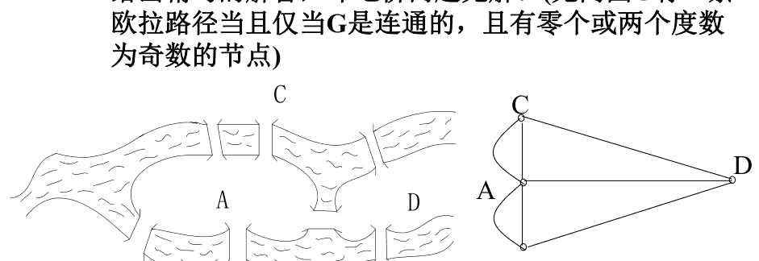

## 安排的存在性（存在性问题）

- 例 1.2 幻方问题，它最早起源于中国古代的洛书河图（公元前2200多年）。

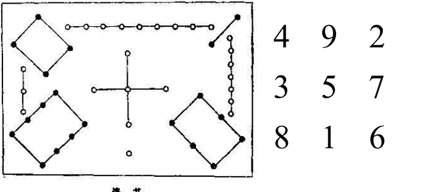

## 安排的存在性（存在性问题）

- n阶幻方是由整数1, 2, 3, ..., n²按下述方式组成的方阵：该方阵每行上的整数的和、每列上的整数的和以及两条对角线中每条对角线上的整数的和都等于同一个数s。这个整数s就叫做该幻方的幻和。

- 下面是3阶和4阶幻方的两个例子：
[8 1 6]
[3 5 7]
[4 9 2]
[16 3 2 13]
[5 10 11 8]
[9 6 7 12]
[4 15 14 1]

这两个幻方的幻和分别是15和34。

## 安排的存在性（存在性问题）

- 一个**n**阶幻方中的所有整数的和为 1+2+3+…+n² = \(\frac{n^2(n^2+1)}{2}\)

由于一个**n**阶幻方共有**n**行，每一行都有一个幻和**s**，因此我们得到关系。

\(ns = n^2(n^2+1)/2\)

于是，任意两个**n**阶幻方都有相同的幻和，即

\(s = n(n^2+1)/2\)

不难验证，不可能存在2阶幻方（其幻和应该是5）。但是，对于所有其他的**n**，**n**阶幻方能够构造出来。存在着许多构造幻方的特殊方法。

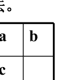

## 安排的存在性（存在性问题）

例1.3 棋盘的完备覆盖问题

对于一个m×n的棋盘，假定有外形完全一样的骨牌，每一骨牌可以覆盖棋盘上两个邻接的方格。如果用一些骨牌覆盖棋盘，使得棋盘上的所有方格都被骨牌覆盖，并且没有两块骨牌交叠，就称这一覆盖是棋盘的一个完备覆盖。

十分明显，一个3×3的棋盘不存在完备覆盖，而一个2×n的棋盘显然有完备覆盖。对于一个8×8的棋盘，完备覆盖也是存在的。但对于一个剪去了两个对角的8×8的棋盘，是否还存在完备的覆盖呢？（有32个黑色和30个白色的方格，因此不可能有完备覆盖）

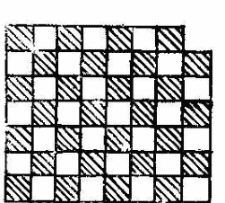

## 安排的枚举、分类和计数

例 1.4 对正三角形的三个顶点u, v, w染以红、蓝两种颜色，求不同的染色方案。
解:染色方案可自然地分成四类:
(1)三点全染红色，只有一种方案：rrr;
(2)三点全染蓝色，只有一种方案：bbb;
(3)两点染红，一点染蓝，因蓝色可分别染于u, v, w三个顶点之一，故有3种方案：rrb, rbr, brr;
(4)由对称性可知，两点染蓝，一点染红的方案也有3种：bbr, brb, rbb。
从而，总的方案数为2³=8。
若设三角形的三个顶点无区别，即旋转重合的方案视为同一方案，则(3)(4)两类中的3种方案都归为1种。从而共有4种不同的方案。

## 安排的枚举、分类和计数

例 1.5 一个小孩上楼梯,每次可以上一个或两个台阶,问上n阶楼梯有多少种方法?

分析 记小孩上n阶楼梯有h(n),这些方法可以分成两类:第一步上一个台阶的和第一步上两个台阶的,其方法数分别为h(n-1) 和h(n-2).显然,h(1)=1,h(2)=2.所以

```
h(n)=h(n-1)+h(n-2) (n≥3)
h(1)=1, h(2)=2
```

得到了Fibonacci数所满足的递推关系.

## 构造性问题

- 例1.6 构造3阶幻方

解：3阶幻方幻和=15

∵ (a₁ + a₅ + a₉) + (a₄ + a₅ + a₆) + (a₇ + a₅ + a₃) + (a₈ + a₅ + a₂) = 4×15

且 ∵ a₁ + a₂ + a₃ + a₄ + a₅ + a₆ + a₇ + a₈ + a₉ = 3×15

∴ 3a₅ = 15 ⇒ a₅ = 5

∴ a₁ + a₉ = a₂ + a₈ = a₃ + a₇ = a₄ + a₆ = 10

又 ∵ (a₁ + a₂ + a₃) + (a₁ + a₄ + a₇) = 30

∴ 2a₁ + a₂ + a₄ = 30 − (a₃ + a₇) = 20

| a1 | a2 | a3 |
| a4 | a5 | a6 |
| a7 | a8 | a9 |


## 构造性问题

得 $a_2 + a_4 = 2(10 - a_1)$
所以a2，a4有相间的奇偶性。从而a2，a4，a6，a8的奇偶性也相同，
所以a1，a3，a5，a7的奇偶性相同（因为1~9（除去5）有4个奇数和4个偶数，a2，a4，a6，a8的奇偶性相同时，a1，a3，a5，a7的奇偶性必相同）。
所以a1+a7为偶数。但a1+a4+a7=15，因此a4必为奇数（否则a1，a7奇偶性不同），从而三阶幻方的四角全是偶数。

| a1 | a2 | a3 |
|---|---|---|
| a4 | a5 | a6 |
| a7 | a8 | a9 |

## 构造性问题

若将2放在左上角，即令a1=2，则a9=8，这时，若a3=4 (或6)，则a7=6 (或4)。
这就是说，2放在左上角可得两个三阶幻方，而2可放在四个角中的任一个角上，由此可知，共有4×2=8个三阶幻方. 若从同构的意义讲，则三阶幻方只有一个，换句话说，可以从一个幻方经翻转、旋转而得到其余七个。

| 2 | 9 | 4 |
|---|---|---|
| 7 | 5 | 3 |
| 6 | 1 | 8 |

| 2 | 7 | 6 |
|---|---|---|
| 9 | 5 | 1 |
| 4 | 3 | 8 |

| a1 | a2 | a3 |
|---|---|---|
| a4 | a5 | a6 |
| a7 | a8 | a9 |

## 构造性问题

幻方，杨辉称其为纵横图，在著《详解九章算法》（1261年）中曾研究三阶幻方，并给出它的构造方法还给出了4至10阶的幻方。

九子斜排，上下对易，左右相更，四维挺出，戴九履一，左三右七，二四为肩，六八为足。

## 构造性问题

1. 2 设n为奇数，用下面算法可以构造奇数n阶幻方。

+   1) a ← 1, x ← 1, y ← (n+1)/2。
+   2) 若 a = n² + 1 则算法结束，否则把 a 填入 (x, y) 的
+   3) 若 x = 1 且 y = n，则 x ← x + 1，a ← a + 1，转 2)。
+   4) 若 x = 1 且 y ≠ n，则 x ← n，y ← y + 1，a ← a + 1，转 2)。
+   5) 若 x ≠ 1 且 y = n，则 x ← x - 1，y ← 1，a ← a + 1 转 2)。
+   6) 若 (x - 1, y + 1) 的方格为空，则 x ← x - 1，y ← y + 1，a ← a + 1，转 2)。
+   7) 若 (x - 1, y + 1) 的方格不空，则 x ← x + 1，a ← a + 1，转 2)。

## 构造性问题

按习题1.2中的规则可构造出如图所示的5阶幻方。

|   | 1 | 2 | 3 | 4 | 5 |
|---|---|---|---|---|---|
| 1 | 17 | 23 | 4 | 10 | 11 |
| 2 | 24 | 5 | 6 | 12 | 18 |
| 3 | 1 | 7 | 13 | 19 | 25 |
| 4 | 8 | 14 | 20 | 21 | 2 |
| 5 | 15 | 16 | 22 | 3 | 9 |

## 构造性问题

- 例1.7 正交拉丁方源于Euler提出的“36军官问题”。设有分别来自6个军团共有6种不同军衔的36名军官，他们能否排成6×6（6行6列）的方阵使得每行每列恰有各种军衔的军官1名，并且每行和每列上的不同军衔的6名军官还分别来自不同的军团。
- 分析:一个军官可由一个序偶(i,j)来表示，其中i表示该军官的军衔(i=1,2,...,6)，而j表示他所在的军团(j=1,2,...,6)。于是，这个问题变为36个序偶能否排成6×6阵列，使得在每行和每列，这6个整数1，2，…，6都能以某种顺序出现在序偶第一个元素的位置上，并以某种顺序出现在序偶第二个元素的位置上。

## 构造性问题

- 分别考虑军衔方阵与团队方阵, 于是问题就是是否存在两个6×6数组满足：
  (1) 每个数组中每一行或每一列中整数 1,2,...,6以某种次序出现;
  (2) 两个数组并置时, 所有的36个有序对 (i,j) (i=1,2,...,6; j=1,2,...,6)都将出现.

- 满足第一个条件的每个方阵称为拉丁方, 满足第二个条件的两个拉丁方称为互相正交, 即正交拉丁方.

## 构造性问题

- 对于只有9个军官的类似问题有解：
\begin{bmatrix}1 & 2 & 3 \\ 3 & 1 & 2 \\ 2 & 3 & 1\end{bmatrix}\begin{bmatrix}1 & 2 & 3 \\ 2 & 3 & 1 \\ 3 & 1 & 2\end{bmatrix} \rightarrow \begin{bmatrix}(1,1) & (2,2) & (3,3) \\ (3,2) & (1,3) & (2,1) \\ (2,3) & (3,1) & (1,2)\end{bmatrix} \leftarrow 正交拉丁方
\begin{bmatrix}1 & 2 & 3 \\ 2 & 3 & 1 \\ 3 & 1 & 2\end{bmatrix}\begin{bmatrix}1 & 2 & 3 \\ 2 & 3 & 1 \\ 3 & 1 & 2\end{bmatrix} \rightarrow \begin{bmatrix}(1,1) & (2,2) & (3,3) \\ (2,2) & (3,3) & (1,1) \\ (3,3) & (1,1) & (2,2)\end{bmatrix}

- 上述是两个3阶正交拉丁方。

- 36军官问题即是否存在6阶正交拉丁方。

## 构造性问题

- 容易看出，不存在2阶拉丁方，因为2阶拉丁方共有2个，
\begin{bmatrix}1 & 2 \\ 2 & 1\end{bmatrix} \begin{bmatrix}2 & 1 \\ 1 & 2\end{bmatrix} \Rightarrow \begin{bmatrix}(1,2) & (2,1) \\ (2,1) & (1,2)\end{bmatrix}
但两者彼此不正交。

- 对于n为奇数或者4的倍数, Euler给出了构造一对n阶正交拉丁方的办法.

- 教材给出构造 正交拉丁方组的方法，其中p为奇素数，为正整数α。

## 优化问题

- 例 1.8 最短路径问题：考虑一个由道路和路口组成的系统。一人想从一个路口 A 行进到另一个路口 B。一般说来，从路口 A 到 B 存在许多通路。现在的问题是要确定一条通路。使沿此通路从 A 到 B 的距离尽可能小的一条最短路径。这是组合优化（动态规划，整数规划）问题的例子。

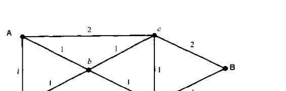

## 优化问题

一种可能的方法是以某种系统的方式列出从A到B的路径所有可能的路径，计算沿每条路径的距离，然后选择一条最短的路径。

但是，这并不是一条非常有效的计算方法，对于大的系统，工作量可能太大，以至于在合理的时间范围内得不到问题的解。

因此，现在需要的是使计算量随着系统规模的增加而不会增加得太快的一种最短路径算法。

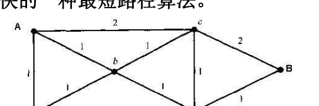

## 基本解题方法

例1.9 有101名选手参加羽毛球比赛，如果采用单循环淘汰制，问要产生冠军需要进行多少场比赛？

方法一：
人数： 101 51 26 13 7 4 2
场数： 50+25+13+ 6+3+2+1=100

方法二：
因为每场比赛都要产生一个失败者，而每个失败者只能失败一次，所以比赛的场数下失败者的人数相等。又因为冠军是唯一的胜利者，其它100个人都失败过，所以要比赛100场。

## 基本解题方法

例 1.10 有一个边长为3的立方体木块，要把它切割成27个边长为1的小立方体。如果在切割过程中可以重新排列被切割木块的位置，问至少需要多少次才能完成整个切割？

方法一：
先列出所有可能的切割方案，然后找出最优的方案，这是相当麻烦的。

方法二：
首先可以看到6次是可以完成整个切割的。
其次，我们来证明少于6次是不能完成整个切割的。因为在27个小立方体中有一个处在原来大立方体的中心，它的每一个面都是由切割而产生的。又因为每切一次只能产生一个面，所以切割次数不能少于它的面数，因此至少要6次切割才能完成。

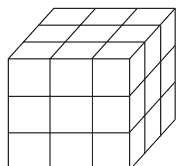

# 第二章 鸽巢原理和Ramsey定理

- 2.1 鸽巢原理的简单形式
- 2.2 鸽巢原理的加强形式
- 2.3 Ramsey定理

## 鸽巢原理的简单形式

组合存在性定理

Ramsey定理（鸽巢原理为其最简形式）

偏序集分解定理（Dilworth定理）

相异代表系存在定理（Hall定理）

鸽巢原理是组合学中最简单、最基本原理

也叫抽屉原理或狄利克雷原理

(Dirichlet(1805-1859)19世纪德国数学家)。


## 鸽巢原理的简单形式

定理 2.1.1 如果把 *n+1* 个物品放入 *n* 个盒子中，那么至少有一个盒子中有两个或更多的物品。

证明：反证法

如果每个盒子中至多有一个物品，那么 *n* 个盒子中至多有 *n* 个物品，而我们共有 *n+1* 个物品，矛盾。故定理成立。

鸽巢原理只断言存在一个盒子，该盒中有两个或两个以上的物品，但它并没有指出是哪一个盒子。所以，这个原理只能用来证明某种安排的存在性，而对于找出这种安排却毫无帮助。

### 注意
- 注意1，应用时要分清物体与盒子以及物体总数与盒子总数。
- 注意2，定理只是存在性定理，不能找出具体的物体。
- 注意3，不能被推广到只存在n个(或更少)物体的情形。

例 2.1.1

13 人中至少有 2 人是同月出生的。

13 人中至少有 2 人属相相同。

367 人中至少有 2 人的生日相同。

设有 n 对夫妇，问至少要从这 2n 个人中选出多少人，才能保证能够有一对夫妇被选出？

例 2.1.2 给出 $m$ 个数 $a_1, a_2, ... a_m$, 证明：必存在整数 $k,l$ ($0 \le k < l \le m$), 使得 $m | (a_{k+1}+...+a_l)$.

证明：构造部分和序列

- $s_1 = a_1$
- $s_2 = a_1 + a_2$
- ...
- $s_m = a_1 + a_2 + ... a_m$

则有如下两种可能：

1）存在整数 $s_h$（$1\le h\le m$），使得 $m|s_h$。此时，取 $k=0,l=h$ 即满足题意。

2）对任意整数 $i$，均有 $m$ 不整除 $s_i$（$1\le i\le m$）。令 $r_i\equiv s_i\pmod m$，则有 $1\le r_i\le m-1$（$1\le i\le m$），这样，$m$ 个余数均在 $1$ 到 $m-1$ 之间。由鸽巢原理知，存在整数 $k\ne l$（$1\le k,l\le m$），使得 $r_k=r_l$。不妨设 $l>k$，则
$a_{k+1}+a_{k+2}+...+a_l$
$=(a_1+...+a_k+a_{k+1}+...+a_l)-(a_1+...+a_k)$
$=s_l - s_k$
$\equiv(r_l-r_k)\pmod m$
$\equiv0\pmod m$。综合 1）2）即知题设结论成立。

例 2.1.3 一个棋手有 11 周时间准备锦标赛,他决定每天至少下一盘棋,一周中下棋的次数不能多于 12 次.证明: 在此期间的连续一些天中他正好下棋 21 次.

证明:

(1) 令 b₁, b₂, ..., b₇₇ 分别为这 11 周期间他每天下棋的次数, 并作部分和

a₁=b₁,
a₂=b₁+b₂,
...,
a₇₇=b₁+b₂+...+b₇₇.

根据题意, 有 bᵢ≥1(1≤i≤77),且 bᵢ+bᵢ₊₁+...+bᵢ₊₆≤12(1≤i≤71), 所以有 1≤a₁<a₂<a₃<...<a₇₇≤12×11=132. (2.1.1)

(2) 考虑数列

a₁,a₂,..., a₇₇; a₁+21,a₂+21,..., a₇₇+21,

它们都在 1 与 132+21=153 之间，共有 154 项

(3) 由鸽巢原理知，其中必有两项相等。由（2.1.1）式知

a₁,a₂,..., a₇₇ 这 77 项互不相等，从而 a₁+21,a₂+21,..., a₇₇+21 这 77 项也互不相等。所以一定存在 1≤i<j≤77，使得

aⱼ=aᵢ+21.

因此

21 = a_j - a_i
= (b₁ + b₂ + ... + b_i + b_{i+1} + ... + b_j) - (b₁ + b₂ + ... + b_i)
= b_{i+1} + b_{i+2} + ... + b_j.
这说明从第 i+1 天到第 j 天这连续 j-i 天中，他刚好下了 21 盘棋。

14w > wt + x ⇒ w(14 - t) > x
其中 w 为周数，t 为每周最多下棋的次数，x 为连续若干天中正好下棋的次数。(本题 w=11，t=12，x=21)

思考题:
能否将题目中的77天改为其他的数字70，则连续的n天共下了（ ）盘棋？

例2.1.4 从 1,2,...,2n 的正整数中任取 n+1 个不同的数，证明至少有一个数是另一个数的倍数。

证明:设 a₁,a₂,...,aₙ₊₁ 是被选出的 n+1 个整数.对任一 aᵢ,都可以唯一地写成如下的形式:

```
aᵢ = 2^{sᵢ} × rᵢ (i = 1,2,...,n+1),
```

其中，sᵢ为整数，rᵢ为奇数.例如：

- 72=2³×9,
- 64=2⁶×1.

思考题

1) 在边长为1的等边三角形内任意放10个点，证明一定存在两个点，其距离不大于1/3。

2) 确定正整数mₙ的值，使得在边长为1的等边三角形内任意放mₙ个点，其中必有两点的距离不大于1/n。

3) 证明边长为a的正方形内任意5点，必有两点的距离不超过√2a/2

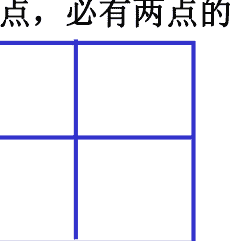

附加例题：某次会议有 n 位代表出席，每位代表除自己以外至少认识 n-1 位中的一位，则在这 n 位代表中，至少有两位代表认识的人数相同。

证明：将 n 位代表按认识的人数分类，为 1，2，...，n-1。

若把条件去掉，就是课后练习 2.13

附加例题：在n+1个小于等于2n的不相等的正整数中，一定存在两个数是互素的。

分析：任何两个相邻的正整数是互素的。

证明：（反证法）假设n与n+1有公因子q (q>2)，则有n=qp₁，n+1=qp₂，p₁，p₂是整数。因此得 qp₁+1=qp₂ ⇒ q(p₂-p₁)=1

这与q>2，p₂-p₁是整数矛盾。

把1，2，…，2n分成以下n组：{1,2},{3,4},…,{2n-1,2n}，从组中任取n+1个不同的数，由鸽巢原理可知至少有两个数取自同一组，它们是相邻的数，所以它们是互素的。

## 作业

- pp. 13, 2.9
- pp. 13, 2.11

## 鸽巢原理的加强形式

定理 2.2.1 设 q₁,q₂,…,qₙ 都是正整数，如果把 q₁+q₂+…+qₙ−n+1 个物品放入 n 个盒子，那么或者第一个盒子至少包含 q₁ 个物品，或者第二个盒子至少包含 q₂ 个物品，……，或者第 n 个盒子至少包含 qₙ 个物品。

证明：反证法。若对所有的 i (1≤i≤n)，第 i 个盒子至多只有 qᵢ−1 个物品，则 n 个盒子中至多有 (q₁−1)+(q₂−1)+…+(qₙ−1)=(q₁+q₂+…+qₙ)−n 个物品，而我们现在有 q₁+q₂+…+qₙ−n+1 个物品，矛盾。故定理成立。

在定理 2.2.1 中另 q₁ = q₂ = ... = qₙ = 2, 则变成了鸽巢原理的简单形式。在定理 2.2.1 中令 q₁ = q₂ = ... = qₙ = r 则得到如下的推论：

推论 2.2.1 若将 n(r-1)+1 个物品放入 n 个盒子中，则至少有一个盒子中有 r 个物品。

推论 2.2.1 也可以叙述成如推论 2.2.2 所描述的另一种形式：

推论 2.2.2 设 $m_1, m_2, ... m_n$ 是 $n$ 个整数，而且 $\frac{m_1 + m_2 + ... + m_n}{n} > r - 1$, 则 $m_1, m_2, ... m_n$ 中至少有一个数不小于 $r$.

推论 2.2.3 若将 $m$ 个物品放入 $n$ 个盒子中，则至少有一个盒子中有不少于 $\left\lceil \frac{m}{n} \right\rceil$ 个物品. 其中，$\left\lceil \frac{m}{n} \right\rceil$ 是不小于 $\frac{m}{n}$ 的最小整数。

例 2.2.1 设有大小两只圆盘，每个都划分成大小相等的 200 个小扇形，在大盘上任选 100 个小扇形漆成黑色，其余的 100 个小扇形漆成白色，而将小盘上的 200 个小扇形任意漆成黑色或白色。现将大小两只圆盘的中心重合，转动小盘使小盘上的每个小扇形含在大盘上小扇形之内。证明：有一个位置使小盘上至少有 100 个小扇形同大盘上相应的小扇形同色。

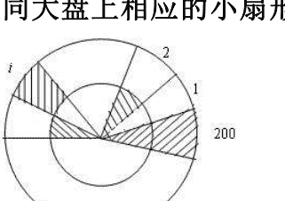


## 鸽巢原理的加强形式

证明 如图 1.2.1 所示，使大小两盘中心重合，固定大盘，转动小盘，则有 200 个不同位置使小盘上的每个小扇形含在大盘上的小扇形中，由于大盘上的 200 个小扇形中有 100 个漆成黑色,100 个漆成白色,所以小盘上的每个小扇形无论漆成黑色或白色,在 200 个可能的重合位置上恰好 100 次与大盘上的小扇形同色，因而小盘上的 200 个小扇形在 200 个重合位置上共同色 100×200=20000 次，平均每个位置同色 20000÷200=100 次。由鸽巢原理知，存在某个位置，使同色的小扇形数大于等于 100 个。

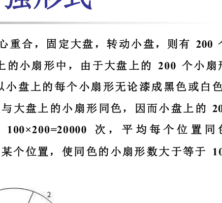

## 鸽巢原理的加强形式

例 2.2.2 任意 n² +1 个实数

a₁, a₂, a₃, ..., aₙ²₊₁    （2.2.1）

组成的序列中，必有一个长为 n +1 的非降子序列，或必有一个长为 n +1 的非升子序列。

在证明本例之前先看一个具体的例子，对于序列（n=3）

5, 3, 16, 10, 15, 14, 9, 11, 6, 7,

从中可以选出如下几个递减子序列：

{5, 3}, {16, 10, 9, 6}, {16, 15, 14, 11, 7}, ....

## 鸽巢原理的加强形式

证法 1： 假设长为 $n^2+1$ 的实数序列（2.2.1）中没有长度为 $n+1$ 的非降子序列，下面证明其必有一长度为 $n+1$ 的非升子序列。

（1）令 $m_k$ 表示从 $a_k$ 开始的最长非降子序列的长度，因为实数序列（2.2.1）中没有长度为 $n+1$ 的非降子序列，所以有

$1 \le m_k \le n \;(k=1,2,\cdots,n^2+1).$

这相当于把 $n^2+1$ 个物品 $m_1,m_2,\cdots,m_{n^2+1}$ 放入 $n$ 个盒子 1, 2, ..., n 中，由鸽巢原理知，必有一个盒子 $i$ 里面至少有 $n+1$ 个物品，即存在

$k_1 < k_2 < \cdots < k_{n+1}$ 及 $1 \le i \le n,$

使得

$m_{k_1}=m_{k_2}=\cdots=m_{k_{n+1}}=i.$

（2.2.2）

(2)对应于这些下标的实数序列必满足

a_{k1} ≥ a_{k2} ≥ ⋯ ≥ a_{k_{n+1}} ，
(2.2.3)

它们构成一长为 n+1 的非增子序列。否则，若有某个 j（1≤ j ≤ n）使得 a_{k_j} < a_{k_{j+1}}，那么由从 a_{k_{j+1}} 开始的最长非降子序列加上 a_{k_j}，就得到一个从 a_{k_j} 开始的长度为 m_{k_{j+1}} +1 的非降子序列。由 m_{k_j} 的定义知

m_{k_j} ≥ m_{k_{j+1}} +1，

这与 m_{k1} = m_{k2} = ⋯ = m_{k_{n+1}} = i 矛盾。因此（2.2.3）式成立，从而定理的结论成立。

## 鸽巢原理的加强形式

证法 2：由题意，假设 $L_i$ 是从 $a_i$ 开始的递减子序列的最大长度，$M_i$ 是从 $a_i$ 开始的递增子序列的最大长度，则对于从 1 到 $n^2 + 1$ 的每个 i 的取值，都有 $(L_i, M_i)$ 与之对应。

利用反证法证明结论。假设 $1\le L_i\le n$ 且 $1\le M_i\le n$， $1\le i\le n^2 + 1$，由集合论的知识很容易知道集合 $\{(L_i, M_i)\}$ 的数量为 $n^2$，根据鸽巢原理，必然有 $(L_i, M_i) = (L_j, M_j)$ $(i < j)$，则 $L_i = L_j$，而且 $M_i = M_j$。对于 $a_i$, $a_j$,

+   (1) 若 $a_i > a_j$，则 $a_i$ 与从 $a_j$ 开始的最长递减子序列合并组成的子序列的长度 $L_i > L_j$，这与 $L_i = L_j$ 矛盾；
+   (2) 若 $a_i \le a_j$，则 $a_i$ 与从 $a_j$ 开始的最长递增子序列合并组成的子序列的长度 $M_i > M_j$，这又与 $M_i = M_j$ 矛盾。所以假设 $1\le L_i\le n$ 且 $1\le M_i\le n$ 不成立。

## 鸽巢原理的加强形式

题目2.2 在一个边长为1的正方形内任取9个点，证明：以这些点为顶点的各个三角形中，至少有一个三角形的面积不大于1/8。

## 作业

- pp. 13, 2.7
- pp. 13, 2.13

## Ramsey定理

核心思想是：“任何一个足够大的结构中必定包含一个给定大小的规则子结构”

1928年英国数学家、哲学家兼经济学家Frank Ramsey(1903-1930)在伦敦数学会上宣读一篇“论形式逻辑中的一个问题”的论文，奠定了Ramsey理论的基础。

Ramsey定理已经发展成为Ramsey理论并渗透到诸多研究领域，而且仍然是研究热点问题。

1958年6-7月号美国《数学杂志》上登载着这样一个有趣的问题：“任何一个6人聚会，必有3个人相互认识或者相互不认识”，这个问题实质上就是一个Ramsey问题，

## Ramsey定理

例2.3.1 K₆是6个顶点的完全图，用红、蓝两色涂色K₆的边，则或者存在一个红三角形，或者存在一个蓝三角形。

证明：(1)设K₆的顶点为v₁,v₂,...,v₆.对于K₆的任何一种涂色方案，由鸽巢原理，v₁关联的边中有3条同色边。不妨设这三条边为{v₁,v₂},{v₁,v₃},{v₁,v₄}。

(2)若这三边为红色，当v₂,v₃,v₄之间有一条红边，比如说是{v₂,v₃},则v₁v₂v₃构成一个红三角形；当v₂,v₃,v₄之间没有红边，则v₂v₃v₄构成一个蓝三角形。

(3)同理可证当这三边为蓝色时命题也为真。

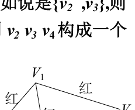

## Ramsey定理

判断树

d_r(v1)≥3?

N

Y

d_b(v1)≥3

设(v1v2)(v1v3)(v1v4)为红边

设(v1v2)(v1v3)(v1v4)为蓝边

△v2v3v4是蓝△?

△v2v3v4是红△?

N

Y

N

Y

设(v2v3)是红边

设(v2v3)是蓝边

△v1v2v3是红△

△v1v2v3是蓝△

√

√

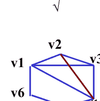

## Ramsey定理

例2.3.2 用红、蓝两色涂色 K₉ 的边。证明存在一个蓝三角形或红色的完全四边形。

证明：设 K₉ 的顶点为 v₁,v₂,…,v₉。对于 K₉ 的任何一种涂色方案，必存在一个顶点连接 4 条蓝边或 6 条红边。假若不然，每个顶点至多连接 3 条蓝边和 5 条红边。那么蓝边总数至多为 ⌊9×3/2⌋=13，而红边总数至多为 ⌊9×5/2⌋=22，与 K₉ 具有 ⌊9×8/2⌋=36 条边矛盾。不妨设 v₁ 连接 4 条蓝边或 6 条红边。

## Ramsey定理

若 v₁ 连接 4 条蓝边，不妨设为{v₁ ,v₂},{v₁ ,v₃},{v₁ ,v₄},{v₁ ,v₅}。若 v₂,v₃,v₄,v₅ 之间存在一条蓝边，比如说是{v₂ ,v₃}，则 v₁v₂v₃ 构成一个蓝三角形；若 v₂,v₃,v₄,v₅ 之间不存在蓝边，则这四个顶点构成一个红完全四边形。

若 v₁ 连接 6 条红边，不妨设为{v₁ ,v₂},{v₁ ,v₃},{v₁ ,v₄},{v₁ ,v₅},{v₁ ,v₆},{v₁ ,v₇}。根据例 2.3.1，v₂,v₃,...,v₇ 之间有一个蓝三角形或红三角形。如果存在一个蓝三角形则命题得证；如果存在一个红三角形，则它与 v₁ 构成一个红完全四边形。

## Ramsey定理

判断树

d_r(v1)≥6?

N

Y

d_b(v1)≥4

设(v1v2)(v1v3)(v1v4)(v1v5)为蓝边

设(v1v2)(v1v3)(v1v4)(v1v5)(v1v6)(v1v7)为红边

由(v2v3v4v5)构成的K4中存在蓝边？

由(v2v3v4v5v6v7)构成的K6中存在蓝△？

N

Y

N

Y

(v1v2v3v4)构成红K4

设(v2v3)是蓝边

△v1v2v3是蓝△

K6中存在红△

设(v2v3v4)是红△

(v1v2v3v4)构成红K4

√

## Ramsey定理

对上面的几个命题进行归纳，可以得出如下定义：

定义 2.5.1 对于任意给定的两个正整数 $p$ 和 $q$，如果存在最小的正整数 $R(p,q)$ 使得当 $N \ge R(p,q)$ 时，对 $K_N$ 任意进行红、蓝两边着色，$K_N$ 中均有红色 $K_p$，或蓝色 $K_q$，则 $R(p,q)$ 称为 Ramsey 数。

- Ramsey数的简单性质

定理 对任意正整数 $p$, $q$, 有

- （1） $R(p,q) = R(q,p)$
- （2） $R(p,2) = p$


## Ramsey定理

定理 2.3.1(Ramsey 定理的简单形式) 设 p, q 是正整数, p, q≥2, 则存在最小的正整数 R(p,q), 始得当 n≥R(p,q)时, 用红、蓝两色涂色 K_n 的边, 或者存在一个蓝色的完全 p 边形, 或者存在一个红色的完全 q 边形。

证明：用归纳法。

设 p 为任意正整数, q=2。用红、蓝两色涂色 K_p 的边, 若没有一条红边, 则存在一个蓝色的完全 p 边形; 若有一条红边, 则构成一个完全红 2 边形, 因此 R(p,2)≤p。 同理可证 R(2,q) ≤q。

假设对一切正整数 p',q'(p'+q'<p+q)命题为真。

(1)令 n≥R(p-1,q)+R(p,q-1)。用红、蓝两色染色 Kₙ 的边，则 v₁ 或关联 R(p-1,q) 条蓝边或关联 R(p,q-1) 条红边。如若不然，v₁ 至多关联

n-1 ≤ R(p-1,q)-1 + R(p,q-1)-1 = R(p-1,q)+R(p,q-1)-2

⇒ n ≤ R(p-1,q)+R(p,q-1)-1

条边，与 n ≥ R(p-1,q)+R(p,q-1) 矛盾。

(2)若 v₁ 关联 R(p-1,q) 条蓝边，由归纳假设这 R(p-1,q) 个顶点中或含有一个蓝色的完全 p-1 边形，或含有一个红色的完全 q 边形。如为前者，则这个 p-1 边形加上 v₁ 构成一个蓝色的完全 p 边形，命题为真；如为后者，命题也为真。

(3)若 v₁ 关联 R(p,q-1) 条红边，同理可证 Kₙ 中必含有一个蓝色的完全 p 边形或红色的完全 q 边形，从而证明了 R(p,q) ≤ R(p-1,q)+R(p,q-1).

推论 2.3.1  R(p,q) ≤ (p+q-2 choose p-1).

证明：用归纳法。

当 p=q=2 时， R(2,2)=2, (2+2-2 choose 2-1) = (2 choose 1) = 2.

假设对一切 p',q' (p'+q'<p+q) 是命题为真，则

R(p,q) ≤ R(p-1,q) + R(p,q-1) ≤ (p-1+q-2 choose p-1-1) + (p+q-1-2 choose p-1) = (p+q-3 choose p-2) + (p+q-3 choose p-1) = (p+q-2 choose p-1)

推论 2.3.2  R(p,q) ≤ (2p-2 choose p-1) ≤ 2^{2p-2}.

例 2.3.3 R(3, 3)= 6.

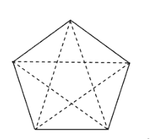

证明： 由例 2.3.1 知 R(3,3)=6。 而上图中的实线代表蓝边，虚线代表红边，则这个的染色方案既不包含蓝三角形，也不包含红三角形。所以 R(3,3)>5。 综合两方面的结果有 R(3,3)=6。

例 2.3.4 R(3, 4)= 9

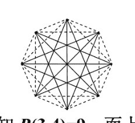

证明： 由例 2.3.2 知 R(3,4)=9。而上图中的实线代表蓝边，虚线代表红边，则这个的涂色方案既不包含蓝三角形也不包含红色的完全四边形，从而 R(3, 4)>8。综合两方面的结果有 R(3, 4)=9。

表 2.3.1  p, q 较小时的 R(p, q) (pp.10)

| q\p | 3 | 4 | 5 | 6 | 7 | 8 | 9 | 10 |
|---|---|---|---|---|---|---|---|---|
| 3 | 6 | 9 | 14 | 18 | 23 | 28/29 | 36 | 40/43 |
| 4 |  | 18 | 25 | 35/41 | 49/61 | 56/84 | 69/115 | 92/149 |
| 5 |  |  | 43/49 | 58/87 | 80/143 | 101/216 | 121/316 | 141/442 |
| 6 |  |  |  | 102/169 | 111/298 | 127/495 | 169/780 | 178/1171 |
| 7 |  |  |  |  | 205/540 | 216/1031 | 232/1713 | ? /2826 |
| 8 |  |  |  |  |  | 282/1870 | 317/3583 | ? /6090 |
| 9 |  |  |  |  |  |  | 565/6588 | 580/12677 |
| 10 |  |  |  |  |  |  |  | 798/23556 |

注：？表示目前还无结果

表 2.3.1 是由 Stanisław P. Radziszowski 给出了目前所得到的小 Ramsey 数 R(p, q) 的某些精确值或上下界，其中 3≤p≤10，3≤q≤15。

不难证明对 Ramsey 数有下面的性质成立。

(2,2,2)
(2,3,3)(3,2,3)
(2,4,4)(3,3,6)(4,2,4)
(2,5,5)(3,4,9)(4,3,9)(5,2,5)
(2,6,6)(3,5,14)(4,4,18)(5,3,14)(6,2,6)
(2,7,7)(3,6,18)(4,5,25)(5,4,25)(6,3,18)(7,2,7)

Ramsey 进一步将这个问题推广，对任意正整数 r 考虑 V 的所有 r 元子集的划分问题，得到了关于 r 的 Ramsey 定理。

定理 2.3.3 对于任意给定的正整数 p, q 和 r, p, q≥r, 存在着一个最小的正整数 R(p,q;r)，使得当集合 S 的元素数≥R(p,q;r) 时，将 S 的 r 元子集族任意划分成 E₁ 和 E₂，则或者 S 有某个 p 子集 A，A 的所有 r 元子集都属于 E₁，或者 S 有某个 q 子集 B，B 的所有 r 元子集都属于 E₂。

# 第三章 基本计数原理

- 3.1 加法原则与乘法原则
- 3.2 排列与组合
- 3.3 排列和组合的生成
- 3.4 二项式系数
- 3.5 集合的划分与第二类Stirling数
- 3.6 正整数的分解
- 3.7 分配问题

## 加法原则与乘法原则

加法原则和乘法原则是计数问题中两个最基本的计数原则。

加法原则：设集合 S 的划分为 S1,S2,...,Sm, 那么 S 的元素个数可以通过每一子集的元素个数来确定，即：

|S| = |S1| + |S2| +...|Sm|，其中：| |表示求集合的基数。

使用加法法则要注意各子集间是不能重叠。如果重叠，需要使用复杂的原理（所谓的容斥原理）进行计数，将在第四章介绍。

加法原则的另一种表述形式：

如果有 p 种方法能够从一堆物体中选择出一个物体，有 q 种方法能够从另一堆物体中选择出一个物体，那么从两堆物体中选择出一个物体的方法有 p+q 种。

例 3.1.1 某学生从三门数学课程和四门计算机课程中任意选修一门课程的方法是 3+4=7 种。

乘法原则：令 S 是序偶(a,b)的集合，其中第一个元素 a 来自大小为 p 的集合，而对于 a 的每一个选择，元素 b 存在 q 种选择，那么 S 的大小为 p×q，即：

|S| = p×q。

乘法原理的另一种表述形式：

如果执行第一项任务有 p 个结果，而不论第一项任务结果如何，执行第二项任务有 q 个结果，那么，两项任务连续执行有 p×q 个结果。

例 3.1.2 某学生从三门数学课程和四门计算机课程中选修一门数学和一门计算机课程 3×4=12 种。

例 3.1.3 确定数 3^4 × 5^2 × 11^7 × 13^8 共有多少个正整数因子？

4 × 2 × 7 × 8 = 448

## 排列与组合

许多计数问题属于以下几种类型：

- (1) 对元素的有序摆放或有序选择的计数
- a) 没有重复的元素
- b) 有重复的元素（无限重复或有限重复）
- (2) 对元素的无序摆放或无序选择的计数。
- a) 没有重复的元素
- b) 有重复的元素（无限重复或有限重复）

定义：与顺序有关的摆放或选择称为排列；与顺序无关的摆放或选择称为组合。

例 3.2.1 在1000到9999之间有多少个各位数字不同的奇数？

解 在1000到9999之间的数是4个数字的有序摆放，而且是无重复元素的。

方法1 按要求第4位必须是奇数，可取1、3、5、7和9，共有5种选择。

第1位不能取0，也不能取第4位已选定的数字，所以在第4位选定后第1位有8种选择。第2位不能取第1位和第4位已选定的数字，共有8种选择。类似地，第3位有7种选择。从而，满足题意的数共有5×8×8×7=2240个。


## 相异元素不允许重复的排列数和组合数

从n个相异元素中不重复地取r个元素(r ≤ n)的排列数和组合数在中学已经学过，它们分别为：

P_n^r = P(n,r) = n(n-1)⋯(n-r+1) = n! / (n-r)!

C(n,r) = (n choose r) = P(n,r)/r! = n! / [r!(n-r)!]

显然，

- （1）当 r > n 时，P(n,r)=0，C(n,r)=0。
- （2）当 r = 1 时，P(n,1)=n      (n ≥ 1)
- （3）C(n,0)=C(n,n)=1
- （4）若 0 ≤ r ≤ n，则 C(n,r)=C(n,n-r)

此恒等式具有如下的组合意义：\(\binom{n}{r}\) 是 $n$ 元集合 $S$ 的 $r$ 元子集的个数，\(\binom{n}{n-r}\) 是集合 $S$ 的 $n$-$r$ 元子集的个数.设 $A$ 是 $S$ 的 $r$ 元子集，则 $S$-$A$ 是 $S$ 的 $n$-$r$ 元子集，而且这种对应关系显然是一一的，所以，$S$ 的 $r$ 元子集的个数等于 $S$ 的 $n$-$r$ 元子集的个数.因此恒等式成立。

相异元素不允许重复的排列问题也可描述为：将 $r$ 个有区别的球放入 $n$ 个不同的盒子，每盒不超过一个，则总的放法为 $P(n,r)$。同样，若球不加区别，则有 $C(n,r)$ 种放法。这就是排列与组合的数学模型。

例 3.2.2 排列 26 个字母，使得 a 和 b 之间正好有 7 个字母，问有多少种排法？

解: 方法 1: 以 a 排头、b 结尾、中间恰含 7 个字母的排列有 P(24,7)种。同理，以 b 排头、a 结尾、中间含 7 个字母的排列也有 P(24,7)种。

由加法法则 a, b 为端点的 9 个字母的排列有 2 P(24,7)种。

把一个这样的排列看成一个整体再与剩下的 17 (=26-2-7)个字母进行全排列就得到所求的排列。全排列的方法有 18! 种，根据乘法法则，所求的排列数是

N=2P(24,7) × (26-2-7+1)=2P(24,7)×18! =36×24!

方法 2 先把 a、b 去掉的 24 个字母进行全排列，共有 24! 个排列数，然后按 a 排头、b 结尾的顺序将这两个字母插入到每个 24 个排列中，使得两个字母间有 7 个字母的插入方案有 24-7+1=18，同理，b 排头、a 结尾的插入方式也为 18，所以一共的排列数有

N=2=P(24,24) ×2×18=36×24!

例 3.2.3 S={a, b, c, d, e, f}.问：

- (1) 在 S 的全排列中使得字母 b 正好在字母 e 的左邻的排列有多少种？
- (2) 在 S 的全排列中使得字母 b 在字母 e 的左边的全排列有多少种？
- (3) 在 S 的 4-排列中使得字母 b 和 e 不相邻的排列有多少种？

（1）在 S 的全排列中使得字母 $b$ 正好在字母 $e$ 的左邻的排列有多少种？

解　（1）$b$ 正好是 $e$ 的左邻的排列形如

$\times\cdots\times be\times\cdots\times$

其中，$\times\cdots\times\times\cdots\times$ 为 $\{a,c,d,f\}$ 的一个 4-全排列，在这些排列中，将 $be$ 看作一个整体，原问题就变成求集合 $\{a,c,be,d,f\}$ 的全排列数，共有 $5!$ 种排列。

（2）在 S 的全排列中使得字母 b 在字母 e 的左边的全排列有多少种？

解：（2）将 {a,b,c,d,e,f} 的所有全排列分成如下两类：

A = {x×…× | 其中 b 在 e 的左边}
B = {x×…× | 其中 e 在 b 的左边}

显然有 A ∩ B = ∅， A ∪ B = {a,b,c,d,e,f} 的全排列， |A ∪ B| = 6！。

定义映射，使 f: A → B，

f(…b…e…) = (…e…b…)。

即 f 将 A 中的任一排列的 b 与 e 的位置互换，保持其余字母位置不变，得到 B 中的一个排列。显然，f 是一一映射，所以

|A| = |B| = 1/2 × 6！。

(3) 在 S 的 4-排列中使得字母 b 和 e 不相邻的排列有多少种？

解： (3) 方法 1  4 元集合 S 的排列共有 P(6, 4)个，将其分成三类，分别记为 A, B, C，即

- (i) A 类：a 和 b 换在一起，a 是 b 的左邻；
- (ii) B 类：a 和 b 换在一起，b 是 a 的左邻；
- (iii) C 类：a 和 b 不换在一起（包括不出现 a 或 b）

则显然有 P(6, 4)=|A|+|B|+|C|，且|A|=|B|。我们要求的是 C 类 4 位数的个数。为此，我们先计算|A|。

我们如下构造 A 类排列：首先构造 4 元集合 {c,d,e,f} 的一个 2 排列，共有 P(4, 2)个，则 ab 作为一个整体可以插入 3 个位置中的任一位置，有 3 × P(4, 2)个排列，由例 2(2)知 |A|=|B|，所以 |C|=P(6, 4)-2 × |A|=360-72=288

（3）在 S 的 4-排列中使得字母 b 和 e 不相邻的排列有多少种？

解： 方法 2 直接计算|C|。满足题意的 4 位数可分为如下四类：

- （i）4 位数中 a 和 b 均不出现，即为 4 元集合{c,d,e,f}的全排列，共有 4! 个。
- （ii）4 位数中只出现 a，不出现 b。将 a 插入到{c,d,e,f}的任意一个 3-排列，从而构成一个排列。此类排列数共有 4×P(4,3)个。
- （iii）4 位数中只出现 b，不出现 a。同（ii），此类数共有 4×P(4,3) 个。
- (iv) 4位数中出现a和b，但不相邻，我们如下构造此类排列：首先构造元集合{c,d,e,f}的一个2排列，然后将a和b插入其中3个“△”位置中的任意2个位置，此时a和b必不相邻。所以，此类数共有P(4,2)×P(3,2)个。

综合上述分析，满足题意的排列数共有 P(4,4)+P(4,3)×4×2+P(4,2)×P(3,2)=288（个）

例 3.2.4 从 1, 2, ..., 300 中任取三个数使得它们的和能被 3 整除，问有多少种方法？

解    把 1, 2, ..., 300 分成 A, B, C 三组。
A = {x | x = 1(mod 3)},
B = {x | x = 2(mod 3)},
C = {x | x = 0(mod 3)}.

设所取的三个数为 i, j, k，那么这种选取是无序的，且满足 i + j + k = 0(mod 3)。我们将选法分成两类：

- （1）i, j, k 都取自同一组，方法数 N1 = 3C(100,3)
- （2）i, j, k 分别取自 A, B, C，方法数 N2 = [C(100,1)]³。

由加法法则，总取法数 N = 3C(100,3) + [C(100,1)]³ = 1485100

例 3.2.5 某车站有 6 个入口，每个入口每次只能进一个，问 9 人小组共有多少种进站方案？

解 方法 1 将 6 个入口依次排好序，分别为第 1,第 2,……,第 6 个入口.因 9 人进站时在每个入口都是有序的，我们如下构造 9 人的进站方案：先构造 9 人的全排列，共有 9! 个；然后选定 9 人的一个全排列，加入 5 个分界符，将其分成 6 段，第 i (i=1,2,⋯,6) 段对应着第 i 个入口的进站方案.如图 2.1 所示，每个 “*” 代表一个人，“△” 表示分隔符.图 2.2.6 中，5 个 “△” 分别在第 3、第 5、第 9、第 11、第 13 个位置，它对应的进站方案中，前 2 人从第 1 个入口进站，第 3 人从第 2 个入口进站，…….

所以，进站方案数为

9×(14
5)=14!/(9×5!)×9!
=726485760.

* * △ * △ * * * △ * △ * △ *

↑   ↑     ↑   ↑   ↑
3   5   9   11  13

方法2 第1个人可以有6种进站方式，即可从6个入口中的任一个进站；第2个人也可以选择6个入口中的任一个进站，但当他选择与第1人相同的入口进站时，有在第1人前面还是后面两种方式，所以第2人有7种进站方案；同理，第3人有8种进站方案，……，第9人有14种进站方案.由乘法原则，总的进站方案数为

6×7×…×14=726485760.


## 相异元素不允许重复的排列数和组合数

例 3.2.6 对任意正整数 $n$，有

$\displaystyle \binom{n}{0}+\binom{n}{1}+\binom{n}{2}+\cdots+\binom{n}{n}=2^{n}.\qquad(2.2.5)$

证明 一方面，$S$ 的 $r$ 元子集的个数为 $\binom{n}{r}$，而 $r$ 可取 $0,1,2,\cdots,n$，由加法原则，$S$ 的所有子集的个数为

$\displaystyle \binom{n}{0}+\binom{n}{1}+\binom{n}{2}+\cdots+\binom{n}{n}=2^{n}.$

另一方面，$S$ 有 $n$ 个元素，在构成 $S$ 的一个子集的时候，$S$ 的每个元素都有在该子集中或不在该子集中两种可能，由乘法原则知，共有 $2^{n}$ 种方式构造 $S$ 的一个子集，即 $S$ 的子集有 $2^{n}$ 个。

## 相异元素不允许重复的排列数和组合数

在证明组合等式时不是进行代数推导，而是对等式所代表的组合意义进行分析，通过建立一一对应的方法说明两边恰好是对同一组合模型进行计数。

例 3.2.7 证明 C(2n,2) = 2C(n,2) + n²

证明 等式左边表示从 2n 个不同的球中选取两个球的方法数，我们把这 2n 个球平均分成 2 组，选取的方法有以下两类：

取自同一组的选法数 N₁ = 2C(n,2)；
取自不同组的选法数 N₂ = [C(n,1)]² = n²。

由加法原则，所求的选法数是 2C(n,2) + n²

## 相异元素不允许重复的圆排列

上节讨论的排列是在直线上进行的，或者确切地说，是 r 线形排列。如果在圆周上排列成一个环，只考虑元素间的相对顺序的排列，称为环排列。那么排列数将会减少，因为一个对于两个环排列，如果其中的一个通过另一个旋转可以变成另一个，则认为它们是同样的环排列。

## 相异元素不允许重复的圆排列

在一个 $r$ 圆排列的任意两个相邻元素之间都有一个位置，共有 $r$ 个位置。从这 $r$ 个位置处将该圆排列断开，并拉直成线排列，可以得到 $r$ 个不同的 $r$ 线排列。或换个说法，将 $r$ 个 $r$ 线排列

$a_1a_2\cdots a_{r-1}a_r,$

$a_2a_3\cdots a_ra_1,$

$\cdots\cdots$

$a_ra_1\cdots a_{r-2}a_{r-1}$

的首尾相连围成圆排列，得到的是同一个 $r$ 圆排列。因此，下面的定理成立：

## 相异元素不允许重复的圆排列

定理 3.2.1　n 元素集合的 r 圆排列数为

\[
\frac{1}{r}P(n,r)=\frac{n!}{r(n-r)!}.
\]

以后在不引起混淆的情况下，我们仍将“线排列”简单地说成“排列”。

当 n=r 时，此圆排列为 $\frac{n!}{n}=(n-1)!$。

## 相异元素不允许重复的圆排列

例 3.2.8 10 个男生和 5 个女生聚餐，围坐圆桌旁，任意两个女生不相邻的坐法有多少种？

解 固定一个男生的排法，10 个男生排成圆形有10!/10种方法，把5位女生插在10个男生之间，每两个男生之间只能插一个女生，而且5个女生之间还存在着排序问题，故可有P(10,5)种排法.由乘法原则知，共有9! ×P（10,5）种坐法.

## 多重集合的排列

前面讲的 n 元集合的 r-排列，是指从 n 个各不相同的元素里，每次取出 r 个互不相同的元素进行排列，然而在现实生活中，允许重复元素的排列。

介绍一下多重集的概念。多重集合同一般集合一样，是一组对象的整体，只不过不像一般集合那样必须要求集合中每个元素互不相同。

一般地，多重集合表示为

M = {k₁·a₁, k₂·a₂, …, kₙ·aₙ},

其中, a₁, a₂, …, aₙ 为 M 中所有的互不相同的元素，M 中有 kᵢ 个 aᵢ（1≤i≤n），称 kᵢ 为 aᵢ 的重数. kᵢ 是正整数，也可以是 ∞，表示 M 中有无限多个 aᵢ。

## 多重集合的排列

例如：

M = {a,a,a,b,c,c,d,d,d,d}

是一个 10 个元素的多重集合，其中有 3 个 a，1 个 b，2 个 c，4 个 d.通常，我们将 M 表示为

M = {3·a,1·b,2·c,4·d},

其中,3,1,2,4分别称为元素 a,b,c,d 的重数.

多重集合 S 的 r 排列同一般集合的 r-排列一样，也是从 S 中有序选择 r 个元素.如上，M = {3·a,1·b,2·c,4·d} 是一多重集合 ,acbc,cacc,abcd 都是 M 的 4-排列.

## 多重集合的排列

例 3.2.9 用 26 个英文字母可以构造出多少个包含 3 个元音字母、长度为 8 的字符串？

解 该问题是要求 M = {∞·a, ∞·b, …, ∞·z} 的包含 3 个元音字母的 8 排列数.在长度为 8 的字符串中，3 个元音字母出现的位置的选取方式有 C(8,3) 种，而每个元音位置可取 5 个元音字母中的一个，5 个辅音位置可取 21 个辅音字母中的任一个，因而，满足题意的字符串有 C(8,3)·5³·21⁵ 个。

## 多重集合的排列

定理 3.2.3 多重集合 $M = \{k_1 \cdot a_1, k_2 \cdot a_2, \cdots, k_n \cdot a_n\}$ 的全排列数为

\dfrac{(k_1 + k_2 + \cdots + k_n)!}{k_1! k_2! \cdots k_n!}

## 多重集合的排列

证明 方法1 集合 M 中共有 k1 + k2 + … + kn 个元素，a1 占集合 M 的全排列中的 k1 个位置，选取 a1 所占位置的方法数为 C(k1 + k2 + … + kn, k1)；在确定了 k1 个 a1 的位置后，还有 k2 + … + kn 个位置，a2 占其中的 k2 个位置，从中选取 k2 个 a2 的位置的方法数为 C(k2 + k3 + … + kn, k2)；类似地依次选取位置安排 a3, a4, …, an。由乘法原则知，M 的全排列数为 C(k1 + k2 + … + kn, k1) C(k2 + k3 + … + kn, k2) … C(kn, kn) = (k1 + k2 + … + kn)! / [k1! (k2 + … + kn)!] × (k2 + k3 + … + kn)! / [k2! (k3 + … + kn)!] × … × kn! / kn! = (k1 + k2 + … + kn)! / [k1! k2! … kn!]

## 多重集合的排列

方法 2 先把 M 中所有的 (k₁ + k₂ + ⋯ + kₙ) 个元素看成是互不相同的，则它的全排列数为 (k₁ + k₂ + ⋯ + kₙ)! 但这里 kᵢ 个 aᵢ 的位置相同且其他元素排列也相同的排列是同一个。故知 M 的全排列数为

$$\frac{(k_1 + k_2 + \cdots + k_n)!}{k_1! k_2! \cdots k_n!}$$

如果多重集 S 只有两个元素时，它们重复数分别为 n₁, n₂，则由定理 3.2.3，S 的排列数

$$N = \frac{n!}{n_1! n_2!} = C(n, n_1)$$ 它正好代表了 n 元集的 n₁-组合。

## 多重集合的排列

例 3.2.10 将 6 个蓝球，5 个红球，3 个白球一行，要求白球不挨着，问有多少种排列方式？

解 先将红、蓝三种球进行全排列，再将 3 个白球插入其中，令 M = {6·b,5·r}，则 M 的全排列数为 11! / 6!5!，可以在 12 个位置

中选出 3 个位置插入 3 个白球，共有 C(12,3) 种取法。所以，共有

11! / 6!5! · C(12,3) 种排列方法。

## 多重集合的排列

例 3.2.11 3.2.1 节中的例 10，求 9 人小组的进站方案数。

解 设 9 个人分别为 a₁, a₂, …, a₉，分界符为 “△”，则集合 M = {a₁, a₂, …, a₉, 5·△} 的每个全排列对应着 9 人的 一种进站方案，共 有

14! / (1×…×1!×5) = 726485760（种）.

## 多重集合的排列

例 3.2.11（Banach 火柴盒问题）一个数学家，随身携带两个火柴盒，当他要用火柴时，随意从其中的一个盒子中取出一根。假定开始时两个火柴盒中各有 n 根火柴。问在某一次该数学家发现拿出的那盒火柴已经用空时，另一盒中尚剩 p(p<n)根火柴的几率是多少？

解: 该数学家从开始使用两盒满的火柴起至发现所述情形止，共用去了 2n-p 根火柴： a₁,a₂,...,a₂ₙ₋ₚ,其中 aᵢ 等于 A 或 B，表示第 i 根根火柴取自盒子 A 或盒子 B。此种排列显然有 2 的 2n-p 次幂，而欲出现所述情形，必须在 aᵢ 出现 n 个 A 或 n 个 B，此种排列显然有 2C(2n-p,n)2 个。因此所求几率等于 C(2n-p,n)/2^(2n-p-1)


## 多重集合的组合

多重集合 $M$ 的 $r$ 组合是指从 $M$ 中无序地选出 $r$ 个元素。显然，多重集合 $M$ 的 $r$ 组合是 $M$ 的一个 $r$ 元子集，其自身也是一个多重集合，例如，若 $M = \{2\cdot a,1\cdot b,3\cdot c\}$，则 $\{a,a\}$, $\{a,b\}$, $\{a,c\}$, $\{b,c\}$, $\{c,c\}$ 是 $M$ 的所有 2 组合。

不难看出，如果多重集 $M$ 有 $n$ 个元素（包括重复的元素），则 $M$ 的 $n$-组合只有一个，就是其本身。如果 $M$ 有 $k$ 种不同的元素，则 $M$ 的 1-组合有 $k$ 个。

## 多重集合的组合

定理 3.2.4 多重集合 $M=\{\infty\cdot a_1,\infty\cdot a_2,\ldots,\infty\cdot a_n\}$ 的 $r$ 组合数为 $\binom{n+r-1}{r}$。

## 证明 方法 1

（1）设多重集合 $M$ 的任何一个 $r$-组合都具有以下的形式：

$\{x_1\cdot a_1,x_2\cdot a_1,\ldots,x_n\cdot a_n\}$　（$x_1,x_2,\ldots,x_n$ 是非负整数）

则有 $x_1+x_2+\cdots+x_n=r$，其中 $x_1,x_2,\ldots,x_n$ 是非负整数。反之，若给出方程 $x_1+x_2+\cdots+x_n=r$ 的一组非负整数解 $x_1,x_2,\ldots,x_n$，$\{x_1\cdot a_1,x_2\cdot a_1,\ldots,x_n\cdot a_n\}$ 就是 $M$ 的一个 $r$-组合。因此 $M$ 的 $r$-组合与 $x_1+x_2+\cdots+x_n=r$ 的非负整数解一一对应的。

（2）方程 $x_1 + x_2 + \cdots + x_n = r$ 的一个非负整数解可以表示为长为 $n+1+r$ 的 0,1 序列

$1 1 \cdots 1 0 1 1 \cdots 1 0 \cdots 0 1 1 \cdots 1 \cdots 1 1$,

$x_1$ 个 $x_2$ 个 $x_n$ 个

该 0,1 序列是集合 $\{(n-1)\cdot 0, r\cdot 1\}$ 的一个全排列. 反之给定一个排列, 在这个排列中 $n-1$ 个 0 把 $r$ 个 1 分成 $n-1$ 个组. 从左边数起, 第一个 0 左边的 1 的个数为 $x_1$, 第一个 0 和第二个 0 之间的 1 的个数为 $x_2$, 依次类推, 最后一个 0 右边的 1 的个数为 $x_n$, 则 $x_1,x_2,...,x_n$ 是一组非负整数解. 因此 $x_1 + x_2 + \cdots + x_n = r$ 的非负整数解与集合 $\{(n-1)\cdot 0,r\cdot 1\}$ 的全排列之间是一一对应的.

由 (1)(2) 可知, 求 M 的 r 组合的问题就是求 $\{(n-1)\cdot 0,r\cdot 1\}$ 的全排列, 所以多重集合 M 的 r 组合数为 $\binom{n + r - 1}{r}$.

## 多重集合的组合

方法 2 构造多重集合 M = {∞·a₁, ∞·a₂, ∞·aₙ} 的 r-组合与某一 n+r-1 元的一般集合 S 的 r 组合之间的一一对应，从而证明定理的结论。

今将 n 种不同的元素用 1, 2, …, n 予以编号，于是每个允许重复的 r—组合具有形式{a₁, a₂, …, aᵣ}, 不妨设 1 ≤ a₁ ≤ a₂ ≤ … ≤ aᵣ ≤ n.

令 bᵢ = aᵢ + (i-1)，则 1 ≤ b₁ < b₂ +1 < b₃ +2 < … < bᵣ + r -1 ≤ n + r -1, 对应一个从 n + r -1 个相异元素中不允许重复地取 r 个元素的组合. 所以两种组合一一对应。固有 C(n + r -1, r).

由上面的证明易知，若 M 中每个元素的重数至少为 r，则定理的结论仍然成立.

## 多重集合的组合

定理 3.2.5　$M=\{\infty\cdot a_1,\infty\cdot a_2,\cdots,\infty\cdot a_n\}$，$r\ge n$，则 $M$ 中每个元素至少取一个的 $r$-组合数为 $C(r-1,n-1)$。

证明　方法1 设 $\{x_1\cdot a_1,x_2\cdot a_2,\cdots,x_n\cdot a_n\}$ 是 $M$ 满足推论条件的任一 $r$ 组合，则有

$x_1+x_2+\cdots+x_n=r,\quad x_i\ge1\ (i=1,2,\cdots,n).$

令

$y_i=x_i-1\ (1\le i\le n),$

则

$y_1+y_2+\cdots+y_n=r-n,$

$y_i\ge0\ (i=1,2,\cdots,n).$

显然，所要求解的个数等于方程 $y_1 + y_2 + \cdots + y_n = r - n$ 的非负整数解的个数.由定理 2.3.3 的证明知，满足定理条件的组合数为
$$
\binom{(r - n) + (n - 1)}{r - n} = \binom{r - 1}{n - 1}.
$$

对于有限重数的多重集合的 $r$-组合问题比较复杂，将在生成函数的应用中详细讨论。

## 排列和组合的生成——排列的生成方法

本节主要介绍三种排列的生成方法（序数法、字典法、邻位互换法）

（一）序数法：

自然数的十进制表示法是最常用的，比如小于 $10^i$ 的正整数 $n$，可用下列形式表示

$$n=\sum_{k=0}^{i-1}a_k10^k,\qquad 0\leq a_k\leq 9$$

这种表示法可以推广到 $p$ 进制数，即

$$n=\sum_{k=0}^{m}a_kp^k,\qquad 0\leq a_k<p$$

比如 $p=2$ 便是二进制数，计算机用的就是二进制数。

下面介绍又一种整数表示法，它的依据是

(n)! = (n-1+1)(n-1)! = (n-1)(n-1)! + (n-1)!
同理
(n-1)! = (n-2)(n-2)! + (n-2)!
∴ n! = (n-1)(n-1)! + (n-2)(n-2)! + (n-3)(n-3)! + ⋯ + 2·2! + 2!
又 2! = 1·1! + 1
∴ n! = Σ_{k=1}^{n-1} k·k! + 1
1! + 1 = 2!, 2·2! + 1! + 1 = 3!, 3·3! + 2·2! + 1! + 1 = 4!, ⋯
即 n! − 1 = (n-1)(n-1)! + (n-2)(n-2)! + ⋯ + 2·2! + 1·1!

上式和10^n -1 =9·10^{n-1} +9·10^{n-2} +⋯+9类似。不难证明从 0 到 n!-1 的任何整数 m 可唯一地表示为

m = a_{n-1}(n-1)! + a_{n-2}(n-2)! + ⋯ + a_1 , (4-1)

其中 0≤a_i≤i i=1,2,⋯,n-1 (4-2)

所以从 0 到 n!-1 的 n! 个整数同满足 (4-1) 的序列

(a_{n-1},a_{n-2},a_{n-3},⋯,a_2,a_1) (4-3)
一一对应。

另一方面不难从 $m$ 算出从 $a_{n-1},a_{n-2},a_{n-3},\cdots,a_2,a_1$ 可见，数 $m$ 除以 2 的整数部分为

$$a_{n-1}\frac{(n-1)!}{2}+a_{n-2}\frac{(n-2)!}{2}+\cdots+a_3\frac{3!}{2}+a_2 \tag{4-4}$$

$m$ 整除以 2 的余数即为 $a_1$。

类似的理由（4-4）用 3 除，余数即为 $a_2$。余此类推。

$$n_{i+1}=\left\lfloor\frac{n_i}{i+1}\right\rfloor,\quad r_i=n_i-(i+1)n_{i+1}$$

即 $n_{i+1}$ 为 $n_i$ 对 $i+1$ 作整数除法得到的商，而 $r_i$ 为相应的余数。显然有

$$a_1=r_1,\quad a_2=r_2,\cdots\quad\text{即}\quad a_i=r_i,\ i=1,2,\cdots,n-1.$$

例.m=4000, 即 n1=4000

```
n2 = [n1/2] = 2000, n0 = 0, n3 = [n2/3] = 666, r2 = 2,
n4 = [n3/4] = 166, r3 = 2, n5 = [n4/5] = 33, r4 = 1,
n6 = [n5/6] = 5, r5 = 3, n7 = [n6/7] = 0, r6 = 5
```

即 4000=5.6!+3.5!+4!+2.3!+2.2!

综合上面的讨论可见，满足条件 0≤a_i≤i, 1≤i≤n-1 的序列 (a_{n-1},a_{n-2},⋯,a_1) 共有 n!个，正好和从 0 到 n!-1 的 n! 个整数一一对应。


## 排列和组合的生成——排列的生成方法

下面试图使满足条件 (4-2) (0 ≤ a_i ≤ i) 的 n! 个序列 (a_{n-1},a_{n-2},⋯,a_1) 和某一组 n 个元素的排列建立起一一对应关系，从而从序列 (a_{n-1},a_{n-2},⋯,a_1)，得到一种生成排列的办法。

不妨令 n 个对象分别是 1, 2⋯, n。对应的规则如下：设序列 (a_{n-1},a_{n-2}, ⋯, a_1) 对应某个排列 (p)=p1p2⋯pn. 其中 a_i 可以看作是排列 (p) 中数 i+1 所在位置后面比 i+1 小的数的个数，也就是排列 (p) 中从数 i+1 开始向右统计小于或等于 i 的数的个数。以排列 4213 为例，4 后面比它小的数的个数（即 a3）为 3；3 后面比它小的数的个数（即 a2）等于 0；2 后面比它小的数的个数（即 a1）为 1；排列中比 1 小的数的个数是没有的。

故得 (p)=(4213)⇔(a3a2a1)=(301)

反过来可以从 (301) 获得一排列 (4213)。

各个序列的对应排列如表：

| N | a3 a2 a1 | p1 p2 p3 p4 |
|---|---|---|
| 0 | 000 | 1234 |
| 1 | 001 | 2134 |
| 2 | 010 | 1324 |
| 3 | 011 | 2314 |
| 4 | 020 | 3124 |
| 5 | 021 | 3214 |
| 6 | 100 | 1243 |
| 7 | 101 | 2143 |
| 8 | 110 | 1342 |
| 9 | 111 | 2341 |
| 10 | 120 | 3142 |
| 11 | 121 | 3241 |

| N | a3 a2 a1 | p1 p2 p3 p4 |
|---|---|---|
| 12 | 200 | 1423 |
| 13 | 201 | 2413 |
| 14 | 210 | 1432 |
| 15 | 211 | 2431 |
| 16 | 220 | 3412 |
| 17 | 221 | 3421 |
| 18 | 300 | 4123 |
| 19 | 301 | 4213 |
| 20 | 310 | 4132 |
| 21 | 311 | 4231 |
| 22 | 320 | 4312 |
| 23 | 321 | 4321 |

以 $a_3a_2a_1=021$ 为例，由于 $a_1=1$，对于 2 而言，1 只能在 2 右方，又 $a_2=2$,对于 3 而言，2 和 1 位于 3 的右方。但 $a_3=0$，对于 4 而言，321 位于 4 的左方。因此 $a_3a_2a_1=021$ 对应于 3214。

### （二）字典序法

对给定的字符集中的字符规定了一个先后关系，在此基础上规定两个全排列的先后是从左到右逐个比较对应的字符的先后。

123，132，213，231，312，321

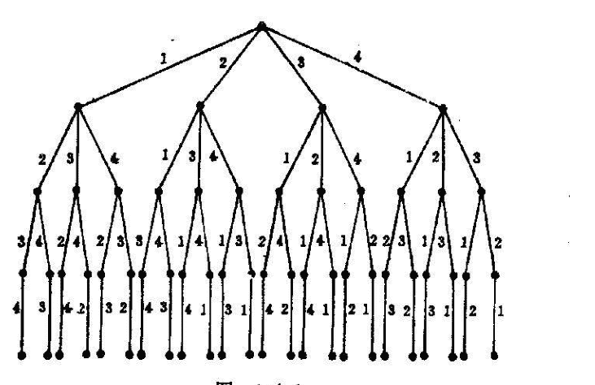

图 1-4-1

一个全排列可看作一个字符串，字符串可有前缀、后缀。由一个排列生成下一个排列时，要求与下一个有尽可能长的共同前缀，也即变化限制在尽可能短的后缀上。它是按“字典”的顺序排列的，由一个排列 p1p2···pn 生成下一个排列的算法可归结如下：

- (a) 求满足关系式 pj-1 < pj 的 j 的最大值，设为 i，即 i = max{j | pj-1 < pj}。
- (b) 求满足关系式 pi-1 < pk 的 k 的最大者，设为 j，即 j = max{k | pi-1 < pk}。
- (c) pi-1 与 pj 互换得 (p̄) = p̄1 p̄2 ⋯ p̄n
- (d) (p̄) = p̄1 p̄2 ⋯ p̄i-1 p̄i p̄i+1 ⋯ p̄n 中 p̄i p̄i+1 ⋯ p̄n 部分的顺序逆转，得 p̄1 p̄2 ⋯ p̄i-1 p̄n ⋯ p̄i+1 p̄i 便是所求的下一个排列。

例，设 p1p2p3p4=3421

- (a) i=max{j|p_{j-1}<p_j}=2
- (b) j=max{k|p1(i-1)<p_k}=2
- (c) p1 与 p2 交换得 4321
- (d) 4321中的 321 顺序逆转得下一个排列 4123

当 n=4 时，由字典序法所得的全排列的先后顺序如下：

2341 1243 1324 1342 1423 1432
2134 2143 2314 2314 2413 2431
3124 3142 3214 3241 3412 3421
4123 4132 4213 4231 4312 4321

### （三） 排列的邻位互换生成算法

最直观的排列生成可以递归地进行。例如 n=2 时的排列为 12，21, n=3 时的排列为 3 分别插入到 12 和 21 的前面、中间、后面可得

312   132   123
321   231   213

类似 n=4 时有排列：

4312   3412   3142   3124
4132   1432   1342   1324
4123   1423   1243   1234
4321   3421   3241   3214
4231   2431   2341   2314
4213   2413   2143   2134

上述的由 *n-1* 个文字的全排列产生 *n* 个文字的全排列的最大缺点是必须全部保留 n-1 个文字的全排列。因此存储单元需求量大。若能从开始的 1 2···n-1 n 依次产生下一个排列，直至全部结束，则可以避免上述的缺点。

下面介绍一种较为方便的算法，以 1234 排列为例，开始在排列 1234 的各数上方加一个箭头“←”，如 1̅ 2̅ 3̅ 4̅ 。当一个数上方箭头所指的一侧，相邻的数比该数小时，便称该数处于活动状态，例如 1̅ 2̅ 3̅ 4̅ 中 2̅、3̅、4̅ 都处于活动状态。

下面叙述从一个排列 $(p)=p_1p_2\cdots p_n$ 生成下一个排列的办法如下：

- （S1）若排列 $(p)=p_1p_2\cdots p_n$ 中无一处于活动状态，则停止，否则转（S2）。
- （S2）求所有处于活动状态的数中的最大者，设为 $m$。$m$ 和它的箭头所指的一侧的相邻数互换位置，转（S3）。
- （S3）令比 $m$ 大的所有数的箭头改变方向，转（S1）。

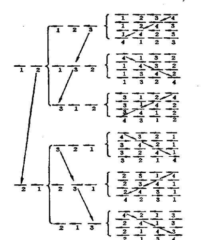

注意各数的活动规律，以1234中的4为例，从一端移到另一端，共进行了3次换位，然后暂停一次，这时3开始活动。这是4活动的一个过程。

3在123中的活动规律也很相似，可以推广到n个数的排列。

算法的实现存在改善的很大的可能性。比如数n从一端到另一端的活动是有规律的，无须每一次都要找哪些数是处于活动状态，从而再找其中的最大数，避免了巨大而无必要的工作量。

## 组合的生成

（一）求 S = { x_{n-1}, ..., x_1, x_0 } 的所有组合。
S 的每个组合是它的一个子集，根据定理 一个子集的确定是对每个元素的两种可能性的选择，即选定为 1，否则为 0。以三个元素的集合 { a_2, a_1, a_0 } 为例，看一下每个子集的确定。

|  | a_2 | a_1 | a_0 |
|---|---|---|---|
| Φ | 0 | 0 | 0 |
| { x_0 } | 0 | 0 | 1 |
| { x_1 } | 0 | 1 | 0 |
| { x_1, x_0 } | 0 | 1 | 1 |
| { x_2 } | 1 | 0 | 0 |
| { x_2, x_0 } | 1 | 0 | 1 |
| { x_2, x_1 } | 1 | 1 | 0 |
| { x_2, x_1, x_0 } | 1 | 1 | 1 |

每个组合对应一个二进制数

（1）最后一位数最大可达 n,本例 n=6；例数第 2 位最大可达 n-1，⋯，依此类推倒数第 k 位（k≤r）不超过 n-k+1。若 r 个元素组合用 c₁c₂⋯cᵣ 表示，并不妨假定 c₁<c₂<⋯⋯cᵣ，即 cᵣ≤n，cᵣ₋₁≤n-1，c₁≤n-r+1 或 cᵢ≤n-r+i，i=1,2,⋯,r.


## 组合的生成

（2）当存在 \(c_j < n - r + j\) 时，其中下标的最大者设为 \(i\)，即

\[
i = \max\{j \mid c_j < n - r + j\},
\]

则作 \(c_i \leftarrow c_i + 1\)。与之相应地作

\[
c_{i+1} \leftarrow c_i + 1,\quad c_{i+2} \leftarrow c_{i+1} + 1,\quad \cdots,\quad c_r \leftarrow c_{r-1} + 1.
\]

例如上例中的组合 256，显然 \(c_2, c_3\) 已分别达到 5，6，故 \(c_1\) 从 2 修改为 3，\(c_2, c_3\) 作相应的修改，分别改为 4，5，得 345（要满足递增）。即 256 的下一个组合应为 345。

归纳从一个组合 \(c_1c_2\cdots c_r\) 得到下一个组合的步骤如下：

- ① 求满足不等式 \(c_j < n - r + j\) 的最大的下标 \(j\)，即 \(i = \max\{j \mid c_j < n - r + j\}\)。
- ② \(c_i \leftarrow c_i + 1\)。
- ③ 从 \(i+1\) 位开始作修改：\(c_j \leftarrow c_{j-1} + 1\)，\(j = i+1, i+2, \cdots, r\)。

## 二项式系数

表达式 \(\binom{n}{r}\) 表示 \(n\) 元集合的 \(r\) 组合数，它具有许多很奇妙的性质。由于它出现在下面所介绍的二项式定理中，所以称其为二项式系数。关于它有许多组合恒等式。在进行算法分析时，经常要用到二项式系数，因此有必要对其熟练掌握。

## 二项式定理及性质

在 3.2 节中我们已经定义了 \(\binom{n}{r}\)，并介绍了一些基本公式，利用这些知识不难用代数推导得到下面的等式：

\[
\binom{n}{r} = \binom{n-1}{r} + \binom{n-1}{r-1} \quad (n \geq r \geq 1)
\]

\[
\binom{n}{k} = \frac{n}{k}\binom{n-1}{k-1}
\]

其中 \(n,k\) 为正整数。

\[
(x+y)^n = y^n + \binom{n}{1}xy^{n-1} + \binom{n}{2}x^2y^{n-2} + \cdots + \binom{n}{n-1}x^{n-1}y + x^n
\]
\[
= \sum_{r=0}^{n}\binom{n}{r}x^r y^{n-r}. \tag{3.4.3}
\]

**证明** 用组合分析的方法来证明。等式左边是 \(n\) 个 \(x+y\) 因子相乘，即

\[
(x+y)^n = \underbrace{(x+y)(x+y)\cdots(x+y)}_{n\text{ 个}}
\]

这些因子展开到没有括号为止。在展开时，每个因子均可贡献一个 \(x\) 或一个 \(y\)。由乘法法则，共有 \(2^n\) 项，这些项都可以写成 \(x^r y^{n-r}\)（\(0 \leq r \leq n\)）的形式。我们可以在 \(n\) 个 \(x+y\) 因子中选出 \(r\) 个，从这 \(r\) 个因子中取 \(x\)，而在另外的 \(n-r\) 个因子中取 \(y\)，如此得到 \(x^r y^{n-r}\) 项，所以 \(x^r y^{n-r}\) 的系数等于 \(n\) 个因子的 \(r\) 组合数，即 \(\binom{n}{r}\)。因此

\[
(x+y)^n = \sum_{r=0}^{n}\binom{n}{r}x^r y^{n-r}.
\]

当然也可采用数学归纳法进行证明（略）。

当 \(n,r\) 均为非负整数，且 \(n\ge r\) 时，\(\binom{n}{r}\) 有一些最基本的性质：

- **（1）对称关系**
  \[
  \binom{n}{r}=\binom{n}{n-r};
  \]
- **（2）递推关系**
  \[
  \binom{n}{r}=\binom{n-1}{r}+\binom{n-1}{r-1}\quad(n\ge r\ge1);
  \]
- **（3）单峰性**

  当 \(n\) 为偶数时，有
  \[
  \binom{n}{0}<\binom{n}{1}<\cdots<\binom{n}{n/2}>\cdots>\binom{n}{n-1}>\binom{n}{n};
  \]

  当 \(n\) 为奇数时，有
  \[
  \binom{n}{0}<\binom{n}{1}<\cdots<\binom{n}{(n-1)/2}=\binom{n}{(n+1)/2}>\cdots>\binom{n}{n-1}>\binom{n}{n}.
  \]

性质（2）又叫做 Pascal 公式，由它可得到图 3.4.1 所示的著名的杨辉三角形。其中单箭头表示数的继承；双箭头表示数的相加，此时箭头位置的数为两个箭尾位置的数之和。

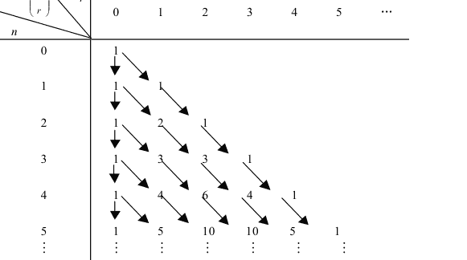

许多关于 \(\binom{n}{r}\) 的性质都可以通过仔细考察杨辉三角形而得到，如对称关系和单峰性；将该三角形的每行加起来，就可以得到

\[
\binom{n}{0}+\binom{n}{1}+\cdots+\binom{n}{n}=2^n,
\]

等等。

### 性质（3）的证明

设 \(1\le k\le n\)，我们考察 \(\binom{n}{k}\) 与 \(\binom{n}{k-1}\) 之比：

\[
\frac{\binom{n}{k}}{\binom{n}{k-1}}
=
\frac{\frac{n!}{k!(n-k)!}}{\frac{n!}{(k-1)!(n-k+1)!}}
=
\frac{n-k+1}{k}.
\]

若 \(n\) 为偶数，则 \(n/2\) 为整数，于是

（i）若 \(k\le n/2\)，则 \(n-k+1\ge n-n/2+1>n/2\ge k\)，所以
\[
\binom{n}{k}>\binom{n}{k-1};
\]

（ii）若 \(k\ge n/2+1\)，则 \(n-k+1\le n-(n/2+1)+1=n/2<k\)，所以
\[
\binom{n}{k}<\binom{n}{k-1}.
\]

若 \(n\) 为奇数，则

（i）若 \(k=(n+1)/2\)，则 \(n-k+1=n-(n+1)/2+1=(n+1)/2=k\)，所以
\[
\binom{n}{(n+1)/2}=\binom{n}{(n-1)/2};
\]

（ii）若 \(k>(n+1)/2\)，则 \(n-k+1<n-(n+1)/2+1=(n+1)/2<k\)，所以
\[
\binom{n}{k}<\binom{n}{k-1};
\]

（iii）若 \(k\le(n-1)/2\)，则 \(n-k+1\ge n-(n-1)/2+1=(n+3)/2>(n-1)/2\ge k\)，所以
\[
\binom{n}{k}>\binom{n}{k-1}.
\]

综合以上分析，性质（3）成立。

二项式定理有以下的推论：

### 推论 3.4.1

设 \(n\) 是正整数，对一切 \(x\) 有

\[
(1+x)^n=\sum_{k=0}^{n}\binom{n}{k}x^k \tag{3.4.4}
\]

**证明** 在二项式定理中令 \(y=1\) 即可。

### 推论 3.4.2

对任何正整数 \(n\) 有

\[
\binom{n}{0}+\binom{n}{1}+\cdots+\binom{n}{n}=2^n \tag{3.4.5}
\]

**证明**

方法 1：其组合意义的证明见 3.2.1 中的例 3.2.6。

方法 2：在二项式定理中令 \(x=y=1\) 即可。

### 推论 3.4.3

对任何正整数 \(n\) 有

\[
\binom{n}{0}+\binom{n}{2}+\binom{n}{4}+\cdots=\binom{n}{1}+\binom{n}{3}+\binom{n}{5}+\cdots \tag{3.4.6}
\]

**证明**

方法 1：在二项式定理中令 \(x=-1,\ y=1\)，得

\[
\sum_{k=0}^{n}(-1)^k\binom{n}{k}=0 \tag{3.4.7}
\]

即

\[
\binom{n}{0}-\binom{n}{1}+\binom{n}{2}-\cdots+(-1)^n\binom{n}{n}=0. \tag{3.4.8}
\]

将（3.4.8）式整理一下即得（3.4.6）式。

方法 2：等式（3.4.6）的组合意义是：在 \(n\) 元集合 \(S\) 中，奇子集数等于偶子集数（包括空集 \(\varnothing\) 在内）。

下面我们来建立 \(n\) 元集合的奇子集与偶子集之间的一一对应，从而证明（3.4.6）式。

我们任取 \(S\) 中的一个元素 \(x_0\)。将 \(S\) 的任何一个偶子集 \(A\subseteq S\) 分为两大类：含有元素 \(x_0\) 和不含元素 \(x_0\)。如果 \(x_0\in A\)，则令 \(B=A-\{x_0\}\)；如果 \(x_0\notin A\)，则 \(B=A\cup\{x_0\}\)。这两种情况显然都是 \(S\) 的奇子集。


## 二项式定理及性质

例如以 4 个元素 \(a,b,c,d\) 构成的集合的一切子集为例，偶子集有

\[
\varnothing,\{a,b\},\{a,c\},\{a,d\},\{b,c\},\{b,d\},\{c,d\},\{a,b,c,d\}.
\]

奇子集有

\[
\{a\},\{b\},\{c\},\{d\},\{a,b,c\},\{a,b,d\},\{a,c,d\},\{b,c,d\};
\]

就元素 \(a\) 而言，若一个含有 \(a\) 的偶子集 \(\{a,b\}\) 去掉 \(a\) 得一个奇子集 \(\{b\}\)，一个不含 \(a\) 的偶子集 \(\{c,d\}\) 加上 \(a\) 得 \(\{a,c,d\}\)。

在微积分中，有如下的牛顿二项式定理：

**定理 3.4.2** 设 \(a\) 是一个实数，则对一切满足 \(|x/y|<1\) 的实数 \(x\) 和 \(y\)，有

\[
(x+y)^a=\sum_{r=0}^{\infty}\binom{a}{r}x^r y^{a-r},
\]

其中

\[
\binom{a}{r}=\frac{a(a-1)\cdots(a-r+1)}{r!}. \tag{3.4.9}
\]

在以后的章节中，常常要用到 \(a=-n\)（\(n\) 为非负整数）和 \(a=\frac{1}{2}\) 这两种情形，这里稍做一些分析。

（2）当 \(a=\frac{1}{2}\) 时，有

\[
\binom{\frac{1}{2}}{r}
=\frac{\frac{1}{2}\left(\frac{1}{2}-1\right)\cdots\left(\frac{1}{2}-r+1\right)}{r!}
=(-1)^{r-1}\cdot\frac{1}{2^r}\cdot\frac{1\cdot3\cdots(2r-3)}{r!}
=\frac{(-1)^{r-1}(2r-2)!}{2^r\cdot r!\cdot2^{r-1}\cdot(r-1)!}
=(-1)^{r-1}\cdot\frac{1}{r\cdot2^{2r-1}}\cdot\binom{2r-2}{r-1}.
\]

### 组合恒等式

有关二项式系数的组合恒等式至今已发现的就有上千个，而且还在不断地发展。这些组合恒等式在许多算法分析中起着重要的作用，这里给大家介绍常用的几个。

- **1.** \(1\cdot\binom{n}{1}+2\cdot\binom{n}{2}+\cdots+n\cdot\binom{n}{n}=n\cdot2^{n-1}\)，（3.4.11）

  **证明** 对等式
  \[
  (1+x)^n=\sum_{i=0}^{n}\binom{n}{i}x^i
  \]
  两边微商得
  \[
  n(1+x)^{n-1}=\sum_{i=1}^{n}i\cdot\binom{n}{i}x^{i-1},
  \]
  然后令 \(x=1\)，得
  \[
  n\cdot2^{n-1}=1\cdot\binom{n}{1}+2\cdot\binom{n}{2}+\cdots+n\cdot\binom{n}{n}.
  \]

- **2.** \(\binom{0}{k}+\binom{1}{k}+\cdots+\binom{n}{k}=\binom{n+1}{k+1}\).（3.4.12）

  **证明** 用数学归纳法很容易证明此结论，下面通过其组合意义来分析其正确性。

  \(\binom{n+1}{k+1}\) 是 \(n+1\) 元集合 \(A=\{a_1,a_2,\cdots,a_n,a_{n+1}\}\) 的 \(k+1\) 元子集的个数，这些子集可以分成如下 \(n+1\) 类：

  第（0）类：\(k+1\) 元子集中含 \(a_1\)，这相当于 \(A-\{a_1\}\) 的 \(k\) 元子集再加上 \(a_1\) 构成 \(A\) 的 \(k+1\) 元子集，共 \(\binom{n}{k}\) 个；

  第（1）类：不含 \(a_1\) 但含 \(a_2\) 的 \(k+1\) 元子集，共有 \(\binom{n-1}{k}\) 个；

  ……

  第（n）类：不含 \(a_1,a_2,\ldots,a_n\)，但含 \(a_{n+1}\) 的 \(k+1\) 元子集，共有 \(\binom{0}{k}\) 个。

  由加法原则知
  \[
  \binom{n+1}{k+1}=\binom{n}{k}+\binom{n-1}{k}+\cdots+\binom{0}{k}.
  \]

- **3.** \(\sum_{i=0}^{n}\binom{n}{i}^2=\binom{2n}{n}\).（3.4.13）

  **证明** \(\binom{2n}{n}\) 是 \(2n\) 元集合 \(A\) 的 \(n\) 组合数。把集合 \(A\) 分成两个集合 \(A_1\) 和 \(A_2\)，使 \(|A_1|=|A_2|=n\)，则 \(A\) 的 \(n\) 元子集可以分成如下 \(n+1\) 类：从 \(A_1\) 中选取 \(i\)（\(0\le i\le n\)）个元素，从 \(A_2\) 中选取 \(n-i\) 个元素，将 \(A_1\) 的 \(i\) 个元素与 \(A_2\) 的 \(n-i\) 个元素并到一起构成 \(A\) 的第 \(i\) 类 \(n\) 元子集。

  而第 \(i\) 类子集的个数为
  \[
  \binom{n}{i}\binom{n}{n-i}=\binom{n}{i}^2\quad(0\le i\le n).
  \]
  由加法原则，有
  \[
  \sum_{i=0}^{n}\binom{n}{i}^2=\binom{2n}{n}.
  \]

- **4.** \(\sum_{i=0}^{r}\binom{m}{i}\binom{n}{r-i}=\binom{m+n}{r}\).（3.4.14）

  **证明** 此恒等式称为 Vandermonde 恒等式。

  **方法一** 由二项式定理有
  \[
  (1+x)^m=\sum_{k=0}^{m}\binom{m}{k}x^k,\qquad
  (1+x)^n=\sum_{l=0}^{n}\binom{n}{l}x^l,
  \]
  \[
  (1+x)^{m+n}=(1+x)^m(1+x)^n
  =\left[\sum_{k=0}^{m}\binom{m}{k}x^k\right]\left[\sum_{l=0}^{n}\binom{n}{l}x^l\right].
  \]

  比较等式两边 \(x^r\) 的系数，左边是 \(\binom{m+n}{r}\)，右边是
  \[
  \sum_{k=0}^{r}\binom{m}{k}\binom{n}{r-k}=\binom{m+n}{r}. \tag{3.4.15}
  \]
  所以等式成立。

  **方法二** 利用上题 3 中的方法，可以证明此公式。

  类似地可以证明下式：
  \[
  \sum_{k=0}^{m}\binom{m}{k}\binom{n}{k}=\binom{m+n}{m}.
  \]

通过对这些组合恒等式的证明过程不难看到所用的方法主要是以下几种：

- **1.** 使用代数方法，利用组合数的值或已知恒等式进行计算或化简，使得等式两边相等。
- **2.** 使用二项式定理，可以比较展开式中的系数，可以在展开式中令 \(x\) 为某个特定的值，还可以利用幂级数的微商或积分等数学分析的方法来求得所需要的结果。
- **3.** 使用数学归纳法。
- **4.** 使用组合分析的方法，说明等式两边都是对同一组合问题的计数。

### 非降路径问题

从 \((0,0)\) 点开始，水平向右走一步为 \(x\)，垂直向上走一步为 \(y\)，则走到 \((m,n)\) 点水平向右要走 \(m\) 步，垂直向上要走 \(n\) 步。所以一条从 \((0,0)\) 点到 \((m,n)\) 点的非降路径就是 \(m\) 个 \(x\) 和 \(n\) 个 \(y\) 的一个排列。反之，给了 \(m\) 个 \(x\) 和 \(n\) 个 \(y\) 的一个排列就唯一地确定了一条从 \((0,0)\) 点到 \((m,n)\) 点的非降路径。所以从 \((0,0)\) 点到 \((m,n)\) 点的非降路径数等于 \(m\) 个 \(x\) 和 \(n\) 个 \(y\) 的排列数，即组合数 \(\binom{m+n}{m}\)。

图 3.4.1 对应的非降路径就是排列 \(xyxyyxxxyxxyyxxxy\)。

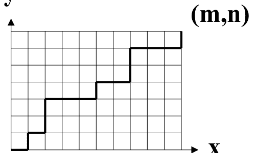

- **1.** \(\binom{m+n}{m}=\binom{m+n-1}{m}+\binom{m+n-1}{m-1}.\)（3.4.16）

  \(\binom{m+n}{m}\) 是从 \((0,0)\) 点到 \((m,n)\) 点的路径数，这些路径可以分成两类：一类由 \((0,0)\) 点经由 \((m-1,n)\) 点到达 \((m,n)\) 点，共有 \(\binom{m+n-1}{m-1}\) 条；另一类经由 \((m,n-1)\) 点到达 \((m,n)\) 点，共有 \(\binom{m+n-1}{m}\) 条。而从 \((0,0)\) 点到 \((m,n)\) 点的路径数等于从 \((0,0)\) 点分别到 \((m-1,n)\) 点和 \((m,n-1)\) 点的路径数之和，故 (3.4.16) 式成立。


## 非降路径问题

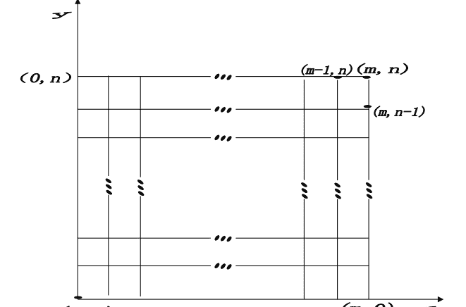

2. \(\binom{m}{0}\binom{n}{r}+\binom{m}{1}\binom{n}{r-1}+\cdots+\binom{m}{r}\binom{n}{0}=\binom{m+n}{r}\tag{3.4.17}\)

在 **3.4.2** 节中已给出简单的证明，下面用非降路径来证明。
证明 上式右边表示从\((0,0)\)点到\((m+n-r,r)\)点的非降路径数。任何一条这样的非降路径一定经过图 3.4.4 中斜线上的点，我们按所经过点的不同将路径分类。从\((0,0)\)点到\((m-k,k)\)点的非降路径是 \(\binom{m}{k}\) 条，从\((m-k,k)\)点到\((m+n-r,r)\)点的非降路径是 \(\binom{n}{r-k}\) 条，由乘法法则，可知从\((0,0)\)点经过\((m-k,k)\)点的非降路径是 \(\binom{m}{k}\binom{n}{r-k}\) 条，再对 \(k=0,1,\ldots,r\) 求和就得到所有的从\((0,0)\)点到\((m+n-r,r)\)点的非降路径数。所以等式成立。

图3.4.4 从(0,0)点到(m+n-r,r)点的非降路径经过斜线上的点

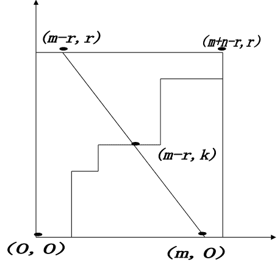

例 3.4.1　求从 $(0,0)$ 点到 $(n,n)$ 点的除端点外不接触直线 $y=x$ 的非降路径数。

解：先考虑对角线下方的路径。这种路径都是从 $(0,0)$ 点出发经过 $(1,0)$ 点及 $(n,n-1)$ 点到达 $(n,n)$ 点的。我们可以把它看作是从 $(1,0)$ 点出发到达 $(n,n-1)$ 点的不接触对角线的非降路径。

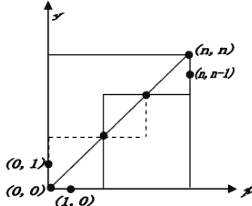

图 3.4.5　非降路径的反射

从(1,0)点到(n,n−1)点的所有的非降路径数是\binom{2n-2}{n-1}，对其中任意一条接触对角线的路径，我们可以把它从最后离开对角线的点（图3.4.5中的A点）到(1,0)点之间的部分关于对角线作一个反射，就得到一条从(0,1)出发经过A点到达(n,n−1)点的非降路径。

反之，任何一条从(0,1)点出发，穿过对角线而到达(n,n−1)点的非降路径，也可以通过这样的反射对应到一条从(1,0)点出发接触到对角线而到达(n,n−1)点的非降路径，从(0,1)点到达(n,n−1)点的非降路径数是\binom{2n-2}{n}，从而在对角线下方的路径数是

\binom{2n-2}{n-1} - \binom{2n-2}{n}。由对称性可知，所求的路径数是

2\left[\binom{2n-2}{n-1} - \binom{2n-2}{n}\right] = \frac{2}{n}\binom{2n-2}{n-1} = \frac{1}{2n-1}\binom{2n}{n}。

例 3.4.2 求集合{1,2,⋯,n}上的一个单调递增函数，我们可以作一条对应的折线。以横坐标代表x，纵坐标代表f(x)，在图中可以得到n个格点：(1,f(1)),(2,f(2)),⋯,(n,f(n))。从(1,1)点出发向上做连线到(1,f(1))点。如果f(2)=f(1)，则继续向右连线到(2,f(2))点；如果f(2)>f(1)，则由(1,f(1))点向右经过(2,f(1))点再向上连线到(2,f(2))点。按照这种方法一直将折线连到(n,f(n))点。若f(n)=n，就将折线向右连到(n+1,n)点，若f(n)<n，则向右经(n+1,f(n))点再向上连线到(n+1,n)点。这样就得到一条从(1,1)点到(n+1,n)点的非降路径。不难看出，所求的单调递增函数与这种非降路径之间存在着一一对应，因此集合{1,2,⋯,n}上的单调函数有\binom{2n-1}{n}个。

图3.4.6 一个单调递增函数

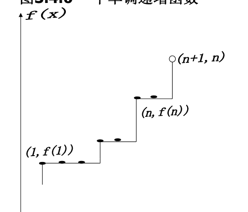

## 多项式定理

当 n 为整数时，二项式定理给出了(x+y)^n 的展开式，本节我们将其推广到求任意 t 个实数的和的 n 次方(x₁ + x₂+⋯+x_t)^n 的展开式.

在给出下面的多项式定理之前，我们先来看一个例子.将(x₁+ x₂+x₃)³ 的各项展开并整理，可以得到

(x₁ + x₂ + x₃)³ = x₁³ + x₂³ + x₃³ + 3x₁x₂ + 3x₁x₃ + 3x₁x₂² + 3x₁x₃² + 3x₂x₃ + 3x₂x₃² + 6x₁x₂x₃ . (3.4.18)

上式右端的和式中，每项都是 x₁^{n₁} x₂^{n₂} x₃^{n₃} 的形式，这里，n₁,n₂,n₃ 都是非负整数，且 n₁+n₂+n₃=3，其中 x₁^{n₁} x₂^{n₂} x₃^{n₃} 的系数为 3! / (n₁! n₂! n₃!) .

\frac{3!}{n_1! n_2! n_3!}

### 定理 3.4.3
设 *n* 为正整数，则

$(x_1 + x_2 + \cdots + x_t)^n = \sum\binom{n}{n_1 n_2 \cdots n_t} x_1^{n_1} x_2^{n_2} \cdots x_t^{n_t}, \qquad (3.4.19)$

其中

$\displaystyle \binom{n}{n_1 n_2 \cdots n_t} = \frac{n!}{n_1!\,n_2!\cdots n_t!}$

称为多项式系数；而其中的求和号是对所有满足 $n_1 + n_2 + \cdots + n_t = n$ 的非负整数序列 $n_1, n_2, \cdots, n_t$ 求和。

证明 先将 $(x_1 + x_2 + \cdots + x_t)^n$ 写成 $n$ 个 $x_1 + x_2 + \cdots + x_t$ 因子的乘积： $(x_1 + x_2 + \cdots + x_t)^n = (x_1 + x_2 + \cdots + x_t) \cdots (x_1 + x_2 + \cdots + x_t)$。

现在我们将其展开，直到没有括号为止。因为每个因子中我们都可取 $x_1, x_2, \cdots, x_t$ 中的任一个，所以展开式共有 $t^n$ 项，且每项都可以写成 $x_1^{n_1} x_2^{n_2} \cdots x_t^{n_t}$ 的形式。要得到这一项，我们应该在 $n$ 个因子中的 $n_1$ 个里面取 $x_1$，有 \(\binom{n}{n_1}\) 种取法；在剩下的 $n - n_1$ 个因子中的 $n_2$ 个里面取 $x_2$，有 \(\binom{n - n_1}{n_2}\) 种取法；……；最后，在 $n_t = n - (n_1 + n_2 + \cdots + n_{t-1})$ 个因子里面取 $x_t$，有 \(\binom{n - (n_1 + n_2 + \cdots + n_{t-1})}{n_t}\) 种取法。由乘法原则知，$x_1^{n_1} x_2^{n_2} \cdots x_t^{n_t}$ 前的系数为 \(\binom{n}{n_1} \binom{n - n_1}{n_2} \cdots \binom{n - (n_1 + n_2 + \cdots + n_{t-1})}{n_t} = \frac{n!}{n_1! n_2! \cdots n_t!}\)。

例 3.4.1 展开 $(x_1 + x_2 + x_3 + x_4 + x_5)^7$, 则 $x_1^2 x_3 x_4^3 x_5$ 的系数为
$$\frac{7!}{2!0!1!3!1!}=420.$$

例 3.4.2 展开 $(2x_1 - 3x_2 + 5x_3)^6$, 则 $x_1^3 x_2 x_3^2$ 的系数为
$$\frac{6!}{3!1!2!} \cdot 2^3 \cdot (-3) \cdot 5^2 = -36000.$$

推论 1  $(x_1+\cdots+x_t)^n$ 的展开式在合并同类项以后不同的项数是 \(\binom{n+t-1}{n}\)。

证明  $(x_1+\cdots+x_t)^n$ 的展开式中任何一项对应于方程 $n_1+n_2+\cdots+n_t=n$ 的一组非负整数解，所以合并同类项后不同的项数等于这个方程的非负整数解的个数 \(\binom{n+t-1}{n}\)。

推论 2 ∑\(\binom{n}{n_1\cdots n_t}\)=t^n ，其中求和是对方程n1+n2+⋯+nt=n的一切非负整数解来求。

证明 在多项式定理中令x1=x2=⋯=xt=1即可。

在多项式定理中如果取t=2，就得到

(x1+x2)^n = ∑\(\binom{n}{n_1 n_2}\)x1^{n1}x2^{n2} = ∑\(\binom{n}{n_1}\)x1^n x2^{n-n1}，

这就是普通的二项式定理


## 多项式定理

多项式定理中的系数 $\binom{n}{n_1 n_2 \cdots n_t}$ 叫做多项式系数，下面我们进一步分析它的组合意义。

- (1) $\binom{n}{n_1 n_2 \cdots n_t}$ 是多项式 $(x_1 + \cdots + x_t)^n$ 中 $x_1^{n_1} x_2^{n_2} \cdots x_t^{n_t}$ 项的系数。
- (2) $\binom{n}{n_1 n_2 \cdots n_t}$ 是多重集 $S = \{n_1 \cdot a_1, n_2 \cdot a_2, \cdots, n_t \cdot a_t\}$ 的 $n$ 排列数。
- (3) 如果我们把 $n$ 个不同的球放到 $t$ 个不同的盒子里并且使得第一个盒子里有 $n_1$ 个球，第二个盒子里有 $n_2$ 个球，…，第 $t$ 个盒子里有 $n_t$ 个球，那么放球的方案数是 $\binom{n}{n_1 n_2 \cdots n_t}$。

例 3.4.3 证明下面的等式成立：

$$\binom{n}{r_1 r_2 \cdots r_k} = \binom{n-1}{r_1-1\ r_2 \cdots r_k} + \binom{n-1}{r_1 r_2-1 \cdots r_k} + \cdots + \binom{n-1}{r_1 r_2 \cdots r_k-1}.$$

证明 左边是把 $n$ 个不同的球放到 $k$ 个不同的盒子里且使得第一个盒子有 $r_1$ 个球，第二个盒子有 $r_2$ 个球，…，第 $k$ 个盒子有 $r_k$ 个球的方法数，任取一个球 $a_1$，然后把它放盒子的方法进行分类：

$a_1$ 放到第一个盒子的放法数是 $\binom{n-1}{r_1-1\ r_2\ \cdots\ r_k}$；

$a_1$ 放到第二个盒子的放法数是 $\binom{n-1}{r_1\ r_2-1\ \cdots\ r_k}$；

$a_1$ 放到第 $k$ 个盒子的放法数是 $\binom{n-1}{r_1\ r_2\ \cdots\ r_k-1}$。由加法法则等式得证。

## 集合的划分与第二类Stirling数

定义 3.5.1（划分（Partition）） 设 π = {X₁, X₂, …, Xₘ} 为 n 元集 X 的一个划分，若对 i=1, 2, …, m, X 的子集 Xᵢ 的基数 |Xᵢ| = rᵢ > 0 (∑ᵢ₌₁ᵐ rᵢ = n)，则称 π 为 X 的一个 (r₁, r₂, …, rₘ) 划分。其中 Xᵢ (i = 1,2,…,m) 称为划分块或划分类（由对应的等价关系的等价块、等价类而来），特别地，简称 Xᵢ 类为 rᵢ 类。“类” 必须是非空的. 记作 X = X₁ ∪̇ X₂ ∪̇ … ∪̇ Xₘ （3.5.1）

定义 3.5.2 设 π 为 n 元集 X 的 (r₁, r₂, …, rₘ) 划分，若各划分类是可分辨的，则称 π 为 X 的有序 (r₁, r₂, …, rₘ) 划分；否则称为无序 (r₁, r₂, …, rₘ) 划分。

例 3.5.1 设 X = {a, b, c, d}, π₁ = {{a}, {b}, {c, d}}, π₂ = {{b}, {a}, {c, d}} 是 X 的两个不同的有序 (1,1,2) 划分，但是 X 的同一无序 (1,1,2) 划分。

定义 3.5.3 一个 n 元集合的全部 k 划分的个数 做第二类 Stirling 数，记作 S(n,k)。

例如，集合 A = {1,2,3,4} 有 7 个 2 划分，它们是

{1,2,3,4} = {1} ∪ {2,3,4} = {2} ∪ {1,3,4}
= {3} ∪ {1,2,4} = {4} ∪ {1,2,3}
= {1,2} ∪ {3,4} = {1,3} ∪ {2,4}
= {1,4} ∪ {2,3}

故 S(4,2)=7，在 A 的 2 划分 A = {1,4} ∪ {2,3} 中，{1,4} 与 {2,3} 是该 2 划分的两个块。

由 S(n,k) 的定义易知：

- (1) S(n,1)=1;
- (2) S(n,n)=1;
- (3) S(n,k)=0(k>n)。

S(n,k) 是一个重要的计数函数，对任何正整数 n 和 k, S(n,k) 均有意义。

定理 3.5.1 第二类 Stirling 数 S(n,k)递推关系

S(n+1,k) = S(n,k-1) + k S(n,k) (1 ≤ k ≤ n)。

证明 S(n+1,k)是集合 A = {a₁, a₂, ⋯, aₙ, aₙ₊₁} 的 k 划分的个数，这些 k 划分可以分成两类：

第（1）类：{aₙ₊₁}是 A 的 k 划分中的一块，这时，只需对集合 A − {aₙ₊₁}进行 k − 1 划分，再加上 {aₙ₊₁}这一块，就构成了 A 的 k 划分，因此，这类划分有 S(n,k−1)。

第（2）类：{aₙ₊₁}不是 A 的 k 划分中单独的一块，此时，先构造 A − {aₙ₊₁}的 k 划分，共有 S(n,k)种方法，然后，对于 A − {aₙ₊₁}的每个 k 划分，将 aₙ₊₁加到该 k 划分的 k 个块中的某一块，从而构成 A 的 k 划分，因此，由乘法原则，集合 A 的此类 k 划分共有 k S(n,k)个。

综上以上分析，由加法原则，有 S(n+1,k) = S(n,k−1) + k S(n,k)

定理 3.5.1 的证明过程给出了构造所有 k 分划的方法。
由定理 3.5.1 中的递推关系可以计算出任何 S(n,k) 的值，例如集合 {1,2,3,4,5} 的 2 分划数为
S(5,2)=S(4,1)+2×S(4,2)=1+2×7=15,

定理 3.5.2 第二类 Stirling 数 S(n,k) 满足下列性质：

（1） S(n,2) = 2^{n-1} - 1;        （2） S(n,n-1) = \binom{n}{2}。

证明：（1）由定理 3.5.1 中的递推关系，有

S(n,2) = S(n-1,1) + 2 S(n-1,2)
= 1 + 2[ S(n-2,1) + 2 S(n-3,2) ]
= 1 + 2 + 4 S(n-3,2)
= …
= 1 + 2 + 2^{2} + … + 2^{n-2} S(2,2)
= 2^{n-1} - 1.

(2)

$$S(n,n-1)=S(n-1,n-2)+(n-1)S(n-1,n-1)$$
$$=S(n-2,n-3)+(n-2)S(n-2,n-2)+(n-1)$$
$$=\cdots$$
$$=S(2,1)+2+3+\cdots+(n-1)$$
$$=\frac{1}{2}n(n-1)$$
$$=\binom{n}{2}.$$

这两个公式也可以由它们的组合意义来解释：

- （1）$S(n,2)$ 是 $n$ 元集合 $A\{a_1,a_2,\cdots,a_n\}$ 的 $2$ 分划数，先取出 $a_1$，则对于 $a_2,a_3,\cdots,a_n$，每个元素都有两种选择，即 $a_i(2\leq i\leq n)$ 与 $a_1$ 在同一块里或者与 $a_1$ 不在同一块里，不同的选择就构成了集合 $A$ 的不同的 $2$ 分划，但这里要排除掉 $a_2,a_3,\cdots,a_n$ 都与 $a_1$ 在同一块中的情形（此时不构成集合 $A$ 的 $2$ 分划），由此可知，$n$ 元集合 $A$ 的 $2$ 分划数为 $2^{n-1}-1$。

（2）$S(n,n-1)$ 是 $n$ 元集合的 $n-1$ 分划，由于分划中各块是非空的，所以每个 $n-1$ 分划中必有一块为两个元素，其余各块都恰有一个元素，所以，对于 $n$ 元集合的每个 $n-1$ 分划，只要确定了有两个元素的那一块，整个 $n-1$ 分划就确定了，因此，$S(n,n-1)$ 就是在 $n$ 元集中选取 2 个元素的方法数 $\binom{n}{2}$。

$$
S(n+1,k) = \sum_{m=k-1}^{n} \binom{n}{m} S(m,k-1)
$$

证明 S(n+1,k)是集合 A{a1,a2,…,an,an+1} 的 k 分划数， 对于 A 的一个 k 分划，设包含 an+1 的那块为 B，则其余的 k-1 块构成了 A-B 的一个 k-1 分划。反过来，给定 A 的一个含 an+1 的子集 B，若 |A-B|≥k-1，则 A-B 的一个 k-1 分划加上 B 就构成了 A 的一个 k 分划。

综合以上分析，我们可以如下构造 A 的 k 分划：先取 A 的一个不含 a_{n+1} 的子集 C，使 |C| ≥ k−1；作出 C 的一个 k−1 分划，再拼上 A−C，就构成了 A 的一个 k 分划，而 m = |C| 可以取 k−1,k,…,n 这些数，对于确定的 m，从 A 中取 C，使 |C| = m 的方案有 C(n,m) 种；确定了 C 之后，C 的 k−1 分划数为 S(m,k−1)，由加法原则和乘法原则，有

S(n+1,k) = Σ_{m=k−1}^{n} C(n,m) S(m,k−1)


## 集合的分划与第二类 Stirling 数

例如：

$$S(5,3)=\sum_{m=2}^{4}\binom{4}{m}S(m,2)$$

$$=\binom{4}{2}S(2,2)+\binom{4}{3}S(3,2)+\binom{4}{4}S(4,2)$$

$$=6\times1+4\times3+1\times7$$

$$=25.$$

在 3.7 节中，我们将讨论第二类 Stirling 数 $S(n,k)$ 在分配问题中的应用。

## 正整数的分拆

如果表达式（3.6.1）是无序的，也就是说，对随意换位后的表示法都只视为一种表示法，这样的分拆叫做无序分拆，或简称为分拆。若表达式（3.6.1）是有序的，即表达式（3.6.1）右边的和不仅与各项的数值有关，而且与各项的次序有关，不同的次序认为是不同的表示法，这样的分拆叫做有序分拆，这时，n_i叫做该有序分拆的第 i 个分部量，n 的 k 分拆的个数称为 n 的 k 分拆数，n 的所有分拆（k 取遍所有可能的值）的个数为 n 的分拆数。

## 正整数的分拆

例如：

4=2+1+1=1+2+1=1+1+2

是 4 的所有 3 个有序 3 分拆，在 4 的第一个有序 3 分拆中，第 1 个分部量为 2，第 2 个和第 3 个分部量均为 1，而

4=2+1+1

是 4 的唯一一个 3（无序）分拆。

我们介绍 n 的有序分拆的计数公式，以及在几类限定条件下 n 的有序分拆的计数公式。

## 有序分拆

定理 3.6.1　正整数 $n$ 的有序 $k$ 分析的个数为 $\binom{n-1}{k-1}$。

证明　正整数 $n$ 分成 $k$ 个分部量的一个有序分拆
$$n=n_1+n_2+\cdots+n_k$$
等价于方程 $x_1+x_2+\cdots+x_k=n$ 的正整数解 $(n_1+n_2+\cdots+n_k)$，由 3.3 节定理 3.2.5 的证明知，正整数 $n$ 的有序 $k$ 分析的个数为 $\binom{n-1}{k-1}$。

由定理 3.2.5 和定理 3.6.1 知，正整数 $n$ 的有序 $k$ 分拆数等于多重集合 $M=\{\infty\cdot a_1,\infty\cdot a_2,\infty\cdot a_k\}$ 的 $a_1,a_2,\cdots,a_k$ 至少出现一次的 $n$ 组合数，均为 $\binom{n-1}{k-1}$。

## 有序分拆

(1) 正整数 n 的有序 k 分拆，要求第 i 的分部量大于等于 p_i，其个数为 $\left( \begin{array}{c} n + k - \sum_{i=1}^k p_i -1 \\ k-1 \end{array} \right)$；

(2) 正整数 2n 分拆成 k 个分部，各分部量都是正偶数的有序分拆个数为 $\left( \begin{array}{c} n-1 \\ k-1 \end{array} \right)$ 。

(3) 正整数 n 分成 k 个分部，若 n 和 k 同为奇数或同为偶数，则 n 的各分部量都是奇数的有序分拆数为 $\left[ \frac{n-k}{2} -1 \right]_{k-1}$ 。

## 有序分拆

证明（1）设

n = n₁ + n₂ + ⋯ + nₖ （3.6.2）

是 n 满足条件

nᵢ ≥ pᵢ (1 ≤ i ≤ k) （3.6.3）

的一个有序 k 分拆，令 yᵢ = nᵢ − pᵢ (1 ≤ i ≤ k)，

则 yᵢ ≥ 0 (1 ≤ i ≤ k)，

且满足方程

y₁ + y₂ + ⋯ + yₖ = (n₁ − p₁) + (n₂ − p₂) + ⋯ + (nₖ − pₖ) = n − Σᵢ₌₁ᵏ pᵢ，

即 y₁, y₂, ⋯, yₖ 是上式的一组非负整数解。

## 有序分拆

反之，若给定方程（3.6.4）的一组非负整数解 $y_1,y_2,\cdots,y_k$，令 $n_i=y_i+p_i\ (1\leq i\leq k)$，则构成 $n$ 的一个有序 $k$ 分拆（3.6.2），且满足条件（3.6.3）。

所以，$n$ 的满足条件（3.6.3）的有序 $k$ 分拆与方程（3.6.4）的非负整数解之间构成一一对应，由定理 3.2.4 的证明知，其个数为

$$\left[\frac{n+k-\displaystyle\sum_{i=1}^{k}p_i-1}{k-1}\right]$$

## 有序分拆

（2）设 2n 的一个有序 k 分拆

2n = x₁ + x₂ + ⋯ + xₖ

满足条件

xᵢ 为偶数(1 ≤ i ≤ k)，      （3.6.5）

令 yᵢ = xᵢ / 2 (1 ≤ i ≤ k)，则有

n = y₁ + y₂ + ⋯ + yₖ，

即 y₁, y₂, ⋯, yₖ 是 n 的一个有序 k 分拆。

## 有序分拆

反之，$y_1,y_2,\cdots,y_k$ 是 $n$ 的一个有序 $k$ 分拆，令 $x_i=2y_i(1\le i\le k)$，则 $x_1,x_2,\cdots,x_k$ 是 $2n$ 的一个满足条件 (3.6.5) 的有序 $k$ 分拆。

所以，$2n$ 满足条件 (3.6.5) 的有序 $k$ 分拆数等于 $n$ 的有序 $k$ 分拆数，为 $\binom{n-1}{k-1}$。

## 有序分拆

(3) n 的各分部量为奇数的的分拆
n = n₁ + n₂ + ⋯ + nₖ

与 n-k 的各分部量为偶数的的分拆
n-k = (n₁-1)+(n₂-1)+⋯+(nₖ-1)

(n_i-1(1≤i≤k)为偶数)显然构成一一对应，由(2)知，n的各分部量为奇数的的分拆数为

\left[ \frac{n-k}{2} -1 \right]_{k-1}

定理 3.6.2 给出了几种不同限定条件下的有序分拆数。

## 无序分拆

我们用 $B(n,k)$ 来表示 $n$ 的 $k$ 分拆的个数，用 $B(n)$ 表示 $n$ 的所有分拆的个数，则显然有

（1） $B(n,k)=0(k>n)$；
（2） $B(n)=\sum_{k=1}^{n} B(n,k)$

$n$ 的 $k$ 分拆中，各分部量的次序无关紧要，一般按递降顺序排列，若 $n=n_1+n_2+\cdots+n_k$ 则 $n_1\ge n_2\ge\cdots\ge n_k$

如果在 $n$ 的 $k$ 分拆中有 $k_i$ 个分部量为 $i(1\le i\le n)$，那么可以把该分拆记为 $n=k_1\cdot1+k_2\cdot2+\cdots+k_n\cdot n$，有时也记为 $n=1^{k_1}2^{k_2}\cdots n^{k_n}$

## 无序分拆

例如，$B(9,5)=5$，$9$ 的所有 $5$ 分拆为：

- 9 = 5 + 1 + 1 + 1 + 1 = 1·5 + 4·1  
- = 4 + 2 + 1 + 1 + 1 = 1·4 + 1·2 + 3·1  
- = 3 + 3 + 1 + 1 + 1 = 2·3 + 3·1  
- = 3 + 2 + 2 + 1 + 1 = 1·3 + 2·2 + 2·1  
- = 2 + 2 + 2 + 2 + 1 = 4·2 + 1·1

## 无序分拆

定理 3.6.3　$n$ 的 $k$ 分拆数 $B(n,k)$ 满足递推关系

$B(n+k,k)=B(n,1)+B(n,2)+\cdots+B(n,k)\quad(3.6.6)$

及 $B(n,1)=1,B(n,n)=1\quad(3.6.7)$

证明　由 $B(n,k)$ 的定义易知等式（3.6.7）成立，下面证明递推关系（3.6.6），为此，我们考虑 $n$ 分成至多 $k$ 个分部的分拆，这样的分拆总数为

$B(n,1)+B(n,2)+\cdots+B(n,k)$

$n$ 的每个分成至多 $k$ 个分部的分拆可表示为

$n=n_1+n_2+\cdots+n_m+0+\cdots+0,$

这个和式中包含 $k$ 项，并且

$n_1\ge n_2\ge\cdots\ge n_m\ge1\ (1\le m\le k)$

我们将 $n$ 的这个 $m$ 分拆映射到 $n+k$ 的 $k$ 分拆如下：

$n+k=(n_1+1)+(n_2+1)+\cdots+(n_m+1)+1+\cdots+1,$

该和式中包含 $k$ 项，并且

$n_1+1\ge n_2+1\ge\cdots\ge n_m+1\ge2$

## 无序分拆

设上面确定的映射为 $f$，因为不同的 $n$ 分为至多 $k$ 个分部的对拆对应着 $n+k$ 不同的 $k$ 分拆，所以 $f$ 是单射，又因为每个 $n+k$ 的 $k$ 分拆

$$n+k = l_1 + l_2 + \cdots + l_k$$

在 $f$ 作用下的原像是个 $l_i (1 \le i \le k)$ 减去 $1$，再保留不为零的那些项而得到的 $n$ 的一个分部数至多为 $k$ 的分拆，所以 $f$ 是满射，因此，$f$ 是一一映射，于是有

$$B(n+5,k) = B(n,1) + B(n,2) + \cdots + B(n,k)$$

定理 3.6.3 提供了对 $B(n,k)$ 逐行递推的计算方法，例如：

$$B(9,5) = B(4,1) + B(4,2) + B(4,3) + B(4,4) + B(4,5)$$ 

$$= 1 + 2 + 1 + 1 + 0 = 5$$


## 分拆的Ferrers图

研究分拆数性质的一种简单有效的组合手段就是 Ferrers 图。设 *n* 的一个 *k* 分拆为

n = n₁ + n₂ + ⋯ + nₖ (n₁ ≥ n₂ ≥ ⋯ ≥ nₖ),    （3.6.8）

我们在一條水平直线上画 n₁ 个点，在其下面一条直线上画 n₂ 个点，且使这两条直线上的第一个点在同一条竖线上，其他点依次与上一行的点对齐；依此类推，最后在第 k 条直线上画 nₖ 个点，第一个点与前面各行的第一个点均在同一条竖线上，其他点依次与上面各行的点对齐，这样得到的点阵图叫做 n 的 k 分拆(3.6.8)的 Ferrers 图。

## 分析的Ferrers图

把一个 Ferrers 图的各行改成列，但其相对位置不变，这样又得到一个 Ferrers 图，叫做原 Ferrers 图的共轭图，例如，图 3.6.1 对应的共轭图是图 3.6.2

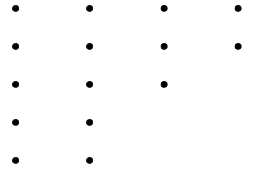

图 3.6.2

共轭 Ferrers 图所对应的分拆叫做原分拆的共轭分拆，例如，3.6.2 对应的分拆

$15=4+4+3+2+2\quad(3.6.10)$

是分拆（3.6.9）的共轭分拆，若 $n$ 的一个分拆与其轭共相同，则该分拆称为 $n$ 的自共轭分拆。

## 分拆的Ferrers图

从分拆的 Ferrers 图可以证明以下一些定理：

定理 3.6.4  n 的 k 分拆的个数等于 n 的最大分部量为 k 的分拆数。

证明  上面定义的分拆的共轭运算是一个映射，它将 n 的最大分部量为 k 的分拆映射到 n 的 k 分拆，例如，分拆（3.6.9）是 15 的最大分部量为 5 的分拆，其共轭分拆（3.6.10）是 15 的一个 5 分拆，且这个映射显然是一一的，所以两者相等。

## 分拆的Ferrers图

定理 3.6.5  n 的自共轭分拆的个数等于 n 的各分部量都是奇数且两两不等的分拆的个数。

证明  为了证明这个性质，我们将借助于 Ferrers 图建立一个 n 的各分部量为奇数且两两不等的分拆到 n 的自轭分拆之间的一一对应。

设 n 的一个分部量为奇数且两两不等的分拆为
n = (2n₁ +1) + (2n₂ +1) + ⋯ + (2nₖ +1), (3.6.11)

其中
n₁ > n₂ > ⋯ > nₖ ≥ 0

由 *n* 的分拆（3.6.11），我们构造 *n* 的一个自共轭分拆的 Ferrers 图。在第 1 行与第 1 列都画 *n₁* +1 个点，共有 2*n₁* +1 个点；画完第 1 行和第 1 列后，在第 2 行与第 2 列再各画 *n₂* +1 个点，共 2*n₂* +1 个点；……；在第 *k* 行与第 *k* 列再画 *nₖ* +1 个点，共 2*nₖ* +1 个点，因为 *n₁* > *n₂* > … > *nₖ*，所以如此画出的 *n* 个点的点阵图的每一行都不比下一行的点数少，因而是 *n* 的一个分拆的 Ferrers 图，且由上面的构造法知，该 Ferrers 图是对称的，所以其对应的分拆是自共轭的。

例如，且上述方法由分拆

17 = 9 + 5 + 3 = (2·4 + 1) + (3·2 + 1) + (2·1 + 1)

构造的 Ferrers 图如下图所示，对应的自共轭分拆为

17 = 5 + 4 + 4 + 3 + 1

显然，上面建立的 n 的分部量为奇数且两两不等的分拆与 n 的自共轭分拆之间的对应关系是一一的，所以定理的结论成立。

## 分拆的Ferrers图

定理 3.6.6  n 的分部量两两不等的分拆的个数等于 n 的各分部量都是奇数的分拆的个数。

证明 证明的方法还是建立定理中提及的两类不同的分拆之间的一一对应。

在一个 n 的各分部量为奇数的分拆中，假设数 2k+1 出现 p 次，我们将 p 写成 2 的幂次和的形式：

p = 2^{i1} + 2^{i2} + ⋯ (i1 > i2 > ⋯)

则这种表示法是唯一的，我们将 n 的这个分拆的 Ferrers 图中这 p·(2k+1) 个小点按下列方法重排：各行的小点数分别为 (2k+1)·2^{i1}, (2k+1)·2^{i2}, ⋯，如此将原来那个分拆的 Ferrers 图中所有的点重排了一次，然后再将各行按小点数递减的顺序排列，就得到 n 的另一个分拆的 Ferrers 图。

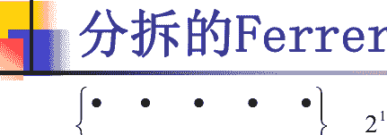

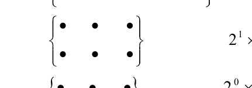

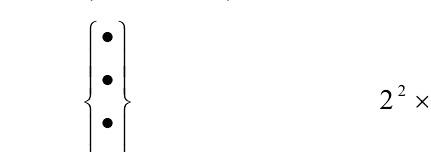

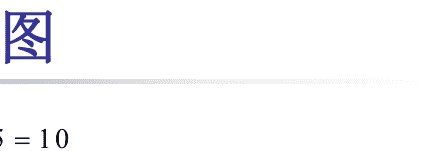

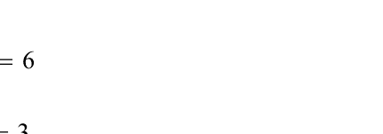

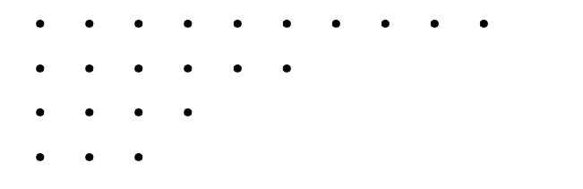

图 3.6.5

如上建立了两类分拆之间的一一对应，事实上，任一自然数表示成 2 的幂次和的形式是唯一的的，从而上面建立的映射是单射，另外，上面构造新的 Ferrers 图的方法显然是可逆的，所以上面的映射是满射。综合以上分析，n 的分部量两两不等的分拆的个数等于 n 的分部量都是奇数的分拆的个数。

## 分配问题

所谓分配问题，精确地说，就是把一些球放入一些盒子中的放法问题。通过本节中的不同类型的分配问题，希望读者对本章前几节所讨论的各类计数问题有着更深的体会，达到对知识更灵活应用得目的。

把 n 个球分配到 r 个盒子里，共有多少种不同的方案？本节中我们假定球在盒内是无序的，但我们要考虑以下三个方面的因素：

- (i) n 个球是完全相同的还是完全不同的；
- (ii) n 个盒是完全相同的是完全不同的；
- (iii) 是否允许有空盒。

下面我们来分类讨论：

（1）把 n 个完全不同的球放入 r 个不同的盒子里，允许有空盒的方案数为 r^n。

将 n 个不同的球分别记为 x₁, x₂, …, xₙ, r 个不同的盒子分别记为 b₁, b₂, …, bᵣ。每个球 xᵢ (1 ≤ i ≤ n) 都可以放入 r 个不同的盒子 bⱼ (1 ≤ j ≤ r) 中的任一个，即每个球有 r 种不同的放法，因而 n 个不同的球共有 r^n 种放法。

事实上，这个问题可以看成 r 个不同的盒子所构成的多重集合 M = {∞·b₁, ∞·b₂, …, ∞·bᵣ} 的 n 排列问题，对于 M 的一个 n 排列，我们将其映射到 x₁, x₂, …, xₙ 放入 b₁, b₂, …, bᵣ 中的一种方案，若该 n 排列的第 i 个位置是 bⱼᵢ (1 ≤ i ≤ n)，则将球 xᵢ 放入盒子 bⱼᵢ 中。

例如,有 5 个不同的球 x₁, x₂, x₃, x₄, x₅ 和 3 个不同的盒子 b₁, b₂, b₃, 对应于 M = {∞·b₁, ∞·b₂, ∞·b₃} 的 5 排列

b₁ b₂ b₂ b₁ b₃

的放法是 x₁ 和 x₄ 放在盒子 b₁ 中， x₂ 和 x₃ 放在盒子 b₂ 中， x₅ 放在盒子 b₃ 中。

上面建立的映射显然是一一映射,所以此类分配方案数等于多重集合 M = {∞·b₁, ∞·b₂, …, ∞·bᵣ} 的 n 排列数 rⁿ。

（2）把 n 个完全不同的球放入 r 个不同的盒子里，不允许有空盒的方案数为 r!S(n,r)。

先认为盒子是完全相同的，把 n 个球构成的集合
A = {x₁, x₂, …, xₙ}

划分成 r 个非空子集 A₁, A₂, …, Aᵣ，即
A = A₁ ∪ A₂ ∪ … ∪ Aᵣ，

然后将每个 Aᵢ (1 ≤ i ≤ r) 放入一个盒子里，构成一个没有空盒的分配方案。这里，A₁, A₂, …, Aᵣ 是 A 的一个 r 分划，其方案数为 S(n,r)。而这里 r 个盒子是完全不同的，所以，A 的 r 个子集的不同排列构成的分配方案是不同的。由此可知，n 个不同的球放入 r 个不同的盒子里，不允许有空盒的方案数为 r!S(n,r)

（3）把 *n* 个完全不同的球放入 *r* 个相同的盒子里，不允许有空盒的方案数为 $S(n,r)$。由（2）的分析知，此类分配方案数为 $S(n,r)$。

（4）把 *n* 个完全不同的球放入 *r* 个相同的盒子里，允许有空盒的方案数为 $\sum_{i=1}^{r} S(n,i)$。

对于 *n* 个不同的球放入 *r* 个相同的盒子里并允许有空盒的一种放法，设有 $i(1\le i\le r)$ 个盒子不空，而另外 $r-i$ 个盒子为空，这就相当于将 *n* 个不同的球放入 *i* 个相同的盒子里，并不允许有空盒的一种放法，由加法原则及（3）知，分配方案数为 $\sum_{i=1}^{r} S(n,i)$。


## 分配问题

（5）把n个相同的球放入r个相同的盒子里，不允许有空盒的方案数为B(n,r)。

这个问题相当于将整数n进行r分拆，方案数为B(n,r)。

（6）把n个相同的球放入r个相同的盒子里，允许有空盒的方案数为∑_{i=1}^{r} B(n,i)。

类似于（4），由（5）知这个问题相当于整数n的不大于r的所有分拆数，即为∑_{i=1}^{r} B(n,i)。

（7）把 $n$ 个相同的球放入 $r$ 个完全不同的盒子里，允许有空盒的方案数为 $\binom{n+r-1}{n}$。

这个问题相当于求方程

$x_1 + x_2 + \cdots + x_r = n$

的非负整数解的个数。对应于该方程的一组解 $x_1, x_2, \cdots, x_r$，相当于将 $x_1$ 个球放入第 1 个盒子里，将 $x_2$ 个球放入第 2 个盒子里，……，将 $x_r$ 个球放入第 $r$ 个盒子里。所以，总的分配方案数为 $\binom{n+r-1}{n}$。

设 r 个不同的盒子分别为 b₁, b₂ ⋯, bᵣ，则这个问题也相当于求多重集合 M = {∞ • b₁, ∞ • b₂ ⋯, ∞ • bᵣ} 的 n 个球放入 r 个盒子里的一种放法：若该组合中有 xᵢ 个 bᵢ 中 (1 ≤ i ≤ r)。

上面的映射显然是一一映射，所以，此类分配方案数等于 M 的 n 组合数 C(n+r-1, n)。

（8）把 n 个相同的球放入 r 个完全不同的盒子里，不允许有空盒的方案数为 $\displaystyle\binom{n-1}{r-1}$。

类似于（7），这里要求的是方程

$x_1 + x_2 + \cdots + x_r = n$  (3.7.1)

的正整数解的个数。由定理 3.2.5 的证明知，其个数为 $\displaystyle\binom{n-1}{r-1}$。

事实上，方程（3.7.1）的一个正整数解也就是正整数 n 的一个有序 r 分拆，由定理 3.6.1 知，其个数为 $\displaystyle\binom{n-1}{r-1}$。

（9）∑( n \n1 n2 … nm ) = m! S(n,m)，其中求和是对方程
n1 + n2 + … + nm = n 的一切正整数解来求。
证明：等式右边计数了 n 个不同的球正好放到 m 个不同的盒子的方法。而∑( n \n1 n2 … nm ) 则表示把 n 个不同的球放到 m 个不同的盒子，使得第一个盒子里有 n1 个球，第二個盒子里有 n2 个球，…，第 m 个盒子里有 nm 个球。当对所有满足方程 n1 + n2 + … + nm = n 的正整数解求和之后，就得到 n 个不同的球正好放到 m 个不同的盒子的放法数。

n 个球放到 m 个盒子的各种情况下的分配方案数，见表 3.7.1。

表 3.7.1 分配方案数表

| n 个球 | r 个盒子 | 是否允许有空盒 | 分配方案数 |
|---|---|---|---|
| 不同 | 不同 | 允许 | $r^n$ |
| 不同 | 不同 | 不允许 | $r! S(n,r)$ |
| 不同 | 相同 | 允许 | $\displaystyle\sum_{i=1}^{r} S(n,i)$ |
| 不同 | 相同 | 不允许 | $S(n,r)$ |

| $n$ 个球 | $r$ 个盒子 | 是否允许有空盒 | 分配方案数 |
|---|---|---|---|
| 相同 | 不同 | 允许 | $\displaystyle {n+r-1 \choose n}$ |
| 相同 | 不同 | 不允许 | $\displaystyle {n-1 \choose r-1}$ |
| 相同 | 相同 | 允许 | $\displaystyle \sum_{i=1}^{r} B(n,i)$ |
| 相同 | 相同 | 不允许 | $B(n,r)$ |

下面介绍几个有关分配问题的例子。

例 3.7.1 打桥牌时，52 张牌分发给 4 个人，每人 13 张，问每人有一张 A 的概率有多少？

解 首先给 4 个人每人发一张 A，然后再将剩下的 48 张牌分给 4 个人。这里将人看成盒子，把牌看成球，但这里的问题与（1），（2）不同，要求了每个盒子里放入球的数目，所以不能机械地套用（1），（2）中的公式。正确的做法是先从 48 张牌中选出 12 张给第一个人，再从剩下的 36 张牌中选出 12 张给第二个人，依次下去。所以，将 48 张牌分给 4 个人的方法数为

48! / 12!12!12!12!

每人发一张A的方法数为 4!，从而每人有一张A的方法数为 
4! 48! / (12!)

而每人有 13 张牌的方法数为 52! / (13!)^4 ，由此可知，每人有一张A的 
概率为

(13!)^4 · 48! · 4! / (12!)^4 · 52! ≈ 10.55%.

例 3.7.2 会议室中有 2n+1 个座位，现摆成 3 排，要求任何两排的座位数都要占多数。问有多少种摆法？

解 这个问题相当于把 2n+1 个完全相同的座位分配到 3 个不同的盒子里，如果沿用附加限制，应该有

$\binom{(2n+1)+3-1}{2n+1}=\binom{2n+3}{2}$

种方案。

不符合题意的摆法的特征是有有一排至少有 n+1 个座位，这相当于将 n+1 个座位先放到 3 排中的某一排，再将剩下的 (2n+1)−(n+1)=n 个座位任意分到 3 排中，这种摆法共有 3·( (2n+1)−(n+1)+3−1 \choose (2n+1)−(n+1) )=3·( n+2 \choose 2 ) 种方案。因此，符合题意的摆法有 ( 2n+3 \choose 2 )−3·( n+2 \choose 2 )=( n+1 \choose 2 ) 种方案。

例 3.7.3 把 4 个相同的桔子和 6 个不同的苹果分给 5 个不同的孩子，问

- (1) 每个孩子都分到苹果，共有多少种分法？
- (2) 每个孩子分 2 个水果，共有多少种分法？

解：(1) 先把 4 个相同的桔子分给 5 个孩子。这相当于把 4 个相同的球放到 5 个不同的盒子，允许有空盒。这里有 C(4+5-1,4)=C(8,4)=70 种分法。再把 6 个不同的苹果分给 5 个不同 的孩子，要使每个孩子都分到苹果，这相当于 6 个不同的球放到 5 个不同的盒子，不允许为空盒。这里有 5! S(6,5)=1800 种分法。由乘法原理，共有 70×1800=126000 种分法。

（2）把 4 个相同的桔子分给 5 个不同的孩子里有 $\binom{4+5-1}{4} = \binom{8}{4}$ 种方法, 把 6 个不同的苹果分给 5 个不同的孩子里有 $5^6$ 种方法，总共有 $\binom{8}{4} \cdot 5^6$ 种分配方法。

每个孩子里有 2 个水果，有如下几种情况：

(i)（苹果）（苹果）（苹果）（桔桔）（桔桔）

先从 5 个不同的孩子中选出 2 个分桔子，因为桔子是相同的，只要简单地一个孩子分 2 个即可。剩下的 3 个不同的孩子分 6 个不同的苹果。此类分法共有

$\binom{5}{2}\cdot\frac{6!}{2!2!2!}$

种。

(ii) (苹果) (苹果) (桔子) (桔子) (苹果)
先从5个不同的孩子里先选出1个分2个桔子，再从剩下的4个不同的孩子中选出2个各分1个桔子。剩下6个苹果分给4个不同孩子，这4个孩子里苹果的数量分别为2个、2个、1个、1个。所以，共有

$\left( \begin{array}{c} 5 \ 1 \end{array} \right) \left( \begin{array}{c} 4 \ 2 \end{array} \right) \cdot \frac{6!}{2!2!1!1!}$

种方案。

（iii）（苹果）（苹果）（苹果）（苹果）（苹果）

6 个苹果分给 5 个不同孩子，这 5 个孩子里苹果的数量分别为 2 个、1 个、1 个、1 个和 1 个，要选出 5 个孩子中的一个分两个苹果，当然剩下的 4 个孩子各分 1 个相同的桔子和 1 个不同的苹果。所以共有

$\binom{5}{1} \cdot \frac{6!}{2!(1!)^4}$

综合上述分析，每个孩子分 2 个水果的方案数为

$\binom{5}{2} \cdot \frac{6!}{2!2!2!} + \binom{5}{1}\binom{4}{2} \cdot \frac{6!}{2!2!1!1!} + \binom{5}{1} \cdot \frac{6!}{2!(1!)^4}$

# 第四章 容斥原理

- 4.1 容斥原理
- 4.2 多重集的r-组合数
- 4.3 错位排列
- 4.4 有限制条件的排列问题
- 4.5 有禁区的排列问题
- 4.6. Möbius反演*

> 应用


## 容斥原理

容斥原理，又称包含排斥原理，是由Sylvester J.J. 在19世纪提出的一种组合计数方法。它是组合数学中一个基本的原理，其基本思想并不复杂，但是应用极为广泛。本章主要介绍容斥原理及其应用。

有相当多的一类组合计数问题要求计算某个集合S中不满足某些性质（或者某些限制条件）的元素的个数。而在这类问题中，S中满足这些性质的元素个数往往相对而言是容易求得的。容斥原理就是解决这一类问题的有力的工具，它给出了用满足某些性质的元素个数来表示不满足这些性质的元素个数的计数公式。

它是求解组合计数问题常用的工具之一，是加法法则的推广。

## 容斥原理

例 4.1.1 求在 1，2…，500 中不能被 5 整除的数的个数。

解 我们先求在 1 和 500 之间可以被 5 整除的个数有 500 ÷ 5 = 100 可知这样的数有 100 个，那么不能被 5 整除的数有 500 − 100 = 400 个。

在解决这个问题的过程中，我们实际上使用了下面的法则：

- 1. 如果 A 是集合 S 的子集，则在 A 中的元素个数等于 S 的元素个数减去不在 A 中的元素个数。
- 2. 设 S 是一个集合，A ⊆ S，我们把 A 相对于 S 的补集记作 A̅，则上述法则可以写成 |A| = |S| − |A̅|。这就是容斥原理的一种最简单的形式。

## 容斥原理

设 S 是有穷集，P₁ 和 P₂ 分别表示两种性质。对于 S 中的任何一个元素 x，x 具有性质 P₁ 或者 x 不具有性质 P₁ 这两者只能有一个成立，对于性质 P₂ 也是这样。下面我们来计算 S 中既不能具有性质 P₁ 也不具有性质 P₂ 的元素个数。从 S 的元素总数中先减去具有性质 P₁ 的元素数，再减去具有性质 P₂ 的元素数，由于同时具有 P₁ 和 P₂ 两种性质的元素数才能够得到所求的元素数。如果令 A₁ 表示 S 中具有性质 P₁ 的元素组成的子集，A₂ 表示 S 中具有性质 P₂ 的元素组成的子集。则 A₁̅ ∩ A₂̅ 的元素就是既不具有性质 P₁ 也不具有性质 P₂ 的元素。根据上边的分析有 |A₁̅ ∩ A₂̅| = |S| - |A₁| - |A₂| + |A₁ ∩ A₂|

## 容斥原理

一般说来，设 $S$ 是有穷集，$P_1, P_2, \cdots, P_m$ 是 $m$ 个性质。$S$ 中的任何一个元素 $x$ 对于性质 $p_i$ ($i=1, 2, \cdots, m$) 具有或不具有，两者必居其一。另 $A_i$ 表示 $S$ 中具有性质 $p_i$ 的元素构成的子集。这时容斥原理可叙述为：

### 定理 4.1.1  S 中不具有性质 P₁, P₂, …, Pₘ 的元素数是

|\overline{A₁} ∩ \overline{A₂} ∩ … ∩ \overline{Aₘ}| = |S| - Σ_{i=1}^m |A_i| + Σ_{1≤i<j≤m} |A_i ∩ A_j| - Σ_{1≤i<j<k≤m} |A_i ∩ A_j ∩ A_k| + … + (-1)^m |A₁ ∩ A₂ ∩ … ∩ Aₘ|

证明 等式左边是 S 中不具有性质 P₁, P₂, …, Pₘ 的元素数。要证明，对 S 中的任何一个元素 x，如果 x 不具有性质 P₁, P₂, …, Pₘ，则对等式右边的贡献为 1；如果 x 至少具有其中的一条性质，则对等式右边的贡献为 0。

设 x 不具有性质 P₁,P₂,…,Pₘ，所以 x ∉ Aᵢ，i=1，2，⋯，m。令 T={1，2，⋯，m}。对 T 的所有的 2—组合{i,j}都有 x ∉ Aᵢ ∩ Aⱼ，

对 T 所有的 3-组合{i，j，k}都有 x ∉ Aᵢ ∩ Aⱼ ∩ Aₖ，⋯，直到 x ∉ A₁ ∩ A₂ ∩⋯∩ Aₘ。但 x ∈ S，所以它对等式右边的贡献是 1-0+0-0+⋯+(-1)ᵐ 0=1。


设 x 具有 n 条性质，n ≥ 1。则 x 对 |S| 的贡献为 1，对 ∑_{i=1}^m |A_i| 的贡献为 n = C(n,1)，对 ∑_{1≤i<j≤m} |A_i ∩ A_j| 的贡献为 C(n,2)，⋯，对 |A_1 ∩ A_2 ∩ ⋯ ∩ A_m| 的贡献为 C(n,m)。所以 x 对等式右边的总贡献是：

C(n,0) - C(n,1) + C(n,2) - ⋯ + (-1)^m C(n,m)  (n < m)

= C(n,0) - C(n,1) + C(n,2) - ⋯ + (-1)^n C(n,n) = (1-1)^n = 0


推论 在 S 中至少具有一条性质的元素数是

|A₁ ∪ A₂ ∪ ⋯ ∪ Aₘ|
= Σᵢ₌₁ᵐ |Aᵢ| - Σ₁≤i<j≤m |Aᵢ ∩ Aⱼ| + Σ₁≤i<j<k≤m |Aᵢ ∩ Aⱼ ∩ Aₖ| ⋯
+ (-1)ᵐ⁺¹ |A₁ ∩ A₂ ∩ ⋯ ∩ Aₘ|

证明：根据 De Morgan 定律

|A₁ ∪ A₂ ∪ ⋯ ∪ Aₘ| = |S| - |\overline{A₁ ∪ A₂ ∪ ⋯ ∪ Aₘ}|
= |S| - |\overline{A₁} ∩ \overline{A₂} ∩ ⋯ ∩ \overline{Aₘ}|
= Σᵢ₌₁ᵐ |Aᵢ| - Σ₁≤i<j≤m |Aᵢ ∩ Aⱼ|
+ Σ₁≤i<j<k≤m |Aᵢ ∩ Aⱼ ∩ Aₖ| ⋯ + (-1)ᵐ⁺¹ |A₁ ∩ A₂ ∩ ⋯ ∩ Aₘ|

为了书写方便，引入如下的记号：

$$W(0)=|S|$$

$$W(1)=\sum_{i=1}^{m}|A_i|$$

$$W(2)=\sum_{1\le i<j\le m}|A_i\cap A_j|$$

$\cdots\cdots$

$$W(m)=\sum|A_1\cap A_2\cap\cdots\cap A_m|$$

则定理4.1.1的公式可写成：

$$|\overline{A_1}\cap\overline{A_2}\cap\cdots\cap\overline{A_m}|\models W(0)-W(1)+W(2)-W(3)+\cdots$$

$$\qquad\qquad\qquad\qquad\qquad\qquad\qquad\qquad +(-1)^mW(m)$$

## 广义容斥原理

则其中恰具有 r(0≤r≤m)种性质的事物的个数为：

$$W(r)-\binom{r+1}{r}W(r+1)+\binom{r+2}{r}W(r+2)-\cdots+(-1)^{m-r}\binom{m}{r}W(m)$$
$$=\sum_{i=0}^{m-r}(-1)^i\binom{r+i}{r}W(r+i)$$

证明　任取 x∈S，若 x 具有的性质数少于 r，则 x 对公式的各项贡献为 0。若 x 恰好具有 r 条性质，则 x 对 W(r) 项贡献为 1，而对以后各项贡献都是 0，所以 x 对公式的总贡献是 1。若 x 恰好具有 r+k 条性质，k=1,2,⋯,m-r，则 x 对公式中的 W(r+i) 项的贡献为 C(r+k,r+i)，其中 i=0,1,⋯,m-r，而对以后各项贡献都是 0，

因而 x 对公式的总贡献是

$$\sum_{i=0}^{k}(-1)^{i}inom{r+i}{r}inom{r+k}{r+i}= \sum_{i=0}^{k}(-1)^{i}\frac{(r+i)!}{r!\,i!}\cdot\frac{(r+k)!}{(r+i)!(k-i)!}$$ 

$$= \sum_{i=0}^{k}(-1)^{i}\frac{(r+k)!}{r!\,k!}\cdot\frac{k!}{i!(k-i)!}$$ 

$$= \sum_{i=0}^{k}(-1)^{i}inom{r+k}{r}inom{k}{i}$$ 

$$= inom{r+k}{r}\sum_{i=0}^{k}(-1)^{i}inom{k}{i}$$ 

$$= inom{r+k}{r}(1-1)^{k}=0$$

综上所述，公式计数了 S 中恰好具有 r 条性质的元素。

广义容斥原理是容斥原理的推广形式，当 r=0 时公式变成

∑_{i=0}^{m} (-1)^i \binom{i}{i} W(i) = ∑_{i=0}^{m} (-1)^i W(i)

这就是容斥原理(定理 4.1.1).

Dating Assistant

Your Dating Coach

# Texting Your
AI Girlfriend

AI Boy AI Girlfriend 4.9 stars from 12M+ people using each month passive income opportunity.

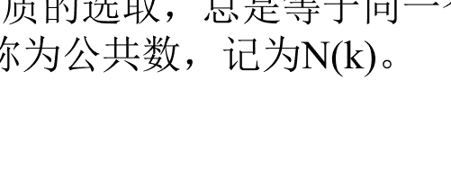

Who needs Tinder

# Better
the best AI Girlfriend Generator & learn about Passion
97% would recommend to a friend

- Text and chill with an AI girlfriend
- No judgements, no limits
- Rate your date
- Unlimited and unrestricted conversations
- Grows with you
- Forget about awkward dates


## 广义容斥原理

若m种性质是对称的，即对任意给定的正整数k，1≤k≤m-1，任意选择k种性质P_i1,P_i2,...,P_ik，具有这些性质的元素数仅与k的大小有关，而与这k种性质的选择无关。例如

N(1)=|A₁|=|A₂|=⋯=|A_m|
N(2)=|A₁∩A₂|=|A₁∩A₃|=⋯=|A_{m-1}∩A_m|
N(3)=|A₁∩A₂∩A₃|=|A₁∩A₂∩A₄|=⋯=|A_{m-2}∩A_{m-1}∩A_m|
......
N(m)=|A₁∩A₂∩⋯∩A_m|
N(0)=|\overline{A₁}∩\overline{A₂}∩⋯∩\overline{A_m}|
N=|S|

## 对称筛公式

这样定理4.1.1就变成下面的形式：

$$N(0)=N-\binom{m}{1}N(1)+\binom{m}{2}N(2)-\cdots+(-1)^m\binom{m}{m}N(m)$$

$$=N+\sum_{i=1}^{m}(-1)^i\binom{m}{i}N(i)$$

## 容斥原理

例 4.1.4 设 $n$ 是正整数，$n\geq 2$，欧拉函数 $\Phi(n)$ 表示小于 $n$ 且与 $n$ 互质的正整数个数。求 $\Phi(n)$ 的表达式。

解　任何大于等于 2 的正整数都有如下的分解式：

$$n=p_1^{a_1}p_2^{a_2}\cdots p_k^{a_k},$$

其中 $p_1,p_2,\cdots,p_k$ 为素数。令

$$S=\{x\mid x\text{ 是小于等于 }n\text{ 的正整数}\},$$

$$A_i=\{x\mid x\in S\land p_i\text{ 整除 }x\},\quad i=1,2,\cdots,k,$$

则有：

$|S| = n,$

$|A_i| = \lfloor n / p_i \rfloor = \frac{n}{p_i}, \quad (i = 1,2,\dots,k)$

$|A_i \cap A_j| = \lfloor n / [p_i, p_j] \rfloor = \frac{n}{p_i p_j}, \quad (1 \le i < j \le k)$

$\dots$

$|A_1 \cap A_2 \cap \cdots \cap A_k| = \lfloor n / [p_1, p_2, \cdots, p_k] \rfloor = \frac{n}{p_1 p_2 \cdots p_k}$

例 4.1.5 证明以下等式：

$\binom{n-m}{r-m}=\binom{m}{0}\binom{n}{r}-\binom{m}{1}\binom{n-1}{r}+\cdots+(-1)^m\binom{m}{m}\binom{n-m}{r}$

其中 $n$, $r$, $m$ 为正整数， $m\le r\le n$。

证明 令 $S=\{1,\ 2,\ \cdots,\ n\}$, $A=\{1,\ 2,\ \cdots,\ m\}$, 等式左边表示从 $S$ 中选取包含着 $A$ 的 $r$-子集的方法数 $N$。

- $p_j$： 在 $S$ 的 $r$-子集中不包含 $j$ 的性质，
- $A_j$： 具有性质 $p_j$ 的 S 的 $r$-子集的集合。

则有

$|A_j| = C(n-1, r) \quad (1 \le j \le m)$

$|A_i \cap A_j| = C(n-2, r) \quad (1 \le i < j \le m)$

...

$|A_1 \cap A_2 \cap ... \cap A_m| = C(n - m, r)$

由定理 4.1.1 得

$N = |\overline{A_1} \cap \overline{A_2} \cap \cdots \cap \overline{A_m}| = \binom{n}{r} - \binom{m}{1}\binom{n-1}{r} + \binom{m}{2}\binom{n-2}{r} - \cdots + (-1)^m \binom{m}{m}\binom{n-m}{r} = \binom{m}{0}\binom{n}{r} - \binom{m}{1}\binom{n-1}{r} + \binom{m}{2}\binom{n-2}{r} - \cdots + (-1)^m \binom{m}{m}\binom{n-m}{r}$

## 习题4.13：将20个人分到3个不同的房间，每个房间至少1个人，问有多少种分法？

解：Aᵢ表示第i个房间为空的分法，i=1,2,3，则有

N(1)=|A₁|=|A₂|=|A₃|=2²⁰，N(2)=|A₁∩A₂|=|A₁∩A₃|=|A₂∩A₃|=1，N(3)=0，N=3²⁰

所以

$|\overline{A_1}\cap\overline{A_2}\cap\overline{A_3}|=N-\binom{3}{1}N(1)+\binom{3}{2}N(2)-\binom{3}{3}N(3)=3^{20}-3\cdot2^{20}+3$

采用分配问题中的方法，将n个不同的球分配到k个不同的盒子中，不允许有空盒，则分配方案数为k!S(n, k)，采用第二类Stirling数的显示表达式，有

$3!S(20,3)=\sum_{i=0}^{3}(-1)^i C(3,i)(3-i)^{20}$

$= C(3,0)(3-0)^{20} - C(3,1)(3-1)^{20} + C(3,2)(3-2)^{20} - C(3,3)(3-3)^{20}$

$= 3^{20} - 3\cdot2^{20} + 3$

## 定理 4.1.1 S 中不具有性质 P_1, P_2, \dots, P_m 的元素数

$|\overline{A_1} \cap \overline{A_2} \cap \cdots \cap \overline{A_m}| = |S| - \sum_{i=1}^m |A_i| + \sum_{1\leq i < j \leq m} |A_i \cap A_j| - \sum_{1\leq i < j < k \leq m} |A_i \cap A_j \cap A_k| + \cdots + (-1)^m |A_1 \cap A_2 \cap \cdots \cap A_m|$

## 推论 在 S 中至少具有一条性质的元素数是

$|A_1 \cup A_2 \cup \cdots \cup A_m| = \sum_{i=1}^m |A_i| - \sum_{1\leq i < j \leq m} |A_i \cap A_j| + \sum_{1\leq i < j < k \leq m} |A_i \cap A_j \cap A_k| - \cdots + (-1)^{m+1} |A_1 \cap A_2 \cap \cdots \cap A_m|$

## 容斥原理小结

引入如下的记号：
W(0) = |S|
W(1) = Σ_{i=1}^{m} |A_i|
W(2) = Σ_{1≤i<j≤m} |A_i ∩ A_j|
......
W(m) = Σ |A_1 ∩ A_2 ∩ ... ∩ A_m|
则定理4.1.1的公式可写成：
$|A_1 ∪ A_2 ∪ ... ∪ A_m| = W(0) - W(1) + W(2) - W(3) + ... + (-1)^m W(m)$

✓广义容斥原理

S 中恰具有 r(0≤r≤m)种性质的事物的个数为：

$W(r) - \binom{r+1}{r}W(r+1) + \binom{r+2}{r}W(r+2) - ... + (-1)^{m-r}\binom{m}{r}W(m)$

$= \sum_{i=0}^{m-r} (-1)^i \binom{r+i}{r} W(r+i)$

当 r=0 时公式变成

$\sum_{i=0}^{m} (-1)^i \binom{i}{i} W(i) = \sum_{i=0}^{m} (-1)^i W(i)$

这就是容斥原理(定理 4.1.1).

若m种性质是对称的，即对任意给定的正整数k，1≤k≤m-1，任意选择k种性质P_{i1},P_{i2},…,P_{ik}，具有这些性质的元素数仅与k的大小有关，而与这k种性质的选择无关。例如

N(1)=|A₁|=|A₂|=⋯=|Aₘ|

N(2)=|A₁∩A₂|=|A₁∩A₃|=⋯=|A_{m-1}∩Aₘ|

N(3)=|A₁∩A₂∩A₃|=|A₁∩A₂∩A₄|=⋯
=|A_{m-2}∩A_{m-1}∩Aₘ|

……

N(m)=|A₁∩A₂∩⋯∩Aₘ|

N(0)=|\overline{A₁}∩\overline{A₂}∩⋯∩\overline{Aₘ}|

N=|S|

这样定理4.1.1就变成下面的对称筛公式：

N(0) = N - \binom{m}{1} N(1) + \binom{m}{2} N(2) - \cdots + (-1)^m \binom{m}{m} N(m)

= N + \sum_{i=1}^{m} (-1)^i \binom{m}{i} N(i)

## 容斥原理小结

✓ 容斥原理

S 中不具有性质 $P_1,P_2,\cdots,P_m$ 的元素数是

$$|S|-\sum_{i=1}^{m}|A_i|+\sum_{1\le i<j\le m}|A_i\cap A_j|-\sum_{1\le i<j<k\le m}|A_i\cap A_j\cap A_k|+\cdots$$
$$+(-1)^m|A_1\cap A_2\cap\cdots\cap A_m|$$

✓ 广义容斥原理(容斥原理的扩展)

S 中恰具有 $r(0\le r\le m)$ 种性质的事物的个数为：

$$|S|-\binom{r+1}{r}\sum_{i=1}^{m}|A_i|+\binom{r+2}{r}\sum_{1\le i<j\le m}|A_i\cap A_j|-\cdots$$
$$+(-1)^{m-r}\binom{m}{r}|A_1\cap A_2\cap\cdots\cap A_m|$$

✓容斥原理
S 中不具有性质 P₁, P₂, ⋯, Pₘ 的元素数是
|S| − Σᵢ₌₁ᵐ |Aᵢ| + Σ₁≤i<j≤m |Aᵢ ∩ Aⱼ| − Σ₁≤i<j<k≤m |Aᵢ ∩ Aⱼ ∩ Aₖ| + ⋯
+ (−1)ᵐ |A₁ ∩ A₂ ∩ ⋯ ∩ Aₘ|

✓对称筛公式(容斥原理的简化)
S 中不具有性质 P₁, P₂, ⋯, Pₘ 的元素数是
|S| − C(m,1) |A₁| + C(m,2) |A₁ ∩ A₂| − C(m,3) |A₁ ∩ A₂ ∩ A₃| + ⋯
+ (−1)ᵐ C(m,m) |A₁ ∩ A₂ ∩ ⋯ ∩ Aₘ|

若m种性质是对称的，即对任意给定的正整数k，1≤k≤m-1，任意选择k种性质P_i1,P_i2,...,P_ik，具有这些性质的元素数仅与k的大小有关，而与这k种性质的选择无关。例如
N(1)=|A1|=|A2|=⋯=|Am|
N(2)=|A1∩A2|=|A1∩A3|=⋯=|A_{m-1}∩A_m|
N(3)=|A1∩A2∩A3|=|A1∩A2∩A4|=⋯=|A_{m-2}∩A_{m-1}∩A_m|
……
N(m)=|A1∩A2∩⋯∩Am|
N(0)=|\overline{A1}∩\overline{A2}∩⋯∩\overline{Am}|
N=|S|

对称筛公式：

$N(0)=N-\binom{m}{1}N(1)+\binom{m}{2}N(2)-\cdots+(-1)^m\binom{m}{m}N(m)=N+\sum_{i=1}^{m}(-1)^i\binom{m}{i}N(i)$

对称筛公式的简化形式：

$N(0)=N-N(1)+N(2)-\cdots+(-1)^mN(m)=N+\sum_{i=1}^{m}(-1)^iN(i)$

## 多重集的 r-组合数

设有多重集 S = {n₁·a₁, n₂·a₂, ⋯ nₖ·aₖ}，要求 S 的 r-组合数。如果某个 nᵢ > r，可以用 r 来代替 nᵢ 得到多重集 S′。不难看出 S′ 的 r-组合数就是 S 的 r-组合数，所以不妨假设所有的 nᵢ ≤ r ， i=1,2,…,k。下面举例说明怎样用容斥原理来求 S 的 r-组合数。

**例 4.2.1** 确定多重集 $S=\{3\cdot a,\ 4\cdot b,\ 5\cdot c\}$ 的 10-组合数。

**解** 令 $T=\{\infty\cdot a,\infty\cdot b,\infty\cdot c\}$，$T$ 的所有的 10-组合构成集合 $W$，则

$|W|=\binom{3+10-1}{10}=\binom{12}{10}=\binom{12}{2}=66$

- $P_1$：$a$ 多于 3 个的 10-组合，
- $P_2$：$b$ 多于 4 个的 10-组合，
- $P_3$：$c$ 多于 5 个的 10-组合。

$A_i=\{x\mid x\in W\land x\text{ 具有性质 }P_i\},\quad i=1,2,3.$

所求的 10-组合数就是 $W$ 中不具有性质 $P_1,P_2$ 和 $P_3$ 的元素个数，即

$\left|\overline{A_1}\cap\overline{A_2}\cap\overline{A_3}\right|$

先计算 $|A_1|$, $|A_2|$ 和 $|A_3|$。$|A_1|$ 中的每个 10-组合至少含有 4 个 $a$，把这 4 个 $a$ 拿走就得到 $T$ 的一个 6-组合。反之，对 $T$ 的任意一个 6-组合加上 4 个 $a$ 就得到 $|A_1|$ 中的一个 10-组合。所以 $|A_1|$ 就是 $T$ 的 6-组合数，即

$|A_1| = \binom{3+6-1}{6} = \binom{8}{6} = \binom{8}{2} = 28,$

$|A_2| = \binom{3+5-1}{5} = \binom{7}{5} = \binom{7}{2} = 21,$

$|A_3| = \binom{3+4-1}{4} = \binom{6}{4} = \binom{6}{2} = 15$

用类似的方法可以计算 $|A_1\cap A_2|$，$|A_1\cap A_3|$，$|A_2\cap A_3|$ 和 $|A_1\cap A_2\cap A_3|$，所得的结果是：

$$|A_1\cap A_2|=\binom{3+1-1}{1}=3,$$

$$|A_1\cap A_3|=\binom{3+0-1}{0}=1,$$

$$|A_2\cap A_3|=0,$$

$$|A_1\cap A_2\cap A_3|=0.$$

因此所求的 10-组合数

$$|\overline{A_1}\cap\overline{A_2}\cap\overline{A_3}|=66-(28+21+15)+(3+1+0)-0=6.$$

列出这 6 个 10-组合如下：

{ 1 • a, 4 • b, 5 • c },
{ 2 • a, 3 • b, 5 • c },
{ 2 • a, 4 • b, 4 • c },
{ 3 • a, 2 • b, 5 • c },
{ 3 • a, 3 • b, 4 • c },
{ 3 • a, 4 • b, 3 • c }。

多重集 S = { n₁·a₁, n₂·a₂, ⋯ nₖ·aₖ } 的 r-组合数等于方程 x₁ + x₂ + ⋯ + xₖ = r 的非负整数解的个数。用容斥原理也可以确定这个方程的非负整数解的个数。

例 4.2.2 确定方程

$$x_1 + x_2 + x_3 = 5 \qquad (0 \le x_1 \le 2, 0 \le x_2 \le 2, 1 \le x_3 \le 5)$$

的整数解的个数。

解: 令 $x_3' = x_3 - 1$, 则有 $0 \le x_3' \le 4$, 用 $x_3' + 1$ 代替 $x_3$ 得

$$x_1 + x_2 + x_3' = 4 \qquad (0 \le x_1 \le 2, 0 \le x_2 \le 2, 0 \le x_3' \le 4)$$

这个方程的整数解的个数就是原方程的整数解的个数。而它又与多重集 $\{2 \cdot a,\ 2 \cdot b,\ 4 \cdot c\}$ 的 4-组合数相等。

P₁：4组合中a的个数大于等于3；

P₂：4组合中b的个数大于等于3；

P₃：4组合中c的个数大于等于5。

Aᵢ：满足性质Pᵢ的4组合全体记(1≤i≤3)

则a的个数小于等于2，b的个数小于等于2，c的个数小于等于4的4组合全体为

$|\overline{A_1}\cap\overline{A_2}\cap\overline{A_3}|$

令 S∞={∞·a, ∞·b, ∞·c}，则 S 的4组合数为

$$\binom{4+3-1}{3-1} = \binom{6}{2} = 15$$

设集合 A 是 S∞ 的4组合全体，则 |A| = 15

|A₁|： a的元素个数≥3
|A₁| = $\binom{4+3-3-1}{3-1} = \binom{3}{2} = 3$

|A₂|： b的元素个数≥3
|A₂| = $\binom{4+3-3-1}{3-1} = \binom{3}{2} = 3$

|A₃|： c的元素个数≥5
|A₃| = $\binom{4+3-5-1}{3-1} = \binom{1}{2} = 0$


## 多重集的 r 一组合数

|A₁ ∩ A₂|： a的元素个数≥3且b的元素个数≥3

|A₁ ∩ A₂| = (4+3-6-1 choose 3-1) = 0

|A₁ ∩ A₃|： a的元素个数≥3且c的元素个数≥5

|A₁ ∩ A₃| = (4+3-8-1 choose 3-1) = 0

|A₂ ∩ A₃|： b的元素个数≥3且c的元素个数≥5

|A₂ ∩ A₃| = (4+3-8-1 choose 3-1) = 0

|A₁ ∩ A₂ ∩ A₃| = 0

## 多重集的 r 一组合数

求得多重集的4一组合数，结果是

15-(3+3+0)+(0+0+0)-0=9

所以原方程有9个解，它们是：

( 0, 0, 5 ), ( 0, 1, 4 ), ( 0, 2, 3 ),
( 1, 0, 4 ), ( 1, 1, 3 ), ( 1, 2, 2 ),
( 2, 0, 3 ), ( 2, 1, 2 ), ( 2, 2, 1 )。

## 作业

- 4.2， 4.9和4.4

## 错位排列

考虑这样一个问题。在书架上有 5 本书，把它们全拿下来，然后再放回到书架上，要使得没有一本书在原来的位置上，问有多少种方法？这个问题就是一个错位排列问题。

一般地，设排列 τ 是 1 2 ⋯ n，τ 的一个错位排列就是排列 i₁ i₂ ⋯ iₙ，且 iⱼ ≠ j，j=1，2，⋯，n。我们用 Dₙ 表示 τ 的错位排列数。

当 n=1 时，不存在错位排列，所以 D₁ = 0。

当 n=2 时，错位排列只有 21，所以 D₂ = 1。

当 n=3 时，错位排列有 231，312，所以 D₃ = 2。

当 n=4 时，错位排列有 2134，2341，2413，3142，3412，3421，4123，4312，4321，所以 D₄ = 9。

## 错位排列

定理 4.3.1 对于 $n \ge 1$ 有 $D_n = n!\left(1 - \frac{1}{1!} + \frac{1}{2!} - \frac{1}{3!} + \cdots + (-1)^n \frac{1}{n!}\right)$。

证明：设 $\tau = 1 2 \cdots n$，$X = (1,2,\cdots,n)$。用 $S$ 表示 $X$ 的所有排列的集合。
$P_j$: $j$ 在第 $j$ 个位置上的排列，$j=1,2,\cdots,n$；
$A_j$ 表示 $S$ 中具有性质 $P_j$ 的排列的集合
则 $\tau$ 的错位排列就是 $\overline{A_1} \cap \overline{A_2} \cap \cdots \cap \overline{A_n}$ 中的排列。

$A_1$ 中的排列具有下面的形式：$1 i_2 i_3 \cdots i_n$，其中 $i_2 i_3 \cdots i_n$ 是 $\{2,3,\dots,n\}$ 的一个排列，所以 $|A_1| = (n-1)!$。同理，对于 $j=2,3,\dots,n$ 有 $|A_j| = (n-1)!$。

$A_1 \cap A_2$ 中的排列具有下面的形式：$1 2 i_3 \cdots i_n$，其中 $i_3 \cdots i_n$ 是 $\{3,4,\dots,n\}$ 的一个排列，所以 $|A_1 \cap A_2| = (n-2)!$。同理，对于 $\{1,2,\cdots,n\}$ 的任何一个 2-组合 $\{i,j\}$ 有 $|A_i \cap A_j| = (n-2)!$。

## 错位排列

对任意的整数 $k$, $1 \le k \le n$, 有

$|A_{i_1} \cap A_{i_2} \cap \cdots \cap A_{i_k}| = (n - k)!,$

其中 $i_1, i_2, \cdots i_k$ 是 $\{1,2,\cdots,n\}$ 的一个 $k$ 一组合。

由容斥原理得

$D_n = n! - \binom{n}{1}(n-1)! + \binom{n}{2}(n-2)! - \cdots + (-1)^n \binom{n}{n} \cdot 0!$

$= n! - \frac{n!}{1!} + \frac{n!}{2!} - \cdots + (-1)^n \frac{n!}{n!} = n!\left(1 - \frac{1}{1!} + \frac{1}{2!} - \cdots + (-1)^n \frac{1}{n!}\right)$

例如 $D_4 = 4!\left[1 - \frac{1}{1!} + \frac{1}{2!} - \frac{1}{3!} + \frac{1}{4!}\right] = 12 - 4 + 1 = 9$。

## 错位排列

∵ $D_n = n!\left(1 - \frac{1}{1!} + \frac{1}{2!} - \frac{1}{3!} + \cdots + (-1)^n \frac{1}{n!}\right)$

∵ $\frac{D_n}{n!} = 1 - \frac{1}{1!} + \frac{1}{2!} - \frac{1}{3!} + \cdots + (-1)^n \frac{1}{n!}$ ←有限项

$e^{-1}$的展开式是 $e^{-1} = 1 - \frac{1}{1!} + \frac{1}{2!} - \frac{1}{3!} + \cdots$ ， ←无限项

∵ $e^{-1} = \frac{D_n}{n!} + (-1)^{n+1} \frac{1}{(n+1)!} + (-1)^{n+2} \frac{1}{(n+2)!} + \cdots$ ，

当 n 比较大时，$\frac{D_n}{n!} \to e^{-1}$。

## 错位排列

|e⁻¹ - Dₙ / n!| < 1 / (n+1)!

Dₙ / n! 表示 τ 的错位排列数与 X 的排列数之比，即错位排列出现的概率，这说明在 n 很大的时候，这个概率可看作 1/e。

## 错位排列

```
$$\left\{ \begin{array}{l} D_n = (n-1)(D_{n-1} + D_{n-2}) \quad n \geq 3, n\text{为整数,} \\ D_1 = 0, D_2 = 1 \end{array} \right.$$ (4.3.1)
```

D_1和D_2是初值，由 (4.3.1) 式可以计算出任何一个 D_n 的值。

证明：设 n≥3，考虑排列 12⋯n 的所有的错位排列。根据在排列中的第一位的数字是2，3，⋯，n 而将这些排列划分成 n-1 类。

- 2i_2i_3⋯i_n ← 先考虑这种情况
- 3i_2i_3⋯i_n
- :
- ni_2i_3⋯i_n

## 错位排列

令 dₙ(2) 表示第一位是 2 的错位排列数，其中 iⱼ ≠ j, j = 2,3,…,n。进一步把这些排列分成两个子类，

形如 2 i₂ … iₙ 的错位排列数： dₙ(2) = { d'ₙ(2)  2 1 … iₙ, 其中 i₂ = 1 ; d''ₙ(2)  2 i₂ … iₙ, 其中 i₂ ≠ 1 }

则有 dₙ(2) = d'ₙ(2) + d''ₙ(2)  (4.3.3)

- 1. 在第一种情况中，d'ₙ(2) 是 3 4 … n 的错位排列数 Dₙ₋₂。
- 2. 在第二种情况中，d''ₙ(2) 是 1 3 4 … n 的错位排列数 Dₙ₋₁。因此得到 dₙ(2) = Dₙ₋₂ + Dₙ₋₁

当 i₁ = 3,…,n 时，同理可证 dₙ(i₁) = Dₙ₋₂ + Dₙ₋₁。

## 错位排列

当 i₁=3,...,n 时，同理可证 dₙ(i₁)= Dₙ₋₂ + Dₙ₋₁。

所以

Dₙ = Σ_{i₁=2}^{n} dₙ(i₁) = Σ_{i₁=2}^{n} (Dₙ₋₁ + Dₙ₋₂) = (n-1)(Dₙ₋₁ + Dₙ₋₂)

思考题:为什么要单独计算 21~这种情况？

## 错位排列

由（4.3.1）式
∵ $D_n = (n-1)(D_{n-1} + D_{n-2})$

∴ $D_n - nD_{n-1} = -(D_{n-1} - (n-1)D_{n-2})$

$D_{n-1} - (n-1)D_{n-2} = -(D_{n-2} - (n-2)D_{n-3})$

$D_{n-2} - (n-2)D_{n-3} = -(D_{n-3} - (n-3)D_{n-4})$

把后面的式子依次代入前一个等式可得

$D_n - nD_{n-1} = (-1)^2 (D_{n-2} - (n-2)D_{n-3})$ 
$= (-1)^3 (D_{n-3} - (n-3)D_{n-4})$ 
$= \dots$ 
$= (-1)^{n-2} (D_2 - 2D_1)$

∵ $D_1 = 0, D_2 = 1$, ∴ $D_n - nD_{n-1} = (-1)^{n-2} = (-1)^n$。

## 错位排列

Dₙ = n Dₙ₋₁ + (-1)ⁿ
D₁ = 0
(n≥2, n 为整数), (4.3.4)

做迭代就得到

Dₙ = n[(n-1)Dₙ₋₂ + (-1)ⁿ⁻¹] + (-1)ⁿ
= n(n-1)Dₙ₋₂ + n(-1)ⁿ⁻¹ + (-1)ⁿ
= n(n-1)[(n-2)Dₙ₋₃ + (-1)ⁿ⁻²] + n(-1)ⁿ⁻¹ + (-1)ⁿ
= …
= n!·D₁ / 1! + n!·(-1)² / 2! + n!·(-1)³ / 3! + … + n!·(-1)ⁿ⁻¹ / (n-1)! + n!(-1)ⁿ / (n-1)!
= n![(-1)² 1/2! + (-1)³ 1/3! + … + (-1)ⁿ 1/n!]
= n![1 - 1/1! + 1/2! - 1/3! + … + (-1)ⁿ 1/n!]

这个结果与定理 4.3.1 一致。


## 错位排列

例 4.3.1 （1） 重新排列 1 2 3 4 5 6 7 8 9，使得偶数在原来的位置上而奇数不在原来的位置上，问有多少种排法？

（2） 如果要求只有 4 个数在原来的位置上，那么又有多少种排法？

解 （1） 这是排列 1 3 5 7 9 的错位排列问题，有：

```
D₅ = 5! (1 - 1/1! + 1/2! - 1/3! + 1/4! - 1/5!) = 60 - 20 + 5 - 1 = 44
```

（2） 从 {1, 2, …, 9} 中任取 4 个数的取法为 C(9,4)，而其它 5 个数的错位排列数是 D₅，根据乘法法则可以知道所求的排列数是

```
C(9,4) D₅ = 126 × 44 = 5544
```

Ref: Dₙ = n! (1 - 1/1! + 1/2! - 1/3! + … + (-1)ⁿ 1/n!)

## 错位排列

例：证明下列等式

n! = C(n,0) D_n + C(n,1) D_{n-1} + … + C(n, n-1) D_1 + C(n,n) D_0

证明：将 S={1,2,…,n} 的所有排列分成下列情况，没有一个数在其自然位置上的排列数为 D_n = C(n,0) D_n，恰有 i 个数在其自然位置上的排列数为 C(n,i) D_{n-i} （i=1,2,…,n）而所有的排列个数为 n!，根据加法法则，等式成立。

## 二重错位排列问题

家庭问题(Ménagé)，有n对夫妻（n>2），围圆桌就座，如果要求男女相间且每对夫妻不能相邻，问有多少种就座方案？

## 二重错位排列问题

解：假设先让n位女士围桌而坐，方案有(n-1)!种，选定n位女士一种入座方案，从某一
位开始按环形顺序给她们编号，依次为
1,2,...,n，那么i号女士与i+1号女士之间的位
置称为i,1≤i≤n-1,n号女士与1号女士之间的位
置称为n，同时将i号女士的丈夫也编号为i,那
么有1号男士除了1号和n号位置不能坐以外，
可以在剩下的n-2个位置中的任意一个位置就
座，i号男士除了i-1和i号位置外，可以在其
他的n-2个位置中的任意一个位置就座，2≤i
≤n,

## 二重错位排列问题

因此，若n位男士已经入座，我们称在i号位置就座的男士编号为a_i, (1≤a_i≤n),则a1a2...an为12...n的一个全排列，并且满足a_i ≠i, a_i≠i+1(1≤i≤n-1); a_n≠n,1, 即可表达如下：

| 1 | 2 | 3 | ...... n-1 | n |
| 2 | 3 | 4 | ...... n | 1 |
| a1 | a2 | a3 | ...... a_{n-1} | a_n |

中任何一列没有相同的数，称满足此条件的a1 a2...an为1,2,...,n的一个二重错位排列，1,2,...,n的二重错位排列个数称为Ménagé数，记为U_n

## 二重错位排列问题

因此所求的入座方案数为 $(n-1)!U_n$，根据包含排斥原理可得：

$$U_n=\sum_{k=0}^{n}(-1)^k\frac{2n}{2n-k}\binom{2n-k}{k}(n-k)!$$

$$e^{-2}\sim\frac{U_n}{n!}$$

二重错位排列数与X的排列数之比，即二重错位排列数出现的概率，这说明在$n$很大的时候，这个概率可看作$1/e^2$。

## 有限制条件的排列问题

错位排列问题是一种有限条件的排列问题。它的限制是对元素排列位置的限制。本节所研究的是另一类有限条件的排列问题，它的限制是对元素之间相邻关系的限制。请看下面的例子。

有八个孩子外出散步，他们排成一列，记作a₁,a₂,…,a₈，其中a₁排在最前边，a₈排在最后。现在我们把这八个孩子重新排列成aᵢ₁,aᵢ₂,…,aᵢ₈，使得aᵢaᵢ₊₁(i=1,2,…,7)不在排列中出现，问有多少种排列的方式？这个问题就是一个有限条件的排列问题。

## 有限制条件的排列问题

令 X={1, 2, …, n}，在 X 的排列中不出现 12, 23, 34, …, (n-1)n 的排列就叫做有 限制条件的排列，把这种排列的个数记作 Qₙ。
当 n=1 时， Q₁=1。
当 n=2 时， 所求的排列是 21， 所以 Q₂=1。
当 n=3 时， 所求的排列是 213, 321, 132， 所以 Q₃=3。
当 n=4 时， 所求的排列是 4132, 4321, 4213, 3214, 3241, 3142, 2431, 2413, 2143, 1324, 1432， 所以 Q₄=11。

## 有限制条件的排列问题

定理 4.4.1 对任意正整数 $n$

$Q_n = n! - \binom{n-1}{1}(n-1)! + \binom{n-1}{2}(n-2)! - \cdots + (-1)^{n-1}\binom{n-1}{n-1}\cdot 1!$

证明：$P_j$：$X$ 的一个排列里有 $j(j+1)$ 出现，其中 $j=1,\ 2,\ \cdots n-1$

$A_j$：$S$ 中有 $j\ (j+1)$ 出现的排列构成的子集

则

$Q_n = |\overline{A_1} \cap \overline{A_2} \cap \cdots \overline{A_{n-1}}|$

$X$ 的排列 $|S| = n!$,

再计算 $|A_j|$。一个排列属于 $A_j$ 当且仅当 $j(j+1)$ 出现在这个排列里，所以 $A_j$ 中的排列就是 $\{1,2,\cdots,j(j+1)\cdots,n\}$ 的一个排列，因此 $|A_j| = (n-1)!$。

将其看作一项

## 有限制条件的排列问题

例 4.4.2 有八个小孩做在旋转木马上，如果让他们交换座位，使得每一个小孩的前边都不是原来在他前边的小孩，问有多少种方法？

解 这是一个有条件限制的环排列问题。

P_j：有 j(j+1) 出现的环排列中（j = 1, 2, …, n−1）。

P_n：有 n1 出现的环排列中。

A_j：具有性质 P_j 的环排列的集合。则

Q_n = |Ā₁ ∩ Ā₂ ∩ … ∩ Ā_n|

X 的环排列 |S| = (n−1)!，

再计算 |A_j|。A_j 中的环排列就是 {1,2,…,j(j+1)…,n} 的一个环排列，因此 |A_j| = (n−2)!。

将其看作一项

## 有限制条件的排列问题

再计算|A_i ∩ A_j|，属于|A_i ∩ A_j|的环排列或者是

{1,2,...,i-1,i(i+1)(i+2),i+3,...,n} ←(n-2)项

的环排列，或者是

{1,2,...,i-1,i(i+1),i+2,...,j-1,j(j+1),j+2,...,n} ←(n-2)项

的环排列，所以有|A_i ∩ A_j|=(n-3)!。

同理可得，对于任意的1≤k≤n有

|A_{i1} ∩ A_{i2} ∩⋯∩ A_{ik}| = (n - k - 1)!  (1 ≤ k ≤ n - 1)

|A_1 ∩ A_2 ∩⋯∩ A_n| = 1

应用容斥原理得

|Ā_1 ∩ Ā_2 ∩⋯∩ Ā_n| = (n-1)! - C(n,1)(n-2)! + ⋯ + (-1)^n C(n,n)·1

## 有限制条件的排列问题

|\overline{A_1} \cap \overline{A_2} \cap \cdots \cap \overline{A_n}| = (n-1)! - \binom{n}{1}(n-2)! + \cdots + (-1)^n \binom{n}{n} \cdot 1

有 8 个小孩坐旋转木马

把 n = 8 代入上面的公式得

N = 7! - \binom{8}{1}·6! + \binom{8}{2}·5! - \binom{8}{3}·4! + \binom{8}{4}·3! - \binom{8}{5}·2! + \binom{8}{6}·1! - \binom{8}{7}·0! + \binom{8}{8}·1 = 1625

有限制条件的排列问题与错位排列问题之间有着密切的联系：

Qₙ = Dₙ + Dₙ₋₁

代数推导见 pp.63

## 利用容斥原理计算的基本步骤

求排列中不满足某种要求的排列方案数

- 步骤 1. 定义 P_j 为 X 中满足某一要求的属性，其中 X 为元素的集合
- 步骤 2. 定义 A_j 为 S 中满足某一要求的排列构成的子集，其中 S 为排列的集合，使得 |Ā₁ ∩ Ā₂ ∩ ⋯ Ā_m| 成为不满足某种要求的排列方案数
- 步骤 3. 分别计算 X 的排列|S|，|A_j|，|A_i ∩ A_j|，|A_i ∩ A_j ∩ A_k|，…，|A₁ ∩ A₂ ∩ ⋯ ∩ A_m|
- 步骤 4. 将以上各项代入容斥原理公式中 |S| - Σ_{i=1}^m |A_i| + Σ_{1≤i<j≤m} |A_i ∩ A_j| - Σ_{1≤i<j<k≤m} |A_i ∩ A_j ∩ A_k| + ⋯ + (-1)^m |A₁ ∩ A₂ ∩ ⋯ ∩ A_m|


## 棋盘多项式

- 设C是一个棋盘， rₖ(C)表示把k个相同的棋子布到C中的方案数。
- 在布棋时我们规定：当一个棋子放到C中的某个格以后，这个格所在的的行和列就不能再放其他的棋子了。
- 规定对任意的棋盘C有： r₀(C)=1

r₁(□)=1
r₁(▭)=r₁(□□)=2
r₂(▭)=r₂(□□)=0
r₂(□
 □)=1

## 棋盘多项式

可以证明布棋方案数 $r_k$（C）具有下面的性质：

- 1. 对于任意的棋盘 C 和正整数 k，如果 k 大于 C 中的方格数，则 $r_k$（C）=0。
- 2. $r_1$（C）等于 C 中的方格数。
- 3. 设 $C_1$ 和 $C_2$ 是两个棋盘，如果 $C_1$ 经过旋转或者翻转就变成了 $C_2$，则 $r_k(C_1)=r_k(C_2)$。
- 4. 设 $C_i$ 是从棋盘 C 中去掉指定的方格所在的行和列以后剩余的棋盘，$C_l$ 是从棋盘 C 中去掉指定的方格以后剩余的棋盘，则有

$r_k(C)=r_{k-1}(C_i)+r_k(C_l)$  （k≥1）
- 5. 设棋盘 C 由两个子棋盘 $C_1$ 和 $C_2$ 组成，如果 $C_1$ 和 $C_2$ 的布棋方案是互相独立的，则有

$r_k(C)=\sum_{i=0}^{k} r_i(C_1)\cdot r_{k-i}(C_2)$。

## 棋盘多项式

考虑性质 4。

- 1. 从 C 中任意指定一个方格 a，如果有一个格子布在 a，则其余的 k−1 个格子只能布在去掉 a 所在的行和列以后的剩余棋盘 C_i 上，布棋方案数为 r_{k−1}(C_i)。
- 2. 如果没有棋子布在 a，则 k 个棋子都布在去掉 a 后所剩余的棋盘 C_l 上，布棋方案数为 r_k(C_l)。由加法法则，等式成立。

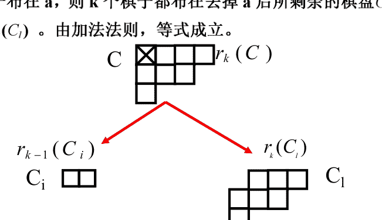

## 棋盘多项式

再看性质 5。所谓 C₁ 和 C₂ 的布棋方案是互相独立的就是说在由 C₁ 和 C₂ 构成的棋盘 C 上，C₁ 和 C₂ 的行或列都是不重叠的。例如图(a)中的棋盘就满足这个要求，但(b)中的棋盘不满足这个要求。由于 C₁ 和 C₂ 的布棋方案是互相独立的，由乘法法则和加法法则就可以得到性质 5。

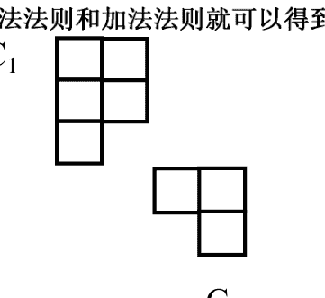

C₁ 和 C₂ 的布棋方案相互独立

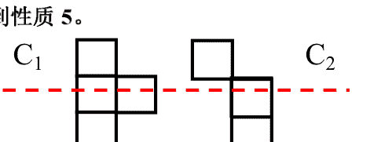

图(b)

C₁ 和 C₂ 的布棋方案不相互独立

## 棋盘多项式

定义 4.5.1 设 C 是棋盘，则 R(C)=∑_{k=0}^{∞} r_k(C) x^k 叫做棋盘多项式。

在上述定义中当 k 大于棋盘的格子数时 r_k(C)=0，所以 R（C）一般只有有限项。例如：

R(□□)=r₀(□□)+r₁(□□)x+r₂(□□)x²
=1+2x+x²

R(□□)=r₀(□□)+r₁(□□)x+r₂(□□)x²
=1+3x+x²

## 棋盘多项式的性质

- 1. $R(C)=xR(C_i)+R(C_l)$，其中$C_i$和$C_l$的含义如前所述。

证明

$R(C)=\sum_{k=0}^{\infty} r_k(C)\cdot x^k$

$= r_0(C)+\sum_{k=1}^{\infty} r_k(C)\cdot x^k$

$= r_0(C_l)+\sum_{k=1}^{\infty}[r_{k-1}(C_i)+r_k(C_l)]\cdot x^k$

$=\sum_{k=1}^{\infty} r_{k-1}(C_i)\cdot x^k + r_0(C_l)+\sum_{k=1}^{\infty} r_k(C_l)\cdot x^k$

$= x\sum_{k=0}^{\infty} r_k(C_i)\cdot x^k + \sum_{k=0}^{\infty} r_k(C_l)\cdot x^k$

$= xR(C_i)+R(C_l)$

## 棋盘多项式的性质

2. R(C) = R(C₁) · R(C₂)，其中 C₁, C₂ 的含义如前所述。

证明：

r₀(C) = r₀(C₁) · r₀(C₂)
xr₁(C) = [r₀(C₁) · r₁(C₂) + r₁(C₁) · r₀(C₂)]x
x²r₂(C) = [r₀(C₁) · r₂(C₂) + r₁(C₁) · r₁(C₂) + r₂(C₁) · r₀(C₂)]x²
…

将以上各式的两边分别相加得

R(C) = r₀(C₁)[r₀(C₂) + r₁(C₂)·x + r₂(C₂)·x² + ⋯]
    + r₁(C₁)·x[r₀(C₂) + r₁(C₂)·x + r₂(C₂)·x² + ⋯]
    + r₂(C₁)·x²[r₀(C₂) + r₁(C₂)·x + r₂(C₂)·x² + ⋯] + ⋯
    = r₀(C₁)·R(C₂) + r₁(C₁)·x·R(C₂) + r₂(C₁)·x²·R(C₂) + ⋯
    = R(C₁)·R(C₂)

## 棋盘多项式的性质

例 计算 R( )

解： R( )=xR( )+R( )

=xR( )+R( )R( )

=x(1+2x+x²)+(1+2x)(1+3x+x²)

= 1 + 6x + 8x² + 3x³

R(□□)=x·R(□)+R(□□)
=x(1+x)+(1+2x)=1+3x+x²

R(□□□)=x·R(□□)+R(□□□)
=x·[x·R(□)+R(□□)]+[x·R(□□)+R(□□)]
=x[x(1+2x)+(1+3x+x²)]+[x(1+3x+x²)+1+4x+3x²]
=1+6x+10x²+4x³

## 有禁区的排列问题

下面利用棋盘多项式来解决有禁区的排列问题。首先可以看到 X={1, 2, ⋯, n}的一个排列恰好对应了 n 个棋子在 n×n 棋盘上的一种布棋方案。在下图中，以棋盘的行表示 X 中的元素，列表示排列中的位置，则这种放棋方案就对应了排列 2143。如果在排列中限制元素 i 不能排在第 j 个位置，则相应的布棋方案中棋盘的第 i 行第 j 列的方格不许放棋子。把所有这些不许放棋的方格称做禁区。

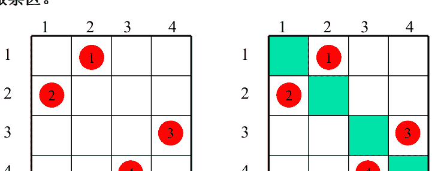

## 有禁区的排列问题

定理 4.5.1 设 C 是 n×n 的具有给定禁区的棋盘，这个禁区对应于集合 {1, 2, …, n} 中的元素在排列中不允许出现的位置。则这种有禁区的排列数是

n!−r₁(n−1)!+r₂(n−2)!−⋯+(−1)ⁿrₙ ，

其中 rᵢ 是 i 个棋子布置到禁区的方案数。

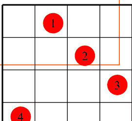

证明：Pⱼ：第 j 个棋子落入禁区，j=1, 2, …, n

Aⱼ：S 中第 j 个棋子落入禁区的方案构成的子集，

则所求的排列数就是 |Ā₁∩Ā₂∩⋯∩Āₙ|。

先不考虑禁区的限制，n 个棋子布到 n×n 棋盘上的方案 |S|=n!。如果对 n 个棋子分别编号为 1, 2, …, n，并且认为编号不同的棋子的棋子放入同样的方格是不同的放置方案，那么带编号的棋子布到 n×n 棋盘上的方案数是 n!·n!。

## 有禁区的排列问题

1 号棋子落入禁区的方案数为 r₁，当它落入禁区的某一格以后，2, 3, …, n 号棋子可以任意布置在 (n−1) × (n−1) 的棋盘上，由乘法法则得 |A₁| = r₁ (n−1)! (n−1)! ，

同理，对 i=2, 3, …, n 有 |Aᵢ| = r₁ (n−1)! (n−1)! ，

对 i 求和得 ∑_{i=1}^{n} |Aᵢ| = r₁ (n−1)! n!

## 有禁区的排列问题

1号和2号两个棋子落入禁区的方案数为2r₂，它们落入以后，3，4，⋯，n号棋子可以任意布置在（n−2）×（n−2）的棋盘上，所以
|A₁∩A₂|=2r₂(n−2)!(n−2)! ，

同理对{i，j}∈{1,2,…,n}有
|Aᵢ∩Aⱼ|=2r₂(n−2)!(n−2)!

对所有的1≤i<j≤n求和得
∑_{1≤i<j≤n}|Aᵢ∩Aⱼ|=2C(n,2)r₂(n−2)!(n−2)!=r₂(n−2)!n! ，

用类似的方法，我们可以求得
∑_{1≤i<j<k≤n}|Aᵢ∩Aⱼ∩Aₖ|=r₃(n−3)!n!
…
|A₁∩A₂∩⋯∩Aₙ|=rₙ·n!

## 有禁区的排列问题

例 4.5.2 用四种颜色（红、蓝、绿、黄）涂染四台仪器 A，B，C 和 D。规定每台仪器只能用一种颜色并且任意两台仪器都不能相同。如果 B 不允许用蓝色和红色，C 不允许用蓝色和绿色，D 不允许用绿色和黄色，问有多少种染色方案？

解 这个问题就是图 4.5.3 中的有禁区的布棋问题。禁区的棋盘多项式为 R( )=1+6x+10x²+4x³，

从而得到 r₁=6, r₂=10, r₃=4,根据定理 4.5.1, 所求的方案数是 N=4!-6·3! +10·2!-4·1!=24-36+20-4=4

Ref: n! - r₁(n-1)! + r₂(n-2)! - … + (-1)ⁿ·n!

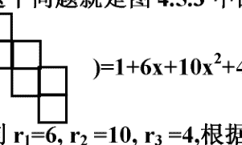

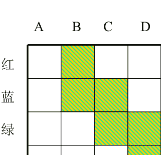


## 有禁区的排列问题

例 4.5.3 错位排列问题也可以看作是有禁区的排列问题，其禁区在主对角线上。下面使用定理 4.5.1 来求 \(D_n\)。

解：禁区的棋盘多项式是

\[
R(\square \square \cdots \square)
= \overbrace{R(\square)\cdot R(\square)\cdots R(\square)}^{n}
= (1+x)^n
= 1+\binom{n}{1}x+\binom{n}{2}x^2+\cdots+\binom{n}{n}x^n.
\]

从而得到 \(r_1 = n,\ r_2 = \binom{n}{2},\ \ldots,\ r_n = \binom{n}{n}\)，代入定理 4.5.1 得

\[
D_n = n! - n(n-1)! + \binom{n}{2}(n-2)! - \cdots + (-1)^n\binom{n}{n}\,0!
\]

\[
= n!\left[1-\frac{1}{1!}+\frac{1}{2!}-\cdots+(-1)^n\frac{1}{n!}\right].
\]

定理 4.5.1 的一般形式为

\[
n!-r_1(n-1)!+r_2(n-2)!-\cdots+(-1)^n r_n\cdot0!.
\]

## 作业

- 4.10 和 4.11

## Möbius 反演

- 德国数学家、天文学家 Möbius 于 1832 年发现的经典数论结果。
- 是研究两个整值函数 \(f(n)\) 和 \(g(n)\) 互相表示的问题。

### Möbius 函数

根据数论的知识，对于大于 1 的自然数 \(n\)，有标准的分解形式，即

\[
n=p_1^{\alpha_1}p_2^{\alpha_2}\cdots p_k^{\alpha_k}, \tag{4.6.1}
\]

其中 \(p_1,p_2,\ldots,p_k\) 为 \(k\) 个互不相同的质数。依此为基础，有下面的定义。

**定义 4.6.1**（Möbius 函数 \(\mu(n)\)）定义为

\[
\mu(n)=
\begin{cases}
1, & n=1,\\
0, & \text{若式 (4.6.1) 中存在 } \alpha_i>1,\\
(-1)^k, & \text{若式 (4.6.1) 中 } \alpha_1=\alpha_2=\cdots=\alpha_k=1.
\end{cases}
\]

例如，

\[
\mu(2)=(-1)^1=-1,\quad \mu(9)=\mu(3^2)=0,\quad \mu(10)=\mu(2\times5)=(-1)^2=1.
\]

**定理 4.6.1.** 对任意正整数 \(n\)，有

\[
\sum_{d\mid n}\mu(d)=
\begin{cases}
1, & n=1,\\
0, & n>1.
\end{cases}
\]

其中 \(\sum_{d\mid n}\mu(d)\) 表示让 \(d\) 取遍 \(n\) 的所有正因子而对 \(\mu(d)\) 求和，其中包括因子 \(1\) 和 \(n\)。

**证明：** 当 \(n=1\) 时，由定义知 \(\mu(1)=1\)。

当 \(n>1\) 时，设 \(n\) 的标准质因数分解为 \(n=p_1^{a_1}p_2^{a_2}\cdots p_k^{a_k}\)，并令

\[
n^*=p_1p_2\cdots p_k.
\]

若 \(d\mid n^*\)，则 \(d\mid n\)；若 \(d\mid n\)，但 \(d\nmid n^*\)，则 \(d\) 能被某个质数的平方整除，从而 \(\mu(d)=0\)。

于是，在求和式 \(\sum_{d\mid n}\mu(d)\) 中只要考虑 \(n^*=p_1p_2\cdots p_k\) 的因子。对于那些是 \(n\) 的因子而又不是 \(n^*\) 的因子的数 \(d\)，由于 \(\mu(d)=0\)，就不用考虑了。

\[
\sum_{d\mid n}\mu(d)
= \sum_{\substack{d\mid n\\ d\mid n^*}}\mu(d)+\sum_{\substack{d\mid n\\ d\nmid n^*}}\mu(d)
= \sum_{d\mid n^*}\mu(d).
\]

所以，问题化简为

\[
\sum_{d\mid n}\mu(d)=\sum_{d\mid n^*}\mu(d)
\]

\[
= \mu(1)+\sum_{i=1}^k\mu(p_i)+\sum_{1\le i<j\le k}\mu(p_ip_j)+\cdots+\mu(p_1p_2\cdots p_k)
\]

\[
=1+C_k^1(-1)+C_k^2(-1)^2+\cdots+C_k^k(-1)^k
\]

\[
=(1-1)^k=0.
\]

**例 4.6.1** 关于 Euler 函数 \(\varphi(n)\) 的一个公式如下：

\[
\varphi(n)=n\sum_{d\mid n}\frac{\mu(d)}{d} \tag{4.6.2}
\]

**证明：** 如果 \(n=1\)，

\[
\text{左式}=\varphi(1)=1,\qquad
\text{右式}=\sum_{d\mid 1}\frac{\mu(d)}{d}=\frac{\mu(1)}{1}=1,
\]

等式成立。

若 \(n>1\)，设 \(n=p_1^{\alpha_1}p_2^{\alpha_2}\cdots p_k^{\alpha_k}\)，并令 \(n^*=p_1p_2\cdots p_k\)，则

\[
n\sum_{d\mid n}\frac{\mu(d)}{d}
= n\sum_{d\mid n^*}\frac{\mu(d)}{d}
+ n\sum_{\substack{d\mid n\\ d\nmid n^*}}\frac{\mu(d)}{d}
= n\sum_{d\mid n^*}\frac{\mu(d)}{d}+0
= n\sum_{d\mid n^*}\frac{\mu(d)}{d}.
\]

\[
\begin{aligned}
&= n\left(\mu(1)+\sum_{i=1}^k\frac{\mu(p_i)}{p_i}
+\sum_{1\le i<j\le k}\frac{\mu(p_ip_j)}{p_ip_j}
+\cdots+\frac{\mu(p_1p_2\cdots p_k)}{p_1p_2\cdots p_k}\right)\\
&= n\left(1+\sum_{i=1}^k\frac{(-1)}{p_i}
+\sum_{1\le i<j\le k}\frac{(-1)^2}{p_ip_j}
+\cdots+\frac{(-1)^k}{p_1p_2\cdots p_k}\right)\\
&= n\left(1-\sum_{i=1}^k\frac{1}{p_i}
+\sum_{1\le i<j\le k}\frac{1}{p_ip_j}
-\cdots+\frac{(-1)^k}{p_1p_2\cdots p_k}\right)\\
&= n\left(1-\frac{1}{p_1}\right)\left(1-\frac{1}{p_2}\right)\cdots\left(1-\frac{1}{p_k}\right)
=\varphi(n).
\end{aligned}
\]

**定理 4.6.2（Möbius 反演公式）**：设 \(f(n)\)、\(g(n)\) 是自然数集上的两个函数，则

\[
f(n)=\sum_{d\mid n}g(d) \iff g(n)=\sum_{d\mid n}\mu(d)f\left(\frac nd\right) \tag{4.6.3}
\]

**证明：** 先证必要性。若式 (4.6.3) 左端的等式对自然数 \(n\) 成立，那么它对自然数 \(n/d\) 也应该成立，即将式 \(f(n)=\sum_{d\mid n}g(d)\) 中的 \(n\) 换成 \(n/d\)，有

\[
f(n/d)=\sum_{d_1\mid n/d}g(d_1),
\]

从而有

\[
\sum_{d\mid n}\mu(d)f(n/d)
=\sum_{d\mid n}\mu(d)\left(\sum_{d_1\mid n/d}g(d_1)\right)
=\sum_{d\mid n}\sum_{d_1\mid n/d}\mu(d)g(d_1)
\]

\[
=\sum_{d_1\mid n}\sum_{d\mid n/d_1}\mu(d)g(d_1)
=\sum_{d_1\mid n}g(d_1)\left(\sum_{d\mid n/d_1}\mu(d)\right).
\]

由定理 4.6.1，内层和 \(\sum_{d\mid n/d_1}\mu(d)\) 只有当 \(n/d_1=1\)（即 \(d_1=n\)）时为 1，否则为 0，故原式等于 \(g(n)\)。

### Möbius 反演的应用

**例 4.6.2** 利用 Möbius 反演公式，将 \(n\) 用 Euler 函数 \(\varphi(d)\) 表示。

解：因为

\[
\varphi(n)=n\sum_{d\mid n}\frac{\mu(d)}{d}=\sum_{d\mid n}\mu(d)\frac nd.
\]

Möbius 反演公式：

\[
f(n)=\sum_{d\mid n}g(d)\iff g(n)=\sum_{d\mid n}\mu(d)f\left(\frac nd\right).
\]

令 \(g(n)=\varphi(n)\)，\(f(n)=n\)（从而 \(f(n/d)=n/d\)），那么，由定理 4.6.2 知

\[
f(n)=\sum_{d\mid n}g(d),
\]

故

\[
n=\sum_{d\mid n}\varphi(d). \tag{4.6.4}
\]

式 (4.6.2) 和 (4.6.4) 构成了 \(n\) 与 \(\varphi(n)\) 之间的互为逆变换的关系，即满足 Möbius 反演。

**例 4.6.3** 可重圆排列问题：\(m\) 个相异元素的不重圆排列数为 \((m-1)!\)。

这 \(m\) 个相异元素的可重圆排列数是多少？问题将复杂得多，即从 \(m\) 个相异元素中可重复地取 \(n\) 个构成的圆排列的个数并不能简单地直接推广为 \(m^n/n\)。

例如，设集合 \(A=\{a_1,a_2,\cdots,a_m\}\) 有 \(m\) 个相异元素，当 \(d\mid n\) 时，取 \(d\) 个不同的元素 \(a_1,a_2,\cdots,a_d\) 重复 \(n/d\) 次构成的 \(n\) 个元素的圆排列

\[
\odot\ \underbrace{a_1a_2\cdots a_d\ a_1a_2\cdots a_d\ \cdots\ a_1a_2\cdots a_d}_{\frac nd\text{ 组}}
\]

只能形成 \(d\) 个不同的线排列（\(\odot\) 为上述 \(n\) 个元素首尾相接形成一个圆排列）。


# Möbius反演的应用

⊙ a₁a₂⋯a_d a₁a₂⋯a_d ⋯ a₁a₂⋯a_d
n/d 组

a₁a₂⋯a_d a₁a₂⋯a_d ⋯ a₁a₂⋯a_d
a₂a₃⋯a_d a₁ a₂a₃⋯a_d a₁ ⋯ a₂a₃⋯a_d a₁
⋮
a_d a₁⋯a_{d-1} a_d a₁⋯a_{d-1} ⋯ a_d a₁⋯a_{d-1} } d个

一个圆排列中所含元素的个数称为该圆排列的长度。长度为n圆排列简称n圆排列，一个圆排列如果可由某个长度为k的线排列在圆周上重复若干次而产生，则把这种k中的最小者称为该圆排列的（最小）周期，因此，任何一个排列必有一个周期，而且周期必是圆排列长度的因子。不重的m圆排列只是长度和周期都等于m的特殊可重圆排列而已。

# Möbius反演的应用

将周期为 d 的 n 可重圆排列的个数计为 M(d)，则周期是 d 的全部 n 可重圆排列所对应的 n 可重线排列的个数是 d·M(d)，对所有的周期进行求和，便得到

∑_{d|n} d·M(d) = m^n （4.6.5）

其中 m^n 是集合 A 所有元素的 n 可重线排列的个数，和式遍取 n 的所有因子(包括 1 与 n 本身)。

# Möbius反演的应用

m^n = Σ_{d|n} d·M(d)

利用 Möbius 反演公式：f(n)= Σ_{d|n} g(d) ↔ g(n)= Σ_{d|n} μ(d) f(n/d)

令 f(n)=m^n， g(n)=n·M(n)，得

g(n)= Σ_{d|n} μ(d) f(n/d)

即

n·M(n)= Σ_{d|n} μ(d) m^{n/d} ⇒ M(n)= 1/n Σ_{d|n} μ(d) m^{n/d}

它表示以n为周期的n可重圆排列的个数。

# Möbius反演的应用

若用 $T_m(n)$ 表示从 m 元集合中构成长度为 $n$ 的所有 $n$ 可重圆排列的个数，那么

$T_m(n) = \sum_{d|n} M(d)$

可以证明

$T_m(n) = \sum_{d|n} \frac{m^d}{d} \sum_{d_1|\frac{n}{d}} \frac{\mu(d_1)}{d_1} = \frac{1}{n} \sum_{d|n} \varphi(d) m^{n/d}$

其中 $\varphi(d)$ 为 Euler 函数。

$M(n) = \frac{1}{n} \sum_{d|n} \mu(d) m^{n/d}$

# pp.71 4.15，用三种颜色涂色装有5颗珠子的手镯，如果只考虑手镯的旋转，问有多少种涂色方案？

> T_m(n) = \sum M(p) = \sum (1/p)\sum \mu(p/q)m^q

T_m(n) = T_3(5) = \sum M(p) = M(1) + M(5)

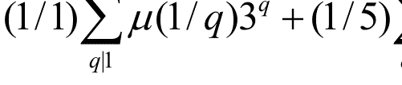

= (1/1)\sum \mu(1/q)3^q + (1/5)\sum \mu(5/q)3^q

= (1/1)\mu(1)3 + (1/5)[\mu(5)3^1 + \mu(1)3^5]

= 3 + 48 = 51

# 第五章 生成函数

- 5.1 生成函数的定义
- 5.2 生成函数的性质
- 5.3 组合数的生成函数
- 5.4 排列数的指数型生成函数
- 5.5 Catalan数列与Stirling数列的生成函数
- 5.6 分配问题
- 5.7 分拆数的生成函数

# 生成函数

- 又称母函数或发生函数，可求解组合计数问题。
- 基本计数原理和容斥原理已解决了部分排列组合问题。但对于元素的部分排列和组合，用基本计数原理和容斥原理这些方法是比较麻烦的，若改用生成函数方法，问题将显得容易多了。
- 在求解递推关系的解、整数分解以及证明组合恒等式时，生成函数是组合数学中的基本而重要的手段和方法，它是连接离散数学与连续数学的桥梁，组合数学中的问题能借助于生成函数的方法、原理，获得统一的处理和解决方式。
- 生成函数方法的基本思想是把离散的数列同多项式或幂级数一一对应起来，从而把离散数列间的结合关系转换为多项式或幂级数之间的运算。
- 几类特殊的生成函数，包括组合数序列、排列数序列、分解数序列、组合分配数序列以及排列分配数序列的生成函数，以及Catalan数和第一类Stirling数的生成函数。

# 生成函数的定义

定义 5.1.1 设于一个有限或无限数列
\{a_0, a_1, a_2, \cdots\},

做形式幂级数
A(x) = a_0 + a_1 x + a_2 x^2 + \cdots a_n x^n + \cdots

称 A(x) 为序列 \{a_0, a_1, a_2, \cdots\} 的生成函数，并记为 G\{a_n\}.

这里 x 只是形式上的变量，一般情况下不考虑级数的收敛问题。

# 生成函数的定义

例 5.1.1 组合数序列 $C(n,r)$， $r=0,1,2,\cdots,n$ 的生成函数是

$f_n(x)=C(n,0)+C(n,1)x+C(n,2)x^2+\cdots+C(n,r)x^r+\cdots+C(n,n)x^n$
$= (1+x)^n$

通过对 $(1+x)^n$ 的运算，可能导出一系列组合数的关系式，例如：

$\displaystyle \sum_{i=0}^{n} \binom{n}{i}=2^{n}$

$\displaystyle \sum_{i=0}^{n} i \cdot \binom{n}{i}=n \cdot 2^{n-1}$

…

# 生成函数的定义

由恒等式

(1+x)^{m+n} = (1+x)^m (1+x)^n

可以推导出 Vandermonde 恒等式(证明见 pp. 34 组合恒等式 4)

\binom{m+n}{r} = \sum_{k=0}^{r} \binom{m}{k} \binom{n}{r-k}

设 a 是一个实数,关于数列

\binom{\alpha}{0}, \binom{\alpha}{1}, \dots, \binom{\alpha}{n}, \dots

的生成函数记作 f_a(x) 则

f_a(x) = \binom{\alpha}{0} + \binom{\alpha}{1} x + \cdots + \binom{\alpha}{n} x^n + \cdots = (1+x)^a

# 生成函数的定义

例 5.1.2 无限数列{1,1,⋯,⋯}的生成函数是

1/(1−x) = 1 + x + x² + ⋯ xⁿ + ⋯

例 5.1.3 求数列 a₁, a₂, ⋯, aₙ, ⋯ 的生成函数，其中 aₙ 是多重集 {∞·b₁, ∞·b₂, ⋯, ∞·bₖ} 的 n−组合数 C(k+n−1, n) 的生成函数。

解 该数列记作{aₙ}，它的生成函数是 gₖ(x)，则

gₖ(x) = C(k−1,0) + C(k,1)x + ⋯ C(k+n−1,n)xⁿ + ⋯ = 1/(1−x)ᵏ = (1−x)⁻ᵏ

Ref: pp. 32 牛顿二项式(3.4.10)

(1+x)⁻ᵏ = Σₙ₌₀^∞ (−1)ⁿ C(k+n−1, n) xⁿ, (1−x)⁻ᵏ = Σₙ₌₀^∞ C(k+n−1, n) xⁿ

# 生成函数的定义

g_k(x) = \binom{k-1}{0} + \binom{k}{1} x + \cdots \binom{k+n-1}{n} x^n + \cdots = \frac{1}{(1-x)^k} = (1-x)^{-k} (5.1.1)

当 k = 1 时，这时数列为例 5.1.2 的无限数列 {1,1,⋯,⋯}，其生成函数为 \frac{1}{1-x}。

当 k = 2 时，{∞·b₁, ∞·b₂} 的组合数是 n+1，这时数列变成 1,2,⋯,n+1,⋯，而由 (5.1.1) 式有

g(x) = \frac{1}{(1-x)^2} = 1 + 2x + 3x^2 + \cdots + (n+1)x^n + \cdots。

# 生成函数的定义

例 5.1.4 投掷一次骰子，出现点数 1, 2, …, 6 的概率均为 $\frac{1}{6}$，问连续投掷两次，出现的点数之和为 10 的概率有多少？

解 一次投掷出现的点数有 6 种可能，连续两次投掷到的点数构成二元数组 $(i, j)$ $(1 \le i, j \le 6)$，共有 $6^2 = 36$ 种可能，由枚举法，两次出现的点数之和为 10 的有 3 种可能；$(4, 6)$, $(5, 5)$, $(6, 4)$，所以概率为 $\frac{3}{36} = \frac{1}{12}$。

# 生成函数的定义

用多项式

$x + x^2 + x^3 + x^4 + x^5 + x^6$

表示投掷一次可能出现点数 1, 2, …, 6，两次投掷表示为

$(x + x^2 + x^3 + x^4 + x^5 + x^6)(x + x^2 + x^3 + x^4 + x^5 + x^6)$.

若出现点数 $m,n$，即从两个括号中分别取出 $x^m$ 和 $x^n$，使

$x^m \cdot x^n = x^{10}$，

即 $m + n = 10$，由此得出，展开式中 $x^{10}$ 的系数就是满足条件的方法数。


## 生成函数的定义

同理，连续投掷 10 次，其和为 30 的方法数为

$(x + x^2 + x^3 + x^4 + x^5 + x^6)^{10}$

中 $x^{30}$ 的系数，而

$(x + x^2 + x^3 + x^4 + x^5 + x^6)^{10}$

$= x^{10} (1 + x + x^2 + x^3 + x^4 + x^5)^{10} = x^{10} \left( \sum_{k=0}^{\infty} x^k - \sum_{k=6}^{\infty} x^k \right)^{10}$

$= x^{10} \left( \sum_{k=0}^{\infty} x^k - x^6 \sum_{k=0}^{\infty} x^k \right)^{10} = x^{10} \left( \sum_{k=0}^{\infty} x^k \right)^{10} (1 - x^6)^{10}$

$= x^{10} (1 - x)^{-10} (1 - x^6)^{10} = x^{10} \cdot \sum_{i=0}^{\infty} \binom{10 - 1 + i}{i} x^{i} \cdot \sum_{j=0}^{10} (-1)^j \binom{10}{j} x^{6j}$

$(x + x² + x³ + x⁴ + x⁵ + x⁶)¹⁰ = x¹⁰ · Σᵢ₌₀^∞ (10−1+i choose i) xⁱ · Σⱼ₌₀¹⁰ (−1)ʲ (10 choose j) x⁶ʲ$

所以，x³⁰的系数为

$(29 choose 20) − (23 choose 14)(10 choose 1) + (17 choose 8)(10 choose 2) − (11 choose 2)(10 choose 3) = 2930455.$

i=20
j=0

i=14
j=1

i=8
j=2

i=2
j=3

故所求概率为

2930455 / 6¹⁰ ≈ 0.0485.

## 生成函数的性质

生成函数与数列之间是一一对应的，因此，若两个生成函数之间存在某种关系，那么相应的两个数列之间也必然存在一定的关系；反之亦然。

设数列\{a₀, a₁, a₂, …\}的生成函数为 A(x)=∑ₖ₌₀^∞ aₖ xᵏ，数列\{b₀, b₁, b₂, …\}的生成函数为 B(x)=∑ₖ₌₀^∞ bₖ xᵏ，可以得到生成函数的如下一些性质：

### 性质 1
若

b_k = { 0      (k < r) 
       a_{k-r}  (k ≥ r) }

则

B(x) = x^r · A(x).

证明 由假设条件，有

B(x) = Σ_{k=0}^{∞} b_k x^k = b_0 + b_1 x^1 + b_2 x^2 + ⋯ + b_{r-1} x^{r-1} + b_r x^r + b_{r+1} x^{r+1} + ⋯

= Σ_{k=r}^{∞} b_k x^k = 0 + 0 + ⋯ 0 + b_r x^r + b_{r+1} x^{r+1} + ⋯

= Σ_{k=r}^{∞} a_{k-r} x^k = a_0 x^r + a_1 x^{r+1} + ⋯

= x^r · A(x).

### 性质 2
若 $b_k = a_{k+r}$，则

$B(x) = \frac{1}{x^{r}}\left(A(x) - \sum_{k=0}^{r-1} a_k x^k\right).$

证明 类似于性质 1 的证明。

### 性质 3
若 $b_k = \sum_{i=0}^{k} a_i$，则 $B(x) = \frac{A(x)}{1 - x}$。

证明 给等式 $b_k = \sum_{i=0}^{k} a_i$ 的两端都乘以 $x^k$，得

$b_0 = a_0,$
$b_1 x = a_0 x + a_1 x,$
$b_2 x^2 = a_0 x^2 + a_1 x^2 + a_2 x^2,$
$\dots,$
$b_k x^k = a_0 x^k + a_1 x^k + a_2 x^k + \dots + a_k x^k,$
$\dots.$

把以上各式的两边分别相加，得

$B(x) = a_0(1 + x + x^2 + \cdots) + a_1 x(1 + x + x^2 + \cdots) + a_2 x^2(1 + x + x^2 + \cdots) + \cdots$
$= (a_0 + a_1 x + a_2 x^2 + \cdots)(1 + x + x^2 + \cdots) = \frac{A(x)}{1 - x}$。

### 性质 4
若 $b_k = \sum_{i=k}^{\infty} a_i$，则 $B(x)=\frac{A(1)-xA(x)}{1-x}$。这里，$\sum_{i=0}^{\infty} a_i$ 是收敛的。

证明 因为 $A(1)=\sum_{k=0}^{\infty} a_k$ 收敛，所以 $b_k = \sum_{i=k}^{\infty} a_i$ 是存在的，于是有

$b_0 = a_0 + a_1 + a_2 + \cdots = A(1),$
$b_1 x = a_1 x + a_2 x + \cdots = [A(1)-a_0]x,$
$b_2 x^2 = a_2 x^2 + a_3 x^2 + \cdots = [A(1)-a_0 - a_1]x^2,$
$\cdots,$
$b_k x^k = a_k x^k + a_{k+1} x^k + \cdots = [A(1)-a_0 - a_1 - \cdots - a_{k-1}]x^k,$
$\cdots.$

把以上各式的两边分别相加，得

B(x) = A(1) + [A(1) - a₀]x + [A(1) - a₀ - a₁]x² + ⋯ + [A(1) - a₀ -⋯- a_{k-1}]x^k +⋯
= A(1)(1 + x + x² +⋯) - a₀x(1 + x + x² +⋯) -⋯- a_{n-1}x^n(1 + x + x² +⋯) -⋯
= [A(1) - x(a₀ + a₁x + a₂x² +⋯)]·(1 + x + x² +⋯)
= \frac{A(1) - xA(x)}{1 - x}.

### 性质 5
若 b_k = k a_k，则 B(x) = x A'(x).

证明 由 A'(x) = \sum_{k=1}^{\infty} k a_k x^{k-1} 的定义知

x A'(x) = x \sum_{k=1}^{\infty} k a_k x^{k-1} = \sum_{k=0}^{\infty} k a_k x^{k}
= \sum_{k=0}^{\infty} b_k x^{k} = B(x).

### 性质 6
若 $b_k = \frac{a_k}{k+1}$，则 $B(x)=\frac{1}{x}\int_0^x A(t)dt.$

证明 由假设条件，有

$\int_0^x A(t)dt = \int_0^x \sum_{k=0}^{\infty} a_k t^k dt$

$= \sum_{k=0}^{\infty} \int_0^x a_k t^k dt$

$= \sum_{k=0}^{\infty} \int_0^x b_k (k+1) t^k dt$

$= \sum_{k=0}^{\infty} b_k \int_0^x (t^{k+1})' dt$

$= \sum_{k=0}^{\infty} b_k x^{k+1}$

$= x \cdot B(x).$

积分满足结合律

### 性质 7
若 $c_k = \alpha a_k + \beta b_k$，则 $C(x) \equiv \sum_{k=0}^{\infty} c_k x^k = \alpha A(x) + \beta B(x)$。
形式幂级数的数乘

### 性质 8
若 $c_k = a_0 b_k + a_1 b_{k-1} + \cdots + a_k b_0$，则 $C(x) \equiv \sum_{k=0}^{\infty} c_k x^k = A(x) \cdot B(x)$。
形式幂级数的加法
形式幂级数的乘法

### 性质 9
若 $b_n = \alpha^n a_n$，$\alpha$ 为常数，则 $B(x) = A(\alpha x)$。

性质 7 和性质 8 可以形式幂级数的数乘、加法及乘法运算的定义直接得出。形式幂级数在加法和乘法运算下构成一个环。

利用这些性质，可以求某些数列的生成函数，也可以计算数列的和。下面列出几个常见的简单数列的生成函数，其中k = 0,1,2,⋯：

- （1）$G\{1\}=\frac{1}{1-x}$；
- （2）$G\{a^k\}=\frac{1}{1-a x}$；
- （3）$G\{k\}=\frac{x}{(1-x)^2}$；
- （4）$G\{k(k+1)\}=\frac{2x}{(1-x)^3}$；
- （5）$G\{k^2\}=\frac{x(1+x)}{(1-x)^3}$；
- （6）$G\{k(k+1)(k+2)\}=\frac{6x}{(1-x)^4}$；
- （7）$G\{\frac{1}{k!}\}=e^x$；
- （8）$G\{\binom{\alpha}{k}\}=(1+x)^\alpha$；
- （9）$G\{\binom{n+k}{k}\}=\frac{1}{(1-x)^{n+1}}$。


## 生成函数的性质

证明：

(1) $G\{1\}=\sum_{k=0}^{\infty}x^{k}=\frac{1}{1-x}$

(2) $G\{a^{k}\}=\sum_{k=0}^{\infty}a^{k}x^{k}=\sum_{k=0}^{\infty}(ax)^{k}=\frac{1}{1-ax}$

(3) $G\{k\}=\sum_{k=1}^{\infty}kx^{k}=x\sum_{k=1}^{\infty}kx^{k-1}=x\cdot\left(\sum_{k=1}^{\infty}x^{k}\right)'=x\cdot\left(\frac{1}{1-x}\right)'=\frac{x}{(1-x)^{2}}$

牛顿二项式定理

$G\{(-1)^{k}\}=\frac{1}{1+x}$

k=0?

(4) 设 A(x) = G{k(k+1)} = Σ_{k=1}^{∞} k(k+1) x^k

则 ∫₀ˣ A(t) dt = ∫₀ˣ Σ_{k=1}^{∞} k(k+1) t^k dt = Σ_{k=1}^{∞} ∫₀ˣ k(k+1) t^k dt = Σ_{k=1}^{∞} ∫₀ˣ (k t^{k+1})' dt

= Σ_{k=1}^{∞} k x^{k+1} = x · Σ_{k=1}^{∞} k x^k = x · x/(1-x)²

G{k} = x/(1-x)²

所以 A(x) = ( x²/(1-x)² )' = 2x/(1-x)³

(a/b)' = (a'b - b'a)/b²

(5) G{k²} = Σ_{k=1}^{∞} k² x^k = Σ_{k=1}^{∞} (k+1)k x^k - Σ_{k=1}^{∞} k x^k

= 2x/(1-x)³ - x/(1-x)² = x(1+x)/(1-x)³

(6) 设 $G\{k(k+1)(k+2)\}=A(x)$

则 $\int_0^x tA(t)dt = \sum_{k=1}^{\infty}\int_0^x k(k+1)(k+2)t^{k+1}dt = \sum_{k=1}^{\infty}\int_0^x \big(k(k+1)t^{k+2}\big)' dt$

$= \sum_{k=1}^{\infty}k(k+1)x^{k+2}=x^2\sum_{k=1}^{\infty}k(k+1)x^{k}=x^2\cdot\frac{2x}{(1-x)^3}$

所以 $xA(x)=\left(\frac{2x^3}{(1-x)^3}\right)'=\frac{6x^2}{(1-x)^4}$

故 $A(x)=\frac{6x}{(1-x)^4}$

$G\{k(k+1)\}=\frac{2x}{(1-x)^3}$

(7) $G\left\{\frac{1}{k!}\right\}=\sum_{k=0}^{\infty}\frac{1}{k!}x^{k}=e^{x}$

既可以将其看作定义，也可以利用x=0的指数函数的Taylor展开式证明此结果。

(8) 即二项式展开式,

$G\left\{\binom{\alpha}{k}\right\}=\sum_{k=0}^{\alpha}\binom{\alpha}{k}x^{k}=(1+x)^{\alpha}$

(9) 前面学到的牛顿二项式定理知，有

用n+1替换n

(1 - x)^{-n} = \frac{1}{(1 - x)^n} = \sum_{k=0}^{\infty} \binom{n + k - 1}{k} x^{k}

故 $G\left\{\binom{n + k}{k}\right\} = \sum_{k=0}^{\infty} \binom{n + k}{k} x^{k} = \frac{1}{(1 - x)^{n+1}}$

例 5.2.1 求{aₙ}的生成函数

aₙ = { 0          n = 0,1,2, 
       (-1)ⁿ      n ≥ 3 }

解：

A(x) = Σₙ₌₀^∞ aₙ xⁿ = Σₙ₌₃^∞ (-1)ⁿ xⁿ

= x³ Σₙ₌₃^∞ (-1)ⁿ xⁿ⁻³ = -x³ Σₙ₌₀^∞ (-1)ⁿ xⁿ

= - x³ / (1 + x)

G{(-1)ⁿ} = 1 / (1 + x)

例 5.2.2 已知\{a_n\}的生成函数为 $A(x)=\frac{2+3x-6x^2}{1-2x}$，求 $a_n$，

解 用部分分式的方法得

$A(x)=\frac{2+3x-6x^2}{1-2x}=\frac{2}{1-2x}+3x,$

$\frac{2}{1-2x}=2\sum_{n=0}^{\infty}2^n x^n=\sum_{n=0}^{\infty}2^{n+1}x^n,$

所以有

$\begin{cases}2^{n+1} & (n\neq1)\\ 2^{2}+3=7 & (n=1).\end{cases}$

$G\{a^n\}=\frac{1}{1-ax}$

例 5.2.3 计算级数1² + 2² + ⋯ + n² 的和。

解 由第（5）个数列的生成函数知，数列{k²}的生成函数为

```
A(x) = G{a_k} = Σ_{k=0}^∞ k² x^k = x(1 + x) / (1 - x)³
```

此处，a_k = k². 令 b_n = Σ_{k=1}^n a_k, 则 b_n = 1² + 2² + ⋯ + n²,

> 性质 3 若 b_n = Σ_{i=0}^n a_i, 则 B(x) = A(x) / (1 - x).

由性质 3 即得数列{b_n}的生成函数为

```
B(x) = Σ_{n=0}^∞ b_n x^n = A(x)/(1 - x) = x(1 + x)/(1 - x)^4 = (x + x²) Σ_{k=0}^∞ (k+4-1 choose k) x^k = (x + x²) Σ_{k=0}^∞ (k+3 choose k) x^k.
```

比较等式两边 x^n 的系数，便得 k=n-1 k=n-2

```
1² + 2² + ⋯ + n² = b_n = C(n+2, n-1) + C(n+1, n-2) = n(n+1)(2n+1)/6.
```

## 作业

5.1

## 组合数的生成函数

在前面几章中讨论过三种不同类型的组合问题：

- (1) 求{a₁, a₂, …, aₙ}的k组合数；
- (2) 求{∞·a₁, ∞·a₂, …, ∞·aₙ}的k组合数；
- (3) 求{3·a₁, 4·a₂, 5·a₃}的10组合数。

其中，

问题（1）是普通集合的组合问题；

问题（2）转化为不定方程x₁ + x₂ + … + xₙ = k的非负整数解的个数问题；

问题（3）是第四章的例子，利用容斥原理来计数。它们在解题方法上各不相同。

下面我们将看到，引入生成函数的概念后，上述三类组合问题可以统一地处理。

定理 5.3.1 设多重集 S = {r₁·e₁, r₂·e₂, ⋯ rₘ·eₘ}，且 r₁ + r₂ + ⋯ + rₘ = n，则 S 的 k 可重组合数 cₖ 对应序列 {cₖ} 的生成函数为

选取的元素个数为 k

G(x) = ∏_{i=1}^{m} (∑_{j=0}^{r_i} x^{j})

其中，k 可重组合数 cₖ 为 G(x) 展开式中 xᵏ 的系数。

证明 令 G(x) 中各式的项分别对应诸元素的某种可能取法。例如，对 i = t

1 + x + x² + ⋯ + x^{r_i}

表示元素 e_t 选取了 0,1,2,…,r 次。依次类推。

G(x) 展开式为

(1 + x + x² + ⋯ + x^{r₁})(1 + x + x² + ⋯ + x^{r₂})⋯(1 + x + x² + ⋯ + x^{rₘ})

G(x)展开式为

(1 + x + x² + ⋯ + x^{r₁})(1 + x + x² + ⋯ + x^{r₂})⋯(1 + x + x² + ⋯ + x^{rₘ})

其中项具有一般形式

cₖ xᵏ = Σ_{k₁+k₂+⋯+kₘ=k} x^{k₁}·x^{k₂}⋯⋯x^{kₘ}

其中

k₁ + k₂ + ⋯ + kₘ = k,  0 ≤ kᵢ ≤ rᵢ,  i = 1,2,⋯,m

对此方程的一非负整数解(k₁,k₂…,kₘ)（在前提0 ≤ kᵢ ≤ rᵢ,i = 1,2,⋯,m下），乘积x^{k₁}·x^{k₂}⋯⋯x^{kₘ}就对应了诸元素e₁,e₂,⋯,eₘ的一种可重取法。合并同类项后，xᵏ的系数就表示了多重集S中取出k个元素的所有可能的可重组合数cₖ。

例如： S={5·红球，7·蓝球}，求取 10 个球的组合数

(1+x+x²+x³+x⁴+x⁵)(1+x+x²+x³+x⁴+x⁵+x⁶+x⁷)
=⋯+(x³x⁷+x⁴x⁶+x⁵x⁵)+⋯
=⋯+3x¹⁰+⋯

生成函数中，多项式加法可以看作选择项的或关系，而多项式乘法可以看作选择项的与关系，例如

(1+x+x²+⋯+x^{r₁})(1+x+x²+⋯+x^{r₂})⋯(1+x+x²+⋯+x^{rₘ})


## 组合数的生成函数

推论 5.3.1 设 S = {∞·e₁, ∞·e₂, …, ∞·eₘ}，若限定元素 eᵢ 出现的次数集合为 Pᵢ (1 ≤ i ≤ n)，则从 S 中取出 k 个元素的组合数 cₖ 对应序列 {cₖ} 的生成函数为

```
G(x) = ∏_{i=1}^{m} (∑_{j∈Pᵢ} xʲ)
```

任意的整数集合

比较定理 5.3.1： G(x) = ∏_{i=1}^{m} (∑_{j=0}^{rᵢ} xʲ)

连续的整数区间

例如：

推论 5.3.1 一个两位位数，第一位数是偶数，第二位数是奇数，求两数之和为 9 的组合数

```
(1 + x² + x⁴ + x⁶ + x⁸)(x + x³ + x⁵ + x⁷ + x⁹)
= … + (1·x⁹ + x²·x⁷ + x⁴·x⁵ + x⁶·x³ + x⁸·x¹) + … = … + 5x⁹ + …
```

其中 P₁ = {0,2,4,6,8}, P₂ = {1,3,5,7,9}

问题（2）：求{∞·a₁,∞·a₂,…,∞·aₙ}的k组合数。

令 M = {∞·a₁,∞·a₂,…,∞·aₙ} 的 k 组合数为 bₖ，序列 {bₖ} 的生成函数是 n 个形式幂级数的乘积：

(1+x+x²+⋯)(1+x+x²+⋯)⋯(1+x+x²+⋯)
=(1+x+x²+⋯)ⁿ = 1/(1−x)ⁿ

G{ C(n−1+k, k) } = 1/(1−x)ⁿ

从而中 xᵏ 的系数就是 M 的 k 组合数 bₖ，因此为 bₖ = C(n−1+k, k)。

用生成函数获得了多重集合 M 的 k 组合数的公式。

定理 3.2.4 多重集合 M = {∞·a₁,∞·a₂,…,∞·aₙ} 的 r 组合数为 C(n+r−1, r) (pp. 21)

问题（3）：求{3·a₁,4·a₂,5·a₃}的10组合数。

将{3·a₁,4·a₂,5·a₃}的k组合数记为bₖ，{bₖ}的生成函数就是
(1+x+x²+x³)(1+x+x²+x³+x⁴)(1+x+x²+x³+x⁴+x⁵)
= (∑ₖ₌₀^∞ xᵏ - x⁴∑ₖ₌₀^∞ xᵏ)·(∑ₖ₌₀^∞ xᵏ - x⁵∑ₖ₌₀^∞ xᵏ)·(∑ₖ₌₀^∞ xᵏ - x⁶∑ₖ₌₀^∞ xᵏ)
= (1−x⁴) 1/(1−x)·(1−x⁵) 1/(1−x)·(1−x⁶) 1/(1−x)
= (1−x⁴)·(1−x⁵)·(1−x⁶)·1/(1−x)³
= (1−x⁴−x⁵−x⁶+x⁹+x¹⁰+x¹¹−x¹⁵)·∑ₙ₌₀^∞ C(n+3−1, n) xⁿ
= (1−x⁴−x⁵−x⁶+x⁹+x¹⁰+x¹¹−x¹⁵)·∑ₙ₌₀^∞ C(n+2, n) xⁿ

问题（3），求{3·a₁,4·a₂,5·aₙ}的10组合数。

将{3·a,4·b,…,5·c}的k组合数记为bₖ，{bₖ}的生成函数就是

(1+x+x²+x³)(1+x+x²+x³+x⁴)(1+x+x²+x³+x⁴+x⁵)

=(1−x⁴−x⁵−x⁶+x⁹+x¹⁰+x¹¹−x¹⁵)·∑ₙ₌₀^∞ C(n+2, n) xⁿ

所以，x¹⁰的系数b₁₀为

b₁₀ = C(10+2,10) − C(6+2,6) − C(5+2,5) − C(4+2,4) + C(1+2,1) + C(0+2,0) = 6

与第4章中用容斥原理得到的结果相同。

n=10

n=6

n=5

n=4

n=1

n=0

注意符号！

问题（1），求{a₁,a₂,…,aₙ}的k组合数。

在普通集合{a₁,a₂,…,aₙ}的k组合中，aᵢ(1≤i≤n)或者出现或者不出现，故该集合的k组合数序列{bₖ}的生成函数为

(1+x)ⁿ = Σₖ₌₀ⁿ C(n,k) xᵏ

二项式定理

从而

bₖ = C(n,k)

例 5.3.1 设 $S = \{\infty \cdot e_1, \infty \cdot e_2, \dots, \infty \cdot e_m\}$，则 $S$ 的每个元素至少取一次的 $k$（无限）可重组合数 $c_k (k \ge m)$ 对应序列 $\{c_k\}$ 的生成函数为

$G(x) = \left(\sum_{j=0}^{\infty} x^{j}\right)^m = \frac{x^m}{(1-x)^m}$
$= x^m \sum_{k=0}^{\infty} \binom{m+k-1}{k} x^{k} = \sum_{k=0}^{\infty} \binom{m+k-1}{k} x^{m+k}$
$= \sum_{k=m}^{\infty} \binom{k-1}{k-m} x^{k} = \sum_{k=m}^{\infty} \binom{k-1}{m-1} x^{k}$

所以组合数 $c_k$ 为 $G(x)$ 展开式中 $x^k$ 的系数为 $C(k-1, k-m)=C(k-1, m-1)$。

定理 3.2.5 $M = \{\infty \cdot a_1, \infty \cdot a_2, \infty \cdot a_n\}$，$r \ge n$，则 $M$ 中每个元素至少取一个的 $r$-组合数为 $C(r-1, n-1)$。 (pp. 22)

$\frac{1}{(1-x)^m} = \sum_{k=0}^{\infty} \binom{m+k-1}{k} x^{k}$

例 5.3.2 求不定方程 $k_1 + k_2 + k_3 + k_4 = 20$ 的解组数。其中，限制 $k_1$ 可取 0, 2, 4； $k_2$ 可取 1, 3, 5； $k_3$ 可取 6, 7； $k_4$ 可取 8, 9。

解 设不定方程 $\sum_{i=1}^{m} k_i = k$ 的解组数目为 $c_k$，本例中 $m=4, k=20$。注意到对 $k_i (i=1,2,3,4)$ 的限制，序列 $\{c_k\}$ 对应的生成函数为

$G(x) = (1 + x^2 + x^4)(x + x^3 + x^5)(x^6 + x^7)(x^8 + x^9)$

由 $G(x)$ 展开式中 $x^{20}$ 的系数知题给不定方程解组数目为 $c_{20}=6$。

利用推论 5.3.1 $G(x) = \prod_{i=1}^{m} \left( \sum_{j \in P_i} x^{j} \right)$

例 5.3.4 设有红球 2 个，黑、白球各 1 个，问

- (1) 共有多少不同的选取方法？试加以枚举。
- (2) 若每次从中任取 3 个，有多少种不同取法？

解 （1）设用 r, b, w 分别代表红、黑、白三种球，红球的可能取法与 1+r+r² 中 r 的各次幂一一对应，亦即 r⁰=1 表示不取红球，r¹ 表示取 1 个红球，r² 表示取 2 个红球。对其它球，依此类推法，则不同选取方法数所形成序列对应的生成函数为

```
G(r, b, w) = (1 + r + r²)(1 + b)(1 + w)
          = 1 + (r + b + w) + (r² + r b + r w + b w) + (r² b + r² w + r b w) + r² b w
```

G(r,b,w)=1+(r+b+w)+(r²+rb+rw+bw)+(r²b+r²w+rbw)+r²bw

- 1: 一个球都不取，仅有一种方案；
- r+b+w: 取 1 个球的方案有 3 种，分别为红，黑，白；
- r²+rb+rw+bw: 取 2 个球的方案有 4 种，分别为红红，红黑，红白，黑白；
- r²b+r²bw+rbw: 取 3 个球的方案有 3 种，即 2 红 1 黑，2 红 1 白，三色球各取其一；
- r²bw: 取 4 个球的方案仅 1 种，即所有球全取。

若令 r=b=w=1，即可求得所有不同的选取方案总数为

G(1,1,1)=1+3+4+3+1=12

（2）若只考虑每次取 3 个球的方案数，而不需枚举，则可令 r=b=w=x。写出

G(x)=(1+x+x²)(1+x)²=1+3x+4x²+3x³+x⁴

由 x³ 的系数知所求方案为 3 种。

**例 5.3.5** 求不定方程 $x_1+2x_2=15$ 的非负整数解的个数 $a_{15}$。

解 设 $\{a_r\}$ 的生成函数为 $A(y)$，则

$$A(y)=(1+y+y^2+\cdots)(1+y^2+y^4+\cdots)=\frac{1}{1-y}\cdot\frac{1}{1-y^2}$$

$$=\frac{1}{2(1-y)^2}+\frac{1}{4(1-y)}+\frac{1}{4(1+y)}$$

$$=\frac{1}{2}\sum_{r=0}^{\infty}\binom{r+2-1}{r}y^r+\frac{1}{4}\sum_{r=0}^{\infty}y^r+\frac{1}{4}\sum_{r=0}^{\infty}(-1)^ry^r$$

$$=\frac{1}{2}\sum_{r=0}^{\infty}(r+1)y^r+\frac{1}{4}\sum_{r=0}^{\infty}y^r+\frac{1}{4}\sum_{r=0}^{\infty}(-1)^ry^r$$

$$a_r=\frac{1}{2}(r+1)+\frac{1}{4}+\frac{1}{4}(-1)^r$$

所以 $a_{15}=\frac{1}{2}\times16+\frac{1}{4}-\frac{1}{4}=8$

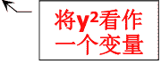

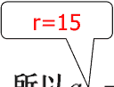


## 组合数的生成函数

+   - {x₁=1, x₂=7;}
+   - {x₁=3, x₂=6;}
+   - {x₁=5, x₂=5;}
+   - {x₁=7, x₂=4;}
+   - {x₁=9, x₂=3;}
+   - {x₁=11, x₂=2;}
+   - {x₁=13, x₂=1;}
+   - {x₁=15, x₂=0.}

一般说来，不定方程

p₁x₁ + p₂x₂ + ⋯ + pₖ · xₖ = r

(p₁,p₂,…,pₖ为正整数)

的非负整数解的个数设为 a_r, 考虑下面的函数

A(y)=[1+y^{p1}+(y^{p1})^2+⋯]·[1+y^{p2}+(y^{p2})^2+⋯]⋯[1+y^{pk}+(y^{pk})^2+⋯], A(y)的展开式的每一项是形式：

y^{p1·x1}·y^{p2·x2}⋯⋯y^{pk·xk}=y^{p1·x1+p2·x2+⋯+pk·xk}

其中x1,x2,…,xk为非负整数所以A(y)的展开式中y^r的系数就是方程p1x1+p2x2+⋯+pkxk=r的非负整数解的个数

把A(y)变形为

A(y) = 1 / [(1 - y^{p₁})(1 - y^{p₂})⋯(1 - y^{p_k})],
这就是{a_r}的生成函数

不难看出当 p₁ = p₂ = ⋯ = p_k = 1 时 A(y) = 1 / (1 - y)^k

就是方程 x₁ + x₂ + ⋯ x_k = r 的非负整数解个数 {a_r} 的生成函数.

方法二：用排列组合法。先从 *n* 双鞋中选取 *r* 双，共有 $C(n,r)$，再从此 *r* 双中每双取出一只，由乘法原理，即得

$C(n,r)\times 2\times 2\cdots\times 2 = C(n,r)2^{r}$

方法三：先取出 *k* 只左脚的鞋，再在其余 $n-k$ 双鞋中取出 $r-k$ 只右脚的鞋，用乘法原理得 $C(n,k)C(n-k,r-k)\,(k=0,1,\cdots,r)$，则总的取法为：

$C(n,0)C(n-0,r)+C(n,1)C(n-1,r-1)+C(n,2)C(n-2,r-2)+\cdots$
$+C(n,r)C(n-r,r-r)$
$=2^{r}C(n,r)$

例：设 $S = \{\infty\cdot e_1, \infty\cdot e_2, \cdots, \infty\cdot e_k\}$，求 $S$ 的每个元素只出现偶数次的 $r$−组合数 $a_r$。
解：令 $\{a_r\}$ 的生成函数是 $A(y)$，则
$A(y) = (1 + y^2 + y^4 + \cdots)^k = \frac{1}{(1 - y^2)^k}$
$= 1 + k y^2 + \binom{k+1}{2} y^4 + \cdots + \binom{k+n-1}{n} y^{2n} + \cdots$
$= \sum_{n=0}^{\infty} \binom{k+n-1}{n} y^{2n}$

A(y) = (1 + y² + y⁴ + ⋯)ᵏ = 1 / (1 - y²)ᵏ
= 1 + k y² + (k+1 choose 2) y⁴ + ⋯ + (k+n-1 choose n) y²ⁿ + ⋯
= Σₙ=0^∞ (k+n-1 choose n) y²ⁿ

所以有

aᵣ = { (k+n-1 choose n)  r = 2n,  (n = 0,1,⋯)
       0                r = 2n+1. }

用生成函数的方法也可以求解不定方程的整数解的个数。

## 排列数的指数型生成函数

$n$元集合的$k$组合数为$C(n,k)$，按5.5.1小节中方法构成的生成函数为：

$$\sum_{k=0}^{\infty}\binom{n}{k}x^k$$

如果把基底函数$x^k$改换成$\frac{x^k}{k!}$，则

$$\sum_{k=0}^{\infty}\binom{n}{k}x^k=\sum_{k=0}^{\infty}k!\cdot C(n,k)\cdot\frac{x^k}{k!}=\sum_{k=0}^{\infty}P(n,k)\cdot\frac{x^k}{k!}=(1+x)^n。$$

这启发人们引入指数型生成函数的概念。

数列{$a_0,a_1,a_2,\cdots$}的指数型生成函数定义为形式幂级数

$$\sum_{k=0}^{\infty}a_k\frac{x^k}{k!}$$

定理 5.4.1 若元素 e₁ 可重复 α₁, α₂, … 次，元素 e₂ 可重复 β₁, β₂, … 次，元素 eₘ 可重复 λ₁, λ₂, … 次，则 m 元集的这种 k 可重排列数 Pₖ 对应序列 {Pₖ} 的生成函数为

G(x) = Σₖ Pₖ xᵏ/k! = Σᵢ₌₁^∞ (x^{αᵢ}/αᵢ!) Σᵢ₌₁^∞ (x^{βᵢ}/βᵢ!) … Σᵢ₌₁^∞ (x^{λᵢ}/λᵢ!)

上式右端等于 Σₖ Pₖ xᵏ/k! = Σₖ ( Σ_{αᵢ₁+βᵢ₂+⋯+λᵢₘ=k} k! / (αᵢ₁! βᵢ₂! ⋯ λᵢₘ!) ) xᵏ/k!

定理 3.2.3 多重集合 M = {αᵢ₁·a₁, βᵢ₂·a₂, …, λᵢₘ·aₙ} 的全排列数为

(αᵢ₁ + βᵢ₂ + ⋯ + λᵢₘ)! / (αᵢ₁! βᵢ₂! ⋯ λᵢₘ!) = k! / (αᵢ₁! βᵢ₂! ⋯ λᵢₘ!).
(pp.20)

由多项式系数的组合学意义知，$k!/(\alpha_{i_1}!+\beta_{i_2}!+\cdots+\lambda_{i_m}!)$  正是元素$e_1$出现$\alpha_{i_1}$次，元素$e_2$出现$\beta_{i_2}$次，元素$e_m$出现$\lambda_{i_m}$次的 $k$ 可重排列数。故按所有可能的$(\alpha_{i_1}+\beta_{i_2}+\cdots+\lambda_{i_m}=k)$求和，即得总的 $k$ 排列数$P_k$。

证明 将和积式展开，得到形如

\frac{x^{\alpha_{i1}}}{\alpha_{i1}!}\cdot\frac{x^{\beta_{i2}}}{\beta_{i2}!}\cdots\frac{x^{\lambda_{im}}}{\lambda_{im}!}=\frac{x^{\alpha_{i1}+\beta_{i2}+\cdots+\lambda_{im}}}{\alpha_{i1}!\beta_{i2}!\cdots\lambda_{im}!}

的项，令 $\alpha_{i1}+\beta_{i2}+\cdots+\lambda_{im}=k\quad(i=1,2,\cdots,n)$，故有

\frac{x^{k}}{\alpha_{i1}!\beta_{i2}!\cdots\lambda_{im}!}=\frac{k!}{\alpha_{i1}!\beta_{i2}!\cdots\lambda_{im}!}\cdot\frac{x^{k}}{k!}

若从第一个括号取出 $\frac{x^{\alpha_{i1}}}{\alpha_{i1}!}$ 项，从第二个括号中取出 $\frac{x^{\beta_{i2}}}{\beta_{i2}!}$ 项，...，从第 k 个括号

号中取出 $\frac{x^{\lambda_{im}}}{\lambda_{im}!}$，且恰有 $\alpha_{i1}+\beta_{i2}+\cdots+\lambda_{im}=k\quad(i=1,2,\cdots,n)$，则它们的乘积形式

\frac{x^{\alpha_{i1}}}{\alpha_{i1}!}\cdot\frac{x^{\beta_{i2}}}{\beta_{i2}!}\cdots\frac{x^{\lambda_{im}}}{\lambda_{im}!}=\frac{x^{\alpha_{i1}+\beta_{i2}+\cdots+\lambda_{im}}}{\alpha_{i1}!\beta_{i2}!\cdots\lambda_{im}!}

满足 α_{i1} + β_{i2} + ⋯ + λ_{im} = k (i=1,2,⋯,n) 此方程的解有多个，这些解都将成为 x^k / k! 的系数。

的系数。根据加法原则， x^k / k! 的系数应为

\left( \sum_{\alpha_{i_1} + \beta_{i_2} + \cdots + \lambda_{i_m} = k} \frac{k!}{\alpha_{i_1}! \beta_{i_2}! \cdots \lambda_{i_m}!} \right)

下面只要证明展开式中 x^k / k! 的系数就是满足限定条件的 k 可重排列数即可。

首先，对于满足限定条件的每个 k 可重排列，设其中元素 e1 出现 α_i 次，元素 e2 可重复 β_i 次，元素 e_m 可重复 λ_i_m 次(i=1, 2, ...), 则 (α_i, β_i, ..., λ_i_m) 就是方程 α_i + β_i + ⋯ + λ_i_m = k (i=1,2,⋯,n) 的一个解。


## 排列数的指数型生成函数

### 推论 5.4.1

设 \(S=\{\infty\cdot e_1,\infty\cdot e_2,\ldots,\infty\cdot e_m\}\)，若元素 \(e_i\)（\(i=1,2,\ldots,m\)）重复出现的次数构成集合 \(\Gamma_i\)，则集 \(S\) 中元素的 \(k\) 可重排列数 \(P_k\) 对应序列 \(\{P_k\}\) 的生成函数为

\[
G(x)=\prod_{i=1}^{m}\sum_{j\in\Gamma_i}\frac{x^j}{j!}.
\]

\(k\) 可重排列数 \(P_k\) 为 \(G(x)\) 展开式中 \(x^k/k!\) 的系数。

\[
G(x)=\sum_{k}P_k\frac{x^k}{k!}
=\sum_{i=1}^{\infty}\frac{x^{\alpha_i}}{\alpha_i!}
\sum_{i=1}^{\infty}\frac{x^{\beta_i}}{\beta_i!}\cdots
\sum_{i=1}^{\infty}\frac{x^{\lambda_i}}{\lambda_i!}.
\]

\[
\Gamma_1=\{\alpha_1,\alpha_2,\ldots\},\quad
\Gamma_2=\{\beta_1,\beta_2,\ldots\},\quad\ldots,\quad
\Gamma_m=\{\lambda_1,\lambda_2,\ldots\}.
\]

### 推论 5.4.2

设 \(m\) 元多重集

\[
S=\{r_1\cdot e_1,r_2\cdot e_2,\ldots,r_m\cdot e_m\},
\]

且 \(r_1+r_2+\cdots+r_m=n\)，则 \(S\) 的 \(k\) 可重排列数 \(P_k\) 对应序列 \(\{P_k\}\) 的指数型生成函数为

\[
G_e(x)=\prod_{i=1}^{m}\left(\sum_{j=0}^{r_i}\frac{x^j}{j!}\right).
\]

其中，\(k\) 可重排列数 \(P_k\) 为 \(G_e(x)\) 展开式中 \(x^k/k!\) 的系数（\(k=0,1,2,\ldots\)）。

\[
G(x)=\prod_{i=1}^{m}\sum_{j\in\Gamma_i}\frac{x^j}{j!}.
\]

\[
\Gamma_1=\{1,2,\ldots,r_1\},\quad
\Gamma_2=\{1,2,\ldots,r_2\},\quad\ldots,\quad
\Gamma_m=\{1,2,\ldots,r_m\}.
\]

特别地，数列 \(\{1,1,\ldots\}\) 的指数型生成函数

\[
e(x)=\sum_{n=0}^{\infty}\frac{x^n}{n!}
\]

具有与指数函数相似的性质：

\[
e(x)e(y)=e(x+y).
\]

\[
\begin{aligned}
e(x)e(y)
&=\sum_{i=0}^{\infty}\frac{x^i}{i!}\cdot\sum_{j=0}^{\infty}\frac{y^j}{j!}\\
&=\sum_{i=0}^{\infty}\frac{x^i}{i!}\cdot\sum_{j=0}^{\infty}\frac{1}{j!}\left(\frac{y}{x}\right)^j x^j\\
&=\sum_{n=0}^{\infty}\left(\sum_{k=0}^{n}\frac{1}{k!(n-k)!}\left(\frac{y}{x}\right)^k\right)x^n\\
&=\sum_{n=0}^{\infty}\left(\sum_{k=0}^{n}\frac{n!}{k!(n-k)!}\left(\frac{y}{x}\right)^k\right)\frac{x^n}{n!}\\
&=\sum_{n=0}^{\infty}\left(\sum_{k=0}^{n}\binom{n}{k}\left(\frac{y}{x}\right)^k\right)\frac{x^n}{n!}\\
&=\sum_{n=0}^{\infty}\left(1+\frac{y}{x}\right)^n\frac{x^n}{n!}\\
&=\sum_{n=0}^{\infty}\frac{(x+y)^n}{n!}=e(x+y).
\end{aligned}
\]

\[
e(x)\cdot e(-x)=e(0)=1,\qquad e(-x)=\frac{1}{e(x)}.
\]

### 例

设 \(\{a_n\}\) 是数列，求它的指数型生成函数 \(f_e(x)\)。

- (1) \(a_n=P(m,n),\quad n=0,1,\ldots\)。
- (2) \(a_n=1,\quad n=0,1,\ldots\)。
- (3) \(a_n=b^n,\quad n=0,1,\ldots\)。

解：

(1)

\[
\begin{aligned}
f_e(x)
&=\sum_{n=0}^{\infty}P(m,n)\frac{x^n}{n!}\\
&=\sum_{n=0}^{m}\binom{m}{n}x^n=(1+x)^m.
\end{aligned}
\]

(2)

\[
f_e(x)=\sum_{n=0}^{\infty}1\cdot\frac{x^n}{n!}=e^x.
\]

(3)

\[
f_e(x)=\sum_{n=0}^{\infty}b^n\frac{x^n}{n!}
=\sum_{n=0}^{\infty}\frac{(bx)^n}{n!}=e^{bx}.
\]

下面简单地介绍指数型生成函数的性质及应用。

设 \(\{a_n\}\)、\(\{b_n\}\) 的指数型生成函数分别为 \(A_e(x)\) 和 \(B_e(x)\)，则

\[
A_e(x)\cdot B_e(x)=\sum_{n=0}^{\infty}C_n\frac{x^n}{n!},
\]

其中

\[
C_n=\sum_{k=0}^{n}\binom{n}{k}a_kb_{n-k}.
\]

证明：

\[
\begin{aligned}
\sum_{n=0}^{\infty}G_n\frac{x^n}{n!}
&=A_e(x)\cdot B_e(x)\\
&=\sum_{k=0}^{\infty}a_k\frac{x^k}{k!}\cdot
\sum_{l=0}^{\infty}b_l\frac{x^l}{l!},
\end{aligned}
\]

令 \(n=k+l\)，比较上式两边 \(x^n\) 的系数，得

\[
\frac{C_n}{n!}
=\sum_{k=0}^{n}\frac{a_k}{k!}\cdot\frac{b_{n-k}}{(n-k)!}
\]

\[
=\frac{1}{n!}\sum_{k=0}^{n}\frac{n!}{k!(n-k)!}a_kb_{n-k}
\]

\[
=\frac{1}{n!}\sum_{k=0}^{n}\binom{n}{k}a_kb_{n-k}.
\]

所以

\[
C_n=\sum_{k=0}^{n}\binom{n}{k}a_kb_{n-k}.
\]

### 例 5.4.1

多重集合

\[
M=\{\infty\cdot a_1,\infty\cdot a_2,\ldots,\infty\cdot a_n\}
\]

的 \(k\) 排列数列 \(\{b_k\}\) 的指数型生成函数为

\[
\prod_{i=1}^{n}\left(1+\frac{x}{1!}+\frac{x^2}{2!}+\cdots\right)
=e^n(x)=e(nx)
=\sum_{k=0}^{\infty}n^k\frac{x^k}{k!},
\]

从而

\[
b_k=n^k.
\]

> 定理 3.2.2 多重集合 \(M=\{\infty\cdot a_1,\infty\cdot a_2,\ldots,\infty\cdot a_n\}\) 的 \(r\) 排列数为 \(n^r\)。（p. 19）

### 例 5.4.2

3 个红球、2 个黄球、3 个蓝球，每次从中取出 4 个排成一行，求排列方案数。

解：\(m=3,\ r_1=3,\ r_2=2,\ r_3=3,\ k=4\)。由推论 5.4.2 知，

\[
\begin{aligned}
G_e(x)
&=\left(1+\frac{x}{1!}+\frac{x^2}{2!}+\frac{x^3}{3!}\right)
\left(1+\frac{x}{1!}+\frac{x^2}{2!}\right)\\
&\quad\cdot\left(1+\frac{x}{1!}+\frac{x^2}{2!}+\frac{x^3}{3!}\right)\\
&=1+3x+\frac{9}{2}x^2+\frac{14}{3}x^3+\frac{35}{12}x^4
+\frac{17}{12}x^5+\frac{35}{72}x^6+\frac{5}{72}x^7+\frac{1}{72}x^8\\
&=1+3\cdot\frac{x}{1!}+9\cdot\frac{x^2}{2!}
+28\cdot\frac{x^3}{3!}+70\cdot\frac{x^4}{4!}
+170\cdot\frac{x^5}{5!}+350\cdot\frac{x^6}{6!}\\
&\quad+350\cdot\frac{x^7}{7!}+560\cdot\frac{x^8}{8!}.
\end{aligned}
\]

故知，从所给 3 色球中取出 4 个的排列方案有 70 种。

\[
\begin{aligned}
&(1)\quad e(x)e(-x)=e(0)=1,\\
&(2)\quad e(-x)=\frac{1}{e(x)},\\
&(3)\quad \frac{e(x)+e(-x)}{2}
=1+\frac{x^2}{2!}+\frac{x^4}{4!}+\cdots,\\
&(4)\quad \frac{e(x)-e(-x)}{2}
=\frac{x}{1!}+\frac{x^3}{3!}+\cdots.
\end{aligned}
\]

### 例 5.4.3

由 \(1,2,3,4\) 能组成多少个五位数？要求这些五位数中 1 出现 2 次或 3 次，2 最多出现 1 次，4 出现偶数次。

解：根据题意，有

\[
\Gamma_1=\{2,3\},\qquad
\Gamma_2=\{0,1\},\qquad
\Gamma_3=\{0,1,2,\ldots\},\qquad
\Gamma_4=\{0,2,4,\ldots\}.
\]

由推论 5.4.2 知，该排列数的指数型生成函数为


## 排列数的指数型生成函数

$$\left(\frac{x^2}{2!}+\frac{x^3}{3!}\right)\left(1+\frac{x}{1!}\right)\left(1+\frac{x}{1!}+\frac{x^2}{2!}+\cdots\right)\left(1+\frac{x^2}{2!}+\frac{x^4}{4!}+\cdots\right)$$

$$=\frac{x^2}{6}\left(3+4x+x^2\right)\cdot e(x)\cdot\frac{e(x)+e(-x)}{2}$$

$$=\frac{x^2}{12}\left(3+4x+x^2\right)\left(e(2x)+1\right),$$

$$\Gamma_1=\{2,3\},$$ $$\Gamma_2=\{0,1\},$$ $$\Gamma_3=\{0,1,2,\cdots\},$$ $$\Gamma_4=\{0,2,4,\cdots\}.$$

$$e(2x)=1+\frac{2x}{1!}+\frac{(2x)^2}{2!}+\frac{(2x)^3}{3!}+\cdots$$

所以 $\frac{x^5}{5!}$ 的系数为 $5!\times\frac{1}{12}\left(3\times\frac{2^3}{3!}+4\times\frac{2^2}{2!}+1\times\frac{2}{1!}\right)=140,$

即满足题意的五位数有 140 个。

例 5.4.4 求 $M = \{\infty\cdot a_1, \infty\cdot a_2, \cdots, \infty\cdot a_n\}$ 的 $k$ 排列中每个 $a_i\,(1\le i\le n)$ 至少出现一次的排列数 $A_k$ 的指数型生成函数。

解 根据题意，有 $M_i = \{1,2,3\}\,(1\le i\le n)$。
由推论 5.4.2 知，排列数列 $\{A_k\}$ 的指数型生成函数为

$$\left(\frac{x}{1!}+\frac{x^2}{2!}+\frac{x^3}{3!}+\cdots\right)^n = (e(x)-1)^n = \sum_{i=0}^{n}(-1)^i\binom{n}{i}e((n-i)x)$$

$$= \sum_{i=0}^{n}(-1)^i\binom{n}{i}\sum_{k=0}^{\infty}\frac{(n-i)^k x^k}{k!}$$

$$= \sum_{k=0}^{\infty}\left(\sum_{i=0}^{n}(-1)^i\binom{n}{i}(n-i)^k\right)\frac{x^k}{k!},$$

所以 $A_k = \sum_{i=0}^{n}(-1)^i\binom{n}{i}(n-i)^k \quad (k\ge n)$.

$M = \{\infty\cdot a_1, \infty\cdot a_2, \dots, \infty\cdot a_n\}$ 中每个 $a_i$ $(1 \le i \le n)$ 至少出现一次的 $k$ 排列 $a_1 a_{i_1}\dots a_{i_k}$

可以看成是把 $k$ 个不同的球 $1,2,\dots,k$ 放入 $n$ 个不同的盒子 $a_1,a_2,\dots,a_n$, 并且每盒非空的一种放法, 即球 $j$ 放入盒子 $a_{i_j}$ 中 $(1 \le j \le k)$, 在第 2 章 2.7 节中可知共有

$A_k = n! S(k, n) = \sum_{i=0}^{n} (-1)^i \binom{n}{i} (n - i)^k. \quad (k \ge n)$

种放法，由此得出 $k$ 元集合的 $n$ 分划数的显式表达式

$S(k, n) = \frac{1}{n!} \sum_{i=0}^{n} (-1)^i \binom{n}{i} (n - i)^k.$

由此可知，$S(k,n)$ 的指数型生成函数为

$\sum_{k=0}^{\infty} S(k,n) \frac{x^{k}}{k!} = \sum_{k=0}^{\infty} \frac{1}{n!} \left(\sum_{i=0}^{n} (-1)^{i} \binom{n}{i} (n-i)^{k}\right) \frac{x^{k}}{k!}$

$= \frac{1}{n!} \sum_{k=0}^{\infty} \left(\sum_{i=0}^{n} (-1)^{i} \binom{n}{i} (n-i)^{k}\right) \frac{x^{k}}{k!}$

$= \frac{1}{n!} (e(x)-1)^{n}.$

所以

$\frac{1}{n!} (e(x)-1)^{n}.$

例：设$\{a_n\}$是一个数列，如果$b_n=\sum_{k=0}^{n}(-1)^k\binom{n}{k}a_k$，

则$a_n=\sum_{k=0}^{n}(-1)^k\binom{n}{k}b_k$。

证明：设$\{(-1)^n a_n\}$的指数生成函数为$A_e(x)$，则

$$A_e(x)=\sum_{n=0}^{\infty}(-1)^n a_n\frac{x^n}{n!},$$

上式两边可同时乘以$e^x$得

$e^x \cdot A_e(x) = e^x \cdot \sum_{n=0}^{\infty} (-1)^n a_n \frac{x^n}{n!}$

$= \sum_{n=0}^{\infty} \frac{x^n}{n!} \cdot \sum_{n=0}^{\infty} (-1)^n a_n \frac{x^n}{n!}$

$= \sum_{n=0}^{\infty} \frac{x^n}{n!} \sum_{k=0}^{n} (-1)^k \binom{n}{k} a_k$

$= \sum_{n=0}^{\infty} b_n \frac{x^n}{n!} = B_e(x).$

所以有 $\displaystyle\sum_{n=0}^{\infty}(-1)^n a_n \frac{x^n}{n!}=A_e(x)$

$=e^{-x}\cdot B_e(x)$

$=\displaystyle\sum_{n=0}^{\infty}(-1)^n \frac{x^n}{n!}\cdot\sum_{n=0}^{\infty}b_n \frac{x^n}{n!}$

$=\displaystyle\sum_{n=0}^{\infty}\frac{x^n}{n!}\cdot\sum_{k=0}^{n}\binom{n}{k}(-1)^{n-k}b_k$

比较上式两边$x^n$的系数得

$(-1)^n a_n = \sum_{k=0}^{n} (-1)^{n-k} \binom{n}{k} b_k = (-1)^n \sum_{k=0}^{n} (-1)^{-k} \binom{n}{k} b_k,$

所以有

$a_n = \sum_{k=0}^{n} (-1)^{-k} \binom{n}{k} b_k = \sum_{k=0}^{n} (-1)^{k} \binom{n}{k} b_k.$

可以把$a_n$与$b_n$之间互逆的两个公式看作是一种组合变换.可以通过组合变换的方法来证明组合恒等式

例：证明

$\sum_{k=1}^{n} (-1)^k \binom{n}{k} \left(1+\frac{1}{2}+\frac{1}{3}+\cdots+\frac{1}{k}\right) = -\frac{1}{n}.$

证明 令 $a_0 = 0, a_k = -\frac{1}{k}, k = 1,2,\cdots.$ $b_0 = 0,$

$b_n = \sum_{k=1}^{n} (-1)^k \binom{n}{k} a_k, \quad n \ge 1.$

则有

$b_n = \sum_{k=1}^{n} (-1)^k \binom{n}{k} a_k \quad (n \ge 1)$

$= \sum_{k=1}^{n} (-1)^{k-1} \binom{n}{k} \frac{1}{k}$

$= \binom{n}{1} - \frac{1}{2}\binom{n}{2} + \frac{1}{3}\binom{n}{3} - \cdots$

$+ (-1)^{n-1} \cdot \frac{1}{n}\binom{n}{n}$

$= 1 + \frac{1}{2} + \frac{1}{3} + \cdots + \frac{1}{n}$

得

$a_n = \sum_{k=1}^{n} (-1)^k \binom{n}{k} b_k$

$= \sum_{k=1}^{n} (-1)^k \binom{n}{k} \left(1 + \frac{1}{2} + \frac{1}{3} + \cdots + \frac{1}{k}\right),$

而 $a_n = -\frac{1}{n}$，所以有

$\sum_{k=1}^{n} (-1)^k \binom{n}{k} \left(1 + \frac{1}{2} + \cdots + \frac{1}{k}\right) = -\frac{1}{n}.$


## 作业

- 5.2
- 5.6

## Catalan 数列的生成函数

Catalan 数首先是由 Euler 在精确计算对凸 \(n\) 边形不同的对角三角形剖分的个数问题时得到的，它经常出现在组合计数问题中。

例 5.5.1　在一个凸 \(n\) 边形中，可以用 \(n-3\) 条不在内部相交的对角线将其分成 \(n-2\) 个三角形，问有多少种不同的分法？

令 \(h(n)\) 表示将一个 \(n+1\) 边的凸多边形分成三角形的方法数，并规定 \(h(1)=1\)。

当 \(n=2\) 时，\(n+1\) 边形就是三角形，不需要用对角线进行三角形剖分，故 \(h(2)=1\)。

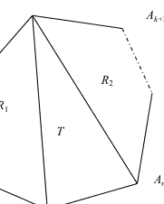

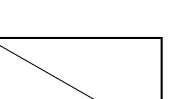

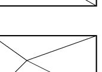

当 \(n\geq 3\) 时，考虑一个凸 \(n+1\) 边形，它的顶点分别用 \(A_1,A_2,\ldots,A_{n+1}\) 表示。取定多边形的一条边 \(A_1A_{n+1}\)，任取多边形的顶点 \(A_{k+1}\)（\(k=1,2,\ldots,n-1\)），将 \(A_{k+1}\) 分别与 \(A_1,A_{n+1}\) 之间连线，得三角形 \(T\)。三角形 \(T\) 将凸 \(n+1\) 边形分成 \(T\)、\(R_1\) 和 \(R_2\) 三部分，其中，\(R_1\) 为 \(k+1\) 边形，\(R_2\) 为 \(n-k+1\) 边形。因此，\(R_1\) 可以用 \(h(k)\) 种方法划分，\(R_2\) 可以用 \(h(n-k)\) 种方法划分，所以

\[
h(n)=\sum_{k=1}^{n-1}h(k)h(n-k). \tag{5.5.1}
\]

这正是 Catalan 数列的形式。

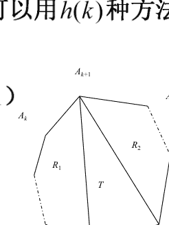

解：设
\[
G(x)=h_0+h_1x+h_2x^2+\cdots=\sum_{i=1}^{\infty}h_i x^i,
\]
其中 \(h_0=0\)。

\[
\begin{aligned}
G^2(x)
&=\sum_{i=1}^{\infty}h_i x^i\sum_{i=1}^{\infty}h_i x^i\\
&=\sum_{i=1}^{\infty}\sum_{j=1}^{\infty}(h_i h_j)x^{i+j}\\
&=\sum_{n=2}^{\infty}\sum_{i=1}^{\infty}(h_i h_{n-i})x^n\\
&=\sum_{n=2}^{\infty}x^n\sum_{i=1}^{n-1}h_i h_{n-i}\\
&=\sum_{n=2}^{\infty}h_nx^n
=\sum_{n=1}^{\infty}h_nx^n-x
=G(x)-x.
\end{aligned}
\]

> \[
> h(n)=\sum_{k=1}^{n-1}h(k)h(n-k).
> \]

解：
\[
G^2(x)-G(x)+x=0,
\]
得
\[
G(x)=\frac{1\pm\sqrt{1-4x}}{2}.
\]
由于 \(G(0)=0\)，舍去
\[
G(x)=\frac{1+\sqrt{1-4x}}{2},
\]
保留
\[
G(x)=\frac{1-\sqrt{1-4x}}{2}.
\]

利用牛顿二项式定理（定理 3.4.2，pp. 32），有

\[
\sqrt{1-4x}
=1+\sum_{n=1}^{\infty}
\frac{\frac12\left(\frac12-1\right)\cdots\left(\frac12-n+1\right)}{n!}
(-4)^n x^n
\]

\[
=1+\sum_{n=1}^{\infty}\binom{-2}{n}\binom{2n-2}{n-1}x^n。
\]

代入，得

\[
\begin{aligned}
G(x)
&=\frac{1-\sqrt{1-4x}}{2}\\
&=\frac12-\frac12+\sum_{n=1}^{\infty}
\frac{\binom{2n-2}{n-1}}{n}x^n\\
&=\sum_{n=1}^{\infty}
\frac{\binom{2n-2}{n-1}}{n}x^n.
\end{aligned}
\]

最后有
\[
h_n=\frac{1}{n}\binom{2n-2}{n-1},\quad n\geq 1，
\]
或
\[
h_{n+1}=\frac{1}{n+1}\binom{2n}{n},\quad n\geq 0。
\]

此即 Catalan 数。

## Catalan 数的生成函数

当 \(n=5\) 时可得
\[
h(5)=\frac{\binom{8}{4}}{5}=14，
\]
具体的划分方案如图所示。

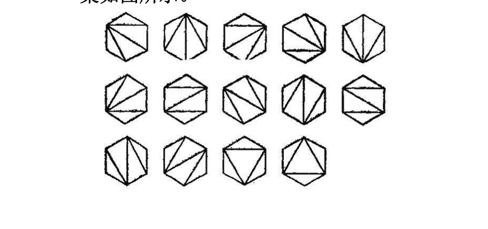

## Catalan 数列的生成函数

例 5.5.2　求 \(n\) 个数 \(a_1,a_2,\ldots,a_n\) 的乘积
\[
P=a_1a_2\cdots a_n，
\]
其中，乘法不满足结合律，不改变各数的顺序，只用括号表示成对的乘积，共有多少种不同的乘法方案？

解：设对 \(n\) 个数的乘积有 \(f(n)\) 种方式。在 \(a_1,a_2,\ldots,a_n\) 的每个格式中，存在着最后的乘法（对应外层的圆括号）：

\[
((a_1,a_2,\ldots,a_k\text{ 的格式})\times(a_{k+1},\ldots,a_n\text{ 的格式}))。
\]

关于 \(a_1,a_2,\ldots,a_k\) 的乘法格式可以有 \(f(k)\) 种方式选择，而 \(a_{k+1},\ldots,a_n\) 的乘法格式有 \(f(n-k)\) 种方式选择，对 \(k\) 取 \(1,2,\ldots,n-1\) 中的任一个，因此有

\[
\begin{cases}
f(n)=\displaystyle\sum_{k=1}^{n-1}f(k)f(n-k),\\
f(1)=1.
\end{cases}
\]

则它与 Catalan 数满足同一个递推关系。

当 \(n=4\) 时，
\[
h_4=\frac{1}{4}\binom{6}{3}=5，
\]
把这 5 种不同的乘积列出来就是：

\[
(((a_1a_2)a_3)a_4),\quad
(a_1(a_2a_3)a_4),\quad
((a_1a_2)(a_3a_4)),
\]
\[
(a_1(a_2(a_3a_4))),\quad
(a_1((a_2a_3)a_4)).
\]

每一种加括号的方法可以用一棵有序三度根树来表示，如图 7.5 所示。而这又恰好对应了一个五边形的剖分方案。请看图 7.6。由此可以知道，\(n\) 片树叶的有序根树的个数也是 Catalan 数
\[
\frac{1}{n}\binom{2n-2}{n-1}.
\]

(((a₁a₂)a₃)a₄), (a₁(a₂a₃)a₄), ((a₁a₂)(a₃a₄)), (a₁(a₂(a₃a₄))), (a₁((a₂a₃)a₄))

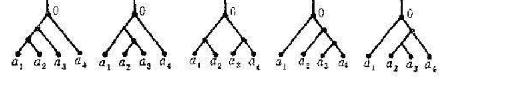

图 7.5　有序三度根树

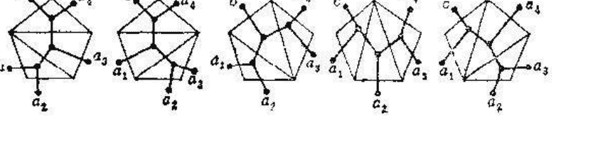

图 7.6　有序三度根树与多边形剖分方案的对应

## Stirling 数列的生成函数

设有多项式
\[
x(x-1)(x-2)\cdots(x-n+1)，
\]
它的展开式具有下面的形式：

\[
x(x-1)\cdots(x-n+1)
=\begin{bmatrix}n\\n\end{bmatrix}x^n
-\begin{bmatrix}n\\n-1\end{bmatrix}x^{n-1}
+\begin{bmatrix}n\\n-2\end{bmatrix}x^{n-2}
-\cdots
\pm\begin{bmatrix}n\\0\end{bmatrix}.
\]

不考虑各项系数的符号，把 \(x^r\) 的系数记作
\[
\begin{bmatrix}n\\r\end{bmatrix},
\]
称
\[
\begin{bmatrix}n\\n\end{bmatrix},
\begin{bmatrix}n\\n-1\end{bmatrix},
\ldots,
\begin{bmatrix}n\\0\end{bmatrix}
\]
这些数为第一类 Stirling 数。

第一类 Stirling 数具有下面的性质：
\[
\begin{bmatrix}n\\0\end{bmatrix}=0,\quad
\begin{bmatrix}n\\1\end{bmatrix}=(n-1)!,\quad
\begin{bmatrix}n\\n\end{bmatrix}=1,\quad
\begin{bmatrix}n\\n-1\end{bmatrix}=\binom{n}{2}.
\]

证明：
\[
\begin{bmatrix}n\\0\end{bmatrix}
\]
为 \(x^0\) 项的系数，即多项式中的常数项，显然为 0。

\[
\begin{bmatrix}n\\1\end{bmatrix}
\]
是 \(x\) 项的系数，\((x-1),(x-2),\ldots,(x-n+1)\) 各因式在相乘时分别贡献负数 \(-1,-2,\ldots,-(n-1)\)，从而得到 \(x\) 项。不考虑这些数的符号，它们之积是 \((n-1)!\)，所以
\[
\begin{bmatrix}n\\1\end{bmatrix}=(n-1)!。
\]

## Stirling 数列的生成函数

2、第一类 Stirling 数满足下面的递推关系：

\[
\begin{bmatrix}n\\r\end{bmatrix}
=(n-1)\begin{bmatrix}n-1\\r\end{bmatrix}
+\begin{bmatrix}n-1\\r-1\end{bmatrix},
\quad n>r\geq 1。
\]

证明：考虑多项式
\[
x(x-1)\cdots(x-n+2)
=\begin{bmatrix}n-1\\n-1\end{bmatrix}x^{n-1}
-\begin{bmatrix}n-1\\n-2\end{bmatrix}x^{n-2}
+\cdots，
\]
上式两边同乘以 \((x-n+1)\)，得

\[
\begin{aligned}
x(x-1)\cdots(x-n+1)
&=\left(
\begin{bmatrix}n-1\\n-1\end{bmatrix}x^{n-1}
-\begin{bmatrix}n-1\\n-2\end{bmatrix}x^{n-2}
+\cdots
\right)(x-n+1)。
\end{aligned}
\]


## Stirling数列的生成函数

x(x-1)⋯(x-n+2) = \begin{bmatrix} n-1 \\ n-1 \end{bmatrix} x^{n-1} - \begin{bmatrix} n-1 \\ n-2 \end{bmatrix} x^{n-2} + ⋯, 定义

x(x-1)⋯(x-n+1) = \left( \begin{bmatrix} n-1 \\ n-1 \end{bmatrix} x^{n-1} - \begin{bmatrix} n-1 \\ n-2 \end{bmatrix} x^{n-2} + ⋯ \right) \cdot (x - n + 1),

x(x-1)⋯(x-n+1) = \begin{bmatrix} n \\ n \end{bmatrix} x^{n} - \begin{bmatrix} n \\ n-1 \end{bmatrix} x^{n-1} + \begin{bmatrix} n \\ n-2 \end{bmatrix} x^{n-2} ⋯ 定义

= \begin{bmatrix} n-1 \\ n-1 \end{bmatrix} x^{n} - \begin{bmatrix} n-1 \\ n-2 \end{bmatrix} x^{n-1} + ⋯ - (n-1)\begin{bmatrix} n-1 \\ n-1 \end{bmatrix} x^{n-1} + (n-1)\begin{bmatrix} n-1 \\ n-2 \end{bmatrix} x^{n-2} - ⋯

= \begin{bmatrix} n-1 \\ n-1 \end{bmatrix} x^{n} - \left( \begin{bmatrix} n-1 \\ n-2 \end{bmatrix} + (n-1)\begin{bmatrix} n-1 \\ n-1 \end{bmatrix} \right) x^{n-1} + \left( \begin{bmatrix} n-1 \\ n-3 \end{bmatrix} + (n-1)\begin{bmatrix} n-1 \\ n-2 \end{bmatrix} \right) x^{n-2} - ⋯

比较上式两边 x^{r} 的系数得 \begin{bmatrix} n \\ r \end{bmatrix} = \begin{bmatrix} n-1 \\ r-1 \end{bmatrix} + (n-1)\begin{bmatrix} n-1 \\ r \end{bmatrix}。

该递推关系与Pascal公式非常相似仿照

杨辉三角形,也可以构造关于第一类Stirling数的三角形

## 例如

$$\begin{bmatrix}5\\3\end{bmatrix}=(5-1)\begin{bmatrix}4\\3\end{bmatrix}+\begin{bmatrix}4\\2\end{bmatrix}$$

## 在图中就是

35 = 4 × 6 + 11。

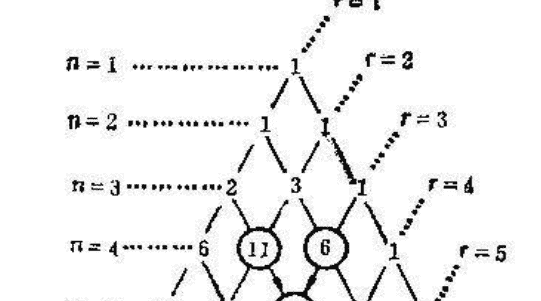

图7.7 第一类Stirling数

## Stirling数列的生成函数

(1) 序列{S₂(n,m)}的指数型生成函数为(eᵗ−1)ᵐ / m!

解 该问题是求 ∑ₙ₌₀^∞ S₂(n,m) tⁿ / n! 所对应的指数型生成函数

首先考虑 n 个不同的球放入到 m 个不同的盒中，不允许盒子为空的方案数对应的指数型生成函数为 ∑ₙ₌₀^∞ m! S₂(n,m) tⁿ / n!

∑ₙ₌₀^∞ m! S₂(n,m) tⁿ / n! = (∑ₖ₌₁^∞ tᵏ / k!)ᵐ = (eᵗ − 1)ᵐ = ∑ₙ₌₀^∞ (∑ n! / (n₁! n₂! ⋯ nₘ!)) tⁿ / n!,

求和的条件是方程 n₁ + n₂ + ⋯ + nₘ = n 的一切正整数解的个数，则有 (pp.49)

∑ n! / (n₁! n₂! ⋯ nₘ!) = ∑ (n choose n₁ n₂ ⋯ nₘ) = m! S₂(n,m)

## Stirling数列的生成函数

∑_{n=0}^{∞} m! S₂(n,m) tⁿ / n! = (∑_{k=1}^{∞} tᵏ / k!)ᵐ = (eᵗ - 1)ᵐ = ∑_{n=0}^{∞} (∑ n! / (n₁! n₂! ⋯ nₘ!)) tⁿ / n!

于是，有

∑_{n=m}^{∞} m! S₂(n,m) xⁿ / n! = (eˣ - 1)ᵐ

∑_{n=m}^{∞} S₂(n,m) xⁿ / n! = 1/m! (eˣ - 1)ᵐ

## Stirling数列的生成函数

$(e^t -1)^m = \sum_{n=m}^{\infty} m! S_2(n,m) \frac{x^n}{n!}$

用二项式定理将$(e^x -1)^m$展开得

$\sum_{n=m}^{\infty} m! S_2(n,m) \frac{x^n}{n!} = (e^x -1)^m = \sum_{i=0}^{m} (-1)^i \binom{m}{i} e^{(m-i)x}$

$= \sum_{i=0}^{m} (-1)^i \binom{m}{i} \sum_{n=0}^{\infty} \frac{(m-i)^n x^n}{n!}$

$= \sum_{n=0}^{\infty} \left( \sum_{i=0}^{m} (-1)^i \binom{m}{i} (m-i)^n \right) \frac{x^n}{n!} = \sum_{n=0}^{\infty} \left( \sum_{i=0}^{m} (-1)^i \binom{m}{m-i} (m-i)^n \right) \frac{x^n}{n!}$

比较上式两边$\frac{x^n}{n!}$的系数得，则

$m! S_2(n,m) = \sum_{i=0}^{m} (-1)^i \binom{m}{m-i} (m-i)^n$

## Stirling数列的生成函数

m! S₂(n,m) = Σ_{i=0}^{m} (-1)^i C(m, m-i) (m-i)^n

S₂(n,m) = 1/m! Σ_{i=0}^{m} (-1)^i C(m, m-i) (m-i)^n

通过这个式子可以计算 S₂(n,m)，例如

S₂(5,2) = 1/2! [ C(2,2) 2⁵ - C(2,1) 1⁵ ] = 1/2 (32 - 2) = 15

S₂(4,2) = 1/2! [ C(2,2) 2⁴ - C(2,1) 1⁴ ] = 1/2 (16 - 2) = 7

## Stirling数列的生成函数

（2）序列{S₂(n,k)}的生成函数为

Gₖ(t) = tᵏ / [(1−t)(1−2t)⋯(1−kt)]

并且还有

S₂(n,k) = Σ_{n₁+n₂+⋯+nₖ=n−k} 1^{n₁}2^{n₂}⋯k^{nₖ}

S₂(n,k) = { 1, n=0,k=0; 0, n=0,k>0; 0, n>0,k=0; S₂(n−1,k−1)+k S₂(n−1,k), n>0,k>0 }

解：对递归关系 S₂(n+1,k)=S₂(n,k−1)+k S₂(n,k) 两端同乘以 t^{n+1}，并对 n 求和，得

Σ_{n=0}^{∞} S₂(n+1,k) t^{n+1} = Σ_{n=0}^{∞} S₂(n,k−1) t^{n+1} + Σ_{n=0}^{∞} k S₂(n,k) t^{n+1}   k>0

## Stirling数列的生成函数

$$\sum_{n=0}^{\infty} S_2(n+1,k)t^{n+1} = \sum_{n=0}^{\infty} S_2(n,k-1)t^{n+1} + \sum_{n=0}^{\infty} k S_2(n,k)t^{n+1} \quad k>0$$

左式 = $\sum_{n=0}^{\infty} S_2(n+1,k)t^{n+1} = \sum_{n=1}^{\infty} S_2(n,k)t^{n} = 0 + \sum_{n=1}^{\infty} S_2(n,k)t^{n}$

$= S_2(0,k)t^{0} + \sum_{n=1}^{\infty} S_2(n,k)t^{n} = \sum_{n=0}^{\infty} S_2(n,k)t^{n}$

右式 = $\sum_{n=0}^{\infty} S_2(n,k-1)t^{n+1} + \sum_{n=0}^{\infty} k S_2(n,k)t^{n+1}$

$= t \sum_{n=0}^{\infty} S_2(n,k-1)t^{n} + k t \sum_{n=0}^{\infty} S_2(n,k)t^{n}$

即

$$\sum_{n=0}^{\infty} S_2(n,k)t^{n} = t \sum_{n=0}^{\infty} S_2(n,k-1)t^{n} + k t \sum_{n=0}^{\infty} S_2(n,k)t^{n}$$


## Stirling数列的生成函数

G_k(t) = Σ_{n=0}^{∞} S_2(n,k) t^n

则有

G_0(t) = S_2(0,0) + Σ_{n=1}^{∞} S_2(n,0) t^n = 1

∵ Σ_{n=0}^{∞} S_2(n,k) t^n = t Σ_{n=0}^{∞} S_2(n,k-1) t^n + k t Σ_{n=0}^{∞} S_2(n,k) t^n

∴ G_k(t) = t G_{k-1}(t) + k t G_k(t)

故

G_k(t) = t/(1 - k t) G_{k-1}(t) = t/[1 - (k-1)t] * t/(1 - k t) G_{k-2}(t) = t/[1 - (k-2)t] * t/[1 - (k-1)t] * t/(1 - k t) G_{k-3}(t)

= ... = t/(1 - t) * t/(1 - 2t) * ... * t/[1 - (k-1)t] * t/(1 - k t) G_0(t) = t^k / [(1 - t)(1 - 2t)...(1 - k t)]

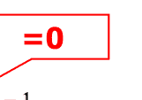

## Stirling数列的生成函数

S₂(n,k) = Σ_{n₁+n₂+⋯+n_k = n−k} 1^{n₁}·2^{n₂}⋯⋯k^{n_k}

例如，对 S₂(5,2)，n=5，k=2，n−k=3，n₁+n₂+⋯+n_k=3 的所有有序非负整数解组为（0，3），（1，2），（2，1），（3，0）。故知

S₂(5,2)=1⁰·2³+1¹·2²+1²·2¹+1³2⁰
=8+4+2+1=15

与（1）中的结果相同。

S₂(5,2)=1/2! [ C(2,2) 2⁵ − C(2,1) 1⁵ ] = 1/2 (32−2)=15

Fibonacci 数列，Catalan 数列及 Stirling 数列形成组合数学中三种典型的数列，实际应用中许多组合计数结果都同它们相同或相似。

## Stirling数列的生成函数小结

$S_2(n,k) = \frac{1}{k!} \sum_{i=0}^{k} (-1)^i \binom{k}{k-i} (k-i)^n = \sum_{n_1+n_2+\cdots+n_k=n-k} 1^{n_1}2^{n_2}\cdots k^{n_k}$

### 普通的生成函数：

$\sum_{n=0}^{\infty} S_2(n,k) t^n = \frac{t^k}{(1-t)(1-2t)\cdots(1-kt)}$

### 指数型生成函数：

$\sum_{n=0}^{\infty} S_2(n,k) \frac{t^n}{n!} = (e^t -1)^k = \left(t + \frac{t^2}{2!} + \cdots\right)^k$

$\sum_{n=0}^{\infty} S_1(n,k) t^n = P(t,k)$

## 盒子不相同的分配问题

定理 5.6.1 有 $n$ 个相同的球， $m$ 个不同的盒子，各盒的容量分别为 $n_i (n_i \ge 0, i=1,2,\cdots,m)$。则其分配序列的寻常生成函数为

$G(x)=\left(\sum_{k=0}^{n_1} x^k\right)\left(\sum_{k=0}^{n_2} x^k\right)\cdots\left(\sum_{k=0}^{n_m} x^k\right)$

证明 将 $n$ 个相同的球放入到 $m$ 个不同的盒子的方案数实际上就是不定方程

$n_1+n_2+\cdots+n_m=n,\quad n_i\ge0,\quad i=1,2,\cdots,m$

的解的个数，设为 $C_n$。于是，上式可重新表述为

$c_n=\sum_{n_1+n_2+\cdots+n_m=n}1,\quad n_i\ge0,\quad i=1,2,\cdots,m$

该定理要证的就是以 $C_n$ 为系数的生成函数

$\sum_{n=0}^{\infty} c_n x^n = \sum_{n=0}^{\infty} \left( \sum_{n_1+n_2+\cdots+n_m=n} 1 \right) x^n, \quad n_i \ge 0, \quad i=1,2,\cdots,m$

$= \sum_{n=0}^{\infty} \left( \sum_{n_1+n_2+\cdots+n_m=n} x^{n_1} \cdot x^{n_2} \cdots x^{n_m} \right)$

$= \left( \sum_{k=0}^{n_1} x^k \right) \left( \sum_{k=0}^{n_2} x^k \right) \cdots \left( \sum_{k=0}^{n_m} x^k \right)$

所以

$G(x) = \left( \sum_{k=0}^{n_1} x^k \right) \left( \sum_{k=0}^{n_2} x^k \right) \cdots \left( \sum_{k=0}^{n_m} x^k \right)$

推论（1） 若各盒容量 n_i=1(i=1,2,⋯,m)，球数 n≤m，则其分配序列的生成函数为(1+x)^m，且分配方案数为C_m^n。

推论（2） 由于各盒容量不加限制，故生成函数为(1-x)^{-m}，其分配方案数为C(m+n-1,n)。

证明 由于各盒容量不加限制，故生成函数为

G(x)=\left(\sum_{j=0}^{\infty}x^{j}\right)^{m}=\frac{1}{(1-x)^{m}}=\sum_{n=0}^{\infty}C(m+n-1,n)x^{n}

推论（5） 若各盒的容量限制为奇数，则其分配序列的寻常生函数是 $[x/(1-x^2)]^m$，其分配方案数是
$\begin{cases} C\left(m+\dfrac{n-m}{2}-1,\dfrac{n-m}{2}\right), & n-m\text{为偶数} \\ 0, & n-m\text{为奇数} \end{cases}$
$\left(\dfrac{1}{1-x^2}\right)^m = \sum_{k=0}^{\infty} C(m+k-1,k)x^{2k}$
$G(x)=\left(\sum_{j=0}^{\infty}x^{2j+1}\right)^m = x^m\left(\sum_{j=0}^{\infty}x^{2j}\right)^m = x^m\left(\dfrac{1}{1-x^2}\right)^m = x^m\sum_{k=0}^{\infty}C(m+k-1,k)x^{2k}$
$= \sum_{k=0}^{\infty}C(m+k-1,k)x^{2k+m}$
用$n$替换$2k+m$
$= \begin{cases} \sum_{n=0}^{\infty}C\left(m+\dfrac{n-m}{2}-1,\dfrac{n-m}{2}\right)x^n & n=2k+m\left(\text{或}k=\dfrac{n-m}{2}\right) \\ 0 & n\neq 2k+m\left(\text{或}k\neq\dfrac{n-m}{2}\right) \end{cases}$

G(x) = \begin{cases} \sum_{n=0}^{\infty} \binom{m + \frac{n-m}{2} - 1}{\frac{n-m}{2}} x^n & n=2k+m (\text{or }k = \frac{n-m}{2}) \\ 0 & n \neq 2k+m (\text{or }k \neq \frac{n-m}{2}) \end{cases}

= \begin{cases} \sum_{n=0}^{\infty} \binom{\frac{n+m}{2} - 1}{m-1} x^n & n=2k+m (\text{or }k = \frac{n-m}{2}) \\ 0 & n \neq 2k+m (\text{or }k \neq \frac{n-m}{2}) \end{cases}

a_n = \begin{cases} \binom{m + \frac{n-m}{2} - 1}{\frac{n-m}{2}}, & n-m \text{为偶数} \\ 0, & n-m \text{为奇数} \end{cases}

定理 3.6.2(pp. 42)

定理 5.6.2 有 n 个不同的球，m 个不同的盒子，各盒的容量 n_i (n_i ≥ 0, i = 1,2,⋯,m)。则其分配序列的指数型生成函数为

$$G_e(x) = \left(\sum_{k=0}^{n_1} \frac{x^k}{k!}\right)\left(\sum_{k=0}^{n_2} \frac{x^k}{k!}\right)\cdots\left(\sum_{k=0}^{n_m} \frac{x^k}{k!}\right)$$

定理 5.6.1 有 n 个相同的球，m 个不同的盒子，各盒的容量分别为 n_i (n_i ≥ 0, i = 1,2,⋯,m)。则其分配序列的寻常生成函数为

$$G(x) = \left(\sum_{k=0}^{n_1} x^k\right)\left(\sum_{k=0}^{n_2} x^k\right)\cdots\left(\sum_{k=0}^{n_m} x^k\right)$$


## 盒子不相同的分配问题

证明 将 n 个不同的球放入 m 个不同的盒子（盒子加有编号），每次不同的放法可记为

P_n = \sum_{n_1 + n_2 + \cdots + n_m = n} \frac{n!}{n_1! n_2! \cdots n_m!}

以上的排列方案数实际上就是集合 S = \{n_1 \cdot e_1, n_2 \cdot e_2, \cdots, n_m \cdot e_m\} 的 n-可重排列。于是，该问题就是要求以 P_k 为系数的指数型生成函数，为

\sum P_n \frac{x^n}{n!} = \sum \left( \sum \frac{n!}{n_1! n_2! \cdots n_m!} \right) \frac{x^n}{n!} = \left( \sum \frac{x^k}{k!} \right) \left( \sum \frac{x^k}{k!} \right) \cdots \left( \sum \frac{x^k}{k!} \right)

从而 G_e(x) = \left( \sum \frac{x^k}{k!} \right) \left( \sum \frac{x^k}{k!} \right) \cdots \left( \sum \frac{x^k}{k!} \right)

### 盒子不相同的分配问题

**推论 (1)** 若各盒的容量$n_i =1(i=1,2,\cdots,m)$，则其分配方案为$P(m,n)(n \leq m)$，其生成函数为

\[G_e(x)=\left(1+\frac{x}{1!}\right)^m=\sum_{n=0}^mC(m,n)x^n=\sum_{n=0}^m n!C(m,n)\frac{x^n}{n!}=\sum_{n=0}^m P(m,n)\frac{x^n}{n!}\]

**推论 (2)** 若各盒容量$n_i \geq 0$且$n_1 + n_2 + \cdots + n_m =n$，则各盒都装满球的分配方案数为$\frac{n!}{n_1!n_2!\cdots n_m!}$。其生成函数为

\[G_e(x)=\frac{x^{n_1}}{n_1!}\cdot\frac{x^{n_2}}{n_2!}\cdots\frac{x^{n_m}}{n_m!}=\frac{n!}{n_1!n_2!\cdots n_m!n!}\cdot x^n\]

**推论 (3)** 若各盒容量不加限制，则其分配序列的生成函数为

\[\left(\sum_{j=0}^\infty\frac{x^j}{j!}\right)^m=e^{mx}=\sum_{n=0}^\infty\frac{(mx)^n}{n!}=\sum_{n=0}^\infty m^n\frac{x^n}{n!}\]

显见其分配方案数为$m^n$。

### 盒子不相同的分配问题

推论（4） 若各盒非空（即 $n_i \neq 0, i=1,2,\cdots,m$）。分配方案数为 $A(n,m)=m!S(n,m)$。且分配序列的生成函数为 $(e^x-1)^m$。

\left(\sum_{j=1}^{\infty}\frac{x^{j}}{j!}\right)^{m} = (e^{x}-1)^{m} = \sum_{n=0}^{\infty} m!S(n,m)\frac{x^{n}}{n!}

推论（5） 若指定 $r$ 个盒非空，其余 $m-r$ 个盒的容量不加限制，则其总的分配方案数为

\sum_{k=r}^{n} \binom{n}{k} A(k,r) (m-r)^{n-k}

### 盒子不相同的分配问题

证明 不妨假定前 r 个盒非空，其中放入 k 个球(r ≤ k ≤ n)，则因由 n 个球中任取 k 个的选法有 C(n,k) 种，又 k 个球放入 r 个盒中，各盒非空，据推论（4）知分配方案数为 A(k,r)。

把剩余的 n-k 个球不加限制地放到 m-r 个盒中，据推论（3）可知分配方案数为 (m-r)^{n-k}。

由乘法原理，不同分配方案数为 C(n,k) A(k,r) (m-r)^{n-k}。注意到 k 可取 r, r+1, ..., n，共 n-r+1 种情况，再由加法原理，即得总的分配方案数为 Σ_{k=r}^{n} C(n,k) A(k,r) (m-r)^{n-k}。

### 盒子不相同的分配问题

推论（6）若有 $r$ 个以上的空盒，则总的分配方案数为
$$
\sum_{k=r}^{m-1}\binom{m}{k}A(n,m-k)
$$

证明 空盒数 $k\ge r$，与非空盒数 $m-k$ 取法对应罗列如下：

空盒数　　　　$k=r$　　　　　　 $r+1$　　　　$\cdots$　　　 $m-1$，$m$

非空盒数　　　$m-k=m-r$　　　 $m-(r+1)$　　$\cdots$　　　 $1$，$0$

以上每组对应的分配方案数可分为两步计算：设 $m-k$ 个盒非空（$r\le k\le n$），则

- 1. 从 $m$ 个盒中任取 $m-k$ 个非空盒的选法数为
$$
\binom{m}{m-k}=\binom{m}{k}
$$

- 2. $n$ 个球放到 $m-k$ 个非空盒中，据推论4，其分配方案数为
$$
A(n,m-k);
$$

### 盒子不相同的分配问题

（3）由乘法原理，每种情况的分配方案数为 $\binom{m}{k} A(n, m-k)$。

注意到 $k = m$ 时，$A(n,0)=0$，故总的分配方案数为 $\sum_{k=r}^{m} \binom{m}{k} A(n, m-k) = \sum_{k=r}^{m-1} \binom{m}{k} A(n, m-k)$

## 盒子相同的分配问题

定理 5.6.4  n 个不同的球， m 个相同的盒子，各盒非空，则其分配方案数是 S₂(n,m)。

推论  n 个不同的球， m 个相同的盒子，若各盒容量无限制，则分配方案数是 ∑_{k=1}^{m} S₂(n,k)，其中 S₂(n,k) 是有 m−k 个空盒的分配数。

### 盒子相同的分配问题

定理 5.6.5  n 个相同的球， m 个相同的盒子，各盒非空，则其分配序列的生成函数是

G(t) = t^m / [(1−t)(1−t²)⋯(1−t^m)]

分配方案数是 G(t) 展开式中 t^n 的系数。

定理 5.6.5 相当于将整数 n 拆分成 m 部分的无序拆分， n≥m 。（其证明参见 5.7 节。）

定理 5.6.6  n 个相同的球， m 个相同的盒子，其分配序列的生成函数为

G(t) = 1 / [(1−t)(1−t²)⋯(1−t^m)]

分配方案数是 G(t) 展开式中 t^n 的系数。

定理 5.6.6 相当于将整数 n 拆分成 k 部分无序拆分， k=1,2,...,m 。（其证明参见 5.7 节。）

### 盒子相同的分配问题

定理 5.6.5  n 个相同的球， m 个相同的盒子，各盒非空，则其分配序列的生成函数是

```
G(t) = t^m / [(1 - t)(1 - t^2)⋯(1 - t^m)]
```

分配方案数是 G(t) 展开式中 t^n 的系数。

定理 5.6.5 相当于将整数 n 拆分成 m 部分的无序拆分， n ≥ m。

定理  n 个不同的球， m 个相同的盒子，其分配序列的生成函数为

```
G_m(t) = t^m / [(1 - t)(1 - 2t)⋯(1 - m·t)]
```

分配方案数是 G(t) 展开式中 t^n 的系数。

### 盒子相同的分配问题

现将分配问题的几种常见解决方案列于表 5.6.1，其中 B(n,k) 表示把 n 个相同的球，恰好放入 k 个相同的盒子中，且各盒均不为空的放法数。

### 表 5.6.1 分配问题的几种常见解决方案

| n 个球 | m 个盒子 | 有无空盒 | 分配方案数 |
|---|---|---|---|
| 有区别 | 有区别 | 有空盒 | $m^n$ |
| 有区别 | 有区别 | 无空盒 | $m! S_2(n,m)$ |
| 有区别 | 无区别 | 有空盒 | $\sum_{k=1}^{m} S_2(n,k)$ |
| 有区别 | 无区别 | 无空盒 | $S_2(n,m)$ |
| 无区别 | 有区别 | 有空盒 | $\binom{n+m-1}{n}$ |
| 无区别 | 有区别 | 无空盒 | $\binom{n-1}{m-1}$ |
| 无区别 | 无区别 | 有空盒 | $\sum_{k=1}^{m} B(n,k)$ |
| 无区别 | 无区别 | 无空盒 | $B(n,m)$ |

## 分拆数的生成函数——有序分拆

求 $n$ 的 $k$ 有序分拆的个数，相当于求一次不定方程（3.6.1）的全体正整数解的组数，可对每个分量 $n_i$ 加以条件限制，例如 $1 \le n_i \le r_i \,(i=1,2,\cdots,k)$，于是可得如下结果。

### 定理 5.7.1 对于 $n$ 的 $k$ 有序分拆

\begin{cases} n = n_1 + n_2 + \cdots + n_k, & k \ge 1 \\ 1 \le n_i \le r_i, & i = 1,2,\cdots,k \end{cases} \tag{5.7.1}

其 $k$ 有序分拆数数列 $\{q_k(n)\}$ 的生成函数是

$\prod_{i=1}^{k}\left(\sum_{j=1}^{r_i} x^{j}\right) = (x + x^{2} + \cdots + x^{r_1})(x + x^{2} + \cdots + x^{r_2})\cdots(x + x^{2} + \cdots + x^{r_k})$

这个定理等价于求下面的分配方案数，即把 $n$ 个相同的球放入 $k$ 个不同的盒子里，第 $i$ 个盒的容量为 $r_i$，且使每盒非空。


## 有序分拆

推论 若对 n 的 k 有序分拆的各分量 r_i(1≤r_i) 没有限制，
则其 k 有序分拆数列 {q_k(n)} 的生成函数是 \left(\frac{x}{1-x}\right)^k ，且 q_k(n)=C(n-1,k-1)。

```
\prod_{i=1}^k \left(\sum_{j=1}^\infty x^j \right) = (x + x^2 + \cdots)^k = \left(\frac{x}{1-x}\right)^k
```

```
= x^k \sum_{n=1}^\infty C(k+n-1,n) x^n = \sum_{n=1}^\infty C(k+n-1,n) x^{n+k}
```

```
= \sum_{n=0}^\infty C(k+n-1,k-1) x^{n+k} \\ 用n替换n+k
```

```
= \sum_{n=1}^\infty C(n-1,k-1) x^n
```

## 无序分拆

### 不定方程

$p_1x_1+p_2x_2+\cdots+p_kx_k=r$

$(p_1,p_2,\cdots,p_k\text{为正整数})$

的非负整数解的个数设为 $a_r$，则生成函数为

$$A(y)=[1+y^{p_1}+(y^{p_1})^2+\cdots][1+y^{p_2}+(y^{p_2})^2+\cdots]\cdots[1+y^{p_k}+(y^{p_k})^2+\cdots],$$
$$=\frac{1}{(1-y^{p_1})(1-y^{p_2})\cdots(1-y^{p_k})},$$

## 无序分拆

在3.6节中可知无序分拆和有序分拆的区别在于是否考虑分拆后的各分量的顺序，将 n 分拆为 k 项（每一项的大小不受限制）的分拆数等于将 n 分拆为最大分项为 k（分项个数不限）的分拆数，该分拆数也记为 B(n,k)。

(1) ∑_{n=0}^∞ B_k(n)x^n = 1 / ((1-x)(1-x^2)⋯(1-x^k));

(2) ∑_{n=0}^∞ B(n,k)x^n = x^k / ((1-x)(1-x^2)⋯(1-x^k));

(3) ∑_{n=0}^∞ B(n)x^n = 1 / ((1-x)(1-x^2)⋯(1-x^k)⋯);

(4) ∑_{n=0}^∞ B(n)x^n = 1 / ((1-x)(1-x^2)⋯(1-x^k));

## 无序分拆

(2) 根据定理 3.6.4 知，将 n 分拆为 k 项（每一项的大小不受限制）的分拆数等于将 n 分拆为最大分项为 k（分项个数不限）的分拆数，其分拆数相当于求不定方程

```
1x₁ + 2x₂ + ⋯ + kxₖ = n
xᵢ ≥ 0, i=1,2,⋯,k−1, xₖ ≥ 1
```

```
(1+x+x²+⋯)(1+x²+(x²)²+⋯)⋯(xᵏ+(xᵏ)²+⋯)
= xᵏ/((1-x)(1-x²)⋯(1-xᵏ)) = ∑_{n=k}^∞ B(n,k)xⁿ
```

无常数项

其中展开式中 xⁿ 的系数即为 n 的最大分项等于 k 的分拆个数

## 无序分解

还可以这样证明: $B(n,k)=B_k(n)-B_{k-1}(n)$, 所以

$$\sum_{n=0}^{\infty} B(n,k)x^n = \sum_{n=0}^{\infty} (B_k(n)-B_{k-1}(n))x^n$$

$$= \prod_{i=1}^k \frac{1}{1-x^i} - \prod_{i=1}^{k-1} \frac{1}{1-x^i}$$

$$= \frac{1}{(1-x)(1-x^2)\cdots(1-x^k)} - \frac{1-x^k}{(1-x)(1-x^2)\cdots(1-x^k)}$$

$$= \frac{x^k}{(1-x)(1-x^2)\cdots(1-x^k)} \quad (5.7.6)$$

若$n<k$, 则$B(n,k)=0$, 因此当$n=0,1,2,...,k-1$, 它们对应的生成函数的系数为零, 所以

$$\sum_{n=k}^{\infty} B(n,k)x^n = \sum_{n=0}^{\infty} B(n,k)x^n$$

## 无序分析

（3）类似于（1）的证明，$B(n)$等于方程

$1\cdot x_1+2\cdot x_2+\cdots=n$

的非负整数解的个数。从而

$$\sum_{n=0}^{\infty}B(n)x^n=(1+x+x^2+\cdots)(1+x^2+(x^2)^2+\cdots)\cdots(1+x^j+(x^j)^2+\cdots)\cdots$$

$$=\prod_{j=1}^{\infty}\frac{1}{1-x^j}$$

**注意**，这里是无穷乘积，当 $j>N$ 时，幂级数

$$\frac{1}{1-x^j}=1+x^j+x^{2j}+\cdots$$

在乘积展开式中对 $x,x^2,\cdots,x^N$ 的系数没有贡献。这说明形式幂级数的前 $N+1$ 项之和 $\sum_{n=0}^{N}B(n)x^n$ 是由有限乘积

$$\prod_{j=1}^{N}\frac{1}{1-x^j}$$

完全确定的。

## 盒子相同的分配问题

定理 5.6.5  n 个相同的球， m 个相同的盒子，各盒非空，则其分配序列的生成函数是

G(t) = t^m / [(1 - t)(1 - t²)⋯(1 - t^m)]  = Σ_{n=0}^∞ B(n,k) t^n

分配方案数是 G(t) 展开式中 t^n 的系数。

定理 5.6.5 相当于将整数 n 拆分成 m 部分的无序拆分， n ≥ m。

定理 5.6.6  n 个相同的球， m 个相同的盒子，其分配序列的生成函数为

G(t) = 1 / [(1 - t)(1 - t²)⋯(1 - t^m)]  = Σ_{n=0}^∞ B_k(n) t^n

分配方案数是 G(t) 展开式中 t^n 的系数。

定理 5.6.6 相当于将整数 n 拆分成 k 部分无序拆分， k=1,2,...,m。

## 无序分解

将n无序分解成正整数1,2,...,k,且不允许重复。这个问题对应于不定方程
{1x₁+2x₂+⋯+kxₖ=n
0≤xᵢ≤1,  i=1,2,⋯,k
的整数解问题。令Bₙ表示n的分拆方案数，则{Bₙ}的生成函数是
Gₙ(x)=(1+x)(1+x²)⋯(1+xᵏ)

## 无序分拆

例 对N进行无序分拆，使得剖分后的正整数都是2的幂，求这种分拆方法法数{B_t (N)}的生成函数G_t (y) 。

解 这是当于把N分拆成1, 2, 4, 8, ..., 但不允许重复，有

G_t(y) = (1+ y)(1+ y^2)⋯(1+ y^4)⋯.

## 无序分拆

例：证明将 n 分成二项的分拆数目是 ⌊n/2⌋。其中 ⌊n/2⌋ 表示 n/2 的整数部分。

证明：将 n 划分成二个分量的分拆数等于将 n 划分成最大项为 2 的分拆数。而将 n 划分成最大项为 2 的分拆数的生成函数为

∑_{n=0}^{∞} B(n,2) x^n = x^2 / [(1-x)(1-x^2)] = [1-(1-x^2)] / [(1-x)(1-x^2)] = 1/[(1-x)(1-x^2)] - 1/(1-x)

= 1/[2(1-x)^2] + 1/[4(1-x)] + 1/[4(1+x)] - 1/(1-x)

= 1/[2(1-x)^2] - 3/[4(1-x)] + 1/[4(1+x)]

## 无序分拆

∑_{n=0}^{∞} B(n,2) x^n = x^2 / [(1-x)(1-x^2)] = [1-(1-x^2)] / [(1-x)(1-x^2)] = 1/[(1-x)(1-x^2)] - 1/(1-x)
= 1/[2(1-x)^2] + 1/[4(1-x)] + 1/[4(1+x)] - 1/(1-x)
= 1/[2(1-x)^2] - 3/[4(1-x)] + 1/[4(1+x)]
= 1/2 ∑_{n=0}^{∞} C(n+2-1, n) x^n - 3/4 ∑_{n=0}^{∞} x^n + 1/4 ∑_{n=0}^{∞} (-1)^n x^n
= 1/2 ∑_{n=0}^{∞} (n+1) x^n - 3/4 ∑_{n=0}^{∞} x^n + 1/4 ∑_{n=0}^{∞} (-1)^n x^n

 a_n = 1/2 (n+1) - 3/4 + 1/4 (-1)^n = { (n-1)/2  n为奇数 ; n/2  n为偶数 }

## 无序分解

定理 对一切 N, 有 P(N) < e^{3√N}.

证明 由 {P(N)} 的生成函数

G(y) = 1 / [(1 - y)(1 - y²)(1 - y³)…]

得

ln G(y) = -ln(1 - y) - ln(1 - y²) - ln(1 - y³) - ….

而 -ln(1 - y) = y + y²/2 + y³/3 + …

所以有

P(N): 对 N 无序且重复剖分


## 无序分拆

ln G(y) = (y + y²/2 + y³/3 + ⋯) + (y² + y⁴/2 + y⁶/3 + ⋯)

    + (y³ + y⁶/2 + y⁹/3 + ⋯) + ⋯

    = (y + y² + y³ + ⋯) + 1/2 (y² + y⁴ + y⁶ + ⋯)

    + 1/3 (y³ + y⁶ + y⁹ + ⋯) + ⋯

    = y/(1 - y) + y²/[2(1 - y²)] + y³/[3(1 - y³)] + ⋯

先看 \frac{y^n}{1-y^n},当0 < y<1时有

y^{n-1} < y^{n-2} < \cdots < y^2 < y <1,

所以有 n y^{n-1} <1+ y+ y^2 + \cdots + y^{n-1}

y^{n-1} < \frac{1+ y+ y^2 + \cdots + y^{n-1}}{n} .

即 \frac{y^{n-1}}{1+ y+ y^2 + \cdots + y^{n-1}} < \frac{1}{n}

因此得到 \frac{y^n}{1-y^n} = \frac{y}{1-y} \cdot \frac{y^{n-1}}{1+ y+ y^2 + \cdots + y^{n-1}} < \frac{y}{n(1-y)} .

把以上的结果代入前式得

ln G(y) < \frac{y}{1-y} + \left(\frac{1}{2}\right)^2 \frac{y}{1-y} + \left(\frac{1}{3}\right)^2 \frac{y}{1-y} + \cdots = \frac{y}{1-y}(1 + \frac{1}{2^2} + \frac{1}{3^2} + \cdots),

由于

1 + \frac{1}{2^2} + \frac{1}{3^2} + \cdots < 1 + \int_1^\infty x^{-2} dx = 2,

所以有

ln G(y) < \frac{2y}{1-y}.

又因为 P(N) y^N < G(y), 所以

ln P(N) + N ln y < ln G(y) < \frac{2y}{1-y},

即 ln P(N) < \frac{2y}{1-y} - N ln y = \frac{2y}{1-y} + N(-ln y).

当 0 < y < 1 时有
-ln y = ln \frac{1}{y} < \frac{1}{y} - 1 = \frac{1 - y}{y},

所以有
ln P(N) < \frac{2y}{1-y} + N \frac{1 - y}{y}.

取 y = \frac{\sqrt{N}}{\sqrt{N}+1} 代入上式得
ln P(N) < 3\sqrt{N},

这就得到 P(N) < e^{3\sqrt{N}}

这个定理给出了关于 P(N) 的一个上界。

## 无序分拆

**例 5.7.1** 求用 1 分、2 分、3 分的邮票贴出不同面值的方案数。

解　这是可重复的无序分拆，相应的生成函数为

$$G(x)=(1+x+x^2+\cdots)(1+x^2+x^4+\cdots)(1+x^3+x^6+\cdots)$$

$$=\frac{1}{1-x}\frac{1}{1-x^2}\frac{1}{1-x^3}=\frac{1}{1-x-x^2+x^4+x^5-x^6}$$

$$=1+x+2x^2+3x^3+4x^4+5x^5+7x^6+\cdots$$

以 $x^4$ 为例，其系数等于 4，说明贴出 4 分面值的方案有 4 种，即

$$4=1+1+1+1,\quad 4=2+1+1,\quad 4=2+2,\quad 4=3+1$$

$$6=1+1+1+1+1+1,\quad 6=2+1+1+1+1,\quad 6=2+2+1+1$$

$$6=2+2+2,\quad 6=3+1+1+1,\quad 6=3+2+1,\quad 6=3+3$$

这里是按照邮票总面值的不同来区别并统计方案数的。若将邮票贴成一行，不同面值的邮票互换位置后算作另一种方案，则问题将成为有序分拆。

例 5.7.2 在例 5.7.1 中，按照有序分拆，贴成总面值等于 4 分的方案数是多少？

解 可以利用定理 5.7.1 的推论来计算方案数：

-   (1) 4 的 1 有序分拆数为 q1(4)=C(4-1,1-1)=1，即 4=4 分拆为自身；
-   (2) 4 的 2 有序分拆数为 q2(4)=C(4-1,2-1)=3，即 4=3+1=1+3=2+2；
-   (3) 4 的 3 有序分拆数为 q3(4)=C(4-1,3-1)=3，即 4=2+1+1=1+2+1=1+1+2；
-   (4) 4 的 4 有序分拆数为 q4(4)=C(4-1,4-1)=1，即 4=1+1+1+1。

各项 qi(4) 求和，即得 4 的全部有序分拆数为 8，但本题中无 4 分面值的邮票，故不算 q4(4)，恰好 7 种方案。

> 推论 若对 n 的 k 有序分拆的各分量 rt(1≤rt) 没有限制，则其 k 有序分拆数数列 {qk(n)} 的生成函数是 (x/(1-x))^k ，且 qk(n)=C(n-1,k-1)。

例 5.7.3 若有 1 克的砝码 3 枚，2 克的 4 枚，4 克的 2 枚，问能称出多少种重量？各有几种方案？

解 这是无序分拆中的有限重复分拆问题，其生成函数为

G(x) = (1 + x + x² + x³)(1 + x² + x⁴ + x⁶ + x⁸)(1 + x⁴ + x⁸)

= 1 + x + 2x² + 2x³ + 3x⁴ + 3x⁵ + 3x⁶ + 4x⁷ + 5x⁸ + 5x⁹ + 5x¹⁰ + 5x¹¹

+ 4x¹² + 4x¹³ + 3x¹⁴ + 3x¹⁵ + 2x¹⁶ + 2x¹⁷ + x¹⁸ + x¹⁹

共能称出 19 种重量，各种重量的方案数即为 xⁿ 的系数，例如，称 7 克重量，即 7 的分项为 1、2、4 的无序分拆有

7 = 1 + 2 + 4 = 1 + 2 + 2 + 2 = 1 + 1 + 1 + 2 + 2 = 1 + 1 + 1 + 4。

## 有理函数的部分分式(附)

有理函数的定义: 两个多项式的商表示的函数.

```
$$
\frac{P(x)}{Q(x)} = \frac{a_0 x^n + a_1 x^{n-1} + \cdots + a_{n-1}x + a_n}{b_0 x^m + b_1 x^{m-1} + \cdots + b_{m-1}x + b_m}
$$
```

其中 m、n 都是非负整数； a_0,a_1,⋯,a_n 及 b_0,b_1,⋯,b_m 都是实数，并且 a_0 ≠ 0, b_0 ≠ 0.

假定分子与分母之间没有公因子

-   (1) n < m, 这有理函数是真分式;
-   (2) n ≥ m, 这有理函数是假分式;

利用多项式除法，假分式可以化成一个多项式和一个真分式之和。

x⁵ / (x³ + x - 2) = x² - 1 + (2x² + x - 2) / (x³ + x - 2)

由代数学定理：
Q(x)=b₀(x-a)ᵅ⋯(x-b)ᵝ(x²+px+q)ˡ⋯(x²+rx+s)ᵐᵘ

难点　将有理函数化为最简分式之和。

设 $$\frac{P(x)}{Q(x)}=\frac{a_0x^n+a_1x^{n-1}+\cdots+a_{n-1}x+a_n}{b_0x^m+b_1x^{m-1}+\cdots+b_{m-1}x+b_m}$$ 是真分式。

$$\frac{P(x)}{Q(x)}=\frac{A_1}{(x-a)^\alpha}+\frac{A_2}{(x-a)^{\alpha-1}}+\cdots+\frac{A_\alpha}{(x-a)}+\cdots+$$

$$\frac{B_1}{(x-b)^\beta}+\frac{B_2}{(x-b)^{\beta-1}}+\cdots+\frac{B_\beta}{(x-b)}+\cdots+\frac{M_1x+N_1}{(x^2+px+q)^\lambda}$$

$$+\cdots+\frac{M_\lambda x+N_\lambda}{(x^2+px+q)}+\cdots+\frac{R_1x+S_1}{(x^2+rx+s)^\mu}+\cdots+\frac{R_\mu x+S_\mu}{(x^2+rx+s)}$$

有理函数化为部分分式之和的一般规律：

-   （1）分母中若有因式 $(x-a)^k$，则分解后为
-   
-   $$\frac{A_1}{(x-a)^k}+\frac{A_2}{(x-a)^{k-1}}+\cdots+\frac{A_k}{x-a},$$

其中 $A_1,A_2,\cdots,A_k$ 都是常数。

特殊地：$k=1$，分解后为 $\frac{A}{x-a}$；


# 有理函数的部分分式(附)

真分式化为部分分式之和的待定系数法

例1 $\frac{x+3}{x^2-5x+6}=\frac{x+3}{(x-2)(x-3)}=\frac{A}{x-2}+\frac{B}{x-3}$，

∵ $x+3=A(x-3)+B(x-2)$，

∴ $x+3=(A+B)x-(3A+2B)$，

⇒ $\begin{cases}A+B=1,\\-(3A+2B)=3,\end{cases}$ ⇒ $\begin{cases}A=-5\\B=6\end{cases}$，

∴ $\frac{x+3}{x^2-5x+6}=\frac{-5}{x-2}+\frac{6}{x-3}$。

# 有理函数的部分分式(附)

例2  $\frac{1}{x(x-1)^2}=\frac{A}{x}+\frac{B}{(x-1)^2}+\frac{C}{x-1}$

$1 = A(x-1)^2 + Bx + Cx(x-1)$  (1)

代入特殊值来确定系数 $A,B,C$

取 $x=0$,  $\Rightarrow A=1$  取 $x=1$,  $\Rightarrow B=1$

取 $x=2$, 并将 $A,B$ 值代入(1)  $\Rightarrow C=-1$

$\therefore \frac{1}{x(x-1)^2}=\frac{1}{x}+\frac{1}{(x-1)^2}-\frac{1}{x-1}$.

# 有理函数的部分分式(附)

例3 1/((1+2x)(1+x²)) = A/(1+2x) + (Bx+C)/(1+x²),

1 = A(1+x²) + (Bx+C)(1+2x),

整理得 1 = (A+2B)x² + (B+2C)x + C + A,

⎧ A+2B=0,
B+2C=0,
A+C=1,  ⇒ A=4/5, B=-2/5, C=1/5,

∴ 1/((1+2x)(1+x²)) = (4/5)/(1+2x) + (-2/5 x + 1/5)/(1+x²).

分解后的部分分式必须是最简分式。

# 有理函数的部分分式(附)

例4
pp. 81

\frac{1}{(y-1)^2(y+1)} = \frac{A}{y+1} + \frac{B}{(y-1)^2} + \frac{C}{y-1}

1 = A(y-1)^2 + B(y+1) + C(y^2 -1) \quad (1)

代入特殊值来确定系数 A,B,C

取 y = 1, ⇒ B = 1/2 取 y = -1, ⇒ A = 1/4

取 y = 0, 并将 A,B 值代入(1) ⇒ C = -1/4

\frac{1}{(y-1)^2(y+1)} = \frac{1}{4(y+1)} + \frac{1}{2(y-1)^2} - \frac{1}{4(y-1)}

= \frac{1}{2(1-y)^2} + \frac{1}{4(1+y)} + \frac{1}{4(1-y)}

## 第六章 递推关系

- 6.1 递推关系的建立
- 6.2 常系数线性齐次递推关系的求解
- 6.3 常系数线性非齐次递推关系的求解
- 6.4 用生成函数求解递推关系
- 6.5 用迭代归纳法求解递推关系及其应用

# 递推关系

递推关系几乎在所有的数学分支中都有重要作用，对于组合数学更是如此。构建求解递推关系是组合计数的一种重要方法。在许多情况下递推关系是刻画组合结构的最合适的工具。如何建立递推关系，已给的递推关系有何性质，以及如何求解递推关系等，是递推关系中的几个基本问题。

# 递推关系的建立

在第四章讨论集合{1,2,⋯,n}的错排数 Dₙ 时，建立了关于 Dₙ 的递推关系。

```
⎧ Dₙ = (n−1)(Dₙ₋₁ + Dₙ₋₂) (n ≥ 3),
⎨
⎩ D₁ = 0.
(6.1.1)
```

由此推出了

```
⎧ Dₙ = n Dₙ₋₁ + (−1)ⁿ (n ≥ 2),
⎨
⎩ D₁ = 0.
(6.1.2)
```

等式（6.1.1）和等式（6.1.2）都是递推关系的例子，等式（6.1.1）给出了 n 元错排数 Dₙ 同 n−1 元错排数及 n−2 元错排数 Dₙ₋₂ 之间的关系，这样，由初值 D₁ 和 D₂ 就可以计处出 D₃，由 D₂ 和 D₃ 又可以计算出 D₄，如此可以逐次计算出错排数序列 D₁，D₂，D₃⋯。而等式（6.1.2）给出了 n 元错排数 Dₙ 同 n-1 元错排数 Dₙ₋₁ 之间的关系，这样由初始值 D₁ 就唯一地确定了错排数序列。

# 递推关系的建立

定义 6.1.1 给定一个数的序列 H(0),H(1),...,H(n),...,若存在整数 n0，使当 n≥n0 时，可以用等号（或大于号，小于号）将 H (n) 与其前面的某些项 H(i)(0≤i<n) 联合起来，这样的式子就叫做递推关系。

## 递推关系的建立

求解递推关系的常用方法

- (1) 特征根法;
- (2) 迭代和归纳法;
- (3) 生成函数法。

# 递推关系的建立

例 6.1.1 关于 Fibonacci 数列的问题是一个古老的数学问题，它是由意大利著名数学家 Fibonacci 于 1202 年提出来的。这个问题：把一对兔子（雌雄各一只）在某年的开始放到围栏中，每个月这对兔子都生出一对新兔子，其中雌、雄各一只。从第二个月开始，生对新兔子每个月也出生一对新兔子，也是雌、雄各一只。问一年后围栏中有多少对兔子？

# 递推关系的建立

解：对于 n=1,2…，令 f(n) 表示第 n 个月开始时围栏中的兔子对数。显然有 f(1)=1, f(2)=2. 在第 n 个月开始，那些第 n-1 个月初已经在围栏中的兔子仍存在的兔子将在第 n-1 个月生出一对新兔子，所以有

```
⎧ f(n) = f(n-1) + f(n-2) (n ≥ 3),
⎨
⎩ f(1) = 1, f(2) = 2.
(6.1.3)
```

这是一个带有初值的递推关系，如果我们规定 f(0)=1, 则递推关系 (6.1.3) 就变成

```
⎧ f(n) = f(n-1) + f(n-2) (n ≥ 2),
⎨
⎩ f(0) = 1, f(1) = 1.
(6.1.4)
```

满足递推关系 (6.1.4) 的数列就叫做 Fibonacci 数列，它的项就叫做 Fibonacci 数。

# 递推关系的建立

Fibonacci数的性质：

- 1、 Fibonacci数f(n)可以表为二项式系数之和

即

$f(n) = \binom{n}{0} + \binom{n-1}{1} + \cdots + \binom{n-k}{k},\; k = \left\lfloor \frac{n}{2} \right\rfloor$

证明： 当 $k > \left\lfloor \frac{n}{2} \right\rfloor$ 时，有 n-k<k, 即 $\binom{n-k}{k}=0$

所以只需证明下面的等式成立就可以了，即

$f(n) = \binom{n}{0} + \binom{n-1}{1} + \cdots + \binom{n-k}{k} + \cdots + \binom{0}{n}$

# 递推关系的建立

对n归纳，当n=0时，有f(0)=1=\begin{pmatrix}0\\0\end{pmatrix}，假设对于0,1,2,...,n等式都成立，则有

f(n+1)=f(n)+f(n-1)

=\left[\begin{pmatrix}n\\0\end{pmatrix}+\begin{pmatrix}n-1\\1\end{pmatrix}+\cdots+\begin{pmatrix}0\\n\end{pmatrix}\right]+\left[\begin{pmatrix}n-1\\0\end{pmatrix}+\begin{pmatrix}n-2\\1\end{pmatrix}+\cdots+\begin{pmatrix}0\\n-1\end{pmatrix}\right]

=\begin{pmatrix}n\\0\end{pmatrix}+\left[\begin{pmatrix}n-1\\1\end{pmatrix}+\begin{pmatrix}n-1\\0\end{pmatrix}\right]+\cdots+\left[\begin{pmatrix}0\\n\end{pmatrix}+\begin{pmatrix}0\\n-1\end{pmatrix}\right]

=\begin{pmatrix}n+1\\0\end{pmatrix}+\begin{pmatrix}n\\1\end{pmatrix}+\cdots+\begin{pmatrix}1\\n\end{pmatrix}+\begin{pmatrix}0\\n+1\end{pmatrix}

# 递推关系的建立

2、 f(0)+f(1)+...+f(n)=f(n+2)-1.

证明： f(0)=f(2)-f(1),

f(1)=f(3)-f(2),

............

f(n)=f(n+2)-f(n+1).

以上各式左右两边各自相加可得到结果。

3、 f(0)+f(2)+......+f(2n)=f(2n+1).

证明： f(0)=f(1),

f(2)=f(3)-f(1),

............

f(2n)=f(2n+1)-f(2n-1). 两边各自相加可得。


## 递推关系的建立

6．\(f(n+m)=f(m-1)f(n+1)+f(m-2)f(n)\quad(m\ge 2)\)

证明：对m进行归纳。当m=2时有

\(f(n+2)=f(n+1)+f(n)=f(1)f(n+1)+f(0)f(n)\) 成立。

假设对一切的m≤k上式都成立，那么

\(f(n+k+1)\)

\(=f(n+k)+f(n+k-1)\)

\(=[f(k-1)f(n+1)+f(k-2)f(n)]+[f(k-2)f(n+1)+f(k-3)f(n)]\)

\(=[f(k-1)+f(k-2)]\,f(n+1)+[f(k-2)+f(k-3)]\,f(n)\)

\(=f(k)f(n+1)+f(k-1)f(n)\) 因此等式成立

利用这条性质，可以将比较大的Fibonacci数化成比较小的Fibonacci数，从而方便计算。

## 递推关系的建立

例 6.1.2（Hanoi 塔问题）现有 A, B, C 三根立柱以及 n 个大小不等的 中空圆盘，这些圆盘自小到大套在 A 柱上形成塔形，如 图 6.1.1 所示，要把 n 个圆盘从 A 柱上搬到 C 柱上，并保持原来的 顺序不变，要求每次只能从一根立柱上拿下一个圆盘放在另一 根立柱上，且不允许大盘压在小盘上，问至少要搬多少次？

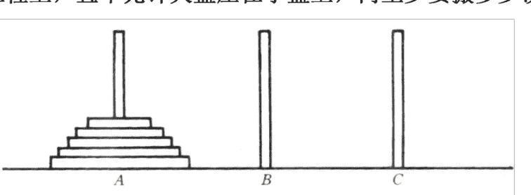

## 递推关系的建立

解 记 f(n) 为 n 个圆盘从 A 柱搬到 C 柱所需的最小次数。整个搬运过程可分成三个阶段；

- (1) 将套在 A 柱上面的 n-1 个圆盘从 A 柱按要求搬到 B 柱，搬动次数为 f(n-1)；
- (2) 把 A 柱上最下面的那个圆盘搬到 C 柱上，搬动次数为 1；
- (3) 把 B 柱上的 n-1 个圆盘按要求搬到 C 柱上，搬动次数为 f(n-1)。

由加法原则知

```
f(n) = 2 f(n-1) + 1
```

又显然 f(1) = 1，所以有如下带有初值的递推关系；

```
{
  f(n) = 2 f(n-1) + 1,
  f(1) = 1.
}
```

## 递推关系的建立

**例 6.1.3**　在信道上传输由 $a,b,c$ 三个字母组成的长为 $n$ 的字符串，若字符串有两个 $a$ 连续出现，则信道就不能传输，令 $f(n)$ 表示信道可以传输的长为 $n$ 的字符串的字数，求 $f(n)$ 满足的递推关系。

解　信道上能够传输的长度为 $n(n\ge 2)$ 的字符串可分成如下四类：

- 1. 最左字符为 $b$；
- 2. 最左字符为 $c$；
- 3. 最左两个字符为 $ab$；
- 4. 最左两个字符为 $ac$。

如图 6.1.2 所示，前两类字符串分别有 $f(n-1)$ 个，后两类字符串分别有 $f(n-2)$ 个，容易求出 $f(1)=3, f(2)=8$，从而得到

$$\begin{cases} f(n)=2f(n-1)+2f(n-2)\quad(n\ge 3),\\ f(1)=3,\ f(2)=8. \end{cases}$$


## 递推关系的建立

解 设 “010” 子串在第 n 位出现的长为 n 的 0,1 字符串的个数为 f(n)，则显然 f(3)=1， f(4)=2， f(5)=3。

最后 3 位是 “010” 的 n 位 0,1 字符串有 2^{n-3} 个，其中 “010” 在第 n 位出现的字符串有 f(n) 个。“010” 不在第 n 位出现，当且仅当最后 5 位形如 “01010”，并且 “010” 在第 n−2 位出现，所以这类字符串共有 f(n−2) 个。从而有

```
⎧ f(n) = 2^{n-3} − f(n−2) (n ≥ 5),
⎨
⎩ f(3) = 1, f(4) = 2.
```

## 递推关系的建立

例 6.1.5 设 P 是平面上 n 个连通区域 D₁, D₂, …, Dₙ 的公共交界点，如图 6.1.3 所示。现用 k 种颜色对其着色，要求有公共边界的相邻区域着以不同的颜色，令 f(n) 表示不同的着色方案数，求它所满足的递推关系。

解：将所有满足要求的着色方案分成两类 n ≥ 4：

- (i) D₁ 与 Dₙ₋₁ 同色。此时，Dₙ 有 k−1 种着色方案可将 D₁ 与 Dₙ₋₂ 的着色方案数为 f(n−2)。故此类着色方案数为 (k−1)f(n−2)

- (ii) D₁ 与 Dₙ₋₁ 异色。此时，Dₙ 有 k−2 种着色。又 D₁, D₂, …, Dₙ₋₁ 用 k 种颜色着色的方案数为 f(n−1)，故此类着色方案数为 (k−2)f(n−1)。

而容易求得 f(2)=k(k−1), f(3)=k(k−1)(k−2)，从而有

⎧ f(n) = (k−1)f(n−2) + (k−2)f(n−1) (n ≥ 4),
⎨
⎩ f(2) = k(k−1), f(3) = k(k−1)(k−2).


## 常系数线性齐次递推关系的求解

定义 6.2.1 设 k 是给定的正整数，若数列 f(0), f(1), ⋯, f(n), ⋯ 的相邻 k+1 项间满足关系

f(n) = c₁(n)f(n-1) + c₂(n)f(n-2) + ⋯ + cₖ(n)f(n-k) + g(n), （6.2.1）

对 n ≥ k 成立，其中 cₖ(n) ≠ 0，则称该关系为 {f(n)} 的 k 阶线性递推关系。

如果 c₁(n), c₂(n)⋯, cₖ(n) 都是常数，则称之为 k 阶常系数线性递推关系。

如果 g(n)=0, 则称之为齐次的。

如果有一个数列代入递推关系（6.2.1），使得其对任何 n ≥ k 都成立，则称这个数列是递推关系（6.2.1）的解。

常系数线性齐次递推关系的一般形式为

f(n) = c₁f(n-1) + c₂f(n-2) + ⋯ + cₖf(n-k) (n ≥ k, cₖ ≠ 0) （6.2.2）

## 常系数线性齐次递推关系的求解

### 定义 6.2.2 方程

x^k - c₁x^{k-1} - c₂x^{k-2} - … - c_k = 0      (6.2.3)

叫做递推关系(6.2.2)的特征方程，它的 k 个根 q₁,q₂,⋯q_k（可能有重根）

叫做该递推关系的特征根，其中 q_i(i=1,2,⋯,k)是复数.

f(n)=c₁f(n-1)+c₂f(n-2)+⋯+c_k f(n-k)(n≥k,c_k≠0)

## 常系数线性齐次递推关系的求解

**引理 6.2.1**　设 $q$ 是非零复数, 则 $f(n)=q^n$ 是递推关系 (6.2.2) 的解, 当且仅当 $q$ 是它的特征根。

**证明**　设 $f(n)=q^n$ 是递推关系 (6.2.2) 的解, 即

$$q^n=c_1q^{n-1}+c_2q^{n-2}+\cdots+c_kq^{n-k}\quad(n\geq k),$$

因为 $q\ne 0$, 所以

$$q^k=c_1q^{k-1}+c_2q^{k-2}+\cdots+c_k,$$

即 $q$ 是递推关系（6.2.2）的特征根，反之亦然。

## 常系数线性齐次递推关系的求解

引理 6.2.2 如果 h₁(n), h₂(n) 都是递推关系（6.2.2）的解，b₁, b₂ 是常数，则 b₁ h₁(n) + b₂ h₂(n) 也是递推关系（6.2.2）的解。

证明 因为 h₁(n), h₂(n) 都是递推关系（6.2.2）的解，所以

```
b₁ h₁(n) + b₂ h₂(n)
= b₁ [c₁ h₁(n-1) + ⋯ + cₖ h₁(n-k)] + b₂ [c₁ h₂(n-1) + ⋯ + cₖ h₂(n-k)]
= c₁ [b₁ h₁(n-1) + b₂ h₂(n-1)] + ⋯ + cₖ [b₁ h₁(n-k) + b₂ h₂(n-k)]
```

从而 b₁ h₁(n) + b₂ h₂(n) 也是递推关系 (6.2.2) 的解。

由引理 6.2.1 和引理 6.2.2 知，若 q₁, q₂, ⋯, qₖ 是递推关系 (6.2.2) 的特征根，b₁, b₂, ⋯, bₖ 是常数，那么

```
f(n) = b₁ q₁ⁿ + b₂ q₂ⁿ + ⋯ + bₖ qₖⁿ
```

是递推关系（6.2.2）的解。

## 常系数线性齐次递推关系的求解

定义 6.2.3 如果对于递推关系（6.2.2）的每个解 $h(n)$，都可以选择一组常数 $c_1',c_2',\cdots,c_k'$，使得

$$h(n)=c_1'q_1^n + c_2'q_2^n + \cdots + c_k'q_k^n$$

成立，则称 $b_1q_1^n + b_2q_2^n + \cdots + b_kq_k^n$ 是递推关系（6.2.2）的通解，其中，$b_1,b_2,\cdots,b_k$ 为任意常数。


## 常系数线性齐次递推关系的求解

定理 6.2.1 设 $q_1, q_2, \cdots, q_k$ 是递推关系(6.2.2)的 $k$ 个互不相等的特征根，则

$$f(n)=b_1 q_1^n + b_2 q_2^n + \cdots + b_k q_k^n$$

是递推关系（6.2.2）的通解。

证明 由前面的分析可知 $f(n)$ 是递推关系(6.2.2)的解。设 $h(n)$ 是这个递推关系的任意一个解，则 $h(n)$ 由 $k$ 个初值 $h(0)=a_0, h(1)=a_1, \cdots, h(k-1)=a_{k-1}$ 唯一地确定，所以有

$$\begin{cases} b_1 + b_2 + \cdots + b_k = a_0, \ b_1 q_1 + b_2 q_2 + \cdots + b_k q_k = a_1, \ \cdots, \ b_1 q_1^{k-1} + b_2 q_2^{k-1} + \cdots + b_k q_k^{k-1} = a_{k-1}. \end{cases}\tag{6.2.4}$$

如果方程组（6.2.4）有唯一解 $b'_1,b'_2,\cdots,b'_k$，这说明可以找到 $k$ 个常数 $b'_1,b'_2,\cdots,b'_k$，使得 $h(n)=b'_1q_1^n+b'_2q_2^n+\cdots+b'_kq_k^n$ 成立，从而 $b_1q_1^n+b_2q_2^n+\cdots+b_kq_k^n$ 是该递推关系的通解。考察方程组（6.2.4），它的系数行列式为

$$\begin{vmatrix}\n1 & 1 & \cdots & 1\\\nq_1 & q_2 & \cdots & q_k\\\n\vdots & \vdots & \ddots & \vdots\\\nq_1^{k-1} & q_2^{k-1} & \cdots & q_k^{k-1}\n\end{vmatrix}=\prod_{1\le i<j\le k}(q_j-q_i)$$

这是著名的 Vandermonde 行列式。因为 $q_1,q_2,\cdots,q_k$ 互不相等，所以该行列式不等于零，这也就是说方程组（6.2.4）有唯一解。

### 例6.2.1 求解 6.1.1 的递推关系

$$egin{cases} f(n)=f(n-1)+f(n-2)(n\ge 2),\ f(0)=1,\ f(1)=1. \end{cases}$$

解 先求解这个递推关系的通解，它的特征方程为

$$x^2 - x - 1 = 0,$$

解这个方程，得

$$x_1 = \frac{1+\sqrt{5}}{2},\ x_2 = \frac{1-\sqrt{5}}{2}.$$

所以，通解为

$$f(n)=c_1\left(\frac{1+\sqrt{5}}{2}\right)^n + c_2\left(\frac{1-\sqrt{5}}{2}\right)^n.$$

代入初值来确定 $c_1$ 和 $c_2$，得

\begin{cases} c_1 + c_2 = 1, \\ \dfrac{1+\sqrt{5}}{2}c_1 + \dfrac{1-\sqrt{5}}{2}c_2 = 1. \end{cases}

求解这个方程组，得 $c_1 = \dfrac{1}{\sqrt{5}}\cdot\dfrac{1+\sqrt{5}}{2}, c_2 = -\dfrac{1}{\sqrt{5}}\cdot\dfrac{1-\sqrt{5}}{2}$。

所以，原递推关系的解为

$f(n)=\dfrac{1}{\sqrt{5}}\left(\dfrac{1+\sqrt{5}}{2}\right)^{n+1} - \dfrac{1}{\sqrt{5}}\left(\dfrac{1-\sqrt{5}}{2}\right)^{n+1} \qquad (n=0,1,2,\cdots).$

Fibonacci 数常出现在组合计数总是中。例如，用多米诺牌（可以看作一个 2×1 大小的长方块）完全覆盖一个 n×2 的棋盘，覆盖的方案数等于 Fibonacci 数 f(n)。如图 6.2.1(a)所示，如果用一个牌覆盖第一列的两个方格，那么剩下的是 (n−1)×2 的棋盘的覆盖问题。如图 6.2.1(b)所示，如果用两个牌覆盖第一行的前两格和第二行的前两个格，那么剩下的是 (n−2)×2 的棋盘的覆盖问题。由加法原则，这两类覆盖方案数之和就是 n×2 的棋盘的覆盖方案数。令 g(n) 表示 n×2 的棋秀的覆盖方案数，则有

```
g(n) = g(n−1) + g(n−2) (n ≥ 3, n 为整数),
g(1) = 1, g(2) = 2.
```

这和 Fibonacci 数的递推关系完全一样。


图 4.5.1

### 例 6.2.2 求解例 6.1.3 的递推关系

$$egin{cases}f(n)=2f(n-1)+2f(n-2),\f(1)=3,f(2)=8\end{cases}$$

解:先求这个递推关系的通解，它的特征方程为

$$x^2-2x-2=0$$

解这个方程，得$x_1=1+\sqrt{3},x_2=1-\sqrt{3}$。

所以，通解为$f(n)=c_1(1+\sqrt{3})^n+c_2(1-\sqrt{3})^n$。

代入初值来确定$c_1$和$c_2$，得

$$egin{cases}c_1(1+\sqrt{3})+c_2(1-\sqrt{3})=3\c_1(1+\sqrt{3})^2+c_2(1-\sqrt{3})^2=8\end{cases}$$

求解这个方程组，得$c_1=\frac{2+\sqrt{3}}{2\sqrt{3}},c_2=\frac{-2+\sqrt{3}}{2\sqrt{3}}(n=1,2,\cdots)$

### 例 6.2.3 核反应堆中有 α 和 β 两种粒子，每秒钟内一个 α 粒子可反应产生三个 β 粒子，而一个 β 粒子又可反应产生一个 α 粒子和两个 β 粒子。若在时刻 $t=0$ 时反应堆中只有一个 α 粒子，问 $t=100$ 秒时反应堆中将有多少个 α 粒子？多少个 β 粒子？共有多少个粒子？

解　设在 $t$ 时刻的 α 粒子数为 $f(t)$，β 粒子数为 $g(t)$，根据题设，可以列出下面的递推关系：

```
$$
\begin{cases}
g(t)=3f(t-1)+2g(t-1)\quad (t\ge 1),\\
f(t)=g(t-1)\quad (t\ge 1),\\
g(0)=0,\ f(0)=1.
\end{cases}
\tag{6.2.6}
$$
```

由（6.2.6）式得到 $f(t-1)=g(t-2)$，

把这个等式代入（6.2.5）式，得

$$egin{cases} g(t)=3g(t-2)+2g(t-1)(t\ge 2),\ g(0)=0,g(1)=3. \end{cases}$$（6.2.7）

递推关系(6.2.7)的特征方程为$x^2-2x-3=0$,

其特征根为$x_1=3,x_2=-1$

所以，该递推关系的通解为$g(t)=c_1\cdot 3^t + c_2\cdot (-1)^t.$

代入初值$g(0)=0,g(1)=3$,得

$$egin{cases} c_1 + c_2 = 0,\ 3c_1 - c_2 = 3. \end{cases}$$

解这个方程组，得

$c_1 = \dfrac{3}{4}, c_2 = -\dfrac{3}{4}.$

所以，该递推关系的解为

g(t) = 3/4 · 3^t − 3/4 · (−1)^t.

从而求得

f(t) = g(t−1) = 3/4 · 3^{t−1} − 3/4 · (−1)^{t−1},

f(t) + g(t) = 3/4 · 3^{t−1} − 3/4 · (−1)^{t−1} + 3/4 · 3^t − 3/4 · (−1)^t = 3^t.

因此

f(100) = 3/4 · 3^{99} − 3/4 · (−1)^{99} = 3/4 (3^{99} + 1),

g(100) = 3/4 · 3^{100} − 3/4 · (−1)^{100} = 3/4 (3^{100} − 1),

故 f(100) + g(100) = 3^{100}.

- 对于k阶常系数线性齐次递推关系，当特征根都不相等时，我们已经给出了求通解的方法。但是当中有重根时，这种方法就不适用了，换句话说，就不是原递推关系的通解了。


## 常系数线性齐次递推关系的求解

设递推关系 $f(n)=a_1 f(n-1)+a_2 f(n-2)+\cdots +a_k f(n-k)\;(n\ge k, a_k\ne 0)$ 的特征方程为

$x^k - a_1 x^{k-1} - a_2 x^{k-2} - \cdots - a_k = 0$

令

$P(x)=x^k - a_1 x^{k-1} - a_2 x^{k-2} - \cdots - a_k,$

$P_n(x)=x^{n-k}\cdot P(x)=x^n - a_1 x^{n-1} - a_2 x^{n-2} - \cdots - a_k x^{n-k}.$

如果 $q$ 是 $P(x)=0$ 的二重根，则 $q$ 也是 $P_n(x)=0$ 的二重根，那么也是 $P'_n(x)=0$ 的根，其中，是 $P'_n(x)$ 是 $P_n(x)$ 的微商，即

$P'_n(x)=n x^{n-1} - a_1 (n-1) x^{n-2} - a_2 (n-2) x^{n-3} - \cdots - a_k (n-k) x^{n-k-1}.$

因此，$q$ 是 $x P'_n(x)=0$ 的根. 而

$x P'_n(x)=n x^n - a_1 (n-1) x^{n-1} - a_2 (n-2) x^{n-2} - \cdots - a_k (n-k) x^{n-k},$

代入 $x = q$, 得

$0 = n q^{n} - a_{1} (n-1) q^{n-1} - a_{2} (n-2) q^{n-2} - \cdots - a_{k} (n-k) q^{n-k}$.

这说明 $n q^{n}$ 是原递推关系的解.

类似地可以证明,如果 $q$ 是 $P(x)=0$ 的三重根,那么 $q$ 就是 $x P'_{n}(x)=0$ 的二重根,即 $q$ 是 $x P'_{n}(x)=0$ 和 $x [x P'_{n}(x)]'=0$ 的根,从而证明 $n q^{n}, n^{2} q^{n}$ 也是原递推关系的解.

同样地,可以证明以下的结论：如果 $q$ 是 $p(x)=0$ 的 $e$ 重根,则 $q^{n}, n q^{n}, n^{2} q^{n}, \cdots, n^{e-1} q^{n}$ 都是原递推关系的解.

定理 6.2.2 设q₁,q₂⋯,qₜ是递推关系(6.2.2)的全部不同的特征根,其重数分别 为e₁,e₂⋯,eₜ(e₁+e₂+⋯+eₜ=k),那么递推关系(6.2.2)的通解 f(n)=f₁(n)+f₂(n)+⋯+fₜ(n), 其中 f₁(n)=(b₁ + b₂ n + ⋯ + b_{e₁} n^{e₁-1}) ⋅ q₁^n (1≤i≤t).

证明 由前面的讨论知 f(n)=f₁(n)+f₂(n)+⋯+fₜ(n) 是递推关系(6.2.2)的解,再由初值 f(0)=a₀,f(1)=a₁,⋯,f(k-1)=aₖ,得到关于 b_{ij}(1≤i≤t,1≤j≤eᵢ)的联立方程组,其系数行列式的值(证明略)为 ∏_{i=1}^t (-q_i)^{e_i} ∏_{1≤i<j≤t} (q_j - q_i)^{e_i} ≠0, 故可由初值唯一地确定 b_{ij} . 这说明递推关系(6.2.2)的任意解均可写成 f(n)=∑_{i=1}^t f_i(n) 的形式，其中 f_i(n)如前所述.

## 齐次递推关系使用特征方程的求解步骤（2）

步骤 1. 根据递推关系
f(n) = c₁f(n-1) + c₂f(n-2) + ⋯ + cₖf(n-k) (n ≥ k, cₖ ≠ 0)
写出特征方程 xᵏ − c₁xᵏ⁻¹ − c₂xᵏ⁻² − ⋯ − cₖ = 0

步骤 2. 计算特征方程的相异特征根 q₁, q₂, ⋯ qₜ (可能有重根，其重数分别为 e₁, e₂ ⋯, eₜ (e₁ + e₂ + ⋯ eₜ = k)), q₁, q₂, ⋯ qₜ 即递推关系的特征根。

步骤 3. 根据递推关系的特征根 q₁, q₂, ⋯ qₜ, 写出是递推关系的通解,
f(n) = f₁(n) + f₂(n) + ⋯ + fₜ(n),
其中 f₁(n) = (b_{i₁} + b_{i₂} n + ⋯ + b_{i_{eᵢ}} n^{eᵢ−1}) · qᵢⁿ (1 ≤ i ≤ t).
b_{i₁}, b_{i₂}, ⋯, b_{i_{eᵢ}} 为待定系数

步骤 4. 将 k 个初值代入到递推关系的通解中，建立以 b_{i₁}, b_{i₂}, ⋯, b_{i_{eᵢ}} 为未知量的初值方程组，求解该方程组，得到常数 b_{i₁}, b_{i₂}, ⋯, b_{i_{eᵢ}}，代入到递推关系的通解中，得到最终结果。

## 常系数线性齐次递推关系的求解

例 6.2.5 求解递推关系

f(n) = -f(n-1) + 3 f(n-2) + 5 f(n-3) + 2 f(n-4)
f(0) = 1, f(1) = 0, f(2) = 1, f(3) = 2.

解 该递推关系的特征方程为

x⁴ + x³ - 3x² - 5x - 2 = 0,

其特征根为

x₁ = x₂ = x₃ = -1, x₄ = 2.

由定理 6.2.2，对应于 x = -1 的解为

f₁(n) = c₁(-1)ⁿ + c₂ n (-1)ⁿ + c₃ n² (-1)ⁿ,

对应于 x = 2 的解为

f₂(n) = c₄ 2ⁿ.

因此，递推关系的通解为

$f(n)=f_1(n)+f_2(n)=c_1(-1)^n+c_2 n(-1)^n+c_3 n^2(-1)^n+c_4 2^n.$

代入初始值，得到方程组

$\begin{cases}c_1+c_4=1,\\-c_1-c_2-c_3+2c_4=0,\\c_1+2c_2+4c_3+4c_4=1,\\-c_1-3c_2-9c_3+8c_4=2.\end{cases}$

解这个方程组，得$c_1=\frac{7}{9},c_2=\frac{1}{3},c_3=0,c_4=\frac{2}{9}.$

所以，原递推关系的解为

$f(n)=(-1)^n\frac{7}{9}-(-1)^n\frac{1}{3}n+\frac{2}{9}\cdot2^n.$

## 作业

6.9

## 常系数线性非齐次递推关系的求解

k阶常系数线性非齐次递推关系的一般形式为
$f(n)=c_1f(n-1)+c_2f(n-2)+\cdots+c_kf(n-k)+g(n)\,(n\ge k),\;(6.3.1)$
其中，$c_1,c_2,\cdots c_k$为常数，$c_k\ne0,g(n)\ne0$。递推关系（6.3.1）对应的齐次递推关系为
$f(n)=c_1f(n-1)+c_2f(n-2)+\cdots+c_kf(n-k).\;(6.3.2)$

定理 6.3.1  k 阶常系数线性非齐次递推关系（6.3.1）的通解是递推关系（6.3.1）的特解加上其相应的齐次递推关系（6.3.2）的通解。

证明 设 $f'(n)$ 是递推关系（6.3.1）的特解，$f''(n)$ 是递推关系（6.3.2）的通解，则
$f'(n)+f''(n)=[c_1 f'(n-1)+c_2 f'(n-2)+\cdots+c_k f'(n-k)+g(n)]$
$\quad +[c_1 f''(n-1)+c_2 f''(n-2)+\cdots+c_k f''(n-k)]$
$=c_1[f'(n-1)+f''(n-1)]+\cdots$
$\quad +c_k[f'(n-k)+f''(n-k)]+g(n)$。

所以 $f'(n)+f''(n)$ 是递推关系（6.3.1）的解。

反之，任给递推关系（6.3.1）的一个解 f(n)，与上类似，可能证明 f(n)−f′(n)是递推关系(6.3.2)的解，从而 f(n)可以表示 f′(n)与递推关系（6.3.2）的解之和。

综合以上分析，定理成立。

对于一般的 g(n)，k 阶常系数线性非齐次递推关系（6.3.1）没有普遍的解法，只有在某些简单的情况下，可以用待定系数法求出递推关系(6.3.1)的特解，表 6.3.1 对于几种 g(n) 给出了递推关系（6.3.1）的特解 f′(n)的一般形式。

对于一般f(n)没有普遍的解法，只对一些简单的情况可以用待定系数法求H*(n)。

```
H(n)+5H(n-1)+6H(n-2)=3n²
```

的特解。

解: 设特解H*(n)=P₁n²+P₂n+P₃，其中P₁,P₂,P₃为待定系数，把H*(n)代入原递推关系得：

```
(P₁n²+ P₂n+P₃)
+5[P₁(n-1)² + P₂(n-1)+P₃]
+6[P₁(n-2)² + P₂(n-2)+P₃]=3n²
```

化简左边得：

```
12 P₁n²+(-34P₁+12P₂)n+(29P₁-17P₂+12 P₃)=3n²
```


## 常系数线性非齐次递推关系的求解

因此有：

⎧ 12P₁=3
  -34P₁+12P₂=0
  29P₁-17P₂+12P₃=0

解得： P₁=1/4； P₂=17/24； P₃=115/288

## 常系数线性非齐次递推关系的求解

表 6.3.1

| g(n) | 特征多项式 P(x) | 特解 f'(n) 的一般形式 |
|------|----------------|----------------------|
| βⁿ | P(β) ≠ 0 | a βⁿ |
| βⁿ | β 是 P(x)=0 的 m 重根 | a nᵐ βⁿ |
| nˢ | P(1) ≠ 0 | bₛ nˢ + bₛ₋₁ nˢ⁻¹ + ⋯ + b₁ n + b₀ |
| nˢ | 1 是 P(x)=0 的 m 重根 | nᵐ (bₛ nˢ + bₛ₋₁ nˢ⁻¹ + ⋯ + b₁ n + b₀) |
| nˢ βⁿ | P(β) ≠ 0 | (bₛ nˢ + bₛ₋₁ nˢ⁻¹ + ⋯ + b₁ n + b₀) βⁿ |
| nˢ βⁿ | β 是 P(x)=0 的 m 重根 | nᵐ (bₛ nˢ + bₛ₋₁ nˢ⁻¹ + ⋯ + b₁ n + b₀) βⁿ |

## 非齐次递推关系使用
特征方程的求解步骤

- ➢ **步骤 1.** 求出非齐次递推关系对应的齐次递推关系的特征根 $q_1,q_2,\cdots,q_t$（可能有重根，其重数分别为 $e_1,e_2,\cdots,e_t$（$e_1+e_2+\cdots+e_t=k$））。
- ➢ **步骤 2.** 根据 $g(n)$ 的类型，用待定系数法求出递推关系的特解 $f'(n)$。
- ➢ **步骤 3.** 根据递推关系的特征根 $q_1,q_2,\cdots,q_t$，写出是递推关系的通解，
  $$f(n)=f_1(n)+f_2(n)+\cdots+f_t(n)+f'(n)$$
  其中
  $$f_i(n)=(b_{i_1}+b_{i_2}n+\cdots+b_{i_{e_i}}n^{e_i-1})\cdot q_i^n\quad(1\leq i\leq t).$$
  $b_{i_1},b_{i_2},\cdots,b_{i_{e_i}}$ 为待定系数。
- ➢ **步骤 4.** 将 $k$ 个初值代入到递推关系的通解中，建立以 $b_{i_1},b_{i_2},\cdots,b_{i_{e_i}}$ 为未知量的初值方程组，求解该方程组，得到常数 $b_{i_1},b_{i_2},\cdots,b_{i_{e_i}}$，代入到递推关系的通解中，得到最终结果。

## 常系数线性非齐次递推关系的求解

### 例 6.3.1 求解递推关系

f(n) = 2 f(n-1) + 4^{n-1},
 f(0) = 1.

解 因为 4 不是特征方程的根，所以该递推关系的非齐次特解为 a 4^{n-1}，将其代入递推关系，得

4^{n-1} a = 2·4^{n-2} a + 4^{n-1}

比较等式两边 4^{n-1} 的系数，得

a = \frac{1}{2} a + 1

从而

a = 2.

表 6.3.1
| g(n) | 特征多项式 P(x) | 特解 f(n) 的一般形式 |
|---|---|---|
| β^n | P(β) ≠ 0 | a β^n |
| β^n | β 是 P(x)=0 的 m 重根 | a n^m β^n |
| n^r | P(1) ≠ 0 | b_r n^r + b_{r-1} n^{r-1} + ... + b_1 n + b_0 |
| n^r | 1 是 P(x)=0 的 m 重根 | n^m (b_r n^r + b_{r-1} n^{r-1} + ... + b_1 n + b_0) |
| n^r β^n | P(β) ≠ 0 | (b_r n^r + ... + b_1 n + b_0) β^n |
| n^r β^n | β 是 P(x)=0 的 m 重根 | n^m (b_r n^r + ... + b_1 n + b_0) β^n |

## 常系数线性非齐次递推关系的求解

而相应齐次递推关系的通解为2ⁿc，由定理 6.3.1 知，非齐次递推关系的通解为

f(n) = 2ⁿc + 4^{n-1}·2.

由初值 f(0)=1, 得

2⁰c + 4^{0-1}·2 = 1,

从而

c = 1/2,

故

f(n) = 1/2 (2ⁿ + 4ⁿ).

## 常系数线性非齐次递推关系的求解

### 例 6.3.2　求解递推关系

$$\begin{cases} f(n)-4f(n-1)+4f(n-2)=n2^n \\ f(0)=0,\ f(1)=1. \end{cases}$$

解　由于 2 是特征方程的二重根，所以该递推关系的特解为

$$f'(n)=n^2(b_1n+b_0)\cdot 2^n.$$

将它代入递推关系，并比较等号两边 n 的系数及常数项，得到

$$n^2(b_1n+b_0)2^n-4(n-1)^2\bigl(b_1(n-1)+b_0\bigr)2^{n-1}$$

$$+4(n-2)^2\bigl(b_1(n-2)+b_0\bigr)2^{n-2}=n2^n$$

整理得　$(6b_1-1)n+(2b_0-6b_1)=0$

$$\begin{cases}6b_1=1,\\-6b_1+2b_0=0.\end{cases}$$

**表 6.3.1**

| $g(n)$ | 特征多项式 $P(x)$ | 特解 $f'(n)$ 的一般形式 |
|---|---|---|
| $\beta^n$ | $P(\beta)\ne0$ | $a\beta^n$ |
| $\beta^n$ | $\beta$ 是 $P(x)=0$ 的 $m$ 重根 | $an^m\beta^n$ |
| $n^s$ | $P(1)\ne0$ | $b_sn^s+b_{s-1}n^{s-1}+\cdots+b_1n+b_0$ |
| $n^s$ | $1$ 是 $P(x)=0$ 的 $m$ 重根 | $n^m(b_sn^s+b_{s-1}n^{s-1}+\cdots+b_1n+b_0)$ |
| $n^s\beta^n$ | $P(\beta)\ne0$ | $(b_sn^s+b_{s-1}n^{s-1}+\cdots+b_1n+b_0)\beta^n$ |
| $n^s\beta^n$ | $\beta$ 是 $P(x)=0$ 的 $m$ 重根 | $n^m(b_sn^s+b_{s-1}n^{s-1}+\cdots+b_1n+b_0)\beta^n$ |

## 常系数线性非齐次递推关系的求解

非齐次递推关系的通解为

f(n) = [(c₀ + c₁ n) + n² (n/6 + 1/2)] · 2ⁿ.

再由初值 f(0)=0, f(1)=1, 得

c₀ = 0
(c₀ + c₁ + 1/6 + 1/2) 2 = 1

求得 c₀ = 0, c₁ = -1/6. 于是

f(n) = 1/6 (n³ + 3n² - n) · 2ⁿ.

## 常系数线性非齐次递推关系的求解

例 6.3.3 求解递推关系 f(n) - f(n-1) = 7n 的特解。

解 由于 1 是特征方程的一重根，所以该递推关系的特解为

f''(n) = b₁n² + b₂n

代入递推关系得

(b₁n² + b₂n) - [b₁(n-1)² + b₂(n-1)] = 7n

化简上式得

2b₁n + b₂ - b₁ = 7n

建立方程组 { 2b₁ = 7 ; b₂ = b₁ }

解得 b₁ = b₂ = 7/2，因此所求得特解是

f''(n) = 7/2 n(n+1)

| 表 6.3.1 |
| g(n) | 特征多项式 P(x) | 特解 f(n) 的一般形式 |
| βⁿ | P(β) ≠ 0 | aβⁿ |
|  | β 是 P(x)=0 的 m 重根 | a nᵐ βⁿ |
| nʳ | P(1) ≠ 0 | bₖ nᵏ + ... + b₁ n + b₀ |
|  | 1 是 P(x)=0 的 m 重根 | nᵐ (bₖ nᵏ + ... + b₁ n + b₀) |
| nʳ βⁿ | P(β) ≠ 0 | (bₖ nᵏ + ... + b₁ n + b₀) βⁿ |
|  | β 是 P(x)=0 的 m 重根 | nᵐ (bₖ nᵏ + ... + b₁ n + b₀) βⁿ |

## 常系数线性非齐次递推关系的求解

### 例 6.3.4 求 Hanoi 塔问题满足的递推关系

```
f(n) = 2 f(n-1) + 1,
 f(0) = 0.
```

解 相应的特征方程为 x=2，故齐次解为 2^n。设非齐次特解为 b，代入原递推关系，得

```
b - 2b = 1
```

所以特解为 b = -1，根据前面的分析，可知该递推关系的通解为

```
f(n) = 2^n c - 1
```

代入初值 f(0) = 0, 得 c = 1. 所以

```
f(n) = 2^n - 1
```

| 表 6.3.1 |
| g(n) | 特征多项式 P(x) | 特解 f(n) 的一般形式 |
| P(β) ≠ 0 | a β^n | 
| β 是 P(x)=0 的 m 重根 | a n^m β^n | 
| P(1) ≠ 0 | b_n n^k + ... + b_0 | 
| 1 是 P(x)=0 的 m 重根 | n^m (b_k n^k + ... + b_0) | 
| P(β) ≠ 0 | (b_n n^k + ... + b_0) β^n | 
| n^k β, β 是 P(x)=0 的 m 重根 | n^m (b_k n^k + ... + b_0) β^n |


## 常系数线性非齐次递推关系的求解

有些非线性的递推关系通过变换可化为常系数线性的递推关系。

### 例 6.3.5 求解递推关系

\[
\begin{cases}
f(n)=3f^2(n-1),\\
f(0)=1.
\end{cases}
\]

解 对递推关系两边取对数，得

\[
\lg f(n)=\lg 3+2\lg f(n-1).
\]

令 \(h(n)=\lg f(n)\)，得

\[
\begin{cases}
h(n)=2h(n-1)+\lg 3,\\
h(0)=0.
\end{cases}
\]

**表 6.3.1**

| \(g(n)\) | 特征多项式 \(P(x)\) | 特解 \(f^*(n)\) 的一般形式 |
|---|---|---|
| \(\beta^n\) | \(P(\beta)\neq 0\) | \(a\beta^n\) |
| \(\beta^n\) | \(\beta\) 是 \(P(x)=0\) 的 \(m\) 重根 | \(an^m\beta^n\) |
| \(n^s\) | \(P(1)\neq 0\) | \(b_sn^s+b_{s-1}n^{s-1}+\cdots+b_1n+b_0\) |
| \(n^s\) | \(1\) 是 \(P(x)=0\) 的 \(m\) 重根 | \(n^m(b_sn^s+b_{s-1}n^{s-1}+\cdots+b_1n+b_0)\) |
| \(n^s\beta^n\) | \(P(\beta)\neq 0\) | \((b_sn^s+\cdots+b_1n+b_0)\beta^n\) |
| \(n^s\beta^n\) | \(\beta\) 是 \(P(x)=0\) 的 \(m\) 重根 | \(n^m(b_sn^s+\cdots+b_1n+b_0)\beta^n\) |

设非齐次特解为 \(b\)，代入原递推关系，得

\[
b-2b=\lg 3,
\]

所以特解为 \(b=-\lg 3\)。根据前面的分析，可知该递推关系的特征根为 \(x=2\)，通解为

\[
h(n)=2^n c-\lg 3.
\]

代入初值 \(h(0)=0\)，得 \(c=\lg 3\)。

所以解得

\[
h(n)=(2^n-1)\lg 3,
\]

从而

\[
f(n)=3^{2^n-1}.
\]

### 例 6.3.6 求解递推关系

\[
\begin{cases}
h^2(n)-2h^2(n-1)=1,\\
h(n)>0,\\
h(0)=2.
\end{cases}
\]

解 令 \(g(n)=h^2(n)\)，代入原递推关系得

\[
\begin{cases}
g(n)-2g(n-1)=1,\\
g(0)=h^2(0)=4.
\end{cases}
\]

设非齐次特解为 \(b\)，代入原递推关系，得

\[
b-2b=1,
\]

所以特解为 \(b=-1\)。可知该递推关系的通解为

\[
g(n)=2^n c-1.
\]

代入初值 \(g(0)=4\)，得 \(c=5\)。所以

\[
g(n)=5\cdot 2^n-1,
\]

从而

\[
h(n)=\sqrt{5\cdot 2^n-1}\quad(\because h(n)>0).
\]

### 例：求 \(H(n)-5H(n-1)+6H(n-2)=2^n\) 的特解

解 特征方程 \(x^2-5x+6=0\)，特征根为 \(2\) 和 \(3\)，\(2\) 是 \(1\) 重特征根。所以设特解

\[
H^*(n)=Pn2^n,
\]

\(P\) 为待定系数。把 \(H^*(n)\) 代入原递推关系，得

\[
Pn2^n-5P(n-1)2^{n-1}+6P(n-2)2^{n-2}=2^n.
\]

化简得 \(P=-2\)，因此

\[
H^*(n)=-n2^{n+1}.
\]

## 用生成函数求解递推关系

### 用生成函数求解递推关系的步骤

利用生成函数求解各类递推关系有广泛的适用性，其基本步骤是：

- （1）令 \(G(x)=\sum_{n=0}^{\infty} f(n)x^n\)；
- （2）将关于 \(f(n)\) 的递推关系式转化成关于 \(G(x)\) 的方程式；
- （3）解出 \(G(x)\)，将 \(G(x)\) 展开成 \(x\) 的幂级数，\(x^n\) 的系数即是 \(f(n)\)。

### 例 6.4.1 求解递推关系

\[
f(n)=7f(n-1)-12f(n-2),\qquad f(0)=2,\ f(1)=7.
\]

解 令 \(G(x)=\sum_{n=0}^{\infty} f(n)x^n\)，则有

\[
\begin{aligned}
G(x)-f(0)-f(1)x
&=\sum_{n=2}^{\infty} f(n)x^n\\
&=\sum_{n=2}^{\infty}\bigl(7f(n-1)-12f(n-2)\bigr)x^n\\
&=7x\sum_{n=2}^{\infty} f(n-1)x^{n-1}
 -12x^2\sum_{n=2}^{\infty} f(n-2)x^{n-2}\\
&=7x\sum_{n=1}^{\infty} f(n)x^n
 -12x^2\sum_{n=0}^{\infty} f(n)x^n\\
&=7x\bigl(G(x)-f(0)\bigr)-12x^2G(x).
\end{aligned}
\]

### 定理 6.4.1

具有初值条件的 \(k\) 阶常系数线性递推关系为

\[
\begin{cases}
a_n+c_1a_{n-1}+c_2a_{n-2}+\cdots+c_ka_{n-k}=0,\\
a_i=d_i,\quad i=0,1,\cdots,k-1.
\end{cases}
\]

其中 \(c_0=1\)，\(c_k\neq 0\)，\(d_i\) 是给定常数，那么 \(\{a_n\}\) 有生成函数

\[
G(x)=\frac{P(x)}{\prod_{i=1}^{t}(1-r_i x)^{k_i}},
\]

其中

\[
\sum_{i=1}^{t}k_i=k,
\]

且

\[
P(x)=\sum_{j=0}^{k-1}\left(c_j x^j\sum_{i=0}^{k-1-j}a_i x^i\right)
\]

是不大于 \(k-1\) 次的多项式。当且仅当 \(\{a_n\}\) 关于递推关系的特征方程为

\[
\prod_{i=1}^{t}(x-r_i)^{k_i}=0.
\]


## 用生成函数求解递推关系

证明 设序列{aₙ}的特征多项式和生成函数分别为

A(x)=∑_{i=0}^{k} c_i x^{k-i} ，其中 c₀=1

G(x)=a₀+a₁x+a₂x²+⋯+a_{k-1}x^{k-1}+a_k x^k+⋯+a_n x^n+⋯

由递回关系，有

x^k ∑_{i=0}^{k} c_i a_{k-i}=0， x^{k+1} ∑_{i=0}^{k} c_i a_{k+1-i}=0，⋯,x^n ∑_{i=0}^{k} c_i a_{n-i}=0,⋯

将以上等式组两边相加，并注意 c₀=1，有

c₀ ∑_{j=0}^{∞} a_{k+j} x^{k+j} + c₁ x ∑_{j=0}^{∞} a_{k-1+j} x^{k-1+j} +⋯+ c_k x^k ∑_{j=0}^{∞} a_{k-k+j} x^{k-k+j}=0

即 $c_0\left(G(x)-\sum_{i=0}^{k-1}a_i x^i\right)+c_1 x\left(G(x)-\sum_{i=0}^{k-2}a_i x^i\right)+\cdots+c_k x^k G(x)=0$

亦即 $\left(1+c_1 x+c_2 x^2+\cdots c_k x^k\right)G(x)=\sum_{j=0}^{k-1}\left(c_j x^j \sum_{i=0}^{k-1-j} a_i x^i\right)=P(x)$

其中，多项式 $P(x)$ 的次数不大于 $k-1$， $c_0=1$。易知

$1+c_1 x+c_2 x^2+\cdots+c_k x^k = x^k A\left(\frac{1}{x}\right)$

注意到 $k$ 次特征多项式在复数域上有 $k$ 个零点，可设

$A(x)=(x-r_1)^{k_1}(x-r_2)^{k_2}\cdots(x-r_t)^{k_t},\quad \sum_{i=1}^{t}k_i=k$

从而

$G(x)=\frac{P(x)}{x^k A(1/x)}=\frac{P(x)}{\prod_{i=1}^{t}(1-r_i x)^{k_i}}$

### 例 6.4.2 已知序列 {aₙ} 的生成函数为
G(x)= 1/((1-x)(2-x))，求 aₙ。

解法 1 由定理 6.4.1

x² A(1/x) = (1-x)(2-x) ⇒ A(1/x) = (1-x)(2-x)/x² = (1/x -1)(2/x -1)

用 x 替代 1/x ，知特征方程为
A(x) = (x-1)(2x-1) = 0

特征根为 r₁ = 1, r₂ = 1/2

故 $a_n = K_1 r_1^n + K_2 r_2^n = K_1 + K_2 \left(\frac{1}{2}\right)^n$

利用整式除法

$\frac{1}{(1-x)(2-x)} = \frac{1}{2-3x+x^2} = \frac{1}{2} + \frac{3}{4}x + \frac{7}{8}x^2 + \cdots$

知 $a_0 = 1/2$, $a_1 = 3/4$ 解得

$K_1 = 1, K_2 = -\frac{1}{2}$

从而

$a_n = 1 - \left(\frac{1}{2}\right)^{n+1}$

### 解法 2

$$G(x)=\sum_{n=0}^{\infty}a_n x^n = \frac{1}{(1-x)(2-x)}$$

$$= \frac{1}{2}\cdot\frac{1}{1-x}\cdot\frac{1}{1-x/2}=\frac{1}{2}\sum_{j=0}^{\infty}x^j\sum_{i=0}^{i}\left(\frac{x}{2}\right)^i$$

$$=\frac{1}{2}\sum_{n=0}^{\infty}\left(\sum_{i=0}^{n}\left(\frac{1}{2}\right)^i\right)x^n$$

故

$$a_n = \frac{1}{2}\sum_{i=0}^{n}\left(\frac{1}{2}\right)^i = 1-\left(\frac{1}{2}\right)^{n+1}$$

### 例 6.4.3 求如下递推关系的生成函数：

Fₙ = Fₙ₋₁ + Fₙ₋₂
F₀ = F₁ = 1

解 特征方程为

A(x) = x² - x - 1 = 0

P(x) = Σᵢ₌₀ᵏ⁻¹ ( cᵢ xⁱ Σⱼ₌₀ᵏ⁻¹⁻ⁱ Fⱼ xʲ )

对 k = 2，c₀ = 1，c₁ = c₂ = -1，F₁ = 1，求得

P(x) = Σᵢ₌₀ᵏ⁻¹ ( cᵢ xⁱ Σⱼ₌₀ᵏ⁻¹⁻ⁱ Fⱼ xʲ ) = F₀ + F₁ x - F₀ x = F₀ = 1

G(x) = P(x) / [x² A(1/x)] = 1 / (1 - x - x²)

### 例 6.4.3 求如下递推关系的生成函数：

$$ \begin{cases}F_n = F_{n-1} + F_{n-2}\\F_0 = F_1 = 1\end{cases}$$

解 设生成函数为

$$G(x)=a_0 + a_1 x + a_2 x^2 + a_3 x^3 + a_4 x^4 + \cdots$$

则

$$-x G(x)=\quad -a_0 x - a_1 x^2 - a_2 x^3 - a_3 x^4 - \cdots$$

$$-x^2 G(x)=\quad\quad -a_0 x^2 - a_1 x^3 - \cdots$$

三式相加并利用递推关系，有

$$(1 - x - x^2) G(x) = a_0 + (a_1 - a_0) x$$

代入初值 $F_0 = 1$, $F_1 = 1$ 得

$G(x) = \frac{1}{1 - x - x^2}$

### 例 6.4.4 求解递归关系：

\begin{cases} a_n = 5a_{n-1} - 6a_{n-2} \\ a_0 = 1, a_1 = -2 \end{cases}

解 设生成函数为

G(x) = a_0 + a_1 x + a_2 x^2 + a_3 x^3 + a_4 x^4 + \cdots

则

-5x G(x) = -5a_0 x -5a_1 x^2 -5a_2 x^3 -5a_3 x^4 + \cdots

6x^2 G(x) = 6a_0 x^2 + 6a_1 x^3 + \cdots

三式相加并利用递归关系，有

(1 - 5x + 6x^2) G(x) = a_0 + (a_1 - 5a_0) x

代入初值 $a_0 = 1$, $a_1 = -2$ 得

$G(x) = \frac{1 - 7x}{1 - 5x + 6x^2}$

由部分分式的方法得

$G(x) = \frac{5}{1 - 2x} - \frac{4}{1 - 3x} = 5 \sum_{n=0}^{\infty} 2^n x^n - 4 \sum_{n=0}^{\infty} 3^n x^n$

所以有 $a_n = 5 \cdot 2^n - 4 \cdot 3^n$, $n \ge 0$。

用生成函数可以寻找常系数线性非齐次递推关系的特解结构。下面以 $g(n) = n^s \beta^n$ 为例来求非齐次递推关系的特解。

### 例 6.4.5 求解 Hanoi 塔问题：

\begin{cases} h_n = 2h_{n-1} + 1 \\ h_1 = 1 \end{cases}

解 设 $G(x)=\sum_{i=1}^{\infty} h_i x^i$，对等式 $h_n = 2h_{n-1} + 1$，两边对应乘以 $x^n$，$n=2,\ 3,\cdots$。并将等式组成左右两边相加。

左端为：$h_2 x^2 + h_3 x^3 + \cdots + h_n x^n + \cdots = G(x) - x$

右端为：$(2h_1 x^2 + 2h_2 x^3 + \cdots) + (x^2 + x^3 + \cdots) = 2x G(x) + \frac{x^2}{1 - x}$

解方程 $G(x) - x = 2x G(x) + \frac{x^2}{1 - x}$

得 $G(x)=\frac{x}{(1-2x)(1-x)}=\frac{1}{1-2x}-\frac{1}{1-x}$

即有

$G(x)=\sum_{i=1}^{\infty}h_i x^i=\sum_{i=0}^{\infty}(2x)^i-\sum_{i=0}^{\infty}x^i=\sum_{i=0}^{\infty}(2^i-1)x^i$

从而 $h_n=2^n-1$


## 用生成函数求解递推关系

### 例 6.4.6 求解递推关系：

\left\{ \begin{array}{l} a_n - a_{n-1} = 2(n-1) \\ a_1 = 2 \end{array} \right.

解：先求它的生成函数：

```
G(x) = \sum_{i=1}^{\infty} a_i x^i = a_1 x + \sum_{i=2}^{\infty} a_i x^i = 2x + \sum_{i=2}^{\infty} (a_{i-1} + 2(i-1)) x^i
```

```
= 2x + \sum_{i=2}^{\infty} a_{i-1} x^i + 2 \sum_{i=2}^{\infty} (i-1) x^i
```

```
= 2x + x \sum_{i=2}^{\infty} a_{i-1} x^{i-1} + 2x \sum_{i=2}^{\infty} (i-1) x^{i-1}
```

```
= 2x + x \sum_{i=1}^{\infty} a_i x^i + 2x \frac{x}{(1-x)^2}
```

```
= 2x + xG(x) + \frac{2x^2}{(1-x)^2}
```

G(x)(1-x)=2x+\frac{2x^{2}}{(1-x)^{2}}

G(x)=\frac{2x}{1-x}+\frac{2x^{2}}{(1-x)^{3}}=2x\sum_{i=0}^{\infty}x^{i}+2x^{2}\sum_{i=0}^{\infty}C_{3+i-1}^{i}x^{i}

=2\sum_{i=0}^{\infty}x^{i+1}+2x^{2}\sum_{i=0}^{\infty}C_{i+2}^{2}x^{i}

=\sum_{i=1}^{\infty}2x^{i}+2\sum_{i=0}^{\infty}C_{i+2}^{2}x^{i+2}=\sum_{i=1}^{\infty}2x^{i}+2\sum_{i=1}^{\infty}C_{i}^{2}x^{i}

=\sum_{i=1}^{\infty}\left(2+2C_{i}^{2}\right)x^{i}\quad\left(C_{1}^{2}=0\right)

a_{n}=2+2C_{n}^{2}=2+n(n-1),\quad n\ge1

### 例 6.4.7 求解递推关系
f(n)=2f(n-1)+4^{n-1}(n≥2),
f(1)=3.

解
令 G(x)=∑_{n=1}^∞ f(n)x^n ,

代入递推关系，得
G(x)−f(1)x = ∑_{n=2}^∞ (2f(n-1)+4^{n-1})x^n = 2x∑_{n=2}^∞ f(n-1)x^{n-1} + 4x^2 ∑_{n=2}^∞ 4^{n-2} x^{n-2}
=2xG(x)+4x^2 ∑_{n=0}^∞ (4x)^n =2xG(x)+\frac{4x^2}{1-4x}

解得 G(x)=\frac{(3-8x)x}{(1-2x)(1-4x)}=x\left(\frac{1}{1-2x}+\frac{2}{1-4x}\right)=x\left(\sum_{n=0}^∞(2x)^n +2\sum_{n=0}^∞(4x)^n\right)

所以，x^n 的系数 f(n)为 f(n)=2^{n-1} + 2·4^n = \frac{1}{2}(2^n + 4^n)。

## 用迭代归纳法求解递推关系及其应用

迭代归纳法也是求解递推关系的一种方法，尤其是对于某些非线性的递推关系，不存在求解的公式，不妨用这种方法来试一试，下面通过几个例子来说明。

### 例6.5.1 求和1+2³+⋯+n³.

解 令 f(n)=1+2³+⋯+n³,

它满足递推关系

⎧ f(n) = f(n−1) + n³,
⎨
⎩ f(0) = 0.

可采用 6.3 节中的解法，但要注意 1 是特征方程的一重根。

这里用迭代法求解该递推关系，得

f(n) = f(n-1) + n³
= f(n-2) + (n-1)³ + n³
= …
= f(1) + 2³ + … + (n-1)³ + n³
= f(0) + 1³ + 2³ + … + (n-1)³ + n³
= 1 + 2³ + … + (n-1)³ + n³

有否找到 $f(n)$ 的一个简单表达式呢？为此，考察该数列的前 5 项，得

$f(0) = 0 = 0^2$
$f(1) = 1^3 = 1 = 1^2$
$f(2) = 1^3 + 2^3 = 9 = 3^3 = (1 + 2)^2$
$f(3) = 1^3 + 2^3 + 3^3 = 36 = 6^3 = (1 + 2 + 3)^2$
$f(4) = 1^3 + 2^3 + 3^3 + 4^3 = 100 = 10^2 = (1 + 2 + 3 + 4)^2$

由此，我们得出 $f(n)$ 的前 5 项满足

$f(n) = (0 + 1 + \cdots + n)^2 = \frac{n^2 (n+1)^2}{4}.$

要证明上式的确是原递推关系的解，我们用归纳法。

当 n=0 时，f(0)=0，上式成立。

假设 n=k 时上式成立，即 f(k)=\frac{1}{4}k^{2}(k+1)^{2}，

则由递推关系，有
f(k+1)=f(k)+(k+1)^{3}
=\frac{1}{4}k^{2}(k+1)^{2}+(k+1)^{3}
=\frac{1}{4}(k+1)^{2}(k+2)^{2}.

故由归纳法知 f(n)=\frac{1}{4}n^{2}(n+1)^{2} 是原递推关系的解。

**例 6.5.2** 给定 $n$ 个实数 $a_1,a_2,\cdots,a_n$，可以用多少种不同的方法来构成它们的乘积？在这里我们认为相乘的顺序不同也是不同的方法，如 $(a_1\times a_2)\times a_3$ 与 $a_1\times(a_2\times a_3)$ 是不同的方法。

解　设 $h(n)$ 表示这 $n$ 个数构成乘积的方法数。显然 $h(1)=1$，假设 $n-1$ 个数 $a_1,\cdots,a_{n-1}$ 的乘积已经构成，有 $h(n-1)$。任取其中的一个乘积，它是由 $n-2$ 次乘法得到的。对于其中的某一次相乘的两个因式，把 $a_n$ 乘到一个因式的左边或右边，或乘到另一个因式的左边或右边，共有四种加入 $a_n$ 的方法，再根据加法法则，对于这个乘积加入 $a_n$ 的方法是 $4(n-2)$ 种。此外，还可以把 $a_n$ 分别乘在整个乘积的左边或右边，所以加入 $a_n$ 的方法数是

$$4(n-2)+2=4n-6。$$

根据以上的分析可以得到递推关系

\begin{cases} h(n) = (4n-6)h(n-1), & n \ge 2, \\ h(1) = 1. \end{cases}

这不是常系数线性递推关系，用迭代和归纳法求解。

h(n) = (4n-6)h(n-1) 
= (4n-6)[4(n-1)-6]h(n-2) 
= (4n-6)(4n-10)(4n-14)h(n-3) 
= (4n-6)(4n-10)(4n-14)···6·2·h(1) 
= 2^{n-1}[(2n-3)(2n-5)···3·1] 
= 2^{n-1} \frac{(2n-2)!}{(2n-2)(2n-4)···4·2} 
= \frac{(2n-2)!}{(n-1)!} = (n-1)! \binom{2n-2}{n-1}, \quad n \ge 2

当 n=1 时，上面的式子也是 1，所以有

h(n) = (n-1)! \binom{2n-2}{n-1}, \quad n \ge 1.

把它们称为拟—Catalan 数。

迭代的结果是否正确，要通过归纳法加以证明。显然当 n=1 时，上面的等式成立。假设 n=k 时等式也成立，则

h(k+1) = [4(k+1)-6]h(k) = (4k-2)(k-1)! \binom{2k-2}{k-1}

= 2(2k-1)(k-1)! \binom{2k-2}{k-1} = \frac{2k(2k-1)!}{k!} k! \binom{2k}{k}.

由归纳法可以知道构成乘积的方法数就是 (n-1)! \binom{2n-2}{n-1}。

例 6.5.3 例 5.5.1 的凸 n 边形的不同的对角三角形剖分的个数问题，用迭代法求解。

解 通过例 5.5.1 的分析已获得

$$h(n)=\sum_{k=1}^{n-1}h(k)h(n-k).$$

$$h(n)-2h(1)h(n-1)=\sum_{k=2}^{n-2}h(k)h(n-k).\quad(6.5.1)$$

下面将要证明

$$\sum_{k=2}^{n-2}h(k)h(n-k)=\frac{2(n-3)}{n}h(n-1).$$


## 用迭代归纳法求解递推关系及其应用

在图 6.5.1 中任取凸 n 边形的一条对角线 A₁Aₖ₊₁，把凸 n 边形分成 R₁ 和 R₂ 两部分，它们分别是凸 k+1 边形和凸 n−k+1 边形，于是以 A₁Aₖ₊₁ 为分割线的剖分方案数为 h(k)h(n−k) (2 ≤ k ≤ n−2)。因此，从 A₁ 引出的诸对角线的剖分方案数为

∑_{k=2}^{n-2} h(k)h(n−k)。

这里，A₁ 可换成 A₂, A₃, …, Aₙ，从而总的剖分数为

n ∑_{k=2}^{n-2} h(k)h(n−k)。

注意，这里有重复计数出现。一是同一条对角线由其关联的两个顶点分别计算了一次，故总数应该除以 2；二是一个三角形剖分是由 $n-3$ 条对角线构成的，而它们每条都分别作了分割线对此计算了一次，故总数应除以 $n-3$，于是

$$h(n-1)=\frac{1}{2(n-3)}\cdot n\cdot \sum_{k=2}^{n-2} h(k)h(n-k),$$

即

$$\sum_{k=2}^{n-2} h(k)h(n-k)=\frac{2(n-3)}{n}h(n-1).$$

将上式代入等式（6.5.1），得

$$h(n)=2h(1)h(n-1)+\frac{2(n-3)}{n}h(n-1)=\frac{4n-6}{n}h(n-1),$$

化简得

$$nh(n)=(4n-6)h(n-1).$$

令 $nh(n)=E(n)$，则有

$$\begin{cases}E(n)=(4n-6)\cdot\dfrac{E(n-1)}{n-1}\\E(1)=1.\end{cases}$$

类似于例 6.5.1 中迭代求解过程，得

E(n) = \frac{2n-2}{n-1} \cdot \frac{2n-3}{n-1} \cdot E(n-1)
= \frac{2n-2}{n-1} \cdot \frac{2n-3}{n-1} \cdot \frac{2n-4}{n-2} \cdot \frac{2n-5}{n-2} \cdot E(n-2)
= \cdots
= \frac{2n-2}{n-1} \cdot \frac{2n-3}{n-1} \cdot \frac{2n-4}{n-2} \cdot \frac{2n-5}{n-2} \cdots \frac{4\times3}{2\times2} \cdot \frac{2\times1}{1\times1} \cdot E(1)
= \frac{(2n-2)!}{(n-1)!(n-1)!}
= \binom{2n-2}{n-1}.

例 6.5.4 在例 5.5.2 中求 n 个数 a₁, a₂, …, aₙ 的乘积 P = a₁ a₂ ⋯ aₙ，其中乘法不满足结合律，不改变名数的顺序，只用括号表示成对的乘积，共有多少种不同的乘法方案？

解法(一)用 5.5 中的生成函数来计算。

解法(二)在 6.5.2 的例子中，假设只对顺序 a₁, a₂, …, aₙ 列成的那些乘法格式进行计数。这样一来，例如 ((a₂ × a₁) × a₃) 就不再计入格式数。则 h(n) = n! f(n)，因此

f(n) = h(n)/n! = (1/n) C(2n-2, n-1)      (n ≥ 1)

### 例 6.5.5 估计快速排序算法的平均复杂度。

解 设要排序的数为 $x_f, x_{f+1}, \dots, x_l$，将快速排序算法记作 Quicksort(f, l)，该算法的描述如下：

- (1) 若 $f \ge l$，则算法结束。
- (2) $i \leftarrow f+1$。
  当 $x_i < x_f$ 时，做 $i \leftarrow i+1$（从左到右找到大于 $x_f$ 的第一个数 $x_i$）。
  $j \leftarrow l$。
  当 $x_j > x_f$ 时，做 $j \leftarrow j-1$（从右到左找到小于 $x_f$ 的第一个数 $x_j$）。
- (3) 当 $i < j$ 时，
  做 $x_i \leftrightarrow x_j$（$x_i$ 和 $x_j$ 交换）；
  $i \leftarrow i+1$；
  当 $x_i < x_f$ 时，做 $i \leftarrow i+1$；
  $j \leftarrow j-1$；
  当 $x_j > x_f$ 时，做 $j \leftarrow j-1$。
  $x_f \leftrightarrow x_j$（把 $x_f$ 放好，将原来的序列划分成两个序列）。
- (4) Quicksort(f, j-1)（对于序列递归地排序）。
- (5) Quicksort(j+1, l)（对于序列递归地排序）。

例如，下面给出了排序13个数的 一个实例，按照算法执行步骤（1），（2）和（3），各步交换的结果如图6.5.1所示。


**初始**　$x_f$　$x_{f+1}$　$x_{f+2}$ …　$x_{s-1}$　$x_s$　$x_{s+1}$　$x_{l-1}$　$x_l$

27　99　0　8　13　64　86　16　7　10　88　25　90

**第1次交换**

27　99　0　8　13　64　86　16　7　10　88　25　90

**第2次交换**

27　25　0　8　13　64　86　16　7　10　88　99　90

**第3次交换**

27　25　0　8　13　10　86　16　7　64　88　99　90

**第4次交换**

27　25　0　8　13　10　7　16　86　64　88　99　90

**第5次交换**

27　25　0　8　13　10　7　16　86　64　88　99　90

**划分**

| 左分区 | 基准 | 右分区 |
|---|---:|---|
| 16　25　0　8　13　10　7 | 27 | 86　64　88　99　90 |

# 一个快速排序算法的实例

不难看到，到第（3）步结束时，$x_{f+1},\cdots,x_{s-1}$分别与$x_f$比较了一次，$x_{s+2},\cdots,x_l$也分别与$x_f$比较了一次，而$x_s,x_{x+1}$各与$x_f$比较了两次，这 $n$ 个数共比较了 $n+1$ 次，令$C_n$表示对 $n$ 个数进行快速排序所需的平均比较次数，$P_s$表示$x_f$为第 $s$ 个最小数的概率，如果假设对任意 $s$，这个概率都相等，即$P_s=\frac{1}{n}$，那么有

$c_n = \sum_{s=1}^{n}\frac{1}{n}\left(n+1+c_{s-1}+c_{n-s}\right)$

$= n+1+\frac{2}{n}\sum_{s=0}^{n-1}C_s,$

即

$nC_n = n(n+1)+2\sum_{s=0}^{n-1}C_s.$

用 *n-1* 代替 *n*，得

 $$(n-1)C_{n-1}=n(n-1)+2\sum_{s=0}^{n-1}C_s.$$

把上面两个等式相减，得

 $$nC_n-(n-1)C_{n-1}=2n+2C_{n-1},$$

化简得

 $$nC_n=(n+1)C_{n-1}+2n.$$

使用迭代法，得

 $$\frac{C_n}{n+1}=\frac{C_{n-1}}{n}+\frac{2}{n+1}=\frac{2}{n+1}+\frac{2}{n}+\cdots+\frac{2}{3}+\frac{C_1}{2}$$

因为 $C_1=0$，所以有

 $$\frac{C_n}{n+1}=2\sum_{k=3}^{n+1}\frac{1}{k}.$$

而由图 6.5.2 可知

$$\sum_{k=3}^{n+1}\frac{1}{k}<\int_{2}^{n+1}\frac{1}{x}\,dx$$


即

$$\sum_{k=3}^{n+1}\frac{1}{k}=O(\log n),$$

所以

$$C_n=O(n\log n)$$

由于交换的次数小于比较的次数，所以快速排序算法的平均复杂度就是 $O(n\log n)$。


图6.5.3 $\sum_{k=3}^{n+1} \frac{1}{k} < \int_{2}^{n+1} \frac{1}{x} dx$


# 第七章 Pólya定理

## Pólya定理

1937年，美国数学家Pólya G. 以《关于群图和化学化合物的组合计算方法》为题，发表了长达110页的著名论文。这篇论文推广了Burnside 引理，给出了普遍适用的一般计数方法——Pólya计数定理。目前，Pólya定理已成为组合数学中强有力的计数工具。同时，这一理论在化学和生物学中也有重要的作用。

## Pólya定理

例7.2.2（正方形对称群）考察使正多边形回到原来位置的所有可能的逆时针旋转和翻转动作，可以得到一个群，称为二面体群。


## Pólya定理

### 第一类：旋转对称关系

p₁ = (1 2 3 4; 1 2 3 4) ..........旋转0°

p₂ = (1 2 3 4; 2 3 4 1) ..........旋转90°

p₃ = (1 2 3 4; 3 4 1 2) ..........旋转180°

p₄ = (1 2 3 4; 4 1 2 3) ..........旋转270°

## Pólya定理

第二类：反射对称关系

p₅ = ( 1 2 3 4 )
      ( 2 1 4 3 ) ……以A−A’为轴翻转180°

p₆ = ( 1 2 3 4 )
      ( 4 3 2 1 ) ……以B−B’为轴翻转180°

p₇ = ( 1 2 3 4 )
      ( 1 4 3 2 ) ……以1−3为轴翻转180°

p₈ = ( 1 2 3 4 )
      ( 3 2 1 4 ) ……以2−4为轴翻转180°

## Polya定理

8个置换 $p1, p2, p3, p4, p5, p6, p7, p8$ 在置换的乘法下做成4次对称群的一个子群，即为8元置换群。

## Pólya定理

设Q是n个对象的一个置换群，用m种颜色涂染这n个对象，一个对象涂任意一种颜色，则在Q作用下不等价的方案数为：

```
L = \frac{1}{|Q|} \sum_{q \in Q} m^{\lambda(q)}
```

λ(q)为将置换q表示成不相邻的轮换的个数，其中包括单轮换

## Pólya定理

L = \frac{1}{|Q|} \sum_{q \in Q} m^{\lambda(q)}

置换 q 表示成不相杂的轮换的个数，其中包括单轮换

颜色数

置换群中置换的个数

## Pólya定理

例7.3.10对正方形的4个小格用两种颜色着色,可得多少种不同的图像?其中经过旋转后能吻合的两种方案只能算一种.


## Pólya定理

解法1：枚举法

(1)


(2)


(3)


(4)


(5)


(6)


## Pólya定理

### 解法2： 直接应用Pólya定理

第一类：旋转对称关系

p₁ = (1 2 3 4 / 1 2 3 4) = (1)(2)(3)(4)

p₂ = (1 2 3 4 / 2 3 4 1) = (1234)

p₃ = (1 2 3 4 / 3 4 1 2) = (13)(24)

p₄ = (1 2 3 4 / 4 1 2 3) = (1432)

p₁ = (1)(2)(3)(4)    p₂ = (1234)    p₃ = (13)(24)

p₄ = (1432)    p₅ = (12)(34)    p₆ = (14)(23)

p₇ = (1)(3)(24)    p₈ = (13)(2)(4)

待涂色的对象有四个，因此n=4，
两种颜色，m=2，|Q|=8;根据定理7.4.1，

染色方案数 = 1/8 (2⁴ + 2¹ + 2² + 2¹ + 2² + 2² + 2³ + 2³)

= 1/8 (16 + 2×2 + 3×4 + 2×8)

= 6

Q = {q₁, q₂, q₃, q₄} 是针对 S 的置换集（绕大的正方形中心逆时针旋转）：

Q: { q₁ = (1)(2)(3)(4), 旋转0°
q₂ = (1 2 3 4), 旋转90°
q₃ = (1 3)(2 4), 旋转180°
q₄ = (4 3 2 1), 旋转270° }

而且 λ{qᵢ} 1 ≤ i ≤ 4 如下：

λ(q₁) = 4    λ(q₂) = 1    λ(q₃) = 2    λ(q₄) = 1

所求不等价的方案数为

L = 1/4 (2⁴ + 2¹ + 2¹ + 2²) = 1/4 (16 + 2 + 2 + 4) = 6。

若其中的置换仅为不动置换(即旋转 0)和上下翻转两个置换构成一个群，即

Q: { q₁ = (1)(2)(3)(4)    不翻转
q₅ = (1  3)(2  4)    上下翻转 }

故

L = 1/2 (2⁴ + 2²) = 1/2 (16 + 4) = 10

## Pólya定理

例7.4.1 用红，黄，蓝三色对等边三角形的顶点染色，共有多少种不同方案？


## 置换群


图7.2.1 S₃与正三角形对应示意图

p₁ = (1 2 3; 1 2 3) = e，（转 0°）

p₄ = (1 2 3; 2 1 3)，（绕 3C）

p₂ = (1 2 3; 2 3 1)，（转 120°）

p₅ = (1 2 3; 3 2 1)，（绕 2B）

p₃ = (1 2 3; 3 1 2)。（转 240°）

p₆ = (1 2 3; 1 3 2)。（绕 1A）

## Pólya定理

解：设针对的 $S = \{1,2,3\}$ 置换群为

$Q = \{(1)(2)(3), (1\ 2\ 3), (1\ 3\ 2), (1)(2\ 3), (1\ 3)(2), (1\ 2)(3)\}$

所求不等价的方案数为：

$L = \frac{1}{6}[3^3 + 2\times 3^1 + 3\times 3^2] = 10$


## Pólya定理

若置换群 Q₂ = {(1)(2)(3), (1 2 3), (1 3 2)}，即只有旋转，没有翻转，则不等价的方案数

L₂ = 1/3 [3³ + 2×3¹] = 11

比在 Q₁ 作用下的着色方案多了一个，即此时除了图 7.4.1 的 10 中涂色外，还有一种如图 7.4.2 的涂法，它是图 7.4.1 中最后一种涂法翻转过来的情形。由于 Q₂ 不含相应于翻转的置换，故在 Q₂ 作用下，二者不等价。


## Pólya定理

若改为用 4 种颜色染色，则

$L_1 = \frac{1}{6}\left[4^3 + 2\times 4^1 + 3\times 4^2\right] = 20$

$L_2 = \frac{1}{3}\left[4^3 + 2\times 4^1\right] = 24$

## 鸽巢原理

2.7 一个袋子里装了100个苹果、100个香蕉、100个橘子和100个梨，如果每次从袋子里取出1个水果，那么至少取出多少次后能够保证已经拿出10个相同种类的水果。

解：设a₁,a₂,a₃和a₄分别为取出四种水果的个数，令r=10，由鸽巢原理加强形式推论2，知要使a₁，a₂，a₃，a₄至少有一个不小于r，则

(a₁+a₂+a₃+a₄)/4 > r-1 = 10-1

可得：a₁+a₂+a₃+a₄ >36，即当至少取37个水果时，可保证已经拿出10个相同种类的水果。

## 鸽巢原理

2.10 证明：在任意选取的n+2个正整数中存在两个正整数，其差或和能被2n整除。

证明：设a1，a2...an+2为任取n+2个正整数，考虑这n+2个正整数除以2n的余数，其余数只能为0,1,...,2n-1。

将余数分为{0}、{1，2n-1}、{2，2n-2}...{n}这n+1个组，则由鸽巢原理知，n+2个正整数中至少有两个数除以2n的余数，落入同一组内。

若这个数的余数落入{0}、{n}组内，则其差和其和均能被2n整除，若余数落入其他组内，余数若相同，则可知其差能被2n整除，若余数不同，则其和能被2n整除。


# 鸽巢原理

2.12 某学生有37天的时间准备考试，根据她过去的经验至多需要复习60个小时，但每天至少复习1小时。证明无论怎样安排都存在连续的若干天，使得她在这些天里恰好复习了13小时。

证明：设 a_i 是从第1天到第 i 天复习的小时数，i=1,2,...,37。因为每天至少复习1小时，所以
1 ≤ a₁ < a₂ < ... < a₃₇。

又因为至多需要复习60小时，因此 a₃₇ ≤ 60。
1 ≤ a₁ < a₂ < ... < a₃₇ ≤ 60。

做序列：a₁+13, a₂+13, ..., a₃₇+13,
这个序列也是严格单调上升的，且有 a₃₇+13 ≤ 73。
14 ≤ a₁+13 < a₂+13 < ... < a₃₇+13 ≤ 73

考察序列：a₁, a₂, ..., a₃₇, a₁+13, a₂+13, ..., a₃₇+13, 该序列有74个数，每个数都是小于等于73的正整数，由鸽巢原理必存在 i 和 j，使得 a_i = a_j+13 (j<i)。令 n=i-j，则该学生在第 j+1, j+2, ..., j+n=i 的连续 n 天中复习了13小时。

# 鸽巢原理

2.14 把一个圆盘分成36个相等的扇形，然后把1,2,...,36这些数任意填入36个扇形中，证明存在三个连续的扇形，其中的数字之和至少是56。

证明：任取三个连续的扇形，由它们构成一组扇形组合，则圆盘上可取36个不同的扇形组合。这36个扇形组合上数字之和共为：

3*(1+2+...+36) = 3*36*(36+1)/2

则每个扇形组合上数字之和的平均值为：

3*36*(36+1)/(2*36) = 55.5 > 56-1

由定理2.2.1的推论2，必存在三个连续的扇形，其中的数字之和至少是56。

# 基本计数原理

3.2 比5400大的四位整数中，数字2和7不出现，且各位数字不同的整数有多少个？

解：分成两种情况考虑：

①若千位为5,则百位可取4,6,8,9，十位可取非2、7以及千位和百位上的数，即P(6,1)，同样取个位数的方案为P(5,1)，则由乘法原则知N1=P(4,1)*P(6,1)*P(5,1)=120。

②若千位不为5，则可取6,8,9，百位可取非2,7和千位上的数，即P(7,1),同样,十位和个位上取数方案分别为P(6,1)和P(5,1),则由乘法原则知

N2=P(3,1)*P(7,1)*P(6,1)*P(5,1)=630。

则加法原则可得：

N= N1+N2=750

# 加法原则与乘法原则

3.3 12个人围坐在圆桌旁，其中一个拒绝与另一个相邻，问有多少种安排方法？

解：(1)若这两人是确定的：

先把其他11个人安排在圆桌旁，共有11!/11种；固定这11人后再把剩下的那个人加以安排，他的位置共9个，所以总的排法为 11!/11×9 = 9×10!（种）。

（2）如果这两个人是任意的：先选出这样两个人来，有 C(12,2)种选法；确定这两个人后，排法有11!/11×9种。故总的排法有：C(12,2)×11!/11×9 = 54×11!（种）。

# 加法原则与乘法原则

3.4 有颜色不同的四盏灯。

(1)把它们按不同的次序全部挂在灯杆上表示信号，共有多少种不同的信号？

(2)每次使用一盏、二盏、三盏和四盏灯按一定的次序挂在灯杆上表示信号，共有多少种不同的信号？

(3)在(2)中，如果信号与灯的次序不关，共有多少种不同的信号？

解:(1)为全排列问题，有P(4,4)=24种。

(2)N=C(4,1)*P(1,1)+C(4,2)*P(2,2)+C(4,3)*P(3,3)

+C(4,4)*P(4,4)=4+12+24+24=64种。

(3)N=C(4,1)+C(4,2)+C(4,3)+C(4,4)=4+6+4+1=15种。

# 排列与组合

- (1) 把它们按不同的次序全部挂在灯杆上表示信号，共有多少种不同的信号？
- 
- (2) 每次使用一盏、二盏、三盏或四盏灯按一定的次序挂在灯杆上表示信号，共有多少种不同的信号？

解

```
(1) P(4,4) = 24

(2) P(4,1) + P(4,2) + P(4,3) + P(4,4) = 64
```

# 排列与组合

3.10 试求不定方程 $x_1+x_2+\cdots+x_8=40$ 满足 $x_i\ge i\ (i=1,2,\ldots,8)$ 的整数解的个数？

解：令 $y_i=x_i-i$，因 $x_i\ge i$，则 $y_i\ge 0$，不定方程转化为：

$(1+y_1)+(2+y_2)+\cdots+(8+y_8)=40$

$y_1+y_2+\cdots+y_8=40-(1+8)\times 8/2=4$

则不定方程 $y_1+y_2+\cdots+y_8=4$ 满足 $y_i\ge 0$ 的整数解的个数即为所求。由定理3.2.4证明可知，该方程的非负整数解的个数等于集合 $\{7,0,4,1\}$ 的全排列，因此所求不定方程 $x_1+x_2+\cdots+x_8=40$ 满足 $x_i\ge i\ (i=1,2,\ldots,8)$ 的整数解的个数为：$\binom{11}{4}=330$

# 非降路径问题

3.13 计数从(0,0)点到(n,n)点不穿过直线y=x的非降路径数。


解：先考虑对角线下方的路径，这种路径都是从(0,0)点出发经过(1,0)点及(n,n-1)点到达(n,n)点的。可以把它看作是从(1,0)点出发到达(n,n-1)点的不穿过对角线的非降路径。
从(1,0)点到(n,n-1)点的所有非降路径数是
\begin{pmatrix}2n-2\\n-1\end{pmatrix}

，从而在对角线下方的路径数是

```
\binom{2n-2}{n-1} - \binom{2n-2}{n+1}
```

，由对称性可知，所求的路径数是：

```
2\left[\binom{2n-2}{n-1} - \binom{2n-2}{n+1}\right]
```

```
= \frac{2}{n+1}\binom{2n}{n}
```

# 非降路径问题

3.13 计数从 (0,0)点到(n,n)点的 不穿过直线 y=x 的非降路径数。首先计算越过 y=x 的非降路径条数，我们在它们与(0,0)点到 (0+1,n-1)点的非降路径之间建立一个一一对应。给定一条越过 y=x 的非降路径，可如下唯一地作出一条从(0,0)点到(n+1,n-1)点的路径：以给定路径的第一个越过 y=x 的步子 k 为界，前面各步(包括步子 k)以 y=x 为轴作对称路径，成为新路径的前半部分。新路径的后半部分完全平行于原路径的后半部分，紧接新路径的前半部分。作法的唯一性是明显的。由于步子 k 从上移变为右移，使新路径中右移步子比上移步子多了两个，因而新路径是从(0,0)点到(n+1,n-1)点的非降路径。

反之，当给定一条从(0,0)点到(n+1,n-1)点的非降路径，我们可以用第一个使右移步子数目比上移步子数目多的步子 k 为界。仿上述方式作出一條从(0,0)点到(n,n)点的新路径。由于步子 k 由右移改为上移(而前面诸步中右移和上移的步数相等)，新路径必在此越过 y=x，并且由于新路径的右移和上移步数相同，它是一条从(0,0)点到(n,n)点的非降路径。作法的唯一性也是明显的。两种路径间的一一对应说明，越过 y=x 的非降路径数目等于从(0,0)点到(n+1,n-1)点的非降路径数目，而后者等于 2n 个步子中选取 n+1 个右移步子的选择方式的数目，即 2C(2n−1,n+1)=2C(2n−1,n−2)。

因此本题的解是：

2[C(2n-1,n-1)-C(2n-1,n+1)] = 2/(n+1) · C(2n,n)


越过（不包括接触的） y=x 的路径数为

n+1−2 / n+1 C(2n,n) = n−1 / n+1 C(2n,n)

于是，越过和接触 y=x 的路径数为

2n−2 / 2n−1 C(2n,n) > n−1 / n+1 C(2n,n)

只接触不越过 y=x 的路径数

3(n−1) / (2n−1)(n+1) C(2n,n)

| n | 越过和接触 y=x | 越过（不包括接触） y=x |
|---|---|---|
| 1 | 0 | 0 |
| 2 | 4 | 2 |
| 3 | 16 | 10 |

# 3.28 用非降路径的方法证明以下组合恒等式：

⎛ n ⎞ ⎛ r ⎞   ⎛ n-1 ⎞ ⎛ r+1 ⎞          ⎛ n-m ⎞ ⎛ r+m ⎞   ⎛ n+r+1 ⎞
⎜ m ⎟ ⎜ 0 ⎟ + ⎜ m-1 ⎟ ⎜  1 ⎟ + ... + ⎜  0 ⎟ ⎜  m ⎟ = ⎜   m   ⎟

证明：⎛ n+r+1 ⎞ 表示从(0,0)点到(n+r+1-m,m)点的非降路径数，任何这样的路径一定经过图中x=r线上的点，把它们按经过直线上的不同的点向右而分类。从(0,0)到(r,k)点的非降路径是⎛ r+k ⎞ 条。
从(r,k)到(r+1,k)的非降路径是1条。从(r+1,k)到(n+r+1-m,m)的非降路径是⎛ n-k ⎞ 条，由乘法法则，从(0,0)点经(r,k)和(r+1,k)到(n+r+1-
⎜   m   ⎟                                                                                     ⎜ m-k ⎟
                                                                                               ⎝     ⎠

m,m)点的非降路径是⎛ r+k ⎞ ⎛ n-k ⎞ 条，再对k=0,1,...m求和就得到所有从点(0,0)到点
⎜ k ⎟ ⎜ m-k ⎟
(n+r+1-m,m)的非降路径数，等式得证。


## 容斥原理

3.40 证明：

(1) $B(m,2)=\left\lfloor\frac{m}{2}\right\rfloor$ (2) 当 $m\equiv0\pmod{6}$ 时，有 $B(m,3)=\frac{m^{2}}{12}$。

证明：

(1)

设 n 的 2 分拆为 n = n1 + n2 (n1≥n2)，因 n1≥n2，所以 n2 恰能

取 1,2,..., $\left\lfloor\frac{n}{2}\right\rfloor$ 中的任一个，故 B(n,2)= $\left\lfloor\frac{n}{2}\right\rfloor$

3.40 证明: (1) B(m,2)= \left\lfloor \frac{m}{2} \right\rfloor (2) 当 m ≡ 0 (mod 6) 时, 有 B(m,3) = \frac{m^{2}}{12}.

(2) 用数学归纳法

+   ① 当 m=6 时, B(6,3)=B(3,1)+B(3,2)+B(3,3)=1+1+1=3=6^{2}/12

+   ② 设当 m=6k 时, B(m,3)=B(6k,3)= \frac{(6k)^{2}}{12} = 3k^{2}

+   ③ 当 m=6k+6 时, B(6k+6,3)=B(6k+3,3)= B(6k+3,1)+ B(6k+3,2)+ B(6k+3,3)

=1 + \left\lfloor \frac{6k+3}{2} \right\rfloor + B(6k+1)+B(6k+2)+B(6k,3)=1+3k +1 +1 + \left\lfloor \frac{6k}{2} \right\rfloor + B(6k,3)

=1+3k+1+1+3k +3k^{2} =3+6k+3k^{2}=3(k+1)^{2}=\frac{(6(k+1))^{2}}{12}

习题4.1 1与1000之间不能被4,5和6整除的整数有多少个？

解：令 A={1,2,3,...,1000}，则 |A|=1000。

记 A₁、A₂、A₃ 分别为在1与1000之间能被4,5和6整除的整数集合，则有：

|A₁| = ⌊1000/4⌋ = 250,
|A₂| = ⌊1000/5⌋ = 200,
|A₃| = ⌊1000/6⌋ = 166,

于是 A₁ ∩ A₂ 表示 A 中能被5和6整除的数,即能被30整除的数，其个数为

|A₁ ∩ A₂| = ⌊1000/20⌋ = 50;

同理，
|A₁ ∩ A₃| = ⌊1000/12⌋ = 83，
|A₂ ∩ A₃| = ⌊1000/30⌋ = 33，
A₁ ∩ A₂ ∩ A₃ 表示 A 中能同时被 4,5,6 整除的数，即 A 中能被 4,5,6 的最小公倍数 lcm(4,5,6)=60 整除的数，其个数为
|A₁ ∩ A₂ ∩ A₃| = ⌊1000/60⌋ = 16。

由容斥原理知，A 中不能被 4，5，6 整除的整数个数为：
|Ā₁ ∩ Ā₂ ∩ Ā₃| = |A| - (|A₁| + |A₂| + |A₃|) + (|A₁ ∩ A₂| + |A₁ ∩ A₃| + |A₃ ∩ A₂|) - |A₁ ∩ A₂ ∩ A₃| = 534

4.2 在 1 和 10000 之间既不是某个整数的平方，也不是某个整数的立方的数有多少个？

解 因为⌊√10000⌋=100，凡是小于 100 的数其平方一定落在 1 到 10000 之间。那就意味着 1 到 10000 之间有 100 个数是完全平方数。同样地

⌊∛10000⌋=21，所以有 21 个数是完全立方数

⌊⁶√10000⌋=4，所以有 4 个数是完全六次方数

则非完全平方、非完全立方数的个数为

10000-(100+21)+4=9883

思考题：求 1 到 10000 之间的非完全平方，非完全立方更不是完全四次方数的个数。

解 因为一个完全四次方数也一定是一个完全平方数。所以这 9883 个数中，一定不含有完全四次方数。因而解题时不必考虑完全四次方数。

|Ā₂ ∩ Ā₃ ∩ Ā₄|

= |S| - (|A₂| + |A₃| + |A₄|) + (|A₂ ∩ A₃| + |A₂ ∩ A₄| + |A₃ ∩ A₄|) - |A₂ ∩ A₃ ∩ A₄|

= |S| - (|A₂| + |A₃| + |A₄|) + (|A₂ ∩ A₃| + |A₂ ∩ A₄| + |A₃ ∩ A₄|) - |A₂ ∩ A₃ ∩ A₄|

= |S| - (|A₂| + |A₃|) + |A₂ ∩ A₃|

4.4 求 S={∞·a, 3·b, 5·c, 7·d} 的 9-组合数。

解：设 A₁，A₂，A₃ 分别表示 S'={∞·a, ∞·b, ∞·c, ∞·d} 的至少含有 4 个 b，6 个 c，8 个 d 的 9 组合的集合。

S' 的 9 组合数是 C(9+4-1, 9) = 220

A₁ = C(9-4+4-1, 9-4) = 56， A₂ = C(9-6+4-1, 9-6) = 20， A₃ = C(9-8+4-1, 9-8) = 4

S'的 9 组合数是 $\binom{9+4-1}{9}=220$

$A_1=\binom{9-4+4-1}{9-4}=56$, $A_2=\binom{9-6+4-1}{9-6}=20$, $A_3=\binom{9-8+4-1}{9-8}=4$

$|A_1 \cap A_2|=0, |A_1 \cap A_3|=0, |A_2 \cap A_3|=0, |A_1 \cap A_2 \cap A_3|=0$

所以 S 的 9 组合个数为

220-(56+20+4)+(0+0+0)-0=140

4.4 求 S = { ∞·a, 3·b, 5·c, 7·d } 的 9-组合数

解：令 S' = { ∞a, ∞b, ∞c, ∞d }, S' 的所有的 9-组合构成集合 W，则可得：

|W| = C(4+9-1, 9) = C(12, 9) = C(12, 3) = 220

任取 S' 的一个 9-组合，如果其中的 b 多于 3 个，则称它具有性质 p1; 如果其中 c 多于 5 个，则称它具有性质 p2; 如果其中 d 多于 7 个，则称它具有性质 p3。不难看出所求的 9-组合数就是 W 中不具有性质 p1, p2 和 p3 的元素个数。

Ai = { x | x ∈ W ∧ x 具有性质 pi } i=1,2,3,4

计算 |A1|、|A2| 和 |A3|：

A1 中的每个 9-组合至少含有 4 个 b，把这 4 个 b 拿走就得到 S' 的一个 5-组合。反之，对 T 的任意一个 5-组合加上 4 个 b 就得到中的一个 9-组合。所以就是 S' 的 6-组合数，即

|A1| = C(4+5-1, 5) = C(8, 5) = C(8, 3) = 56

|A₂| = C(4+3-1, 3) = C(6, 3) = 20        |A₃| = C(4+1-1, 1) = C(4, 1) = 4

用类似的方法可以计算|A1∩A2|、|A1∩A3|、|A2∩A3|和|A1∩A2∩A3|

|A₁ ∩ A₂| = 0        |A₁ ∩ A₃| = 0        |A₂ ∩ A₃| = 0        |A₁ ∩ A₂ ∩ A₃| = 0

则所求9-组合：

|Ā₁ ∩ Ā₂ ∩ Ā₃| = 220 - (56 + 20 + 4) = 140

4.9 求多重集 S={4·a, 2·b, 3·c} 的排列数，要求排列中的同类字母的全体不能相邻。

解：多重集 S={4·a, 2·b, 3·c} 的全排列要构成集合 W，则其全排列数为
(4+2+3)! / 4!2!3! = 1260

任取 S 的一个全排列，如果其中字母 a 的全体相邻，则称它具有性质 p1; 如果其中字母 b 的全体相邻，则称它具有性质 p2; 如果其中字母 c 的全体相邻，则称它具有性质 p3。

Ai = { x | x ∈ W ∧ x 具有性质 pi } i=1,2,3
计算 |A1|。

A1 中 4 个 a 全体相邻，则将其作为一个整体 a' 与其它字母排列，为 {1·a', 2·b, 3·c} 全排列，故
|A1| = (1+2+3)! / 1!2!3! = 60

类似可计算 $|A_2|$、$|A_3|$、$|A_1\cap A_2|$、$|A_1\cap A_3|$、$|A_2\cap A_3|$ 和 $|A_1\cap A_2\cap A_3|$。

$|A_2|=\frac{(4+1+3)!}{4!1!3!}=280$

$|A_3|=\frac{(4+2+1)!}{4!2!1!}=105$

$|A_1\cap A_2|=\frac{(1+1+3)!}{1!1!3!}=20$

$|A_1\cap A_3|=\frac{(1+2+1)!}{1!2!1!}=12$

$|A_2\cap A_3|=\frac{(4+1+1)!}{4!1!1!}=30$

$|A_1\cap A_2\cap A_3|=6$

则所求为：

$|\overline{A_1}\cap\overline{A_2}\cap\overline{A_3}|=1260-(60+280+105)+(20+12+30)-6=871$


## 容斥原理

4.10 从一个4×4的棋盘中选取2个方格，使得它们不在同一行也不在同一列，共有多少种选法？

解：在4×4的棋盘中共有16个方格，因此第1个方格的选取的方案数为16，第二方格要与第一个方格不在同一行也不在同一列，因此只能选择去除第1个方格所在行和列的3×3=9个方格中的一个，故可选方案数为9，而第1个方格与第2个方格与选择顺序无关，故所求的方案数为：

16*9/2=72。

思考题：从一个 m×m 的棋盘中选取 n(n≤m) 个方格，使得它们不在同一行也不在同一列，共有多少种选法？

解： (P(m,n))² / n!

4.11 计算棋盘多项式 R( )

> R( [diagram] )=x·R( [diagram] )+R( [diagram] )
> =x(1+2x)+(1+3x)
> =1+4x+2x²

> R( [diagram] )=x·R( )+R( [diagram] )
> =x·1 + x(□ )+(□ )
> =x + x(1+x) + (1+x)² =1+4x+2x²

4.11 计算棋盘多项式 R(　　)

R(▧□□
□□□
□□□)=x·R(▧□
□□)+R(▧□□
□□□)

=x·[x·R(□)+R(□□)
+[x·R(□□)+R(□
■■□)]]

=x[x(1+x)+(1+2x)]+
[x(1+2x)+(1+4x+2x²)]

=1+6x+7x²+x³

R( [diagram] )=x·R( [empty] )+R( [diagram] )

= x(1+x)+x·R( [diagram] )+R( [diagram] )

=x(1+x)+x(1+2x)+ x·R( [diagram] )+R( [diagram] )

= x(1+x)+x(1+2x)+ x(1+x)+(1+x)^3

=1+6x+7x²+x³

## 组合数的生成函数

习题 5.1 确定数列{aₙ}的生成函数。

- 1) aₙ = (-1)ⁿ (n+1);

G{(-1)ⁿ} = 1 / (1 + x)

G{(-1)ⁿ (n+1)} = Σₙ₌₀^∞ (-1)ⁿ (n+1) xⁿ = ( Σₙ₌₀^∞ (-1)ⁿ xⁿ⁺¹ )′

= ( x Σₙ₌₀^∞ (-1)ⁿ xⁿ )′ = ( x / (1 + x) )′

= (1 + x) - x / (1 + x)² = 1 / (1 + x)²

习题 5.1 确定数列{aₙ}的生成函数。

2) aₙ = (-1)ⁿ 2ⁿ；
G{(-2)ⁿ} = 1 / (1 + 2x)

3) aₙ = n + 5；
G{n + 5} = G{n} + 5·G{1} = x / (1 - x)² + 5·1 / (1 - x) = (5 - 4x) / (1 - x)²

4) aₙ = n(n + 2)
G{n(n + 2)} = G{n²} + 2·G{n} = x(1 + x) / (1 - x)³ + 2·x / (1 - x)²
= [x(1 + x) + 2x(1 - x)] / (1 - x)³ = (3x - x²) / (1 - x)³

## 排列数的指数型生成函数

习题 5.2 确定数列{a_n}的指数生成函数。

1) a_n = (-1)^n ;
G_e {(-1)^n} = e(-x)

2) a_n = 2^n n! ;
G_e {2^n n!} = \sum_{n=0}^\infty 2^n n! \frac{x^n}{n!} = \sum_{n=0}^\infty 2^n x^n = \frac{1}{1-2x}

3) a_n = \frac{1}{n+1} ;
G \left\{ \frac{1}{n+1} \right\} = \sum_{n=0}^\infty \frac{1}{n+1} \frac{x^n}{n!} = \frac{1}{x} \sum_{n=0}^\infty \frac{x^{n+1}}{(n+1)!} = \frac{1}{x} \sum_{n=1}^\infty \frac{x^n}{n!} = \frac{1}{x}(e(x)-1)

## 生成函数在计数问题中的应用

习题5.3 由a, b, c, d, e组成的长为n的字中，要求a与b 的个数之和为偶数, 问这样的字有多少个?

解 分两种情况：

- (1) a与b的个数都为奇数；

- (2) a与b的个数都为偶数；

则对第一种情况有

M_a = M_b = {1,3,5,…}, M_c = M_d = M_e = {0,1,2,3,…}

该排列的指数型生成函数为

⎛ x   x³   ⎞² ⎛      x    x²      ⎞³
⎜── + ── + …⎟ ⎜1 + ── + ── + …⎟ = 1/4 (e(x) − e(−x))² e(3x)
⎝1!   3!   ⎠ ⎝      1!   2!      ⎠

= 1/4 (e(5x) + e(x) − 2e(3x))

所以 $\frac{x^n}{n!}$ 的系数为 $\frac{1}{4}\cdot(5^n+1^n-2\cdot3^n)$

对第二种情况有

$M_a = M_b = \{0,2,4,\cdots\}, M_c = M_d = M_e = \{0,1,2,3,\cdots\}$

该排列的指数型生成函数为

$\left(1+\frac{x^2}{2!}+\frac{x^4}{4!}+\cdots\right)^2\left(1+\frac{x}{1!}+\frac{x^2}{2!}+\cdots\right)^3 = \frac{1}{4}\left(e(x)+e(-x)\right)^2 e(3x)$

$= \frac{1}{4}\left(e(5x)+e(x)+2e(3x)\right)$

所以 $\frac{x^n}{n!}$ 的系数为 $\frac{1}{4}\cdot(5^n+1^n+2\cdot3^n)$

故这样的字的个数有

$\frac{1}{4}\cdot(5^n+1^n-2\cdot3^n)+\frac{1}{4}\cdot(5^n+1^n+2\cdot3^n)=\frac{1}{2}\cdot(5^n+1)$

$$\left(\frac{e(x)+e(-x)}{2}\right)^2 + \left(\frac{e(x)-e(-x)}{2}\right)^2$$

$$=\frac{1}{4}\left(2e(2x)+2e(-2x)\right)=\frac{1}{2}\left(e(2x)+e(-2x)\right)$$

$$\left(\frac{e(x)+e(-x)}{2}\right)\left(\frac{e(x)-e(-x)}{2}\right)+\left(\frac{e(x)-e(-x)}{2}\right)\left(\frac{e(x)+e(-x)}{2}\right)$$

$$=\frac{1}{2}\left(e^2(x)-e^2(-x)\right)=\frac{1}{2}\left(e(2x)-e(-2x)\right)$$

习题5.4 证明方程 $x_1 + x_2 + x_3 + \cdots + x_7 = 13$

和 $x_1 + x_2 + x_3 + \cdots + x_{14} = 6$ 有相同数目的非负整数解。

证明 方程 $x_1 + x_2 + x_3 + \cdots + x_7 = 13$ 可以看成是在7个不同的盒子里放13个相同的球, 则各盒子可装的球的个数为

\{0,1,2,...,13\}个. 用生成函数表示为

$$\left(1+x+x^{2}+\cdots+x^{13}\right)^{7}= \frac{\left(1-x^{14}\right)^{7}}{(1-x)^{7}}$$

$$= \left(1-x^{14}\right)^{7}\sum_{n=0}^{\infty}\binom{n+6}{n}x^{n}$$

当 $0\le k\le13$ 时， $x^{k}$ 的系数为 $\binom{k+6}{k}$ 。在这里， $k=13$ ，故其

系数为 $\binom{13+6}{13}=\binom{19}{13}$

同理方程 $x_1 + x_2 + x_3 + \cdots + x_{14} = 6$ 可以看成是在6个不同的盒子里放14个相同的球, 则各盒子可装的球的个数为{0,1,2,...,6}个. 用生成函数表示为

$(1 + x + x^2 + \cdots + x^6)^{14} = \frac{(1 - x^7)^{14}}{(1 - x)^{14}} = (1 - x^7)^{14} \sum_{n=0}^{\infty} \binom{n+13}{n} x^n$

当 $0 \le k \le 6$ 时, $x^k$ 的系数为 $\binom{k+13}{k}$。在这里, $k=6$, 故 $x^k$ 的系数为 $\binom{13+6}{13}=\binom{19}{13}$。因此得证。


## 生成函数在计数问题中的应用

习题5.4 证明方程 $x_1 + x_2 + x_3 + \cdots + x_7 = 13$

和 $x_1 + x_2 + x_3 + \cdots + x_{14} = 6$ 有相同数目的非负整数解

证明 方程 $x_1 + x_2 + x_3 + \cdots + x_7 = 13$ 可以看成是在7个不同的盒子里放13个相同的球,则各盒子可装的球的个数为 {0,1,2,...}个.用生成函数表示为

$(1 + x + x^2 + \cdots)^7 = \frac{1}{(1 - x)^7} = \sum_{n=0}^{\infty} \binom{n + 6}{n} x^n$

当 $0 \le k \le 13$ 时，$x^k$ 的系数为 $\binom{k + 6}{k}$。在这里，$k=13$，故其

系数为 $\binom{13 + 6}{13} = \binom{19}{13}$

## 排列数的指数型生成函数

习题 5.5 设多重集合 $S = \{\infty\cdot e_1, \infty\cdot e_2, \infty\cdot e_3, \infty\cdot e_4\}$，$a_n$ 表示集合 $S$ 满足下列条件的 $n$ 组合数，分别求数列 $\{a_n\}$ 的生成函数：

- 1) 每个 $e_i$ 出现奇数次 $(i=1,2,3,4)$；
- 2) 每个 $e_i$ 出现 3 的倍数次 $(i=1,2,3,4)$；
- 3) $e_1$ 不出现，$e_2$ 至多出现 1 次；
- 4) $e_1$ 出现 1，3 或 11 次，$e_2$ 出现 2，4 或 5 次；
- 5) 每个 $e_i$ 至少出现 10 次 $(i=1,2,3,4)$。

## 排列数的指数型生成函数

- 1) 每个 $e_i$ 出现奇数次 $(i=1,2,3,4)$;
+ $G(x) = (x + x^3 + x^5 + \cdots)^4 = \left(\frac{1}{2}\left(\frac{1}{1-x} - \frac{1}{1+x}\right)\right)^4 = \left(\frac{1}{2}\frac{2x}{1-x^2}\right)^4 = \frac{x^4}{(1-x^2)^4}$

- 2) 每个 $e_i$ 出现 3 的倍数次 $(i=1,2,3,4)$;
+ $G(x) = (1 + x^3 + x^6 + x^9 + \cdots)^4 = \frac{1}{(1 - x^3)^4}$

- 3) $e_1$ 不出现，$e_2$ 至多出现 1 次;
+ $G(x) = 1(1 + x)(1 + x + x^2 + \cdots)^2 = \frac{1 + x}{(1 - x)^2}$

## 排列数的指数型生成函数

4) $e_1$ 出现 1，3 或 11 次，$e_2$ 出现 2，4 或 5 次；

$G(x) = (x + x^3 + x^{11})(x^2 + x^4 + x^5)(1 + x + x^2 + \cdots)^2$

$= \frac{x^3 + 2x^5 + x^6 + x^7 + x^8 + x^{13} + x^{15} + x^{16}}{(1 - x)^2}$

5) 每个 $e_i$ 至少出现 10 次 $(i = 1,2,3,4)$。

$G(x) = (x^{10} + x^{11} + \cdots)^4 = \frac{x^{40}}{(1 - x)^4}$

## 排列数的指数型生成函数

习题 5.6 一个1×n的方格图形用红、蓝、绿或橙四种颜色，如果有偶数个方格被涂成红色，还有偶数个方格被涂成绿色，问有多少种方案？

f_e(x) = (1 + x^2/2! + x^4/4! + ⋯)^2 (1 + x + x^2/2! + x^3/3! + ⋯)^2 = (1/2 (e^x + e^{-x}))^2 · e^{2x}
= 1/4 (e^{4x} + 2e^{2x} + 1) = 1/4 Σ_{n=0}^∞ 4^n x^n / n! + 1/2 Σ_{n=0}^∞ 2^n x^n / n! + 1/4
= Σ_{n=0}^∞ (4^n + 2·2^n)/4 x^n / n! + 1/4 = Σ_{n=0}^∞ (4^{n-1} + 2^{n-1}) x^n / n! + 1/4
所以 a_n = { (1+2)/4 + 1/4 = 1   n = 0
            4^{n-1} + 2^{n-1}   n > 0 }.

## 排列数的指数型生成函数

例：用红白蓝三色涂色1×n的方格,每个方格只能涂一种颜色,如果要求偶数个方格要涂成白色,问有多少种方法？

解：设$a_n$表示涂色的方法数,定义$a_0=1$.又设多重集$S=\{\infty\cdot R,\infty\cdot W,\infty\cdot B\}$,其中$R$代表红色,$W$代表白色,$B$代表蓝色,则涂色方法数$a_n$就是$S$的$n-$排列数,但在这些$n-$排列中要有偶数个$W$.\{$a_n\}$的指数生成函数是

## 排列数的指数型生成函数

f_e(x) = (1 + x^2/2! + x^4/4! + ⋯)(1 + x + x^2/2! + x^3/3! + ⋯)^2

= 1/2 (e^x + e^{-x})·e^{2x} = 1/2 (e^{3x} + e^{x})

= 1/2 Σ_{n=0}^{∞} 3^n x^n / n! + 1/2 Σ_{n=0}^{∞} x^n / n! = Σ_{n=0}^{∞} (3^n + 1)/2 · x^n / n!,

所以 a_n = (3^n + 1)/2.

## 生成函数

例 共有 1 克，2 克，3 克，4 克的砝码各一枚，问能称出哪几种重量，有几种可能方案？

```
(1 + x)(1 + x²)(1 + x³)(1 + x⁴)
= 1 + x + x² + 2x³ + 3x⁴ + 2x⁵ + 2x⁶ + 2x⁷ + x⁸ + x⁹ + x¹⁰
```

从右端的生成函数知，可称出 1 ，2 ，⋯，10 克，系数便是方案数。例如右端有

2x⁵项，即称出 5 克的方案有 2 ，即 5 = 3 + 2 = 1 + 4 ；

2x⁶项，即称出 6 克的方案有 2 ，即 6 = 1 + 2 + 3 = 4 + 2 ；

x¹⁰项，即称出 10 克的方案有 1 ，即 10 = 1 + 2 + 3 + 4 。

## 递推关系

6.3 求解递推关系：

- 1) \(a_n - 7a_{n-1} + 12a_{n-2} = 0\),
- \(a_0 = 4, a_1 = 6\);
- 2) \(a_n + a_{n-2} = 0\),
- \(a_0 = 0, a_1 = 2\);
- 3) \(a_n + 6a_{n-1} + 9a_{n-2} = 3\),
- \(a_0 = 0, a_1 = 1\);
- 4) \(a_n - 3a_{n-1} + 2a_{n-2} = 1\),
- \(a_0 = 4, a_1 = 6\);
- 5) \(a_n - 7a_{n-1} + 10a_{n-2} = 3^n\),
- \(a_0 = 0, a_1 = 1\).

## 递推关系

解：

1）先求解这个递推关系的通解，它的特征方程为 $x^2 - 7x + 12 = 0$，

解这个方程，得 $x_1 = 3, x_2 = 4.$

所以，通解为 $f(n) = c_1 3^n + c_2 4^n.$

代入初值来确定 $c_1$ 和 $c_2$，得

$\begin{cases} c_1 + c_2 = 4, \\ 3c_1 + 4c_2 = 6. \end{cases}$

求解这个方程组，得 $c_1 = 10, c_2 = -6.$

所以，原递推关系的解为 $f(n) = 10 \cdot 3^n - 6 \cdot 4^n.$ （$n = 0,1,2,\cdots$）.

## 递推关系

2）先求解这个递推关系的通解，它的特征方程为 $x^2 + 1 = 0$,

解这个方程，得 $x_1 = i, x_2 = -i$.

所以，通解为 $f(n) = c_1 i^n + c_2 (-i)^n$.

代入初值来确定 $c_1$ 和 $c_2$，得 $egin{cases} c_1 + c_2 = 0, \ c_1 i - c_2 i = 2. \end{cases}$

求解这个方程组，得 $c_1 = -i, c_2 = i$.

所以，原递推关系的解为 $f(n) = -i^{n+1} + (-1)^n i^{n+1}$. $(n = 0,1,2,\cdots)$.

当 $n=2k$ 时，有 $f(2k)=0$，当 $n=2k+1$ 时，有 $f(2k+1)=(-1)^k \cdot 2$

## 递推关系

3)相应的特征方程为 $x^2 + 6x + 9 = 0$

解这个方程，得 $x_1 = x_2 = -3.$

故齐次解为 $f(n) = c_1(-3)^n + c_2 n(-3)^n.$

此问题属于 $g(n) = \alpha \beta^n$,其中 $\beta = 1$。因为 1 不是特征方程的解，所以该递推关系的非齐次特解设为 $b$, 代入原递推关系，得 $b + 6b + 9b = 3$

所以特解为 $b = 3/16$, 根据前面的分析，可知该递推关系的通解为

$f(n) = c_1(-3)^n + c_2 n(-3)^n + 3/16.$

代入初值：\(\begin{cases} c_1+3/16=0,\\ -3c_1-3c_2+3/16=1. \end{cases}\)

得：\(\begin{cases} c_1=-3/16,\\ c_2=-1/12. \end{cases}\)

所以 \(f(n)=\left(-\frac{3}{16}-\frac{n}{12}\right)(-3)^n+\frac{3}{16}.\)

## 递推关系

4)相应的特征方程为 $x^2 - 3x + 2 = 0$

解这个方程，得 $x_1 = 1, x_2 = 2.$

故齐次解为 $f(n) = c_1 + c_2 2^n.$

此问题属于 $g(n) = \alpha \beta^n$,其中 $\beta = 1$。因为 1 是特征方程的 1 重根，所以该递推关系的非齐次特解设为 $nb$，代入原递推关系，得

$bn - 3b(n-1) + 2b(n-2) = 1$

所以特解为 $b = -1$，根据前面的分析，可知该递推关系的通解为

$f(n) = c_1 + c_2 2^n - n.$

代入初值\begin{cases}c_1 + c_2 = 4,\\c_1 + 2c_2 = 7.\end{cases}

得\begin{cases}c_1 = 1,\\c_2 = 3.\end{cases}

所以\quad f(n) = 1 + 3\cdot 2^{n} - n.

## 递推关系

5)相应的特征方程为 $x^2 - 7x + 10 = 0$

解这个方程，得 $x_1 = 2, x_2 = 5.$

故齐次解为 $f(n) = c_1 2^n + c_2 5^n.$

此问题属于 $g(n) = \alpha \beta^n$, 其中 $\beta = 3$。因为 3 不是特征方程的根，所以该递推关系的非齐次特解设为 $b3^n$, 代入原递推关系，得

$b3^n - 7b3^{n-1} + 10b3^{n-2} = 3^n \Rightarrow \left(1 - \frac{7}{3} + \frac{10}{9}\right) b3^n = 3^n$

所以特解为 $b = -\frac{9}{2}$, 根据前面的分析，可知该递推关系的通解为

$f(n) = c_1 2^n + c_2 5^n - \frac{9}{2} 3^n.$

代入初值

\begin{cases} c_1 + c_2 - \dfrac{9}{2} = 0, \\ c_1 2 + c_2 5 - \dfrac{9}{2} 3 = 1. \end{cases}

得

\begin{cases} c_1 = \dfrac{8}{3}, \\ c_2 = \dfrac{11}{6}. \end{cases}

所以

$f(n) = \dfrac{8}{3} 2^{n} + \dfrac{11}{6} 5^{n} - \dfrac{9}{2} 3^{n}$.

## 递推关系

6.5 求解递推关系：

- 1) \begin{cases} n a_n + (n-1) a_{n-1} = 2^n, n \ge 1, \\ a_0 = 273; \end{cases}

- 2) \begin{cases} a_n^2 - 2 a_{n-1} = 0 \quad n \ge 1, \\ a_0 = 4; \end{cases}

- 3) \begin{cases} a_n - n a_{n-1} = n!, n \ge 1, \\ a_0 = 2. \end{cases}

## 递推关系

解：1）令 $f(n)=n a_n$，代入原递推关系得 \begin{cases} f(n)+f(n-1)=2^n \ f(0)=0\cdot a_0=0\cdot 273=0. \end{cases}

相应的特征方程为 $x+1=0$

解这个方程，得 $x=-1.$

故齐次解为 $f(n)=c(-1)^n.$

此问题属于 $g(n)=\alpha \beta^n$，其中 $\beta=2$。因为 $2$ 不是特征方程的根，所以该递推关系的非齐次特解

设为 $b2^n$，代入原递推关系，得 $b2^n+b2^{n-1}=2^n$

所以特解为 $b=\dfrac{2}{3}$，根据前面的分析，可知该递推关系的通解为

$f(n)=c(-1)^n+\dfrac{1}{3}2^{n+1}.$

代入初值

$$c + \frac{2}{3} = 0$$

得

$$c = -\frac{2}{3}$$

所以

$$f(n) = -\frac{2}{3}\cdot(-1)^{n} + \frac{1}{3}2^{n+1}.$$

从而得到

$$\begin{cases} a_n = -\dfrac{2}{3n}\cdot(-1)^{n} + \dfrac{1}{3n}2^{n+1},\, n \ge 1, \\ a_0 = 273; \end{cases}$$

## 递推关系

2) 对递推关系两边取对数，得 $2 \lg a_n = \lg 2 + \lg a_{n-1}$

令 $f(n) = \lg a_n$，代入原递推关系得 \begin{cases} 2f(n) = \lg 2 + f(n-1) ; f(0) = \lg a_0 = 2 \lg 2. \end{cases}

相应的特征方程为 $2x - 1 = 0$

解这个方程，得 $x = 1/2$。

故齐次解为 $f(n) = c (1/2)^n$。

此问题属于 $g(n) = \alpha \beta^n$，其中 $\beta = 1$。因为 1 不是特征方程的根，所以该递推关系的非齐次特解设为 $b$，代入原递推关系，得 $2b = \lg 2 + b$

所以特解为 $b = \lg 2$，根据前面的分析，可知该递推关系的通解为 $f(n) = c (1/2)^n + \lg 2$。

代入初值

$c + \lg 2 = 2 \lg 2$

得

$c = \lg 2$

所以

$f(n) = \lg 2 \cdot \left(\frac{1}{2}\right)^n + \lg 2 = \lg 2^{1+2^{-n}}$

从而得到

$a_n = 2^{1+2^{-n}}$

## 递推关系

3）递推关系两边除以 $n!$，得 $\frac{a_n}{n!}-\frac{a_{n-1}}{(n-1)!}=1$

令 $f(n)=\frac{a_n}{n!}$，代入原递推关系得

$\begin{cases} f(n)-f(n-1)=1 \\ f(0)=\frac{a_0}{0!}=2. \end{cases}$

相应的特征方程为 $x-1=0$

解这个方程，得 $x=1$。

故齐次解为 $f(n)=c$。

此问题属于 $g(n)=\alpha\beta^n$，其中 $\beta=1$。因为 1 是特征方程的 1 重根，所以该递推关系的非齐次特

解设为 $nb$，代入原递推关系，得 $nb-(n-1)b=1$

所以特解为 $b=1$，根据前面的分析，可知该递推关系的通解为 $f(n)=c+n$。

代入初值

$c = 2$

所以

$f(n) = 2 + n.$

从而得到

$a_n = (n+2)n!$

## 递推关系

6.9 一个 $1\times n$ 的方格图形用红、蓝两色涂色，每个方格只能涂一种颜色，且不允许两个红格相邻，问有多少种涂色方案？

解：设 $f(n)$ 为 $1\times n$ 的方格图形的涂色方案。

当 $n=1$ 时，$f(1)=2$，即一个方格有红、蓝两种涂色方案。

当 $n=2$ 时，$f(2)=3$，即两个方格有（红、蓝）、（蓝、红）、（蓝、蓝）三种涂色方案。由于不允许两个红格相邻，所以不存在（红、红）的情况。

当 $n>2$ 时，如果第一个格子涂为蓝色，则剩余 $n-1$ 个格子的涂色方案数为 $f(n-1)$；如果第一个格子涂为红色，由于不允许两个红格相邻，所以第二个格子必为蓝色，则剩余 $n-2$ 个格子的涂色方案数为 $f(n-2)$。于是，当 $n>2$ 时涂色方案数为 $f(n)=f(n-1)+f(n-2)$。

```
\[\begin{cases} f(1)=2;\ f(2)=3;\\ f(n)=f(n-1)+f(n-2). \end{cases}\]
```

先求解这个递推关系的通解，它的特征方程为 $x^2-x-1=0$，

解这个方程，得 $x_1=\frac{1+\sqrt{5}}{2}$，$x_2=\frac{1-\sqrt{5}}{2}$。


# 生成函数

所以，通解为 $f(n)=c_1\left(\frac{1+\sqrt{5}}{2}\right)^n + c_2\left(\frac{1-\sqrt{5}}{2}\right)^n$。

代入初值来确定 $c_1$ 和 $c_2$，得

\begin{cases}\frac{1+\sqrt{5}}{2}c_1 + \frac{1-\sqrt{5}}{2}c_2 = 2,\\\frac{3+\sqrt{5}}{2}c_1 + \frac{3-\sqrt{5}}{2}c_2 = 3.\end{cases}

求解这个方程组，得 $c_1 = \frac{1}{\sqrt{5}}\cdot\left(\frac{1+\sqrt{5}}{2}\right)^2$, $c_2 = -\frac{1}{\sqrt{5}}\cdot\left(\frac{1-\sqrt{5}}{2}\right)^2$。

所以，原递推关系的解为 $f(n)=\frac{1}{\sqrt{5}}\left(\frac{1+\sqrt{5}}{2}\right)^{n+3} - \frac{1}{\sqrt{5}}\left(\frac{1-\sqrt{5}}{2}\right)^{n+3}$ $(n=0,1,2,\cdots)$。

## 基本计数原理

3.7 8个棋子大小相同，其中5个红的，3个蓝的。把它们放在8×8的棋盘上，每行、每列只放一个，问有多少种放法？若放在12×12的棋盘上，结果如何？

+ 1. 先放红色的.
+ （1） 在8行中任选5行放红色棋子，有C（8,5）种选择.
+ （2） 选定行后，再选列.因为每行都不同，故有P（8,5）种选择.

现在再放蓝色的棋子.还剩3行、3列，而每个棋子都是相同的，故可把第一个棋子放在剩下的第一行，3列可选；第二个棋子放第二行，2列可选；第三个棋子则只剩下1行1列可选.于是，有3!种方案.

根据乘法原理，共有C（8,5）×P（8,5）×3!= 种放法.

2. 因为可从 12×12 棋盘中任选其中的 8 行 8 列组成一个 8×8 的棋盘，共选法数为 $\binom{12}{8}\binom{12}{8}$。又每种不同的选法都有 8!·8!/(5!·3!) 种不同的方法来放置这 8 个棋子，因此放法总数为

$\frac{\binom{12}{8}\binom{12}{8}\,8!\,8!}{5!\,3!}=\frac{12!\,12!}{5!\,4!\,4!\,3!}$

## 基本计数原理

**3.18** 将52张牌平均分给4个人，问每人有一个5张牌的同花顺的概率是多少？

解　首先分给4个人每人一个5张牌的同花顺的个数：

+ (1) 4个人每人的5张同花顺颜色均不同。每一种花色均有9种不同的同花顺，故共有 $P(4,4)\times 9^4$ 种可能。
+ (2) 4个人中有两人是同色的同花顺，另外两人是另外两种花色的。两个人是同色的同花顺的分发有10种，他们的花色有4种选择。故共有 $C(4,1)\times P(4,2)\times 10\times P(3,2)\times 9^2$
(3) 4个人中每两人是一种同花顺. 同上, 共有 P(4,2)×C(4,1)×10×C(3,1)×10×P(2,2)

其余32张牌平均分配给4个人的分法有 C(32,8)×C(24,8)×C(16,8)×C(8,8)种

而将52张牌平均分给4个人的分法有 C(52,13)×C(39,13)×C(26,13)×C(13,13)种

因而所求的概率P(n)为:

```
P(n) = \frac{P(4,4)\times9^4 + \left(\frac{4}{1}\right)\times P(4,2)\times10\times P(3,2)\times9^2 + \left(\frac{4}{1}\right)\times P(4,2)\times10\times \left(\frac{3}{1}\right)\times10\times P(2,2) }{ \left(\frac{52}{13}\right)\times \left(\frac{39}{13}\right)\times \left(\frac{26}{13}\right)\times \left(\frac{13}{13}\right) } \times \left(\frac{32}{8}\right)\times \left(\frac{24}{8}\right)\times \left(\frac{16}{8}\right)\times \left(\frac{8}{8}\right) = 0.0006 \%
```

## 基本计数原理

3.20 一个教室里有两排座位，每排8个。有14名学生，其中的5个人总坐在前一排，另外有4个人总坐在后一排，问有多少种坐法？

解：从前一排8个座位中取5个座位给总坐前一排的5个人的组合数为C(8,5)，这5个人具体的坐法有P(5,5)种，因此对这5个人的排法有C(8,5)*P(5,5)种。同理，对总坐后一排的4个人的排法有C(8,4)*P(4,4)。对其余5个人排法有C(7,5)*P(5,5)，因此对这14个学生座位的排法数为：
N=C(8,5)*P(5,5)* C(8,4)*P(4,4)* C(7,5)*P(5,5)
=C(8,5)*5!* C(8,4)*4!* C(7,5)*5!

## 基本计数原理

3.29 证明恒等式，并讨论其组合意义。1·1!+2·2!+⋯+n·n!=(n+1)!−1

证明：

1!+1·1!=2!

2!+2·2!=3!

3!+3·3!=4!

…………

n!+n·n!=(n+1)·n!=(n+1)!

以上等式组左右两边相加得：

[1!+2!+⋯+n!]+[1·1!+2·2!+⋯+n·n!]=2!+⋯+n!+(n+1)!

⇒1+[1·1!+2·2!+⋯+n·n!]=(n+1)!

⇒1·1!+2·2!+⋯+n·n!=(n+1)!−1

## 基本计数原理

将（n+1）个不同物体 $S_1,S_2,\cdots,S_{n+1}$ 放入（n+1）个不同盒子 $C_1,C_2,\cdots,C_{n+1}$ 内的方式有以下这么多种：$(S_1$ 不在 $C_1$ 内$)+(S_1$ 在 $C_1$ 内；但 $S_2$ 不在 $C_2$ 内$)+(S_1、S_2$ 分别在 $C_1、C_2$ 内；但 $S_3$ 不在 $C_3$ 内$)+\cdots+(S_1、S_2、\cdots、S_i$ 分别在 $C_1、C_2、\cdots、C_i$ 内；但 $S_{i+1}$ 不在 $C_{i+1}$ 内$)+\cdots+(S_1、S_2、\cdots、S_n、S_{n+1}$ 分别在 $C_1、C_2、\cdots、C_n、C_{n+1}$ 内$)$，意即

$n\cdot n!+(n-1)\cdot(n-1)!+\cdots+(n-i)\cdot(n-i)!+1\cdot1!=(n+1)!$

故 $1\cdot1!+2\cdot2!+\cdots+n\cdot n!=(n+1)!-1$

## 错位排列

例：证明 Dₙ 是一个偶数当且仅当 n 是一个奇数。

证明：命题等价于 n 是奇数时 Dₙ 是偶数，n 是偶数时 Dₙ 是奇数。用归纳法证明

因为 D₀ = 1， D₁ = 0 归纳基础成立。

假定对任一 n < 2，命题成立。由于 n-1 和 n-2 奇偶性不同，所以 Dₙ₋₁ + Dₙ₋₂ 是奇数。那么对于 n ≥ 2

Dₙ = (n-1)(Dₙ₋₁ + Dₙ₋₂)

n 是奇数， Dₙ 是偶数

n 是偶数， Dₙ 是奇数

命题得证。
