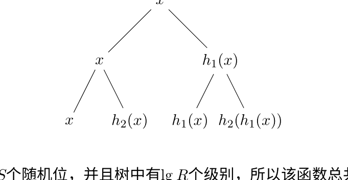
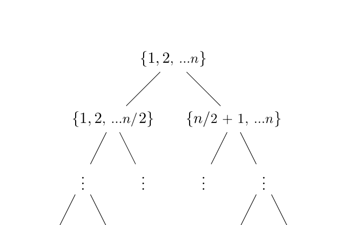
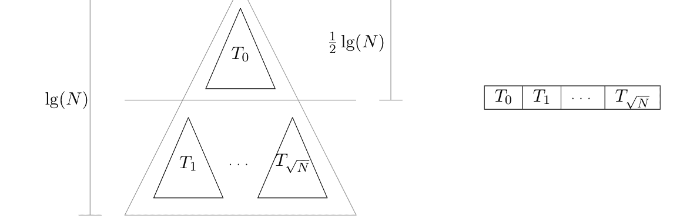
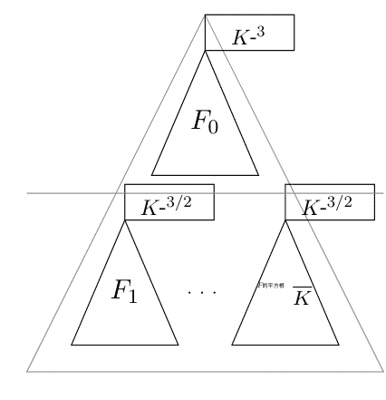

# 哈佛 CS229R 大数据算法讲义

CS 229r: 大数据算法
2015年秋季
讲座1 — 2015年9月3日
Jelani Nelson教授
记录员：王正宇

## 1 课程信息

- 教授: Jelani Nelson
- 助教: Jaroslaw Blasiok

## 2 主题概述

### 1. 概述/流式处理

- “Sketch” $C(X)$ 是对数据 $X$ 的压缩。它允许我们仅通过访问 $C(X)$ 来计算 $f(X)$ (近似值)。
- 有时 $f$ 有两个参数。对于数据 $X$ 和 $Y$，我们想要计算 $f(X,Y)$ 给定 $C(X), C(Y)$。
- 动机：也许你有一些输入数据，我也有一些输入数据，我们想要计算这两个数据库之间的某种相似度度量。一种方法是我可以直接发送给你整个数据库，然后你可以在本地计算相似度度量，反之亦然。但是想象一下这些是非常大的数据集，我不想通过网络发送整个数据，相反我将计算我的数据的草图，然后将草图发送给你，这是经过压缩后非常小的东西。现在，草图 $C(X)$ 比 $X$ 小得多，而且在给定草图的情况下，你可以计算函数。
- 简单的例子：假设你有一批数字，我也有一批数字。 我们想要计算它们的总和。我可以做的草图只是本地求和我所有的输入数据，并将总和发送给你。
- 流式处理：我们希望在更新时实时维护草图 $C(X)$。在之前的例子中，如果数字是实时到达的，我可以保持一个累加和，这是一种流式处理算法。流式处理的设置在很多地方都出现，例如，你的路由器可以监控在线流量。你可以对流量数量进行草图处理以找到流量模式。

### 2. 降维

- 输入数据是高维的。降维将高维数据转换为低维版本，这样对于你考虑的计算问题，一旦你在降维转换后的数据上解决了问题，你就可以得到原始数据的近似解。由于数据是在低维空间中，你的算法可以更快地运行。
- 应用：加速聚类，最近邻等

### 3. 大规模机器学习

- 例如，回归问题：我们收集数据点 $\{(z_i, b_i)| i= 1, \ldots, n\}$ 使得 $b_i = f(z_i) + \text{噪声}$。我们希望恢复的 $\tilde{f}$ 要与 $f$ “接近”。
- 线性回归： $f(z) = \langle x, z\rangle$，其中 $x$ 是我们想要恢复的参数。如果噪声是高斯的，我们使用的流行（并在某种程度上最优）估计器是最小二乘法
$$x^{LS} = \arg \min \|Zx - b\|_2^2 = (Z^T Z)^{-1} Zb,\tag{1}$$
其中 $b=(b_1, \ldots, b_n)^T$ 和 $Z=(z_1, \ldots, z_n)^T$。如果 $Z$ 很大，矩阵乘法可能会非常昂贵。在这门课程中，我们将学习一些技术，使我们能够比仅计算闭式形式 $(Z^T Z)^{-1} Zb$ 更快地解决最小二乘问题。
- 其他回归问题：主成分分析（PCA），矩阵补全。例如，Netflix问题的矩阵补全：给定一个大的产品-客户矩阵，其中包含某些产品的客户评级。该矩阵非常稀疏，因为不是每个用户都会对所有东西进行评级。基于有限的信息，你希望猜测出矩阵的其余部分以进行产品推荐。

### 4. 压缩感知

- 动机：以线性测量的方式压缩/廉价地获取高维信号
- 例如，图像是非常高维的向量。如果图像的维度是数千乘数千，这意味着图像有数百万个像素。如果我们将图像以像素的标准基础写入，很可能像素不是稀疏的（稀疏指几乎为零），因为想象一下在黑暗的房间里拍照，大多数像素都有一定的强度。但是有一些称为小波基的基础，图片在这个基础上通常非常稀疏。一旦某物稀疏，就可以对其进行压缩。
- JPEG（图像压缩）。
- MRI（信号更快地获取意味着在机器中的时间更短）。

### 5. 外部存储器模型

- 动机：测量磁盘I/O而不是指令数量（因为随机寻址非常昂贵）。
- 模型：我们有一个无限的磁盘，分成大小为 $b$ 位的块，和一个大小为 $M$ 的内存，分成大小为 $b$ 位的页。如果我们要读取的数据或要写入的位置在内存中，我们可以免费地简单地执行；如果要访问的位置不在内存中，我们需要花费1个单位时间将块从磁盘加载到内存中，反之亦然。我们希望尽量减少访问磁盘的时间。
- B树是为这个模型设计的。

### 6. 其他模型（如果时间允许）

- 例如，MapReduce。

## 3 近似计数问题

在接下来的内容中，我们讨论了出现在第一篇流式处理论文[1]中的问题。问题。一批事件发生了。.我们想要计算事件的数量，同时尽量减少我们使用的空间。

请注意，我们有一个平凡的解决方案-维护一个计数器-它需要$\log n$位，其中 $n$是事件的数量。另一方面，根据鸽巢原理，如果我们想要精确计数，我们无法超过$\log n$位。

对于近似计数问题，我们希望输出一个近似值，使得
$\mathbb{P}(|\tilde{n} - n| > \varepsilon n) < \delta,$ (2)
假设 $\varepsilon = 1/3$， $\delta = 1\%$。

首先，我们可以说，如果我们想为近似计数问题设计一个确定性算法，我们无法击败对数对数n位，因为类似于先前的下界论证，有$\log n$个不同的带（不同的2的幂），并且需要$\log \log n$位来区分它们。因此，我们可能希望有一个$O(\log \log n)$位的算法。实际上，下面的Morris算法可以给我们所需的界限：

1. 初始化$X \leftarrow 0$。
2. 对于每个事件，以概率$\frac{1}{2^X}$增加$X$。
3. 输出$\tilde{n}=2^X-1$。

直观上，我们有$X \approx \lg n$，其中$\lg x=\log_2(2+x)$。在为算法进行严格分析之前（在第5节中），我们首先进行概率回顾。

## 4 概率复习

我们主要讨论离散随机变量。设随机变量 $X$ 取值于 $S$ 。期望值 $\mathbb{E}(X)$ 定义为 $\sum_{j \in S} j \cdot \mathbb{P}(X = j)$。

> 引理1 (期望的线性性)。
$\mathbb{E}(X+Y) = \mathbb{E}(X) + \mathbb{E}(Y)$

> 引理 2 (马尔可夫)。
$X$ 是非负随机变量 $\Rightarrow \forall \lambda > 0, \mathbb{P}(X > \lambda) \leq \frac{\mathbb{E}(X)}{\lambda}$ (4)

> 引理 3 (切比雪夫)。
$\forall \lambda > 0, \mathbb{P}(|X - \mathbb{E}(X)| > \lambda) \leq \frac{\mathbb{E}(|X - \mathbb{E}(X)|)^2}{\lambda^2}$ (5)

证明。 $\mathbb{P}(|X - \mathbb{E}(X)| > \lambda) = \mathbb{P}((X - \mathbb{E}(X))^2 > \lambda^2)$。由马尔可夫得出。 $\square$

此外，切比雪夫可以推广为：
对于任意的$p>0$和$\lambda>0$，有$\mathbb{P}(|X - \mathbb{E}X| > \lambda) \leq \frac{\mathbb{E}(X - \mathbb{E}X)^p}{\lambda^p}$ \quad (6)

引理4（切尔诺夫）。 $X_1, ..., X_n$是独立的随机变量，其中 $X_i \in [0, 1]$。令 $X = \sum_i X_i$, $\lambda > 0$,$
$\mathbb{P}(|X - \mathbb{E}X| > \lambda \cdot \mathbb{E}X) \leq 2 \cdot e^{-\lambda^2 \cdot \mathbb{E}X/3}$ \quad (7)

证明。由于这是相当标准的，证明细节可以在之前的笔记$^1$（2013年秋季第1讲）和维基$^2$中找到，我们在这里只包含一个证明概述。 我们可以证明，$\mathbb{P}(X - \mathbb{E}X > \lambda \cdot \mathbb{E}X)$和 $\mathbb{P}(X - \mathbb{E}X < -\lambda \cdot \mathbb{E}X)$都小于 $e^{-\lambda^2 \cdot \mathbb{E}X/3}$，然后应用并集边界来引理。

证明 $\mathbb{P}(X - \mathbb{E}X < -\lambda \cdot \mathbb{E}X) < e^{-\lambda^2 \cdot \mathbb{E}X/3}$ 对称于 $\mathbb{P}(X - \mathbb{E}X > \lambda \cdot \mathbb{E}X) < e^{-\lambda^2 \cdot \mathbb{E}X/3}$。因此，我们可以专注于如何证明 $\mathbb{P}(X - \mathbb{E}X > \lambda \cdot \mathbb{E}X) < e^{-\lambda^2 \cdot \mathbb{E}X/3}$。由于 $\mathbb{P}(X - \mathbb{E}X > \lambda \mathbb{E}X) = \mathbb{P}(e^{t(X - \mathbb{E}X)} > e^{t \lambda \mathbb{E}X}) < \frac{\mathbb{E} e^{t(X - \mathbb{E}X)}}{e^{t \lambda \mathbb{E}X}}$ 对于任意$t>0$，我们可以优化 $t$以获得所需的界限。 $\square$

引理5（伯恩斯坦）。 $X_1, . . . . . . . . . . . . . . . . . . . . . . . . . X_n$是独立的随机变量，其中 $|X_i| \leq K$。令 $X = \sum_i X_i$ 和 $\sigma^2 = \sum_i \mathbb{E}(X_i - \mathbb{E} X_i)^2$。对于 $\forall t > 0$,$
$e^{-ct^2/\sigma^2} + e^{-ct/K}$ \quad (8)
其中。意味着 $\leq$一个常数，并且 $c$是一个常数。

证明。首先，我们定义随机变量 $Z$的 $p$ ($p \geq 1$) 范数为 $\|Z\|_p = (\mathbb{E}|Z|^p)^{1/p}$。在证明中，我们还将使用Jensen不等式： $f$是凸函数 $\Rightarrow f(\mathbb{E} Z) \leq \mathbb{E} f(Z)$。要证明Bernstein，等价于证明（等价关系留给习题）$\forall p \geq 1$, $\|$
$\|\sum_i X_i - \mathbb{E} \sum_i X_i \|_p \lesssim \sqrt{p} \cdot \sigma + p \cdot K$ \quad (9)
令 $Y_i$与 $X_i$独立同分布，其中 $\{X_i|i=1, . . . . . . . . . . . . . . . . . . . . . n\}$, $\{Y_i|i=1, . . . . , n\}$独立. 我们有
$^1$http://people.seas.harvard.edu/~minilek/cs229r/fall13/lec/lec1.pdf  
$^2$https://en.wikipedia.org/wiki/Chernoff_bound
$$\| \sum_{i} X_{i} - \mathbb{E} \sum_{i} X_{i} \|_{p} = \| \mathbb{E}_{Y}( \sum_{i} X_{i} - \sum_{i} Y_{i}) \|_{p} \tag{10}$$
$$\leq \| \sum_{i} (X_{i} - Y_{i}) \|_{p} \quad \text{(Jensen不等式)} \tag{11}$$
$$= \| \sum_{i} \alpha_{i} (X_{i} - Y_{i}) \|_{p} \quad \text{(添加均匀随机符号} \quad \alpha_{i} = \pm 1) \tag{12}$$
$$\leq \| \sum_{i} \alpha_{i} X_{i} \|_{p} + \| \sum_{i} \alpha_{i} Y_{i} \|_{p} \quad \text{(三角不等式)} \tag{13}$$
$$= 2 \| \sum_{i} \alpha_{i} X_{i} \|_{p} \tag{14}$$
$$= 2 \cdot \sqrt{\frac{\pi}{2}} \cdot \| \mathbb{E}_{g} \sum_{i} \alpha_{i} |g_{i}| X_{i} \|_{p} \quad \text{(假设 } g \text{是独立同分布的高斯向量)} \tag{15}$$
$$\lesssim \| \sum_{i} \alpha_{i} |g_{i}| X_{i} \|_{p} \quad \text{(Jensen不等式)} \tag{16}$$
$$= \| \sum_{i} g_{i} X_{i} \|_{p} \tag{17}$$
注意 $\sum_{i} \alpha_{i} |g_{i}| X_{i}$ 服从方差为 $\sum_{i} X_{i}^{2}$ 的高斯分布  高斯分布 $Z$ 的第 $p$ 阶矩:
$$\mathbb{E} Z^{p} = \begin{cases} 0, & \text{当} p \text{为奇数时.} \\ \frac{p!}{(p/2)! 2^{p/2}} \leq \sqrt{p^{p}}, & \text{当 } p \text{为偶数时.} \end{cases} \tag{18}$$
因此,
$$\| \sum_{i} g_{i} X_{i} \|_{p} \leq \sqrt{p} \cdot \| ( \sum_{i} X_{i}^{2} )^{1/2} \|_{p} \tag{19}$$
$$= \sqrt{p} \cdot \| \sum_{i} X_{i}^{2} \|_{p/2}^{1/2} \tag{20}$$
$$\leq \sqrt{p} \cdot \| \sum_{i} X_{i}^{2} \|_{p}^{1/2} \quad \text{($\| Z \|_{p} \leq \| Z \|_{q}$ for $p < q$)} \tag{21}$$
$$= \sqrt{p} [ \| \sum_{i} X_{i}^{2} - \mathbb{E} \sum_{i} X_{i}^{2} + \mathbb{E} \sum_{i} X_{i}^{2} \|_{p} ]^{\frac{1}{2}} \tag{22}$$
$$\leq \sqrt{p} [ \| \mathbb{E} \sum_{i} X_{i}^{2} \|_{p}^{1/2} + \| \sum_{i} X_{i}^{2} - \mathbb{E} \sum_{i} X_{i}^{2} \|_{p}^{1/2} ] \tag{23}$$
$$= \sigma \sqrt{p} + \sqrt{p} \cdot \| \sum_{i} X_{i}^{2} - \mathbb{E} \sum_{i} X_{i}^{2} \|_{p}^{1/2} \tag{24}$$
$$\lesssim \sigma \sqrt{p} + \sqrt{p} \cdot \| \sum_{i} g_{i} X_{i}^{2} \|_{p}^{1/2} \quad \text{(应用相同的技巧 (10) - (17) )} \tag{25}$$
注意 $\sum_{i} g_{i} X_{i}^{2}$ 服从方差为 $\sum_{i} X_{i}^{4}$ 的高斯分布 $\sum_{i} X_{i}^{4} \leq K^{2} \cdot (\sum_{i} X_{i})^{2}$ 我，和 $\sum_{i} g_{i} X_{i}$ 服从高斯分布，方差为 $\sum_{i} X_{i}^{2}$,
$\|\sum_i g_i X_i^2\|_p \leq K \cdot \|\sum_i g_i X_i\|_p.$

令 $Q = \|\sum_i g_i X_i\|_p^{1/2}$，我们有
$Q^2 - C\sigma \sqrt{p} - C\sqrt{p}\sqrt{K}Q \leq 0,$
其中 $C$ 是一个常数。

因为它是一个二次形式， $Q$ 上界为较大的根
$Q^2 - C\sigma \sqrt{p} - C\sqrt{p}\sqrt{K}Q = 0.$
通过计算，
$Q^2 \leq C\sqrt{p}\sqrt{K}Q + C\sigma \sqrt{p} \lesssim \sqrt{p}\cdot\sigma + p\cdot K.$
□

## 5 分析

让 $X$ 在 Morris 算法中的事件后表示 $X$

### 声明6

$\mathbb{E} 2^{X_n} = n + 1$

证明我们通过对 $n$ 进行归纳来证明

1. 基本情况 当 $n = 0$ 时显然成立
2. 归纳步骤
$\mathbb{E} 2^{X_{n+1}} = \sum_{j=0}^{\infty} \mathbb{P}(X_n = j) \cdot \mathbb{E}(2^{X_{n+1}}|X_n = j)$
$= \sum_{j=0}^{\infty} \mathbb{P}(X_n = j) \cdot (2j(1 - 1/2j) + \frac{1}{2^j} \cdot 2^{j+1})$
$= \sum_{j=0}^{\infty} \mathbb{P}(X_n = j)2^j + \sum_j \mathbb{P}(X_n = j)$
$= \mathbb{E} 2^{X_n} + 1$
$= (n + 1) + 1$

通过切比雪夫，
$\mathbb{P}(|\tilde{n} - n| > \varepsilon n) < \frac{1}{\varepsilon^2 n^2} \cdot \mathbb{E}(\tilde{n} - n)^2 = \frac{1}{\varepsilon^2 n^2} \mathbb{E}(2^X - 1 - n)^2. \quad (31)$

此外，我们可以通过归纳法证明以下命题。

### 命题7

$\mathbb{E}(2^{2X_n}) = \frac{3}{2}n^2 + \frac{3}{2}n + 1. \quad (32)$

因此，
$\mathbb{P}(|\tilde{n} - n| > \varepsilon n) < \frac{1}{\varepsilon^2 n^2} \cdot \frac{n^2}{2} = \frac{1}{2\varepsilon^2}. \quad (33)$

## 5.1 Morris+

我们实例化独立的Morris副本并平均它们的输出。然后，(33)的右边变成 $ \frac{1}{2s\varepsilon^2} < \delta $ 对于 $ s > \frac{3}{2\varepsilon^2} = \Theta(\frac{1}{\varepsilon^2}) $. (或 < δ 对于 $ s > \frac{1}{2\varepsilon^2\delta} $)

## 5.2 Morris++

运行 $t$ 个Morris+实例，失败概率为 $ \frac{1}{3} $。所以 $ s = \Theta( - \frac{1}{\varepsilon^2}) $. 从 $t$ 个Morris+中输出中位数估计。它适用于 $ t=\Theta(\lg \frac{1}{\delta}) $，因为如果中位数失败，则超过1/2的Morris+失败。

令
$Y_i = \begin{cases} 1, & \text{如果第 }i\text{ 个 Morris+失败。} \\ 0, & \text{否则。} \end{cases} \quad (34)$
根据切诺夫界定，
$\mathbb{P}(\sum_{i} Y_i > \frac{t}{2}) \le \mathbb{P}(|\sum_{i} Y_i - \mathbb{E}\sum_{i} Y_i| > \frac{t}{6}) \le e^{-ct} < \delta \quad (35)$

## 参考文献

[1] Robert Morris. Counting Large Numbers of Events in Small Registers. *Commun. ACM*, 21(10): 840-842, 1978.

# 1 概率回顾

Chebyshev: \( P(|X - \mathbb{E}X| > \lambda) < \frac{Var[X]}{\lambda^2} \)

Chernoff: 对于 \( X_1, \ldots, X_n \) 独立于 [0,1], \( \forall 0 < \epsilon < 1 \), and \( \mu = \mathbb{E}_i X_i \), \( P\left(\left| \sum_i X_i - \mu \right| > \epsilon \mu \right) < 2e^{-\epsilon^2 \mu / 3} \)

# 2 今天

- 不同的元素
- 范数估计（如果有时间的话）

# 3 不同的元素（\( F_0 \)）

问题：给定一个整数流 \( i_1, \ldots, i_m \in [n] \) 其中 \( [n] := \{1,2,\ldots,n\} \), 我们想要输出看到的不同元素的数量。

## 3.1 直接算法

1. 保持一个长度为\( n \)的位数组。如果看到一个数字，则翻转位。
2. 存储整个流。需要 \( m \lg n \) 位。

我们可以用 \( O(\min(n, m \lg n)) \) 位来解决。

## 3.2 随机近似

我们可以输出 \( \tilde{t} \) s.t. \( P(|t - \tilde{t}| > \epsilon t) < \delta \). 原始解决方案由Flajolet和Martin [2]提出。

## 3.3 理想化算法

1. 选择随机函数 \( h: [n] \to [0,1] \) (理想化，因为我们无法很好地存储这个)
2. 维护计数器 \( X = \min_{i \in stream} h(i) \)
3. 输出 \( 1 / X - 1 \)

直觉。 \( X \) 是一个随机变量，是 \( t \) 个独立同分布的 \( Unif(0,1) \) 随机变量的最小值

主张 1. \( \mathbb{E}X = \frac{1}{t+1} \).

证明。

```
\mathbb{E}X = \int_0^\infty P(X > \lambda) d\lambda \\
= \int_0^\infty P(\forall i \in str, h(i) > \lambda) d\lambda \\
= \int_0^\infty \prod_{r=1}^t P(h(i_r) > \lambda) d\lambda \\
= \int_0^1 (1 - \lambda)^t d\lambda \\
= \frac{1}{t+1}
```

主张 2. \( \mathbb{E}X^2 = \frac{2}{(t+1)(t+2)} \)

证明。

```
\mathbb{E}X^2 = \int_0^1 P(X^2 > \lambda) d\lambda \\
= \int_0^1 P(X > \sqrt{\lambda}) d\lambda \\
= \int_0^1 (1 - \sqrt{\lambda})^t d\lambda \quad u = 1 - \sqrt{\lambda} \\
= 2 \int_0^1 u^t (1 - u) du \\
= \frac{2}{(t+1)(t+2)}
```

这给出 \( Var[X] = \mathbb{E}X^2 - (\mathbb{E}X)^2 = \frac{t}{(t+1)^2(t+2)} \)，并且进一步 \( Var[X] < \frac{1}{(t+1)^2} = (\mathbb{E}X)^2 \).

## 4 FM+

我们从理想算法FM中平均多个估计值。

1. 独立实例化 $q= 1/\epsilon^2 \eta$ FMs
2. 让 $X_i$ 来自FM $i$.
3. 输出 $1/Z - 1$，其中 $Z = \frac{1}{q} \sum_{i=1}^q X_i$

我们有 $\mathbb{E}(Z) = \frac{1}{t+1}$，而 $Var(Z) = \frac{1}{q} \frac{t}{(t+1)^2 (t+2)} < \frac{1}{q(t+1)^2}$.

第三项。 $P(|Z - \frac{1}{t+1}| > \frac{\epsilon}{t+1}) < \eta$

证明。切比雪夫。

```
P(|Z - \frac{1}{t+1}| > \frac{\epsilon}{t+1}) < \frac{(t+1)^2}{\epsilon^2} \frac{1}{q(t+1)^2} = \eta
```

第四项。 $P(|(1/Z - 1) - t| > O(\epsilon)t) < \eta$

证明。根据前面的论述，以概率$1-\eta$我们有

```
\frac{1}{(1\pm\epsilon)^{\frac{1}{t+1}}} - 1 = (1 \pm O(\epsilon))(t+1) - 1 = (1 \pm O(\epsilon))t \pm O(\epsilon)
```

## 5 FM++

我们从FM+的多个估计中取中位数。

1. 实例化 $s = \lceil 36 \ln(2/\delta) \rceil$ FM+ 的 $\eta=1/3$个独立副本。
2. 输出中位数 $t$ of $\{1/Z_j - 1\}_{j=1}^s$ 其中 $Z_j$来自于FM+的第j个副本。

> Claim 5. $P(|t - t| > \epsilon t) < \delta$

Proof.让

```
Y_j = \begin{cases} 1 & \text{如果 } |(1/Z_j - 1) - t| > \epsilon t, \\ 0 & \text{否则} \end{cases}
```

我们有 $\mathbb{E}Y_j = P(Y_j = 1) < 1/3$ 从选择的 $\eta$。 我们试图限制的概率等于中位数失败的概率，即至少一半的FM+估计值有 $Y_j = 1$。换句话说，

```
\sum_{j=1}^s Y_j > s/2
```

然后我们得到
$$P(\sum Y_j > s/2) = P(\sum Y_j - s/3 > s/6)$$ (1)
做出简化假设 $\mathbb{E}Y_j = 1/3$ (这比 $\mathbb{E}Y_j < 1/3$更强)。
然后方程1变为
$$P(\sum Y_j - \mathbb{E} \sum Y_j > \frac{1}{2} \mathbb{E} \sum Y_j)$$

使用Chernoff,
$$< e^{-\frac{(\frac{1}{2})^2 s/3}{3}} < \delta$$

按需求。
最终所需的空间，忽略 $h$, 是 $O(\lg(1/\delta) \frac{1}{\epsilon^2})$ 对于需要 $O(\lg(1/\delta))$ 个每个需要 $O(1/\epsilon^2)$ 空间的 FM+ 副本。

# 6 $k$-wise 独立函数

定义 6.一个将 $[a]$ 映射到 $[b]$ 的函数族 $\mathcal{H}$如果对于所有的$j_1, \ldots, j_k \in [b]$ 和对于所有不同的 $i_1, \ldots, i_k \in [a]$, $$P_{h \in \mathcal{H}}(h(i_1)=j_1 \wedge \ldots \wedge h(i_k)=j_k) = 1/b^k$$

例子。集合$\mathcal{H}$中的所有函数$[a]$到$[b]$对于每个$k$都是$k$-wise独立的。$|\mathcal{H}|=ba$，所以$h$可以用$ba$位表示。

例子。假设$a=b=q$为$q=p^r$的素数幂，那么$\mathcal{H}_{poly}$是$\mathbb{F}_q$上次数$\leq k-1$的多项式的集合。$|\mathcal{H}_{poly}|=q^k$，所以$h$可以用$klg p$位表示。

第7点声明。$\mathcal{H}_{poly}$是$k$-wise独立的。

证明。插值。

## 7 非理想化FM

首先，我们用$O(1)$位得到一个$O(\lg n)$的近似值，即我们的估计值$\tilde{t}$满足$t/C \leq \tilde{t} \leq Ct$，其中$C$是一个常数。

1. 从2-wise家族中选择$h$，使得$[n] \rightarrow [n]$，其中$n$是2的幂次方（如果需要则向上取整）
2. 维护$X = \max_{i \in S} \text{lsb}(h(i))$，其中$\text{lsb}$是一个数字的最低有效位
3. 输出$2^X$

对于固定的$j$，令$Z_j$为流中满足$\text{lsb}(h(i)) = j$的$i$的数量 令$Z_{>j}$为流中满足$\text{lsb}(h(i)) > j$的$i$的数量

$$Y_i = \begin{cases} 1 \text{ 如果 } \text{lsb}(h(i)) = j \\ 0 \text{ 否则} \end{cases},\ Z_j = \sum Y_i$$
我们可以计算 $\mathbb{E}[Z_j] = t/2^{j+1}$, 类似地
$$\mathbb{E}[Z_{>j}] = t(\frac{1}{2^{j+2}} + \frac{1}{2^{j+3}} + ...) < t/2^{j+1}$$

还有
$$Var[Z_j] = Var[\sum Y_i] = \mathbb{E}[(\sum Y_i)^2] - (\mathbb{E}[\sum Y_i])^2 = \sum_{i_1, i_2} \mathbb{E}(Y_{i_1} Y_{i_2})$$
由于$h$来自一个2-次独立族，$Y_i$是两两独立的，所以$\mathbb{E}(Y_{i_1} Y_{i_2}) = \mathbb{E}(Y_{i_1})\mathbb{E}(Y_{i_2})$。然后我们可以证明
$$Var[Z_j] < t/2^{j+1}$$

现在对于 $j^* = \lceil \lg t - 5 \rceil$，我们有
$$16 \leq \mathbb{E}Z_{j^*} \leq 32$$
$$P(Z_{j^*} = 0) \leq P(|Z_{j^*} - \mathbb{E}Z_{j^*}| \geq 16) < 1/5$$
通过切比雪夫不等式。

对于 $j = \lceil \lg t + 5 \rceil$
$$\mathbb{E}Z_{>j} \leq 1/16$$
$$P(Z_{>j} \geq 1) < 1/16$$
由马尔可夫得出。

这意味着很大的概率下，最大的lsb将在 $j^*$ 上方但在 $j$ 下方，处于一个恒定的范围内。
这给我们提供了一个32倍的近似，即恒定的近似。

# 8 优化为 $1 + \epsilon$

平凡的解决方案。 算法TS存储前 $C/\epsilon^2$个不同的元素。. 如果 $t \leq C/\epsilon^2$，则这是正确的。

算法。

1. 实例化$TS_0, \dots, TS_{\lg n}$
2. 从2-wise族中选择 $g: [n] \to [n]$
3. 将 $i$输入到$TS_{\text{lsb}(g(i))}$
4. 输出$2^{j+1}$ out，其中 $t/2^{j+1} \approx 1/\epsilon^2$。

让$B_j$是由$g$散列到$TS_j$的不同元素的数量。 通过切比雪夫，$B_j = Q_j \pm O(\sqrt{Q_j})$的概率很高。如果$Q_j \geq 1/\epsilon^2$，这等于$(1 \pm O(\epsilon))Q_j$。
最终空间：$O(\lg n)$ 个 $O(1/\epsilon^2)$ = $O(\frac{1}{\epsilon^2} \lg n)$位。
已知空间$O(1/\epsilon^2 + \log n)$是可实现的[4]，而且这是最优的[1, 5]（还可以参见[3]）。

# 参考文献

- [1] Noga Alon, Yossi Matias, Mario Szegedy  The Space Complexity of Approximating the Frequency Moments. J. Comput. Syst. Sci. 58(1): 137-147, 1999.
- [2] Philippe Flajolet, G. Nigel Martin 数据库应用的概率计数算法。 J. Comput. Syst. Sci., 31(2):182-209, 1985年。
- [3] T. S. Jayram, Ravi Kumar, D. Sivakumar: 哈明距离的单向通信复杂性。计算理论4(1): 129-135 , 2008年。
- [4] Daniel M. Kane, Jelani Nelson, David P. Woodruff 不同元素问题的最优算法。 在第二十九届ACM SIGMOD-SIGACT-SIGART数据库系统原理研讨会（PODS）, 第41-52页, 2010年。
- [5] David P. Woodruff. 所有频率矩的最优空间下界。在SODA, 第167-175页, 2004年。

# 1 概述

在上一讲中，我们讨论了不同元素、k次独立性和几何子采样的流处理。

在本讲中，我们将看到关于数据流的精确和近似确定性算法的下界，以及用于 $F_p$矩的AMS草图和Indyk算法，其中 $0 \leq p \leq 2$。

# 2 主要部分

## 2.1 流处理算法的空间下界

我们首先考虑一个不可能的结果。我们考虑不同元素问题，其中您希望在流中找到不同元素的数量，允许查询和添加。
我们用 $s$ 表示算法的空间，$n$ 表示元素来自的宇宙的大小，$m$ 表示流的长度。我们有以下结果[1]。

定理1。在 $O(\min\{n, m\})$ 空间中，没有确定性精确算法来计算不同元素的数量。

证明。我们将进行一个信息论的论证。使用一个流算法具有当前问题的空间 $s$，我们将展示如何仅使用 $s$ 位来编码 $\{0, 1\}^n$。
换句话说，我们将构建一个从 $\{0, 1\}^n$ 到 $\{0, 1\}^s$ 的单射映射。因此，这意味着 $s$ 必须至少为 $n$，我们完成了。我们寻找过程 $Dec$，$Enc$，使得 $\forall x Dec(Enc(x)) = x$，且 $Enc(x)$ 是从 $\{0, 1\}^n$ 到 $\{0, 1\}^s$ 的函数。
对于编码过程，给定一个字符串 $x$，创建一个包含并在流的末尾附加 $i$ 的流，如果 $x_i = 1$。然后 $Enc(x)$ 是该流算法的内存内容。
对于解码过程，我们将查看每个 $i$ 并将其附加到流的末尾（将其提供给流算法），然后查询不同元素的数量。如果不同元素的数量增加，这意味着 $x_i = 0$，否则意味着 $x_i = 1$。因此，我们可以完全恢复 $x$，并完成证明。

□

我们继续展示即使是近似算法也对这个问题毫无希望。

定理2。任何提供 1.1近似度的确定性 $F_0$ 算法都需要 $\Omega(n)$ 空间。

证明。假设我们有一个满足条件的集合 $C$：

- $|C| \geq 2^{cn}$，其中$c < 1$是一个常数。
- $\forall S \in C, |S| = \frac{n}{100}$
- $\forall S = T \in C, |S \cap T| \leq \frac{n}{2000} \leq \frac{1}{20}|S|$

我们将在稍后证明这样一个集合的存在，并且我们将转向我们的下界。我们将使用算法来编码向量 $x_S \forall S \in C$，其中 $x_S$ 是集合 $S$ 的指示向量。与之前一样，下界仍然成立，因为我们必须有 $s \geq c n$ 编码过程与之前相同。

对于解码过程，我们将遍历所有的集合，并对每个集合 $S$ 进行测试，看它是否对应于我们的初始编码集合（请记住，我们只是进行信息论的论证，不关心运行时间-我们只关心这个映射是一个单射）。为了实现这一点，我们在每个时间点都保留流算法 $M$ 的内存内容，插入我们的初始字符串后。然后对于每个 $S$，我们使用内存内容 $M$ 初始化我们的算法，然后输入元素 $i$ 如果 $i \in S$。很容易看出，如果 $S$ 等于初始编码集合，不同元素的数量不会增加太多，而如果不是，则几乎翻倍。考虑到算法的近似保证，我们可以看到例如如果 $S$ 不是我们的初始集合，不同元素的数量增加了 $2^3$（如果需要，我们可以调整参数）。

现在我们只需要证明这样一个集合族 $C$ 的存在。我们将通过概率方法进行论证。我们将 $n$ 划分为 $100$ 个长度为 $\frac{n}{100}$ 的区间，按照显而易见的方式。为了形成一个集合 $S$ ，我们从每个区间中均匀随机选择一个数字。显然，这样一个集合的大小恰好为 $100$。对于两个以前均匀随机选择的集合 $S, T$，让 $U_i$ 成为一个随机变量，如果它们从区间 $i$ 选择的数字相同，则 $U_i$ 等于1。显然 $P[U_i= 1] = \frac{1}{\frac{n}{100}} = \frac{100}{n}$。因此，交集的期望大小就是 $\mathbb{E} \sum_{i=1}^{100} U_i = \frac{100}{n} \cdot \frac{n}{100} = 1$。这个交集大于其均值的五倍的概率小于 $e^{-c'n}$，其中 $c'$ 是一个常数，通过标准的Chernoff界得到。然后我们可以对所有可能的交集应用一个并集界限，从而得到所需的结果。 $\square$

## 2.2 线性草图和上界

### 2.2.1 什么是线性草图？

我们在流算法中引入了转门模型。在这个模型中，我们有一个向量 $x \in \mathbb{R}^n$，它起初是全零向量，然后会有一系列的更新操作。每个更新操作的形式为 $(i, \Delta)$，其中 $\Delta \in \mathbb{R}$, $i \in \{1, ..., n\}$。这对应着操作 $x_i \leftarrow x_i + \Delta$。给定一个函数 $f$，我们想要计算或近似计算 $f(x)$。例如，在不同元素的问题中，$\Delta$ 总是1，而 $f(x) = |\{i : x_i = 0\}|$。设计转门算法的常见/唯一技术是线性草图。这个想法是在内存中维护一个短而胖的矩阵 $y = \Pi x$，其中 $\Pi \in \mathbb{R}^{m \times n}$, $m < n$，通常要小得多。我们可以看到 $y$ 是 $m$ 维的，所以我们可以高效地存储它，但是 $\Pi$ 呢？如果我们需要将整个 $\Pi$ 存储在内存中，这不会在空间方面带来更好的算法。因此，有两种常见的构建和存储 $\Pi$ 的方式。其中一种是 $\Pi$ 是确定性的，所以我们可以轻松地计算 $\Pi_{ij}$，而不需要将整个矩阵存储在内存中。另一种方法是通过 $k$ 个独立的哈希函数来定义 $\Pi$，其中 $k$ 是一个小的值，因此我们可以存储哈希函数并计算 $\Pi_{i,j}$。

现在让我们看看当我们有一个线性草图时，更新是如何发生的。让 $\Pi^i$ 是矩阵 $\Pi$ 的第 $i$ 列。因此，通过存储 $y = \Pi x$，当更新 $(i, \Delta)$ 到来时，我们有新的 $y$ 等于 $\Pi(x + \Delta e^i) = \Pi x + \Delta \Pi_i$。观察到第一个求和项是旧的 $y$，而第二个求和项只是 $\Pi$ 的第 $i$ 列的某个倍数。这意味着我可以在小空间中确定 $\Pi$ 的第 $i$ 列，我也可以在小空间中执行更新操作。

## 2.2.2 动量估计 for $p = 2$

这个问题是由Alon，Matias，Szegedy在STOC 96 [1]中研究的。令 $F_p = \|x\|_p = \sum_i |x_i|^p$。我们想要估计解决动量估计问题所需的空间随着 $p$ 的变化而变化。在 $F_p$ 的复杂度中存在一个转折点。

- 对于 $0 \leq p \leq 2$, $poly(\log(1/\epsilon))$ 对于 $(1 + \epsilon)$ 的近似，$(1 + \epsilon)$ 的空间可达到 $2/3$ 的成功概率 [1, 3]。
- 对于 $p > 2$，我们需要 $\Theta(n^{1-2/p} \cdot poly(\log n))$ -- 对于 $(1 + \epsilon)$ 的空间，$(1 + \epsilon)$ 的成功概率需要 $2/3$ 的空间 [2, 4]。

我们不考虑 $p = 2$ 的情况，即AMS草图。令 $\sigma_i \in \{-1, 1\}$ 为来自4次独立家族的随机符号。我们需要 $O(\log n)$ 位来表示这样一个家族。然后设置 $y_i = \sum_j \sigma_{ij} x_j$，这意味着我们之前提到的矩阵 $\Pi$ 的行是向量 $\sigma_i$。注意我们可以得到列，因为我们只需要评估哈希函数。我们的算法将输出 $\frac{1}{m} \|y\|^2$ 作为 $\|x\|^2$ 的估计值。

它成立的是 $\mathbb{E} y_i^2 = \mathbb{E}(\sum_{j=1}^n \sigma_{ij} x_j)^2 = \|x\|^2 + \mathbb{E} \sum_{j \ne j'} \sigma_{ij} \sigma_{ij'} x_j x_{j'} = \|x\|^2$。此外，我们需要估计方差并应用切比雪夫不等式。观察到 $\mathbb{E}(y_i^4) = \mathbb{E}(\sum_{j_1, j_2, j_3, j_4 \in [n]^4} \sigma_{i j_1} \sigma_{i j_2} \sigma_{i j_3} \sigma_{i j_4} x_{j_1} x_{j_2} x_{j_3} x_{j_4}) = \sum_{j=1}^n x_j^4 + (1/2) \binom{4}{2} \sum_{j \ne j'} x_j^2 x_{j'}^2$。因为当我们取期望时，如果一个求和项中的项出现奇数次，它的期望将为零并取消整个求和项，因此我们只剩下所有项都出现偶数次的求和项。计算方差并进行计算，我们得到了所需的结果。

事实：我们也可以使用高斯分布而不是随机符号。分析方法类似，但是我们需要对高斯分布进行离散化处理，以避免需要无限精度。我们也可以只有一个哈希函数 $\sigma: [m] \times [n] \rightarrow \{-1, 1\}$，只要它是4-wise独立的。现在的区别在于我们需要计算整个估计器的期望和方差。$\frac{1}{m} \sum_{i=1}^m y_i$ 而不是单独计算每个项。

## 2.2.3 矩估计 for $p \leq 2$

我们将描述一个理想化的算法，具有无限精度，由Indyk [3]提供。 如果对于所有的 $x \in \mathbb{R}^n$，我们从分布 $\mathbb{D}$ over $\mathbb{R}$ ($p$-$stable$)中独立地取 $z_1, ..., z_n$，则称分布$\mathbb{D}$为 $p$-$stable$。随机变量 $\sum_{i=1}^n z_i x_i$ 的分布为 $\|x\|_p \mathbb{D}$。这样的分布的一个例子是当 $p=2$时的高斯分布，当 $p=1$时的柯西分布，其概率密度函数为 $pdf(x) = \frac{1}{\pi (x^2+1)}$。

注意：根据中心极限定理，从一个分布中取样的平均值在取样数趋向无穷大时趋近于高斯分布。但是，如果我们选择一个 $p$稳定分布，其中$p<2$，比如柯西分布，为什么这不违反中心极限定理呢？实际上，为了满足中心极限定理，我们还需要分布的有界矩。但是，例如柯西分布的二阶矩是无界的，所以该定理不适用。直观上，人们可以认为 $p$稳定分布在$p>2$时不存在，因为它们违反了中心极限定理。事实上，正如20世纪20年代由Lévy证明的那样，这是正确的。事实上，他证明了 $p$稳定分布存在的充要条件是$0 \leq p \leq 2$。

我们回到Indyk的算法。 事实上，这个算法非常简单。 让$\Pi$的第$i$行为$z_i$，与之前一样，其中$z_i$来自于一个$p$稳定分布。 然后考虑$y_i=\sum_{j=1}^n z_{i,j} x_j$。 当有一个查询时，输出所有$y_i$的中位数。 我们可以假设不失一般性地，一个$p$稳定分布的中位数等于1，实际上这意味着对于来自这个分布的$z_i$，$\mathbb{P}(-1 \leq z_i \leq 1) \geq 1/2$。

## 2.3 下次

在下一堂课中，我们将分析Indyk的算法。

## 参考文献

-   [1] Noga Alon, Yossi Matias, Mario Szegedy. Approximating the Frequency Moments的空间复杂度。J. Comput. Syst. Sci., 58(1): 137–147, 1999年。
- [2] Ziv Bar-Yossef, T. S. Jayram, Ravi Kumar, D. Sivakumar. 一种信息统计方法来处理数据流和通信复杂性。J. Comput. Syst. Sci. 68(4):702–732, 2004.
- [3] Piotr Indyk. 稳定分布，伪随机生成器，嵌入和数据流计算。J. ACM 53(3):307–323, 2006.
- [4] Piotr Indyk, David P. Woodruff. 数据流频率矩的最佳逼近。STOC, 页码202–208, 2005.
- [5] Paul Lévy. 概率计算。Gauthier-Villars, 巴黎, 1925.

## 1 复习

回顾以下对 $p$稳定分布的定义。

定义1. $D_p$是 $\mathbb{R}$上的一个 $p$稳定分布，如果对于任意的 $z_1, \ldots, z_n$来自于 $D_p$的独立样本，以下条件成立： $\forall x \in \mathbb{R}^n, \sum_{i=1}^n x_i z_i \sim \|x\|_p D_p$。

换句话说，来自于一个$p$稳定分布的一组样本的任意线性组合必须本身是来自于相同分布的样本，乘以权重向量的 $p$范数。

定理1.存在一个 $p$稳定分布，当且仅当 $0 < p \le 2$。

我们知道标准高斯分布是$2$稳定的，标准柯西分布是$1$稳定的。虽然在大多数情况下，我们不知道 $p$稳定分布的简单闭合表达式，但是有一种有效的方法可以生成任意 $p\in(0, 2]$的样本。如果我们让 $\theta \in [-\pi/2, \pi/2)$和 $r\in(0, 1]$是均匀随机样本，那么

$$\frac{\sin(p\theta)}{\cos^{1/p}(\theta)}\left(\frac{\cos(\theta(1-p))}{\ln(1/r)}\right)^{\frac{1-p}{p}}$$

是从一个 $p$稳定分布中取样的样本[CMS76]。

## 2 Indyk的算法

### 2.1 概述

设 $\Pi = \{\pi_{ij}\}$是一个 $m \times n$矩阵，其中每个元素 $\pi_{ij}$都是从一个 $p$稳定分布中取样的， $D_p$。给定 $x \in \mathbb{R}^n$，Indyk的算法[Indyk06]估计 $x$的 $p$-范数为

$$\|x\|_p \approx \text{median}_{i=1,\ldots,m} |y_i|,$$

其中 $y = \Pi x$。回顾上一讲，在一个转门流模型中，流中的每个元素都反映了对 $x$中一个条目的更新。虽然一个朴素的算法会在内存中维护 $x$并在最后计算 $\|x\|_p$，从而需要 $\Theta(n)$的空间，Indyk的算法存储 $y$和 $\Pi$。结合一种空间高效的方法来生成 $\Pi$（在后面的讲座中描述），我们实现了更好的空间复杂度。

### 2.2 分析

为了简化分析，我们假设$\Pi$是由$D_p$生成的，使得如果$Z\sim D_p$，则$\text{median}(|Z|)=1$。换句话说，我们假设$D_p$分配给区间$[-1, 1]$的概率质量为$1/2$。此外，让$I_{[a, b]}(x)$是一个指示函数，定义为

$$I_{[a,b]}(x) = \begin{cases} 1 & x \in [a, b],\\ 0 & \text{otherwise.} \end{cases}$$

设$Z_i$是$\Pi$的第$i$行。我们有

$$y_i = \sum_{j=1}^{n} Z_{ij}x_j \sim \|x\|_p D_p, \tag{1}$$

这是根据$p$稳定分布的定义得出的，并注意到$Z_{ij}$是从$D_p$中采样得到的。这意味着

$$\mathbf{E}\left[I_{[-1,1]}\left(\frac{y_i}{\|x\|_p}\right)\right] = \frac{1}{2}, \tag{2}$$

由于 $y_i/\|x\|_p \sim D_p$。

此外，可以证明

$$\mathbf{E}\left[I_{[-1-\varepsilon, 1+\varepsilon]}\left(\frac{y_i}{\|x\|_p}\right)\right] = \frac{1}{2} + \Theta(\varepsilon), \tag{3}$$
$$\mathbf{E}\left[I_{[-1+\varepsilon, 1-\varepsilon]}\left(\frac{y_i}{\|x\|_p}\right)\right] = \frac{1}{2} - \Theta(\varepsilon). \tag{4}$$

接下来，考虑以下数量：

$$C_1 = \frac{1}{m} \sum_i I_{[-1-\varepsilon, 1+\varepsilon]}\left(\frac{y_i}{\|x\|_p}\right), \tag{5}$$
$$C_2 = \frac{1}{m} \sum_i I_{[-1+\varepsilon, 1-\varepsilon]}\left(\frac{y_i}{\|x\|_p}\right). \tag{6}$$

$C_1$表示满足 $|y_i| \leq (1+\varepsilon)\|x\|_p$ 的$y_i$的比例，类似地， $C_2$表示满足 $|y_i| \leq (1-\varepsilon)\|x\|_p$ 的比例。根据期望的线性性质，我们有 $\mathbf{E}[C_1] = 1/2 + \Theta(\varepsilon)$ 和 $\mathbf{E}[C_2] = 1/2 - \Theta(\varepsilon)$。因此，期望中 $|y_i|$ 的中位数位于 $[(1-\varepsilon)\|x\|_p, (1+\varepsilon)\|x\|_p]$ 中，正如所期望的那样。

现在我们分析 $C_1$ 和 $C_2$ 的方差。我们有

$$\text{Var}(C_1) = \frac{1}{m^2} \times m \times (\text{指示变量的方差}). \tag{7}$$

由于任何指示变量的方差最多为1， $\text{Var}(C_1) \leq \frac{1}{m}$。同样地， $\text{Var}(C_2) \leq \frac{1}{m}$。通过选择适当的 $m$，我们现在可以确保 $|y_i|$ 的中位数在所需的 $\varepsilon$ 范围内 $\|x\|_p$ 的高概率下。

### 2.3 取消随机化 $\Pi$

我们已经证明了Indyk的算法是有效的，但是独立生成和存储 $mn$个$\Pi$的元素是昂贵的。我们能否使用更小程度的随机性？为了调用方程1中 $p$稳定分布的定义，我们需要每行的条目彼此独立。而且为了计算方差，行之间需要两两独立。顺便提一下，生成两两独立的高斯或柯西随机变量可以通过离散化空间并将其视为离散随机变量来实现。可以声称，通过足够细的离散化，算法仍然以高概率成功。

现在假设 $w_i = \sum_{j=1}^n Q_{ij} x_j$ 其中 $Q_{ij}$ 是 $k$独立的 $p$稳定分布样本。我们想要的是一个形式的论证

$$\mathbf{E}\left[ \mathbf{1}_{[a,b]}\left( \frac{w_i}{\|x\|_p} \right) \right] \approx_\varepsilon \mathbf{E}\left[ \mathbf{1}_{[a,b]}\left( \frac{y_i}{\|x\|_p} \right) \right]. \quad (8)$$

如果我们能够提出这样的论断，那么我们可以在分析中使用每行中的 $k$独立样本来代替完全独立的样本来引用相同的论证。这已经被证明对于 $k= \Omega(1/\varepsilon^p)$ [KNW10]，但我们不会在课堂上涵盖这个内容。使用这种技术，我们只需要使用 $O(k \lg n)$ 位来指定 $\Pi$；在行之间，我们只需要使用2独立的哈希函数将行索引映射到 $O(k \lg n)$ 位种子，用于 $k$独立哈希函数。Indyk的方法对$\Pi$进行去随机化，虽然结果不如此强大，但采用了一种有用的技术，因此我们将在这里介绍。

#### 2.3.1 分支程序

分支程序可以用一个节点网格来描述，每个节点代表程序的不同状态，我们可以将其视为DFA。程序从一个不属于网格的初始节点开始。在每一步中，程序读取 $S$个输入位，反映了空间受到 $S$的限制，并决定跳转到网格的下一列中的哪个节点。在 $R$步之后（网格中的列数），程序访问的最后一个节点表示结果。整个输入可以表示为长度为 $RS$的位字符串，它引发了最终状态的分布。我们的目标是使用更少的（$\ll RS$）随机位生成输入字符串，以便保持原始的最终状态分布。以下定理解决了这个目标。

定理2. ([Nisan92]) 存在一个函数 $h: \{0,1\}^{t} \to \{0,1\}^{RS}$, 使得 $t = O(S \lg R)$, 其中

$$| P_{(x \sim U(\{0,1\}^{RS}))} \{ f(B(x)) = 1 \} - P_{(y \sim U(\{0,1\}^{t}))} \{ f(B(h(y))) = 1 \} | \leq \frac{1}{2^S}. \quad (9)$$

对于任何分支程序 $B$ 和任何函数 $f: \{0,1\}^{S} \to \{0,1\}$。

换句话说，这样的函数 $h$ 可以用只有 $t$个随机比特来模拟分支程序的输入，几乎不可能区分模拟程序的结果和原始程序的结果。

#### 2.3.2 Nisan的伪随机生成器（PRG）

这样的函数是什么样子的？我们首先从$\{0, 1\}^S$中随机抽取一个样本 x。然后我们将 x放在根节点，并重复以下过程以创建一个完全二叉树。在每个节点上，创建两个子节点，并将字符串复制到左子节点。对于右子节点，使用一个随机的2-独立哈希函数 $h_j: \{0,1\}^S \rightarrow \{0,1\}^S$，选择对应层级的哈希结果。一旦我们达到 R层级，输出所有叶子节点的连接，这是一个长度为RS位的字符串。为了说明，我们的树的前几层如下所示：



由于每个哈希函数需要S个随机位，并且树中有$\lg R$个级别，所以该函数总共使用$O(S \lg R)$位。我们不会讨论为什么该函数满足定理2中的条件。

#### 2.3.3 回到Indyk的算法

现在我们将使用Nisan的PRG来去随机化Indyk的算法中的$\Pi$。考虑以下程序：

1.  初始化 $c_1 \leftarrow 0$, $c_2 \leftarrow 0$
2.  对于 $i = 1, ..., m$:
    (a) 初始化 $y \leftarrow 0$
    (b) 对于 $j = 1, ..., n$:
        i. 更新 $y \leftarrow y + \pi_{ij}x_j$
    (c) 如果 $|y| \leq (1+\varepsilon)\|x\|_p$，则增加 $c_1$
    (d) 如果 $|y| \leq (1-\varepsilon)\|x\|_p$，则增加 $c_2$

注意，此程序仅使用 $O(\log n)$ 位，并且是一个模拟 Indyk 算法正确性证明的分支程序。更具体地说，当此程序结束时，如果 $c_1 > m/2$ 且 $c_2 < m/2$，则 Indyk 算法成功。此程序中唯一的随机源是 $\pi_{ij}$。我们将使用 Nisan 的 PRG 生成这些随机数。我们将上述程序作为 $B$，并使用检查算法成功与否的指示函数作为 $f$来调用定理 2。请注意，空间限制为 $S = O(\log n)$，程序执行的步骤数为 $R = O(mn)$，或 $O(n^2)$，因为 $m \leq n$。这意味着我们只需使用 $O(\log^2 n)$ 个随机位来生成 $\Pi$，就可以“欺骗” Indyk 算法的正确性证明。

## 3 The p > 2 Case

Indyk的算法使用 p稳定分布，该分布仅存在于 p ∈ (0,2]。当 p > 2时我们该怎么办？

定理3. $n^{1-2/p}poly(\frac{\lg n}{\varepsilon})$ 空间是必要且充分的。

一个近乎最优的下界由[BarYossef04]给出，并首次由[IW05]实现。在这个讲座中，我们将讨论[Andoni12]的算法，该算法基于[AKO11]和[JST11]。我们将重点关注 $\varepsilon = \Theta(1)$。细化这个结果可能包含在下一个作业中。

在这个算法中，我们让$\Pi = PD$。P是一个 m × n矩阵，其中每一列都有一个单一的非零元素，该元素可以是1或-1。D是一个 n × n对角矩阵，其中 $d_{ii} = u_i^{-1/p}$，其中u_i服从指数分布Exp(1)。换句话说，

$$P\{u > t\} = \begin{cases} 1 & t \leq 0, \\ e^{-t} & t > 0. \end{cases}$$

类似于0 < p ≤ 2的情况，我们保持$y = \Pi x$，但是这里我们用$\|y\|_\infty = \max_i |y_i|$来估计$\|x\|_p$。

定理4. $P \left\{\frac{1}{4}\|x\|_p \leq \|y\|_\infty \leq 4\|x\|_p\right\} \geq \frac{1}{2}$，当$m = \Theta(n^{(1-2/p)}\lg n)$时。

令$z = Dx$，意味着$y = Pz$。为了证明定理4，我们首先要证明$\|z\|_\infty$提供了一个很好的估计，然后证明应用P到z上保持这个估计。由于时间限制，后一步推迟到下一节课。

声明 1. $P \left\{\frac{1}{2}\|x\|_p \leq \|z\|_\infty \leq 2\|x\|_p\right\} \geq \frac{3}{4}$

证明. 让 $q = \min_i \left\{\frac{u_i}{|x_i|^p}\right\}$。我们有

$$P\{q > t\} = P\{\forall i, u_i > t|x_i|^p\} \tag{11}$$
$$= \prod_{i=1}^{n} e^{-t|x_i|^p} \tag{12}$$
$$= e^{-t\|x\|_p^p}, \tag{13}$$

这意味着 $q \sim \frac{\text{Exp}(1)}{\|x\|_p^p}$。因此，

$$P\left\{\frac{1}{2}\|x\|_p \leq \|z\|_\infty \leq 2\|x\|_p\right\} = P\left\{\frac{1}{2^p}\|x\|_p^{-p} \leq q \leq 2^p\|x\|_p^{-p}\right\} \tag{14}$$
$$= e^{-\frac{1}{2^p}} - e^{-2^p} \tag{15}$$
$$\geq \frac{3}{4}, \tag{16}$$

对于$p > 2$。# 参考文献

[CMS76] J. M. Chambers, C. L. Mallows, and B. W. Stuck. 一种模拟稳定随机变量的方法。美国统计协会杂志, 71.354 (1976): 340-344.

[KNW10] Daniel Kane, Jelani Nelson, David Woodruff. 关于草图和流式小范数的确切空间复杂度。第二十一届ACM-SIAM离散算法研讨会（SODA）论文集，2010年。

[BarYossef04] Ziv Bar-Yossef, T. S. Jayram, Ravi Kumar, and D. Sivakumar 一种信息统计方法来处理数据流和通信复杂性。计算机与系统科学杂志，68 (2004): 702-732。

[Andoni12] Alexandr Andoni. 通过最大稳定性获得高频矩。手稿，2012年。http://web.mit.edu/andoni/www/papers/fkStable.pdf

[AKO11] Alexandr Andoni, Robert Krauthgamer, Krzysztof Onak. 通过精确采样进行流式算法。 FOCS，第363-372页，2011年。

[JST11] Hossein Jowhari, Mert Saglam, Gábor Tardos. 紧密边界的 Lp samplers，寻找流中的重复项，以及相关问题。 PODS，第49-58页，2011年。

[Indyk06] Piotr Indyk. 稳定分布，伪随机生成器，嵌入和数据流计算。J. ACM 53(3): 307-323，2006年。

[IW05] Piotr Indyk, David P. Woodruff. 数据流的频率矩的最佳逼近。 STOC，第202-208页，2005年。

[Nisan92] Noam Nisan. 用于空间有界计算的伪随机生成器。组合数学，12(4): 449-461，1992年。

## 1 复习和概述

上次我们讨论了对于p范数（其中p>2）的范数估计问题。我们描述了一个由[Andoni 2012]提出的算法，给定在一个转门模型下更新的向量x∈ℝ^n，该算法以恒定的乘法误差近似计算||x||_p。该算法生成两个随机矩阵P∈ℝ^{m×n}（其中m≪n）和D∈ℝ^{n×n}。P被采样，使得它的每一列都只有一个非零元素，该元素包含一个随机符号。D是一个对角矩阵，其第i个对角元素为u_i^{(1/p)}，其中u_i是独立同分布的指数随机变量。然后算法维护y = PDx，并且其输出为||y||_∞ = max_i |y_i|。

在这个讲座中，我们将完成这个算法的正确性证明，然后从p-范数估计转向与线性草图相关的其他问题。

## 2 完成正确性证明

从上次开始，我们有以下声明。

声明1. 让 Z = DX. 那么

$$P\left(\frac{1}{2}\|x\|_p \leq \|Z\|_\infty \leq 2\|x\|_p\right) \geq 3/4$$

这个声明表明，如果我们能够维护 Z 而不是 y，那么我们将得到一个很好的解决方案。但请记住，我们不能在内存中存储 Z，因为它是 n 维的，并且 n ≫ m。这就是为什么我们需要分析 PZ ∈ ℝ^m 的原因。

### 2.1 对 y = PZ 的分析概述

我们对 y = PZ 的分析的思路如下：y中的每个条目都是一种计数器。矩阵P将Z中的每个条目哈希到一个完全随机的计数器，并将Z的该条目乘以一个随机符号加到该计数器中。由于 n > m，并且只有 m 个计数器，所以会发生碰撞，这些碰撞会导致不同的 Z_i 可能相互抵消或相加，可能会引起问题。我们将通过证明只有很少的大的 Z_i，相对于 m 来说很少，以高概率它们中的任何一个都不会与其他的发生碰撞来解决这个问题。

我们仍然需要担心，因为小 Z_i 和大 Z_i 可能会相互碰撞。但要记住，当我们添加小 Z_i 时，我们会用一个随机符号将它们相乘。因此，小 Z_i 对每个桶的总贡献的期望值为0。我们还将限制它们的方差，这将表明，如果它们与大 $Z_i$ 相碰撞，那么很可能这不会显著改变相关计数器。所有这些将表明，最大计数器值（即 $\|y\|_{\infty}$）接近最大 $Z_i$- 因此接近 $\|x\|_{p}$ 很可能。

### 2.2 分析 $y = P Z$

- 令 $T = \|x\|_{p}$。
- 将“重要指数”定义为 $H = \{j : |Z_j| \geq T/(c \lg(n))\}$。将 $c$ 视为大。我们稍后会设置它。
- 定义“轻指数”为 $L = [n] \setminus H$。

#### 2.2.1 分析重指数

我们首先展示重指数不会很多。

命题2. 对于任意 $\ell > 0$，我们有
$$E\left(\left|\left\{i \in [n] : |Z_i| > \frac{T}{\ell}\right\}\right|\right) < \ell^p$$

在我们证明这个命题之前，让我们思考一下：如果 $\ell = c \lg(n)$，那么我们得到 $polylog(n)$ 个重指数，与 $O(n^{1-2/p} \ln(n))$ 的计数器相比微不足道。类似生日悖论的推理将把这个界限转化为高概率下大 $Z_j$ 之间不会发生碰撞的想法。

Proof. 让
$$Q_i = \begin{cases} 1 & |Z_i| > T / \ell \\ 0 & \text{否则} \end{cases}$$
这样，具有 $|Z_i| > T / \ell$ 相等的索引数量 $\sum Q_i$。然后我们有
$$E\left(\sum_i Q_i\right) = \sum_i E(Q_i) = \sum_i P\left(|x_i / u_i^{1/p}| > T / \ell\right) = \sum_i P(u_i < |x_i|^p \ell^p / T^p) = \sum_i (1 - e^{-|x_i|^p \ell^p / T^p}) \quad (u_i \text{指数分布})$$
$$\leq \sum_i \ell^p |x_i|^p / T^p \quad (1 + x \leq e^x \text{ for } x \in \mathbb{R})$$
$$= \ell^p \quad \sum_i |x_i|^p / T^p = \ell^p \quad (\sum_i |x_i|^p) / T^p = \ell^p \quad \|x\|_{p}^p / T^p = \ell^p$$
这完成了证明。 $\square$

#### 2.2.2 回顾伯恩斯坦不等式

为了分析光指数，我们需要回顾一下伯恩斯坦不等式。

定理1（伯恩斯坦不等式）。假设 $R_1, \ldots, R_n$ 是独立的，并且对于所有 $i$， $|R_i| \le K$， 和 $\text{var}(\sum_i R_i) = \sigma^2$。然后对于所有 $t > 0$

$$P\left(\left|\sum_{i}R_i - E\left(\sum_{i}R_i\right)\right| > t\right) \le 2e^{-t^2/(2\sigma^2 + 2Kt/3)}$$

#### 2.2.3 分析光指数

我们现在要证明光指数不会对任何重指数产生太大的扭曲。在我们写下具体的声明之前，让我们将 $P$ 参数化如下。我们有一个函数 $h: [n] \to [m]$，以及一个函数 $\sigma: [n] \to \{-1, 1\}$，它们都是随机选择的。（可以证明这些可以选择为 $k$-独立的哈希函数，但我们在本讲座中不这样做。）然后我们写

$$P_{ij} = \begin{cases} \sigma(j) & \text{如果 } h(j) = i, \\ 0 & \text{其他。} \end{cases}$$

因此，本质上，$h$ 告诉我们要使列的哪个元素非零，$\sigma$ 告诉我们要使用哪个符号来表示列 $j$。

现在我们可以写出关于轻指数的声明。

声明3. 对于所有 $i \in [m]$，它以恒定的概率成立，

$$\left|\sum_{j \in L: h(j)=i} \sigma(j)Z_j\right| < T/10.$$

让我们看看这个声明如何完成我们的论证。这意味着

- 如果 $y_i$ 没有得到任何重指数，那么 $y_i$ 的大小远小于 $T$，因此它不会干扰我们的估计。
- 如果 $y_i$ 被分配了最大的 $Z_j$，那么根据我们之前的声明，那是唯一分配给 $y_i$ 的重指数。在这种情况下，这个声明意味着所有分配给 $y_i$ 的轻指数都不会使其超过 $T/10$ 的变化，并且由于 $Z_j$ 在 $T$ 的两倍范围内，$y_i$ 仍然在 $T$ 的恒定倍数范围内。
- 如果 $i$ 被分配到其他重要指数，则相应的 $j$ 定义上小于 $2T$，因为它小于最大 $j$。在这种情况下，这个论断再次告诉我们 $i$ 最多为 $2.1T$。

更正式地说：

$$y_i = \sum_{j: h(j)=i} \sigma(j)Z_j$$
$$= \sum_{j \in L: h(j)=i} \sigma(j)Z_j + \sigma(j_{heavy})Z_{j_{heavy}}$$

如果得到了一些重要指数，则仅在这种情况下添加第二项，我们可以假设它最多收到一个。根据三角不等式，我们可以得出以下结论：

$$\left| y_i - Z_{j_{\text{heavy}}} \right| = \left| \sum_{j \in L: h(j)=i} \sigma(j) Z_j \right| < T/10$$

将此应用于得到最大 $Z_j$ 的桶，可以得出该桶中的 $|y_i|$ 应至少包含 $0.9T$。将此应用于所有其他桶，可以得出它们应至多包含 $2.1T$。

现在让我们证明这个命题。

#### 命题3的证明

固定 $i \in [m]$。我们在所讨论的求和式上使用Bernstein不等式。对于 $j \in L$，定义

$$\delta_j = \begin{cases} 1 & \text{如果 } h(j)=i, \\ 0 & \text{否则。} \end{cases}$$

那么我们要求界限的求和等于

$$\sum_{j \in L} \delta_j \sigma(j) Z_j$$

我们将把求和式的第 $j$项称为 $R_j$，然后使用Bernstein不等式。证明的主要部分是计算相关量以查看不等式给出的结果。首先，是一些简单的情况：

1.  由于 $\sigma(j)$ 代表随机符号，并且 $E[\sigma(j)] = 0$，我们有 $E(\sum R_j) = 0$。
2.  由于 $|\delta_j| \leq 1$， $|\sigma(j)| \leq 1$，并且我们只迭代轻量级指标，所以 $|Z_j| \leq T/(c \lg(n))$。因此每个 $|R_j| \leq T/(c \lg(n)) =: K$。

只剩下计算 $\sigma^2 = \text{var}(\sum_j R_j)$。如果我们给定 $Z$ 条件，那么问题集1中的一个问题表明

$$\text{var} \left( \sum_j R_j | Z \right) \leq \frac{\|Z\|_2^2}{m}$$

当然这还不够：我们需要得到一个考虑到 $Z$ 的随机性的结果。然而，我们不会计算我们求和的无条件方差，而是证明 $\sigma^2$在选择 $Z$ 的高概率下是小的。我们将通过计算 $\sigma^2$的无条件期望值，并使用马尔可夫不等式来实现这一点。我们写成

$$E \left( \|Z\|_2^2 \right) = \sum_j x_j^2 E \left( \frac{1}{u_j^{2/p}} \right)$$

和

$$E\left(\frac{1}{u_j^{2 / p}}\right)=\int_0^{\infty} e^{-x}\left(x^{-2 / p}\right) d x$$
$$=\int_0^1 e^{-x}\left(x^{-2 / p}\right) d x+\int_1^{\infty} e^{-x}\left(x^{-2 / p}\right) d x$$
$$\leq \int_0^1 x^{-2 / p} d x+\int_1^{\infty} e^{-x} d x.\qquad(\text{对于} e^{-x} \text{和} x^{-2 / p} \text{的平凡界限})$$

第二个积分显然收敛，而前一个积分收敛是因为 $p > 2$。这给出了

$$E(\|Z\|_2^2) = O(\|x\|_2^2)$$

这意味着高概率下我们将有 $\sigma^2 \leq O(\|x\|^2_2)/m$。

为了使用Bernstein不等式，我们需要将目前以 $\|x\|^2_2$ 为基础的 $\sigma^2$ 的界限转化为以 $\|x\|_p$ 为基础的界限。 我们将使用一个基于Hölder不等式的标准论证，下面重新陈述而不证明。

### 定理2 (Hölder不等式). 设 $f, g \in \mathbb{R}^n$。那么

$$\sum_i f_i g_i \leq \|f\|_a \|g\|_b$$

对于任意 $1 \leq a, b \leq \infty$，满足 $1/a + 1/b = 1$。

取 $f_i = x_i^2$, $g_i = 1$, $a = p/2$, $b = 1/(1-2/p)$，则有

$$\|x\|_2^2 = \sum_i f_i g_i$$
$$\leq \left(\sum_i (x_i^2)^{p/2}\right)^{2/p} \left(\sum_i 1^{1/(1-2/p)}\right)^{1-2/p}\qquad(\text{Hölder})$$
$$\leq \|x\|_p^2 \cdot n^{(1-2/p)}$$

利用我们选择的 $m$ 为 $\Theta(n^{(1-2/p)}\lg(n))$，我们可以得到以下关于 $\sigma^2$ 的高概率上界。

$$\sigma^2 \leq O\left(\frac{\|x\|_2^2}{m}\right)$$
$$\leq O\left(\frac{T^2 n^{1-2/p}}{m}\right)\qquad(\text{Hölder技巧})$$
$$\leq O\left(\frac{T^2 n^{1-2/p}}{n^{1-2/p} \lg n}\right)\qquad(\text{选择 } m \text{ 的时候})$$
$$\leq O\left(\frac{T^2}{\lg(n)}\right)$$

现在我们需要应用Bernstein不等式并证明它给我们所需的结果。最初，不等式给我们以下保证。

$$P \left(\left|\sum R_j\right| > T/10\right) \leq 2 \exp\left(-\frac{(T/10)^2}{2\sigma^2 + 2K(T/10)/3}\right)$$
代入 $K = T/(c \lg n)$ 和 $\sigma^2 \leq O(T^2 / \lg n)$：
$$\leq 2 \exp\left(-\frac{T^2/100}{O(T^2 / \lg n) + O(T^2/(c \lg n))}\right)$$
$$\leq 2 \exp\left(-\frac{1/100}{O(1 / \lg n)}\right)$$
$$\leq 2 \exp\left(-O(\lg n)\right) = 2 n^{-O(1)}$$

因此，噪声最多为$T/10$的概率可以被多项式 $n$所实现。但是最多有 $m$个桶，而 $m = n^{1-2/p} \lg n$，其关于 $n$ 是多项式的。因此，通过联合界，所有桶的噪声都小于 $T/10$ 的概率是 $1 - n^{-O(1)}$，这是一个常数概率。

## 3 总结

到目前为止，我们分别提出了用于 $p$-范数估计的算法，其中 $p \le 2$， $p= 2$和$p > 2$。（当然， $p \le 2$也可以用于 $p= 2$。）我们注意到，在 $p= 2$时，似乎存在一个临界点，超过这个点我们似乎需要一个不同的算法。在课程的后面，我们将看到，有一些空间下界，一旦$p > 2$，我们确实需要与我们为$p > 2$提出的算法所需的空间一样多。

我们通过简要地指出一些这些问题的激励应用来结束我们对范数估计和近似计数的当前处理。例如，不同元素在SQL中用于高效地计算数据表的某一列中的不同条目数。它还用于网络异常检测，例如跟踪蠕虫传播的速率：在路由器上运行不同元素来计算通过路由器发送具有蠕虫签名的不同实体的数据包数量。另一个例子是：有多少不同的人访问了一个网站？对于更一般的矩估计，还有其他激励性的例子。想象一下， $x_i$是发送到IP地址 $i$的数据包数量。估计 $\|x\|_{\infty}$将给出任何服务器经历的最高负载的近似值。当然，正如我们刚才提到的，以小空间近似 $\|x\|_{\infty}$是困难的，因此在实践中，人们会接受最接近 $\infty$-范数的可能范数，即2-范数。事实上，他们确实使用了问题集中开发的2-范数算法来完成这个任务。

## 4 一些为下一次做准备的设置

下一次我们将讨论谷歌趋势等网站解决的两个新的相关问题。它们被称为重要问题和点查询问题。

在点查询中，我们给定一些 $x \in \mathbb{R}^n$在一个转门模型中更新，其中 $n$很大。（你可以想象，例如，$x$对于搜索引擎可以看到的每个字符串都有一个坐标， $x_i$是你看到字符串 $i$的次数。）我们寻求一个函数$\text{query}(i)$，对于 $i \in [n]$，返回一个值在 $x_i \pm \varepsilon \cdot \|x\|_1$内。

在重要问题中，我们有相同的 $x$，但我们寻求计算一个集合 $L \subset [n]$，使得

1.  $|x_i| \geq \varepsilon\|x\|_1 \Rightarrow i \in L$
2.  $|x_i| < \frac{\varepsilon}{2}\|x\|_1 \Rightarrow i \notin L$

作为一个观察：如果我们可以用有限的空间解决点查询问题，那么我们也可以用有限的空间解决重要问题（尽管不一定是高效的运行时间）。为了做到这一点，我们只需在每个 $i \in [n]$ 上使用 $\varepsilon/10$ 运行点查询，并输出我们对 $x_i$ 有大估计的索引集合 $i$。

### 4.1 点查询的确定性解法

让我们开始对点查询进行更详细的讨论。我们首先定义一个不相干矩阵。

定义1. $\Pi \in \mathbb{R}^{m \times n}$ 是 $\varepsilon$-不相干的，如果

1.  对于所有 $i$, $\|\Pi_i\|_2 = 1$。
2.  对于所有 $i \neq j$, $|\langle \Pi_i, \Pi_j \rangle| \leq \varepsilon$。

我们还定义了一个相关的对象：一个代码。

定义2. 一个 $(\varepsilon, t, q, N)$-代码是一个集合 $C = \{ C_1, \ldots, C_N \} \subseteq [q]^t$，使得对于所有的 $i \neq j$, $\Delta(C_i, C_j) \geq (1 - \varepsilon)t$，其中 $\Delta$ 表示汉明距离。

代码的关键属性可以用口头方式总结：代码中的任意两个不同的单词在最多 $\varepsilon t$ 个条目上一致。

不相干矩阵和代码之间存在关系。

声明4. 存在一个 $(\varepsilon, t, q, n)$-代码意味着存在一个 $\varepsilon$-不相干 $\Pi$，其中 $m = qt$。

证明。我们从 $C$ 构造 $\Pi$。我们为每个 $C_i \in C$ 都有一个 $\Pi$ 的列，并将每个列向量分成 $t$ 个大小为 $q$ 的块。然后，第 $j$ 个块包含长度为 $q$ 的二进制字符串，其中第 $a$ 位为 $1$ 表示 $C_i$ 的第 $j$ 个元素为 $a$，否则为 $0$。将整个矩阵缩放 $1/\sqrt{t}$ 会得到所需的结果。 $\square$

我们下次将通过展示以下两个声明来开始。

声明5（下次展示）。给定一个 $\varepsilon$-不相关矩阵，我们可以创建一个线性草图来解决点查询。

声明6（下次展示）。具有 $q = O(1/\varepsilon)$ 和 $t = O(\frac{1}{\varepsilon^2} \log N)$ 的随机码是一个 $(\varepsilon, t, q, N)$-代码。

## 参考文献

[Andoni12] Alexandr Andoni. 通过最大稳定性获得高频矩。手稿，2012年。 http://web.mit.edu/andoni/www/papers/fkStable.pdf

## 1 概述

在上一堂课中，我们：

- 1. ℓ₁ point query: 查询(i) = x_i ± ε ‖x‖₁
- 2. ℓ₁ heavy hitters: 查询() 返回 L ∈ [n]，使得
  (1) |x_i| > ε ‖x‖₁ → i ∈ L
  (2) |x_i| < ε ‖x‖₁/2 → i ∉ L

在本讲座中，我们将介绍一些关于点查询和重要数据的算法。

定义 1. Π ∈ ℝ^{m×n} 如果是 ε-相干的

- 1. 对于任意的 i，‖Π_i‖₂ = 1
- 2. 对于任意的 i≠j，|⟨Π_i, Π_j⟩| < ε

第二个声明. Π∈ℝ^{m×n} 是 ε-相干的 → m 维草图用于 ℓ₁ 点查询 [2]

证明.

- 1. 草图是 y = Πx
- 2. 估计 x_i 为 (Π^T y)_i = (Π^T Πx)_i
- 3. (Π^T Πx)_i = e_i^T Π^T Πx = <Π_i, Σ_j Π_j x_j> = x_i + Σ_{j≠i} ζ_j <Π_i, Π_j> ≤ x_i + ε |Σ_{j≠i} x_j|

给定 Πx，恢复 x' = Π^† Πx 使得 ‖x - x'‖_∞ ≤ ε‖x‖₁ 被称为 ℓ_∞/ℓ₁ 保证。

## 2 不相关 Π（构造）

使用 (ε, t, q, n) 码，我们得到 Π ∈ ℝ^{m×n}，m = qt ε-不相关。我们有 q = 2/ε，t = Θ(log n/ε)

随机选择这样的码为什么有效？

证明. 两个确定性码如下。

- 1. 看两个码字 C, D. 我们有 E(# 索引，其中 C, D 相同) = t/q. 根据 Chernoff 不等式，我们有概率 ≤ 2t/q = εt w.p ≥ 1 - e^{-Ω(t/q)}

## 2. Reed-Solomon 码

q = t = Θ(ε^{-1} lg n / lg lg n + lg(1/ε)) → m = Θ(ε^{-2} (log n / log log n + lg(1/ε))^2). 当 ε << 2√(log n) 时，比¹更好

事实 3. m ≥ 1/ε² · lg n / lg(1/ε) 对于任何 ε-不相关 Π

## 3 随机点查询

## 定义 4. Count-Min (CM) sketch [1]

- 1. 哈希函数 h_1, ..., h_L: [n] → [t]（来自 2-通用家族）
- 2. 计数器 C_{a,b} 对于 a ∈ [L], b ∈ [t]
- 3. C_{a,b} = Σ_{i ∈ [n], h_a(i) = b} x_i
- 4. 对于 ε-点查询和失败概率 δ，设置 t = 2/ε，L = lg(1/δ)。
并且让查询(i) 输出 min_{1 ≤ r ≤ L} C_{r, h_r(i)}（假设“严格 turnstile”，对于任意 i，x_i ≥ 0）。
第五项声明查询(i) = x_i ± ε ‖x‖₁ w.p ≥ 1-δ. m = O(ε^{-1} lg(1/δ))

## 证明 CM 草图

- 1. 固定 i，令 Z_j = 1 如果 h_r(j) = h_r(i)，Z_j = 0 否则。 C_{r, h_r(i)} = x_i + Σ_{j≠i} x_j Z_j 误差 E。
- 2. 我们有 𝔼(E) = Σ_{j≠i} |x_j| 𝔼 Z_j = Σ 𝕡(E > ε ‖x‖₁) < 1/24。
- 3. 𝕡(min_r C_{r, h_r(i)} > x_i + ε ‖x‖₁) < 1/2^L = δ

## 定理 6. 存在一个 α-重要元素（严格 turnstile） w.p 1 - η

证明. 朴素地，我们可以使用 ε = α/4，δ = η/n → m = O(1/α log(n/η))
进行重复点查询，查询时间为 O(n · log(n/η))。

但是我们有一种更快的方法，考虑使用我们的 n 向量元素作为完美二叉树的叶子节点。



有 lg n 个级别，每个节点的权重是元素的总和。现在对于每个级别，考虑一个 Count-Min 算法。

## 现在我们的算法是：

- - 从根节点向下运行 Count-Min，误差 ε=α/4 和 δ=ηα/(4 log n)。
- - 从根节点开始向下移动树。对于每个节点，对其两个子节点运行 Count-Min。如果一个子节点是重要节点，即 Count-Min 返回 ≥ 3α/4‖x‖₁，则继续沿着该分支向下移动。
- - 将任何叶子节点 L 添加到结果中，该叶子节点满足查询并且具有 CM(i) ≥ 3α/4‖x‖₁。

## 正确性：

- - 注意每个级别的 ℓ₁ 范数都相同，因为父节点的权重恰好是子节点的总和。
- - 还要注意，节点 u 在其子树中包含重要的叶子节点 → u 在其级别上被命中。
- - 注意，在任何给定级别上最多有 2/α 个节点是 α/2 重要的命中者。
- - 这意味着如果所有点查询都正确，我们在 BFS 期间只会接触到最多 (2/α) lg n 个顶点。
- - 对于每个 CM_j，我们有 ε=α/4，δ=ηα/(4 log n) → 空间(CM_j) = O(1/α · log(log n/(α η))) → 总空间 = O(1/α · log n · log(log n/(α η)))。

我们知道重要的命中者是 ℓ_∞/ℓ₁ 保证。稍后我们将看到一种称为压缩感知的方法，可以得到 ℓ_₁/ℓ₁。问题是你能否达到 ℓ₁/ℓ₁ 对于 heavy hitters。CM 草图可以通过 ‖x'‖_0 ≤ k 来实现这一点。

**定义 7.** x 的尾部_{(k)} 是 x，但是在最重的 k 个坐标上的值被置零。

## 声明 8. 如果 CM 有 t ≥ Θ(k/ε)，L = Θ(lg(1/δ))，那么以概率 1-δ，x' 的第 i 个坐标是 x_{⊥i} ± ε/k 乘以 x 的尾部_{(k)} 的 ℓ₁-范数。

给定 CM 输出的 x'（x' 的第 i 个坐标是查询(i)）。令 T ⊂ [n] 对应于 x' 中最大的 k 个元素的索引。现在考虑 y = x'_T。

## 声明 9. ‖x - y‖_{⊥1} ≤ (1 + 3ε)‖x 的尾部_{(k)}‖_{⊥1}

证明. 令 S 表示 Head(x) ⊂ [n]，令 T 表示 Head(x') ⊂ [n]。我们有

$$\begin{aligned}
\|x - y\|_{1} &= \|x\|_{1} - \|x_{T}\|_{1} + \|x_{T} - y_{T}\|_{1} \\
&\leq \|x\|_{1} + \|x_{T} - y_{T} + y_{T}\|_{1} + \|x_{T} - y_{T}\|_{1} \\
&\leq \|x\|_{1} - \|y_{T}\|_{1} + 2\|x_{T} - y_{T}\|_{1} \\
&\leq \|x\| - \|y_{S}\| + 2\|x_{T} - y_{T}\|_{1} \\
&\leq \|x\| - \|x_{S}\| + \|x_{S} - y_{S}\|_{1} + 2\|x_{T} - y_{T}\|_{1} \\
&\leq \|x_{\text{尾}}_{(k)}\|_{1} + 3\varepsilon\|x_{\text{尾}}_{(k)}\|_{1}
\end{aligned}$$

## 参考文献

[1] Graham Cormode, S. Muthukrishnan. 一种改进的数据流摘要：计数最小草图及其应用。算法杂志，55(1): 58-75, 2005年。

[2] Jelani Nelson, Huy L. Nguyen, David P. Woodruff. 关于稀疏恢复和范数估计的确定性草图和流式处理。线性代数及其应用，稀疏线性系统的近似解的特刊，441: 152-167, 2014年1月15日。

## # 1 复习

在上一讲中，我们讨论了点查询和重要数据。对于点查询，我们有：查询(i) = x_i ± ε ‖x‖₁。

其他范数呢？

### ## 1.1 计数草图

更多信息请参见[1]。我们给定 σ_1, ..., σ_L 其中 σ_j: [n] → {-1, 1}。我们有

$$C_{r, h_r(i)} = σ_r(i) x_i + \underbrace{\sum_{\substack{j=1 \\ h_r(j)=h_r(i)}}^n σ_r(j) x_j}_{\beta}$$

对于误差项 β，我们有

$$\mathbb{E}[\beta^2] \leq \frac{1}{t} \|x\|_2^2 \implies |\beta| \leq \frac{\sqrt{3}}{\sqrt{t}} \|x\|_2$$

以概率 ≥ 2/3。

我们想要找到 \tilde{x} 使得

$$\|x - \tilde{x}\|_2^2 \leq (1 + \epsilon) \|x_{\text{tail}(k)}\|_2^2.$$

Gilbert 等人[2]表明

$$M \lesssim \frac{k}{\epsilon} \lg \left( \frac{n}{k} \right).$$

我们可以在时间 (k/ε) log^{O(1)} n 内恢复，并在 log^{O(1)} n 内处理更新。

### ## 1.2 新主题

- - ℓ_0-采样
- - 图算法
  - - 连通性
  - - k-连通性

## ## 2 ℓ_p-采样

更多信息请参见[3]。我们有：

- - x 是一个 turnstile 更新，
- - 想以概率 i=j 从 [n] 中抽取 i，∝ 1/‖x_j‖_p^p。
- - 范数“‖x‖_0” = |supp(x)| = |{i: x_i≠0}|。
- - 范数 ‖x‖_p^p = Σ_{i=1}^n |x_i|^p。

### ## 2.1 ℓ_0-采样

更多信息请参见[4]。

$$\mathbb{P}(i=j) = \begin{cases} 0, & \text{如果 } j \notin \text{supp}(x), \\ \frac{1}{|\text{supp}(x)|} \pm \delta, & \text{如果 } j \in \text{supp}(x) \end{cases}$$

算法的组成部分

- - (a) 证明如果 y 是 1-稀疏的，我们可以使用 O(lg(1/δ)) 行以概率 1 恢复 y。（该算法是确定性的）。
- - (b) 另外，如果 |supp(y)| ≠ 1，则使用 O(lg(1/δ)) 行以概率 ≥ 1 - 1/δ 输出“失败”。
- - (c) 几何采样。

分析

- - (a) A = Σ_{i=1}^n y_i, B = Σ_{i=1}^n i · y_i，如果 ‖y‖_0 = 1 ⇒ supp(y) = {B/A}，y_i = A。
- - (b) 通过 AMS 草图检测 |supp(y)| = 0 (即 y=0) (⟺ ‖y‖_2 = 0)。
- - (c) 检测 |supp(y)| > 1。
  (1) 令 y' 从 (a) 返回。测试 Π(y' - y) = 0。
  (2) h: [n] → ? 
     如果 |supp(y)| > 2（包含 i₁, i₂, ...）。

使用几何抽样将 (a) 和 (b) 结合起来得到 ℓ₀-sample。创建 lg n 个虚拟流，其中包含向量 y^{(0)}, ..., y^{(lg n)}。对于

h : [n] → {0, …, lg n}, ℙ(h(i) = j) = 1/2^{j+1}.

将索引 i 包含在 y^{(h(i))} 中。我们有 1 ≤ |supp(x)| ≤ n 并且

𝔼[ |supp(y^{(j)})| ] = |supp(x)| / 2^{j+1}, 0 ≤ j ≤ lg n.

这意味着

∃ j* 使得 1 ≤ 𝔼[ |supp(y^{(j*)})| ] ≤ 2，

现在我们想要证明对于这个 j*，ℙ( |supp(y^{(j*)})| = 1 ) 很大（即 Ω(1)）。假设 T 个项目独立地以概率 2^{-(j*-1)} ≈ 1 保留。

恰好有一个项目保留的概率是多少？我们有

ℙ(恰好有一个项目保留) = Σ_{i=1}^{T} ℙ(项目 i 保留且没有其他项目消失) \\
= ( Σ_{i=1}^{T} 1/T ) · (1 - 1/T)^{T-1} \\
= (1 - 1/T)^{T-1} \\
≈ (1/e) (1/(1 - 1/T)) \\
≈ 1/e \\
= Θ(1).

最终空间 我们有 lg n · lg²(1/δ) 个计数器。计数器 已知我们需要 O(lg lg²(1/δ)) 个字 [5]。Jowhari 等人使用了 s-稀疏，其中 s = Θ(lg(1/δ))，而不是使用 1-稀疏。您可以使用 2s 行（例如，使用 Prony 的方法）以概率 1 恢复 y_σ。

## 3 图

设 G = (V, E)，其中我们在流中看到边 e ∈ E。设 |V| = n，|E| = m。

### ### 3.1 连通性

定义

$$query(i, j) = \begin{cases} 1, & \text{如果}i, j\text{在同一个连通分量中}, \\ 0, & \text{否则}。 \end{cases}$$

仅插入

直接：通过存储所有边，需要 O(m) 的空间。
直接一一：需要 O(n) 的空间。存储一个生成森林。

声明 1. 任何确定性算法都需要 Ω(n) 空间。

证明. 假设我们有 x ∈ {0, 1}^{n-1}。与之前一样，我们将进行编码论证。我们创建一个具有 n 个顶点的图，0, 1, …, n-1。唯一存在的边如下：对于每个 i，使得 x_i=1，我们从顶点 0 到顶点 i 创建一条边。然后，对于 x 的编码是在该图的边上运行连通性流算法的空间内容。然后，在解码时，通过查询 0 和 i 之间的连通性，我们可以确定 x_i 是 1 还是 0。因此，算法的空间必须至少为 n-1，这是压缩 {0, 1}^{n-1} 的最小编码长度。

作为一项练习，尝试将上述 Ω(n) 下界扩展到具有恒定失败概率的随机算法（尝试使用类似于问题集 1，问题 3(b) 的方法）。

对于许多有趣的图问题，需要 Ω(n) 的空间。这激发了图的“半流式”模型[6]，其目标是实现 O(n lg^c n) 的空间要求。

问题：在 turnstile 模型中，我们能解决连通性问题吗？

### ### 3.1.1 图的草图

现在我们将研究 turnstile 模型的情况，其中边可以在流中插入和删除。例如，Facebook 上的用户（顶点）可以互相添加好友（即创建一条边），然后稍后可以取消好友关系（删除边）。我们将展示一种处理图的 turnstile 流式处理的草图方法，该方法由[7]提出。

首先，考虑以下非流式算法。

算法：ConnComp(G=(V, E)).

- - S ← {{v₁}, {v₂}, …, {v_n}}
- - 对于 i = 1 到 lg n：
    - 对于每个 s ∈ S（并行执行）## 1 概述

在上一讲中，我们讨论了单调性距离（DTM）和最长递增子序列（LIS）问题。

在本讲中，我们将讨论如何使用通信复杂性证明各种问题的空间下界。

## 2 空间下界

我们将看到一些复杂的技术来证明空间下界。 所有这些都是通过一种称为通信复杂性的东西来证明的。 今天我们要看的问题是F₀（不同元素）- 具体来说，任何在F₀中以因子具体决的算法必须使用Ω(1/ε² + log n)位。 我们还将讨论中位数或随机精确中位数，它需要Ω(n)空间。 最后，我们将讨论Fp或||x||ₚ，它需要Ω(n^{1-2/p})空间来进行2近似。

### 2.1 2个玩家的通信复杂度

假设我们有Alice和Bob，以及一个函数f: X×Y→{0,1}。 Alice得到x∈X，Bob得到y∈Y。 他们想要计算f(x, y)。 假设Alice开始对话。 假设她向Bob发送一条消息m1。然后Bob回复m2，依此类推。 经过k次迭代，有人可以确定f(x, y)的值。 我们的目标是最小化总通信量，或者∑i=1k |mi|，这里的绝对值指的是二进制字符串的长度。

通信协议是事先商定的对话方式，Alice和Bob都知道f。 有两个明显的协议，Alice发送logX位以发送x，或者Bob通过logY位发送y给Alice。 目标是要么超过这些微不足道的协议，要么证明不存在。

通信复杂度和空间下界之间存在自然联系，如下所示：通信复杂度下界可以导致流式处理下界。 我们将限制我们的注意力在单向协议上，即Alice只向Bob发送消息。 假设我们对一个通信问题有一个下界 - Alice有 x ∈ X，Bob有 y ∈ Y，我们知道最优通信复杂度的下界是 D(f)。 这里的 D 指的是通信协议是确定性的事实。 如果存在一个流式处理问题，那么Alice可以在流的前半部分 x 上运行她的流式处理算法，并将内存内容发送给Bob。

## 1 概述

在本讲中，我们介绍了最长递增子序列（LIS）和距离单调性（DTM）问题以及各种最近的界限和算法。我们讨论并证明了一种特定的随机近似算法用于DTM。

## 2 距离单调性

我们介绍了在流上的动态规划（DP）的概念。特别地，最长递增子序列（LIS）问题是：给定一个输入序列 $x_1, x_2, ...x_n \in [m]$，找到最长的可能递增子序列 $x_i$
$$x_{i_1} \leq x_{i_2} \leq ... \leq x_{i_k}.$$
单调性距离（DTM）问题类似，只是要删除最少数量的元素以获得这样的递增子序列。显然，$DTM = n - |LIS|$。

### 2.1 区别

从近似的角度来看，这两个问题实际上是不同的。如果我们有LIS的一些估计 $\widetilde{LIS}$，那么我们可以想象估计 $\widetilde{DTM} = n - \widetilde{LIS} = n - (1 \pm \varepsilon) LIS = DTM \pm \varepsilon LIS$。
然而，这不是一个乘法误差，而是一个关于 $n$ 的加法误差。

### 2.2 最新结果

2007年，Gopalan、Jayram、Krauthgamer、Kumar [3]证明了LIS的确定性近似算法，其空间复杂度为 $O(\sqrt{n/\varepsilon})$。2008年，Ergun、Jowhari [1]和2007年，Gal、Gopalon [3]都证明了这是所需空间的下界。目前尚不清楚是否存在用于近似LIS问题的多项式对数算法。

DTM问题有一个算法，由Saks、Seshadhri于2013年[5]发表，使用 $O(1/\varepsilon \log(n/\varepsilon) \log(n))$ 个空间单词。随后，Naumovitz、Saks于2015年[4]发表了随机和确定性算法的下界，分别为 $\Omega(1/\varepsilon \log^2(n/\log \log(n)))$ 和 $\Omega(1/\varepsilon \log^2(n))$。他们还展示了一个确定性算法，其空间限制为 $O(1/\varepsilon^2 \log^5(n))$。

## 3 算法

我们将在本讲座中介绍并证明Saks、Sehadri的算法，目标是达到1-δ的成功概率和上述的空间限制。

### 3.1 展示

将w(i)想象为物品的权重，即移除的成本，通常情况下w(i)=1。

我们构建一个DP表s(i)=DTM(x0, ..., xi)以强制包含（而不是删除）项目i。与动态规划类似，这将根据先前的i进行迭代构建。请注意，此索引从零开始，因为我们将在索引0和n+1处添加哨兵。

另一个辅助DP表将是W(t) = Σ_{i=1}^{t} w(i)，即我们的权重的前缀和。

我们还将保留一个集合R。

步骤：

- 1. 给每个项目分配权重w(i) = 1
- 2. 在权重为∞的情况下，添加前缀/后缀哨兵-∞/+∞
- 3. 初始化R = {0}, W(0) = 0, s(0) = 0
- 4. 对于 t = 1 到 n+1:
    a. W(t) = W(t - 1) + w(t)
    b. s(t) = min_{i∈R, xi≤xt} [s(i) + W(t - 1) - W(i)]
    c. R = R ∪ {t}
- 5. 返回 s(n + 1)

到目前为止，这是确定性的，并且使用线性空间。对于概率算法，用符号 r 替换 s，并添加另一步骤：d. 对于每个 i∈R 的项目，以概率 1 - p(i, t) 移除 i。

请注意，如果从 R 中删除索引，则步骤 b. 将取子集的最小值，从而产生对真实答案的过高估计。

将 R^t 表示为 R 在第 t 次迭代后的值。定义一个函数 q 来表示在 t 时刻保留的概率：

q(i, t) = ℙ(i ∈ R^t) = 最小值{1, (1 + ε)/ε * ln(4t^3/δ) * w(i)/W(i, t)}

这里的直觉是记忆的概率与距离成反比，因为算法只有在忘记DP表中最近的成员时才会失败。

然后，如果我们在步骤d中定义 p 为：

p(i, t) = { 如果 i < t, 则 q(i, t)/q(i, t-1); 如果 i = t }

那么 $q(i, t) = \mathbb{P}(i \in R^t)$ 将会如期望的那样，因为在 $t$ 时被保留的概率是迄今为止被保留的概率的乘积。

### 3.2 证明

我们现在希望证明：

- (A) 以概率 $1 - \delta/2$， $r(n+1) \leq (1+\varepsilon)s(n+1)$，因为它只能是一个过估计。
- (B) 以概率 $1 - \delta/2$， $\forall t$， $|R^t|$ 很小，即多项式对数大小。

如果 $R^t$ 超过一定大小，程序可以终止，抛出错误值。

#### 3.2.1 证明 (A)

将 $C \subseteq [n]$ 固定为特定的最优LIS。

定义 $i \in [n]$ 在时间 $t$ 不安全，如果 $(C \cap [i, t]) \cap R^t = \emptyset$。这意味着我们已经从 $R$ 中删除了 $[i, t]$ 之间的所有内容。此外，让 $U^t = \{i, i \text{ 在时间 } t \text{ 不安全}\}$， $U = \bigcup_{t=1}^{n+1} U^t$ 是所有这些不安全集合的并集。这是所有曾经不安全的元素的集合。

安全性不是关于$i$的单调性质，即$i$可能是安全的，然后从$R$中被移除，使其变得不安全，但是LIS的另一个元素可能会被重新插入到$R$中，使其再次变得安全。
然而，给定一个固定的$t$，当$i$减小时，安全性是单调的，即它们只能是不安全的，然后变得安全。

> 引理1. $r(n+1) \leq W(\overline{C} \cup U)^{\,-}$

证明。这里 $\overline{C}$ 是 $C$ 的补集。定义 $C_{\leq t} = C \cap [t]$。

通过对 $C$ 中的 $t$ 进行归纳，我们将证明 $r(t) \leq W(\overline{C}_{\leq t-1} \cup \bigcup_{k=1}^{t-1} U^k)$。作为基本情况，显然 $r(0) = 0$。

归纳步骤有两种情况：

- $C_{\leq t-1} \setminus U^{t-1} = \emptyset$
  我们忘记了 $C_{\leq t-1}$ 中的所有内容，所以 $\overline{W}(C_{t-1} \cup U^{t-1}) = W(1, t-1)$，且 $r(t) \leq W(1, t-1)$ 显然。
- $C_{\leq t-1} \setminus U^{t-1} \neq \emptyset$
  让 $W$ 应用于区间和集合，作为区间/集合的总和。选择最大的安全 $j \in C_{\leq t-1} \setminus U^{t-1}$。那么我们有 $r(t) \leq r(j) + W(j+1, t-1) \leq W(\overline{C}_{\leq j-1} \cup \bigcup_{k=1}^{j-1} U^k) + W(j+1, t-1) = W(\overline{C}_{\leq t-1} \cup \bigcup_{k=1}^{t-1} U^k)$。
  等式成立是因为和式的第二项中的每个元素要么在某个时刻不安全，要么根本不在LIS $C$ 中。

定义区间$I$为危险区间，如果$|I\cap C| \leq \frac{\varepsilon}{1+\varepsilon}|I|$。

定义任意$i\in C$为危险元素，如果$i$是某个危险区间的左端点。

我们贪心地形成一个危险集合$I_1, I_2, ...$具体步骤如下：首先，令$D$为危险元素的集合。从$D$中选择最左边的元素，并向右延伸到最远的位置，然后重复这个过程，选择尚未包含的最左边的元素。注意，这些区间之外的元素应该在$C$中。令$B = \cup_j I_j$为这些区间的并集。

我们断言：

- a. $\overline{C} \subseteq D \subseteq B$
- b. $W(B) \leq (1+\varepsilon)W(\overline{C})$
- c. $\mathbb{P}(U \subseteq B) \geq 1-\delta/2$

为了证明(A)从这些声明中，注意到$r(n+1) \leq W(\overline{C} \cup U)$，并且 $\leq W(\overline{C} \cup B)$概率为$1-\delta/2$，这个权重等于$W(B)$因为$\overline{C} \subseteq B$。$W(B) \leq (1+\varepsilon) W(\overline{C}) =(1+\varepsilon)s(n+1)$因此$r(n+1) \leq (1+\varepsilon)s(n+1)$，如所需。

证明。声明的证明：

- a. 首先，$\overline{C} \subseteq D$因为$i \in \overline{C} \implies [i, t]$危险 $\implies i \in D$。然后，$D \subseteq B$通过构造。
- b. $\forall j, W(I_j \cap C) \leq \frac{\varepsilon}{1+\varepsilon} W(I_j) \implies \forall j, W(I_j \cap \overline{C}) \geq \frac{1}{1+\varepsilon} W(I_j)$
  然后，$W(B\cap \overline{C})\geq 1/(1+\varepsilon)W(B)$，由于$C\subseteq B$，$(1+\varepsilon)W(C)\geq W(B)$如所需。
- c.

##### 引理2.

$\forall t \in [n], \forall i \in \overline{B} \cap [t], \mathbb{P}(i \in U^t) \leq \frac{\delta}{4t^3}$,

如果这个引理是真的，那么根据并集边界，$\mathbb{P}(U\subseteq B) = 1 - \mathbb{P}(\overline{B}\cap U\neq\emptyset) = 1-\mathbb{P}(\exists t, \exists i \in \overline{B} \cap [t], i\in U^t)\geq 1- \sum_t \sum_{i \in \overline{B} \cap [t]} P(i \in U^t) \geq 1-\delta/4 \sum_t 1/t^2 \geq 1-\delta/2$,
根据引理1的要求。

证明。证明引理2：我们知道$i$不危险，并且$[i, t]$不危险，所以$W(C \cap [i, t]) \geq \frac{1+\varepsilon}{\varepsilon}W(i, t)$。根据定义$i \in U^t$当且仅当$C \cap [i, t]$中的所有内容在时间$t$被遗忘。因此，将第一个表达式代入$q$:

$\mathbb{P}(i \in U^t) = \prod_{j \in C \cap [i, t]} (1-q(j,t)) \leq \prod_{j \in C \cap [i, t]} \left(1-\ln \left(\frac{4t^3}{\delta}\right)\frac{w(j)}{W(C \cap [j, t])}\right)$

代入1 $- x \leq e^{-x}$, 我们得到界限
$$\mathbb{P}(i \in U^t) \leq \prod_{j \in C \cap [i, t]} e^{-\ln(4t^3/\delta) \frac{w(j)}{W(C \cap [j, t])}} = e^{-\ln(4t^3/\delta) \left( \sum_{j \in C \cap [i, t]} \frac{w(j)}{W(C \cap [j, t])} \right)} = \frac{\delta}{4t^3}$$

#### 3.2.2 证明 (B)

这并不复杂。 算法期间使用的时间与 $\max_{t \in [n]} |R^t|$成正比。固定 $t$, 我们需要证明 $|R^t|$较大的概率可以被界定为 $\frac{\delta}{4t^2}$, 因此通过并集界定 $\mathbb{P}(\exists t \text{ s.t. } |R^t| \text{较大}) < \frac{\delta}{2}$。 让 $Z_i^t$是事件 $i \in R^t$的指示随机变量, 其概率为 $q(i, t)$。因此

$$|R^t| = \sum_{i \leq t} Z_i^t,$$

这意味着

$$\mathbb{E}|R^t| = \mu_t = \Theta(\varepsilon^{-1} \log(t/\delta) \log t)$$

根据我们选择的 $q(i,t)$。这是因为在我们对 $q(i,t)$的定义中, $1 \leq i \leq t$的 $w(i)/W(i,t)$的总和是一个调和级数 $\sum_{k=1}^t 1/k$, 因此是$\Theta(\log t)$ (回忆 $w(i)=1$, 除了哨兵之外, 因此 $W(i,t)=t-i+1$)。

使用Chernoff界限, 我们有

$$\mathbb{P}(|R^t| > 2\mu_t) < e^{-\Omega(\mu_t)} < \frac{\delta}{4t^2}.$$

因此

$$\mathbb{P}(\exists t : |R^t| > 2\mu_t) < \frac{\delta}{4} \cdot \sum_{t=1}^n \frac{1}{t^2} < \frac{\delta}{2}$$

按需求。

## 参考文献

1. Funda Ergün, Hossein Jowhari. 关于数据流的单调性距离和最长递增子序列. *SODA*, 730-736, 2008.
2. Anna Gál, Parikshit Gopalan. 流式算法近似最长递增子序列长度的下界.*SIAM J. Comput.*, 39 (8):3463-3479, 2010.
3. Parikshit Gopalan, T.S. Jayram, Robert Krauthgamer, Ravi Kumar. 估计数据流的有序性. *SODA*, 318-327, 2007.
4. Timothy Naumovitz, Michael Saks. 用于近似单调性距离的多对数空间确定性流式算法. *SODA*, 1252-1262, 2015.
5. Michael Saks, C. Seshadri. 空间高效的流算法用于单调性距离和非对称编辑距离。 *SODA*, 1698-1709, 2013.

## 转轴流式实现：

- 每个 $v \in V$ 将存储 $f(v) \in \mathbb{R}^{\binom{n}{2}}$。
  $(f(v))_{(a,b)} = \begin{cases} 0, & \text{如果 } v \notin \{a, b\} \text{ 或 } (a, b) \notin E, \\ +1, & \text{如果 } v = \min(a, b), \\ -1, & \text{如果 } v = \max(a, b). \end{cases}$
- 对于 $s \in S$, $f(s) = \sum_{v\in S} f(v)$。
- $\text{supp}(f(s))$ 是一个端点在 $s$ 内部，另一个端点在 $s$ 外部的边的集合。
- 使用 $\lg n$ 个不同的 0-sampler sketches $A_1(f(v)), ..., A_{\lg n}(f(v))$。

对于 ConnComp 中的每次迭代 $i$，对于每个 $s \in S$，我们使用 0-sampler $A_i(f(\cdot))$ 来采样一个离开 $s$ 的边 $e$。然后，对于获得的每条边 $e$，我们在 ConnComp 算法中将 $e$ 收缩到一些超级节点 $s, t$ 之间。我们通过添加所有 $j > i$ 的 sketches $A_j(f(s))$ 和 $A_j(f(t))$ 来执行这个收缩。

## 参考文献

1. Moses Charikar, Kevin C. Chen, Martin Farach-Colton. 在数据流中查找频繁项. ICALP 2002: 693–703.
2. Anna C. Gilbert, Yi Li, Ely Porat, Martin J. Strauss. 近似稀疏恢复： 优化时间和测量。SIAM J. Comput., 41(2): 436–453 (2012).
3. Morteza Monemizadeh, David P. Woodruff. 1-Pass 相对误差 L_p-采样及其应用. SODA 2010: 1143–1160.
4. Graham Cormode, Donatella Firmani. 一种统一的框架用于 ℓ_0 采样算法. 分布式和并行数据库 32(3): 315–335 (2014).
5. Hossein Jowhari, Mert Saglam, Gábor Tardos. 关于 L_p samplers、在流中查找重复项和相关问题的紧密界限. PODS 2011: 49–58.
6. Joan Feigenbaum, Sampath Kannan, Andrew McGregor, Siddharth Suri, Jian Zhang. 在半流模型中的图问题. 理论计算机科学, 348(2–3): 207–216 (2005).
7. Kook Jin Ahn, Sudipto Guha, Andrew McGregor. 通过线性测量分析图结构. SODA 2012: 459–467.

## 算法

+   * 选择一条边 e = (s, w)，其中 w ∈ S。
  * contract(e)
* 返回 S。

Bob可以加载内存内容并传递流的后半部分 $y$，然后计算 $f(x, y)$，得到最终答案。 因此，所需的最小空间量是 $D(f)$。

## 2.2 $F_0$

精确和确定性 $F_0$需要 $\Omega(n)$ 的空间（我们在课堂上通过压缩论证中看到了这一点，但我们想要用通信复杂性论证重新表述）。 我们将使用一个约简 - 如果通信复杂性很难，那么问题也必须很难，否则我们可以使用上述论证。 我们使用相等问题(EQ)，其中 $f(x, y) = x == y$。 我们声称 $D(EQ) = \omega(n)$。 这在单向协议中很容易证明，可以使用鸽笼原理，就像以前一样。

我们将把 EQ 约简到 $F_0$。 假设存在一个流算法 $A$ 用于 $F_0$，使用 $S$位空间。 Alice 将在她的流上运行 $A$，然后将内存内容发送给 Bob。 然后 Bob 查询 $F_0$，然后对于每个 $i \in y$，他可以像以前一样追加和查询，并解决相等问题。 然而，这解决了需要 $\Omega(n)$ 空间的 EQ，所以 $S$必须是 $\Omega(n)$。

这只是以通信复杂度的术语重新表述了先前的论证。

现在，一些定义：

- $D(f)$ 是确定性协议的最优成本
- $R^{\text{pub}}_{\delta}(f)$ 是具有失败概率$\delta$的随机协议的最优成本，其中有一个共享的随机字符串（写在天上或其他地方）。
- $R^{\text{pri}}_{\delta}(f)$ 与上述相同，但是Alice/Bob各自有私有的随机字符串。
- $D_{\mu,s}(f)$ 是具有失败概率 $\delta$ 的确定性协议的最优成本，其中 $(x, y) \sim \mu$。

> **声明1。** $D(f) \geq R^{\text{pri}}_{\delta}(f) \geq R^{\text{pub}}_{\delta}(f) \geq D_{\mu,s}(f)$

> **证明。** 第一个不等式很明显，因为我们可以模拟这个问题。 第二个不等式来自以下方案：爱丽丝只使用奇数位，鲍勃只使用天空中的偶数位。 最后一个不等式来自索引论证：假设$P$是一个具有随机字符串$s$的公共随机协议，对于任意$(x, y)$， $P(P(s)\text{正确}) \geq 1-\delta$。 那么存在一个$s^\star$， 使得$P(s^\star)$成功的概率很大。 注意$s^\star$取决于$\mu$。 $\square$

如果我们想对确定性算法进行下界，我们想要下界$D(f)$。 如果我们想对随机算法进行下界，我们想要下界$R^{\text{pri}}_{\delta}(f)$。 我们需要爱丽丝将随机位传递给鲍勃，这样他可以继续运行算法，并且我们需要将这些位包含在成本中，因为我们将位存储在内存中。 因此，为了对随机算法进行下界，我们要下界$D_{\mu,S}(f)$。

如果你想学更多，你可以读一本叫做通信复杂度的书，作者是Kushilevitz和Nisan [Kus06]。 有趣的事实：你可以使用公共随机性以恒定数量的比特来解决EQ问题。 如果你想使用私有随机性来解决EQ问题，你需要$\log n$比特。 爱丽丝选择一个随机素数，她发送 x mod p并发送 x mod p和素数。诺伊曼定理说，你可以以对数的代价逆转上述中间不等式（即LHS小于log n乘以RHS）

我们将展示找到流式向量的第j个元素的问题INDEX是困难的。然后，我们将展示这归约到GAP HAM，或者Gap Hamming，然后归约到F_0。同时，INDEX归约到MEDIAN。最后，DISJ归约（其中 $t = (2n)^{(1/p)}$）到F_p，p>2。

## 2.3 索引

索引是一个双人问题。Alice得到 $x \in \{0,1\}^n$，Bob得到 $j \in [n]$，并且INDEX(x, j) = x_j。

声明2. $R_{\delta}^{pub}(INDEX) \geq (1 - \mathfrak{h}_2(\delta))n$，其中 $\mathfrak{h}_2(\delta) = \delta \log(\delta) + (1-\delta)\log(1-\delta)$，熵函数。如果 $\delta \approx 1/3$。

事实上，分布复杂度具有相同的下界。这个问题之所以困难，是因为它是单向的 - Alice不知道要发送给Bob的是哪一位。

## 2.4 信息论速成课程

主要是定义，但你可以查看Cover和Thomas的《信息论基础》以获取更多细节。

定义：如果我们有一个随机变量X，则

- $H(X) = \sum_x p(x) \log(p(x))$ (熵)
- $H(X, Y) = \sum_{(x, y)} p_{(x, y)} \log(p_{(x, y)})$ (联合熵)
- $H(X|Y) = \mathbb{E}_{(y)} (H(X|Y = y))$ (条件熵)
- $I(X, Y) = H(X) - H(X|Y)$ (互信息) (注意这是一个对称量)

熵是我们需要发送的信息量或位数，以期望地传达X ∈ X。这可以通过Huffman编码（在极限情况下）实现。互信息是通过传达Y而获得的X的量。

这里有一些涉及这些等式的基本引理

### 引理3.

- 链式法则: $H(X, Y) = H(X) + H(Y|X)$
- 互信息的链式法则: $I(X, Y|Z) = I(X, Z) + I(Y, Z|X)$
- 次可加性: $H(X, Y) \leq H(X) + H(Y)$
- 链式法则 + 次可加性: $H(X|Y) \leq H(X)$.
- 基本 $H(X) \le \log |\mathrm{supp}(X)|$。
- $H(f(X)) \le H(X) \quad \forall f \ (no free lunch)$

### 定理4. Fano不等式

形式上，如果存在两个随机变量$X$，$Y$和一个预测器 $g$使得 $\mathbb{P}(g(Y) = X) \le \delta)$，那么 $H(X|Y) \le H_2(\delta) + \delta \cdot \log_2(|\mathrm{supp}(X)| - 1)$。

注意，如果 $X$是一个二进制随机变量，则第二项消失。直观上，如果你只有 $Y$，并且基于 $Y$对 $X$ 进行猜测。那么如果你能猜得好，那么它们必定以某种方式相关。注意，对于小的 $\delta$，$H_2(\delta) \approx \delta$。现在我们回到INDEX，并且回顾之前的论述。

## 2.5 INDEX再访

设$\Pi$为最优通信协议的记录。这里是一个单向协议，所以只是Alice说的话。所以，我们知道 $R^{\mathrm{pub}}_{\delta}(INDEX) \ge H(\Pi) \ge I(\Pi;\mathrm{input}) = I(\Pi; \mathrm{input})$

我们知道对于所有的$x$和所有的$j$，$\mathbb{P}(\text{Bob是正确的}) \ge 1 - \delta$，这意味着对于所有的$j$，$\mathbb{P}_{(X_j \sim \mathrm{Unif})} [\mathbb{P}_s(\text{Bob是正确的})] \ge 1 - \delta$，这进一步意味着根据Fano定理，

> $$H(X_j | \Pi) \ge H_2(\delta)$$

注意$\Pi$是一个随机变量，因为天空中有一个随机字符串，并且它也依赖于$X$。

```
请注意我们有
$$
\begin{align*}
|\Pi| &\ge I(X; \Pi) \\
&= \sum_{i=1}^{n} I(X_i; \Pi | X_1, \ldots, X_{i-1}) \quad (链式法则n次)\\
&= \sum_i H(X_i | X_i^{-1})^{-} \qquad \qquad H(X_i|\Pi, X_{i-1}) \\
&\ge \sum_i 1 - H_2(\delta) = n(1 - H_2(\delta))
\end{align*}
$$
```

现在我们有了INDEX，让我们用它来证明另一个下界，即MEDIAN。我们想要一个随机的、精确的中位数 $x_1, \ldots x_n$的概率为$1 - \delta$。我们将使用一个约简（见[GM09]）。

声明：INDEX在 $\{0, 1\}^n$上约简为MEDIAN，其中 $m = 2n + 2$，字符串长度为$2n - 1$。为了解决INDEX问题，Alice插入$2 + x_1, 4 + x_2, 6 + x_3 \dots$到流中，Bob插入 $n - j$个0的副本，以及另外 $j - 1$个$2n + 2$的副本。

假设 $n = 3$ 和 $x = 101_2$。然后爱丽丝会从2, 3, 4, 5, 6, 7中选择3, 4, 7。鲍勃关心的是一个特定的索引，假设是第一个索引。鲍勃将使这个流的长度为5，以便流的中位数恰好是他想要的索引。基本上，我们可以在想要的位置插入0或$2n + 2$，将 $j$ 索引移动到中间，然后我们可以输出。

## 2.6 索引 → GAPHAM → F₀

GAPHAM（间隙汉明）：爱丽丝得到 $x \in \{0,1\}^n$，鲍勃得到 $y \in \{0,1\}^n$。他们被承诺汉明距离 $\Delta(x, y) > n/2 + c\sqrt{n}$ 或 $\Delta(x, y) < n/2 - c\sqrt{n}$，我们需要决定哪个。

通过[JKS08]展示了降维INDEX→GAPHAM，暗示了GAPHAM的Ω(n)下界。下界 $R_{pub} \rightarrow 1/3$(GAPHAM) = Ω(n)也在之前被展示过，没有这个降维，由[IW03，Woo04]。后来证明即使允许自己进行任意次数的循环，你仍然需要Ω(n)的通信[CR12]。

一个失败概率为1/3且给出(1 + ε)近似解的算法需要Ω(1/ε²)的空间（假设1/ε² < n）。

证明：从GAPHAM简化。Alice和Bob得到t位向量，其中 $t = \Theta(1/\epsilon^2)$。注意 $\sqrt{t} \leq \epsilon t/3$。现在，注意到 $2F_0 = |\text{supp}(x)| + |\text{supp}(y)| + \Delta(x, y)$。爱丽丝发送流式内存和 $|\text{supp}(x)|$，其中 $S + \log t$ 位（其中 $S$ 是流式算法的空间复杂度，用于 $F_0$ 近似）。鲍勃知道 $2(1 \pm \epsilon)F_0 = 2F_0 \pm \epsilon t/2$。然后他可以估计 $\Delta = 2F_0 \pm \epsilon t/2 - ||\text{supp}(x)| + |\text{supp}(y)| = \Delta \pm \epsilon t/2$，并且可以决定GAPHAM。因此 $S + \log t = \Omega(t)$，意味着 $S = \Omega(t)$。

## 参考文献

- [CR12] Amit Chakrabarti和Oded Regev. Gap-Hamming-Distance的通信复杂度的最优下界。*SIAM J. Comput.*，2012年，41 (5)：1299-1317。
- [GM09] Sudipto Guha和Andrew McGregor. 随机顺序流中的流顺序和顺序统计量：分位数估计。*SIAM J. Comput.*，2009年，38 (5)：2044-2059。
- [IW03] Piotr Indyk和David P. Woodruff. 不同元素问题的紧密下界。在第44届计算机科学基础研讨会 (FOCS) 论文集中，第283-288页，2003年。
- [JKS08] TS Jayram, Ravi Kumar和D Sivakumar. Hamming距离的单向通信复杂度。计算理论，2008年，4 (1)：129-135。
- [Kus06] Eyal Kushilevitz. 通信复杂度。剑桥大学出版社，剑桥，2006年。
- [Woo04] David P. Woodruff. 所有频率矩的最优空间下界。在第十五届ACM-SIAM离散算法研讨会 (SODA) 论文集中，第167-175页，2004年。

## 1 概述

在上一讲中，我们讨论了通信复杂度。我们发现确定性精确的$F_0$需要$\Omega(n)$的空间。我们还证明了不等式$D(f) \geq R_{\delta}^{pri}(f) \geq R_{\delta}^{pub}(f) \geq D_{\mu, S}(f)$，我们用它来提供随机化和近似算法的下界。我们的主要工具是从INDEX进行的约$\Omega(n)$的通信复杂度约简。

在这个讲座中，我们使用INDEX来给出随机精确的空间使用下界。然后，我们提出了随机近似的下界，这是我们迄今为止无法做到的。然后，我们通过不相交问题提供了关于$F_p$的下界。然后我们转向降维、失真和分布式Johnson-Lindenstrauss以及它暗示了Johnson-Lindenstrauss的事实。

## 2 随机精确的下界$F_0$

我们证明了随机精确的下界$F_0$需要$\Omega(n)$的空间，失败概率为$1/3$。

证明。我们通过INDEX进行以下约简。让Alice接收到$x \in \{0,1\}^n$，Bob接收到$j \in [n]$。然后Bob的任务是找到$x$的第$j$个索引。他们按照以下方式进行。Alice在$x$上运行我们的$F0$算法，并将算法的内存内容和$x$的支持发送给Bob。然后Bob将$j$附加到流中，并从算法的内存内容查询$F0$。如果$F0$增加，Bob输出0，否则输出1。我们得出结论，对于算法的空间使用量$S$

```
$$S + \log n \geq c * n \implies S = \Omega(n)$$
```

其中$\log n$因素来自于发送 $x$ 的支持。

## 3 随机近似界 $F_0$

为了证明随机近似 $F_0$ 的空间下界为$\Omega(\log n)$，我们首先陈述这个定理，可以在Kushilevitz和Nisan的著作中找到。粗略地说，它通过确定性通信界的对数来限制私有通信界。

> 定理1.对于所有的$f : \{0,1\}^n \times \{0,1\}^n \rightarrow \{0,1\}$，其中 $f$ 是一个通信问题，那么
> $$R_{\frac{1}{3}}^{pri} \geq \Omega(\log(D(f)))$$

证明.如果我们 f视为Alice和Bob在高度为 s且总叶子节点数为2^s的二叉树上进行的两人游戏，那么Alice和Bob可以确定性地模拟这个树上的私有随机过程。例如，对于从根节点到叶子节点的任意路径，Alice可以计算她在Bob也选择该路径的情况下保持在该路径上的概率。然后，她可以将这些概率发送给Bob，针对每个叶子节点。Bob可以计算他在相同路径上保持的概率，并相应地输出最终结果。

现在我们证明随机近似F的空间下界为Ω(logn)

证明.设C是{0,1}的子集，对于C中的每个c，其支持是 100。同时，对于C中的任意c=c'，我们有|c∩c'| ≤ 2000。最后，|C| ≥ 2^{Ω(n)}。我们在之前的讲座中构建了这个集合。

本质上，它是一个大部分不相交但非常多的子集的集合。我们知道在C上的确定性相等性EQ需要Ω(n)的通信。然后使用Kushilevitz Nisan我们有

$\implies R_{\frac{1}{3}}^{pri}(EQ_C) \geq \Omega(\log n)$

现在我们注意到从EQ_C到随机近似F的自然约化。即，Alice在她的集合c上运行F0，并将内存内容发送给Bob。然后Bob在内存内容上运行c'，确定F0的输出是否大致翻倍。如果是，则c=c'，如果不是，则c≠c'。

## 4 不相交问题

现在我们转向t个玩家的不相交问题，用于证明F的下界。我们有t个玩家p1，p2，…，pt。我们为玩家pi分配一个n位的二进制字符串xi。然后我们承诺满足以下条件之一。

1. 对于所有i≠j，我们有xi∩xj=∅
2. 存在k∈[n]，使得对于所有i≠j，我们有xi∩xj={k}

问题是找到最小通信量的k，通信发生从玩家1传递给玩家2，依此类推，直到玩家t给出最终结果。

Jelani提到了这个定理，但没有证明，因为需要太多时间。证明还使用了一种信息论方法，称为信息复杂度[4]。思路是以下不等式链，其中Π是某个函数f的最优δ误差通信协议，满足R_δ^{pub}(f) = |Π| ≥ H(Π(X)) ≥ I(X; Π(X))，其中X是输入给t玩家的集合，Π(X)是通信协议的记录（或“通信日志”），当输入为X时（注意，它是一个随机变量，因为Π使用了随机性）。然后我们定义信息复杂度IC_{μ,δ}(f)为任意δ误差协议Π在X从分布μ中抽取时可达到的最小值I(X, Π(X))。然后我们有R_δ^{pub}(f) ≥ IC_{μ,δ}(f)对于所有的μ成立。这种方法的一个变体被[2]用于获得t-player不相交性的下界，在[3]中有改进。尖锐边界在[5]中被证明，后来的工作展示了如何加强[2]中的论证以获得尖锐边界[6]。

### 定理2. $R_{\frac{1}{3}}^{pub} (DISJ_t) = \Omega(\frac{n}{t})$

备注：虽然我们没有证明这个定理，但我们知道它意味着某个玩家发送了 $\Omega(n^{\frac{1}{2}})$ 位，这是我们需 要证明以下声明的内容。

### 声明3.对于 $p > 2$，$F_p$ 的随机化1.1近似算法需要 $\Omega(n^{(1-\frac{p}{2})})$ 位的空间。

证明.对于不相交玩家问题，设置 $t = \lceil(2n)^{(p-\frac{1}{2})}\rceil$。每个玩家创建一个虚拟流，当且仅当 $j \in x_i$ 时 包含 $j$。然后我们在这些虚拟流上计算 $F_p$。如果所有的 $x_i$ 是不相交的，那么 $F_p \le n$。否则，$F_p \ge t^{\frac{1}{p}} \ge 2n$，因为某个元素 $k$ 必须至少出现 $t$ 次。由于我们的 $F_p$ 算法是一个 1.1 近似算法，我们可以 区分这两种情况。
这意味着我们算法的空间使用情况， $S$满足

$S \ge \frac{n}{t^2} = \Omega(n^{1-\frac{2}{p}})$

按需求。 □

## 5 降维

降维对于解决涉及高维向量作为输入的问题非常有用。 通常我们被要求保留某些结构，如范数和角度。 其中一些问题包括

1. 最近邻搜索
2. 大规模回归问题
3. 最小包围球
4. 大矩阵上的数值线性代数
5. 各种聚类应用

我们的目标与流式处理相同。 也就是说，快速运行时间，低存储和低通信。 我们希望在降低输入 数据维度时保留某些几何属性，包括

1. 距离
2. 角度
3. 子集的体积
4. 几何优化问题的最优解

首先，我们希望保留距离，为此我们必须首先定义失真。

# 5.1 失真

定义4. 假设我们有两个度量空间，$(X, d_X)$，和$(Y, d_Y)$，以及一个函数$f : X \to Y$。那么对于任意的$x, x' \in X$，$C_1 \cdot d_X(x, x') \leq d_Y(f(x), f(x')) \leq C_2 \cdot d_X(x, x')$，其中$\frac{C_2}{C_1} = D_f$。我们将重点关注满足$d_X(x, x') = ||x - x'||_X$（即范数空间）的空间。

# 5.2 降维的局限性

如果$|| \cdot ||_X$是$l_1$范数，那么$D_f \leq C \implies$在最坏情况下，目标维度是$\Omega(\frac{1}{\epsilon^2})$。也就是说，存在一组点$X$，对于所有的函数$f: (X, l_1) \to (X', l_1^m)$，扭曲度$\leq C$，则$m$必须至少是$\Omega(\frac{1}{\epsilon^2})$[10]。 最近在2010年，Johnson和Naor[12]提出了以下定理假设$(X, || \cdot ||_x)$是一个完备的范数向量空间或“Banach空间”，对于$X$的任何$N$个点的子集，我们可以映射到$O(logn)$维度的子空间$X$，扭曲度为$O(1)$，那么$X$的每个$n$维线性子空间都可以嵌入到$l_2$中，扭曲度$\leq 2^O(logn)$。

# 5.3 约翰逊-林登斯特劳斯

定理6. 约翰逊-林登斯特劳斯（JL）引理[11]表明，对于所有$\epsilon \in (0, \frac{1}{2})$，$\forall x_1, ..., x_n \in l_2$，存在$\Pi \in \mathbb{R}^{m \times n}$，$m = O(\frac{1}{\epsilon^2}log(n))$，使得对于所有$i, j$，$(1-\epsilon)||x_i - x_j||_2 \leq ||\Pi x_i - \Pi x_j||_2 \leq (1+\epsilon)||x_i - x_j||_2$ $f : (x, l_2) \to (x, l_2^m), f(x) = \Pi x$。

# 5.4 分布式约翰逊林登斯特劳斯

定理7. 对于所有$0 < \epsilon, \delta < \frac{1}{2}$，存在一个分布$D_{\epsilon, \delta}$在矩阵$\Pi \in \mathbb{R}^{m \times n}$上，$m = O(\frac{1}{\epsilon^2}log(\frac{1}{\delta}))$使得对于所有的$x \in \mathbb{R}^n$，以及从分布$D_{\epsilon, \delta}$中抽取的$\Pi$，$\mathbb{P}(||\Pi x||_2 \notin [(1-\epsilon)||x||_2, (1+\epsilon)||x||_2]) < \delta$ 现在我们证明分布式约翰逊林登斯特劳斯证明了约翰逊林登斯特劳斯。

声明8. $DJL \implies JL$

证明. 设$\delta < (\frac{1}{2})$并查看$T = \frac{x_i - x_j}{||x_i - x_j||_2}$ 对于$i < j$。还要注意$|T| = \binom{N}{2}$。然后 $P(\Pi在X上没有失真（1+\epsilon）) = P(\exists z \in T使得||\Pi z||_2^2 - 1| \geq \epsilon)$ 因此，通过并集边界，这个概率$\leq |T| * \delta < 1$

## 参考文献

[1] Noga Alon, Yossi Matias, Mario Szegedy. Approximating the Frequency Moments的空间复杂度。J. Comput. Syst. Sci., 58(1): 137–147, 1999年。

[2] Ziv Bar-Yossef, T. S. Jayram, Ravi Kumar, D. Sivakumar. 一种信息统计方法用于数据流和通信复杂性。J. Comput. Syst. Sci., 68(4): 702–732, 2004。

[3] Amit Chakrabarti, Subhash Khot, Xiaodong Sun. 关于集合不相交的多方通信复杂度的近似最优下界。IEEE计算复杂性会议,第107-17页, 2003年。

[4] Amit Chakrabarti, Yaoyun Shi, Anthony Wirth, Andrew Chi-Chih Yao. 同时消息复杂度的信息复杂度和直和问题。FOCS,第270-278页, 2001年。

[5] Andre Gronemeier. AND函数和不相交性的NIH多方信息复杂度的渐近最优下界。STACS,第505-516页, 2009年。

[6] T. S. Jayram. Hellinger Strikes Back: 关于AND的多方信息复杂度的一则注记。APPROX-RANDOM,第562-573页,2009年。

[7] T. S. Jayram, Ravi Kumar, D. Sivakumar. 哈明距离的单向通信复杂度。计算理论, 4(1): 129–135, 2008年。

[8] Eyal Kushilevitz, Noam Nisan 通信复杂度剑桥大学出版社, 1997年。

[9] David P. Woodruff. 所有频率矩的最优空间下界。SODA, 页码167–175, 2004年。

[10] B. Brinkman and M. Charikar, 在 l1中降维的不可能性, J. ACM, vol. 52, no. 5, pp. 766–788, 2005年。

[11] William B. Johnson and Joram Lindenstrauss. Lipschitz映射到Hilbert空间的扩展。当代数学, 26:189–206, 1984年。

[12] William B. Johnson和Assaf Naor, Johnson-Lindenstrauss引理几乎完全描述了希尔伯特空间, 但并非完全如此。离散和计算几何, 卷43, 号3, 页542-553, 2010年。

[13] David Lee Hanson和Farroll Tim Wright。独立随机变量的二次形式尾概率的界限。Ann. Math. Statist., 42(3): 1079-1083, 1971年。

[14] Gilles Pisier。概率方法在Banach空间几何中的应用。概率与分析。数学讲义Vol. 1206, 167-241, 1986年。

# 今天我们将证明上一讲的分布式JL引理。首先，我们收集一些符号和基本引理。

在整个过程中，对于随机变量 $X$， $\|X\|_p$ denotes $(\mathbb{E}|X|^p)^{1/p}$。 已知 $\| \cdot \|_p$ 是任意 $p \geq 1$ 的范数（明可夫斯基不等式）。 也已知 $\|X\|_p \leq \|X\|_q$， 只要 $p \leq q$。 从现在开始，每当我们讨论 $\| \cdot \|_p$ 时，我们将假设 $p \geq 1$。

我们经常使用下面的Jensen不等式，特别是对于 $F(x) = |x|^p (p \geq 1)$。

> 引理1 (Jensen不等式)。对于凸函数 $F$， 有 $F(\mathbb{E}[X]) \leq \mathbb{E}[F(X)]$。

> 引理2。对于 $1 \leq p < q < \infty$， $\|X\|_p \leq \|X\|_q$。

证明. 定义 $f(x) = |x|^{q/p}$。 那么 $f$ 是凸函数。 因此根据Jensen不等式，

$$(\mathbb{E}[|X|^p])^{q/p} \leq \mathbb{E}[|X|^q]$$

现在将不等式两边都提升到 $1/p$ 次方。

> 定义3。高斯分布 $\mathcal{N}(0, \sigma^2)$ 的密度函数 $f(x) = (2\pi \sigma^2)^{-1/2} e^{-x^2/(2\sigma^2)}$。

> 事实4。如果 $g \sim \mathcal{N}(0, \sigma^2)$，那么对于整数 $p$, $\mathbb{E}(g^p)$ 对于 $p$ 是奇数为0，对于 $p$ 是偶数为 $\sigma^p (p-1) \cdot (p-3) \cdots 1 < (\sigma \sqrt{p})^p$。

> 引理5 (Khinchine不等式)。对于任意 $p \geq 1$， $x \in \mathbb{R}^n$，以及 $(\sigma_i)$ 独立的Rademachers，

$$\| \sum_i \sigma_i x_i \|_p \approx \sqrt{p} \cdot \|x\|_2$$

证明. 不失一般性，我们可以假设 $p$ 是一个偶数。（如果不是，让 $q$ 是大于 $p$ 的最小偶数，那么只需 $\| \sum_i \sigma_i x_i \|_q \approx \sqrt{p} \|x\|_2$ since $\| \cdot \|_p \leq \| \cdot \|_q$ by 引理2.）考虑 $(g_i)$ 个均值为零方差为1的独立高斯分布。展开 $\mathbb{E} \left( \sum_i \sigma_i x_i \right)^p$ 成为一系列单项式的和。

$$\mathbb{E} \left( \sum_i \sigma_i x_i \right)^p = \sum_{t=1}^{\min\{p,n\}} \sum_{i_1 < i_2 < \dots < i_t} \sum_{\substack{d_1, \dots, d_t \geq 1 \\ d_1 + \dots + d_t = p}} \binom{p}{d_1, \dots, d_t} \left( \prod_{j=1}^t x_{i_j}^{d_j} \right) \left( \mathbb{E} \prod_{j=1}^t \sigma_{i_j}^{d_j} \right)$$
$$= \sum_{t=1}^{\min\{p,n\}} \sum_{i_1 < i_2 < \dots < i_t} \sum_{\substack{d_1, \dots, d_t \geq 1 \\ d_1 + \dots + d_t = p}} \binom{p}{d_1, \dots, d_t} \left( \prod_{j=1}^t x_{i_j}^{d_j} \right) \left( \prod_{j=1}^t \mathbb{E} \sigma_{i_j}^{d_j} \right)$$

任何具有奇数指数（即奇数 $d_j$）的单项式都会消失，就像高斯情况一样。同时，所有 $d_j$ 都为偶数的单项式具有 $\prod_{j=1}^t x_{i_j}^{d_j}$ 非负和 $\prod_{j=1}^t \mathbb{E}_{\sigma_{i_j}} \sigma_{i_j}^{d_j} = 1$。同时，如果 the σ_{ij} 被高斯函数替换为 g_{ij}，那么 ∏_{i=1}^{j} E_{σ_j} g_{ij}^{d_j} ≥ 1。因此，Rademacher pth moment 被逐项地高斯情况所支配，因此 ||∑_{i} σ_i x_i||_p ≤ ||∑_{i} g_i x_i||_p。但是 ∑_{i} g_i x_i 是一个均值为零，方差为 ||x||^{2}_{2} 的高斯函数，我们应用Fact 4。上述论证的目的是展示Rademacher情况被高斯情况所限制，之后我们得出结论。另一种展示的方法如下。现在我们不要求 p 是一个偶数。

$$
\begin{aligned}
\| \sum_{i} \sigma_i x_i \|_p &= \sqrt{\frac{\pi}{2}} \cdot \| \mathbb{E}_{g} \sum_{i} \sigma_i |g_i| x_i \|_p \quad (\text{因为 } \mathbb{E}|g| = \sqrt{2/\pi}) \\
&\le \sqrt{\frac{\pi}{2}} \cdot \| \sum_{i} \sigma_i |g_i| x_i \|_p \quad (\text{Jensen}) \\
&= \sqrt{\frac{\pi}{2}} \cdot \| \sum_{i} g_i x_i \|_p \quad (\sigma_i |g_i| \text{ 被分布为 } g_i)
\end{aligned}
$$

我们现在证明一个解耦不等式，这对我们证明Hanson-Wright很有用，我们将用它来证明分布JL。当我们想要明确我们正在对哪个随机变量取期望时，我们使用||·||_{L^p(X)}来表示(E_X|·|^{p})^{1/p}。

> 引理6(解耦[dlPnG99])。令 x_{1}, ..., x_{n}是独立的且均值为零，而 x'_{1}, ..., x'_{n}与 x_{i}相同且独立分布。对于任意的 (a_{i,j})和所有的 p ≥ 1
|| ∑_{i,j} a_{i,j} x_i x_j ||_p ≤ 4 || ∑_{i,j} a_{i,j} x_i x'_j ||_p

证明. 设 η_{1}, . . . . . . . . . . . . ., η_{n}是独立的伯努利随机变量，每个的期望为1/2。那么

$$
\begin{aligned}
\| \sum_{i=j} a_{i,j} x_i x_j \|_{L^p(x)} &= 4 \cdot \| \mathbb{E}_{\eta} \sum_{i=j} a_{i,j} x_i x_j |\eta_i||1-\eta_j| \|_{L^p(x)} \\
&\le 4 \cdot \| \sum_{i=j} a_{i,j} x_i x_j \eta_i (1-\eta_j) \|_{L^p(x,\eta)} \quad (\text{Jensen})
\end{aligned}
\tag{1}
$$

因此必然存在某个固定的向量 η'∈ {0,1}^{n}使得

$$\| \sum_{i=j} a_{i,j} x_i x_j \eta_i (1-\eta_j) \|_{L^p(x,\eta)} \le \| \sum_{i \in S} \sum_{j \notin S} a_{i,j} x_i x_j \|_{L^p(\eta)}$$

让 x_S表示与 xi对应的 |S|维向量。 然后

$$
\begin{aligned}
\| \sum_{i \in S} \sum_{j \notin S} a_{i,j} x_i x_j \|_{L^p(x)} &= \| \sum_{i \in S} \sum_{j \notin S} a_{i,j} x_i x'_j \|_{L^p(x_S, x'_S)} \\
&= \| \mathbb{E}_{x_S} \mathbb{E}_{x'_S} \sum_{i,j} a_{i,j} x_i x'_j \|_{L^p(x_S, x'_S)} \quad (\mathbb{E}x_i = \mathbb{E}x'_j = 0) \\
&\le \| \sum_{i,j} a_{i,j} x_i x'_j \|_{L^p(x, x')} \quad (\text{Jensen})
\end{aligned}
$$

Hanson-Wright的以下证明是由Sjoerd Dirksen与我分享的（个人通信）。也可以参考[RV13]中的最新证明。

回想一下，在问题集1，问题1中，下面的Hanson-Wright不等式的陈述等价于存在一个常数C > 0，使得对于所有λ > 0

$$
\mathbb{P}_\sigma\left(\left|\sigma^T A\sigma - \mathbb{E}\sigma^T A\sigma\right| > \lambda\right) \leq e^{-C\lambda^2/\|A\|_F^2} + e^{-C\lambda/\|A\|}. \tag{2}
$$

# 定理7 (Hanson-Wright不等式[HW71])。对于σ₁，...，σₙ独立的Rademachers和A∈ℝ^{n×n}实数对称矩阵，对于所有p≥1

$$
\|\sigma^T A\sigma - \mathbb{E}\sigma^T A\sigma\|_p \leq \sqrt{p} \cdot \|A\|_F + p \cdot \|A\|.
$$

证明. 在这个证明中，我们不失一般性地假设 p ≥ 2（这样 p/2 ≥ 1）。然后

$$
\begin{aligned}
\|\sigma^T A\sigma - \mathbb{E}\sigma^T A\sigma\|_p &\quad \|\sigma^T A\sigma'\|_p \quad \text{(解耦)} \tag{3} \\
&\lesssim \sqrt{p} \cdot \|\|Ax\|_2\|_p \quad \text{(Khintchine)} \tag{4} \\
&= \sqrt{p} \cdot \|\|Ax\|_2^2\|_{p/2}^{1/2} \tag{5} \\
&\leq \sqrt{p} \cdot \|\|Ax\|_2^2\|_p^{1/2} \\
&\leq \sqrt{p} \cdot (\|A\|_F^2 + \|\|Ax\|_2^2 - \mathbb{E}\|Ax\|_2^2\|_p)^{1/2} \quad \text{(三角不等式)} \\
&\leq \sqrt{p} \cdot \|A\|_F + \sqrt{p} \cdot \|\|Ax\|_2^2 - \mathbb{E}\|Ax\|_2^2\|_p^{1/2} \\
&\lesssim \sqrt{p} \cdot \|A\|_F + \sqrt{p} \cdot \|x^T A^T Ax'\|_p^{1/2} \quad \text{(解耦)} \\
&\lesssim \sqrt{p} \cdot \|A\|_F + p^{3/4} \cdot \|\|A^T Ax\|_2\|_p^{1/2} \quad \text{(Khintchine)} \\
&\lesssim \sqrt{p} \cdot \|A\|_F + p^{3/4} \cdot \|A\|^{1/2} \cdot \|\|Ax\|_2\|_p^{1/2} \tag{6}
\end{aligned}
$$

写作 E = \|\|Ax\|_2\|_p^{1/2}并比较(4)和(6)，我们可以看到对于某个常数C > 0,

$$
E^2 - Cp^{1/4}\|A\|^{1/2}E - C\|A\|_F \leq 0.
$$

因此，E必须小于上述二次方程的较大根，从而得到我们所需的上界 E^2。

备注1. 在上述Hanson-Wright不等式的证明中，“平方根技巧”非常方便，可以用来证明几个矩不等式（例如，你将在明天的讲座中看到如何用它证明Bernstein不等式）。据我所知，这个技巧首次在Rudelson的一篇作品中使用[Rud99]。

备注2. 我们可以通过等式(5)上界

$$
\sqrt{p} \cdot \|A\|_F + \sqrt{p} \cdot \|\|Ax\|_2^2 - \mathbb{E}\|Ax\|_2^2\|_{p/2}^{1/2}
$$

根据三角不等式。现在注意到我们通过对称二次型(3)的中心矩限制了 pth的中心矩，也限制了对称二次型的 p/2th矩。写成 p= 2^k，这个观察引导我们对 k的归纳证明，这也是[DKN10]中使用的方法。

## 分布式Johnson-Lindenstrauss (DJL) 引理
现在我们终于证明了上一讲中所述的分布式JL引理（它本身暗示了JL引理）。

> 引理 8. DJL 引理 对于任意的整数 n > 1 和 ε, δ ∈ (0, 1/2)，存在一个分布 D_{ε,δ} 在 \(\mathbb{R}^{m \times n}\) 上，对于 \(m\) 成立。\(m = O(\varepsilon^{-2} \log(1/\delta))\)，对于任意单位欧几里得范数的 \(x \in \mathbb{R}^n\), \(P_{\Pi \sim D_{\varepsilon,\delta}} (\|\Pi x\|_2^2 - 1| > \varepsilon) < \delta\)

证明。 写 \(\Pi_{i,j} = \sigma_{i,j} / \sqrt{m}\)，其中 \(\sigma_{i,j}\) 是独立的 Rademacher 变量。同时，将 \(\sigma\) 重载为一个长度为 \(mn\) 的向量，通过连接 \(\Pi\) 的行来排列。注意 \(\Pi x = A_x \sigma\)，推导出 \(\|\Pi x\|^2 = \|A_x \sigma\|^2\) 其中
\(A_x = \frac{1}{\sqrt{m}} \cdot \begin{bmatrix} -x^T & 0 & \dots & 0 \\ 0 & -x^T & \dots & 0 \\ \vdots & \vdots & \ddots & \vdots \\ 0 & 0 & \dots & -x^T \end{bmatrix}\) (7)
因此 \(P(\|\Pi x\|^2 - 1| > \varepsilon) = P(\|A_x \sigma\|^2 - \mathbb{E}\|A_x \sigma\|^2 > \varepsilon),\)
我们可以通过Hanson-Wright不等式很容易地处理右边，其中\(A = A_x^T A_x\)。观察到\(A\)是一个分块对角矩阵，每个块都等于\((1/m) * x^T x\)，因此\(\|A\|_2 = \|x\|^2 / m = 1/m\)。我们还有\(\|A\|_F^2 = 1/m\)。因此，Hanson-Wright给出
\(P(\|\Pi x\|^2 - 1| > \varepsilon) \leq e^{-C \varepsilon^2 m} + e^{-C \varepsilon m},\)
对于\(\varepsilon < 1\)，当\(m \geq C\varepsilon^{-2} \log(1/\delta)\)时，这个值至多为\(\delta\). □

## 参考文献
+ [DKN10] Ilias Diakonikolas, Daniel M. Kane, and Jelani Nelson. 有界独立欺骗度2阈值函数. 在第51届IEEE计算机科学基础研讨会(FOCS)上, 第11-20页, 2010年.
+ [dlPnG99] Victor de la Pe~na和Evarist Giné. 解耦：从依赖到独立概率及其应用。Springer-Verlag, 纽约, 1999年.
+ [HW71] David Lee Hanson和Farroll Tim Wright. 对于独立随机变量的二次形式的尾概率的界限。Ann. Math. Statist., 42:1079-1083, 1971年.
+ [Rud99] Mark Rudelson. 处于各向同性位置的随机向量。J. Functional Analysis, 164(1):60-72, 1999年.
+ [RV13] Mark Rudelson和Roman Vershynin. Hanson-Wright不等式和次高斯集中。概率的电子通信, 18:1-9, 2013年.

## 1 概述
在上一堂课中，我们研究了 \(\left(\epsilon, \delta\right)\)-DJL：存在一个分布 \(\mathbb{D}_{\epsilon,\delta}\) over \(\mathbb{R}^{m \times n}\) 使得 \(m = O(\epsilon^{-2} \log(1/\delta))\)，对于任意的 \(x, \|x\|=1\)，我们有 \(\mathbb{P}_{\Pi \sim \mathbb{D}_{\epsilon,\delta}} [ \| \Pi x \|^{2} - 1 | < \epsilon] \ge 1 - \delta\)。此外，我们已经看到度量JL，它告诉我们对于所有 \(X \subset \ell_2^n\) 存在一个矩阵 \(\Pi \in \mathbb{R}^{m \times n}\)，其中 \(m = \Theta(\epsilon^{-2} \log|X|)\)，使得对于所有的 \(x \in T\)，我们有 \(\|\Pi x\|^{2} - 1 | < \epsilon\)，其中 \(T= \{ \frac{x-y}{\|x-y\|} : x, y \in X \}\)。

## 2 今天
今天我们将看三个主要内容：
- Johnson-Lindenstrauss 下界
- 超越最坏情况分析，更具体地说是戈登定理
- 有界高斯过程的上确界

## 3 个主要部分

### 3.1 降维的下界

#### 3.1.1 分布式约翰逊-林登斯特劳斯引理的下界
首个下界由Jayram和Woodruff [1]证明，然后由Kane、Meka和Nelson [2]证明。下界告诉我们，任何 \((\epsilon, \delta)\)-DJL 对于 \(\epsilon, \delta \in (0, 1/2)\) 必须满足 \(m = \Omega(\min\{n, \epsilon^{-2} \log(\frac{1}{\delta})\})\)。第二个证明基于以下思想：由于对于所有的 \(x\)，我们有概率保证 \(\mathbb{P}_{\Pi \sim \mathbb{D}_{\epsilon,\delta}}[ \|\Pi x\|^{2} -1 | < \max\{\epsilon, \epsilon^2\}] < \delta\)，那么对于任何 \(x\) 的分布也是成立的。我们将根据球面上的均匀分布选择 \(x\)。然后，这意味着存在一个矩阵 \(\Pi\)，使得 \(\mathbb{P}_{x}[ \|\Pi x\|^{2} - 1 | < \epsilon] < \delta\)。证明了除非 \(m\) 满足下界，否则对于任何固定的矩阵 \(\Pi \in \mathbb{R}^{m \times n}\)，这是不可能发生的。

#### 3.1.2 线性映射情况下的约翰逊-林登斯特劳斯下界
如果我们坚持使用线性映射，那么Kasper和Nelson [3] 的一个下界告诉我们 \(m\) 必须至少为 \(\Omega(\min\{ n, \epsilon^{-2} \log|X|\})\)。通过概率方法，我们证明了困难集合的存在，并通过将 \(\{0, e_1, \ldots, e_n\}\) in \(\mathbb{R}^n\) 与足够多的随机向量取并集来构造它。我们只需要取一个精细的有限网格，以逼近所有对于单纯形（即 \(\{e_1, \ldots, e_n\}\)）有效的线性映射，然后证明对于网格中的每个线性映射，存在一个随机点，其长度不被映射保持。因此，通过足够好地逼近线性映射的集合并调整参数，我们可以对网格中的所有矩阵进行联合概率边界。

#### 3.1.3 约翰逊-林登斯特劳斯定理的一般情况下的下界
这个下界是由Alon [4]找到的。它告诉我们，\(m\) 至少要是 \(\Omega(\epsilon^{-2} \log n)\)。为了保持点集 \(X\) 之间的距离不变，\(X=\{0, e_1, ..., e_n\}\)。硬集合是一个单纯形 \(X=\{0, e_1, ..., e_n\}\)。让 \(f\) 是映射。将嵌入平移，使得 \(f(0) = 0\)（即将每个点 \(x \in X\) 实际映射到 \(f(x)-f(0)\)；这不会影响任何距离）。现在写 \(f(e_i) = v_i\)。然后我们有 \(\|v_i\| = 1 \pm \varepsilon\)，因为 \(f\) 保持从 \(e_i\) 到0的距离。对于 \(i \ne j\)，我们还有 \(\|v_i - v_j\| = \sqrt{2 (1 \pm \epsilon)}\)。这意味着因为 \(\|v_i\| = \|v_j\| = 1\)，我们有 \(\|v_i - v_j\|^2 = \|v_i\|^2 + \|v_j\|^2 - 2 \langle v_i, v_j \rangle\)，我们得到 \(\langle v_i, v_j \rangle = O (\epsilon)\)。设定 \(w_i = \frac{v_i}{\|v_i\|}\)，我们有 \(\|w_i\| = 1\) and \(\langle w_i, w_j \rangle = O (\epsilon)\)。令 \(\Pi\) 为具有 \(w_i\) 作为列的矩阵。然后观察到 \(A= \Pi^T\Pi\) 是一个对角线上为1，非对角线元素绝对值不超过 \(\epsilon\) 的矩阵。我们有 \(\text{rank} (A) = \text{rank} (\Pi^T\Pi) = \text{rank} (\Pi) \leq m\)。我们将使用以下引理解决 \(\epsilon = \frac{1}{\sqrt{n}}\) 的问题，然后将其引导到适用于所有值的 \(\epsilon\)。

> 引理 1. 任何实对称矩阵 \(\frac{1}{\sqrt{n}}\)-接近单位矩阵，即其对角线为1，非对角线在 \([-1/\sqrt{n}, 1/\sqrt{n}]\) 范围内，必须具有秩 \(r(A) \geq \Omega(n)\)。

证明。设 \(\lambda_1, ..., \lambda_r\) 为 \(A\) 的非零特征值，其中 \(r = \text{rank}(A)\)。根据柯西-施瓦茨不等式，我们有 \(r \geq \frac{(\sum_{i=1}^r \lambda_i)^2}{\sum_{i=1}^r \lambda_i^2}\)。根据标准线性代数，分子是 \(A\) 的迹的平方，分母是 \(A\) 的 Frobenius 范数的平方。将所有内容插入不等式中，以及 \(\epsilon = \frac{1}{\sqrt{n}}\)。我们得到了期望的结果。

> 定理 2. 任何与单位矩阵近似为 \(\epsilon\)-接近的实对称矩阵必须具有秩 \(\text{rank}(A) \leq \min\{n, O(\epsilon^{-2} \log n)\}\)。

证明。定义矩阵 \(A^{(k)}\)，使得 \((A^{(k)})_{ij} = a_{ij}^k\)。我们将基于以下声明构建我们的证明：\(\text{rank}(A^{(k)}) \leq \binom{r+k-1}{k}\) 其中 \(r=\text{rank}(A)\)。假设声明为真，我们选择 \(k\) 为最接近 \(\log n / \log(1/\epsilon)\) 的整数。因此 \(\text{rank}(A^{(k)}) \leq \binom{r+k-1}{k}\)。利用事实 \(\binom{n}{k} \leq (en/k)^k\) 并通过计算我们可以得到所需的结果。剩下的是证明这个命题。令 \(t_1, ..., t_r\) 为 \(A\) 的行空间的一组基。这意味着 \(\forall i \exists \beta \in \mathbb{R}^r\) 使得 \(a_i = \sum_{q=1}^r \beta_q t_q\)。然后观察到 \((A^{(k)})_{ij} = a_{ij}^k = (\sum_{q=1}^r \beta_q (t_q)_j)^k = \sum_{q_1, ..., q_k} \beta_{q_1}...\beta_{q_k} (t_{q_1})_j ... (t_{q_k})_j\)。 很容易看出，这种形式的每个向量都是形如 \(((\prod_{z=1}^k (t_{q_z})_1), (\prod_{z=1}^k (t_{q_z})_2), ...)\) 的向量的线性组合，其中指数满足 \(\sum d_i = k\)。这是一个标准的组合数学问题，将 \(r\) 个球放入 \(k\) 个箱子中，可以重复放入，所以答案是 \(\binom{r+k-1}{k}\)。

## 3.2 超越最坏情况分析
给定单位球面的子集 \(T\)，例如 \(T = \{ \frac{x-y}{\|x-y\|}, \text{其中 } x, y \in X\}\)，理想情况下，我们希望对于所有的 \(x \in T\)，都满足 \(\|\Pi x\|^2 - 1| < \epsilon\)。我们希望 \(\mathbb{P}_\Pi(\sup_{x \in T}\|\Pi x\|^2 - 1| > \epsilon) < \delta\)。

我们正在使用戈登定理[10]，它已经多次出现[5] [7] [9]。首先，我们将定义集合的高斯均值宽度。

定义 3. 集合 \(T\) 的高斯均值宽度定义为 \(g(T) = \mathbb{E}[\sup_{x \in T}\langle g, x \rangle]\)，其中 \(g \sim \mathcal{N}(0, I_n)\)。

回到戈登定理。假设 \(\Pi_{ij} = \pm1\) 对于随机符号，有 \(m \geq C(g^2(T) + \log(1/\delta))\)。然后我们有 \(\mathbb{P}_\Pi(\sup_{x \in T}\|\Pi x\|^2-1| > C') < \delta\)。实际上，我们只需要一个衰减速度与高斯函数相同，方差为1，均值为0的分布。

让我们给出一个高斯均值宽度的简单例子。例如，如果 \(T\) 是一个单纯形，则我们有 \(g(T) = \mathbb{E}[\|g\|_{\infty}]\)，这大致等于通过高斯标准计算得到的 \(\sqrt{\log n}\)。实际上，戈登定理告诉我们，如果 \(T\) 的向量具有良好的几何性质，则可以改进约翰逊-林登斯特劳斯：向量聚类得越好，可以实现的维度越低。

我们继续以下声明：对于 \(T\) 是单位球面的子集，\(g(T)\leq O(\sqrt{\log |T|})\)。

证明。定义 \(Z_i=|\langle g, x_i \rangle|\)，其中 \(T=\{x_1, ..., x_N\}\)。然后

\[
g(T) \leq \mathbb{E}_g \max\{Z_1, ..., Z_N\} = \int_0^\infty \mathbb{P}_g(\max\{Z_1, ..., Z_N\} > u) du
\]

\[
= \int_0^{2\sqrt{\log N}} \mathbb{P}_g(\max\{Z_1, ..., Z_N\} > u)du + \int_{2\sqrt{\log N}}^\infty \mathbb{P}_g(\max\{Z_1, ..., Z_N\} > u)du
\]

\[
\leq 2\sqrt{\log N} + \int_{2\sqrt{\log N}}^\infty \mathbb{P}_g(\exists Z_i \geq u)du \leq 2\sqrt{\log N} + \int_{2\sqrt{\log N}}^\infty \sum_i \mathbb{P}_g(Z_i \geq u)du
\]

\[
\leq 2\sqrt{\log N} + \int_{2\sqrt{\log N}}^\infty N e^{-u^2/2} du \leq 2\sqrt{\log N} + O(1)
\]

### 3.2.1 如何限制 g(T)
- \(g(T) \leq \sqrt{\log|T|}\)，正如我们刚刚展示的。事实上，如果 \(T\) 中的每个向量的范数都不超过 \(\alpha\)，则得到 \(g(T) \leq \alpha \sqrt{\log|T|}\)。
- 另一种方法是，令 \(T'\) 是 \(T\) 的一个 \(\epsilon\)-网，这意味着对于每个 \(x \in T\)，存在 \(x' \in T'\) 使得 \(\|x - x'\| \leq \epsilon\)。那么 \(\langle g, x \rangle = \langle g, x' \rangle + \langle g, x - x' \rangle \leq \langle g, x' \rangle + \|g\|_2 \epsilon\)，这意味着 \(g(T) \leq g(T') + \epsilon \mathbb{E}\|g\|_2 \leq g(T') + \epsilon \sqrt{n}\)。因此，如果 \(T\) 被一个小网络很好地覆盖，就可以得到一个更好的界限。
- 递归应用此想法。令 \(T_r \subset T\)，使得 \(T_r\) 是 \(T\) 的一个 \((2^{-r})\)-net（我们假设 \(T\) 中的每个向量的范数最多为1）。然后，\(x = x^{(0)} + (x^{(1)} - x^{(0)}) + (x^{(2)} - x^{(1)}) + ...\)，其中 \(x^{(r)} \in T_r\) 是 \(x\) 的最近邻。然后我们有
\[
\mathbb{E} \sup_{x\in T} \langle g, x \rangle \leq \mathbb{E} \sup_{x\in T} \langle g, x^{(0)} \rangle + \sum_{r=1}^{\infty} \mathbb{E} \sup_{x\in T} \langle g, x^{(r)} - x^{(r-1)} \rangle
\]
\[
\lesssim \log^{1/2} |T_0| + \sum_{r=1}^{\infty} (\sup_{x\in T} \|x^{(r)} - x^{(r-1)}\|) \cdot \log^{1/2} (|T_r| \cdot |T_{r-1}|)
\]
\[
\lesssim \log^{1/2} |T_0| + \sum_{r=1}^{\infty} \frac{1}{2^r} \cdot \log^{1/2} |T_r|.
\]
最后一个不等式成立，因为根据三角不等式，\(\|x^{(r)} - x^{(r-1)}\| \leq \|x^{(r)} - x\| + \|x^{(r-1)} - x\| \leq 3/2^{r-1}\)。此外，\(|T_{r-1}| \leq |T_r|\)，所以 \(\log(|T_r|·|T_{r-1}|) \leq \log(|T_r|^2) = 2 \log|T_r|\)。
因此，\(g(T) \leq \sum_{r=0}^{\infty} 2^{-r} \log^{1/2} |T_r| = \sum_{r=0}^{\infty} 2^{-r} N(T, \|\cdot\|_2, 2^{-r})\)，其中 \(N(T, d, \epsilon)\) 是 \(T\) 在度量 \(d\) 下的最佳 \(\epsilon\)-net 的大小。通过积分来界定这个和，我们可以得到 \(g(T)\) 至多是一个常数倍数 \(\int_0^1 \log^{1/2} N(T, \|\cdot\|_2, u) du\)。这个不等式被称为达德利不等式。
- 通过引入合适的集合系 \(\{S_s\}_{s=0}^\infty\)，其中 \(S_s \subset T\)，使得 \(|S_0| = 1\) 且 \(|S_s| \leq 2^{2^s}\)，可以证明达德利界实际上是 \(\inf_{\{S_s\}} \sum_{s=0}^{\infty} 2^{s/2} \sup_{x\in T} d_{\|\cdot\|_2}(x, S_s)\)。定义
\[
\gamma_2(T) = \inf_{\{S_s\}_{s=0}^{\infty}} \sup_{x\in T} \sum_{s=0}^{\infty} 2^{s/2} d_{\|\cdot\|_2}(x, S_s).
\]
Fernique [8]证明了 \(g(T) \lesssim \gamma_2(T)\) 对于所有 \(T\) 成立。Talagrand在[11]中后来证明了下界也成立，因此 \(g(T) = \Theta(\gamma_2(T))\)；这被称为“主导测度”定理，在本课程中我们不会证明。

### 3.2.2 Johnson-Lindenstrauss 蕴含 Gordon 定理
我们已经看到Gordon定理蕴含了Johnson-Lindenstrauss引理。事实上，Oymak、Recht和Soltanolkotabi [6]在近期证明了，在正确的参数下，分布式Johnson-Lindenstrauss引理蕴含了Gordon定理。基本上取一个DJL，参数为 \(\epsilon' = \epsilon/\gamma_2(T)\)，然后对于 \(m \geq C\epsilon^{-2} (\gamma_2^2(T) \log(1/\delta))\)（其中我们在不等式中隐藏常数），我们取……Gordon定理的保证。实际上，他们的证明通过在不同尺度上保持集合 $S_s$（以及这些集合中向量的差异和和）来工作。结果并不完全最优，因为已知 $m = O(\epsilon^{-2}(\gamma_2^2(T) + \log(1/\delta)))$ 就足够了（例如参见[9, 7]），但它提供了从Gordon定理到DJL的良好缩减。

# 参考文献

- [1] T. S. Jayram, David P. Woodruff. Johnson-Lindenstrauss变换和具有次常数误差的流问题的最优界限。ACM算法事务9(3), 26, 2013.
- [2] Daniel M. Kane, Raghu Meka, Jelani Nelson. 几乎最优的显式Johnson-Lindenstrauss变换。在第15届随机化和计算国际研讨会（RANDOM）论文集, 2011年，第628-639页。
- [3] Kasper Green Larsen和Jelani Nelson。Johnson-Lindenstrauss引理对于线性维度降低是最优的。CoRR abs/1411.2404, 2014年。
- [4] Noga Alon。极端组合学中的问题和结果-I。离散数学 273(1-3), 第31-53页， 2003年。
- [5] Bo'az Klartag, Shahar Mendelson。经验过程和随机投影。J. Functional Analysis, 225(1), 第229-245页, 2005年。
- [6] Samet Oymak, Benjamin Recht, Mahdi Soltanolkotabi。通过受限等距性质对任何集合进行草图化。CoRR abs/1506.03521, 2015年。
- [7] Sjoerd Dirksen. 通过通用链接进行尾部边界. 电子. J. 概率., 20(53):1-29, 2015.
- [8] Xavier Fernique. 高斯随机函数轨迹的正则性. 圣弗卢尔概率夏季学校IV,数学讲义, vol. 480, 页码 1-96, 1975.
- [9] Shahar Mendelson, Alain Pajor, Nicole Tomczak-Jaegermann. 渐近几何分析中的重建和次高斯运算符.几何和功能分析, vol. 1, 页码1248-1282, 2007.
- [10] Yehoram Gordon. 关于米尔曼不等式和逃离网格的随机子空间. 在 $\mathbb{R}^n$中功能分析的几何方面, vol. 1317, 页码 84-106, 1986-87.
- [11] Michel Talagrand. 主要测量：通用链接。Ann. Probab., 24(3), 页 1049-1103, 1996年。

# 1 复习和概述

上次我们开始讨论最坏情况下的JL下界。也就是说，我们给出了降维后的维度 $m$ 的一个下界，使得对于任何映射到 $\mathbb{R}^m$ 的 $\Pi$，都存在一个“坏”集合 $T$，其距离不能被 $\Pi$ 保持不变。但是这还没有解决我们在某个特定集合 $T$ 上能做得有多好的问题。这就是戈登定理的应用。它说

定理1（戈登）。假设 $T \subset S^{n-1}$。如果 $\Pi \in \mathbb{R}^{m \times n}$ 具有 $\Pi_{ij} = g_{ij} / \sqrt{m}$，其中 $g_{ij}$ 是iid标准正态分布，且 $m \gtrsim \frac{g^2(T)+1}{\varepsilon^2}$，然后
$$ P_{\Pi} (\exists x \in T : |\|\Pi x\| - 1| > \varepsilon) < \frac{1}{10}. $$
其中 $g(T) = E_g \sup_{x \in T} \langle g, x \rangle$ 是 $T$ 的平均宽度，期望值取自均值为零且协方差为单位矩阵的高斯分布。

回想一下，我们上次还提到了关于 $g(T)$ 的以下结果，其中一方向的不等式由Fernique证明，另一方向由Talagrand证明：

定理2. 设 $T \subset \mathbb{R}^n$ 有界，并且设 $T_0 \subset T_1 \subset \cdots T$ 满足 $|T_0|=1$ 且 $|T_r| \leq 2^{2^r}$。定义
$$ \gamma_2(T, d) := \inf_{\{T_r\}_{r=0}^{\infty}} \sup_{x \in T} \sum_{r=0}^{\infty} 2^{r/2} d(x, T_r). $$
然后 $\gamma_2(T, \ell_2) \simeq g(T)$。

因此，当我们说 $\gamma_2(T)$ 时，没有指定度量时，$\ell_2$ 被隐含了。

Gordon的定理意味着DJL，因为一般情况下 $g(T)$ 最多为 $\sqrt{\log |T|}$ 在某些 $T$ 中可能会更小。今天我们将证明反过来也成立，即DJL意味着Gordon的定理。

# 2 今天: DJL $\Rightarrow$ Gordon的定理

## 2.1 结果陈述

主要结果总结如下定理。

定理3 ([1]). 定义 $L = \lceil \log n \rceil$, $\tilde{\varepsilon} = \varepsilon/(c\gamma_2(T))$, $\tilde{\varepsilon}_r = \max\{2^{r/2}\tilde{\varepsilon}, 2^{r/2}\tilde{\varepsilon}^2\}$, $\delta_r = \frac{\delta}{C 2^r 8^{2^r}}$. 让 $T \subset S^{n-1}$。那么如果 $D$ 满足 $(\varepsilon_r, \delta_r)$-DJL for $r = 0, \ldots, L$, then

$$P_{\Pi \sim D} \left( \sum_{x \in T} | \|\Pi x\|_2^2 - 1 | > \varepsilon \right) < \delta$$

为了看到这为什么意味着Gordon的定理，我们考虑随机符号矩阵，例如，$\Pi_{ij} = \sigma_{ij}$ 我们知道这个矩阵满足 $(\tilde{\varepsilon},\tilde{\delta})$-DJL for $m \gtrsim \frac{\log(1/\tilde{\delta})}{\tilde{\varepsilon}^2}$，这等于 $\frac{2^r \log(1/\tilde{\delta})}{(2^{r/2}\tilde{\varepsilon})^2} \geq \frac{\log(1/\tilde{\delta}_r)}{\tilde{\varepsilon}_r^2}$ 对于所有 $r$。因此，该定理适用，我们可以得到一个 $(\varepsilon, \delta)$ 的保证，其中 $m \gtrsim \frac{\log(1/\delta)/\tilde{\varepsilon}^2 \approx \frac{\gamma_2^2(T)}{\varepsilon^2} \log(1/\delta)$。由于 $\gamma_2(T) \simeq g(T)$，这个近似值约为 $\frac{g^2(T) \log(1/\delta)}{\varepsilon^2}$，这就得到了戈登定理。正如上次提到的，不同的证明表明 $g^2(T)+\log(1/\delta)$ 实际上足够了。

## 2.2 结果的证明

为了证明上述定理，下面的引理足够了。

引理 1. 对于给定的集合 $T$, 让 $T_r$ 是在 $\gamma_2$ 的定义中达到下限的序列。为了达到 $\sup_{x \in T} | \|\Pi x\|_2^2 - 1| < \varepsilon$, 对于所有的 $r = 0, \ldots, L$, 同时对于所有的 $r \in [L]$

- 对于所有的 $v \in T_{(r-1)} \cup T_{(r)} \cup (T_{(r-1)}-T_{(r)}), 
  $$\|\Pi v\| \leq (1 + 2^{r/2}\tilde{\varepsilon})\|v\| \quad (1)$$
- 对于所有的 $v \in T_{(r-1)} \cup T_{(r)} \cup (T_{(r-1)}-T_{(r)}), 
  $$\|\|\Pi v\|^2 - \|v\|^2| \leq \max\{2^{r/2}\tilde{\varepsilon}, \sim^{2r}\tilde{\varepsilon}^2\} \cdot \|v\|^2 \quad (2)$$
- 对于所有的 $u \in T_{(r-1)}$ 和 $v \in T_{(r)} - \{u\}, 
  $$| \langle \Pi u, \Pi v \rangle - \langle u, v \rangle | \leq \max\{2^{r/2}\tilde{\varepsilon}, 2^{r}\tilde{\varepsilon}^2\} \cdot \|u\| \cdot \|v\| \quad (3)$$
- 我们还有
  $$\|\Pi\| \leq 1 + (1/4)2^{L/2}\tilde{\varepsilon} \quad (4)$$

我们注意到，由于它们都是JL类型的条件，所以证明前三个条件成立的概率很高。第三个条件稍微不太明显，因为它涉及到点积而不是范数。但是请注意，$\|u + v \|^2- \|u - v \|^2= 4\langle u, v\rangle$。所以如果$\|u\| = \|v\| = 1$，那么$\Pi$保持 $u + v$和 $u - v$意味着 $\langle \Pi u, \Pi v \rangle = \frac{1}{4}( \|\Pi u+ \Pi v\|^2- \|\Pi u+ \Pi v\|^2) = \langle u, v \rangle \pm O(\varepsilon)$。如果$u$和 $v$不具有单位范数，可以对它们进行缩放以满足上述条件。因此，第三个条件也符合DJL假设。（我们暂时忽略上述第四个条件，因为它基于一个基于常数大小的网络 $S^{-1}$，我们将在课程后面看到。）

现在我们证明引理足以证明我们的定理。

声明1。引理1暗示定理3。

证明。定义$\tilde{L} = \lceil \log(1/\tilde{\varepsilon}^2) \rceil \leq L$ (注意，如果$\tilde{L} > L$那么我们不感兴趣，因为那样我们就不会降低维度！) 固定 $x \in T$。我们将展示

$|||\Pi x||^2 - ||x||^2| < \varepsilon$

定义 $e_r(T) = d(x, T_r)$，并定义

$\tilde{\gamma}_2(T) = \sum_{r=1}^{L} 2^{r/2} \cdot e_r(T)$。

显然 $\tilde{\gamma}_2(T) \leq \gamma_2(T)$。

还定义

$z_r = \text{argmin}_{y \in T_r} \|x - y\|_2$

$$\begin{aligned}|||\Pi x||^2 - ||x||^2| &\leq |||\Pi z_{\tilde{L}}||^2 - ||z_{\tilde{L}}||^2| + |||\Pi x||^2 - ||\Pi z_{\tilde{L}}||^2| + |||x||^2 - ||z_{\tilde{L}}||^2|\ &\leq \underbrace{|||\Pi z_0||^2 - ||z_0||^2|}_{\alpha} + \underbrace{|||\Pi x||^2 - ||\Pi z_{\tilde{L}}||^2|}_{\beta} + \underbrace{|||x||^2 - ||z_{\tilde{L}}||^2|}_{\Gamma}\ &+ \underbrace{\sum_{r=1}^{\tilde{L}} (|||\Pi z_r||^2 - ||z_r||^2| - |||\Pi z_{r-1}||^2 - ||z_{r-1}||^2|)}_{\Delta} \qquad (5)\end{aligned}$$

在课堂上，我们对 $\alpha$ 和 $\Gamma$ 进行了界定，因为对 $\alpha$ 的界定很简单，对 $\Gamma$ 的界定足够捕捉到了证明思路。 然而，在这些笔记中，我们对 $\alpha$、$\beta$、$\Gamma$ 和 $\Delta$ 进行了界定。

界定 $\alpha$ : 我们有 $\alpha \leq \max\{\varepsilon, \tilde{\varepsilon}^{-2}\} \leq \tilde{\varepsilon}$ 根据公式 $(2)$。

边界 $\beta$ : 我们有

$$\begin{aligned}|||\Pi x||^2 - ||\Pi z_{\tilde{L}}||^2| &= |||\Pi x|| - ||\Pi z_{\tilde{L}}|| \cdot |||\Pi x|| + ||\Pi z_{\tilde{L}}|||\ &\leq |||\Pi x|| - ||\Pi z_{\tilde{L}}|| \cdot (|||\Pi x|| - ||\Pi z_{\tilde{L}}|| + 2 \cdot ||\Pi z_{\tilde{L}}||)\ &= |||\Pi x|| - ||\Pi z_{\tilde{L}}||^2 + 2|||\Pi x|| - ||\Pi z_{\tilde{L}}|| \cdot ||\Pi z_{\tilde{L}}||) \qquad (6)\end{aligned}$$

因此，我们需要限制 $|||\Pi x|| - ||\Pi z_{\tilde{L}}|||$ 和 $||\Pi z_{\tilde{L}}||$。根据公式 $(1)$，我们有 $||\Pi z_{\tilde{L}}|| \leq (1 + 2^{\tilde{L}/2}\tilde{\varepsilon}) \leq 2$。

接下来，我们有

$$\begin{aligned}|||\Pi x|| - ||\Pi z_{\tilde{L}}||| &= |||\Pi x|| - ||\Pi z_L|| + ||\Pi z_L|| - ||\Pi z_{\tilde{L}}|||\ &\leq ||\Pi(x - z_L)|| + ||\Pi(z_L - z_{\tilde{L}})||\ &\leq ||\Pi|| \cdot ||x-z_L|| + \sum_{r=\tilde{L}+1}^{L} ||\Pi(z_r - z_{r-1})||\end{aligned}$$

$\leq \|\Pi\| \cdot e_L(T) + \sum_{r=\tilde{L}+1}^L \|\Pi(z_r - z_{r-1})\|$

根据公式 ($4$), $\|\Pi\| \leq \frac{1}{4}2^{\tilde{L}/2}\tilde{\varepsilon}^{-1}$。根据公式 ($1$), $\|\Pi(z_r - z_{r-1})\| \leq (1 + 2r/2^{\tilde{r}})\|z_r - z_{r-1}\|.$ 对于$r > \tilde{L}$，使用$2^{r/2}\tilde{\varepsilon} \geq 1$。

$(7) \leq \left( \frac{1}{4}2^{\tilde{L}/2}\tilde{\varepsilon} + 1 \right)e_L(T) + \sum_{r=\tilde{L}+1}^L (1 + 2^{r/2}\tilde{\varepsilon})\|z_r - z_{r-1}\|$
$\leq \left( \frac{1}{4}2^{\tilde{L}/2}\tilde{\varepsilon} + 1 \right)e_L(T) + \sum_{r=\tilde{L}+1}^L (1 + 2^{r/2}\tilde{\varepsilon})\|z_r - z_{r-1}\|$
$\leq \frac{5}{4}2^{\tilde{L}/2}\tilde{\varepsilon}e_L(T) + \sum_{r=\tilde{L}+1}^L 2^{r/2 +1}\tilde{\varepsilon}\|z_r - z_{r-1}\|$
$\leq \frac{5}{4}2^{\tilde{L}/2}\tilde{\varepsilon}e_L(T) + 4\sqrt{2}\tilde{\varepsilon} \sum_{r=\tilde{L}+1}^L 2^{(r-1)/2} \cdot e_{r-1}(T)$
$\leq 4\sqrt{2}\tilde{\varepsilon} \sum_{r=\tilde{L}}^L 2^{r/2} \cdot e_r(T)$
$\leq 4\sqrt{2}\tilde{\varepsilon} \cdot \tilde{\gamma}_2(T)$

因此总结一下，
$\beta \leq (6) \leq 32\tilde{\varepsilon}^2\tilde{\gamma}_2^2(T) + 16\sqrt{2}\tilde{\varepsilon}\tilde{\gamma}_2(T)$

界定 $\Gamma$: 注意 $2^{r/2}\tilde{\varepsilon} \geq 1/\sqrt{2}$ 对于 $r \geq \tilde{L}$。因此

$\| |x| - \|z_{\tilde{L}}\| | \leq e_{\tilde{L}}(T)$
$\leq \sqrt{2} \cdot 2^{\tilde{L}/2}\tilde{\varepsilon}e_{\tilde{L}}(T)$
$\leq \sqrt{2}\tilde{\varepsilon} \cdot \tilde{\gamma}_2(T)$。

因此
$\Gamma = | |x|^2 - \|z_{\tilde{L}}\|^2 |$
$= | |x| - \|z_{\tilde{L}}\| | \cdot | |x| + \|z_{\tilde{L}}\| |$
$\leq | |x| - \|z_{\tilde{L}}\| |^2 + 2| |x| - \|z_{\tilde{L}}\| | \cdot \|z_{\tilde{L}}\|$
$\leq 2\tilde{\varepsilon}^2 \cdot \tilde{\gamma}_2^2(T) + 2\sqrt{2}\tilde{\varepsilon} \cdot \tilde{\gamma}_2(T)$

界定 $\Delta$: 根据三角不等式，对于任意 $r\geq1$

$\| |\Pi z_r|^2 - \|z_r\|^2 | = | \|\Pi(z_r - z_{r-1}) + \Pi z_{r-1}\|^2 - \|(z_r - z_{r-1}) + z_{r-1}\|^2 | = | \|\Pi(z_r - z_{r-1})\|^2 + \|\Pi z_{r-1}\|^2 + 2\langle \Pi(z_r - z_{r-1}), \Pi z_{r-1}\rangle - \|z_r - z_{r-1}\|^2 - \|z_{r-1}\|^2 - 2\langle z_r - z_{r-1}, z_{r-1}\rangle |$根据公式 (2) 我们有

$$|||\Pi(z_r - z_{r-1})|||² - ||z_r - z_{r-1}||² ≤ \max\{2^{r/2} \tilde{\varepsilon}, 2^r \tilde{\varepsilon}²\} · 2e_{r-1}²(T) ≤ 2^{r/2+2}\tilde{\varepsilon}e_{r-1}²(T),$$

其中第二个不等式成立因为 $2^{r/2}\tilde{\varepsilon} ≤1$ 对于 $r ≤ \tilde{L}$。

根据公式 (3)，我们也有

$$| \langle\Pi(z_r - z_{r-1}), \Pi z_{r-1}\rangle - \langle z_r - z_{r-1}, z_{r-1}\rangle | ≤ 2^{r/2+1}\tilde{\varepsilon}e_{r-1}.$$

因此

$$|||\Pi z_r||² - ||z_r||²| - |||\Pi z_{r-1}||² - ||z_{r-1}||²| ≤ \tilde{\varepsilon}(2e_{r-1}(T) + 4e_{r-1}²(T))2^{r/2}$$

注意 $e_r(T) ≤1$ 对于所有的 $r$,

$$\Delta ≤ 10\tilde{\varepsilon} \left( \sum_{r=1}^{\tilde{L}} 2^{r/2}e_{r-1}(T) \right) = 10\sqrt{2}\tilde{\varepsilon} \left( \sum_{r=0}^{\tilde{L}-1} 2^{r/2}e_{r}(T) \right) ≤ 10\sqrt{2}\tilde{\varepsilon}\tilde{\gamma}_2(T).$$

结束：我们因此得出

$$|||\Pi x||² - ||x||²| ≤ \tilde{\varepsilon} + 32\tilde{\varepsilon}²\tilde{\gamma}_2²(T) + 16\sqrt{2}\tilde{\varepsilon}\tilde{\gamma}_2(T) + 8\tilde{\varepsilon}²\tilde{\gamma}_2²(T) + 2\sqrt{2}\tilde{\varepsilon}\tilde{\gamma}_2(T) + 10\sqrt{2}\tilde{\varepsilon}\tilde{\gamma}_2(T) = \tilde{\varepsilon} + 28\sqrt{2}\tilde{\varepsilon}\tilde{\gamma}_2(T) + 40\tilde{\varepsilon}²\tilde{\gamma}_2²,$$

这个最多为 $\varepsilon$ 的值对于 $\tilde{\varepsilon} ≤ \varepsilon/(84\sqrt{2}\tilde{\gamma}_2(T))$。

## 3 快速进行JL

通常我们有一些高维计算几何问题，我们使用JL来加速我们的算法分为两步：(1) 应用JL映射 $\Pi$ 将问题降维到低维 $m$，然后 (2) 解决低维问题。 当 $m$ 变小时，通常 (2) 变得更快。

然而，理想情况下，我们也希望步骤 (1) 尽可能快。 到目前为止，降维一直是一个密集矩阵-向量乘法。 所以我们可以问：在运行时间方面，我们能做得更好吗？

有两种可能的方法：一种是使 $\Pi$ 稀疏。 我们在pset 1中看到，这有时是有效的：我们用一个矩阵替换了AMS草图，其中每列都有一个非零条目。 另一种方法是使 $\Pi$ 有结构，即它仍然是密集的，但具有一些结构使我们能够更快地进行乘法。 我们今天将开始讨论稀疏JL。

### 3.1 稀疏JL

加速JL的一种自然方法是使 $\Pi$ 稀疏。如果 $\Pi$ 每列有 $s$ 个非零元素，则 $\Pi$ 与 $x$ 的乘积可以在 $O( s \cdot \|x\|_0)$ 的时间内完成，其中 $\|x\|_0 = |\{i: x_i \neq 0\}|$。目标是使 $s$、$m$ 尽可能小。

首先讲一些历史：[2]证明了你可以设置
$$
\Pi_{ij} = \begin{cases}
+\sqrt{m/3} & \text{概率为 } \frac{1}{6} \\
-\sqrt{m/3} & \text{概率为 } \frac{1}{6} \\
0 & \text{概率为 } \frac{2}{3}
\end{cases}
$$
并且这给出了DJL，甚至包括常数因子。但它提供了一个3倍的加速，因为预期只有 $\Pi$ 中的三分之一的条目是非零的。另一方面，[5]证明了如果 $\Pi$ 具有独立的条目，则无法通过常数因子以上的速度提升。

第一个展示出没有独立条目的 $\Pi$ 并因此打破了这个下界的人是[3]，他们得到了 $m = O\left(\frac{1}{\varepsilon^2} \log(1/\delta)\right)$, $s=\tilde{O}\left(\frac{1}{\varepsilon} \log^3(1/\delta)\right)$ 每列 $\Pi$ 的非零元素。因此，根据参数的不同，这可能是一个改进或不改进。

今天我们将看到[4]，它表明你可以取 $m = O\left(\frac{1}{\varepsilon^2} \log(1/\delta)\right)$ 和 $s = O\left(\frac{1}{\varepsilon} \log(1/\delta)\right)$，这是一个严格的改进。你可以通过在 $\Pi$ 的每一列中选择恰好 $s$ 个非零元素，并随机选择这些元素的符号并适当地进行归一化来实现这一点。
或者，你可以将 $\Pi$ 的每一列分成 $m/s$ 个大小的块，并在每个块中选择恰好1个非零元素。得到的矩阵正好是计数草图矩阵。

该分析使用了Hanson-Wright算法。先前，对于密集的 $\Pi$，我们观察到 $\Pi x = A_x \sigma$，其中 $A_x$ 是一个 $m \times mn$ 矩阵，其第 $i$ 行在大小为 $n$ 的第 $i$ 个块中有 $x^T / \sqrt{m}$ 的元素，其他位置为零。
然后我们说 $\|\Pi x\|^2 = \sigma^T A_x^T A_x \sigma$，这是一个二次型，使我们能够使用HW算法。
我们在这里做类似的事情。

首先一些符号：我们将写成 $\Pi = \frac{1}{\sqrt{s}} J \circ \delta$，其中 $\delta_{ij} \in \{0,1\}$ 是一个随机变量，表示是否选择了 $\Pi$ 的相应元素为非零。（所以 $\delta_{ij}$ 不是独立的。）对于每个 $r \in [m]$，定义 $x^{(r)}$ 为 $(x^{(r)})_i = \delta_{ri} x_i$。现在的断言是 $\Pi x = A_x \sigma$，其中 $A_x$ 是一个 $m \times mn$ 矩阵，其第 $i$ 行包含 $x^{(r)T} / \sqrt{s}$ 的元素，在大小为 $n$ 的第 $i$ 个块中，其他位置为零。

这使我们能够再次使用HW技巧：具体来说，我们观察到 $A_x^T A_x$ 是一个块对角矩阵，就像之前一样。由于我们限制了 $\sigma^T A_x^T A_x \sigma$ 和其期望之间的差异，它等价于限制 $\sigma^T B_x \sigma$，其中 $B_x$ 是将 $A_x^T A_x$ 的对角线置零的矩阵。

现在条件是 $B_x$，并回忆一下HW定理，它说对于所有 $p \geq 1$，$\|\sigma^T B_x \sigma\|_p \leq p \|B_x\| + \sqrt{p} \|B_x\|_{F}$。
然后，对于 $\delta_{ij}$，取 $p$-范数并使用三角不等式，我们得到了限制。
$$\|\sigma^T B_x \sigma\|_p \leq p \|B_x\| + \sqrt{p} \|B_x\|_{F,p}$$
如果我们能够限制右侧，通过应用马尔可夫不等式，我们将得到所需的DJL结果，因为 $\sigma^T B_x \sigma$ 是正的。因此，只需限制与运算符的 $\delta_{ij}$ 和Frobenius范数的 $B_x$ 的 $p$-范数。

我们从运算符范数开始：由于 $B_x$ 是块对角的，其第 $r$ 个块是 $x^{(r)} x^{(r)T} - \Lambda^{(r)}$，其中 $\Lambda^{(r)}$ 是 $x^{(r)} x^{(r)T}$ 的对角线，我们有 $\|B_x\| = \frac{1}{s} \max_{1 \leq r \leq m} \|x^{(r)} x^{(r)T} - \Lambda^{(r)}\|$。但是正定矩阵之差的运算符范数最多是两者中的最大值。由于两个矩阵的运算符范数都不超过 $1$，这给出了 $\|B_x\| \leq 1/s$ 的结果。

因此，只需限制Frobenius范数。 这就是我们下次要继续讨论的地方。

## 参考文献

- [1] Samet Oymak, Benjamin Recht, Mahdi Soltanolkotabi. 通过受限等距性质对任意集合进行草图。CoRR abs/1506.03521, 2015.
- [2] Dimitris Achlioptas. 数据库友好的随机投影。 J. Comput. Syst. Sci. 66(4): 671–687, 2003.
- [3] Anirban Dasgupta, Ravi Kumar, Tamás Sarlós. 稀疏的Johnson: Lindenstrauss变换。 STOC，第341-350页，2010年。
- [4] Daniel M. Kane, Jelani Nelson. 更稀疏的Johnson-Lindenstrauss变换。 Journal of the ACM, 61 (1): 4:1–4:23, 2014年。
- [5] Jirí Matoušek. 关于Johnson-Lindenstrauss引理的变种。随机结构算法, 2008年, 33(2): 142–156。

## 1 概述

在上一节课中，我们讨论了分布式JL如何暗示Gordon定理，并开始讨论了稀疏JL。我们写作 $\|\Pi x\|^2 = \sigma^T A^{T_x} A_x \sigma$，并使用Hanson-Wright以Frobenius范数来限制表达式。

在本讲座中，我们将限制Frobenius范数，然后讨论快速最近邻的应用。

### 上次的稀疏JL

请注意，我们将 $B_x = A^{T_x} A_x$ 定义为之前的乘积中心，但对角线为零。 $B_x$ 是一个具有 $m$ 个块 $B_{x,1}, \dots, B_{x,m}$ 的块对角矩阵。

$$ (B_{x,r})_{i,j} = \begin{cases}
0, & i = j \\
\delta_{r,i}\delta_{r,j}x_i x_j, & i \neq j.
\end{cases} $$

#### 2.1 弗罗贝尼乌斯范数

我们可以将弗罗贝尼乌斯范数写成

$$ \|B_x\|_F^2 = \frac{1}{s^2} \sum_{r=1}^m \sum_{i \neq j} \delta_{r,i}\delta_{r,j} x_i^2 x_j^2 = \frac{1}{s^2} \sum_{i \neq j} x_i^2 x_j^2 \left( \sum_{r=1}^m \delta_{r,i}\delta_{r,j} \right) $$

在这里我们将括号中的表达式定义为 $Q_{ij}$。

声明1.

$$ \|Q_{ij}\|_p \lesssim p $$

假设这个声明并证明弗罗贝尼乌斯范数是正确的。

$$\begin{aligned}
\| \|B_x\|_F \|_p &= (\mathbb{E}[\|B_x\|_F]^p)^{1/p} \\
&= (((\mathbb{E}[\|B_x\|_F]^2)^{p/2})^{2/p})^{1/2} \\
&= \| \|B_x\|_F^2 \|_{p/2}^{1/2} \\
&\leq \| \|B_x\|_F^2 \|_{p}^{1/2} \\
&= \left( \|\frac{1}{s^2}\sum_{i \neq j}x_i^2x_j^2Q_{ij}\|_p \right)^{1/2} \\
&\leq \frac{1}{s}\|\sum_{i \neq j}x_i^2x_j^2Q_{ij}\|_p^{1/2} \\
&\lesssim \frac{\sqrt{p}}{s}(\sum_{i \neq j}x_i^2x_j^2)^{1/2} \\
&\leq \frac{\sqrt{p}}{s} \\
&\simeq \frac{\epsilon}{\sqrt{\ln 1/\delta}} \simeq \frac{1}{\sqrt{m}}
\end{aligned}$$

现在，我们可以做以下操作：

$$\|\|\Pi x\|_2^2 - 1\|_p = \|\sigma^T B_x\sigma\|_p \leq \sqrt{\frac{p}{m}} + \frac{p}{s}$$

$$(\text{马尔可夫}) \implies \quad \mathbb{P}(|\|\Pi x\|^2 - 1| > \epsilon) \leq \frac{\|\|\Pi x\|_2^2 - 1\|_p^p}{\epsilon^p}$$

$$\leq 2^p \cdot \left( \frac{\max\left( \sqrt{\frac{p}{m}}, \frac{p}{s} \right)}{\epsilon} \right)^p < \delta$$

现在我们可以证明这个命题

证明。让我们固定列 i。它在某个地方有 s 个非零元素。还有另一列 j，问题是 i 的非零位置有多少与 j 的非零元素匹配。让 $Y_t$ 是列 j 在 i 的第 t 个非零行中有一个非零元素的指示随机变量（注意：这不是所有元素的第 t 行）。如果我们在条目之间有独立性，那么这只是一个切诺夫界。但我们没有，所以它不是。

然而，这些时刻被独立情况所主导。

$$\mathbb{E}[\sum_{t}Y_t]^p = \sum_{l=1}^{\min(p,s)} \sum_{d_1, d_2, ..., d_l, \sum d_j = p} \sum_{i_1 < i_2 < ... < i_l} \mathbb{E}[\prod_{q=1}^l Y_{i_q}^{d_q}]$$

请记住任何 $Y_t$ 的期望值是 $s/m$。最后的乘积只是 $(s/m)^l$ 在独立案例。在我们的情况下，它是一个条件乘积：

$$
\mathbb{E} \left[ \prod_{q=1}^{l} Y_{i_q} \right] = \mathbb{P}(Y_{i_1} = 1) \cdot \mathbb{P}(Y_{i_2} = 1 | Y_{i_1} = 1) \ldots
$$
$$
= \frac{s}{m} \cdot \frac{s-1}{m-1} \cdot \ldots \cdot \frac{s-l+1}{m-l+1}
$$
$$
\leq (s/m)^l
$$

因此，总和实际上由独立案例主导，可以通过伯恩斯坦的不等式处理。

请注意应用稀疏JL映射的运行时间为 $O(s \times \text{supp}(x))$。

### 3 快速JL变换 (FJLT)

现在我们将使用一种不同的方法，它将在 $O(n \log n)$ 的时间内完成，这在 $x$ 稠密的情况下更好。这是由Ailon和Chazelle '09 [AC09]提出的。正如章节标题所示，它被称为FJLT。

这是他们对 $\Pi$ 的定义：

$$
\Pi = \frac{1}{\sqrt{m}} P H D
$$

其中 $P$ 是一个 $m \times n$ 的采样矩阵（注意与论文略有不同，以便进行分析更容易）。 $H$ 是一个 $\sqrt{n}$ 倍的正交 $n \times n$ 矩阵，即 $H^T H = n \cdot I$。同时，$max|H_{ij}|=O(1)$，对于任何 $x$，计算 $Hx$ 应该很快。 $D$ 是一个 $n \times n$ 的对角矩阵，其对角线上有随机符号 $\alpha_1, ..., \alpha_n$。

今天我们将让 $P = S_n$ 成为一个 $n \times n$ 对角矩阵，其中第 $i$ 个对角元素 $\eta_i$ 以概率 $m/n$ 等于1，否则等于0，并且 $\eta_i$ 在 $i$ 上是独立的。请注意， $H$ 的一个例子可以是非归一化的离散傅里叶变换。另一个可能的 $H$ 是非归一化的哈达玛矩阵，其中 $H_{i,j} = (-1)^{\langle i, j \rangle}$。这里， $n$ 是 $2$ 的幂，并且我们将 $i, j$ 解释为 $\mathbb{F}_{2}^{\log_2 n}$ 的元素。

这两个矩阵都允许在时间 $O(n \log n)$ 内计算 $Hx$。一般来说，具有最大 $i,j | F_{i,j}| = O(1/\sqrt{n})$ 的正交矩阵 $F$ 被称为有界正交规范系统。

动机：如果我们只从 $x$ 中采样坐标，会怎样？那将是 $P x$；令 $y = (1/\sqrt{m}) P x$。然后

$$
\mathbb{E} y_i^2 = \frac{\|x\|_2^2}{m} = \frac{1}{m} \Longrightarrow \mathbb{E} \|y\|^2 = 1
$$

请注意，期望值是好的，但方差很大：如果 $x$ 的质量都集中在一个索引上会怎样？我们可以从海森堡不确定性原理中得到启示，该原理指出 $x$ 和 $Hx$ 都不能将它们的质量集中在少数坐标上。

在[AC09]中，通过Khintchine不等式证明了以下内容：## 声明2：
$$\forall x, \|x\|_2 = 1, \mathbb{P}_{\alpha} \left( \|HDx\|_{\infty} > c \cdot \sqrt{\frac{\lg(n/\delta)}{n}} \right) < \delta / 2$$
如果我们在 $\alpha$ 的条件下，使得上述事件成立，则 Bernstein 定理暗示对于 $m \geq \log(1/\delta) \log(n/\delta)^2$，我们将有 $\|(1/\sqrt{m})PHDx\|^2 = (1\pm\varepsilon)\|x\|^2$ 的概率为 $1-\delta/2$。因此，通过联合概率界，总的失败概率是 $\delta$。

如果我们实际上想要有 $O(\varepsilon^{-2}\log(1/\delta))$ 行，一种实现这个目标的方法是使用矩阵 $\Pi' \cdot (1/\sqrt{m})PHD$，其中 $\Pi'$ 可以是一个稠密的随机符号矩阵，行数为 $O(\varepsilon^{-2}\log(1/\delta))$。

应用 $\Pi' \cdot \Pi$ 的总时间为 $O(n \log n + m' \cdot m)$。

稍微不同的分析可以改进对 $m$ 的 $\log(n/\delta)$ 依赖，实际上变为 $\log(m/\delta)$，如下所示。

## 定理3
设 $x \in \mathbb{R}^n$ 是任意单位范数向量，假设 $0 < \varepsilon, \delta < 1/2$。还可以让 $\Pi = S_{\eta}HD$ 如上所述，行数等于 $m \gtrsim \varepsilon^{-2} \log(1/\delta) \log(1/(\varepsilon\delta))$。然后
$$\mathbb{P}_{\Pi}(\|\Pi x\|_2^2 - 1| > \varepsilon) < \delta.$$

证明. 我们使用矩方法。设 $\eta'$ 是 $\eta$ 的一个独立副本，$\sigma \in \{-1, 1\}^n$ 是均匀随机的。写成 $z = HDx$，即 $\|\Pi x\|_2^2 = \sum^{i} \eta_i z_i^2$。然后
$$\| \frac{1}{m} \sum_{i=1}^n \eta_i z_i^2 - 1 \|_p = \|\| \frac{1}{m} \sum_i \eta_i z_i^2 - 1 \|_{L^p(\eta)}\|_{L^p(\alpha)}$$
$$= \|\| \frac{1}{m} \sum_i \eta_i z_i^2 - \frac{1}{m} \mathbb{E}_{\eta'} \sum_i \eta'_i z_i^2 \|_{L^p(\eta)}\|_{L^p(\alpha)}$$
$$\leq \|\| \frac{1}{m} \sum_i z_i^2 (\eta_i - \eta_i') \|_{L^p(\eta,\eta')}\|_{L^p(\alpha)} \text{ (Jensen)}$$
$$= \|\| \frac{1}{m} \sum_i \sigma_i z_i^2 (\eta_i - \eta_i') \|_{L^p(\eta,\eta')}\|_{L^p(\alpha)} \text{ (在分布上相等)}$$
$$\leq \frac{2}{m} \cdot \|\| \sum_i \sigma_i \eta_i z_i^2 \|_{L^p(\eta)}\|_{L^p(\alpha)} \text{ (三角不等式)}$$
$$\leq \frac{2}{m} \cdot \| \sum_i \sigma_i \eta_i z_i^2 \|_p$$
$$\lesssim \frac{\sqrt{p}}{m} \cdot \| (\sum_i \eta_i z_i^4)^{1/2} \|_p \text{ (Khintchine)}$$
$$\leq \frac{\sqrt{p}}{m} \cdot \| (\max_i |\eta_i z_i|) \cdot (\sum_i \eta_i z_i^2)^{1/2} \|_p$$
$$\leq \frac{\sqrt{p}}{m} \cdot \| \max_i \eta_i z_i^2 \|_p^{1/2} \cdot \| \sum_i \eta_i z_i^2 \|_p^{1/2} \text{ (柯西-施瓦茨)}$$
$$\leq \sqrt{\frac{p}{m}} \cdot \left\| \max_{i} \eta_i z_i^2 \right\|_p^{1/2} \cdot \left( \left\| \frac{1}{m} \sum_{i} \eta_i z_i^2 - 1 \right\|_p^{1/2} + 1 \right) \quad (\text{三角不等式}) \quad (2)$$

我们现在将限制 $\left\| \max_i \eta_i z_i^2 \right\|_p^{1/2}$. 定义 $q = \max\{p, \log m\}$ 并注意 $\|\cdot\|_p \leq \|\cdot\|_q$. 然后
$$\left\| \max_i \eta_i z_i^2 \right\|_q = \left( \mathbb{E}_{\alpha, \eta} \max_i \eta_i z_i^{2q} \right)^{1/q} \leq \left( \mathbb{E}_{\alpha, \eta} \sum_i \eta_i z_i^{2q} \right)^{1/q}$$
$$= \left( \sum_i \mathbb{E}_{\alpha, \eta} \eta_i z_i^{2q} \right)^{1/q} \leq \left( n \cdot \max_i \mathbb{E}_{\alpha, \eta} \eta_i z_i^{2q} \right)^{1/q}$$
$$= \left( n \cdot \max_i (\mathbb{E}_{\eta} \eta_i) \cdot (\mathbb{E}_{\alpha} z_i^{2q}) \right)^{1/q} \quad (\alpha, \eta \text{ independent})$$
$$= \left( m \cdot \max_i \mathbb{E}_{\alpha} z_i^{2q} \right)^{1/q} \leq 2 \cdot \max_i \left\| z_i^2 \right\|_q \quad (m^{1/q} \leq 2 \text{ by choice of } q)$$
$$= 2 \cdot \max_i \left\| z_i \right\|_{2q}^2 \lesssim q \quad (\text{Khintchine}) \qquad\qquad\qquad\qquad\qquad\qquad (3)$$

等式 (3) 使用了 $H$ 是一个未归一化有界正交系统的事实。

定义 $E = \left\| \frac{1}{m} \sum_{i} \eta_i z_i^2 - 1 \right\|_p^{1/2}$ 并结合 (1)，(2)，(3)，我们发现对于某个常数 $C > 0$
$$E^2 - C \sqrt{\frac{pq}{m}} E - C \sqrt{\frac{pq}{m}} \leq 0,$$
意味着 $E^2 \lesssim \max\{ \sqrt{pq}/m, pq/m\}$. 根据马尔可夫不等式
$$\mathbb{P}(\left| \left\| \Pi x \right\|_2^2 - 1 \right| > \varepsilon) \leq \varepsilon^{-p} \cdot E^{2p},$$
因此，为了实现定理的陈述，只需设置 $p = \log(1/\delta)$，然后选择 $m \gtrsim \varepsilon^{-2} \log(1/\delta) \log(m/\delta)$。

备注 4. 注意，上述分析的 FJLT 提供了次优的 $m$. 如果想要最优的 $m$, 可以使用嵌入矩阵 $\Pi'\Pi$, 其中 $\Pi$ 是 FJLT, $\Pi'$ 是一个具有最优 $m' = O(\varepsilon^{-2}\log(1/\delta))$ 行的稠密矩阵，例如具有 Rademacher 条目的矩阵。 缺点是应用我们的嵌入的运行时间会增加一个附加的 $m \cdot m'$. [AC09] 稍微改进了这个附加项 (通过将矩阵 $S$ 替换为一个随机稀疏矩阵 $P$)。

备注 5. FJLT 的常规分析，例如 [AC09] 中的方法，将 $m$ 的上界设为 $O(\varepsilon^{-2} \log(1/\delta) \log(n/\delta))$. 这样的分析通过使用证明中的符号来进行操作，对于定理3，首先在 $\|z\|_{\infty}$ 的条件下进行调整。$\sqrt{\log(n/\delta)}$（通过 Khintchine 不等式的概率至少为 $1-\delta/2$）然后使用 Bernstein 不等式完成证明。在我们上面的证明中，我们通过避免任何这样的调整，将对 $n$ 的依赖性改进为对较小数量 $m$ 的依赖性。

## 3.1 应用：高维近似最近邻搜索（ANN）
假设我们在 $\mathbb{R}^d$ 中使用 $L_2$ 距离。我们将精确最近邻问题定义如下：给定 $n$ 个点 $P = \{p_1, p_2, ..., p_n\}$，其中 $p_i \in \mathbb{R}^d$。我们需要创建一个数据结构，使得对于点 $q \in \mathbb{R}^d$ 的查询返回一个点 $p \in P$，使得距离 $\|p - q\|_2$ 最小化。一个示例应用可能是图像检索（相似图像）。在近似情况下，我们希望返回一个点 $p$，使得 $\|p - q\|_2 \leq c \cdot \min_{p' \in P} \|p' - q\|_2$。

请注意，简单的解决方案是将所有点存储在列表中，并在查询时检查所有点，但这需要 $nd$ 时间来计算。

### 3.1.1 Voronoi图
解决这个问题的一种方法是构建空间中点的 Voronoi 图，即将空间划分为区域 $A_i$，使得所有点 $x \in A_i$ 都最接近点 $p_i$。然后，在查询中，我们进行平面点定位以找到正确的点的 Voronoi 单元。然而，当 $d=2$ 时，维度的诅咒出现了。在 $d$ 维空间中，Voronoi 图需要 $n^{\theta(d)}$ 空间来存储。请注意，这是一个下界！

### 3.1.2 近似最近邻（ANN）
这归结为问题 $c$-NN ([HPIM12])。

($c$, $r$)-NN: 如果存在一个点 $p \in P$ 使得 $\|p - q\| \leq r$，则返回一个点 $p' \in P$ 使得 $\|p' - q\| \leq cr$。如果不存在这样的点 $p$，则返回失败。

最简单的归约就是对 $r$ 进行二分搜索，但上述参考文献避免了一些问题。

| 空间 | 时间 | 参考文献 |
| :--- | :--- | :--- |
| $dn + n^{O(1/2)}$ | $(d + \frac{\log n}{\delta})^{O(1)}$ | [KOR98][IM98] |
| $dn + n^{1+\rho(c)}$ | $n^{\rho(c)}$ | |
| $\rho(c) =$ | | 参考文献 |
| | $1/c$ | [GIM$^+$99] |
| | $\frac{1}{c^2}$ + 转为(1) | [AI06] |
| | $(7/8)c^2 + o(1/c^3)$ | [AINR14] |
| | $\frac{1}{\epsilon^2 c^2}$ + $o(1)$ | [AR15] |
| $O(dn)$ | $\frac{2.06}{c}$ | [MNP07] |

今天我们只展示以下结果：
- ANN 使用 $O(\log(1/\epsilon)/\epsilon^2)$ 的空间。
- 首先，使用 $O(c/d)$ 的空间。
- 假设 $r=1$，对 $\mathbb{R}$ 上的网格施加均匀分布，在 $\mathbb{R}$ 上对网格进行 $d$ 划分。
- 对于每个 $i \in P$，令 $B_i = B_1^2(p_i, 1)$。
- 令 $B_i'$ 为 $B_i$ 与网格单元相交的集合。
- 将 $B_i'$ 的并集存储在哈希表中（键 = 网格单元 ID，值 = ）。
- 交叉的网格单元数量 $\leq \text{Vol}(B_1^d(1+\varepsilon))/\text{Vol}(\text{网格单元})$。
- 球体的体积是 $R^d 2^O(d)/d^{d/2}$。
- 所以我们有交叉的网格单元数量 $\leq (c/\varepsilon)^d$。

现在注意到 $d$ 可以通过 JL 引理减少到 $O(\varepsilon^{-2} \log n)$，从而得到所需的空间限制。

## 参考文献
- [AC09] Nir Ailon 和 Bernard Chazelle。快速约翰逊-林登斯特劳斯变换和近似最近邻。SIAM 计算机学报，39(1)：302–322，2009年。
- [AI06] Alexandr Andoni 和 Piotr Indyk。高维近似最近邻的近乎最优哈希算法。在计算机科学基础上，2006年。FOCS'06. 第47届 IEEE 年度研讨会，第459-468页。IEEE，2006年。
- [AINR14] Alexandr Andoni, Piotr Indyk, Huy L Nguyen 和 Ilya Razenshteyn。超出局部敏感哈希。在第二十五届 ACM-SIAM 离散算法年度研讨会上，第1018-1028页。SIAM，2014年。
- [AR15] Alexandr Andoni 和 Ilya P. Razenshteyn。用于近似近邻的最佳数据相关哈希。在 STOC 上，第793-801页，2015年。
- [GIM+99] Aristides Gionis, Piotr Indyk, Rajeev Motwani 等。通过哈希在高维度中进行相似性搜索。在 VLDB 上，第99卷，第518-529页，1999年。
- [HPIM12] Sariel Har-Peled, Piotr Indyk 和 Rajeev Motwani。近似最近邻：朝着消除维度诅咒的方向。计算理论，8(1)：321–350，2012年。
- [IM98] Piotr Indyk 和 Rajeev Motwani。近似最近邻：朝着消除维度诅咒的方向。在计算理论的第30届年度 ACM 研讨会上，页码604–613。ACM，1998年。
- [KOR98] Eyal Kushilevitz, Rafail Ostrovsky 和 Yuval Rabani。高维空间中的近似搜索最近邻的高效方法。在第30届年度 ACM 计算理论研讨会上，美国德克萨斯州达拉斯，1998年5月23日至26日，页码614–623，1998年。
- [MNP07] Rajeev Motwani, Assaf Naor, and Rina Panigrahy. 对局部敏感哈希的下界。SIAM 离散数学杂志，21(4)：930–935，2007年。

## 1 概述
我们将专注于大规模线性代数，今天是近似矩阵乘法。
- $A \in \mathbb{R}^{n \times d}, B \in \mathbb{R}^{d \times p}$
- 想要计算 $A^{\top} B$

直接算法的循环复杂度为 $O(n d p)$。或者，我们可以将 $A^{\top}$ 和 $B$ 分解成多个 $d \times d$ 的块，并逐个块进行乘法运算。因此，我们可以使用快速平方矩阵乘法，复杂度为 $O(d^{\omega})$。
- $\omega < \log_2 7$ (Strassen)
- $\omega < 2.376$ (Coppersmith, Winograd)
- $\omega < 2.374$ (Stothevs)
- $\omega < 2.3728642$ (Vassilevke-Williams)
- $\omega < 2.3728639$ (Le Gall)

我们也可以将其简化为矩阵乘法，就像我们可以将 $r \times r^{\alpha}$ 乘以 $r^{\alpha} \times r$ 一样 $r^{\alpha+o(1)}$，其中 $\alpha > 0.30298$ (Le Gall)。但是今天我们将计算 $C \in \mathbb{R}^{d \times p}$ 使得 $\|A^{T} B - C\|_{X}$ 较小。例如 $\|\cdot\|_{X} = \|\cdot\|_{F}$。 两种方法：
- 采样 (Drineas, Kannan, Mahoney SIJC'06) [1]
- JL (Sarlos FOCS'06) [2]

## 2 采样
- $A^{T} B = \sum_{k=1}^{n} a_k b_k^{T}$
- $\Pi$ 是一个具有行 $\Pi_1, \cdots, \Pi^{m}$ 的采样矩阵。
- $\Pi_t$ 在 $t$ 上是独立的。
- $\Pi_t = e_i/\sqrt{mp_i}$，概率为 $p_i$ 与 $\|a_i\|_2 \cdot \|b_i\|_2$ 成比例。
- $C = \sum_{t=1}^m \frac{1}{m a_{k_t} b_{k_t}^T / p_{k_t}}$。
- 定义 $Z_t = \frac{1}{m a_{k_t} b_{k_t}^T / p_{k_t}}$。

声明 1. $EC = A^T B$。

证明. 由于 $EZ_t = A^T B/m$，根据线性期望，这是显然的。

声明 2. 如果 $m > 1/\epsilon^2\delta$，那么 $\mathbb{P}(\|A^T B - (\Pi A)^T(\Pi B)\|_F > \epsilon \|A\|_F \|B\|_F) < \delta$ （1）

证明. 根据马尔可夫不等式， $\mathbb{P}(\|A^T B - (\Pi A)^T(\Pi B)\|_F > \epsilon \|A\|_F \|B\|_F) < \frac{\mathbb{E}(\|A^T B - C\|_F^2)}{\epsilon^2 \|A\|_F^2 \|B\|_F^2}$ （2）
- WLOG, $\|A\|_F = \|B\|_F = 1$。
- $A^T B - C = \sum_{t=1}^m (Z_t - \mathbb{E}(Z_t))$。
- $\mathbb{E}[(A^T B - C)_{ij}] = \sum_{t=1}^m \mathbb{E}[(Z_t - \mathbb{E}Z_t)_{ij}] = \sum_{i,j} \text{Var}[\sum_{t=1}^m (Z_t)_{ij}] = \sum_{i,j} \sum \text{Var}[(Z_t)_{ij}] = m \sum_{i,j} \text{Var}[Z_{ij}]$。
- $Z_{ij} = \frac{1}{m} \sum_{k=1}^n \frac{\rho_k}{p_k} \cdot a_{k_i} b_{k_j}$，如果 $\Pi$ 采样的第 $t$ 行的第 $k$ 个元素为 1，则 $\rho_k=1$。
- $\text{Var}[Z_{ij}] \leq \mathbb{E}[(Z_{ij})^2] = \frac{1}{m^2} \cdot \sum_{k=1}^n \frac{\mathbb{E}(\rho_k)}{p_k^2} \cdot a_{k_i}^2 b_{k_j}^2$。
- $\mathbb{E}\|A^T B - C\|_F^2 \leq \frac{1}{m} \sum_{k=1}^n \frac{1}{p_k} (\sum_{i,j} a_{k_i}^2 b_{k_j}^2) = \frac{1}{m} \sum_{k=1}^n \frac{1}{p_k} \|a_k\|_2^2 \|b_k\|_2^2 = \frac{1}{m} (\sum_{k=1}^n \|a_k\|_2^2 \|b_k\|_2^2) \leq \frac{1}{m} (\sum_{k=1}^n \|a_k\|_2^2)(\sum_{k=1}^n \|b_k\|_2^2)$。
- 这给出了我们 $\mathbb{P}(\|A^T B - (\Pi A)^T(\Pi B)\|_F > \epsilon \|A\|_F \|B\|_F) < \frac{1}{m \epsilon^2}$。

我们希望将运行时间提高到 $\log(1/\delta)$。以下是技巧（Clarkson, Woodruff STOC'09）[3]。
- 设置 $r = \Theta(\log(1/\delta))$。
- 像之前一样计算 $C_1, ..., C_r$，每个的失败概率为 $\frac{1}{10}$。
- 通过 Chernoff 不等式，知道 $C_i$ 中的超过 $\frac{2}{3}$ 给出低误差 $(\frac{1}{4}\|A\|_F \|B\|_F)$。
- 检查哪一个好：
  - 对于 $i=1$ 到 $r$：
    - 如果 $\|A^T B - C_i\|_F \leq \frac{\epsilon}{4}\|A\|_F \|B\|_F$：
      - 返回 $C_i$## 5. 技巧:
对于 i= 1 到 r:
  ctr ← 0
  对于 j= 1 到 r:
    如果 ‖C_i - C_j‖_F < ε/2‖A‖_F‖B‖_F:
      ctr ← ctr + 1
  如果ctr > r/2
    返回 C_i

分析:

- 1. 好的 i的数量 > 2r/3
- 2. 如果 i是好的，那么对于好的 j我们有 $‖C_i - C_j‖_F ≤ ‖A^T B - C_i‖_F + ‖A^T B - C_j‖_F ≤ ε/4+ε/4 ≤ ε/2‖A‖_F‖B‖_F$

## 3 JL方法

定义3. $\Pi \in \mathbb{R}^{m \times n}$且 D是 $\Pi$上的分布，满足 $(ε,δ,p)-$JL矩特性
如果对于任意的 $x \in S^{n-1}$，我们有 $\mathbb{E}_{\Pi \sim D} \|\Pi x\|_2^2 - 1|^p < ε^p δ$

- 例子4.
  1. $\Pi_{ij} = ±1/\sqrt{m}$. 这导致 $m ≥ 1/ε^2δ$的 $(ε,δ,2)-$JL矩特性以及 $m ≥ \log(1/δ)/ε^2$的 $(ε,δ,\log(1/δ))-$JL矩特性
  2. 基于pset 1问题4，我们有 $(ε,δ,2)-$JL矩阵性质，其中 $m ≥ 1/ε^2δ$

声明5. 假设 $\Pi$来自于 $(ε,δ,p)-$JL矩阵性质，其中 $p ≥ 2.$ 那么对于任意的 $A, B$ 有 $n$ 行，我们有
$$\mathbb{P}_{\Pi \sim D}(\|A^T B - (\Pi A)^T (\Pi B)\|_F > ε\|A\|_F\|B\|_F) < δ$$

证明。

- 1. 根据马尔可夫不等式, $\mathbb{P}_{\Pi \sim D}(\|A^T B - (\Pi A)^T (\Pi B)\|_F > ε\|A\|_F\|B\|_F) < \mathbb{E}\|A^T B - (\Pi A)^T (\Pi B)\|^p_F / (ε^p \|A\|^p_F \|B\|^p_F)$.
- 2. 所以我们想要限制 $\|A^T B - (\Pi A)^T (\Pi B)\|_F^2 \|_{p/2}^{1/2}$
- 3. $\|A^T B - (\Pi A)^T (\Pi B)\|_F^2 = \sum_{i,j} \|a_i\|_2^2 \|b_j\|_2^2 X_{i,j}^2$
- 4. $X_{i,j} = \langle \Pi a_i / \|a_i\|_2, \Pi b_j / \|b_j\|_2 \rangle - \langle a_i / \|a_i\|_2, b_j / \|b_j\|_2 \rangle$
- 5. $\|A^T B - (\Pi A)^T (\Pi B)\|_F^2 \|_{p/2} \leq \sum_{i,j} \|a_i\|_2^2 \|b_j\|_2^2 \|X_{i,j}^2\|_{p/2} \leq \max_{i,j} \|a_i\|_2^2 \|b_j\|_2^2 \|X_{i,j}^2\|_{p/2}$
- 6. 对于固定的i和j，我们有$X_{i,j} = \langle \Pi x, \Pi y \rangle - \langle x, y \rangle$，其中 $\|x\|_2 = \|y\|_2 = 1$
- 7. $\|X_{i,j}^2\|_{p/2} = \|X_{i,j}\|_p^2$
- 8. $X_{i,j} = 1/2[(\|\Pi(x - y)\|_2^2) + (\|\Pi x\|_2^2 - 1) + (\|\Pi y\|_2^2 - 1)]$
- 9. $\|X_{i,j}\|_p \leq 1/2[\|x - y\|_2^2 \|\frac{\Pi(x-y)}{\|x-y\|_2} - 1\|_p] + \|\|\Pi x\|_2^2 - 1\|_p + \|\|\Pi y\|_2^2 - 1\|_p \leq 1/2 ε δ^{1/p} [\|x - y\|_2^2 + 1 + 1] \leq 3 ε δ^{1/p}$
- 10. 这给我们 $\mathbb{P}_{\Pi \sim D}(\|A^T B - (\Pi A)^T (\Pi B)\|_F > \epsilon \|A\|_F \|B\|_F) \leq \|A\|_F^2 \|B\|_F^2 9 \epsilon^2 \delta^{2/p} / (3 \epsilon \|A\|_F \|B\|_F)^p = \square$

## 下一节课

我们将在运算符界限上得到一些结果。$\|(\Pi A)^T(\Pi B) - A^T B\| < \square \|A\| \|B\|$

- 1. 不失一般性，$\|A\| = \|B\| = 1$

- 2. 不失一般性，$A = B$，因为考虑$m$作为$A$的转置和$B$的并置。我们可以很容易地看到$\|m\| = 1$，这给我们带来了$\|m^{xy}\|^{2\ 2} = \|A^x\|^2 + \|B_y\|^2 \leq \|x\|^2 + \|y\|^2$

而且我们将得到更强的结果。从现在开始，$A = B$，并且对于任意的$x$，$\|\Pi A x\|^{2\ 2} = (1 \pm \square) \|A x\|^{2\ 2}$。这更强是因为$\|(\Pi A)^T (\Pi A) - A^T A\| = \sup_{\|x\|=1} \|\Pi A x\|^{2\ 2} - \|A x\|^{2\ 2} < \square \|A x\|^{2\ 2}$

## 参考文献

[1] Petros Drineas, Ravi Kannan, Michael Mahoney. 快速蒙特卡洛算法用于矩阵 I: 近似矩阵乘法。*SIAM J. Comput* 36(1):132157, 2006.

[2] Tamas Sarlos. 通过随机投影改进的大矩阵近似算法。*FOCS* 2006.

[3] Kenneth Clarkson, David Woodruff. 流式模型中的数值线性代数。*STOC*, 205-214, 2009.

## 1 概述

上一节课，我们讨论了近似矩阵乘法的方法，一种基于采样，另一种基于JL。问题是找到一个 C ，使得对于两个矩阵 A ∈ R^{n×d}和B ∈ R^{n×p}:

$||A^T B - C|| ≤ ε||A||||B||$

这里的规范是弗罗贝尼乌斯规范。然后，通过分析矩阵M，即A和B的水平拼接，我们证明只需能够找到一个C使得:

$||A^T A - C|| ≤ ||A||_2$

今天，我们将研究操作规范而不是弗罗贝尼乌斯规范，并获得更强的界限。具体而言，我们将研究子空间嵌入以及如何使用它们来获得最小二乘回归的快速算法。

## 2 子空间嵌入

定义1. 给定E⊂R^n为线性子空间，Π∈R^{m×n}是E的ε-子空间嵌入，如果
对于所有z∈E: $(1-ε)||z||_2^2 ≤ ||Πz||_2^2 ≤ (1+ε)||z||_2^2$

对于我们来说，我们可以将这些子空间嵌入类比为近似矩阵乘法方法:

- - E = 列空间(A) = ⇒ ∀ x ∈ R^d: (1 - ε) ||Ax||_2 ≤ ||ΠAx||_2 ≤ (1 + ε) ||Ax||_2
  前述陈述 = ⇒ ∀ x ∈ R^d: |x^T[A^T A - (ΠA)^T(ΠA)]x| ≤ ε ||Ax||_2. 请注意，这是比我们上次更强的界限 - 它保留了 x.

请注意，任何线性子空间都是某个矩阵的列空间。从现在开始，我们将把它们表示为这些矩阵。

声明2. 对于任意秩为d的矩阵A，存在一个m=d的子空间嵌入Π∈R^{d×n}，但是如果m<d，则不存在ε子空间嵌入Π∈R^{m×n}，其中ε<1。

证明。现在，假设存在一个$m < d$的$\varepsilon$子空间嵌入$\Pi \in \mathbb{R}^{m \times n}$。那么，映射$\Pi: E \rightarrow \mathbb{R}^m$具有一个非平凡的核。特别地，存在某个$x = 0$，使得$\Pi x = 0$。但是$\|\Pi x\|_2 \geq (1 - \varepsilon)\|x\|_2 > 0$，这是一个矛盾。对于$m \leq d$的情况，首先通过乘以一个正交矩阵将子空间$E$旋转为$\text{span}(e_1, ..., e_d)$，然后投影到前$d$个坐标。

我们如何高效地找到用于证明的正交矩阵？

定理3（奇异值分解）。对于每个秩为$r$的矩阵$A \in \mathbb{R}^{n \times d}$，都存在一个“奇异值分解”。$$A = U\Sigma V^T$$其中$U \in \mathbb{R}^{n \times r}$具有正交列，$r = \text{rank}(A)$，$\Sigma \in \mathbb{R}^{r \times r}$是对角线上有严格正数项$\sigma_i$（称为奇异值）的对角矩阵，$V \in \mathbb{R}^{d \times r}$具有正交列，使得$U^T U = I$和$V^T V = I$。

请注意，一旦我们有了$U\Sigma V^T$，我们可以设置$\Pi = U^T$（$U$对范数没有影响）。有算法可以在 $O(nd^2)$ 时间内计算 $U, \Sigma, V^T$，或者如下所示：

定理4 (Demmel, Dumitru, Holtz [1]). 在前面定理的设定下，我们可以在时间 $\tilde{O}(nd^{\omega-1})$内很好地近似计算$SVD$，其中 $\omega$是矩阵乘法复杂度指数中的常数。这里的波浪线隐藏了 $n$中的对数因子。

这仍然相对较慢。在考虑更快地找到子空间嵌入之前，让我们先考虑一个潜在的应用。

## 3 最小二乘回归

### 3.1 定义和动机

定义5. 假设我们给出 $A \in \mathbb{R}^{n \times d}$, $b \in \mathbb{R}^n$其中 $n \gg d$。我们想要解决 $Ax = b$的问题；然而，由于系统过约束，一般情况下不存在精确解。在最小二乘回归问题中，我们希望以特定的近似意义上解决这个方程：我们想要计算$$x^{LS} = \argmin_{x \in \mathbb{R}^d} \|Ax - b\|_2^2$$

优化函数的选择并不是随意的。例如，假设我们有一个系统，其中一个参数是其他参数的线性函数。我们如何找到该线性函数的系数？实际上，我们通过实验观察到一个线性函数+一些随机误差。在某些假设下-误差具有均值0，相同方差，并且是独立的，最小二乘回归可证明是某类估计器中最佳的估计器（参见高斯-马尔可夫定理）。

### 3.2 怎样一般解决最小二乘问题？

选择最佳的 $x$ 是什么？ 注意 $\{Ax : x \in \mathbb{R}^d\}$ 是 $A$ 的列空间。部分 $b$ 位于该列空间中，部分位于正交空间中。因此，我们需要的 $x^{LS}$ 是 $b$ 在该列空间上的投影。设 $A = U \Sigma V^T$ 为 $A$ 的奇异值分解。那么 $b$ 的投影满足
$$\text{Proj}_{\text{Col}(A)}b = U U^T b$$
因此，我们可以设置 $x^{LS} = V \Sigma^{-1} U^T b = (A^T A)^{-1} A^T b$ （假设 $A$ 具有完整的列秩 - 否则我们需要使用伪逆）。因此，我们可以在 $O(nd^2)$ 时间内解决 $LSR$ 问题。

### 3.3 使用子空间嵌入

声明6. 如果 $||Dx||^2 = (1 + \epsilon)||A'x||^2$ 对于所有的 $x$ $A' = [A|b]$，那么如果 $\tilde{x}^{LS} = argmin_{x'=[x|-1]}||Dx'||^2$，那么：
$$||Ax - b||_2^2 \leq \frac{1 + \epsilon}{1 - \epsilon} ||Ax^{LS} - b||_2^2$$

我们将用 $\Pi A$ 替换 $A$。然后我们只需要 $\Pi A$ 的 $SVD$，这只需要 $O(md^2)$ 时间。如果 $m$ 类似于 $d$，那么这会更快。然而，我们仍然需要找到 $\Pi$ 并应用它。如果你使用 SVD 找到它，那有什么意义呢？我们已经花了很多时间计算 $\Pi$ 本身。

声明 7. (上一声明的重新陈述) 如果 $\Pi$ 对于 $(A, b)$ 的列空间是 $\epsilon$-稳定的，那么如果 $\tilde{x}^{LS} = argmin ||\Pi Ax - \Pi b||_2^2$，则：
$$||A\tilde{x}^{LS} - b||_2^2 \leq \frac{1 + \epsilon}{1 - \epsilon} ||Ax^{LS} - b||_2^2$$

证明。对于不等式的左侧同样如此。

找到 $\tilde{x}^{LS}$ 的总时间包括找到 $\Pi$ 的时间，计算 $\Pi A$ 的时间，计算 $\Pi b$ 的时间，以及 $O(md^2)$（找到 $\Pi A$ 的 SVD 的时间）。但是，我们如何快速找到这些 $\Pi$ 呢？

## 4 获取子空间嵌入

与近似矩阵乘法一样，我们将研究两种可能的方法：采样和JL方法。

### 4.1 采样方法 - 权重分数

令 $\Pi \in \mathbb{R}^{n \times n}$ 为一个对角矩阵，其对角元素为 $\eta_i$。$\eta_i$ 为1。如果我们采样矩阵 $A$ 的第 $i$ 行（可以写成 $T^i$），则 $\mathbb{E}[\eta_i] = p_i$。

$$A^TA=\sum_{k=1}^n a_k a_{k}^T$$
$$(\Pi A)^T(\Pi A)=\sum_{k=1}^n \frac{\eta_k}{p_k}a_k a_{k}^T$$
$$\mathbb{E}(\Pi A)^T(\Pi A)=\sum_{k=1}^n \frac{\mathbb{E}[\eta_k]}{p_k}a_k a_{k}^T=A^TA$$

在上一堂课中，当我们使用采样方法进行近似矩阵乘法时，我们选择了每行的$l_2$范数比例。我们需要决定这里的$p_k$应该是什么。请注意，你得到的行数是不确定的。你可以设置那个数字，但这种方法更容易进行数值分析。在分析之前，先对概率$p_k$有一些直觉：

- - 我不希望任何$p_k$的值为0 - 这样我们就会错过一行。
- 定义$R_i = \sup_{x \in \mathbb{R}^d} \frac{|a_i^T x|^2}{\|Ax\|_2^2}$。如果我们不设置 $p_k \ge R_k$，那就没有意义。为什么呢？
- 看一下我们抽样的第$i$行事件。然后
  $$(\Pi A)^T(\Pi A) = \frac{1}{p_i} a_i a_i^T + \sum_{k=1}^n \frac{\eta_k}{p_k} a_k a_{k}^T$$
- 选择使得$R_i$定义中的$\sup$达到最大值的$x$。然后 $x^T (\Pi A)^T (\Pi A) x = \frac{|a_i^T x|^2}{p_i} + \sum (\text{非负项}) \ge \frac{|a_i^T x|^2}{p_i} = \|Ax\|_2^2 \frac{R_i}{p_i}$
- 如果 $p_i < R_i/2$，则前面的表达式评估为 $2\|Ax\|_2^2$ - 因此，我们保证会出错，因为存在某个 $x$ 使得我们的误差太大。因此，我们需要一些$p_i > R_i/2$。

定义8. 给定 $A$，第 $i$个杠杆得分 $l_i$是 $l_i = a_i^T (A^T A)^{-1} a_i$ (再次，如果 $A$具有完全列秩，则使用伪逆代替)。

声明9. $l_i = R_i$

证明。注意，$R_i$和$l_i$都是基础无关的，即如果M是方阵/可逆矩阵，则：

- - $l_i(A) = l_i(AM)$ and $R_i(A) = R_i(AM)$
- $R_i(AM) = \sup_{x} \frac{|a_i^T M x|^2}{\|AMx\|_2^2} = \sup_{y} \frac{|a_i y|^2}{\|Ay\|_2^2} = R_i(A)$

选择M使得$\tilde{A} = AM$具有正交列：$M = V\Sigma^{-1}$ (来自奇异值分解)。然后，不失一般性地，$A = \tilde{A} = AM$ and:

- $R_i = \sup_x \frac{|a_i^T x|^2}{\|x\|_2^2}$
- 哪个x实现了Ri的最大值？向量||ai||本身。因此Ri = ||ai||²
- li = a^Ti (A^TA)^-1 ai = ||ai||²

我们如何计算杠杆得分？注意$AM = U$。我们根据$||u_i||^2$进行采样，其中$U$是形成$A$基础的正交列矩阵。我们需要再次进行奇异值分解来实际计算这些概率。但是，如果我们基于杠杆得分的近似进行采样，也是可以的。这将是一个pset问题-可以使用JL方法来解决（还有其他算法，如迭代行采样）。

我们如何知道它实际上起作用？如果我们根据$||u_i||^2$进行采样，则：$E[(\text{采样的行数})] = \sum_i (p_i) = \sum_i ||u_i||^2 = ||U||_F^2 = d$

> 定理10 (Drineas, Mahoney, Muthukrishnan [2])。如果我们选择 $p_i \geq \min\{1, \frac{\lg(d/\delta)||u_i||^2}{\varepsilon^2}\}$，然后 $P(\Pi \text{不是} \ \varepsilon - s.e. \ \text{对于} \ A) < \delta$。

- - 注意$||u_i||^2 = ||U U^T e_i||^2 = ||\text{Proj}_A e_i||^2 \leq ||e_i||^2 = 1$。因此，任何杠杆得分都不能大于1，并且它们总和为$d$。需要最小值为1的乘法因子乘以杠杆得分。
- 我们可以使用矩阵Chernoff（或非交换khintchine）进行分析。

让我们通过非交换khintchine来分析。

定义11. $A$的Schatten-p范数，对于$1 \leq p \leq \infty$，为$||A||_{S_p} =$ 奇异值的$l_p$-范数

如果$A$的秩 $\leq d$，则注意$||A||_{S_p} = \Theta(||A||) = ||A||_{S_\infty}$ 对于 $p \geq \lg d$ (由Holder不等式)。

> 定理12 (Lust-Piquard和Pisier [3])。 $E(|| \sum_i \sigma_i A_i ||_{S_p}^{1/p}) \leq \sqrt{p} \max\{ || \sum_i A_i^T A_i ||_{S_{p/2}}^{1/2}, || \sum_i A_i A_i^T ||_{S_{p/2}}^{1/2} \}$

我们所需的总样本数最多为 $\frac{\lg(d/\delta)}{\varepsilon^2}$。注意：

- - 希望对于所有的$x$，$||\Pi A x||^2 = ||A x||^2(1 \pm \varepsilon)$是一样的，就等同于希望对于所有的$y$，$||\Pi U \Sigma V^T y||^2(1 \pm \varepsilon)$。称$\Sigma V^T y = x$。
- 因此我们希望 $\forall x, ||\Pi U||^2 = (1 \pm \varepsilon)||U x||^2 = (1 \pm \varepsilon)||x||^2$
- 因此，希望上界 $||x||_2=1 x^T [(\Pi U)^T (\Pi U) - I]x < \varepsilon$, 即 $||(\Pi U)^T (\Pi U) - I|| < \varepsilon$

## 4.2 无意识子空间嵌入方法

注意，$U$的列形成$E$的正交基。

- 这应该看起来很熟悉，来自戈登的定理。
- 戈登：如果$\Pi_{i,j} = \pm 1/\sqrt{m}$，则需要$m > g^2(T) + 1/\epsilon^2$。

$$
g(E \cap S^{n-1}) = \mathbb{E}_{g \in \mathbb{R}^n} \sup_{\|x\|_2=1} \langle g, U x \rangle \\
= \mathbb{E}_{g \in \mathbb{R}^n} \sup_{\|x\|_2=1} \langle U^T g, x \rangle \\
= \mathbb{E}_{g' \in \mathbb{R}^d} \sup_{\|x\|_2=1} \langle g', x \rangle \\
= \|g'\|_2 \\
\leq \mathbb{E}(\|g'\|_2^2)^{1/2} = \sum_{i} (\mathbb{E}(g_i'^2))^{1/2} = \sqrt{d}
$$

因此，如果我们取一个随机的高斯矩阵，根据戈登定理，只要它至少有$d$行，它就会保留子空间$\frac{1}{\epsilon^2}$行。

- 我们希望我们的$\Pi$只有很少的行。我们应该能够快速找到$\Pi$。与$A$相乘应该很快。
- 问题：$\Pi A$使用$\text{for}$循环需要时间$O(mnd)$，这需要时间$> nd^2$。
- 想要使用“快速$\Pi$”- 快速JL或稀疏JL。

可能的：(Sarl'os [4])

定义13：一个$(\epsilon, \delta, d)$无意识子空间嵌入是一个分布$D$到$\mathbb{R}^{m \times n}$，使得对于任意的$U \in \mathbb{R}^{n \times d}$，$U^T U = I$: $\mathbb{P}_{\Pi \sim D} (\|(\Pi U)^T(\Pi U) - I\| > \square) < \delta$

请注意，这个分布不依赖于$A$或$U$。高斯矩阵提供了一个无意识的子空间嵌入，但Sarl'os表明其他更快的方法，如快速JL矩阵，也可以工作。

## 参考文献

[1] James Demmel, Ioana Dumitriu, Olga Holtz, Robert Kleinberg. 快速矩阵乘法是稳定的。*Numerische Mathematik*, 106 (2) (2007), 199-224

[2] Petros Drineas, Michael W. Mahoney, S. Muthukrishnan. 采样算法用于$l_2$回归和应用。*SODA 2006*: 1127-1136

[3] Françoise Lust-Piquard and Gilles Pisier. 非交换Khintchine和Paley不等式。 Arkiv för Matematik, 1991, Volume 29, Issue 1, pp 241-260

[4] Tamas Sarl´os. 通过随机投影改进大矩阵的近似算法。 FOCS 2006, 143–152

## 1 概述

在上一讲中，我们定义了子空间嵌入。子空间嵌入是一个线性变换，对子空间中的所有向量都具有约翰逊-林登斯特劳斯特性：

定义1。给定一个线性子空间 $W \subset \mathbb{R}^n$ 和 $\epsilon \in (0, 1)$，一个 $\epsilon$-子空间嵌入是一个矩阵 $\Pi \in \mathbb{R}^{m \times n}$，其中 $m$ 是某个数，满足

对于 $W$ 中的所有 $x$: $(1-\epsilon)\|x\|_2 \leq \|\Pi x\|_2 \leq (1+\epsilon)\|x\|_2$

以及一个无意识的子空间嵌入

定义2。一个 $(\epsilon, \delta, d)$ 无意识的子空间嵌入是一个分布 $\mathcal{D}$ 在 $\mathbb{R}^{m \times n}$ 上，使得 $\forall U \in \mathbb{R}^{m \times n}, U^T U = I$

$P_{\Pi \sim \mathcal{D}}(\|(\Pi U)^T (\Pi U)\| > \epsilon) < \delta$

在本讲座中，我们将介绍获取无意识子空间嵌入的方法，然后介绍线性回归的应用。最后，如果时间允许，我们将介绍低秩逼近。

## 2 个主题

- 今天：
  - 获取OSE的方法
  - 更多回归
  - 低秩逼近

我们已经可以用戈登定理得到OSE。以下是获取OSE的五种方法

- 网络论证
- 非交换Khintchine与矩阵切诺夫
- 矩阵方法
- 用Frobenius误差近似矩阵乘法
- 链接

### 2.1 网络参数

关于网络参数，我们将在pset中详细介绍。 对于任意的d维子空间 $E \in R^n$，存在一个大小为 $O(1)^d$ 的集合 $T \subset E \cap S^{n-1}$，如果Π将每个 $T$ 中的 $x$保持不变，直到 $1 + O(\epsilon)$，那么Π将保持 $E$中的所有元素不变，直到 $1 + \epsilon$ 那么这意味着什么呢，如果我们有分布式JL，那么自动意味着我们有一个无意识的子空间嵌入。 我们将JL中的失败概率设置为 $O(1)^d$，通过联合边界，我们得到一个 OSE的失败概率为 $\delta$。

### 2.2 非交换Khintchine

对于非交换Khintchine，令 $\|M\|_p = (\mathbb{E} \|M\|_{S_p}^p)^{1/p}$ 与 $\sigma_1, ..., \sigma_n$ 是 $\{1, -1\}$独立的伯努利。然后

$$\|\sum_i \sigma_i A_i\|_p \leq \sqrt{p} \max \{\|(\sum_i A_i A_i^T)^{1/2}\|_p, \|(\sum_i A_i^T A_i)^{1/2}\|_p\}$$

要对矩阵进行平方根运算，只需进行奇异值分解 $U\Sigma V^T$并对每个奇异值取平方根。

现在继续我们想要

我们知道上述表达式是

$$P(\|(\Pi U)^T(\Pi U) - I\| > \epsilon) < \frac{1}{\epsilon^p} \mathbb{E} \|(\Pi U)^T(\Pi U) - I\|^p \leq \frac{C^p}{\epsilon^p} \mathbb{E} \|(\Pi U)^T(\Pi U) - I\|_{S_p}^p$$

我们希望限制 $\|(\Pi U)^T(\Pi U) - I\|_p$并且我们知道

$$\|(\Pi U)^T(\Pi U) - I\|_p = \|\sum_i z_i z_i^T - E \sum_i y_i y_i^T\|_p$$

其中 $z_i$是ΠU的第i行。这意味着

现在我们用证明伯恩斯坦的常规技巧。通过凸性，我们交换了期望和范数，并得到

$$\leq \|\sum_i (z_i z_i^T - y_i y_i^T)\|_p$$

这只是通常的对称化技巧，假设Π的行是独立的。然后我们简化

$$\leq 2\|\sum_i \sigma_i z_i z_i^T\|_{L_p(\sigma,z)} \leq \sqrt{p} \|\sum_i \|z_i\|^2 z_i z_i^T)^{1/2}\|_p$$

这种使用矩阵集中不等式的方法已经被使用过

Cohen观察到，非交换Khintchine可以应用于稀疏JL

$$m \geq \frac{dpolylog(\frac{1}{\delta})}{\epsilon^2}, s \geq \frac{polylog(\frac{d}{\delta})}{\epsilon^2}$$

但是Cohen能够获得 $$m \geq \frac{d\log(\frac{d}{\delta})}{\epsilon^2}, s \geq \frac{\log(\frac{d}{\delta})}{\epsilon}$$ 对于包含相关条目而不是独立条目的s来说，存在一个猜想。有一个猜想，即 $$d\log(\frac{d}{\delta})$$中的乘法实际上是加法。这在压缩感知中具有重要意义。

### 2.3 矩 Chernoff

考虑以下组合论论证

$$P(\|(\Pi U)^T(\Pi U) - I\| > \epsilon) < \frac{1}{\epsilon^p} E\|(\Pi U)^T(\Pi U) - I\|^p \leq \frac{1}{\epsilon^p} Etr((\Pi U)^T(\Pi U) - I)$$

我们知道指数矩阵的迹是

$$E(tr(B^p)) = \sum_{i_1,i_2,...,i_{p+1}} \prod_{t=1}^{p} B_{i_t i_{t+1}}$$

剩下的只是组合数学。

### 2.4 AMM_F

对于本节的主要结果，请参见[6]。Nguyen的基本观察是

$$\|(\Pi U)^T(\Pi U) - I\| < \|(\Pi U)^T(\Pi U) - I\|_F$$

所以我们想要的是

$$P_{\Pi}(\|(\Pi U)^T(\Pi U) - I\| > \epsilon) < \delta$$

我们知道 $$U^T U = I$$ 所以这正是前两节讲过的矩阵乘法的形式。所以重写我们得到

$$P_{\Pi}(\|(\Pi U)^T(\Pi U) - U^T U\| > \epsilon' \|U\|_F^2) < \delta$$

其中 $$U$$ 的Frobenius范数是 $$d$$，因为它由 $$d$$ 个正交向量组成。所以我们可以将 $$\epsilon$$ 设置为 $$d$$，我们需要 $$O( - \frac{1}{\epsilon'^2 \delta}) = O(\frac{d}{\epsilon^2 \delta})$$ 行。

### 2.5 链接

链接中的基本思想是进行比之前讨论的更聪明的网络参数。参见第12讲笔记中第3.2.1节关于边界高斯宽度 $$g(T)$$ 的方法。
链接是一种方法，而不是使用一个单一的网络来 $$T$$，而是使用一系列的网络（如达德利不等式或通用链接方法来获得 $$\gamma_2$$ 边界）。

参见[3]由克拉克森和伍德鲁夫提供的使用链接方法分析SJLT的示例。他们证明了 $m \geq \frac{d^2 \log^{O(1)}(d/\square)}{\epsilon^2}, s=1$ 就足够了。正如我们上面所看到的，在后来的工作中已经证明不需要对数因子（例如通过使用矩方法或AMM$_F$方法）。然而，确定[3]链接方法是否能够在没有额外对数因子的情况下获得正确答案将是一个有趣的练习。

注意：$s=1$ 意味着我们可以在与 $A$ 的非零条目数量相等的时间内计算 $\Pi A$。

## 另外三种使用子空间嵌入的方法

### 3.1 迭代算法

这个想法归功于 Tygert 和 Rokhlin [7] 以及 Avron 等人 [2]。这个想法是使用梯度下降。后者的性能取决于矩阵的条件数：

定义 3. 对于矩阵 $A$，$A$ 的条件数是其最大和最小奇异值的比值。

设 $\Pi$ 是对 $A$ 的列空间的 $1/4$ 子空间嵌入。然后设 $\Pi A = U \Sigma V^T$ ($\Pi A$ 的奇异值分解)。设 $R = V \Sigma^{-1}$。由于 $U$ 的正交性

$$\text{对于任意的 } x: \|x\| = \|\Pi A R x\| = (1 \pm 1/4)\|A R x\|$$

这意味着 $\tilde{A} = A R$ 具有良好的条件数。然后我们的算法如下所示

1. 选择 $x^{(0)}$ 使得
   $$\|\tilde{A} x^{(0)} - b\| \leq 1.1 \|\tilde{A} x^{\star} - b\|$$
   (我们可以使用先前提到的将 $\epsilon$ 常数约化为子空间嵌入的方法来获得)
2. 迭代地让 $x^{(i+1)} = x^{(i)} + \tilde{A}^{T}(b - \tilde{A} x^{(i)})$ 直到得到某个 $x^{(n)}$。

我们将在[3]中给出一个分析（尽管梯度下降的分析可以在许多标准教科书中找到）。观察到

$$\tilde{A}(x^{(i+1)} - x^{\star}) = \tilde{A}(x^{(i)} + \tilde{A}^{T}(b - \tilde{A} x^{(i)}) - x^{\star}) = (\tilde{A} - \tilde{A} \tilde{A}^{T} \tilde{A})(x^{(i)} - x^{\star}),$$

最后一个等式的推导是通过展开右手边得到的。事实上，除了 $\tilde{A} \tilde{A}^{T} b$ vs $\tilde{A} \tilde{A}^{T} \tilde{A} x^{\star}$ 之外，所有的项都消失了，因为它们是相等的，这是因为 $x^{\star}$ 是最优向量，这意味着 $x^{\star}$ 是 $b$ 在 $\tilde{A}$ 的列空间上的投影。

现在让 $\tilde{A} = U'\Sigma'V'^T$ 表示SVD，那么

$$
\begin{aligned}
\|\tilde{A}(x^{(i+1)} - x^*)\| &= \|(\tilde{A} - \tilde{A}\tilde{A}^T \tilde{A})(x^{(i)} - x^*)\| \\
&= \|U'(\Sigma' - \Sigma'^3)V'^T(x^{(i)} - x^*)\| \\
&= \|(I - \Sigma'^2)U'\Sigma'V'^T(x^{(i)} - x^*)\| \\
&\leq \|I - \Sigma'^2\| \cdot \|U'\Sigma'V'^T(x^{(i)} - x^*)\| \\
&= \|I - \Sigma'^2\| \cdot \|\tilde{A}(x^{(i)} - x^*)\| \\
&\leq \frac{1}{2} \cdot \|\tilde{A}(x^{(i)} - x^*)\|
\end{aligned}
$$

由于 $\tilde{A}$ 具有良好的条件数，所以， $O(\log 1/\varepsilon)$次迭代足以将误差降至 $\varepsilon$。在每次迭代中，我们需要乘以 $AR$；乘以 $A$ 可以在与 $A$ 的非零元素数量成比例的时间内完成，乘以 $R$ 可以在与 $d^2$ 成比例的时间内完成。因此，时间复杂度中的主要项是 $\|A\|_0 \log(1/\varepsilon)$，加上找到SVD的时间。

### 3.2 Sarlos的方法

这种方法是由Sarl´os [8]提出的。首先，一堆符号：让

$$
\begin{aligned}
x^* &= \arg\min\|Ax - b\| \\
\tilde{x}^* &= \arg\min\|\Pi Ax - \Pi b\| \\
A &= U\Sigma V^T \text{ 在SVD中} \\
Ax^* &= U\alpha \text{ 对于 } \alpha \in \mathbb{R}^d \\
Ax^* - b &= -w \\
\tilde{A}x^* - Ax^* &\text{ 我们}
\end{aligned}
$$

有

$$
\begin{aligned}
\|\tilde{A}x^* - b\|^2 &= \|\tilde{A}x^* - Ax^* + Ax^* - b\|^2 \\
&= \|\tilde{A}x^* - Ax^*\|^2 + \|Ax^* - b\|^2 \text{（它们是正交的）} \\
&= \|\tilde{A}x^* - Ax^*\| \text{ 由于 } \Pi A, \Pi U \text{ 具有相同的列空间，} \\
& \Pi U (\alpha + \beta) = \Pi \tilde{A}x^* = \text{Proj}_{\Pi A} (\Pi b) = \text{Proj}_{\Pi U} (\Pi b) \\
&= \text{Proj}_{\Pi U} (\Pi (U\alpha + \omega)) = \Pi U\alpha + \text{Proj}_{\Pi U} (\Pi \omega) \\
& \text{所以 } \Pi U \beta = \text{Proj}_{\Pi U} (\Pi \omega)\text{，所以 }(\Pi U)^T (\Pi U) \beta = (\Pi U)^T \Pi \omega\text{。}
\end{aligned}
$$

现在，让 $\Pi$ 是一个 $(1 - 1/4 - 2)$-子空间嵌入 - 然后 $\Pi U$的最小奇异值至少为$1/4 \sqrt{2}$。因此

$$
\|\beta\|^2/2 \leq \|(\Pi U)^T (\Pi U)\beta\|^2 = \|(\Pi U)^T \Pi \omega\|^2
$$

现在假设 $\Pi$ 也近似地保留矩阵乘法。注意， $w$与 $A$的列正交，所以 $U^T w= 0$。然后，根据一般的近似矩阵乘法性质，

$$
\mathbb{E}_{\Pi} (\|(\Pi U)^T \Pi w - U^T w\|_2^2 > \varepsilon'^2 \|U\|_F^2 \|w\|_2^2) < \delta
$$

我们有 $\|U\|_F = \sqrt{d}$, 所以将误差参数 $\varepsilon'$设为 $\sqrt{\varepsilon/d}$得到

$\mathbb{P} (\|(\Pi U)^T \Pi w\|^2 > \varepsilon \|w\|^2) < \delta$

所以 $\|\beta\|^2 \leq 2\varepsilon \|w\|^2 = 2\varepsilon OPT^2$, 正如我们所希望的。

因此，总结起来，我们不需要$\Pi$成为一个 $\varepsilon$-子空间嵌入。 相反，只需要它成为一个 $c$-子空间嵌入，其中c是一个固定的常数 $c = 1 - 1/\sqrt{2}$, 同时提供近似的矩阵乘法，误差为 $\sqrt{\varepsilon/d}$。 因此，例如使用Thorup-Zhang草图，使用这个约简，我们只需要 $m = O(d^2 + d/\varepsilon)$, 而不是这个讲座笔记中的第一个约简，它需要 $m= \Omega(d^2/\varepsilon^2)$。

## 参考文献

[1] Noga Alon, Yossi Matias, Mario Szegedy. Approximating the Frequency Moments的空间复杂度。 J. Comput. Syst. Sci., 58(1): 137–147, 1999年。
[2] Haim Avron和Petar Maymounkov和Sivan Toledo。 Blendenpik: Supercharging LAPACK的最小二乘求解器SIAM Journal on Scientific Computing, 32(3) 1217–1236, 2010年。
[3] Kenneth L. Clarkson和David P. Woodruff。 输入稀疏时间的低秩逼近和回归Proceedings of the 45th Annual ACM Symposium on the Theory of Computing(STOC), 81–90, 2013年。
[4] James Demmel, Ioana Dumitriu和Olga Holtz。 快速线性代数是稳定的。 Numer. Math., 108(1):59-91, 2007年。
[5] Xiangrui Meng和Michael W. Mahoney。 输入稀疏时间的低失真子空间嵌入及其在鲁棒线性回归中的应用Proceedings of the 45th AnnualACM Symposium on the Theory of Computing (STOC), 91–100, 2013年。
[6] Jelani Nelson和Huy L. Nguyen。 OSNAP: 通过更稀疏的子空间嵌入实现更快的数值线性代数算法。 第54届IEEE计算机科学基础研讨会（FOCS）论文集, 2013年。
[7] Vladimir Rokhlin和Mark Tygert. 一种用于超定线性最小二乘回归的快速随机算法。 美国国家科学院论文集, 105 (36) 13212–13217, 2008年。
[8] Tamas Sarl´os. 通过随机投影改进大矩阵的近似算法。 第47届IEEE计算机科学基础研讨会（FOCS）论文集, 143–152, 2006年。
[9] Mikkel Thorup, Yin Zhang. 基于表格的5-独立哈希及其在线性探测和二阶矩估计中的应用。 SIAM J. Comput.41 (2) : 293–331, 2012年。

## 1 概述
- 低秩近似
- 压缩感知

## 2 上次
我们研究了三种不同的回归方法。第一种基于ε-子空间嵌入。第二种是迭代方法，构建适用于随机梯度下降的良好条件矩阵。第三种方法如下所示：

对于最小二乘问题 min_x || Sx - b ||_2，其最优解为 x^* = S^+ b，近似解为 ~x^* = argmin_x || ΠSx - Πb ||_2，我们令 x^* = Uα，w = Sx^* - b，Uβ = S~x^* - Sx^*，其中 S = UΣV^T。我们证明了 (ΠU)^T (ΠU) β = (ΠU)^T Πw。

这些回归结果将出现在我们的低秩逼近工作中。

## 3 低秩逼近
基本思想是一个巨大的矩阵 A ∈ ℝ^(n×d)，其中 n、d 都非常大 - 比如说，n 个用户评分 d 部电影。我们可能认为用户是几个 (k) 基本类型的线性组合。我们想要发现这种低秩结构。更正式地说：

给定一个矩阵 A ∈ ℝ^(n×d)，我们想要计算 A_k := argmin_{rank(B) ≤ k} ||A - B||_X。

现在有人主张我们应该寻找非负矩阵分解；尽管如此，这个版本仍然被使用。

定理1 (Eckart-Young)。设 A = UΣV^T 是 A 的奇异值分解，其中 rank(A) = r，Σ 是对角矩阵，其元素为 σ1 ≥ σ2 ≥ ... ≥ σr > 0，那么在 || · ||_X = || · ||_F 的情况下，A_k = U_k Σ_k V_k^T 是最小化问题的解，其中 U_k 和 V_k 是 U 和 V 的前 k 列，Σ_k = diag(σ1, ..., σ_k)。

我们的输出是 U_k, Σ_k, V_k。我们可以通过计算 A 的奇异值分解，在 O(nd^2) 时间内计算 A_k，但我们希望能做得更好。首先，我们来定义一些概念：

定义2. Proj_A B 是将 B 的列投影到 A 的列空间上。

定义3. 假设 A = UΣV^T 是一个奇异值分解。A^+ = VΣ^{-1}U^T 被称为 A 的摩尔-彭罗斯伪逆。

### 3.1 算法
今天我们将使用一种在子空间嵌入和近似矩阵乘法中都使用的草图来计算 $\tilde{A}_k$，其秩最多为 $k$，使得 $\| A - \tilde{A}_k \|_F \leq (1+\epsilon)\| A - A_k \|_F$，按照 Sarl'os 的方法[8]。最早取得一些像 $\epsilon\|A\|_F$ 这样的较小误差的工作是由 Papadimitriou [7] 和 Frieze、Kanna 和 Vempala [5] 完成的。

定理4. 只要 $\Pi \in \mathbb{R}^{m \times n}$ 是一个 1/2 子空间嵌入对于某个 k 维子空间 $V_k$ 并且满足近似矩阵乘法误差 $\sqrt{\epsilon/k}$，那么
$$\|A - \hat{A}_k\|_F \leq (1 + O(\epsilon))\|A - A_k\|_F,$$
其中 $Proj_{V,k}(A)$ 是 $Proj_V(A)$ 的最佳 $k$ 阶近似，即将 $A$ 的列投影到 $V$。

在我们证明这个定理之前，让我们首先确信这个算法是快速的，并且我们可以快速计算 $Proj_{\Pi\Pi^T, k}(A)$。为了满足上述定理中的条件，我们知道 $\Pi \in \mathbb{R}^{m \times d}$ 可以选择为 $m = O(t_k/\epsilon)$，例如使用随机符号矩阵（或稍大的 $m$ 使用更快的子空间嵌入）。我们需要计算 $\Pi\Pi^T$。我们可以使用快速子空间嵌入快速计算 $\Pi\Pi^T$，然后我们可以在 $O(n^{m \wedge 2})$ 的时间内计算 $A\Pi\Pi^T = U' \Sigma' V'^T$ 的奇异值分解。用 $[\cdot]_k$ 表示 Frobenius 范数下的最佳 $k$ 阶近似。然后我们想要计算 $[U' U'^T A]_k = U' [U'^T A]_k$。计算 $U'^T A$ 需要 $O(mn^d)$ 的时间，然后计算 $U'^T A$ 的奇异值分解需要 $O(d m^{\wedge 2})$ 的时间。注意，这已经比计算 $A$ 的 $O(n^{d \wedge 2})$ 时间要好，但是如果我们近似的话，我们可以做得更好。特别地，通过使用合适的子空间嵌入的组合，对于常数 $\epsilon$，这里描述的方案可以在 $O(nnz(A)) + \tilde{O}(n^{dk})$ 的时间内完成（其中 $\tilde{O}$ 隐藏了 $\log n$ 的因子）。我们将尝试达到 $O(nnz(A)) + \tilde{O}(n^{k^2})$。考虑到：

- 我们想要计算 $\tilde{A}$ 的最小值 $X$，满足 $rank(X) \leq k \|U'X - A\|_F^2$。如果 $X^+$ 是没有排名约束的最小值，那么有排名约束的最小值是 $[U'X^+]_k = U'[X^+]_k$，其中 $[\cdot]_k$ 表示在 Frobenius 误差下的最佳排名-k 近似。
- 我们不是寻找 $X^+$，而是使用近似回归来寻找一个近似最优的 $\tilde{X}$。也就是说，我们计算 $\tilde{X} = argmin_X \|\Pi' U' X - \Pi' A\|_F^2$，其中 $\Pi'$ 是 $U'$ 的列空间的 $\alpha$-子空间嵌入（注意 $U'$ 的排名为 $m$）。然后我们的最终输出是 $U'[\tilde{X}]_k$。

为什么上面的方法有效？（感谢 Michael Cohen 描述以下简单的论证。）首先注意

$$\begin{aligned}
\left( \frac{1+\alpha}{1-\alpha} \right) \cdot \|U' X^+ - A\|_F^2 &\geq \|U'\tilde{X} - A\|_F^2 \\
&= \|(U' X^+ - A) + U'(\tilde{X} - X^+)\|_F^2 \\
&= \|U' X^+ - A\|_F^2 + \|U'(\tilde{X} - X^+)\|_F^2 \\
&= \|U' X^+ - A\|_F^2 + \|\tilde{X} - X^+\|_F^2
\end{aligned}$$

上面的第二个等式成立是因为矩阵 U' 保持 Frobenius 范数不变，第一个等式成立是因为 U'X⁺ - A 的列空间与 U 的列空间正交。接下来，假设 f 和 f~ 是将相同域映射到 R 的两个函数，使得对于域中的所有 x，|f(x)-f~(x)| ≤ η。那么显然 f(argminx f~(x)) ≤ minx f(x) + 2η。

现在，让域为所有秩为 k 的矩阵集合，并且 f(Z) = ||U'X⁺ - Z||_F，而 f~(Z) = ||U'X~ - Z||_F。那么 η = ||U'X⁺ - U'X~||_F = ||X⁺ - X~||_F。因此

||U'[X~]_k - A||_F² = ||U'[X̃]_k - U'X⁺||_F + ||(I - U'U'^T)A||_F²
≤ (||U'[X⁺]_k - U'X⁺||_F + 2 · ||X⁺ - X̃||_F)² + ||(I - U'U'^T)A||_F²
≤ (||U'[X⁺]_k - U'X⁺||_F + O(√α) · ||U'X⁺ - A||_F)² + ||(I - U'U'^T)A||_F²
= (||U'[X⁺]_k - U'X⁺||_F + O(√α) · ||U'X⁺ - A||_F)² + ||U'X⁺ - A||_F²
= ||U'[X⁺]_k - U'X⁺||_F² + O(√α) · ||U'[X⁺]_k - U'X⁺||_F · ||U'X⁺ - A||_F
+ O(α) · ||U'X⁺ - A||_F² + ||U'X⁺ - A||_F²
= ||U'[X⁺]_k - A||_F² + O(√α) · ||U'[X⁺]_k - U'X⁺||_F · ||U'X⁺ - A||_F
+ O(α) · ||U'X⁺ - A||_F²
≤ (1 + O(α)) · ||U'[X⁺]_k - A||_F² + O(√α) · ||U'[X⁺]_k - U'X⁺||_F · ||U'X⁺ - A||_F
≤ (1 + O(α)) · ||U'[X⁺]_k - A||_F² + O(√α) · ||U'[X⁺]_k - A||_F²
= (1 + O(√α)) · ||U'[X⁺]_k - A||_F²

其中 (1) 使用了

||U'[X⁺]_k - U'X⁺ + U'X⁺ - A||_F² = ||U'[X⁺]_k - A||_F² + ||U'[X⁺]_k - U'X⁺||_F²

因为 U'X⁺ - A 的列与 U' 的列空间正交。同时，(2) 使用了

||U'X⁺ - A||_F ≤ ||U'[X⁺]_k - A||_F，

因为 U'X⁺ 是 A 在 U' 的列空间中的最佳 Frobenius 近似。最后，(3) 再次使用了

||U'X⁺ - A||_F ≤ ||U'[X⁺]_k - A||_F，

并且还使用了三角不等式

||U'[X⁺]_k - U'X⁺||_F ≤ ||U'[X⁺]_k - A||_F + ||U'X⁺ - A||_F ≤ 2 · ||U'[X⁺]_k - A||_F。

因此，我们得到了以下定理，该定理是根据上述计算和定理4得出的。

#### 定理5
设 Π₁ ∈ ℝ^{m₁×n} 是一个 1/2 子空间嵌入，用于某个 k 维子空间 V_k，并且假设 Π₁ 还满足近似矩阵乘法，误差为 √ε/k。设 Π₂ ∈ ℝ^{m₂×n} 是 U' 的列空间的 α-子空间嵌入，其中 AΠ₁ᵀ = U'Σ'V'ᵀ 是奇异值分解（因此 U' 的秩最多为 m₁）。令 Ã'_k = U'[X̃]_k 其中 X̃ = argmin_X ||Π₂U'X - Π₂A||_F²。

然后 Ã'_k 的秩为 k 并且

||A - Ã'_k||_F ≤ (1 + O(ε) + O(√α))||A - A_k||_F。

特别地，误差为 (1 + O(ε))||A - A_k||_F 对于 α = ε。

在这些讲座笔记的剩余部分中，我们将展示 $\text{Proj}_{A\Pi^T, k}(A)$ 实际上是对 $A$ 的一个好的秩-$k$ 近似（即我们证明定理4）。在以下证明中，我们将用 $U_k$ 和 $V_k$ 表示 $U$ 和 $V$ 的前 $k$ 列，并用 $U_{\bar{k}}$ 和 $V_{\bar{k}}$ 表示剩余的列。

证明。令 $Y$ 为 $\text{Proj}_{A\Pi^T}(A_k)$ 的列空间，且为 $Y$ 的正交投影算子为 $P$。那么，

$$\|A - \text{Proj}_{A\Pi^T, k}(A)\|_F^2 \leq \|A - PA\|_F^2 = \|A_k - PA_k\|_F^2 + \|A_{\bar{k}} - PA_{\bar{k}}\|_F^2$$

然后，我们可以限制该求和式中的第二项：

$$\|A_{\bar{k}}\| = \|(I - P)A_{\bar{k}}\|_F^2 \leq \|A_{\bar{k}}\|_F^2$$

现在我们只需要证明 $\|A_k - PA_k\|_F^2 \leq \varepsilon\|A_{\bar{k}}\|_F^2$：

$$\begin{aligned}
\|A - PA\|_F^2 &= \|A_k - (A\Pi^T)(A\Pi^T)^+ A_k\|_F^2 \leq \|A_k - (A\Pi^T)(A\Pi^T)^+ A_k\|_F^2 \\
&= \|A_k^T - A_k^T (\Pi A^T)^+ (\Pi A^T)\|_F^2 \\
&= \sum_{i=1}^{n} \|A_k^{T(i)} - A_k^T (\Pi A^T)^+ (\Pi A^T)^{(i)}\|_2^2
\end{aligned}$$

这里的上标（$i$）表示第 $i$ 列。现在我们有一堆不同的近似回归问题，其形式如下：$\min\limits_x$

$$\|\Pi A_k^T x - \Pi (A^T)^{(i)}\|_2,$$

其最优值为 $\tilde{x}^* = (\Pi A_k^T)^+ (\Pi A^T)^{(i)}$。将问题视为原始回归问题，求解 $\min_x \|\Pi A_k^T x - (A^T)^{(i)}\|_2$。在这种情况下，最优解 $x^*$ 给出 $A_k^T x^* = \text{Proj}_{A_k^T}$。现在我们可以使用上周关于近似最小二乘的分析。

在我们的问题中，我们有一堆 $w_i$, $\beta_i$, $\alpha_i$，其中 $S = A_k^T = V_k \Sigma_k U_k^T$ 且 $b_i= (A^T)^{(i)}$。在这里，$\|w_i\|^2 = \|S x^* - b\|^2 = \|(A_k^T)^{(i)} - (A^T)^{(i)}\|^2$。因此 $\sum_i \|w_i\|^2 = \|A - A_k\|_F^2$。另一方面，由于 $(\Pi V_k)^T (\Pi V_k) \beta_i = (\Pi V_k)^T \Pi w_i$，如果所有奇异值 of $\Pi V_k$ 至少为 $1 / 2^{1/4}$，我们有

$$\frac{\sum_i \|\beta_i\|_2^2}{2} \leq \sum_i \|(\Pi V_k)^T (\Pi V_k) \beta_i\|^2 = \sum_i \|(\Pi V_k)^T \Pi w_i\|^2 = \|(\Pi V_k)^T \Pi W\|_F^2$$

在哪一列，$W$ 有 $w$ 个 $_i$。它是什么样子？$(\Pi V_k)^T \Pi W$ 精确地看起来像是 $V_k$ 和 $W$ 的近似矩阵乘法。由于 $W$ 和 $V_k$ 的列是正交的，我们有 $V_k^T W = 0$，因此如果 $\Pi$ 是一个近似矩阵乘法误差 $\varepsilon'$ 的草图，那么

$\sqrt{\varepsilon/k}$，那么

$$\mathbb{P}_{\Pi}(\|(\Pi V_k)^T (\Pi W)\|_F^2 > \varepsilon \|W\|_F^2) < \delta$$

因为 $\|V_k\|_F^2 = k$。显然 $\|W\|_F^2 = \sum_i \|w_i\|^2 = \|A - A_k\|_F^2$，我们得到了期望的结果。 $\square$

### 3.2 更多结果
我们刚才讨论的内容给出了一个很好的低秩近似，但是 $\tilde{A}_k$ 的每一列都是 $A$ 的潜在所有列的线性组合。在应用中（例如信息检索），我们希望有一些列来覆盖我们的低维子空间。已经有人研究了找到 $A$ 的更少的列（称为 $C$），使得 $\|A - (CC^+A)_k\|_F^2$ 很小，但我们不会深入讨论它。

- Boutsidis 等人[1]表明，我们可以选择 $C$ 具有 $\approx 2k/\varepsilon$ 列和误差 $\leq \varepsilon \|A - A_k\|_F$。
- Guruswami 和 Sinop 得到了 $C$ 具有 $\leq \frac{k}{\varepsilon} + k - 1$ 列的结果，使得 $\|A - CC^+A\|_F \leq (1 + \varepsilon)\|A - A_k\|_F$。

### 3.3 K-Means 作为低秩逼近问题
$k$-means 问题在问题集中被陈述，涉及一组点 $(x_1, ..., x_n) \in \mathbb{R}^d$。令 $A$ 是具有第 $i$ 行等于 $x_i^T$ 的矩阵。给定点的分区 $\mathcal{P} (\mathcal{P}_1, ..., \mathcal{P}_k)$，则最佳质心是聚类的平均值。定义矩阵 $X_p \in \mathbb{R}^{n \times k}$ 如下：

$$ (X_p)_{i,j} = \begin{cases} \frac{1}{\sqrt{|P_j|}} & \text{if } i \in P_j \\ 0 & \text{否则} \end{cases} $$

注意，$X_{p^T}X_p = A$。可以证明，$X_{p^T}X_{p^T}A$ 的第 $i$ 行是 $X_i$ 所属聚类的质心。因此，解决 $k$-means 等价于找到一些 $\mathcal{P}^* = \text{argmin}\|A - X_{p^T}X_{p^T}A\|$。这是一个受限制的秩 $k$ 逼近问题。Cohen 等人[3]证明 $\Pi$ 可以具有 $m=O(k/\varepsilon^2)$ 的 $(1+\varepsilon)$ 近似，或者 $m=O(\lg k/\varepsilon^2)$ 的 $(9+\varepsilon)$ 近似（第二个界限特别适用于 $k$-means 问题）。目前尚不清楚第二个界限是否可以获得更好的逼近。

## 4 压缩感知
### 4.1 基本思想
考虑 $x \in \mathbb{R}^n$。如果 $x$ 是一个 $k$ 稀疏向量，我们可以以更压缩的方式表示它。因此，我们定义一个向量的“可压缩性”作为它接近 $k$ 稀疏的程度的度量。

定义 6。令 $x_{head(k)}$ 为 $x$ 中 $k$ 个绝对值最大的元素。令 $x_{tail(k)}$ 为 $x$ 的其余部分。

因此，如果 $\|x_{tail(k)}\|$ 很小，我们称 $x$ 是可压缩的。

这里的目标是从少量线性测量中近似恢复 $x$。假设我们有一个矩阵 $\Pi x$，其中每一行 $i$ 都等于 $<\alpha_i, x>$，其中 $\alpha_1, ..., \alpha_m \in \mathbb{R}^n$。我们希望从 $\Pi X$ 中恢复出一个近似的 $\tilde{x}$，使得 $\|x - \tilde{x}\|_p \leq C_{\varepsilon, p, q} \|x_{tail(k)}\|_q$，其中 $C_{\varepsilon, p, q}$ 是某个依赖于 $\varepsilon$、$p$ 和 $q$ 的常数。根据问题的形式化，我可能可以选择这个矩阵 $\Pi$，也可能不能选择。

## 4.2 近似稀疏性

有许多实际应用中出现了近似稀疏向量。例如，像素化的图像通常在某个基上近似稀疏。考虑一个$n$乘以$n$的图像$x \in \mathbb{R}^{n^2}$。那么$x = U y$对于某个基$U$成立，并且$y$近似稀疏。因此，我们可以从$\Pi U y$中获取测量值。

图像通常在小波基上稀疏。我们将在这里描述如何转换为Haar小波基。假设$n$是2的幂。那么：

- 1. 将图像$x$分成四个像素大小的正方形。
- 2. 初始化一个新图像，具有四个区域$R_1, R_2, R_3, R_4$。
- 3. 每个四个像素的块$b$，在$x$中根据其位置分别对应于$R_{1b}, R_{2b}, R_{3b}$和$R_{4b}$中的一个像素。对于每个块$b$：
  - 让像素值$p_1, p_2, p_3$和$p_4$有
  - $R_{1b} \leftarrow \frac{1}{4}(p_1 + p_2 + p_3 + p_4)$
  - $R_{2b} \leftarrow \frac{1}{4}(p_1 - p_2 + p_3 - p_4)$
  - $R_{3b} \leftarrow \frac{1}{4}(p_1 - p_2 - p_3 + p_4)$
  - $R_{4b} \leftarrow \frac{1}{4}(p_1 + p_2 - p_3 - p_4)$
- 4. 对$R_1, R_2, R_3$进行递归，以及$R_4$。

总体思路是：通常，像素在某些区域内是相对恒定的。因此，除了第一个区域外，所有区域的值通常相对较小。如果您在此变换后查看图像，则左上角的区域通常会更接近白色，而其余区域则相对稀疏。

**定理7** (Candès, Romberg, Tao [2], Donoho [4]). 存在一个$\Pi \in \mathbb{R}^{m \times n}$，其中$m = O(k \lg(n/k))$，并且存在一个多项式时间算法$Alg$，使得如果$\hat{x} = Alg(\Pi x)$，则$\|x - \hat{x}\|_2 \leq O(k^{-1/2})\|x_{tail(k)}\|_1$。

如果$x$实际上是$k$-稀疏的，那么需要$2k$个测量是必要且充分的。我们将通过研究普罗尼方法来证明这一点，在我们的一些问题集中，并在下一堂课上进一步研究压缩感知。

## 参考文献

- [1] Christos Boutsidis, Petros Drineas, Malik Magdon-Ismail. 近乎最优的基于列的矩阵重建。FOCS, 305-314, 2011.
- [2] Emmanuel J. Candès, Justin K. Romberg, Terence Tao. 鲁棒性不确定性原理：从高度不完整的频率信息中精确信号重建。IEEE Transactions on Information Theory, 52(2):489-509, 2006.
- [3] Michael B. Cohen, Sam Elder, Cameron Musco, Christopher Musco, Madalina Persu. k均值聚类和低秩逼近的维度缩减。STOC, 163-172, 2015.
- [4] David L. Donoho. 压缩感知。IEEE Transactions on Information Theory, 52(4):1289-1306, 2006.
- [5] Alan M. Frieze, Ravi Kannan, Santosh Vempala. 快速蒙特卡洛算法用于寻找低秩近似。J. ACM, 51(6):1025-1041, 2004.
- [6] Venkatesan Guruswami, Ali Kemal Sinop. 最优基于列的低秩矩阵重构。SODA, 1207-1214, 2012.
- [7] Christos H. Papadimitriou, Prabhakar Raghavan, Hisao Tamaki, Santosh Vempala. 潜在语义索引：概率分析。J. Comput. Syst. Sci., 61(2):217-235, 2000.
- [8] Tamás Sarlós. 通过随机投影改进大矩阵的近似算法。FOCS, 143-152, 2006.

## 1 概述

在上一讲中，我们开始讨论压缩感知问题，即给定一个稀疏信号，我们希望使用尽可能少的测量来重建它。我们研究了稀疏性在图像中的表现，这些图像在Haar小波基中近似稀疏。

在本讲中，我们将研究

- 简要回顾压缩感知。
- RIP和与不相关性的联系
- 基追踪
- Krahmer-Ward 定理

## 2 上次回顾

### 2.1 压缩感知

在压缩感知中，我们给定一个“可压缩”信号 $x \in \mathbb{R}^n$，我们的目标是使用少量线性测量来近似恢复 $x$。这里，$x$的线性测量是它与 $\mathbb{R}^n$中另一个向量的点积。我们可以将 $m$个这样的线性测量排列成矩阵 $\Pi \in \mathbb{R}^{m \times n}$的行，因此现在的目标是从 $\Pi x$使用 $m$个测量中近似恢复 $x$。

请注意，如果 $m < n$，则任何 $\Pi$ 都有一个非平凡的核，所以我们无法完全恢复每个 $\mathbb{R}^n$中的 $x$。这激发了我们放松目标，只恢复可压缩信号。

那么，压缩是什么意思呢？可压缩信号是指在某个基中（近似）稀疏的信号——但不一定是标准基。在这里，近似稀疏信号是一个稀疏向量和一个低权重向量的和。

### 2.2 算法目标

我们讨论的压缩感知算法将实现以下目标。如果 $x$ 实际上是稀疏的，我们将在多项式时间内完全恢复 $x$。如果 $x$ 只是近似稀疏，那么我们将在多项式时间内近似恢复 $x$。

更正式地说，我们寻求满足“$\ell_p/\ell_q$ 保证”：给定 $\Pi x$，我们将恢复 $\tilde{x}$，使得

$$
\|x - \tilde{x}\|_p \leq C_{k,p,q} \min_{\|y\|_0 \leq k} \|y - x\|_q,
$$

其中向量的 $\ell_0$-范数是其非零坐标的计数。观察到上述陈述中的最小化器 $y$ 选择了 $x$ 的最大（绝对值最大）$k$ 个坐标，并将其余坐标置零。此外，注意当 $x$ 实际上是 $k$-稀疏时，右侧为零。

## 3 主要结果

**定理1**。存在一个多项式时间算法，给定 $\Pi \in \mathbb{R}^{m \times n}$ 和 $x \in \mathbb{R}^n$ 的 $\Pi x$，可以恢复 $\tilde{x}$ 使得

$$
\|x - \tilde{x}\|_2 \leq O\left( \frac{1}{\sqrt{k}} \right) \|x_{tail(k)}\|_1
$$

其中 $x_{tail(k)}$ 是将 $x$ 的前 $k$ 个坐标置零后的向量。

### 3.1 稀疏情况下的精确恢复

作为证明定理的第一步，让我们来看看当我们实际上有 $\|x\|_0 \leq k$ 时，我们需要恢复 $x$ 的确切值。从信息论上讲，当 $x = x'$ 都是 $k$-稀疏时，有 $\Pi x = \Pi x'$ 是必要且充分的。这等价于要求任何 $2k$-稀疏向量都不在 $\ker \Pi$ 内，即要求 $\Pi$ 对于每个 $S \subseteq [n]$ 且 $|S| \leq 2k$ 的列集合 $S$ 的限制 $\Pi_S$ 具有完全列秩。

我们如何利用这个特性来恢复给定 $y = \Pi x$ 时的 $x$，当 $\Pi$ 具有这个特性时？一种方法是找到最小化器 $z$ 在

$$
\min_{z \in \mathbb{R}^n} \|z\|_0 \quad \text{s.t.} \quad \Pi z = y.
$$

不幸的是，这个优化问题在一般情况下是NP难解的[GJ79，问题MP5]。在接下来的内容中，我们将展示在 $\Pi$ 上附加约束条件的情况下，我们可以使用线性规划近似解决这个优化问题。

## 4 RIP矩阵

**定义2.** 矩阵 $\Pi \in \mathbb{R}^{m \times n}$ 如果对于所有的 $k$ 稀疏向量 $x$，满足 $(\varepsilon, k)$-限制等距性质（$RIP$）：

$$
(1 - \varepsilon)\|x\|_2^2 \leq \|\Pi x\|_2^2 \leq (1 + \varepsilon)\|x\|_2^2.
$$

等价地，当 $|S| \leq k$ 时，我们有

$$
\|\Pi_S^T \Pi_S - I_k\|_2 \leq \varepsilon.
$$

## 5 计算 RIP 矩阵

RIP 矩阵可以通过以下方法获得：

- 使用 JL 保留每个 k 维子空间。这可以通过将 JL 应用于所需的向量上完成。$\binom{n}{k}$ $e^{O(k)}$个向量通过 Stirling 近似得到，

  $$
  m \lesssim \frac{1}{\varepsilon^2} k \log \left( \frac{n}{k} \right).
  $$

- 使用不相关矩阵。不相关矩阵的好处是它们可以从代码中明确得到，我们在问题集1中已经看过了。
- 从第一原理开始。矩阵 $\Pi$ 可能不满足 JL，但仍然可以保留 $k$-稀疏向量的范数。例如，我们可以从 Fourier 矩阵中采样 $m$行来获得 $\Pi$。回想一下，在 FJLT 中，我们需要随后乘以一个对角符号矩阵，但在稀疏向量的特殊情况下，这是不必要的。

我们将专注于第二种方法。

**回想3.** 一个矩阵 $\Pi$ 如果满足 $\alpha$-相干，则为 $\alpha$-相干。

- $\| \Pi^i \|_2 = 1$ 对于所有 $i$，并且
- $| \langle \Pi^i, \Pi^j \rangle | \leq \alpha$ 对于所有 $i \ne j$。

**声明4.** 非相干矩阵可用于显式构建 $RIP$。

我们将使用Gershgorin圆定理来证明上述声明。

**引理5.** 给定一个矩阵 $A$，它的所有特征值都在半径为 $\sum_{j \ne i}|a_{ij}|$ 的复数圆盘内。

*证明.* 设 $x$ 是 $A$ 的特征向量，对应的特征值为 $\lambda$。设 $i$ 是一个索引，使得 $|x_i|=\|x\|_{\infty}$。那么 $(Ax)_i=\lambda x_i$，所以

$$
\lambda x_i = \sum_{j=1}^{n} a_{ij} x_j \Rightarrow |(\lambda - a_{ii}) x_i| = \left| \sum_{j \ne i} a_{ij} x_j \right|
$$

$$
\Rightarrow |\lambda - a_{ii}| \leq \sum_{j \ne i} \left| \frac{a_{ij} x_j}{x_i} \right| \leq \sum_{j \ne i} |a_{ij}|
$$

根据我们选择的 $i$。 $\square$

**定理6.** 如果 $\Pi$ 是 $(\alpha, k)$-不相干的，则它意味着它是 $(\varepsilon, k)$-$RIP$。

*证明.* 假设我们有一个 $\alpha$-不相干矩阵，其中 $\alpha = \frac{\varepsilon}{k}$。让我们分析 $A=(\Pi_S)^T (\Pi_S)$ 对于一些 $|S| \leq k$。注意 $A$ 是一个对称矩阵，它有实特征值。还有，$a_{ii}= 1$ 和 $a_{ij} = \alpha = \frac{\varepsilon}{k}$。因此，$A$ 的特征值位于半径为

$$
\sum_{j \ne i} |\langle \Pi_S^i, \Pi_S^j \rangle| \leq \alpha (k - 1)
$$

的Gershgorin圆盘内。我们设置 $\alpha = \frac{\epsilon}{k}$ 并得到一个 $(\epsilon, k)$-RIP矩阵。

## 6 基追踪 或 RIP恢复

**定理7.** 如果 $\Pi$ 是 $(\epsilon_{2k}, 2k)$-RIP，其中 $\epsilon_{2k} \leq \sqrt{2} - 1$，并且 $\tilde{x} = x + h$ 是“基追踪”线性规划的解

$$
\min_{z \in \mathbb{R}^n} \|z\|_1 \quad \text{s.t.} \quad \Pi z = \Pi x,
$$

那么

$$
\|h\|_2 \leq O\left( \frac{1}{\sqrt{k}} \right) \|x_{tail(k)}\|_1.
$$

*备注：* 线性规划(LP)是一个优化问题，其中寻求优化一个线性目标函数，受到线性约束的限制。上述问题确实是一个线性规划问题，具有多项式数量的变量和约束条件，因为它等价于

$$
\min_{z \in \mathbb{R}^n, y \in \mathbb{R}^n} \sum_i y_i \quad \text{s.t.} \quad \begin{aligned} &\Pi z = \Pi x, \\ &z_i \leq y_i \quad \forall i, \\ &-z_i \leq y_i \quad \forall i. \end{aligned}
$$

已知（例如通过椭球法的Khachiyan分析）LP问题可以在多项式时间内解决。

我们将现在按照[Candes08]的思路给出一个证明。

*证明.* 首先，我们定义一些符号。对于向量 $x \in \mathbb{R}^n$ 和集合 $S \subseteq [n]$，$x_S$ 表示将其在 $S$ 之外的所有坐标置零的向量。我们将使用 $T_i^c$ 表示 $T_i$ 的补集。

- 令 $T_0 \subseteq [n]$ 为 $x$ 中最大（按绝对值）的 $k$ 个坐标的索引。
- 令 $T_1$ 为 $h_{T_0^c}$ 中最大的 $k$ 个坐标的索引。
- 让 $T_2$ 成为第二大的 $k$ 个坐标的索引 $h_{T_0^c}$。
- ...等等，对于 $T_3, \dots$

根据三角不等式，我们可以写成

$$
\|h\|_2 = \|h_{T_0 \cup T_1} + h_{(T_0 \cup T_1)^c}\|_2 \leq \|h_{T_0 \cup T_1}\|_2 + \|h_{(T_0 \cup T_1)^c}\|_2.
$$

我们用以下策略来限制 $h$ 的上界：

1. $\|h_{(T_0 \cup T_1)^c}\|_2 \leq \|h_{T_0 \cup T_1}\|_2 + O\left(\frac{1}{\sqrt{k}}\right) \|x_{tail(k)}\|_1$。
2. $\|h_{T_0 \cup T_1}\|_2 \leq O\left(\frac{1}{\sqrt{k}}\right) \|x_{tail(k)}\|_1$。

两部分都依赖于以下引理。

### 引理8.

$$
\sum_{j\geq2} \|h_{T_j}\|_2 \leq \frac{2}{\sqrt{k}}\|x_{T_0^c}\|_1 + \|h_{T_0 \cup T_1}\|_2.
$$

*证明.* 我们首先通过应用一种称为“壳技巧”的技术来得到左边的上界。

$$
\sum_{j\geq2} \|h_{T_j}\|_2 \leq \sqrt{k} \sum_{j\geq2} \|h_{T_j}\|_\infty \leq \frac{1}{\sqrt{k}} \sum_{j\geq2} \|h_{T_{j-1}}\|_1 \leq \frac{1}{\sqrt{k}} \|h_{T_0^c}\|_1. \qquad (1)
$$

第一个不等式成立是因为每个 $h_{T_j}$ 是 $k$-稀疏的，第二个不等式成立是因为 $h_{T_j}$ 中每个项的大小都受到 $h_{T_{j-1}}$ 中每个项的大小的限制。

现在由于 $\tilde{x}=x+h$ 是 LP 的最小化器，我们必须有

$$
\|x\|_1 \geq \|x+h\|_1 = \|(x+h)_{T_0}\|_1 + \|(x+h)_{T_0^c}\|_1 \geq \|x_{T_0}\|_1 - \|h_{T_0}\|_1 + \|h_{T_0^c}\|_1 - \|x_{T_0^c}\|_1
$$

通过反向三角不等式的两次应用，我们得到

$$
\|h_{T_0^c}\|_1 \leq \|x\|_1 - \|x_{T_0}\|_1 + \|h_{T_0}\|_1 + \|x_{T_0^c}\|_1 = 2\|x_{T_0^c}\|_1 + \|h_{T_0}\|_1 \leq 2\|x_{T_0^c}\|_1 + \sqrt{k} \|h_{T_0}\|_2 \leq 2\|x_{T_0^c}\|_1 + \sqrt{k} \|h_{T_0 \cup T_1}\|_2
$$

通过柯西-施瓦茨不等式。

将这个上界与不等式（1）结合起来得到了结论。

回到主要证明，让我们首先对 $\|h_{(T_0\cup T_1)^c}\|_2$ 的大小进行上界估计。我们得到：

$$
\begin{aligned}
\|h_{(T_0\cup T_1)^c}\|_2 &= \left\|\sum_{j\geq2} h_{T_j}\right\|_2 \\
&\leq \sum_{j\geq2} \|h_{T_j}\|_2 \\
&\leq \|h_{T_0\cup T_1}\|_2 + \frac{2}{\sqrt{k}}\|x_{T_0^c}\|_1 \\
&= \|h_{T_0\cup T_1}\|_2 + \frac{2}{\sqrt{k}}\|x_{tail(k)}\|_1.
\end{aligned}
$$

现在来限制 $\|h_{T_0\cup T_1}\|_2$ 的大小，我们需要另一个引理。

### 引理9.

如果 $x, x'$ 分别支持于不相交的集合 $T, T'$，其中 $|T| = k$ 和 $|T'| = k'$，那么

$$
|\langle \Pi x, \Pi x' \rangle| \leq \varepsilon_{k+k'}\|x\|_2\|x'\|_2,
$$

其中 $\Pi$ 是 $(\varepsilon_{k+k'}, k + k')$-$RIP$。

*证明.* 我们可以假设WLOG，即 $x, x'$ 是单位向量。写作

$$
\|\Pi x + \Pi x'\|_2^2 = \|\Pi x\|_2^2 + \|\Pi x'\|_2^2 + 2\langle \Pi x, \Pi x'\rangle,
$$

并且

$$
\|\Pi x - \Pi x'\|_2^2 = \|\Pi x\|_2^2 + \|\Pi x'\|^2_2 - 2\langle \Pi x, \Pi x'\rangle.
$$

取差值得到

$$
\begin{aligned}
|\langle \Pi x, \Pi x' \rangle| &= \frac{1}{4}\left|\|\Pi(x + x')\|_2^2 - \|\Pi(x - x')\|_2^2\right| \\
&\leq \frac{1}{4}((1 + \varepsilon_{k+k'})\|x + x'\|_2^2 - (1 - \varepsilon_{k+k'})\|x - x'\|_2^2) \\
&= \frac{1}{4}((1 + \varepsilon_{k+k'})2 - (1 - \varepsilon_{k+k'})2) \\
&= \varepsilon_{k+k'}
\end{aligned}
$$

因为 $x \pm x'$ 是 $(k + k')$-稀疏的，并且 $x, x'$ 是不相交的。这证明了引理。

为了限制 $\|h_{T_0\cup T_1}\|_2$ 的大小，首先观察到

$$
\Pi h_{T_0\cup T_1} = \Pi h - \sum_{j\geq2} \Pi h_{T_j} = - \sum_{j\geq2} \Pi h_{T_j}
$$因此，$\epsilon$核$\Pi$。
$\|\Pi h_{T_0\cup T_1}\|_2^2 = - \sum_{j\geq2} \langle\Pi h_{T_0\cup T_1}, \Pi h_{T_j}\rangle \leq \sum_{j\geq2} (|\langle\Pi h_{T_0}, \Pi h_{T_j}\rangle| + |\langle\Pi h_{T_1}, \Pi h_{T_j}\rangle|)$。

根据引理9，每个求和项都不超过
$\varepsilon_{2k} (\|h_{T_0}\|_2 + \|h_{T_1}\|_2) \|h_{T_j}\|_2 \leq \varepsilon_{2k} \sqrt{2} \|h_{T_0\cup T_1}\|_2 \|h_{T_j}\|_2$。

因此
$(1 - \varepsilon_{2k}) \|h_{T_0\cup T_1}\|_2^2 \leq \|\Pi h_{T_0\cup T_1}\|_2^2 \leq \varepsilon_{2k} \sqrt{2} \|h_{T_0\cup T_1}\|_2 \sum_{j\geq2} \|h_{T_j}\|_2 \leq \varepsilon_{2k} \sqrt{2} \|h_{T_0\cup T_1}\|_2 \left(\frac{2}{\sqrt{k}}\|x_{T_0^c}\|_1 + \|h_{T_0\cup T_1}\|_2\right)$。

根据第8条声明。取消一个因子$\|h_T\|$ 从两边同时去掉$\|h_{T_0\cup T_1}\|$并重新排列得到
$\|h_{T_0\cup T_1}\|_2 \leq \frac{\varepsilon_{2k}2\sqrt{2}}{(1-\varepsilon_{2k}-\varepsilon_{2k}\sqrt{2})\sqrt{k}}\|x_{T_0^c}\|_1 = O\left(\frac{1}{\sqrt{k}}\right)\|x_{tail(k)}\|_1$。

将所有内容放在一起：
$\|h\|_2 \leq \|h_{(T_0\cup T_1)^c}\|_2 + \|h_{T_0\cup T_1}\|_2 \leq 2\|h_{T_0\cup T_1}\|_2 + \frac{2}{\sqrt{k}}\|x_{tail(k)}\|_1 \leq O\left(\frac{1}{\sqrt{k}}\right)\|x_{tail(k)}\|_1$。

## 7 Krahmer和Ward

> 定理10。设$\Pi\in\mathbb{R}^{m\times n}$为满足$(\epsilon,2k)$-RIP的矩阵。设$\sigma\in\{+1,-1\}^n$为均匀随机，$D_\sigma$为对角矩阵，对角线上为$\sigma$。则$\Pi D_\sigma$满足$(O(\epsilon),2^{-\Omega}(k))$-分布JL性质。

该定理指出，给定满足RIP性质的矩阵，我们可以构造满足JL性质的矩阵分布。

## 参考文献

[BDFKK11] Jean Bourgain, Stephen Dilworth, Kevin Ford, Sergei Konyagin, and Denka Kutzarova. 打破显式RIP矩阵的$k^2$界限。在STOC, 2011年的637–644页。

[Candes08] Emmanuel Candès. 限制等距性质及其对压缩感知的影响。 C. R. Acad. Sci. Paris, Ser. I 346:589–592, 2008.

[CRT04] Emmanuel Candès, Justin Romberg, and Terence Tao. 强健的不确定性原理：从高度不完整的频率信息中精确信号重建。IEEE Trans. Inf. Theory, 2006年的52(2):489–509页。

[Don04] David Donoho. 压缩感知。IEEE Trans. Inf. Theory, 2006年的52(4):1289–1306页。

[GJ79] 迈克尔·R·加里，大卫·S·约翰逊。计算机与难解性：理论指南 NP-完全性。旧金山，加利福尼亚州：弗里曼，1979年。

## 1 复习和概述

上次我们提到了JL蕴含RIP的逆命题，即RIP蕴含JL。这是Krahmer-Ward定理[2]。具体来说，它说如果Π满足(ε, 2k)-RIP，并且 $D_\sigma$在对角线上具有随机符号，则$\Pi D_\sigma$满足(cε, $2^{-c'k}$)-DJL。

我们开始证明，通过展示对于任意向量 $x$， $\|\Pi D_{\sigma} x\|^{2\ 2} = \|\Pi D_{x} \sigma\|^{2}$，它等于 $\sigma^T X \sigma$ 其中 $X = D_{x} \Pi^T \Pi D_{x}$。我们就是在这里停下来。今天我们将使用Hanson-Wright来得到最终结果。

## 2 继续

不失一般性 $|x_1| \ge \cdots \ge |x_n|$。让 $x_{(i)}$表示具有 $k$个块的向量。最后，让 $\Pi_{(i)}$表示与第$i$个块大小为 $k$的列相对应的$\Pi$的列。

现在我们将 $X$分成几个部分。首先，将 $X$分成 $k \times k$的块。让A是只包含对角块的矩阵。让 $B$是只包含顶部行中最右边的 $k-1$个块的矩阵。让 $B^T$表示 $B$的转置。让 $C$表示其余部分，即 $X - (A + B + B^T)$。将所有这些符号放在一起，我们可以说，例如，$A_{(i),(i)} = D_{x(i)}\Pi_{(i)}^T\Pi_{(i)}D_{x(i)}$。

我们的证明策略是要证明在概率为 $1 - 2^{c'k}$的情况下以下内容成立。

1. $\sigma^T A \sigma \in 1 \pm \varepsilon$
2. $|\sigma^T B \sigma| \le O(\varepsilon)$
3. $|\sigma^T B^T \sigma| \le O(\varepsilon)$
4. $|\sigma^T C \sigma| \le O(\varepsilon)$

我们从 $\sigma^T A\sigma$ 开始。

$$
\begin{aligned}
\sigma^T A\sigma &= \sum_{i=1}^{n/k} \sigma_{(i)} D_{x(i)} \Pi_{(i)}^T \Pi_{(i)} D_{x(i)} \sigma_{(i)} \\
&= \sum_{i} x_{(i)}^T D_{\sigma(i)} \Pi_{(i)}^T \Pi_{(i)} D_{\sigma(i)} x_{(i)} \quad\quad\quad\quad\quad\text{(像以前一样交换}x\text{和}\sigma\text{)} \\
&= \sum_{i} \|\Pi_{(i)} D_{\sigma(i)} x_{(i)}\|^2 \\
&= (1 \pm \varepsilon) \sum_{i} \|D_{\sigma(i)} x_{(i)}\|_2^2 \quad\quad\quad\quad\quad\quad\quad\text{(RIP)} \\
&= (1 \pm \varepsilon) \sum_{i} \|x_{(i)}\|^2 \quad\quad\quad\quad\quad\quad\quad\quad\quad\text{(三角不等式)} \\
&= (1 \pm \varepsilon) \|x\|_2^2 \\
&= (1 \pm \varepsilon)
\end{aligned}
$$

现在对于 $B$。令 $x_{(-1)}=(x_{(2)}, \dots, x_{(n/k)})$。

$$
\begin{aligned}
B &= D_{x(1)} \Pi_{(1)}^T \Pi_{(-1)} D_{x(-1)} \\
\Rightarrow \sigma^T B \sigma &= \sigma_{(1)} D_{x(1)} \Pi_{(1)}^T \Pi_{(-1)} D_{x(-1)} \sigma_{(-1)}
\end{aligned}
$$

我们将通过以下方式证明对 $\sigma^T B \sigma$ 的界限。

### 声明1. $\quad\|v\|_2 = O(\varepsilon/\sqrt{k})$。

证明。$\|v\|_2= \sup_{\|y\|_1=1}\langle v, y\rangle$。并且

$$
\begin{aligned}
\langle v, y\rangle &= \sigma_{(1)} D_{x(1)} \Pi_{(1)}^T \Pi_{(-i)} \Pi_{(-1)} D_{x(-1)} y_{(-1)} \\
&= \sum_{j>1} \sigma_{(1)} D_{x(1)} \Pi_{(1)}^T \Pi_{(j)} D_{x(j)} y_{(j)} \\
&= \sum_{j>1} x_{(1)} D_{\sigma(1)} \Pi_{(1)}^T \Pi_{(j)} D_{x(j)} y_{(j)} \\
&\leq \sum_{j>1} \|x_{(1)}\|_2 \cdot \|D_{\sigma(1)}\| \cdot \|\Pi_{(1)}^T \Pi_{(j)}\| \|D_{x(j)}\| \|y_{(j)}\|_2
\end{aligned}
$$

现在我们很容易知道 $\|x_{(1)}\|_2 \leq 1$，而 $D_\sigma$ 的算子范数等于1。此外，根据RIP我们知道 $\|\Pi_{(1)}\Pi_{(j)}\| \leq O(\varepsilon)$，因为 $j\neq1$。最后，$\|D_{x(j)}\|$ 就是 $\|x\|_\infty$。将这些放在一起，我们

$$
\begin{aligned}
\langle v, y \rangle &\leq \sum_{j>1} O(\varepsilon) \|x_{(j)}\|_{\infty} \|y_{(j)}\|_2 \\
&\leq \sum_{j>1} O(\varepsilon) \left( \frac{\|x_{(j-1)}\|_1}{k} \right) \|y_{(j)}\|_2 \quad (\text{壳}) \\
&\leq \sum_{j>1} O(\varepsilon) \left( \frac{\|x_{(j-1)}\|_2}{\sqrt{k}} \right) \|y_{(j)}\|_2 \quad (\text{柯西-施瓦茨}) \\
&\leq \frac{O(\varepsilon)}{\sqrt{k}} \sum_{j>1} \|x_{(j-1)}\|_2 \cdot \|y_{(j)}\|_2 \\
&\leq \frac{O(\varepsilon)}{\sqrt{k}} \sum_{j>1} \left( \|x_{(j-1)}\|_2^2 + \|y_{(j)}\|_2^2 \right) \quad (\text{AM-GM}) \\
&\leq \frac{O(\varepsilon)}{\sqrt{k}}
\end{aligned}
$$

回到我们关于 $\sigma^T B\sigma$ 的证明，我们可以看到

$$
\begin{aligned}
P(|\sigma^T B\sigma| > c\varepsilon) &= P_{\sigma(-1)}(|v^T\sigma| > c\varepsilon) \\
&\lesssim e^{-c'\varepsilon^2/\|v\|_2^2} \quad (\text{Khintchine}) \\
&= 2^{-\Omega(k)}
\end{aligned}
$$

现在唯一剩下的就是解决 $C$ 的问题。我们使用Hanson-Wright来解决这个问题，注意到 $C$ 没有非零对角元素，这意味着 $E(\sigma^T C\sigma) = 0$。所以H-W给出了我们的结果。

$$
e^{-c'\lambda^2/\|C\|_F^2} + e^{-c'\lambda/\|C\|}
$$

设置 $\lambda = c\varepsilon$ yields the result, provided we bound the norms. We do so below.

$$
\begin{aligned}
\|C\|_F^2 &= \sum_{i,j} \|D_{x(i)} \Pi_{(i)}^T \Pi_{(j)} D_{x(j)}\|_F^2 \\
&\leq \sum_{i=j} \left( \|D_{x(i)}\| \cdot \|\Pi_{(i)}^T \Pi_{(j)}\| \cdot \|D_{x(j)}\|_F \right)^2 \quad (\|AB\|_F \leq \|A\| \cdot \|B\|_F) \\
&\leq O(\varepsilon^2) \sum_{i=j} \|x(i)\|_{\infty}^2 \cdot \|x(j)\|_2^2 \quad (\text{RIP since } i = j, \text{ and } D \text{ matrices are diagonal}) \\
&\leq \frac{O(\varepsilon^2)}{k} \sum_{i=j} \|x_{(i-1)}\|_2^2 \cdot \|x_{(j)}\|_2^2 \quad (\text{shelling + norm inequalities}) \\
&\leq \frac{O(\varepsilon^2)}{k} \left( \sum_{i} \|x_{(i)}\|_2^2 \right)^2 \quad (\text{monomials a superset of the terms in previous line}) \\
&\leq \frac{O(\varepsilon^2)}{k}
\end{aligned}
$$

$$
\begin{aligned}
\|C\| &= \max_{\|y\|_2=1} |y^T C y| \\
&= \left| \sum_{i,j} y_{(i)} D_{x(i)} \Pi_{(i)}^T \Pi_{(j)} D_{x(j)} y_{(j)} \right| \\
&\le \sum_{i,j} \|y_{(i)}\|_2 \cdot \|D_{x(i)}\| \cdot \|\Pi_{(i)}^T \Pi_{(j)}\| \cdot \|D_{x(j)}\| \cdot \|y_{(j)}\|_2 \\
&\le \frac{O(\varepsilon)}{k} \sum_{i,j} \|y_{(i)}\|_2 \cdot \|x_{(i-1)}\|_2 \cdot \|x_{(j-1)}\|_2 \cdot \|y_{(j)}\|_2 && \text{(两次壳化)} \\
&\le \frac{O(\varepsilon)}{k} \left( \sum_{i>1} \|y_{(i)}\|_2 \cdot \|x_{(i-1)}\|_2 \right)^2 \\
&\le \frac{O(\varepsilon)}{k} \left( \sum_i \frac{1}{2}(\|y_{(i)}\|_2^2 + \|x_{(i-1)}\|_2^2) \right)^2 && \text{(AM-GM)} \\
&= O\left( \frac{\varepsilon}{k} \right)
\end{aligned}
$$

将这些界限代入H-W即可完成Krahmer-Ward的证明。

在我们离开这个话题之前，我们观察到K-W可以用来证明“Gordon-like”定理，因为我们可以构造一个矩阵 $SH$，它在许多不同的尺度上都是RIP的。然后，K-W告诉我们 $SHD_{\sigma}$是DJL，而DJL蕴含“Gordon-like”定理的事实可以用来得到结果。

## 3 稀疏重构比基 Pursuit 更快吗？

我们证明了基 Pursuit 可以给出 $\ell_2/\ell_1$稀疏信号恢复。但是，如果我们要处理一个有100万像素的图像，基 Pursuit 可能会很慢。事实证明有更快的方法来做这件事。这些算法大多是迭代的。今天我们将介绍迭代硬阈值，由[1]提出。

首先，让我们写下算法。算法的输入为 $(y, \Pi, T)$，其中$y$是编码信号，$T$是迭代次数，$y = \Pi x + e$，其中$e$表示误差项。定义$H_k(z)$为“硬阈值操作符”，将$z$限制为其绝对值最大的$k$个元素。算法如下：

1. $x^{[1]} \leftarrow 0$。
2. 对于$i$从1到$T$：
   (a) $x^{[i]} \leftarrow H_k(x^{[i]} + \Pi^T(y - \Pi x^{[i]}))$
3. 返回$x^{[T+1]}$。

我们观察到，如果我们假装$e=0$且$\Pi^T \Pi = I$，那么这个算法是有意义的。因为此时$\Pi^T(y - \Pi x^{[i]}) = x - x^{[i]}$。

### 定理1. 如果Π满足(ε,3k)-RIP，其中ε < 1/(4√2)，那么

$$
\|x^{[T]} - x\|_2 \leq 2^{-T} \|H_k(x)\|_2 + \|x - H_k(x)\|_2 + O\left(\frac{1}{\sqrt{k}}\right) \cdot \|x - H_k(x)\|_1 + \|e\|_2
$$

证明. 令$x^k$表示$H_k(x)$。我们将假设$x=x^k$；其余部分我们放入噪声中。作为正式的证明，我们将$y=\Pi x+e$写成$y=\Pi(x^k + x - x^k) + e = \Pi x^k + \tilde{e}$，其中$\tilde{e} = e + \Pi(x - x^k)$。

现在注意 $\|\tilde{e}\|_2 \le \|e\|_2 + \|\Pi(x - x^k)\|_2$。然后定义 $S_1$ 作为坐标的最大 $k$条目（按大小） of $x$, $S_2$下一个 $k$最大的，等等。然后

$$
\|\Pi(x - x_k)\|_2 = \|\Pi \sum_{j>1} x_{S_j} \|_2
$$

$$
\le \sum_{j>1} \|\Pi x_{S_j} \|_2
$$

$$
\le \sqrt{1 + \varepsilon} \cdot \left( \|x_{S_2}\|_2 + \sum_{j>2} \|x_{S_j}\|_2 \right) \quad \text{(通过RIP)}
$$

$$
\le \sqrt{1 + \varepsilon} \cdot \left( \|x_{S_2}\|_2 + \sum_{j>2} \|x_{S_j}\|_{\infty} \cdot \sqrt{k} \right)
$$

$$
\le \sqrt{1 + \varepsilon} \cdot \left( \|x_{S_2}\|_2 + \sum_{j>2} \|x_{S_{j-1}}\|_1 \cdot \frac{1}{\sqrt{k}} \right) \quad \text{(壳)}
$$

$$
\le \sqrt{1 + \varepsilon} \cdot \left( \|x - x^k\|_2 + \frac{1}{\sqrt{k}} \|x - x^k\|_1 \right)
$$

因此，我们可以假设 $x = x^k$。

这意味着 $x^{[t+1]} = H_k( a^{[t+1]} )$。

我们定义 $\Gamma_k^* = \text{support}(x^k) \subset [n]$, 并且 $\Gamma^{[t]} = \text{support}(x^{[t]})$, 以及 $B^{[t]} = \Gamma_k^* \cup \Gamma^{[t]}$。

我们想要的是

$$
\|x - x^{[t+1]}\|_2 = \|x^k_{B^{[t+1]}} - x^{[t+1]}_{B^{[t+1]}}\|_2
$$

$$
\le \|x_{B^{[t+1]}} - a_{B^{[t+1]}}\|_2 + \|a_{B^{[t+1]}} - x^{[t+1]}_{B^{[t+1]}}\|_2
$$

$$
\le 2\|x_{B^{[t+1]}} - a_{B^{[t+1]}}\|_2 \quad \text{(定义)}
$$

$$
= 2\|x_{B^{[t+1]}} - x^{[t]}_{B^{[t+1]}} - (\Pi^T (y - \Pi x^{[t]}))_{B^{[t+1]}}\|_2
$$

$$
= 2\|r^{[t]}_{B^{[t+1]}} - (\Pi^T \Pi r^{[t]})_{B^{[t+1]}} - \Pi_{B^{[t+1]}}^T e\|_2
$$

$$
= 2\|r^{[t]}_{B^{[t+1]}} - \Pi_{B^{[t+1]}}^T \Pi_{B^{[t+1]}} r^{[t]}_{B^{[t+1]}} - \Pi_{B^{[t+1]}}^T \Pi_{B^{[t]} - B^{[t+1]}} r^{[t]}_{B^{[t]} - B^{[t+1]}} - \Pi_{B^{[t+1]}}^T e\|_2 \quad (r^{[t]} = r^{[t]}_{B^{[t+1]}} + r^{[t]}_{B^{[t]} - B^{[t+1]}})
$$

$$
\le 2\|I - \Pi_{B^{[t+1]}}^T \Pi_{B^{[t+1]}}\| \cdot \|r^{[t]}_{B^{[t+1]}}\|_2 + 2\|\Pi_{B^{[t+1]}}^T \Pi_{B^{[t]} - B^{[t+1]}}\| \cdot \|r^{[t]}_{B^{[t]} - B^{[t+1]}}\|_2 + \|\Pi_{B^{[t+1]}}^T\| \cdot \|e\|_2
$$

$$
\le 2\varepsilon\|r^{[t]}_{B^{[t+1]}}\|_2 + 2\varepsilon\|r^{[t]}_{B^{[t]} - B^{[t+1]}}\|_2 + 2\sqrt{1 + \varepsilon}\|e\|_2
$$

$$
= 2\varepsilon(\|r^{[t]}_{B^{[t+1]}}\|_2 + \|r^{[t]}_{B^{[t]} - B^{[t+1]}}\|_2) + 2\sqrt{1 + \varepsilon}\|e\|_2
$$现在我们回忆起当 $x$ 和 $y$ 具有不相交的支持时，我们通常有 $\|x\|_2 + \|y\|_2 \leq \sqrt{2}$ 这意味着我们的界限最多为

$$2\sqrt{2}\varepsilon\|r^{[t]}\|_2 + 2\sqrt{1+\varepsilon}\|e\|_2 \leq \frac{1}{2}\|r^{[t]}\|_2 + 3\|e\|_2$$

因此，通过正确选择我们的常数，我们可以使 $t$ 的归纳成立。 $\square$

## 参考文献

- [1] Thomas Blumensath, Mike E. Davies. 一种简单、高效且近乎最优的压缩感知算法。 *ICASSP*, 2009年。
- [2] Felix Krahmer, Rachel Ward. 通过受限等距性质改进的Johnson-Lindenstrauss嵌入. *SIAM J. Math. Anal.*, 43(3):1269–1281, 2011.

## 1 概述

之前，我们研究了基础追踪和迭代硬阈值($IHT$)用于$\ell_{2} / \ell_{1}$稀疏信号恢复。回想一下，根据之前的$\ell_{2}$ / $\ell_{1}$保证：每次迭代的时间取决于$IHT$算法中矩阵-向量乘法的时间。为了证明这个事实，我们唯一知道的方法是使用快速的$\Pi$，例如从傅里叶矩阵中抽样行。然而，对于那些$\Pi$，我们不知道如何只使用$O(k \log(n/k))$个抽样行来获得$RIP$（目前已知的最佳证明需要额外的$\log ^{2} k$因子的测量数）。

今天，我们来看一下使用扩展器进行稀疏信号恢复的问题。我们的目标是在迭代算法中使用$O(k \log(n/k))$测量次数和快速迭代时间来获得良好的恢复保证；尽管如此，我们将从实现$\ell_{2} / \ell_{1}$保证放宽到实现较弱的$\ell_{1} / \ell_{1}$保证（正如你将在当前问题集中展示的那样，$\ell_{1} / \ell_{1}$确实是一个较弱的保证）。具体而言，我们的目标是找到一个满足条件的近似解$\tilde{x}$，使得

$||x-\tilde{x}|| \leq C \cdot \|x_{tail(k)}\|_{1}$   (1)

## 用于信号恢复的2 RIP$_{1}$矩阵

定义1. 如果对于所有$k$-稀疏向量$x$，矩阵$\Pi$满足$(\varepsilon, k)-RIP_{1}$性质

$(_{1}-\varepsilon)\|x\|_{1} \leq\|\Pi x\|_{1} \leq\|x\|_{1}$

定义2. 设$G=(U, V, E)$为一个左$d$-正则的二分图（左边的每个节点与右边的$d$个节点相邻），其中左顶点$U$，右顶点$V$和边$E$。如果对于所有的$S \subseteq U$，其中$|S| \leq k$：

$|\Gamma(S)| \geq (1-\varepsilon) d|S|$。

这里，$\Gamma(S)$表示$S$的邻域。直观地说，这意味着无论你选择什么样的$S$（只要它相对较小$|S| \leq k$），在$S$的顶点的邻居中不会有太多的碰撞。

第三项存在$d$-正则$(k, \varepsilon)$-扩展器满足

- $n = |U|$
- $m \lesssim |V| = O(\frac{k}{\varepsilon^2} \log(\frac{n}{k}))$
- $d \leq \mathcal{O}\left(\frac{1}{\epsilon^2} \log \left(\frac{n}{k}\right)\right)$

通过随机选择具有指定$n, d, m$的 $G$，然后证明$G$以高概率满足扩展条件（通过对所有大小不超过 $k$ 的 $S \subset [n]$进行联合边界）。因此，这种方法并不是构造性的，尽管它提供了一个简单的蒙特卡洛随机算法来获得高概率的好扩展器。

事实上，[4]表明你可以确定性地构造 $d$-正则$(k, \epsilon)$-扩展器，具有：

- $n = |U|$
- $m = |V| = \mathcal{O}(d^2 k^{1+\alpha})$
- $d = \mathcal{O}\left(\frac{1}{\epsilon} \log(k) \log(n)\right)^{1+\frac{1}{\epsilon}}$

其中 $\alpha$是一个任意小的常数。

给定一个 $d$-正则的 $(k, \epsilon)$ -扩展图 $G$，我们可以构造以下$\Pi = \Pi_G$：

$$\Pi = \Pi_G = \frac{1}{d} A_G$$

其中 $A_G \in \mathbb{R}^{m \times n}$是扩展图 $G$的二分邻接矩阵， $A_G$的每一列都包含恰好 $d$个非零（1）元素和其余的零。然后，$\Pi_G \in \mathbb{R}^{|V| \times |U|}$每一列都恰好有 $d$个非零元素（等于$1/d$）。每行的平均非零元素个数将为 $nd/m$；事实上，如果$\Pi$被选择为上述的随机图，则每行都将具有 $\mathcal{O}(nd/m)$个非零元素的高概率。因此，$\Pi$既是行稀疏的，也是列稀疏的。

## 定理4 ([1, 定理_1]). 如果$G$是一个$d$-正则 $(k, \epsilon)$ -扩展器，则$\Pi G$是$(2\epsilon, k)-RIP_1$.

## 定义5. 矩阵$\Pi$满足 “$C$-受限零空间性质 ($k$)”，如果对于所有$\eta \in Ker(\Pi)$和所有$S \subseteq [n]$，其中$|S|=k$

$$\|\eta\|_1 \leq C \|\eta_S\|_1.$$

已知如果$\Pi$满足$(C, 2k)-RNP$，则对于足够小的$C$，如果$\tilde{x}$是基追踪的解，则

$$\|x - \tilde{x}\|_1 \leq O(1) \cdot \|x_{tail(k)}\|_1$$

例如，请参见[5]中的证明。

请注意，上述情况有几个问题。 首先，这是一个抽象违规！ 我们希望能够说$RIP_1$足够给出一个好的结果，但不幸的是，可以找到一个反例证明这不是真的。 例如，Michael Cohen提供了一个反例 ，其中$\Pi$是 $n \times (n-1)$，第 $i$列是$1$，对于 $i=1, \dots, n-1$，最后一列是$(n-1)^{-1}(1, \dots,1)$。 这个$\Pi$是$RIP_1$，即使对于 $k \in \Theta(n)$，它的常数也很好，但它没有受限零空间属性（考虑它在向量$(1, 1, \dots, 1, -(n-1))$上的作用）。

其次，它很慢：我们试图避免解决基础追踪（我们已经可以使用具有 $O(k \log(n/k))$行的亚高斯矩阵解决基础追踪，这为我们提供了更强的 $\ell_2/\ell_1$保证！）。 因此，我们将转向迭代恢复算法。

## 3个迭代恢复算法

有许多迭代恢复算法。在这里，我们还包括了其中的一些以及它们的结果。

- 扩展匹配追踪（EMP）[IR08]不使用 RIP₁，而是直接依赖于来自扩展器的Π；它使用一个（O(k), O(ε)）-扩展器获得 C= 1+ε的 ℓ₁/ℓ₁恢复。从理论上证明，这是已知的在理论上证明的最佳迭代 ℓ₁/ℓ₁稀疏恢复算法。
- 稀疏匹配追踪（SMP）[₁]也不使用RIP ₁抽象，而是依赖于扩展器；它使用（O(k), O(₁)）-扩展器得到C = O(₁)。尽管理论结果证明不如EMP好，但SMP在实践中表现更好。
- 顺序稀疏匹配追踪（SSMP）[2]最初在依赖于扩展器的情况下进行了分析；它使用（O(k), O(₁)）-扩展器得到C = O(₁)。Price [6]后来展示了如何仅依赖于Π为（O(₁), O(k)）-RIP ₁来分析相同的算法，因此不明确依赖于扩展器。

在剩下的部分中，我们描述SSMP和[6]的分析。

## 4 顺序稀疏匹配追踪（SSMP）

这是SSMP恢复的伪代码，其中b = Πx + e，其中Π是一个RIP₁矩阵。 向量e ∈ ℝ^m是误差向量。

```
1. 初始化 x^{[0]} ← 0
2. 对于 j = 1 到 T:
    (a) x^{[j, 0]} ← x^{[j-1]}
    (b) 对于 a = 1 到 (c-1)k:
        i. (i, z) = argmin_{(i,z)} (‖b - Π(x^j + z·e_i)‖₁)
        ii. x^{[j, a]} ← x^{[j, a-1]} + z·e_i
    (c) x^{[j]} ← H(x^{[j, (c-1)k]})
3. 返回 x^{[T]}
```

注意：通过使用平衡的二叉搜索树，可以快速找到使上述表达式最小化的(i, z)。假设Π在每列上是 d稀疏的，并且在每行上是 r稀疏的。我们创建一个最大优先队列 Q，其中有 n个键 1, ..., n，其中键 i的值等于在选择最优的z时，‖b - Π(x^j + z·e_i)‖₁减少的量。然后，为了找到使上述表达式最小化的(i, z)，我们从树中删除具有最小值的键，然后进行相应的更新，通过将 z·e_i添加到我们当前的迭代中。 请注意，这样做会影响Π的每一列和Π的第 i列都有非零条目的其他 j ∈ [n]的搜索树值。

至少有一行中的相同行中的j的值受到影响，因此受影响的总数最多为dr。找到新的最优z并计算每个的新值需要O(d)的时间。当使用扩展器构建Π时，r是O(nd/m)。因此，我们可能需要调整优先队列中O(nd^2/m)个其他元素的键，每次内部循环迭代需要O((nd^2/m)(d+logn))的总时间。内部循环需要O(k)次迭代，因此每个外部循环需要时间O((nd^2k/m)(d+logn))。对于一个最优的(k,ε)-扩展器，我们有m=Θ(kd)和d=O(logn)，因此每个外部循环的总时间是O(ndlogn)=O(nlog(n/k)logn)。

现在进行误差分析。不失一般性，x是k稀疏的。如果不是这样，即x=xk+(x-xk)（其中xk是x的最佳k稀疏逼近），那么我们可以重写Πx+e=Πxk+(e+Π(x-xk))。现在定义~e=(e+Π(x-xk))。然后

$||\tilde{e}||_1 \leq ||e||_1 + ||\Pi(x-x_k)||_1 \leq ||e||_1 + ||x-x_k||_1$ (2)

虽然x-xk不是k稀疏的，但注意到||Πz||1≤||z||1对于任何向量z都成立，因为我们可以将z分解为稀疏向量的和（通过分割坐标），然后应用三角不等式。

从现在开始，我们假设x是k-稀疏的，并且我们的目标是展示：

$||x - x^{[T+1]}||_1 \leq C \cdot [2^{-T} \cdot ||x - x^{[0]}||_1 + ||e||_1]$ (3)

注意当x实际上不是k-稀疏的时候，2^{-T}||x - x^{[0]}||1项实际上是2^{-T}||Hk(x)||1，其中Hk是上一讲中的硬阈值操作符。除了2^{-T}·||Hk(x)||1项（应该随着迭代次数T的增加而指数级减少），这是我们的ℓ1/ℓ1误差。这意味着在任何特定的迭代j+1中，我们有以下子目标：

$||x - x^{[j+1]}||_1 \leq 1/2 \cdot ||x - x^{[j]}||_1 + c' \cdot ||e||_1$ (4)

如果我们能证明这一点，那么(3)就可以通过对j的归纳证明得出(并使C足够大作为c'的函数，使归纳步骤能够进行)。

## 5 SSMP证明

首先，让我们允许一些符号表示$y^{[j]} = x - x^{[j]}$和$y^{[j,a]} = x - x^{[j,a]}$。我们将在四个步骤中展示这个证明。

### 5.1 第一步。

我们展示内部循环的每次迭代都将误差减少$(1 - 1/(2_{k+a}))^{1/2}$。也就是说，只要误差至少为$c''||e||_1$对于某个$c''$,

$||\Pi x^{[j+1,a]} - b||_1 \leq (1 - 1/(2k+a))^{1/2} \cdot ||\Pi x^{[j+1,a]} - b||_1$ (5)

请注意，有趣的情况确实是当误差仍然至少为 $c''||e||_1$ (因为超过那个点的迭代总是使我们保持在误差 $O(||e||_1)$ )。让我们假设上述内容对于证明的其余部分是正确的。

### 5.2 步骤2.

根据证明的第1步，我们证明了由于我们运行内部循环 $(c-1)k$ 次，所以在循环结束时，当 $a = (c-1)k$ 时，我们有：

$$||Πx^{[j+1, (c-1)k]} - b||_1 \leq \left[\prod_{a=0}^{t-1} \left(1 - \frac{1}{2k+a}\right)^{1/2}\right] \cdot ||Πx^{[j]} - b||_1$$

那么 $\left(1 - \frac{1}{2k+a}\right) = \frac{2k+a-1}{2k+a}$，这意味着当 $c=127$ 时，我们得到类似 $t = (c-1)k = 126k$，这使得这个系数最多为 $\frac{1}{8}$。因此，我们得到：

$$||Πx^{[j+1, (c-1)k]} - b||_1 \leq \frac{1}{8} ||Πx^{[j]} - b||_1 \tag{6}$$

### 5.3 第三步.

回想一下 $b = Πx + e$，我们可以将其代回，并使用三角不等式来展示

$$\begin{aligned}
||Πx^{[j+1,t]} - b||_1 &= ||Π(x^{[j+1,t]} - x) - e||_1 \tag{7} \\
&\geq ||Π(x^{[j+1,t]} - x)||_1 - ||e||_1 \tag{8} \\
&\geq (1-\varepsilon) \cdot ||x^{[j+1,t]} - x||_1 - ||e||_1 \tag{9}
\end{aligned}$$

重新排列方程，然后应用一些算术并使用$\varepsilon < 1/2$ 给出：

$$\begin{aligned}
||x^{[j+1,t]} - x||_1 &\leq \frac{1}{1-\varepsilon} \cdot (||Πx^{[j+1,t]} - b||_1 + ||e||_1) \\
&\leq 2 ||Πx^{[j+1,t]} - b||_1 + 2 ||e||_1 \\
&\leq \frac{1}{4} ||Πx^{[j]} - b||_1 + 2 ||e||_1 \\
&\leq \frac{1}{4} ||Π(x^{[j]} - x)||_1 + \frac{9}{4} ||e||_1 \\
&\leq \frac{1}{4} ||x^{[j]} - x||_1 + \frac{9}{4} ||e||_1
\end{aligned}$$

### 5.4 步骤 4.

在这里，我们展示了先前的结果意味着 $||x^{[j+1]} - x||_1 \leq 1/2 \cdot ||x^{[j]} - x||_1 + \frac{9}{2} ||e||_1$。请注意，第一步是通过添加一个恒等式，第二步是通过三角不等式，最后一步是通过使用第三步的结果。

$$ \|x^{[j+1]} - x\|_1 = \|x^{[j+1]} - (x^{[j+1,t]} + x^{[j+1,t]}) - x\|_1 \leq \|x^{[j+1]} - x^{[j+1,t]}\|_1 + \|x^{[j+1,t]} - x\|_1 \leq 2\|x - x^{[j+1,t]}\|_1 \leq 1/2 \cdot \|x^{[j]} - x\|_1 + \frac{9}{2}\|e\|_1 $$ (10)

其中(10)是因为 $x^{[j+1]}$是 $x^{[j+1,t]}$的最佳 $k$稀疏近似，而 $x$是另一个 $k$稀疏向量。

## 6个引理

现在只需要证明第一步。它依赖于一些引理，这些引理在[6]中被证明。

> **引理6。** 假设你有一堆向量 $r_1, ..., r_s \in R^m$ 和 $z = \mu + \sum_{i=1}^{s} r_i$ 其中 $\|\mu\|_1 \leq c\cdot\|z\|_1$ 那么如果 $$ (1-\delta)\sum\|r_i\|_1 \leq \|\sum r_i\|_1 \leq \sum\|r_i\|_1 $$ 那么存在 $i$ such that $$ \|z - r_i\|_1 \leq (1-\frac{1}{s}(1-2\delta-5c))\|z\|_1 $$

直观上，对于$r$的条件意味着当它们相加时没有太多的抵消，所以通过求和没有丢失太多质量。在没有任何抵消的情况下，显然（如果$\mu$为零，比如）任何非零的$r_i$都可以从总和中减去以减小$\|z\|_1$。上述引理捕捉到了这种直觉，即使可能存在一小部分抵消，也会添加一个小的范数$\mu$（将$c$视为一个非常小的常数）。

现在我们有下一个引理，可以通过前一个引理证明。

> **引理7.** 如果$\Pi$是 $(s, \ 1/10)$-RIP$_1$且$s>1$，则如果$y$是$s$稀疏的， $\|w\|_1 \leq 1/30\|y\|_1$，则存在一个$1$-稀疏的$z_s$，使得$\|\Pi(y-z_s) + w\|_1 \leq (1-1/s)^{1/2}\|\Pi y + w\|_1$。 -

这是说，在每一步中选择最佳的1稀疏项以减小误差。

现在，根据注意到的步骤1， $x^{j,a}$是$(k+a)$-稀疏的，所以 $x^{j,a} - x$是$2k+a \leq (c+1)k$稀疏的。因此，根据上述引理，存在一个1稀疏的更新，可以减小误差（并且注意SSMP在内循环的每次迭代中找到最佳的1稀疏更新，因此它至少做得一样好）。

## 参考文献

- [IR08] Piotr Indyk和Milan Ru\`{z}i\'c. 在l1范数中近乎最优的稀疏恢复。 在计算机科学基础上，2008年。 FOCS'08. IEEE第49届年度IEEE对称研讨会，页码199-207。 IEEE, 2008年。
- [1] Radu Berinde， Anna Gilbert， Piotr Indyk， Howard Karloff和Martin Strauss。 结合几何和组合学：稀疏信号恢复的统一方法。 Allerton， 2008年。
- [2] Radu Berinde, Piotr Indyk. 顺序稀疏匹配追踪. *Allerton*, 2009.
- [3] Thomas Blumensath, Mike E. Davies. 迭代硬阈值压缩感知. *Appl. Comput. Harmon. Anal.*, 27:265–274, 2009.
- [4] Venkatesan Guruswami, Christopher Umans, and Salil P. Vadhan. 不平衡扩展器和Parvaresh-Vardy码的随机性提取器. 在 *IEEE计算复杂性会议*, 页码96–108. IEEE计算机学会, 2007.
- [5] Piotr Indyk, Ronitt Rubinfeld. 亚线性算法. http://stellar.mit.edu/S/course/6/sp13/6.893/courseMaterial/topics/topic2/lectureNotes/riplp/riplp.pdf
- [6] Eric Price. 改进的顺序稀疏匹配追踪分析.未发表的手稿, 2010.

## 1 矩阵完成问题介绍

（笔记大量借鉴自2013年秋季的Kristan Temme和Yun William Yu的笔记）

有时被称为Netflix问题。矩阵完成问题的动机来自对一些产品的用户评分，这些评分被放入一个矩阵M中。矩阵的条目M_ij对应于第j个用户对产品i的评分。我们假设存在一个理想矩阵，它编码了所有用户对所有产品的评分。然而，不可能向每个用户询问他对每个产品的意见。我们只知道一些用户的一些评分，我们希望从这些有限的数据中恢复出实际的理想矩阵M。因此，矩阵完成问题可以描述为以下问题：

问题：假设你有一个矩阵M ∈ ℝ^(n₁×n₂)。此外，你还知道一些条目(M_ij)_{ij∈Ω}，其中|Ω| ≪ n₁n₂。

目标：我们想要恢复M中的缺失元素。

如果我们对矩阵M不做任何额外的假设，这个问题是不可能的，因为缺失的M_ij可以是任意的。我们将讨论一个恢复方案，该方案依赖于以下三个假设。

- M是（近似）低秩的。
- 列空间和行空间都是“不相关”的。当任意向量在该空间上的投影具有较小的ℓ₂范数时，我们称该空间是不相关的。
- 如果M = UΣV^T，那么U V^T的所有元素都是有界的。
- 子集Ω是均匀随机选择的。

> 注1：有关对抗恢复的工作，其中值不是随机选择的，而是由对手精心选择的。

在这些假设下，我们证明存在一个算法，该算法需要的M中的条目数量受到|Ω| ≤ (n₁ + n₂) rpoly(log(n₁n₂)) · μ的限制。这里的μ捕捉到了属性2和3的程度。对于矩阵M，我们自然会考虑以下恢复方法：

```
最小化 rank( X )
约束条件： X_ij = M_ij  ∀i, j ∈ Ω.
```

不幸的是，这个优化问题是NP-难的。因此，我们将考虑以下的替代优化问题，即迹范数或核范数。

最小化 $\|X\|_*$ 约束条件：$X_{ij} = M_{ij} \quad \forall i, j \in \Omega$

其中 $X$ 的核范数定义为 $X$ 的奇异值之和，即 $\|X\|_* = \sum_i \sigma_i(X)$。这个问题是一个半定规划（SDP），可以在多项式时间内解决，其中 $n_1 n_2$。

## 2 矩阵补全的工作

现在让我们回顾一下这个问题的先前工作的历史。回想一下设置和模型：

- 矩阵补全设置：
  - 希望在假设 $\text{rank}(M) = r$ 的情况下恢复 $M \in \mathbb{R}^{n_1 \times n_2}$，其中 $r$ 是小的。
  - 只有一些小的子集 $(M_{ij})_{i,j \in \Omega}$ 被揭示，其中 $\Omega \subset [n_1] \times [n_2]$，$|\Omega| = m \ll n_1, n_2$

- 模型：
  - 我们随机地从 $i, j$ 中抽取 $m$ 次并插入到 $\Omega$ 中（所以 $\Omega$ 是一个多重集合）。
  - 请注意，如果我们选择不重复地抽取 $m$ 个条目，结果仍然成立，但这样分析起来更容易。实际上，如果你能证明恢复过程在有替换的情况下有效，那么这就意味着恢复过程在没有替换的情况下也有效，这是有道理的，因为你只会看到更多关于 $M$ 的信息。

- 我们通过核范数最小化(NNM)来恢复 $M$：
  - 解决问题 $\min \|X\|_* \quad \text{s.t.} \quad \forall i, j \in \Omega, X_{ij} = M_{ij}$

- [Recht, Fazel, Parrilo '10] [RFP10]首次对NNM给出了一些严格的保证。[Candè s, Recht, '09] [CR09]是第一篇证明NNM应用于矩阵补全的可证保证的论文。两篇论文中有一些定量改进（在参数方面）：[Candè s, Tao '09] [CT10]和[Keshavan, Montanari, Oh '09] [KMO10]。今天我们将讨论[Recht, 2011] [Rec11]中给出的分析，它具有一些优点。
  - 首先，它具有所有条件中最宽松的条件。
  - 其次，它也是论文中所有分析中最简单的。
  - 因此，在各个方面它都更好。

[Rec11]的方法受到了量子测量工作[GLF+10]的启发。比今天课堂上证明的定理更一般的定理由Gross[Gross]证明。

值得注意的是，在课程中还有其他重要的矩阵补全工作，我们将不涉及。特别是，一种特定的范式是交替最小化(AM)。

AM的基本思想如下。这是一个迭代算法。我们尝试找到一个近似的秩-$k$分解 $M \approx X \cdot Y$，其中 $X$ 有 $k$列，$Y$有 $k$行。我们从初始的$X_0$, $Y_0$开始。然后我们按照以下步骤进行：

1. 初始化 $X_0$, $Y_0$ (不知何故)
2. 对于 $\ell = 1, \ldots, T$:
   - (a) $X_\ell \leftarrow \text{argmin}_X \|R_\Omega(M - X Y_{\ell-1})\|_F^2$
   - (b) $Y_\ell \leftarrow \text{argmin}_Y \|R_\Omega(M - X_\ell Y)\|_F^2$
3. 返回 $X_T$, $Y_T$

对上述AM模板的修改进行了严格的分析[1,2]。工作[3]还展示了当揭示的条目是对抗性的时一些性能保证(尽管在这种情况下，需要揭示更多的条目)。

## 3 定理陈述

我们几乎可以正式陈述主要定理了，但首先需要一些定义。

定义2. 令$M = U\Sigma V^*$为奇异值分解。 (注意，$U \in \mathbb{R}^{n_1 \times r}$和$V \in \mathbb{R}^{n_2 \times r}$。)

定义3. 定义子空间$U$的不相干性为$\mu(U) = n_1 \cdot \max_i \|P_U e_i\|^2$，其中$P_U$是投影到$U$的投影。类似地，$V$的不相干性为$\mu(V) = n_2 \cdot \max_i \|P_V e_i\|^2$，其中$P_V$是投影到$V$的投影。

定义4. $\mu_0$定义为$\max\{\mu(U), \mu(V)\}$。

定义5. $\mu_1 \stackrel{\text{d f}}{=} \|UV^*\|_\infty = n_1 n_2 / r$, where $\|UV\|_\infty$ is the largest magnitude of an entry of $UV$.

定理6. 如果 $m \gtrsim \max \{\mu^{21}, \mu_0\} \sqrt{n^2 r \log^2(n^2)}$ then with high probability $M$ is the unique solution to the semi-definite program $\min \|X\|_*$ s.t. $\forall i, j \in \Omega$, $X_{ij} = M_{ij}$.

注意$1 \leq \mu_0 \leq n_2$ — 理论上，如果一个标准基向量出现在$V$的一列中，而$\mu_0$可以降到1的方式就像最好的情况，其中$V$的所有条目都是 $\frac{1}{\sqrt{n_2}}$ 而且 $U$ 的所有条目都是这样的 $\frac{1}{\sqrt{n_1}}$ ，所以例如如果你取一个傅里叶矩阵并截断它的一些列。因此，对于 $m$ 的条件是一个很好的界限，如果矩阵具有低不相干性。 人们可能会对 $m$ 的条件中的所有奇怪术语的必要性感到疑惑。不幸的是，[Candes, Tao, '09] [CT10] 表明需要 $m \gtrsim \mu_0 n_2 r \log(n_2)$ （也就是说，存在一族示例M 需要这个）。如果你想有任何合理的机会通过这个 SDP 恢复 Mover 随机选择 Ω 的话，那么你至少需要采样这么多条目。这个条件并不完全紧密，因为对数因子中的平方和对 μ_1^2 的依赖。然而，柯西-施瓦茨不等式暗示 μ_1^2 ≤ μ_0^2 r。

就像在压缩感知中一样，也有一些迭代算法来恢复 M，但我们不会在课堂上分析它们。例如，在 [Wright, Nowak, Figueiredo'09] [WNF09] 中给出的 SparSA 算法（感谢 Ben Recht 向我指出）。当我们想要最小化 \|AX - M\|_F^2 + μ\|X\|_* 时，该算法大致如下：

- 选择 X_0 和步长 t，并迭代执行 (a)-(d) 若干次：
  - (a) \( Z = X_k - t \cdot A^T (A X_k - M) \)
  - (b) \( [U, \mathbf{diag}(s), V] = \mathbf{svd}(Z) \)
  - (c) \( r = \max(s - \mu t, 0) \)
  - (d) \( X_{k+1} = U \mathbf{diag}(r) V^{\wedge T} \)

顺便说一下，迹范数最小化实际上对噪声是容忍的，但我不打算涉及这个。

## 4 分析

分析的方式是我们将基于许多好事件的发生条件，如果这些好事件发生，那么最小化就有效。我将以以下方式构建证明：首先陈述所有这些事件，然后展示为什么这些事件使最小化有效，最后限定这些事件不发生的概率。

### 4.1 背景和更多符号

在此之前，我想谈一些关于迹范数的事情。

定义 7. \(\langle A, B \rangle\) 定义为 \(\mathrm{Tr}(A^*B) = \sum_{i,j} A_{ij}B_{ij}\)

命题 8. 迹范数的对偶是算子范数：
\[ \|A\|_* = \sup_{\substack{B \text{满足条件} \ \|B\| \le 1}} \langle A, B \rangle \]

这是有道理的，因为向量的对偶是 \(\ell_1\)，而这看起来有点像，因为迹范数和算子范数分别类似于奇异值向量的 \(\ell_1\) 和 \(\ell_{\infty}\) 范数。更严格地说，我们可以通过证明两个方向的不等式来证明它。一个方向不那么难，但另一个方向需要以下引理。

#### 引理的证明

$$ (2) \leq (3): $$
AM-GM不等式: $$ xy \leq \frac{1}{2}(x^2 + y^2) $$。

$$ (3) \leq (1): $$
我们基本上只需要展示一个 X 和 Y，这两个给出的东西最多是 \|A\|_*。设 $$ X = Y^* = A^{1/2} $$。一般来说，给定 $$ f: \mathbb{R}^+ \to \mathbb{R}^+ $$，那么 $$ f(A) = U f(\Sigma) V^* $$。即，写出 A 的奇异值分解并将 f 应用于 \Sigma 的每个对角元素。你可以轻松地检查 $$ A^{1/2} A^{1/2} = A $$，并且 $$ A^{1/2} $$ 的 Frobenius 范数的平方正好是迹范数。

$$ (1) \leq (2): $$
设 X, Y 是一些矩阵，使得 $$ A = XY^* $$。那么
$$ \|A\|_* = \|XY^*\|_* $$
$$ \leq \sup_{\{a_i\} \text{正交基}, \{b_i\} \text{正交基}} \sum_i \langle XY^* a_i, b_i \rangle $$
$$ = \sup_{...} \sum_i \langle Y^* a_i, X^* b_i \rangle $$
$$ \leq \sup_{...} \sum_i \|Y^* a_i\| \cdot \|X^* b_i\| $$
$$ \leq \sup_{...} \left( \sum_i \|Y^* a_i\|^2 \right)^{1/2} \left( \sum_i \|X^* b_i\|^2 \right)^{1/2} $$
$$ = \|X\|_F \cdot \|Y\|_F $$
通过让 a_i=v_i 和 b_i=u_i (来自SVD)，我们可以看到这是正确的。
(由柯西-施瓦茨不等式) (1)
因为 {a_i} 和 {b_i} 是正交基，且 Frobenius 范数是旋转不变的

#### 声明的证明

第一部分:

$$ \|A\|_* \leq \sup_{\|B\|=1} \langle A, B \rangle $$.

我们通过写 $$ A = U\Sigma V^* $$ 来证明这一点。然后取 $$ B = \sum $$ 这将给你右边至少是迹范数的东西.

第二部分:

$$ \|A\|_* \geq \langle A, B \rangle \quad \forall B \text{ s.t. } \|B\| = 1 $$.

我们使用引理来证明这一点.

- 写 $$ A = XY^* $$ s.t. $$ \|A\|_* = \|X\|_F \cdot \|Y\|_F $$ (引理保证存在这样的 X 和 Y).
- 写 $$ B = \sum_i \sigma_i a_i b_i, \forall i, \sigma_i \leq 1 $$.

然后使用类似于 (1) 的论证

$$
\begin{align*}
\langle A, B \rangle &= \left\langle XY^*, \sum_i \sigma_i a_i b_i^* \right\rangle \\
&= \sum_i \sigma_i \langle Y^* a_i, X^* b_i \rangle \\
&\le \sum_i | \langle Y^* a_i, X^* b_i \rangle | \\
&\le \| X \|_F \| Y \|_F = \| A \|_*
\end{align*}
$$

这证明了该命题。

回想一下，矩阵集合 $n_1 \times n_2$ 本身就是一个向量空间。我将把该向量空间分解为 $T$ 和 $T$ 的正交补空间，通过定义以下投影算子。

- $P_{T^\perp}(Z) \stackrel{\text{def}}{=} (I - P_U) Z (I - P_V)$
- $P_T(Z) \stackrel{\text{def}}{=} Z - P_{T^\perp}(Z)$

基本上，向量空间 $T^\perp$ 中的矩阵是可以表示为秩为1的矩阵之和的矩阵，其中 $a_i b_i^*$ 的正交于所有的 $u$，$b$ 的正交于所有的 $v$。还定义 $R_\Omega(Z)$ 为仅保留 $\Omega$ 中的条目，乘以在 $\Omega$ 中的重复次数。如果将运算符 $R_\Omega: \mathbb{R}^{n_1 n_2} \to \mathbb{R}^{n_1 n_2}$ 视为矩阵，则它是一个对角矩阵，对角线上的元素是 $\Omega$ 中的条目的重复次数。

### 4.2 好事件

我们将在分析中对所有这些事件进行条件约束。事实证明，高概率下概率为 $1 - \frac{1}{\text{poly}(n_2)}$ 的衰减程度更大，所有这些事件都会发生：

1. $\left\| \frac{n_1 n_2}{m} P_T R_\Omega P_T - P_T \right\| \lesssim \sqrt{ \frac{\mu_0 r (n_1 + n_2) \log(n_2)}{m} } \ll \frac{1}{2}$
   从近似矩阵乘法（AMM）的杠杆得分采样的角度来看，这很容易理解（如在pset 4，问题2中）。具体来说，回想一下，在AMM中，我们有具有相同行数的矩阵A，B，我们希望找到一些具有 $m$ 行的矩阵 $\Pi$，使得 $\| (\Pi A)^T (\Pi B) - A^T B \| \le \varepsilon \| A \| \cdot \| B \|$。现在，注意到这里 $P_T = P_T P_T$，因为 $P_T$ 是一个投影矩阵。因此，上述条件只是对于 $A = B = P_T$ 和 $\Pi = R^{1/2}$ 的AMM条件 $\Omega$。现在，通常对于行采样，我们将 $\Pi$ 设置为一个对角矩阵，其中 $\Pi_{i,i} = \eta_i / \sqrt{p_i}$，其中 $\eta_i$ 是一个指示随机变量，表示我们采样了行 $i$，且 $p_i = \mathbb{E} \eta_i$。在课堂上我们讨论过，我们应该将 $p_i$ 设置为与行 $i$ 的杠杆得分大致成比例。因此，样本的总数大致等于杠杆得分的总和。更具体地说，根据pset 4问题2，行采样的总行数将大致等于 $O(q \log(q/\delta) / \varepsilon^2)$，以概率 $1 - \delta$ 成功，其中 $q$ 是杠杆得分的总和（或等价地，矩阵 $A, B$ 的最大秩）。在我们的这种情况下，\(P_T\) 的秩是 \(P_T\) 的杠杆得分之和，即 \(\sum_{a,b} \|P_T e_a e_b^*\|_F^2\)，即 \(\sum_{U} P_U\) 这里的 \(P_U\) 是投影到 \(U\) 上的正交投影，其中 \(M = U \Sigma V^*\)。可以验证这个和是 \(n_1 r + n_2 r - r^2 = r(n_1 + n_2 - r) = O((n_1 + n_2) r)\)。因此，\(q \log(q/\delta)\) 是 \(O(r(n_1 + n_2) \log(n_2/\delta)) = O(r n_2 \log(n_2/\delta))\)（注意上面的 \(m\) 是什么）。现在，不幸的是，\(R_{\Omega}\) 均匀采样，而不是根据杠杆得分！这就是 \(\mu_0\) 的作用。我们需要确保我们过采样足够多，以便每行在我们的采样中的预期出现次数至少等于其杠杆得分（通过修改你的 pset 4 pset \(2\) 解决方案来证明这是足够的）。为了使这种过采样足够好，我们需要按照最大杠杆得分的相关因素进行过采样，因此 \(m\) 中的 \(\mu_0\)。

2. $\|R_{\Omega}\| \lesssim \log(n_2)$

   这个其实非常简单（也是最短的）：只是球和箱子。我们已经说过 $R_{\Omega}$ 是一个对角矩阵，所以算子范数就是最大的对角元素。想象一下，我们有 $m$ 个球，我们独立地随机地将它们扔进 $n_1 n_2$ 个箱子，也就是对角元素，这就是最大箱子的负载有多大。特别地，$m < n_1 n_2$，否则我们就不会进行矩阵补全，因为我们已经有了整个矩阵。一般来说，当你将 $t$ 个球扔进 $t$ 个箱子时，根据Chernoff不等式，最大负载至多为 $\log t$。

   事实上，它至多为 $\log t / \log \log t$，但是谁在乎呢，因为这样可以节省一个额外的 $\log \log$ 的地方。实际上，我甚至不确定它是否会节省我们的时间，因为还有其他的 $\log$ 会起作用。

3. $\exists Y \text{ in } range(R_{\Omega}) \text{ s.t.}$
   (5a) $\|P_T(Y) - UV^*\|_F \leq \sqrt{\frac{r}{2n_2}}$
   (5b) $\|P_{T^\perp}(Y)\| < \frac{1}{2}$

   我们不会在课堂上证明这个，详细论证请参考论文中关于存在这样一个 $Y$ 的论述。

### 4.3 在好事件条件下的恢复

现在我们已经陈述了所有这些事实，让我们展示它们实际上意味着迹范数最小化是有效的。我们要确保

$\argmin_{\substack{X \text{ s.t.} \ R_{\Omega}(X) = R_{\Omega}(M)}} \|X\|_*$

是唯一的且等于 $M$。

设 $Z \in Ker(R_{\Omega})$，$(Z = 0)$；我们要展示 $\|M + Z\|_* > \|M\|_*$。

首先，我们想要证明 $\|P_T(Z)\|_F$ 不能太大。

引理10. $\|P_T(Z)\|_F < \sqrt{\frac{n_2}{2r}} \cdot \|P_{T^\perp}(Z)\|_F$

证明。

$0 = \|R_{\Omega}(Z)\|_F \geq \|R_{\Omega}(P_T(Z))\|_F - \|R_{\Omega}(P_{T^\perp}(Z))\|_F$另外
$$ \begin{aligned} \|R_{\Omega}(P_T(Z))\|_F^2 &= \langle R_{\Omega}P_T Z, R_{\Omega}P_T Z \rangle \\ &\geq \langle P_T Z, R_{\Omega}P_T Z \rangle \\ &= \langle Z, P_T R_{\Omega}P_T Z \rangle \\ &= \langle P_T Z, P_T R_{\Omega}P_T P_T Z \rangle \\ &= \left\langle P_T Z, \frac{m}{n_1 n_2} P_T P_T Z \right\rangle + \left\langle P_T Z, (P_T R_{\Omega}P_T - \frac{m}{n_1 n_2}) P_T Z \right\rangle \\ &\geq \frac{m}{n_1 n_2} \|P_T Z\|_F^2 - \left\| P_T R_{\Omega}P_T - \frac{m}{n_1 n_2} \right\| \cdot \|P_T Z\|_F^2 \\ &\geq \frac{m}{n_1 n_2} \cdot \|P_T Z\|_F^2 \end{aligned} $$

还有
$$ \log^2(n^2) \cdot \|P_{T^{\perp}}(Z)\|_F^2 $$

总结：将所有不等式合并在一起，然后利用我们选择的m，
$$ \begin{aligned} \|P_T(Z)\|_F &< \sqrt{\frac{n_1 n_2 \log^2(n_2)}{m}} \cdot \|P_{T^{\perp}}(Z)\|_F \\ &< \sqrt{\frac{n_2}{2r}} \cdot \|P_{T^{\perp}}(Z)\|_F \end{aligned} $$

选择$U_{\perp}$，$V_{\perp}$，使得$\langle U_{\perp} V_{\perp*}, P_{T^{\perp}}(Z) \rangle = \|P_T(Z)\|^*$，并且使得$[U, U_{\perp}]$，$[V, V_{\perp}]$为正交矩阵。我们从第8个命题知道，迹范数恰好是所有B矩阵内积的上确界。但是达到上确界的B矩阵的所有奇异值都等于1，所以$B=U_{\perp} V_{\perp*}$，因为$P_{T^{\perp}}(Z)$在正交空间中，所以B也应该在正交空间中。

现在我们有一长串不等式来证明任意$M + Z$的迹大于$M$的迹：
||M + Z||_* >= \langle UV^* + U_\perp V_\perp^*, M + Z \rangle
= ||M||_* + \langle UV^* + U_\perp V_\perp^*, Z \rangle
= ||M||_* + \langle UV^* + U_\perp V_\perp^* - Y, Z \rangle
= ||M||_* + \langle UV^* - P_T(Y), P_T(Z) \rangle + \langle U_\perp V_\perp^* - P_{T^\perp}(Y), P_{T^\perp}(Z) \rangle
>= ||M||_* - ||UV^* - P_T(Y)||_F \cdot ||P_T(Z)||_F
+ ||P_{T^\perp}(Z)||_*
- ||P_{T^\perp}(Y)||_* \cdot ||P_{T^\perp}(Z)||
>= ||M||_* - \sqrt{\frac{r}{2n_2}} \cdot ||P_T(Z)||_F + \frac{1}{2} \cdot ||P_{T^\perp}(Z)||_*
> ||M||_* - \frac{1}{2} \cdot ||P_{T^\perp}(Z)||_F + \frac{1}{2} \cdot ||P_{T^\perp}(Z)||_*
>= ||M||_*

根据第8个命题
因为 M \perp U \perp V \perp^*
因为 Z \in ker(R_\Omega)
和 Y \in range(R_\Omega)
分解成 T & T^\perp
\langle x,y \rangle <= ||x||_2 ||y||_2
根据我们选择的 UV^*
范数不等式
根据引理10
因为 ||.||_* >= ||.||_F

因此，在所有良好条件成立的情况下，最小化迹范数可以恢复 M。

## 5 结论

你为什么认为迹最小化可以解决矩阵补全问题？ 类似地，为什么要使用 \ell_1 最小化来进行压缩感知？ 从某种意义上说，这两个问题非常相似，因为秩就像奇异值向量的支持大小，而迹范数是奇异值向量的 \ell_1 范数，所以两者非常类似。 \ell_1 最小化似乎是一个自然的选择，因为它是所有 \ell_p 范数中最接近支持大小的凸函数（而且凸性使我们能够在多项式时间内解决该问题）。

## 参考文献

[CR09] Emmanuel J Candès 和 Benjamin Recht，通过凸优化实现精确矩阵补全，计算数学基础，第 9 卷（2009 年），第 6 期，717-772 页。
[CT10] Emmanuel J Candès 和 Terence Tao，凸松弛的威力：近乎最优的矩阵补全，信息论，IEEE Transactions on 56（2010），第 5 期，2053-2080。
[Gross] David Gross，从任何基础中的少量系数中恢复低秩矩阵，信息论，IEEE Transactions on（2011），第 57 期，1548-1566。
[GLF+10] David Gross，Yi-Kai Liu，Steven T. Flammia，Stephen Becker 和 Jens Eisert。通过压缩感知进行量子态重构，物理评论快报（2010），105（15）：150401。
[1] Moritz Hardt。理解交替最小化矩阵补全。FOCS，第 651-660 页，2014 年。
[2] Moritz Hardt， Mary Wootters。 快速矩阵补全无需条件数。 COLT，第638-678页，2014年。
[KMO10] Raghunandan H Keshavan， Andrea Montanari和Sewoong Oh， 从有噪声的条目中完成矩阵， 机器学习研究杂志 99(2010)， 2057-2078。
[Rec11] Benjamin Recht， 矩阵完成的更简单方法， 机器学习研究杂志 12(2011)， 3413-3430。
[RFP10] Benjamin Recht， Maryam Fazel和Pablo A Parrilo， 通过核范数最小化求解线性矩阵方程的保证最小秩解， SIAM评论 52 (2010)， no. 3， 471-501。
[3] Tselil Schramm， Benjamin Weitz。 具有对抗性缺失条目的低秩矩阵完成。 CoRR abs/1506.03137， 2015年。
[WNF09] Stephen J Wright, Robert D Nowak, and Mário AT Figueiredo, 稀疏重构通过可分离逼近, 信号处理, IEEE交易 57(2009), 第7期, 2479-2493.

## 1 概述

今天我们开始一个全新的主题，即外部存储器模型，也称为磁盘访问模型。 Aggrawal和Vitter [1]是最早研究这个问题的人之一。

我们已经讨论过流式处理，即无法存储所有数据的情况。 在这里，我们假设我们的数据无法放入RAM中，但可以存储在其他磁盘空间中。 我们假设磁盘是无限的，但内存是有限的。

在RAM中，我们假设大小为 M的内存被划分为大小为 B的页面，即有 M/B个页面。 这里的单位是任意的，每个项目占用固定大小。 类似地，磁盘上有无限大小为 B的页面。 当我们进行内存I/O时，我们假设成本为零，但当我们进行磁盘I/O时，我们假设可以获取一个页面，其成本为单位成本。

这是因为内存的速度比硬盘空间快几个数量级，而且通常要小得多。 硬盘在顺序读取时通常要快得多，这就是为什么我们使用页面的概念。

就具体数字而言，硬盘在顺序读/写时支持大约140MB/秒的速度，但在随机4KB块的读/写时只支持120个I/O操作/秒。 这是因为磁盘必须物理旋转到读/写位置。 RAM在读/写时支持大约5-10GB/秒的速度，对于随机访问的惩罚要小得多。 SSD/闪存介于两者之间，但每个索引只能写入有限次数。

将来，我们将使用即使不知道确切的M和B值也能工作的算法的概念，这被称为无缓存算法。

## 2 算法

### 2.1 读取 N 项 (流式处理)

读取 N个项目需要精确地 [N/B] = O(N/B+1) 的代价。 对于任何流式算法来说，都忽略内存操作。

一般来说，我们假设可以选择最方便的方式将项目布局在磁盘上。

### 2.2 矩阵乘法

给定两个 $N \times N$ 矩阵 $X$ 和 $Y$，我们想要它们的乘积。 我们将 $X$ 和 $Y$ 划分为大小为块。$\sqrt{M}/2$ 和 $\sqrt{M}/2$，以便每个块都适合内存。 然后我们将每个块连续地存储在磁盘中的行/列顺序形式中。 如果输入不是以此形式存在的，我们可以将其重新排列成此形式，这取决于原始输入格式的复杂性，但是我们选择原始布局，因此我们可以忽略这一点。

检查输出矩阵 $X \cdot Y$ 中的每个这样的块。 结果块是几个块对的乘积之和，横跨矩阵 $X$ 并向下遍历矩阵 $Y$。 然后有 （ 需要生成的输出块。 每个输出块需要乘以 $O(\frac{N}{\sqrt{M}})^2$ 对块进行操作，其中每个块可以通过 $O(M/B)$ 的I/O读取。所需的总I/O数量为 $O(\frac{N^3}{\sqrt{M}} \cdot M/B) = O(\frac{N^3}{B\sqrt{M}})$。 可以通过改进矩阵乘法来提高效率。

### 2.3 链表

动态与静态数据结构。数据结构问题是指可以对某些数据进行更新和查询的问题。 静态数据结构是指输入数据随时间不变，即没有更新。

链表是动态的，必须支持$\text{insert}(x, p)$，其中 $p$ 是要插入的条目之后的指针。 同样还有$\text{remove}(p)$，需要删除 $p$ 指向的项目。 还有$\text{traverse}(p, k)$，需要访问 $p$ 之后的 $k$ 个元素，即打印出它们的值。

显然，标准的链表可以最优地解决这三个操作。 更新操作的时间复杂度为 $O(1)$，遍历操作的时间复杂度为 $O(k)$。

一种想法是将节点分块，每块的大小为 $B$。 如果这是静态的，那么这将很容易满足遍历操作，因为它本质上是一个数组。 然而，在插入和删除操作中，我们如何更新这些块？ 在更新/删除操作中，我们可以保持不变式，即所有的块的大小至少为 $B/2$，除了最后一个块可能例外。

在删除操作中，通常我们只需要从一个块中删除元素。 如果这使得块的大小小于 $B/2$，我们可以与相邻的块合并。 如果这使得相邻块的大小超过$B$，那么我们可以均匀地分割成大小在 $B/2$ 和 $3B/4$ 之间的元素。 这将需要两次磁盘操作。 这里的所有重新排列逻辑都是免费的，因为它可以在内存中完成。

插入时，我们插入到块中。 同样，如果这将使组的大小超过 $B$，我们可以均匀分割成两个。 这又需要两个磁盘操作。

遍历按预期工作，直到看到 $k$ 个元素为止。 这需要读取最多 $2k/B$ 个项目，因为每个成本对应于至少读取 $B/2$ 个项目。

### 2.4 前驱

这里我们有 $N$ 个静态项目，它们是有序且可比较的。 每个项目是一个（键，值）对，其中键进行比较。 然后我们需要支持查询（$k$），必须返回前驱项目，即键小于键 $k$ 的最大键的项目。 例如，键可以是IP地址，并且路由表中的查询将返回IP地址的转发位置。
我们也可以有相同的问题，除了是动态的，即有插入和删除。
静态前驱可以通过在内存中存储一个排序的数组来解决，即 N空间，使用二分搜索进行 O(log N) 查询。在实际计算机上，遵循字RAM模型，我们可以对实际位进行操作，字大小为 W，通常 W= Θ(log N)。前驱已经被完全理解。我们可以通过Van Emde Boas树[4]使用 O(N) 内存和 O(log log N)查询来获得。使用 O(N^{O(1)}) 内存，例如 O(N^{1.01})，我们可以实现 O(log log N / log log log N) 的查询时间。这是由Beame和Fich [3]证明的。这些界限已被Patrascu和Thorup [7]证明为最优。

### 2.5 (a,b)-树 / B-树

在外部存储器模型中，我们可以使用 (a, b)-树来解决这个问题，这种树在数据库中被使用，并由Bayer和McCreight [2]发明。这有点像二叉搜索树，除了每个内部节点都有[a, b]个子节点（除了根节点，它要么没有子节点，要么 ≥2个）。无论是叶子节点还是内部节点，每个节点都存储一个 B 值的数组。项目存储在叶子节点中。导引存储在内部节点中。内部节点中索引为i的导引对应于i和 i+1之间的分割值，在 i子树中的所有值必须小于导引，而在 i+1子树中的值必须 ≥导引。

每次插入发生时，向下遍历树，并将新值放入应该放置的叶子节点中。如果叶子节点溢出，则将其分割为两个叶子节点，并将其中一个键复制到父节点中。如果父节点溢出，则继续分割，直到根节点。
在删除时，当叶子节点被删除时，节点可能会下溢（变得不足）。如果是这样，将其与相邻的（兄弟）叶子合并，这样可以从父节点中删除一个引导。这可能会导致另一个下溢，另一个合并等，一直到根节点。然后我们至少有一个子节点的保证，所以高度受到 O(log a(n/a)) 的限制，通常为 O(log n)，因为a被选择为一个常数。
每个操作还需要 log b 的额外计算时间，因为我们需要在数组中进行二分搜索，但b通常与a成比例选择。
B树只是一个 (B/2, B)-树，这样我们可以将每个节点放入一个块中。因此，每个操作最多需要一次 I/O 的高度，即 O(log_B N)。

### 2.6 (2, 4)-树与缓冲区/缓冲区存储库树（BRT）

权衡。将B树与日志模型进行比较，其中我们只记录所有操作并扫描它们。. 这个模型的查询成本为 O(N/B + 1)。插入操作只需追加一个日志条目，最多需要1次磁盘更新。然而，将这个成本分摊到所有插入操作中，只有每B次插入操作需要实际更新磁盘，如果我们将其缓存到内存中。因此，更新操作的平摊成本为1/B。
我们能否在保持更好的查询时间的同时获得更好的插入时间？我们可以通过使用带有缓冲区的(2, 4)-树来实现，由Buchsbaum等人[6]展示。对于每个节点，保持一个缓冲区。在插入时，只需将其追加到根节点的缓冲区中。当缓冲区变满时，将其刷新到其子节点。当叶子节点的缓冲区满时，将其分裂，并应用正常的提升操作。
每个查询的成本都相同，因为我们只是读取缓冲区及其节点。这需要$O(1)$次I/O操作每个高度。事实证明，插入/删除的摊销复杂度为$O(\log N/B)$。我们可以想象为每个插入分配$\theta(\log N/B)$美元，其中1美元可以支付1个磁盘I/O。由于项目只向下刷新，我们可以为每个项目收取$1/B$美元。项目可以被刷新的次数受到高度的限制，即$O(\log N)$，所以我们有足够的钱。

给定的方案具有较差的最坏情况复杂度，因为它有可能递归地刷新到两侧。相反，当刷新时，我们可以选择只刷新到将接收最多项目的子节点，这样至少刷新$B/4$个项目。这保持了摊销复杂度，但将最坏情况降低到$O(\log N)$。

Brodal和Fagerberg [5]的改进是使用带有缓冲区的$(B^ε, 2B^ε)$树，称为缓冲B树。结果的高度为$\log_{B^ε} N = \frac{1}{ε} \log_B N$，我们有平摊插入时间$\frac{1}{ε B^{1-ε}} \log_B N$，这比标准的$B$-树更好。

### 2.7 排序

在比较模型中，$O(n \log n)$是排序的最优解。然而，在word-RAM模型中，排序可以在$O(n \log \log n)$时间内使用Han的排序算法完成，并且在随机化的情况下可以在$O(n \sqrt{\log \log n})$时间内完成。

在外部存储器模型中，给定$N$个元素，将它们分成$M/B$组，以便我们可以将每个组的一个页面存储在内存中。合并排序将在任何时候消耗$M/B \cdot B = M$内存。然后我们有递归$T(N) = 1$，当$N \leq B$时，否则$T(N) = O(N/B) + M/B \cdot T(N/(M/B))$。使用主定理求解，我们有$O(\frac{N}{B} \log_{\frac{M}{B}} \frac{N}{B})$作为最终复杂度。
这可以在比较模型中被证明是最优的。首先假设在输入中，每个块的$B$元素是排序的，因为我们可以遍历它们并在内存中对它们进行排序。然后，有效排列的数量是$N! / (B!)^{N/B}$，它的对数是$N \log N - \frac{N}{B} B \log B = N \log N - N \log B$。假设我们只能在内存中存储$M$个元素，在读取$B$个元素后，我们只能了解它们在$M$个元素中的交错方式。因此，我们可以获得的信息量是$\log \binom{M+B}{B} = B \log \frac{M}{B}$。然后，将所需的信息除以每个I/O获得的信息，我们得到一个下界$\Omega(\frac{N}{B} \log_{\frac{M}{B}} \frac{N}{B})$，如前所示。

下周我们将学习关于这些算法和数据结构的缓存无关版本，它们对于B树、链表和排序具有相同的性能。

## 参考文献

+   1. Alok Aggarwal, Jeffrey S. Vitter。排序和相关问题的输入/输出复杂性。通信。ACM, 31(9): 1116-1127, 1988年。
2. Rudolf Bayer, Edward M. McCreight。大型有序索引的组织和维护。Acta Inf. 1: 173-189, 1972年。

## 参考文献

[3] Paul Beame, Faith E. Fich。前驱问题的最优界限。STOC, 295–304, 1999年。
[4] Peter van Emde Boas。在小于对数时间和线性空间中保持顺序的森林。SFCS, 6(3): 75–84, 1975年。
[5] Gerth S. Brodal, Rolf Fagerberg。外部存储字典的下界。SODA, 546–554, 2003年。
[6] Adam Buchsbaum, Michael H. Goldwasser, Suresh Venkatasubramanian, Jeffery Westbrook。外部内存图遍历。SODA, 859–860, 2000年。
[7] Mihai Pătrașcu, Mikkel Thorup。前驱搜索的时间空间权衡。STOC, 232–240, 2006年。

## 1 缓存无关模型

上次我们讨论了磁盘访问模型（也称为DAM或外部内存模型）。我们的目标是最小化I/O操作，其中我们假设磁盘的大小是无限的，而内存的大小是有限的，为$M$。特别地，内存被划分为$M_B$页，每个页的大小为$B$。今天我们将继续尝试最小化I/O操作，但我们将研究一个称为缓存无关模型的新模型，该模型在[FLPR99]中引入（您还可以参考[Dem02]的调查以获取更多详细信息）。这个新模型类似于DAM，但有两个不同之处（我们进一步将它们称为两个假设）：

- 1. 算法不允许知道 $M$ 或 $B$。
- 2. 算法不控制缓存替换策略。操作系统处理缓存替换，并且我们假设它做出最佳选择。（因此在我们的分析中，我们假设我们驱逐我们想要驱逐的内容。）

为什么我们有缓存无关模型？首先，它使程序在不同的机器上轻松移植。您不必为特定机器在代码中查找参数。请注意，块大小 $B$被选择为对抵消磁盘寻道的昂贵成本进行摊销。实际上，$B$不是固定的，因为即使在给定的磁盘上，也有多个内存层次结构（L1/L2缓存，内存和磁盘），我们有不同的有效 $B$以获得最佳的摊销性能保证。其次，您的代码实际上可能在同时运行许多其他进程的机器上运行。因此，您的进程使用的有效 $M$可能会随时间而变化。因此，我们不知道 $M$或 $B$的第一个假设使得模型更加健壮。

当首次看到第二个假设时，知道最优选择似乎是不现实的。特别是，最优选择取决于未来，因为我们应该清除在不久的将来不会使用的页面。实际上，我们可以证明假设2并不是一个非常理想化的假设，假设操作系统了解未来是可以的。这是与在线算法相关的一些事实的原因。在接下来的内容中，我们对在线算法进行了简要的偏离，以便从操作系统中证明最优选择的合理性。

在进行证明之前，让我们确保模型不是完全疯狂的。实际上，我们有一些不需要事先知道$M$或$B$的I/O高效算法。我们在上一堂课中已经看到了一个例子，那就是扫描一个数组。即使我们不知道$B$，我们也可以将元素存储在连续的数组中。然后当你扫描数组时，I/O复杂度是$M_B$。所以界限取决于$B$，尽管代码不知道$B$。

### 1.1 在线算法

在线算法的思想是，我们有一系列事件，在每个事件之后我们必须做出不可逆的决定。滑雪租赁问题是在线问题的一个例子。假设你和你的朋友们在度假。你对度假的时长没有偏好。

- 每天早上你在度假村醒来，你问你的朋友们“明天要继续滑雪”还是“结束度假”。你的朋友们说“继续滑雪”或者“我们结束了”。
- 在滑雪装备费用方面，你有两个选择。第一个选择是购买滑雪装备，需要花费10美元（不可退款）。第二个选择是租赁滑雪装备，需要花费1美元。

每天，如果你的朋友们决定继续滑雪，你需要决定是购买滑雪装备还是租赁滑雪装备。一旦你购买了滑雪装备，将来就不需要支付额外费用。目标是将成本与一个了解未来的全知实体的成本比率最小化。这个比率被称为“竞争比率”。设 $D=滑雪天数$，则 $OPT = \min\{D, 10\}$。如果我们的策略是在前9天租赁，第10天购买，那么我们的最坏情况比率为1.9。

如果我们在做决策时允许使用随机性，那么预期的竞争比率为 $\frac{e}{e-1}$ 可以实现$^{1}$。另一方面，对于确定性算法，我们有一个下界，最佳竞争比率为 $2 - o(1)$（随着购买滑雪板的成本趋近于无穷大）。

### 1.2 分页问题

该问题在[ST85]中进行了研究。在分页问题中，内存可以容纳 $k = \frac{M}{B}$ 页，并且我们有一系列的页面访问请求。就像我们之前看到的DAM模型一样，如果页面（现在是一个块）在内存中，我们可以免费访问它；如果页面不在内存中，我们必须获取它，将其带入，并驱逐内存中的某个页面（如果成本为1，则得到完全相同的DAM模型）。在我们的情况下，在线问题是选择如何驱逐内存。再次强调，我们不知道未来。我们必须即时决定驱逐哪个页面。全知算法会驱逐未来最远处（时间上）将再次访问的页面。但是我们不知道未来会怎样，那么在实际系统中该怎么办呢？常用的两种策略/算法有：

- **LRU（最近最少使用）**：对于内存中的每个页面，跟踪最近一次访问该页面的时间。而过去最久远的页面是我们选择驱逐的页面。
- **FIFO（先进先出）**：我们驱逐内存中最旧的页面。

这些策略之所以好，是因为以下事实。

> 定理1（Sleator-Tarjan [ST85]）。$FIFO$和$LRU$是：
> 1. $k$-competitive against $OPT$。
> 2. 当 $OPT$ 给定 $k/2$ 内存时，$2$-competitive against $OPT$。

为什么这能证明缓存无关模型的假设2呢？嗯，只要 $T(N, M, B) = \Theta(T(N, M/2, B))$，其中 $T(\cdot, \cdot, \cdot)$ 是我们缓存无关算法分析给出的成本，那么定理1就意味着使用FIFO或LRU而不是假设的 OPT 不会（渐近地）降低性能。

## 2 一些缓存无关算法

现在我们要看一些缓存无关算法$^2$。

### 2.1 数组遍历/反转

对于遍历，正如上次讲座中提到的，DAM算法实际上是缓存无关的：我们一次扫描数组中的大小为 $B$ 的块。I/O成本仍然最多为 $O(1 + N/B)$。
对于反转，我们可以反向和正向遍历数组，并在途中进行交换。因此，通过遍历成本，反转的成本为 $O(1 + N/B)$。

### 2.2 方阵乘法

这里我们上次的DAM算法不能适用于缓存无关模型，因为我们明确地将矩阵分解为大小为 $\sqrt{\frac{M}{2}}$ 乘以 $\sqrt{\frac{M}{2}}$ 的子矩阵。但我们仍然可以做一些简单的事情。注意我们可以选择内存中的布局方式。我们递归地构建我们的布局。我们首先将矩阵分成四个块，如下所示：

$$
\begin{pmatrix} A_{11} & A_{12} \\ A_{21} & A_{22} \end{pmatrix} \begin{pmatrix} B_{11} & B_{12} \\ B_{21} & B_{22} \end{pmatrix} = \begin{pmatrix} A_{11}B_{11} + A_{12}B_{21} & A_{11}B_{12} + A_{12}B_{22} \\ A_{21}B_{11} + A_{22}B_{21} & A_{21}B_{12} + A_{22}B_{22} \end{pmatrix},
$$

将 $N \times N$ 矩阵的乘法减少到 $N/2 \times N/2$ 矩阵的八次乘法和四次加法。此外，我们将按以下方式将矩阵 $A$ 和 $B$ 存储在磁盘上。

| A11 | A12 | A21 | A22 |
| B11 | B12 | B21 | B22 |

然后我们递归地应用这个构造（直到我们要存储的子矩阵为 $1 \times 1$），对于每个 $A_{ij}$ 和 $B_{ij}$。例如，$A_{11}$ 将进一步分解（在上面的 $A$ 的分解中）如下。

$$
\begin{pmatrix} (A_{11})_{11} & (A_{11})_{12} \\ (A_{11})_{21} & (A_{11})_{22} \end{pmatrix}
$$

| (A11)11 | (A11)12 | (A11)21 | (A11)22 |

这为我们提供了一个矩阵乘法的递归算法。

让我们分析I/O的数量 $T(N)$。我们有8个递归乘法，而加法只需要扫描 $O(N^2)$ 个条目。因此，递归关系由 $T(N) = 8T(\frac{N}{2}) + O(1 + \frac{N^2}{B})$ 给出。
基本情况是 $T(\sqrt{M}) = O(\frac{M}{B})$，对于 $N \leq \sqrt{M}$，因为我们可以读取整个 $\sqrt{M} \times \sqrt{M}$ 矩阵压缩到内存中（由于递归数据布局！）。解决这个问题得到 $T(N) = O(\frac{N^2}{B} + \frac{N^3}{B\sqrt{M}})$。对于 $N \geq M$，$\frac{N^3}{B\sqrt{M}}$ 主导 $T(N)$，我们得到 $T(N) = O(\frac{N^3}{B\sqrt{M}})$。

### 2.3 链表

我们希望支持以下三个操作：

- 插入 (x, p) : 在p之后插入元素x;
- 删除 (p) : 删除p;
- 遍历 (p, k) : 从p开始遍历k个元素。

目标是每次插入和删除都是O（1），遍历k个元素的时间复杂度为O（1+ k/B）（摊销）。

数据结构：维护一个数组，其中每个元素都有指向包含列表元素的下一个和上一个位置的指针。但它将自我组织。

插入 (x, p) : 将元素x追加到数组末尾。相应地调整指针。它的成本为O(1)个I/O。

删除 (p) : 将由p指定的数组位置标记为已删除。它的成本为O(1)个I/O。但是现在元素在数组中可能相距很远，因此在遍历查询时，我们将修复数据结构（这是自组织部分）。

遍历 (p, k) : 我们使用指针像往常一样进行遍历。但是此外，之后我们从它们的位置删除遍历的k个元素，并将它们追加到数组末尾。

| 4 | 1 | 2 | 3 |   | 5 |   | 6 |   |   |   |   |   |   |   |
| X | X | X | X |   | X |   | X |   | 1 | 2 | 3 | 4 | 5 | 6 |

重建：最后，在每个N^2次操作（遍历计为k次操作）之后，将整个数据结构重写为一个新的连续数组。释放旧的数组。这增加了每个操作的摊销复杂度O(1/B)。

现在，遍历的成本是多少？当我们进行遍历时，我们会触碰到连续的元素运行。
因此，遍历中的I/O数量是O(r + k/B)——每个运行需要一个I/O，以及扫描k个元素的成本。但是在每个运行之前必须有r个更新导致间隙。我们将O(r)分摊到这些r个更新上，所以遍历的成本是O(k/B)分摊。（更准确地说：任何一系列插入、删除和总共遍历k个项的序列总共需要O(a + b + 1 + k/B)个I/O。）而且由于在遍历之后我们会合并所有的运行，这里计算的r个更新不会再次计算。

> “对我来说，一笔钱就意味着一个I/O。” - 杰拉尼·尼尔森

这是摊还的链表。参见[BCD⁺02]以获取最坏情况下的数据结构。

### 2.4 静态 B 树

我们将构建一个（类似的）不知道 B 的 B树。该数据结构仅支持查询，即没有插入[FLPR99]。有关动态B树，请参阅[BDFC05]。我们将使用另一种递归布局策略，只不过是使用二叉树。它的外观如下（左侧为概念布局，右侧为磁盘布局）。请记住，这个图是递归的。



我们像往常一样在二叉搜索树上进行查询。为了分析I/O成本，请考虑递归的第一个层次，当子树/三角形最多有 B 个元素时。读取任何这样的三角形都是O(1) I/O。但当然至少有√B个元素在树中，所以从根到叶子的遍历成本为O(2·log(N)/log(√B)) = O(logB(N)) I/Os。

### 2.5 懒漏斗排序

原始漏斗排序由[FLPR99]提出，简化版由[BFJ02]提出。另一种递归布局策略，但更加有趣。假设我们有以下数据结构。

定义³。一个K漏斗是一个使用O(K^2)空间的对象，可以合并K个排序列表，总大小为K^3，使用O((K^3/B) log(M/B)(K^3/B) + K) I/Os。

懒漏斗排序将输入分成大小为N^(2/3)的块，递归地对每个块进行排序，并使用K漏斗合并块，其中K=N^(1/3)。


在分析这个时，我们将做出以下的高缓存假设。不幸的是，为了获得所需的O((N/B) log(M/B)(N/B))的排序I/O，需要这个假设。

假设4（高缓存）。假设M = Ω(B^2)。但请注意，这可以放宽到M = Ω(B^(1+γ))，其中γ > 0。

我们时间不多了，所以让我们看看漏斗是什么。它是另一个递归的，由K个漏斗构成。√K-漏斗。这些漏斗本质上是二叉树，但附有缓冲区（带有标记大小的矩形）。



一个水平的框图，包含多个单元格。第一个单元格为 $F_0$，第二个为“缓冲区”，第三个为 $F_1$，第四个为省略号“...”，第五个单元格中包含文字“缓冲区大小”和数学符号 $\overline{K}$。

在每个级别上 $\sqrt{K}$ 缓冲区使用 $O(K^2)$ 空间。然后总使用空间由递归给出 $S(K) = (1 + \sqrt{K})S(\sqrt{K}) + S(K^2)$。解决这个问题得到 $S(K) \le O(K^2)$。

如何使用 $K$ 漏斗进行合并？每条边上都有一些缓冲区（它们都是空的）。根节点尝试将两条边的缓冲区内容合并到其子节点中。如果它们为空，根节点会递归地要求其子节点填充它们的缓冲区，然后继续合并它们。递归可以一直到叶子节点，这些叶子节点要么连接到要合并的原始 $K$ 列表，要么连接到在相同递归层级创建的其他漏斗的输出缓冲区（在这种情况下，您会递归地要求它们填充其输出缓冲区然后合并）。

定理5. 如上所述，懒漏斗排序的成本为 $O((N/B) \log_{M/B}(N/B))I/Os$ （在高缓存假设下）。

证明草图。上述递归证明了漏斗性质（1）。对于漏斗性质（2），看一下我们有 $J$ 个漏斗的最粗粒度递归规模，其中 $J \ll \sqrt{M}$。详细内容请参见[Dem02]。 □

## 参考文献

[BCD⁺02] Michael A Bender, Richard Cole, Erik D Demaine, Martin Farach-Colton和Jack Zito。在列表中维护顺序的两个简化算法。 在算法？ *ESA 2002*，第152-164页。Springer，2002年。
[BDFC05] Michael A Bender， Erik D Demaine和Martin Farach-Colton。 无缓存b树。 *SIAM计算机杂志*，35（2）：341-358，2005年。
[BFJ02] Gerth Stølting Brodal, Rolf Fagerberg, 和 Riko Jacob. 通过小高度的二叉树实现缓存无感知搜索树。 在第十三届*ACM-SIAM*离散算法年会上, 第39-48页。 工业和应用数学学会, 2002年。
[Dem02] Erik D Demaine. 缓存无感知算法和数据结构。 来自*EEF*夏季学校的讲义, 8(4):1-249, 2002年。
[FLPR99] Matteo Frigo, Charles E Leiserson, Harald Prokop, 和 Sridhar Ramachandran. 缓存无感知算法。 在计算机科学基础上, *1999年*。 第40届年度研讨会, 第285-297页。IEEE, *1999年*。
[ST85] Daniel D Sleator和Robert E Tarjan。 列表更新和分页规则的摊销效率。 *ACM通信*，28(2)：202-208，1985年。

## # 1 概述

最终项目展示将在星期四进行。Jelani已经发送了有关物流的电子邮件：8分钟的演讲，1-2分钟的问题。小组可以根据自己的意愿分工（一个人制作幻灯片，另一个人演讲等）

这次，我们想在分布式环境中涵盖算法，可能是1M台机器。如何高效地做到这一点？工作从 ('76 Csanky) [1]开始，由 ('88, Eppstein, Galil) 进行了一次调查，关于PRAM。

> > PRAM：忽略通信（跨所有处理器的共享内存）和同步。目标是理解时间与处理器数量的关系。然而，共享内存是不现实的，在80年代末/90年代初，PRAM不再被广泛研究，因为你必须考虑通信和同步。

> > Bulk Synch Parallel (BSP) [BSP]: 您应该明确关注通信和同步。BSP今天：Apache, Hama, Google, Pragel。

今天：MapReduce [DG08]。这个系统是在Google构建和使用的，用于处理大规模并行作业。Hadoop是一个开源版本。这个系统被Google， Facebook， Amazon等使用。

我们如何使用这些系统并在这些模型上构建高效的算法？

## # 2 MapReduce

在这个模型中，数据项分别是⟨键，值⟩对。计算被分成多个轮次：

- Map: 每个项都由某个map函数处理，并发出一组新的⟨键，值⟩对。
- Shuffle: 这个步骤对程序员来说是无意识的。在映射阶段发出的所有项都按键进行分组，并将具有相同键的项发送到同一个reducer。
- Reducer: 接收⟨k， v1， v2， ...， v3⟩并发出新的项目集。

目标：

- 少数回合
- 希望每个Reducer使用<< n内存。
- 希望总内存使用量<< n²。
- 总工作量小（机器数*每台机器的最大工作量）
- 并行工作量小（每台机器的最大时间是多少？）

## # 3 MapReduce问题

示例：排序。

定理1。TeraSort (O'Malley, '08) [2]。对任意可比较的元素进行排序（尽管原始版本是基于有界整数并使用了一些技巧来加快速度）。

输入元素为<i; A[i]>，其中A是未排序的数组A[1..n]。

假设我们想要并行使用p台机器。因此，我们希望将其分成最小的n/p个元素，接下来是次小的n/p个元素，以此类推，这样我们可以将第j个n/p个元素发送到机器j进行排序。

两轮算法：

第一轮：采样 T = log(p)/ε²

```
def map1 <i, A[i]>:
    emit <i%p, A[i]>
    w.p T/n:
        对于 j = 0...p:
            emit <j, A[i]>
```

首先对值进行分区，然后对一些随机样本发送给一些减速器。

```
def reduce1 <j; X>:
    B 是 (i, A[i])，S 是采样元素的集合
    S ← sort(S)
    对于每个 (i, x) ∈ B:
        找到一些 r ∈ 0, ...p-1，使得 x 相对于 S 应该映射到 r，并发出 <r; (i, x)>
```

第二轮：

```
def map2: identity
```

```
def reduce2 <j, B>:
    按第二个元素对B进行排序（回想一下B是(i, x)）
    将输出写入j.out
```

此时，每台机器都有自己的排序列表，所以我们只需要将每台机器的排序列表连接起来。

分析：首先，我必须选择 epsilon。有两件事我想要平衡：1）每个 reducer 得到的集合大小为 n/p，但也得到了一些额外的采样元素 log(p)/ε^2。所以希望 log(p)/ε^2 ≤ n/p。2）Chernoff 边界说：如果我们采样 T = log(1/delta)*C/ε^2 个元素，并查看样本中第 α 个最小的元素，在 A 的实际排序顺序中，它的排名是 αn +- εn w.p. 1-δ。联合边界表示，在第二轮中，每个 reducer 以高概率得到 ≤ n/p + εn 个项目进行排序。(设 ε=1/p → T= log(p)p^2) 回过头来，我们希望 p^2 lg(p) ≤ n/p，所以 p=n^(1/3)/lg(n) → 以高概率，每台机器需要排序 ≤ O(n /p)=O(n^(2/3)/lg(n))。

## 4 最小生成树（MST）

在不太稀疏的情况下，有 m = #边 = n^{1+c}，其中 c>0。我们希望每台机器的内存 << m (m^{1-δ})。由 (Karloff, Suri, Vassilvitskii, SODA '10)[3]提出的算法。对于每一对 ( i, j) ∈ [k]^2:

- 让 G_ij = (V_i ∪ V_j, E_ij) 成为 V_i ∪ V_j 上的诱导图
- 使用任何顺序算法计算 M_ij = MSF(G_ij)
- 将 H = ∪_{i,j} M_ij 发送到单个 reducer 并输出 M = MST(H)。

MapReduce:

Round 1:

```
def map1 ⟨(u, v); NULL⟩:
    emit ⟨h(u), h(v); (u, v)⟩
    if h(u) == h(v) = i:
        for each j = 1, ..., k
            emit ⟨(i, j); (u, v)⟩

def reduce1 ⟨(i, j), E_i,j⟩:
    let e_1, ..., e_t be MSF of E_ij
    for a = 1..t:
        emit ⟨$, (e_a, (i, j))⟩
```

这里发出了 M_ij 的所有边。

Round 2:

```
def map2: identity

def reduce2: 获取所有先前的边并调用这组边的 MST。
```

分析：(内存) - 每台机器回合 2 的内存： ≤ k^2 · O (n/k) = O (k n) = O (n^{1+c/2}) << m。 - 每台机器回合 1 的内存： max_{i, j} |E_{i,j}|。 E_{i,j} 的预期大小 = ∑_{p∈E} ℙ (e 的端点在 V_i ∪ V_j 中) = 2m/k。

对于 Chernoff，我们有 $\mathbb{E}_{i,j} \le \Sigma$。你可以做得比这更好，就像 $K S_V' \% 0$ 中所示：根据度数对 V 进行分区。 这意味着高概率下 $\max_{i,j} |E_{i,j}| = O (n^{1+c/2})$。

缺点：总内存需求约为 $k^2 \cdot n^{1+c/2} = n^{1+3c/2} = n^{2+c/2} = m^{2-\varepsilon}$ (Lattanzi 等人，SPAA'11)，使用 $O(n^c)$ 台机器，每台机器的内存为 $O(n^{1-\varepsilon})$，并进行 $\lceil c/\varepsilon \rceil$ 轮。

## 5 三角形计数

对于三角形计数，输入是一个无向图，我们想要输出 $|\{u < v < w \in V | (u,v), (v,w), (w,u) \in E\}|$。没有并行性的情况下，可以使用 3 个嵌套的 for 循环，通过遍历所有 $(u,v,w)$ 来实现 $O(n^3)$ 的算法。甚至可以得到 $m^{3/2}$。MapReduce 可以实现这个功能。 $\sqrt{m}$ 台机器。

```
x ← 0
对于 v ∈ V
    对于 u ∈ Γ(v) 使得 deg(u) ≥ deg(v)
        对于 w ∈ Γ(v) 使得 deg(w) ≥ deg(v)
            如果 (u, w) ∈ E
                x ← x + 1
返回 x/2
```

我们可以在 MapReduce 中实现上述算法，具有以下特性：

- 没有 reducer 获得超过 $O(\sqrt{m})$ 个项目
- 总工作量为 $O(m^{\frac{3}{2}})$
- 轮数为 2

### 5.1 MapReduce 算法

第一轮：

```
def map1: 输入为 $<(v, u); \varnothing >$。
    如果 $u \succ v$：发射 $<v, u>$
def reduce1: 输入为 $< v; S \subseteq T(v) >$。
    对于 $< u, w > \in S$ 的情况下，
        发出 $< u, w >$ 如果是一条边。
```

第二轮：

```
def map2:
    如果输入是 $< v, (u, w) >$：
        发出 $< (u, w); v >$
    如果输入是 $< (u, w), \varnothing >$：
        发出 $< (u, w), \text{\textdollar} >$
def reduce2 $< (u, w); S >$:
    如果 $\text{\textdollar} \in S$：则
        对于每个 $v \in S$ 使得 $v \neq \text{\textdollar}$：
            发出 $< v, 1 >$
```

## 参考文献

[1] Csanky, L., 快速并行矩阵求逆算法, *SIAM J. Computing* 5, 1976.
[BSP] Leslie G. Valiant. 1990. 一种用于并行计算的桥接模型. *Commun. ACM* 33, 8 (August 1990), 103-111. DOI=10.1145/79173.79181 http://doi.acm.org/10.1145/79173.79181
[DG08] Jeffrey Dean 和 Sanjay Ghemawat. Mapreduce: 简化大规模集群上的数据处理. *Communications of the ACM*, 51(1):107–113, 2008.

[2] O'Malley, O. TeraByte 在 Apache Hadoop 上的排序，2008年.

[3] Howard J. Karloff, Siddharth Suri, Sergei Vassilvitskii. MapReduce 的计算模型. *SODA 2010*: 938-948.

[4] Silvio Lattanzi, Benjamin Moseley, Siddharth Suri, Sergei Vassilvitskii. 过滤：在 MapReduce 中解决图问题的方法. *SPAA 2011*: 85-94.

[5] Siddharth Suri, Sergei Vassilvitskii. 计算三角形和最后一个 reducer 的诅咒. *WWW 2011*: 607-614.