# 哥大 CS4705 自然语言处理讲义

# 第一章

## 语言建模

（哥伦比亚大学迈克尔·科林斯教授的NLP课程笔记）

## 1.1 引言

在本章中，我们将考虑从语言中一组示例句子构建语言模型的问题。语言模型最初是为了解决语音识别问题而开发的；它们在现代语音识别系统中仍然起着核心作用。它们也广泛应用于其他NLP应用程序。本章所描述的语言建模中的参数估计技术在许多其他情境中也很有用，例如本书后面章节中考虑的标注和解析问题。

我们的任务如下。假设我们有一个语料库，它是某种语言中的一组句子。例如，我们可能有来自《纽约时报》的几年文本，或者我们可能有大量来自网络的文本。在给定这个语料库的情况下，我们希望估计一个语言模型的参数。

语言模型的定义如下。首先，我们将定义 \(\mathcal{V}\) 为语言中的所有单词的集合。例如，在构建英语的语言模型时，我们可能会有

$$
\mathcal{V} = \{\text{the}, \text{dog}, \text{laughs}, \text{saw}, \text{barks}, \text{cat}, \ldots\}
$$

实际上，\(\mathcal{V}\) 可能非常大：它可能包含数千个或数万个单词。我们假设 \(\mathcal{V}\) 是一个有限集合。语言中的一个句子是一个单词序列。

$$
x_1 x_2 \ldots x_n
$$

其中整数 \(n\) 满足 \(n \geq 1\)，对于 \(i \in \{1 \ldots (n-1)\}\)，我们假设 \(x_i \in \mathcal{V}\)，并且我们假设 \(x_n\) 是一个特殊符号，STOP（我们假设STOP不是 \(\mathcal{V}\) 的成员）。我们很快会看到为什么假设每个句子以 STOP 符号结束是方便的。例句可以是

- 狗叫 STOP
- 猫笑 STOP
- 猫看见狗 STOP
- STOP
- 猫狗猫 STOP
- 猫猫猫 STOP
- STOP

我们将定义 \(\mathcal{V}^{\dagger}\) 为具有词汇 \(\mathcal{V}\) 的所有句子的集合：这是一个无限集，因为句子可以是任意长度的。
然后我们给出以下定义：

**定义 1 (语言模型)** 语言模型由一个有限集 \(\mathcal{V}\) 和一个函数 \(p(x_1, x_2, \ldots x_n)\) 组成，满足以下条件：

1. 对于任何 \(\langle x_1 \ldots x_n \rangle \in \mathcal{V}^{\dagger}\), \(p(x_1, x_2, \ldots x_n) \geq 0\)
2. 此外，
$$\sum_{\langle x_1 \ldots x_n \rangle \in \mathcal{V}^{\dagger}} p(x_1, x_2, \ldots x_n) = 1$$

因此， \(p(x_1, x_2, \ldots x_n)\) 是在 \(\mathcal{V}^{\dagger}\) 中句子的概率分布。

作为从训练语料库中学习语言模型的一个（非常糟糕的）方法的一个例子，考虑以下情况。将 \(c(x_1 \ldots x_n)\) 定义为在我们的训练语料库中出现的句子 \(x_1 \ldots x_n\) 的次数，并将 \(N\) 定义为训练语料库中的句子总数。然后我们可以定义

$$
p(x_1 \ldots x_n) = \frac{c(x_1 \ldots x_n)}{N}
$$

然而，这是一个非常糟糕的模型：特别是它会给在训练语料库中没有出现的任何句子赋予概率 0。因此，它无法推广到在训练数据中没有出现的句子。本章的关键技术贡献将是引入能够推广到我们的训练数据中没有出现的句子的方法。

乍一看，语言建模问题似乎是一个相当奇怪的任务，所以为什么我们要考虑它？有几个原因：

1. 语言模型在广泛的应用中非常有用，最明显的可能是语音识别和机器翻译。在许多应用中，拥有一个良好的“先验”分布 \(p(x_1 \ldots x_n)\) 对于哪些句子在语言中是可能的或不可能的非常有用。例如，在语音识别中，语言模型与声学模型相结合，声学模型对不同单词的发音进行建模：可以这样思考，声学模型生成大量候选句子，并附带概率；然后使用语言模型根据这些可能性的句子在语言中的可能性对其进行重新排序。
2. 我们描述的定义函数 \(p\) 和从训练示例中估计得到的模型参数的技术，在课程中的其他几个上下文中也会有用，例如隐藏马尔可夫模型，接下来我们将看到，以及自然语言解析模型。

## 1.2 马尔可夫模型

现在我们转向一个关键问题：在给定一个训练语料库的情况下，我们如何学习函数 \(p\)？在本节中，我们描述马尔可夫模型，这是概率论中的一个核心思想；在下一节中，我们描述三元语言模型，这是一类直接建立在马尔可夫模型思想上的重要语言模型。

### 1.2.1 固定长度序列的马尔可夫模型

考虑一个随机变量序列， \(X_1, X_2, \ldots, X_n\) 。每个随机变量可以取有限集合 \(\mathcal{V}\) 中的任何值。现在我们将假设序列的长度， \(n\) ，是一个固定的数（例如， \(n = 100\) ）。在下一节中，我们将描述如何将这种方法推广到长度也是随机变量的情况，允许不同的序列具有不同的长度。

我们的目标如下：我们希望对任何序列的概率进行建模 \(x_1 \ldots x_n\) ，其中 \(n \geq 1\) 且 \(x_i \in \mathcal{V}\) 对于 \(i=1\ldots n\) ，也就是说，对联合概率进行建模

$$
P(X_1 = x_1, X_2 = x_2, \ldots, X_n = x_n)
$$

形式为 \(x_1 \ldots x_n\) 的可能序列有 \(|\mathcal{V}|^n\) 个：很明显，对于合理的 \(|\mathcal{V}|\) 和 \(n\) 的值，简单地列出所有 \(|\mathcal{V}|^n\) 个概率是不可行的。我们希望构建一个更紧凑的模型。

在一阶马尔可夫过程中，我们做出了以下假设，这大大简化了模型：

$$
P(X_1 = x_1, X_2 = x_2, \ldots X_n = x_n) \\
= P(X_1 = x_1) \prod_{i=2}^{n} P(X_i = x_i | X_1 = x_1, \ldots, X_{i-1} = x_{i-1}) \tag{1.1} \\
= P(X_1 = x_1) \prod_{i=2}^{n} P(X_i = x_i | X_{i-1} = x_{i-1}) \tag{1.2}
$$

第一步，在等式1.1中，是精确的：根据概率的链式法则，任何分布 \(P(X_1 = x_1 \ldots X_n = x_n)\) 都可以写成这种形式。因此，在推导的这一步中，我们没有做出任何假设。然而，在等式1.2中的第二步不一定是精确的：我们假设对于任何 \(i \in \{2 \ldots n\}\)，对于任何 \(x_1 \ldots x_i\),

$$
P(X_i = x_i | X_1 = x_1 \ldots X_{i-1} = x_{i-1}) = P(X_i = x_i | X_{i-1} = x_{i-1})
$$

这是一个（一阶）马尔可夫假设。我们假设序列中第i个词的身份仅取决于前一个词的身份， \(x_{i-1}\)。更正式地说，我们假设 \(X_i\) 的值在给定 \(X_1 \ldots X_{i-1}\) 的情况下是条件独立的。给定 \(X_{i-1}\) 的值， \(X_{i-2}\) 的值与之无关。在二阶马尔可夫过程中，这将构成三元语言模型的基础，我们做出了稍微弱化的假设，即每个词都依赖于序列中前两个词：

$$
P(X_i = x_i | X_1 = x_1, \ldots, X_{i-1} = x_{i-1}) = P(X_i = x_i | X_{i-2} = x_{i-2}, X_{i-1} = x_{i-1})
$$

由此可见，整个序列的概率可以表示为

$$
P(X_1 = x_1, X_2 = x_2, \ldots X_n = x_n) = \prod_{i=1}^{n} P(X_i = x_i | X_{i-2} = x_{i-2}, X_{i-1} = x_{i-1}) \tag{1.3}
$$

为了方便起见，在这个定义中我们假设 \(x_0 = x_{-1} = *\)，其中 \(*\) 是句子中的特殊“开始”符号。

### 1.2.2 变长句子的马尔可夫序列

在前一节中，我们假设序列的长度，\(n\)，是固定的。然而，在许多应用中，长度 \(n\) 本身也可能变化。因此 \(n\) 本身是一个随机变量。有多种方法可以对长度的变异进行建模：在本节中，我们将描述语言建模中最常见的方法。这种方法很简单：我们假设序列中的第 \(n\) 个词， \(X_n\)，总是等于一个特殊符号，即停止符号。这个符号只能出现在序列的末尾。 我们使用与之前完全相同的假设：例如，在二阶马尔可夫假设下，我们有

$$
P(X_1 = x_1, X_2 = x_2, \ldots X_n = x_n) = \prod_{i=1}^n P(X_i = x_i | X_{i-2} = x_{i-2}, X_{i-1} = x_{i-1}) \tag{1.4}
$$

对于任何 \(n \ge 1\)，以及任何 \(x_1...x_n\) 使得 \(x_n = STOP\)，并且 \(x_i \in \mathcal{V}\) 对于 \(i=1...(n-1)\)。

我们假设一个二阶马尔可夫过程，在每一步中，我们从分布中生成一个符号 \(x_i\)。

$$
P(X_i = x_i | X_{i-2} = x_{i-2}, X_{i-1} = x_{i-1})
$$

其中 \(x_i\) 可以是 \(\mathcal{V}\) 的成员，或者可以是停止符号。 如果我们生成了停止符号，我们结束序列。 否则，我们生成序列中的下一个符号。

稍微正式一点，生成句子的过程如下所示：

1. 初始化 \(i=1\)，以及 \(x_0 = x_{-1} = *\)。
2. 从分布中生成 \(x_i\)
   $$P(X_i = x_i | X_{i-2} = x_{i-2}, X_{i-1} = x_{i-1})$$
3. 如果 \(x_i = STOP\)，则返回序列 \(x_1...x_i\)。 否则，设置 \(i = i+1\) 并返回步骤2。

因此，我们现在有一个可以生成长度变化的序列的模型。

## 1.3 三元语言模型

有多种定义语言模型的方法，但在本章中，我们将重点讨论一个特别重要的例子，即三元语言模型。 这将是马尔可夫模型的直接应用，如前一节所述，用于语言建模问题。 在本节中，我们给出三元模型的基本定义，讨论三元模型的最大似然参数估计，并最后讨论三元模型的优缺点。

### 1.3.1 基本定义

与马尔可夫模型类似，我们将每个句子建模为一系列N个随机变量 \(X_1, X_2, \ldots X_n\)。 长度N本身也是一个随机变量（在不同的句子中可能不同）。 我们总是有 \(X_n = STOP\)。在二阶马尔可夫模型下，任何句子 \(x_1...x_n\) 的概率为

$$
P(X_1 = x_1, X_2 = x_2, \ldots X_n = x_n) = \prod_{i=1}^{n} P(X_i = x_i | X_{i-2} = x_{i-2}, X_{i-1} = x_{i-1})
$$

其中我们假设和之前一样， \(x_0 = x_{-1} = *\)。 我们假设对于任何 \(i\)，对于任何 \(x_{i-2}, x_{i-1}, x_i\),

$$
P(X_i = x_i | X_{i-2} = x_{i-2}, X_{i-1} = x_{i-1}) = q(x_i | x_{i-2}, x_{i-1})
$$

其中 \(q(w|u,v)\) 对于任意 \((u, v, w)\) 是模型的参数。 我们很快将看到如何从我们的训练语料库中推导出 \(q(w|u, v)\) 参数的估计值。 我们的模型则采用以下形式

$$
p(x_1 \ldots x_n) = \prod_{i=1}^{n} q(x_i | x_{i-2}, x_{i-1})
$$

对于任意序列 \(x_1...x_n\)。 这导致我们得到以下定义：

**定义2 (三元语言模型)** 一个三元语言模型由一个有限集合 \(\mathcal{V}\) 和一个参数 \(q(w|u, v)\) 组成，对于每个三元组 \(u, v, w\)，其中 \(w \in \mathcal{V} \cup \{STOP\}\)，\(u,v \in \mathcal{V} \cup \{*\}\)。 对于 \(q(w|u,v)\) 的值可以解释为在二元组 \((u, v)\) 之后立即看到单词 \(w\) 的概率。对于任意句子 \(x_1...x_n\), 其中 \(x_i \in \mathcal{V}\) 对于 \(i=1...(n-1)\)，且 \(x_n = STOP\)，句子在三元语言模型下的概率为

$$
p(x_1 \ldots x_n) = \prod_{i=1}^{n} q(x_i | x_{i-2}, x_{i-1})
$$

我们定义 \(x_0 = x_{-1} = *\)。

例如，对于这个句子 “狗叫停”，我们会有

$$
p(\text{狗叫停}) = q(\text{狗}|*, *) \times q(\text{叫}|*, \text{狗}) \times q(\text{停}|\text{狗}, \text{叫})
$$

请注意，在这个表达式中，我们对句子中的每个单词都有一个项（狗，叫和停）。每个单词只依赖于前两个单词：这是三元组假设。

参数满足以下约束条件：对于任意的三元组 \(u, v, w\),

$$
q(w|u, v) \geq 0
$$

对于任意的二元组 \(u, v\),

$$
\sum_{w \in \mathcal{V} \cup \{\text{STOP}\}} q(w|u, v) = 1
$$

因此 \(q(w|u, v)\) 定义了一个基于二元上下文 \(u, v\) 的可能单词 \(w\) 的分布。

我们面临的关键问题是估计模型的参数，即

$$
q(w|u, v)
$$

其中 \(w\) 可以是 \(\mathcal{V} \cup \{\text{STOP}\}\) 中的任何成员，而 \(u, v \in \mathcal{V} \cup \{*\}\)。模型中大约有 \(|\mathcal{V}|^3\) 个参数。这可能是一个非常大的数字。例如，当 \(|\mathcal{V}| = 10,000\)（这是一个现实的数字，根据现代标准可能相当小），我们有 \(|\mathcal{V}|^3 \approx 10^{12}\)。

### 1.3.2 最大似然估计

我们首先从估计问题的最通用解决方案开始，即最大似然估计。我们将看到这些估计有一个关键的缺陷，但我们将展示如何导出相关的估计方法，在实践中效果非常好。

首先，一些符号。定义 \(c(u, v, w)\) 为训练语料库中三元组 \((u, v, w)\) 出现的次数：例如，\(c(\text{the}, \text{dog}, \text{barks})\) 是指在训练语料库中出现三个词 “the dog barks” 的次数。同样，定义 \(c(u, v)\) 为语料库中二元组 \((u, v)\) 出现的次数。对于任意的 \(w, u, v\)，我们定义

$$
q(w|u, v) = \frac{c(u, v, w)}{c(u, v)}
$$

举个例子，我们对于 \(q(\text{barks}|\text{the}, \text{dog})\) 的估计将会是

$$
q(\text{barks}|\text{the}, \text{dog}) = \frac{c(\text{the}, \text{dog}, \text{barks})}{c(\text{the}, \text{dog})}
$$

这个估计非常自然：分子是整个三元组 “the dog barks” 出现的次数，分母是二元组 “the dog” 出现的次数。我们只需计算这两个项的比值。

不幸的是，这种参数估计方法遇到了一个非常严重的问题。回想一下，我们的模型中有非常多的参数（例如，词汇表大小为 10,000，我们大约有 \(10^{12}\) 个参数）。因此，很多计数会是零。这导致了两个问题：

- 很多上述估计值会是 \(q(w|u, v) = 0\)，因为分子中的计数为 0。这将导致很多三元组概率被系统地低估：在训练数据中没有见过的任何三元组赋予概率 0 似乎是不合理的，考虑到模型的参数数量通常比训练语料中的单词数量要大得多。
- 在分母 \(c(u, v)\) 等于零的情况下，估计值未定义。

我们很快将看到如何提出修正的估计值来解决这些问题。然而，首先我们讨论语言模型的评估，然后讨论三元语言模型的优点和缺点。

### 1.3.3 评估语言模型：困惑度

那么我们如何衡量语言模型的质量呢？一种非常常见的方法是在一些留存数据上评估模型的困惑度。

该方法如下。假设我们有一些测试数据句子 \(x^{(1)}, x^{(2)}, ..., x^{(m)}\)。每个测试句子 \(x^{(i)}\) 对于 \(i \in \{1...m\}\) 是一个单词序列 \(x^{(i)}_1, ..., x^{(i)}_{n_i}\)，其中 \(n_i\) 是第i个句子的长度。与之前一样，我们假设每个句子以停止符号结束。

测试句子的“保留”是至关重要的，意味着它们不是用于估计语言模型的语料库的一部分。从这个意义上说，它们是新的、未见过的句子的例子。

对于任何测试句子 \(x^{(i)}\)，我们可以测量其在语言模型下的概率 \(p(x^{(i)})\)。语言模型质量的一个自然度量标准将是它分配给整个测试句子集的概率

$$
\prod_{i=1}^{m} p(x^{(i)})
$$

直觉如下：这个数量越高，语言模型对于未见过的句子建模得越好。

测试语料库上的困惑度是直接从这个数量转换而来的。将 \(M\) 定义为测试语料库中的总词数。更具体地说，在定义中，\(n_i\) 是第 i 个测试句子的长度，

$$
M = \sum_{i=1}^{m} n_i
$$

然后，模型下的平均对数概率被定义为

$$
\frac{1}{M} \log_{2} \prod_{i=1}^{m} p(x^{(i)}) = \frac{1}{M} \sum_{i=1}^{m} \log_{2} p(x^{(i)})
$$

这只是整个测试语料库的对数概率除以测试语料库中的总词数。在这里，我们使用 \(\log_{2}(z)\) 来表示以 2 为底的对数 \(z\)。同样，这个数量越大，语言模型越好。

然后，困惑度被定义为

$$
2^{-l}
$$

其中

$$
l = \frac{1}{M} \sum_{i=1}^{m} \log_{2} p(x^{(i)})
$$

因此，我们取平均对数概率的负数，并将其提升为 2 的幂。（再次说明，在本节中我们假设 \(\log_2\) 是以 2 为底的对数）。困惑度是一个正数。困惑度的值越小，语言模型对未知数据的建模能力越好。

困惑度背后的一些直觉如下。假设我们有一个词汇表 \(\mathcal{V}\)，其中 \(|\mathcal{V} \cup \{\text{STOP}\}| = N\)，模型预测

$$
q(w|u, v) = \frac{1}{N}
$$

对于所有 \(u, v, w\)。因此，这是一个简单地预测词汇表上均匀分布加上停止符号的愚蠢模型。在这种情况下，它可以第10章 语言建模 （NLP课程笔记，Michael Collins, COLUM）

可以证明困惑度等于 N。因此，在均匀概率模型下，困惑度等于词汇表大小。困惑度可以被看作是模型下的有效词汇表大小：例如，如果模型的困惑度为 120（即使词汇表大小为 10,000），那么这大致相当于具有有效词汇表大小 120。

为了提供更多动机，相对容易证明困惑度等于 $$ \frac{1}{t} $$ 其中 $$ t = \sqrt[M]{\prod_{i=1}^{m} p(x^{(i)})} $$ 这里我们使用 $\sqrt[M]{z}$ 来表示 $z$ 的 $M$次方根：因此 $t$ 是使得 $t^M = \prod_{i=1}^{n} p(x^{(i)})$。鉴于 $$ \prod_{i=1}^{m} p(x^{(i)}) = \prod_{i=1}^{m} \prod_{j=1}^{n_i} q(x_j^{(i)} | x_{j-2}^{(i)}, x_{j-1}^{(i)}) $$ 和 $M = \sum_i n_i$，对于 $t$的值是几何平均值 of the terms $q(x_j^{(i)} | x_{j-2}^{(i)}, x_{j-1}^{(i)})$ appearing in $\prod_{i=1}^{m} p(x^{(i)})$。例如，如果困惑度等于 100，则 $t = 0.01$, 表示几何平均值为 0.01。

关于困惑度的一个额外有用的事实是以下内容。如果在测试数据中看到任何三元组 $u, v, w$, 我们有以下估计 $$ q(w | u, v) = 0 $$ 那么困惑度将为 $\infty$。为了看到这一点，请注意在这种情况下，模型下测试语料库的概率将为 0，平均对数概率将为 $-\infty$。因此，如果我们将困惑度作为语言模型的度量认真对待，那么我们应该尽一切努力避免给出 0的估计。

最后，关于困惑度的“典型”值的一些直觉。Goodman（“语言建模中的一点进展”，图2）在英语数据上评估了一元、二元和三元语言模型，词汇量为 50,000。在二元模型中，我们有形式为 $q(w|v)$ 的参数。$$ p(x_1 \ldots x_n) = \prod_{i=1}^{n} q(x_i | x_{i-1}) $$ 因此，每个单词只依赖于句子中的前一个单词。在一元模型中，我们有参数 q(w)，以及 $$ p(x_1 \dots x_n) = \prod_{i=1}^n q(x_i) $$ 因此，每个单词在句子中完全独立选择。

Goodman报告了三元模型的困惑度约为74，二元模型的困惑度约为137，一元模型的困惑度约为955。一个模型如果简单地为词汇表中的每个单词分配概率 1/50,000，其困惑度将为 50,000。因此，三元模型明显比二元模型和一元模型有很大的改进，并且比为词汇表中的每个单词分配概率 1/50,000有巨大的改进。

### 1.3.4 三元语言模型的优势和劣势

三元假设可以说是相当强大且语言上天真（请参阅讲义幻灯片进行讨论）。然而，它导致了在实践中非常有用的模型。

## 1.4 平滑估计的三元模型

正如之前讨论的，三元语言模型具有非常多的参数。最大似然参数估计的形式为 $$ q(w|u, v) = \frac{c(u, v, w)}{c(u, v)} $$ 在稀疏数据上会遇到严重的问题。即使有大量的训练句子，许多计数 $c(u, v, w)$ or $c(u, v)$将会很低，或者等于零。

在本节中，我们描述了平滑估计方法，这些方法可以缓解稀疏数据带来的许多问题。关键思想是依赖于低阶统计估计，特别是基于二元或一元计数的估计，来“平滑”基于三元的估计。 我们讨论了两种在实践中非常常用的平滑方法：首先，线性插值；其次，减计数方法。

### 1.4.1 线性插值

线性插值的三元模型如下所示。 我们将三元、二元和一元的最大似然估计定义为

$$q_{ML}(w|u, v) = \frac{c(u, v, w)}{c(u, v)}$$
$$q_{ML}(w|v) = \frac{c(v, w)}{c(v)}$$
$$q_{ML}(w) = \frac{c(w)}{c()}$$

在这里我们扩展了我们的符号：$c(w)$ 表示在训练语料库中出现单词$w$的次数，$c()$ 表示在训练语料库中出现的总单词数。

三元、二元和一元估计具有不同的优势和弱点。一元估计将不会出现分子或分母等于0的问题：因此估计值总是明确的，并且总是大于0（假设每个单词在训练语料库中至少出现一次，这是一个合理的假设）。然而，一元估计完全忽略了上下文（前两个单词），因此丢弃了非常有价值的信息。相比之下，三元估计利用了上下文，但是很多计数为0。二元估计介于这两个极端之间。

线性插值中的思想是使用所有三个估计值，通过以下方式定义三元估计值：

$$q(w|u, v) = \lambda_1 \times q_{ML}(w|u, v) + \lambda_2 \times q_{ML}(w|v) + \lambda_3 \times q_{ML}(w)$$

这里 $\lambda_1, \lambda_2$ 和 $\lambda_3$ 是模型的三个额外参数，满足以下条件

$$\lambda_1 \geq 0, \lambda_2 \geq 0, \lambda_3 \geq 0$$

和

$$\lambda_1 + \lambda_2 + \lambda_3 = 1$$

因此，我们对这三个估计值进行加权平均。

有多种方法可以估计 $\lambda$ 值。 常见的一种方法如下。 假设我们有一些额外的保留数据，这些数据与我们的训练和测试语料库是分开的。 我们将这些数据称为开发数据。定义 $c'(u, v, w)$为在开发数据中观察到三元组 (u, v, w)的次数。 很容易证明，开发数据的对数似然函数作为参数 $\lambda_1, \lambda_2, \lambda_3$的函数为

$$L(\lambda_1, \lambda_2, \lambda_3) = \sum_{u, v, w} c'(u, v, w) \log q(w|u, v) = \sum_{u, v, w} c'(u, v, w) \log (\lambda_1 \times q_{ML}(w|u, v) + \lambda_2 \times q_{ML}(w|v) + \lambda_3 \times q_{ML}(w))$$

我们希望选择我们的 $\lambda$值使得 $L(\lambda_1, \lambda_2, \lambda_3)$尽可能高。因此 $\lambda$值被取为 $$\arg \max_{\lambda_1, \lambda_2, \lambda_3} L(\lambda_1, \lambda_2, \lambda_3)$$ 这样 $$\lambda_1 \geq 0, \lambda_2 \geq 0, \lambda_3 \geq 0$$ 和 $$\lambda_1 + \lambda_2 + \lambda_3 = 1$$ 找到 $\lambda_1, \lambda_2, \lambda_3$的最优值相对简单 (参见第 ??节中经常用于此目的的算法) 。

如描述的那样，我们的方法有三个平滑参数， $\lambda_1, \lambda_2$和 $\lambda_3$。 这三个参数可以解释为对三元组、二元组和一元组估计的置信度或权重的指示。例如，如果 $\lambda_1$接近 1，这意味着我们对三元组估计 $q_{ML}(w|u, v)$给予了重要的权重; 相反，如果 $\lambda_1$接近零，我们对三元组估计给予了较低的权重。

在实践中，通过允许 $\lambda_1$， $\lambda_2$和 $\lambda_3$的值根据二元组 (u, v)的条件而变化，添加了额外的自由度。特别地，该方法可以扩展以允许 $\lambda_1$在 $c(u, v)$较大时更大——直觉是 $c(u, v)$的较大值应该使我们对三元组估计更有信心。

至少，该方法用于确保 $\lambda_1 = 0$当 $c(u, v) = 0$，因为在这种情况下三元估计是未定义的。 $$ q_{ML}(w|u, v) = \frac{c(u, v, w)}{c(u, v)} $$ 是未定义的。 同样，如果 $c(u, v)$ 和 $c(v)$ 都等于零，我们需要 $\lambda_1 = \lambda_2 = 0$，因为三元和二元的最大似然估计都是未定义的。

该方法的一个扩展，通常称为分桶，在1.5.1节中有描述。另一种更简单的方法是定义

$$ \lambda_1 = \frac{c(u, v)}{c(u, v) + \gamma} $$
$$ \lambda_2 = (1 - \lambda_1) \times \frac{c(v)}{c(v) + \gamma} $$
$$ \lambda_3 = 1 - \lambda_1 - \lambda_2 $$

其中 $\gamma > 0$是该方法的唯一参数。可以验证 $\lambda_1 \geq 0, \lambda_2 \geq 0, \lambda_3 \geq 0$，并且 $\lambda_1 + \lambda_2 + \lambda_3= 1$。根据这个定义，可以看出 $\lambda_1$随着 $c(u, v)$的增加而增加，类似地，$\lambda_2$随着 $c(v)$的增加而增加。此外，如果 $c(u, v) = 0$，则 $\lambda_1 = 0$，如果 $c(v) = 0$，则 $\lambda_2 = 0$。可以通过最大化一组开发数据的对数似然来选择 $\gamma$的值。

这种方法相对粗糙，并不太可能是最优的。然而，它非常简单，在实践中在某些应用中可以很好地工作。

### 1.4.2 折扣方法

我们现在描述一种替代的估计方法，这种方法在实践中也常常被使用。首先考虑一种估计二元语言模型的方法，也就是说，我们的目标是定义

对于任何 $w \in V \cup \{\text{STOP}\}, v \in V \cup \{*\}$，我们定义

第一步是定义折扣计数。对于任何二元组 $c(v, w)$满足 $c(v, w) > 0$，我们将折扣计数定义为

$$ c^*(v, w) = c(v, w) - \beta $$

其中 $\beta$是一个介于0和1之间的值（一个典型的值可能是 $\beta= 0.5$）。因此，我们只需从计数中减去一个常数值 $\beta$。这反映了这样的直觉，即如果我们从训练语料库中获取计数，我们将系统地高估语料库中出现的二元概率（并低估语料库中未出现的二元概率）。

对于任何满足 $c (v, w) > 0$的二元组$(v, w)$，我们可以定义

$$ q(w|v) = c^*(v, w) / c(v) $$

因此，我们在这个表达式的分子上使用折扣计数，在分母上使用常规计数。

| x | c(x) | c*(x) | c*(x)/c(the) |
|---|---|---|---|
| the | 48 | | |
| 这只狗 | 15 | 14.5 | 14.5/48 |
| 这个女人 | 11 | 10.5 | 10.5/48 |
| 这个男人 | 10 | 9.5 | 9.5/48 |
| 这个公园 | 5 | 4.5 | 4.5/48 |
| 这份工作 | 2 | 1.5 | 1.5/48 |
| 这个望远镜 | 1 | 0.5 | 0.5/48 |
| 这本手册 | 1 | 0.5 | 0.5/48 |
| 下午 | 1 | 0.5 | 0.5/48 |
| 这个国家 | 1 | 0.5 | 0.5/48 |
| 这条街道 | 1 | 0.5 | 0.5/48 |

图1.1: 一个示例，说明折扣方法。我们展示了一个虚构的示例，其中unigram the出现了48次，并且我们列出了所有的bigrams (u, v)，其中 u = the, 并且 $c(u, v) > 0$ (这些bigrams的计数总和为48)。此外，我们展示了折扣计数 $c^*(x) = c(x) - \beta$，其中 $\beta=0.5$，并且最后我们展示了基于折扣计数的估计 $c^*(x)/c(\text{the})$。

对于任何上下文 $v$，这个定义会导致一些缺失的概率质量，定义为 $$\alpha(v) = 1 - \sum_{w:c(v,w)>0} \frac{c^*(v,w)}{c(v)}$$ 举个例子，考虑图1.1中显示的计数。在这种情况下，我们展示所有的二元组 $(u, v)$ 其中 $u = the$，且 $c(u, v) > 0$。我们使用一个折扣值 $\beta= 0.5$。在这种情况下，我们有 $$\sum_{w:c(v,w)>0} \frac{c^*(v,w)}{c(v)} = \frac{14.5}{48} + \frac{10.5}{48} + \frac{9.5}{48} + \frac{4.5}{48} + \frac{1.5}{48} + 5 \times \frac{0.5}{48} = \frac{43}{48}$$ 而且缺失的质量是 $$\alpha(the) = 1 - \frac{43}{48} = \frac{5}{48}$$

折扣方法背后的直觉是将这个“缺失的质量”分配给词 $w$，使得 $c(v, w) = 0$。更具体地说，估计的完整定义如下。对于任何 $v$，定义集合 $$A(v) = \{w : c(v, w) > 0\}$$ 和 $$B(v) = \{w : c(v, w) = 0\}$$ 例如，对于图1.1中的数据，我们将有 $$A(the) = \{\text{dog, woman, man, park, job, telescope, manual, afternoon, country, street}\}$$ 而 $B(the)$ 将是词汇表中剩余的单词集合。然后，估计被定义为 $$q_D(w|v) = \begin{cases} \frac{c^*(v,w)}{c(v)} & \text{如果 } w \in A(v) \\ \alpha(v) \times \frac{q_{ML}(w)}{\sum_{w' \in B(v)} q_{ML}(w')} & \text{如果 } w \in B(v) \end{cases}$$ 因此，如果 $c(v, w) > 0$，我们返回估计值 $c^*(v, w)/c(v)$；否则，我们按比例分配剩余的概率质量 $\alpha(v)$ 给一元估计 $q_{ML}(w)$。该方法可以自然地递归地推广到三元语言模型：对于任何二元组 $(u, v)$，定义 $$A(u, v) = \{w : c(u, v, w) > 0\}$$ 和 $$B(u, v) = \{w : c(u, v, w) = 0\}$$

将 $c^*(u, v, w)$定义为三元组 $(u, v, w)$的折扣计数：即， $$ c^{*}(u, v, w) = c(u, v, w) - \beta $$ 其中 $\beta$再次是折扣值。然后三元组模型是

$$ q_{D}(w|u, v) = \begin{cases} \dfrac{c^{*}(u, v, w)}{c(u, v)} & \text{如果 } w\in \mathcal{A}(u, v) \\ \alpha(u, v) \times \dfrac{q_{D}(w|v)}{\displaystyle\sum_{w'\in\mathcal{B}(u, v)} q_{D}(w'|v)} & \text{如果 } w\in \mathcal{B}(u, v) \end{cases} $$

其中

$$ \alpha(u, v) = 1 - \sum_{w\in\mathcal{A}(u,v)} \dfrac{c^{*}(u, v, w)}{c(u, v)} $$

再次是“缺失”的概率质量。请注意，我们按照bigram估计 $q_{D}(w|v)$的比例分配了缺失的概率质量，这些估计在先前被定义。

这种方法的唯一参数是折扣值 $\beta$。与线性插值模型一样，选择该参数值的常规方法是通过优化开发语料库的似然性来进行，该语料库是训练和测试语料库的另一个独立数据集。定义 $c'(u, v, w)$为在该开发语料库中观察到trigram $u, v, w$的次数。开发数据的对数似然性为

$$ \sum_{u,v,w} c'(u, v, w) \log q_{D}(w|u, v) $$

其中 $q_{D}(w|u, v)$的定义如上所述。参数估计 $q_{D}(w|u, v)$会随着 $\beta$的值变化而变化。通常，我们会测试一组可能的$\beta$值，例如，我们可以测试集合中的所有值 {0.1, 0.2, 0.3, ... , 0.9}—对于每个 $\beta$值，我们计算开发数据的对数似然。然后，我们选择使对数似然最大化的 $\beta$值。

## 1.5 高级主题

### 1.5.1 带桶的线性插值

在线性插值模型中，参数估计定义为

$$ q(w|u, v) = \lambda_{1} \times q_{M L}(w|u, v) + \lambda_{2} \times q_{M L}(w|v) + \lambda_{3} \times q_{M L}(w) $$

其中 $\lambda_1$，$\lambda_2$和$\lambda_3$是平滑参数的方法中。

在实践中，允许平滑参数根据条件的二元组（$u$，$v$）的不同而变化是很重要的，特别是计数 $c(u, v)$越高，权重 $\lambda_1$ 应该越高（类似地，计数 $c(v)$越高，权重 $\lambda_2$ 应该越高）。实现这一点的经典方法是通过一种常被称为“分桶”的扩展。

该方法的第一步是定义一个将二元组（$u$，$v$）映射到值 $\Pi(u, v) \in \{1, 2, ..., K\}$的函数 $\Pi$，其中 $K$ 是指定桶数的整数。因此，函数 $\Pi$将二元组划分为 $K$个不同的子集。该函数是手动定义的，通常取决于训练数据中观察到的计数。其中一个定义，当 $K=3$时，可以是

$$ \Pi(u, v) = \begin{cases} 1 & \text{如果 } c(u, v) > 0 \\ 2 & \text{如果 } c(u, v) = 0 \text{ 且 } c(v) > 0 \\ 3 & \text{否则} \end{cases} $$

这是一个非常简单的定义，仅仅测试计数 $c(u, v)$和 $c(v)$是否等于 0。

另一个稍微复杂一些的定义，更加敏感于二元组 $(u, v)$的频率，可以是

$$ \Pi(u, v) = \begin{cases} 1 & \text{如果 } 100 \leq c(u, v) \\ 2 & \text{如果 } 50 \leq c(u, v) < 100 \\ 3 & \text{如果 } 20 \leq c(u, v) < 50 \\ 4 & \text{如果 } 10 \leq c(u, v) < 20 \\ 5 & \text{如果 } 5 \leq c(u, v) < 10 \\ 6 & \text{如果 } 2 \leq c(u, v) < 5 \\ 7 & \text{如果 } c(u, v) = 1 \\ 8 & \text{如果 } c(u, v) = 0 \text{ 且 } c(v) > 0 \\ 9 & \text{否则} \end{cases} $$

给定函数 $\Pi(u, v)$的定义，我们引入平滑参数 $\lambda_1^{(k)}, \lambda_2^{(k)}, \lambda_3^{(k)}$对于所有 $k\in \{1... K\}$。因此每个桶都有自己的平滑参数。我们有约束条件，对于所有 $k\in \{1... K\}$

$$ \lambda_1^{(k)} \geq 0, \lambda_2^{(k)} \geq 0, \lambda_3^{(k)} \geq 0 $$

和

$$ \lambda_1^{(k)} + \lambda_2^{(k)} + \lambda_3^{(k)} = 1 $$

## 1.5. 高级主题

线性插值估计将会是

$q(w|u, v) = \lambda^{(k)}_1 \times q_{ML}(w|u, v) + \lambda^{(k)}_2 \times q_{ML}(w|v) + \lambda^{(k)}_3 \times q_{ML}(w)$

其中

$k = \Pi(u, v)$

因此，我们关键地引入了平滑参数对 $\Pi(u, v)$ 的依赖。因此，每个bigram桶都有自己的平滑参数集合；平滑参数的值可以根据 $\Pi(u, v)$ 的值而变化（通常与计数 $c(u, v)$ 和 $c(v)$ 有直接关系）。

平滑参数再次使用开发数据集进行估计。如果我们再次定义 $c'(u, v, w)$ 为三元组 $u, v, w$ 在开发数据中出现的次数，那么开发数据的对数似然是

$$\begin{aligned}
& \sum_{u, v, w} c'(u, v, w) \log q(w|u, v) \\
& = \sum_{u, v, w} c'(u, v, w) \text{ 对数 } \left(\lambda^{(\Pi(u,v))}_1 \times q_{ML}(w|u, v) + \lambda^{(\Pi(u,v))}_2 \times q_{ML}(w|v) + \lambda^{(\Pi(u,v))}_3 \times q_{ML}(w)\right) \\
& = \sum_{k=1}^K \sum_{\substack{u, v, w: \\
\Pi(u,v)=k}} c'(u, v, w) \text{ 对数 } \left(\lambda^{(k)}_1 \times q_{ML}(w|u, v) + \lambda^{(k)}_2 \times q_{ML}(w|v) + \lambda^{(k)}_3 \times q_{ML}(w)\right)
\end{aligned}$$

这 $\lambda^{(k)}_1, \lambda^{(k)}_2, \lambda^{(k)}_3$ 选择三个值以最大化该函数。

# 第2章 标注问题和隐马尔可夫模型

(哥伦比亚大学迈克尔·科林斯教授的NLP课程笔记)

## 2.1 引言

在许多自然语言处理问题中，我们希望建模序列的对。词性标注(POS)是这种问题类型中最早、最著名的例子。在词性标注中，我们的目标是构建一个模型，其输入是一个句子，例如

这只狗看到了一只猫

输出是一个标签序列，例如

```
D N V D N (2.1)
```

(这里我们使用 D表示冠词， N表示名词， V表示动词)。标签序列与输入句子的长度相同，因此为句子中的每个单词指定一个标签 (在这个例子中， D表示这， N表示狗， V表示看到等等)。

我们将使用 \(x_1\ldots x_n\)用来表示标记模型的输入：我们经常将其称为一个句子.在上面的例子中，我们有长度 \(n=5\)，以及\(x_1 = the, x_2 = dog, x_3 = saw\) , \(x_4 = the, x_5 = cat\). 我们将使用 \(y_1\ldots y_n\)用来表示标记模型的输出：我们经常将其称为状态序列或标记序列. 在上面的例子中，我们有 \(y_1 = D, y_2 = N, y_3 = V\)，等等。这种类型的问题，即将一个句子 \(x_1\ldots x_n\)映射到一个标记序列 \(y_1\ldots y_n\)，通常被称为序列标注问题或标记问题.

```
输入：
波音公司的利润飙升，轻松超过华尔街的预期，首席执行官艾伦·穆拉利宣布了第一季度的业绩。

输出：
波音公司的利润飙升，轻松超过华尔街的预期，首席执行官艾伦·穆拉利宣布了第一季度的业绩。

N    =名词
     =动词
P    =介词
Adv =副词
Adj  =形容词
...
图2.1：词性标注示例。 模型的输入是一个句子。 输出是一个带有词性标记的句子，每个单词都标记有其词性：例如，N表示名词，V表示动词，P表示介词，等等。
```

我们将假设我们有一组训练样例, \((x^{(i)}, y^{(i)})\) for \(i = 1 \dots m\), 其中每个 \(x^{(i)}\) 是一个句子 \(x^{(i)}_1 \dots x^{(i)}_{n_i}\), 每个 \(y^{(i)}\) 是一个标签序列 \(y^{(i)}_1 \dots y^{(i)}_{n_i}\) (我们假设第\(i\)个样例的长度为 \(n_i\)). 因此 \(x^{(i)}_j\) 是第 \(i\) 个训练样例中的第 \(j\) 个单词, \(y^{(i)}_j\) 是该单词的标签。 我们的任务是从这些训练样例中学习一个将句子映射到标签序列的函数。

## 2.2 两个示例标注问题：词性标注和命名实体识别

我们首先讨论自然语言处理中两个重要的标注问题示例，词性标注和命名实体识别。

图2.1给出了一个例子，说明了词性问题。 问题的输入是一个句子。 输出是一个标记的句子，其中句子中的每个单词都带有其词性的注释。 我们的目标是构建一个能够高准确度恢复句子的词性标记的模型。 词性标记是自然语言处理中最基本的问题之一，在许多自然语言应用中都很有用。

我们假设我们有一组用于该问题的训练示例：即，我们有一组句子与其正确的词性标记序列配对。作为一个例子，Penn WSJ树库语料库包含大约100万个单词（约40,000个句子），并带有它们的词性标记。许多其他语言和体裁也提供类似的资源。

词性标记中的一个主要挑战是歧义。英语中的许多单词可以有几种可能的词性，许多其他语言也是如此。图2.1中的例句有几个模棱两可的单词。例如，句子中的第一个单词，利润，在这个上下文中是一个名词，但也可以是一个动词（例如，在公司从其努力中获利）。单词topping在这个特定的句子中是一个动词，但也可以是一个名词（例如，在蛋糕上的覆盖物）。句子中的单词forecasts和results都是名词，但在其他上下文中也可以是动词。如果我们进一步观察，我们会发现quarter在这个句子中是一个名词，但它也有一个更少使用的用法，作为一个动词。从这个句子中我们可以看出，在词性层面上存在着令人惊讶的歧义。

第二个挑战是存在罕见的单词，特别是在我们的训练样本中没有见过的单词。即使有一百万个单词的训练数据，新句子中仍然会有很多单词是没有见过的。以 Mulally或 topping为例，这些单词可能非常罕见，在我们的训练样本中可能没有见过。开发能够有效处理在训练数据中没有见过的单词的方法非常重要。

在恢复词性标签时，有两个不同的信息来源是有用的。首先，单词对于它们的词性有统计偏好：例如， quarter可以是名词或动词，但更可能是名词。其次，上下文对于一个单词的词性有重要影响。特别是，一些词性标签序列比其他序列更有可能出现。如果我们考虑词性三元组，序列D N V在英语中会经常出现（例如，在the/D dog/N saw/V...），而序列D V N则不太可能出现。

有时这两个证据来源存在冲突：例如，在句子中

垃圾桶很难找到

can的词性是名词，但是can也可以是情态动词，在英语中can更常见作为情态动词。在这个句子中，上下文覆盖了can作为动词而不是名词的倾向。

1在本章中，“can”一词被使用了30多次，如果我们排除上面给出的例子，在每种情况下，“can”都被用作情态动词。

```
输入：波音公司的利润飙升，轻松超过华尔街的预期，他们的首席执行官艾伦·穆拉利宣布了第一季度的业绩。

输出：波音公司的利润飙升，在华尔街轻松超过预期，因为他们的首席执行官艾伦·穆拉利宣布了第一季度的业绩。

图2.2：命名实体识别示例。问题的输入是一个句子。输出是一个带有对应于公司、地点和人名的命名实体的句子。
```

在本章后面，我们将描述解决标记问题的模型，这些模型在进行标记决策时同时考虑了本地信息和上下文信息。

第二个重要的标记问题示例是命名实体识别。图2.2给出了一个示例。对于这个问题，输入再次是一个句子。输出是带有实体边界标记的句子。在这个示例中，我们假设有三种可能的实体类型：人名、地点和公司。在这个示例中，输出将Boeing Co.标识为公司，华尔街标识为地点，Alan Mulally标识为人名。识别人名、地点和组织等实体具有许多应用，命名实体识别在自然语言处理研究中得到了广泛研究。

乍一看，命名实体问题与标记问题不相似—在图2.2中，输出不包含对句子中每个单词的标记决策。然而，将命名实体识别映射到标记问题是直接的。基本方法如图2.3所示。句子中的每个单词要么被标记为不属于实体的一部分（用标签NA表示），要么被标记为特定实体类型的开头（例如，标签SC对应于公司名称中的第一个单词），要么被标记为特定实体类型的继续部分（例如，标签CC对应于公司名称中的一部分单词，但不是第一个单词）。

一旦在训练样本上执行了这种映射，我们就可以在这些训练样本上训练一个标记模型。给定一个新的测试句子，我们可以从模型中恢复标签序列，很容易识别模型识别出的实体。

## 2.3 生成模型和噪声信道模型

在本章中，我们将把标记问题视为一个监督学习问题。在本节中，我们描述了一类重要的用于监督学习的模型：生成模型的类别。然后，我们将描述一种特定类型的生成模型，即应用于标记问题的隐藏马尔可夫模型。

```
输入：波音公司的利润飙升，轻松超过华尔街的预期，他们的首席执行官艾伦·穆拉利宣布了第一季度的业绩。

输出：波音公司的利润飙升，轻松超过华尔街的预测。他们的首席执行官艾伦·穆拉利宣布了第一季度的业绩。

- NA = 没有实体
- SC = 开始公司
- CC = 继续公司
- SL = 开始位置
- CL = 继续位置

图2.3：命名实体识别作为一个标记问题。有三种实体类型：人物，地点和公司。对于每种实体类型，我们引入一个标记来表示该实体类型的开始，以及该实体类型的继续。标记NA用于不属于实体的单词。然后，我们可以使用这个标记集将图2.2中的命名实体输出表示为一系列标记决策。
```

在监督学习问题中的设置如下。我们假设训练示例 $(x^{(1)}, y^{(1)})\dots(x^{(m)}, y^{(m)})$，其中每个示例由输入 $x^{(i)}$ 和标签 $y^{(i)}$ 组成。我们使用 $\mathcal{X}$ 来表示可能的输入集合，使用 $\mathcal{Y}$ 来表示可能的标签集合。我们的任务是学习一个函数 $f: \mathcal{X} \to \mathcal{Y}$，将任何输入 $x$ 映射到标签 $f(x)$。

自然语言处理中的许多问题都是监督学习问题。例如，在标记问题中，每个 $x^{(i)}$ 将是一个单词序列 $x_1^{(i)}...x_{n_i}^{(i)}$，而每个 $y^{(i)}$ 都将是一个标签序列 $y_1^{(i)}...y_{n_i}^{(i)}$（我们使用 $n_i$ 来表示第 $i$ 个训练示例的长度）。$\mathcal{X}$ 将指代所有序列 $x_1...x_n$，而 $\mathcal{Y}$ 将是所有标签序列 $y_1...y_n$ 的集合。我们的任务是学习一个函数 $f : \mathcal{X} \to \mathcal{Y}$，它将句子映射到标签序列。在机器翻译中，每个输入 $x$ 将是源语言（例如中文）的一个句子，而每个“标签”将是目标语言（例如英语）的一个句子。在语音识别中，每个输入将是某个话语的录音，可能经过傅里叶变换等预处理，而每个标签则是一个完整的句子。在所有这些示例中，我们的任务是根据我们的训练示例 $(x^{(i)}, y^{(i)})$（其中 $i=1...n$）作为证据，学习一个从输入 $x$ 到标签 $y$ 的函数。

通过条件模型来定义函数 $f(x)$ 的一种方法是。在这种方法中，我们定义了一个定义条件概率的模型。

$$p(y|x)$$
对于任何 $x, y$ 对。模型的参数是从训练示例中估计的。给定一个新的测试示例 $x$，模型的输出是
$$f(x) = \arg \max_{y \in \mathcal{Y}} p(y|x)$$
因此，我们只需将最有可能的标签 $y$ 作为模型的输出。如果我们的模型 $p(y|x)$ 接近于给定输入的真实条件分布，则函数 $f(x)$ 将接近最优。

一种常用于机器学习和自然语言处理的替代方法是定义一个生成模型。与直接估计条件分布 $p(y|x)$ 不同，在生成模型中我们建模联合概率。

$$p(x, y)$$
在 $(x, y)$ 对中。模型的参数 $p(x, y)$ 再次从训练示例中估计 $(x^{(i)}, y^{(i)})$ 对于 $i=1...n$。在许多情况下，我们进一步分解概率 \(p(x, y)\)如下：

\[p(x, y) = p(y)p(x|y) \tag{2.2}\]

然后分别估计 \(p(y)\)和 \(p(x|y)\)的模型。这两个模型组件具有以下解释：

- \(p(y)\)是标签 \(y\)的先验概率分布。
- \(p(x|y)\)是在底层标签为 \(y\)的情况下生成输入 \(x\)的概率。

我们将看到，在许多情况下，将模型分解为这种方式非常方便；例如，语音识别的经典方法就是基于这种类型的分解。

给定一个生成模型，我们可以使用贝叶斯规则推导出任意 \((x, y)\)对的条件概率 \(p(y|x)\)。

\[p(y|x) = \frac{p(y)p(x|y)}{p(x)}\]

其中

\[p(x) = \sum_{y\in\mathcal{Y}} p(x, y) = \sum_{y\in\mathcal{Y}} p(y)p(x|y)\]

因此，联合模型非常灵活，我们还可以推导出概率\(p(x)\)和\(p(y|x)\)。

我们直接使用贝叶斯规则将联合模型应用于新的测试示例。

给定输入 \(x\)，我们的模型输出 \(f(x)\)可以如下推导得到：

\[
\begin{aligned}
f(x) &= \arg \max_{y} p(y|x) \\
&= \text{最大化参数}_{y} \frac{p(y)p(x|y)}{p(x)} \tag{2.3}\\
&= \text{最大化参数}_{y} p(y)p(x|y) \tag{2.4}
\end{aligned}
\]

根据贝叶斯规则，公式2.3得出。公式2.4得出的原因是分母，\(p(x)\)，不依赖于 \(y\)，因此不影响最大化参数。这很方便，因为这意味着我们不需要计算 \(p(x)\)，这可能是一个昂贵的操作。

将联合概率分解为 \(p(y)\)和 \(p(x|y)\)的模型通常被称为噪声信道模型。直观地说，当我们看到一个测试样例 \(x\)时，我们假设它是通过两个步骤生成的：首先选择一个标签 \(y\)，然后从分布 \(p(y)\)中采样；其次，样例 \(x\)是从分布$p(x|y)$生成的。 模型 $p(x|y)$可以解释为一个“信道”，它以标签 $y$作为输入，并将其损坏以生成 $x$作为输出。我们的任务是在观察到 $x$的情况下找到最有可能的标签 $y$。

总结:

- 我们的任务是从输入 $x$到标签 $y = f(x)$学习一个函数。 我们假设训练样本 $(x^{(i)}, y^{(i)})$对于 $i = 1\dots n$。
- 在噪声信道方法中，我们使用训练样本来估计模型 $p(y)$和 $p(x|y)$。这些模型定义了一个联合（生成）模型。
$$ p(x, y) = p(y)p(x|y) $$
- 给定一个新的测试样本 $x$，我们预测标签。
$$ f(x) = \arg \max_{y \in \mathcal{Y}} p(y)p(x|y) $$
找到输入$x$的输出 $f( x)$通常被称为解码问题。

## 2.4 生成标记模型

现在我们看到生成模型如何应用于标记问题。 我们假设我们有一个有限的词汇表 $\mathcal{V}$，例如 $\mathcal{V}$可能是英语中出现的单词集合，例如 $\mathcal{V} = \{the, dog, saw, cat, laughs, \dots\}$。 我们用 $\mathcal{K}$表示可能的标记集合；同样，我们假设这个集合是有限的。 然后我们给出以下定义:

> 定义1 (生成标记模型) 假设有一个有限的词集 $\mathcal{V}$，和一个有限的标记集 $\mathcal{K}$。定义 $S$为所有序列/标记序列对的集合$(x_1\dots x_n, y_1\dots y_n)$使得 $n \ge 0$， $x_i \in \mathcal{V}$对于$i=1\dots n$， $y_i \in \mathcal{K}$对于 $i=1\dots n$。生成标记模型是一个函数 $p$，满足以下条件:
> 1. 对于任意的序列/标记序列对 $\langle x_1\dots x_n, y_1\dots y_n\rangle \in S$,
> $$ p(x_1\dots x_n, y_1\dots y_n) \ge 0 $$
> 2. 此外,
> $$ \sum_{\langle x_1\dots x_n, y_1\dots y_n\rangle \in S} p(x_1\dots x_n, y_1\dots y_n) = 1 $$

因此， $p(x_1 \ldots x_n, y_1 \ldots y_n)$ 是一对序列的概率分布（即，一对序列的概率分布在集合 $S$上）。

给定一个生成标记模型，从句子 $x_1 \ldots x_n$ 到标记序列 $y_1 \ldots y_n$ 的函数被定义为

$$f(x_1 \ldots x_n) = \arg \max_{y_1 \ldots y_n} p(x_1 \ldots x_n, y_1 \ldots y_n)$$

其中 $\arg \max$ 是在所有序列 $y_1 \ldots y_n$ 中取得的，使得 $y_i \in \mathcal{K}$ 对于 $i \in \{1 \ldots n\}$。 因此对于任何输入 $x_1 \ldots x_n$，我们将概率最高的标签序列作为模型的输出。

在介绍生成标记模型之后，有三个关键问题：

- 我们如何定义一个生成标记模型 $p(x_1 \ldots x_n, y_1 \ldots y_n)$?
- 我们如何从训练样本中估计模型的参数?
- 我们如何高效地找到 $\arg \max_{y_1 \ldots y_n} p(x_1 \ldots x_n, y_1 \ldots y_n)$ 对于任何输入 $x_1 \ldots x_n$?

下一节将介绍如何使用三元隐藏马尔可夫模型来回答这三个问题。

### 2.5 三元隐藏马尔可夫模型（三元HMM）

在这一部分中，我们描述了一种重要的生成标记模型，即三元隐马尔可夫模型，描述了如何从训练示例中估计模型的参数，并描述了如何找到任何句子的最可能的标记序列。

#### 2.5.1 三元HMM的定义

我们现在给出三元隐马尔可夫模型（三元HMM）的正式定义。下一节将展示如何推导出这个模型形式，并给出一些直观理解。

定义2（三元隐马尔可夫模型（三元HMM））一个三元HMM由可能的单词的有限集合 $\mathcal{V}$ 和可能的标记的有限集合 $\mathcal{K}$ 以及以下参数组成：## 第10章 标记问题和隐马尔可夫模型（NL课程笔记）

-   一个参数
    q(s|u, v)
    对于任何三元组 (u, v, s)，其中 s ∈ K ∪ {停止}，且 u, v ∈ K ∪ {*}。
    对于 q(s|u, v)的值可以解释为在标签的二元组(u, v)之后立即看到标签 s 的概率。

-   一个参数
    e(x|s)
    对于任何x ∈ V, s ∈ K, e(x|s)的值可以解释为在状态s下观察到观测x的概率。

定义 S 为所有序列/标签序列对 < x1...xn, y1...yn+1> 使得 n ≥ 0, xi ∈ V (对于 i=1...n), yi ∈ K (对于 i=1...n), 且 yn+1=停止。
然后，我们定义 S 中任何 < x1...xn, y1...yn+1> 的概率为
$p(x_1 \ldots x_n, y_1 \ldots y_{n+1}) = \prod_{i=1}^{n+1} q(y_i|y_{i-2}, y_{i-1}) \prod_{i=1}^{n} e(x_i|y_i)$
我们假设 y0 = y-1 = *。

举个例子，如果我们有 n=3, x1...x3等于句子the dog laughs, 而 y1...y4等于标签序列D N V STOP, 那么
$p(x_1 \ldots x_n, y_1 \ldots y_{n+1}) = q(D|*,*) \times q(N|*,D) \times q(V|D,N) \times q(STOP|N,V) \times e(the|D) \times e(dog|N) \times e(laughs|V)$

请注意，这个模型形式是一个噪声信道模型。数量
$q(D|*,*) \times q(N|*,D) \times q(V|D,N) \times q(STOP|N,V)$
是看到标签序列D N V STOP的先验概率，我们使用了一个二阶马尔可夫模型 (三元模型)，非常类似于我们在之前的讲座中推导的语言模型。数量
$e(the|D) \times e(dog|N) \times e(laughs|V)$
可以解释为条件概率 p(the dog laughs|D N V STOP)：即，条件概率 p(x|y), 其中 x是句子the dog laughs, 而 y是标签序列D N V STOP。

### 2.5.2 三元HMM中的独立假设

我们现在描述如何推导出三元HMM的形式：特别是，我们描述了模型中所做的独立假设。考虑一对随机变量序列 $X_1\ldots X_n$ 和 $Y_1\ldots Y_n$，其中 $n$ 是序列的长度。我们假设每个 $X_i$ 可以取有限集合 $\mathcal{V}$ 中的任何值。例如， $\mathcal{V}$ 可能是英语中可能的单词集合，例如 $\mathcal{V} = \{the, dog, saw, cat, laughs, \ldots\}$。每个 $Y_i$ 可以取有限集合 $\mathcal{K}$ 中的任何值。例如， $\mathcal{K}$ 可能是英语中可能的词性标签集合，例如 $\mathcal{K} = \{D, N, V, \ldots\}$。

长度 $n$ 本身是一个随机变量——它可以在不同的句子中变化——但我们将使用类似于建模可变长度马尔可夫过程的方法（参见第 ??章)。
我们的任务是建模联合概率
$$P(X_1 = x_1 \ldots X_n = x_n, Y_1 = y_1 \ldots Y_n = y_n)$$
对于任何观察序列 $x_1\ldots x_n$ 与状态序列 $y_1\ldots y_n$，其中每个 $x_i$ 是 $\mathcal{V}$ 的成员，每个 $y_i$ 是 $\mathcal{K}$ 的成员。
我们将方便地定义一个额外的随机变量 $Y_{n+1}$，它始终取值为STOP。这将起到类似于可变长度马尔可夫序列中的STOP符号的作用，如前面的讲义中所述。

隐马尔可夫模型的关键思想是以下定义：
$$\begin{aligned} P(X_1 &= x_1 \ldots X_n = x_n, Y_1 = y_1 \ldots Y_{n+1} = y_{n+1}) \\ &= \prod_{i=1}^{n+1} P(Y_i = y_i | Y_{i-2} = y_{i-2}, Y_{i-1} = y_{i-1}) \prod_{i=1}^n P(X_i = x_i | Y_i = y_i) \end{aligned}$$ (2.5)
我们假设 $y_0 = y_{-1} = *$，其中 $*$ 是一个特殊的起始符号。
注意与我们对三元隐马尔可夫模型的定义的相似之处。在三元隐马尔可夫模型中，我们假设联合概率可以分解为等式2.5中的形式，并且对于任意的 $i$，对于任意的 $y_{i-2}$，$y_{i-1}$，$y_i$， $P(Y_i = y_i | Y_{i-2} = y_{i-2}, Y_{i-1} = y_{i-1}) = q(y_i | y_{i-2}, y_{i-1})$ 并且对于任意的 $i$，对于任意的 $x_i$ 和 $y_i$， $P(X_i = x_i | Y_i = y_i) = e(x_i | y_i)$。

我们现在描述如何推导出方程2.5，特别关注在模型中所做的独立性假设。首先，我们可以写成
$$\begin{aligned} P(X_1 &= x_1 \ldots X_n = x_n, Y_1 = y_1 \ldots Y_{n+1} = y_{n+1}) \\ &= P(Y_1 = y_1 \ldots Y_{n+1} = y_{n+1}) \times P(X_1 = x_1 \ldots X_n = x_n | Y_1 = y_1 \ldots Y_{n+1} = y_{n+1}) \end{aligned}$$ (2.6)

这一步是精确的，根据概率的链式法则。因此，我们将联合概率分解为两个部分：首先是选择标签序列$y_1 \ldots y_{n+1}$的概率；其次是在选择标签序列的条件下选择单词序列$x_1 \ldots x_n$的概率。注意，这与噪声信道模型中的分解方式完全相同。

现在考虑观察到的标签序列的概率 $y_1 \ldots y_{n+1}$。我们做出独立性假设如下：我们假设对于任何序列 $y_1 \ldots y_{n+1}$,
$$P(Y_1 = y_1 \ldots Y_{n+1} = y_{n+1}) = \prod_{i=1}^{n+1} P(Y_i = y_i | Y_{i-2} = y_{i-2}, Y_{i-1} = y_{i-1})$$
也就是说，我们假设序列 $Y_1 \ldots Y_{n+1}$ 是一个二阶马尔可夫序列，每个状态只依赖于序列中前两个状态。

接下来，考虑单词序列 $x_1 \ldots x_n$ 的概率，条件是选择了标签序列 $y_1 \ldots y_{n+1}$。我们做出以下假设：
$$\begin{aligned} &P(X_1 = x_1 \ldots X_n = x_n | Y_1 = y_1 \ldots Y_{n+1} = y_{n+1}) \\ &= \prod_{i=1}^{n} P(X_i = x_i | X_1 = x_1 \ldots X_{i-1} = x_{i-1}, Y_1 = y_1 \ldots Y_{n+1} = y_{n+1}) \\ &= \prod_{i=1}^{n} P(X_i = x_i | Y_i = y_i) \end{aligned} \quad (2.7)$$
这个推导的第一步是精确的，根据链式法则。第二步涉及到一个独立性假设，即对于 $i=1 \ldots n$, $P(X_i = x_i | X_1 = x_1 \ldots X_{i-1} = x_{i-1}, Y_1 = y_1 \ldots Y_{n+1} = y_{n+1}) = P(X_i = x_i | Y_i = y_i)$

因此，我们假设随机变量 $X_i$ 的值仅取决于 $Y_i$ 的值。更正式地说，$X_i$ 的值在给定前面的观察 $X_1 \ldots X_{i-1}$ 和其他状态值 $Y_1 \ldots Y_{i-1}, Y_{i+1} \ldots Y_{n+1}$ 的情况下，与 $Y_i$ 的值无关。

一种有用的思考这个模型的方式是考虑以下随机过程，它生成序列对 $y_1 \ldots y_{n+1}, x_1 \ldots x_n$:

-   1. 初始化 $i=1$ 和 $y_0 = y_{-1} = *$.
-   2. 从分布中生成 $y_i$：$q(y_i|y_{i-2}, y_{i-1})$
-   3. 如果 $y_i =STOP$，则返回 $y_1 \ldots y_i, x_1 \ldots x_{i-1}$。否则，从分布中生成 $x_i$：$e(x_i|y_i)$, 设置 $i = i+1$，并返回到步骤2。

### 2.5.3 估计三元HMM的参数

我们假设我们可以访问一些训练数据。训练数据包括一组示例，其中每个示例是一个句子 $x_{1} \ldots x_{n}$ 与一个标签序列 $y_{1} \ldots y_{n}$ 配对。在给定这些数据的情况下，我们如何估计模型的参数？我们将看到对于这个问题有一个简单而直观的答案。

定义 $c(u, v, s)$ 为在训练数据中出现三个状态序列 $(u, v, s)$ 的次数：例如，$c(V, D, N)$ 表示在训练语料库中出现三个标签 $V, D, N$ 的次数。同样，定义 $c(u, v)$ 为出现标签二元组 $(u, v)$ 的次数。定义 $c(s)$ 为在语料库中出现状态 $s$ 的次数。最后，定义 $c(s \rightsquigarrow x)$ 为在语料库中状态 $s$ 与观察值 $x$ 配对出现的次数：例如，$c(N \rightsquigarrow \textit{dog})$ 表示单词 $\textit{dog}$ 与标签 $N$ 配对出现的次数。

鉴于这些定义，最大似然估计是
$$q(s|u, v) = \frac{c(u, v, s)}{c(u, v)}$$
和
$$e(x|s) = \frac{c(s \rightsquigarrow x)}{c(s)}$$

例如，我们将得到以下估计值
$$q(N|V, D) = \frac{c(V, D, N)}{c(V, D)}$$
和
$$e(\textit{dog}|N) = \frac{c(N \rightsquigarrow \textit{dog})}{c(N)}$$

因此，对模型参数进行估计很简单：我们只需从训练语料库中读取计数，然后按照上述方法计算最大似然估计值。

在某些情况下，使用本书第??章中描述的技术对 $q(s|u, v)$ 的估计值进行平滑是有用的。例如，定义
$$q(s|u, v) = \lambda_{1} \times q_{ML}(s|u, v) + \lambda_{2} \times q_{ML}(s|v) + \lambda_{3} \times q_{ML}(s)$$
其中，$q_{ML}$ 项是从语料库中计数得到的最大似然估计，而 $\lambda_{1}, \lambda_{2}, \lambda_{3}$ 是满足 $\lambda_{1} \geq 0, \lambda_{2} \geq 0, \lambda_{3} \geq 0$, 且 $\lambda_{1} + \lambda_{2} + \lambda_{3} = 1$ 的平滑参数。

这些估计的一个问题是，如果单词 $x$ 很少见，那么 $e(\, x|s)$ 的值将不可靠：更糟糕的是，如果训练数据中没有见到单词 $x$, 那么 $e(\, x|s) = 0$。这个问题的解决方案在第2.7.1节中描述。

### 2.5.4 使用HMM进行解码：维特比算法

现在我们转向找到输入句子的最可能的标签序列的问题 $x_1...x_n$，这是找到问题的问题
$$\arg\max_{y_1...y_{n+1}} p(x_1...x_n, y_1...y_{n+1})$$
其中arg max是在所有序列 $y_1...y_{n+1}$ 中取得的。我们假设 $y_i \in \mathcal{K}$ 对于 $i=1...n$，且 $y_{n+1}=\text{STOP}$。我们假设 $p$ 再次采用以下形式
$$p(x_1...x_n, y_1...y_{n+1}) = \prod_{i=1}^{n+1} q(y_i|y_{i-2}, y_{i-1}) \prod_{i=1}^{n} e(x_i|y_i) \quad (2.8)$$
回想一下，在这个定义中，我们假设 $y_0 = y_{-1}=*$，且 $y_{n+1}=\text{STOP}$。

天真的、蛮力的方法是简单地枚举所有可能的标签序列 $y_1...y_{n+1}$，在函数 $p$ 下对它们进行评分，并选择得分最高的序列。例如，给定输入句子“狗叫”，并假设可能的标签集合为 $\mathcal{K}=\{D, N, V\}$，我们将考虑所有可能的标签序列：
-   D D D STOP
-   D D N STOP
-   D D V STOP
-   D N D STOP
-   D N N STOP
-   D N V STOP
-   ...等等。
在这种情况下，有 $3^3=27$ 种可能的序列。

然而，对于更长的句子，这种方法将无望地低效。对于长度为 $n$ 的输入句子，有 $|\mathcal{K}|^n$ 种可能的标签序列。相对于长度 $n$ 的指数增长意味着对于任何合理长度的句子，蛮力搜索都是不可行的。

### 基本算法

相反，我们将看到我们可以使用一种动态规划算法高效地找到最高概率的标签序列，这种算法通常被称为维特比算法。

## 第12章 标注问题和隐马尔可夫模型（自然语言处理课程笔记）

（注：此页内容接续第29页，是第10章内容的延续，但原OCR误标为第12章。此处保留原始章节标记以对应原扫描页码。）

## 第16章 标注问题和隐马尔可夫模型（自然语言处理课程笔记）

（注：此页内容接续第33页，是第10章内容的延续，但原OCR误标为第16章。此处保留原始章节标记以对应原扫描页码。）

### 2.5. 三元隐马尔可夫模型 (TRIGRAM HMMS)

算法. 算法的输入是一个句子 $x_1 \ldots x_n$. 给定这个句子，对于任何 $k \in \{1 \ldots n\}$，对于任何序列 $y_{-1}, y_0, y_1, \ldots, y_k$ 使得 $y_i \in \mathcal{K}$ 对于 $i = 1 \ldots k$，并且 $y_{-1} = y_0 = *$，我们定义函数
$$r(y_{-1}, y_0, y_1, \ldots, y_k) = \prod_{i=1}^{k} q(y_i|y_{i-2}, y_{i-1}) \prod_{i=1}^{k} e(x_i|y_i) \qquad (2.9)$$
这只是对等式2.8中的 $p$ 的简化版本，我们只考虑前 $k$ 个项。特别要注意的是
$$p(x_1 \ldots x_n, y_1 \ldots y_{n+1}) = r(*, *, y_1, \ldots, y_n) \times q(y_{n+1}|y_{n-1}, y_n) = r(*, *, y_1, \ldots, y_n) \times q(\text{STOP}|y_{n-1}, y_n) \qquad (2.10)$$

方便起见，我们将 $\mathcal{K}_k$ 表示为 $k \in \{-1 \ldots n\}$ 的位置 $k$ 上允许的标签集合 : 更准确地说，定义 $\mathcal{K}_{-1} = \mathcal{K}_0 = \{\ast\}$ 并 $\mathcal{K}_k = \mathcal{K}$ 对于 $k \in \{1 \ldots n\}$。

接下来，对于任意的 $k \in \{1 \ldots n\}$，对于任意的 $u \in \mathcal{K}_{k-1}, v \in \mathcal{K}_k$，定义 $S(k, u, v)$ 为序列的集合 $y_{-1}, y_0, y_1, \ldots, y_k$ 使得 $y_{k-1} = u, y_k = v$，且 $y_i \in \mathcal{K}_i$ 对于 $i \in \{-1 \ldots k\}$。因此 $S(k, u, v)$ 是所有长度为 $k$ 的标签序列的集合，它们以标签二元组 $(u, v)$ 结尾。定义
$$\pi(k, u, v) = \max_{(y_{-1}, y_0, y_1, \ldots, y_k) \in S(k, u, v)} r(y_{-1}, y_0, y_1, \ldots, y_k) \qquad (2.11)$$
因此 $\pi(k, u, v)$ 是任何长度为 $k$ 的序列以标记二元组 $(u, v)$ 结尾的最大概率。

我们现在观察到，我们可以有效地计算所有 $(k, u, v)$ 的 $\pi(k, u, v)$ 值，如下所示。首先，作为基本情况，定义 $\pi(0, *, *) = 1$。接下来，我们给出递归定义。

**命题1** 对于任何 $k \in \{1 \ldots n\}$，对于任何 $u \in \mathcal{K}_{k-1}$ 和 $v \in \mathcal{K}_k$，我们可以使用以下递归定义:
$$\pi(k, u, v) = \max_{w \in \mathcal{K}_{k-2}} (\pi(k-1, w, u) \times q(v|w, u) \times e(x_k|v)) \qquad (2.12)$$

这个定义是递归的，因为这个定义利用了计算出的 $\pi(k-1, w, u)$ 值来计算更短序列的值。这个定义将是我们动态规划算法的关键。

我们如何证明这个递推关系？回想一下 $\pi(k, u, v)$ 是任何序列 $y_{-1}\dots y_k$ 的最高概率。以 $(u, v)$ 结尾的任何这样的序列必须有 $y_{k-2}=w$ 对于某个状态 $w$。以 $(w, u)$ 结尾的长度为 $k-1$ 的任何序列的最高概率是 $\pi(k-1, w, u)$，因此以 $(w, u, v)$ 结尾的长度为 $k$ 的任何序列的最高概率必须是 $\pi(k-1, w, u) \times q(v|w, u) \times e(x_k|v)$。在方程2.12中，我们只需搜索所有可能的 $w$ 值，并返回最大值。

### 我们的第二个论点如下：

**命题2**
$$\max_{y_1 \dots y_{n+1}} p(x_1 \dots x_n, y_1 \dots y_{n+1}) = \max_{u \in \mathcal{K}_{n-1}, v \in \mathcal{K}_n} (\pi(n, u, v) \times q(STOP|u, v)) \qquad (2.13)$$
这直接遵循方程2.10中的恒等式。

图2.4展示了将这些思想结合在一起的算法。该算法接受一个句子 $x_1 \dots x_n$ 作为输入，并返回 $\max_{y_1 \dots y_{n+1}} p(x_1 \dots x_n, y_1 \dots y_{n+1})$ 作为输出。该算法首先使用递归定义填充 $\pi(k, u, v)$ 的值。然后使用方程2.13中的恒等式计算任意序列的最高概率。

算法的运行时间为 $O(n|\mathcal{K}|^3)$，因此它在序列的长度上是线性的，在标签的数量上是立方的。

### 带有回溯指针的维特比算法

我们刚刚描述的算法接受一个句子 $x_1 \dots x_n$ 作为输入，并返回 $\max_{y_1 \dots y_{n+1}} p(x_1 \dots x_n, y_1 \dots y_{n+1})$ 作为输出。然而，我们真正希望的是一个返回最高概率序列的算法，也就是一个返回
$$\arg\max_{y_1 \dots y_{n+1}} p(x_1 \dots x_n, y_1 \dots y_{n+1})$$
的算法。

## 输入
一个句子 $x_1 \dots x_n$，参数 $q(s|u, v)$ 和 $e(x|s)$。

## 定义
定义 $\mathcal{K}$ 为可能的标签集合。定义 $\mathcal{K}_{-1} = \mathcal{K}_0 = \{\ast\}$，并且 $\mathcal{K}_k = \mathcal{K}$ for $k = 1 \dots n$。

## 初始化
设置 $\pi(0, \ast, \ast) = 1$。

## 算法

- 对于 $k = 1 \dots n$,
    - 对于 $u \in \mathcal{K}_{k-1}, v \in \mathcal{K}_k$,
        $$\pi(k, u, v) = \max_{w \in \mathcal{K}_{k-2}} (\pi(k - 1, w, u) \times q(v|w, u) \times e(x_k|v))$$

- 返回 $\max_{u \in \mathcal{K}_{n-1}, v \in \mathcal{K}_n} (\pi(n, u, v) \times q(\text{停止}|u, v))$

对于任何输入句子 $x_1 \dots x_n$。

图2.5展示了一个修改后的算法，它实现了这个目标。关键步骤是在每一步存储回溯指针值 $bp(k, u, v)$，记录前一个状态 $w$，它导致以 $(u, v)$ 为结束位置的最高得分序列（在动态规划方法中，使用这样的回溯指针非常常见）。在算法结束时，我们解开回溯指针以找到最高概率序列，然后返回该序列。该算法的运行时间为 $O(n|\mathcal{K}|^3)$。

## 2.6 总结
在本章中，我们涵盖了许多重要的观点，但最终结果相当简单：我们从训练语料库中推导出了一个完整的学习标记器的方法，并将其应用于新的句子。主要观点如下：

- 一个三元HMM具有参数 $q(s|u, v)$ 和 $e(x|s)$，并定义了任何句子 $x_1 \dots x_n$ 的联合概率 $x_n$ 与一个标记序列 $y_1 \dots y_{n+1}$（其中 $y_{n+1} = \text{STOP}$）
$$p(x_1 \dots x_n, y_1 \dots y_{n+1}) = \prod_{i=1}^{n+1} q(y_i|y_{i-2}, y_{i-1}) \prod_{i=1}^{n} e(x_i|y_i)$$

## 第18章。标记问题和隐马尔可夫模型（NL课程笔记）
### 输入
一个句子 $x_1 \dots x_n$, 参数 $q(s|u, v)$ 和 $e(x|s)$。

### 定义
定义 $\mathcal{K}$ 为可能的标签集合。定义 $\mathcal{K}_{-1} = \mathcal{K}_0 = \{ * \}$, 并且 $\mathcal{K}_k = \mathcal{K}$ for $k=1 \dots n$。

### 初始化
设置 $\pi(0, *, *) = 1$。

### 算法

- 对于 $k = 1 \dots n$,
    - 对于 $u \in \mathcal{K}_{k-1}$, $v \in \mathcal{K}_k$,
        $$\pi(k, u, v) = \max_{w \in \mathcal{K}_{k-2}} (\pi(k-1, w, u) \times q(v|w, u) \times e(x_k|v))$$
        $$bp(k, u, v) = \arg \max_{w \in \mathcal{K}_{k-2}} (\pi(k-1, w, u) \times q(v|w, u) \times e(x_k|v))$$

- Set $(y_{n-1}, y_n) = \arg \max_{u \in \mathcal{K}_{n-1}, v \in \mathcal{K}_n} (\pi(n, u, v) \times q(停止|u, v))$
- 对于 $k = (n-2) \dots 1$,
    $$y_k = bp(k+2, y_{k+1}, y_{k+2})$$
- 返回 标签序列 $y_1 \dots y_n$

图2.5：带有回溯指针的维特比算法。

- 给定一个训练语料库，我们可以推导出计数，参数的最大似然估计为
$$q(s|u, v) = \frac{c(u, v, s)}{c(u, v)}$$
和
$$e(x|s) = \frac{c(s \rightsquigarrow x)}{c(s)}$$

- 给定一个新的句子 $x_1 \ldots x_n$ 和我们从训练语料库中估计出的参数 $q$ 和 $e$ ，我们可以使用图2.5中的算法（维特比算法）找到最高概率的标签序列。

## 2.7 高级材料
### 2.7.1 处理未知词
回想一下，HMM中发射概率的参数估计是
$$e(x|s) = \frac{c(s \rightsquigarrow x)}{c(s)}$$
其中 $c(s \rightsquigarrow x)$ 是训练数据中状态 $s$ 与单词 $x$ 配对的次数， $c(s)$ 是训练数据中状态 $s$ 出现的次数。
这些估计的一个主要问题是，对于任何在训练数据中未出现的单词 $x$， $e(x|s)$ 对于所有状态 $s$ 都等于 0。因此，对于任何包含在训练数据中从未出现的单词的测试句子 $x_1 \ldots x_n$，很容易验证
$$p(x_1 \ldots x_n, y_1 \ldots y_{n+1}) = 0$$
对于所有的标记序列 $y_1 \ldots y_{n+1}$。因此，模型在测试句子上将完全失败。特别地，在arg max中
$$\mathop{\arg \max}_{y_1 \ldots y_{n+1}} p(x_1 \ldots x_n, y_1 \ldots y_{n+1}) = 0$$
不会有用：每个标签序列的得分都是相同的，最大得分为 0。
这是一个严重的问题，因为无论我们的训练数据有多大，测试句子中都会有从未在训练数据中见过的单词。例如，英语的词汇量非常大；而且在测试数据中总是会遇到新单词。以图2.2和2.3中使用的句子为例：

波音公司的利润飙升，轻松超过华尔街的预期，他们的首席执行官艾伦·穆拉利宣布了第一季度的业绩。

在这个句子中，很可能从未在训练数据中见过单词穆拉利。同样， topping 是一个相对不常见的英语单词，可能在训练中没有见过。

在这一部分中，我们描述了一个简单但相当有效的解决方案。关键思想是将训练数据中的低频词和测试数据中从未在训练中出现的词映射到一个相对较小的伪词集合中。例如，我们可以将单词 Mulally 映射到伪词 initCap，将单词 1990 映射到伪词 fourDigitNum 等等。这里的伪词 initCap 用于首字母大写且其余字母小写的任何单词。伪词 fourDigitNum 用于任何四位数。

图2.6展示了一个伪词集合的示例，取自[?]，他们将HMM标注器应用于命名实体识别问题。这个伪词集合是手动选择的，并且显然选择了保留一些有关不同单词拼写特征的有用信息：例如单词的大写特征以及不同数字类型的细分（在这项工作中，其中一个实体类别是日期，因此区分不同类型的数字是有用的，因为数字通常与日期相关）。

一旦从单词到伪单词的映射被定义，我们按照以下步骤进行。定义 f(x) 为将单词 x 映射到其伪单词 f(x) 的函数。我们定义一些计数截断 γ：一个典型的 γ 值可能为 γ = 5。对于在训练数据中出现次数少于 γ 次的任何单词，我们只需将单词 x 替换为其伪单词 f(x)。这种映射应用于训练和测试示例中的单词：因此，在训练数据中从未出现过但在测试数据中出现的单词也被映射到其伪单词。一旦完成了这种映射，我们可以像以前一样估计HMM的参数，只是现在训练数据中的一些单词变成了伪单词。同样，我们可以使用该模型应用维特比算法进行解码，其中输入句子中的一些单词是伪单词。

将低频词映射为伪词具有“关闭词汇”的效果：通过这种映射，测试数据中的每个单词都至少在训练数据中出现一次（假设每个伪词至少在训练中出现一次，这通常是成立的）。因此，我们永远不会遇到 e(x|s) = 0 对于测试数据中的某个单词 x 的问题。此外，通过精心选择伪词集合，可以保留有关不同单词拼写的重要信息。参见图2.7，应用映射之前和之后的示例句子。

### 2.7. 高级材料

| 词类 | 示例 | 直觉 |
|---|---|---|
| 两位数 | 90 | 两位数年份 |
| 四位数 | 1990 | 四位数年份 |
| 包含数字和字母 | A8956-67 | 产品代码 |
| 包含数字和破折号 | 09-96 | 日期 |
| 包含数字和斜杠 | 11/9/89 | 日期 |
| 包含数字和逗号 | 23,000.00 | 货币金额 |
| 包含数字和句点 | 1.00 | 货币金额，百分比 |
| 其他数字 | 456789 | 其他数字 |
| 全大写 | BBN | 组织 |
| 首字母大写 | M. | 人名首字母 |
| firstWord | 句子的第一个单词 | 没有用的大写信息 |
| 首字母大写 | 莎莉 | 首字母大写的单词 |
| 小写 | 能 | 首字母小写的单词 |
| 其他 | , | 标点符号，其他所有单词 |

图2.6: [?] Bikel等人（1999）使用的伪词映射。

该方法的一个缺点是在定义伪词映射时需要一些小心，而且这个映射可能因任务而异（例如，对于命名实体识别与词性标注可能使用不同的映射）。在后面的章节中，我们将看到一个可能更清晰的解决低频和未知词问题的方法，该方法基于对数线性模型的思想。

## 第22章。标记问题和隐马尔可夫模型（NL课程笔记）
波音公司的利润/NA飙升/NA，轻松超过了华尔街的预测/NA，因为他们的首席执行官艾伦·穆拉利宣布了第一季度的业绩/NA。

↓

首字母大写/NA飙升/NA在首字母大写公司/CC，轻松/NA小写/NA预测/NA在首字母大写街/CL，因为/NA他们的首席执行官艾伦首字母大写宣布了第一季度的业绩/NA。

+   - NA = 没有实体
- = 开始公司
- = 继续公司
- = 开始位置
- = 继续位置
- ...

图2.7：一个示例，展示了图2.6中伪词映射是如何应用于一个句子的。在这里，我们假设利润、波音、超过、华尔街、和穆拉利都不常见，可以用它们的伪词替代。我们展示映射前后的句子。

# 概率上下文无关文法（PCFGs）
迈克尔·科林斯

## 1 上下文无关文法
### 1.1 基本定义
上下文无关文法（CFG）是一个4元组 $ G=(N, \Sigma, R, S) $，其中：

+   - N是一组有限的非终结符号。
+   - Σ是一组有限的终结符号。
+   - R是一组形如 $ X \to Y_1 Y_2 \dots Y_n $ 的规则。$ Y_n $，其中 $ X \in N $，$ n \geq 0 $，并且 $ Y_i \in (N \cup \Sigma) $，对于 $ i=1 \dots n $。
+   - S ∈ N是一个特殊的起始符号。

图1展示了一个非常简单的上下文无关文法，用于英语的一个片段。在这种情况下，非终结符号集合 $ N $ 指定了一些基本的句法类别：例如，S代表“句子”，NP代表“名词短语”，VP代表“动词短语”，等等。集合$ \Sigma $包含了词汇表中的单词。在这个文法中，起始符号是S：正如我们将看到的，这指定了每个解析树的根节点是S。最后，我们有上下文无关规则，例如
$ S \to NP VP $
或者
$ NN \to 男人 $
第一个规则指定一个 S（句子）可以由一个 NP后跟一个 VP组成。第二个规则指定一个 NN（一个单数名词）可以由单词男人组成。

请注意，上述定义的允许规则集非常广泛：我们可以有任何规则 $ X \to Y_1 \dots $ 只要 $ X $ 是 $ N $的成员，并且每个 $ Y_i $ 为 $ i=1\dots n $是$N$或$\Sigma$的成员。例如，我们可以有“一元规则”，其中$n=1$，如下所示：
```
NN → 男人
S → VP
```
我们还可以有混合终端和非终端符号的规则，例如
```
VP → 约翰 Vt 玛丽
NP → the NN
```
我们甚至可以有规则，其中$n=0$，这样规则的右侧就没有符号了。例如
```
VP → ε
NP → ε
```
在这里，我们使用$\epsilon$来表示空字符串。直观地说，这些后面的规则指定了一个特定的非终结符（例如VP），在解析树中它下面可以没有单词。

### 1.2（最左）推导
给定一个上下文无关文法$G$，最左推导是一个字符串序列$s_1 \dots s_n$其中

+   - 即，$s_1$由一个元素组成，即起始符号。
+   - $s_n \in \Sigma^*$，即$s_n$仅由终结符组成（我们用$\Sigma^*$表示由$\Sigma$中的单词序列组成的所有可能字符串的集合）
+   - 对于每个$i=2\dots$，都有$so.n$是从$s_{i-1}$派生出来的，通过选择$s_{i-1}$中最左边的非终结符$X$，并将其替换为某个$\beta$，其中$X \to \beta$是规则集合$R$中的一条规则。

作为一个例子，在图1中的语法下，一个最左派生的例子是以下内容：

+   - $s_1 = S$。
+   - $s_2 = NP VP$。（我们选择了$s_1$中最左边的非终结符$S$，并选择了规则$S \to NP VP$，从而将$S$替换为$NP$后跟$VP$。）
+   - $s_3 = \text{DT NN VP}_{\circ}$ （我们使用了规则 $NP \longrightarrow \text{DT NN}$来扩展最左边的非终结符，即 $NP_{\circ}$ ）
- $s_4 = \text{这个 NN VP}_{\circ}$ （我们使用了规则 $DT \longrightarrow \text{这个。}$）
- $s_5 = \text{这个人 VP}$。（我们已经使用了规则 $NN \longrightarrow \text{人.}$)
- $s_6 = \text{这个人 Vi}$。（我们已经使用了规则 $VP \longrightarrow Vi.$)
- $s_7 = \text{这个人睡觉}$。（我们已经使用了规则 $Vi \longrightarrow \text{睡觉.}$)

用解析树表示推导非常方便。例如，上面的推导可以表示为图2中显示的解析树。这个解析树的根节点是 $S$，反映了 $S = s_1$的事实。我们可以直接在 $S$下方看到序列$NP\ VP$，反映了 $S$使用规则 $S \longrightarrow NP\ VP$进行扩展的事实；我们可以直接在 $NP$下方看到序列$DT\ NN$，反映了 $NP$使用规则 $NP \longrightarrow DT\ NN$进行扩展的事实；等等。

一个上下文无关文法 $G$通常会指定一组可能的最左派生。每个最左派生都会以一个字符串 $s_n \in \Sigma^*$结束：我们称之为 $s_n$ 是派生的产出。可能的派生集合可以是有限的或无限的（实际上，图1中文法的派生集合是无限的）。

下面的定义是至关重要的：

+   - 一个字符串 s ∈ Σ* 被称为是由CFG定义的语言，如果至少存在一个派生其产出为 s 的。

## 2 歧义
注意，一些字符串 s 可能有多个潜在的派生（即，有多个以 s 为产出的派生）。在这种情况下，我们称该字符串在CFG下是有歧义的。

例如，参见图3，它给出了字符串 theman saw the dog with the telescope 的两个解析树，这两个解析树在图1给出的CFG下都是有效的。这个例子是一个介词短语附着的歧义性案例：介词短语（PP）with the telescope可以修饰the dog或者saw the dog。在图中显示的第一个解析树中，PP修饰the dog，导致一个NP the dog with the telescope：这个解析树对应于狗拿着望远镜的解释。在第二个解析树中，PP修饰整个VP saw the dog：这个解析树对应于一个人使用望远镜看狗的解释。

歧义是自然语言中一个令人惊讶的严重问题。当研究人员开始为英语等语言构建相当大的语法时，他们惊讶地发现句子通常有非常多的可能解析树：一个中等长度的句子（比如20或30个单词）往往有数百、数千甚至数万个可能的解析。

例如，在讲座中，我们认为以下句子有意外地多的解析树（总共找到了14个）：

$N = \{S, NP, VP, PP, DT, Vi, Vt, NN, IN\}$
$S = \mathbf{s}$
$\Sigma = \{\text{sleeps, saw, man, woman, dog, telescope, the, with, in}\}$

$R =$

| 规则 |  |
|---|---|
| S | → NP VP |
| VP | → Vi |
| VP | → Vt NP |
| VP | → VP PP |
| NP | → DT NN |
| NP | → NP PP |
| PP | → IN NP |

|  |  |
|---|---|
| Vi | → 睡觉 |
| Vt | → 看见 |
| NN | → 男人 |
| NN | → 女人 |
| NN | → 望远镜 |
| NN | → 狗 |
| DT | → 这个 |
| IN | → 用 |
| IN | → in |

图1：一个简单的上下文无关文法。注意，非终结符集合$N$包含了一组基本的句法类别：$S$=句子，$VP$=动词短语，$NP$=名词短语，$PP$=介词短语，$DT$=限定词，$Vi$=不及物动词，$Vt$=及物动词，$NN$=名词，$IN$=介词。集合 $\Sigma$是语言中可能的单词集合。

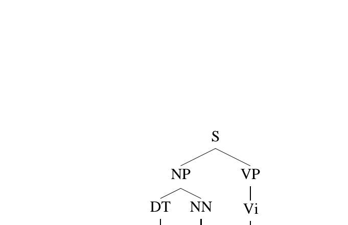

# 图2：一个派生可以表示为一棵解析树。

## 图3：该句子的两个解析树（推导）*the man saw the dog with the telescope*，在图1的CFG下。

她宣布了一个促进卡车和货车安全的计划
你能找到这个例子的不同解析树吗？

## 3 概率上下文无关文法 (PCFGs)

### 3.1 基本定义

给定一个上下文无关文法 G，我们将使用以下定义：

- $\mathcal{T}_G$是文法 $G$下所有可能的最左推导（解析树）的集合。当文法 $G$在上下文中清楚时，我们经常简写为 $\mathcal{T}$。
- 对于任何派生 $t\in\mathcal{T}_G$，我们写 $\text{yield}(t)$来表示字符串 $s\in\Sigma^*$，即 $\text{yield}(t)$是$t$中的单词序列。
- 对于给定的句子 $s\in\Sigma^*$，我们写 $\mathcal{T}_G(s)$来指代集合
$$\{t:t\in\mathcal{T}_G,\text{yield}(t)=s\}$$
也就是说，$\mathcal{T}_G(s)$是句子 $s$的可能解析树集合。
- 如果一个句子 $s$有多个解析树，则称其为歧义的，即 $|\mathcal{T}_G(s)|>1$。
- 如果一个句子 $s$至少有一个解析树，则称其为合法的，即 $|\mathcal{T}_G(s)|>0$。

概率上下文无关文法中的关键思想是扩展我们的定义，以给出可能推导的概率分布。也就是说，我们将找到一种方法来定义一个关于解析树的分布，$p(t)$，使得对于任意的$t\in\mathcal{T}_G$，

$$p(t) \geq 0$$

并且还满足

$$\sum_{t\in\mathcal{T}_G} p(t) = 1$$

乍一看，这似乎很困难：每个解析树 $t$都是一个复杂的结构，而集合 $\mathcal{T}_G$很可能是无限的。然而，我们将看到，上下文无关文法有一个非常简单的扩展，允许我们定义一个函数 $p(t)$。

为什么这是一个有用的问题？一个关键的思想是，一旦我们有了一个函数$p(t)$，我们就可以对任何句子的可能解析进行概率排序。特别是，给定一个句子t，我们可以返回

$$\arg \max_{t\in\mathcal{T}_G(s)} p(t)$$

作为我们解析器的输出-这是在模型下最可能的解析树。因此，如果我们的分布 $p(t)$是对语言中不同解析树的概率的良好模型，我们将有一种有效处理歧义的方法。

这给我们留下了以下问题：

- 我们如何定义函数 $p(t)$?
- 我们如何从训练样本中学习我们的 $p(t)$模型的参数?
- 对于给定的句子 $s$，我们如何找到最可能的树，即 $$\arg \max_{t\in\mathcal{T}_G(s)} p(t)$$?

最后一个问题将被称为解码或解析问题。

在接下来的章节中，我们通过定义概率上下文无关文法(PCFGs)，这是上下文无关文法的自然推广，来回答这些问题。

### 3.2 PCFG的定义

概率上下文无关文法 (PCFG) 的定义如下：

定义1 (PCFG) 一个$PCFG$由以下部分组成：

1. 一个上下文无关文法 $G = (N, \Sigma, S, R)$.
2. 一个参数 $q(\alpha \to \beta)$

对于每个规则 $\alpha \to \beta \in R$. 参数 $q(\alpha \to \beta)$可以解释为在左推导中选择规则 $\alpha \to \beta$时，给定正在扩展的非终结符 $\alpha$的条件概率。对于任意 $X \in N$，我们有以下约束：

$$\sum_{\alpha\to\beta\in R:\alpha=X} q(\alpha \to \beta) = 1$$

此外，对于任意$\alpha \to \beta \in R$，我们有 $q(\alpha \to \beta) \geq 0$。

给定一个解析树 $t \in \mathcal{T}_G$ 包含规则 $\alpha_1 \rightarrow \beta_1, \alpha_2 \rightarrow \beta_2, \ldots, \alpha_n \rightarrow \beta_n,$ 在PCFG下的概率是

$p(t) = \prod_{i=1}^n q(\alpha_i \rightarrow \beta_i)$

图4展示了一个示例PCFG，它与图1中显示的基线上下文无关文法相同。原始上下文无关文法的唯一添加是每个规则$\alpha \rightarrow \beta \in R$的参数$q(\alpha \rightarrow \beta)$。这些参数都受到非负约束，并且另外我们有一个约束条件，即对于任何非终结符$X \in N$,

$\sum_{\alpha \rightarrow \beta \in R: \alpha=X} q(\alpha \rightarrow \beta) = 1$

这仅仅说明对于任何非终结符$X$，所有具有该非终结符作为规则左侧的规则的参数值必须总和为一。我们可以验证这个属性对于图4中的PCFG成立。例如，我们可以验证对于$X = \text{VP}$，这个约束成立，因为

$\sum_{\alpha \rightarrow \beta \in R: \alpha=\text{VP}} q(\alpha \rightarrow \beta) = q(\text{VP} \rightarrow \text{Vi}) + q(\text{VP} \rightarrow \text{Vt NP}) + q(\text{VP} \rightarrow \text{VP PP}) = 0.3 + 0.5 + 0.2 = 1.0$

为了计算任何解析树的概率$t$，我们只需将其包含的上下文无关规则的$q$值相乘。例如，如果我们的解析树$t$是

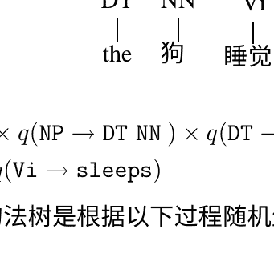

那么我们有

$p(t) = q(S \rightarrow NP VP) \times q(NP \rightarrow DT NN) \times q(DT \rightarrow the) \times q(NN \rightarrow dog) \times q(VP \rightarrow Vi) \times q(Vi \rightarrow sleeps)$

直观地，PCFG假设句法树是根据以下过程随机生成的：

N = {S, NP, VP, PP, DT, Vi, Vt, NN, IN}
S = S
Σ = {sleeps, saw, man, woman, dog, telescope, the, with, in}
R, q =

|    |        |      |      |
|---|-------|-----|-----|
| S  | →    | NP  | VP  | 1.0 |
| VP | →    | Vi  |     | 0.3 |
| VP | →    | Vt  | NP  | 0.5 |
| VP | →    | VP  | PP  | 0.2 |
| NP | →    | DT  | NN  | 0.8 |
| NP | →    | NP  | PP  | 0.2 |
| PP | →    | IN  | NP  | 1.0 |

|    |   |      |      |
|---|---|-----|-----|
| Vi | → | 睡觉 | 1.0 |
| Vt | → | 看见 | 1.0 |
| NN | → | 男人 | 0.1 |
| NN | → | 女人 | 0.1 |
| NN | → | 望远镜 | 0.3 |
| NN | → | 狗  | 0.5 |
| DT | → | the | 1.0 |
| IN | → | 用  | 0.6 |
| IN | → | in  | 0.4 |

> 图4：一个简单的概率上下文无关文法（PCFG）。除了规则集合 R之外，我们还展示了每个规则的参数值。例如，在这个PCFG中，q(VP → Vt NP) = 0.5。

- 定义 $s_1 = S$, $i= 1$。
- 当$\s_i$中至少包含一个非终结符时：
    - 找到$\s_i$中最左边的非终结符，称之为 $X$。
    - 从分布中选择形式为 $X \rightarrow \beta$的规则之一$q(X \rightarrow \beta)$。
    - 通过用 $\beta$替换 $\s_i$中最左边的 $X$， 创建$\s_{i+1}$。
    - 设置 $i = i + 1$。

因此，我们只是在最左派生的每个步骤中添加了概率。整个树的概率是这些个别选择的概率的乘积。

### 3.3 从语料库中推导出 PCFG

在定义了 PCFG 之后，下一个问题是：我们如何从语料库中推导出 PCFG？我们将假设有一组训练数据，这只是一个集合解析树 $t_1$， $t_2$， ...， $t_m$ 的集合。与之前一样，我们将写作 $yield(t_i)$ 表示句子中第 $i$ 个解析树的句子，即 $yield(t_i)$ 是语料库中的第 $i$ 个句子。每个解析树 $t_i$ 是一个上下文无关规则的序列：我们假设我们语料库中的每个解析树的根节点都是相同的符号 $S$。然后，我们可以定义一个 PCFG ($N, \Sigma, S, R, q$)如下：

- $N$ 是在树中看到的所有非终结符的集合 $t_1 . . . t_m$。
- $\Sigma$ 是在树中看到的所有单词的集合 $t_1 . . . t_m$。
- 起始符号 $S$ 被认为是 $S$。
- 规则集合 $R$ 被认为是在树中看到的所有规则 $\alpha \rightarrow \beta t_1 . . . t_m$。
- 最大似然参数估计值为

$$q_{M L}(\alpha \rightarrow \beta) = \frac{\text{Count}(\alpha \rightarrow \beta)}{\text{Count}(\alpha)}$$
其中 $\text{Count}(\alpha \rightarrow \beta)$ 是规则 $\alpha \rightarrow \beta$ 在树 $t_1 . . . t_m$ 中出现的次数，而 $\text{Count}(\alpha)$ 是非终结符 $\alpha$ 在树 $t_1 . . . t_m$ 中出现的次数。

例如，如果规则 $VP \rightarrow Vt \, NP$ 在我们的语料库中出现了 105 次，并且非终结符 $VP$ 出现了 1000 次，那么
$$q(VP \rightarrow Vt \, NP ) = \frac{105}{1000}$$

### 3.4 使用PCFG进行解析

一个关键问题是：给定一个句子 $s$，我们如何找到得分最高的句法分析树，或者更明确地说，我们如何找到

$$\arg \max_{t \in \mathcal{T}(s)} p(t) \quad?$$

本节描述了一个动态规划算法，即CKY算法，用于解决这个问题。

我们介绍的CKY算法适用于一种受限的PCFG类型：处于Chomsky正规形式（CNF）的PCFG。虽然将语法限制为CNF可能一开始看起来很严格，但事实证明这并不是一个强假设。可以将任何PCFG转换为等价的CNF语法：我们将在作业中更详细地讨论这个问题。

在接下来的章节中，我们首先描述了CNF中的语法概念，然后描述了CKY算法。

$N = \{S, NP, VP, PP, DT, Vi, Vt, NN, IN\}$
$S = S$
$\Sigma = \{\text{sleeps, saw, man, woman, dog, telescope, the, with, in}\}$

$R, q =$

| | | | |
|---|---|---|---|
| S | $\rightarrow$ | NP VP | 1.0 |
| VP | $\rightarrow$ | Vt NP | 0.8 |
| VP | $\rightarrow$ | VP PP | 0.2 |
| NP | $\rightarrow$ | DT NN | 0.8 |
| NP | $\rightarrow$ | NP PP | 0.2 |
| PP | $\rightarrow$ | IN NP | 1.0 |

| | | | |
|---|---|---|---|
| Vi | $\rightarrow$ | 睡觉 | 1.0 |
| Vt | $\rightarrow$ | 看见 | 1.0 |
| NN | $\rightarrow$ | 男人 | 0.1 |
| NN | $\rightarrow$ | 女人 | 0.1 |
| NN | $\rightarrow$ | 望远镜 | 0.3 |
| NN | $\rightarrow$ | 狗 | 0.5 |
| DT | $\rightarrow$ | the | 1.0 |
| IN | $\rightarrow$ | 用 | 0.6 |
| IN | $\rightarrow$ | in | 0.4 |

图5：一个简单的概率上下文无关文法（PCFG）以Chomsky正规形式呈现。请注意，语法中的每个规则都采用以下两种形式之一：$X \rightarrow Y_1\ Y_2$其中$X \in N$，$Y_1 \in N$，$Y_2 \in N$；或$X \rightarrow Y$其中$X \in N$，$Y \in \Sigma$。

#### 3.4.1 Chomsky正规形式

> **定义2（Chomsky正规形式）** 一个上下文无关文法$G= (N, \Sigma, R, S)$如果每个规则$\alpha \rightarrow \beta \in R$采用以下两种形式之一：
> 
> - $X \rightarrow Y_1Y_2$其中$X \in N$，$Y_1 \in N$，$Y_2 \in N$。
> - $X \rightarrow Y$其中$X \in N$，$Y \in \Sigma$。
> 
> 因此，语法中的每个规则要么由一个非终结符$X$重写为两个非终结符$Y_1Y_2$；要么由一个非终结符$X$重写为一个终结符$Y$。$\square$

图5展示了一个符合乔姆斯基范式的PCFG的示例。

#### 3.4.2 使用CKY算法进行解析

我们现在描述一种在CNF中使用PCFG进行解析的算法。算法的输入是一个符合乔姆斯基范式的PCFG $G= (N, \Sigma, S, R, q)$，以及一个句子$s = x_1 \ldots x_n$，其中 $x_i$ 是句子中的第 $i$ 个词。算法的输出是

$$\arg\max_{t \in \mathcal{T}_G(s)} p(t)$$

CKY算法是一种动态规划算法。算法中的关键定义如下：

- • 对于给定的句子 $x_1 \ldots x_n$，对于任意的 $X \in N$，对于任意的 $(i,j)$ 满足 $1 \leq i \leq j \leq n$，定义 $T(i,j,X)$ 为所有以单词 $x_i \ldots x_j$ 为根的解析树的集合。
- • 定义
$$\pi(i, j, X) = \max_{t \in T(i,j,X)} p(t)$$
(如果 $T(i, j, X)$ 为空集，则我们定义 $\pi (i, j, X) = 0$)。

因此，$\pi(i, j, X)$ 是支配单词 $x_i \ldots x_j$ 且以非终结符 $X$ 为根的任意解析树的最高分数。树 $t$ 的分数再次被定义为它包含的规则的分数的乘积（即，如果树 $t$ 包含规则 $\alpha_1 \to \beta_1, \alpha_2 \to \beta_2, \ldots, \alpha_m \to \beta_m$，则 $p(t) = \prod_{i=1}^{m} q(\alpha_i \to \beta_i)$）。特别注意，

$$\pi(1, n, S) = \arg\max_{t \in \mathcal{T}_G(s)} p(t)$$

因为根据定义 $\pi(1, n, S)$ 是最高概率解析树跨越单词 $x_1 \ldots$ 的得分 $x_n$，以 $S$ 为根节点。

CKY算法中的关键观察是我们可以使用递归定义的 $\pi$ 值，这允许简单的自底向上动态规划算法。该算法是“自底向上”的，意味着它首先填充 $\pi(i, j, X)$ 在 $j = i$ 的情况下的值，然后是 $j = i + 1$ 的情况，依此类推。递归定义中的基本情况如下：对于所有 $i = 1 \ldots n$，对于所有 $X \in N$，

$$\pi(i, i, X) = \begin{cases} q(X \to x_i) & \text{如果 } X \to x_i \in R \\ 0 & \text{否则} \end{cases}$$

这是一个自然的定义：只有当规则 $X \to x_i$ 在语法中时，我们才能有以节点 $X$ 为根的树跨越单词 $x_i$，此时树的得分为 $q(X \to x_i)$；否则，我们将 $\pi(i, i, X) = 0$，反映了没有以 $X$ 为根的树跨越单词 $x_i$ 的事实。

递归定义如下：对于所有 $(i, j)$ 满足 $1 \leq i < j \leq n$的情况，
对于所有 $X \in N$，

\[\pi(i, j, X) = \max_{\substack{X \to Y Z \in R, \ s \in \{i...(j-1)\}}} \left( q(X \to Y Z) \times \pi(i, s, Y) \times \pi(s + 1, j, Z) \right) \quad (1)\]

本笔记的下一部分为这个递归定义提供了解释。

图6展示了基于这些递归定义的最终算法。算法从底向上填充 $\pi$ 值：首先是基本情况下的 $(i, i, X)$ 值；然后是 $j = i + 1$ 时的 $\pi(i, j, X)$ 值；然后是 $j = i + 2$ 时的 $\pi(i, j, X)$ 值；依此类推。

请注意，该算法还存储回溯指针值 $bp(i, j, X)$ 对于所有值 $(i, j, X)$。这些值记录了规则 $X \to Y Z$ 和分割点 $s$ 导致最高得分的解析树。回溯指针值允许恢复句子的最高得分解析树。

#### 3.4.3 算法的正当性

作为应用等式2中递归规则的示例，考虑解析句子$x_1 \dots x_8$ = 狗用望远镜看见了那个人并考虑计算 $\pi(3, 8, \text{VP})$。这将是以 VP 为根，跨越单词 $x_3$ 的任何树的最高得分。 $x_8$ = 用望远镜看见了那个人。

等式2指定计算此值时，我们从两个选择中取 max：首先，选择一个规则 $\text{VP} \to Y Z$，该规则在规则集合 $R$ 中——请注意，有两个这样的规则， $\text{VP} \to \text{Vt NP}$ 和 $\text{VP} \to \text{VP PP}$。其次，选择一个 $s \in \{3, 4, \dots 7\}$。因此，我们将取以下术语的最大值：

$q(\text{VP} \to \text{Vt NP}) \times \pi(3, 3, \text{Vt}) \times \pi(4, 8, \text{NP})$

$q(\text{VP} \to \text{VP PP}) \times \pi(3, 3, \text{VP}) \times \pi(4, 8, \text{PP})$

$q(\text{VP} \to \text{Vt NP}) \times \pi(3, 4, \text{Vt}) \times \pi(5, 8, \text{NP})$

$q(\text{VP} \to \text{VP PP}) \times \pi(3, 4, \text{VP}) \times \pi(5, 8, \text{PP})$

$q(\text{VP} \to \text{Vt NP}) \times \pi(3, 5, \text{Vt}) \times \pi(6, 8, \text{NP})$

$q(\text{VP} \to \text{VP PP}) \times \pi(3, 5, \text{VP}) \times \pi(6, 8, \text{PP})$

$\dots$

$q(\text{VP} \to \text{Vt NP}) \times \pi(3, 7, \text{Vt}) \times \pi(8, 8, \text{NP})$

$q(\text{VP} \to \text{VP PP}) \times \pi(3, 7, \text{VP}) \times \pi(8, 8, \text{PP})$输入: 一个句子 \( s = x_1 \ldots x_n \)，一个PCFG \( G = (N, \Sigma, S, R, q) \).

初始化:
对于所有 \( i \in \{1 \ldots n\} \)，对于所有 \( X \in N \)，
\[
\pi(i, i, X) = \begin{cases} q(X \rightarrow x_i) & \text{如果 } X \rightarrow x_i \in R, \\ 0 & \text{否则} \end{cases}
\]

算法:
* 对于 \( l = 1 \ldots (n-1) \)
    - 对于 \( i = 1 \ldots (n-l) \)
        * 设置 \( j = i + l \)
        * 对于所有 \( X \in N \)，计算
        \[
        \pi(i, j, X) = \max_{\substack{X \rightarrow YZ \in R, \\ s \in \{i \ldots (j-1)\}}} (q(X \rightarrow YZ) \times \pi(i, s, Y) \times \pi(s+1, j, Z))
        \]
        和
        \[
        bp(i, j, X) = \arg \max_{\substack{X \rightarrow YZ \in R, \\ s \in \{i \ldots (j-1)\}}} (q(X \rightarrow YZ) \times \pi(i, s, Y) \times \pi(s+1, j, Z))
        \]

输出: 返回 \( \pi(1, n, S) = \max_{t \in \mathcal{T}(s)} p(t) \)，并且回溯指针 \( bp \) 允许恢复 \( \arg \max_{t \in \mathcal{T}(s)} p(t) \)。

## 图6: CKY解析算法。

我们如何证明这个递归定义？关键观察是任何以 $X$ 为根，跨越单词 $x_i \ldots x_j$ 的树必须包含以下内容：

+   在树的顶部选择一些规则 $X \rightarrow Y Z \in R$。
-   选择一些值 $s \in \{i \ldots j-1\}$，我们将其称为规则的“分割点”。
-   选择以 $Y$ 为根的树，跨越单词 $x_i \ldots x_s$，将此树称为 $t_1$。
-   选择以 $Z$ 为根的树，跨越单词 $x_{s+1} \ldots x_j$，将此树称为 $t_2$。
-   然后我们有 $p(t) = q(X \rightarrow Y Z) \times p(t_1) \times p(t_2)$，即，树 $t$ 的概率是三个项的乘积：树顶部规则的概率，子树 $t_1$ 和 $t_2$ 的概率。

例如，考虑以下以 VP 为根的树，跨越单词 $x_3 \ldots x_8$ 在我们之前的例子中：

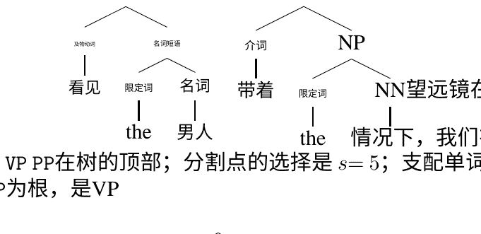

则 $VP \rightarrow VP\ PP$ 在树的顶部；分割点的选择是 $s=5$；支配单词的树是 $x_3 \ldots x_s$，以 VP 为根，是 VP

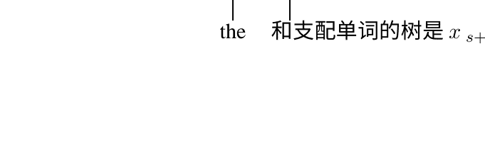

和支配单词的树是 $x_{s+1} \ldots x_8$，以 PP 为根

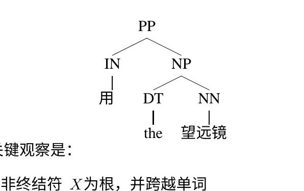

第二个关键观察是：

+   如果以非终结符 X 为根，并跨越单词 $x_{i}\ldots x_{j}$ 的最高得分树是 X，$x_{j}$，使用规则 X → Y Z 和分割点 s，那么它的两个子树必须是：1) 以 Y 为根，并跨越单词 $x_{i}\ldots x_{s}$ 的最高得分树；2) 以 Z 为根，并跨越单词 $x_{s+1}\ldots x_{j}$ 的最高得分树。

证明是通过反证法的。如果条件（1）或条件（2）不成立，我们总是可以找到一个以 X 为根，跨越单词 $x_{i}$ 的更高得分的树。通过选择一个跨越单词 $x_{i}$ 的更高得分的子树 $x_{j}$，我们可以选择一个更高得分的子树 $x_{s}$ 或 $x_{s+1}\ldots x_{j}$。现在让我们回顾一下我们的递归定义：

$$\pi(i, j, X) = \max_{X \rightarrow Y Z \in R, \; s \in \{i \ldots (j-1)\}} (q(X \rightarrow Y Z) \times \pi(i, s, Y) \times \pi(s + 1, j, Z))$$

我们可以看到它涉及到对可能的规则 X → Y Z ∈ R 和可能的分割点 s 进行搜索。对于每个规则和分割点的选择，我们计算

$$q(X \rightarrow Y Z) \times \pi(i, s, Y) \times \pi(s + 1, j, Z)$$

这是以 X 为根，跨越单词 $x_{i}$ 的最高得分的树。$x_{j}$，并选择这个规则和分割点。该定义使用了值 $\pi(i, s, Y)$ 和 $\pi(s + 1, j, Z)$，对应于两个最高得分的子树。我们对所有可能的规则和分割点取 max。

#### 3.4.4 内部算法用于对树进行求和

我们现在描述第二个非常相似的算法，它对给定句子的所有解析树的概率进行求和，从而计算出PCFG下句子的概率。该算法被称为内部算法。

算法的输入再次是一个PCFG $G = (N, \Sigma, S, R, q)$ 以 Chomsky 正规形式给出，以及一个句子 $s = x_{1}\ldots x_{n}$，其中 $x_{i}$ 是句子中的第 i 个单词。算法的输出是

$$p(s) = \sum_{t \in \mathcal{T}_{G}(s)} p(t)$$

这里 p(s) 是 PCFG 生成字符串 s 的概率。我们定义如下：

+   与之前一样，对于给定的句子 x_1 ... x_n，对于任何 X ∈ N，对于任何 (i, j) 满足 1 ≤ i ≤ j ≤ n，定义 T(i, j, X) 为所有以单词 x_i ... x_j 为根的解析树的集合，其中非终结符 X 位于根部。

+   定义

    π(i, j, X) = \sum_{t \in T(i, j, X)} p(t)

    （如果 T(i, j, X) 为空集，则我们定义 π(i, j, X) = 0）。

请注意，在前面的定义中，我们只是简单地将 max 替换为 π 的求和。特别地，我们有

π(1, n, S) = \sum_{t \in T_G(s)} p(t) = p(s)

因此，通过计算 π(1, n, S)，我们已经计算出了概率 p(s)。

我们使用与之前非常相似的递归定义。首先，基本情况如下：对于所有的 i = 1 ... n，对于所有的 X ∈ N，

π(i, i, X) = \begin{cases} q(X \to x_i) & \text{如果 } X \to x_i \in R_0 \\ 0 & \text{否则} \end{cases}

递归定义如下：对于所有 (i, j) 满足 1 ≤ i < j ≤ n 的情况，对于所有 X ∈ N，

π(i, j, X) = \sum_{\substack{X \to YZ \in R, \\ s \in \{i ... (j-1)\}}} (q(X \to YZ) \times \pi(i, s, Y) \times \pi(s + 1, j, Z)) \quad (2)

图7展示了基于这些递归定义的算法。该算法与CKY算法基本相同，但在递归定义中将 max 替换为求和。再次，π值是自底向上计算的。

输入: 一个句子 $s = x_1 \ldots x_n$, 一个PCFG $G= (N, \Sigma, S, R, q)$.

### 初始化:

对于所有 $i \in \{1 \ldots n\}$, 对于所有 $X \in N$,
\[
\pi(i, i, X) = \begin{cases}
q(X \rightarrow x_i) & \text{如果 } X \rightarrow x_i \in R_0, \\
0 & \text{否则}
\end{cases}
\]

### 算法:

+   对于 $l = 1 \ldots (n - 1)$
    - 对于 $i = 1 \ldots (n - l)$
        * 设置 $j = i + l$
        * 对于所有 $X \in N$, 计算 $\pi(i, j, X) = \sum_{\substack{X \rightarrow Y Z \in R, \\ s \in \{i \ldots (j-1)\}}} (q(X \rightarrow Y Z) \times \pi(i, s, Y) \times \pi(s + 1, j, Z))$

输出: 返回 $\pi(1, n, S) = \sum_{t \in T(s)} p(t)$

## 图7：内部算法。

# 词汇化的概率上下文无关文法

迈克尔·科林斯

## 1 引言

在之前的讲义中，我们介绍了概率上下文无关文法（PCFGs）作为统计分析的模型。我们介绍了基本的PCFG形式；描述了如何从一组训练示例（“树库”）中估计PCFG的参数；并推导出了使用PCFG进行分析的动态规划算法。

不幸的是，我们所描述的基本PCFGs在统计分析中的效果并不好。本文介绍了词汇化的PCFGs，它们直接建立在基本PCFGs的思想上，但具有更高的分析准确性。本文的其余部分结构如下：

+   在第2节中，我们描述了基本PCFGs的一些弱点，特别是它们对词汇信息的缺乏敏感性。
*   在第3节中，我们描述了从树库解析中的非终结符中添加词汇项的第一步骤。
*   在第4节中，我们给出了词汇化PCFG的正式定义。
*   在第5节中，我们描述了如何从树库中估计词汇化PCFG的参数。
*   在第6节中，我们描述了一种用于词汇化PCFG解析的动态规划算法。

## 2 PCFG作为解析模型的弱点

我们关注PCFG的两个关键弱点：1）对词汇信息的缺乏敏感性；2）对结构偏好的缺乏敏感性。问题（1）是转向词汇化PCFG的基本动机。在后面的讲座中，我们将描述解决问题（2）的词汇PCFG扩展。

### 2.1 对词汇信息的缺乏敏感性

首先，考虑以下解析树：

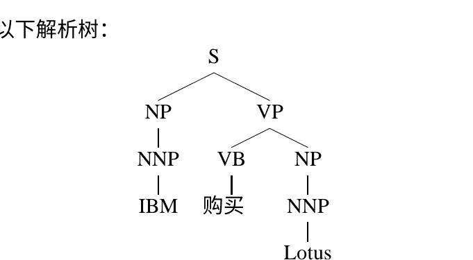

在PCFG模型下，这棵树的概率将会

q(S → NP VP) × q(VP → V NP) × q(NP → NNP) × q(NP → NNP) 
 ×q(NNP → IBM) × q(Vt → 购买 ) × q(NNP → Lotus)

回想一下，对于任何规则 α → β， q(α → β) 是一个相关参数，可以解释为在规则的左侧看到α的情况下，在规则的右侧看到β的条件概率。

如果我们考虑这个解析树中的词汇项（即IBM，购买和Lotus），我们可以看到PCFG做出了一个非常强的独立性假设。直观上，每个词汇项的身份仅取决于该词汇项上方的词性（POS），例如，选择词汇IBM取决于其标签NNP，但不直接取决于树中的其他信息。更正式地说，字符串中每个词的选择在给定该词上方的POS的条件下，与整个树是条件独立的。这显然是一个非常强的假设，在解析中会导致许多问题。我们将看到词汇化的PCFG以一种非常直接的方式解决了PCFG的这个弱点。现在让我们来看看PCFG在一种特定类型的歧义下的行为，即介词短语（PP）附着歧义。图1显示了同一个句子的两个解析树，其中包含了PP附着歧义。图2列出了这两个解析树的无上下文规则集。一个关键的观察是：

q(VP → VP PP) > q(NP → NP PP)

将选择树(a)，如果

q(NP → NP PP) > q(VP → VP PP)

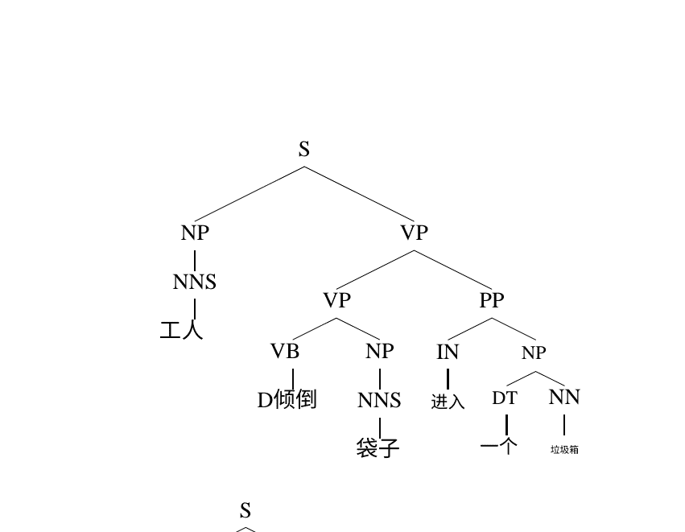

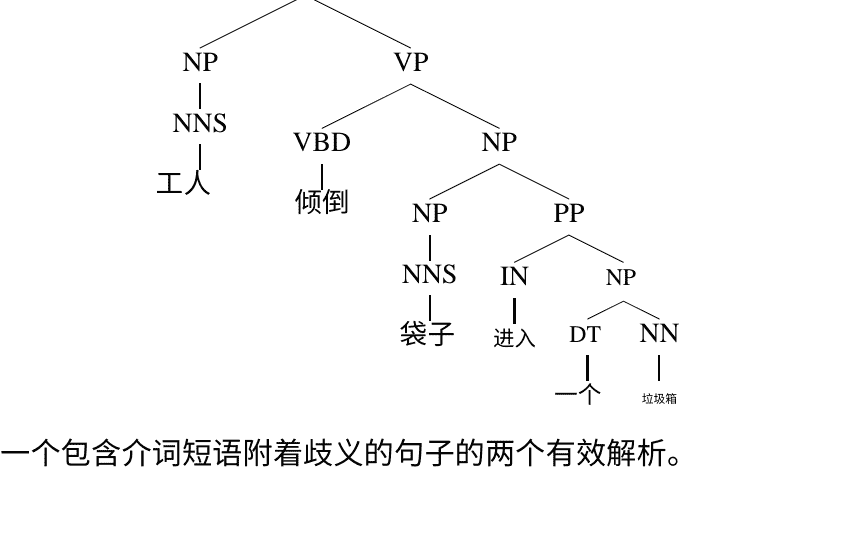

图1：一个包含介词短语附着歧义的句子的两个有效解析。

| 规则 |
|------|
| S → NP VP |
| NP → NNS |
| VP → VP PP |
| VP → VBD NP |
| NP → NNS |
| PP → IN NP |
| NP → DT NN |
| NNS → 工人们 |
| VBD → 倾倒 |
| NNS → 袋子 |
| IN → 进入 |
| DT → → |
| NN → 垃圾箱 |

| 规则 |
|------|
| S → NP VP |
| NP → NNS |
| NP → NP PP |
| VP → VBD NP |
| NP → NNS |
| PP → IN NP |
| NP → DT NN |
| NNS → 工人们 |
| VBD → 倾倒 |
| NNS → 袋子 |
| IN → 进入 |
| DT → → |
| NN → 垃圾箱 |

图2：解析树的规则集 (a) 和 (b) 在图1中。

请注意，这个决定完全独立于两个输入句子中的任何词汇信息（单词）。对于这种特殊的歧义情况（NP与VP的PP附着，只有一个可能的NP和一个可能的VP附着），如果q(VP→VP PP) > q(NP→NP PP)，解析器将始终将PP附着到VP上，反之亦然。在这种特殊情况下，即介词短语附着的歧义性，对词汇信息的缺乏敏感性被认为是非常不理想的。如果我们单独看介词in to，我们会发现以into为介词的PP附着到VP的可能性几乎是附着到NP的可能性的九倍（这个统计数据来自Penn树库数据）。

作为另一个例子，考虑图3中显示的两个解析树，这是一个协调歧义的例子。在这种情况下，可以验证这两个解析树具有相同的上下文无关规则集（唯一的区别在于应用这些规则的顺序）。因此，PCFG将为这两个解析树分配相同的概率，完全忽略词汇信息。

总之，我们所描述的PCFG基本上将词汇项生成为一个事后的考虑，仅仅取决于树中直接位于其上方的POS。这是一个非常强的独立性假设，在许多重要的歧义情况下，解析器会做出非最优的决策。

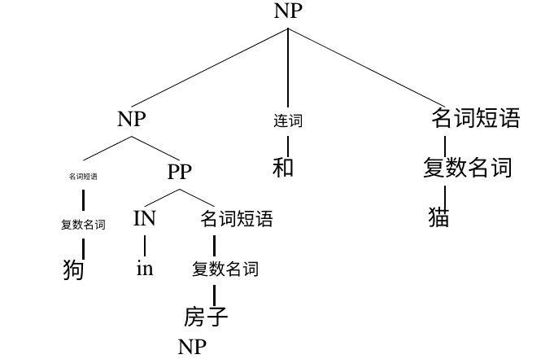

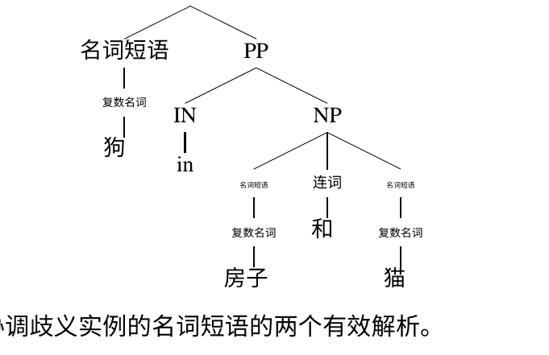

图3：包含协调歧义实例的名词短语的两个有效解析。

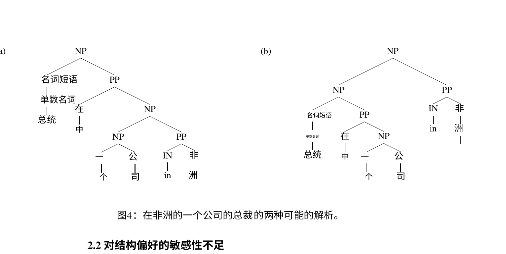

### 2.2 对结构偏好的敏感性不足

PCFG的第二个弱点是它们对结构偏好的敏感性不足。

我们通过几个例子来说明这个弱点。

首先，考虑图4中在非洲的一个公司的总裁的两种潜在解析。这个名词短语再次涉及到一个介词短语的附着歧义：介词短语在非洲可以附着到总裁或公司上。

可以再次验证这两个解析树包含完全相同的上下文无关规则集，并且因此在PCFG下得到相同的概率。在这种情况下，词汇信息可能再次有所帮助。

然而，关于结构偏好的基本统计信息（忽略词汇项）可能是另一个有用的信息源。第一个解析树涉及以下形式的结构，在该形式中，最后的介词短语（例如，在非洲中）附着到最近的名词短语（例如，一个公司）上。

这个附件通常被称为紧密附件，因为PP已经附加到最近的前面的NP。第二个解析结构的形式

其中最后的PP已经附加到更远的NP（总统在例子中）。我们可以再次从树库中查看结构1与结构2的频率统计：结构1的频率大约是结构2的两倍。因此，在紧密附件方面存在相当大的偏向。再次强调，PCFG对这两个树结构分配了相同的概率，因为它们包含相同的规则集合：因此，在这种情况下，PCFG未能捕捉到对紧密附件的偏好。

还有许多其他例子，紧密附件是消除歧义的有用线索。当在两个不同的动词之间进行附件选择时，偏好甚至可以更强烈。例如，考虑以下句子

> 约翰被比尔认为已经被射击了

在这里，PP by Bill可以修饰动词 shot（比尔在射击）或 believe（比尔在相信）。然而，树库的统计数据显示，当一个PP可以连接到两个可能的动词时，它更有可能发生的次数是大约20倍附加到最近的动词。 基本的PCFG通常会给予两个结构相同的概率，因为它们包含相同的规则。

## 3 树库的词汇化

我们现在描述词汇化的PCFG如何解决PCFG的第一个根本弱点：对词汇信息的缺乏敏感性。 第一个关键步骤，在本节中描述的是对基础树库进行词汇化。
图5显示了词汇化之前和之后的分析树。 词汇化步骤已经用包含词汇项的新非终结符替换了非终结符，例如S(questioned)或NP(lawyer)。本节的其余部分将详细描述树是如何进行词汇化的。 不过，首先我们给出这一步骤的基本动机。 基本思想是替换诸如

S → NP VP

在基本的PCFG中，使用规则如

S(疑问) → NP(律师) VP(疑问)

在词汇化的PCFG中，符号S(疑问)，NP(律师)和VP(疑问)是语法中的新非终结符。 每个非终结符现在都包含一个词汇项；由此产生的模型对词汇信息更加敏感。
从形式上看，从一个相对较小的非终结符集合（S, NP等）的PCFG转换到一个非常庞大的非终结符集合（S(疑问), NP(律师)等）的PCFG，从一个意义上说，没有什么改变。然而，这将导致语法中规则和非终结符的数量大幅增加：因此，我们在估计基础PCFG的参数时必须小心。我们将在下一节中介绍如何进行这样的估计。

然而，首先我们描述了词汇化过程是如何进行的。关键思想是为了识别每个上下文无关规则的形式

X → Y1 Y2 . . . Yn

一个索引 h∈{1...n} 被指定为规则的头部。 上下文无关规则的头部直观上对应于规则的“中心”或者最重要的子节点。¹例如，对于规则

S → NP VP

> ¹头部的概念在语言学中有着悠久的历史，超出了本文的范围。

图5: (a) 传统的解析树，例如在Penn树库中找到的。
(b) 相同句子的词汇化解析树。请注意，树中的每个非终端现在包含一个单词。为了清晰起见，我们用上划线标记每个规则的头部：例如，对于规则NP → DT NN，子节点NN是头部，因此NN符号被标记为NN。

头部将为 h= 2（对应于 VP）。对于规则

```
NP → NP PP PP PP
```

头部将为 h= 1（对应于 NP）。对于规则

```
PP → IN NP
```

头部将为 h= 1（对应于 IN），以此类推。一旦确定了每个上下文无关规则的头部，词汇信息可以从树库中自底向上传播到解析树中。例如，如果我们考虑子树NP DT


并假设规则的头部

```
NP → DT NN
```

是 h= 2（the NN），词汇化的子树是

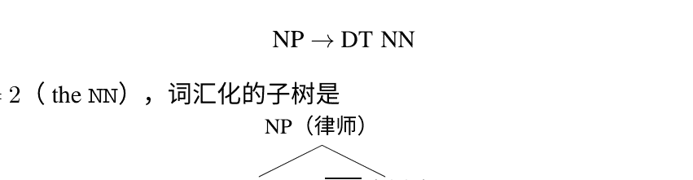

诸如 DT 或 NN 的词性将其下方的词汇项作为其头词。树中较高的非终端接收来自其头子节点的词汇项：例如，在此示例中， NP接收与其头子节点 NN相关联的词汇项律师。为了清晰起见，我们在词汇化的解析树中标记每个规则的头部上划线（在本例中为 NN）。请参见图5，了解完整的词汇化树的示例。

另一个示例是在图5中的解析树中的 VP。在对 VP进行词汇化之前，解析结构如下（我们已经填写了树中较低的词汇项，使用之前描述的步骤）：

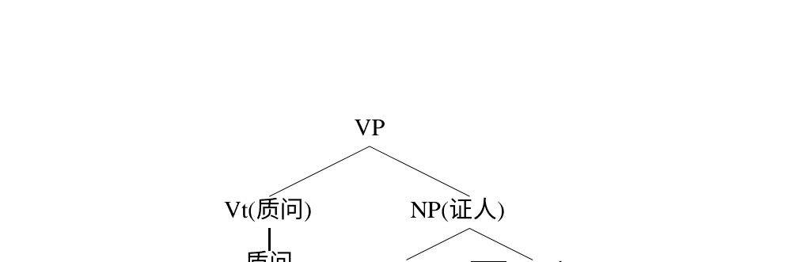

然后，我们将 vt 识别为规则 VP → Vt NP 的头部，并将树进行词汇化，如下所示：

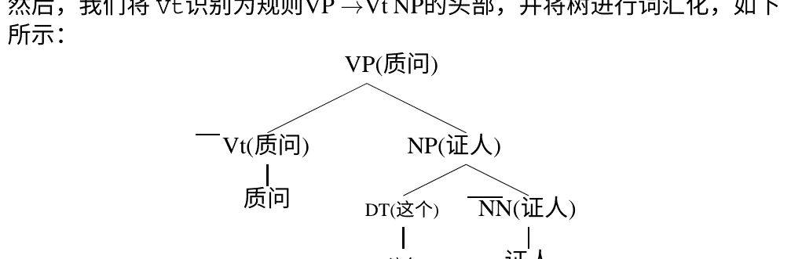

总之，一旦确定了每个上下文无关规则的头部，词汇项可以自下而上地通过解析树传播，从而得到词汇化的树，如图5(b)所示。

剩下的问题是如何确定头部。理想情况下，每个规则的头部都应该在相应的树库中进行注释：然而，在实践中，这些注释通常不存在。相反，研究人员通常使用一组简单的规则来自动识别每个上下文无关规则的头部。

作为一个例子，图6给出了一个用于识别左侧为 NP 的规则头部的示例集。图7显示了用于 VPs 的一组规则。在这两种情况下，规则都寻找特定的子节点（例如，对于 NP 情况，寻找 NN，对于 VP 情况，寻找 Vi）。这些规则相当启发式，但依赖于对规则头部的一些语言指导：尽管它们很简单，但在实践中它们工作得很好。

## 4 词汇化的PCFG

词汇化的PCFG的基本思想是将规则如

```
S → NP VP
```

替换为词汇化的规则如

```
S(考察) → NP(律师) VP(考察)
```

+   - 如果规则包含NN、NNS或NNP：
  - 选择最右边的NN、NNS或NNP
- 否则如果规则包含NP：选择最左边的NP
- 否则如果规则包含JJ：选择最右边的JJ
- 否则如果规则包含CD：选择最右边的CD
- 否则选择最右边的子节点

**图6：识别左侧为NP的规则头部的一组规则示例。**

+   - 如果规则包含Vi或Vt：选择最左边的Vi或Vt
- 否则如果规则包含VP：选择最左边的VP
- 否则选择最左边的子节点

**图7：识别左侧为VP的任何规则的头部的规则集示例。**

因此，我们已经用词汇化的非终结符替换了简单的非终结符，例如 S 或 NP ，例如 S(examined) 或 NP(lawyer)。
从形式上讲，没有任何变化：我们可以像处理常规PCFG一样处理新的词汇化语法。我们只是在语法中扩展了非终结符的数量，从一个相当小的数量（比如20或50）扩展到一个更大的数量（因为每个非终结符现在都有一个词汇项，我们可以很容易地拥有成千上万个非终结符）。词汇化的PCFG中的每个规则都将有一个相关的参数，例如上述规则将有参数

```
q(S(examined) → NP(lawyer) VP(examined))
```

模型中有非常多的参数，我们需要小心地估计它们：下一节将介绍参数估计方法。

接下来，我们将给出词汇化的PCFGs的正式定义，采用乔姆斯基范式。不过，首先我们需要处理一个细节。词汇化的PCFG中的每个规则都有一个非终结符作为规则的左侧头词：例如规则

```
S(考察) → NP(律师) VP(考察)
```

左侧有S(考察)。此外，该规则有两个子节点。
这两个子节点中的一个必须与左侧具有相同的词汇项：在这个例子中，VP(考察)是具有这个属性的子节点。为了明确指出哪个子节点与左侧共享词汇项，我们将在规则中添加一个注释，使用 →₁ 来指定左子节点与父节点共享词汇项，使用 →₂ 来指定右子节点与父节点共享词汇项。因此，上述规则现在将被写为

```
S(考察) →₂ NP(律师) VP(考察)
```

在这种情况下，额外的符号可能看起来是多余的，因为很明显第二个子节点是规则的头部 - 它是唯一一个与规则左侧具有相同词汇项，考察的子节点。然而，这些信息对于两个子节点具有相同词汇项的规则非常重要：例如，考虑以下规则

和

```
PP(在) →₁ PP(在) PP(在)
PP(在) →₂ PP(在) PP(在)
```

在这种情况下，我们需要小心地指定哪个子节点是规则的头部。

现在我们给出以下定义：

### 定义1（Chomsky范式中的词汇化PCFG）一个在Chomsky范式中的词汇化PCFG是一个6元组 G= (N, Σ, R, S, q, γ)其中：

+   - N是语法中的非终结符的有限集合。
- Σ是语法中的词汇项的有限集合。
- R是规则的集合。每个规则有以下三种形式之一：
  1. X(h) →₁ Y₁₁(h) Y₂₂(m)其中X, Y1, Y2 ∈ N, h, m ∈ Σ。
  2. X(h) →₂ Y₁₁(m) Y₂₂(h)其中X, Y1, Y2 ∈ N, h, m ∈ Σ。
  3. X(h) → h其中 X ∈ N, h ∈ Σ。
- 对于每个规则 r ∈ R都有一个相关的参数。
  q(r)
  参数满足 q(r) ≥ 0，并且对于任意 X ∈ N, h ∈ Σ,
  $\sum_{r∈R:LHS(r)=X(h)} q(r) = 1$
  在这里，我们使用 LHS(r)来指代任何规则 r的左手边。
- 对于每个 X ∈ N, h ∈ Σ，存在一个参数 γ(X, h)。我们有 γ(X, h) ≥ 0，并且 $\sum_{X∈N,h∈Σ} γ(X, h) = 1$。

给定一个最左派生成 r₁, r₂, … r_N 在语法下，每个 r_i 是一个 R的成员，推导的概率是

$γ(LHS(r_1)) × ∏_{i=1}^{N} q(r_i)$

□

作为一个例子，考虑图5中的解析树，在此重复：

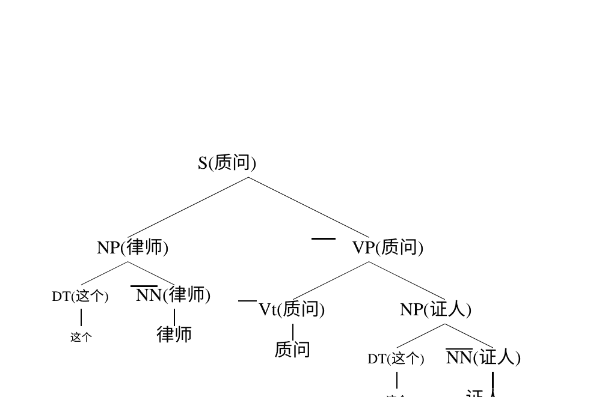

在这种情况下，解析树由以下规则序列组成：

+   - S(质问)    →₂ NP(律师) VP(质问)
- NP(律师)    →₂ DT(这) NN(律师)
- DT(这) → 这
- NN(律师)   → 律师
- VP(质问)    →₁ Vt(质问) NP(证人)
- NP(证人)    →₂ DT(这) NN(证人)
- DT(这) → 这
- NN(证人)   → 证人

树的概率计算如下

```
γ(S, 质问 )
×q(S(质问)    →₂ NP(律师) VP(质问) )
×q(NP(律师)  →₂ DT(这个) NN(律师))
×q(DT(这个) →这个)
×q(NN(律师)  → 律师 )
×q(VP(质疑)    →₁ Vt(质疑) NP(证人) )
×q(NP(证人)  →₂ DT(这个) NN(证人))
×q(DT(这个) →这个)
×q(NN(证人)  → 证人 )
```

因此，该模型看起来与常规的PCFGs非常相似，其中树的概率被计算为每个规则的乘积。 一个区别是我们有根节点的 γ(S, questioned)项：这个项可以被解释为在树的根节点选择非终结符S(questioned)的概率。

树的根节点。（回想一下，在常规的PCFGs中，我们指定了一个特定的非终结符，例如 S，总是出现在树的根节点。）

## 5 在词汇化的PCFG中的参数估计

我们现在描述一种在词汇化的PCFG中进行参数估计的方法。模型中的规则（因此参数）数量非常大。通过适当的平滑技术，使用课堂上描述的语言建模方法，我们可以得到稳健且有效的估计结果。

首先，对于给定形式的规则

```
X(h) →₁ Y₁(h) Y₂(m)
```

或者

```
X(h) →₂ Y₁(m) Y₂(h)
```

定义以下变量：X是规则左侧的非终结符；H是该非终结符的头词；R是使用的规则，可以是形式X →₁ Y₁ Y₂或 X →₂ Y₁ Y₂；M是修饰词。

例如，对于规则

```
S(考察) →₂ NP(律师) VP(考察)
```

我们有

+   - X = S
- H = 考察
- R = S →₂ NP VP
- M = 律师

通过这些定义，规则的参数具有以下解释：

```
q(S(考察) →₂ NP(律师) VP(考察))
= P(R = S →₂ NP VP, M = 律师 | X = S, H = 考察)
```

推导估计 q(S(考察)→₂NP(律师) VP(考察)) 的第一步是使用链式法则将上述表达式分解为两个项：

```
P(R = S →₂ NP VP, M = 律师 | X = S, H = 考察)
= P(R = S →₂ NP VP | X = S, H = 考察) (3)
× P(M = 律师 | R = S →₂ NP VP, X = S, H = 检查) (4)
```

这一步是精确的，根据概率链规则。

我们现在将推导出Eqs. 3和4中数量的单独平滑估计。首先，对于Eq. 3，定义以下最大似然估计：

$$q_{ML}(\mathbf{S} \rightarrow_2 \mathbf{NP} \mathbf{VP} | \mathbf{S}, \text{检查} ) = \frac{\text{count}(R = \mathbf{S} \rightarrow_2 \mathbf{NP} \mathbf{VP}, X = \mathbf{S}, H = \text{检查})}{\text{count}(X = \mathbf{S}, H = \text{检查})}$$
$$q_{ML}(\mathbf{S} \rightarrow_2 \mathbf{NP} \mathbf{VP} | \mathbf{S}) = \frac{\text{count}(R = \mathbf{S} \rightarrow_2 \mathbf{NP} \mathbf{VP}, X = \mathbf{S})}{\text{count}(X = \mathbf{S})}$$

这里的计数(...)表达式是直接从训练样本中得出的计数（树库中的词汇化树）。我们对$P(R = \mathbf{S} \rightarrow_2 \mathbf{NP} \mathbf{VP} | X = \mathbf{S}, H = \text{检查})$的估计是这样定义的

$$\lambda_1 \times q_{ML}(\mathbf{S} \rightarrow_2 \mathbf{NP} \mathbf{VP} | \mathbf{S}, \text{检查} ) + (1 - \lambda_1) \times q_{ML}(\mathbf{S} \rightarrow_2 \mathbf{NP} \mathbf{VP} | \mathbf{S})$$
其中 $\lambda_1$ 决定了两个估计的相对权重（我们有 $0 \leq \lambda_1 \leq 1$）。可以使用本课程关于语言建模的笔记中描述的方法来估计 $\lambda_1$ 的值。

接下来，考虑我们对方程式4的估计。我们可以定义以下两个最大似然估计：

$$q_{ML}(\text{律师} | \mathbf{S} \rightarrow_2 \mathbf{NP} \mathbf{VP}, \text{检查} ) = \frac{\text{count}(M = \text{律师}, R = \mathbf{S} \rightarrow_2 \mathbf{NP} \mathbf{VP}, H = \text{检查})}{\text{count}(R = \mathbf{S} \rightarrow_2 \mathbf{NP} \mathbf{VP}, H = \text{检查})}$$
$$q_{ML}(\text{律师} | \mathbf{S} \rightarrow_2 \mathbf{NP} \mathbf{VP}) = \frac{\text{count}(M = \text{律师}, R = \mathbf{S} \rightarrow_2 \mathbf{NP} \mathbf{VP})}{\text{count}(R = \mathbf{S} \rightarrow_2 \mathbf{NP} \mathbf{VP})}$$

估计值为
$$P(M = \text{律师} | R = \mathbf{S} \rightarrow_2 \mathbf{NP} \mathbf{VP}, X = \mathbf{S}, H = \text{检查} )$$

然后
$$\lambda_2 \times q_{ML}(\text{律师} | \mathbf{S} \rightarrow_2 \mathbf{NP} \mathbf{VP}, \text{检查} ) + (1 - \lambda_2) \times q_{ML}(\text{律师} | \mathbf{S} \rightarrow_2 \mathbf{NP} \mathbf{VP})$$

其中 $0 \leq \lambda_2 \leq 1$ 是一个参数，用于指定两个项的相对权重。
将这些估计值综合起来，我们对规则参数的最终估计如下：

$$q(\text{S(考察)} \rightarrow_2 \text{NP(律师)} \text{VP(考察)} ) =$$
$$(\lambda_1 \times q_{ML}(\mathbf{S} \rightarrow_2 \mathbf{NP} \mathbf{VP} | \mathbf{S}, \text{考察} ) + (1 - \lambda_1) \times q_{ML}(\mathbf{S} \rightarrow_2 \mathbf{NP} \mathbf{VP} | \mathbf{S}))$$
$$\times (\lambda_2 \times q_{ML}(\text{律师} | \mathbf{S} \rightarrow_2 \mathbf{NP} \mathbf{VP}, \text{考察} ) + (1 - \lambda_2) \times q_{ML}(\text{律师} | \mathbf{S} \rightarrow_2 \mathbf{NP} \mathbf{VP}))$$

可以看出，这个估计结合了非常具体的词汇信息，例如估计值

```
q_{ML}(S →₂ NP VP | S, 考察 )
q_{ML}(律师 | S →₂ NP VP, 检查 )
```

使用更少的词汇信息进行估计，例如

```
q_{ML}(S →₂ NP VP | S)
q_{ML}(律师 | S →₂ NP VP)
```

最终结果是一个对词汇信息敏感但仍然稳健的模型，因为我们在模型中使用了平滑估计的大量参数。

## 6 使用词汇化的PCFG进行解析

词汇化的PCFG的解析算法与常规PCFG的解析算法非常相似，如前面的讲义所述。回想一下，对于常规PCFG，用于解析的动态规划算法使用了一个动态规划表 π(i, j, X)。每个条目 π(i, j, X)存储了以非终结符 X为根，跨越单词i…j的任何解析树的最高概率。包括在输入句子中的 i和j。π值可以使用递归定义来完成，如下所示。假设算法的输入句子是 x_1…x_n。递归的基本情况是对于i= 1…n，对于所有的 X ∈ N，

```
π(i, i, X) = q(X → x_i)
```

其中我们定义 q(X → x_i) = 0如果规则 X → x_i不在语法中。递归定义如下：对于任何非终结符 X，对于任何i, j满足 1 ≤ i < j ≤ n，

```
π(i, j, X) = \max_{X→Y Z, s∈{i...(j-1)}} q(X → Y Z) × π(i, s, Y) × π(s + 1, j, Z)
```

因此，我们对所有规则 X →Y Z和所有分割点 s∈ {i…(j-1)}进行max操作。这个递归的合理性在于任何以 X为根、跨越单词 i………j的句法树必须由以下选择组成：

+   - 树根处的规则 X →Y Z。
- 一个分割点 s ∈ {i…(j-1)}。

• 以 Y 为根的子树，跨越单词 {i.........s}.

• 以 Z 为根的子树，跨越单词 {(s + 1)...j}.

现在考虑词汇化的PCFGs情况。一个关键区别是语法中的每个非终结符都包含一个词汇项。一个关键观察是对于给定的输入句子 x1...xn，该句子的解析树只能包含具有以下词汇项之一的非终结符 x1...xn。

根据这个观察，我们将定义一个动态规划表，其中包含条目 π(i, j, h, X) for 1 ≤ i ≤ j ≤ n, h ∈ {i...j}, X ∈ N，其中 N 是语法中的非词汇化非终结符集合。 我们给出以下定义:

### 定义2 (用于词汇化PCFG的动态规划表) π (i, j, h, X) 是具有非终结符 X 和词汇项h作为其根节点，跨越输入中的单词i...j的任何解析树的最高概率。

举个例子，考虑一下本笔记中的以下句子:

工人们把袋子倒进一个箱子里

在这种情况下，我们有 n = 7 (句子中有七个单词)。作为一个例子条目，

```
π(2,7,2,VP)
```

将是以 VP (倒进) 为根的任何子树，在句子中跨越单词 2...7 的最高概率。

可以再次使用递归定义来完成 π值。基本情况如下:

```
π (i, i, i, X) = q (X (词_i) →词_i)
```

在这里，我们定义 q(X(x_i) → x_i) = 0如果规则 q(X(x_i) → x_i)不在词汇化的PCFG中。请注意，这与常规PCFG的基本情况非常相似。例如，我们将设置

```
π(1,1,1,NNS) = q(NNS(工人) → 工人)
```

针对上述例句。

现在我们考虑递归定义。以一个例子来说明，考虑完成我们例句中 π(2, 7,2, VP)的值。 考虑以下跨越单词 2...7的子树，其词汇项为 x2 =倾倒，根节点标签为VP:我们可以看到这个子树有以下子部分：

- 一个分割点的选择 s ∈ {1..6}. 在这种情况下，我们选择 s = 4 (在规则 VP(倾倒) →₁ VBD(倾倒) PP(到)下的两个子树之间的分割点在 x₄ = 袋子之后)。
- 一个修饰词的选择 m. 在这种情况下，我们选择 m = 5，对应于 x₅ = 到，因为 x₅ 是规则 VP(倾倒) →₁ VBD(倾倒) PP(到)的第二个子节点的头词。
- 树根处的规则选择：在这种情况下，规则是 VP(倾倒) →₁ VBD(倾倒) PP(到)。更一般地，要找到任意 π(i, j, h, X) 的值，我们需要搜索所有可能的 s, m 的选择，以及所有形式为 X(xₕ) →₁ Y₁(xₕ) Y₂(xₘ) 或 X(xₕ) →₂ Y₁(xₘ) Y₂(xₕ) 的规则。图8显示了此步骤的伪代码。注意在枚举 s 和 m 的可能值时需要小心。如果 s 在范围 h...(j - 1) 内，则头词 h 必须来自左子树；因此， m 必须来自右子树，并且必须在范围 (s + 1)...j 内。相反，如果 s 在范围 i...(h - 1) 内，则 m 必须在左子树中，即在范围 i...s 内。图8中的伪代码将这两种情况分别处理。

图9给出了使用词法化PCFG进行解析的完整算法。算法首先完成递归定义的基本情况下的 π 值。然后填充其余的 π 值，从 j = i + 1 的情况开始，然后是 j = i + 2，依此类推。最后，步骤 (X*, h*) = arg

max_{X∈N, h∈{1...n}} γ(X, h) × π(1, n, h, X)

找到输入句子最可能的树的根节点对 X*(h*)：注意在这一步中考虑了 γ 项。然后可以通过从 bp(1, n, h*, X*) 开始回溯指针来恢复最高概率的树。

1.  $\pi(i, j, h, X) = 0$
2. 对于 $s = h \dots (j - 1)$, 对于 $m = (s + 1) \dots j$, 对于 $X(x_h) \rightarrow_1 Y(x_h)Z(x_m) \in R$,
    (a) $p = q(X(x_h) \rightarrow_1 Y(x_h)Z(x_m)) \times \pi(i, s, h, Y) \times \pi(s + 1, j, m, Z)$
    (b) 如果 $p > \pi(i, j, h, X)$,
        $\pi(i, j, h, X) = p$
        $bp(i, j, h, X) = \langle s, m, Y, Z \rangle$
3. 对于 $s = i \dots (h - 1)$, 对于 $m = i \dots s$, 对于 $X(x_h) \rightarrow_2 Y(x_m)Z(x_h) \in R$,
    (a) $p = q(X(x_h) \rightarrow_2 Y(x_m)Z(x_h)) \times \pi(i, s, m, Y) \times \pi(s + 1, j, h, Z)$
    (b) 如果 $p > \pi(i, j, h, X)$,
        $\pi(i, j, h, X) = p$
        $bp(i, j, h, X) = \langle s, m, Y, Z \rangle$

图8: 计算动态规划表中的条目 $\pi(i, j, h, X)$ 的方法。伪代码搜索所有分割点 $s$, 所有修饰符位置 $m$, 以及所有形式为 $X(x_h) \rightarrow_1 Y(x_h) \quad Z(x_m)$ 的规则 或 该算法存储回溯指针值 $bp(i, j, h, X)$。

**输入：** 一个句子 \(s = x_1 \ldots x_n\)，一个词法化的PCFG \(G = (N, \Sigma, S, R, q, \gamma)\)。

# 初始化:

对于所有 \(i \in \{1 \ldots n\}\)，对于所有 \(X \in N\)，

$$
\pi(i, i, i, X) = \begin{cases}
q(X(x_i) \rightarrow x_i) & \text{if } X(x_i) \rightarrow x_i \in R \\
0 & \text{否则}
\end{cases}
$$

# 算法:

- 对于 \(l = 1 \ldots (n - 1)\)
    - 对于 \(i = 1 \ldots (n - l)\)
        - 设置 \(j = i + l\)
        - 对于所有 \(X \in N, h \in \{i \ldots j\}\)，使用图8中的算法计算 \(\pi(i, j, h, X)\).

# 输出:

$$
(X^*, h^*) = \arg \max_{X \in N, h \in \{1...n\}} \gamma(X, h) \times \pi(1, n, h, X)
$$

从 \(bp(1, n, h^*, X^*)\) 开始使用回溯指针来获得最高概率的树。

# 统计机器翻译：IBM模型1和2

迈克尔·科林斯

## 1 引言

课程的接下来几节将专注于机器翻译，特别是统计机器翻译（SMT）系统。在本笔记中，我们将重点介绍IBM翻译模型，这些模型可以追溯到20世纪80年代末/90年代初。这些模型具有开创性意义，现在被许多SMT模型所采用。

按照惯例，我们将在本文中假设任务是从法语（“源”语言）翻译成英语（“目标”语言）。
通常，我们将使用\( f \)来表示法语句子：\( f \)是一个单词序列\( f_1, f_2, \dots f_m \)其中\( m \)是句子的长度，而\( f_j \)对于\( j \in \{1\dots m\} \)是句子中的第\( j \)个单词。我们将使用\( e \)来表示英语句子：\( e \)等于\( e_1, e_2, \dots e_l \)其中\( l \)是英语句子的长度。

在SMT系统中，我们假设有一个示例翻译的来源，\( (f^{(k)}, e^{(k)}) \)对于\( k=1\dots n \)，其中\( f^{(k)} \)是训练示例中的第\( k \)个法语句子，\( e^{(k)} \)是第\( k \)个英语句子，而\( e^{(k)} \)是\( f^{(k)} \)的翻译。每个\( f^{(k)} \)等于\( f_1^{(k)} \dots f_m^{(k)} \)其中\( m_k \)是第\( k \)个法语句子的长度。
每个\( e^{(k)} \)等于\( e_1^{(k)} \dots e_l^{(k)} \)其中\( l_k \)是第\( k \)个英语句子的长度。
我们将从这些训练样本中估计我们模型的参数。

那么我们从哪里获取训练样本呢？事实证明，对于许多语言对，有相当大的翻译样本库可用。最初的IBM工作实际上是专注于从法语翻译成英语，他们使用了加拿大议会的议事录（Hansards）：他们使用的语料库包含了数百万个翻译句子。Europarl数据包括来自欧洲议会的议事录，包括几种欧洲语言之间的翻译。还有其他大规模的阿拉伯语-英语、中文-英语等语料库存在。

## 2 噪声信道方法

几个讲座之前，我们介绍了生成模型，特别是噪声通道方法。IBM模型是噪声通道模型的一个实例，因此它们有两个组成部分：

1. 一个语言模型，为英语中的任何句子$e = e_1...e_l$分配一个概率$p(e)$。例如，我们将在模型的这一部分使用一个三元语言模型。语言模型的参数可以从大量的英语数据中估计出来。
2. 一个翻译模型，为任何法语/英语句对分配一个条件概率 $p(f|e)$。该模型的参数将从翻译示例中估计。该模型涉及两个选择，都取决于英语句子 $e_1...e_l$：首先，选择法语句子的长度 $m$；其次，选择 $m$个词语$f_1...f_m$。

在给定模型的这两个组成部分的情况下，按照嘈杂信道方法的常规步骤，在新的法语句子上的翻译模型的输出是：

$$e^* = \arg \max_{e \in E} p(e) \times p(f|e)$$

其中 $E$是所有英语句子的集合。因此，一个潜在翻译 $e$的得分是两个得分的乘积：首先，语言模型得分 $p(e)$，它给出了英语句子的先验分布；其次，翻译模型得分 $p(f|e)$，它指示我们看到法语句子 $f$作为 $e$的翻译的可能性有多大。

请注意，正如在嘈杂信道模型中通常的那样，模型 $p(f|e)$看起来是“反向”的：尽管我们正在构建一个从法语到英语的翻译模型，但我们有一个 $p(f|e)$的模型。嘈杂信道方法使用了贝叶斯规则：

$$p(e|f) = \frac{p(e)p(f|e)}{\sum_{e} p(e)p(f|e)}$$

因此

$$\arg \max_{e \in E} p(e|f) = \arg \max_{e \in E} \frac{p(e)p(f|e)}{\sum_{e} p(e)p(f|e)} = \arg \max_{e \in E} p(e)p(f|e)$$

嘈杂信道方法的一个主要优点是它允许我们使用语言模型$p(e)$。这对于改善翻译模型的流畅性或语法非常有用。

本文的其余部分将集中讨论以下问题：

- 我们如何定义翻译模型$p(f|e)$？
- 我们如何从训练示例$(f^{(k)}, e^{(k)})$ for $k=1\dots n$来估计翻译模型的参数？

我们将描述IBM模型-具体来说，IBM模型1和2-用于这个问题。IBM模型是一种早期的SMT方法，现在已经不被广泛用于翻译：最近的研究中已经提出了改进的模型（我们将在下一堂课中介绍）。然而，对于我们来说，它们将非常有用，原因如下：

1. 这些模型直接使用了对齐的概念，并且作为结果，允许我们在训练数据中恢复法语和英语单词之间的对齐。由此产生的对齐模型在现代SMT系统中非常重要。
2. IBM模型的参数将使用期望最大化（EM）算法进行估计。EM算法在统计模型中被广泛应用于自然语言处理和其他问题领域。我们将在课程后期对其进行深入研究：我们使用这里描述的IBM模型作为算法的第一个示例。

## 3 IBM模型

### 3.1 对齐

现在我们转向建模条件概率$p(f|e)$对于任何法语句子$f=f_1\dots f_m$与英语句子$e=e_1\dots e_l$相配的$f|e$。回想一下，$p(f|e)$涉及两个选择：首先，选择法语句子的长度$m$；其次，选择单词$f_1\dots f_m$。我们将假设存在一些分布$p(m|l)$来建模法语句子长度在给定英语句子长度的条件分布。从现在开始，我们将固定长度$m$，我们的重点将放在建模分布上

$p(f_1\dots f_m|e_1\dots e_l, m)$

即，给定英文字符串$e_1\dots$和法文长度$m$，计算单词$f_1\dots f_m$的条件概率。这是一个非常困难的问题。

IBM模型的一个核心思想是引入额外的对齐变量来解决这个问题。我们将有对齐变量 $a_1 \ldots a_m$—也就是说，对于句子中的每个法语单词，都有一个对齐变量—其中每个对齐变量可以取 $\{0, 1, \ldots, l\}$的任何值。对齐变量将为每个法语单词指定一个与英语句子中的某个单词的对齐。

我们不会直接尝试定义 $p(f_1 \ldots f_m | e_1 \ldots e_l, m)$，而是会定义一个条件分布。

$$p(f_1 \ldots f_m, a_1 \ldots a_m | e_1 \ldots e_l, m)$$

在法语序列 $f_1 \ldots f_m$上与对齐变量 $a_1 \ldots a_m$一起定义了这个模型之后，我们可以通过对齐变量的求和来计算 $p(f_1 \ldots f_m | e_1 \ldots e_l, m)$（“边缘化”掉对齐变量）:

$$p(f_1 \ldots f_m | e_1 \ldots e_l) = \sum_{a_1=0}^{l} \sum_{a_2=0}^{l} \sum_{a_3=0}^{l} \ldots \sum_{a_m=0}^{l} p(f_1 \ldots f_m, a_1 \ldots a_m | e_1 \ldots e_l)$$

我们现在详细描述对齐变量。每个对齐变量 $a_j$指定法语单词 $f_j$与英语单词 $e_{a_j}$对齐：我们很快会看到，在概率模型中，直观上，法语单词 $f_j$将从英语单词 $e_{a_j}$生成。我们将 NULL定义为一个特殊的 NULL单词；因此，$a_j=0$指定法语单词 $f_j$从 NULL单词生成。当我们描述概率模型时，我们将看到 NULL符号的作用。作为一个例子，考虑 $l=6$，$m=7$和

$e = \text{并且该程序已经实施}$

$f = \text{Le programme a ete mis en application}$

在这种情况下，法语句子的长度 $m$等于 7；因此我们有对齐变量 $a_1, a_2, \ldots a_7$。作为一个对齐（这是相当合理的），我们可以有

$$a_1, a_2, \ldots, a_7 = \langle 2, 3, 4, 5, 6, 6, 6\rangle$$

指定以下对齐:

| 法语 | 英语 |
|------|------|
| Le | the |
| Programme | program |
| a | has |
| ete | been |
| mis | implemented |
| en | implemented |
| application | implemented |

请注意，每个法语单词都与一个英语单词对齐。对齐是多对一的：一个英语单词可以对齐到多个法语单词（例如，mis，en和application都对齐到implemented）。有些英语单词可能对齐到零个法语单词：例如，单词And在这个例子中没有对齐到任何法语单词。

请注意，该模型是非对称的，即没有约束每个英语单词对齐到一个法语单词：每个英语单词可以对齐到任意数量（零个或多个）的法语单词。我们将在后面回到这一点。

作为另一个例子对齐，我们可以有

$a_1, a_2, \ldots a_7 = \langle 1, 1, 1, 1, 1, 1, 1 \rangle$

指定以下对齐：

| 法语 | 英语 |
|------|------|
| Le | and |
| Programme | and |
| a | and |
| ete | and |
| mis | and |
| en | and |
| application | and |

这显然不是这个例子的好对齐。

### 3.2 对齐模型：IBM模型2

我们现在描述一个条件概率模型

$p(f_1 \ldots f_m, a_1 \ldots a_m | e_1 \ldots e_l, m)$

我们描述的模型通常称为IBM模型2：我们将 IBM-M2作为这个模型的简称。稍后我们将描述IBM模型1是IBM模型2的一个特殊情况。定义如下：

# 定义1 (IBM模型2)

IBM-M2模型由一个有限集合 $\mathcal{E}$ of 英文单词，一个集合 $\mathcal{F}$ of 法文单词，以及整数 $M$和 $L$ 分别指定法文和英文句子的最大长度。 模型的参数如下：

- $t(f|e)$对于任意$f \in \mathcal{F}$，$e \in \mathcal{E} \cup \{NULL\}$，可以解释为从英文单词$e$生成法文单词 $f$的条件概率。
- $q(j|i, l, m)$对于任意$l \in \{1\ldots L\}$，$m \in \{1\ldots M\}$，$i \in \{1\ldots m\}$，$j \in \{0\ldots l\}$，可以解释为在英文和法文句子的长度 $l$和 $m$的条件下，对齐变量 $a_i$取值 $j$的概率。

在给定这些定义的情况下，对于任何英语句子 $e_1 \ldots e_l$其中每个 $e_j \in \mathcal{E}$，对于每个长度 $m$，我们定义了在给定英语句子的条件下的法语句子的分布 $f_1\ldots f_m$和对齐 $a_1 \ldots a_m$

$$p(f_1\ldots f_m, a_1 \ldots a_m | e_1\ldots e_l, m) = \prod_{i=1}^m q(a_i|i, l, m)t(f_i|e_{a_i})$$

在这里，我们将 $e_0$定义为 $NULL$单词。$\square$

为了说明这个定义，考虑先前的例子，其中 $l=6, m=7$，

$e$ = 并且该程序已经实施

$f = Le programme a ete mis en application$

并且对齐变量为

$$a_1, a_2, \ldots a_7 = \langle 2, 3, 4, 5, 6, 6, 6\rangle$$

指定以下对齐：

| 法语 | 英语 |
| :--- | :--- |
| $Le$ | the |
| $Programme$ | program |
| $a$ | has |
| $ete$ | been |
| $mis$ | implemented |
| $en$ | implemented |
| $application$ | implemented |在这种情况下，我们有

$$
p(f_1 \ldots f_m, a_1 \ldots a_m | e_1 \ldots e_l, m)
= q(2|1,6,7) \times t(le|the)
\times q(3|2,6,7) \times t(Programme|program)
\times q(4|3,6,7) \times t(a|has)
\times q(5|4,6,7) \times t(ete|been)
\times q(6|5,6,7) \times t(mis|implemented)
\times q(6|6,6,7) \times t(en|implemented)
\times q(6|7,6,7) \times t(应用程序|实现)
$$

因此，每个法语单词都有两个相关的术语：首先，对齐变量的选择，指定该单词对应的英语单词；其次，基于在步骤1中选择的英语单词，选择法语单词本身。例如，对于 $f_5 =$ 错误，我们首先选择 $f_5 = 6$，概率为 $q(6|5,6,7)$，然后根据英语单词 $f_6$ = 实现的概率选择单词错误。

请注意，对齐参数 $q(j|i, l, m)$ 指定了不同的分布，对于每个可能的元组 $i, l, m$，都有一个分布 $q(0|i, l, m), q(1|i, l, m), ...$ 对于元组 $i, l, m$ 的每个可能值，其中 $i$ 是法语句子中的位置，$l$ 是英语句子的长度，$m$ 是法语句子的长度，这将允许我们捕捉到法语句子开头附近的单词倾向于是英语句子开头附近的单词的趋势。这将使我们能够捕捉到法语句子开头附近的单词倾向于是英语句子开头附近的单词的趋势，例如。
这个模型确实相当简单和天真。然而，它捕捉到了数据的一些重要方面。

### 3.3 IBM模型2中的独立假设

我们现在考虑IBM模型2的独立假设。将 $L$ 视为与英语句子长度对应的随机变量；将 $E_1 \ldots$ 视为与英语句子中单词对应的随机变量；将 $M$ 视为与法语句子长度对应的随机变量；将 $F_1 \ldots$ 和 $A_1 \ldots$ 视为与法语单词和对齐变量对应的随机变量。我们的目标是建立一个模型，即 $P(F_1=f_1 \ldots F_m=f_m, A_1=a_1 \ldots A_m=a_m | E_1=e_1 \ldots E_l=e_l, L=l, M=m)$。$Am$ 是法语单词和对齐变量的序列。我们的目标是建立一个模型

$$
P(F_1 = f_1 \ldots F_m = f_m, A_1 = a_1 \ldots A_m = a_m | E_1 = e_1 \ldots E_l = e_l, L = l, M = m)
$$

作为第一步，我们可以使用概率的链式法则将其分解为两个项:

$$
P(F_1 = f_1 \ldots F_m = f_m, A_1 = a_1 \ldots A_m = a_m | E_1 = e_1 \ldots E_l = e_l, L = l, M = m)
$$

$$
= P(A_1 = a_1 \ldots A_m = a_m | E_1 = e_1 \ldots E_l = e_l, L = l, M = m)
\times P(F_1 = f_1 \ldots F_m = f_m | A_1 = a_1 \ldots A_m = a_m, E_1 = e_1 \ldots E_l = e_l, L = l, M = m)
$$

现在我们将分别考虑这两个项。

首先，我们做出以下独立性假设：

$$
P(A_1 = a_1 \ldots A_m = a_m | E_1 = e_1 \ldots E_l = e_l, L = l, M = m)
= \prod_{i=1}^{m} P(A_i = a_i | A_1 = a_1 \ldots A_{i-1} = a_{i-1}, E_1 = e_1 \ldots E_l = e_l, L = l, M = m)
= \prod_{i=1}^{m} P(A_i = a_i | L = l, M = m)
$$

第一个等式是准确的，根据概率的链式法则。第二个等式对应于一个非常强的独立性假设：即，随机变量 $A_i$ 的分布仅依赖于随机变量 $L$ 和 $M$ 的值（它与英文单词 $E_1 \ldots E_l$ 和其他对齐变量无关）。最后，我们假设

$$
P(A_i = a_i | L = l, M = m) = q(a_i | i, l, m)
$$
其中每个 $q(a_i | i, l, m)$ 是我们模型的参数。

接下来，我们做出以下假设：

$$
P(F_1 = f_1 \ldots F_m = f_m | A_1 = a_1 \ldots A_m = a_m, E_1 = e_1 \ldots E_l = e_l, L = l, M = m)
= \prod_{i=1}^{m} P(F_i = f_i | F_1 = f_1 \ldots F_{i-1} = f_{i-1}, A_1 = a_1 \ldots A_m = a_m, E_1 = e_1 \ldots E_l = e_l, L = l, M = m)
= \prod_{i=1}^{m} P(F_i = f_i | E_{a_i} = e_{a_i})
$$

第一步再次精确，通过链式法则。在第二步中，我们假设 $F_i$ 的值仅取决于 $E_{a_i}$：即，对于英语单词的身份 $F$ 与之对齐的问题。最后，我们假设对于所有的 $i$，
$$
P(F_i = f_i | E_{a_i} = e_{a_i}) = t(f_i | e_{a_i})
$$
其中每个 $t(f_i | e_{a_i})$ 是我们模型的一个参数。

## 4 应用IBM模型2

下一节描述了IBM模型2的参数估计算法。

在介绍这个之前，我们首先考虑一个重要的问题：IBM模型2有什么用？

最初的动机是完全机器翻译问题。一旦我们从数据中估计出参数 $q(j|i, l,m)$ 和 $t(f|e)$ ，我们就有了一个分布

$$
p(f, a|e)
$$

对于任何法语句子 $f$ ，对齐序列 $a$和英语句子 $e$ ；从这个分布中我们可以推导出一个分布

$$
p(f|e) = \sum_a p(f, a|e)
$$

最后，假设我们有一个语言模型 $p(e)$ ，我们可以定义任何法语句子 $f$的翻译为

$$
\arg \max_{e} p(e)p(f|e) \tag{1}
$$

其中$\arg \max$是在所有可能的英语句子中取得的。在方程式1中找到$\arg \max$的问题通常被称为解码问题。解决解码问题在计算上非常困难，但已经提出了各种近似方法。

然而，实际上，IBM模型2并不是一个特别好的翻译模型。在后面的讲座中，我们将看到更加有效的替代现代模型。

然而，IBM模型在现代翻译系统中仍然至关重要，原因有两个：

- 1. 词汇概率 $t(f|e)$直接用于各种翻译系统。
- 2. 最重要的是，使用IBM模型得出的对齐在构建现代翻译系统中直接使用。

让我们更详细地考虑第二点。假设我们已经从训练语料库中估计出我们的参数 $t(f|e)$和 $q(j|i, l, m)$ （使用下一节中描述的参数估计算法）。给定任何由英语句子 $e$和法语句子 $f$组成的训练示例，我们可以在模型下找到最可能的对齐：

$$
\arg \max_{a_1 \ldots a_m} p(a_1 \ldots a_m|f_1 \ldots f_m, e_1 \ldots e_l, m) \tag{2}
$$

由于该模型采用了如此简单的形式，解决方程式2变得直接。事实上，一个简单的推导表明我们只需定义

$$
a_i = \arg \max_{j \in \{0 \ldots l\}} (q(j|i, l, m) \times t(f_i|e_j))
$$

## 5 参数估计

本节介绍了从翻译数据中估计 t(f|e) 参数和 q(j|i, l, m) 参数的方法。 我们考虑两种情况：第一种是使用完全观测到的数据进行估计；第二种是使用部分观测到的数据进行估计。 第一种情况是不现实的，但在进入第二种更现实的情况之前，它将是一个有用的热身。

### 5.1 使用完全观测到的数据进行参数估计

现在我们转向以下问题：如何估计模型的参数 t(f|e) 和 q(j|i, l, m)？ 我们假设我们有一个训练语料库 $\{f^{(k)}, e^{(k)}\}_{k=1}^{n}$ 的翻译。然而，请注意，这些数据中缺少了一个关键信息：我们不知道每个训练示例的底层对齐情况。 从这个意义上说，我们将这些数据称为只有部分观测到的数据，因为每个句子的对齐信息都缺失了。 尽管存在隐藏变量，但我们将看到我们实际上可以估计模型的参数。 因此，我们经常将对齐变量称为隐藏变量。

请注意，我们可以假设使用人工为数据进行标注，以获得底层对齐（类似于使用人工为底层解析树进行标注，以形成树库资源）。 然而，我们希望避免这样做，因为对齐的手工标注将是一项昂贵的任务，对于合理规模的翻译语料库来说需要很长时间 - 而且，每次我们收集新的语料库时，都需要以这种方式进行标注。

在本节中，作为部分观测数据情况下的热身，我们将考虑完全观测数据的情况，其中每个训练示例实际上由一个三元组 $(f^{(k)}, e^{(k)}, a^{(k)})$ 组成，其中 $f^{(k)} = f_{1}^{(k)} \ldots f_{m}^{(k)}$ 这是一个法语句子, $e^{(k)} = e_{1}^{(k)} \ldots e_{l}^{(k)}$ 这是一个英文句子， 而 $a^{(k)} = a_{1}^{(k)} \ldots a_{m}^{(k)}$ 是一系列的对齐变量。 解决这个问题将有助于开发部分观测数据的算法。

对于完全观测的数据，估计是很简单的。 定义 $c(e, f)$ 为训练数据中单词 $e$ 与单词 $f$ 对齐的次数， $c(e)$ 为单词 $e$ 与任何法语单词对齐的次数。 此外，定义 $c(j|i, l, m)$ 为我们看到的英文句子长度为 $l$，法语句子长度为 $m$，其中法语单词 $i$ 与英文单词 $j$ 对齐的次数。最后，定义 $c(i, l, m)$ 为我们看到的英文句子长度为 $l$ 和法语句子长度为 $m$ 的次数。然后，最大似然估计值为

$$
t_{ML}(f|e) = \frac{c(e,f)}{c(e)}
$$
$$
q_{ML}(j|i,l,m) = \frac{c(j|i,l,m)}{c(i,l,m)}
$$

因此，为了估计参数，我们只需从训练语料库中编译计数，然后取这些计数的比值。

图1展示了一个使用完全观测数据进行参数估计的算法。对于部分观测数据的算法将是这个算法的直接修改。该算法考虑了语料库中可能对齐的所有可能的法语/英语词对：即所有可能的 $(k, i, j)$ 元组，其中 $k \in \{1...n\}, i \in \{1...m_k\}, \text{and } j \in \{0...l_k\}$。对于每对这样的词，如果两个词对齐，则有 $a_i^{(k)} = j$。在这种情况下，我们增加相关的 $c(e,f), c(e), c(j|i, l,m)$ 和 $c(i, l, m)$ 计数。如果 $a_i^{(k)} \neq j$，则两个词没有对齐，不增加任何计数。

### 5.2 使用部分观测数据进行参数估计

我们现在考虑部分观测数据的情况，在训练语料库中未观测到对齐变量 $a^{(k)}$。该情况下的算法如图2所示。该算法与图1中的算法有两个重要的区别：

- 该算法是迭代的。我们首先为 $t$ 和 $q$ 参数设置一些初始值：例如，我们可以将它们初始化为随机值。在每次迭代中，我们首先根据数据和当前参数估计编制一些“计数” $c(e), c(e, f), c(j|i, l, m)$ 和 $c(i, l, m)$。然后我们使用这些计数重新估计参数，并进行迭代。
- 计数的计算使用与图1中类似的定义，但有一个关键的区别：不再定义
$$
\delta(k, i, j) = 1\text{如果 } a_i^{(k)} = j, 0\text{否则}
$$
我们使用定义

$$
\delta(k, i, j) = \frac{q(j|i, l_k, m_k)t(f_i^{(k)}|e_j^{(k)})}{\sum_{j'=0}^{l_k} q(j'|i, l_k, m_k)t(f_i^{(k)}|e_{j'}^{(k)})}
$$

输入：一个训练语料库 $(f^{(k)}, e^{(k)}, a^{(k)})$ 用于 $k = 1...n$, 其中 $f^{(k)} = f_1^{(k)} ... f_{m_k}^{(k)}$, $e^{(k)} = e_1^{(k)} ... e_{l_k}^{(k)}$, $a^{(k)} = a_1^{(k)} ... a_{m_k}^{(k)}$.

## 算法：

- 将所有计数 $c(...)$ 设为0
- 对于 $k=1...n$
  - 对于 $i=1...m_k$
    - 对于 $j=0...l_k$
      - $c(e_j^{(k)}, f_i^{(k)}) \leftarrow c(e_j^{(k)}, f_i^{(k)}) + \delta(k, i, j)$
      - $c(e_j^{(k)}) \leftarrow c(e_j^{(k)}) + \delta(k, i, j)$
      - $c(j|i, l_k, m_k) \leftarrow c(j|i, l_k, m_k) + \delta(k, i, j)$
      - $c(i, l_k, m_k) \leftarrow c(i, l_k, m_k) + \delta(k, i, j)$
      其中 $\delta(k, i, j) = 1$ 如果 $a_i^{(k)} = j$, 0 否则。

## 输出：

$$
t_{ML}(f|e) = \frac{c(e, f)}{c(e)} \quad q_{ML}(j|i, l, m) = \frac{c(j|i, l, m)}{c(i, l, m)}
$$

图1：IBM模型2的参数估计算法，针对完全观测到的数据情况。

输入：一个训练语料库 $(f^{(k)}, e^{(k)})$，对于 $k=1...n$，其中 $f^{(k)} = f_1^{(k)} ... f_{m_k}^{(k)}$，$e^{(k)} = e_1^{(k)} ... e_{l_k}^{(k)}$。一个整数 $S$ 指定训练的迭代次数。

初始化：初始化 $t(f|e)$ 和 $q(j|i, l, m)$ 参数（例如，随机值）。

## 算法：

- 对于 $s = 1...S$
  - 将所有计数 $c(...)$ 设为 0
  - 对于 $k = 1...n$
    - 对于 $i = 1...m_k$
      - 对于 $j = 0...l_k$
        - $c(e_j^{(k)}, f_i^{(k)}) \leftarrow c(e_j^{(k)}, f_i^{(k)}) + \delta(k, i, j)$
        - $c(e_j^{(k)}) \leftarrow c(e_j^{(k)}) + \delta(k, i, j)$
        - $c(j|i, l_k, m_k) \leftarrow c(j|i, l_k, m_k) + \delta(k, i, j)$
        - $c(i, l_k, m_k) \leftarrow c(i, l_k, m_k) + \delta(k, i, j)$
        其中
        $$
        \delta(k, i, j) = \frac{q(j|i, l_k, m_k) t(f_i^{(k)}|e_j^{(k)})}{\sum_{j'=0}^{l_k} q(j'|i, l_k, m_k) t(f_i^{(k)}|e_{j'}^{(k)})}
        $$
  - 设定
    - $t(f|e) = c(e, f) / c(e)$
    - $q(j|i, l, m) = c(j|i, l, m) / c(i, l, m)$

输出：参数 $t(f|e)$ 和 $q(j|i, l, m)$

图2：针对部分观测数据的IBM模型2的参数估计算法。

其中 $q$ 和 $t$ 的值是我们当前的参数估计值。

让我们更详细地考虑这个最后的定义。 实际上，我们可以展示以下等式：

$$
P(A_i = j|e_1 \ldots e_l, f_1 \ldots f_m, m) = \frac{q(j|i, l, m)t(f_i|e_j)}{\sum_{j=0}^{l} q(j|i, l, m)t(f_i|e_j)}
$$

其中 $P(A_i = j|e_1\ldots e_l, f_1\ldots f_m, m)$ 是在当前模型参数下，对齐变量 $a_i$ 取值 $j$ 的条件概率。 因此，我们通过当前的参数估计，以概率的方式填充了对齐变量。 这与完全观测的情况形成对比，在完全观测的情况下，我们可以简单地定义 $\delta(k, i, j) = 1$ 如果 $a_i^{(k)} = j$， 否则为 0。

作为一个例子，考虑我们之前的例子，其中 $l= 6, m= 7$， and

$$
e^{(k)} = \text{并且该程序已经实现}
$$
$$
f^{(k)} = \text{Le programme a ete mis en application}
$$

对于这个例子， $\delta(k, 5, 6)$ 的值将是当前模型对数据中单词 $f_5$ 与单词 $e_6$ 对齐的概率的估计。 它将被计算为

$$
\delta(k, 5, 6) = \frac{q(6|5, 6, 7) \times t(mis|implemented)}{\sum_{j=0}^{6} q(j|5, 6, 7) \times t(mis|e_j)}
$$

因此，分子考虑了翻译参数 $t(mis|implemented)$ 以及对齐参数 $q(6|5, 6, 7)$；分母涉及一系列项，我们逐个考虑每个英文单词。

图2中的算法是期望最大化（EM）算法的一个实例。EM算法在部分观测数据的参数估计中被广泛使用。计数 $c(e)$ ，计数 $c(e, f)$ 等等被称为期望计数，因为它们在分布下实际上是期望计数

$$
p(a_1 \ldots a_m|f_1 \ldots f_m, e_1 \ldots e_l, m)
$$

由模型定义。 在每次迭代的第一步中，我们计算模型下的期望计数。 在第二步中，我们使用这些期望计数重新估计 $t$ 和 $q$ 参数。 我们重复这个两步骤的过程，直到参数收敛（通常在几次迭代中就会发生）。

## 6 EM算法的更多内容：最大似然估计

很快我们将追踪EM算法在一些简单数据上的示例运行。但是首先，我们将考虑以下问题：我们如何证明该算法的合理性？它有什么正式的保证，它优化的是什么函数？

在本节中，我们将描述EM算法如何尝试找到数据的最大似然估计。为此，我们需要引入一些符号，并且特别需要仔细说明IBM模型2的最大似然估计具体意味着什么。

首先，考虑模型的参数。有两种类型的参数：翻译参数 $t(f|e)$ 和对齐参数 $q(j|i, l, m)$。我们将使用 $t$ 来表示翻译参数的向量，

$$
t=\{t(f|e):f\in F,e\in E\cup\{\mathrm{NULL}\}\}
$$

并使用 $q$ 来表示对齐参数的向量，

$$
q=\{q(j|i,l,m):l\in\{1\dots L\},m\in\{1\dots M\},j\in\{0\dots l\},i\in\{1\dots m\}\}
$$

我们将使用 $\mathcal{T}$ 来表示翻译参数的参数空间，即翻译参数的有效设置集合，定义如下：

$$
\mathcal{T}=\{t:\forall e,f,t(f|e)\ge 0;\quad\forall e\in E\cup\{\mathrm{NULL}\},\sum_{f\in F}t(f|e)=1\}
$$

我们将使用 $\mathcal{Q}$ 来表示对齐参数的参数空间，

$$
\mathcal{Q}=\{q:\forall j,i,l,m,q(j|i,l,m)\ge 0;\quad\forall i,l,m,\sum_{j=0}^{l}q(j|i,l,m)=1\}
$$

接下来，考虑模型下的概率分布。这取决于参数设置 $t$ 和 $q$。我们将引入明确表示这种依赖关系的符号表示法。我们写作

$$
p(f,a|e,m;t,q)=\prod_{i=1}^{m}q(a_i|i,l,m)t(f_i|e_{a_i})
$$

作为法语句子的条件概率 $f_1\dots f_m$，具有对齐变量 $a_1\dots a_m$，条件是英语句子 $e_1\dots e_l$，以及法语句子长度 $m$。函数 $p(f,a|e,m;t,q)$ 随参数向量 $t$ 和 $q$ 变化。

并且 $q$ 的变化，我们通过在表达式中的“;”后包含 $t$ 和 $q$ 来明确这种依赖关系。

正如我们之前所描述的，我们还有以下分布：

$$p(f|e,m;t,q) = \sum_{a\in\mathcal{A}(l,m)} p(f,a|e,m;t,q)$$

其中 $\mathcal{A}(l,m)$ 是给定英语句子长度 $l$ 和法语句子长度 $m$ 的所有可能对齐变量设置的集合：

$$\mathcal{A}(l,m) = \{(a_1\ldots a_m): a_j\in\{0\ldots l\} \text{ for } j=1\ldots m\}$$

因此，给定参数设置 $t$ 和 $q$，条件概率 $p(f|e,m;t,q)$ 表示在条件 ($e$ 和 $m$) 下，法语句子 $f$ 的概率。

现在考虑参数估计问题。我们有以下设置：

- 参数估计算法的输入是一组训练样例，$(f^{(k)}, e^{(k)})$，对于 $k=1\ldots n$。
- 参数估计算法的输出是参数向量 $t\in\mathcal{T}$ 和 $q\in\mathcal{Q}$ 的一对。

那么我们应该如何选择参数 $t$ 和 $q$ 呢？我们首先考虑单个训练样例 $(f^{(k)}, e^{(k)})$，其中 $k\in\{1\ldots n\}$。对于任意的参数设置 $t$ 和 $q$，我们可以考虑概率

$p(f^{(k)}|e^{(k)}, m_k; t, q)$

在模型下。当我们改变参数 $t$ 和 $q$ 时，这个概率会变化。直观上，一个好的模型会使这个概率尽可能高。

现在考虑整个训练样本集。对于任意的参数设置 $t$ 和 $q$，我们可以计算整个训练样本的概率，如下所示：

$$\prod_{k=1}^n p(f^{(k)}|e^{(k)}, m_k; t, q)$$

同样，这个概率会随着参数 $t$ 和 $q$ 的变化而变化；直观上，我们希望选择使这个概率尽可能高的参数设置 $t$ 和 $q$。这导致了以下定义：

## 定义2（IBM模型2的最大似然（ML）估计）
IBM模型2的最大似然（ML）估计为

$$(t_{ML}, q_{ML}) = \arg\max_{t\in\mathcal{T}, q\in\mathcal{Q}} L(t, q)$$

其中

$$L(t, q) = \log \left( \prod_{k=1}^{n} p(f^{(k)}|e^{(k)}, m_k; t, q) \right) = \sum_{k=1}^{n} \log p(f^{(k)}|e^{(k)}, m_k; t, q) = \sum_{k=1}^{n} \log \sum_{a \in \mathcal{A}(l_k, m_k)} p(f^{(k)}, a|e^{(k)}, m_k; t, q)$$

我们将函数 $L(t, q)$ 称为对数似然函数。

根据这个定义，最大似然估计被定义为最大化这个函数

$$\log \left( \prod_{k=1}^{n} p(f^{(k)}|e^{(k)}, m_k; t, q) \right)$$

重要的是要意识到这等价于最大化

$$\prod_{k=1}^{n} p(f^{(k)}|e^{(k)}, m_k; t, q)$$

因为 $\log$ 是一个单调递增函数，因此最大化一个函数 $\log f(t, q)$ 等价于最大化 $f(t, q)$。对数经常被使用，因为它使得一些数学推导更加方便。

我们现在考虑被优化的函数 $L(t, q)$。这实际上是一个难以处理的函数：首先，优化问题没有解析解

$$(t, q) = \arg \max_{t \in \mathcal{T}, q \in \mathcal{Q}} L(t, q)$$

我们指的是一个简单的、闭合的解。作为解析解的一个例子，在语言建模中，我们发现三元参数的最大似然估计是

$$q_{M L}(w|u, v) = \frac{count(u, v, w)}{count(u, v)}$$

不幸的是，对于使等式3最大化的参数设置，没有类似的简单表达式。

第二个困难是 $L(t, q)$ 不是一个凸函数。图3展示了凸函数和非凸函数的例子，这是一个简单情况下函数 $f(x)$，其中 $x$ 是一个标量值（而不是一个向量）。凸函数只有一个极值点。

全局最优解，直观上，一个简单的爬山算法会爬到这个点。 相比之下，图3中的第二个函数有多个“局部”最优解，直观上，一个爬山过程可能会陷入一个不是全局最优解的局部最优解。

凸函数和非凸函数的正式定义超出了本文的范围。 然而，简要地说，有许多结果表明凸函数很容易优化（即，我们可以设计高效的算法找到最大值），而非凸函数通常更难处理（即，我们经常可以证明找到最大值是计算上困难的，例如通常是NP-hard问题）。 在许多情况下，我们所能期望的是优化方法找到非凸函数的局部最优解。

事实上，这正是模型2的EM算法的情况。 它具有以下保证：

## 定理1（IBM模型2的EM算法的收敛性）
我们用 $t^{(s)}$ 和 $q^{(s)}$ 表示EM算法迭代 $s$ 次后的参数估计，用 $t^{(0)}$ 和 $q^{(0)}$ 表示初始参数估计。 那么对于任意的 $s \geq 1$，我们有

$$L(t^{(s)}, q^{(s)}) \geq L(t^{(s-1)}, q^{(s-1)}) \tag{4}$$

此外，在温和的条件下，当 $s \to \infty$ 时，参数估计 $(t^{(s)}, q^{(s)})$ 收敛到对数似然函数的局部最优解。

在课堂上，我们将更详细地讨论期望最大化算法：

我们将展示它可以应用于自然语言处理中的各种模型，并且我们将更详细地描述它的理论性质。 然而，目前来说，这个收敛定理是该算法最重要的性质。 方程式4表明对数似然函数严格非减：在每次EM算法的迭代中，它不会减小。 然而，这并不排除一些相当无趣的情况，比如

$$L(t^{(s)}, q^{(s)}) = L(t^{(s-1)}, q^{(s-1)})$$

对于所有的 s。第二个条件说明该方法实际上会收敛到对数似然函数的局部最优解。 这个结果的一个重要后果是：IBM模型2的EM算法可能会收敛到不同的参数估计值，这取决于初始参数值 $t^{(0)}$ 和 $q^{(0)}$。这是因为算法可能会根据其起始点收敛到不同的局部最优解。 实际上，这意味着在初始化时通常需要一些小心（即选择初始参数值）。

## 7 使用IBM模型1进行初始化

如前一节所述，IBM模型2的EM算法对初始化非常敏感：根据初始值的不同，它可能会收敛到对数似然函数的不同局部最优解。

因此，在实践中选择一个好的启发式参数初始化方法非常重要。 一个非常常见的方法是使用IBM模型1来进行初始化。 我们在本节中描述IBM模型1以及基于IBM模型1的初始化方法。

回想一下，在IBM模型2中，我们有参数

$$q(j|i, l, m)$$

它们被解释为给定法语长度 $m$ 和英语长度 $l$ 的情况下，法语单词 $f_i$ 与英语单词 $e_j$ 对齐的条件概率。 在IBM模型1中，我们简单地假设对于所有的 $i, j, l, m$,

$$q(j|i, l, m) = \frac{1}{l+1}$$

因此，对于所有可能的英文单词（记住英文句子是 $e_1...e_l$，还有可能 $j=0$，表示法语单词与 $e_0=NULL$ 对齐），存在均匀的概率分布。 这导致以下定义：

## 定义3（IBM模型1）
IBM-M1模型由有限集合 $\mathcal{E}$ 的英文单词，集合 $\mathcal{F}$ 的法语单词以及指定法语和英语句子的最大长度的整数 $M$ 和 $L$ 组成。模型的参数如下：

- $t(f|e)$ 对于任意 $f \in \mathcal{F}$，$e \in \mathcal{E} \cup \{NULL\}$，可以解释为从英文单词 $e$ 生成法文单词 $f$ 的条件概率。

在给定这些定义的情况下，对于任何英语句子 $e_1... e_l$，其中每个 $e_j \in \mathcal{E}$，对于每个长度 $m$，我们定义了在给定英语句子的条件下的法语句子的分布 $f_1...f_m$ 和对齐 $a_1...a_m$

$$p(f_1 ... f_m, a_1 ... a_m | e_1 ... e_l, m) = \prod_{i=1}^m \frac{1}{(l+1)} \times t(f_i | e_{a_i}) = \frac{1}{(l+1)^m} \prod_{i=1}^m t(f_i | e_{a_i})$$

在这里，我们将 $e_0$ 定义为 NULL单词。□

IBM模型1的参数可以使用EM算法进行估计，该算法与IBM模型2的算法非常相似。算法如图4所示。与IBM模型2的算法相比，唯一的变化是替换

$$\delta(k, i, j) = \frac{q(j|i, l_k, m_k) t(f_i^{(k)} | e_j^{(k)})}{\sum_{j=0}^{l_k} q(j|i, l_k, m_k) t(f_i^{(k)} | e_j^{(k)})}$$

用

$$\delta(k, i, j) = \frac{\frac{1}{(l^{(k)}+1)} t(f_i^{(k)} | e_j^{(k)})}{\sum_{j=0}^{l_k} \frac{1}{(l^{(k)}+1)} t(f_i^{(k)} | e_j^{(k)})} = \frac{t(f_i^{(k)} | e_j^{(k)})}{\sum_{j=0}^{l_k} t(f_i^{(k)} | e_j^{(k)})}$$

反映了在模型1中我们有

$$q(j|i, l_k, m_k) = \frac{1}{(l^{(k)} + 1)}$$

IBM模型1的一个关键特性是：

**命题1** 在IBM模型1下，根据图4中的EM算法，在温和条件下，收敛到对数似然函数的全局最优解。

因此对于IBM模型1，我们有对于对数似然函数的全局最优解的收敛保证。由于这个原因，EM算法将会收敛到相同的值，无论初始化如何。这提示了以下关于训练IBM模型2参数的步骤：

输入：一个训练语料库 $(f^{(k)}, e^{(k)})$，对于 $k=1...n$，其中 $f^{(k)} = f_1^{(k)} ... f_{m_k}^{(k)}$，$e^{(k)} = e_1^{(k)} ... e_{l_k}^{(k)}$。一个整数 $S$ 指定训练的迭代次数。

初始化：初始化 $t(f|e)$ 参数（例如，随机值）。

## 算法:

- 对于 $s = 1...S$
  - 将所有计数 $c(\dots)$ 设为 0
  - 对于 $k = 1...n$
    - 对于 $i = 1...m_k$
      - 对于 $j = 0...l_k$
        - $c(e_j^{(k)}, f_i^{(k)}) \leftarrow c(e_j^{(k)}, f_i^{(k)}) + \delta(k, i, j)$
        - $c(e_j^{(k)}) \leftarrow c(e_j^{(k)}) + \delta(k, i, j)$
        - $c(j|i, l_k, m_k) \leftarrow c(j|i, l_k, m_k) + \delta(k, i, j)$
        - $c(i, l_k, m_k) \leftarrow c(i, l_k, m_k) + \delta(k, i, j)$
        - 其中 $\delta(k, i, j) = t(f_i^{(k)} | e_j^{(k)}) / \sum_{j'=0}^{l_k} t(f_i^{(k)} | e_{j'}^{(k)})$
  - 设定 $t(f|e) = c(e, f) / c(e)$

输出：参数 $t(f|e)$

图4: IBM模型1的参数估计算法，针对部分观测数据的情况。

- 1. 使用EM算法为IBM模型1估计 $t$ 参数，使用图4中的算法。
- 2. 使用图2中的算法估计IBM模型2的参数。 为了初始化这个模型，使用以下方法：
  1) 在步骤1中估计的 $t$ 参数（IBM模型1下）；
  2) 对 $q(j|i, l, m)$ 参数使用随机值。

直观上讲，如果IBM模型1对 $t$ 参数有合理的估计，那么这个方法通常对IBM模型2的性能会更好。 在实践中，这种情况经常发生。

请参考讲义中使用这个启发式方法对IBM模型2进行参数估计的示例。

# 基于短语的翻译模型

迈克尔·科林斯

2013年4月10日

## 1 引言

在之前的讲座中，我们已经看到了IBM翻译模型1和2。在本笔记中，我们将描述基于短语的翻译模型。基于短语的翻译模型在IBM模型的基础上提供了更好的翻译，并且在许多语言对之间提供了最先进的翻译。

关键是，基于短语的翻译模型允许在源语言或目标语言一侧具有多个词的词汇条目：例如，我们可以有一个词汇条目

> (le chien, the dog)

指定法语中的字符串 $le chien$ 可以翻译为英语中的 $the dog$。在源语言或目标语言一侧具有多词表达式的选项是与IBM模型1和2的显著差异，它们本质上是单词对单词的翻译模型（即，它们假设每个法语单词是由一个英语单词生成的）。多词表达式在翻译中非常有用；这是基于短语的翻译模型提供改进的主要原因。

更正式地说，短语词典的定义如下：

**定义1（短语词典）** 一个短语词典 $\mathcal{L}$ 是一组词汇条目，其中每个词汇条目是一个元组 $(f, e, g)$ 其中：

- $f$ 是一个或多个外语单词的序列。
- $e$ 是一个或多个英语单词的序列。
- $g$ 是词汇条目的“分数”。分数可以是实数中的任何值。

请注意，词汇条目中的外语单词和英语单词的数量没有限制。例如，以下条目是允许的：

> (au, to the, 0.5)
> (au banque, to the bank, 0.01)
> (aliez au banque, go to the bank, -2.5)

(类似的情况，其中英语单词少于法语单词，也是允许的) 这种对词汇条目定义的灵活性很重要，因为在许多情况下，拥有不等数量的外语和英语单词的词汇条目非常有用。

我们很快将描述如何使用短语词典 $\mathcal{L}$ 进行翻译。 然而，首先我们将描述如何从一组示例翻译中学习短语词典。

## 2 从翻译示例中学习短语词典

与之前一样，我们假设训练数据包括英语句子 $e^{(k)} = e_1^{(k)}\dots e_{l_k}^{(k)}$ 与法语句子配对 $f^{(k)} = f_1^{(k)}\dots f_{m_k}^{(k)}$，对于 $k=1\dots n$。这里整数 $l_k$ 是第 $k$ 个英语句子的长度， $e_j^{(k)}$ 是第 $k$ 个英语句子的第 $j$ 个单词。整数 $m_k$ 是第 $k$ 个法语句子的长度， $f_i^{(k)}$ 是第 $k$ 个法语句子的第 $i$ 个单词。

除了句子本身，我们还假设我们有一个对于每个训练样本的对齐矩阵。 第 $k$ 个示例的对齐矩阵 $A^{(k)}$ 有 $l_k \times m_k$ 个条目，其中

$$ A^{(k)}_{i,j} = \begin{cases} 1 & \text{如果法语单词 } i \text{ 与英语单词 } j \text{ 对齐，} \\ 0 & \text{否则} \end{cases} $$

请注意，这种表示比IBM模型1和2考虑的对齐更通用。 在这些模型中，我们有对齐变量 $a_i$，其中 $i \in \{1\dots m_k\}$，指定第 $i$ 个法语单词对齐的英语单词。根据定义，在IBM模型1和2中，每个法语单词只能对齐到一个英语单词。 通过一个对齐矩阵 $A^{(k)}_{i,j}$，对齐可以是多对多的；例如，一个给定的法语单词可以对齐到多个英语单词（即，对于给定的 $i$，我们可以有 $A^{(k)}_{i,j}$ 对于多个 $j$ 的值等于1）。

我们将保持对如何推导对齐矩阵 $A^{(k)}$ 的中立态度。 在实践中，一种常见的方法是类似以下步骤（更多细节请参考讲座幻灯片和Philipp Koehn的教程幻灯片）。 首先，我们使用前一讲中描述的EM算法训练IBM模型2。 其次，我们使用各种启发式方法从IBM模型在每个训练示例上的输出中提取对齐矩阵。 具体来说，一个非常简单的方法如下（该方法在实践中过于简单，但作为示例足够）：

- 使用训练示例 $e^{(k)}, f^{(k)}$，其中 $k=1\dots n$ 使用前一讲中描述的EM算法训练IBM模型2。 对于任何英文字符串 $e$，法文字符串 $f$ 和法文长度 $m$，该模型给出条件概率 $p(f, a|e, m)$。
- 对于每个训练样本，定义 $a^{(k)} = \arg \max_{a} p(f^{(k)}, a|e^{(k)}, m_k)$，即，$a^{(k)}$ 是模型下最可能的对齐，对于第 $k$ 个样本（有关如何计算此对齐的说明，请参见IBM模型1和2的注释）。
- 定义 $A_{i,j}^{(k)} = 1$ if $a_i^{(k)} = j$, 否则为0。

假设我们已经为每个训练样本导出了一个对齐矩阵，现在我们可以描述从一组翻译示例中提取基于短语的词典的方法。图1展示了一个简单的算法用于此目的。算法的输入是一组翻译示例，每个训练样本都有一个对齐矩阵。该算法遍历所有训练样本（k=1…n）和所有潜在的短语对，其中短语对是一个对 $(s, t)$，$(s', t')$ ，其中

$(s, t)$ 是源语言句子中的子序列，而 $(s', t')$ 是目标语言句子中的子序列。例如，考虑训练示例包含以下句子的情况：

$f^{(k)} = wir \text{ müssen auch diese kritik ernst nehmen}$
$e^{(k)} = 我们也必须认真对待这些批评$

那么 $(s, t) = (1,2)$，$(s', t') = (2,5)$ 将对应于潜在的词汇条目

$wir \text{ müssen}, 我们也必须$

对于每个可能的 $(s, t), (s', t')$ 对，我们测试它是否与对齐矩阵 $A^{(k)}$ 一致：函数 $\text{consistent}(A^{(k)}, (s, t), (s', t'))$ 如果潜在的词汇条目 $((s, t), (s', t'))$ 与训练示例的对齐矩阵一致，则返回true。有关 $\text{consistent}$ 函数的定义，请参见图2。直观地说，该函数检查所提议的词汇条目中来自英语或外语单词的任何对齐是否指向“外部”单词。如果有任何对齐指向外部单词，则所提议的条目不一致。此外，该函数还检查英语短语中是否至少有一个单词与外语短语中的某个单词对齐。

对于那些一致的短语，我们将词汇条目 $(f, e)$ 添加到词典中，其中 $f = f_s \ldots f_t$，而 $e = e_{s'} \ldots e_{t'}$ 。我们还增加了计数 $c(e, f)$ 和 $c(e)$ ，分别对应于数据中出现词汇条目 $(f, e)$ 的次数，以及英文字符串 $e$ 与任何外语短语 $f$ 配对出现的次数。最后，提取了语料库中的所有词汇条目后，我们将任何短语 $(f, e)$ 的得分定义为

$\log \frac{c(e, f)}{c(e)}$

这可以解释为给定英文短语 $e$ 时外语短语 $f$ 的对数条件概率的估计。

值得注意的是，这些概率在某种程度上是启发式的——整体模型的概率模型不清楚。然而，在使用该模型进行翻译时，它们将非常有用。

## 3 使用基于短语的模型进行翻译

前面描述了如何从一组训练示例中得出基于短语的词典。在本节中，我们将描述如何使用基于短语的词典来定义一组翻译。

### 3.1 短语和派生

短语翻译模型的输入是一个包含 n 个单词的源语言句子，其中 $x = x_1 \ldots x_n$。输出是目标语言中的一个句子。本节中的示例将以德语作为源语言，以英语作为目标语言。我们将使用德语句子

    wir müssen auch diese kritik ernst nehmen

作为一个运行示例。

短语翻译模型的一个关键组成部分是短语词典，它将源语言中的单词序列与目标语言中的单词序列配对，如本笔记的前几节所述。例如，与上面显示的德语句子相关的词汇条目包括

- (wir müssen, we must)
- (wir müssen auch, we must also)
- (ernst, seriously)

等等。每个短语条目都有一个相关的分数，可以是任何正数或负数。如前所述，估计短语分数的一种非常简单的方法是定义

    $$g(f, e) = \log \frac{c(e, f)}{c(e)} \quad (1)$$

其中 $f$ 是一个外语单词序列，$e$ 是一个英语单词序列，$c(e, f)$ 和 $c(e)$ 是从某个语料库中获取的计数。例如，我们会有

    $$g(\text{wir müssen}, \text{we must}) = \log \frac{c(\text{we must}, \text{wir müssen})}{c(\text{we must})}$$

一个短语的分数是外语字符串在给定英语字符串的条件概率的对数。

我们引入以下符号。对于特定的输入（源语言）句子 $x_1 \ldots x_n$，一个短语是一个元组 $(s, t, e)$，表示源语言句子中的子序列 $x_s \ldots x_t$ 可以被翻译为目标语言字符串 $e$，使用短语词典中的条目。例如，短语 $(1, 2, \text{we must})$ 指定子字符串 $x_1 \ldots x_2$ 可以被翻译为 we must。每个短语 $p = (s, t, e)$ 在模型下接收一个分数 $g(p) \in \mathbb{R}$。对于给定的短语 $p$，我们将使用 $s(p)$，$t(p)$ 和 $e(p)$ 来指代其三个组成部分。我们将使用 $\mathcal{P}$ 来指代输入句子 $x$ 的所有可能短语的集合。

请注意，对于给定的输入句子 $x_1 \ldots x_n$，计算可能的短语集合 $\mathcal{P}$ 是简单的。我们只需考虑 $x_1 \ldots x_n$ 的每个子字符串，并包括短语词典中的所有条目有这个子字符串作为它们的英文字符串。我们可能会得到多个短语条目，对应于一个特定的源语言子字符串。

一个派生序列是一个有限的短语序列， $\mathcal{P}_1, \mathcal{P}_2, \ldots \mathcal{P}_L$，其中每个 $\mathcal{P}_j$ 对于 $j \in \{1 \ldots L\}$ 是 $\mathcal{P}$ 的成员。长度 $L$ 可以是任何正整数值。对于任何派生 $y$，我们使用 $E(y)$ 来指代由 $y$ 定义的底层翻译，该翻译通过连接字符串 $E(\mathcal{P}_1), E(\mathcal{P}_2), \ldots E(\mathcal{P}_L)$ 来得到。例如，如果

    $$y = (1, 3, \text{我们也必须}), (7, 7, \text{采取}), (4, 5, \text{这个批评}), (6, 6, \text{认真对待}) \qquad (2)$$

然后

    $$e(y) = \text{我们也必须认真对待这个批评}$$

### 3.2 有效推导的集合

我们将使用 $\mathcal{Y}(x)$ 来表示输入句子 $x = x_1 x_2 \ldots x_n$ 的有效推导集合。集合 $\mathcal{Y}(x)$ 是满足以下条件的有限长度短语序列 $p_1 p_2 \ldots p_L$ 满足以下条件：

- 对于 $k \in \{1 \ldots L\}$，每个 $p_k$ 都是短语集合 $\mathcal{P}$ 的成员，对于 $x_1 \ldots x_n$。（回想一下，每个 $p_k$ 都是一个三元组 $(s, t, e)$。）
- 每个单词只翻译一次。更正式地说，如果对于一个推导 $y = p_1 \ldots p_L$，我们定义
    $$y(i) = \sum_{k=1}^{L} [[s(p_k) \leq i \leq t(p_k)]] \qquad (3)$$
    为单词 $i$ 被翻译的次数（如果 $\pi$ 为真则定义 $[[\pi]]$ 为 1，否则为 0），那么我们必须有
    $$y(i) = 1$$
    对于 $i = 1 \ldots n$。
- 对于所有 $k \in \{1 \ldots L-1\}$，
    $$|t(p_k) + 1 - s(p_{k+1})| \leq d$$
    其中 $d \geq 0$ 是模型的参数。此外，我们必须有
    $$|1 - s(p_1)| \leq d$$

前两个条件应该是清楚的。最后一个条件，取决于参数 $d$，需要更多的解释。

参数 $d$ 是连续短语之间的距离限制，通常被称为 distortion limit。为了说明这一点，考虑我们之前的例子推导：$y = (1, 3, \text{我们也必须}), (7, 7, \text{采取}), (4, 5, \text{这个批评}), (6, 6, \text{认真对待})$。在这种情况下，$y = p_1 p_2 p_3 p_4$（即短语的数量，$L$，等于 4）。为了论证起见，假设扭曲参数 $d$ 等于 4。

现在我们将回答以下问题：这个推导是否满足条件

    $$|t(p_k) + 1 - s(p_{k+1})| \leq d$$

对于 $k = 1 \ldots 3$? 首先考虑 $k = 1$ 的情况。在这种情况下，我们有 $t(p_1) = 3$，以及 $s(p_2) = 7$。因此

    $$|t(p_1) + 1 - s(p_2)| = |3 + 1 - 7| = 3$$

并且对于 $k = 1$，等式 4 中的约束条件得到满足。可以看出 $|t(p_1) + 1 - s(p_2)|$ 是衡量短语 $p_1$ 和 $p_2$ 在句子中距离的一种度量。失真限制规定连续的短语必须相对靠近。

现在考虑约束条件为 $k = 2$。在这种情况下我们有

    $$|t(p_2) + 1 - s(p_3)| = |7 + 1 - 4| = 4$$

所以约束条件得到满足（回想一下我们假设 $d = 4$）。对于 $k = 3$，我们有

    $$|t(p_3) + 1 - s(p_4)| = |5 + 1 - 6| = 0$$

最后，我们需要检查约束条件

    $$|1 - s(p_1)| \leq d$$

对于这个例子，$s(p_1) = 1$，约束条件得到满足。这个最后的约束条件确保序列中的第一个短语，$p_1$，不离句子开头太远。

作为一个无效的推导示例，因为它不满足扭曲约束条件，考虑

    $$y = (1, 2, \text{我们也必须}), (7, 7, \text{采取}), (3, 3, \text{也}), (4, 5, \text{这个批评}), (6, 6, \text{认真})$$

在这种情况下，可以验证

    $$|t(p_2) + 1 - s(p_3)| = |7 + 1 - 3| = 5$$

这大于扭曲限制, $d$, 等于 4。

扭曲限制的动机有两个方面:

1. 它减少了模型中的搜索空间，使得使用模型进行翻译更加高效。
2. 经验证明，它通常能提高翻译性能。对于许多语言对来说，禁止连续的短语之间的长距离是可取的，因为这会导致翻译质量较差。

然而，值得注意的是，畸变限制是一种对于模拟语言之间的词序差异而言相当粗糙的方法。在课堂后面，我们将会看到一些试图改进这种方法的系统。

### 3.3 打分推导

下一个问题是：我们如何对推导进行打分？也就是说，我们如何定义函数 $f(y)$，为每个可能的句子推导分配一个分数？对于源语言句子 $x$，模型下的最佳翻译将会是

    $$\arg \max_{y \in \mathcal{Y}(x)} f(y)$$

在基于短语的系统中，任何推导 $y$ 的分数计算如下：

    $$f(y) = h(e(y)) + \sum_{k=1}^{L} g(p_k) + \sum_{k=1}^{L-1} \eta \times |t(p_k) + 1 - s(p_{k+1})| \qquad (5)$$

这个分数的组成部分如下：

- 如前所述，$e(y)$ 是推导的目标语言字符串 $y$。$h(e(y))$ 是在三元语言模型下字符串 $e(y)$ 的对数概率。因此，如果 $e(y) = e_1 e_2 \ldots e_m$，那么
    $$h(e(y)) = \sum_{i=1}^{m} \log q(e_i|e_{i-2}, e_{i-1})$$
    其中 $q(e_i|e_{i-2}, e_{i-1})$ 是在三元语言模型下，单词 $e_i$ 在二元组 $e_{i-2}, e_{i-1}$ 之后的概率。
- 如前所述，$g(p_k)$ 是短语 $p_k$ 的分数（例如，参见方程式 1 中的一种可能的定义 $g(p)$）。
- $\eta$ 是模型的“扭曲参数”。它通常可以是任何正值或负值，但在实践中几乎总是负值。每个形式的项
    $$\eta \times |t(p_k) + 1 - s(p_{k+1})|$$
    则对短语 $p_k$ 和 $p_{k+1}$ 之间的距离施加惩罚（假设 $\eta$ 为负值）。因此，除了对连续短语之间的距离有硬约束之外，我们还有一个软约束（即，随着距离的增加而线性增加的惩罚）。

根据这些定义，模型中源语言句子 $x = x_1 \ldots x_n$ 的最佳翻译是

    $$\arg \max_{y \in \mathcal{Y}(x)} f(y)$$

### 3.4 总结：将所有内容整合在一起

定义 2 (基于短语的翻译模型) 基于短语的翻译模型是一个元组 $(\mathcal{L}, \mathbf{h}, \mathbf{d}, \eta)$，其中：

- $\mathcal{L}$ 是一个基于短语的词典。$\mathcal{L}$ 的每个成员都是一个元组 $(f, e, g)$，其中 $f$ 是一个或多个外语单词的序列，$e$ 是一个或多个英语单词的序列，$g \in \mathbb{R}$ 是对于 $(f, e)$ 这对的得分。
- $h$ 是一个三元语言模型：对于任何英语字符串 $e_1 \ldots e_m$,
    $$h(e_1 \ldots e_m) = \sum_{i=1}^{m} \log q(e_i | e_{i-2}, e_{i-1})$$
    其中 $q$ 是模型的参数，并且我们假设 $e_{-1} = e_0 = *$，其中 $*$ 是语言模型中的特殊起始符号。
- $d$ 是一个非负整数，指定了模型下的失真限制。
- $\eta \in \mathbb{R}$ 是模型中的失真惩罚。

对于给定的输入句子 $x_1 \ldots x_n$，定义 $\mathcal{Y}(x)$ 为模型 $(\mathcal{L}, h, d, \eta)$ 下的有效推导集合。解码问题是要找到

    $$\arg\max_{y \in \mathcal{Y}(x)} f(y)$$

其中，假设 $y = p_1 p_2 \ldots p_L,$

    $$f(y) = h(e(y)) + \sum_{k=1}^{L} g(p_k) + \sum_{k=1}^{L-1} \eta \times |t(p_k) + 1 - s(p_{k+1})|$$

## 使用基于短语的模型进行解码

我们现在描述一种用于基于短语的模型的解码算法：即一种试图找到

    $$\arg\max_{y \in \mathcal{Y}(x)} f(y) \tag{6}$$

其中，假设 $y = p_1 p_2 \ldots p_L,$

    $$f(y) = h(e(y)) + \sum_{k=1}^{L} g(p_k) + \sum_{k=1}^{L-1} \eta \times |t(p_k) + 1 - s(p_{k+1})|$$

对于这种 $f(y)$ 的定义，问题 6 实际上是 NP-hard 的；因此，我们描述的算法是一种近似方法，不能保证找到最优解。

算法中的一个关键数据结构是 state。一个 state 是一个元组

    $$(e_1, e_2, b, r, \alpha)$$

其中 $e_1$, $e_2$ 是英文单词，$b$ 是长度为 $n$ 的位串（回想一下 $n$ 是源语言句子的长度），$r$ 是指定状态中最后一个短语的结束点的整数，而 $\alpha$ 是状态的得分。

任何短语序列都可以映射到相应的状态。例如，序列

    $$y = (1, 3, \text{我们也必须}), (7, 7, \text{采取}), (4, 5, \text{这个批评})$$

将被映射到状态

    $$(\text{这个}, \text{批评}, 1111101, 5, \alpha)$$

状态记录了翻译这个短语序列中的最后两个单词，即“这个”和“批评”。位串记录了哪些单词已经被翻译：位串中的第 $i$ 位等于 1 表示第 $i$ 个单词已经被翻译，否则为 0。在这种情况下，只有第 6 位是 0，因为只有第 6 个单词还没有被翻译。值 $r=5$ 表示序列中的最后一个短语 (4,5,这个批评) 在位置 5 结束。最后，$\alpha$ 将是部分翻译的得分，计算方式如下：

    $$\alpha = h(e(y)) + \sum_{k=1}^{L} g(p_k) + \sum_{k=1}^{L-1} \eta \times |t(p_k) + 1 - s(p_{k+1})|$$

其中 $L = 3$, 我们有

    $$e(y) = \text{我们也必须认真对待这个批评}$$

    $$p_1 = (1, 3, \text{我们也必须}), p_2 = (7, 7, \text{采取}), p_3 = (4, 5, \text{这个批评})$$

请注意，状态只记录推导中的最后两个词：很快我们将看到，这是因为三元语言模型只对序列中的最后两个词敏感，因此状态只需要记录这两个词。

我们将初始状态定义为

    $$q_0 = (*, *, 0^n, 0, 0)$$

其中 $0^n$ 是长度为 $n$ 的位串，其中有 $n$ 个零。我们使用 $*$ 来表示语言模型中的特殊“开始”符号。初始状态没有翻译的词（所有位都设置为 0）；$r$ 的值为 0；$\alpha$ 的分数为 0。

接下来，我们定义一个函数 $\text{ph}(q)$，它将一个状态 $q$ 映射到可以附加到 $q$ 的短语集合。对于一个短语 $p$ 成为 $\text{ph}(q)$ 的成员，其中 $q = (e_1, e_2, b, r, \alpha)$，必须满足以下条件：

- $p$ 不能与位串 $b$ 重叠。也就是说，我们必须有 $b_i = 0$，对于 $i \in \{s(p) ... t(p)\}$。
- 不能违反失真限制。更具体地说，我们必须满足
    $$|r + 1 - s(p)| \leq d$$
    其中 $d$ 是失真限制。

此外，对于任何状态 $q$，对于任何短语 $p \in \text{ph}(q)$，我们定义 $\text{next}(q, p)$ 为通过将状态 $q$ 与短语 $p$ 组合形成的状态。形式上，如果 $q = (e_1, e_2, b, r, \alpha)$，而 $p = (s, t, \epsilon_1 ... \epsilon_M)$，那么 $\text{next}(q, p)$ 是定义如下的状态 $q' = (e'_1, e'_2, b', r', \alpha')$。

输入: $e^{(k)}, f^{(k)}, A^{(k)}$, 其中 $k = 1...n$
初始化: $\mathcal{L} = \emptyset$
算法:

- 对于 $k = 1...n$
    - 对于 $s = 1...m_k$, 对于 $t = s...m_k$
        - 对于 $s' = 1...l_k$, 对于 $t' = s'...l_k$
            - 如果 $\text{consistent}(A^{(k)}, (s, t), (s', t')) = \text{True}$
                1. 定义 $f = f_s^{(k)} \ldots f_t^{(k)}$, 定义 $e = e_{s'}^{(k)} \ldots e_{t'}^{(k)}$
                2. 设置 $\mathcal{L} = \mathcal{L} \cup \{(f, e)\}$
                3. $c(e, f) = c(e, f) + 1$
                4. $c(e) = c(e) + 1$

- 对于每个 $(f, e) \in \mathcal{L}$ 创建一个词汇条目 $(f, e, g)$ 其中

    $$g = \log \frac{c(e, f)}{c(e)}$$

图1: 从一组带有对齐的训练示例中推导短语词典的算法。

函数 $\text{consistent}(A^{(k)}, (s, t), (s', t'))$ 在图2中定义。

定义 $\quad \text{consistent}(A, (s, t), (s', t')):$
(回想一下 $A$ 是一个对齐矩阵, 其中 $A_{i, j} = 1$, 如果法语单词 $i$ 与英语单词 $j$ 对齐。$(s, t)$ 表示法语单词序列 $f_s...f_t$。$(s', t')$ 表示英语单词序列 $e_{s'}...e_{t'}$) 对于给定的矩阵 $A$, 定义

    $$A(i) = \{j : A_{i,j} = 1\}$$

同样, 定义

    $$A'(j) = \{i : A_{i,j} = 1\}$$

因此, $A(i)$ 是法语单词 $i$ 对齐的英语单词集合; $A'(j)$ 是英语单词 $j$ 对齐的法语单词集合。
那么, 当且仅当满足以下条件时, consistent($A$, $(s, t)$, $(s', t')$) 为真:

1. 对于每个 $i \in \{s...t\}$, $A(i) \subseteq \{s'...t'\}$
2. 对于每个 $j \in \{s'...t'\}$, $A'(j) \subseteq \{s...t\}$
3. 至少存在一个 $(i, j)$ 对, 使得 $i \in \{s...t\}$, $j \in \{s'...t'\}$, 且 $A_{i,j} = 1$

图2: 一致函数的定义。

# 对数线性模型

迈克尔·科林斯

## 1 引言

本文描述了对数线性模型，它们在自然语言处理中被广泛使用。对数线性模型的一个关键优势是它们的灵活性：正如我们将看到的，它们允许在模型中使用非常丰富的特征集，可以说比我们在课程中最初介绍的简单估计技术（例如用于语言建模的平滑方法，以及后来应用于标注的HMM和解析的PCFG等其他模型）更丰富。在本文中，我们将为对数线性模型提供动机，给出基本定义，并描述如何在这些模型中估计参数。在随后的课程中，我们将看到如何将这些模型应用于许多自然语言处理问题。

## 2 动机

作为一个激励的例子，再次考虑语言建模问题，其中任务是推导条件概率的估计

$$P(W_i = w_i | W_1 = w_1 ... W_{i-1} = w_{i-1}) = p(w_i | w_1 ... w_{i-1})$$

对于任何单词序列 $w_1...w_i$，其中 $i$ 可以是任何正整数。这里 $w_i$ 是文档中的第 $i$ 个单词：我们的任务是对前面的单词序列 $w_1...w_{i-1}$ 建模分布。

在三元语言模型中，我们假设

$$p(w_i | w_1 ... w_{i-1}) = q(w_i | w_{i-2}, w_{i-1})$$

对于模型的任何三元组 $(u, v, w)$，其中 $q(w|u, v)$ 是模型的一个参数。我们研究了估计 $q$ 参数的多种方法；例如，我们研究了线性插值，其中

$$q(w|u, v) = \lambda_1 q_{ML}(w|u, v) + \lambda_2 q_{ML}(w|v) + \lambda_3 q_{ML}(w) \tag{1}$$

这里每个 $q_{ML}$ 都是最大似然估计，而 $\lambda_1, \lambda_2, \lambda_3$ 是参数，决定了分配给每个估计的权重（回想一下我们有约束条件 $\lambda_1 + \lambda_2 + \lambda_3 = 1$，且 $\lambda_i \ge 0$ 对于所有 $i$）。

三元组语言模型非常有效，但它们对上下文 $w_1 ... w_{i-1}$ 的使用相对较窄。例如，考虑上下文为 $w_1 ... w_{i-1}$ 的情况下，以下是一个词序列：

第三，英语中的“语法”概念无法与“对英语的高阶统计逼近”的概念等同地识别。可以合理地假设，句子（1）和（2）（或者这些句子的任何部分）从未在英语对话中出现过。因此，在任何统计

另外假设我们想要估计单词 $model$ 作为单词 $w_i$ 的概率，即我们想要估计

$$P(W_i = model|W_1 = w_1 ... W_{i-1} = w_{i-1})$$

除了文档中的前两个单词（在三元语言模型中使用），我们还可以想象在上下文的各种特征上进行条件约束，这可能是估计下一个单词 $model$ 出现的概率的有用证据。例如，我们可以考虑在单词 $w_{i-2}$ 的条件下出现单词 $model$ 的概率，完全忽略 $w_{i-1}$：

$$P(W_i = model|W_{i-2} = any)$$

我们可以根据前一个词是形容词的事实进行条件约束

$$P(W_i = model | \text{pos}(W_{i-1}) = \text{形容词})$$

这里的 pos 是一个将词映射到其词性的函数。（为了简单起见，我们假设这是一个确定性函数，即从一个词到其底层词性的映射是明确的。）我们可以根据前一个词的后缀是“ical”进行条件约束：

$$P(W_i = model | \text{suff4}(W_{i-1}) = ical)$$

（这里的 suff4 是一个将词映射到其最后四个字符的函数。）我们可以根据单词 model 不出现在上下文中的事实进行条件约束：

$$P(W_i = model|W_j = model, \text{对于 } j \in \{1 ... (i - 1)\})$$

或者我们可以根据单词 grammatical 在上下文中出现的事实进行条件建模：

$$P(W_i = \text{model} | W_j = \text{grammatical}, \text{对于某些} j \in \{1... (i-1)\})$$

简而言之，上下文中的各种信息可能对估计特定单词（例如 model）在该上下文中的概率有用。

$$p(\text{model} | w_1, ... w_{i-1}) = \lambda_1 \times q_{ML}(\text{model} | w_{i-2} = \text{any}, w_{i-1} = \text{statistical}) + \lambda_2 \times q_{ML}(\text{model} | w_{i-1} = \text{statistical}) + \lambda_3 \times q_{ML}(\text{model}) + \lambda_4 \times q_{ML}(\text{model} | w_{i-2} = \text{any}) + \lambda_5 \times q_{ML}(\text{model} | w_{i-1} \text{是一个形容词}) + \lambda_6 \times q_{ML}(\text{model} | w_{i-1} \text{以“ical”结尾}) + \lambda_7 \times q_{ML}(\text{model} | \text{“model”不在} w_1, ..., w_{i-1} \text{中出现}) + \lambda_8 \times q_{ML}(\text{model} | \text{“grammatical”在} w_1, ..., w_{i-1} \text{中出现}) + ...$$

问题在于，随着我们添加越来越多的条件信息，线性插值方法变得非常笨重。实际上，很难将这种方法扩展到我们只有少量估计值的情况下，这些估计值属于自然层次结构（例如，一元、二元、三元估计值）。相比之下，我们将看到对数线性模型提供了一种更加令人满意的方法，可以将多个上下文信息融入其中。

## 3 第三个例子：词性标注

我们的第二个例子涉及词性标注。考虑一个问题，其中上下文是一个单词序列 $w_1 ... w_n$，以及一个标签序列 $t_1 ... t_{i-1}$（这里 $i < n$），我们的任务是对序列中第 $i$ 个标签建模的条件分布。也就是说，我们希望建模条件分布

$$P(T_i = t_i | T_1 = t_1 ... T_{i-1} = t_{i-1}, W_1 = w_1 ... W_n = w_n)$$

举个例子，我们可能有以下上下文：

Hispaniola/NNP quickly/RB became/VB an/DT important/JJ base from which Spain expanded its empire into the rest of the Western Hemisphere.

这里 $w_1 \ldots w_n$ 是这个句子 Hispaniola quickly...Hemisphere.， 而且前一个标签序列是 $t_1 \ldots t_5 = \text{NNP RB VB DT JJ}$。 我们有 $i=6$, 我们的任务是对分布进行建模

$$P(T_6 = t_6 \mid W_1 \ldots W_n = \text{Hispaniola quickly...Hemisphere.}, T_1 \ldots T_5 = \text{NNP RB VB DT JJ})$$

也就是说，我们的任务是对第6个单词 base 的标签分布进行建模。

在这种情况下，有很多上下文信息可能对估计 $t_i$ 的值的分布有用。具体来说，考虑估计 base 的标签为 V 的概率（即 $T_6 = V$）。我们可以考虑在第 $i$ 个单词的身份条件下的概率：$P(T_6 = V \mid W_6 = \text{base})$

我们还可以考虑在前一个或两个标签的条件下的概率：

$$P(T_6 = V \mid T_5 = \text{JJ})$$

$$P(T_6 = V \mid T_4 = \text{DT}, T_5 = \text{JJ})$$

我们可以考虑在句子中前一个单词的条件下的概率

$$P(T_6 = V \mid W_5 = \text{important})$$

或者在句子中下一个单词的条件下的概率

$$P(T_6 = V \mid W_7 = \text{from})$$

我们还可以考虑基于单词拼写特征的概率 $w_6$，例如 $w_6$ 的最后两个字母：

$$P(T_6 = V \mid \text{suff2}(W_6) = \text{se})$$

（这里 suff2 是一个将单词映射为其最后两个字母的函数）。

简而言之，我们再次面临一个情景，在这个情景中，各种上下文特征可能对建模感兴趣的随机变量的分布有用（在这种情况下，是第 $i$ 个标签的身份）。同样，基于线性插值的天真方法在面对这个估计问题时会不幸地失败。

## 4 对数线性模型

我们现在描述一下如何将对数线性模型应用于上述问题。

### 4.1 基本定义

抽象问题如下。我们有一些可能的输入集合 $\mathcal{X}$，和一些可能的标签集合 $\mathcal{Y}$。我们的任务是对条件概率进行建模。

$$p(y|x)$$

对于任意一对 $(x, y)$，其中 $x \in \mathcal{X}$ 且 $y \in \mathcal{Y}$。

例如，在语言建模任务中，我们有一些语言中可能的有限词汇集合，称为 $\mathcal{V}$。集合 $\mathcal{Y}$ 等于 $\mathcal{V}$。集合 $\mathcal{X}$ 是可能的序列 $w_1 \dots w_{i-1}$，其中 $i \geq 1$，且 $w_j \in \mathcal{V}$ 对于 $j \in \{1 \dots (i-1)\}$。

在词性标注的例子中，我们有一些可能的单词集合 $\mathcal{V}$，和一些可能的标签集合 $\mathcal{T}$。集合 $\mathcal{Y}$ 简单地等于 $\mathcal{T}$。集合 $\mathcal{X}$ 是形式为

$$\langle w_1w_2\dots w_n, t_1t_2\dots t_{i-1} \rangle$$

其中 $n \geq 1$ 是指输入句子的长度，$w_j \in \mathcal{V}$ 对于 $j \in \{1 \dots n\}$，$i \in \{1 \dots (n-1)\}$，而 $t_j \in \mathcal{T}$ 对于 $j \in \{1 \dots (i-1)\}$。我们将始终假设 $\mathcal{Y}$ 是一个有限集合。集合 $\mathcal{X}$ 可以是有限的、可数无限的，甚至是不可数无限的。

对数线性模型的定义如下：

> **定义1（对数线性模型）** 对数线性模型由以下组成部分构成：
>
> - 一个可能输入的集合 $\mathcal{X}$。
> - 一个可能标签的集合 $\mathcal{Y}$。假设集合 $\mathcal{Y}$ 是有限的。
> - 一个正整数 $d$ 用于指定模型中的特征和参数的数量。
> - 一个函数 $f : \mathcal{X} \times \mathcal{Y} \rightarrow \mathbb{R}^d$，将任意 $(x, y)$ 对映射到一个特征向量 $f(x, y)$。
> - 一个参数向量 $v \in \mathbb{R}^d$。

对于任意的 $x \in \mathcal{X}, y \in \mathcal{Y}$，模型定义了一个条件概率

$$p(y|x; v) = \frac{\exp(v \cdot f(x, y))}{\sum_{y' \in \mathcal{Y}} \exp(v \cdot f(x, y'))}$$

这里 $\exp(x) = e^x$, 并且 $v \cdot f(x, y) = \sum_{k=1}^d v_k f_k(x, y)$ 是向量 $v$ 和 $f(x, y)$ 之间的内积。术语 $p(y|x; v)$ 意味着“在参数值 $v$ 下，$y$ 在给定 $x$ 的条件下的概率”。

我们现在更详细地描述模型的组成部分，首先关注特征向量定义 $f(x, y)$，然后解释模型形式的直观理解

$$p(y|x; v) = \frac{\exp(v \cdot f(x, y))}{\sum_{y' \in \mathcal{Y}} \exp(v \cdot f(x, y'))}$$

## 5 特征

如前一节所述，对于任意一对 $(x, y)$，$f(x, y) \in \mathbb{R}^d$ 是表示该对的特征向量。每个分量 $f_k(x, y)$ 对于 $k=1...d$ 在这个向量中被称为一个特征。这些特征允许我们表示输入 $x$ 的不同属性，与标签 $y$ 结合使用。每个特征都有一个相关的参数 $v_k$，其值是使用一组训练样例估计得到的。训练集由一系列示例 $(x^{(i)}, y^{(i)})$ 组成，其中 $i=1...n$，其中每个 $x^{(i)} \in \mathcal{X}$，每个 $y^{(i)} \in \mathcal{Y}$。

在这一部分中，我们首先给出了一个例子，展示了如何为语言建模问题构建特征，正如前面在本笔记中介绍的那样；然后我们描述了一些在定义特征时遇到的实际问题。

### 5.1 语言建模示例的特征

再次考虑语言建模问题，其中输入 $x$ 是一个单词序列 $w_1 w_2 \ldots w_{i-1}$，而标签 $y$ 是一个单词。图1展示了这个问题的一组示例特征。每个特征都是一个指示函数：也就是说，每个特征要么返回1，要么返回0。在自然语言处理应用中，使用指示函数作为特征非常常见。每个特征返回1的值，如果输入 $x$ 与标签 $y$ 的某个属性为真，则返回0。

前三个特征 $f_1$，$f_2$ 和 $f_3$ 类似于常规三元语言模型中的一元、二元和三元特征。第一个特征返回1，如果标签 $y$ 等于单词 model，则返回0。第二个特征返回1，如果二元组 $(w_{i-1}, y)$ 等于 (statistical model)，则返回0。第三个特征返回1，如果三元组 $(w_{i-2}, w_{i-1}, y)$ 等于 (any statistical model)，则返回0。

解码算法所需的最后一个函数是一个非常简单的函数，用于测试两个状态的相等性。这个函数 $eq(q, q')$ 返回 true 或 false。假设 $q = (e_1, e_2, b, r, \alpha)$，而 $q' = (e'_1, e'_2, b', r', \alpha')$，$eq(q, q')$ 为真当且仅当 $e_1 = e'_1$，$e_2 = e'_2$，$b = b'$ 和 $r = r'$。

在定义了函数 ph、next 和 eq 之后，我们现在可以给出完整的解码算法。图3给出了基本的解码算法。该算法操作集合 $Q_i$，其中 $i = 0 \ldots n$。每个集合 $Q_i$ 包含一组与长度 $i$ 对应的翻译状态（状态 $q$ 的长度是指状态 $q$ 的位串中值为1的位数，即翻译的外文单词数）。最初，我们将 $Q_0$ 设置为只包含一个初始状态 $q_0$。我们将所有其他集合 $Q_i$（其中 $i = 1 \ldots n$）设置为空集。然后进行迭代：对于每个 $i \in \{1, 2, \ldots n\}$，我们考虑每个 $q \in \text{beam}(Q_i)$（$\text{beam}(Q_i)$ 是 $Q_i$ 的子集，只包含得分最高的元素：我们将很快给出正式定义）。对于每个 $q \in \text{beam}(Q_i)$，我们首先计算集合 ph($q$)；然后对于每个 $p \in \text{ph}(q)$，我们计算下一个状态 $q' = \text{next}(q, p)$。我们将这个新状态添加到集合 $Q_j$ 中，其中 $j$ 是状态 $q'$ 的长度。请注意，我们总是有 $j > i$，因此我们总是向比我们当前考虑的集合 $Q_i$ 更进一步的状态中添加元素。

图4给出了函数 $\text{Add}(Q, q', q, p)$ 的定义。该函数首先检查是否存在一个现有状态 $q''$ 在 $Q$ 中，使得 $eq(q, q'')$ 为真。如果是这种情况，则如果 $q'$ 的得分高于 $q''$，则 $q'$ 替换 $q''$；否则 $q'$ 不会被添加到 $Q$ 中。因此，$q''$ 和 $q'$ 中只有一个状态保留在 $Q$ 中。如果没有这样的状态 $q''$，则 $q'$ 简单地添加到 $Q$ 中。

请注意，Add 函数记录了任何添加到集合 $Q$ 中的状态 $q'$ 的回溯指针 $bp(q')$。这些回溯指针将允许我们恢复得分最高状态的最终翻译。实际上，算法的最后一步是：1) 在集合 $Q_n$ 中找到得分最高的状态 $q$；2) 从该状态中通过追踪回溯指针来恢复得分最高的翻译。

最后，我们需要定义函数 $\text{beam}(Q)$；该定义在图5中给出。该函数首先计算 $\alpha^*$，即 $Q$ 中任何状态的最高分数；然后丢弃任何分数小于 $\alpha^* - \beta$ 的状态，其中 $\beta > 0$ 是解码算法的束宽。

## 附录：算法定义

### 图3：基本解码算法

- **输入：** 句子 $x_1 \dots x_n$。基于短语的模型 $(\mathcal{L}, \text{h}, \text{d}, \eta)$。基于短语的模型定义了函数 $\text{ph}(q)$ 和 $\text{next}(q, p)$。
- **初始化：** 设置 $Q_0 = \{ q_0 \}$，$Q_i = \emptyset$ 对于 $i = 1 \dots n$。
- **对于** $i = 0 \dots n - 1$
    - **对于** 每个状态 $q \in \text{beam}(Q_i)$，**对于** 每个短语 $p \in \text{ph}(q)$：
        - (1) $q' = \text{next}(q, p)$
        - (2) $\text{Add}(Q_j, q', q, p)$ 其中 $j = \text{len}(q')$
- **返回：** 在 $Q_n$ 中得分最高的状态。可以使用回溯指针找到底层短语序列（和翻译）。

$\text{len}(q')$ 是状态 $q'$ 中等于1的位数（即，状态 $q'$ 中翻译的外文单词数）。

### 图4：Add(Q, q', q, p) 函数

- **如果** 存在某个 $q'' \in Q$ 使得 $\text{eq}(q'', q') = \text{True}$：
    - **如果** $\alpha(q') > \alpha(q'')$
        - $Q = \{ q' \} \cup Q \setminus \{ q'' \}$
        - set $\text{bp}(q') = (q, p)$
    - **否则** 返回
- **否则**
    - $Q = Q \cup \{ q' \}$
    - set $\text{bp}(q') = (q, p)$

### 图5：beam(Q) 的定义

定义 $\alpha^* = \max_{q \in Q} \alpha(q)$
即，$\alpha^*$ 是 $Q$ 中任何状态的最高分数。
定义 $\beta \geq 0$ 为 $\text{beam-width}$ 参数
则 $\text{beam}(Q) = \{ q \in Q : \alpha(q) \geq \alpha^* - \beta \}$

算法中光束函数的定义在图3中。

f1(x, y) =
{ 1 如果 y = model
  0 否则

f2(x, y) =
{ 1 如果 y = model 且 w_{i-1} = statistical
  0 否则

f3(x, y) =
{ 1 如果 y = model, w_{i-2} = any, w_{i-1} = statistical
  0 否则

f4(x, y) =
{ 1 如果 y = model, w_{i-2} = any
  0 否则

f5(x, y) =
{ 1 如果 y = model, w_{i-1}是形容词
  0 否则

f6(x, y) =
{ 1 如果 y = model, w_{i-1}以“ical”结尾
  0 否则

f7(x, y) =
{ 1 如果 y = model，且“model”不在 w1, ... wi-1中
  0 否则

f8(x, y) =
{ 1 如果 y = model，且“grammatical”在 w1, ... wi-1中
  0 否则

图1：语言建模问题的示例特征，其中输入 x 是一个单词序列 w1 w2 ... wi-1，标签 y 是一个单词。

and 0 否则。请记住，这些特征中的每一个都有一个参数 v1, v2或v3; 这些参数在常规三元语言模型中起着类似的作用。

特征 f4...图1中的特征 f8考虑了超过一元、二元和三元特征的属性。特征 f4考虑了单词 wi-2与标签 y的结合，忽略了单词 wi-1; 这种类型的特征通常被称为“跳跃二元”。特征 f5考虑了前一个单词的词性（假设前一个单词的词性可用，例如通过从单词到词性的确定性映射，或者通过词性标注器对单词 w1... wi-1的输出）。特征 f6考虑了前一个单词的后缀，特征 f7和f8考虑了输入 x = w1... wi-1的其他各种特征。

从这个例子中，我们可以看到，在语言建模问题中，可以将广泛的上下文信息纳入考虑，使用指示函数作为特征。

### 5.2 特征模板

现在我们讨论一些在定义特征时的实际问题。 在实践中，定义特征的一个关键思想是特征模板。 我们在本节中介绍这个思想。

f1(x, y) = { 1 if y = model; 0 otherwise }
f2(x, y) = { 1 if y = model and w_{i-1} = statistical; 0 otherwise }
f3(x, y) = { 1 if y = model, w_{i-2} = any, w_{i-1} = statistical; 0 otherwise }

这些特征跟踪了unigram ⟨model⟩，bigram ⟨statistical model⟩和trigram ⟨any statistical model⟩。

这些特征中的每一个都是特定的一元、二元或三元。在实践中，我们希望定义一个更大的特征类，考虑训练数据中出现的所有可能的一元、二元或三元。为了做到这一点，我们使用特征模板生成大量的特征集。

作为一个例子，这里是一个三元特征模板：

### 定义2（三元特征模板）

对于训练数据中出现的任何三元组 (u, v, w)，创建一个特征

$$ f_N(u, v, w)(x, y) = \begin{cases} 1 & \text{如果 } y = w, w_{i-2} = u, w_{i-1} = v \\ 0 & \text{otherwise} \end{cases} $$
其中N(u, v, w)是一个将训练数据中的每个三元组映射到唯一整数的函数。

在训练数据中，创建一个特征

### 关于这个定义的一些注意事项：

- 请注意，模板仅为训练数据中出现的三元组生成三元特征。这个限制有两个原因。首先，为每个可能的三元组生成特征是不可行的，即使是在训练数据中没有出现的三元组：这将导致 $V^3$ 个特征，其中 $V$ 是词汇表中的单词数，这是一个非常庞大的特征集。其次，对于任何在训练数据中没有出现的三元组 $(u, v, w)$，我们没有证据来估计相关的参数值，因此在任何情况下都没有包含它的意义。$^1$
- 函数 $N(u, v, w)$ 将每个三元组映射到一个唯一的整数：也就是说，对于任何三元组 $(u, v, w)$ 和 $(u', v', w')$，如果满足 $u = u'$, $v = v'$, 或 $w = w'$，我们有 $N(u, v, w) = N(u', v', w')$。 在实践中，在特征模板的实现中，函数 $N$ 通过哈希函数实现。例如，我们可以使用哈希表将字符串 `trigram=any statistical model` 哈希为整数。每个不同的字符串都被哈希为不同的整数。

继续上面的例子，我们还可以定义bigram和unigram特征模板：

### 定义3 (bigram特征模板)
对于训练数据中出现的任何bigram (v, w)，创建一个特征

$$ f_{N(v,w)}(x, y) = \begin{cases} 1 & \text{if } y = w, w_{i-1} = v \\ 0 & \text{otherwise} \end{cases} $$
其中 $N(v, w)$ 将每个bigram映射到唯一的整数。

> 1这并不完全准确：实际上，可能有理由包括对于在训练数据中观察到的bigram(u, v)，但在训练数据中未观察到的trigram (u, v, w)的特征。我们将在稍后讨论这个问题。

### 定义4（一元特征模板）

对于训练数据中出现的任何一元（w），创建一个特征

$$f_{N(w)}(x, y) = \begin{cases} 1 & \text{if } y = w \\ 0 & \text{otherwise} \end{cases}$$
其中 $N(w)$ 将每个一元映射到唯一的整数。

实际上，我们需要对这些定义稍微小心一些，以避免三元、二元和一元特征之间的重叠。定义 $T$、$B$和 $U$为训练数据中出现的三元、二元和一元的集合。定义

$$N_t = \{i : \exists (u, v, w) \in T \text{使得 } N(u, v, w) = i\}$$
$$N_b = \{i : \exists (v, w) \in B \text{使得 } N(v, w) = i\}$$
$$N_u = \{i : \exists (w) \in U \text{使得 } N(w) = i\}$$

然后，我们需要确保这些集合之间没有重叠，否则，两个不同的n-gram将被映射到相同的特征。更正式地说，我们需要

$$N_t \cap N_b = N_t \cap N_u = N_b \cap N_u = \emptyset \quad (2)$$

在实践中，通过使用一个哈希表来哈希字符串，例如trigram=任何统计模型，bigram=统计模型，unigram=模型，可以很容易地确保这一点。

当然，我们可以定义额外的模板。例如，以下是一个模板，用于跟踪前一个单词的长度为4的后缀，与标签 $y$一起使用：

### 定义5（长度为4的后缀模板）

对于在训练数据中出现的任何一对 $(v, w)$，其中 $v = suff4(w_{i-1})$，且 $w = y$，创建一个特征

$$f_{N(suff4=v,w)}(x, y) = \begin{cases} 1 & \text{if } y = w \text{ and } suff4(x) = v \\ 0 & \text{otherwise} \end{cases}$$
其中 $N(suff4 =v, w)$将每对 $(v, w)$映射到一个唯一的整数，与模型中使用的其他特征模板没有重叠（其中重叠的定义类似于上面的等式2）。

### 5.3 特征稀疏性

我们上面定义的特征的一个非常重要的属性是特征的稀疏性。在许多自然语言处理应用中，特征的数量 d 可能非常大。例如，仅使用上面定义的三元模板，在训练数据中每个三元组都会有一个特征。看到具有数十万甚至数百万个特征的模型并不罕见。

这引发了对结果模型效率的明显担忧。然而，我们在本节中描述了特征稀疏性如何导致高效的模型。

关键观察是：对于任意给定的一对 (x, y)，满足 f_k(x, y) = 1 的 k 值的数量通常非常小，并且通常比特征的总数要小得多，d。因此，除了一小部分特征外，几乎所有特征都是 0：特征向量 f (x, y) 是一个非常稀疏的位串，几乎所有特征 f_k (x, y) 都等于 0，只有少数特征等于 1。

作为一个例子，考虑语言建模的例子，我们只使用三元组、二元组和一元组模板，如上所述。这个模型中的特征数量很大（它等于训练数据中不同的三元组、二元组和一元组的数量）。然而，可以立即看出，对于任意一对 (x, y)，最多只有三个非零特征（在最坏的情况下，对 (x, y) 包含在训练数据中都出现的三元组、二元组和一元组特征，总共有三个非零特征）。

当实现对数线性模型时，具有稀疏特征的模型可以非常高效，因为无需显式表示和操作 d 维特征向量 f(x, y)。相反，通常更加高效的做法是实现一个函数（通常通过哈希表）来计算任意一对 (x, y) 的非零特征的索引：即计算集合的函数。

$$Z(x, y) = \{k : f_k(x, y) = 1\}$$

在稀疏特征空间中，这个集合很小——例如，仅使用一元组/二元组/三元组特征，它的大小最多为 3。一般来说，很容易实现一个函数，在 O(| Z(x, y)|) 时间内计算 Z(x, y)，使用哈希函数。注意 |Z(x, y)| << d，因此这比显式计算所有 d 个特征要高效得多，后者需要 O(d) 时间。

作为计算 Z(x, y) 的高效方法的一个例子，考虑计算内积

$$v \cdot f(x, y) = \sum_{k=1}^{d} v_k f_k(x, y)$$

这个计算在对数线性模型中非常重要。一个朴素的方法是逐个迭代每个特征，并且需要 O( d)的时间。相比之下，如果我们利用以下等式

$$\sum_{k=1}^{d} v_{k} f_{k}(x, y) = \sum_{k \in Z(x,y)} v_{k}$$

因此，只需考虑非零特征，我们可以在O(|Z(x, y)|)的时间内计算内积。

## 6 对数线性模型的模型形式

我们现在更详细地描述对数线性模型的模型形式。回想一下，对于任意一对 (x, y)，其中 x ∈ 𝒳，且 y ∈ 𝒴，模型下的条件概率为

$$p(y \mid x; v) = \frac{\exp (v \cdot f(x, y))}{\sum_{y^{\prime} \in \mathcal{Y}} \exp (v \cdot f(x, y^{\prime}))}$$

内积 $v \cdot f(x, y)$ 在这个表达式中起着关键作用。再次，为了说明，考虑我们的语言建模示例，其中输入 $x = w_{1}\ldots w_{i-1}$是以下单词序列：

第三，英语中的“语法”概念无法与“对英语的高阶统计逼近”的概念等同地识别。可以合理地假设，句子（1）和（2）（或者这些句子的任何部分）从未在英语对话中出现过。因此，在任何统计

计算下一个单词在文档中的概率分布，条件是 x，首先要计算内积 $v \cdot f(x, y)$对于每个可能的标签 y (即词汇表中的每个可能单词)。例如，我们可能会找到以下值（我们只显示了一些可能单词的值 - 实际上，我们将为每个可能单词计算一个内积）：

$$\begin{aligned}
v \cdot f(x, model) &= 5.6 & v \cdot f(x, the) &= -3.2 \\
v \cdot f(x, is) &= 1.5 & v \cdot f(x, of) &= 1.3 \\
v \cdot f(x, models) &= 4.5 & \dots &
\end{aligned}$$

请注意，内积可以取任何实数值，包括正数和负数。直观地说，如果给定单词 y 的内积 v · f(x, y) 很高，这表明该单词在给定上下文 x 中的概率很高。相反地，如果 v · f(x, y) 很低，这表明 y 在该上下文中的概率很低。

内积 v · f(x, y) 可以取任何实数值；然而，我们的目标是定义一个条件分布 p(y|x)。如果我们取

$$\exp (v \cdot f(x, y))$$

对于任何标签 y，我们现在有一个大于 0 的值。如果 v · f(x, y) 很高，这个值将很高；如果 v · f(x, y) 很低，例如如果它是强烈负数，这个值将很低（接近零）。接下来，如果我们将上述数量除以

$$\sum_{y' \in \mathcal{Y}} \exp (v \cdot f(x, y'))$$

给出

$$p(y|x; v) = \frac{\exp (v \cdot f(x, y))}{\sum_{y' \in \mathcal{Y}} \exp (v \cdot f(x, y'))} \quad (3)$$

那么很容易验证我们有一个良好的分布：也就是说，

$$\sum_{y \in \mathcal{Y}} p(y|x; v) = 1$$

因此，方程3中的分母是一个归一化项，它确保我们有一个总和为一的分布。总结一下，这个函数

$$\frac{\exp (v \cdot f(x, y))}{\sum_{y' \in \mathcal{Y}} \exp (v \cdot f(x, y'))}$$

执行一个转换，它以一组值 {v · f(x, y) : y ∈ 𝒴} 为输入，其中每个 v · f(x, y) 可以取任意实数值，并产生一个标签 y ∈ 𝒴 的概率分布。

最后，我们考虑log-linear模型的名称来源。根据上述定义，可以得出

$$\log p(y|x; v) = v \cdot f(x, y) - \log \sum_{y' \in \mathcal{Y}} \exp (v \cdot f(x, y'))$$
$$= v \cdot f(x, y) - g(x)$$

其中

$$g(x) = \log \sum_{y' \in \mathcal{Y}} \exp (v \cdot f(x, y'))$$

第一个项，$v \cdot f(x, y)$，在特征 $f(x, y)$ 中是线性的。第二个项，$g(x)$，仅依赖于 $x$，不依赖于标签 $y$。因此，对于固定的 $x$，log概率 $\log p(y | x; v)$ 是特征 $f(x, y)$ 的线性函数；这解释了“对数线性”的术语。

## 7 对数线性模型中的参数估计

### 7.1 对数似然函数和正则化

我们现在考虑在对数线性模型中的参数估计问题。我们假设我们有一个训练集，由示例 $(x^{(i)}, y^{(i)})$ 组成，其中每个 $x^{(i)} \in \mathcal{X}$，每个 $y^{(i)} \in \mathcal{Y}$。

给定参数值 $v$，对于任何示例 $i$，我们可以计算对数条件概率

$$\log p(y^{(i)} | x^{(i)}; v)$$

在模型下。直观地说，这个值越高，模型适应这个特定示例的效果就越好。对数似然函数考虑了训练数据中示例的对数概率之和：

$$L(v) = \sum_{i=1}^{n} \log p(y^{(i)} | x^{(i)}; v) \quad (4)$$

这是一个关于参数 $v$ 的函数。对于任何参数向量 $v$，$L(v)$ 的值可以解释为衡量参数向量对训练示例的拟合程度的度量。

我们将考虑的第一种估计方法是最大似然估计，其中我们选择参数为

$$v_{ML} = \arg \max_{v \in \mathbb{R}^d} L(v)$$

在下一节中，我们将描述如何高效地找到参数 $v_{ML}$。直观地说，这种估计方法找到了最能适应数据的参数。

最大似然估计可能会遇到问题，特别是在模型中特征数量非常大的情况下。为了说明，再次考虑语言建模问题，并假设我们有三元组、二元组和一元组特征。现在假设我们有一个只在训练数据中出现一次的三元组 $(u, v, w)$ 具体来说，假设这个三元组是任何统计模型，并假设这个三元组在第100个训练示例中出现。

更准确地说，我们假设 更多的例子

$$f_{N(任意,统计,模型)}(x^{(100)}, y^{(100)}) = 1$$

此外，假设这是训练数据中唯一的三元组 (u, v, w)，其中u = 任意, 且 v = 统计。在这种情况下，可以证明 $v_{100}$的最大似然参数估计为 $+∞,^2$，这给出了

$$p(y^{(100)}|x^{(100)}; v) = 1$$

事实上，我们在正常三元组模型的最大似然估计中有一个非常类似的情况，其中我们会有

$$q_{M L}(模型 | 任意, 统计 ) = 1$$

对于这个三元组。正如在课堂上讨论的，这个模型明显是欠平滑的，对新的测试样例泛化能力差。将其分配给它是不合理的

$P(W_i = 模型|W_{i−1}, W_{i−2} = 任意, 统计) = 1$ 基于这个证据，bigram 任意 统计只出现了一次，并且在这个例子中，bigram后面跟着词模型。

对于对数线性模型，一个非常常见的解决方案是修改目标函数Eq. 4，加入一个正则化项，防止参数值变得过大（特别是防止参数值发散到无穷大）。一个常见的正则化项是参数值的2范数，即，

$$||v||^2 = \sum_k v_k^2$$

（这里 $||v||$ 只是向量 $v$ 的长度，或者欧几里得范数，即 $||v|| = \sqrt{\sum_k v_k^2}$）。修改后的目标函数为

$$L'(v) = \sum_{i=1}^n \log p(y^{(i)}|x^{(i)}; v) - \frac{\lambda}{2} \sum_k v_k^2 \quad (5)$$

2证明 $v_{100}$可以发散到 $∞$相对容易。简要概述一下：在上述假设下，特征 $f_{N(任意,统计,模型)}(x, y)$仅在一个单一的对 $x^{(i)}, y$中等于 1，其中 $i \in \{1...n\}$，而 $y \in Y$，即对 $(x^{(100)}, y^{(100)})$。因此，当 $v_{100}→ ∞$ 时，$p(y^{(100)}|x^{(100)}; v)$将趋近于 1的值，而其他所有值 $p(y^{(i)}|x^{(i)}; v)$保持不变。因此，我们可以使用这个参数来最大化$\log p(y^{(100)}|x^{(100)}; v)$的值，而不考虑训练集中所有其他示例的概率。

其中 λ > 0 是一个参数，通常通过在一些保留数据集上进行验证来选择。我们再次选择参数值以最大化目标函数：也就是说，我们的最优参数值是

$$v^* = \arg \max_v L'(v)$$

方程5中修改后的目标的关键思想是我们现在平衡了两个独立的项。第一个项是训练数据上的对数似然，可以解释为参数 v 对训练示例的拟合程度的度量。第二个项是对大参数值的惩罚：它鼓励参数值尽可能接近零。参数 λ 定义了两个项的相对权重。实际上，最终参数 v* 将是在尽可能拟合数据的同时保持参数值尽可能小之间的折衷。

在实践中，正则化的使用非常有效，可以平滑对数线性模型。

### 7.2 寻找最优参数

首先，考虑寻找最大似然参数估计：即寻找问题。

$$v_{ML} = \arg \max_{v \in \mathbb{R}^d} L(v)$$

其中

$$L(v) = \sum_{i=1}^{n} \log p(y^{(i)}|x^{(i)}; v)$$

坏消息是，在一般情况下，最大似然参数 v_{ML} 没有闭式解。好消息是，寻找 \(\arg \max_v L(v)\) 是一个相对容易的问题，因为 L(v) 可以被证明是一个凸函数。这意味着简单的梯度上升方法将相对快速地找到最优参数 v_{ML}。

图2给出了一个基于梯度的优化算法的草图，用于优化 L(v)。参数向量初始化为全零向量。在每次迭代中，我们首先计算梯度 δ_{k}，其中 k = 1...d。然后，我们沿着梯度的方向移动：更准确地说，我们将 v ← v + β* × δ，其中 β* 被选择为在目标函数中获得最优改进。这是一种“爬山”技术，在每个点上，我们计算移动的最陡方向（即梯度的方向）；然后我们沿着该方向移动距离，以获得 L(v) 的最大值。

简单的梯度上升，如图2所示，可能收敛速度较慢。幸运的是，有许多用于基于梯度的优化的标准包。

- 初始化： $v = 0$
- 迭代直到收敛：
  - 计算 $\delta_k = \frac{dL(v)}{dv_k}$ 对于 $k = 1 \ldots d$
  - 计算 $\beta^* = \arg \max_{\beta \in \mathbb{R}} L(v + \beta \delta)$，其中 $\delta$ 是具有分量 $\delta_k$ 的向量，对于 $k=1 \ldots d$（此步骤使用某种类型的线搜索进行）
  - 设置 $v \leftarrow v + \beta^* \delta$

图2：用于优化 $L(v)$ 的梯度上升算法。

这些使用更复杂的算法，并且收敛速度更快。作为一个例子，在对数线性模型中，常用的参数估计方法是LBFGs。LBFGs再次是一种梯度方法，但它在每一步中更智能地选择搜索方向。然而，它依赖于计算 $L(v)$ 和 $\frac{dL(v)}{dv_k}$ 为 $k=1$ 在每一步中——实际上这是关于被优化函数的唯一信息。总结一下，如果我们可以计算 $L(v)$ 和 $\frac{dL(v)}{dv_k}$ 高效地，那么使用现有的基于梯度的优化包（例如基于LBFGs的包）来找到最大似然估计就很简单了。

## 正则化目标函数的优化

$$L'(v) = \sum_{i=1}^{n} \log p(y^{(i)}|x^{(i)}; v) - \frac{\lambda}{2} \sum_{k} v_k^2$$

可以以非常类似的方式进行，使用基于梯度的方法。$L'(v)$也是一个凸函数，因此基于梯度的方法将找到参数估计的全局最优解。

剩下的一步是描述如何计算梯度

$$\frac{dL(v)}{dv_k}$$

和

$$\frac{dL'(v)}{dv_k}$$

可以被计算。这是下一节的主题。

### 7.3 梯度

我们首先考虑导数

$$\frac{dL(v)}{dv_k}$$

其中

$$L(v) = \sum_{i=1}^{n} \log p(y^{(i)}|x^{(i)}; v)$$

相对容易证明（见本笔记附录），对于任意 k ∈ {1...d}，有

$$\frac{dL(v)}{dv_k} = \sum_{i=1}^{n} f_k(x^{(i)}, y^{(i)}) - \sum_{i=1}^{n} \sum_{y \in \mathcal{Y}} p(y|x^{(i)}; v) f_k(x^{(i)}, y) \quad (6)$$

与之前一样

$$p(y|x^{(i)}; v) = \frac{\exp \left( v \cdot f(x^{(i)}, y) \right)}{\sum_{y' \in \mathcal{Y}} \exp \left( v \cdot f(x^{(i)}, y') \right)}$$

方程6中的表达式具有相当直观的形式。表达式的第一部分，

$$\sum_{i=1}^{n} f_k(x^{(i)}, y^{(i)})$$

简单来说，特征 $f_k$ 在训练样本中出现 1 的次数（假设 $f_k$ 是一个指示函数；即，假设 $f_k(x^{(i)}, y^{(i)})$ 要么是 1 要么是 0）。表达式的第二部分

$$\sum_{i=1}^{n} \sum_{y \in \mathcal{Y}} p(y|x^{(i)}; v) f_k(x^{(i)}, y)$$

可以解释为特征等于 1 的期望次数，其中期望是根据分布计算的。

$$p(y|x^{(i)}; v) = \frac{\exp \left( v \cdot f(x^{(i)}, y) \right)}{\sum_{y' \in \mathcal{Y}} \exp \left( v \cdot f(x^{(i)}, y') \right)}$$

由当前参数指定。梯度是这些项的差异。可以看出，梯度很容易计算。

梯度

$$\frac{dL'(v)}{dv_k}$$

其中

$$L'(v) = \sum_{i=1}^{n} \log p(y^{(i)}|x^{(i)}; v) - \frac{\lambda}{2} \sum_{k} v_k^2$$

以非常相似的方式派生。我们有

$$\frac{d}{dv_k} \left( \sum_{k} v_k^2 \right) = 2 v_k$$

因此

$$\frac{dL'(v)}{dv_k} = \sum_{i=1}^{n} f_k(x^{(i)}, y^{(i)}) - \sum_{i=1}^{n} \sum_{y \in \mathcal{Y}} p(y|x^{(i)}; v) f_k(x^{(i)}, y) - \lambda v_k \qquad (7)$$

因此，与方程6中的梯度唯一的区别是在这个表达式中有一个额外的项 $-\lambda v_k$。

## 导数的计算

在这个附录中，我们展示了如何推导出导数的表达式，如方程 (6) 所示。我们的目标是找到一个表达式

$$\frac{dL(v)}{dv_k}$$

其中

$$L(v) = \sum_{i=1}^{n} \log p(y^{(i)}|x^{(i)}; v)$$

首先，考虑一个单项 $\log p(y^{(i)}|x^{(i)}; v)$。因为

$$p(y^{(i)}|x^{(i)}; v) = \frac{\exp\left(v \cdot f(x^{(i)}, y^{(i)})\right)}{\sum_{y' \in \mathcal{Y}} \exp\left(v \cdot f(x^{(i)}, y')\right)}$$

我们有

$$\log p(y^{(i)}|x^{(i)}; v) = v \cdot f(x^{(i)}, y^{(i)}) - \log \sum_{y' \in \mathcal{Y}} \exp\left(v \cdot f(x^{(i)}, y')\right)$$

这个表达式中第一项的导数很简单：

$$\frac{d}{dv_k} \left( v \cdot f(x^{(i)}, y^{(i)}) \right) = \frac{d}{dv_k} \left( \sum_{k} v_k f_k(x^{(i)}, y^{(i)}) \right) = f_k(x^{(i)}, y^{(i)}) \qquad (8)$$

现在考虑第二项。它的形式为

$$\log g(v)$$

其中

$$g(v) = \sum_{y' \in \mathcal{Y}} \exp \left( v \cdot f(x^{(i)}, y') \right)$$

按照常规的微分规则，

$$\frac{d}{dv_k} \log g(v) = \frac{\frac{d}{dv_k} (g(v))}{g(v)}$$

此外，可以验证

$$\frac{d}{dv_k} g(v) = \sum_{y' \in \mathcal{Y}} f_k(x^{(i)}, y') \exp \left( v \cdot f(x^{(i)}, y') \right)$$

因此

$$\frac{d}{dv_k} \log g(v) = \frac{\frac{d}{dv_k} (g(v))}{g(v)} \quad (9) \\ = \frac{\sum_{y' \in \mathcal{Y}} f_k(x^{(i)}, y') \exp \left( v \cdot f(x^{(i)}, y') \right)}{\sum_{y' \in \mathcal{Y}} \exp \left( v \cdot f(x^{(i)}, y') \right)} \quad (10) \\ = \sum_{y' \in \mathcal{Y}} \left( f_k(x^{(i)}, y') \times \frac{\exp \left( v \cdot f(x^{(i)}, y') \right)}{\sum_{y' \in \mathcal{Y}} \exp \left( v \cdot f(x^{(i)}, y') \right)} \right) \quad (11) \\ = \sum_{y' \in \mathcal{Y}} f_k(x^{(i)}, y') p(y' | x; v) \quad (12)$$

将方程8和12结合起来得到

$$\frac{dL(v)}{dv_k} = \sum_{i=1}^n f_k(x^{(i)}, y^{(i)}) - \sum_{i=1}^n \sum_{y \in \mathcal{Y}} p(y | x^{(i)}; v) f_k(x^{(i)}, y)$$

## 第8章

## MEMMs（对数线性标注模型）

## 8.1 引言

在本章中，我们回到了标注问题。我们之前描述了用于标注问题的隐马尔可夫模型 (HMMs)。本章描述了一种强大的HMMs替代方案，即对数线性标注模型，它直接建立在对数线性模型的思想上。对数线性标注模型的一个重要优势是，它允许高度灵活的表示，可以轻松地集成特征到模型中。

对数线性标注模型有时也被称为“最大熵马尔可夫模型 (MEMMs)”。在本章中，我们将在MEMM和对数线性标注模型之间交替使用这些术语。MEMM这个名称最初由McCallum等人 (2000) 引入。

对数线性标注模型是条件标注模型。回想一下，生成式标注模型定义了一个联合分布 $p(x_1...x_n, y_1...yn)$ over 句子 $x_1...x_n$ 与标签序列 $y_1...y_n$ 配对。相比之下，条件标注模型定义了一个条件分布

$$p(y_1...y_n|x_1...x_n)$$

对应于标签序列的概率 $y_1...$ 在输入句子 $x_1...x_n$ 的条件下。我们给出以下定义：

> ¹这个名称的使用是因为1) 对数线性模型也被称为最大熵模型，因为在未正则化的情况下，最大似然估计最大化了一个熵度量，受到一定线性约束的限制；2) 正如我们很快将看到的，MEMM模型做出了与HMM中使用的马尔可夫假设密切相关的马尔可夫假设。

## 定义1（条件标注模型）一个条件标注模型包括：

- 一组词 $\mathcal{V}$（这个集合可以是有限的、可数无限的，甚至是不可数无限的）。
- 一组有限的标签 $\mathcal{K}$。
- 一个函数 $p(y_1 \ldots y_n | x_1 \ldots x_n)$ 使得：
  1. 对于任意的 $\langle x_1 \ldots x_n, y_1 \ldots y_n \rangle \in \mathcal{S}$，
     $p(y_1 \ldots y_n | x_1 \ldots x_n) \geq 0$
     其中 $\mathcal{S}$ 是所有序列/标签序列对 $\langle x_1 \ldots x_n, y_1 \ldots y_n \rangle$ 满足条件 $n \geq 1$，$x_i \in \mathcal{V}$ 对于 $i=1 \ldots n$，且 $y_i \in \mathcal{K}$ 对于 $i=1 \ldots n$。
  2. 对于任意的 $x_1 \ldots x_n$ 满足条件 $n \geq 1$ 且 $x_i \in \mathcal{V}$ 对于 $i=1 \ldots n$，
     $\sum_{y_1 \ldots y_n \in \mathcal{Y}(n)} p(y_1 \ldots y_n | x_1 \ldots x_n) = 1$
     其中 $\mathcal{Y}(n)$ 是所有标签序列 $y_1 \ldots y_n$ 满足 $y_i \in \mathcal{K}$ 对于 $i=1 \ldots n$。

给定一个条件标记模型，从句子 $x_1 \ldots x_n$ 到标签序列 $y_1 \ldots y_n$ 的函数被定义为

$$f(x_1 \ldots x_n) = \arg\max_{y_1 \ldots y_n \in \mathcal{Y}(n)} p(y_1 \ldots y_n | x_1 \ldots x_n)$$

因此对于任何输入 $x_1 \ldots x_n$，我们将最高概率的标签序列作为模型的输出。

我们还剩下以下三个问题：

- 我们如何定义一个条件标记模型 $p(y_1 \ldots y_n | x_1 \ldots x_n)$?
- 我们如何从训练样本中估计模型的参数?
- 我们如何高效地找到 $\arg\max_{y_1 \ldots y_n \in \mathcal{Y}(n)} p(y_1 \ldots y_n | x_1 \ldots x_n)$ 对于任何输入 $x_1 \ldots x_n$?

### 8.2 三元MEMMs

本节描述了MEMMs的模型形式。我们重点介绍了三元MEMMs，它们做出了二阶马尔可夫假设，其中每个标记依赖于前两个标记。对于其他马尔可夫阶数（例如一阶（二元）或三阶（四元）MEMMs），推广是直接的。

我们的任务是建模条件分布

$$P(Y_1 = y_1 \ldots Y_n = y_n | X_1 = x_1 \ldots X_n = x_n)$$

对于任何输入序列 $x_1 \ldots$ 与标签序列 $y_1 \ldots y_n$。我们首先使用以下分解：

$$\begin{align*} P(Y_1 = y_1 \ldots Y_n = y_n | X_1 = x_1 \ldots X_n = x_n) \\ = \prod_{i=1}^{n} P(Y_i = y_i | X_1 = x_1 \ldots X_n = x_n, Y_1 = y_1 \ldots Y_{i-1} = y_{i-1}) \\ = \prod_{i=1}^{n} P(Y_i = y_i | X_1 = x_1 \ldots X_n = x_n, Y_{i-2} = y_{i-2}, Y_{i-1} = y_{i-1}) \end{align*}$$

第一个等式是准确的，根据概率的链式法则。第二个等式利用了三元独立性假设，即对于任意的 $i \in \{1 \ldots n\}$，

$$\begin{align*} P(Y_i = y_i | X_1 = x_1 \ldots X_n = x_n, Y_1 = y_1 \ldots Y_{i-1} = y_{i-1}) \\ = P(Y_i = y_i | X_1 = x_1 \ldots X_n = x_n, Y_{i-2} = y_{i-2}, Y_{i-1} = y_{i-1}) \end{align*}$$

在这里，我们假设 $y_{-1} = y_0 = *$，其中 * 是模型中表示序列开始的特殊符号。

因此，我们假设随机变量 $Y_i$ 独立于 $Y_{1 \ldots}$ 的值一旦我们对整个输入序列 $X_{1 \ldots}$ 进行条件约束，$Y_{i-3} X_n$ 和前两个标签 $Y_{i-2}$ 和 $Y_{i-1}$。这是一个三元独立性假设，每个标签仅依赖于前两个标签。我们将看到这个独立性假设使我们能够使用动态规划来高效地找到任何输入句子的最高概率标签序列 $x_1 \ldots x_n$。

请注意，这与三元HMM中的独立性假设有些相似，即

$$P(Y_i = y_i | Y_1 = y_1 \ldots Y_{i-1} = y_{i-1}) = P(Y_i = y_i | Y_{i-2} = y_{i-2}, Y_{i-1} = y_{i-1})$$

关键的区别在于我们现在对整个输入序列进行条件化 $x_1 \ldots x_n$，除了之前的两个标签 $y_{i-2}$ 和 $y_{i-1}$ 之外。

最后一步是使用对数线性模型来估计概率

$$P(Y_i = y_i | X_1 = x_1 \ldots X_n = x_n, Y_{i-2} = y_{i-2}, Y_{i-1} = y_{i-1})$$

对于任意一对序列 $x_1 \ldots x_n$ 和 $y_1 \ldots y_n$，我们定义第 $i$ 个“历史” $h_i$ 为四元组

$$h_i = \langle y_{i-2}, y_{i-1}, x_1 \ldots x_n, i \rangle$$

因此 $h_i$ 捕捉了序列中标签 $y_i$ 的条件信息，除了序列中的位置 $i$ 之外。我们假设对于任何历史 $h_i$ 和任何标签 $y \in \mathcal{K}$，我们都有一个特征向量表示 $f(h_i, y) \in \mathbb{R}^d$。特征向量可以潜在地考虑历史 $h_i$ 和标签 $y$ 中的任何信息。作为一个例子，我们可以有以下特征

$$f_1(h_i, y) = \begin{cases} 1 & \text{if } x_i = \text{the and } y = \text{DT} \\ 0 & \text{otherwise} \end{cases}$$

$$f_2(h_i, y) = \begin{cases} 1 & \text{if } y_{i-1} = \text{V and } y = \text{DT} \\ 0 & \text{otherwise} \end{cases}$$

第8.3节描述了一个更完整的示例特征集。

最后，我们假设一个参数向量 $\theta \in \mathbb{R}^d$，并且

$$P(Y_i = y_i | X_1 = x_1 \ldots X_n = x_n, Y_{i-2} = y_{i-2}, Y_{i-1} = y_{i-1}) = \frac{\exp (\theta \cdot f(h_i, y_i))}{\sum_{y \in \mathcal{K}} \exp (\theta \cdot f(h_i, y))}$$

将所有这些放在一起，得到以下结果：

## 定义2（三元MEMMs）一个三元MEMM由以下组成：# 第8章 MEMMS（对数线性标注模型）

## 8.3 三元MEMMs中的特征

- 一组词 $\mathcal{V}$ (这个集合可以是有限的、可数无限的，甚至是不可数无限的)。
- 一组有限的标签 $\mathcal{K}$。
- 给定 $\mathcal{V}$ 和 $\mathcal{K}$，定义 $\mathcal{H}$ 为所有可能的历史集合。集合 $\mathcal{H}$ 包含形式为 $\langle y_{-2}, y_{-1}, x_1 \ldots x_n, i \rangle$ 的四元组，其中 $y_{-2} \in \mathcal{K} \cup \{*\}$, $y_{-1} \in \mathcal{K} \cup \{*\}$, $n \geq 1$, $x_i \in \mathcal{V}$ for $i=1\ldots n$, $i \in \{1\ldots n\}$。这里 $*$ 是一个特殊的“开始”符号。
- 一个整数 $d$ 指定模型中的特征数量。
- 一个函数 $f: \mathcal{H} \times \mathcal{K} \to \mathbb{R}^d$，指定模型中的特征。
- 一个参数向量 $\theta \in \mathbb{R}^d$。

在给定这些组件的情况下，我们定义条件标记模型。

$$
p(y_1 \ldots y_n | x_1 \ldots x_n) = \prod_{i=1}^n p(y_i | h_i; \theta)
$$

其中 $h_i = \langle y_{i-2}, y_{i-1}, x_1 \ldots x_n, i \rangle$，且

$$
p(y_i | h_i; \theta) = \frac{\exp (\theta \cdot f(h_i, y_i))}{\sum_{y \in \mathcal{K}} \exp (\theta \cdot f(h_i, y))}
$$

在这一点上，有一些问题。我们如何定义特征向量 $f(h_i, y)$? 我们如何从训练数据中学习参数 $\theta$? 我们如何找到最高概率的标记序列?

$$
\arg \max_{y_1 \ldots y_n \in \mathcal{K}^n} p(y_1 \ldots y_n | x_1 \ldots x_n)
$$

对于一个输入序列 $x_1 \ldots x_n$? 下面的部分回答了这些问题。

### 8.3 Trigram MEMMs中的特征

回想一下，在trigram MEMM中，特征向量的定义是一个函数 $f(h, y) \in \mathbb{R}^d$ 其中 $h = \langle y_{-2}, y_{-1}, x_1 \ldots x_n, i \rangle$ 是一个历史， $y \in \mathcal{K}$ 是一个标签，而 $d$ 是一个指定模型中特征数量的整数。每个特征 $f_j(h, y)$ 对于 $j \in \{1 \ldots d\}$ 都可能对历史 $h$ 中的任何信息敏感。与标签 $y$ 一起。这将为模型提供很大的灵活性。这是trigram MEMMs相对于trigram HMMs在标记任务中的主要优势：可以使用更丰富的特征集进行标记。在这一部分中，我们给出了一个例子，说明如何为词性标注问题定义特征。我们描述的特征取自 Ratnaparkhi (1996)；Ratnaparkhi 的实验表明，它们在英语的词性标注问题上具有竞争性的性能。在本节中，我们假设历史 $h$是一个四元组 $\langle y_{-2}, y_{-1}, x_1 \ldots x_n, i \rangle$。特征如下：

#### 词/标签特征

一个例子的词/标签特征如下：

$$
f_{100}(h, y) = \begin{cases} 1 & \text{if } x_i \text{是基本的且 } y = \text{VB} \\ 0 & \text{otherwise} \end{cases}
$$

这个特征对被标记的单词 $x_i$和该单词的建议标签 $y$敏感。在实践中，我们会为非常大的一组单词/标签对引入这种形式的特征，除了对应的对 base/V B。例如，我们可以为训练数据中出现的所有单词/标签对引入这种形式的特征。这类特征允许模型捕捉特定词汇倾向于采用特定的词性。从这个意义上讲，它在三元HMM中扮演类似于发射参数 $e(x|y)$的角色。例如，给定上述的定义，$\theta_{100}$的一个较大的正值将表明 base很有可能被标记为 VB；相反，一个非常负值将表明这个特定的词/标记组合是不太可能的。

#### 前缀和后缀特征

后缀特征的一个例子如下：

$$
f_{101}(h, y) = \begin{cases} 1 & \text{if } x_i \text{以 ing结尾且 } y = \text{VBG} \\ 0 & \text{otherwise} \end{cases}
$$

这个特征对于被标记的单词的后缀敏感，$x_i$和提议的标记 $y$。在实践中，我们会引入大量这种形式的特征。例如，在Ratnaparkhi的POS标注器中，训练数据中出现的所有长度为四个字母的后缀都被引入为特征（与所有可能的标记组合）。

一个前缀特征的例子如下：

$$
f_{102}(h, y) = \begin{cases} \text{如果}x \text{以pre开头且}y=\text{NN}, \text{则为}1 \\ 0 & \text{otherwise} \end{cases}
$$

同样，会使用大量的前缀特征。 Ratnaparkhi的词性标注器在训练数据中使用了长度为四的所有前缀特征。

前缀和后缀特征在英语和许多其他语言的词性标注和其他任务中非常有用。 例如，在Penn树库中，后缀ting经常与标签VBG一起出现，该标签用于表示动名词；还有许多其他例子。

重要的是，向模型中引入前缀和后缀特征非常简单。 这与用于标注的三元HMM不同，在那里我们使用了将低频词映射为捕捉拼写特征的“伪词”的思想。在对数线性模型中，拼写特征的整合——例如前缀和后缀特征——比我们描述的HMM方法要少得多。在实践中，拼写特征在标记测试数据中的单词时非常有用，这些单词在训练数据中很少或根本没有见过。

#### 三元组、二元组和一元组标记特征

三元组标记特征的一个例子如下：

$$
f_{103}(h, y) = \begin{cases} 1 & \text{if } \langle y_{-2}, y_{-1}, y \rangle = \langle \text{DT, JJ, VB} \rangle \\ 0 & \text{otherwise} \end{cases}
$$

这个特征与相关参数θ103的组合起到了类似于三元组HMM中的 q(VB|DT, JJ)参数的作用，使得模型能够学习到标记三元组 ⟨DT, JJ, VB⟩的可能性或不可能性。 对于大量的标记三元组，例如在训练数据中看到的所有标记三元组，引入了这种形式的特征。

以下两个特征是双字和单字标签特征的例子：

$$
f_{104}(h, y) = \begin{cases} 1 & \text{if } \langle y_{-1}, y \rangle = \langle \text{JJ, VB} \rangle \\ 0 & \text{otherwise} \end{cases}
$$

$$
f_{105}(h, y) = \begin{cases} 1 & \text{if } \langle y \rangle = \langle \text{VB} \rangle \\ 0 & \text{otherwise} \end{cases}
$$

第一个特征允许模型学习标签双字JJ VB的可能性；第二个特征允许模型学习标签 VB的可能性。 通常在模型中引入大量的双字和单字标签特征。

乍一看，双字和单字特征似乎是多字特征的冗余，因为它们与三字特征有明显的重叠。 例如，特征 f_{104}和 f_{105}似乎被特征 f_{103}所包含。 具体来说，给定参数 θ103， θ104和 θ105，我们可以重新定义θ103等于 θ103+θ104+θ105，且θ104 = θ105= 0。对于两个参数设置，给出完全相同的分布 $p(y|x; \theta)$。$^2$因此特征 $f_{104}$和 $f_{105}$可以明显被消除。 然而，在与参数估计的正则化方法结合使用时，bigram和unigram特征起着重要的作用，类似于在课堂上之前看到的平滑估计技术中使用“backed-off”估计 $q_{ML}(VB|JJ)$和 $q_{ML}(VB)$。 粗略地说，通过正则化，如果特征 $f_{103}$中的trigram不频繁出现，则 $\theta_{103}$的值不会增长太大，而基于更多示例估计的参数值 $\theta_{104}$和 $\theta_{105}$将发挥更重要的作用。

#### 其他上下文特征

Ratnaparkhi还使用了考虑到词之前或之后的特征 $x_i$，与提出的标签结合使用。示例特征如下：

$$
f_{106}(h, y) = \begin{cases} 1 & \text{if previous word } x_{i-1} = the \text{ and } y = VB \\ 0 & \text{otherwise} \end{cases}
$$

$$
f_{107}(h, y) = \begin{cases} 1 & \text{if next word } x_{i+1} = the \text{ and } y = VB \\ 0 & \text{otherwise} \end{cases}
$$

再次，会引入许多这样的特征。 这些特征为模型增加了额外的上下文，介绍了 $x_{i-1}$或 $x_{i+1}$与所提出的标签之间的依赖关系。再次注意，如何引入这种形式的上下文特征到三元HMMs中并不明显。

#### 其他特征

我们已经描述了Ratnaparkhi模型中的主要特征。他包括的其他特征有：1) 拼写特征，考虑被标记的单词 $x_i$是否包含数字，是否包含连字符，或是否包含大写字母；2) 上下文特征，考虑 $x_{i-2}$和 $x_{i+2}$与当前标签 $y$的关系。

## 8.4 在三元MEMM中的参数估计

可以使用前一章节中描述的对数线性模型的参数估计方法来进行三元MEMM中的参数估计。 训练数据是一组 $m$个示例 $(x^{(k)}, y^{(k)})$，其中 $k=1 \ldots m$，其中每个 $x^{(k)}$是一个单词序列 $x_1^{(k)} \ldots x_n^{(k)}$，每个 $y^{(k)}$ 是一个标签序列 $y_1^{(k)} \ldots y_n^{(k)}$。这里 $n_k$ 是第 $k$ 个句子或标签序列的长度。对于任意 $k \in \{1 \ldots m\}$, $i \in \{1 \ldots n_k\}$, 定义历史 $h_i^{(k)}$ 等于 $\langle y_{i-2}^{(k)}, y_{i-1}^{(k)}, x_1^{(k)} \ldots x_n^{(k)} \rangle$。我们假设我们有一个特征向量定义 $f(h, y) \in \mathbb{R}^d$, 其中 $d$ 是某个整数，因此

$$
p(y_i^{(k)} | h_i^{(k)}; \theta) = \frac{\exp\left( \theta \cdot f(h, y) \right)}{\sum_{y' \in \mathcal{K}} \exp\left( \theta \cdot f(h, y') \right)}
$$

然后，正则化的对数似然函数是

$$
L(\theta) = \sum_{k=1}^m \sum_{i=1}^{n_k} \log p(y_i^{(k)} | h_i^{(k)}; \theta) - \frac{\lambda}{2} \sum_{j=1}^d \theta_j^2
$$

第一项是数据在参数 $\theta$ 下的对数似然。第二项是一个正则化项，惩罚大的参数值。正参数 $\lambda$ 决定了两个项的相对权重。优化方法用于找到最大化该函数的参数 $\theta^*$: $\theta^* = \arg \max_{\theta \in \mathbb{R}^d} L(\theta)$

总之，估计方法是前一章中描述的方法在对数线性模型中的直接应用。

## 8.5 使用MEMMs进行解码：另一个应用的维特比算法

现在我们转向在三元MEMM下找到输入序列 $x_1 \ldots$ 的最可能标签序列的问题。在三元MEMM下找到的问题是

$$
\arg \max_{y_1 \ldots y_n \in \mathcal{Y}(n)} p(y_1 \ldots y_n | x_1 \ldots x_n)
$$

其中

$$
p(y_1 \ldots y_n | x_1 \ldots x_n) = \prod_{i=1}^n p(y_i | h_i; \theta)
$$

和 $h_i = \langle y_{i-2}, y_{i-1}, x_1 \ldots x_n, i \rangle$。首先，注意与三元HMM标注器的解码问题的相似之处，即找到

$$
\arg \max_{y_1 \ldots y_n \in \mathcal{Y}(n)} q(\text{STOP} | y_{n-1}, y_n) \times \prod_{i=1}^n q(y_i | y_{i-2}, y_{i-1}) e(x_i | y_i)
$$

暂时忽略 $q(\text{STOP}|y_{n-1}, y_n)$项，我们基本上替换了

$$
\prod_{i=1}^{n} q(y_i|y_{i-2}, y_{i-1}) \times e(x_i|y_i)
$$

通过

$$
\prod_{i=1}^{n} p(y_i|h_i; \theta)
$$

这两个解码问题的相似性导致了三元MEMM的解码算法与三元HMM的解码算法非常相似。我们再次使用动态规划。算法如图8.1所示。动态规划的基本情况与三元HMM的基本情况相同，即

$$
\pi(*, *, 0) = 1
$$

递归情况是

$$
\pi(k, u, v) = \max_{w \in \mathcal{K}_{k-2}} \left( \pi(k-1, w, u) \times p(v|h; \theta) \right)
$$

其中 $h = \langle w, u, x_1 \ldots x_n, k \rangle$. (我们再次定义 $\mathcal{K}_{-1} = \mathcal{K}_0 = *$, 且 $\mathcal{K}_k = \mathcal{K}$ for $k = 1 \ldots n$.)

回想一下，三元HMM标注器的递归情况是

$$
\pi(k, u, v) = \max_{w \in \mathcal{K}_{k-2}} \left( \pi(k-1, w, u) \times q(v|w, u) \times e(x_k|v) \right)
$$

因此，我们只是简单地用 $p(v|h; \theta)$ 替换了 $q(v|w, u) \times e(x_k|v)$.

该算法的理论基础与三元HMM的维特比算法非常相似。特别地，可以证明对于所有 $k \in \{0 \ldots n\}$, $u \in \mathcal{K}_{k-1}$, $v \in \mathcal{K}_k$,

$$
\pi(k, u, v) = \max_{y_{-1} \ldots y_k \in S(k,u,v)} \prod_{i=1}^{k} p(y_i|h_i; \theta)
$$

其中 $S(k, u, v)$ 是所有序列 $y_{-1} y_0 \ldots y_k$ 的集合，满足 $y_i \in \mathcal{K}_i$ for $i = -1 \ldots k$ 的序列，且 $y_{k-1} = u, y_k = v$.

## 8.6 总结

总结一下，trigram MEMM 的主要思想如下：

**输入：** 一个句子 $x_1 \ldots x_n$。一组可能的标签 $\mathcal{K}$。一个模型（例如一个对数线性模型），它定义了一个概率

$$
p(y|h; \theta)
$$

对于任意的 $h, y$ 对，其中 $h$ 是形式为 $\langle y_{-2}, y_{-1}, x_1 \ldots x_n, i \rangle$，且 $y \in \mathcal{K}$。

**定义：** 定义 $\mathcal{K}_{-1} = \mathcal{K}_0 = \{ * \}$，以及 $\mathcal{K}_k = \mathcal{K}$ for $k=1 \ldots n$。

**初始化：** 设置 $\pi(0, *, *) = 1$。

**算法：**

- 对于 $k= 1 \ldots n$，
  - 对于 $u \in \mathcal{K}_{k-1}, \quad v \in \mathcal{K}_k$，
    $$
    \pi(k, u, v) = \max_{w \in \mathcal{K}_{k-2}} \left( \pi(k-1, w, u) \times p(v|h; \theta) \right)
    $$
    $$
    bp(k, u, v) = \arg \max_{w \in \mathcal{K}_{k-2}} \left( \pi(k-1, w, u) \times p(v|h; \theta) \right)
    $$
    其中 $h = \langle w, u, x_1 \ldots x_n, k \rangle$。
- Set $(y_{n-1}, y_n) = \arg \max_{u \in \mathcal{K}_{n-1}, v \in \mathcal{K}_n} \pi(n, u, v)$
- 对于 $k= (n - 2) \ldots 1$，
  $$
  y_k = bp(k + 2, y_{k+1}, y_{k+2})
  $$
- 返回 标签序列 $y_1 \ldots y_n$

图8.1：带有回溯指针的维特比算法。

## 第8章. MEMMS（对数线性标注模型）

- 我们通过首先做出独立性假设来推导模型

$$P(Y_i = y_i | X_1 = x_1 \ldots X_n = x_n, Y_1 = y_1 \ldots Y_n = y_n)$$
$$= P(Y_i = y_i | X_1 = x_1 \ldots X_n = x_n, Y_{i-2} = y_{i-2}, Y_{i-1} = y_{i-1})$$

然后假设

$$P(Y_i = y_i | X_1 = x_1 \ldots X_n = x_n, Y_{i-2} = y_{i-2}, Y_{i-1} = y_{i-1})$$
$$= p(y_i | h_i; \theta)$$
$$= \frac{\exp\{\theta \cdot f(h_i, y_i)\}}{\sum_{y} \exp\{\theta \cdot f(h_i, y)\}}$$

$h_i, y_i, f(h, y) \in \mathbb{R}^d$ 是一个特征向量，而 $\theta \in \mathbb{R}^d$ 是一个参数向量。

- 参数 $\theta$ 可以使用对数线性模型中的标准参数估计方法来估计，例如通过优化正则化的对数似然函数。

- 解码问题是找到

$$\arg\max_{y_1\ldots y_n \in \mathcal{Y}(n)} \prod_{i=1}^n p(y_i | h_i; \theta)$$

这个问题可以通过动态规划来解决，使用一种变体的维特比算法。该算法与维特比算法密切相关，用于三元HMM。

- 特征向量 $f(h, y)$ 可以对历史 $h$ 和标签 $y$ 的各种信息进行敏感处理。这是MEMMs相对于HMMs在标记中的主要优势：更直接和直接地将特征引入模型中。