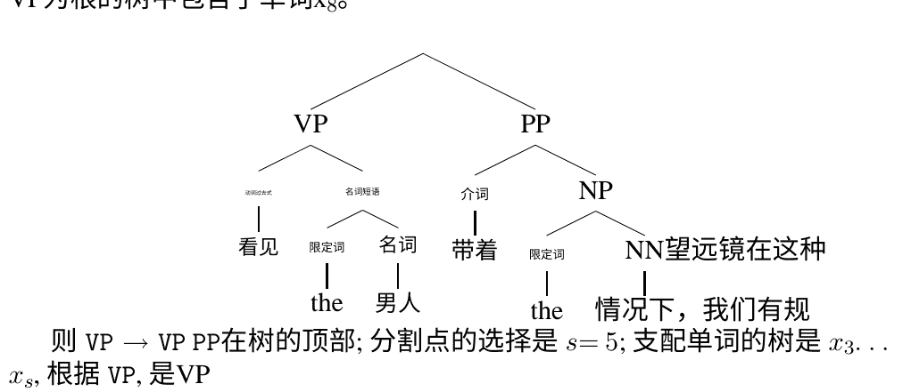
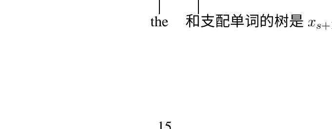

# 哥大 E6998 面向自然语言处理的机器学习讲义

## 使用隐马尔可夫模型进行标注

### 迈克尔·科林斯

## 1 标注问题

在许多自然语言处理问题中，我们希望对序列进行建模。词性标注（POS）是这种类型问题中最早、最著名的例子。在词性标注中，我们的目标是构建一个模型，其输入是一个句子，例如

_the dog saw a cat_

，输出是一个标签序列，例如

`D N V D N` (1)

（在这里，我们使用 D 表示冠词，N 表示名词，V 表示动词）。标签序列与输入句子的长度相同，因此为句子中的每个单词指定一个标签（在这个例子中，the 对应 D，dog 对应 N，saw 对应 V，等等）。

我们将使用 $x_1, x_2, ..., x_n$ 表示标注模型的输入：我们经常将其称为一个句子。在上面的例子中，句子的长度为 $n = 5$，$x_1 = \text{the}$，$x_2 = \text{dog}$，$x_3 = \text{saw}$，$x_4 = \text{the}$，$x_5 = \text{cat}$。我们将使用 $y_1, y_2, ..., y_n$ 表示标注模型的输出：我们经常将其称为状态序列或标签序列。在上面的例子中，$y_1 = \text{D}$，$y_2 = \text{N}$，$y_3 = \text{V}$，等等。这种类型的问题，将句子 $x_1, x_2, ..., x_n$ 映射到标签序列 $y_1, y_2, ..., y_n$，通常被称为序列标注问题或标注问题。将句子 $x_1, x_2, ..., x_n$ 映射到标签序列 $y_1, y_2, ..., y_n$ 的这种类型问题，通常被称为序列标注问题或标注问题。将句子 $x_1, x_2, ..., x_n$ 映射到标签序列 $y_1, y_2, ..., y_n$ 的这种类型问题，通常被称为序列标注问题或标注问题。

我们假设我们有一组训练样本，$(x^{(i)}, y^{(i)})$ 对于 $i = 1 \dots m$，其中每个 $x^{(i)}$ 是一个句子 $x^{(i)}_1 \dots x^{(i)}_{n_i}$，每个 $y^{(i)}$ 是一个标签序列 $y^{(i)}_1 \dots y^{(i)}_{n_i}$（我们假设第 $i$ 个示例的长度为 $n_i$)。因此 $x^{(i)}_j$ 是第 $i$ 个训练示例中的第 $j$ 个单词，而 $y^{(i)}_j$ 是该单词的标签。我们的任务是从这些训练示例中学习一个将句子映射到标签序列的函数。

## 2 生成模型和噪声信道模型

机器学习中的监督问题定义如下。 我们假设训练示例 \((x^{(1)}, y^{(1)}) \ldots (x^{(m)}, y^{(m)})\)，其中每个示例由一个输入 \(x^{(i)}\) 和一个标签 \(y^{(i)}\) 组成。 我们用 \(\mathcal{X}\) 表示可能的输入集合，用 \(\mathcal{Y}\) 表示可能的标签集合。 我们的任务是学习一个函数 \(f: \mathcal{X} \rightarrow \mathcal{Y}\)，将任何输入 \(x\) 映射到一个标签 \(f(x)\)。

自然语言处理中的许多问题都是有监督学习问题。 例如，在标注问题中，每个 \(x^{(i)}\) 都是一个单词序列。
\(x_1^{(i)} \ldots x_{n_i}^{(i)}\) 而每个 \(y^{(i)}\) 都是一个标签序列 \(y_1^{(i)} \ldots y_{n_i}^{(i)}\) （我们用 \(n_i\) 来表示第 \(i\) 个训练示例的长度）。 \(\mathcal{X}\) 表示所有序列 \(x_1 \ldots x_n\)，而 \(\mathcal{Y}\) 表示所有标签序列 \(y_1 \ldots y_n\)。 我们的任务是学习一个函数 \(f: \mathcal{X} \rightarrow \mathcal{Y}\)，将句子映射到标签序列。
在机器翻译中，每个输入 \(x\) 都是源语言（例如中文）的句子，而每个“标签”都是目标语言（例如英文）的句子。在语音识别中，每个输入都是某个话语的录音（例如经过傅里叶变换的预处理），而每个标签是一个完整的句子。 在所有这些例子中，我们的任务是学习一个从输入 \(x\) 到标签 \(y\) 的函数，使用我们的训练示例 \((x^{(i)}, y^{(i)})\)，其中 \(i = 1 \ldots n\) 作为证据。

定义函数 \(f(x)\) 的一种方法是通过条件模型来定义。 在这种方法中，我们定义了一个模型来定义条件概率。
\[p(y|x)\]
对于任意的 \(x, y\) 对。 模型的参数是从训练示例中估计得到的。 给定一个新的测试示例 \(x\)，模型的输出是
\[f(x) = \arg \max_{y \in \mathcal{Y}} p(y|x)\]
因此，我们只需将最有可能的标签 \(y\) 作为模型的输出。 如果我们的模型 \(p(y|x)\) 接近于给定输入的真实条件分布，那么函数 \(f(x)\) 将接近于最优。

另一种常用于机器学习和自然语言处理的方法是定义一个生成模型。 与直接估计条件分布 \(p(y|x)\) 不同，在生成模型中我们建模的是联合概率。
\[p(x, y)\]
在 \((x, y)\) 对中的数量。 模型的参数 \(p(x, y)\) 再次从训练示例中估计 \((x^{(i)}, y^{(i)})\) 对于 \(i = 1 \ldots n\)。在许多情况下，我们进一步分解概率 $p(x, y)$ 如下：

$$p(x, y) = p(y)p(x|y)$$ 	(2)

然后分别估计 $p(y)$ 和 $p(x|y)$ 的模型。 这两个模型组件具有以下解释：

-   $p(y)$ 是标签 $y$ 的先验概率分布。
-   $p(x|y)$ 是在底层标签为 $y$ 的情况下生成输入 $x$ 的概率。

我们将看到，在许多情况下，将模型分解为这种方式非常方便；例如，语音识别的经典方法就是基于这种类型的分解。

给定一个生成模型，我们可以使用贝叶斯规则推导出任意 $(x, y)$ 对的条件概率 $p(y|x)$。

$$p(y|x) = \frac{p(y)p(x|y)}{p(x)}$$

其中

$$p(x) = \sum_{y \in \mathcal{Y}} p(x, y) = \sum_{y \in \mathcal{Y}} p(y)p(x|y)$$

因此，联合模型非常灵活，我们还可以推导出概率 $p(x)$ 和 $p(y|x)$。

我们直接使用贝叶斯规则将联合模型应用于新的测试示例。给定输入 $x$，我们的模型输出 $f(x)$ 可以如下推导得到：

$$\begin{aligned} f(x) &= \arg \max_{y} p(y|x) \\ &= \arg \max_{y} \frac{p(y)p(x|y)}{p(x)} \qquad &(3) \\ &= \arg \max_{y} p(y)p(x|y) \qquad &(4) \end{aligned}$$

根据贝叶斯规则，等式3成立。等式4成立是因为分母 $p(x)$ 不依赖于 $y$，因此不会影响 $\arg \max$。 这很方便，因为我们不需要计算 $p(x)$，这可能是一个昂贵的操作。

将联合概率分解为 $p(y)$ 和 $p(x|y)$ 的模型通常被称为噪声信道模型。 直观地说，当我们看到一个测试样例 $x$ 时，我们假设它是通过两个步骤生成的：首先，以概率 $p(y)$ 选择一个标签 $y$；其次，从分布 $p(x|y)$ 中生成样例 $x$。

模型 $p(x|y)$ 可以被解释为一个“信道”，它以标签 $y$ 作为输入，并将其损坏为输出 $x$。 我们的任务是在观察到 $x$ 的情况下找到最可能的标签 $y$。

总结：

-   我们的任务是从输入 $x$ 到标签 $y = f(x)$ 学习一个函数。 我们假设训练样本 $(x^{(i)}, y^{(i)})$ 对于 $i=1 \ldots n$。
-   在噪声信道方法中，我们使用训练样本来估计模型 $p(y)$ 和 $p(x|y)$。 这些模型定义了一个联合 (生成) 模型。
    $$ p(x, y) = p(y)p(x|y) $$
-   给定一个新的测试样本 $x$，我们预测标签。
    $$ f(x) = \arg \max_{y \in \mathcal{Y}} p(y)p(x|y) $$
    找到输入 $x$ 的输出 $f(x)$ 通常被称为解码问题。

## 3 生成式标注模型

现在我们看到生成式模型如何应用于标注问题。 我们假设我们有一个有限的词汇表 $\mathcal{V}$，例如 $\mathcal{V}$ 可能是英语中出现的单词集合，例如 $\mathcal{V} = \{the, dog, saw, cat, laughs, \ldots\}$。 我们用 $\mathcal{K}$ 表示可能的标签集合；同样，我们假设这个集合是有限的。 然后我们给出以下定义：

定义1 (生成标注模型) 假设有一个有限的词汇集合 $\mathcal{V}$，和一个有限的标签集合 $\mathcal{K}$。 定义 $\mathcal{S}$ 为所有序列/标签序列对的集合 $\langle x_1 \ldots x_n, y_1 \ldots y_n \rangle$ 满足条件 $n \geq 0$，且 $x_i \in \mathcal{V}$ 对于 $i=1 \ldots n$ 和 $y_i \in \mathcal{K}$ 对于 $i=1 \ldots n$。 生成标注模型是一个函数 $p$ 满足以下条件：

1.  对于任意的序列/标签序列对 $\langle x_1 \ldots x_n, y_1 \ldots y_n \rangle \in \mathcal{S}$，
    $$ p(x_1 \ldots x_n, y_1 \ldots y_n) \geq 0 $$
2.  此外,
    $$ \sum_{\langle x_1\ldots x_n, y_1\ldots y_n \rangle \in \mathcal{S}} p(x_1 \ldots x_n, y_1 \ldots y_n) = 1 $$

因此 $p(x_1\ldots x_n, y_1\ldots y_n)$ 是一对序列的概率分布（即，对于集合 $S$ 的概率分布）。

给定一个生成标注模型，从句子 $x_1\ldots x_n$ 到标注序列 $y_1\ldots y_n$ 的函数被定义为

$$f(x_1\ldots x_n) = \arg \max_{y_1\ldots y_n} p(x_1\ldots x_n, y_1\ldots y_n)$$

因此对于任何输入 $x_1\ldots x_n$，我们将最高概率的标注序列作为模型的输出。

$\square$

在介绍生成标注模型之后，有三个关键问题：

-   我们如何定义生成标注模型 $p(x_1\ldots x_n, y_1\ldots y_n)$？
-   我们如何从训练样本中估计模型的参数？
-   我们如何高效地找到
    $$\arg \max_{y_1\ldots y_n} p(x_1\ldots x_n, y_1\ldots y_n)$$
    对于任何输入 $x_1\ldots x_n$？

下一节将介绍如何使用三元马尔可夫模型来回答这三个问题。

## 4 三元马尔可夫模型（Trigram HMMs）

在本节中，我们将描述一种重要的生成标注模型类型，即三元隐藏马尔可夫模型，并描述如何从训练样本中估计模型的参数，以及如何找到最可能的标签序列来处理任何句子。

### 4.1 三元马尔可夫模型的定义

我们现在给出三元马尔可夫模型（trigram HMMs）的正式定义。下一节将展示如何推导出这个模型形式，并给出一些直觉模型背后的解释。

定义2（三元隐藏马尔可夫模型（Trigram HMM））一个三元HMM由一个可能的单词集合 $\mathcal{V}$ 和一个可能的标签集合 $\mathcal{K}$ 组成，以及以下参数：

-   一个参数
    $$q(s|u, v)$$
    对于任何三元组 $(u, v, s)$ 满足 $s \in \mathcal{K} \cup \{STOP\}$, 且 $u, v \in \mathcal{K} \cup \{\ast\}$。
    $q(s|u, v)$ 的值可以解释为在标签的二元组$(u, v)$之后立即看到标签$s$的概率。
-   一个参数
    $$e(x|s)$$
    对于任意的$x \in \mathcal{V}, s \in \mathcal{K}$。对于 $x$ 和 $s$ 的观测概率 $e(x|s)$ 可以解释为在状态 $s$ 下观测到 $x$ 的概率。

定义 $S$ 为所有序列/标签序列对 $\langle x_1 \ldots x_n, y_1 \ldots y_{n+1} \rangle$ 满足条件 $n \geq 0$, $x_i \in \mathcal{V}$ 对于 $i=1 \ldots n$, $y_i \in \mathcal{K}$ 对于 $i=1 \ldots n$, 并且 $y_{n+1}=STOP$。
我们定义任意 $\langle x_1 \ldots x_n, y_1 \ldots y_{n+1} \rangle \in S$ 的概率为

$$p(x_1 \ldots x_n, y_1 \ldots y_{n+1}) = \prod_{i=1}^{n+1} q(y_i|y_{i-2}, y_{i-1}) \prod_{i=1}^{n} e(x_i|y_i)$$

我们假设 $y_0 = y_{-1} = \ast$。 $\square$

举个例子，如果我们有 $n=3$, $x_1 \ldots x_3$ 等于句子 *the dog laughs*，而 $y_1 \ldots y_4$ 等于标签序列 D N V STOP，那么

$$p(x_1 \ldots x_n, y_1 \ldots y_{n+1}) = q(D|\ast, \ast) \times q(N|\ast, D) \times q(V|D, N) \times q(STOP|N, V) \times e(the|D) \times e(dog|N) \times e(laughs|V)$$

请注意，这个模型形式是一个噪声信道模型。数量

$$q(D|\ast, \ast) \times q(N|\ast, D) \times q(V|D, N) \times q(STOP|N, V)$$

是看到标签序列 D N V STOP 的先验概率，我们使用了一个二阶马尔可夫模型（三元模型），非常类似于我们在之前讲座中推导的语言模型。数量

$$e(the|D) \times e(dog|N) \times e(laughs|V)$$

可以解释为条件概率 $p(the dog laughs|D N V STOP)$：即，条件概率 $p(x|y)$，其中 $x$ 是句子 *the dog laughs*，而 $y$ 是标签序列 D N V STOP。

### 4.2 三元隐马尔可夫模型中的独立性假设

我们现在描述如何推导出三元隐马尔可夫模型的形式：特别是，我们描述了模型中所做的独立性假设。考虑一对随机变量序列 $X_{1} \ldots X_{n}$ 和 $Y_{1} \ldots Y_{n}$，其中 $n$ 是序列的长度。我们假设每个 $X_{i}$ 可以取有限集合 $\mathscr{V}$ 中的任何值。例如，$\mathscr{V}$ 可能是英语中可能的单词集合，例如 $\mathscr{V} = \{\text{the}, \text{dog}, \text{saw}, \text{cat}, \text{laughs}, \ldots\}$。每个 $Y_{i}$ 可以取有限集合 $\mathscr{K}$ 中的任何值。例如，$\mathscr{K}$ 可能是英语中可能的词性标记集合，例如 $\mathscr{K} = \{\text{D}, \text{N}, \text{V}, \ldots\}$。

长度 $n$ 本身就是一个随机变量——它可以在不同的句子中变化——但我们将使用类似于建模可变长度马尔可夫过程的方法（参见前面的讲座笔记）。我们的任务是建模联合概率
$P\left(X_{1}=x_{1} \ldots X_{n}=x_{n}, Y_{1}=y_{1} \ldots Y_{n}=y_{n}\right)$ 对于任何观察序列 $x_{1} \ldots x_{n}$ 与状态序列 $y_{1} \ldots y_{n}$，其中每个 $x_{i}$ 是 $\mathscr{V}$ 的成员，每个 $y_{i}$ 是 $\mathscr{K}$ 的成员。我们将方便地定义一个额外的随机变量 $Y_{n+1}$，它始终取值为STOP。这将起到类似于可变长度马尔可夫序列中的STOP符号的作用，如前面的讲座笔记中所述。隐藏马尔可夫模型中的关键思想是以下定义：

$P(X_{1}=x_{1} \ldots X_{n}=x_{n}, Y_{1}=y_{1} \ldots Y_{n+1}=y_{n+1})$
$=\prod_{i=1}^{n+1} P\left(Y_{i}=y_{i} | Y_{i-2}=y_{i-2}, Y_{i-1}=y_{i-1}\right) \prod_{i=1}^{n} P\left(X_{i}=x_{i} | Y_{i}=y_{i}\right)$ (5)

我们假设 $y_{0}=y_{-1}=*$，其中 $*$ 是一个特殊的起始符号。注意与我们对三元马尔可夫模型的定义的相似之处。在三元马尔可夫模型中，我们假设联合概率可以分解为等式 5 中的形式，并且对于任意的 $i$，对于任意的 $y_{i-2}$，$y_{i-1}$，$y_{i}$，$P\left(Y_{i}=y_{i} | Y_{i-2}=y_{i-2}, Y_{i-1}=y_{i-1}\right)=q(y_{i} | y_{i-2}, y_{i-1})$ 并且对于任意的 $i$，对于任意的 $x_{i}$ 和 $y_{i}$，$P\left(X_{i}=x_{i} | Y_{i}=y_{i}\right)=e\left(x_{i} | y_{i}\right)$。

方程5可以如下推导。首先，我们可以写成
$P(X_{1}=x_{1} \ldots X_{n}=x_{n}, Y_{1}=y_{1} \ldots Y_{n+1}=y_{n+1})$
$=P\left(Y_{1}=y_{1} \ldots Y_{n+1}=y_{n+1}\right) P\left(X_{1}=x_{1} \ldots X_{n}=x_{n} | Y_{1}=y_{1} \ldots Y_{n+1}=y_{n+1}\right)$ (6)这一步是准确的，根据概率的链式法则。因此，我们将联合概率分解为两个项：首先是选择标签序列$y_1 \dots y_{n+1}$的概率；其次是选择单词序列$x_1 \dots x_n$的概率，条件是选择了标签序列。注意，这与噪声信道模型中的分解完全相同。

现在考虑观察到的标签序列$y_1 \dots y_{n+1}$的概率。我们做出如下独立性假设：对于任何序列$y_1 \dots y_{n+1}$，我们假设
$$P(Y_1 = y_1 \dots Y_{n+1} = y_{n+1}) = \prod_{i=1}^{n+1} P(Y_i = y_i|Y_{i-2} = y_{i-2}, Y_{i-1} = y_{i-1})$$
也就是说，我们假设序列 $Y_1 \dots Y_{n+1}$是一个二阶马尔可夫序列，每个状态仅依赖于序列中前两个状态。

接下来，考虑单词序列$x_1 \dots x_n$的概率，条件是选择了标签序列$y_1 \dots y_{n+1}$。我们做出以下假设：
$$P(X_1 = x_1 \dots X_n = x_n|Y_1 = y_1 \dots Y_{n+1} = y_{n+1})=
\prod_{i=1}^{n} P(X_i = x_i|X_1 = x_1 \dots X_{i-1} = x_{i-1}, Y_1 = y_1 \dots Y_{n+1} = y_{n+1})
= \prod_{i=1}^{n} P(X_i = x_i|Y_i = y_i) \tag{7}$$
这个推导的第一步是精确的，根据链式法则。第二步涉及到一个独立性假设，即对于 $i=1 \dots n$，
$$P(X_i = x_i|X_1 = x_1 \dots X_{i-1}=x_{i-1}, Y_1=y_1 \dots Y_{n+1}=y_{n+1}) = P(X_i = x_i|Y_i = y_i)$$
因此，我们假设随机变量 $X_i$ 的值仅取决于 $Y_i$ 的值。更正式地说，对于 $X_i$ 的值，在给定之前的观察 $X_1 \dots X_{i-1}$和其他状态值 $Y_1 \dots Y_{i-1}$， $Y_{i+1} \dots Y_{n+1}$ 的情况下，与 $Y_i$ 的值是条件独立的。

一种有用的思考这个模型的方式是考虑以下随机过程，它生成序列对 $y_1 \dots y_{n+1}, x_1 \dots x_n$:
1. 初始化 $i=1$和 $y_0 = y_{-1} = *$。
2. 从分布中生成 $y_i$
   $$q(y_i|y_{i-2}, y_{i-1})$$
3. 如果 $y_i =$STOP，则返回 $y_1 \dots y_i, x_1 \dots x_{i-1}$。否则，从分布中生成 $x_i$
   $$e(x_i|y_i),$$
设置 $i = i+1$, 并返回到步骤 2。

### 4.3 估计三元马尔可夫模型的参数

我们假设我们可以访问一些训练数据。训练数据包含一组示例，每个示例是一个句子 $x_1...x_n$ 与一个标签序列 $y_1...y_n$。在有了这些数据之后，我们如何估计模型的参数？我们将看到对于这个问题有一个简单而直观的答案。

定义 $c(u, v, s)$ 为训练数据中出现三个状态序列 $(u, v, s)$ 的次数：例如，$c(V, D, N)$ 是训练语料库中出现三个标签 $V, D, N$ 的次数。同样地，定义 $c(u, v)$ 为标签二元组 $(u, v)$ 出现的次数。定义 $c(s)$ 为语料库中出现状态 $s$ 的次数。最后，定义 $c(s \rightarrow x)$ 为语料库中状态 $s$ 与观察值 $x$ 配对出现的次数：例如，$c(N \rightarrow dog)$ 是单词 $dog$ 与标签 $N$ 配对出现的次数。

在给定这些定义的情况下，最大似然估计是
$$ q(s|u, v) = \frac{c(u, v, s)}{c(u, v)} $$
和
$$ e(x|s) = \frac{c(s \rightarrow x)}{c(s)} $$
例如，我们将得到以下估计值
$$ q(N|V, D) = \frac{c(V, D, N)}{c(V, D)} $$
和
$$ e(dog|N) = \frac{c(N \rightarrow dog)}{c(N)} $$
因此，模型参数的估计非常简单：我们只需从训练语料库中读取计数，然后按照上述方法计算最大似然估计。

### 4.4 使用HMM进行解码：维特比算法

现在我们转向找到输入句子 $x_1...x_n$ 的最可能标记序列的问题。这是一个找到的问题
$$ \arg\max_{y_1...y_{n+1}} p(x_1...x_n, y_1...y_{n+1}) $$
其中arg max是在所有序列 $y_1 \ldots y_{n+1}$ 使得 $y_i \in \mathcal{K}$ 对于 $i = 1 \ldots n$，且 $y_{n+1} = \text{STOP}$。我们假设 $p$ again 采用以下形式
$$p(x_1 \ldots x_n, y_1 \ldots y_{n+1}) = \prod_{i=1}^{n+1} q(y_i | y_{i-2}, y_{i-1}) \prod_{i=1}^{n} e(x_i | y_i)$$
回想一下，在这个定义中我们假设 $y_0 = y_{-1} = *$，且 $y_{n+1} = \text{STOP}$。

朴素的、蛮力的方法是简单地枚举所有可能的标注序列 $y_1 \ldots y_{n+1}$，根据函数 $p$ 对它们进行评分，并选择最高分的序列。例如，给定输入句子
狗叫
并假设可能的标签集合为 $\mathcal{K} = \{\text{D}, \text{N}, \text{V}\}$，我们将考虑所有可能的标签序列:
- D D D 停止
- D D N 停止
- D D V 停止
- D N D 停止
- D N N 停止
- D N V 停止
- ...
等等。在这种情况下，有 $3^3 = 27$ 种可能的序列。

然而，对于较长的句子，这种方法将会非常低效。对于长度为 $n$ 的输入句子，有 $|\mathcal{K}|^n$ 种可能的标记序列。随着长度 $n$ 的指数增长，这意味着对于任何合理长度的句子，暴力搜索将无法处理。

#### 4.4.1 基本算法

相反，我们将看到我们可以通过动态规划算法（通常称为维特比算法）高效地找到最高概率的标记序列。算法的输入是一个句子 $x_1 \ldots x_n$。给定这个句子，对于任何 $k \in \{1 \ldots n\}$，对于任何序列 $y_1 \ldots y_k$ 使得 $y_i \in \mathcal{K}$ 对于 $i = 1 \ldots k$，我们定义函数
$$r(y_1 \ldots y_k) = \prod_{i=1}^{k} q(y_i | y_{i-2}, y_{i-1}) \prod_{i=1}^{k} e(x_i | y_i)$$
这只是公式8中定义的p的截断版本，我们只考虑前k个项。特别要注意的是
$$p(x_1 ... x_n, y_1 ... y_{n+1}) = r(y_1 ... y_n) \times q(y_{n+1}|y_{n-1}, y_n)$$
$$= r(y_1 ... y_n) \times q(\text{STOP}|y_{n-1}, y_n) \tag{10}$$
接下来，对于任意的 $k \in \{1 \ldots n\}$，对于任意的 $u \in \mathcal{K}$， $v \in \mathcal{K}$，定义 $S(k, u, v)$ 为以 $u$ 为倒数第二个标记， $v$ 为最后一个标记的长度为 $k$ 的标记序列的集合。即 $S(k, u, v)$ 是所有以标记双字 $(u, v)$ 结尾的长度为 $k$ 的标记序列的集合。定义
$$\pi(k, u, v) = \max_{\langle y_1...y_k \rangle \in S(k, u, v)} r(y_1 ... y_k) \tag{11}$$
我们现在观察到，我们可以高效地计算所有 $\pi(k, u, v)$ 的值，如下所示。

首先，作为基本情况定义 $\pi(0,*,*)=1$ 和
$$\pi(0, u, v) = 0$$
这些定义只是反映了我们总是假设 $y_0 = y_{-1} = *$。

接下来，我们给出递归定义。

**命题1** 对于任何 $k \in \{1 \ldots n\}$，对于任何 $u \in \mathcal{K}$ 和 $v \in \mathcal{K}$，我们可以使用以下递归定义：
$$\pi(k, u, v) = \max_{w \in \mathcal{K}} (\pi(k - 1, w, u) \times q(v|w, u) \times e(x_k|v)) \tag{12}$$
这个定义是递归的，因为它利用了计算出的 $\pi(k - 1, w, v)$ 值来计算更短序列的值。这个定义将是我们动态规划算法的关键。

我们如何证明这个递推关系？回想一下，$\pi(k, u, v)$ 是以 $(u, v)$ 为结尾的任何序列 $y_1 \ldots y_k$ 的最高概率。以 $(u, v)$ 为结尾的任何序列必须满足 $y_{k-2} = w$，其中 $w$ 是某个状态。以 $(w, u)$ 为结尾的任何长度为 $k-1$ 的序列的最高概率是 $\pi(k-1, w, u)$，因此以 $(w, u, v)$ 为结尾的任何长度为 $k$ 的序列的最高概率必须是
$$\pi(k - 1, w, u) \times q(v|w, u) \times e(x_k|v)$$
在方程12中，我们只需搜索所有可能的 $w$ 值，并返回最大值。

我们的第二个论点如下：
输入: 一个句子 $x_1 \ldots x_n$, 参数 $q(s|u, v)$ 和 $e(x|s)$。
初始化: 设置 $\pi(0, *, *) = 1$, 并且对于所有 $(u, v)$ 使得 $u = *$ 或 $v = *$, 设置 $\pi(0, u, v) = 0$。
算法:
- 对于 $k = 1 \ldots n$,
  - 对于 $u \in \mathcal{K}, v \in \mathcal{K}$,
    $\pi(k, u, v) = \max_{w \in \mathcal{K}} (\pi(k-1, w, u) \times q(v|w, u) \times e(x_k|v))$
- 返回 $\max_{u \in \mathcal{K}, v \in \mathcal{K}} (\pi(n, u, v) \times q(\text{STOP}|u, v))$

图1: 基本的维特比算法。

**命题2**
$$\max_{y_1 \ldots y_{n+1}} p(x_1 \ldots x_n, y_1 \ldots y_{n+1}) = \max_{u \in \mathcal{K}, v \in \mathcal{K}} (\pi(n, u, v) \times q(\text{STOP}|u, v)) \tag{13}$$
这直接来自于等式10中的恒等式。

图展示了将这些思想结合起来的算法。该算法以一个句子作为输入，返回作为输出 $\max_{y_1 \ldots y_{n+1}} p(x_1 \ldots x_n, y_1 \ldots y_{n+1})$。该算法首先使用递归定义来填充 $\pi(k, u, v)$ 的值。然后使用等式13来计算任意序列的最高概率。

该算法的运行时间为 $O(n|\mathcal{K}|^3)$，因此它在序列的长度上是线性的，在标签的数量上是立方的。

#### 4.4.2 带有回溯指针的维特比算法

我们刚刚描述的算法接受一个句子 $x_1 \ldots x_n$ 作为输入，并返回 $\max_{y_1 \ldots y_{n+1}} p(x_1 \ldots x_n, y_1 \ldots y_{n+1})$ 作为输出。然而，我们真正希望的是一个返回最高概率序列的算法，也就是一个返回
$$\arg\max_{y_1 \ldots y_{n+1}} p(x_1 \ldots x_n, y_1 \ldots y_{n+1})$$
对于任何输入句子 $x_1 \ldots x_n$。图2展示了一个实现这一目标的修改算法。关键步骤是在每一步存储回溯指针值 $bp(k, u, v)$, 记录导致在位置 $k$ 结束的最高得分序列的前一个状态 $w$（在动态规划方法中，使用这样的回溯指针非常常见）。在算法结束时，我们解开回溯指针以找到最高概率序列，然后返回该序列。该算法的运行时间为 $O(n|\mathcal{K}|^3)$。

输入: 一个句子 $x_1...x_n$, 参数 $q(s|u, v)$ 和 $e(x|s)$。
初始化: 设置 $\pi(0,*,*) = 1$, 并且对于所有 $(u, v)$ 使得 $u = *$ 或 $v = *$, 设置 $\pi(0, u, v) = 0$。
算法:
- 对于 $k = 1...n$,
  - 对于 $u \in \mathcal{K}, v \in \mathcal{K}$,
    $\pi(k, u, v) = \max_{w \in \mathcal{K}} \pi(k-1, w, u) \times q(v|w, u) \times e(x_k|v)$
    $bp(k, u, v) = \arg \max_{w \in \mathcal{K}} (\pi(k-1, w, u) \times q(v|w, u) \times e(x_k|v))$
- 设 $(y_{n-1}, y_n) = \arg \max_{(u,v)} (\pi(n, u, v) \times q(\text{STOP}|u, v))$
- 对于 $k = (n - 2)...1$,
  $y_k = bp(k + 2, y_{k+1}, y_{k+2})$
- 返回标签序列 $y_1...y_n$

图2：带有回溯指针的维特比算法。

## 5 总结

在这个笔记中，我们涵盖了相当多的内容，但最终的结果是相当简单的： 我们从训练语料库中推导出了一个完整的学习标注器的方法，并将其应用于新的句子。 主要观点如下：

- 一个三元马尔可夫模型具有参数 $q(s|u, v)$ 和 $e(x|s)$, 并定义了联合概率任何句子 $x_1\ldots x_n$ 的概率 与一个标签序列 $y_1\ldots y_{n+1}$ 配对 （其中 $y_{n+1}=\text{STOP}$）
$$p(x_1\ldots x_n, y_1\ldots y_{n+1}) = \prod_{i=1}^{n+1} q(y_i|y_{i-2}, y_{i-1}) \prod_{i=1}^{n} e(x_i|y_i)$$
- 给定一个可以推导出计数的训练语料库，参数的最大似然估计为
$$q(s|u, v) = \frac{c(u, v, s)}{c(u, v)}$$
$$e(x|s) = \frac{c(s \rightarrow x)}{c(s)}$$
- 给定一个新的句子 $x_1\ldots x_n$ 和我们从训练语料库中估计得到的参数 $q$ 和 $e$，我们可以使用图2中的算法（维特比算法）找到最高概率的标签序列。

## # 感知机算法的收敛证明

图1展示了感知机学习算法，如课堂所述。在这个笔记中，我们给出了该算法的收敛证明（也在课堂上讲解过）。
收敛定理如下：

**定理1** 假设存在某个参数向量 $\theta^*$，使得 $||\theta^*|| = 1$，并且存在某个 $\gamma > 0$，对于所有的 $t = 1 \dots n$，
$$y_t(x_t \cdot \theta^*) \ge \gamma$$
另外假设对于所有的 $t = 1 \dots n$， $||x_t|| \le R$。
那么感知机算法最多会产生
$$\frac{R^2}{\gamma^2}$$
个错误。（错误的定义如下：当算法中存在某个 $(j, t)$对，使得 $y' = y_t$时，就发生了错误。）

请注意，对于任意向量 $x$，我们使用 $||x||$ 表示 $x$ 的欧几里得范数，即 $||x|| = \sqrt{\sum_i x_i^2}$。

证明：首先，定义 $\theta^k$ 为算法在第 $k$ 次错误时的参数向量。请注意，我们有 $\theta^1 = 0$。接下来，假设第 $k$ 次错误发生在示例 $t$ 上，我们有
$$\theta^{k+1} \cdot \theta^* = (\theta^k + y_t x_t) \cdot \theta^*$$
$$= \theta^k \cdot \theta^* + y_t x_t \cdot \theta^* \ge \theta^k \cdot \theta^* + \gamma$$
等式1是根据感知机更新的定义得出的。等式3是因为根据定理的假设，我们有
$$y_t x_t \cdot \theta^* \ge \gamma$$

定义：$\text{sign}(z) = 1$ 如果 $z \geq 0$, $-1$ 否则。

输入：迭代次数，$T$；训练样本 $(x_t, y_t)$ 对于 $t \in \{1 ... n\}$ 其中 $x \in \mathbb{R}^d$ 是一个输入，而 $y_t \in \{-1, +1\}$ 是一个标签。

初始化：$\theta = 0$ (即，所有参数都设置为 0)

算法：
- 对于 $j = 1 ... T$
  - 对于 $t = 1 ... n$
    1. $y' = \text{sign}(x_t \cdot \theta)$
    2. 如果 $y' = y_t$ 则 $\theta = \theta + y_t x_t$，否则保持 $\theta$ 不变

输出：参数 $\theta$

图1：感知器学习算法。

通过对 $k$ 进行归纳 (回想一下 $\|\theta^1\| = 0$)，我们可以得到
$$\theta^{k+1} \cdot \theta^* \geq k\gamma$$
此外，因为 $\|\theta^{k+1}\| \times \|\theta^*\| \geq \theta^{k+1} \cdot \theta^*$，并且 $\|\theta^*\| = 1$，我们有
$$\|\theta^{k+1}\| \geq k\gamma \tag{4}$$
在证明的第二部分，我们将得到 $\|\theta^{k+1}\|$ 的上界。我们有
$$\|\theta^{k+1}\|^2 = \|\theta^k + y_t x_t\|^2 \tag{5}$$
$$= \|\theta^k\|^2 + y_t^2\|x_t\|^2 + 2y_t x_t \cdot \theta^k \tag{6}$$
$$\leq \|\theta^k\|^2 + R^2 \tag{7}$$
等式5的成立是根据感知器更新的定义。等式7的成立是因为我们有：1) $y_t^2\|x_t\|^2 = \|x_t\|^2 \leq R^2$ 根据定理的假设，且因为 $y_t^2 = 1$；2) $y_t x_t \cdot \theta^k \leq 0$ 因为我们知道参数向量 $\theta^k$ 在第 $t$ 个示例上产生了错误。

根据 $k$ 的归纳法推导 (回想一下 $\|\theta^1\|^2 = 0$)，我们有
$$\|\theta^{k+1}\|^2 \leq kR^2 \tag{8}$$

将等式4和8的界限结合起来得到

$$k^2\gamma^2 \leq ||\underline{\theta}^{k+1}||^2 \leq kR^2$$

由此可见

$$k \leq \frac{R^2}{\gamma^2}$$

## 对数线性模型、最大熵马尔可夫模型和条件随机场

迈克尔·科林斯

### 1 符号表示

在本文中，我将使用下划线表示向量。例如，$\underline{w} \in \mathbb{R}^d$将是一个具有分量$w_1, w_2, \ldots, w_d$的向量。我们使用$\text{exp}(x)$表示指数函数，即$\text{exp}(x) = e^x$。

### 2 对数线性模型

我们有集合$\mathcal{X}$和$\mathcal{Y}$: 我们假设$\mathcal{Y}$是一个有限集合。我们的目标是构建一个模型，估计给定输入$x \in \mathcal{X}$的条件概率$p(y \mid x)$，其中$y \in \mathcal{Y}$是一个标签。例如，$x$可以是一个单词，$y$可以是该单词的候选词性（名词、动词、介词等）。我们有一个特征向量$\phi: \mathcal{X} \times \mathcal{Y} \rightarrow \mathbb{R}^d$的定义。我们还假设一个参数向量$\underline{w} \in \mathbb{R}^d$。在这些定义的基础上，对数线性模型的形式如下：

$$p(y \mid x; \underline{w}) = \frac{\text{exp}\left(\underline{w} \cdot \phi(x, y)\right)}{\sum_{y' \in \mathcal{Y}} \text{exp}\left(\underline{w} \cdot \phi(x, y')\right)}$$

这是在参数$\underline{w}$下给定$x$的条件概率$y$的表达式。这个表达式的一些动机如下。内积

$$\underline{w} \cdot \phi(x, y)$$

可以取任何值（正数或负数），并且可以解释为是给定输入$x$的标签$y$的可信度的度量。对于给定的输入$x$，我们可以计算每个可能的标签$y \in \mathcal{Y}$的内积。我们希望将这些量转化为一个良好的分布$p(y \mid x)$。如果我们对内积进行指数运算，

$$\text{exp}\left(\underline{w} \cdot \phi(x, y)\right)$$

我们得到一个严格为正的量——即，一个大于 0 的值。最后，通过除以归一化常数

$$\sum_{y' \in \mathcal{Y}} \exp\left(\underline{w} \cdot \phi(x, y')\right)$$

我们确保 $\sum$ 因此，我们已经从内积 $\underline{w} \cdot \phi(x, y)$ 转变为可以取正值或负值的概率分布。

一个重要的问题是如何从数据中估计参数 $\underline{w}$。我们接下来转向这个问题。

对数似然函数。为了估计参数，我们假设我们有一组标记的示例， $\{(x_i, y_i)\}_{i=1}^n$。对数似然函数是

$$L(\underline{w}) = \sum_{i=1}^n \log p(y_i | x_i; \underline{w})$$

我们可以将 $L(\underline{w})$ 看作是一个函数，对于给定的 $\underline{w}$，衡量了 $\underline{w}$ 解释标记示例的好坏。对于所有的 i=1...n，一个“好”的 $\underline{w}$ 值将为 $p(y_i | x_i; \underline{w})$ 提供一个高值。n，因此将具有较高的 $L(\underline{w})$ 值。

最大似然估计是

$$\underline{w}^* = \arg \max_{\underline{w} \in \mathbb{R}^d} \sum_{i=1}^n \log p(y_i | x_i; \underline{w})$$

最大似然估计因此是最能适应训练集的参数，根据准则 $L(\underline{w})$。

寻找最大似然估计。因此，给定一个训练集 $\{(x_i, y_i)\}_{i=1}^n$，我们如何找到最大似然参数估计 $\underline{w}^*$？不幸的是，一般情况下不存在解析解。相反，人们通常使用基于梯度的方法来优化 $L(\underline{w})$。最简单的方法，“纯粹”梯度上升，大致采取以下形式：

- 1. 将 $\underline{w}^0$ 设置为某个初始值，例如将 $w_j^0 = 0$ 对于 $j = 1. \ldots d$
- 2. 对于 $t = 1. \ldots T$:

i在某些情况下，这个最大值可能没有明确定义-直观上，一些参数值可能会发散到 $+\infty$ 或 $-\infty$，但现在我们假设最大值存在，并且所有参数在最大值处取有限值。

-   对于 \(j=1\ldots d\)，设置 \(w_j^t = w_j^{t-1} + \alpha_t \times \frac{\partial}{\partial w_j} L(w^{t-1})\)，其中 \(\alpha_t > 0\) 是一些步长，并且 \(\frac{\partial}{\partial w_j} L(w^{t-1})\) 是 \(L\) 对 \(w_j\) 的导数。
-   3. 返回最终参数 \(w^T\)。

因此，在每次迭代中，我们计算当前点 \(w^{t-1}\) 处的梯度，并朝着梯度的方向移动一定距离。

在实践中，使用更复杂的优化方法：一种常见的选择是使用L-BFGS，一种拟牛顿方法。我们不会在课程中详细介绍这些优化方法的细节：好消息是，有很好的软件包可用于诸如L-BFGS的方法。L-BFGS的实现通常需要我们计算目标函数 \(L(w)\) 的值和偏导数的值，\(\frac{\partial}{\partial w_j} L(w)\)，在任意点 \(w\)。幸运的是，这很容易做到。

那么偏导数的形式是什么？一点微积分给出了答案

$$\frac{\partial}{\partial w_j} L(w) = \sum_i \phi_j(x_i, y_i) - \sum_i \sum_y p(y|x_i; w) \phi_j(x_i, y)$$

表达式中的第一个求和，\(\sum_i \phi_j(x_i, y_i)\)，是标记示例 \(\{(x_i, y_i)\}_{i=1}^{n}\) 的 \(j\) 特征值 \(\phi_j(x_i, y_i)\) 的总和。表达式中的第二个求和再次涉及对训练示例的求和，但对于每个训练示例，我们计算期望特征值，\(\sum_y p(y|x_i; w) \phi_j(x_i, y)\)。请注意，这个期望值是根据当前参数值下分布 \(p(y|x_i; w)\) 计算的。

正则化对数似然函数。在许多应用中，已经证明修改对数似然函数以包含额外的正则化项是非常有益的。然后修改的准则是

$$L(w) = \sum_{i=1}^{n} \log p(y_i|x_i; w) - \frac{\lambda}{2} \|w\|^2$$

其中 \(\|w\|^2 = \sum_j w_j^2\)，而 \(\lambda > 0\) 是调节正则化项强度的参数。我们将再次选择参数值为

$$w^{\ast} = \underset{w \in \mathbb{R}^d}{\arg\max} \; L(w)$$

请注意，当估计参数时，我们现在有一个权衡：我们将尽量使 log p(y_i|x_i; w) 项尽可能高，但同时我们也会尽量保持范数 ||w||^2 较小 (λ 的值越大，我们对范数的要求越小)。正则化项惩罚大的参数值。直观上，我们可以将 ||w||^2 项视为对模型“复杂性”的惩罚，参数越大，模型越复杂。我们希望找到一个既能很好地拟合数据，又具有低复杂性的模型。实际上，在构建对数线性模型时，正则化项被发现非常有用，特别是在参数数量 d 较大的情况下。这种情况在自然语言处理应用中非常常见。对于参数数量 d 远大于训练样本数量 t 的情况并不罕见，在这种情况下，只要使用正则化项对 ||w||^2 的大值进行惩罚，我们通常仍然可以获得良好的泛化性能。

（支持向量机与隐藏马尔可夫模型有密切联系，在高维空间中学习线性模型时，只要训练样本的边界很大，就能保证良好的泛化性能。边界与参数向量的范数密切相关。）

通过使用基于梯度的方法（例如，L-BFGS），可以再次找到最优参数 w* = arg max_w L(w)。偏导数的计算仍然很容易，并且与之前略有不同：

$$\frac{\partial}{\partial w_j} L(w) = \sum_i \phi_j(x_i, y_i) - \sum_i \sum_y p(y|x_i; w)\phi_j(x_i, y) - \lambda w_j$$

## 3 最大熵马尔可夫模型

我们现在将回到序列标注任务，并描述直接使用对数线性模型的最大熵马尔可夫模型 (MEMMs)。在上一讲中，我们介绍了隐藏马尔可夫模型作为序列标注问题的模型。MEMMs 将是隐藏马尔可夫模型的有用替代。我们的目标是建模条件分布

$$p(s_1, s_2 \ldots s_m | x_1 \ldots x_m)$$

其中每个 x_j 对于 j=1...m 是第 j 个输入符号（例如句子中的第 j 个单词），每个 s_j 对于 j=1...m 是第 j 个状态。我们将使用 S 来表示可能的状态集合；我们假设 S 是一个有限集合。

例如，在英语的词性标注中，\(S\) 将是英语中所有可能的词性的集合（名词、动词、限定词、介词等）。给定一个单词序列 \(x_1 \ldots x_m\)，有 \(k^m\) 个可能的词性序列 \(s_1 \ldots s_m\)，其中 \(k = |S|\) 是可能的词性数量。我们希望估计这 \(k^m\) 个可能序列的分布。

在第一步中，MEMMs使用以下分解:

$$ p(s_1, s_2 \ldots s_m | x_1 \ldots x_m) = \prod_{i=1}^{m} p(s_i | s_1 \ldots s_{i-1}, x_1 \ldots x_m) \tag{1} $$
$$ = \prod_{i=1}^{m} p(s_i | s_{i-1}, x_1 \ldots x_m) \tag{2} $$

第一个等式是精确的（它遵循条件概率的链式法则）
第二个等式是基于独立性假设的（即对于所有的 \(i\)，都有独立性假设）

$$ p(s_i | s_1 \ldots s_{i-1}, x_1 \ldots x_m) = p(s_i | s_{i-1}, x_1 \ldots x_m) $$

因此，我们在这里做了一个类似于HMM中的马尔可夫假设，即第 \(i\) 个位置的状态仅依赖于第 \((i-1)\) 个位置的状态

在做出这些独立性假设后，我们使用一个对数线性模型来建模每个术语:

$$ p(s_i | s_{i-1}, x_1 \ldots x_m) = \frac{\exp \left( \underline{w} \cdot \underline{\phi}(x_1 \ldots x_m, i, s_{i-1}, s_i) \right)}{\sum_{s' \in S} \exp \left( \underline{w} \cdot \underline{\phi}(x_1 \ldots x_m, i, s_{i-1}, s') \right)} $$

这里 \(\underline{\phi}(x_1 \ldots x_m, i, s, s')\) 是一个特征向量，其中：

-   - \(x_1 \ldots x_m\) 是被标注的整个句子
- \(i\) 是要标注的位置（可以取从 1 到 \(m\) 的任何值）
- \(s\) 是先前的状态值（可以取 \(S\) 中的任何值）
- \(s'\) 是新的状态值（可以取 \(S\) 中的任何值）

请参考关于对数线性模型（来自第一讲）的讲义幻灯片，以了解在诸如词性标注等应用中使用的特征示例。

一旦我们定义了特征向量 \(\underline{\phi}\)，我们可以按照对数线性模型的常规方式训练模型的参数 \(\underline{w}\)。训练样本将包含

句子 \(x_1 \ldots x_m\) 带有状态序列的注释 \(s_1 \ldots s_m\)。一旦我们训练好了参数，我们就会得到一个模型

$$p(s_i|s_{i-1}, x_1 \ldots x_m)$$

因此我们会得到一个模型

$$p(s_1 \ldots s_m|x_1 \ldots x_m)$$

下一个问题是如何解码使用这个模型。

使用MEMMs进行解码。解码问题如下。我们给出一个新的测试序列 \(x_1 \ldots x_m\)。我们的目标是计算出这个测试序列的最可能的状态序列，

$$\arg \max_{s_1 \ldots s_m} p(s_1 \ldots s_m|x_1 \ldots x_m)$$

有 \(k^m\) 种可能的状态序列，所以对于任何相当长的句子长度 \(m\) 通过穷举所有可能性来搜索将是不可能的。

幸运的是，我们将能够再次利用维特比算法：它的形式与HMM的维特比算法非常相似。算法中的基本数据结构是一个动态规划表 \(\pi\)，其中包含条目

$$\pi[j, s]$$

对于 \(j=1\ldots m\)，以及 \(s \in \mathcal{S}\)。\(\pi[j, s]\) 将存储以 \(s\) 为结尾的任何状态序列的最大概率，在位置 \(j\)。更正式地说，我们的算法将计算

$$\pi[j, s] = \max_{s_1 \ldots s_{j-1}} \left( p(s|s_{j-1}, x_1 \ldots x_m) \prod_{k=1}^{j-1} p(s_k|s_{k-1}, x_1 \ldots x_m) \right)$$

对于所有 \(j=1 \ldots m\)，以及对于所有 \(s \in \mathcal{S}\)。

算法如下：

-   - 初始化：对于 \(s \in \mathcal{S}\)
  \(\pi[1, s] = p(s|s_0, x_1 \ldots x_m)\)
  其中 \(s_0\) 是一个特殊的“初始”状态。
-   对于 \(j=2 \ldots m\)，\(s=1 \ldots k\):
  \(\pi[j, s] = \max_{s' \in \mathcal{S}} \left[ \pi[j-1, s'] \times p(s|s', x_1 \ldots x_m) \right]\)

最后，填充所有 $j, s$ 的 $\pi[j, s]$ 值后，我们可以计算

$$ \max_{s_1 \dots s_m} p(s_1 \dots s_m | x_1 \dots x_m) = \text{最大值}_s \pi[m, s] $$

该算法的运行时间为 $O(m k^2)$ （即，与序列长度 $m$ 线性相关，与状态数量 $k$ 的平方成正比）。与HMM的维特比算法类似，我们可以在动态规划算法中使用回溯指针来计算得分最高的序列（请参阅第1讲的HMM幻灯片）。

最大熵马尔可夫模型和隐藏马尔可夫模型的比较那么为什么要使用最大熵马尔可夫模型而不是隐藏马尔可夫模型？需要注意的是，这两个模型的维特比解码算法非常相似。在最大熵马尔可夫模型中，与每个状态转换 $s_{i-1}$ 到 $s_i$相关联的概率是

$$ p(s_i | s_{i-1}, x_1 \dots x_m) = \frac{\exp \left(\underline{w} \cdot \underline{\phi}(x_1 \dots x_m, i, s_{i-1}, s_i)\right)}{\sum_{s' \in S} \exp \left(\underline{w} \cdot \underline{\phi}(x_1 \dots x_m, i, s_{i-1}, s')\right)} $$

在隐藏马尔可夫模型中，与每个转换相关联的概率是

$$ p(s_i | s_{i-1}) p(x_i | s_i) $$

最大熵马尔可夫模型的关键优势在于使用特征向量 $\phi$ 可以提供比隐藏马尔可夫模型中使用的特征更丰富的表示。例如，转换概率可以对输入序列 $x_1 \dots x_m$中的任何单词敏感。此外，很容易引入对当前单词 $x_i$或周围单词的拼写特征（例如前缀或后缀）敏感的特征。这些特征在许多自然语言处理应用中非常有用，但在隐藏马尔可夫模型中很难以一种清晰的方式进行整合。

## 4 条件随机场

现在我们转向条件随机场 (CRFs)。

关于符号的简短说明：为了方便起见，我们将使用 $x$来表示输入序列 $x_1 \dots x_m$和 $s$来表示状态序列 $s_1 \dots s_m$所有可能的状态集合仍然是 $S$；所有可能的状态序列集合是 $S_m$在条件随机场中，我们将再次构建一个模型来表示

$$ p(s_1 \dots s_m | x_1 \dots x_m) = p(\underline{s} | \underline{x}) $$

条件随机场中的第一个关键思想是定义一个特征向量

$$ \underline{\Phi}(\underline{x}, \underline{s}) \in \mathbb{R}^d $$

它将整个输入序列 $x$ 和整个状态序列 $s$ 映射到一个 $d$ 维特征向量。我们很快会给出 $\Phi$ 的具体定义，但现在只需假设存在某个定义。我们经常将 $\Phi$ 称为“全局”特征向量（它在考虑整个状态序列时是全局的）。然后我们构建一个巨大的对数线性模型。

$$ p(\underline{s} | \underline{x}; w) = \frac{\exp(w \cdot \Phi(\underline{x}, \underline{s}))}{\sum_{s' \in S^m} \exp(w \cdot \Phi(\underline{x}, s'))} $$

这只是另一个对数线性模型，但它在以下方面是“巨大”的：

-   1) 可能的 $s$ 值的空间，即 $S^m$，非常庞大。
-   2) 规范化常数（上述表达式中的分母）涉及对集合 $S^m$ 的求和。

乍一看，这些问题可能会导致严重的计算问题，但我们很快会看到，在适当的假设下，我们可以高效地训练和解码这种类型的模型。

下一个问题是如何定义 $\Phi(\underline{x}, \underline{s})$? 我们的答案将是

$$ \Phi(\underline{x}, \underline{s}) = \sum_{j=1}^{m} \phi(\underline{x}, j, s_{j-1}, s_j) $$

其中 $\phi(\underline{x}, j, s_{j-1}, s_j)$ 与 MEMMs 中使用的特征向量相同。或者换句话说，我们假设对于 $k = 1 \ldots d$，第 $k$ 个全局特征是

$$ \Phi_k(\underline{x}, \underline{s}) = \sum_{j=1}^{m} \phi_k(\underline{x}, j, s_{j-1}, s_j) $$

因此 $\Phi_k$ 通过对 $m$ 个不同状态转换中的“局部”特征向量 $\phi_k$ 求和来计算。

现在我们转向 CRFs 中的两个关键实际问题：首先是解码，其次是参数估计。

CRFs 中的解码问题如下：对于给定的输入序列 $x = x_1, x_2, \ldots x_m$，我们希望找到在模型下最有可能的潜在状态序列，即

$$ \arg \max_{\underline{s} \in S^m} p(\underline{s} | \underline{x}; w) $$

我们将简化这个表达式如下：

$$ \arg \max_{\underline{s} \in S^m} p(\underline{s} | \underline{x}; w) = \arg \max_{\underline{s} \in S^m} \frac{\exp(w \cdot \Phi(\underline{x}, \underline{s}))}{\sum_{s' \in S^m} \exp(w \cdot \Phi(\underline{x}, s'))} $$

## 对数线性模型

迈克尔·科林斯

### 1 引言

本文介绍了在自然语言处理中广泛使用的对数线性模型。对数线性模型的一个关键优势是其灵活性：正如我们将看到的，它们允许在模型中使用非常丰富的特征集，可以说比我们在课程中早期介绍的简单估计技术（例如，用于语言建模的平滑方法以及后来应用于标注的HMMs和解析的PCFGs等模型）更丰富。在本文中，我们将给出对数线性模型的动机，给出基本定义，并描述如何在这些模型中估计参数。在随后的课程中，我们将看到如何将这些模型应用于许多自然语言处理问题。

### 2 动机

作为一个激励的例子，再次考虑语言建模问题，其中任务是推导条件概率的估计

$$P(W_i = w_i|W_1 = w_1 \dots W_{i-1} = w_{i-1}) = p(w_i|w_1 \dots w_{i-1})$$

对于任何单词序列 \(w_1 \dots w_i\)，其中 \(i\) 可以是任何正整数。这里 \(w_i\) 是文档中的第 \(i\) 个单词：我们的任务是对前面的单词序列w1...wi-1建模并对单词 \(w_i\) 的分布进行建模。

在三元语言模型中，我们假设

$$p(w_i|w_1 \dots w_{i-1}) = q(w_i|w_{i-2}, w_{i-1})$$

对于任意的三元组 \((u, v, w)\)，其中 \(q(w|u, v)\) 是模型的一个参数。我们研究了多种估计 \(q\) 参数的方法；作为一个例子，我们研究了线性插值，其中

$$q(w|u, v) = \lambda_1 q_{M L}(w|u, v) + \lambda_2 q_{M L}(w|v) + \lambda_3 q_{M L}(w) \quad (1)$$

这里每个 $q_{ML}$ 都是最大似然估计，而 $\lambda_1, \lambda_2, \lambda_3$ 是参数，决定了分配给每个估计的权重（回忆一下我们有约束条件 $\lambda_1 + \lambda_2 + \lambda_3 = 1$，且 $\lambda_i \ge 0$ 对于所有的 $i$）。

三元语言模型非常有效，但它们对上下文 $w_1 \dots w_{i-1}$ 的利用相对较窄。例如，考虑上下文为 $w_1 \dots w_{i-1}$ 的情况下，以下是一个词序列：

第三，英语中的“语法”概念无法与“对英语的高阶统计逼近”的概念等同地识别。可以合理地假设，无论是句子（1）还是（2）（或者这些句子的任何部分），都从未在英语讨论中出现过。因此，在任何统计中

另外假设我们想要估计单词 model 出现为单词 $w_i$ 的概率，即我们想要估计

$P(W_i = \text{model} | W_1 = w_1 \dots W_{i-1} = w_{i-1})$

除了文档中前两个单词（在三元语言模型中使用）之外，我们还可以想象在上下文的各种特征上进行条件约束，这可能是估计下一个单词 model 出现的概率的有用证据。例如，我们可以考虑在单词 $w_{i-2}$ 的条件下出现单词 model 的概率，完全忽略 $w_{i-1}$:

$P(W_i = \text{model} | W_{i-2} = \text{any})$

我们可以根据前一个词是形容词的事实进行条件判断

$P(W_i = \text{model} | \text{pos}(W_{i-1}) = \text{adjective})$

这里的 pos 是一个将词映射到其词性的函数。（为了简单起见，我们假设这是一个确定性函数，即从一个词到底层词性的映射是明确的。）我们可以根据前一个词的后缀是“ical”进行条件判断：

$P(W_i = \text{model} | \text{suff4}(W_{i-1}) = \text{ical})$

（这里的 suff4 是一个将词映射到其最后四个字符的函数。）我们可以根据单词 model 在上下文中不出现的事实进行条件判断：

$P(W_i = \text{model} | W_j = \text{model for } j \in \{1 \dots (i-1)\})$

或者我们可以根据单词grammatical在上下文中是否出现来进行条件判断：

$P(W_i = \text{model}|W_j = \text{grammatical}, \text{其中} j \in \{1 \ldots (i-1)\})$

简而言之，上下文中的各种信息可能对估计特定单词（例如model）的概率有用。

一种简单的利用这些信息的方法是扩展我们在三元语言模型中看到的方法。与其基于三元、二元和一元估计值的组合，我们将组合一个更大的估计值集合。我们将再次估计λ参数，反映每个估计值的重要性或权重。得到的估计器将类似于以下形式（仅供参考）：

$p(\text{model}|w_1, \ldots w_{i-1}) = \\
\lambda_1 \times q_{M L}(\text{模型} |w_{i-2} = \text{任意}, w_{i-1} = \text{统计}) + \\
\lambda_2 \times q_{M L}(\text{模型} |w_{i-1} = \text{统计} ) + \\
\lambda_3 \times q_{M L}(\text{模型} ) + \\
\lambda_4 \times q_{M L}(\text{模型} |w_{i-2} = \text{任意}) + \\
\lambda_5 \times q_{M L}(\text{模型} |w_{i-1} \text{是一个形容词}) + \\
\lambda_6 \times q_{M L}(\text{模型} |w_{i-1} \text{以“ical”结尾}) + \\
\lambda_7 \times q_{M L}(\text{模型}|\text{“模型”在 } w_1, \ldots \ldots \ldots \ldots \ldots w_{i-1} \text{中不存在}) + \\
\lambda_8 \times q_{M L}(\text{模型}|\text{“语法”在 } w_1, \ldots \ldots \ldots \ldots \ldots w_{i-1} \text{中存在}) + \\
\ldots$

问题在于线性插值方法在添加更多的条件信息时变得非常笨重。实际上，将这种方法扩展到我们只有少量估计值的情况下变得非常困难，这些估计值属于自然层次结构（例如，一元、二元、三元估计）。相比之下，我们将看到对数线性模型提供了一种更加令人满意的方法来整合多个上下文信息。

### 3 第三个例子：词性标注

我们的第二个例子涉及词性标注。考虑一个问题，其中上下文是一个单词序列 $w_1 \ldots w_n$，以及一个标签序列$t_1 \ldots t_{i-1}$（这里$i < n$），我们的任务是对序列中的第$i$个标签建模。也就是说，我们希望对条件分布进行建模

$P(T_i = t_i|T_1 = t_1 \ldots T_{i-1} = t_{i-1}, W_1 = w_1 \ldots W_n = w_n)$

举个例子，我们可能有以下上下文：

Hispaniola/NNP quickly/RB became/VB an/DT important/JJ base from which Spain expanded its empire into the rest of the Western Hemisphere.

这里 $w_{1}...w_{n}$ 是这个句子海地迅速...半球., 而且前一个标签序列是 $t_{1}...t_{5}$ =NNP RB VB DT JJ. 我们有 $i=6$, 我们的任务是对分布进行建模

$$P(T_{6}=t_{6} | W_{1}...W_{n}=海地迅速...半球., T_{1}...T_{5}=NNP RB VB DT JJ )$$

也就是说，我们的任务是对第6个单词 $base$ 的标签分布进行建模。

在这种情况下，有很多上下文信息可能对估计 $t_{i}$ 的值的分布有用。具体来说，考虑估计 $base$ 的标签为 V 的概率（即 $T_{6}=V$）。我们可以考虑在已知第 $i$ 个单词的情况下的条件概率：$P(T_{6}=V|W_{6}=base)$

我们还可以考虑基于前一个或两个标签的概率条件：

$$P(T_{6}=V|T_{5}=JJ)$$ $$P(T_{6}=V|T_{4}=DT, T_{5}=JJ)$$

我们可以考虑基于句子中前一个单词的概率条件

$$P(T_{6}=V|W_{5}=important)$$

或者基于句子中下一个单词的概率条件

$$P(T_{6}=V|W_{7}=from)$$

我们还可以考虑基于单词的拼写特征，例如单词 $w_{6}$ 的最后两个字母：$P(T_{6}=V|\text{suff2}(W_{6})=se)$

(这里suff2是一个将单词映射为其最后两个字母的函数)。简而言之，我们再次面临一个情景，在这个情景中，各种上下文特征可能对建模感兴趣的随机变量的分布有用（在本例中是第 $i$ 个标签的身份）。同样，当面对这个估计问题时，基于线性插值的天真方法会遭遇严重失败。

### 4 对数线性模型

我们现在描述一下如何将对数线性模型应用于上述问题。

#### 4.1 基本定义

抽象问题如下。我们有一些可能的输入集合 $\mathcal{X}$，和一些可能的标签集合 $\mathcal{Y}$。我们的任务是建模条件概率

$p(y|x)$

对于任意一对 $(x, y)$，其中 $x \in \mathcal{X}$ 且 $y \in \mathcal{Y}$。

例如，在语言建模任务中，我们有一些语言中可能的有限词汇集合，称为 $\mathcal{V}$。集合 $\mathcal{Y}$ 等于 $\mathcal{V}$。集合 $\mathcal{X}$ 是可能的序列 $w_1 \ldots w_{i-1}$，其中 $i \ge 1$，且 $w_j \in \mathcal{V}$ 对于 $j \in \{1 \ldots (i-1)\}$。

在词性标注的例子中，我们有一些可能的单词集合 $\mathcal{V}$，和一些可能的标签集合 $\mathcal{T}$。集合 $\mathcal{Y}$ 简单地等于 $\mathcal{T}$。集合 $\mathcal{X}$ 是形式为

$\langle w_1 w_2 \ldots w_n, t_1 t_2 \ldots t_{i-1} \rangle$

其中 $n \ge 1$ 是指输入句子的长度，$w_j \in \mathcal{V}$ 对于 $j \in \{1 \ldots n\}$，$i \in \{1 \ldots (n-1)\}$，以及 $t_j \in \mathcal{T}$ 对于 $j \in \{1 \ldots (i-1)\}$。我们将始终假设 $\mathcal{Y}$ 是一个有限集合。集合 $\mathcal{X}$ 可以是有限的、可数无限的，甚至是不可数无限的。

对数线性模型的定义如下：

定义1（对数线性模型）对数线性模型由以下组成部分组成：

- 一个可能输入的集合 $\mathcal{X}$
- 一个可能标签的集合 $\mathcal{Y}$。假设集合 $\mathcal{Y}$ 是有限的。
- 一个正整数 $d$ 指定模型中的特征和参数的数量。
- 一个函数 $f : \mathcal{X} \times \mathcal{Y} \rightarrow \mathbb{R}^d$，将任意 $(x, y)$ 对映射到一个特征向量 $f(x, y)$。
- 一个参数向量 $v \in \mathbb{R}^d$。

### 5 条随机场

因此，我们已经证明了在模型下找到最可能的序列等价于找到最大化的序列

$$\arg \max_{s \in \mathcal{S}^m} \sum_{j=1}^m \underline{w} \cdot \underline{\phi}(\underline{x}, j, s_{j-1}, s_j)$$

这个问题有一个明确的直觉。从状态 \(s_{j-1}\) 到状态 \(s_j\) 的每个转移都有一个相关的分数
\[\underline{w} \cdot \underline{\phi}(\underline{x}, j, s_{j-1}, s_j)\]
这个分数可以是正数或负数。直观地说，如果状态转移是合理的，这个分数将相对较高；如果转移是不合理的，这个分数将相对较低。解码问题是找到一个完整的状态序列，使得转移分数的总和最大化。

我们可以再次使用Viterbi算法的变体来解决这个问题，方法与HMMs或MEMMs的解码算法非常相似：

- 初始化：对于 \(s \in \mathcal{S}\)
  \[\pi[1, s] = \underline{w} \cdot \underline{\phi}(\underline{x}, 1, s_0, s)\]
  其中 \(s_0\) 是一个特殊的“初始”状态。
- 对于 \(j = 2 \ldots m\), \(s = 1 \ldots k\):
  \[\pi[j, s] = \max_{s' \in \mathcal{S}} \left[ \pi[j - 1, s'] + \underline{w} \cdot \underline{\phi}(\underline{x}, j, s', s) \right]\]

然后我们有

$$\max_{s_1 \ldots s_m} \sum_{j=1}^m \underline{w} \cdot \underline{\phi}(\underline{x}, j, s_{j-1}, s_j) = \max_{s} \pi[m, s]$$

与之前一样，可以使用回溯指针来恢复最高得分的状态序列。该算法的运行时间仍然为 \(O(mk^2)\)。因此，我们已经证明了在CRFs中解码是高效的。

### 6 CRF中的参数估计

对于参数估计，我们假设有一组 n个标记的示例， {(x_i, s^i)}_{i=1}^n。每个输入序列 x^i 都是一个输入序列 x_1^i ... x_m^i，每个状态序列 s^i 都是一个状态序列 s_1^i ... s_m^i。然后我们按照与常规对数线性模型相同的方式进行。正则化对数似然函数是

$$L(w) = \sum_{i=1}^{n} \log p(s^i | x^i; w) - \frac{\lambda}{2} \|w\|^2$$

然后我们的参数估计值为

$$w^* = \arg \max_{w \in \mathbb{R}^d} \sum_{i=1}^{n} \log p(s^i | x^i; w) - \frac{\lambda}{2} \|w\|^2$$

我们将再次使用基于梯度的优化方法来找到 w^*。与之前一样，偏导数为

$$\frac{\partial}{\partial w_k} L(w) = \sum_{i} \Phi_k(x^i, s^i) - \sum_{i} \sum_{s \in \mathcal{S}^m} p(s|x^i; w) \Phi_k(x^i, s) - \lambda w_k$$

第一个术语很容易计算，因为

$$\sum_{i} \Phi_k(x^i, s^i) = \sum_{i} \sum_{j=1}^{m} \phi_k(x^i, j, s_{j-1}^i, s_j^i)$$

因此，我们只需要对所有训练示例 i=1...进行求和 n，并且对于每个示例，对所有位置 j=1...m进行求和。

第二个术语更难处理，因为它涉及对 S^m 的求和，这是一个非常大的集合。然而，我们将看到可以使用动态规划高效地计算这个术语。推导如下：

$$\sum_{s \in \mathcal{S}^m} p(s | x^i; w) \Phi_k(x^i, s) \tag{3}$$

$$= \sum_{s \in \mathcal{S}^m} p(s | x^i; w) \sum_{j=1}^{m} \phi_k(x^i, j, s_{j-1}, s_j) \tag{4}$$

$$= \sum_{j=1}^{m} \sum_{s \in \mathcal{S}^m} p(s | x^i; w) \phi_k(x^i, j, s_{j-1}, s_j) \tag{5}$$

$$= \sum_{j=1}^{m} \sum_{a \in \mathcal{S}, b \in \mathcal{S}} \sum_{\substack{s \in \mathcal{S}^m \\ s_{j-1}=a, s_j=b}} p(s | x^i; w) \phi_k(x^i, j, s_{j-1}, s_j) \tag{6}$$

$$= \sum_{j=1}^{m} \sum_{a \in S, b \in S} \phi_{k}(\underline{x}^{i}, j, a, b) \sum_{\substack{s \in S^{m}: \\ s_{j-1}=a, s_{j}=b}} p(\underline{s}|\underline{x}^{i}; \underline{w}) \quad\quad (7)$$

$$= \sum_{j=1}^{m} \sum_{a \in S, b \in S} q_{j}^{i}(a, b) \phi_{k}(\underline{x}^{i}, j, a, b) \quad\quad (8)$$

其中

$$q_{j}^{i}(a, b) = \sum_{\substack{s \in S^{m}: s_{j-1}=a, s_{j}=b}} p(\underline{s}|\underline{x}^{i}; \underline{w})$$

需要注意的重要事项是，如果我们能够高效地计算 $q_{j}^{i}(a, b)$ 项，我们就能够使用公式8中的表达式高效地计算导数。 数量 $q_{j}^{i}(a, b)$ 有一个相当直观的解释：在分布 $p(s|x; w)$ 下，第 $i$ 个训练示例 $x^{i}$ 在位置 $j-1$ 具有状态 $a$，在位置 $j$ 具有状态 $b$ 的概率。

一个关键的结果是，对于给定的 $i$，可以计算出所有 $q_{j}^{i}(a, b)$ 项，时间复杂度为 $O(mk^{2})$。 实现这一点的算法是前向-后向算法。 这是另一个动态规划算法，与维特比算法密切相关。

对于任意的 $x \in X$, $y \in Y$，模型定义了一个条件概率

$$
p(y|x;v) = \frac{\exp (v \cdot f(x, y))}{\sum_{y' \in Y} \exp (v \cdot f(x, y'))}
$$

在这里 $\exp(x)=e^x$，并且 $v \cdot f(x,y)=\Sigma_{k=1}^d v_k f_k(x,y)$ 是向量 $v$ 和 $f(x,y)$ 之间的内积。术语 $p(y|x;v)$ 被解释为“在参数值 $v$ 下，$y$ 在给定 $x$ 的条件下的概率”。

现在我们更详细地描述模型的组成部分，首先关注特征向量定义 $f(x,y)$，然后解释模型形式的直觉

$$
p(y|x;v) = \frac{\exp (v \cdot f(x, y))}{\sum_{y' \in Y} \exp (v \cdot f(x, y'))}
$$

## 5个特征

如前一节所述，对于任意一对 $(x,y)$， $f(x,y) \in R^d$ 是表示该对的特征向量。每个分量 $f_k(x,y)$，对于 $k=1\ldots d$ 在这个向量中被称为一个特征。这些特征允许我们表示输入 $x$ 的不同属性，与标签 $y$ 结合起来。每个特征都有一个相关的参数 $v_k$，其值是使用一组训练样本估计的。训练集由一系列示例 $(x^{(i)}, y^{(i)})$ 组成，其中 $i=1\ldots n$，其中每个 $x^{(i)} \in X$，每个 $y^{(i)} \in Y$。

在这一部分中，我们首先给出了一个示例，展示了如何为语言建模问题构建特征，正如在本笔记中之前介绍的那样；然后我们描述了一些在定义特征时遇到的实际问题。

### 5.1 语言建模示例的特征

再次考虑语言建模问题，其中输入 $x$ 是一个单词序列 $w_1w_2\ldots w_{i-1}$，而标签 $y$ 是一个单词。图1展示了这个问题的一组示例特征。每个特征都是一个指示函数：也就是说，每个特征要么返回1，要么返回0。在自然语言处理应用中，使用指示函数作为特征非常常见。每个特征在输入 $x$ 与标签 $y$ 的某个属性为真时返回1，否则返回0。

前三个特征 $f_1$，$f_2$ 和 $f_3$ 类似于常规三元语言模型中的一元、二元和三元特征。第一个特征返回1，如果标签 $y$ 等于单词 “模型”，否则返回0。第二个特征返回1，如果二元组 $<w_{i-1}, y>$ 等于 $<$统计, 模型$>$，否则返回0。第三个特征返回1，如果三元组 $<w_{i-2}, w_{i-1}, y>$ 等于 $<$任意, 统计, 模型$>$，否则返回0。

$$
f_1(x, y) = \begin{cases} 1 & \text{如果 } y=\text{模型} \\ 0 & \text{否则} \end{cases}
$$

$$
f_2(x, y) = \begin{cases} 1 & \text{如果 } y=\text{模型 且 } w_{i-1}=\text{统计} \\ 0 & \text{否则} \end{cases}
$$

$$
f_3(x, y) = \begin{cases} 1 & \text{如果 } y=\text{模型},\ w_{i-2}=\text{任意},\ w_{i-1}=\text{统计} \\ 0 & \text{否则} \end{cases}
$$

$$
f_4(x, y) = \begin{cases} 1 & \text{如果 } y=\text{模型},\ w_{i-2}=\text{任意} \\ 0 & \text{否则} \end{cases}
$$

$$
f_5(x, y) = \begin{cases} 1 & \text{如果 } y=\text{模型},\ w_{i-1}\text{是形容词} \\ 0 & \text{否则} \end{cases}
$$

$$
f_6(x, y) = \begin{cases} 1 & \text{如果 } y=\text{模型},\ w_{i-1}\text{以“ical”结尾} \\ 0 & \text{否则} \end{cases}
$$

$$
f_7(x, y) = \begin{cases} 1 & \text{如果 } y=\text{模型},\ \text{“model”不在 } w_1, \ldots, w_{i-1}\text{中} \\ 0 & \text{否则} \end{cases}
$$

$$
f_8(x, y) = \begin{cases} 1 & \text{如果 } y=\text{模型},\ \text{“grammatical”在 } w_1, \ldots, w_{i-1}\text{中} \\ 0 & \text{否则} \end{cases}
$$

**图1：** 语言建模问题的示例特征，其中输入 $x$ 是一个单词序列 $w_1w_2\ldots w_{i-1}$，标签 $y$ 是一个单词。

请记住，这些特征中的每一个都有一个参数 $v_1$，$v_2$ 或 $v_3$；这些参数在常规三元语言模型中起着类似的作用。

特征 $f_4$...图1中的特征 $f_8$ 考虑了超过一元、二元和三元特征的属性。特征 $f_4$ 考虑了单词 $w_{i-2}$ 与标签 $y$ 的结合，忽略了单词 $w_{i-1}$；这种类型的特征通常被称为“跳跃二元特征”。特征 $f_5$ 考虑了前一个单词的词性（假设前一个单词的词性可用，例如通过从单词到词性的确定性映射，或者通过词性标注器对单词 $w_1\ldots w_{i-1}$ 的输出）。特征 $f_6$ 考虑了前一个单词的后缀，特征 $f_7$ 和 $f_8$ 考虑了输入 $x = w_1\ldots w_{i-1}$ 的其他各种特征。

从这个例子中我们可以看到，可以将广泛的上下文信息纳入语言建模问题中，使用指示函数作为特征。

### 5.2 特征模板

现在我们讨论一些在定义特征时的实际问题。在实践中，定义特征的一个关键思想是特征模板。我们在本节中介绍这个思想。

回顾一下，前面例子中的前三个特征如下：

$$
f_1(x, y) = \begin{cases} 1 & \text{if } y = \text{model} \\ 0 & \text{otherwise} \end{cases}
$$

$$
f_2(x, y) = \begin{cases} 1 & \text{if } y = \text{model and } w_{i-1} = \text{statistical} \\ 0 & \text{otherwise} \end{cases}
$$

$$
f_3(x, y) = \begin{cases} 1 & \text{if } y = \text{model, } w_{i-2} = \text{any, } w_{i-1} = \text{statistical} \\ 0 & \text{otherwise} \end{cases}
$$

这些特征跟踪了一元组 $<$模型$>$、二元组 $<$统计, 模型$>$ 和三元组 $<$任意, 统计, 模型$>$。

这些特征中的每一个都特定于特定的一元组、二元组或三元组。在实践中，我们希望定义一个更大的特征类，考虑训练数据中出现的所有可能的一元组、二元组或三元组。为了做到这一点，我们使用特征模板生成大量的特征集。

作为一个例子，这里是一个三元组的特征模板：

**定义2（三元组特征模板）** 对于训练数据中出现的任何三元组 $(u, v, w)$，创建一个特征

$$
f_N(u, v, w)(x, y) = \begin{cases} 1 & \text{if } y = w, w_{i-2} = u, w_{i-1} = v \\ 0 & \text{otherwise} \end{cases}
$$

其中 $N(u, v, w)$ 是一个将训练数据中的每个三元组映射到唯一整数的函数。

#### 关于这个定义的一些注释：

- 请注意，模板只为训练数据中出现的三元组生成特征。这个限制有两个原因。首先，为每个可能的三元组生成特征是不可行的，即使是那些在训练数据中没有出现的三元组：这将导致 $V^3$ 个特征，其中 $V$ 是词汇表中的单词数，这是一个非常庞大的特征集。其次，对于任何在训练数据中没有出现的三元组 $(u, v, w)$，我们没有证据来估计相关的参数值，所以在任何情况下都没有包含它的意义。$^1$
- 函数 $N(u, v, w)$ 将每个三元组映射到一个唯一的整数：也就是说，对于任何三元组 $(u, v, w)$ 和 $(u', v', w')$，如果 $u = u'$, $v = v'$, 或 $w = w'$，我们有

$$
N(u, v, w) = N(u', v', w')
$$

在实践中，在特征模板的实现中，函数 $N$ 通过哈希函数实现。例如，我们可以使用哈希表将字符串 `trigram=the statistical model` 哈希为整数。每个不同的字符串都被哈希为不同的整数。

继续上面的例子，我们还可以定义二元和一元特征模板：

**定义3 (二元特征模板)** 对于训练数据中出现的任何二元组 $(v, w)$，创建一个特征

$$
f_{N(v,w)}(x, y) = \begin{cases} 1 & \text{if } y = w, w_{i-1} = v \\ 0 & \text{otherwise} \end{cases}
$$

其中 $N(v, w)$ 将每个二元组映射到唯一的整数。

> $^1$这并不完全准确：实际上，可能有理由包括对于训练数据中观察到的二元组 $(u, v)$，但训练数据中未观察到的三元组 $(u, v, w)$ 的特征。我们将在稍后讨论这个问题。

**定义4（一元特征模板）** 对于训练数据中出现的任何一元组 $(w)$，创建一个特征

$$
f_{N(w)}(x, y) = \begin{cases} 1 & \text{if } y = w \\ 0 & \text{otherwise} \end{cases}
$$

其中 $N(w)$ 将每个一元组映射到唯一的整数。

实际上，我们需要对这些定义稍微更加小心，以避免三元组、二元组和一元组特征之间的重叠。定义 $T$、$B$ 和 $U$ 为训练数据中出现的三元组、二元组和一元组的集合。定义

$$N_t = \{i : \exists (u, v, w) \in T \text{ 使得 } N(u, v, w) = i\}$$
$$N_b = \{i : \exists (v, w) \in B \text{使得 } N(v, w) = i\}$$
$$N_u = \{i : \exists (w) \in U \text{使得 } N(w) = i\}$$

然后我们需要确保这些集合之间没有重叠，否则，两个不同的 n-gram 将被映射到相同的特征。

更正式地说，我们需要
$$N_t \cap N_b = N_t \cap N_u = N_b \cap N_u = \emptyset \quad (2)$$
在实践中，使用单个哈希表对字符串进行哈希，例如 `trigram=统计模型`，`bigram=统计模型`，`unigram=模型`，可以轻松确保这一点。

当然，我们可以定义额外的模板。例如，以下是一个模板，用于跟踪前一个单词的长度为4的后缀，并与标签 $y$ 一起使用：

**定义5（长度为4的后缀模板）** 对于在训练数据中出现的任何一对 $(v, w)$，其中 $v = \text{suff4}(w_{i-1})$，且 $w = y$，创建一个特征

$$
f_{N(\text{suff4}=v,w)}(x, y) = \begin{cases} 1 & \text{如果 } y = w \text{ 且 } \text{suff4}(w_{i-1}) = v \\ 0 & \text{otherwise} \end{cases}
$$

其中 $N(\text{suff4} = v, w)$ 将每对 $(v, w)$ 映射到唯一的整数，与模型中使用的其他特征模板没有重叠（其中重叠的定义类似于上面的方程2）。

### 5.3 特征稀疏性

我们上面定义的特征的一个非常重要的属性是特征的稀疏性。在许多自然语言处理应用中，特征的数量 $d$ 可能非常大。例如，仅使用上面定义的三元模板，在训练数据中每个三元组都会有一个特征。看到具有数十万甚至数百万个特征的模型并不罕见。

这引发了对结果模型效率的明显担忧。然而，我们在本节中描述了特征稀疏性如何导致高效的模型。

关键观察是：对于任意给定的一对 $(x, y)$，满足 $f_k(x, y) = 1$ 的 $k$ 值的数量是有限的，其中 $k$ 属于 $\{1\ldots d\}$。

通常情况下，这个数量非常小，远远小于总特征数量 $d$。因此，除了一个非常小的子集，所有特征都是0：特征向量 $f(x, y)$ 是一个非常稀疏的比特串，其中几乎所有的特征 $f_k(x, y)$ 都等于0，只有少数特征等于1。

举个例子，考虑语言模型的例子，我们只使用三元组、二元组和一元组模板，如上所述。这个模型中的特征数量很大（等于训练数据中不同三元组、二元组和一元组的数量）。然而，很容易看出对于任意一对 $(x, y)$，最多只有三个非零特征（在最坏情况下，这对 $(x, y)$ 包含在训练数据中出现的三元组、二元组和一元组特征，总共有三个非零特征）。

当实现对数线性模型时，具有稀疏特征的模型可以非常高效，因为不需要显式地表示和操作 $d$ 维特征向量 $f(x, y)$。相反，通常更加高效的做法是实现一个函数（通常通过哈希表）来计算任意一对 $(x, y)$ 的非零特征的索引：即计算集合

$$Z(x, y) = \{k : f_k(x, y) = 1\}$$

在稀疏特征空间中，这个集合很小——例如，仅使用一元组/二元组/三元组特征，它的大小最多为3。一般来说，很容易实现一个计算 $Z(x, y)$ 的函数，其时间复杂度为 $O(|Z(x, y)|)$，使用哈希函数。注意 $|Z(x, y)| \ll d$，因此这比显式计算所有 $d$ 个特征要高效得多，后者需要 $O(d)$ 的时间。

作为高效计算 $Z(x, y)$ 的一个例子，考虑计算内积

$$v \cdot f(x, y) = \sum_{k=1}^{d} v_k f_k(x, y)$$

这个计算在对数线性模型中非常重要。一个朴素的方法是逐个迭代每个特征，并且需要 $O(d)$ 的时间。相比之下，如果我们利用以下等式

$$\sum_{k=1}^d v_k f_k(x, y) = \sum_{k \in Z(x,y)} v_k$$

因此，只需考虑非零特征，我们可以在 $O(|Z(x, y)|)$ 的时间内计算内积。

## 6 对数线性模型的模型形式

现在我们更详细地描述对数线性模型的模型形式。回想一下，对于任意一对 $(x, y)$，其中 $x \in \mathcal{X}$，且 $y \in \mathcal{Y}$，模型下的条件概率为

$$
p(y \mid x; v) = \frac{\exp (v \cdot f(x, y))}{\sum_{y' \in \mathcal{Y}} \exp (v \cdot f(x, y'))}
$$

内积

$$v \cdot f(x, y)$$

在这个表达式中起着关键作用。再次，为了说明，考虑我们的语言模型示例，其中输入 $x = w_1 \ldots w_{i-1}$ 是以下单词序列：

> > 第三，英语中的“语法”概念无法与“对英语的高阶统计逼近”的概念等同地识别。可以合理地假设，无论是句子（1）还是（2）（或者这些句子的任何部分），都从未在英语讨论中出现过。因此，在任何统计中

计算在给定 $x$ 的情况下，文档中下一个单词的概率分布的第一步是计算内积 $v \cdot f(x, y)$ 对于每个可能的标签 $y$（即词汇表中的每个可能单词）。例如，我们可能会找到以下值（我们只显示了一些可能单词的值 - 实际上，我们将为每个可能单词计算一个内积）：

- $v \cdot f(x, \text{model}) = 5.6$
- $v \cdot f(x, \text{is}) = 1.5$
- $v \cdot f(x, \text{models}) = 4.5$
- $v \cdot f(x, \text{the}) = -3.2$
- $v \cdot f(x, \text{of}) = 1.3$
- ...

请注意，内积可以取任何实数值，包括正数和负数。

直观地说，如果给定单词 $y$ 的内积 $v \cdot f(x, y)$ 很高，这表明该单词在给定上下文 $x$ 中的概率很高。相反，如果 $v \cdot f(x, y)$ 很低，这表明 $y$ 在该上下文中 的概率很低。

内积 $v \cdot f(x, y)$ 可以取任何实数值；然而，我们的目标是定义一个条件分布 $p(y|x)$。如果我们取

$$\exp \left(v \cdot f(x, y)\right)$$

对于任何标签 $y$，我们现在有一个大于 0 的值。如果 $v \cdot f(x, y)$ 很高，这个值将很高；如果 $v \cdot f(x, y)$ 很低，例如如果它是强烈负数，这个值将很低（接近零）。

接下来，如果我们将上述数量除以

$$\sum_{y' \in \mathcal{Y}} \exp \left(v \cdot f\left(x, y^{\prime}\right)\right)$$

那么

$$p(y \mid x ; v)=\frac{\exp (v \cdot f(x, y))}{\sum_{y^{\prime} \in \mathcal{Y}} \exp \left(v \cdot f\left(x, y^{\prime}\right)\right)} \quad(3)$$

那么很容易验证我们有一个良好的分布：即，

$$\sum_{y \in \mathcal{Y}} p(y \mid x ; v)=1$$

因此，方程3中的分母是一个归一化项，确保我们有一个总和为一的分布。

总结一下，该函数

$$\frac{\exp (v \cdot f(x, y))}{\sum_{y^{\prime} \in \mathcal{Y}} \exp \left(v \cdot f\left(x, y^{\prime}\right)\right)}$$

执行一个转换，其输入是一组值 $\left\{v \cdot f(x, y) : y \in \mathcal{Y}\right\}$, 其中每个 $v \cdot f(x, y)$ 可以取任意实数值，并且输出产生一个标签 $y \in \mathcal{Y}$ 的概率分布。

最后，我们考虑名为对数线性模型的起源。根据上述定义可知

$$\begin{aligned}
\log p(y \mid x ; v) & =v \cdot f(x, y)-\log \sum_{y^{\prime} \in \mathcal{Y}} \exp \left(v \cdot f\left(x, y^{\prime}\right)\right) \\
& =v \cdot f(x, y)-g(x)
\end{aligned}$$

其中

$$g(x)=\log \sum_{y^{\prime} \in \mathcal{Y}} \exp \left(v \cdot f\left(x, y^{\prime}\right)\right)$$第一个项，$v \cdot f(x, y)$，是特征 $f(x, y)$ 的线性函数。第二个项，$g(x)$，仅依赖于 $x$，不依赖于标签 $y$。因此，对数概率 $\log p(y|x; v)$ 是特征 $f(x, y)$ 的线性函数，只要我们固定 $x$；这解释了术语“对数线性”。

## 7 对数线性模型中的参数估计

### 7.1 对数似然函数和正则化

我们现在考虑对数线性模型中的参数估计问题。我们假设我们有一个训练集，包含示例 $(x^{(i)}, y^{(i)})$ 对于 $i \in \{1 ... n\}$，其中每个 $x^{(i)} \in \mathcal{X}$，每个 $y^{(i)} \in \mathcal{Y}$。

给定参数值 $v$，对于任意示例 $i$，我们可以计算条件概率的对数

$$\log p(y^{(i)}|x^{(i)}; v)$$

在模型下。直观地说，这个值越高，模型适应这个特定示例的效果就越好。对数似然函数考虑了训练数据中示例的对数概率之和：

$$L(v) = \sum_{i=1}^{n} \log p(y^{(i)}|x^{(i)}; v) \quad (4)$$

这是一个关于参数 $v$ 的函数。对于任意参数向量 $v$，函数值 $L(v)$ 可以解释为衡量参数向量对训练示例的拟合程度的度量。

我们将首先考虑的估计方法是最大似然估计，其中我们选择参数为

$$v_{M L} = \arg \max_{v \in \mathbb{R}^d} L(v)$$

在下一节中，我们将描述如何高效地找到参数 $v_{M L}$。直观地说，这种估计方法找到了最能适应数据的参数。

最大似然估计在模型特征非常多的情况下可能会遇到问题。举个例子，考虑语言模型问题，假设我们有三元组、二元组和一元组特征。现在假设我们有一个只在训练数据中出现一次的三元组 $(u, v, w)$。具体来说，假设这个三元组是 *the statistical model*，并且假设这个三元组在第100个训练样本中出现。仅仅在第100个训练样本中出现。更准确地说，我们假设

> $f_{N(the, statistical, model)}(x^{(100)}, y^{(100)}) = 1$

此外，假设这是训练数据中唯一的一个三元组 $(u, v, w)$ 其中 $u = the$，$v = statistical$。在这种情况下，可以证明 $v_{100}$ 的最大似然参数估计是 $+\infty$，这给出了

> $p(y^{(100)}|x^{(100)}; v) = 1$

实际上，我们面临着与正则三元模型中的最大似然估计相似的情况，在那种情况下，我们会有

> $q_{M L}(model|the, statistical) = 1$

对于这个三元模型。正如在课堂上讨论过的，这个模型显然是未充分平滑的，并且它在新的测试样例上泛化能力很差。将 $P(W_i=model|W_{i-1}, W_{i-2}=the, statistical)=1$ 基于这个证据是不合理的，因为 bigram *the statistical* 只出现了一次，并且在这个实例中，bigram 之后是单词 *model*。

对于对数线性模型，一个非常常见的解决方案是修改等式4中的目标函数，加入一个正则化项，这样可以防止参数值变得过大（特别是防止参数值发散到无穷大）。

常见的正则化项是参数值的2范数，即，

> $\|v\|^2 = \sum_k v_k^2$

(这里 $\|v\|$ 只是一个向量 $v$ 的长度，或欧几里得范数 $v$；即 $\|v\| = \sqrt{\sum_k v_k^2}$)。修改后的目标函数是

> $L'(v) = \sum_{i=1}^n \log p(y^{(i)}|x^{(i)}; v) - \frac{\lambda}{2} \sum_k v_k^2$  (5)

相对容易证明 $v_{100}$ 可以发散到 $\infty$。简要概述一下：在上述假设下，特征 $f_{N(统计模型)}(x, y)$ 只在一个单独的对 $x^{(i)}, y$ 中等于1，其中 $i \in \{1...n\}$，且 $y \in \mathcal{Y}$，即对 $(x^{(100)}, y^{(100)})$。因此，当 $v_{100} \to \infty$ 时，我们将会发现 $p(y^{(100)}|x^{(100)}; v)$ 趋近于1的值，而其他所有值 $p(y^{(i)}|x^{(i)}; v)$ 保持不变。因此，我们可以使用这个参数来最大化 $\log p(y^{(100)}|x^{(100)}; v)$ 的值，而不考虑训练集中所有其他示例的概率。

其中 $\lambda > 0$ 是一个参数，通常通过在一些保留数据集上进行验证来选择。我们再次选择参数值来最大化目标函数：也就是说，我们的最优参数值是

$$v^* = \arg \max_v L'(v)$$

方程式5中修改后目标的关键思想是我们现在平衡了两个独立的项。第一个项是训练数据上的对数似然，可以解释为参数 $v$ 对训练样本的拟合程度。第二个项是对大参数值的惩罚：它鼓励参数值尽可能接近零。参数 $\lambda$ 定义了两个项的相对权重。实际上，最终参数 $v^*$ 将是在尽可能拟合数据的同时保持参数值尽可能小的折衷。

在实践中，正则化在平滑对数线性模型中非常有效。

### 7.2 寻找最优参数

首先，考虑寻找最大似然参数估计：即寻找的问题

$$v_{ML} = \arg \max_{v\in\mathbb{R}^d} L(v)$$

其中

$$L(v) = \sum_{i=1}^n \log p(y^{(i)}|x^{(i)}; v)$$

坏消息是，在一般情况下，最大似然参数 $v_{ML}$ 没有闭式解。好消息是，寻找 $\arg \max_v L(v)$ 是一个相对容易的问题，因为 $L(v)$ 可以被证明是一个凸函数。这意味着简单的梯度上升方法将相对快速地找到最优参数 $v_{ML}$。

图2给出了一种基于梯度的优化算法的草图，用于优化 $L(v)$。参数向量初始化为全零向量。在每次迭代中，我们首先计算梯度 $\delta_k$，其中 $k=1...d$。然后，我们沿着梯度的方向移动：更准确地说，我们设置 $v \leftarrow v + \beta^* \times \delta$，其中 $\beta^*$ 被选择为在目标函数中获得最优改进。这是一种“爬山”技术，在每个点上，我们计算最陡的移动方向（即梯度的方向）；然后我们沿着该方向移动距离，以获得 $L(v)$ 的最大值。

简单的梯度上升，如图2所示，可能收敛速度较慢。幸运的是，有许多用于基于梯度的优化的标准包。这些使用更复杂的算法，并且收敛速度更快。作为一个例子，在对数线性模型中，常用的参数估计方法是 LBFGs。LBFGs 再次是一种梯度方法，但它在每一步中更智能地选择搜索方向。然而，它依赖于计算 $L(v)$ 和 $\frac{dL(v)}{dv_k}$ 对于 $k=1...d$ 在每一步中——事实上，这是它对于被优化的函数所需要的唯一信息。总结一下，如果我们能够计算 $L(v)$ 和 $\frac{dL(v)}{dv_k}$ 高效地，那么使用现有的基于梯度的优化包（例如基于 LBFGs 的包）来找到最大似然估计就很简单了。

#### 正则化目标函数的优化

$$L'(v) = \sum_{i=1}^{n} \log p(y^{(i)}|x^{(i)}; v) - \frac{\lambda}{2} \sum_{k} v_k^2$$

可以以非常类似的方式进行，使用基于梯度的方法。$L'(v)$ 也是一个凸函数，因此基于梯度的方法将找到参数估计的全局最优解。

剩下的一步是描述如何计算梯度

$$\frac{dL(v)}{dv_k}$$

和

$$\frac{dL'(v)}{dv_k}$$

可以被计算出来。这是下一节的主题。

### 7.3 梯度

我们首先考虑导数

$$\frac{dL(v)}{dv_k}$$

其中

$$L(v) = \sum_{i=1}^{n} \log p(y^{(i)}|x^{(i)}; v)$$

相对容易证明（见本笔记附录），对于任意 $k \in \{1...d\}$，

$$\frac{dL(v)}{dv_k} = \sum_{i=1}^{n} f_k(x^{(i)}, y^{(i)}) - \sum_{i=1}^{n} \sum_{y \in \mathcal{Y}} p(y|x^{(i)}; v) f_k(x^{(i)}, y) \quad (6)$$

与之前一样

$$p(y|x^{(i)}; v) = \frac{\exp\left(v \cdot f(x^{(i)}, y)\right)}{\sum_{y' \in \mathcal{Y}} \exp\left(v \cdot f(x^{(i)}, y')\right)}$$

方程6中的表达式具有相当直观的形式。表达式的第一部分，

$$\sum_{i=1}^{n} f_k(x^{(i)}, y^{(i)})$$

在训练示例中，特征 $f_k$ 等于 1 的次数是简单地特征 $f_k$ 的次数（假设 $f_k$ 是一个指示函数；即假设 $f_k(x^{(i)}, y^{(i)})$ 要么是 1 要么是 0）。表达式的第二部分

$$\sum_{i=1}^{n} \sum_{y \in \mathcal{Y}} p(y|x^{(i)}; v) f_k(x^{(i)}, y)$$

可以解释为特征等于 1 的期望次数，其中期望是根据分布进行计算的

$$p(y|x^{(i)}; v) = \frac{\exp\left(v \cdot f(x^{(i)}, y)\right)}{\sum_{y' \in \mathcal{Y}} \exp\left(v \cdot f(x^{(i)}, y')\right)}$$

由当前参数指定。梯度是这些项的差异。可以看出，梯度很容易计算。

这些梯度

$$\frac{dL'(v)}{dv_k}$$

其中

$$L'(v) = \sum_{i=1}^n \log p(y^{(i)}|x^{(i)}; v) - \frac{\lambda}{2} \sum_k v_k^2$$

的推导方式非常相似。我们有

$$\frac{d}{dv_k} \left( \sum_k v_k^2 \right) = v_k$$

因此

$$\frac{dL'(v)}{dv_k} = \sum_{i=1}^n f_k(x^{(i)}, y^{(i)}) - \sum_{i=1}^n \sum_{y \in \mathcal{Y}} p(y|x^{(i)}; v) f_k(x^{(i)}, y) - \lambda v_k \quad (7)$$

因此，与公式6中的梯度唯一的区别是这个表达式中的额外项 $-\lambda v_k$。

## 附录：导数的计算

在这个附录中，我们展示了如何推导出导数的表达式，如方程6所示。我们的目标是找到一个表达式

$$\frac{dL(v)}{dv_k}$$

其中

$$L(v) = \sum_{i=1}^n \log p(y^{(i)}|x^{(i)}; v)$$

首先，考虑一个单项 $\log p(y^{(i)}|x^{(i)}; v)$。因为

$$p(y^{(i)}|x^{(i)}; v) = \frac{\exp \left( v \cdot f(x^{(i)}, y^{(i)}) \right)}{\sum_{y' \in \mathcal{Y}} \exp \left( v \cdot f(x^{(i)}, y') \right)}$$

我们有

$$\log p(y^{(i)}|x^{(i)}; v) = v \cdot f(x^{(i)}, y^{(i)}) - \log \sum_{y' \in \mathcal{Y}} \exp \left( v \cdot f(x^{(i)}, y') \right)$$

这个表达式中第一项的导数很简单：

$$\frac{d}{dv_k} \left( v \cdot f(x^{(i)}, y^{(i)}) \right) = \frac{d}{dv_k} \left( \sum_k v_k f_k(x^{(i)}, y^{(i)}) \right) = f_k(x^{(i)}, y^{(i)}) \quad (8)$$

现在考虑第二项。它的形式为

$$\log g(v)$$

其中

$$g(v) = \sum_{y' \in \mathcal{Y}} \exp \left( v \cdot f(x^{(i)}, y') \right)$$

按照常规的微分规则，

$$\frac{d}{dv_k} \log g(v) = \frac{\frac{d}{dv_k} (g(v))}{g(v)}$$

此外，可以验证

$$\frac{d}{dv_k} g(v) = \sum_{y' \in \mathcal{Y}} f_k(x^{(i)}, y') \exp \left( v \cdot f(x^{(i)}, y') \right)$$

因此

$$\frac{d}{dv_k} \log g(v) = \frac{\frac{d}{dv_k} (g(v))}{g(v)} = \frac{\sum_{y' \in \mathcal{Y}} f_k(x^{(i)}, y') \exp \left( v \cdot f(x^{(i)}, y') \right)}{\sum_{y' \in \mathcal{Y}} \exp \left( v \cdot f(x^{(i)}, y') \right)} = \sum_{y' \in \mathcal{Y}} \left( f_k(x^{(i)}, y') \times \frac{\exp \left( v \cdot f(x^{(i)}, y') \right)}{\sum_{y' \in \mathcal{Y}} \exp \left( v \cdot f(x^{(i)}, y') \right)} \right) = \sum_{y' \in \mathcal{Y}} f_k(x^{(i)}, y') p(y' | x; v)$$

将方程8和12结合起来得到

$$\frac{dL(v)}{dv_k} = \sum_{i=1}^{n} f_k(x^{(i)}, y^{(i)}) - \sum_{i=1}^{n} \sum_{y \in \mathcal{Y}} p(y | x^{(i)}; v) f_k(x^{(i)}, y)$$

## 前向-后向算法

迈克尔·科林斯

### 1 引言

本文描述了前向-后向算法。前向-后向算法在隐藏马尔可夫模型（HMMs）和条件随机场（CRFs）中都有非常重要的应用。它是一种动态规划算法，与 HMMs 或 CRFs 的维特比算法密切相关。本文以适用于 HMMs 和 CRFs 的抽象层次描述了该算法。我们还将描述其在这些情况下的具体应用。

### 2 前向-后向算法

问题设置如下。假设我们有一些序列长度 $m$，和一些可能的状态集合 $S$。对于任何状态序列 $s_1 \ldots s_m$ 其中每个 $s_i \in S$，我们定义序列的 potential 为

$$\psi(s_1 \ldots s_m) = \prod_{j=1}^{m} \psi(s_{j-1}, s_j, j)$$

在这里，我们将 $s_0$ 定义为 $*$，其中 $*$ 是模型中的特殊起始符号。在这里 $\psi(s, s', j) \geq 0$ 对于 $s, s' \in S, j \in \{1 \ldots m\}$ 是一个潜在函数，它返回序列中位置 $j$ 的状态转换 $s$ 到 $s'$ 的值。

潜在函数 $\psi(s_{j-1}, s_j, j)$ 可以以不同的方式定义。作为一个例子，考虑应用于输入句子 $x_1 \ldots x_m$ 的 HMM。如果我们定义

$$\psi(s', s, j) = t(s|s')e(x_j|s)$$

然后

$$\begin{aligned}\psi(s_1 \ldots s_m) &= \prod_{j=1}^{m} \psi(s_{j-1}, s_j, j) \\&= \prod_{j=1}^{m} t(s_j | s_{j-1}) e(x_j | s_j) \\&= p(x_1 \ldots x_m, s_1 \ldots s_m)\end{aligned}$$

其中 $p(x_1 \ldots x_m, s_1 \ldots s_m)$ 是 HMM 下的概率质量函数。作为另一个例子，考虑一个 CRF，我们有一个特征向量定义 $\phi(x_1 \ldots x_m, s', s, j) \in \mathbb{R}^d$，和一个参数向量 $w \in \mathbb{R}^d$。再次假设我们有一个输入句子 $x_1 \ldots x_m$。如果我们定义

$$\psi(s', s, j) = \exp\left(\underline{w} \cdot \underline{\phi}(x_1 \ldots x_m, s', s, j)\right)$$

然后

$$\begin{aligned}\psi(s_1 \ldots s_m) &= \prod_{j=1}^{m} \psi(s_{j-1}, s_j, j) \\&= \prod_{j=1}^{m} \exp\left(\underline{w} \cdot \underline{\phi}(x_1 \ldots x_m, s_{j-1}, s_j, j)\right) \\&= \exp\left(\sum_{j=1}^{m} \underline{w} \cdot \underline{\phi}(x_1 \ldots x_m, s_{j-1}, s_j, j)\right)\end{aligned}$$

特别注意，根据条件随机场的模型形式，可以得出

$$p(s_1 \ldots s_m | x_1 \ldots x_m) = \frac{\psi(s_1 \ldots s_m)}{\sum_{s_1 \ldots s_m} \psi(s_1 \ldots s_m)}$$

前向-后向算法如图1所示。给定输入，包括序列长度 $m$，可能的状态集合 $\mathcal{S}$，以及潜在函数 $\psi(s', s, j)$ 对于 $s, s' \in \mathcal{S}$，和 $j \in \{1...m\}$，它计算以下数量：

1.  $Z = \sum_{s_1 \ldots s_m} \psi(s_1 \ldots s_m)$.
2.  对于所有 $j \in \{1...m\}, a \in \mathcal{S}$, $\mu(j, a) = \sum_{s_1 \ldots s_m: s_j = a} \psi(s_1 \ldots s_m)$
3.  对于所有 $j \in \{1...(m-1)\}, a, b \in \mathcal{S}$, $\mu(j, a, b) = \sum_{s_1 \ldots s_m: s_j = a, s_{j+1} = b} \psi(s_1 \ldots s_m)$

## 输入

长度 \(m\)，可能的状态集合 \(\mathcal{S}\)，函数 \(\psi(s, s', j)\)。定义 \(*\) 为一个特殊的初始状态。

#### 初始化 (前向项)

对于所有 \(s \in \mathcal{S}\)，
\[
\alpha(1, s) = \psi(*, s, 1)
\]

#### 递归 (前向项)

对于所有 \(j \in \{2 \dots m\}, s \in \mathcal{S}\)，
\[
\alpha(j, s) = \sum_{s' \in \mathcal{S}} \alpha(j-1, s') \times \psi(s', s, j)
\]

#### 初始化 (后向项)

对于所有的 \(s \in \mathcal{S}\)，
\[
\beta(m, s) = 1
\]

#### 递归 (后向项)

对于所有的 \(j \in \{1 \dots (m-1)\}, s \in \mathcal{S}\)，
\[
\beta(j, s) = \sum_{s' \in \mathcal{S}} \beta(j+1, s') \times \psi(s, s', j+1)
\]

#### 计算

\[
Z = \sum_{s \in \mathcal{S}} \alpha(m, s)
\]

对于所有的 \(j \in \{1 \dots m\}, a \in \mathcal{S}\)，
\[
\mu(j, a) = \alpha(j, a) \times \beta(j, a)
\]

对于所有的 \(j \in \{1 \dots (m-1)\}, a, b \in \mathcal{S}\)，
\[
\mu(j, a, b) = \alpha(j, a) \times \psi(a, b, j+1) \times \beta(j+1, b)
\]

图1：前向-后向算法。

### 3 应用于条件随机场

前向-后向算法计算的量在条件随机场中起着核心作用。首先，考虑计算条件概率的问题

$$
p(s_1 \dots s_m | x_1 \dots x_m) = \frac{\exp \left( \sum_{j=1}^m \underline{w} \cdot \underline{\phi}(x_1 \dots x_m, s_{j-1}, s_j, j) \right)}{\sum_{s_1 \dots s_m} \exp \left\{ \sum_{j=1}^m \underline{w} \cdot \underline{\phi}(x_1 \dots x_m, s_{j-1}, s_j, j) \right\}}
$$

上述表达式中的分子容易计算；分母更具挑战性，因为它需要对指数数量的状态序列求和。然而，如果我们定义

$$
\psi(s', s, j) = \exp \left( \underline{w} \cdot \underline{\phi}(x_1 \dots x_m, s', s, j) \right)
$$

在图1的算法中，正如我们之前所讨论的，我们有

$$
\psi(s_1 \dots s_m) = \exp \left( \sum_{j=1}^m \underline{w} \cdot \underline{\phi}(x_1 \dots x_m, s_{j-1}, s_j, j) \right)
$$

由此可见，算法计算得到的数量 \(Z\) 等于上述表达式中的分母；也就是说，

$$
Z = \sum_{s_1 \dots s_m} \exp \left( \sum_{j=1}^m \underline{w} \cdot \underline{\phi}(x_1 \dots x_m, s_{j-1}, s_j, j) \right)
$$

接下来，回想一下，在CRF中计算对数似然函数的梯度的关键困难是计算这些项

$$
q_j^i(a, b) = \sum_{s: s_{j-1}=a, s_j=b} p(\underline{s} | \underline{x}^i; \underline{w})
$$

对于给定的输入序列 \(x^i = \underline{x}_1^i \dots \underline{x}_m^i\)，对于每个 \(j \in \{2 \dots m\}\)，对于每个 \(a, b \in S\) (见对数线性模型的注释)。同样，如果我们定义

$$
\psi(s', s, j) = \exp \left( \underline{w} \cdot \underline{\phi}(x_1^i \dots x_m^i, s', s, j) \right)
$$

然后可以验证

$$
q_j^i(a, b) = \frac{\mu(j, a, b)}{Z}
$$

其中 \(\mu(j, a, b)\) 和 \(Z\) 是算法在图1中计算得到的项。

## 概率上下文无关文法（PCFGs）

迈克尔·科林斯

### 1 上下文无关文法

#### 1.1 基本定义

上下文无关文法（CFG）是一个4元组 \(G = (N, \Sigma, R, S)\)，其中：

- \(N\) 是一个有限的非终结符集合。
- \(\Sigma\) 是一个有限的终结符集合。
- \(R\) 是一个形如 \(X \rightarrow Y_1 Y_2 \ldots Y_n\) 的规则集合，其中 \(X \in N\)，\(n \geq 0\)，并且 \(Y_i \in (N \cup \Sigma)\) 对于 \(i=1 \ldots n\)。
- \(S \in N\) 是一个特殊的起始符号。

图1展示了一个非常简单的上下文无关文法，用于描述英语的一个片段。在这种情况下，非终结符集合 \(N\) 指定了一些基本的句法类别：例如，\(\mathsf{S}\) 代表“句子”，\(\mathsf{NP}\) 代表“名词短语”，\(\mathsf{VP}\) 代表“动词短语”，等等。符号集合 \(\Sigma\) 包含了词汇表中的单词。在这个文法中，起始符号是 \(\mathsf{S}\)：正如我们将看到的，这指定了每个解析树的根节点都是 \(\mathsf{S}\)。最后，我们有上下文无关规则，例如

\[
\mathsf{S} \rightarrow \mathsf{NP} \ \mathsf{VP}
\]

或者

\[
\mathsf{NN} \rightarrow \mathsf{man}
\]

第一条规则指定了一个 \(\mathsf{S}\)（句子）可以由一个 \(\mathsf{NP}\) 后跟一个 \(\mathsf{VP}\) 组成。第二条规则指定了一个 \(\mathsf{NN}\)（单数名词）可以由单词 \(\mathsf{man}\) 组成。

请注意，上述定义的可允许规则集非常广泛：我们可以有任何规则 \(X \rightarrow Y_1 \ldots\) 只要 \(X\) 是 \(N\) 的成员，并且每个 \(Y_i\) 都是 \(N\) 或 \(\Sigma\) 的成员。例如，我们可以有“一元规则”，其中 \(n= 1\)，如下所示：

```
NN → 人
S → 动词短语
```

我们还可以有右侧规则中终结符和非终结符混合的规则，例如

```
VP → 约翰 动词 玛丽
NP → 定冠词 人
```

我们甚至可以有 \(n= 0\) 的规则，这样右侧就没有符号了。例如

```
VP → ε
NP → ε
```

在这里，我们使用 ε 来表示空字符串。直观地说，这些后面的规则指定了一个特定的非终结符（例如，VP），允许在解析树中它下面没有单词。

#### 1.2（最左）推导

给定一个上下文无关文法 G，最左推导是一个字符串序列 \(s_1 \dots s_n\)，其中

- \(s_1\) 由一个元素组成，即起始符号。
- \(s_n \in \Sigma^*\)，即 \(s_n\) 仅由终结符号组成（我们用 \(\Sigma^*\) 表示由 \(\Sigma\) 中的单词序列组成的所有可能字符串的集合）。
- 每个 \(s_i\) 对于 \(i=2 \dots n\) 是由 \(s_{i-1}\) 通过选择最左边的非终结符 \(X\) 并将其替换为某个 \(\beta\) 而导出的，其中 \(X \rightarrow \beta\) 是规则集合R中的一条规则。

作为一个例子，在图1的语法下，一个最左推导是以下的：

- \(s_1 = S\).
- \(s_2 = NP \ VP\). （我们选择了 \(s_1\) 中最左边的非终结符，即 S，并选择了规则 \(S \rightarrow NP \ VP\)，从而将 S 替换为 NP 后跟 VP。）
- \(s_3 = DT \ NN \ VP\). (我们使用规则 \(NP \rightarrow DT \ NN\) 来扩展最左边的非终结符 NP。)
- \(s_4 = the \ NN \ VP\). (我们使用规则 \(DT \rightarrow the\)。)
- \(s_5 = the \ man \ VP\). (我们使用规则 \(NN \rightarrow man\)。)
- \(s_6 = the \ man \ Vi\). (我们使用规则 \(VP \rightarrow Vi\)。)
- \(s_7 = the \ man \ sleeps\). (我们使用规则 \(Vi \rightarrow sleeps\)。)

用解析树表示推导非常方便。例如，上面的推导可以表示为图2中显示的解析树。这个解析树的根是S，反映了 \(s_1 = S\) 的事实。我们在S下方直接看到了序列NP VP，反映了使用规则 \(S \rightarrow NP \ VP\) 扩展S的事实；我们在NP下方直接看到了序列DT NN，反映了使用规则 \(NP \rightarrow DT \ NN\) 扩展NP的事实；依此类推。

一个上下文无关文法G通常会指定一组可能的最左推导。每个最左推导都会以一个字符串 \(s_n \in \Sigma^*\) 结束：我们称之为 \(s_n\) 是推导的产出。可能的推导集合可以是有限的或无限的（实际上，图1中文法的推导集合是无限的）。

下面的定义是关键的：

- 一个字符串 \(s \in \Sigma^*\) 被称为是由CFG定义的语言，如果至少存在一个推导其产出为 \(s\)。

### 2 歧义性

注意，一些字符串 \(s\) 可能有多个潜在的推导（即，有多个以 \(s\) 为产出的推导）。在这种情况下，我们称该字符串在CFG下是有歧义的。

作为一个例子，参见图3，它给出了字符串 *the man saw the dog with the telescope* 的两个解析树，这两个解析树在图1给出的CFG下都是有效的。这个例子是一个介词短语附着歧义的案例：介词短语（PP） *with the telescope* 可以修饰 *the dog* 或者 *saw the dog*。在图中显示的第一棵解析树中，PP修饰 *the dog*，导致了一个NP *the dog with the telescope*：这个解析树对应于狗拿着望远镜的解释。在第二棵解析树中，PP修饰整个VP *saw the dog*：这个解析树对应于一个解释，即人使用望远镜看狗。

歧义是自然语言中一个非常严重的问题。当研究人员开始为英语等语言构建相当大的语法时，他们惊讶地发现句子通常有非常多的可能解析树：一个中等长度的句子（比如20或30个单词）可能有数百、数千甚至数万个可能的解析。

举个例子，在讲座中我们论证了以下句子有意外多的解析树（总共找到了14个）：

她宣布了一个促进卡车和货车安全的计划
你能找到这个例子的不同解析树吗？

### 3 概率上下文无关文法（PCFGs）

#### 3.1 基本定义

给定一个上下文无关文法 G，我们将使用以下定义：

- 𝒯_G 是文法 G 下所有可能的最左推导（解析树）的集合。当文法 G 在上下文中清楚时，我们经常简写为 𝒯。
- 对于任何推导 \(t \in 𝒯_G\)，我们将 \(yield(t)\) 表示为字符串 \(s \in \Sigma^*\)，即 \(yield(t)\) 是 t 中的单词序列。
- 对于给定的句子 \(s \in \Sigma^*\)，我们将 𝒯_G(s) 表示为集合 \(\{t : t \in 𝒯_G, yield(t) = s\}\)。也就是说，𝒯_G(s) 是句子 s 的可能解析树集合。
- 如果一个句子 s 有多个解析树，则称其为歧义的，即 \(|𝒯_G(s)| > 1\)。
- 如果一个句子 s 至少有一个解析树，则称其为合法的，即 \(|𝒯_G(s)| > 0\)。

概率上下文无关文法中的关键是扩展我们的定义，以给出可能推导的概率分布。也就是说，我们将找到一种方法来定义一个关于解析树的分布，\(p(t)\)，使得对于任意的 \(t \in 𝒯_G\)，
\[
p(t) \geq 0
\]
并且还满足
\[
\sum_{t \in 𝒯_G} p(t) = 1
\]

乍一看，这似乎很困难：每个解析树 t 都是一个复杂的结构，而集合 𝒯_G 很可能是无限的。然而，我们将看到，上下文无关文法有一个非常简单的扩展，可以让我们定义一个函数 \(p(t)\)。

为什么这是一个有用的问题？一个关键的思想是，一旦我们有了一个函数 \(p(t)\)，我们就可以对任何句子的可能解析进行概率排序。特别是，给定一个句子 s，我们可以返回

\[
\arg \max_{t \in \mathcal{T}_G(s)} p(t)
\]

作为我们解析器的输出，这是最可能的句法树，表示在模型下的 s。因此，如果我们的分布 \(p(t)\) 对于语言中不同句法树的概率是一个好的模型，我们将有一种有效处理歧义的方法。

这给我们留下了以下问题：

- 我们如何定义函数 \(p(t)\)?
- 我们如何从训练样本中学习我们的 \(p(t)\) 模型的参数?
- 对于给定的句子 s，我们如何找到最可能的树，即 \(\arg \max_{t \in \mathcal{T}_G(s)} p(t)\)?

最后一个问题将被称为解码或解析问题。

在接下来的章节中，我们通过定义概率上下文无关文法(PCFGs)，这是上下文无关文法的一种自然推广，来回答这些问题。

#### 3.2 PCFG的定义

概率上下文无关文法 (PCFG) 的定义如下：

**定义1 (PCFG)** 一个PCFG由以下部分组成：

1. 一个上下文无关文法 \(G = (N, \Sigma, S, R)\).
2. 一个参数 \(q(\alpha \to \beta)\) 对于每个规则 \(\alpha \to \beta \in R\)。参数 \(q(\alpha \to \beta)\) 可以解释为：在最左推导中，选择规则 \(\alpha \to \beta\) 的条件概率，给定正在扩展的非终结符是 \(\alpha\)。对于任意 \(X \in N\)，我们有以下约束：
\[
\sum_{\alpha \to \beta \in R: \alpha = X} q(\alpha \to \beta) = 1
\]
此外，对于任意 \(\alpha \to \beta \in R\)，我们有 \(q(\alpha \to \beta) \geq 0\)。

给定一个包含规则 \(\alpha_1 \rightarrow \beta_1, \alpha_2 \rightarrow \beta_2, \ldots, \alpha_n \rightarrow \beta_n\) 的解析树 \(t \in \mathcal{T}_G\)，在PCFG下的概率是
\[
p(t) = \prod_{i=1}^{n} q(\alpha_i \rightarrow \beta_i)
\]

图4展示了一个示例PCFG，它与图1中显示的上下文无关文法具有相同的基础。对于每个规则 \(\alpha \rightarrow \beta \in R\)，原始上下文无关文法的唯一添加是参数 \(q(\ \alpha \rightarrow \beta)\)。这些参数都受到非负约束，并且我们还有一个约束条件，即对于任何非终结符 \(X \in N\),
\[
\sum_{\alpha \rightarrow \beta \in R: \alpha=X} q(\alpha \rightarrow \beta) = 1
\]
这仅仅说明对于任何非终结符 \(X\)，所有具有该非终结符作为规则左侧的规则的参数值必须总和为一。我们可以验证图4中的PCFG满足这个属性。例如，我们可以验证对于 \(X = \text{VP}\)，这个约束成立，因为
\[
\begin{aligned}
\sum_{\alpha \rightarrow \beta \in R: \alpha=\text{VP}} q(\alpha \rightarrow \beta) &= q(\text{VP} \rightarrow \text{Vi}) + q(\text{VP} \rightarrow \text{Vt NP}) + q(\text{VP} \rightarrow \text{VP PP}) \\
&= 0.3 + 0.5 + 0.2 \\
&= 1.0
\end{aligned}
\]
要计算任何解析树 \(t\) 的概率，我们只需将其包含的上下文无关规则的 \(q\)值相乘。例如，如果我们的解析树 \(t\) 是
（此处应有图4的解析树示例）
那么我们有
\[
p(t) = q(\text{S} \rightarrow \text{NP VP}) \times q(\text{NP} \rightarrow \text{DT NN}) \times q(\text{DT} \rightarrow \text{the}) \times q(\text{NN} \rightarrow \text{dog}) \times q(\text{VP} \rightarrow \text{Vi}) \times q(\text{Vi} \rightarrow \text{sleeps})
\]

直观上，PCFG假设句法树是根据以下过程随机生成的：从起始符号 S 开始，重复地选择一个非终结符 X，并随机选择一条以 X 为左部的规则 \(X \rightarrow \beta\)，然后将 X 替换为 β。这个过程一直持续到树中不再包含非终结符为止。最终得到的终结符序列就是句子。树的概率是生成过程中所选规则概率的乘积。

一个关键的观察是，在PCFG下，一个解析树 t 的概率可以分解为各个规则概率的乘积。这使得概率计算和参数学习变得可行。

#### 3.3 PCFG的句法概率模型

PCFG提供了一个自然的句法概率模型。给定一个句子 s，其最可能的解析树是
\[
t^* = \arg \max_{t \in \mathcal{T}_G(s)} p(t)
\]
这个模型可以用于歧义消解：在多个可能的解析中，选择概率最大的那个。

此外，PCFG还可以用于生成句子的概率：
\[
p(s) = \sum_{t \in \mathcal{T}_G(s)} p(t)
\]
即，句子 s 的概率是其所有可能解析树的概率之和。这个值 Z（与前向-后向算法中的 Z 类似）对于计算对数似然函数的梯度很重要。

#### 3.4 PCFG的参数估计

PCFG的参数 \(q(\alpha \rightarrow \beta)\) 通常通过最大似然估计从树库中学习。给定一组训练解析树 \(\mathcal{D} = \{t^{(1)}, t^{(2)}, \dots, t^{(M)}\}\)，参数估计公式为：
\[
q(\alpha \rightarrow \beta) = \frac{C(\alpha \rightarrow \beta)}{C(\alpha)}
\]
其中 \(C(\alpha \rightarrow \beta)\) 是规则 \(\alpha \rightarrow \beta\) 在训练树库中出现的次数，\(C(\alpha)\) 是非终结符 \(\alpha\) 作为左部出现的总次数。

这种估计方法简单直观，并且当训练数据足够时效果良好。

#### 3.5 PCFG的局限性

尽管PCFG是一个强大的形式化工具，但它有一些局限性：

1.  **上下文无关性假设**：规则的概率是独立的，不依赖于树中的其他部分。这在实际语言中往往不成立。例如，动词选择其宾语的概率可能依赖于主语。
2.  **对词汇不敏感**：基础的PCFG规则概率与具体的词汇项无关。例如，规则 \(NP \rightarrow DT \ NN\) 的概率不依赖于具体是哪个名词（NN）。这限制了模型的区分能力。
3.  **结构偏好**：PCFG对树结构有固有的偏好，可能无法准确反映人类的语言直觉。

为了克服这些局限性，研究者提出了许多PCFG的扩展模型，例如词汇化PCFG（Lexicalized PCFG）、非词汇化PCFG（Unlexicalized PCFG with latent variables）等，它们通过引入词汇信息或更复杂的条件概率来改进模型。

N = {S, NP, VP, PP, DT, Vi, Vt, NN, IN}
S = S
Σ = {sleeps, saw, man, woman, dog, telescope, the, with, in}
R, q =

| 规则 | 重写为 | 概率 |
| :--- | :--- | :--- |
| S | → NP VP | 1.0 |
| VP | → Vi | 0.3 |
| VP | → Vt NP | 0.5 |
| VP | → VP PP | 0.2 |
| NP | → DT NN | 0.8 |
| NP | → NP PP | 0.2 |
| PP | → IN NP | 1.0 |

| 规则 | 重写为 | 概率 |
| :--- | :--- | :--- |
| Vi | → 睡觉 | 1.0 |
| Vt | → 看见 | 1.0 |
| NN | → 男人 | 0.1 |
| NN | → 女人 | 0.1 |
| NN | → 望远镜 | 0.3 |
| NN | → 狗 | 0.5 |
| DT | → 这个 | 1.0 |
| IN | → 用 | 0.6 |
| IN | → in | 0.4 |

图4：一个简单的概率上下文无关文法（PCFG）。除了规则集合 R，我们还展示了每个规则的参数值。例如，在这个PCFG中，q(VP → Vt NP) = 0.5。

- 定义 s1 = S，i = 1。
- 当 i 中至少包含一个非终结符时：
  - 在 i 中找到最左边的非终结符，称之为 X。
  - 从分布中选择一个形如 X → β 的规则。
  - 通过用 β 替换 i 中最左边的 X，创建 i+1。
  - 设置 i = i + 1。

因此，我们只是在最左派生的每一步中添加了概率。整个树的概率是这些个别选择的概率的乘积。

## 3.3 从语料库中推导出PCFG

在定义了PCFG之后，下一个问题是：我们如何从语料库中推导出PCFG？我们将假设有一组训练数据，这只是一个集合解析树 $t_1, t_2, ..., t_m$ 的集合。与之前一样，我们将写作 $\text{yield}(t_i)$ 表示句子中第 $i$ 个解析树的结果，即 $\text{yield}(t_i)$ 是语料库中的第 $i$ 个句子。每个解析树 $t_i$ 都是一个上下文无关规则的序列：我们假设我们语料库中的每个解析树的根节点都是相同的符号 $S$。然后我们可以定义一个PCFG $(N, \Sigma, S, R, q)$ 如下：

- $N$ 是在树 $t_1 \ldots t_m$ 中看到的所有非终结符的集合。
- $\Sigma$ 是在树 $t_1 \ldots t_m$ 中看到的所有单词的集合。
- 起始符号 $S$ 被取为 $S$。
- 规则集合 $R$ 被取为在树 $t_1 \ldots t_m$ 中看到的所有规则 $\alpha \rightarrow \beta$。

- 最大似然参数估计结果为 $q_{M L}(\alpha \rightarrow \beta) = \frac{\text{计数} (\alpha \rightarrow \beta)}{\text{计数} (\alpha)}$

其中计数$(\alpha \rightarrow \beta)$是规则 $\alpha \rightarrow \beta$ 在树 $t_1 \ldots t_m$ 中出现的次数，而计数$(\alpha)$ 是非终结符 $\alpha$ 在树 $t_1 \ldots t_m$ 中出现的次数。

例如，如果规则 $\text{VP} \rightarrow \text{Vt NP}$ 在我们的语料库中出现了105次，并且非终结符 $\text{VP}$ 出现了1000次，那么 $q(\text{VP} \rightarrow \text{Vt NP}) = \frac{105}{1000}$

## 3.4 使用PCFG进行解析

一个关键问题是：给定一个句子 $s$，我们如何找到得分最高的句法分析树，或者更明确地说，我们如何找到 $\arg \max_{t \in T(s)} p(t)$ ?

本节描述了一个动态规划算法，即CKY算法，用于解决这个问题。

我们提出的CKY算法适用于一种受限的PCFG类型：处于乔姆斯基范式 (CNF) 的PCFG。虽然将语法限制为CNF可能一开始看起来很严格，但事实证明这并不是一个强假设。任何PCFG都可以转换为等价的CNF语法：我们将在作业中更详细地讨论这个问题。

在接下来的章节中，我们首先描述了CNF中的语法概念，然后描述了CKY算法。

```
N = {S, NP, VP, PP, DT, Vi, Vt, NN, IN}
S = s
Σ = {sleeps, saw, man, woman, dog, telescope, the, with, in}
R, q =
```

| 规则 | 重写为 | 概率 |
| :--- | :--- | :--- |
| S | → NP VP | 1.0 |
| VP | → Vt NP | 0.8 |
| VP | → VP PP | 0.2 |
| NP | → DT NN | 0.8 |
| NP | → NP PP | 0.2 |
| PP | → IN NP | 1.0 |

| 规则 | 重写为 | 概率 |
| :--- | :--- | :--- |
| Vi | → 睡觉 | 1.0 |
| Vt | → 看见 | 1.0 |
| NN | → 男人 | 0.1 |
| NN | → 女人 | 0.1 |
| NN | → 望远镜 | 0.3 |
| NN | → 狗 | 0.5 |
| DT | → 这个 | 1.0 |
| IN | → 用 | 0.6 |
| IN | → in | 0.4 |

图5：一个简单的概率上下文无关文法（PCFG）以Chomsky正规形式呈现。

请注意，语法中的每个规则都采用以下两种形式之一：$X \rightarrow Y_1 \quad Y_2$ 其中 $X \in N$, $Y_1 \in N$, $Y_2 \in N$；或者 $X \rightarrow Y$ 其中 $X \in N$, $Y \in \Sigma$。

### 3.4.1 Chomsky正规形式

**定义2 (Chomsky正规形式)** 一个上下文无关文法 $G=(N, \Sigma, R, S)$ 如果每个规则 $\alpha \rightarrow \beta \in R$ 采用以下两种形式之一：

- $X \rightarrow Y_1 Y_2$ 其中 $X \in N$, $Y_1 \in N$, $Y_2 \in N$。
- $X \rightarrow Y$ 其中 $X \in N$, $Y \in \Sigma$。

因此，语法中的每个规则要么由一个非终结符 $X$ 重写为两个非终结符 $Y_1 Y_2$；要么由一个非终结符 $X$ 重写为一个终结符 $Y$。 $\square$

图5展示了一个符合乔姆斯基范式的PCFG的示例。

### 3.4.2 使用CKY算法进行解析

现在我们描述一种在CNF中使用PCFG进行解析的算法。算法的输入是一个符合乔姆斯基范式的PCFG $G=(N, \Sigma, S, R, q)$，以及一个句子 $s = x_1 . . . x_n$，其中 $x_i$ 是句子中的第 $i$ 个词。算法的输出为 $\arg \max_{t \in \mathcal{T}_G(s)} p(t)$。

CKY算法是一种动态规划算法。算法中的关键定义如下：

- 对于给定的句子 $x_1 . . . x_n$，对于任意的 $X \in N$，对于任意的 $(i,j)$ 满足 $1 \le i \le j \le n$，定义 $\mathcal{T}(i,j,X)$ 为所有以单词 $x_i \ldots x_j$ 为叶子节点且非终结符 $X$ 为根节点的解析树的集合。
- 定义 $\pi(i, j, X) = \max_{t \in \mathcal{T}(i,j,X)} p(t)$ (如果 $\mathcal{T}(i, j, X)$ 为空集，则我们定义 $\pi(i, j, X) = 0$)。

因此，$\pi(i, j, X)$ 是支配单词 $x_i \ldots x_j$ 且以非终结符 $X$ 为根节点的解析树的最高分数。树 $t$ 的分数再次被定义为它包含的规则的分数的乘积（即，如果树 $t$ 包含规则 $\alpha_1 \rightarrow \beta_1, \alpha_2 \rightarrow \beta_2, . . . , \alpha_m \rightarrow \beta_m$，则 $p(t) = \prod_{i=1}^{m} q(\alpha_i \rightarrow \beta_i)$）。特别注意 $\pi(1, n, S) = \max_{t \in \mathcal{T}_G(s)} p(t)$，因为根据定义 $\pi(1, n, S)$ 是最高概率解析树跨越单词 $x_1 \ldots x_n$ 的得分，以 $S$ 为根节点。

CKY算法中的关键观察是我们可以使用递归定义的 $\pi$ 值，这允许简单的自底向上动态规划算法。该算法是“自底向上”的，意味着它首先填充 $\pi(i, j, X)$ 的值，其中 $j = i$，然后是 $j = i+1$ 等等。递归定义中的基本情况如下：对于所有 $i= 1 \ldots n$，对于所有 $X \in N$，

$$
\pi(i, i, X) = \begin{cases} q(X \to x_i) & \text{if } X \to x_i \in R \\ 0 & \text{否则} \end{cases}
$$

这是一个自然的定义：只有当规则 $X \to x_i$ 在语法中时，我们才能有以节点 $X$ 为根的树跨越单词 $x_i$；在这种情况下，树的得分为 $q(X \to x_i)$；否则，我们将 $\pi(i, i, X) = 0$，反映了没有以 $X$ 为根的树跨越单词 $x_i$ 的事实。

递归定义如下：对于所有 $(i, j)$ 满足 $1 \le i < j \le n$ 的情况，对于所有 $X \in N$,

$$
\pi(i, j, X) = \max_{\substack{X \to YZ \in R, \\ s \in \{i \ldots (j-1)\}}} (q(X \to YZ) \times \pi(i, s, Y) \times \pi(s+1, j, Z)) \tag{1}
$$

本笔记的下一部分为这个递归定义提供了理论依据。

图6展示了基于这些递归定义的最终算法。算法从底向上填充 $\pi$ 值：首先是基本情况下的 $(i, i, X)$ 值；然后是 $\pi(i, j, X)$ 值，其中 $j=i+1$；然后是 $\pi(i, j, X)$ 值，其中 $j=i+2$；以此类推。

请注意，该算法还存储了回溯指针值 $bp(i, j, X)$ 对于所有值 $(i, j, X)$。这些值记录了规则 $X \to YZ$ 和分割点 $s$ 导致最高得分的解析树。回溯指针值允许恢复句子的最高得分解析树。

### 3.4.3 算法的理论基础

作为应用方程式 (1) 中递归规则的示例，考虑解析句子 $x_1 \ldots x_8 =$ “狗用望远镜看见了那个人” 并考虑计算 $\pi(3, 8, VP)$。这将是任何以 VP 为根，跨越单词 $x_3 \ldots x_8$ 的树的最高得分，其中 $x_3 \ldots x_8 =$ “用望远镜看见了那个人”。

方程式 (1) 指定计算该值时，我们从两个选择中取 max：首先，选择规则 $VP \to YZ$，该规则在规则集 $R$ 中 — 请注意，有两个这样的规则，$VP \to Vt NP$ 和 $VP \to VP PP$。其次，选择 $s \in \{3, 4, \ldots 7\}$。因此，我们将取以下术语的最大值：

- $q(VP \to Vt NP) \times \pi(3, 3, Vt) \times \pi(4, 8, NP)$
- $q(VP \to VP PP) \times \pi(3, 3, VP) \times \pi(4, 8, PP)$
- $q(VP \to Vt NP) \times \pi(3, 4, Vt) \times \pi(5, 8, NP)$
- $q(VP \to VP PP) \times \pi(3, 4, VP) \times \pi(5, 8, PP)$
- $q(VP \to Vt NP) \times \pi(3, 5, Vt) \times \pi(6, 8, NP)$
- $q(VP \to VP PP) \times \pi(3, 5, VP) \times \pi(6, 8, PP)$
- ...
- $q(VP \to Vt NP) \times \pi(3, 7, Vt) \times \pi(8, 8, NP)$
- $q(VP \to VP PP) \times \pi(3, 7, VP) \times \pi(8, 8, PP)$

输入: 一个句子 $s = x_1 . . . x_n$, 一个PCFG $G = (N, \Sigma, S, R, q)$.

初始化:
对于所有 $i \in \{1 . . . n\}$, 对于所有 $X \in N$,
$$
\pi(i, i, X) = \begin{cases} q(X \rightarrow x_i) & \text{if } X \rightarrow x_i \in R \\ 0 & \text{否则} \end{cases}
$$

算法:
- 对于 $l = 1 . . . (n - 1)$
  - 对于 $i = 1 . . . (n - l)$
    * 设置 $j = i + l$
    * 对于所有 $X \in N$, 计算
      $$
      \pi(i, j, X) = \max_{\substack{X \rightarrow Y Z \in R, \\ s \in \{i . . . (j-1)\}}} (q(X \rightarrow Y Z) \times \pi(i, s, Y) \times \pi(s + 1, j, Z))
      $$
      和
      $$
      bp(i, j, X) = \arg \max_{\substack{X \rightarrow Y Z \in R, \\ s \in \{i . . . (j-1)\}}} (q(X \rightarrow Y Z) \times \pi(i, s, Y) \times \pi(s + 1, j, Z))
      $$

输出: 返回 $\pi(1, n, S) = \max_{t \in \mathcal{T}(s)} p(t)$, 和回溯指针 $bp$ 用于恢复 $\arg \max_{t \in \mathcal{T}(s)} p(t)$.

图6: CKY解析算法。

我们如何证明这个递归定义？关键观察是任何以 $X$ 为根、跨越单词 $x_i \ldots x_j$ 的树必须包含以下内容:

- 树的顶部选择某个规则 $X \rightarrow Y Z \in R$。
- 在规则的“分割点”上选择一些值 $s \in \{i \ldots j - 1\}$。
- 选择以 $Y$ 为根的树，跨越单词 $x_i \ldots x_s$，将此树称为 $t_1$。
- 选择以 $Z$ 为根的树，跨越单词 $x_{s+1} \ldots x_j$，将此树称为 $t_2$。
- 然后我们有 $p(t) = q(X \rightarrow Y Z) \times p(t_1) \times p(t_2)$，即，树 $t$ 的概率是三个项的乘积：树顶部规则的概率以及子树 $t_1$ 和 $t_2$ 的概率。

例如，考虑以下以 VP 为根的树，跨越单词 $x_3 \ldots x_8$。

则 $VP \rightarrow VP PP$ 在树的顶部；分割点的选择是 $s = 5$；支配单词 $x_3 \ldots x_s$ 的树，根据 VP，是 VP

而支配单词 $x_{s+1} \ldots x_8$ 的树，根据 PP,
PP
/  \
IN  NP
|  /  \
用 DT  NN
  |   |
 这个 望远镜

第二个关键观察是以下内容：

- 如果以非终结符 $X$ 为根的最高得分树，跨越单词 $x_i \ldots x_j$, 使用规则 $X \rightarrow Y Z$ 和分割点 $s$, 那么它的两个子树必须是：1) 以 $Y$ 为根的跨越单词 $x_i \ldots x_s$ 的最高得分树; 2) 以 $Z$ 为根的跨越单词 $x_{s+1} \ldots x_j$ 的最高得分树。

这个证明是通过反证法得出的。如果条件 (1) 或条件 (2) 不成立，我们总是可以找到一个更高分数的以 $X$ 为根节点，跨越单词 $x_i \ldots x_j$ 的子树。通过选择跨越单词 $x_i \ldots x_s$ 或 $x_{s+1} \ldots x_j$ 的更高分数的子树。现在让我们回顾一下我们的递归定义：

$$
\pi(i, j, X) = \max_{\substack{X \rightarrow Y Z \in R, \\ s \in \{i \ldots (j-1)\}}} (q(X \rightarrow Y Z) \times \pi(i, s, Y) \times \pi(s + 1, j, Z))
$$

我们可以看到它涉及到对可能的规则 $X \rightarrow Y Z \in R$ 和可能的分割点 $s$ 进行搜索。对于每个规则和分割点的选择，我们计算 $q(X \rightarrow Y Z) \times \pi(i, s, Y) \times \pi(s + 1, j, Z)$，这是以 $X$ 为根节点，跨越单词 $x_i \ldots x_j$ 的最高分数的子树。在选择规则和分割点的情况下，我们选择了这个子树。该定义使用了值 $\pi(i, s, Y)$ 和 $\pi(s + 1, j, Z)$，对应于两个最高分数的子树。我们对所有可能的规则和分割点取 $\max$ 值。

### 3.4.4 在树上求和的Inside算法

我们现在描述第二个非常相似的算法，它对给定句子的所有解析树的概率进行求和，从而计算出PCFG下句子的概率。该算法被称为Inside算法。

算法的输入再次是一个PCFG $G= (N, \Sigma, S, R, q)$ 以 Chomsky 正规形式表示，以及一个句子 $s = x_1 \ldots x_n$，其中 $x_i$ 是句子中的第 $i$ 个单词。算法的输出是
$$
p(s) = \sum_{t \in \mathcal{T}_G(s)} p(t)
$$这里 $p(s)$ 是PCFG生成字符串 $s$ 的概率。我们定义如下

- 与之前一样，对于给定的句子 $x_1 \ldots x_n$，对于任意的 $X \in N$，对于任意的 $(i, j)$ 满足 $1 \leq i \leq j \leq n$，定义 $T(i, j, X)$ 为所有以单词 $x_i \ldots x_j$ 为根节点且非终结符 $X$ 的解析树的集合。

- 定义 $$ \pi(i, j, X) = \sum_{t \in T(i, j, X)} p(t) $$

（如果 $T(i, j, X)$ 为空集，则我们定义 $\pi(i, j, X) = 0$）。

请注意，在前面的定义中，我们只是用一个求和替换了 max，具体来说，我们有

$$ \pi(1, n, S) = \sum_{t \in T_G(s)} p(t) = p(s) $$

因此，通过计算 $\pi(1, n, S)$，我们已经计算出了概率 $p(s)$。

我们使用与之前非常相似的递归定义。首先，基本情况如下：对于所有的 $i=1 \ldots n$，对于所有的 $X \in N$，

$$ \pi(i, i, X) = \begin{cases} q(X \rightarrow x_i) & \text{if } X \rightarrow x_i \in R \\ 0 & \text{否则} \end{cases} $$

递归定义如下：对于所有 $(i, j)$ 满足 $1 \leq i < j \leq n$ 的情况，对于所有 $X \in N$，

$$ \pi(i, j, X) = \sum_{\substack{X \rightarrow Y Z \in R, \\ s \in \{i...(j-1)\}}} (q(X \rightarrow Y Z) \times \pi(i, s, Y) \times \pi(s+1, j, Z)) \quad (2) $$

图7展示了基于这些递归定义的算法。该算法与CKY算法基本相同，但在递归定义中将 max 替换为求和。再次从底向上计算 $\pi$ 值。

输入: 一个句子 $s = x_1 \ldots x_n$, 一个PCFG $G = (N, \Sigma, S, R, q)$。

初始化:

$$ \pi(i, i, X) = \begin{cases} q(X \to x_i) & \text{if } X \to x_i \in R \\ 0 & \text{否则} \end{cases} $$

算法:

- 对于 $l = 1 \ldots (n - 1)$
  - 对于 $i = 1 \ldots (n - l)$
    * 设置 $j = i + l$
    * 对于所有 $X \in N$, 计算
      $$ \pi(i, j, X) = \sum_{\substack{X \to YZ \in R, \\ s \in \{i \ldots (j-1)\}}} (q(X \to YZ) \times \pi(i, s, Y) \times \pi(s+1, j, Z)) $$

输出: 返回 $\pi(1, n, S) = \sum_{t \in \mathcal{T}(s)} p(t)$

图7: 内部算法。

## 朴素贝叶斯模型、最大似然估计和EM算法

迈克尔・科林斯

### 1 引言

本文涵盖以下主题：

- 朴素贝叶斯模型的分类（以文本分类为例）
- 在训练数据中观察到底层标签的朴素贝叶斯模型的最大似然（ML）估计的推导，简单情况下
- 在训练示例中缺少标签的朴素贝叶斯模型的参数估计的EM算法
- EM算法的一般形式，包括一些收敛性质的推导

在本文中，我们将始终使用朴素贝叶斯模型作为一个简单的模型，以便我们可以推导出EM算法。在课程的后期，我们将考虑EM用于更复杂模型的参数估计，例如隐藏马尔可夫模型和概率上下文无关文法。

### 2 朴素贝叶斯模型用于分类

本节描述了一个用于二元分类的模型，朴素贝叶斯。朴素贝叶斯是一个简单但重要的概率模型。它将作为本笔记中的一个运行示例。特别是，我们首先考虑数据“完全观察”情况下的最大似然估计；然后考虑数据“部分观察”情况下的期望最大化（EM）算法，即示例的标签缺失。

设置如下。假设我们有一些训练集 $(x^{(i)}, y^{(i)})$ $n$，其中每个 $x^{(i)}$ 是一个向量，每个 $y^{(i)}$ 在 $\{1,2,...,k\}$ 中。这里 $k$ 是指问题中的类别数。这是一个多类分类问题，任务是将每个输入向量 $x$ 映射到可以取 $k$ 个可能值之一的标签 $y$。（对于 $k=2$ 的特殊情况，我们有一个二元分类问题。）

我们将在整个过程中假设每个向量 $x$ 都属于集合 $\{-1, +1\}^d$，其中 $d$ 是模型中“特征”的数量。换句话说，每个分量 $x_j$ 对于 $j=1...d$ 可以取两个可能的值之一。

作为一个激励这种设置的例子，考虑将文档分类为 $k$ 个不同的类别（例如 $y=1$ 可能对应于一个体育类别，$y=2$ 可能对应于一个音乐类别，$y=3$ 可能对应于一个时事类别等等）。标签 $y^{(i)}$ 表示集合中第 $i$ 个文档的类别。每个分量 $x_j^{(i)}$ 对于 $j=1...d$ 可能表示特定单词的存在或不存在。例如，我们可以定义 $x_1^{(i)}$ 为 $+1$，如果第 $i$ 个文档包含单词 $Giants$，否则为 $-1$； $x_2^{(i)}$ 为 $+1$，如果第 $i$ 个文档包含单词 $Obama$，否则为 $-1$；等等。

朴素贝叶斯模型的推导如下。我们假设随机变量 $Y$ 和 $X_1...X_d$ 对应于标签 $y$ 和向量分量 $x_1, x_2, ..., x_d$。我们的任务是建模联合概率

$$ P(Y = y, X_1 = x_1, X_2 = x_2, \ldots X_d = x_d) $$

对于任何标签 $y$ 与属性值 $x_1...x_d$ 的组合。朴素贝叶斯模型中的一个关键思想是以下假设：

$$ P(Y = y, X_1 = x_1, X_2 = x_2, \ldots X_d = x_d) = P(Y = y) \prod_{j=1}^{d} P(X_j = x_j | Y = y) \quad (1) $$

这个等式是通过独立性假设推导出来的，如下所示。首先，根据链式法则，以下恒等式是精确的（任何关于 $Y, X_1...X_d$ 的联合分布都可以以这种方式分解）：

$$ P(Y = y, X_1 = x_1, X_2 = x_2, \ldots X_d = x_d) = P(Y = y) \times P(X_1 = x_1, X_2 = x_2, \ldots X_d = x_d | Y = y) $$

接下来，我们按照以下方式处理第二项：

$$ \begin{aligned}
P(X_1 = x_1, X_2 = x_2, \ldots X_d = x_d | Y = y) &= \prod_{j=1}^{d} P(X_j = x_j | X_1 = x_1, X_2 = x_2, \ldots X_{j-1} = x_{j-1}, Y = y) \\
&= \prod_{j=1}^{d} P(X_j = x_j | Y = y)
\end{aligned} $$

第一个等式再次通过链式法则得到精确解。第二个等式是根据独立性假设得出的，即对于所有 j= 1…d，j的独立性假设成立。对于随机变量 $X_j$ 的值，当在标签 $Y$ 的身份上进行条件化时，它与所有其他属性值 $X_{j'}$（对于 $j' \neq j$）是独立的。这是朴素贝叶斯假设。它是“朴素的”，因为它是一个相对强的假设。然而，它是一个非常有用的假设，因为它显著减少了模型中的参数数量，同时仍然能够在实践中非常有效。

根据公式1，NB模型有两种类型的参数：$q(y)$ 对于 $y \in \{1... k\}$，以及对于 $j\in \{1... d\}$，$x\in \{-1,+1\}$，$y\in \{1... k\}$，NB模型具有两种类型的参数：$q_j(x|y)$ 以及 $P(X_j = x |Y = y) = q_j(x| y)$

$$ p(y, x_1 \ldots x_d) = q(y) \prod_{j=1}^{d} q_j(x_j|y) $$

然后我们有

总结一下，我们给出以下定义：

#### 定义1（朴素贝叶斯（NB）模型）
NB模型由一个整数 $k$ 表示可能的标签数量，一个整数 $d$ 表示属性数量，以及以下参数组成：

- 一个参数 $q(y)$ 对于任意的 $y\in \{1... k\}$。参数 $q(y)$ 可以解释为观察到标签 $y$ 的概率。我们有约束条件 $q(y) \geq 0$ 和 $\sum_{y=1}^{k} q(y) =1$。
- 一个参数 $q_j(x|y)$ 对于任意的 $j\in \{1... d\}$，$x\in \{-1,+1\}$，$y\in \{1... k\}$。参数 $q_j(x|y)$ 的值可以解释为属性 $j$ 在标签为 $y$ 的情况下取值为 $x$ 的概率。我们有约束条件 $q_j(x|y) \geq 0$，并且对于所有的 $y, j$， $\sum_{x \in \{-1,+1\}} q_j(x|y) = 1$。

然后我们定义任意 $y, x_1 \ldots x_d$ 的概率为

$$ p(y, x_1 \ldots x_d) = q(y) \prod_{j=1}^d q_j(x_j|y) $$

下一节将描述如何从训练示例中估计参数。一旦参数被估计出来，给定一个新的测试示例 $x = (x_1, x_2, \ldots, x_d)$，NB分类器的输出是

$$ \arg\max_{y\in\{1\ldots k\}} p(y, x_1 \ldots x_d) = \arg\max_{y\in\{1\ldots k\}} \left( q(y) \prod_{j=1}^d q_j(x_j|y) \right) $$

### 3 最大似然估计的朴素贝叶斯模型

现在我们考虑如何从数据中估计参数 $q(y)$ 和 $q_j(x|y)$。特别是，我们将描述最大似然估计。我们首先陈述估计的形式，然后详细介绍估计是如何得出的。

我们的训练样本由示例 $(x^{(i)}, y^{(i)})$ for $i=1\ldots n$ 组成。回想一下，每个 $x^{(i)}$ 是一个 $d$ 维向量。我们将 $x_j^{(i)}$ 表示为 $x^{(i)}$ 的第 $j$ 个分量的值；$x_j^{(i)}$ 可以取值 $-1$ 或 $+1$。

在这些定义的基础上，对于 $y \in \{1\ldots k\}$，最大似然估计的形式如下：

$$ q(y) = \frac{\sum_{i=1}^n [[y^{(i)} = y]]}{n} = \frac{\text{计数}(y)}{n} \tag{2} $$

在这里，我们定义 $[[y^{(i)}=y]]$ 为 1 如果 $y^{(i)}=y$，否则为 0。因此，$\sum_{i=1}^n [[y^{(i)}=y]] = \text{计数}(y)$ 就是标签 $y$ 在训练集中出现的次数。

类似地，对于所有 $y\in \{1\ldots k\}$，对于所有 $x\in \{-1,+1\}$，对于所有 $j\in \{1\ldots d\}$，最大似然估计的 $q_j(x|y)$ 参数的形式如下：

$$ q_j(x|y) = \frac{\sum_{i=1}^n [[y^{(i)} = y \text{ 且 } x_j^{(i)} = x]]}{\sum_{i=1}^n [[y^{(i)} = y]]} = \frac{\text{计数}_j(x|y)}{\text{计数}(y)} \tag{3} $$

其中

$$ \text{计数}_j(x|y) = \sum_{i=1}^n [[y^{(i)} = y \text{ 和 } x_j^{(i)} = x]] $$

这是一个非常自然的估计方法：我们只需计算标签 $y$ 与取值为 $x$ 的 $x_j$ 同时出现的次数；计算标签 $y$ 总共出现的次数；然后取这两个值的比值。

### 4 推导最大似然估计

#### 4.1 最大似然估计问题的定义

现在我们来描述如何推导出方程2和方程3中的最大似然估计。给定训练集 $(x^{(i)}, y^{(i)})$ 对于 $i=1...n$，对数似然函数为

$$ \begin{aligned}
L(\theta) &= \sum_{i=1}^{n} \log p(x^{(i)}, y^{(i)}) \\
&= \sum_{i=1}^{n} \log \left( q(y^{(i)}) \prod_{j=1}^{d} q_j(x_j^{(i)}|y^{(i)}) \right) \\
&= \sum_{i=1}^{n} \log q(y^{(i)}) + \sum_{i=1}^{n} \log \left( \prod_{j=1}^{d} q_j(x_j^{(i)}|y^{(i)}) \right) \\
&= \sum_{i=1}^{n} \log q(y^{(i)}) + \sum_{i=1}^{n} \sum_{j=1}^{d} \log q_j(x_j^{(i)}|y^{(i)}) \quad \text{(4)}
\end{aligned} $$

为了方便起见，我们使用 $\theta$ 来表示由模型中所有参数 $q(y)$ 和 $q_j(x|y)$ 组成的参数向量。对数似然函数是一个关于参数值和训练样本的函数。最后两个等式是根据常规性质 $\log(a \times b) = \log a + \log b$ 得出的。

通常情况下，对数似然函数 $L(\theta)$ 可以被解释为衡量参数值与训练样本拟合程度的度量。在极大似然估计中，我们寻求最大化对数似然函数 $L(\theta)$ 的参数值。

##### 定义2（朴素贝叶斯模型的最大似然估计）
假设训练集 $(x^{(i)}, y^{(i)})$ 对于 $i \in \{1...n\}$。最大似然估计值是参数值 $q(y)$ 对于 $y \in \{1...k\}$， $q_j(x|y)$ 对于 $j \in \{1...d\}$， $y \in \{1...k\}$， $x \in \{-1, +1\}$ 的最大化

$$ L(\theta) = \sum_{i=1}^{n} \log q(y^{(i)}) + \sum_{i=1}^{n} \sum_{j=1}^{d} \log q_j(x_j^{(i)}|y^{(i)}) $$

满足以下约束条件：

1. $q(y) \geq 0$ 对于所有 $y \in \{1...k\}$， $\sum_{y=1}^{k} q(y) = 1$。
2. 对于所有的 $y$、$j$、$x$， $q_j(x|y) \geq 0$。对于所有的 $y \in \{1...k\}$，对于所有的 $j \in \{1...d\}$，
$$ \sum_{x \in \{-1, +1\}} q_j(x|y) = 1 $$

□

然后一个关键的结果是：

**定理1** 朴素贝叶斯模型的最大似然估计（见定义2）的形式为

$$ q(y) = \frac{\sum_{i=1}^n [[y^{(i)} = y]]}{n} = \frac{\text{计数}(y)}{n} $$

和

$$ q_j(x|y) = \frac{\sum_{i=1}^n [[y^{(i)} = y \text{ 且 } x_j^{(i)} = x]]}{\sum_{i=1}^n [[y^{(i)} = y]]} = \frac{\text{计数}_j(x|y)}{\text{计数}(y)} $$

即，它们的形式如方程2和3所示。

本节的其余部分证明了定理1的结果。我们首先考虑一个简单但关键的结果，涉及多项式分布的最大似然估计。然后我们看到这个结果直接导致了定理1的证明。

#### 4.2 多项式分布的最大似然估计

考虑以下情景。我们有一个有限集合 $\mathcal{Y}$。在集合 $\mathcal{Y}$ 上的分布是一个具有分量 $q$ 的向量，其中每个 $q_y$ 对应于看到元素 $y$ 的概率。我们定义 $\mathcal{P}_{\mathcal{Y}}$ 为集合 $\mathcal{Y}$ 上的所有分布：即，

$$ \mathcal{P}_{\mathcal{Y}} = \{q \in \mathbb{R}^{|\mathcal{Y}|} : \forall y \in \mathcal{Y}, q_y \ge 0; \sum_{y \in \mathcal{Y}} q_y = 1\} $$

此外，假设我们有一个向量 $c$，其中每个 $c_y$ 对应于 $\mathcal{Y}$ 中的元素。我们假设每个 $c_y \ge 0$。在许多情况下，$c_y$ 将对应于从数据中获取的某种“计数”：具体来说，我们看到元素 $y$ 的次数。我们还假设至少存在一个 $c_y$ 使得 $c_y > 0$（即，$c_y$ 严格为正）。

然后我们陈述以下优化问题：

**定义3（多项式的最大似然估计问题）** 该问题的输入是一个有限集合 $\mathcal{Y}$，对于每个 $y \in \mathcal{Y}$，有一个权重 $c_y \ge 0$。该问题的输出是解决以下最大化问题的分布 $q^*$：

$$ q^* = \arg \max_{q \in \mathcal{P}_{\mathcal{Y}}} \sum_{y \in \mathcal{Y}} c_y \log q_y $$

因此，最优向量 $q^*$ 是一个分布（它是集合 $\mathcal{P}_\mathcal{Y}$ 的成员），并且此外它最大化函数 $\sum_{y\in\mathcal{Y}} c_y \log q_y$。我们给出了一个定理，它给出了 $q^*$ 的一个非常简单（且直观）的形式：

**定理2** 考虑定义3中的问题。向量 $q^*$ 的分量为 $q^*_y = \frac{c_y}{N}$，对于所有的 $y\in\mathcal{Y}$，其中 $N = \sum_{y\in\mathcal{Y}} c_y$。

**证明**：回顾一下，我们的目标是最大化函数 $\sum_{y\in\mathcal{Y}} c_y \log q_y$，在约束条件 $q_y \geq 0$ 和 $\sum_{y\in\mathcal{Y}} q_y = 1$。为了简化起见，我们将假设在整个过程中 $c_y > 0$ 对于所有的 $y$。我们将引入一个单一的拉格朗日乘子 $\lambda \in \mathbb{R}$ 对应于约束条件 $\sum_{y\in\mathcal{Y}} q_y = 1$。然后拉格朗日函数为 $g(\lambda, q) = \sum_{y\in\mathcal{Y}} c_y \log q_y - \lambda \left( \sum_{y\in\mathcal{Y}} q_y - 1 \right)$。根据拉格朗日乘子的常规理论，最大化问题的解 $q_y^*$ 必须满足以下条件 $\frac{d}{dq_y} g(\lambda, q) = 0$ 对于所有 $y$，和 $\sum_{y\in\mathcal{Y}} q_y = 1$ (5)。对 $q_y$ 求导得 $\frac{d}{dq_y} g(\lambda, q) = \frac{c_y}{q_y} - \lambda$。将这个导数设为零得到 $q_y = \frac{c_y}{\lambda}$ (6)。

在完整的证明中可以证明对于任何 $y$ 使得 $c_y = 0$，我们必须有 $q_y = 0$，然后我们可以考虑最大化的问题 $\sum_{y\in\mathcal{Y}'} c_y \log q_y$ 受限于 $\sum_{y\in\mathcal{Y}'} q_y = 1$，其中 $\mathcal{Y}' = \{ y \in \mathcal{Y} : c_y > 0 \}$。

将方程6和方程5结合得到

$$
q_y = \frac{c_y}{\sum_{y \in \mathcal{Y}} c_y}
$$

定理1的证明直接从这个结果得到。详见附录A进行完整证明。

### 5 朴素贝叶斯的EM算法

现在考虑以下情况。我们有一个由向量组成的训练集 $x^{(i)}$ for $i = 1...n$. 与之前一样，每个 $x^{(i)}$ 是一个具有分量 $x_j^{(i)}$ for $j \in \{1...d\}$ 的向量，其中每个分量可以取值 -1 或 +1. 换句话说，我们的训练集没有任何标签. 我们仍然可以估计模型的参数吗?

作为一个具体的例子，考虑一个非常简单的文本分类问题，其中向量 $x$ 表示一个文档，它具有以下四个组成部分 (即，$d=4$) :

- 如果文档包含单词奥巴马，则 $x_1 = +1$，否则为 -1
- 如果文档包含单词麦凯恩，则 $x_2 = +1$，否则为 -1
- 如果文档包含单词巨人，则 $x_3 = +1$，否则为 -1
- 如果文档包含单词爱国者，则 $x_4 = +1$，否则为 -1

此外，我们假设我们的训练数据包含以下示例:

$$
x^{(1)} = \langle +1, +1, -1, -1 \rangle
$$
$$
x^{(2)} = \langle -1, -1, +1, +1 \rangle
$$
$$
x^{(3)} = \langle +1, +1, -1, -1 \rangle
$$
$$
x^{(4)} = \langle -1, -1, +1, +1 \rangle
$$
$$
x^{(5)} = \langle -1, -1, +1, +1 \rangle
$$

直观上，这些数据可能是因为文档1和3涉及政治 (因此包含像 Obama 或 McCain 这样指代政治家的词语)，而文档2、4和5涉及体育 (因此包含像 Giants 或 Patriots 这样指代体育队的词语)。

对于这些数据，一个朴素贝叶斯模型的参数设置可能如下（我们将很快明确什么是参数值对数据的“好”拟合）：

$$
q(1) = \frac{2}{5}; \quad q(2) = \frac{3}{5}; \qquad\qquad (7)
$$

$$
q_1(+1|1) = 1; \quad q_2(+1|1) = 1; \quad q_3(+1|1) = 0; \quad q_4(+1|1) = 0; \qquad (8)
$$
$$
q_1(+1|2) = 0; \quad q_2(+1|2) = 0; \quad q_3(+1|2) = 1; \quad q_4(+1|2) = 1 \qquad (9)
$$

因此有两类文档。 看到类别1的概率为 2/5，看到类别2的概率为 3/5。 给定类别1，我们有向量 $x = \langle+1,+1,-1,-1\rangle$，概率为1；相反，给定类别2，我们有向量 $x = \langle-1,-1,+1,+1\rangle$，概率为1。

备注. 注意，对于数据来说，同样好的拟合结果可能是参数值

$$
q(2) = \frac{2}{5}; \quad q(1) = \frac{3}{5};
$$
$$
q_1(+1|2) = 1; \quad q_2(+1|2) = 1; \quad q_3(+1|2) = 0; \quad q_4(+1|2) = 0;
$$
$$
q_1(+1|1) = 0; \quad q_2(+1|1) = 0; \quad q_3(+1|1) = 1; \quad q_4(+1|1) = 1
$$

在这里，我们刚刚改变了类别1和2的含义，并重新排列了所有相关的概率。在EM设置中，这样的情况很常见，即对称性意味着多个模型对数据给出相同的拟合结果。

#### 5.1 朴素贝叶斯缺失标签的最大似然问题

我们现在描述朴素贝叶斯在标签 $y^{(i)}$ for $i \in \{1..n\}$ 缺失时的参数估计方法。第一个关键观点是，对于任何示例 $x$，在NB模型下，该示例的概率可以通过边际化标签来计算：

$$
p(\underline{x}) = \sum_{y=1}^{k} p(\underline{x}, y) = \sum_{y=1}^{k} \left( q(y) \prod_{j=1}^{d} q_j(x_j | y) \right)
$$

基于这个观察，我们可以定义一个对数似然函数如下。 对数似然函数再次衡量参数值与数据的拟合程度。训练样本。给定训练集 $(x^{(i)})$ 对于 $i=1 \ldots n$，对数似然函数（我们再次使用 $\theta$ 来表示模型中的全部参数）是

$$
L(\theta) = \sum_{i=1}^{n} \log p(x^{(i)}) = \sum_{i=1}^{n} \log \sum_{y=1}^{k} \left( q(y) \prod_{j=1}^{d} q_j(x_j^{(i)} | y) \right)
$$

在最大似然估计中，我们寻求最大化参数值 $L(\theta)$ 的值。这导致了以下问题的定义：

##### 定义4（具有缺失标签的朴素贝叶斯模型的最大似然估计）

假设存在一个训练集 $(x^{(i)})$，其中 $i \in \{1 \ldots n\}$。然后，最大似然估计值是最大化参数值 $q(y)$，其中 $y \in \{1 \ldots k\}$，$q_j(x|y)$，其中 $j \in \{1 \ldots d\}$，$y \in \{1 \ldots k\}$，$x \in \{-1, +1\}$。

$$
L(\theta) = \sum_{i=1}^{n} \log \sum_{y=1}^{k} \left( q(y) \prod_{j=1}^{d} q_j(x_j^{(i)} | y) \right) \quad (10)
$$

满足以下约束条件：

1. $q(y) \geq 0$ 对于所有的 $y \in \{1 \ldots k\}$。$\sum_{y=1}^{k} q(y) = 1$。
2. 对于所有的 $y$、$j$、$x$、$q_j(x|y) \geq 0$。对于所有的 $y \in \{1 \ldots k\}$，对于所有的 $j \in \{1 \ldots d\}$，$\sum_{x \in \{-1, +1\}} q_j(x|y) = 1$

根据这个问题的定义，我们面临以下问题：

最大似然估计如何被证明是合理的？从形式上讲，以下结果成立。假设训练样本 $x^{(i)}$ 对于 $i=1 \ldots n$ 实际上是从由朴素贝叶斯模型指定的分布中独立同分布地抽取的样本。等价地，我们假设训练样本是从一个过程中抽取的，该过程首先生成一个 $(x, y)$ 对，然后删除标签 $y$ 的值，只留下观察值 $x$。然后可以证明最大似然估计是一致的，即随着样本数量的增加，估计结果趋于稳定。训练样本数量 $n$ 增加，参数将收敛到底层朴素贝叶斯模型的真实值。^2

从更实际的角度来看，在实践中，最大似然估计经常会发现训练样本中的有用模式。例如，可以验证在示例中给定的文档中，方程式7、8和9中的参数值确实最大化了对数似然函数。

最大似然估计在机器学习中有什么用途？假设我们有一个算法可以计算最大似然估计，那么这些估计有什么用途？在实践中，最大似然估计在几种情况下都很有用。参数估计在数据中找到有用的模式：例如，在文本分类的背景下，它们可以找到自然出现的类别的有用分割。特别是，在参数估计完成后，对于任何文档 $x$，对于任何类别 $y\in\{1\ldots k\}$，我们可以计算条件概率

$$
p(y|x) = \frac{p(x, y)}{\sum_{y=1}^{k} p(x, y)}
$$

在模型下。这使我们能够计算文档 $x$ 属于类别 $y$ 的概率：如果我们需要将文档硬性分成 $k$ 个不同的类别，我们可以选择最高概率的标签。

$$
\arg \max_{y \in \{1 \ldots k\}} p(y|x)
$$

EM的许多其他用途，我们将在课程中看到。

给定一个训练集，我们如何计算最大似然估计？最后一个问题是关于最大似然估计的计算。回顾一下，我们想要最大化的函数（参见方程10）是

$$
L(\theta) = \sum_{i=1}^{n} \log \sum_{y=1}^{k} \left( q(y) \prod_{j=1}^{d} q_j(x_j^{(i)}|y) \right)
$$

请注意与常规最大似然问题（参见方程4）的对比，在那里我们有标签 $y^{(i)}$，并且我们希望优化的函数是

$$
L(\theta) = \sum_{i=1}^{n} \log \left( q(y^{(i)}) \prod_{j=1}^{d} q_j(x_j^{(i)}|y^{(i)}) \right)
$$

#### 5.2 朴素贝叶斯模型的EM算法

图1展示了朴素贝叶斯模型的EM算法。这是一个迭代算法，定义了一系列参数值 $\theta^0, \theta^1, ..., \theta^T$。初始参数值 $\theta^0$ 是随机选择的。每次迭代时，新的参数值 $\theta^t$ 是根据训练集和上一次的参数值 $\theta^{t-1}$ 计算得出的。每次迭代的一个关键步骤是计算这些值。

$$
\delta(y|i) = p(y|x^{(i)}; \theta^{t-1})
$$

对于每个示例 $i \in \{1...n\}$，对于每个可能的标签 $y \in \{1...k\}$。对于第 $i$ 个示例，$\delta(y|i)$ 的值是给定参数值 $\theta^{t-1}$ 的条件概率。每次迭代的第二步是计算新的参数值，如下所示：

$$
q^t(y) = \frac{1}{n} \sum_{i=1}^n \delta(y|i)
$$

和

$$
q^t_j(x|y) = \frac{\sum_{i:x_j^{(i)}=x} \delta(y|i)}{\sum_{i} \delta(y|i)}
$$

需要注意的是，这些更新在形式上与完全观测数据情况下的最大似然参数估计非常相似。实际上，如果我们有标记的示例 $(x^{(i)}, y^{(i)})$，定义

$$
\delta(y|i) =1 \quad \text{如果} \quad y_i = y, \quad 0 \quad \text{否则}
$$

然后很容易验证估计值与方程2和3中给出的值相同。因此，新算法可以解释为一种方法，我们替换了定义

$$
\delta(y|i) =1 \quad \text{如果} \quad y_i = y, \quad 0 \quad \text{否则}
$$

用于带有定义的标记数据

$$
\delta(y|i) = p(y|x^{(i)}; \theta^{t-1})
$$

用于未标记的数据。因此，基于先前的参数，我们基本上“幻想”了 $\delta(y|i)$ 值，假设我们没有实际的标签 $y^{(i)}$。下一节将描述为什么这种方法是合理的。然而，首先我们需要算法的以下属性：

定理3 参数估计 $q^t(y)$ 和 $q^t(x|y)$ 对于 $t=1,…,T$ 是

$$
\theta^t = \arg \max_\theta Q(\theta, \theta^{t-1})
$$

在约束条件下

$$
q(y) \geq 0, \quad \sum_{y=1}^k q(y) = 1, \quad q_j(x|y) \geq 0, \quad \sum_{x\in\{-1,+1\}} q_j(x|y) = 1
$$

其中

$$
Q(\theta, \theta^{t-1}) = \sum_{i=1}^n \sum_{y=1}^k p(y|x^{(i)}; \theta^{t-1}) \log p(x^{(i)}, y; \theta) = \sum_{i=1}^n \sum_{y=1}^k p(y|x^{(i)}; \theta^{t-1}) \log \left( q(y) \prod_{j=1}^d q_j(x_j^{(i)}|y) \right)
$$

### 6 EM算法的一般形式

在本节中，我们描述了EM算法的一般形式；朴素贝叶斯的EM算法是这一一般形式的特例。然后我们讨论了一般形式的收敛性质，从而为朴素贝叶斯的EM算法提供了收敛保证。

#### 6.1 算法

EM算法的一般形式如图2所示。我们假设以下设置：

- 我们有集合 $\mathcal{X}$ 和 $\mathcal{Y}$，其中 $\mathcal{Y}$ 是一个有限集合（例如， $\mathcal{Y} = \{1,2,…,k\}$），其中 k 是某个整数）。我们有一个模型 $p(x,y;\theta)$，它在参数 $\theta$ 下为每个 $(x,y)$ 分配概率，其中 $x\in\mathcal{X}$，$y\in\mathcal{Y}$。在这里，我们使用 $\theta$ 来表示模型中的所有参数的向量。
- 例如，在朴素贝叶斯中，我们有 $\mathcal{X} = \{-1, +1\}^d$ 表示某个整数 $d$，以及 $\mathcal{Y} = \{1 \ldots k\}$ 表示某个整数 $k$。参数向量 $\theta$ 包含了形式为 $q(y)$ 和 $q_j(x|y)$ 的参数。该模型是

$$
p(x, y; \theta) = q(y) \prod_{j=1}^{d} q_j(x|y)
$$

- 我们使用 $\Omega$ 来表示模型中所有有效的参数设置的集合。例如，在朴素贝叶斯中， $\Omega$ 包含了所有满足以下条件的参数向量：$q(y) \geq 0, \sum_{y} q(y) = 1, q_j(x|y) \geq 0, \sum_{x} q_j(x|y) = 1$ (即，对朴素贝叶斯模型中对参数的常规约束)。
- 我们有一个由示例 $x^{(i)}$ 组成的训练集，其中 $i=1 \ldots n$，其中每个 $x^{(i)} \in \mathcal{X}$。
- 对数似然函数为

$$
L(\theta) = \sum_{i=1}^{n} \log p(x^{(i)}; \theta) = \sum_{i=1}^{n} \log \sum_{y \in \mathcal{Y}} p(x^{(i)}, y; \theta)
$$

- 最大似然估计为

$$
\theta^* = \arg \max_{\theta \in \Omega} L(\theta)
$$

一般来说，在这种情况下找到最大似然估计是不可行的（函数 $L(\theta)$ 是一个难以优化的函数，因为它包含许多局部最优解）。

EM算法是一个迭代算法，它定义了参数设置 $\theta^0, \theta^1, \ldots, \theta^T$ (参见图2)。该算法通过更新来驱动

$$
\theta^t = \arg \max_{\theta \in \Omega} Q(\theta, \theta^{t-1})
$$

对于 $t = 1 \ldots T$。函数 $Q(\theta, \theta^{t-1})$ 的定义为

$$
Q(\theta, \theta^{t-1}) = \sum_{i=1}^{n} \sum_{y \in \mathcal{Y}} \delta(y|i) \log p(x^{(i)}, y; \theta) \quad (11)
$$

其中

$$
\delta(y|i) = p(y|x^{(i)}; \theta^{t-1}) = \frac{p(x^{(i)}, y; \theta^{t-1})}{\sum_{y \in \mathcal{Y}} p(x^{(i)}, y; \theta^{t-1})}
$$

因此，如在朴素贝叶斯的EM算法中所描述的，基本思想是使用先前参数值下的条件分布来填充 $\delta(y|i)$ 值 (即 $\delta(y|i) = p(y|x^{(i)}; \theta^{t-1})$)。

```
输入:集合 $\mathcal{X}$ 和 $\mathcal{Y}$，其中 $\mathcal{Y}$ 是一个有限集合（例如，$\mathcal{Y} = \{1, 2, \ldots k\}$，其中$k$是某个整数）。一个模型 $p(x, y; \theta)$ 为每个 $(x, y)$ 分配一个概率，使得 $x \in \mathcal{X}$，$y \in \mathcal{Y}$，在参数 $\theta$ 下。模型中可能的参数值集合 $\Omega$。训练样本 $x^{(i)}$ 对于 $i \in \{1 \ldots n\}$，其中每个 $x^{(i)} \in \mathcal{X}$。一个参数 $T$，指定算法的迭代次数。

初始化:将 $\theta^0$ 设置为集合 $\Omega$ 中的某个初始值（例如，一个随机初始值，在 $\theta \in \Omega$ 的约束下）。

算法:
对于 $t= 1 \ldots T$
$$
\theta^t = \arg \max_{\theta \in \Omega} Q(\theta, \theta^{t-1})
$$
其中
$$
Q(\theta, \theta^{t-1}) = \sum_{i=1}^n \sum_{y \in \mathcal{Y}} \delta(y|i) \log p(x^{(i)}, y; \theta)
$$
和
$$
\delta(y|i) = p(y|x^{(i)}; \theta^{t-1}) = \frac{p(x^{(i)}, y; \theta^{t-1})}{\sum_{y \in \mathcal{Y}} p(x^{(i)}, y; \theta^{t-1})}
$$

输出: 参数 $\theta^T$。
```

备注:与完全观测的最大似然估计的关系为了完整起见，图3展示了在完全观测数据情况下的最大似然估计算法：即在训练数据中也存在标签 $y^{(i)}$ 的情况。在这种情况下，我们只需设置

$$
\theta^* = \arg \max_{\theta \in \Omega} \sum_{i=1}^n \sum_{y \in \mathcal{Y}} \delta(y|i) \log p(x^{(i)}, y; \theta) \quad (12)
$$

其中 $\delta(y|i) = 1$ 如果 $y = y^{(i)}$，0 otherwise.

关键是要注意方程12和方程11中优化问题的相似性。在许多情况下，如果方程12的问题很容易解决（例如，它有一个闭合形式的解），那么方程11的问题也很容易解决。

##### 算法

输入:集合 $\mathcal{X}$ 和 $\mathcal{Y}$，其中 $\mathcal{Y}$ 是一个有限集合（例如， $\mathcal{Y} = \{1, 2, \dots k\}$，其中 $k$ 是一个整数）。一个模型 $p(x, y; \theta)$，它为每个 $(x, y)$ 在参数 $\theta$ 下分配一个概率，其中 $x\in \mathcal{X}$,  $y\in \mathcal{Y}$。模型中可能的参数值集合 $\Omega$。训练样本 $(x^{(i)}, y^{(i)})$ 对于 $i\in \{1 \dots n\}$，其中每个 $x^{(i)}\in \mathcal{X}$，$y^{(i)}\in \mathcal{Y}$。

算法: 设 $\underline{\theta}^* = \arg \max_{\theta\in\Omega} L(\underline{\theta})$ 其中

$$L(\underline{\theta}) = \sum_{i=1}^{n} \log p(x^{(i)}, y^{(i)}; \underline{\theta}) = \sum_{i=1}^{n} \sum_{y\in\mathcal{Y}} \delta(y|i) \log p(x^{(i)}, y; \underline{\theta})$$

和

$$\delta(y|i) = 1 \text{如果 } y = y^{(i)}, 0 \text{否则}$$

输出: 参数 $\underline{\theta}^*$.

#### 6.2 算法的保证

现在我们转向算法在图2中的保证。第一个重要的定理（我们将很快证明）如下：

定理4 对于任意 $\theta, \theta^{t-1} \in \Omega, L(\theta) - L(\theta^{t-1}) \geq Q(\theta, \theta^{t-1}) - Q(\theta^{t-1}, \theta^{t-1})$。

数量 $L(\theta) - L(\theta^{t-1})$ 是我们从参数 $\theta^{t-1}$ 到 $\theta$ 移动时所取得的进展量。定理表明，这个数量的下界是由 $Q(\theta, \theta^{t-1}) - Q(\theta^{t-1}, \theta^{t-1})$ 确定的。

定理4直接导致了以下定理，该定理表明似然函数在每次迭代中都是非减的：

定理5 对于 $t= 1 \dots T, L(\theta^t) \geq L(\theta^{t-1})$。

证明: 根据算法中的定义，我们有

$$\underline{\theta}^t = \arg \max_{\theta\in\Omega} Q(\theta, \underline{\theta}^{t-1})$$

立即得到

$$Q(\underline{\theta}^t, \underline{\theta}^{t-1}) \geq Q(\underline{\theta}^{t-1}, \underline{\theta}^{t-1})$$

（否则 $\theta^t$ 将不会是 $\arg\max$），因此

$$Q(\underline{\theta}^t, \underline{\theta}^{t-1}) - Q(\underline{\theta}^{t-1}, \underline{\theta}^{t-1}) \ge 0$$

但根据定理4，我们有

$$L(\underline{\theta}^t) - L(\underline{\theta}^{t-1}) \ge Q(\underline{\theta}^t, \underline{\theta}^{t-1}) - Q(\underline{\theta}^{t-1}, \underline{\theta}^{t-1})$$

因此 $L(\underline{\theta}^t) - L(\underline{\theta}^{t-1}) \ge 0$。

定理5表明对数似然是非减的：但这只是一个相对较弱的保证；例如，我们会有 $L(\underline{\theta}^t) - L(\underline{\theta}^{t-1}) \ge 0$ 对于 $t=1\dots$ 对于平凡的定义 $\underline{\theta}^t = \underline{\theta}^{t-1}$ 对于 $t=1\dots T$。然而，在相对温和的条件下，可以证明在 $T$ 趋于 $\infty$ 的极限情况下，EM算法实际上会收敛到对数似然函数 $L(\theta)$ 的局部最优解。这个证明超出了本笔记的范围；一个参考文献是Wu, 1983年的《EM算法的收敛性质》。

为了完成本节，我们给出定理4的证明。该证明依赖于 $\log$ 函数的一个基本性质，即它是凹的：

> 备注：$\log$函数的凹性。$\log$函数是凹的。更明确地说，对于任意值 $x_1, x_2, \dots, x_k$ 其中每个 $x_i > 0$，以及任意值 $\alpha_1, \alpha_2, \dots, \alpha_k$ 其中 $\alpha_i \ge 0$ 且 $\sum_i \alpha_i = 1$,
> 
> $$\log \left( \sum_i \alpha_i x_i \right) \ge \sum_i \alpha_i \log x_i$$

证明如下:

$$L(\theta) - L(\theta^{t-1}) = \sum_{i=1}^n \log \frac{\sum_y p(x^{(i)}, y; \theta)}{\sum_y p(x^{(i)}, y; \theta^{t-1})}$$

$$= \sum_{i=1}^n \log \sum_y \left( \frac{p(x^{(i)}, y; \theta)}{p(x^{(i)}; \theta^{t-1})} \right)$$

$$= \sum_{i=1}^n \log \sum_y \left( \frac{p(y|x^{(i)}; \theta^{t-1}) \times p(x^{(i)}, y; \theta)}{p(y|x^{(i)}; \theta^{t-1}) \times p(x^{(i)}; \theta^{t-1})} \right) \quad (13)$$

$$= \sum_{i=1}^n \log \sum_y \left( \frac{p(y|x^{(i)}; \theta^{t-1}) \times p(x^{(i)}, y; \theta)}{p(x^{(i)}, y; \theta^{t-1})} \right)$$

$$\ge \sum_{i=1}^n \sum_y p(y|x^{(i)}; \theta^{t-1}) \log \left( \frac{p(x^{(i)}, y; \theta)}{p(x^{(i)}, y; \theta^{t-1})} \right) \quad (14)$$

$$= \sum_{i=1}^n \sum_y p(y|x^{(i)};\theta^{t-1}) \log p(x^{(i)}, y;\theta) - \sum_{i=1}^n \sum_y p(y|x^{(i)};\theta^{t-1}) \log p(x^{(i)}, y;\theta^{t-1})$$

$$= Q(\theta,\theta^{t-1}) - Q(\theta^{t-1},\theta^{t-1})$$

证明使用一些简单的代数运算，结合 log函数是凹函数的性质。

在等式13中，我们将分子和分母都乘以 $p(y|x^{(i)};\theta^{t-1})$。为了推导出等式14，我们使用了 log函数是凹函数的事实：这使得我们可以将 $p(y|x^{(i)};\theta^{t-1})$移到 log的外面。

##### 定理1的证明

我们现在证明定理1的结果。我们的第一步是以一种直接利用训练数据中的“计数”来重新编写对数似然函数：

$$L(\theta) = \sum_{i=1}^n \log q(y^{(i)}) + \sum_{i=1}^n \sum_{j=1}^d \log q_j(x_{i,j}|y^{(i)})$$

$$= \sum_{y \in \mathcal{Y}} \text{count}(y) \log q(y) + \sum_{j=1}^d \sum_{y \in \mathcal{Y}} \sum_{x \in \{-1,+1\}} \text{count}_j(x|y) \log q_j(x|y) \quad (16)$$

与之前一样

$$\text{count}(y) = \sum_{i=1}^n [[ y^{(i)} = y ]]$$

$$\text{count}_j(x|y) = \sum_{i=1}^n [[ y^{(i)} = y \text{ and } x_j^{(i)} = x ]]$$

根据直觉，方程式16是成立的，因为我们只是简单地计算了形式为 $q(y)$ 或 $q_j(x|y)$的参数在求和 $\sum_{i=1}^n \log q(y^{(i)}) + \sum_{i=1}^n \sum_{j=1}^d \log q_j(x_{i,j}|y^{(i)})$ 中出现的次数。

为了更加正式，考虑以下术语

$$\sum_{i=1}^n \log q(y^{(i)})$$

我们可以将其重写为

$$\begin{align*}
\sum_{i=1}^{n} \log q(y^{(i)}) &= \sum_{i=1}^{n} \sum_{y=1}^{k} [[y^{(i)} = y]] \log q(y) \\
&= \sum_{y=1}^{k} \sum_{i=1}^{n} [[y^{(i)} = y]] \log q(y) \\
&= \sum_{y=1}^{k} \log q(y) \sum_{i=1}^{n} [[y^{(i)} = y]] \\
&= \sum_{y=1}^{k} (\log q(y)) \times \text{count}(y)
\end{align*}$$

身份

$$\sum_{i=1}^{n} \sum_{j=1}^{d} \log q_j(x_{i,j}|y^{(i)}) = \sum_{j=1}^{d} \sum_{y \in \mathcal{Y}} \sum_{x \in \{-1, +1\}} \text{count}_j(x|y) \log q_j(x|y)$$

可以用类似的方式展示。现在再考虑方程式16中的表达式：

$$\sum_{y \in \mathcal{Y}} \text{count}(y) \log q(y) + \sum_{j=1}^{d} \sum_{y \in \mathcal{Y}} \sum_{x \in \{-1, +1\}} \text{count}_j(x|y) \log q_j(x|y)$$

首先考虑对于 $q(y)$ 参数的最大化。 很容易看出这个项

$$\sum_{j=1}^{d} \sum_{y \in \mathcal{Y}} \sum_{x \in \{-1, +1\}} \text{count}_j(x|y) \log q_j(x|y)$$

完全不依赖于 $q(y)$ 参数。因此，为了选择最优的 $q(y)$ 参数，我们只需要简单地最大化

$$\sum_{y \in \mathcal{Y}} \text{count}(y) \log q(y)$$

在约束条件 $q(y) \geq 0$ 和 $\sum_{y=1}^{k} q(y) = 1$ 下最大化这个表达式的 $q(y)$ 值只是

$$q(y) = \frac{\text{count}(y)}{\sum_{y=1}^{k} \text{count}(y)} = \frac{\text{count}(y)}{\text{总 count}}$$

通过类似的论证，我们可以最大化每个形式的项

$$\sum_{x \in \{-1, +1\}} \text{count}_j(x|y) \log q_j(x|y)$$

对于给定的 $j \in \{1...d\}$，$y \in \mathcal{Y}$ 分别。应用定理2得到

$$q_j(x|y) = \frac{\text{count}_j(x|y)}{\sum_{x \in \{-1, +1\}} \text{count}_j(x|y)}$$