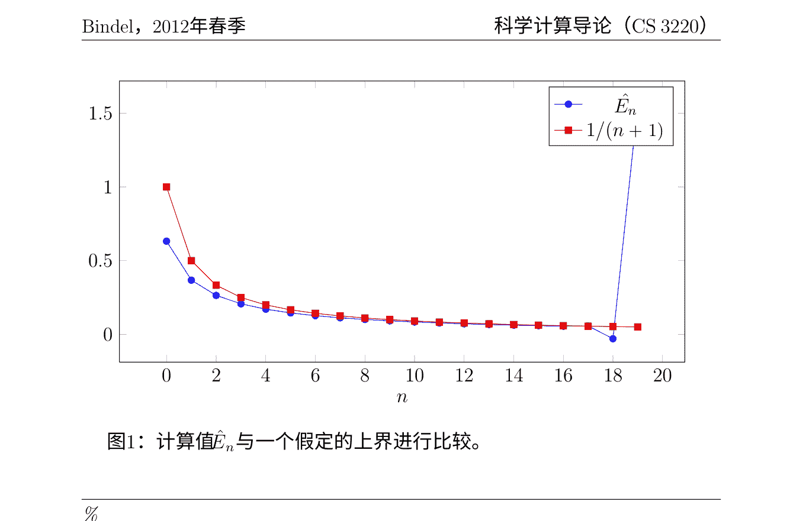
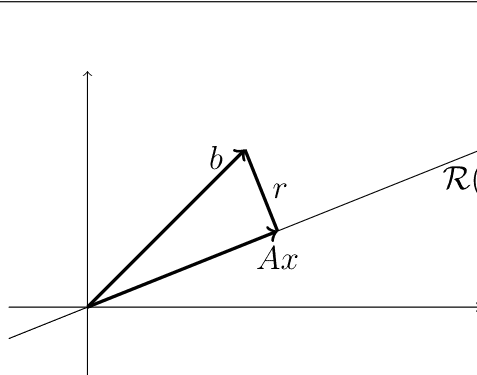
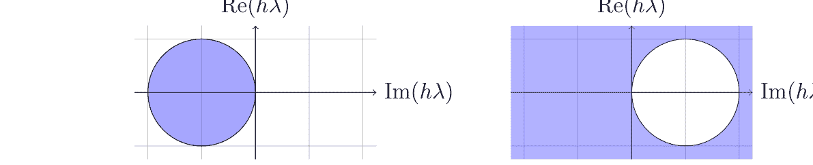
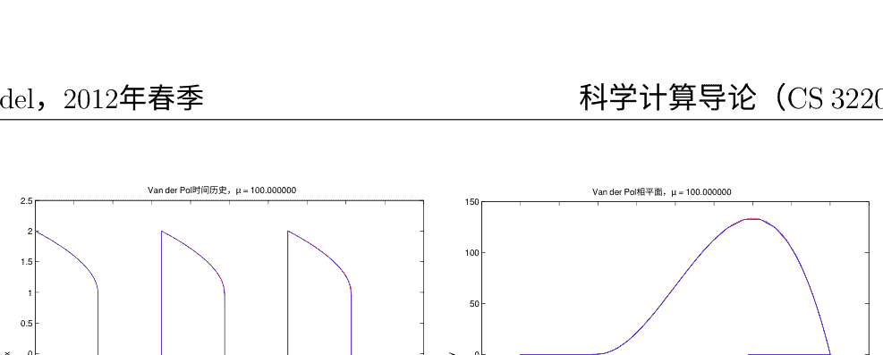
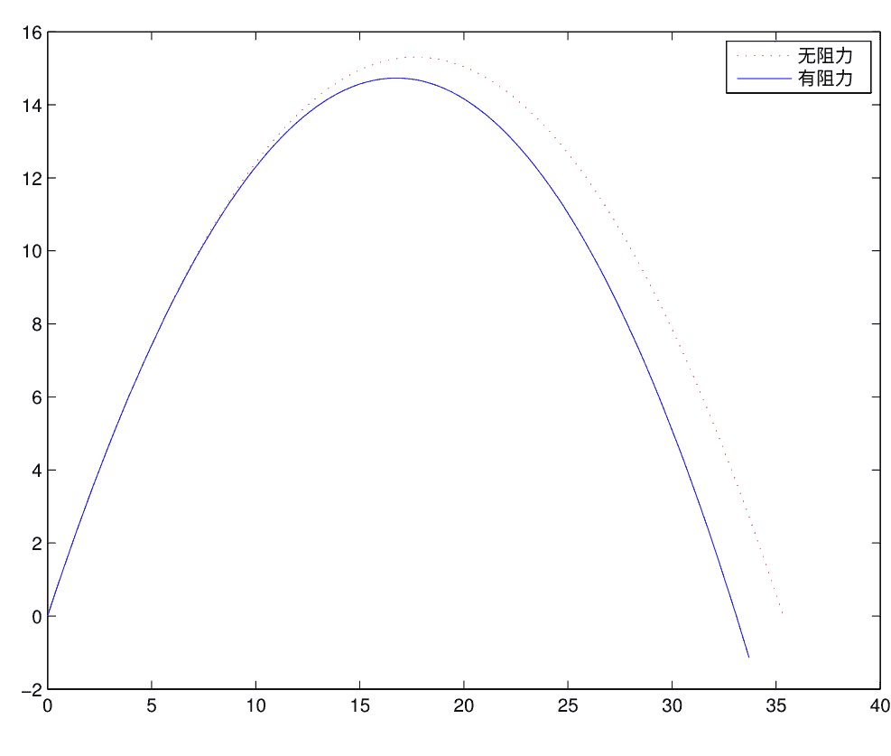
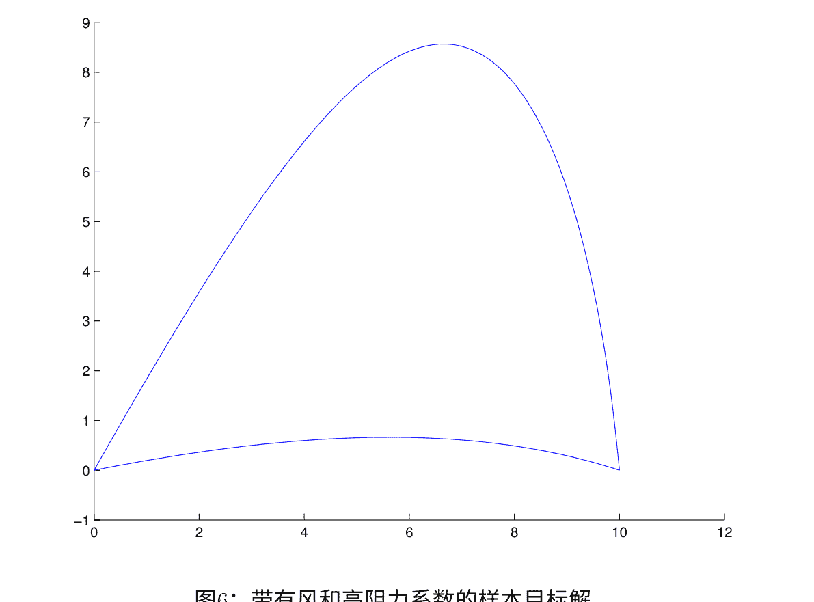

# 康奈尔 CS3220 科学计算导论

# 第1周：星期一，1月23日

## 安全计算

如果这门课程是关于射击而不是计算机，我们可能会先谈论安全性在哪里。否则，有人可能会自己射击自己的脚。基本的误差分析也是如此：即使它不是科学计算中最引人注目的部分，它也是课程的开始，为了使学生远离危险。为此，对灵敏度分析、简化的舍入模型和异常行为的粗略讨论可能就足够了。我们将稍微超越这一点，但你可以将第一周的大部分材料看作是这样的：使用实数进行基本的安全培训。

## 一些基础知识

假设$\hat{x}$是对 $x$的近似。近似值的绝对误差是$\hat{x} - x$；相对误差是$(\hat{x} - x)/x$。两者都很重要，但在这门课程中我们将更频繁地使用相对误差。

大多数从现实世界中获取的测量结果都存在误差。即使在计算过程中使用近似输入，也通常会产生近似输出。因此，我们需要了解误差在计算中的传播。例如，假设我们有两个近似真实值的输入$\hat{x}$和$\hat{y}$。如果$e_x$和$\delta_x = e_x/x$分别表示$x$的绝对误差和相对误差（对$y$也是类似的），我们可以写成

```
$\hat{x} = x + e_x = x(1 + \delta_x)$
$\hat{y} = y + e_y = y(1 + \delta_y)$
```

当我们相加或相减$\hat{x}$和$\hat{y}$时，我们相加和相减的是绝对误差：

```
$\hat{x} + \hat{y} = (x + y) + (e_x + e_y)$
$\hat{x} - \hat{y} = (x - y) + (e_x - e_y)$
```

然而，请注意，对于 $x - y$的近似，相对误差为$(e_x - e_y)/(x - y)$；如果 $x$和$y$接近，这个相对误差可能比 $\delta_x$或 $\delta_y$大得多。这种效应被称为抵消，它经常是计算错误的罪魁祸首。

从相对误差的角度来看，乘法和除法比加法和减法更为温和。一个乘积的相对误差（近似值）是输入值的相对误差之和：

$$\begin{aligned}
\hat{x}\hat{y} &= xy(1+\delta_x)(1+\delta_y)\\
&= xy(1 + \delta_x + \delta_y + \delta_x\delta_y)\\
&\approx xy(1 + \delta_x + \delta_y).
\end{aligned}$$

如果 $\delta_x$ 和 $\delta_y$ 很小，那么 $\delta_x\delta_y$ 是非常微小的，所以在进行误差分析时通常会忽略它[^1]。同样地，利用以下事实 $(1 + \delta)^{-1} = 1 - \delta + O(\delta^2)$,

商的相对误差大约等于输入的相对误差之差：

$$\begin{aligned}
\frac{\hat{x}}{\hat{y}} &= \frac{x}{y} \left(\frac{1 + \delta_x}{1 + \delta_y}\right)\\
&\approx \frac{x}{y}(1 + \delta_x)(1 - \delta_y)\\
&\approx \frac{x}{y}(1 + \delta_x - \delta_y).
\end{aligned}$$

更一般地，假设 $f$ 是关于 $x$ 的某个可微函数，并且我们用 $\hat{z} = f(\hat{x})$ 来近似 $z = f(x)$。我们通过泰勒展开来估计近似值的绝对误差：

$$\hat{z} - z = f(\hat{x}) - f(x) \approx f'(x)(\hat{x} - x).$$

幅度 $|f'(x)|$ 告诉我们输入和输出之间绝对误差的关系。然而，我们经常关心计算如何放大相对误差：

$$\frac{\hat{z} - z}{z} \approx \left(\frac{x f'(x)}{z}\right) \frac{\hat{x} - x}{x}.$$

量 $x f'(x)/f(x)$ 的大小告诉我们输入的相对误差如何影响输出的相对误差，有时被称为问题的**条件数**。条件数较大的问题（“病态”问题）非常敏感：输入中的小误差可能破坏输出的准确性。

## 一个简单的例子

地球绕太阳运行时的平均速度是多少？
是的，你可以问谷歌这个问题，它会友好地告诉你答案大约是29.783千米/秒。但是如果你掌握一些事实，你可以自己得到一个很好的估计：

- 地球距离太阳约500光秒。
- 光速c约为3×10^8米/秒。

所以地球大致上沿着半径约为1.5×10^11米的圆形轨道运行，在一年内行驶2πr米。所以我们的速度大约是2πct。

$$\frac{y}{t} \approx \frac{2\pi \times 1.5 \times 10^{11} \text{米}}{\pi \times 10^7 \text{秒}} = 30 \text{ 公里/秒}.$$

$$\hat{v} = 30 \text{ 公里/秒}$$

估计值$\hat{v} = 30$公里/秒有多大误差？与真值（$v = 29.783$公里/秒，维基百科答案）相比的绝对误差约为217米/秒。不幸的是，没有上下文很难确定这是好还是坏的误差。与地球绕太阳的速度相比，这个误差非常小；与我的步行速度相比，这个误差相当大。了解相对误差更令人满意

$$\frac{\hat{v} - v}{v} \approx 0.0073,$$

或者小于百分之一。非正式地说，我们可以说答案有大约两个正确数字。

这个略小于百分之一的误差的来源是什么？粗略地说，有两个来源：

1.  我们假设地球的轨道是圆形的，但实际上它稍微是椭圆的。这个建模错误在我们进行任何实际计算之前就已经存在了。
2.  我们近似计算中的所有参数：光速，太阳到地球的距离（以光秒为单位），以及一年的长度。

更准确的值是：

$t = 499.0$秒
$c = 299792458$米/秒
$y = 31556925.2$秒

如果我们将这些值代入我们之前的公式，我们得到一个速度为29.786公里/秒。这个值近似为30 公里/秒，相对误差为0.0072。

我们暂时不考虑地球轨道的椭圆性（以及维基百科答案的真实性），而是专注于从参数中继承的误差。用$\hat{t}$, $\hat{c}$和$\hat{y}$表示我们之前的估计，我们有相对误差

$\delta_t \equiv (\hat{t} - t)/t = 20 \times 10^{-4}$
$\delta_c \equiv (\hat{c} - c)/c = 7 \times 10^{-4}$
$\delta_y \equiv (\hat{y} - y)/y = -45 \times 10^{-4}$

根据我们的误差传播公式，我们应该有

$\frac{2\pi\hat{c}\hat{t}}{\hat{y}} \approx \left(\frac{2\pi c t}{y}\right)(1 + \delta_c + \delta_t - \delta_y)$.

事实上，这看起来是正确的：

$20 \times 10^{-4} + 7 \times 10^{-4} + 45 \times 10^{-4} = 72 \times 10^{-4}$.

## 误差放大的一个例子

我们之前的例子是无害的；现在让我们考虑一个更阴险的例子。考虑积分

$E_n = \int_0^1 x^n e^{x-1} dx$

很容易找到 $E_0 = 1 - 1/e$；对于$n > 0$，分部积分$^2$给出了我们

$E_n = x^n e^{x-1} \big|_0^1 - n \int_0^1 x^{n-1} e^{x-1} dx = 1 - nE_{n-1}$.

我们可以使用以下MATLAB程序计算 $E_n$，其中 $n=1, \ldots, n_{\max}$:



## 图1：计算值$\hat{E}_n$与一个假定的上界进行比较。

```
%
% 计算从0到1的$x^n exp(x-1)$的积分
% 对于$n = 1, 2, ..., nmax
%
function E = lec01int(nmax)

En = 1-1/e;
for n = 1:nmax
  En = 1-n*En;
  E(n) = En;
end
```

根据我们的MATLAB程序计算得到的 $\hat{E}_n$ 的值如图1所示。稍加思考就会发现这些问题有些不对劲。注意对于$0 \le x \le 1$，有$1/e \le e^{x-1} \le 1$，因此

$$\frac{1}{e(n+1)} \le E_n \le \frac{1}{n+1}$$

如图所示，我们计算得到的值违反了这些界限。出了什么问题？

积分的行为是完全正常的；问题出在算法上。初始值 $E_0$ 在计算机上只能近似表示；让我们将存储的值写为 $\hat{E}_0$。即使这是唯一的错误，我们会发现后续计算中的误差会急剧增长：

```
\hat{E}_0 = E_0 + \epsilon
\hat{E}_1 = 1 - \hat{E}_0 = E_1 - \epsilon
\hat{E}_2 = 1 - 2\hat{E}_1 = E_2 + 2\epsilon
\hat{E}_3 = 1 - 3\hat{E}_2 = E_3 - 3 \cdot 2\epsilon
\vdots
\hat{E}_n = E_n + (-1)^n n! \epsilon.
```

这是一个不稳定的算法的例子。

## 误差的来源

我们通过简化模型来理解世界。这些模型从一开始就是对现实的近似。引用统计学家乔治·博克斯的话：

> 所有模型都是错误的。有些模型是有用的。

虽然建模误差很重要，但我们很少能在没有特定应用背景的情况下判断它们的质量。在这门课程中，我们通常将模型视为给定的，并从输入和计算中分析误差。

除了模型本身的错误外，我们经常在从测量中得出的输入参数中有错误。在不良条件的问题中，输入的相对误差很小可能严重影响输出的准确性。例如，如果问题的输入已知精确到百万分之一的百分比，并且问题的条件数为 $10^7$，结果可能只有一位正确的数字。这是问题本身的困难，而不是用于解决问题的方法的困难。理想情况下，一个设计良好的数值计算程序在我们要求其解决一个不良条件的问题时可能会警告我们，但要求一个准确的结果可能要求太多。相反，我们将寻求不会不当放大误差的稳定算法。也就是说，如果一个问题的条件数为 $\kappa$，一个稳定的算法应该最多将输入误差放大 $C\kappa$ 倍，其中 $C$ 是一些适度的常数，不依赖于输入的细节。

为了产生稳定的算法，我们必须控制计算本身内部的错误来源。按照我们遇到它们的顺序，包括：

- **舍入误差：** IEEE浮点算术本质上是二进制科学计数法。数字1/3不能准确地表示为有限的十进制数。它在有限数量的二进制位中也无法准确表示。然而，我们可以非常精确地近似1/3。
- **迭代的终止：** 非线性方程、优化问题甚至线性系统经常通过产生逐渐更好的近似解的迭代来求解。在某个点上，我们决定我们已经有了足够好的答案，并停止。
- **截断误差：** 我们经常通过有限差分来近似导数，通过求和来近似积分。这些近似的误差通常被称为截断误差。
- **随机误差：** 蒙特卡洛方法使用随机性来计算近似值。由于随机性，方差通常主导这些方法的误差。

# 第1周：1月25日，星期三

## 二进制浮点数编码

二进制浮点数运算本质上是科学计数法。 在十进制科学计数法中，我们写作

$\frac{1}{3} = 3.333\ldots \times 10^{-1}$,

在浮点数中，我们写作

$\frac{(1)_2}{(11)_2} = (1.010101\ldots)_2 \times 2^{-2}$.

然而，由于计算机是有限的，我们只能保留二进制点后的有限位数。

一般来说，一个正常的浮点数的形式是

$(-1)^s \times (1.b_1 b_2 \ldots b_p)_2 \times 2^{E}$,

其中 $s\in \{0,1\}$ 是符号位， $E$ 是指数，而 $(1.b_1\ldots b_p)_2$ 是尾数。 在64位双精度格式中， $p=52$ 位用于存储尾数，11位用于指数，1位用于符号。 正常浮点数的有效指数范围是 $-1023 < E < 1022$；这留下了两个额外的指数编码用于特殊用途。 其中一个特殊指数用于编码形式为的次正常数

$(-1)^s \times (0.b_1 b_2 \ldots b_p)_2 \times 2^{-1022}$;

另一个特殊的指数用于编码 $\pm\infty$ 和 NaN（不是一个数字）。对于一个一般的实数 $x$，我们将写

$\mathrm{fl}(x) = \text{正确舍入的浮点表示 } x$。

默认情况下，“正确舍入”意味着我们找到最接近的浮点数到 $x$，通过将最后一位四舍五入为具有零的数字<sup>1</sup>来打破任何平局。 如果 $x$ 超过最大的正常浮点数，则 $\mathrm{fl}(x) = \infty$。

<sup>1</sup>除了默认值之外，还有其他舍入模式，但我们不会在这门课程中讨论它们。

## 基本浮点运算

对于基本运算（加法、减法、乘法、除法和平方根），浮点数标准规定计算机应该产生真实结果，正确舍入。所以MATLAB语句

```
% 计算x和y的和（假设它们是精确的）
z = x + y;
```

实际上计算的是数量 $\hat{z} = \mathrm{fl}(x+y)$。如果$\hat{z}$是一个正常的双精度浮点数，它将与真实的 $z$在二进制点后的52位上一致。也就是说，相对误差的大小将小于机器精度 $\varepsilon_{\text{mach}} = 2^{-53} \approx 1.1 \times 10^{-16}$：

```
\hat{z} = z(1 + \delta), \quad |\delta| < \varepsilon_{\text{mach}}
```

更一般地说，产生规范化数字的基本操作的相对误差在 $\varepsilon_{\text{mach}}$内是正确的。浮点数标准还建议常见的超越函数，如指数和三角函数，应正确舍入，尽管不符合此建议的兼容实现可能会产生相对误差略大于 $\varepsilon_{\text{mach}}$的结果。

正常浮点数结果的相对误差小于$\varepsilon_{\text{mach}}$这一事实为我们提供了一个有用的模型来推理浮点误差。我们将其称为“1 + δ”模型。例如，假设 $x$是MATLAB语句 `z = 1 - x*x;` 的精确输入。

我们可以通过以下方式推理计算得到的 $\hat{z}$ 的误差：

```
t_1 = \mathrm{fl}(x^2) = x^2(1 + \delta_1)
t_2 = \mathrm{fl}(1 - t_1) = (1 - x^2) (1 + \frac{\delta_1 x^2}{1 - x^2})
\hat{z} = \mathrm{fl}(1 - t_1) = z \left(1 + \frac{\delta_1 x^2}{1 - x^2}\right)(1 + \delta_2)
\simeq z \left(1 + \frac{\delta_1 x^2}{1 - x^2} + \delta_2\right),
```

与之前一样，我们忽略包含 $\delta_1 \delta_2$ 的（微小）项。请注意，如果 $z$ 接近零（即在减法中存在抵消），则模型显示结果可能具有较大的相对误差。

## 异常

当浮点结果不是表示精确结果的普通值时，我们称之为 exception。最常见的异常是 inexact（即需要进行一些舍入）。其他异常发生在我们无法生成规范化的浮点数时。这些异常包括：

- **下溢：** 表达式太小，无法表示为规范化的浮点数值。默认行为是返回一个次规范化值。
- **上溢：** 表达式太大，无法表示为浮点数。默认行为是返回 inf。
- **无效：** 表达式评估为非数字（例如0/0）。
- **除以零：** 表达式评估为“无穷大”（例如1/0或log(0)）。

当发生除了不精确之外的异常时，通常用于大多数舍入误差分析的“1 + δ”模型无效。

## “1 + δ”模型的限制

除了在存在除不精确之外的异常时失败之外，浮点数的“1 + δ”模型并不反映某些计算不涉及舍入误差的事实。例如：

- 如果$x$和$y$是相差不超过两倍的浮点数，则计算$\mathrm{fl}(x-y)$时不会出现舍入误差。
- 除非溢出或下溢为零，否则$\mathrm{fl}(2x) = 2x$和$\mathrm{fl}(x/2) = x/2$。
- $\pm(2^{53}-1)$之间的整数可以精确表示。

这些浮点数的特性使我们能够做一些聪明的事情，比如使用普通的双精度算术来模拟具有大约两倍位数的算术。即使你从未需要实现这些技巧，你也应该知道它们的存在 - 否则，我可能会因为你编写的编译器重新排列我编写的浮点代码中的计算而感到恼火！

## 查找和修复浮点问题

浮点运算与实数运算不同。 即使是简单的结合律或分配律等性质也只是近似成立。 因此，在精确算术中看起来很好的一些计算可能会产生错误的答案。 接下来是一份（非常不完整）的程序员在粗心使用浮点数编程时可能出错的方式列表。

## 抵消

如果 $\hat{x} = x(1 + \delta_1)$ 和 $\hat{y} = y(1 + \delta_2)$ 是非常接近的对 $x$ 和 $y$ 的浮点数近似值，那么由于抵消，$\mathrm{fl}(\hat{x} - \hat{y})$ 可能是对 $x - y$ 的一个很差的近似。 在某种程度上，这个尾部的减法是无辜的：如果 $x$ 和 $y$ 很接近，那么 $\mathrm{fl}(\hat{x} - \hat{y}) = \hat{x} - \hat{y}$，减法不会引入额外的舍入误差。 问题实际上是在于 $\hat{x}$ 和 $\hat{y}$ 中已经存在的近似误差。

通过消除法则，揭示了计算中精度丧失的标准示例是使用二次方程公式计算二次方程的较小根，例如

$$x = 1 - \sqrt{1 - z}$$

对于 $z$ 较小。 幸运的是，一些代数操作给出了一个等价的公式，不会遭受消除：

$$x = \left(1 - \sqrt{1 - z}\right) \left( \frac{1 + \sqrt{1 - z}}{1 + \sqrt{1 - z}} \right) = \frac{z}{1 + \sqrt{1 - z}}.$$

## 敏感子问题

我们经常通过将问题分解为更简单的子问题来解决问题。 不幸的是，很容易产生条件不良的子问题作为解决一个条件良好的问题的步骤。 作为一个简单（虽然人为的）的例子，尝试运行以下MATLAB代码：

```matlab
x = 2;
for k = 1:60, x = sqrt(x); end
for k = 1:60, x = x^2;     end
disp(x);
```

在精确计算中，这应该产生2，但在浮点数中产生了什么？实际上，第一个循环产生了一个正确舍入的结果，但第二个循环表示函数 \(x^{2^{60}}\)，其条件数远大于 \(10^{16}\) — 因此所有的精度都丢失了。

### 不稳定的递归

在上一节讲义中，我们给出了这个问题的一个例子，当我们看到递归时。

\[
\begin{align*}
E_0 &= 1 - 1/e \\
E_n &= 1 - n E_{n-1}, \quad n \ge 1.
\end{align*}
\]

这个递归的每一步都不会导致错误爆炸，但每一步都会稍微放大错误，导致错误呈指数增长。

### 未检测到的下溢

在贝叶斯统计中，有时需要计算长乘积的比值。即使每个乘积都会下溢，最终的比值也不会远离1。在最好的情况下，乘积会变得非常小，以至于它们会下溢为零，用户可能会注意到最终结果中的无穷大或NaN。在最坏的情况下，下溢的结果会产生非零的次正规数，相对精度意外地很差，最终结果将非常不准确，除了（经常被忽视的）下溢标志之外，没有任何警告。

### 错误分支

NaN的结果通常是一种幸事：如果你看到一个意外的NaN，至少你知道出了问题！但是涉及NaN的所有比较都是错误的，所以当一个浮点结果用于计算分支条件时，出现意外的NaN会造成严重破坏。作为一个例子，在MATLAB中尝试以下代码。

```
matlab
x = 0/0;
if x < 0
    disp('x是负数');
elseif x >= 0
    disp('x是非负数');
else
    disp('嗯...');
end
```

## 需要思考的问题

- 1. 在双精度中，$fl(0.2)$是大于、小于还是等于0.2?
- 2. 当 $x \ll 1$ 时，我们如何准确评估 $\sqrt{1+x} - \sqrt{1-x}$?
- 3. 当 $x \gg 1$ 时，我们如何准确评估 $\ln\sqrt{x+1} - \ln\sqrt{x}$?
- 4. 当 $x \ll 1$ 时，我们如何准确评估 $(1 - \cos(x)) / \sin(x)$?
- 5. 当 $x \ll 1$ 时，我们如何准确计算 $\cos(x) - 1$?
- 6. Lamb-Oseen涡旋是2D Navier-Stokes方程的解之一，它在计算流体力学的某些方法中起着关键作用。它的形式为
$$v_{\theta}(r, t) = \frac{\Gamma}{2\pi r} \left(1 - \exp\left(-\frac{r^2}{4\nu t}\right)\right)$$
如何以高相对精度评估所有 $r$ 和 $t$ 的 $v(r, t)$ 值（除了溢出或下溢）？
- 7. 对于 $x > 1$，方程 $x = \cosh(y)$ 可以解得
$$y = -\ln\left(x - \sqrt{x^2 - 1}\right)$$
当 $x = 10^8$ 时会发生什么？我们能修复吗？
- 8. 差分方程
$$x_{k+1} = 2.25 x_k - 0.5 x_{k-1}$$
以起始值
$$x_1 = \frac{1}{3}, \quad x_2 = \frac{1}{12}$$
有解
$$x_k = \frac{4^{1-k}}{3}$$
如果你计算，你实际上会看到这个吗？出了什么问题？
- 9. 考虑以下两个MATLAB片段：

```
matlab
% 版本1
f = (exp(x)-1)/x;

% 版本2
y = exp(x);
f = (1-y)/log(y);
```

在精确计算中，这两个片段是等价的。在浮点计算中，第一个公式在 x ≪ 1 时不准确，而第二个公式保持准确。为什么?

- 10. 运行递归 \(E_n = 1 - nE_{n-1}\) 向前计算是一种不稳定的方法。然而，我们可以通过从估计值 \(E_N \approx 1/(N+1)\) 开始向后运行递归来获得良好的结果。解释为什么。要计算 \(E_{20}\) 接近机器精度，\(N\) 必须有多大?

- 11. 如何准确计算 \(|x| < 1\) 的这个函数?
$$f(x) = \sum_{j=0}^{\infty} \left( \cos(x^j) - 1 \right)$$

## 第2周：1月30日星期一

### 概述

在本周（和相关问题）之后，您应该对以下内容有一些了解

- 用于方程求解的算法，特别是二分法、牛顿法、割线法和不动点迭代。
- 分析误差递归以找到算法的收敛速度；您还应该对分析根查找问题的敏感性有一定了解。
- 应用标准根查找程序解决实际问题。 这经常意味着事先进行一些草图和分析，以便确定适当的重新缩放和变量变换，处理奇点，并找到良好的初始猜测（对于牛顿法）或包围间隔（对于二分法）。

### 一点长除法

让我们从一个问题开始：假设我有一台具有硬件支持的机器，可以进行加法、减法、乘法和乘以二的整数次幂的缩放（正数或负数）。 我如何实现倒数？ 也就是说，如果$d > 1$是一个整数，我如何在不使用除法的情况下计算$1/d$？

这是一个线性问题，但正如我们将看到的，它具有许多与非线性问题相同的问题。

### 方法1：从长除法到二分法

也许计算$1/d$的最明显的算法是二进制长除法（我们在小学学到的十进制长除法的二进制版本）。 为了计算二进制小数点后第 $k$位（对应于值$2^{-k}$），我们看$2^{-k}d$是否大于当前余数；如果是，则将该位设置为1并更新余数。 该算法如图1所示。

```
function x = lec11division(d, n)
 % 通过n步二进制长除法近似计算x = 1/d.

 r = 1;      % 当前余数
 x = 0;      % 当前倒数估计
 bit = 0.5;  % 当前位置上的1的值

 for k = 1:n
   if r > d*bit
     x = x + bit;
     r = r - d*bit;
   end
   bit = bit/2;
 end
end
```

图1：通过n步二进制长除法近似计算1/d.

```
function x = lec11bisect(d, n)
 % 通过n步二分法近似计算x = 1/d
 % 在每一步中，f(x) = dx-1在下界为负，在上界为正.

 hi = 1; % 当前上界
 lo = 0; % 当前下界

 for k = 1:n
   x = (hi+lo)/2;
   fx = d*x-1;
   if fx > 0
     hi = x;
   else
     lo = x;
   end
 end
 x = (hi+lo)/2;
end
```

图2：二分法逼近1/d的步骤。

在长除法的第 $k$ 步，我们有一个近似值 $\hat{x}$， $\hat{x} \leq 1/d < \hat{x}+2^{-k}$,和一个余数 $r = 1 - d\hat{x}$. 基于余数，我们要么得到一个零位（并发现 $\hat{x} \leq 1/d < \hat{x} + 2^{-(k+1)}$），要么得到一个一位（即 $\hat{x}+2^{-(k+1)} \leq 1/d < \hat{x}+2^{-k}$）。也就是说，长除法算法隐式地计算包含 $1/d$ 的区间，并且每一步将区间大小减小一半。这是二分法的特点，通过从一个包围区间开始，反复将这些区间切割一半来找到任何连续函数 $f(x)$的零点。我们在图2中展示了二分法算法。

### 方法2：几乎牛顿

你可能还记得牛顿法在微积分课上。如果我们想要估计在 $x_k$ 附近的零点，我们可以在 $x_k$ 附近进行一阶泰勒展开，并将其设为零：

$$f(x_{k+1}) \approx f(x_k) + f'(x_k)(x_{k+1} - x_k) = 0.$$

经过一些代数运算，我们得到

$$x_{k+1} = x_k - f'(x_k)^{-1}f(x_k).$$

请注意，如果 $x_*$ 是我们要寻找的实际根，那么泰勒公式的余项为

$$0 = f(x_*) = f(x_k) + f'(x_k)(x_* - x_k) + \frac{1}{2}f''(\xi)(x_* - x_k)^2.$$

现在减去 $f(x_{k+1})$ 和 $f(x_*)$ 的泰勒展开式得到

$$f'(x_k)(x_{k+1} - x_*) + \frac{1}{2}f''(\xi)(x_k - x_*)^2 = 0.$$

这给出了误差 $e_k = x_k - x_*$ 的迭代公式：

$$e_{k+1} = - \frac{1}{2} \frac{f''(\xi)}{f'(x_k)} e_k^2.$$

假设我们可以通过一些适度的常数 $C$ 来限制 $f''(\xi)/f(x_k)$，这意味着小的误差 $e_k$ 会导致下一步的非常小的误差 $|e_{k+1}| \leq C|e_k|^2$。这种每一步误差平方的行为被称为二次收敛。

如果我们将牛顿迭代应用于 \( f(x) = dx - 1 \)，我们得到

\[ x_{k+1} = x_k - \frac{dx_k - 1}{d} = \frac{1}{d}. \]

也就是说，迭代在一步内收敛。但请记住，我们想要避免除以 \( d \)！这实际上并不罕见：通常使用 \( f'(x_k) \) 不方便，因此我们会想出一些近似值。在这种情况下，假设我们有一些接近\(d\)的二的整数幂 \( \hat{d} \)。然后我们可以编写一个修改后的牛顿迭代

\[ x_{k+1} = x_k - \frac{dx_k - 1}{\hat{d}} = \left( 1 - \frac{d}{\hat{d}} \right) x_k + \frac{1}{\hat{d}}. \]

注意，\( 1/d \) 是这个迭代的一个不动点：

\[ \frac{1}{d} = \left( 1 - \frac{d}{\hat{d}} \right) \frac{1}{d} + \frac{1}{\hat{d}}. \]

如果我们从迭代方程中减去固定点方程，我们有一个关于误差的迭代 \( e_k = x_k - 1/d \):

\[ e_{k+1} = \left( 1 - \frac{d}{\hat{d}} \right) e_k. \]

所以如果 \( |d - \hat{d}|/|d| < 1 \)，误差最终会趋近于零。例如，如果我们选择 \( \hat{d} \) 为大于 \( d \) 的下一个整数幂的二次幂，那么 \( |d - \hat{d}|/|\hat{d}| < 1/2 \)，在每一步中我们至少获得一个额外的二进制位的精度。当我们在半对数尺度上绘制长除法、二分法或我们修改过的牛顿迭代的误差时，误差的衰减看起来（大致上）像一条直线。也就是说，我们有线性收敛。但我们可以做得更好！

### 方法3：实际上是牛顿

我们可能对牛顿迭代放弃得太早了。在许多问题中，有多种方法可以写出相同的非线性方程。例如，我们可以将 \( d \) 的倒数写成 \( x \) such that \( f(x) = dx - 1 = 0 \)，或者我们可以将其写成 \( x \) such that \( g(x) = x^{-1} - d = 0 \)。 如果我们将牛顿迭代应用于\( g \)，我们有

\[ x_{k+1} = x_k - \frac{g(x_k)}{g'(x_k)} = x_k + x_k^2 (x_k^{-1} - d) = x_k (2 - dx_k). \]

与以前一样，注意1/d是这个迭代的一个不动点：

$$\frac{1}{d} = \frac{1}{d} \left(2 - d\frac{1}{d}\right).$$

鉴于1/d是一个不动点，我们有一些希望这个迭代会收敛-但是何时，以及多快？为了回答这些问题，我们需要分析误差的递归。

我们可以通过从迭代方程的两边减去真实答案1/d来得到误差的递归公式，并进行一些代数运算：

```
e_{k+1} = x_{k+1} - d^{-1}
        = x_k(2 - d x_k) - d^{-1}
        = -d(x_k^2 - 2d^{-1} x_k + d^{-2})
        = -d(x_k - d^{-1})^2
        = -d e_k^2
```

以相对误差 δ_k = e_k / d^{-1} = d e_k 为基础，我们有

$$δ_{k+1} = -δ_k^2.$$

如果 |δ_0| < 1，则此迭代收敛-一旦真正开始收敛，它会以每步大约翻倍的速度增加正确的位数。当然，如果 |δ_0| > 1，则迭代会以同样的速度发散。

幸运的是，我们可以通过与修改后的牛顿迭代相同的方式得到一个很好的初始猜测：选择第一个猜测为附近的整数幂。

在某些机器上，这种智能启动的牛顿迭代实际上是除法的首选方法。

## 大局观

让我们总结一下从这个例子中学到的东西（并稍微推广到解决更有趣的 f(x) = 0的情况）：

- 二分法是一种通用且稳健的策略。我们只需要 f 是连续的，并且存在一个区间 [a, b]，使得 f(a) 和 f(b) 有不同的符号。另一方面，获取一个包围区间并不总是容易；一旦我们获得了，二分法只能将该区间减半。每一步都可能需要很多步才能得到一个可接受的答案。此外，二分法本质上是一种一维构造方法。
- 牛顿迭代是一种基于找到连续线性逼近的零点的标准工具。当它收敛时，它会非常快速地收敛。但是牛顿迭代要求我们有一个导数（有时不方便），而且我们可能需要一个好的初始猜测。
- 修改的牛顿迭代在计算导数很麻烦时有时效果很好。我们可以通过多种方式修改牛顿法以方便我们使用；例如，我们可以选择用某个固定值来近似 $f'(x_k)$，或者我们可以使用割线逼近。
- 通常使用形式为 $x_{k+1}=g(x_k)$ 的不动点迭代方法很方便。
$$x_{k+1} = g(x_k)$$
我们寻找的数字是 $g$ ($x_*=g(x_*)$)的一个固定点。牛顿-类方法是固定点迭代的一个例子，但还有其他方法。每当我们有一个固定点迭代，我们可以尝试写出一个关于误差的迭代公式：
$$e_{k+1} = x_{k+1} - x_* = g(x_k) - g(x_*) = g(x_* + e_k) - g(x_*)$$
分析这个误差递归有多容易取决于 $g$ 的性质。如果 $g$ 有两个导数，我们可以写成
$$e_{k+1} = g'(x_*)e_k + \frac{1}{2}g''(\xi_k)e_k^2 \approx g'(x_*)e_k$$
如果 $g'(x_*)=0$，迭代会超线性收敛。如果 $0<|g'(x_*)|<1$，迭代会线性收敛，并且 $|g'(x_*)|$ 是速率常数。如果 $|g'(x_*)|>1$，迭代会发散。

## 第2周：星期三，2月1日

### 使用一个例程，或者自己编写一个？

MATLAB函数 fzero是一个快速、可靠的黑盒根查找算法，基于二分法（用于安全性）和基于插值的方法（用于速度）的组合。如果你提供一个包含恰好一个零的初始区间，并且你寻找的根不太敏感，fzero将会以高精度找到你寻找的根（默认相对误差容限约为\(2\epsilon_{\text{mach}}\)）。我经常使用这个函数，并向你推荐它。

话虽如此，编写自己的根查找算法至少有几个原因：

1. 并非所有的世界都是 MATLAB，有时你可能发现你必须自己编写这些东西。
2. 对于涉及多个变量的问题，黑盒方法远不如其他方法有用。因此，值得学习如何编写一维牛顿法，以便你可以充分了解它们的特性，从而能够处理涉及多个变量的类似算法。
3. 实际上，深入了解根查找算法的内部工作原理是解决问题的一种很好的方式，这样标准的根查找器就可以解决这些问题。

### 灵敏度和误差

假设我们想找到一个 \( x_* \) 使得 \( f(x_*) = 0 \)。在计算机上，我们实际上有 \( \hat{f}(\hat{x}_*) = 0 \)。我们假设我们使用一个好的、健壮的代码，比如 fzero，所以我们有一个非常准确的 \( \hat{f} \) 的零点。但是这仍然存在一个问题：\( \hat{x}_* \) 和 \( x_* \) 彼此之间的逼近程度如何？换句话说，我们想知道根查找问题的灵敏度。

如果 \( \hat{x}_* \approx x_* \)，则 $$ f(\hat{x}_*) \approx f'(x_*)(\hat{x}_* - x_*). $$ 利用 \( \hat{f}(\hat{x}_*) = 0 \) 这个事实，我们可以得出如果在接近 \( x_* \) 的参数下， \( |\hat{f} - f| < \delta \)，则 $$ |f'(x_*)(\hat{x}_* - x_*)| \lesssim \delta. $$

这反过来给我们带来了 $|\hat{x}_* - x_*| \lesssim \frac{\delta}{f'(x_*)}$.

因此，如果 $f'(x_*)$ 接近于零，那么在计算根时对 $f$ 的评估中的小舍入误差可能导致较大的误差。

值得注意的是，如果 $f'(x_*) = 0$ （即如果 $x_*$ 是多重根），这并不意味着 $x_*$ 完全不可信。这只是意味着我们需要在泰勒级数中取更多项来理解局部行为。 在 $f'(x_*) = 0$ 的情况下，我们有
$f(\hat{x}_*) \approx \frac{1}{2}f''(x_*)(\hat{x}_* - \hat{x}_*)$,
所以我们有 $|\hat{x}_* - \hat{x}_*| \leq \sqrt{\frac{2\delta}{f''(x_*)}}$.

因此，如果二阶导数行为良好且 $\delta$ 大约在 $10^{-16}$ 的数量级上，例如，我们计算得到的 $\hat{x}$ 可能在绝对误差范围内准确到大约 $10^{-8}$。

了解根查找的敏感性不仅重要，以便我们在有人要求不可能的精度时能适当地严肃对待。这也重要，因为它帮助我们选择问题的表述方式，以便相对容易获得良好的精度。

### 函数和变量的选择

根查找问题的难易程度取决于问题的提出方式。通常，最初的问题表述并不是最方便的。例如，考虑寻找正根的问题
$f(x) = (x + 1)(x - 1)^8 - 10^{-8}$.
对于接近1的值，这个函数是令人恐惧的无信息的。牛顿迭代基于这样的假设：局部的线性近似提供了函数行为的良好估计。在这个问题中，线性近似是糟糕的。幸运的是，函数
$g(x) = (x + 1)^{1/8}(x - 1) - 10^{-1}$具有相同的根，非常好地运作。

有一些标准的技巧可以使根查找问题更容易：

- 缩放函数。如果 $f(x)$ 在 $x_{*}$ 处为零，那么 $f(x)g(x)$ 也是如此；有时我们可以通过分析选择一个缩放函数来使根查找问题更容易。

- 否则转换函数。例如，在计算统计学中，经常希望最大化似然函数

$$L(\theta) = \prod_{j=1}^{n} f(x_j; \theta)$$

其中 $f(x; \theta)$ 是依赖于某些参数 $\theta$ 的概率密度。一种方法是找到 $L'(\theta)$ 的零点，但这经常导致缩放问题（潜在的下溢）和其他数值上的不适。标准技巧是最大化对数似然函数。

$$\ell(\theta) = \sum_{j=1}^{n} \log f(x_j; \theta),$$

通常使用根查找器来 $\ell'(\theta)$。这往往是一种更方便的形式，无论是用于分析还是计算。

- 改变变量。一个好的经验法则是选择自然无量纲的变量^1对于困难的问题，这些无量纲变量通常非常小或非常大，这个事实可以用来简化提出良好的牛顿迭代初始猜测的过程。

## 起始点

所有的根查找软件都需要对解的初始猜测或包含解的初始区间。这有时需要一点巧思，但有一些标准的技巧：

- 如果你知道问题的来源，你可以通过“应用推理”得到一个很好的估计（或界限）。这在物理问题中经常发生，例如：你可以猜测答案的数量级，因为它对应于你所了解的某个物理量。

- 粗略估计通常可以得到上下界。例如，我们知道对于所有 $x > 0$，

$$\log(x) \le x - 1$$

对于所有 $x \ge 1$，$\log(x) > 0$。所以如果我想要 $x + \log(x) = c$ 对于 $c > 1$，我知道 $c$ 应该在 $x$ 和 $2x - 1$ 之间，这给我一个初始区间。或者，如果我知道 $g(z) = 0$ 有一个接近于0的解，我可以尝试围绕零展开 $g$ 的泰勒级数-如果需要的话，包括更高阶的项-以便得到 $z$ 的初始猜测。

- 有时候，找到局部极小值和极大值比找到零点更容易。在任意一对局部极小值和极大值之间，函数要么单调递增，要么单调递减，因此在局部极小值和极大值之间要么存在一个根（在这种情况下，局部极小值和极大值之间存在符号变化），要么不存在根（在这种情况下，局部极小值和极大值之间不存在符号变化）。这是一种很好的开始二分法的方法。

### 需要思考的问题

1. 分析固定点迭代的收敛性

$$x_{k+1} = c - \log(x_k).$$

固定点的方程是什么？在什么条件下，迭代会以良好的初始猜测收敛，并且收敛速度是多少？

2. 重复上一个练习，使用迭代公式 $x_{k+1} = 10 - \exp(x_k)$。

3. 分析牛顿迭代在方程 $x^2 = 0$ 的收敛性，其中 $x_0 = 0.1$。需要多少次迭代才能得到一个小于 $10^{-16}$ 的数？

4. 分析固定点迭代 $x_{k+1} = x_k - \sin(x_k)$ 在 $x_k$接近零的情况下的收敛性。从 $x = 0.1$开始，需要多少次迭代才能得到一个小于 $10^{-16}$ 的数？

5. 考虑立方方程 $x^3 - 2x + c = 0.$ 描述一种通用策略，用于找到给定 $c$ 的该方程的所有实根。

6. 假设我们有一些从参数为 $\theta$ 的柯西分布中抽取的少量样本 $X_1, \ldots, X_m$（其概率密度函数为） $f(x, \theta) = \frac{1}{\pi} \frac{1}{1+(x-\theta)^2}.$ 最大似然估计 $\theta$ 的函数是使其最大化的函数 $L(\theta) = \prod_{j=1}^m f(X_j, \theta).$ 通常，人们会最大化 $l(\theta) = \log L(\theta)$ — 这在数值上有什么意义呢？通过找到方程 $l'(\theta) = 0$ 的适当解来推导一个 MATLAB 函数，以找到 $\theta$ 的最大似然估计。

7. 对于管道中的湍流流动，达西摩擦系数 $f$ 的定义是基于科尔布鲁克-怀特方程（适用于雷诺数大于4000左右）： $\frac{1}{\sqrt{f}} = -2 \log_{10} \left( \frac{\epsilon/D_h}{3.7} + \frac{2.51}{\text{Re} \sqrt{f}} \right)$ 这里 $\epsilon$ 是表面粗糙度的高度，$D_h$ 是管道的直径。对于直径为10厘米，表面粗糙度为0.1毫米的管道，计算雷诺数为 $10^4$、$10^5$ 和 $10^6$ 时的 $f$ 值。理想情况下，你应该使用一个带有良好初始猜测的牛顿迭代。

8. 一根密度为0.52磅/英尺的电缆悬挂在相等高度的塔之间，这些塔相距500英尺。如果电线在中间下垂了50英尺，计算电线的最大张力 \(T\)。相关方程为

```
c + 50 = c \cosh \left( \frac{500}{2c} \right)

T = 0.52(c + 50)
```

理想情况下，你应该使用一个带有良好初始猜测的牛顿迭代。

## 第3周：星期一，2月6日

## 微妙的奇点

一个方阵 $A \in \mathbb{R}^{n \times n}$ 被称为可逆的或非奇异的，如果存在一个 $A^{-1}$ 使得 $A A^{-1} = I$。否则，$A$ 被称为奇异的。有几种常见的方式来表征非奇异性：如果 $A$ 有逆矩阵，如果 $\det(A) = 0$，如果 $\text{rank}(A) = n$，或者如果 $\text{null}(A) = \{0\}$。如果我们尝试在数值上测试这些条件会发生什么？

1. $A$ 有逆矩阵。我们如何计算它？它对舍入误差敏感吗？
2. $\det(A) = 0$。我们如何计算行列式？通常的拉普拉斯展开（也称为余子式展开）对于大的 $n$ 来说非常昂贵！此外，考虑当 $A = I/16$ 时，$n=100$ 会发生什么。
3. $\text{rank}(A) = n$。我们如何计算秩？我们可以寻找一个基础来计算范围空间；我们如何得到它？这个计算是否对舍入误差敏感？
4. $\text{null}(A) = \{0\}$。我们如何计算矩阵的零空间？这个计算是否对舍入误差敏感？

即使 $A$ 是奇异的，几乎每个接近 $A$ 的矩阵 $\hat{A}$ 都是非奇异的。由于我们通常通过存储在浮点数中来扰动问题，要求一个有趣的矩阵确切地是奇异的，或者要求真实的秩可能太过苛刻。事实证明，更实际的做法是询问矩阵 $A$ 是否接近奇异以及是否存在几乎零空间。还有一些看起来计算简单的构造，例如显式逆和行列式，在浮点数中表现不佳，因此在计算实践中很少使用。

## Matlab中的矩阵和向量

向量和矩阵是数值线性代数中的基本对象²。 它们也是MATLAB中的基本对象。 例如，我们可以将一个列向量³$x \in \mathbb{R}^3$写成

```
x = [1; 2; 3];
```

以及一个矩阵 $A \in \mathbb{R}^{4 \times 3}$写成

```
A = [1, 5, 9;
    2, 6, 10;
    3, 7, 11;
    4, 8, 12];
```

在内部，MATLAB使用列主序布局——矩阵的第一列的所有条目首先在内存中列出，然后是第二列的所有条目，依此类推。 在某些上下文中，这实际上在用户级别是可见的。 例如，当我输入上述的$A$时，MATLAB表达式A(6)的值为6；如果我写`fprintf('%d\n', A);`

输出是从1到12的数字，每行一个。

我可以使用普通的乘法运算符来计算具有兼容维度的矩阵和向量的乘积：

```
y = A*x; % 计算 y = [38; 44; 50; 56]
```

在 MATLAB中，单引号运算符计算矩阵或向量的（共轭）转置。例如：

```
b = [1; 2]; % b是一个列向量
bt = b';
% bt = [1, 2]是一个行向量
```

```
C = [1, 2; 3, 4];
Ct = C'; % Ct = [1, 3; 2, 4]; Ct(i, j)是C(j,i)
```

如果 $x$和 $y$是两个向量，我们可以通过普通矩阵乘法和转置来定义它们的内积（也称为标量积或点积）和外积：

```
x = [1; 2];
y = [3; 4];
dotxy = x'*y; % 内积是 1*3 + 2*4 = 11
outer = x*y'; % 外积是 [3, 6; 4, 8]
```

如果我想要应用一个方阵 C 的逆，我可以使用反斜杠（求解）运算符

```
C = [1, 2; 3, 4];
b = [1; 2];
z = C\b; % 计算得到 z = [0; 0.5]。比 z = inv(C)*b 更好。
```

大多数涉及矩阵求逆的表达式都可以用反斜杠运算符重写，而反斜杠运算符几乎总是优于inv命令。

我可以使用MATLAB的冒号语法对矩阵进行切片。例如，如果我写下I = eye(6); e3 = I(:,3); 那么e₃表示第3个向量，除了第三个元素外都为零。

## 计算的成本

在任何科学计算任务中，我们的第一个目标是获得足够准确的答案。 我们的第二个目标是以足够快的速度获得答案。当然，计算机时间和我们的时间之间存在权衡；通常，我们可以通过明智地选择算法类型并调用适当的库函数来优化两者。 与此同时，我们需要跟踪足够的细节，以免花费数天时间等待本应只需几秒钟的计算。 很容易写出慢速的MATLAB代码。 幸运的是，MATLAB有一个分析器可以帮助我们找出代码花费时间的地方；有关详细信息，请在命令行上键入help profile。 不幸的是，如果我们不知道为什么，知道我们花费了很多时间的地方并不总是有帮助的。

> 4如果你真的喜欢思考如何使事物运行足够快，你可能会喜欢CS 5220：并行计算应用。我将在秋季教授这门课程。

将一个 m × n矩阵乘以一个 n × p矩阵的工作量为 O(mnp)。如果 $A \in \mathbb{R}^{n \times n}$ 且 $B \in \mathbb{R}^{n \times p}$ 是一般（稠密）的 MATLAB矩阵，则使用反斜杠运算符计算 $A^{-1}B$的工作量为 $O(n^3 + n^2p)^5$。因为矩阵乘法是结合的，$(AB)C$和 $A(BC)$在数学上是等价的；但是它们在矩阵大小上可能有非常不同的性能。例如，如果x, y, z $\in \mathbb{R}^n$ 是三个向量（n × 1 矩阵），那么计算 $(xy^T)z$的工作量为 $O(n^2)$ 算术和存储（外积需要 $O(n^2)$ 算术和存储，乘以 z需要 $O(n^2)$ 算术）。但是等价的表达式 $x(y^T z)$ 只需要 $O(n)$ 算术和存储：计算内积需要 $O(n)$ 算术和一个元素的存储，然后乘以标量需要 $O(n)$ 算术和存储。

因为等价的数学表达式可能具有非常不同的性能特征，所以记住一些基本的代数性质对于简单矩阵运算是有用的：

$$(AB)C = A(BC)$$
$$(AB)^T = B^T A^T$$
$$(AB)^{-1} = B^{-1} A^{-1}$$
$$A^{-T} \equiv (A^{-1})^T = (A^T)^{-1}$$

还有一点需要记住的是，有些矩阵运算可以更高效地进行，而不需要形成一个显式的矩阵。例如，下面的代码是等价的：

```
% 低效的 (O(n^2))
y = diag(s)*x; % 将 x 乘以一个对角缩放矩阵
z = (c*eye(n))*x; % 将 x 乘以 c*I

% 高效
y = s.*x;        % .*是逐分量乘法
z = c*x;         % 可以省略乘以单位元素
```

除了括号的选择不当外，如果我们忽视了潜在的代价，在MATLAB中性能会非常差。 但我们也可以得到出乎意料的好结果

> 5反斜杠运算符实际上非常复杂，它会利用矩阵中的任何结构。如果矩阵 A是上（下）三角矩阵，MATLAB将在 $O(n^2p)$ 的时间内计算 $A^{-1}B$；如果A使用MATLAB的稀疏矩阵特性表示，则成本可能更低。

如果我们充分利用MATLAB在向量运算方面的优势，性能会更好^6。例如：

```matlab
% 低效 (O(n^2)的数据传输操作)
results = [];
for k = 1:n
    results(k) = foo(k); %分配长度为k+1的数组，复制旧数据
end
```

```matlab
% 更高效 (没有静默内存成本)
results = zeros(1, n);          %预分配存储空间
for k = 1:n
    results(k) = foo(k);
end
```

```matlab
% 如果foo是矢量化的，则最高效
results = foo(1:n);
```

有时人们认为 MATLAB与Java或C等语言相比可能很慢。但对于矩阵计算，编写良好的 MATLAB通常比编译语言中除了经过精心调整的代码之外的所有代码都要快。这是因为 MATLAB使用非常快速的线性代数操作库，例如矩阵乘法和线性求解。在这门课程中，我们的大部分代码都可以利用这些库来提高速度。

## 第3周：2月8日，星期三

## 空格和基数

我有两个最喜欢的向量空间¹： $\mathbb{R}^n$和多项式空间 $\mathcal{P}_d$，其中多项式的次数最多为 $d$。对于 $\mathbb{R}^n$，我们有一个标准基：

$$\mathbb{R}^n = \text{span}\{e_1, e_2, \ldots, e_n\},$$

其中 $e_k$是单位矩阵的第 $k$列。这个基础在分析和计算中经常很方便。对于 $\mathcal{P}_d$，一个显而易见的选择是幂基：

$$\mathcal{P}_d= \text{span}\{1, x, x^2, \ldots, x^d\}.$$

但这个看似显而易见的选择在计算中经常是糟糕的。为什么？简而言之，$x$的幂并不是非常强的线性相关，但在理解这个简短描述之前，我们需要发展一些更多的概念。

矩阵或线性映射 $A$的范围空间就是可以用形式 $y = Ax$表示的向量 $y$的集合。如果 $A$是满秩（列满秩）的，则 $A$的列线性无关，并且它们构成范围空间的一组基。否则，$A$是秩缺陷的，存在一个非平凡的零空间，由向量 $x$组成，使得 $Ax= 0$。

秩缺陷是一个微妙的性质²。例如，考虑矩阵

$$A = \begin{bmatrix} 1 & 1 \\ 1 & 1 \end{bmatrix} .$$

这个矩阵是秩缺陷的，但是矩阵

$$\hat{A} = \begin{bmatrix} 1+\delta & 1 \\ 1 & 1 \end{bmatrix} .$$

对于任何 $\delta\neq 0$，都不是秩缺陷的。从技术上讲，$\hat{A}$的列构成 $\mathbb{R}^2$的一组基，但是我们应该对 $\hat{A}$如此接近奇异矩阵感到不安。我们将在下周详细讨论这一点。

## 规范！

为了合理地谈论矩阵“接近”奇异或基础“接近”线性相关，我们需要正确的语言。首先，我们需要一个范数的概念，它是一个向量长度的度量。范数是一个从向量空间到实数的函数，具有三个性质。

1. 正定性：$\|x\| > 0$ 当且仅当 $x=0$ 且 $\|0\|=0$。
2. 齐次性：$\|\alpha x\| = |\alpha| \|x\|$。
3. 三角不等式：$\|x + y\| \leq \|x\| +\|y\|$。

最流行的规范之一是欧几里得范数（或2范数）：

$$\|x\|_2 = \sqrt{\sum_{i=1}^n |x_i|^2} = \sqrt{x^T x}$$

我们还将使用1范数和 $\infty$范数（也称为最大范数或曼哈顿范数）：

$$\|x\|_1 = \sum_i |x_i|.$$
$$\|x\|_\infty = \max_i |x_i|$$

其次，我们需要一种将输入的范数与输出的范数相关联的方法。我们用矩阵范数来实现这一点。给定大小的矩阵形成一个向量空间，因此在某种程度上，矩阵范数只是另一种类型的向量范数。然而，最有用的矩阵范数与其定义域和值域上的向量范数一致，即对于所有向量$x$在定义域中，

$$\|Ax\| \leq \|A\|\|x\|.$$

给定向量空间的范数，常用的一致范数是内积范数（算子范数）：

$$\|A\| = \max_{x \neq 0} \frac{\|Ax\|}{\|x\|} = \max_{\|x\|=1} \|Ax\|.$$

## 矩阵1-范数和矩阵 ∞-范数（由向量1-范数和向量 ∞-范数引起的范数）是：

$$\|A\|_1 = \max_j \sum_i |a_{ij}| \quad \text{(最大绝对值列和)}$$
$$\|A\|_\infty = \max_i \sum_j |a_{ij}| \quad \text{(最大绝对值行和)}$$

如果我们将向量视为一个特殊情况 $n \times 1$ 矩阵，则向量1-范数与矩阵1-范数相匹配，同样，向量 ∞-范数与矩阵 ∞-范数相匹配。这就是我记住最大行和最大列和的方法！矩阵2-范数非常有用，但实际上比1-范数或∞-范数更难计算。有一个相关的矩阵范数，即Frobenius范数，计算起来要简单得多：

$$\|A\|_F = \sqrt{\sum_{i,j} |a_{ij}|^2}.$$

Frobenius范数是一致的，但它不是一个算子范数³ MATLAB允许我们使用 norm命令计算所有向量和矩阵范数的描述如上。例如，norm (A,'fro')计算矩阵 A的Frobenius范数，而 norm(x,1)计算向量 x的1范数。默认范数，如果我们只写 norm(A)或norm(x)，是欧几里得向量范数（也称为2范数）和相应的算子范数。

向量范数和算子范数的概念在除了 $\mathbb{R}^n$ 之外的空间中也有意义。例如，对于 $\mathcal{P}_d$的范数选择是

$$\|p\|_{L^2([-1,1])} = \sqrt{\int_{-1}^{1} p(x)^2 \,dx}.$$

你会注意到这看起来非常像标准的欧几里得范数；在这种情况下，我们还有类似于1范数和 ∞范数的类比。函数空间的范数（如 $\mathcal{P}_d$）实际上是一个更有趣的话题，比 $\mathbb{R}^n$的范数更有趣，但是对于我能合理放入这门课程的范围来说，这是一个扩展讨论（可悲地）超出了范围。

## 内积

范数是我们测量长度和距离所需的工具。内积是我们测量角度所需的工具。一般来说，内积满足三个公理：

-   正定性: $\langle u, u \rangle \geq 0$, 当且仅当 $u = 0$时成立。
-   对称性 : $\langle u, v \rangle = \overline{\langle v, u \rangle}$
-   线性性 : $\langle \alpha u, v \rangle = \alpha \langle u, v \rangle$ 且 $\langle u_1 + u_2, v \rangle = \langle u_1, v \rangle + \langle u_2, v \rangle$。

对于每个内积，我们有一个相关的范数: $\|u\| = \sqrt{\langle u, u \rangle}$。一个重要的内积与范数相关的恒等式是柯西-施瓦茨不等式:

$$\langle u, v \rangle \leq \|u\| \|v\|.$$

只有当 $u$ 和 $v$ 平行时，等式成立。如果向量 $u$ 和 $v$ 正交，则 $\langle u, v \rangle = 0$。一般来说，非零向量 $u$ 和 $v$ 之间的角度 $\alpha$ 由以下关系定义

$$\cos(\alpha) = \frac{\langle u, v \rangle}{\|u\| \|v\|}.$$

如果 $x$ 和 $y$ 在 $\mathbb{R}^n$ 中，标准内积为:

$$\langle x, y \rangle = x^T y = \sum_{i=1}^{n} x_i y_i.$$

我们称向量 $u_1, u_2, \ldots, u_k$ 为正交归一的，如果它们相互正交并且具有单位欧几里得长度，即

$$\langle u_i, u_j \rangle = \delta_{ij} = \begin{cases} 1, & \text{当 } i = j \\ 0, & \text{其他情况。} \end{cases}$$

有点奇怪的是，我们将正交矩阵定义为一个行列式为正方形的矩阵，其列是正交的（即一个矩阵 $Q$ 满足 $Q^T Q = I$）。当我们说一个矩阵是正交通常我们是指“相对于 $\mathbb{R}^n$ 上的标准内积来说是正交的”；如果矩阵相对于其他内积是正交的，我们会明确说明。

正交矩阵的一个非常有用的性质是它们保持欧几里得长度。也就是说，如果 $Q$ 是正交的，那么

$$\|Qx\|^2 = (Qx)^T (Qx) = x^T Q^T Q x = x^T x = \|x\|^2.$$

我偶尔会谈到‘幺正操作’；如果我这样说，我通常是指保持欧几里得长度的线性映射。当然，其他空间也可以有有用的内积。例如，对于 $\mathcal{P}_d$ 的内积，一个标准的选择是

$\langle p, q \rangle_{L^2([-1,1])} = \int_{-1}^1 p(x)q(x) dx$

幂基 $\{1, x, x^2, \ldots, x^d\}$ 相对于这个内积明显不是正交的。另一方面，Legendre多项式在高斯积分理论中起着关键作用，相对于这个内积，它们构成了 $\mathcal{P}_d$ 的正交基。

## 对称矩阵和二次型

Taylor定理的多维版本说，我们可以将任何足够好的函数从 $\mathbb{R}^n \to \mathbb{R}$ 写成

$f(x_0 + z) = f(x_0) + \sum_i \frac{\partial f}{\partial x_i} z_i + \frac{1}{2} \sum_{i,j} \frac{\partial^2 f}{\partial x_i \partial x_j} z_i z_j + O(\|z\|^3)$

有时我们更简洁地写成

$f(x_0 + z) = f(x_0) + \nabla f(x_0)^T z + \frac{1}{2} z^T H_f(x_0) z + O(\|z\|^3)$

其中Hessian矩阵 $H_f(x_0)$ 的元素是 $f$ 在 $x_0$ 处的二阶偏导数。仍然假设 $f$ 是光滑的，我们有

$(H_f(x_0))_{ij} = \frac{\partial^2 f}{\partial x_i \partial x_j} = \frac{\partial^2 f}{\partial x_j \partial x_i} = (H_f(x_0))_{ji}$

也就是说，Hessian矩阵是对称的。

在 $\mathbb{R}$ 上的二次型是一个函数，形式为

$\phi(x) = x^T A x$

通常我们假设 $A$是对称的，因为只有矩阵的对称部分才重要。5 二次型在应用数学中经常出现，部分原因是二阶泰勒展开经常出现。 对称矩阵也经常出现；当它们出现时，通常背后隐藏着一个二次型。

对称矩阵 $A$是正定的，如果相应的二次型 $\phi(x) = x^T A x$是正定的——也就是说，对于所有的$x$, $\phi( x) \geq 0$，只有在 $x= 0$时才等于0。 在多元微积分中，你可能已经见过正定性的概念：如果一个函数 $f$在 $x_0$处有一个临界点，并且 $H_f(x_0)$是正定的，那么 $x_0$是一个局部最小值。 在这些笔记中，你也见过正定性的概念，因为与内积相关联的二次型 ($\|u\|^2 = \langle u, u \rangle$)必须是正定的。 在数值线性代数中，对称正定矩阵出现得如此频繁，以至于我们经常称它们为SPD矩阵。6

二次形式的特点是它们是二次的；也就是说，$\phi(\alpha x) = \alpha^2 \phi(x)$。 有时候方便消除向量缩放的影响，因此我们定义了瑞利商：

$$\rho_A(x) = \frac{x^T A x}{x^T x}.$$

有趣的是对 $\rho_A(x)$ 进行微分以寻找临界点：

$$\begin{aligned} \frac{d}{dt} \rho_A(x+tw) &= \frac{w^T A x + x^T A w}{x^T x} - \frac{(x^T A x)(w^T x + x^T w)}{(x^T x)^2} \\ &= \frac{2w^T}{x^T A x} (Ax - \rho_A(x)x). \end{aligned}$$

在临界点上，所有方向导数都为零，我们有

$$Ax = \rho_A(x)x,$$

即 $x$是一个特征向量，$\rho_A(x)$ 是一个特征值。 对称矩阵的特征值和二次型的比率之间的这种联系非常强大。 例如，我们可以用它来描述算子的二范数

$$\|A\|^{2} = \max_{x \neq 0} \frac{\|Ax\|^2}{\|x\|^2} = \max_{x \neq 0} \frac{x^T A^T A x}{x^T x} = \lambda_{\max}(A^T A)$$

矩阵 $A^T A$ 的其他特征值（即奇异值的平方）也很有用，我们稍后会讨论它们。

我们还可以通过对称矩阵 $A$ 的特征值来确定相应的二次型是正定（所有特征值都是正数）、负定（所有特征值都是负数）还是不定。

# 需要思考的问题

1. 我们之前说过
$$
\|A\| \equiv \max_{x \neq 0} \frac{\|Ax\|}{\|x\|} = \max_{\|x\|=1} \|Ax\|.
$$
为什么等式成立？

2. 线性算子 $\frac{d}{dx}$ 的值域和零空间是什么？将其视为线性算子作用于 $\mathcal{P}_d$ 时，如何表示？用幂基表示，你会如何写出 $\frac{d}{dx}$ 作为矩阵？

3. 使用内积 $\langle \cdot, \cdot \rangle_{L^2([-1,1])}$，求解多项式 $x^j$ 和 $x^k$ 之间的角度是多少？

4. 柯西-施瓦茨不等式说
$$
\langle u, v \rangle \leq \|u\| \|v\|.
$$
我知道证明柯西-施瓦茨最简单的方法是写
$$
\phi(t) = \langle u+tv, u+tv \rangle \geq 0,
$$
然后使用内积的性质，将 $\phi(t)$ 写成关于 $t$ 的二次函数，其中的系数用 $\|u\|^2$, $\|v\|^2$ 和 $\langle u, v \rangle$ 表示。
进行这个展开，并写出所得二次函数的判别式。
为了使 $\phi(t)$ 对于所有的 $t$ 值都是非负的，这个判别式必须是非正的；
利用这个事实，证明柯西-施瓦茨不等式必须成立。

5. 给定矩阵 $X, Y \in \mathbb{R}^{m \times n}$，我们定义 Frobenius 内积为
$$
\langle X, Y \rangle = \operatorname{tr}(X^T Y),
$$
其中 $\operatorname{tr}(A)$ 是 $A$ 的对角线元素之和。证明这是一个内积，并且相关的范数是 Frobenius 范数。

6. 证明当我们有一个由内积引起的范数时，
$$
(\|u + v\|^2 - \|u - v\|^2)/4 = \langle u, v \rangle
$$

7. 证明对于具有内积 $L^2([-1, 1])$ 的 $P_d$，操作 $p(x) \to p(-x)$ 是幺正的。

8. 证明如果 $A$ 是一个SPD矩阵，那么
$$
\langle x, y \rangle_A = x^T A y
$$
是一个有效的内积（有时称为 *energy inner product*）。

9. 假设 $A$ 是对称的，定义
$$
\psi(x) = \left( \frac{1}{2} x^T A x - x^T b \right).
$$
给出方向导数的表达式
$$
\frac{d}{dt} \psi(x + tu).
$$
在临界点（即所有方向导数为零的点）必须满足什么方程？

## 矩阵术语中的高斯消元

通过高斯消元来解线性系统

$$\begin{bmatrix} 4 & 4 & 2 \\ 4 & 5 & 3 \\ 2 & 3 & 3 \end{bmatrix} \begin{bmatrix} x_1 \\ x_2 \\ x_3 \end{bmatrix} = \begin{bmatrix} 2 \\ 3 \\ 5 \end{bmatrix}$$

我们通过从剩余行中减去第一行的倍数来在第一列中引入零，从而在最后两个问题中消除变量 $x_1$ 的考虑。 然后，我们重复这个过程，这样我们最终得到一个包含 $x_1$， $x_2$ 和 $x_3$ 的方程列表，第二个方程包含 $x_2$ 和 $x_3$，第三个方程只包含 $x_3$。

我们可以用矩阵运算总结方程的变换。 首先，我们从第二行中减去一倍的第一行，从第三行中减去0.5倍的第一行：

$$M_1 A = \begin{bmatrix} 1 & 0 & 0 \\ -1 & 1 & 0 \\ -0.5 & 0 & 1 \end{bmatrix} \begin{bmatrix} 4 & 4 & 2 \\ 4 & 5 & 3 \\ 2 & 3 & 3 \end{bmatrix} = \begin{bmatrix} 4 & 4 & 2 \\ 0 & 1 & 1 \\ 0 & 1 & 2 \end{bmatrix}.$$

然后我们从新的第二行减去新的第三行：

$$M_2 M_1 A = \begin{bmatrix} 1 & 0 & 0 \\ 0 & 1 & 0 \\ 0 & -1 & 1 \end{bmatrix} \begin{bmatrix} 4 & 4 & 2 \\ 0 & 1 & 1 \\ 0 & 1 & 2 \end{bmatrix} = \begin{bmatrix} 4 & 4 & 2 \\ 0 & 1 & 1 \\ 0 & 0 & 1 \end{bmatrix}.$$

如果我们将原始系统写成 $Ax = b$，我们刚刚证明的是 $M_2 M_1 A = U$，其中 $M_1$ 和 $M_2$ 是简单的单位下三角矩阵（有时称为初等变换或高斯变换），而 $U$ 是上三角矩阵。 方程 $M_2 M_1 Ax = M_2 M_1 b$ 看起来像这样

$$\begin{bmatrix} 4 & 4 & 2 \\ 0 & 1 & 1 \\ 0 & 0 & 1 \end{bmatrix} \begin{bmatrix} x_1 \\ x_2 \\ x_3 \end{bmatrix} = \begin{bmatrix} 2 \\ 1 \\ 3 \end{bmatrix},$$

我们可以通过回代计算 $x$:

$$
\begin{aligned}
x_{3} &= 3 \Longrightarrow x_{3}=3 & & \text{ 从第三行得到 } \\
x_{2}+x_{3} &= 1 \Longrightarrow x_{2}=-2 & & \text{ 从第二行得到 } \\
4 x_{1}+4 x_{2}+2 x_{3} &= 2 \Longrightarrow x_{1}=1 & & \text{ 从第一行开始。 }
\end{aligned}
$$

用矩阵的术语，我们可以将 $M_{2} M_{1} A=U$ 重写为

$$A=L U$$

其中

$$L = M_{1}^{-1} M_{2}^{-1} = \begin{bmatrix} 1 & 0 & 0 \\ 1 & 1 & 0 \\ 0.5 & 0 & 1 \end{bmatrix} \begin{bmatrix} 1 & 0 & 0 \\ 0 & 1 & 0 \\ 0 & 1 & 1 \end{bmatrix} = \begin{bmatrix} 1 & 0 & 0 \\ 1 & 1 & 0 \\ 0.5 & 1 & 1 \end{bmatrix} .$$

注意到 $L$ 的次对角线元素就是我们在高斯消元过程中遇到的乘数。这个矩阵分解通常被数值分析师称为“高斯消元”。一旦我们有了 $L$ 和 $U$，计算 $A^{-1} b$ 就变成了计算 $L^{-1} b$（前向代入）后跟计算 $U^{-1}\left(L^{-1} b\right)$（后向代入）。

## 使用LU分解

当你在 $\text{MATLAB}$ 中写 $x = A \setminus b$ 时，会发生两件事情:

-   1.  $\text{MATLAB}$ 计算因子分解 $P A=L U$。这里，$P$ 是一个置换矩阵 - 这个行交换只是为了在高斯消元过程中重新排序方程以提高数值稳定性。这个阶段的时间复杂度为 $O\left(n^{3}\right)$ 。
-   2.  $\text{MATLAB}$ 然后对 $b$ 的条目进行排列，并通过前向和后向替换解决三角形系统 $L c=b$ 和 $U x=c$。这个阶段的时间复杂度为 $O\left(n^{2}\right)$。

你可以将这两个阶段分为两个 $\text{MATLAB}$ 调用:

`[L,U,P] = lu(A); % 这是 O(n^3)`
`x = U \ (L \ (P*b)); % 这是 O(n^2)`

在第二行，MATLAB足够聪明，能够识别L和U是上三角矩阵，因此可以通过前向和后向替换来解决与它们相关的线性系统。因此，大部分工作发生在第一行（分解）中。如果你想解决涉及矩阵A的多个线性系统，使用lu函数非常有帮助，这样你就不必多次进行A的分解工作。

## 稀疏矩阵

如果矩阵 A大部分系数 a_{ij}为零，则矩阵A是稀疏的。稀疏矩阵在实践中经常出现，并且它们在第一个课程项目中将发挥重要作用。MatlaB为稀疏矩阵提供了紧凑的存储支持，并且还包括用于稀疏矩阵的快速矩阵乘法和高斯消元例程。我们可以使用 MAT-LAB中的 sparse命令创建稀疏矩阵。 有几种变体的 sparse，但也许最简单的是使用平行向量参数来指定非零元素的位置和值。 例如，以下命令 i = [1, 2, 3, 4, 1]; j = [1, 2, 3, 4, 4]; a = [5, 7, 9, 11, 13]; A = sparse(i,j,a); 会产生稀疏矩阵。

$$A = \begin{bmatrix} 5 & 0 & 0 & 13 \\ 0 & 7 & 0 & 0 \\ 0 & 0 & 9 & 0 \\ 0 & 0 & 0 & 11 \end{bmatrix}$$

在内部，MatlaB以一种仅跟踪非零条目的位置和值的格式存储稀疏矩阵。 这种压缩的稀疏列格式非常类似于用于存储稀疏图的邻接表表示的紧凑版本。 如果A是稀疏的，那么A的存储和使用A进行矩阵-向量乘积的时间都与A中的非零元素数量成比例（有时写作nnz(A))。

与乘法运算符一样，Matlab中的lu命令和反斜杠运算符被重载以处理稀疏矩阵输入。 然而，解决涉及稀疏矩阵的线性系统的复杂度要小得多。

比稀疏矩阵-向量乘法的复杂性更难以描述。根据变量消除的顺序和与矩阵 $A$ 相关的图的拓扑结构，高斯消元可能会产生比矩阵 $A$ 更多的非零元素的矩阵 $L$ 和 $U$。这些额外的非零元素被称为填充。为了在稀疏矩阵的因式分解过程中最小化填充，我们通常会重新排序变量，就像我们重新排序方程以改善数值稳定性一样。也就是说，在稀疏情况下，我们通常会写成 $PAQ = LU$，其中 $P$ 是通过部分主元选取选择的行置换，$Q$ 是通过减少填充选择的列置换。一般来说，选择最小化填充的 $Q$ 是一个NP难问题，但我们有很好的启发式算法。

如果 $A$ 是以稀疏格式存储的Matlab矩阵，那么我们可以通过写 $x = A \setminus b$ 或 `[L,U,P,Q] = lu(A); x = Q*(U\( (L\( (P*B))))` 来解线性系统。

与稠密情况类似，使用 $lu$ 对矩阵 $A$ 进行因式分解通常比使用 $L$ 和 $U$ 进行三角求解要昂贵得多。

## 意见和项目

课程的第一个项目涉及一些社交网络分析。我们有一个意见形成模型，并且我们想要量化平均意见对模型参数的敏感性的核心是使用MATLAB稀疏矩阵进行一些操作。特别地，我们有一个矩阵 $A$，它描述了网络中的人们如何权衡同伴的意见和自己的内在信念以形成他们的表达意见。用矩阵术语来说，我们有 $Ax = s$

其中 $A$ 反映了个体之间的连接性，$x$ 是表达观点的向量，而 $s$ 表示内在信念。我们在图1中展示了一个小例子。

为了项目的目的，我们将假设 $A$ 的结构适合稀疏因子分解算法的工作。然而，对于一个一般的社交网络来说，可能无法对 $A$ 进行因子分解。在这种情况下，我们通常会转向迭代方法来解决线性系统 $Ax = s$。我们将在课程后面更详细地讨论这些方法。

图1: 社交网络中意见形成的小例子。如果Alice，Bob，Carol和David有“内在”意见 $s_A$, $s_B$, $s_C$, $s_D$，那么我们根据 $Ax = s$ 计算“表达”的意见 $x_A$, $x_B$, $x_C$, $x_D$。

$$
A = \begin{bmatrix}
a_{AA} & -w_{AB} & -w_{AC} & 0 \\
-w_{BA} & a_{BB} & -w_{BC} & 0 \\
-w_{CA} & -w_{CB} & a_{CC} & 0 \\
0 & 0 & -w_{DC} & a_{DD}
\end{bmatrix}
$$

$$a_{AA} = w_{AB} + w_{AC} + 1$$
$$a_{BB} = w_{BA} + w_{BC} + 1$$
$$a_{CC} = w_{CA} + w_{CB} + 1$$
$$a_{DD} = w_{DC} + 1$$

## 第4周：2月15日，星期三

## 一个总结

从星期一开始，你应该学到了：

- 高斯消元可以看作是计算矩阵分解 $PA = LU$ 的过程，其中 $L$ 是一个单位下三角矩阵，其元素是在消元过程中使用的乘数；$U$ 是一个上三角矩阵；$P$ 是与部分主元选取过程中的行重新排序相对应的置换矩阵。
- 通过高斯消元解线性系统包括两个步骤：矩阵分解（成本为 $O(n^3)$）和通过前向和后向代换解三角系统（成本为 $O(n^2)$）。
- 稀疏矩阵中大部分条目都是零。我们可以通过仅存储非零条目的位置和值来紧凑地表示稀疏矩阵。对稀疏矩阵进行高斯消元有时会产生稀疏因子，但消元的顺序很重要。MATLAB调用 `[L,U,P,Q] = lu(A);` 将稀疏矩阵 $A$ 因子分解为 $PAQ = LU$，其中 $P$，$L$ 和 $U$ 与之前一样，并且排列矩阵 $Q$ 会自动计算，以尽量保持 $L$ 和 $U$ 的稀疏性。

今天，我们将看一下

- 线性系统的条件数和一些基本的误差分析。
- 对称正定矩阵的Cholesky分解。
- Cholesky分解的实际实现方式。

## 部分主元选取

上次我只是简单地提到了排列矩阵 $P$ 在分解中的作用。排列矩阵 $P$ 存在的原因是帮助控制在 $L$ 中的元素。例如，考虑在没有主元选取的情况下对以下矩阵进行因式分解时会发生什么：

$$A = \begin{bmatrix} \epsilon & 1 \\ 1 & 1 \end{bmatrix} = \begin{bmatrix} 1 & 0 \\ \epsilon^{-1} & 1 \end{bmatrix} \begin{bmatrix} \epsilon & 1 \\ 0 & 1 - \epsilon^{-1} \end{bmatrix}.$$

如果我们将 $u_{22}$ 四舍五入为 $-\epsilon^{-1}$，那么我们就有了

$$\begin{bmatrix} 1 & 0 \\ \epsilon^{-1} & 1 \end{bmatrix} \begin{bmatrix} \epsilon & 1 \\ 0 & -\epsilon^{-1} \end{bmatrix} = \begin{bmatrix} \epsilon & 1 \\ 1 & 0 \end{bmatrix} = A;$$

也就是说，(巨大的) $u_{22}$ 项的舍入误差导致了对 $A_{22}$ 分量的完全丢失。

在这个例子中，$l_{21}$ 和 $u_{22}$ 项都非常大。这为什么重要呢？当 $L$ 和 $U$ 具有巨大的元素而 $A$ 没有时，计算乘积 $LU$ 必然会涉及巨大的抵消效应，而我们已经在之前的讲座中看到了抵消的危险。高斯消元法通常使用部分主元选取策略，对 $A$ 的行进行排列，以便每一步的乘数（$L$ 的系数）的绝对值最多为1。即使对 $L$ 的元素进行了控制，仍然有可能出现“主元增长”的情况：即 $U$ 的元素可能比 $A$ 中的元素大得多。但是，虽然有可能构造出主元增长呈指数增长的测试问题，但在实际情况中几乎从不会发生这种情况。

然而，即使GEPP工作良好，它也可能产生相对误差较大的答案。从某种意义上说，错误不在于我们的算法，而在于我们的问题。为了使这个陈述更加精确，我们需要回到第一周的课程主题，并讨论条件数。

## 热身：矩阵乘法中的误差

假设 $\hat{y}=(A+E)x$ 是对 $y = Ax$ 的近似。使用 $\hat{y}$ 来近似 $y$ 的误差是多少？我们可以写出绝对误差的方程：

$$\hat{y} - y = Ex,$$

并且使用范数，我们有

$$\|\hat{y} - y\| \leq \|E\| \|x\|.$$

这一切都很好，但我们真的希望有一个涉及相对误差的表达式。为了得到这样的表达式，更多地使用范数是有帮助的。假设 $A$ 是可逆的，我们有

$$\|x\| = \|A^{-1}y\| \leq \|A^{-1}\|\|y\|,$$

以便

$$\frac{\|\hat{y} - y\|}{\|y\|} \leq \|A\|\|A^{-1}\|\frac{\|E\|}{\|A\|}.$$

也就是说，这个数量

$$\kappa(A) = \|A\|\|A^{-1}\|$$

作为一个与矩阵 $A$ 中相对误差的大小相关的条件数，它描述了计算结果 $\hat{y}$ 的相对误差的大小。请注意，这个条件数是问题形式的函数，不依赖于我们实现矩阵乘法的方式。

通过舍入误差分析，可以很容易（尽管繁琐）地证明，如果我们按照浮点运算的常规方式计算 $y = Ax$，计算结果 $\hat{y}$ 实际上满足 $\hat{y}= (A + E)x$，其中 $|E_{ij}| \lesssim n \epsilon_{\mathrm{mach}} |A_{ij}|$。也就是说，$\hat{y}$ 是一个稍微扰动的问题的精确结果。这个扰动 $E$ 被称为一个后向误差。对于我们讨论过的矩阵范数，这个逐元素的不等式意味着范数不等式 $\|E\|/\|A\| \lesssim n \epsilon$。因此，矩阵乘法的相对误差受到限制。

$$\frac{\|\hat{y} - y\|}{\|y\|} \leq \kappa(A) \cdot n\epsilon.$$
由于数值计算总是存在一些小的后向误差，我们说算法是后向稳定的（有时也称为稳定的）。如果问题还具有良好的条件（使得 $\kappa(A)$ 很小），那么前向相对误差 $\|\hat{y} - y\|/\|y\|$ 将会很小。但是如果条件数很大，前向误差可能仍然很大。

## 从乘法到线性求解

现在假设我们想要解决 $Ax = b$ 而不是计算 $y = Ax$。这个问题对 $A$ 的变化有多敏感？我们已经知道如何对系统矩阵 $A^{-1}$ 进行微分；利用这个知识，我们可以写出一个一阶敏感度公式，将系统矩阵 $A$ 的小变化 $\delta A$ 与解的小变化 $\delta x$ 相关联：

$$\delta x \approx -A^{-1}(\delta A)A^{-1}b = -A^{-1}(\delta A)x.$$

取范数得到

$$||\delta x|| \leq ||A^{-1}|| ||\delta A|| ||x||,$$

我们可以重新排列得到

$$\frac{||\delta x||}{||x||} \leq \kappa(A) \frac{||\delta A||}{||A||}.$$

也就是说，条件数 $\kappa(A) = ||A|| ||A^{-1}||$ 再次将矩阵的相对误差与结果的相对误差联系起来。另一个非常有用的结果是

$$\frac{||\hat{x} - x||}{||x||} \leq \kappa(A) \frac{||r||}{||b||},$$

其中 $r = b - A\hat{x}$ 是残差误差，或者是近似解 $\hat{x}$ 不满足方程的程度。

高斯消元法配合部分主元选取在实践中几乎总是向后稳定的。在一些人工例子中，“主元增长”会破坏向后稳定性，但在实践中似乎从未发生过；而且如果发生了，可以廉价地计算相对残差以评估解。在实践中，这意味着使用高斯消元法配合部分主元选取解线性系统几乎总是会得到一个较小的相对残差（例如，按照一些适度增长的函数在 $n \epsilon_{\text{mach}}$ 的数量级）。然而，只有当条件数也不太大时，较小的相对残差才会转化为较小的相对误差！

## Cholesky分解

对于对称正定矩阵，Cholesky分解

$$A = LL^T$$

是高斯消元的一个有吸引力的替代方法。在这里，Cholesky因子 $L$ 是一个下三角矩阵；按照惯例，$L$ 的对角线被选择为正数。有时，Cholesky分解以等价的形式写为

$$A = R^T R$$

其中 $R$ 是上三角矩阵；这是MATLAB中默认使用的约定。可以将这个分解看作是正实数的正平方根的一般化。

Cholesky分解对于解线性系统等问题非常有用。Cholesky因子也出现在统计应用中，例如给定协方差的多元正态抽样；而（非奇异的）Cholesky因子的存在等价于 $A$ 是正定的，因此有时也使用Cholesky分解来检查正定性。即使我们只对线性系统感兴趣，Cholesky分解与高斯消元相比具有非常有吸引力的特点：它可以在不进行主元交换的情况下稳定地计算。因为主元交换有点麻烦，我将把高斯消元算法的详细讨论留给书本，但我会介绍一些Cholesky分解背后的思想。

让我们从一个 $2 \times 2$ 矩阵的Cholesky分解开始：

$$\begin{bmatrix} a_{11} & a_{12} \\ a_{12} & a_{22} \end{bmatrix} = \begin{bmatrix} l_{11} & 0 \\ l_{21} & l_{22} \end{bmatrix} \begin{bmatrix} l_{11} & l_{21} \\ 0 & l_{22} \end{bmatrix}.$$

我们可以将这个矩阵方程写成三个标量方程，我们可以轻松地用它们来求解Cholesky因子

$$\begin{align*}
a_{11} &= l_{11}^2 & l_{11} &= \sqrt{a_{11}} \\
a_{12} &= l_{21}l_{11} & l_{21} &= a_{12}/l_{11} \\
a_{22} &= l_{22}^2 + l_{21}^2 & l_{22} &= \sqrt{a_{22} - l_{21}^2}.
\end{align*}$$

这个图实际上是一般化的。现在假设我们写下一个 *block* 矩阵公式：

$$\begin{bmatrix} a_{11} & a_{21}^T \\ a_{21} & A_{22} \end{bmatrix} = \begin{bmatrix} l_{11} & 0 \\ l_{21} & L_{22} \end{bmatrix} \begin{bmatrix} l_{11} & l_{21}^T \\ 0 & L_{22}^T \end{bmatrix}.$$

值得注意的是，对于一个SPD矩阵 $A$ 的矩阵平方根实际上是一个对称正定矩阵 $B$，使得 $A = B^2$。因此，虽然Cholesky因子是矩阵的平方根的一种推广，但它并不是被称为“矩阵平方根”的那种推广。

在这里，我们将 $l_{11}$ 视为标量，$a_{21}$ 和 $l_{21}$ 视为列向量，$A_{22}$ 和 $L_{22}$ 视为矩阵。计算乘法时，我们再次有三个方程：

$$a_{11} = l_{11}^2 \quad l_{11} = \sqrt{a_{11}}$$
$$a_{21} = l_{21} l_{11} \quad l_{21} = a_{21} l_{11}^{-1}$$
$$A_{22} = L_{22} L_{22}^T + l_{21} l_{21}^T \quad L_{22} L_{22}^T = A_{22} - l_{21} l_{21}^T.$$

我们可以通过这些方程的前两个来计算Cholesky因子的第一列，并且剩下的方程告诉我们如何将其余的 $L$ 表示为较小矩阵的Cholesky因子。这是在Matlab中的想法：

```matlab
function L = lec08chol(A)

n = length(A);
L = zeros(n);

for j = 1:n
    % 计算L的第j列
    L(j, j) = sqrt(A(j,j));
    L(j+1:n, j) = A(j+1:n, j)/L(j, j);
    % 更新尾部子矩阵（称为“舒尔补”）
    A(j+1:n, j+1:n) = A(j+1:n, j+1:n) - L(j+1:n, j)*L(j+1:n, j)';
end
end
```

实际上，Matlab使用了一种更复杂的基于块分解的算法

$$\begin{bmatrix} A_{11} & A_{12} \\ A_{12}^T & A_{22} \end{bmatrix} = \begin{bmatrix} L_{11} & 0 \\ L_{21} & L_{22} \end{bmatrix} \begin{bmatrix} L_{11}^T & L_{21}^T \\ 0 & L_{22}^T \end{bmatrix}.$$
因子的 $L_{11}$ 部分是 $A_{11}$ 的Cholesky分解，通过一个小的Cholesky分解例程计算；块 $L_{21} = A_{12} L_{11}^{-T}$ 通过三角求解计算；然后通过 $A_{22} - L_{21} L_{21}^T$ 的块因子分解计算 $L_{22}$。这种组织方式非常有用，可以编写高效的缓存代码，在矩阵的一小部分上完成大量工作，然后再进行其他部分的计算。

## 需要思考的问题

1.  假设给定 $P, L,$ 和 $U$，使得 $PA = LU$。你会如何解 $A^T x = b$？
2.  假设 $A = LU$。你如何使用 $L$ 和 $U$ 因子高效地计算 $\det(A)$？
3.  证明两个单位下三角矩阵的乘积仍然是单位下三角矩阵。
4.  我声称如果 $A$ 有一个非奇异的Cholesky因子，那么 $A$ 是SPD的。为什么是这样？
5.  假设
    $$A = \begin{bmatrix} \epsilon & 1 \\ 1 & 1 \end{bmatrix}$$
    什么是一范数条件数 $\kappa_1(A) = \|A\|_1 \|A^{-1}\|_1$？
6.  我在课堂上声称
    $$\frac{\|\hat{x} - x\|}{\|x\|} \leq \kappa(A) \frac{\|r\|}{\|b\|}.$$
    使用公式 $r = A\hat{x} - b = A(\hat{x} - x)$ 和范数的性质，说明为什么这是正确的。
7.  矩阵 $A$ 的Cholesky因子是什么？
    $$A = \begin{bmatrix} 4 & 4 & 2 \\ 4 & 20 & 34 \\ 2 & 34 & 74 \end{bmatrix}$$
    行列式是什么？
8.  编写一个 $O(n)$ 的代码来计算一个SPD三对角矩阵的Cholesky因子，给定对角线上的元素 $a_1, \ldots, a_n$ 和非对角线上的元素 $b_1, b_2, \ldots, b_{n-1}$:
    $$
    A = \begin{bmatrix}
    a_1 & b_1 & & \\
    b_1 & a_2 & b_2 & \\
    & b_2 & a_3 & b_3 \\
    & & \ddots & \ddots \\
    & & & b_{n-1} & a_n
    \end{bmatrix}
    $$
9.  更难。为了测试矩阵 $A$ 是否奇异，有时候会使用一个带边界的线性系统。如果 $A \in \mathbb{R}^{n \times n}$，我们选择 $b, c \in \mathbb{R}^n$ 和 $d \in \mathbb{R}$ 随机解方程
    $$
    \begin{bmatrix}
    A & b \\
    c^T & d
    \end{bmatrix}
    \begin{bmatrix}
    x \\
    y
    \end{bmatrix}
    =
    \begin{bmatrix}
    0 \\
    1
    \end{bmatrix}.
    $$
    如果扩展矩阵是奇异的，那么 $A$ 几乎肯定有至少二维的零空间；否则，很有可能，$y=0$ 当且仅当 $A$ 是奇异的。为什么这是有意义的？

## 第5周：2月22日，星期三

## 最小二乘法：大思想

最小二乘问题是一种特殊的最小化问题。假设 $A \in \mathbb{R}^{m \times n}$ 并且 $m > n$。一般来说，我们无法精确解决超定方程 $Ax = b$；我们能做的最好就是最小化残差 $r = b - Ax$。

在最小二乘问题中，我们最小化残差的二范数:
找到 $x$ 以最小化 $\|r\|_2^2 = \langle r, r \rangle$。
这不是近似求解超定系统的唯一方法，但它有几个吸引人的原因:

- 这在数学上非常有吸引力。$\|r\|^2$ 是 $x$ 的一个光滑函数，最小二乘问题的解是 $b$ 的一个线性函数 ($x = A^\dagger b$ 其中 $A^\dagger$ 是 $A$ 的摩尔-彭罗斯伪逆)。
- 它有一个很好的图示 - 最小二乘解是 $b$ 在 $A$ 的列空间上的投影，最小二乘解的残差与 $A$ 的列空间正交。
- 在数据向量 $b$ 受高斯噪声污染的统计环境中，这是一个数学上合理的选择。

## 正规方程

解决最小二乘问题的一种方法是直接攻击它。我们知道 $\|r\|^2 = \|b - Ax\|^2$；并且对于给定的 $x$，任何方向 $\delta x$ 的方向导数是
$$\nabla_x \|r\|^2 \cdot \delta x = 2 \langle A \delta x, b - Ax \rangle = 2 \delta x^T (A^T b - A^T Ax)。$$
当所有可能的方向导数都为零时，最小值出现，这给出了正规方程

$$A^T A x = A^T b。$$

重新排列，我们有

```
$$x = (A^T A)^{-1} A^T b = A^\dagger b;$$
```

矩阵 $A^\dagger = (A^T A)^{-1} A^T$ 是 Moore-Penrose 伪逆矩阵 of A (有时也称为伪逆矩阵)。

如果 $A$ 的列不太接近线性相关，我们通常会通过使用 Cholesky 分解来形成正规方程并解决它们，写成

```
$$A^T A = R^T R,$$
```

其中 $R$ 是一个上三角矩阵。

## QR分解

另一种方法是写成 QR 分解:

```
$$A = QR = \begin{bmatrix} Q_1 & Q_2 \end{bmatrix} \begin{bmatrix} R_1 \\ 0 \end{bmatrix} = Q_1 R_1$$
```

其中 $Q \in \mathbb{R}^{m \times m}$ 是正交的 $(Q^T Q = I)$， $R$ 是上三角矩阵。矩阵 $Q_1 \in \mathbb{R}^{m \times n}$ 的列构成 $A$ 的值域空间的正交基， $Q_2$ 的列构成正交补空间。因子分解 $A = Q_1 R_1$ 有时被称为“经济” QR 分解。

正交矩阵的乘法不改变长度，所以

```
$$\|r\|^2 = \|Q^T r\|^2 = \left\| \begin{bmatrix} R_1 \\ 0 \end{bmatrix} x - Q^T b \right\|^2 = \|R_1 x - Q_1^T b\|^2 + \|Q_2^T b\|^2.$$
```

这个表达式的第二部分 $(\|Q_2^T b\|^2)$ 是一个我们无法减少的错误；但是 $R_1 x - Q_1^T b$ 可以被精确地等于零。也就是说，最小二乘问题的解是

```
$$x = R_1^{-1} Q_1^T b.$$
```

在 MATLAB 中，我们可以使用 qr 函数计算 QR 分解:

```
[Q, R] = qr(A); % 完整 QR
[Q1, R1] = qr(A,0); % 紧凑 QR
```

如果我们使用非常有用的反斜杠运算符隐式地解决最小二乘系统，我们也会使用 QR:

```
通过 QR 分解，使得 $x = A \ b;$ % 通过 QR 分解最小化 $norm(Ax - b)$
```

## 敏感性和条件

从高层次上来看，解决最小二乘问题有两个部分：

1.  将 $b$ 投影到 $A$ 的范围上。
2.  解决一个线性系统，使得 $Ax$ 等于投影的 $b$。

相应地，在解决最小二乘问题时，我们可能会遇到两种问题：要么 $b$ 几乎正交于 $A$ 的范围，要么线性系统可能病态。

首先，让我们考虑 $b$ 几乎正交于 $A$ 的问题。假设我们有一个微不足道的问题 $A = $

$$\begin{bmatrix}1\\0\end{bmatrix}, \quad b = \begin{bmatrix}\epsilon\\1\end{bmatrix}.$$

这个问题的解是 $x = \epsilon$; 但是对于

$$A = \begin{bmatrix}1\\0\end{bmatrix}, \quad \hat{b} = \begin{bmatrix}-\epsilon\\1\end{bmatrix}.$$

请注意 $\|\hat{b} - b\| / \|b\| \approx 2\epsilon$ 很小，但是 $|\hat{x} - x| / |x| = 2$ 很大。这是因为 $b$ 在 $A$ 的投影（即 $b$ 的第一个分量）远小于 $b$ 本身；所以对于整体大小而言，对 $b$ 的误差可能并不小。

当然，当 $b$ 几乎与 $A$ 正交时，通常对应着一个相当愚蠢的回归，比如试图将一条直线拟合到均匀分布在圆周上的数据，或者在信噪比极低的情况下寻找有意义的信号。这是需要注意和警惕的问题，但并不算太微妙：如 果 $\|r\| / \|b\|$ 接近于 1，我们就有一个数值问题，但我们也可能没有一个很好的模型。当 $A$ 的某些列几乎线性相关时（即 $A$ 病态），会出现一个更微妙的问题。

最小二乘问题中，矩阵 $A$ 的条件数为

$$\kappa(A) = \|A\| \|A^\dagger\| = \kappa(R_1) = \sqrt{\kappa(A^TA)}.$$

我们通常建议通过 QR 分解来求解最小二乘问题，因为 $\kappa(R_1) = \kappa(A)$，而形成正规方程会使条件数平方增大。如果 $\kappa(A)$ 很大，那意味着：

1.  对 $A$ 的相对小变化可能导致 $A$ 的张成空间发生较大变化（即 $A$ 的张成空间中存在一些向量与 $A$ 的所有向量形成较大的夹角）。
2.  以 $A$ 的投影为基础，线性系统求解 $x$ 的条件数会很差。

如果 $\theta$ 是向量 $b$ 与 $A$ 的范围之间的夹角，则对于 $b$ 的扰动的敏感性为

$$\frac{\|\Delta x\|}{\|x\|} \leq \frac{\kappa(A)}{\cos(\theta)} \frac{\|\delta b\|}{\|b\|}$$

，当对 $A$ 的扰动敏感时

$$\frac{\|\Delta x\|}{\|x\|} \leq (\kappa(A)^2 \tan(\theta) + \kappa(A)) \frac{\|E\|}{\|A\|}.$$

即使残差较小，最小二乘问题对 $A$ 的扰动敏感性（无论是由于舍入误差还是由于测量误差）如果 $\kappa(A)$ 稍微大一些，可能会很快被 $\kappa(A)^2 \tan(\theta)$ 所主导。

在回归问题中，$A$ 的列对应于解释因子。例如，我们可以尝试使用身高、体重和年龄来解释某种疾病的概率。在这种情况下，当解释因子之间存在相关性时，就会出现病态条件——例如，在我们的样本人群中，体重可能很好地由身高和年龄预测。这种情况经常发生。当存在一定的相关性时，我们会得到适度的病态条件，并且可能希望使用 QR 分解。当存在大量相关性且 $A$ 的列真正线性相关（或足够接近以进行数值计算）时，我们就有了一个秩亏问题。我们将在下一堂课上讨论秩亏问题。

## 思考的问题

1.  如果 $x$ 最小化 $\|b - Ax\|^2$，证明 $r \perp Ax$。
2.  证明如果 $x$ 最小化 $\|Ax - b\|$，那么 $\|Ax\|^2 + \|r\|^2 = \|b\|^2$。
3.  假设 $A \in \mathbb{R}^{m \times n}$, $m > n$，并且 $A$ 具有完全列秩。那么 $A^T A$ 是对称的且正定。为什么？

> ³注意 $b$, $Ax$ 和 $r$ 是一个直角三角形的三边，所以 $\sin(\theta) = \|r\|/\|b\|$。

4.  假设 $A^T A = LL^T$, 其中 $L$ 是一个下三角形的 Cholesky 分解因子。证明 $AL^{-T}$的列是正交的。
5.  证明最小化 $\|Ax - b\|$等价于求解线性系统 $\begin{bmatrix} I & A \\ A^T & 0 \end{bmatrix} \begin{bmatrix} r \\ x \end{bmatrix} = \begin{bmatrix} b \\ 0 \end{bmatrix}$。你能想到以这种方式写最小二乘问题的优点吗？
6.  找到 $\mathcal{P}_2$的正交基，内积为 $L^2([-1,1])$。
7.  你如何找到二次函数 $p(x)$ 使其最小化 $\int_{-1}^{1} (p(x) - f(x))^2 dx$?
8.  假设 $A = \mathbb{R}^{m \times n}$, $m > n$是满秩的，且 $b \in \mathbb{R}^n$。线性系统 $A^T x = b$是欠定的。你如何找到最小化 $\|x\|$的解？
9.  也许只有当你有一些统计数据时：假设 $z \in \mathbb{R}^n$是独立的标准正态随机变量。证明对于任意正交矩阵 $Q$, $Q^T z$的元素仍然是独立的标准正态随机变量。

## 第5周：2月27日星期一

## 最小二乘提醒

上周，我们开始讨论超定线性系统的最小二乘解：

最小化 $\|Ax-b\|_2^2$

我们描述了两种不同的计算此方程解的方法：

*   解正规方程

    $A^T A x = A^T b$

    我们通过找到函数 $\phi(x) = \|Ax-b\|^2$ 的临界点来推导出这个方程。

*   计算 $QR$ 分解

    $A = \begin{bmatrix} Q_1 & Q_2 \end{bmatrix} \begin{bmatrix} R_{11} \\ 0 \end{bmatrix} = Q_1 R_{11}$

    其中 $Q = [Q_1 \ Q_2]$ 是正交矩阵，$R_{11}$是上三角矩阵。利用正交矩阵乘法不改变欧几里得长度的事实，可以说

    $\|Ax-b\|^2 = \|Q^T(Ax-b)\|^2$
    $= \left\| \begin{bmatrix} R_{11} \\ 0 \end{bmatrix} x - \begin{bmatrix} Q_1^T b \\ Q_2^T b \end{bmatrix} \right\|^2$
    $= \|R_{11}x - Q_1^T b\|^2 + \|Q_2^T b\|^2$.

    最后一个表达式中的第二项与 $b$无关；第一项是非负的，并且可以通过求解上三角线性系统 $R_{11}x = Q_1^T b$将其设为零

到目前为止，我们的讨论主要依赖于最小二乘问题的代数。但是为了理解最小二乘的敏感性分析，我们还应该谈谈这些问题的几何。



图1: 最小二乘问题几何图解。残差向量 \( r = Ax - b \) 与 \( A \) 的任意向量正交。

## 最小二乘：几何视角

正规方程经常被写作

\( A^T A x = A^T b \),

但是我们也可以等价地写作

\( r = Ax - b \)
\( A^T r = 0 \).

也就是说，正规方程表明在最小二乘解处，残差 \( r = Ax - b \) 与 \( A \) 的所有列向量正交，因此与 \( A \) 的任意向量正交。

同样地，我们可以使用QR分解来写作

\( r = Q_2 Q_2^T b \),
\( A x = Q_1 Q_1^T b \).

也就是说，QR分解使我们可以将 \( b \) 写成两个正交分量的和，即 \( Ax \) 和 \( r \)。请注意，勾股定理因此成立

\( \|Ax\|^2 + \|r\|^2 = \|b\|^2 \).

图1说明了 \( b \)、\( r \)、\( A \) 和 \( x \) 之间的几何关系。值得花些时间盯着这张图并理解它。

## 敏感性和条件

从高层次上来看，解决最小二乘问题有两个部分：

1.  将 b 投影到 A 的范围上。
2.  解决一个线性系统，使得 Ax 等于投影的 b。

相应地，在解决最小二乘问题时，我们可能会遇到两种问题：要么 b 几乎正交于 A 的范围，要么线性系统可能病态。

首先，让我们考虑 b 几乎正交于 A 的问题。假设我们有一个微不足道的问题 A =

```
$$A = \begin{bmatrix} 1 \\ 0 \end{bmatrix}, \quad b = \begin{bmatrix} \epsilon \\ 1 \end{bmatrix}$$
```

这个问题的解是 x = ϵ; 但是对于

```
$$A = \begin{bmatrix} 1 \\ 0 \end{bmatrix}, \quad \hat{b} = \begin{bmatrix} -\epsilon \\ 1 \end{bmatrix}$$
```

请注意 ||b̂ - b||/||b|| ≈ 2ϵ 很小，但是 |x̂ - x|/|x| = 2 很大。这是因为 b 在 A 的投影（即 b 的第一个分量）远小于 b 本身；所以对于整体大小而言，对 b 的误差可能并不小。

当然，当 b 几乎与 A 正交时，通常对应着一个相当愚蠢的回归，比如试图将一条直线拟合到均匀分布在圆周上的数据，或者在信噪比极低的情况下寻找有意义的信号。这是需要注意和警惕的问题，但并不算太微妙：如果 ||r||/||b|| 接近于1，我们就有数值问题，但我们也可能没有一个很好的模型。当 A 的某些列几乎线性相关时（即 A 病态），会出现一个更微妙的问题。

最小二乘问题中，矩阵 A 的条件数为

```
$$\kappa(A) = \|A\| \|A^\dagger\| = \kappa(R_1) = \sqrt{\kappa(A^T A)}$$
```

我们通常建议通过 QR 分解来求解最小二乘问题，因为 κ(R₁) = κ(A)，而形成正规方程会使条件数平方增大。如果 κ(A) 很大，那意味着：

1.  对 $A$ 的相对小变化可能导致 $A$ 的张成空间发生较大变化（即 $A$ 的张成空间中存在一些向量与A的所有向量形成较大的夹角）。
2.  以 $A$ 的投影为基础，线性系统求解 $x$ 的条件数会很差。

如果 $\theta$ 是 $b$ 和 $A$ 的范围之间的角度，则对 $b$ 的扰动敏感性为

$$\frac{||\Delta x||}{||x||} \le \frac{\kappa(A)}{\cos(\theta)} \frac{||\delta b||}{||b||},$$

而对 $A$ 的扰动敏感性为

$$\frac{||\Delta x||}{||x||} \le (\kappa(A)^2 \tan(\theta) + \kappa(A)) \frac{||E||}{||A||}.$$

即使残差较小，最小二乘问题对 $A$ 的扰动敏感性（无论是由于舍入误差还是由于测量误差）如果 $\kappa(A)$ 稍微大一些，可能会很快被 $\kappa(A)^2 \tan(\theta)$ 所主导。

## 病态问题

在回归问题中，矩阵 $A$ 的列对应于解释因子。例如，我们可能尝试使用身高、体重和年龄来解释某种疾病的概率。在这种情况下，当解释因子之间存在相关性时，就会出现病态条件——例如，也许在我们的样本人群中，体重可以很好地由身高和年龄预测。这种情况经常发生。当存在一定的相关性时，我们会得到适度的病态条件，并且可能希望使用QR分解。当存在大量相关性且矩阵 $A$ 的列真正线性相关（或足够接近以进行数值计算），或者当矩阵 $A$ 受到足够多的噪声污染以至于适度相关性看起来危险时，我们可能会宣布我们有一个秩亏问题。

当矩阵 $A$ 的列接近线性相关时（相对于舍入误差或测量噪声的大小），我们应该怎么办？答案在一定程度上取决于我们对拟合的目标以及我们是否关心 $x$ 本身的优点（因为矩阵 $A$ 的列是有意义的）还是只关心 $Ax$：

1.  我们可能希望在拟合质量和解的大小之间取得平衡，或者使用一些类似的惩罚项来保持唯一性。这是正则化方法。
2.  我们可能希望选择一个强线性独立的列集 of A，并将其余列排除在我们的拟合之外。也就是说，我们希望拟合到可用因子的子集。这可以通过使用QR分解 $AP = QR$ 的前导列来实现。这有时被称为参数子集选择。Matlab的反斜杠运算符在 $A$ 数值上奇异时会执行此操作。
3.  我们可能希望选择 $A$ 的“最重要”方向，并将其用于我们的拟合。这就是主成分分析的思想。

我们将专注于这个想法的“最重要的方向”版本，因为这将引导我们进入下一个主题：奇异值分解。然而，重要的是要意识到，在某些情况下，添加正则化项或减少拟合参数更为合适。

## 奇异值分解

奇异值分解（SVD）对于解决最小二乘问题以及线性代数中的各种其他近似任务非常重要。对于 $A \in \mathbb{R}^{m \times n}$，我们写作

```
$$A = U \Sigma V^T$$
```

其中 $U \in \mathbb{R}^{m \times m}$ 和 $V \in \mathbb{R}^{n \times n}$ 是正交矩阵， $\Sigma \in \mathbb{R}^{m \times n}$ 是对角矩阵。对角矩阵Σ的对角线上有非负的对角元素。

```
$$\sigma_1 \ge \sigma_2 \ge \dots \ge \sigma_n \ge 0$$
```

被称为A的奇异值 $\sigma_i$。有时我们也写作

```
$$A = \begin{bmatrix} U_1 & U_2 \end{bmatrix} \begin{bmatrix} \Sigma_1 \\ 0 \end{bmatrix} \begin{bmatrix} V_1 & V_2 \end{bmatrix}^T = U_1 \Sigma_1 V_1^T$$
```

我们称之为经济奇异值分解（SVD）。

²我们暂时假设 $m \ge n$。尽管如此，关于SVD的一切仍然有意义，当 $m < n$ 时。

我们可以用与讨论算子二范数时相同的图形来几何地解释SVD。矩阵 \(A\) 将单位球映射为椭圆。椭圆的轴是 \(\sigma_1 u_1\)， \(\sigma_2 u_2\) 等等，其中 \(\sigma_i\) 表示长度， \(u_i\) 表示方向（记住 \(u_i\) 已经归一化）。

\(V\) 的列是映射到这些轴上的原始空间中的向量；也就是说， \(A v_i = \sigma_i u_i\)。

我们可以使用几何方法来定义奇异值分解（SVD）如下。首先，我们寻找将 \(A\) 应用于单位球后形成的椭圆的主轴：

```
\[\sigma_1^2 = \max_{\|v\|=1} \|A v\|^2 = \max_{\|v\|=1} v^T (A^T A) v.\]
```

你们中的一些人可能会认出这是一个伪装的特征值问题：\(\sigma_1^2\) 是 \(A^T A\) 的最大特征值， \(v_1\) 是相应的特征向量。然后，我们可以通过关系 \(\sigma_1 u_1 = A v_1\) 来计算 \(u_1\)。 为了得到 \(\sigma^2\)，我们将注意力限制在与我们已经看到的空间正交的空间上：

```
\[\sigma_2^2 = \max_{\|v\|=1, v\perp v_1, Av\perp u_1} \|A v\|^2.\]
```

我们可以继续进行，以获得其他奇异值和向量。

## 范数、条件和近似奇异性

给定一个经济奇异值分解 \(A = U\Sigma V^T\)，我们可以用令人满意的简洁方式描述我们在课堂上讨论过的许多概念（在二范数下）。矩阵 \(A\) 的二范数由最大奇异值给出： \(\|A\|_2 = \sigma_1\)。假设 \(A\) 是满秩的，则 \(A\) 的伪逆是

```
\[(A^T A)^{-1} A^T = U \Sigma^{-1} V^T,\]
```

这意味着 \(\|A^{\dagger}\|_2 = 1/\sigma_n\)。最小二乘法的条件数（或者在 \(m = n\) 时解线性系统的条件数）因此为

```
\[\kappa(A) = \sigma_1 / \sigma_n.\]
```

奇异值分解的另一个有用事实是，它给我们提供了一个精确的特征描述，即什么是“几乎”奇异。假设 \(A = U\Sigma V^T\) 并且 \(E\) 是一些扰动。利用矩阵在正交变换下的二范数不变性（今天的问题），我们有

```
\[\|A + E\|_2 = \|U(\Sigma + \tilde{E})V^T\| = \|\Sigma + \tilde{E}\|,\]
```对于对角情况，我们实际上可以描述使得 $\Sigma + \tilde{E}$ 奇异的最小扰动 $\tilde{E}$。事实证明，这个最小扰动是 $\tilde{E} = -\sigma_n e_n e_n^T$（即将 $\Sigma$ 的最后一个奇异值置零）。因此，我们可以将最小奇异值描述为到奇异性的距离：

$$\sigma_n = \min\{\|E\|_2 : A + E \text{ 是奇异的 }\}$$

因此，条件数是到奇异性的相对距离，这就是为什么我一直说病态问题“接近奇异”的原因。

## 奇异值分解和秩缺失最小二乘

如果我们在最小二乘残差范数公式中替换 $A = U\Sigma V^T$，我们可以像在QR分解中提取 $Q$ 因子一样“提取出” $U$:

$$\|Ax - b\| = \|U\Sigma V^T x - b\| = \|\Sigma \tilde{x} - \tilde{b}\|, \text{ 其中 } \tilde{x} = V^T x \text{ 和 } \tilde{b} = U^T b.$$

注意 $\|\tilde{x}\| = \|x\|$ 和 $\|\tilde{b}\| = \|b\|$。

如果 $A$ 的秩为 $r$，则奇异值 $\sigma_{r+1}, \ldots, \sigma_n$ 都为零。在这种情况下，有许多不同的解可以使残差最小化——改变 $\tilde{x}_{r+1}$ 到 $\tilde{x}_n$ 的值不会改变残差。选择唯一解的一种标准方法是选择问题的最小范数解，这相当于将 $\tilde{x}_{r+1} = \ldots = \tilde{x}_n = 0$。在这种情况下，Moore-Penrose伪逆被定义为

$$A^\dagger = V_+ \Sigma_+^{-1} U_+^T$$

其中 $\Sigma_+ = \text{diag}(\sigma_1, \sigma_2, \ldots, \sigma_r)$，$U_+$ 和 $V_+$ 包含前 $r$ 个左奇异向量和前 $r$ 个右奇异向量。

如果 $A$ 有一些非零但很小的元素，通常使用截断 $SVD$ 是有意义的。也就是说，不仅在 $\sigma_i = 0$ 时将 $\tilde{x}_i$ 设置为0，而是在 $\sigma$ 足够小的时候将 $\tilde{x}_i$ 设置为0。这相当于在求解之前稍微扰动一下 $A$，以获得一个近似的最小二乘解，其范数不会太大。

顺便问一下，我们为什么要避免大分量？有几个原因可以想到。一个问题是我们可能会在解决某些非线性问题的解决方案中作为一步解决线性最小二乘问题，并且一个大的解决方案对应着一个大的步骤 - 这意味着局部的线性模型可能不是一个好主意。

作为另一个例子，假设我们正在研究患者对三种药物A、B和C的反应模型。药物A有一个小的效果和一个可怕的副作用。药物B只是抵消了可怕的副作用。药物C对问题的兴趣有一个更温和的效果，以及一个不同的小副作用。一个考虑不周的回归可能会建议最好的策略是开大剂量同时给予A和B，但常识表明我们应该集中精力研究药物C。当然，这些例子都不需要我们使用截断的奇异值分解（SVD）-可以使用其他正则化策略或子集选择。

### 第5周：2月29日，星期三

## 关于卷心菜和国王

过去的三周涵盖了很多内容。我们已经研究了线性系统和最小二乘问题，并讨论了高斯消元、QR分解和奇异值分解。与其匆忙介绍迭代方法来解决线性系统，我更愿意回过头来展示奇异值分解在思考所有这些问题时所扮演的令人惊讶的多功能角色。

## 奇异值分解的几何性质

我们应该如何理解奇异值分解？我们已经描述了基本的代数图像：

$$A = U\Sigma V^T$$

其中 $U$ 和 $V$ 是正交矩阵，$\Sigma$ 是对角矩阵。但是几何图像呢？

让我们从回顾本学期稍微忽略的内容开始：矩阵2-范数的特征。根据定义，我们有

$$\|A\|_2 = \max_{x \ne 0} \frac{\|Ax\|_2}{\|x\|_2}$$

这等同于

$$\|A\|^2_2 = \max_{x \ne 0} \frac{\|Ax\|^2_2}{\|x\|^2_2} = \max_{x \ne 0} \frac{x^T A^T A x}{x^T x}$$

商 $\phi(x) = (x^T A^T A x)/(x^T x)$ 是可微的，并且临界点满足

$$0 = \nabla\phi(x) = \frac{2}{x^T x} (A^T A x - \phi(x)x)$$

也就是说，$\phi$ 的临界点 - 包括最大化 $\phi$ 的 $x$ 值 - 是 $A$ 的特征向量。相应的特征值是 $\phi(x)$ 的值。

因此，$A^T A$ 的最大特征值是 $\sigma_1^2 = \|A\|^2_2$。相应的特征向量 $v_1$是对应于特征值 $\sigma_1^2$的右奇异向量；并且 $Av_1 = \sigma_1 u_1$给出了第一个奇异值。这真的是什么意思？这意味着 $v_1$是通过 $A$的乘法进行最大程度的拉伸的向量，而 $\sigma_1$是拉伸的程度。更一般地说，我们可以通过一组正交的右奇异向量完全刻画 $A$，这些向量在相同的特殊方式进行变换：它们被缩放，然后旋转或反射，以保持长度。从不同的角度来看，矩阵 $A$将单位球上的向量映射为椭球形状，而奇异值则是轴的长度。在图1中，我们展示了一个特定的例子，即矩阵

$$ A = \begin{bmatrix} 0.8 & -1.1 \\ 0.5 & -3.0 \end{bmatrix} . $$

## 条件和奇异点的距离

我们已经看到线性方程求解的条件数为

$$ \kappa(A) = \|A\|\|A^{-1}\| $$

当所讨论的范数是算子二范数时，我们有 $\|A\| = \sigma_1$ 和 $\|A^{-1}\| = \sigma_n^{-1}$，所以
$$\kappa(A) = \frac{\sigma_1}{\sigma_n}$$

也就是说，$\kappa(A)$ 是向量通过 $A$ 的乘法可以被拉伸的最大和最小比例之间的比值。还有另一种解释方式。如果 $A = U\Sigma V^T$ 是一个方阵，那么最小的 $E$（按二范数计算）使得 $A - E$ 恰好是奇异的是 $A - \sigma_n u_n v_n^T$。因此，
$$\kappa(A)^{-1} = \frac{\|E\|}{\|A\|}$$

是矩阵 $A$ 的相对距离到奇异点。因此，当一个矩阵存在一个相对较小的扰动会使其变成奇异矩阵时，它就是病态的。

对于最小二乘问题，我们仍然写作
$$\kappa(A) = \frac{\sigma_1}{\sigma_n},$$

我们仍然可以将 $\kappa(A)$ 解释为矩阵 $A$ 能够将一个向量拉伸的最大和最小比例。我们仍然可以将 $\kappa(A)$ 解释为与奇异点的距离，或者至少是与秩缺失的距离。当然，最小二乘问题对扰动的实际敏感性取决于右手边向量 $b$ 和 $A$ 的范围之间的角度，但是大的条件数意味着问题可能非常接近奇异点，非常接近病态，这告诉我们可能会遇到的问题类型。

## 正交Procrustes

SVD在标准最小二乘和线性系统问题之外的设置中可以提供令人惊讶的见解。让我们考虑一个有趣的例子，比如尝试将3D模型与彼此对齐时会遇到的情况。

假设我们有两组坐标，用于 $m$ points 在 $n$ 维空间中，排列成 $A \in \mathbb{R}^{m\times n}$ 和 $B \in \mathbb{R}^{m\times n}$ 的行。让我们也假设矩阵（近似地）通过保持原点不变的刚体运动相关。我们如何恢复变换？也就是说，我们想要一个正交矩阵 $W$，使得 $\|AW - B\|_F^2$最小。这有时被称为正交Procrustes问题，以传说中的希腊国王Procrustes命名，他有一张床，他要么拉伸客人，要么割掉他们的腿，以使他们完美适应。

我们可以将 $\|AW - B\|_F^2$写成
$\|AW - B\|_F^2=(\|A\|_F^2 + \|B\|_F^2) - \text{tr}(W^T A^T B)$
，所以最小化平方残差等价于最大化$\text{tr}(W^T A^T B)$。注意，如果 $A^T B = U\Sigma V^T$，那么
$\text{tr}(W^T A^T B) = \text{tr}(W^T U\Sigma V^T) = \text{tr}(VW U^T \Sigma) = \text{tr}(Z\Sigma),$
其中 $Z = VW U^T$ 是正交的。现在，请注意
$\text{tr}(Z\Sigma) = \text{tr}(\Sigma Z) = \sum_{i}\sigma_i z_{ii}$
当 $z_{ii}=1$ 时，它是所有正交矩阵中的最大值。因此，当 $Z = I$时，迹达到最大值，对应于 $W =UV^T$。

## 思考的问题

- 假设 $A \in \mathbb{R}^{n\times n}$是可逆的，并且 $A = U\Sigma V^T$已知。我们如何使用这个分解来在额外的 $O(n^2)$ 工作中解决 $Ax = b$的问题？
- 在 $A$的奇异值中，$A^{-1}$的奇异值是什么？
- 假设 $A = QR$。证明 $\kappa_2(A) = \kappa_2(R)$。
- 假设 $A^T A = R^T R$, 其中 $R$ 是一个上三角形的Cholesky分解因子。证明 $AR^{-1}$是一个具有正交列的矩阵。
- 证明如果 $V$和 $W$ 是具有适当维度的正交矩阵，则 $\|V A W\|_F = \|A\|_F$。
- 证明如果 $X, Y \in \mathbb{R}^{m\times n}$ 且 $\text{tr}(X^T Y)=0$, 则 $\|X\|_F^2 + \|Y\|_F^2 = \|X + Y\|_F^2$。
- 为什么正交矩阵的对角线元素必须在 $-1$和1之间？为什么具有对角线上全为1的正交矩阵必须是一个单位矩阵？

### 第6周：星期一，3月5日

## 迭代和直接方法

到目前为止，我们已经讨论了解线性系统和最小二乘问题的直接方法。这些方法有几个优点：

- 它们是通用的。它有助于识别一些基本的结构性质（稀疏性，对称性等），并且您需要了解条件。否则，您通常可以相信MATLAB的反斜杠操作正在执行合理的操作。
- 它们是稳健的。更具体地说，直接方法通常是向后稳定的。
- 有好的、快速的标准库。

直接方法的主要挑战涉及缩放。形成和因式分解一个大矩阵可能很昂贵。

解线性系统的迭代方法有很多参数可以调整，它们通常必须根据特定类型的系统进行调整，以便收敛良好。但是当它们被调整，并且参数设置正确时，它们可以非常高效。

## 一个模型问题

引入迭代方法解决线性系统的标准模型问题是离散化的泊松方程。在讲座中，我谈到了二维情况（与书中相同的情况）；但为了以简单的方式呈现这些思想，让我在这些笔记中写一下一维情况。

为了建立这个模型问题，我们需要以下近似：如果 $u(x)$是两次可微的，那么

$$ u''(x) = \frac{u(x - h) - 2u(x) + u(x + h)}{h^2} + O(h^2). $$

我们可以使用这个有限差分逼近来解微分方程。
例如，假设我们想要近似解

$$-u''(x) = f(x) \text{ 对于 } 0 \leq x \leq 1$$
$$u(0) = u(1) = 0.$$

标准方法是用一个网格采样区间 $[0,1]$，点的个数为 $ih$，其中 $i=0,1,2,\dots, N+1$（所以 $h=1/(N+1)$），并且令 $u_i \approx u(ih)$ 和 $g_i = h^2 f(ih)$。然后

$$-u_{i-1} + 2u_i - u_{i+1} = -g_i \text{ 对于 } i = 1, 2, \dots, N$$
$$u_0 = u_{N+1} = 0.$$

按顺序列出方程，我们有
$$Tu = -g,$$
其中 $T$ 是一个三对角矩阵，主对角线上为2，第一次子对角线和超对角线上为-1。例如，对于 $N = 5$，我们有 $T \in \mathbb{R}^{5\times5}$ given by

$$T = \begin{bmatrix} 2 & -1 & 0 & 0 & 0 \\ -1 & 2 & -1 & 0 & 0 \\ 0 & -1 & 2 & -1 & 0 \\ 0 & 0 & -1 & 2 & -1 \\ 0 & 0 & 0 & -1 & 2 \end{bmatrix}.$$

## 放松！

假设我们想要使用迭代方法解决类似 $Tu = -g$ 的系统。
也就是说，我们愿意放弃我们为直接解决系统而构建的机制，而是构建一个收敛到真解的序列猜测 $u^{(k)}$，当 $k \to \infty$ 时。

我们如何做到这一点？
关键点在于，我们并不一定关心 $u^{(k+1)}$ 应该是真正的答案 - 它只需要比 $u^{(k)}$ 更正确即可。因此，自然而然地，我们可以尝试放松问题，以便在每一步中通过一点点的修正来“修复”解。例如，如果我们相信 $u^{(k)}$ 是一个好的猜测，那么我们可以尝试通过确保新步骤中每个点的变量满足同一点的平衡方程来修复 $u^{(k+1)}$（假设邻居数据来自旧步骤）。也就是说，对于每个 i，我们将使用新的近似解值计算

$$-u_{i-1}^{(k)} + 2u_i^{(k+1)} - u_{i+1}^{(k)} = -g_i.$$

这是雅可比迭代。

假设我们编写了从 i=1 到 i=N 的雅可比迭代程序：

```
% 执行一次雅可比迭代，从u计算unew
unew(1) = ( u(2)-g(1) )/2;
for i = 2:N-1
    unew(i) = ( u(i-1)+u(i+1)-g(i) )/2;
end
unew(N) = ( u(N-1)-g(1) )/2;
```

注意，在计算 $u_i^{(k+1)}$ 时在这段代码中，我们还计算了 $u_{i-1}^{(k+1)}$。更新使用这个新值而不是旧值，会更好吗？这个自然的想法有时被称为高斯-塞德尔迭代：

$$-u_{i-1}^{(k+1)} + 2u_i^{(k+1)} - u_{i+1}^{(k)} = -g_i.$$

当我们编写高斯-塞德尔迭代时，我们可以只使用一个向量来存储近似解，每次迭代时都会被覆盖：

```
% 执行一次高斯－塞德尔迭代，用更新的猜测覆盖u
u(1) = ( u(2)-g(1) )/2;
for i = 2:N-1
    u(i) = ( u(i-1)+u(i+1)-g(i) )/2;
end
u(N) = ( u(N-1)-g(1) )/2;
```

不幸的是，到目前为止，按照我们的方式呈现，分析Jacobi或高斯-塞德尔的收敛性似乎会很混乱。为了在这样的收敛分析中保持理智，我们希望有一个清晰的符号表示法，现在我们就来讨论这个主题。

## 矩阵分裂视角

考虑以下构建固定点迭代解 $Ax = b$的一般方法：

1.  将 $A$分成两部分： $A = M - N$。矩阵 $M$理想情况下应该“看起来像”$A$，但解决涉及$M$的线性系统应该更容易（而对于 $A$可能不那么容易）。
2.  迭代 $M x^{(k+1)} = N x^{(k)} + b$，或者等价地，$x^{(k+1)} = x^{(k)} - M^{-1}(A x^{(k)} - b)$。

迭代的固定点显然是 $x_* = A^{-1}b$。此外，Jacobi和Gauss-Seidel迭代都可以用矩阵分裂的形式来表示：对于Jacobi，我们取 $M$为 $A$的对角部分，对于Gauss-Seidel，我们取 $M$为A的下三角部分。

现在记住我们有一个分析固定点迭代收敛性的一般策略，就是从迭代方程中减去固定点方程，以得到一个误差传播方程。

在这种情况下，$e^{(k+1)} = e^{(k)} - M^{-1}Ae^{(k)} = (I - M^{-1}A)e^{(k)}$。

现在，注意对于任何一致的范数选择，$\|e^{(k+1)}\| = \|(I - M^{-1}A)e^{(k)}\| \leq \|I - M^{-1}A\| \|e^{(k)}\|$。

所以如果 $\|I - M^{-1}A\| < 1$，迭代收敛。反之并不完全正确，为了对收敛性做出精确的陈述，我们需要推理关于 $I - M^{-1}A$的谱半径。但是基于范数的界限对于我们目前的目的已经足够好了，我们将把谱分析留到以后再讨论。

### 第6周：星期三，3月7日

## 从稳定方法到克里洛夫子空间

上次，我们讨论了线性方程组迭代解的稳定方法，一般可以写成以下形式

$$ x^{(k+1)} = x^{(k)} - M^{-1}(Ax^{(k)} - b). $$

稳定方法简单易懂，是构建更复杂方法的良好基础，但对于大多数目的来说，它们已经被收敛更快的克里洛夫子空间方法所取代。这本书详细描述了其中之一，共轭梯度法（CG）。在这些笔记中，我们将从稍微不同的角度描述相同的迭代过程。

## 当你只有一把锤子时...

假设我们想要解 $Ax = b$，但我们所拥有的唯一信息是一个可以将 $A$ 应用于向量的子程序。我们应该怎么办？

如果我们手头唯一的操作是矩阵乘法，并且我们面对的唯一向量是 $b$，一个自然的方法是取 $b$ 并开始乘以 $A$ 以获得 $b$，$Ab$，$A^2b$ 等。对这些向量进行线性组合给我们一个 Krylov 子空间：

$$ K_k(A, b) = \text{span}\{b, Ab, A^2b, \ldots, A^{k-1}b\}. $$

根据我们迄今为止看到的例子，你可能会想知道为什么我们假设我们对 $A$ 的操作如此有限。实际上，有很多情况下，处理 $A$ 的条目是很麻烦的，但是可以有效地计算矩阵-向量乘积。一组例子来自图像和信号处理，许多线性操作可以使用傅里叶变换进行高效应用。另一个例子是近似通过有限差分乘以雅可比矩阵来进行乘法，我们在讨论求解线性方程组的牛顿方法时可能会再次遇到这个例子。由于这个例子强化了一些反复出现的微积分概念，让我们稍微详细地讨论一下。

假设 \( f : \mathbb{R}^n \rightarrow \mathbb{R}^n \) 有两个连续的导数。在一个点 \( x \) 处，雅可比矩阵 \( J(x) \) 是 \( f \) 的偏导数的矩阵：

$$J_{ij} = \frac{\partial f_i}{\partial x_j}(x).$$

雅可比矩阵可以用来计算方向导数使用链式法则；如果 \( u \) 是某个方向，那么 \( \frac{\partial f}{\partial u} \)

$$\frac{\partial f}{\partial u}(x) = \left. \frac{d}{dt} \right|_{t=0} f(x + tu) = J(x) u.$$

在微积分课程中，你可能会学到，将雅可比矩阵乘以一个方向向量是计算方向导数的一种方法。在这里，我们采取相反的方法：为了近似计算雅可比矩阵和向量的乘积，我们近似计算一个方向导数：

$$J(x) u = \left. \frac{d}{dt} \right|_{t=0} f(x + tu) \approx \frac{f(x + hu) - f(x)}{h}.$$

如果 \( f \) 是一个难以通过分析来区分的“黑盒子”函数，那么使用数值方法计算雅可比矩阵与向量乘积有时非常有用。

## 从线性系统到优化

Krylov子空间方法有两个基本要素：

- 1. 构建Krylov子空间的序列。
- 2. 在这些子空间中找到近似解。

共轭梯度法（CG）通过将线性系统求解问题转化为等价的优化问题，从对称正定矩阵 \( A \) 和向量 \( b \) 中提取出近似解。

$$0 = \nabla\varphi(x) = Ax - b.$$

根据二阶导数测试，这个临界点是\(\varphi\)的全局最小值。共轭梯度法通过在Krylov子空间上最小化\(\varphi(x)\)来找到一个近似解\(x^{(k)} \in \mathcal{K}_k(A, b)\)。在精确算术中，这个方法保证在最多n步内收敛到真实解，但在实践中，我们通常在远少于n步的情况下得到非常好的近似解。

CG算法的原理很简单：在第k步，该方法产生一个近似解\(x^{(k)}\)，该解在第k个Krylov子空间上最小化\(\varphi(x)\)。算法的实现涉及许多美妙的数学联系和一点点魔法。我不会进一步讨论CG的实现，除了指向Jonathan Shewchuk关于“无痛苦的共轭梯度法”这篇非常受欢迎的文章，该文章提供了对细节的简明介绍¹。

## 预处理

为了最快的收敛速度，应该使用Krylov子空间方法，如共轭梯度法，配合预处理器使用。也就是说，我们解决的是\(Ax = b\)的问题，

$$M^{-1}Ax = M^{-1}b$$

其中应用 \(M^{-1}\) 应该以某种非常宽松的方式近似 \(A^{-1}\)，并且开销相对较低。回想一下上一堂课，我们记得在分析静态迭代时也出现了 \(M^{-1}A\)。

$$y^{(k+1)} = y^{(k)} - M^{-1}(Ay^{(k)} - b)$$

请注意，如果我们从 \(y^{(0)}=0\) 开始这个迭代过程，那么

$$y^{(k)} \in \mathcal{K}_k(M^{-1}A, M^{-1}b)$$

也就是说，具有分裂矩阵 \(M^{-1}A\) 和 \(M^{-1}b\) 的稳定迭代的前 \(k\) 步构成了一个预处理的Krylov子空间 \(\mathcal{K}_k\)。由于克里洛夫子空间方法试图在子空间中找到最佳解（其中“最佳”定义因方法而异），因此使用 \(M\) 作为克里洛夫子空间方法的预处理器通常比使用 \(M\) 作为静态方法的基础产生更好的近似。

然而，经典静态方法（如雅可比、高斯-塞德尔和SOR迭代）中使用的 \(M\) 矩阵经常被用作默认的预处理器。通常可以通过硬分析和物理直觉的组合来构建更好的特定类别矩阵的预处理器，但这超出了我们在本课程中所涵盖的范围。

> ¹我个人更喜欢更简洁的——更痛苦的？——数值线性代数教材中的标准数值线性代数教材，如Demmel或Golub和Van Loan的教材，甚至只是书中提供的“模板”（可以免费在线获取）。不过，我长大后成为了一个数值分析师。你的经验可能会有所不同。
>
> ₂实际上，应该选择\(M^{-1}\)的特征值聚类，尽管这种特征化倾向于在分析中比在预处理器设计中更有用。我试图在讲座中详细解释这个问题，但在解释到三分之二的时候意识到我通过过快地引入特征值而失去了大家的兴趣。对此我感到抱歉。别担心，这不会出现在任何考试中。

## 需要思考的问题

- 1. 如果对于每个 \(i\)， \(A\)是严格对角占优的，则\(A\)是严格对角占优的。
  $$a_{ii} > \sum_{j \neq i} |a_{ij}|.$$
  证明雅可比迭代对于严格对角占优矩阵必定收敛。

- 2. 如果 \(A\)是一个稀疏矩阵，MATLAB提供了所谓的“Q-less” QR分解，其中 \(R\)是一个稀疏矩阵，而 \(Q = AR^{-1}\)从未被明确地形成。假设计算得到的因子\(\hat{R}\)受到一小部分噪音的污染。描述一种静态方法，尽管使用这个计算得到的因子来准确地计算\(\text{argmin}_x \|Ax - b\|^2\)只需几步。

- 3. 证明如果 \(\phi(x) = \frac{1}{2} x^T A x - x^T b\) 且 \(A\) 是对称的，则 \(\nabla \phi(x) = Ax - b\)。

- 4. 给定一个猜测 \(x^{\text{old}}\)，考虑更新 \(x^{\text{new}} = x^{\text{old}} + t e_i\)。对于什么值的 \(t\)， \(\phi(x^{\text{new}})\)被最小化？对于一维泊松模型问题，证明根据这个规则更新 \(x\) 的 \(i\)分量等同于高斯-赛德尔迭代的第 \(i\)步。

- 5. 假设 \(x^* = \text{argmin}_{x \in \mathcal{U}} \phi(x)\). 证明 \(A x^* - b\) 与 \(\mathcal{U}\)中的每个向量正交。

- 6. 证明 \(\langle x^* - A^{-1}b, x^* \rangle_A = 0\) (使用上一个问题)。

- 7. 证明在 \(\mathcal{U}\)中最小化 \(\phi(x^*)\) 也会最小化在U中所有向量中的 \(\|x^* - A^{-1}b\|_A^2\)的值。

## 第7周：星期一，3月12日

## 牛顿和公司

假设 \(f : \mathbb{R}^n \rightarrow \mathbb{R}^n\) 是两次可微的。那么

$$ f(x + \delta x) = f(x) + f'(x)\delta x + O(\|\delta x\|^2), $$

其中\(f'(x)\)表示在\(x\)处的雅可比矩阵。在这个多维设置中，牛顿迭代的思想与一维情况下的思想相同：为了得到\(x_{k+1}\)，将对\(f\)关于\(x_k\)的线性近似置零。也就是说，我们设置

$$ f(x_k) + f'(x_k)(x_{k+1} - x_k) = 0, $$

我们可以重新排列为

$$ x_{k+1} = x_k - f'(x_k)^{-1}f(x_k). $$

在多维情况下，牛顿迭代的基本形式保持不变，基本收敛性质也保持不变。通常情况下，通过从固定点方程中减去固定点方程，我们得到误差的递推关系：

$$ f(x_k) + f'(x_k)(x_{k+1} - x_k) = 0 $$
$$ f(x_k) + f'(x_k)(x_* - x_k) = O(\|x_* - x_k\|^2) $$
$$ f'(x_k)e_{k+1} = O(\|e_k\|^2) $$

只要\(f'(x_*)\)是非奇异的（即\(x_*\)是一个正则根），并且\(f\)的二阶导数在\(x_*\)附近连续，这个迭代从足够接近的起始点二次收敛到正则根（其中\(f'\)是非奇异的）。但是如果起始点不够好，迭代可能会发散。在多维情况下，牛顿步骤的成本发生了变化。如果维度\(n\)很大，形成和分解雅可比矩阵的成本可能开始主导迭代中的其他成本。因此，人们经常使用修改的牛顿迭代，在某种程度上近似于\(f'(x_k)^{-1}\)的解。

有几种方法可以近似\(f'(x_k)^{-1}\)，这些方法在每一步的误差减少和每一步的成本之间提供了不同的权衡。

修改后的牛顿迭代的最简单版本可能是

$$ x_{k+1} = x_k - \hat{J}^{-1}f(x_k), $$

其中\(\hat{J}\)是对雅可比矩阵的近似（例如，在\(x_0\)处计算和分解，然后在后续迭代中保持不变）。这个方法何时收敛？记住我们对于不动点迭代的基本分析方法：将迭代方程减去不动点方程，以得到误差的迭代公式。在这里，我们得到

$$e_{k+1}=(I - \hat{J}^{-1}f'(x_*))e_k + O(\|e_k\|^2)$$

并且取范数得到

$$\|e_{k+1}\| \leq \|I - \hat{J}^{-1}f'(x_*)\|\|e_k\| + O(\|e_k\|^2)$$

因此当\(\|I - \hat{J}^{-1}f'(x)\| < 1\)时，收敛是确保的（对于接近\(x_*\)的\(x_0\)）。

## 处理牛顿

牛顿迭代和密切相关的变种是非线性方程求解中的得力工具。不幸的是，正如我们所见，牛顿法只是局部收敛的。非线性方程求解的一大艺术在于处理这种局部收敛性质。在一维情况下，我们可以将牛顿法（或割线法或其他迭代方法）与二分法结合起来，以获得同时稳健和高效的结果；查理上周三谈到了这个问题。但是二分法是一维构造。在更高维度中，我们能做些什么？

事实证明，有几种可能的策略：

- 1. 获得一个好的猜测：如果你有一些获得良好初始猜测的方法，牛顿迭代法非常好。获得一个好的猜测是应用特定的。

- 2. 修改问题：通常有很多等价的方式来写一个方程\(f(x)=0\)。其中一些写法可能导致更好的收敛性。例如，如果\(f(x)\)在原点附近有一个零点，并且远离原点时趋近于某个常数值，我们可能希望看看类似于\(f(x)(\|x\|^2 + 1)=0\)的方程。如果\(f(x)\)有一个导致问题的极点，我们可能希望通过乘以一个去除该极点的函数来解决。总的来说，了解你正在解决的函数的属性，并且具有良好的理解是值得的。尽量减小混淆牛顿迭代的属性的影响。唉，这也是应用特定的。

- 3. 选择一个专门的迭代：牛顿迭代是我们的主力，但不是唯一的选择。其他迭代可能具有更好的收敛性质，或者它们可能足够便宜，以至于你愿意让它们运行更多的迭代次数，而不像牛顿迭代那样。这是应用特定的；但对于许多应用程序，你可以在教科书或论文中找到一些合理的方法。

- 4. 使用线搜索：牛顿迭代有什么问题？牛顿方向应该总是使我们朝着减小 \(\|f(x)\|\) 的方向前进，但问题是我们可能会超过目标。我们可以通过采取以下形式的步骤来解决这个问题

$$x_{k+1} = x_k - \alpha_k f'(x_k)^{-1} f(x_k),$$

选择 \(\alpha_k\) 使得 \(\|f(x_{k+1})\| < \|f(x_k)\|\)。这个策略的改进导致迭代从几乎任何地方收敛到某个根，但即使基本策略也可以工作得相当好。理想情况下，\(\alpha_k\) 最终趋近于1，这样我们在接近根的时候可以获得牛顿迭代的二次收敛性。

- 5. 使用信任区域：牛顿法可能超过目标的原因是因为我们在 \(x_k\) 附近使用线性近似，而线性近似的准确性远远超出了 \(f\) 的范围。在信任区域方法中，我们定义一个半径为 \(\rho\) 的球，围绕着我们认为线性近似是合理的 \(x_k\)。如果牛顿步长落在球内，我们采用它；否则，我们在球的表面找到一个点来最小化 \(\|f(x_k) + f'(x_k)(x_{k+1} - x_k)\|^2\)。

- 6. 使用连续策略：有时候从一个简单问题逐渐过渡到一个困难问题有一种自然的方式，我们可以在求解策略中使用这种方法。假设 \(f(x; s)\) 是一个由 \(s\) 参数化的函数族，其中解 \(f(x; 1) = 0\) 是困难的，解 \(f(x; 0) = 0\) 是容易的。那么解 \(f(x; 1) = 0\) 的一种方法是：

```
xguess = 0; % 对于简单问题的初始猜测
for s = 0:ds:1
    % 使用解 f(x; s-h) = 0 作为初始猜测来求解 f(x; s) = 0
    xguess = 基本求解器(f, s, xguess);
end
x = xguess;
```

有很多很多这个主题的变体。

## 第7周：星期三，3月14日

## 线性搜索再访

在上一讲中，我们简要讨论了使用线性搜索来改善牛顿迭代的收敛性的想法。也就是说，我们允许自己使用步长的缩放版本

$$ x^{k+1} = x^k - f'(x^k)^{-1} f(x^k) $$

我们允许自己使用步长的缩放版本

$$ x^{k+1} = x^k - \alpha_k f'(x^k)^{-1} f(x^k) $$

其中 \(\alpha_k\) 被选择以确保迭代实际上取得进展。在这里，“进展”通常以残差范数 \(\| f(x^{k+1}) \|\) 来衡量。至少，我们希望确保每一步残差都减小，但我们可以稍微严格一点的标准证明更多的东西：

$$ \| f(x^{k+1}) \| < (1 - \sigma \alpha_k) \| f(x^k) \| $$

其中 \(\sigma\) 被选择为一个小值（比如 \(10^{-4}\)）。在实践中，它看起来像这样：

```
% 获取牛顿步长
[f,J] = evalf(x);
d = J\f;

% 线搜索
alpha = 1;
for k = 1:maxstep
    % 尝试步长
    xnew = x-alpha*d;
    fnew = evalf(xnew);
    % 如果满意则接受
    if norm(fnew) < (1-sigma*alpha)*norm(f)
        x = xnew;
        f = fnew;
        break;
    end
    % 否则，将alpha减半并重试
    alpha = alpha/2;
end
```

这种线搜索策略基本上依赖于我们可以用 \( \| f(x)\| \) 来表征\(f(x) = 0\)的解。当然，这种关系也是双向的：对于一个可微的目标函数，我们可以写出一组非线性方程，这些方程定义了最小值的必要条件。

## 优化的迭代

假设 \(g : \mathbb{R}^n \rightarrow \mathbb{R}\) 在 \(x_0\)附近是两次连续可微的。那么你可能记得泰勒定理给出了

$$ g(x + z) = g(x) + g'(x)z + \frac{1}{2}z^T H_g(x)z + O(\|z\|^3), $$

其中 \(H_g\)是海森矩阵

$$ [H_g(x)]_{ij} = \frac{\partial^2 g(x)}{\partial x_i \partial x_j}. $$

对于 \(x_*\) 是\(g\)的局部最小值或最大值的必要条件是 \(g'(x) = 0\)。这表明一种寻找\(g\)的局部最小值的方法是使用牛顿迭代（带有线搜索）：

$$ x^{k+1} = x^k - \alpha_k H_g(x^k)^{-1} \nabla g(x^k). $$

不幸的是，即使牛顿迭代收敛到一个临界点（梯度为零的点），也不能保证这将是一个最小值而不是最大值。为了确保我们收敛到一个最小值，我们希望确保的不是每一步都减小 \( \| \nabla g \| \)，而是每一步都减小 \(g\)！有两种确保这种减小的方法：

- 1. 我们需要牛顿方向（或其他搜索方向）至少是一个下降方向。也就是说，我们希望
$$x^{k+1} = x^k + \alpha_k d^k$$
其中\(\nabla g(x^k) \cdot d^k < 0\)。

- 2. 一旦我们有了一个下降方向，我们希望确保我们采取的步骤足够短，以便我们实际上通过一些足够的量减小 \(g\)。我们使用的条件可能看起来像是
$$g(x^{k+1}) \leq g(x^k) + \alpha_k \sigma \nabla g(x^k) \cdot d^k$$

在什么条件下我们可以保证牛顿方向实际上是一个下降方向？如果牛顿方向是

$$ d^k = -H_g(x^k)^{-1} \nabla g(x^k), $$

那么下降条件看起来像

$$ \nabla g(x^k)^T d^k = -\nabla g(x^k)^T H_g(x^k)^{-1} \nabla g(x^k), $$

这是 \(H_g(x^k)^{-1}\) 的一个二次形式。因此，牛顿迭代成为下降方向的一个充分条件是 \(H_g(x^k)\) 是正定的（因此 \(H_g(x^k)^{-1}\) 是正定的）。这提示了对最小化 \(g\) 的牛顿方法的以下修改：

- • 如果Hessian矩阵 \(H_g(x^k)\) 是正定的，在牛顿方向上搜索
  $$ d^k = -H_g(x^k)^{-1} \nabla g(x^k). $$
- • 如果Hessian在 \(x^k\) 处不是正定的，则使用修改后的牛顿方向
  $$ d^k = -\hat{H}^{-1} \nabla g(x^k). $$
  其中 \(\hat{H}\) 是某个正定矩阵。当 \(\hat{H}\) 以某种方式（满足正定约束）近似于Hessian矩阵时，收敛速度最快，但也可以懒一点，只选择 \(\hat{H} = I\)（即沿着最陡下降的方向）。

请注意，通过在每一步选择最陡下降方向 \(-\nabla g(x^k)\)，可以选择到局部最小值，但这种方法可能导致收敛非常缓慢。

## 思考的问题

- 1. 编写一个（保护的）牛顿迭代来找到三维空间中三个球的交点，即找到 \(x_*\) 使得
$$
\|x_* - x_a\| = r_a, \quad
\|x_* - x_b\| = r_b, \quad
\|x_* - x_c\| = r_c.
$$
  暂时假设存在两个解。如果你找到一个解，你如何轻松地找到另一个解呢？

- 2. 考虑最陡下降迭代
$$
x_{k+1} = x_k - \alpha_k \nabla \phi(x_k)
$$
应用于
$$
\phi(x) = \frac{1}{2} \begin{bmatrix} x_1 \\ x_2 \end{bmatrix}^T \begin{bmatrix} 1 & 0 \\ 0 & 10^6 \end{bmatrix} \begin{bmatrix} x_1 \\ x_2 \end{bmatrix},
$$
并假设 \(\alpha_k\) 由 \(\textit{exact line search}\) 选择：即选择 \(\alpha_k\) 以尽可能减少 \(\phi(x_{k+1})\)。从\(\begin{bmatrix} 1 \\ 1 \end{bmatrix}^T\)开始，这个迭代产生的迭代是什么？你能说出收敛速度吗？

- 3. 根据你的计算，论证牛顿方向是这个目标函数的下降方向。

- 4. 写出最小化 \(\|f(x) - b\|^2\) 的临界点方程。

- 5. 最小化 \(\|f(x) - b\|^2\) 的高斯-牛顿迭代是
$$
p_k = (J(x_k)^T J(x_k))^{-1} J(x_k)^T (f(x_k) - b), \quad
x^{k+1} = x^k - \alpha_k p_k
$$
其中 \(J(x_k)\) 是 \(f\) 的雅可比矩阵。论证 \(p_k\) 始终是一个下降方向。

# 第9周：星期一，3月26日

# 函数逼近

科学计算中的一个常见任务是逼近一个函数。逼近的函数可能只能通过表格数据获得，或者它可能是某个其他数值过程的输出，或者它可能是一个微分方程的解。通常选择逼近函数是因为它相对简单易于评估和分析。根据上下文，我们可能希望一个在一小范围内准确的逼近（如泰勒级数），或者我们可能希望在广泛的参数范围内具有全局准确性。我们可能希望一个保持单调性或正性的逼近（例如在逼近概率密度时）。我们可能希望在指定点精确匹配测量值，或者我们可能希望一个能够“平滑”噪声数据的逼近。如果逼近函数只使用几次，我们可能非常关心形成逼近函数的成本，或者在形成后评估逼近的成本更重要。在实践中，有大量可能的权衡，值得牢记这些问题的类型。

尽管函数逼近是一个庞大的主题，我们主要关注于多项式和分段多项式的逼近。特别是，我们将集中于插值，即在指定点上准确匹配给定函数的（分段）多项式逼近函数。

# 多项式插值

这是基本的多项式插值问题：给定数据 $\{(x_i, y_i)\}_{i=0}^d$，其中所有的 $x_i$ 都是不同的，找到一个次数为 $d$ 的多项式 $p(x)$，使得对于每个 $i$ 都有 $p(x_i) = y_i$。这样的多项式总是存在且唯一。

# 范德蒙德方法

也许解决这个问题最明显的方法是写成
$$p(x) = \sum_{j=0}^{d} c_j x^j,$$
其中未知的 $c_j$ 由插值条件确定
$$p(x_i) = \sum_{j=0}^{d} c_j x_i^j = y_i.$$
以矩阵形式，我们可以将插值条件写成
$$Ac = y$$
其中 $a_{ij} = x_i^j$ (现在我们将索引 $j$ 视为从零到 $d$ 的范围)。矩阵 $A$ 是一个 Vandermonde矩阵。Vandermonde矩阵是非奇异的，我们可以使用普通的高斯消元法在 $O(d^3)$ 时间内解决Vandermonde系统。

这通常是一种计算数值的不好的方法。问题在于Vandermonde系统的条件数随着系统规模呈指数增长，即使对于相对较小的问题也会产生糟糕的病态问题。

# 拉格朗日方法

Vandermonde矩阵的问题不在于基本设置，而在于我们选择如何表示 $d$ 次多项式空间。一般来说，我们可以写成
$$p(x) = \sum_{j=0}^{d} c_j q_j(x)$$
其中 $\{q_j(x)\}$ 是多项式空间的另一组基，其次数不超过 $d$。从条件的角度来看，幂基 $\{x^j\}$ 只是一个糟糕的选择。

幂基的一个替代方案是拉格朗日多项式基：
$$L_i(x) = \frac{\prod_{j \neq i} (x - x_j)}{\prod_{j \neq i} (x_i - x_j)}$$
多项式 $L_i$ 的特征是
$$L_i(x_j) = \begin{cases} 1, & j = i \\ 0, & \text{其他情况} \end{cases}$$
因此，如果我们将插值多项式写成以下形式
$$p(x) = \sum_{j=0}^{d} c_j L_j(x),$$
插值条件将得到线性系统
$$Ic = y,$$
即，我们简单地有
$$p(x) = \sum_{j=0}^{d} y_j L_j(x),$$
通过拉格朗日多项式来找到插值多项式的系数表示是微不足道的。但是，如果我们想在某个点上评估拉格朗日形式的插值多项式呢？最明显的算法每次评估的成本为 $O(d^2)$，这比使用霍纳法则在常规单项式基础上评估多项式的 $O(d)$ 成本更高。

# 霍纳法则

在多项式插值的应用中通常有两个任务。第一个任务是获取多项式的某种表示；第二个任务是实际计算多项式。在使用幂基 $\{x^j\}_{j=0}^d$ 的情况下，我们通常会使用霍纳法则在 $O(d)$ 时间内计算多项式。你可能以前见过这种方法，但也許还值得再次介绍一下。

霍纳方案可以用递归的形式来表示，将 $p(x)$ 写成 $p_0(x)$ 的形式，其中
$$p_j(x) = c_j + x p_{j+1}(x)$$
例如，如果我们有三个数据点，我们可以写成
$$p_2(x) = c_2$$
$$p_1(x) = c_1 + x p_2(x) = c_1 + x c_2$$
$$p_0(x) = c_0 + x p_1(x) = c_0 + x c_1 + x^2 c_2.$$

通常，我们只需编写一个循环：
```matlab
function px = peval(c,x)
px = c(end)*x;
for j = length(c)-1:-1:1
    px = c(j) + x.*px;
end
```
但即使我们通常在编写循环时没有特定的思考递归，还是值得记住如何编写递归。

霍纳法则的思想可以扩展到其他基。例如，假设我们现在将一个二次方程写成
$$p(x) = c_0 q_0(x) + c_1 q_1(x) + c_2 q_2(x).$$
另一种写法是
$$p(x) = q_0(c_0 + q_1/q_0(c_1 + c_2 q_2/q_1));$$
更一般地，我们可以写成 $p(x) = q_0(x) p_0(x)$，其中 $p_d(x) = c_d$ 和
$$p_j(x) = c_j + p_{j+1}(x) q_{j+1}(x)/q_j(x).$$
在单项式基上，这只是霍纳法则，但递归更一般地成立。

# 牛顿方法

Vandermonde插值方法要求我们解一个病态的线性系统（成本为 $O(d^3)$），以找到插值多项式。然后每个点的多项式计算成本为 $O(d)$。拉格朗日方法为系数给出了一个平凡的线性系统，但计算结果的表示每个点的成本为 $O(d^2)$。牛顿插值的形式将给我们一个更好的平衡：找到系数的时间为 $O(d^2)$，计算函数的时间为 $O(d)$。

牛顿插值方案使用多项式基
$$q_0(x) = 1$$
$$q_j(x) = \prod_{k=1}^{j}(x - x_k), \quad j > 0.$$
如果我们写
$$p(x) = \sum_{j=0}^d c_j q_j(x),$$
插值条件的形式为
$$U c = y,$$
其中 $U$ 是一个上三角矩阵，其元素为
$$u_{ij} = q_j(x_i) = \prod_{k=j}^d (x_i - x_k)$$
对于 $i = 0, \dots d$ 和 $j = 0, \dots, d$。因为 $U$ 是上三角形的，我们可以在 $O(d^2)$ 时间内计算出系数 $c_j$；我们可以使用关系式 $q_j(x) = (x - x_j)q_{j-1}(x)$ 作为类似霍纳法则的基础来评估 $p(x)$ 在 $O(d)$ 时间内（这是作业5的一部分）。

在实践中，我们通常不会形成矩阵 $U$ 来计算 $c$。相反，我们用分割差的方式来表示 $c$ 的分量。也就是说，我们写成
$$c_j = y[x_0, \dots, x_j]$$
其中系数 $y[x_i, \dots, x_j]$ 通过递归关系定义
$$y[x_i] = y_i,$$
$$y[x_i, x_{i+1}, \dots, x_j] = \frac{y[x_i, x_{i+1}, \dots, x_{j-1}] - y[x_{i+1}, \dots, x_j]}{x_i - x_j}.$$
通过分割差来计算 $c_j$ 的系数比形成矩阵 $U$ 并通过回代求解更加准确。

# 第9周：周三，3月28日

# 上次的总结

在上一堂课中，我们大部分时间讨论了三种多项式插值形式。在每种情况下，我们都给出了函数值 $\{y_i\}_{i=0}^{d}$ 在点 $\{x_i\}_{i=0}^{d}$ 处，并且我们想要构建一个度数为 $d$ 的多项式，使得 $p(x_i) = y_i$。 我们通常通过写出
$$p(x) = \sum_{j=0}^{d} c_j \phi_j(x),$$
其中函数 $\phi_j(x)$ 构成了度数最多为 $d$ 的多项式空间的一组基。 然后我们使用插值条件来确定线性系统中的系数 $c_j$。
$$Ac = y,$$
在上一堂课中，我们考虑了三种基函数 $\phi_j(x)$ 的选择：
1. 幂基：
$$\phi_j(x) = x^j.$$
2. 拉格朗日基：
$$\phi_j(x) = \frac{\prod_{i \neq j} (x - x_i)}{\prod_{i \neq j} (x_j - x_i)}.$$
3. 牛顿基：
$$\phi_j(x) = \prod_{i<j} (x - x_i).$$

幂基产生了一个病态的系统矩阵（范德蒙德矩阵）。 拉格朗日基导致一个平凡的线性系统，但每个拉格朗日多项式的计算需要 $O(d)$ 时间，因此计算插值需要 $O(d^2)$ 时间。牛顿基是一个很好的折衷方案：系数可以在 $O(d^2)$ 时间内通过解一个上三角系统或通过分割差分递推公式计算得到，而多项式本身可以在 $O(d)$ 时间内使用霍纳法则等算法进行计算。

# 分割差和导数

插值多项式的牛顿形式中的系数是分割差。
对于给定的函数 $f$ 在样本点 $\{x_i\}_{i=1}^n$，我们可以递归地计算分割差：
$$f[x_i] = f(x_i),$$
$$f[x_i, x_{i+1}, \ldots, x_j] = \frac{f[x_i, x_{i+1}, \ldots, x_{j-1}] - f[x_{i+1}, \ldots, x_j]}{x_i - x_j}.$$

这个递归公式在数值上优于通过回代法找到牛顿插值多项式的系数。

你可能会认出第一个分割差 $f[x_1, x_2]$ 是一个导数近似。 事实上，如果 $f$ 是一个可微函数，那么均值定理告诉我们 $f[x_1, x_2] = f'(\xi)$，其中 $\xi$ 在 $x_1$ 和 $x_2$ 之间。 因此，如果 $f$ 是一个连续可微函数，定义如下是有意义的
$$f[x_i, x_i] \equiv f'(x_i).$$
这给我们提供了一种自然的方法来解决 Hermite 插值问题，在这个问题中，我们在指定的点上同时指定了函数值和导数。

更一般地说，事实证明，如果 $f \in C^{m-1}$, 那么
$$f[x_1, x_2, \ldots, x_m] = \frac{f^{(m-1)}(\xi)}{(m-1)!}, \quad \text{某些 } \xi \in (\min\{x_i\}, \max\{x_i\})$$
因此，当我们让所有的 $x_j$ 都接近某个共同的点 $x_0$ 时，插值多项式的牛顿形式退化为泰勒逼近。

# 多项式逼近中的误差

分割差商和导数之间的关系在推理多项式插值逼近一个底层函数的精度方面非常有用。 假设我们用一个次数为 $n-1$ 的多项式 $p$ 来近似 $f \in C^n$ 在点 $\{x_i\}_{i=1}^n$ 上的插值。 在任意点 $x$ 上，我们可以写成 $f(x) = p^*(x)$，其中 $p^*(x)$ 是插值 $f$ 在点 $\{x_i\}_{i=1}^n \cup \{x\}$ 上的 $n$ 次插值多项式。

这可能看起来有点傻，但它给我们提供了误差表示
$$f(x) - p(x) = p^*(x) - p(x)$$
$$= f[x_1, \dots, x_n, x] \prod_{i=1}^{n} (x - x_i)$$
$$= \frac{f^{(n)}(\theta)}{n!} \prod_{i=1}^{n} (x - x_i).$$

如果 $x$ 在所有值 $x_i$ 的 $h$ 内，并且在问题点所界定的区间上 $|f^{(n)}| \le M_n$，则我们有
$$|f(x) - p(x)| \le \frac{M_n h^n}{n!}.$$

这个界限表明，在有界区间上对光滑函数进行高阶多项式插值可以提供非常准确的近似值，但有两个限制。 首先，$h^n$项可能不小（特别是在外推中，其中 $x$ 位于数据点的凸包之外）。 其次，$M_n$ 可能随着 $n$ 的增长而迅速增加。 注意，这两个效应不是独立的；例如，我们可以缩放节点坐标以使 $h$ smaller，但是 $M_n$ 会相应增大。

这些效应的标准例子是由Runge提出的函数
$$\phi(t) = \frac{1}{1 + 25t^2}.$$
通过在均匀网格上进行插值，多项式逼近 $\phi(t)$ 在区间 $[-1,1]$ 的端点处剧烈振荡，并且在这种情况下，随着插值多项式的阶数越来越高，提供的函数逼近并不会越来越好。 这是一个普遍的问题，被称为Runge现象，并且有两种标准修复方法。 第一个修复方法是使用其他函数而不是多项式（分段多项式函数特别受欢迎）。 我们将在下周讨论这个选项。 第二种方法涉及优化样本点的位置，这是我们现在要讨论的一个主题。

# 切比雪夫插值

假设我们想要一个多项式插值函数，能够准确地表示有界区间上的某个函数。之前，我们已经证明了
$$f(x) - p(x) = \frac{f^{(n)}(\theta)}{n!} \prod_{i=1}^{n}(x - x_i)$$
如果 $|f^{(n)}(x)| \leq M$ 在区间 $[a, b]$ 上，则
$$|f(x) - p(x)| \leq \frac{M}{n!} \prod_{i=1}^{n}(x - x_i)$$
因此，尝试构建准确的插值函数的一种自然方法是尝试最小化某个度量函数，该度量函数衡量大小
$$\psi(x) = \prod_{i=1}^{n}(x - x_i)$$
在区间 $[a, b]$ 上。如果我们关心逐点值，选择插值点以最小化
$$\|\psi\|_{L^\infty([a,b])} = \max_{x \in [a,b]} |\psi(x)|$$
是有意义的。

这导致了在 $[-1,1]$ 上选择 Chebyshev 点
$$\xi_i = \cos \left( \frac{2i-1}{2n} \pi \right), \quad i=1,\ldots,n.$$
对于更一般的区间，我们可以简单地应用仿射映射来得到插值点
$$x_i = a + \frac{b-a}{2}(\xi_i + 1)$$
如果我们选择切比雪夫点作为插值节点，那么
$$\|\psi\|_{L^\infty([a,b])} = 2^{1-n}$$
因此我们有误差界限
$$|f(x) - p(x)| \leq \frac{M}{2^{n-1} n!}$$
对于 $x \in [a,b]$。

# 需要思考的问题

1. 编写一个线性系统，求解系数 $a_j$，使得 $p(0) = p_0, p'(0) = q_0, p(1) = p_1, p'(1) = q_1$。

2. 对于点 $x_1 = -1, x_2 = 0, x_3 = 1$ 和值 $y_1 = 0, y_2 = 1, y_3 = 1$，写出插值多项式的幂形式、拉格朗日形式和牛顿形式。

3. 在讲座中，我描述了霍纳法则用于求解多项式的方法
$$p(x) = \sum_{j=0}^{d} c_jx^j$$
用递归的方式来表示
$$p_{d+1}(x) = 0$$
$$p_j(x) = xp_{j+1}(x) + c_j.$$
求解插值多项式的牛顿形式的等价递归是什么？

4. 描述如何找到系数 $c_i$ such that
$$g(x) = c_1 + c_2x + c_3\sin(x) + c_4\cos(x)$$
在不同的点 $x_1, x_2, x_3, x_4$ 上插值 $f(x)$。

5. 在课堂上，我们将拉格朗日插值写为
$$p(x) = \sum_{j=1}^{n} y_j L_j(x)$$
其中 $L_i(x) = \prod_{j \neq i} \frac{x - x_j}{x_i - x_j}$。 重心形式的拉格朗日插值
$$p(x) = \frac{\sum_{j=1}^{n} w_j y_j / (x - x_j)}{\sum_{j=1}^{n} w_j / (x - x_j)}$$
其中 $w_j^{-1} = \prod_{k \neq j} (x_j - x_k)$。 为什么这些公式是等价的，以及重心插值的优势是什么？

书中描述了通过重心形式添加新点的方法。

# 第10周：星期一，4月2日

# Hermite插值

对于标准的多项式插值问题，我们寻求满足以下条件
$$p(x_j) = y_j$$
其中 $y_j$ 经常是采样函数值 $f(x_j)$。如果我们只知道函数值，这是一个合理的方法。但有时我们有更多的信息。Hermite插值构造一个插值函数，不仅基于函数值的方程，还基于导数的方程。

例如，考虑在区间$[-1, 1]$的端点处满足规定条件的三次多项式的重要特殊情况。也就是说，我们要求
$$
\begin{aligned}
p(1) &= f(1) & p(-1) &= f(-1) \\
p'(1) &= f'(1) & p'(-1) &= f'(-1).
\end{aligned}
$$
与仅基于函数值的多项式插值一样，我们可以用几种不同的基（单项式、拉格朗日或牛顿）来表示满足这些条件的三次多项式。对于单项式基，我们有
$$p(x) = c_0 + c_1 x + c_2 x^2 + c_3 x^3$$
这导致了线性系统
$$
\begin{bmatrix}
1 & 1 & 1 & 1 \\
1 & -1 & 1 & -1 \\
0 & 1 & 2 & 3 \\
0 & 1 & -2 & 3
\end{bmatrix}
\begin{bmatrix}
c_0 \\
c_1 \\
c_2 \\
c_3
\end{bmatrix}
=
\begin{bmatrix}
f(1) \\
f(-1) \\
f'(1) \\
f'(-1)
\end{bmatrix}
.$$
对于牛顿基，我们有如下表达式
$$p(x) = f[-1] + f[-1, -1](x+1) + f[-1, -1, 1](x+1)^2 + f[-1, -1, 1, 1](x+1)^2(x-1)$$
其中 $f$ 的分割差分为
$$
\begin{aligned}
f[1] &= f(1) \\
f[-1] &= f(-1) \\
f[1,1] &= f'(1) \\
f[-1,-1] &= f'(-1) \\
f[1,-1] &= (f(1)-f(-1))/2 \\
f[1,-1,-1] &= (f[1,-1] - f[-1,-1])/2 \\
f[1,1,-1] &= (f[1,1] - f[1,-1])/2 \\
f[1,1,-1,-1] &= (f[1,1,-1] - f[1,-1,-1])/2.
\end{aligned}
$$
我们将拉格朗日基留给大家思考（或查阅）。

# 分段多项式逼近

多项式在插值中非常方便，原因有几个：我们知道如何符号化地操作它们，我们可以快速评估它们，并且有一个分析定理（Weierstrass逼近定理）说在某个区间$[a, b]$上的任何连续函数都可以被多项式一致逼近。然而，在实践中，高次多项式插值并不总是提供出色的函数逼近。保留使用多项式的的优势的另一种方法是使用分段多项式函数。

# 分段线性插值

也许最简单的例子是分段线性插值；如果在点$x_1<x_2<x_3<\ldots$处给出函数值$f(x_j)$，那么我们将逼近函数$\hat{f}(x)$写为
$$\hat{f}(x) = \frac{f(x_j)(x_{j+1}-x) + f(x_{j+1})(x-x_j)}{x_{j+1}-x_j}, \quad x \in [x_j, x_{j+1}].$$
或者，我们可以写成
$$\hat{f}(x) = \sum_{j=1}^n \phi_j(x) f(x_j)$$
其中 $\phi_j(x)$ 是“帐篷”函数，在 $x_j$ 处为1，在相邻节点处为0，并在节点之间线性变化。

其中 $\phi_j(x)$ 是一个“帽子函数”：
$$
\phi_j(x) = \begin{cases} 
(x - x_{j+1})/(x_j - x_{j+1}), & x \in [x_j, x_{j+1}], \\
(x - x_{j-1})/(x_j - x_{j-1}), & x \in [x_{j-1}, x_j], \\
0 & \text{否则}.
\end{cases}
$$
你可能会认出这个与使用拉格朗日多项式作为多项式插值的基础类似的精神。

使用分段线性插值来近似函数 $f$ 产生 $O(h^2)$ 的误差（其中 $h$ 是插值点之间的距离），假设 $f$ 具有两个连续导数。这种精度水平对于许多目的来说是足够的。除了基本的误差行为之外，分段线性插值在结构性质重要时还具有几个优点。

例如，分段线性插值的最大值和最小值等于数据的最大值和最小值。如果 $f$ 是正的或单调的（如概率密度或累积密度函数），那么任何分段线性插值都会继承这些属性。

## 分段三次插值

如果 $f$ 相当平滑且数据点之间间距较大，可能会选择使用更高阶的多项式。例如，我们可以决定使用由以下特性描述的cubic spline $\hat{f}(x)$。

- 插值：$\hat{f}(x_i) = f(x_i)$
- 两次可微性：$\hat{f}$ 的一阶导数和二阶导数在 $\{x_2, ..., x_{n-1}\}$ 上连续

插值和可微性约束给出了 $4n-2$ 个约束条件，这些约束条件作用在由每个区间 $[x_j, x_{j+1}]$ 上的一般三次多项式定义的 $4n$ 维空间上。为了唯一确定样条曲线，我们需要一些额外的约束；常见的选择有：

- 指定的 $f'$ 在 $x_1$ 和 $x_n$ 处的值（夹紧条件）
- 自然样条曲线：$f''(x_1) = f''(x_n) = 0$
- 非节点条件：$f'''$ 在 $x_2$ 和 $x_{n-1}$ 处连续
- 周期性：$f'(x_1) = f'(x_n)$，$f''(x_1) = f''(x_n)$

对于夹持条件和非节点条件，误差有一个上界
$$
\|p-f\|_\infty \le c\|f''''\|_\infty h^4
$$
其中 $\|\cdot\|_\infty$ 是感兴趣区间上的 $L^\infty$ 范数（最大范数），$h$ 是插值节点之间的最大间距。

除了样条条件外，还可以选择满足埃尔米特插值条件的分段三次多项式（有时也称为PCHIP或分段三次埃尔米特插值多项式）。也就是说，在每个节点上指定函数值和导数值。

如果我们在节点上实际上没有预设导数值，那么我们可以分配这些值以满足额外的约束条件。我们以一些可微性为代价获得了这种灵活性；分段三次埃尔米特插值多项式一般而言不是两次连续可微的。

与多项式插值的情况类似，对于分段三次函数空间，有几种不同的基函数选择。任何局部支持的基函数选择（基函数仅在一定数量的区间 $[x_j, x_{j+1}]$ 上非零）都会导致一个带状线性系统，可以在 $O(n)$ 时间内解决，从而找到三次样条或分段埃尔米特三次插值多项式。一种常见的基函数选择是B样条基函数，你可以在书中找到描述。

## 第11周：星期一，4月9日

### 最大化插值二次函数

假设一个函数 $f$ 在一个相当细的均匀网格上进行评估 $\{x_i\}_{i=0}^n$，间距为 $h = x_{i+1} - x_i$。我们如何在网格区间 $(x_0, x_n)$ 内找到任何局部最大值？

一个自然的第一次近似是简单地在离散序列 $\{f(x_i)\}_{i=0}^n$ 中找到局部最大值。我通常会通过寻找相邻点之间的差异从正变为负的地方来做到这一点（从正变为负的导数的离散模拟）：
```
matlab
% [idx] = find_local_maxima(fi)
%
% 基于函数在均匀网格上的样本 fi
% 在一个区间上，找到网格点的索引
% 具有离散局部最大值。
function [idx] = find_local_maxima(fi)
    d_fi = fi(2:end)-fi(1:end-1);
    idx = find(d_fi(1:end-1) > 0 & d_fi(2:end) <= 0);
    idx = idx+1;
```
不幸的是，除非我们使用非常细的网格，否则这种方法很难给出超过几位数的精度。改善结果精度的一种简单方法是将多项式插值拟合到离散局部最大值附近的数据，并使用插值多项式的最大值作为对局部最大值的估计。最简单的变体是拟合二次多项式；让我们详细看一下它是如何工作的。

假设 $x_j$ 是一个内部网格点，$f$ 在这个点上有一个离散的局部最大值。我们希望通过最大化通过 $x_{j-1}$, $x_j$ 和 $x_{j+1}$ 的二次插值来找到修正后的局部最大值估计。

在修正项 $z$ 方面，插值条件为
$$p(0) = f(x_j + 0) = f(x_j)$$
$$p(h) = f(x_j + h) = f(x_{j+1})$$
$$p(-h) = f(x_j - h) = f(x_{j-1})$$

在一道作业练习中，我们看到了如何对以牛顿基函数表示的多项式插值进行求导。为了多样性，现在让我们用拉格朗日多项式来表示 $\{0, h, -h\}$:
$$p(z) = \frac{p(0)}{h^2}(h^2 - z^2) + \frac{p(h)}{2h^2} z(z + h) + \frac{p(-h)}{2h^2} z(z - h)$$
$$= p(0) + \left( \frac{p(h) - p(-h)}{2h} \right) z + \frac{1}{2} \left( \frac{p(h) - 2p(0) + p(-h)}{h^2} \right) z^2.$$

请注意，最后一个表达式只是以泰勒级数形式表示的 $p(z)$:
$$p(z) = p(0) + p'(0)z + \frac{1}{2} p''(0) z^2.$$
其中
$$p'(0) = p[h, -h] = \frac{p(h) - p(-h)}{2h},$$
$$p''(0) = 2p[h, 0, -h] = \frac{p(h) - 2p(0) + p(-h)}{h^2}.$$

因此，$p$ 的最大值满足
$$z_* = -\frac{p'(0)}{p''(0)}, \quad \quad \quad p(z_*) = p(0) - \frac{p'(0)^2}{2p''(0)}.$$

值得比较这个最大化与我们如果将 $x_j$ 作为最大值的初始猜测并进行一步牛顿迭代来改进我们的猜测:
$$x^{\text{new}} = x_j - \frac{f'(x_j)}{f''(x_j)}$$
修正 $z_*$ 看起来就像我们在一步牛顿迭代中计算的一样，但是近似值 $f'(x_j) \approx p'(0)$ 和 $f''(x_j) \approx p''(0)$ !

## 数值微分的两种方法

近似求导的一种方法是插值。如果我们能够使用插值来估计函数值，为什么不用它来估计导数呢？这里的基本步骤是：

- 在一些节点上插值 $f$，即 $x_0, \ldots, x_n$.
- 对插值多项式进行微分以近似计算 $f$ 的导数。通常，人们对节点之一的导数感兴趣。

一般来说，如果插值点 $x_0, \ldots, x_n$ 都在长度为 $h$ 的区间内，并且 $f$ 在该区间内有足够的连续导数，我们有
> $$p^{(k)}(x_j) = O(h^{n+1-k}).$$

误差分析相对简单，并且在书中有介绍；但是我没有在课堂上详细讲解代数，也不打算在这里讲解。因此，这是一种思考数值微分的方式。

达到相同目的的另一种方法是操纵泰勒级数。例如，在前一节中，我们通过对二次插值进行微分推导出了中心差分近似：
> $$f'(x) \approx \frac{f(x+h) - f(x-h)}{2h}, \quad f''(x) \approx \frac{f(x+h) - 2f(0) + f(x-h)}{h^2}.$$

我们也可以说“我们有 $f(x)$，$f(x+h)$，和 $f(x-h)$；这些值的线性组合最好地近似 $f'(x)$（或 $f''(x)$）？”也就是说，我们希望以某种方式选择系数 $a_+$, $a_0$, $a_-$，以便我们得到一个好的 $f'(x)$ 的近似形式
> $$f'(x) \approx \hat{f}'(x) \equiv a_0 f(x) + a_+ f(x+h) + a_- f(x-h).$$

请注意，我们可以对 $\hat{f}'(x)$ 的项在 $x$ 处展开，得到
> $$\hat{f}'(x) = (a_0 + a_+ + a_-)f(x) + h(a_+ - a_-)f'(x) + \frac{h^2}{2}(a_+ + a_-)f''(x) + \frac{h^3}{6}(a_+ - a_-)f'''(x) + O(h^4)$$

我们可以调整三个系数，使其与 $f'(x)$ 的前三项匹配，通过解线性方程组
```
$(a_0 + a_+ + a_-) = 0$
$h(a_+ - a_-) = 1$
$\frac{h^2}{2}(a_+ + a_-) = 0.$
```
这给我们
```
$a_0 = 0, a_{\pm} = \pm \frac{1}{2h}$
```
或
```
$\hat{f}'(x) = \frac{f(x+h) - f(x-h)}{2h} = f'(x) + O(h^2)$
```

让我们按照同样的方法计算二阶导数。

我们想要一个形式为
```
$\hat{f}''(x) = b_0 f(x) + b_+ f(x+h) + b_- f(x-h)$,
```
并且对右边的每一项在零点处进行泰勒展开得到
```
$\hat{f}''(x) = (b_0 + b_+ + b_-) f(x)$
$+ h(b_+ - b_-) f'(x)$
$+ \frac{h^2}{2}(b_+ + b_-) f''(x)$
$+ \frac{h^3}{6}(b_+ - b_-) f'''(x)$
$+ O(h^4)$
```
将这个级数的前三项与 $f''(x)$ 相匹配，我们得到以下方程
```
$(b_0 + b_+ + b_-) = 0$
$h(b_+ - b_-) = 0$
$\frac{h^2}{2}(b_+ + b_-) = 1,$
```
该方程的解为
```
$b_0 = -\frac{2}{h^2}, \quad b_{\pm} = \frac{1}{h^2}.$
```

请注意，由于 $b_+ - b_-$，我们还自动得到
```
$\frac{h^3}{6}(b_+ - b_-)f'''(x) = 0,$
```
因此
```
$\hat{f}''(x) - f''(x) = O(h^2),$
```
这比我们从多项式插值导出的界限上粗略看到的精度要高一个级别。

## 第11周：4月11日，星期三

### 截断与四舍五入

上周，我们讨论了两种不同的方法来导出中心差分逼近的一阶导数
$$f'(x) \approx f[x+h, x-h] = \frac{f(x+h) - f(x-h)}{2h}.$$
利用泰勒级数，我们还能够写出截断误差的估计值：
$$f[x+h, x-h] - f'(x) = \frac{h^2}{6} f'''(x) + O(h^4).$$

当 $h$ 变得越来越小时，$f[x+h, x-h]$ 成为 $f'(x)$ 的一个越来越好的逼近——至少在精确算术中是如此。如果我们在对数-对数坐标上绘制截断误差 $|h^2/6 f'''(x)|$，我们期望看到一条斜率为2的漂亮直线。但是图1显示在浮点运算中会发生一些不同的事情。你可以自己试试！

问题当然是取消。当 $h$ 趋近于零时，$f(x+h)$ 和 $f(x-h)$ 会趋近于彼此；对于足够小的 $h$，$f(x+h) - f(x-h)$ 的计算值开始被舍入误差所主导。如果以浮点数形式计算 $f(x+h)$ 和 $f(x-h)$ 的值为 $f(x+h)(1+\delta_1)$ 和 $f(x-h)(1+\delta_2)$，那么计算得到的有限差分近似为
$$\hat{f}[h, -h] = f[h, -h] + \frac{\delta_1 f(x+h) - \delta_2 f(x-h)}{2h},$$
如果我们成功地获得了 $f(x+h)$ 和 $f(x-h)$ 的正确舍入值，我们有
$$\left| \frac{\delta_1 f(x+h) - \delta_2 f(x-h)}{2h} \right| \le \frac{\epsilon_{\text{机器精度}}}{h} \left( \max_{x-h \le \xi \le x+h} |f(\xi)| \right) \approx \frac{\epsilon_{\text{机器精度}}}{h} f(x).$$

在浮点数中，用 $f[x+h, x-h]$ 来近似 $f'(x)$ 的总误差由两部分组成：与 $h^2$ 成比例的截断误差和与 $\epsilon_{\text{机器精度}}/h$ 成比例的舍入误差。当这两个效应大致相等时，总误差最小，即在
$$h \approx \left( \frac{6 f(x)}{f'''(x) \epsilon_{\text{机器}}} \right)^{1/3},$$
即当 $h$ 接近于 $\epsilon^{1/3}$ 时。从图1中的曲线可以看出，我们可以发现这是正确的——最小观测误差发生在 $h$ 非常接近于 $\epsilon_{\text{机器}}^{1/3}$ (大约为 $10^{-5}$)。

当然，前面段落中的分析假设我们能够获得正确舍入的 $f(x+h)$ 和 $f(x-h)$ 的值。一般来说，我们可能会从 $f$ 的计算中继承一些误差，这只使得最优的 $h$ (和相应的最优精度)更大。

### 理查森外推

让我们暂时不考虑舍入误差，只看一下 $f'(x)$ 的中心差分逼近中的截断误差。
$$ f[x + h, x - h] - f'(x) = \frac{h^2}{6} f'''(x) + O(h^4). $$
通常我们不能写下这样一个尖锐的误差估计。这是有一个很好的理由的：如果我们有一个非常尖锐的误差估计，我们可以使用这个估计来减小误差！一般的技巧是这样的：如果我们有 $g_h(x) \approx g(x)$ 和一个形式的误差展开式
$$ g_h(x) = g(x) + C h^p + O(h^{p+1}) $$
那么我们可以写成 $$ a g_h(x) + b g_{2h}(x) = (a + b)g(x) + C(a + 2^p b)h^p + O(h^{p+1}). $$
现在找到系数 $a$ 和 $b$ 使得 $a + b = 1$ 和 $a + 2^p b = 0$; 这个系统的解是
$$ a = \frac{2^p}{2^p - 1}, \quad b = -\frac{1}{2^p - 1}. $$
因此，我们有 $$ \frac{2^p g_h(x) - g_{2h}(x)}{2^p - 1} = g(x) + O(h^{p+1}); $$

也就是说，我们消去了误差中的主导项。
对于居中差分公式，误差的级数展开中只有偶数次幂的h出现；因此我们实际上有
```
4f[x+h, x-h] - f[x+2h, x-2h]
----------------------------------
                    3
                = f'(x) + O(h⁴).
```
更高精度的优点是，即使h不是很小，我们也可以得到非常小的截断误差，因此我们往往能够在取消效应开始主导之前达到更好的最优误差；参见图3。

## 需要思考的问题

1. 假设 $f(x)$ 是平滑的，并且在 $[-h, h]$ 之间有一个单个局部最大值，让 $p_h(x)$ 表示通过 $0$, $h$ 和 $-h$ 的二次插值。证明如果 $f$ 的二阶导数在 $0$ 附近有界且不为零，则实际的最大化点 $x_*$ 对于 $f$ 满足
$$x_* = -\frac{p'_h(0)}{p''_h(0)} + O(h^2).$$

2. 假设我们知道 $f(x)$, $f(x + h)$ 和 $f(x + 2h)$。通过插值和泰勒级数的处理，找到一个估计 $f'(x)$ 的公式，形式为 $c_0f(x) + c_1f(x + h) + c_2f(x + 2h)$。利用关于 $x$ 的泰勒展开，还估计截断误差。

3. 考虑单边有限差分逼近
$$f'(x) \approx f[x + h, x] = \frac{f(x + h) - f(x)}{h}.$$
    (a) 使用泰勒级数证明
    $$f[0, h] - f'(0) = \frac{1}{2} f''(0) h + O(h^2).$$
    (b) 对这个逼近应用理查逊外推。

4. 验证外推的中心差分逼近 $f'(x)$ 与通过对 $f$ 在 $\{x - 2h, x - h, x, x + h, x + 2h\}$ 进行插值得到的逼近相同。

5. 理查逊外推只是将一个收敛缓慢的估计序列转化为更快收敛的技术之一. 我们可以在其他情况下使用相同的思想. 例如，假设我们相信一维迭代 $x_{k+1} = g(x_k)$ 线性收敛到一个固定点 $x_*$, 那么 (a) 假设速率常数 $C = g'(x_*)$ 已知. 使用
    $$e_{k+1} = C e_k + O(e_k^2),$$
    证明
    $$\frac{x_{k+1} - C x_k}{1 - C} = x_* + O(e_k^2)$$

(b) 证明速率常数 $g'(x_*)$ 可以通过以下方式估计
$$ C_k \equiv \frac{x_{k+2} - x_{k+1}}{x_{k+1} - x_k} \to g'(x_*) $$

(c) 如果你感到无聊并且想要做代数运算，证明
$$ y_k \equiv \frac{x_{k+1} - C_k x_k}{1 - C_k} = \frac{x_k x_{k+2} - x_{k+1}^2}{x_{k+2} - 2x_{k+1} + x_k}, $$
并且使用前两部分开发的技术，得出
$$ y_k - x_* = O((x_k - x_*)^2). $$

从序列 $x_k$到 （更快收敛的） 序列 $y_k$的转换有时被称为艾特肯的二次增量法。该过程有时可以重复应用。 你可能会发现反复对交错调和级数的部分和运行这个转换很有趣
$$ S_n = \sum_{j=1}^{n} \frac{(-1)^{j+1}}{j}, $$
它收敛非常慢，收敛到$\ln(2)$。 如果没有任何转换， $S_{20}$的误差大于$10^{-2}$；一步转换将其减少到接近$10^{-5}$；经过三步，一个误差小于$10^{-7}$。

第12周：星期一，4月16日

## 面板积分

假设我们想计算积分
$$\int_a^b f(x)\,dx$$
在估计导数时，使用一个在要评估导数的点附近局部精确的近似函数是有意义的。

但是如果$f$在区间$[a, b]$上有足够的趣味，那么用二次插值来近似$f$的积分可能是没有意义的。

另一方面，对于小的子区间，$f$可以通过二次插值来很好地近似，因此定义一个点的网格可能是有意义的。

$$a = a_0 < a_1 < a_2 < \ldots < a_n = b$$

然后计算
$$\int_a^b f(x)\,dx = \sum_{i=0}^{n-1} \int_{a_i}^{a_{i+1}} f(x)\,dx,$$
其中每个面板$[a_i, a_{i+1}]$上的积分涉及局部多项式逼近。现在，让我们转向一种计算这些面板积分的方法。

## 辛普森规则

现在，假设我们使用与找到中心差分逼近相同的操作，但是目标是得到一个积分规则。也就是说，给定$f(-h)$，$f(0)$，和$f(h)$，我们如何估计
$$\int_{-h}^{h} f(x)\,dx?$$
再次，我们可以通过插值或通过未定系数法来得到相同的答案。 让我们先使用插值：
$$\begin{aligned}\int_{-h}^{h} f(x)\,dx &\approx \int_{-h}^{h} p(x)\,dx \\ &= \int_{-h}^{h} [f(-h)L_{-h}(x) + f(0)L_0(x) + f(h)L_h(x)]\,dx \\ &=w_- f(-h) + w_0 f(0) + w_+ f(h), \\ w_- &= \int_{-h}^{h} L_{-h}(x)\,dx = h/3 \\ w_0 &= \int_{-h}^{h} L_0(x)\,dx = 4h/3 \\ w_+ &= \int_{-h}^{h} L_h(x)\,dx = h/3.\end{aligned}$$
什么是未定系数法？ 让我们从对 $f$在0附近进行泰勒展开积分开始：
$$\int_{-h}^{h} f(x)\,dx = 2 \left[f(0)h + f''(0)h^3/6 + f^{(4)}(0)h^5/120 + O(h^7)\right]$$
我们希望将这个泰勒展开式的项与 $f(-h), f(0), f(h)$的线性组合的泰勒展开式的项进行匹配： $I(h) =c_- f(-h) + c_0 f(0) + c_+ f(h)$
$$\begin{aligned}I(h) = &(c_- + c_0 + c_+)f(0) + (c_+ - c_-)f'(0)h + (c_+ + c_-)f''(0)h^2/2 \\ &+ (c_+ - c_-)f^{(3)}(0)h^3/6 + (c_+ + c_-)f^{(4)}(0)h^4/24 + O(h^5)\end{aligned}$$
如果我们将两个展开式的常数项、线性项和二次项进行匹配，我们有
$$\begin{aligned}c_- + c_0 + c_+ &= 2h \\ c_+ - c_- &= 0 \\ c_+ + c_- &= 2h/3\end{aligned}$$
求解得到 $c_+ = c_- = h/3$ 和 $c_0 = 4h/3$, 并且
$$\int_{-h}^{h} f(x)\,dx - I(h) = O(h^5).$$

### 关于变量变换的简要偏离

如何从域$[-h, h]$的规则得到域$[a_i, a_{i+1}]$的规则？ 然后我们可以定义 $x = a_{i+1/2} + z$，由于 $dx/dz= 1$，变量变换公式给出
$$\int_{a_i}^{a_{i+1}} f(x) dx = \int_{-h}^{h} f(a_{i+1/2} + z) dz.$$
例如，辛普森规则在区间$[a_i, a_{i+1}]$上是
$$\int_{a_i}^{a_{i+1}} f(x) dx = \frac{b - a}{6} [f(a_i) + 4f(a_{i+1/2}) + f(a_{i+1})].$$

### 牛顿-科特斯规则

辛普森规则是基于均匀网格插值的牛顿-科特斯规则家族的一员。 前三个牛顿-科特斯规则是

- 1. 中点: $\int_{-h}^{h} f(x) dx \approx 2h f(0)$
- 2. 梯形: $\int_{-h}^{h} f(x) dx \approx h [f(-h) + f(h)]$
- 3. 辛普森: $\int_{-h}^{h} f(x) dx \approx h/3 [f(-h) + 4f(0) + f(h)]$

中点和梯形规则每个面板的阶数为 $O(h^3)$，而辛普森规则每个面板的阶数为 $O(h^5)$。 如果面板大小固定，通常需要$O(1/h)$个面板来覆盖区间$[a, b]$，因此用复合中点或梯形积分近似计算积分的绝对误差为 $O(h^2)$，而复合辛普森规则的误差为 $O(h^4)$。

一般来说， $n$点牛顿-科特斯规则可以精确积分次数为 $n - 1$的多项式，如果 $n$是偶数，则可以精确积分次数为 $n$的多项式（我们精确积分的多项式次数称为积分规则的次数）。 在实践中，使用超过三个或四个点的牛顿-科特斯规则很少见；对于 $n \geq 11$，牛顿-科特斯规则总是至少有一个负权重，并且在有限精度下会导致问题。 相反，牛顿-科特斯规则通常用于面板积分方案，通常根据局部误差估计使用自适应面板大小。

## 误差估计

我们已经看到了一种计算求积公式误差的方法：对所有可见的部分进行泰勒展开，得到一个涉及高阶导数的公式。不幸的是，我们可能并不总是能够轻松获得 f 的导数的界限。实际上，我们通常通过比较两个具有不同误差的积分规则的结果来估计误差。

例如，在[-h, h]上，我们可以将积分、中点法则和梯形法则写成

$$\begin{aligned}I[f] &= \int_{-h}^{h} f(x) dx = 2h f(0) + f''(0) h^3/3 + O(h^5) \\ Q_M[f] &= 2h f(0) \\ Q_T[f] &= h [f(-h) + f(h)] = 2h f(0) + f''(0) h^3 + O(h^5).\end{aligned}$$

中点法和梯形法则中的误差因此是
$$\begin{aligned}Q_M[f] - I[f] &= -f''(0) h^3/3 + O(h^5) \\ Q_T[f] - I[f] &= 2f''(0) h^3/3 + O(h^5).\end{aligned}$$

梯形法则中的误差大约是中点法则中误差的两倍。此外，即使我们没有直接访问积分 I[f]，我们也可以估计 Q_M[f] - I[f]：
$$Q_M[f] - I[f] = (Q_M[f] - Q_T[f])/3 + O(h^5).$$

请注意，这表明我们可以通过纠正 Q_M[f] 与误差的估计来得到更准确的公式：
$$I[f] = Q_M[f] - (Q_M[f] - Q_T[f])/3 + O(h^5).$$
但请注意
$$Q_M[f] - (Q_M[f] - Q_T[f])/3 = h/3 [f(-h) + 4f(0) + f(h)],$$
这就是辛普森规则。

## 积分规则的阶数

假设我们写成
$$ I_h[f] = \int_0^h f(x) dx $$
$$ Q_h[f] = h \sum_{j=1}^n w_j f(hx_j) $$
我们心中所想的是，求积规则 $ Q_h[f] $ 应该近似于 $ I_h[f] $。现在我们要展示的是，我们可以仅根据 $ Q_h[x^m] = I_h[x^m] $ 是否成立来分析该近似的质量，而不需要考虑 $ m $ 的值是否很小。

假设 $ Q_h[f] $ 的度为 $ d $；这意味着 $ Q_h[f] $ 精确地积分多项式的度 $ \le d $。利用泰勒定理与余项，我们可以写成
$$ f(x) = p(x) + \frac{f^{(d+1)}(\xi)}{(d+1)!} x^{d+1} $$
其中 $ p $ 是一个度为 $ d $ 的多项式（度为 $ d $ 的泰勒近似）。假设 $ |f^{(d+1)}| < M $；那么我们有
$$ |I_h[f - p]| \le \frac{M_d}{(d+2)!} h^{d+2} = O(h^{d+2}) $$
和
$$ |Q_h[f - p]| \le \sum_{j=1}^n |w_j| \frac{M_d}{(d+1)!} h^{d+2} = O(h^{d+2}) $$
因此
$$ |I_h[f] - Q_h[f]| = |I_h[f - p] - Q_h[p - f]| \le |I_h[f - p]| + |Q_h[f - p]| = O(h^{d+2}) $$
这告诉我们，每个面板的局部截断误差（每个面板的误差）是 $ O(h^{d+2}) $；在复合规则中，如果有 $ O(h^{-1}) $ 个面板，我们的总误差是 $ O(h^{d+1}) $。

第12周：星期三，4月18日

## 自适应误差控制

上次，我们讨论了辛普森求积法：
$$I[f] = \int_{a}^{b} f(x)\, dx \approx \frac{b-a}{6}(f(a) + 4f(c) + f(b)), \quad c \equiv \frac{a+b}{2}$$
辛普森法则的局部误差为 $O(h^5)$，其中 $h$ 是一个面板的大小$^{1}$，而复合法则的误差为 $O(h^4)$。设 $S(a, b)$ 表示从 $a$ 到 $b$ 的辛普森法则估计值。那么我们知道
$$\begin{align*} I[f] &= S(a, b) + Ch^5 + O(h^7) \\ I[f] &= S(a, c) + S(c, b) + 2C(h/2)^5 + O(h^7), \end{align*}$$
综合这些估计，我们可以得出两面板法则的误差大约为
$$E(a, b) = \frac{S(a, c) + S(c, b) - S(a, b)}{15}.$$
利用这个误差估计的一种方法是通过外推来增加我们方法的程度。如果我们愿意，我们可以继续均匀地细分我们对函数进行采样的网格，以获得更高阶的求积规则；这有时被称为 *Romberg* 积分。然而，使用误差估计的另一种方法是自适应地重新调整我们的网格。也就是说，我们对每个面板的估计误差进行累计，并对任何估计误差过大的面板进行细分。有多种方法可以决定处理需要细分的面板的顺序。最优雅的版本可能是一个优先队列（首先细分估计误差最大的面板），但也有更简单的递归变体，试图保持细分，直到尺寸为 $h$ 的叶面板的估计误差至多为 $\eta h$。

MATLAB 的 `quad` 使用自适应辛普森规则，但我不确定它使用哪种细化策略。

请注意，虽然原则上 $E(a, b)$ 是 $S(a, c)+S(c, b)$ 的误差估计，但在实践中，我们将其用作诸如此类目的的误差估计。但我们还返回外推估计 $S(a, c) + S(c, b) + E(a, b)$，即使 $E(a, b)$在技术上不是外推规则的误差估计。 我们喜欢尝试既得到蛋糕又吃掉它。

## 提高次数

通过 $n$ 个点的插值求积规则具有次数 $n - 1$，因此产生的（总）误差至少以 $O(h^n)$的速度减小，假设所讨论的函数足够平滑。 然而，在某些情况下，我们知道我们会幸运并且做得更好。 例如，中点规则 ($n= 1$) 具有次数 2，而辛普森规则 ($n= 3$) 具有次数4。为什么这是真的?

为了方便起见，让我们考虑一个在$[-1,1]$上的求积规则。 一个具有$n$个点的求积规则的次数为$n+ s$，其中$s \geq 0$，这意味着它可以精确计算任何次数不超过$n+ s$的多项式。 特别地，如果$x_1, \ldots, x_n$是节点，我们可以定义次数为$n$的多项式$q( x) = (x - x_1) \ldots (x - x_n)$，并且我们的规则应该能够精确地计算$q(x)x^j$，其中$0 \leq j \leq s$。 但是请注意，$q(x)x^j$在每个求积节点处都恰好为零，因此求积规则在这些点上返回的值也恰好为零。 因此，求积规则的次数只能为$n+ s$，其中$s \geq 0$，只有在满足以下条件时才成立。
$$\int_{-1}^{1} q(x) x^j dx = 0, \quad 0 \leq j \leq s.$$
这意味着对于在 $[-1,1]$上的函数的标准内积，多项式 $q$ 应该与 $x^j$ 正交，其中 $0 \leq j \leq s$。 请注意我们必须有 $s < n$，否则我们将有 $\int_{-1}^{1} q(x)^2 dx$为零。

恰好，Legendre多项式 $P_k(x)$满足以下性质：$P_0(x), \ldots, P_d(x)$形成了一个正交基（相对于在 $[-1,1]$上的标准内积）的度 $d$多项式。 前几个Legendre多项式是
$$P_0(x) = 1 \\ P_1(x) = x \\ P_2(x) = (3x^2 - 1)/2,$$
我们可以通过递归计算高阶勒让德多项式：
$$(k+1) P_{k+1}(x) = (2k+1) x P_k(x) - k P_{k-1}(x).$$
基于勒让德多项式零点插值的插值求积法则是高斯-勒让德求积法则。中点法则是最低阶的求积法则；第二个法则是
$$\int_{-1}^{1} f(x) dx \approx f(-\sqrt{1/3}) + f(\sqrt{1/3}).$$
一般来说，$n$点高斯-勒让德求积法则的阶数为$2n-1$；例如，两点高斯-勒让德求积法则的阶数为3。

高斯积分方法有几个变种。其中一个变种是为了计算方便而限制节点。例如，如果我们坚持要求区间端点必须是求积节点，我们就得到了高斯-洛巴托法则（阶数为$2n-3$）。高斯-克朗罗德法则包括一个由$n$点高斯求积法则和一个$2n+1$点规则组成的对；这些规则在自适应求积中很受欢迎，因为可以通过比较高斯规则和克朗罗德规则来得到误差估计。

## 高阶与适应性

默认的MATLAB quadroutine不使用Gauss-Kronrod求积规则（尽管quadgk使用）。相反，它使用自适应辛普森规则。这是有充分理由的：只有具有大量导数的函数才能实现高阶收敛。如果一个函数有不连续点，很难获得比$O(h)$全局误差更小的结果；如果存在不连续导数，很难超过$O(h^2)$误差；等等。基于Gauss积分或Chebyshev插值（Clenshaw-Curtis方法）的方法对于平滑的被积函数收敛非常快。但是基于辛普森规则的简单自适应方法通常足够快速地收敛到大多数数目的，同时对不存在或非常大的高阶导数具有非常强的鲁棒性。

## 特殊行为

考虑积分
$$I(z) = \int_{-z}^{z} \frac{\cos(x)}{\sqrt{|x|}} dx$$
我们如何对 I(π/2) 进行数值计算？

首先，注意到这个函数是偶函数，所以我们可以计算
$$ I(z) = 2 \int_0^z x^{-1/2} \cos(x) \, dx $$
这个函数现在很尴尬，因为被积函数在 $ x = 0 $ 处发散。 我们可以用几种不同的方法来处理这个问题：

1. 减去奇点：写成
$$ I(z) = 2 \left[ \int_0^z x^{-1/2} \, dx + \int_0^z x^{-1/2} (\cos(x) - 1) \, dx \right] $$
第一项可以通过解析方法处理：
$$ \int_0^z x^{-1/2} \, dx = 2\sqrt{z} $$
第二项在原点有一个可去奇点（当 $ x \to 0 $ 时，$O(x^{3/2})$），我们可以将被积函数在该点视为零。

2. 分部积分：如果我们进行分部积分，我们有
$$ \int_0^z x^{-1/2} \cos(x) \, dx = 2\sqrt{z} \cos(z) + \int_0^z 2\sqrt{x} \sin(x) \, dx $$

3. 变量的改变：如果我们让 $ t^2 = x $，那么我们可以使用变量的改变公式来重新表示积分
$$ I(z) = 2 \int_0^{z^2} t^{-1} \cos(t^2) (2t \, dt) = 4 \int_0^{z^2} \cos(t^2) \, dt $$
恰好在这一点上，我们可以宣布胜利，因为这个积分与菲涅尔积分密切相关
$$ C(x) = \int_0^x \cos(\pi t^2/2) \, dt $$
而且有一些库可以为您计算菲涅尔积分。

## 特殊的积分规则：Gauss-Jacobi积分规则族近似计算形式为的积分

如果我们设置 α=0， 并且 β = -1/2，那么这给我们提供了一个计算规则，用于计算在 x = -1处具有倒数平方根奇点的东西。如果我们应用变量变换
$$y = \frac{z}{2}(1 + x),$$
我们有
$$\int_{-1}^{1} f(y(x))(1 + x)^{-1/2} dx = \left( \frac{2}{z} \right)^{1/2} \int_{0}^{z} y^{-1/2} f(y) dy,$$
所以我们有一个处理具有这种奇点的积分的求积规则。让 f(y) = cos(y)，我们就准备好了。

这些是我处理具有奇点或无界域的积分的大部分技巧。幸运的是，这些技巧往往对各种问题都很有效。

## 需要思考的问题

- 1. 如何在MATLAB中编写一个不在相同点重复函数评估的n面复合辛普森规则。
- 2. 证明在梯形法则上运行外推会得到辛普森规则。
- 3. 你如何数值计算
$$\int_{0}^{\infty} \ln(x) \exp(-x) dx$$
以相对误差容限约为10^{-6}的方式，理想情况下不需要太多函数评估？

## 普通微分方程

考虑形式为

```
$$y' = f(t, y)$$
```

以初始条件 $y(0) = y_0$ 一起。这些等价于形式为的积分方程

```
$$y(t) = y_0 + \int_0^t f(s, y(s))\, ds.$$
```

只有最简单的微分方程可以用闭式解法求解，因此我们的目标是尝试数值解这些ODEs。

在很大程度上，我们将重点放在形式为(1)的方程上，尽管许多感兴趣的方程并不是以这种形式提出的。我们这样做，部分原因是我们总是可以通过添加变量将高阶微分方程转化为一阶形式。例如，$my'' + by' + ky = f(t)$ 变成

```
$$\begin{bmatrix} y \\ v \end{bmatrix}' = \begin{bmatrix} v \\ f(t) - \frac{b}{m} v - \frac{k}{m} y \end{bmatrix}.$$
```

因此，虽然有直接处理高阶微分方程的方法（有时更可取），我们总是可以通过引入辅助变量将高阶方程转化为一阶形式来解决高阶方程。我们还可以通过定义时间演化的辅助方程，将形如 $y' = f(t, y)$ 的方程转化为形如 $u' = g(u)$ 的自治系统：

```
$$u = \begin{bmatrix} y \\ t \end{bmatrix}, \quad g(u) = \begin{bmatrix} f(t, y) \\ 1 \end{bmatrix}.$$
```

## 基本方法

也许最简单的求解常微分方程的数值方法是欧拉方法。欧拉方法可以用有限差分逼近导数、埃尔米特插值、泰勒级数、使用左手法则的数值积分，或者未定系数法来表示。暂时，我们将从泰勒级数的推导开始。如果已知 $y(t)$ 和 $y' = f(t, y)$，那么 $y(t + h) = y(t) + hf(t, y(t)) + O(h^2)$。现在，去掉 $O(h^2)$ 项，得到 $y_k \approx y(t_k)$ 的递推关系：

```
$$y_{k+1} = y_k + h_k f(t_k, y_k)$$
```

其中 $t_{k+1} = t_k + h_k$。

我们可以基于一阶泰勒展开导出另一种方法关于点 $t + h$ 而不是 $t$:

```
$$y(t) = y(t + h) - h f(t + h, y(t + h)) + O(h^2).$$
```

如果我们忽略 $O(h^2)$ 项，我们得到近似值 $y(t_k) = y_k$ 其中

```
$$y_{k+1} = y_k + h f(t_{k+1}, y_{k+1}).$$
```

这是后向欧拉方法，有时也称为隐式欧拉。请注意，在后向欧拉步骤中，未知数 $y_{k+1}$ 出现在方程的两侧，通常我们需要一个非线性方程求解器来进行一步计算。

另一种基本方法是梯形法则。让我们通过求积法来思考这个问题。如果我们将梯形法则应用于(2)，我们有

```
$$y(t + h) = y(t) + \int_t^{t+h} f(s, y(s)) \, ds$$
$$= y(t) + \frac{h}{2} (f(t, y(t)) + f(t + h, y(t + h))) + O(h^3)$$
```

如果我们去掉 $O(h^3)$ 项，我们有

```
$$y_{k+1} = y_k + \frac{h}{2} (f(t_k, y_k) + f(t_{k+1}, y_{k+1})).$$
```

和向后欧拉法则一样，梯形法则是隐式的：为了计算 $y_{k+1}$，我们必须解一个非线性方程。



图1: Euler方法（左）和反向Euler方法（右）的绝对稳定区域。对于彩色区域中的 $h\lambda$ 值，数值方法产生衰减解，测试问题 $y' = \lambda y$。

## 稳定区域

考虑当我们将Euler方法和反向Euler方法应用于一个简单的线性测试问题时会发生什么

\[ y' = \lambda y \]

使用固定步长 $h$ 时请注意，解 $y(t) = y_0 \exp(\lambda t)$ 只有在 $\text{Re}(\lambda) < 0$ 时才会衰减为零。这是我们希望我们的数值方法能够重现的一种定性特性。Euler方法产生

\[ y_{k+1} = (1 + h\lambda)y_k, \]

只有当 $|1 + h\lambda| < 1$ 时才会产生衰减解。Euler方法产生衰减解的值集合称为该方法的绝对稳定区域。该区域在图1中显示。

反向欧拉法产生迭代

\[ y_{k+1} = (1 - h\lambda)^{-1} y_k \]

因此，离散解在 $|(1 - h\lambda)^{-1}| < 1$ 时衰减，或者等价地，在 $|1 - h\lambda| > 1$ 时衰减。因此，绝对稳定区域包括整个左半平面 $\text{Re}(\lambda) < 0$（见图1），所以反向欧拉法在 $\text{Re}(\lambda) < 0$ 时产生衰减解，无论 $h$ 多大或多小。这个性质被称为 $A$ 稳定性。

## 欧拉法和梯形法则

到目前为止，我们介绍了三种求解常微分方程的方法：前向欧拉法、反向欧拉法和梯形法则：

```
$$\begin{aligned}
y_{n+1} &= y_n + h f(t_n, y_n) & \text{Euler} \\
y_{n+1} &= y_n + h f(t_{n+1}, y_{n+1}) & \text{反向Euler} \\
y_{n+1} &= y_n + \frac{h}{2} (f(t_n, y_n) + f(t_{n+1}, y_{n+1})) & \text{梯形}
\end{aligned}$$
```

这些方法中的每一种都与普通微分方程一致

```
$$y' = f(t, y)$$
```

也就是说，如果我们将精确方程的解代入数值方法中，我们会得到一个小的局部误差。例如，对于向前Euler方法，我们有一阶一致性,

```
$$\mathcal{N}_h y_h(t_{n+1}) \equiv \frac{y(t_{n+1}) - y(t_n)}{h_n} - f(t_n, y(t_n)) = O(h_n),$$
```

对于梯形法则，我们有二阶一致性

```
$$\mathcal{N}_h y_h(t_{n+1}) \equiv \frac{y(t_{n+1}) - y(t_n)}{h_n} - \frac{1}{2}(f(t_n, y(t_n)) + f(t_{n+1}, y(t_{n+1}))) = O(h_n^2)$$
```

## 一致性 + 0稳定性 = 收敛性

我们所描述的每种数值方法都可以写成以下形式

```
$$\mathcal{N}_h y^h = 0,$$
```

其中 $y^h$ 表示数值解，$\mathcal{N}_h$ 是一个（非线性）差分算子。如果该方法是 $p$ 阶一致的，那么真解在 $h$ 趋于零时会产生一个小的残差误差：

```
$$\mathcal{N}_h y = O(h^p)$$.
```

然而，正如我们过去所看到的，小的残差误差并不等同于小的前向误差。因此，为了建立收敛性，我们还需要另外一个性质。从形式上讲，如果存在常数 $h_0$ 和 $K$，对于任意网格函数 $x^h$ 和 $z^h$ 在区间 $[0,T]$ 上，满足 $h \le h_0$，则该方法是零稳定的

```
$$\|d^h\|_\infty = \|x^h - z^h\|_\infty \le K \left\{ |x_0 - z_0| + \|\mathcal{N}_h x^h(t_j) - \mathcal{N}_h z^h(t_j)\|_\infty \right\}.$$
```

零稳定性本质上意味着差分算子 $\mathcal{N}_h$ 不能变得更奇异，因为 $h \to 0$：它们是可逆的，而且逆有界由 $K$。如果一个方法是一致的和零稳定的，那么在步骤 $n$ 的误差是

```
$$|y(t_n) - y^h(t_n)| = |e_n| \le K \max_j |d_j| = O(h^p).$$
```

证明只是将 $y$ 和 $y^h$ 代入零稳定性的定义。一般来说，唯一棘手的部分是证明该方法是零稳定的。至少让我们为向前欧拉方法做这个，看看它是如何完成的——但是你肯定不需要在考试中描述这个计算的细节！

我们假设系统是自主的，不失一般性 ($y' = f(y)$)。我们还假设 $f$ 是 Lipschitz 连续的；也就是说，存在某个 $L$，使得对于任意的 $x$ 和 $z$,

```
$$|f(x) - f(z)| \le L|x - z|.$$
```

事实证明，$f$ 的 Lipschitz 连续性在 ODE 的数值分析中起着重要的作用，也在 ODE 的存在和唯一性理论中起着重要作用：如果 $f$ 不是 Lipschitz 连续的，那么 ODE 可能没有唯一解。这个问题的标准例子是 $u' = 2 \text{ sign}(u) \sqrt{|u|}$, 它的解是 $u = \pm t^2$，两者都满足 ODE 的初始条件 $u(0) = 0$。

我们可以重新安排我们对 $\mathcal{N}_h$ 的描述来得到

```
$$x_{n+1} = x_n + h f(x_n) + h \mathcal{N}_h[x](t_n)$$
$$z_{n+1} = z_n + h f(z_n) + h \mathcal{N}_h[z](t_n).$$
```

减去这两个方程并取绝对值得到

```
$$|x_{n+1} - z_{n+1}| \le |x_n - z_n| + h|f(x_n) - f(z_n)| + h|\mathcal{N}_h[x](t_n) - \mathcal{N}_h[z](t_n)|$$
```

请注意，根据 Lipschitz 连续性，

```
$$|f(x_n) - f(z_n)| \le L|x_n - z_n| = L d_n; \text{ 因此，}$$
```

```
$$d_{n+1} \le (1 + hL)d_n + h \theta.$$
```

让我们来看一下这个递归不等式的前几步：

$d_1 \leq (1 + hL)d_0 + h\theta$
$d_2 \leq (1 + hL)^2d_0 + \left[(1 + hL) + 1\right] h\theta$
$d_3 \leq (1 + hL)^3d_0 + \left[(1 + hL)^2 + (1 + hL) + 1\right] h\theta$

一般来说，我们有

$d_n \leq (1 + hL)^n d_0 + \left[\sum_{j=0}^{n-1}(1 + hL)^j\right] h\theta$
$\leq (1 + hL)^n d_0 + \left[\frac{(1 + hL)^n - 1}{(1 + hL) - 1}\right] h\theta$
$\leq (1 + hL)^n d_0 + L^{-1} \left[(1 + hL)^n - 1\right] \theta$

现在注意到

$(1 + hL)^n \leq \exp(Lnh) = \exp(L(t_n - t_0)) \leq \exp(LT)$,

其中 $T$ 是我们考虑的时间间隔的长度。因此，

$d_n \leq \exp(LT) d_0 + \frac{\exp(LT) - 1}{L} \max_j |\mathcal{N}_h[x](t_j) - \mathcal{N}_h[z](t_j)|$.

虽然你不需要记住整个论证过程，但有几个要点你应该从这个练习中得到启示：

1.  基本分析技术与我们讨论非线性方程的迭代方法相同：取两个相同形式的方程，相减，然后写出差的大小的递归式。
2.  $f$ 的 Lipschitz 连续性起着重要的作用。特别是，如果 $LT$ 很大，$\exp(LT)$ 可能非常不方便，以至于我们必须采取非常小的时间步长才能根据我们的理论获得良好的误差结果。

事实证明，在实践中，我们通常会放弃通过分析 Lipschitz 常数来获得全局精度界限。相反，我们将使用与我们在讨论数值积分时描述的相同类型的局部误差估计：观察解决相同方程的两种具有不同精度的方法之间的差异，并将数值方法的差异作为误差的代理。我们将在下一堂课中讨论这种策略——更复杂的龙格-库塔和多步方法。

## 龙格-库塔概念

龙格-库塔方法多次评估 $f(t, y)$ 以获得更高的阶精度。例如，经典的龙格-库塔方案是

```
K0 = f(tn, yn)
K1 = f(tn + h/2, yn + h/2 K0)
K2 = f(tn + h/2, yn + h/2 K1)
K3 = f(tn + h, yn + hK2)
yn+1 = yn + h/6 (K0 + 2K1 + 2K2 + K3)
```

注意，如果 $f$ 只是时间的函数，那么这就是辛普森法则。这不是偶然的。

龙格-库塔方法经常成对使用，其中一个高阶方法和一个低阶方法可以使用相同的计算进行计算。也许最受欢迎的这种方法是 Fehlberg 4(5) 和 Dormand-Prince 4(5) 对——Matlab 代码 ode45 使用 Dormand-Prince 对。然后使用两种方法之间的差异作为低阶方法中局部误差的估计。如果局部误差估计似乎太大，自然会根据误差的渐近展开再次尝试较短的步长。这种步长控制方法在实践中对许多问题都有效，但并非百分之百可靠（正如我们将在 HW7 中看到的）。例如，在某些情况下，自适应误差控制可能会建议一个对于局部误差来说很好，但对于稳定性来说很糟糕的时间步长。

自适应时间步长例程通常使用绝对误差和相对误差的容差。如果一个时间步长被接受，那么

```
|e_i| < max (rtoli |yi|, atoli)
```

其中 rtoli 和 atoli 是解向量的第 i 个分量的容差。误差容差具有默认值（相对误差为 $10^{-3}$，绝对误差为 $10^{-6}$），但在实践中，自行设置容差可能是个好主意。

原则上，比较两种方法只能给出低阶方法的误差估计。然而，对于非刚性问题，通常会使用高阶方法进行一步计算。这种技巧在实践中效果很好，但我们使用“局部外推”这个庄重的名称来回避有关其数学合法性的尴尬问题。

有各种各样的龙格-库塔方法。有些是显式的，而其他一些是隐式的。有些方法保留了有趣的结构性质。有些是基于等间距插值点，其他的在高斯-勒让德点上进行评估。在某些情况下，阶段可以逐个计算；在其他情况下，各个阶段都彼此依赖。但这些方法超出了当前讨论的范围。

### Matlab的ode45

对于大多数非刚性问题，ode45 是一个很好的积分器的首选。基本的调用序列是

```
[tout, yout] = ode45(f, tspan, y0);
```

函数 f(t,y) 返回一个列向量。在输出时，tout 是一个列向量的评估时间，yout 是一个解值的矩阵（每行一个）。通常，tspan 有两个条目：tspan = [t0 tmax]。然而，我们也可以指定我们想要解值的点。一般来说，底层 ODE 求解器不会在这些点上放置时间步长；相反，它使用多项式插值来填充值（这称为密集输出）。

ode45 函数接受一个可选的输出参数 opt，其中包含由 odeset 生成的结构体。使用 odeset，我们可以设置误差容限，限制步长，指示求解器某些分量必须为非负数，寻找特殊事件或请求诊断输出。

### 多步概念

龙格-库塔方法从时间 $t_n$ 到时间 $t_{n+1}$ 进行计算，然后停止观察 $t_n$。另一种方法是不仅使用 $t_n$ 时的行为，还使用之前的时间 $t_{n-1}$，$t_{n-2}$ 等的行为。这种方法称为多步方法。大多数这样的方法都基于线性插值。

对于非刚性问题，Adams 家族是最受欢迎的多步方法。k 步显式 Adams 方法（或 Adams-Bashforth 方法）在计算中，错误分析和安全性是非常重要的。插值是一种常用的数学方法，用于在给定的点上估计未知函数的值。插值多项式是通过已知点上的函数值来构造的。为了估计在给定点上的函数值，可以使用插值多项式。然后，为了估计

$$y(t_{n+1}) = y(t_n) + \int_{t_n}^{t_{n+1}} f(s, y(s)) \,ds,$$

人们可以计算

$$y_{n+1} = y_n + \int_{t_n}^{t_{n+1}} p(s) \,ds.$$

隐式的 Adams 方法（或 Adams-Moulton 方法）也可以通过未知点进行插值。尽管它们不是 A 稳定的，但 Adams-Moulton 方法具有更大的稳定区域和较小的误差常数，比 Adams-Bashforth 方法更好。通常，这两种方法一起使用，形成一个预测-校正对：先用 Adams-Bashforth 方法进行预测，然后用 Adams-Moulton 方法进行校正。因为这些方法通常用于非刚性问题，固定点迭代通常可以提供足够的校正。

通过多步方法，我们不仅可以调整时间步长，还可以调整阶数。当解是平滑的并且我们想要最小化时间步数或满足非常严格的精度要求时，非常高阶的方法可能是合适的。Matlab 的 ode113 例程实现了一个可变阶的 Adams-Bashforth-Moulton 预测-校正求解器。

Adams 方法插值函数值 $f$；而向后差分公式 (BDF) 则插值 $y$。下一步 $y_{n+1}$ 被选择为通过 $(t_{n-k}, y_{n-k})$ 和 $(t_{n+1}, y_{n+1})$ 插值的多项式在 $t_{n+1}$ 处的导数等于 $f(t_{n+1}, y_{n+1})$。Matlab 的求解器 ode15s 使用了一个可变阶的数值微分公式（与 BDF 密切相关）。对于刚性问题，ode15s 代码通常是一个典型的首选。

### 例子：van der Pol方程

van der Pol 振荡器是一个非线性微分方程模型，在大多数讨论中很快出现。微分方程是：

$$x'' - \mu(1 - x^2)x' + x = 0.$$

当 $\mu = 0$ 时，这是一个简单的谐振子，解的形式为

$$x(t) = x(0) \cos(t) + x'(0) \sin(t).$$

4. 考虑积分 $\int x^{-1/2} \cos(x) \, dx$ 从我们的“减去奇异点”的例子中。在零点处的被积函数有多少阶导数？这与原始积分有何不同？

5. 自适应求积方法可能会被欺骗！如何找到一个多项式，使得在 $[-1,1]$ 上的单面或双面辛普森求积都返回零，尽管真实积分是正数？

6. 假设 $f(x)$ 是凸函数，即 $f''(x) \geq 0$ 在任何地方。证明在这种情况下，复合中点法低估了真实的积分。

7. 描述一种用于设计类似辛普森规则的积分的策略

\[ \int_a^b x^\alpha f(x) \, dx \]

其中 $\alpha > -1$ 是给定的，$f(x)$ 被假设为光滑函数。你的规则应该在 $a$, $b$ 和它们之间的某个点上采样函数——你会如何选择该点的位置以获得最高的精度？

注意：在这个规则中，用你知道如何符号化计算的积分来表示系数是可以的，即使你不想进行代数运算。

当 μ 不为零时，情况会稍微复杂一些。你可能或者可能不记得物理、微积分或常微分方程课上的 ODE

$$x'' + bx' + x = 0$$

对于 b>0，该方程具有衰减振荡解，对于 b<0，该方程具有指数增长解。系数 b 被解释为阻尼（当 b<0 时，对应于解在时间上获得能量的“反阻尼”行为）。在 van der Pol 方程的情况下，b 被一个非线性项取代，当 |x|<1 时为负，当 |x|>1 时为正。因此，在实践中观察到的有效行为是，在小的 x 上有增长行为，在较大的 x 上有衰减行为。结果是解在 x>1 和 x<-1 之间缓慢运动，并在两者之间快速转换，转换的速度由 μ 的大小决定。

现在让我们编写代码来解决这个系统。在 MATLAB 中，ODE 求解器要求我们将问题表达为标准形式的一阶系统，我们通过引入辅助变量 $y = x'$ 来实现：

$$\begin{bmatrix} x \\ y \end{bmatrix}' = \begin{bmatrix} y \\ \mu(1 - x^2)y - x \end{bmatrix} = f_{vdp}(x, y, \mu)$$

这是 MATLAB 文档中的一个演示系统，所以 MATLAB 已经有一个函数 vanderpoldemo(x,y,mu) 来评估这个系统右手边的 $f_{vdp}$。根据讲座中给出的建议，如果问题是非刚性的（μ 适度），我们应该选择 ode45，如果问题是刚性的（μ 大），我们应该选择 ode15s。我们的脚本 runvdp 将使用这两种方法计算解，并比较结果和计时。对于 μ=1，我们发现两个求解器的性能都足够好；对于 μ=100，ode45 需要 5 秒钟和 26368 步，而 ode15s 需要 0.45 秒和 761 步。对于 μ=200，ode45 需要 20 秒钟和超过 104868 步，而 ode15s 需要 0.50 秒和超过 1010 步。两个求解器返回的结果在视觉上几乎无法区分（见图1）。



图1：Van der Pol解，μ = 100，通过ode45（红色）和ode15s（蓝色）绘制。左图显示x vs t；右图显示x'(t) vs y'(t) = x''(t)。

## 需要思考的问题

1.  描述如何使用ode45和plot来显示初始值问题的解

    $$mx'' + bx' + kx = \begin{cases} 1, & 0 \le t \le 1 \\ 0, & 1 \le t \le t_{\text{final}} \end{cases}$$

    其中x(0) = x'(0) = 0。

2.  对于隐式方法如后向欧拉法或梯形法则，我们需要在每次更新时解一个非线性方程。例如，对于后向欧拉法，我们有

    $$y_{n+1} - hf(y_{n+1}) - y_n = 0.$$

    如何计算牛顿迭代中的 $y_{n+1}$，给定 $y_n$？

3.  对于一个非刚性问题，其中 $f'$ 不太大，注意我们也可以使用固定点迭代：

    $$y_{n+1}^{\text{new}} = y_n + hf(y_{n+1}^{\text{old}}).$$

    假设 f 是Lipschitz连续的，常数为 L，证明当 Lh < 1 时，这个固定点迭代收敛。

```matlab
% 运行vdp(mu)
% 展示van der Pol振荡器的ode45和ode15s的相对性能，作为mu的函数。 %

function runvdp(mu)

tau = (3-2*log(2))*mu + 4.676*mu^(-1/3); % 估计的周期
tspan = [0, 3*tau]; % 进行3个周期
y0 = [2; 0]; % 初始条件
opt = odeset('Stats', 'on'); % 打印诊断信息
ode = @(t,y) vanderpoldemo(t,y,mu); % MATLAB已经有了f vdp

fprintf('\n --- ODE45求解 --- \n');
tic; [tn,yn] = ode45(ode, tspan, y0, opt); toc

fprintf('\n --- ODE15s求解 --- \n');
tic; [ts,ys] = ode15s(ode, tspan, y0, opt); toc

figure(1);
plot(tn,yn(:,1), 'r-', ts,ys(:,1), 'b-');
xlabel('t');
ylabel('x');
title(sprintf('Van der Pol时间历史， mu = %f', mu));

figure(2);
plot(yn(:,1), yn(:,2), 'r-', ys(:,1), ys(:,2), 'b-');
xlabel('x');
ylabel('y');
title(sprintf('Van der Pol相平面， mu = %f', mu));
```

图2：用于比较 ode45和 ode15s的van der Pol振荡器的脚本。

4.  假设我们使用一个时间步进算法来计算 $y_k \approx y(t_k)$。要从步骤 $k$ 到 $k+1$，考虑使用一步或两步向前的欧拉方法：

    $$y_{k+1} = y_k + hf(y_k)$$

    $$z_{k+1/2} = y_k + \frac{h}{2}f(y_k)$$

    $$z_{k+1} = z_{k+1/2} + \frac{h}{2}f(z_{k+1})$$

    写出局部误差的泰勒展开式的第一项 $y_{k+1} - u(t_{k+1})$，其中 $u$ 是初值问题的解

    $$u'(t) = f(u(t)), \quad u(t_k) = y_k$$

    你如何结合 $z_{k+1}$ 和 $y_{k+1}$ 来估计这个局部误差？

5.  考虑测试方程

    $$y' = \lambda y.$$

    假设我们使用向前欧拉法在时间 $t_k = kh$ 处近似解。证明如果 $\hat{y}_k$ 是向前欧拉法的第 $k$ 步近似解，那么 $\hat{y}_k = z(t_k)$，其中 $z(t)$ 是修改后的微分方程的解

    $$z' = \hat{\lambda} z.$$

    如何将 $\hat{\lambda}$ 与 $\lambda$ 相关联？

    重复练习以进行向后欧拉法。

6.  根据这些笔记中的描述，基于插值推导出向后差分公式，其中的点为 $t_n$ 和 $t_{n+1}$。

## 第14周：星期一，4月30日

### 介绍

到目前为止，我们对ODE求解器的讨论还相当抽象。我们已经讨论了如何评估ODE求解器，ODE求解器如何选择时间步长以控制误差，以及在MATLAB中可用的不同类别的ODE求解器。然而，除了平凡的线性测试问题之外，我们还没有解决任何具体的例子问题。部分原因是我很难为除了平凡的测试问题之外的任何问题编写解决方案和绘制可信的图像。所以今天，让我们尝试一个以MATLAB为导向的讲座。

### 1 一个弹道问题

下一个问题是科学计算和某些类别的电脑游戏的经典问题：弹道计算。我们将通过一种射击方法来解决这个问题：也就是说，我们将基于初始值问题求解器来选择初始条件以满足问题的约束条件。

#### 1.1 无空气阻力模型

让我们从一个简单的模型开始，这个模型很多人可能在入门物理课上见过。一个抛射物以固定速度从发射器发射；作为发射角度的函数，它将会落在地面上的哪个位置？

在这个模型的最简单版本中，发射后球体上唯一的作用力是重力，所以牛顿定律告诉我们

$$ma = -mge_y$$

其中$e_y$是一个垂直方向的单位向量， $m$是粒子的质量，而$a = x'' = (x'', y'')$是加速度向量。如果我们的发射器位于原点，那么以速度$s$和角度$\theta$发射的初始条件为

$$
\begin{aligned}
x(0) &= 0, & x'(0) &= s \cos(\theta) = v_{0,x}, \\
y(0) &= 0, & y'(0) &= s \sin(\theta) = v_{0,y}.
\end{aligned}
$$

### ## 1.2 带有空气阻力的模型

在实践中，抛射物不仅受到重力的影响，还受到空气阻力的影响。对于一个合理范围内的抛射物，并且假设抛射物不会飞得太高以至于大气压力的变化成为问题，由于空气阻力产生的阻力力与速度的平方成正比，方向与速度相反。也就是说，

$$ m\mathbf{a} = -mg\mathbf{e}_y - mc\|\mathbf{v}\|\mathbf{v} $$

如果我们还考虑一个恒定的水平风速 $w\mathbf{e}_x$，我们得到

$$ m\mathbf{a} = -mg\mathbf{e}_y - mc\|\mathbf{v} - w\mathbf{e}_x\|(\mathbf{v} - w\mathbf{e}_x) $$

系数 $c$ 是一个复杂的函数，它与抛射物的大小、形状、质量以及空气的温度和压力有关。暂时我们假设它是给定的。

没有空气阻力的微分方程足够简单，我们可以手动分析。这个模型更难，所以我们转向数值方法。为了使用Matlab的ODE求解器，我们需要将模型转化为一阶形式：

$$ \begin{bmatrix} \mathbf{x} \\ \mathbf{v} \end{bmatrix}' = \begin{bmatrix} \mathbf{v} \\ -g\mathbf{e}_y - c\|\mathbf{v} - w\mathbf{e}_x\|(\mathbf{v} - w\mathbf{e}_x) \end{bmatrix} = f_{\text{ballistics}}(\mathbf{x}, \mathbf{v}, g, c, w) $$

我们在一个Matlab脚本 fBall 中编写了这个模型（图1）。

在建立ODE模型时，通常有很多机会在数学或编程中犯错误或做出非物理的假设。因此，检查我们的计算是否合理是一个好的实践。在我们的情况下，有两个自然的检查点：

1.  如果系数 c为零，这个问题简化为我们上一节讨论的模型。因此，我们的数值ODE求解器应该得到与我们手动分析得到的相同解。
2.  如果系数 c是正的，那么空气阻力会减慢抛射物的速度，所以它不会像 c= 0的情况下那样飞得那么远。

我们用脚本 testball1（图3）来检查这两种行为。在图2中显示了计算带有和不带有空气阻力的轨迹的视觉比较。

#### 1.3 计算撞击点

现在我们有了一个我们认为能够给出合理轨迹的代码，我们需要弄清楚这些轨迹作为发射角度的函数击中地面的位置。为了做到这一点，我们不希望在特定的时间停止模拟，而是在特定的事件发生时停止模拟：即当抛射物位置的垂直分量试图从正数变为负数时。

MATLAB作为ODE套件的一部分提供了事件检测：我们根据状态向量（位置和速度）的某个测试函数的零交叉来定义一个有趣的事件，并在测试函数从正数变为负数或反之执行特殊操作。在我们的情况下，我们对解的 y位置分量从正数变为负数值感兴趣，并希望在发生这种情况时终止计算。然后我们想要提取最终的 x位置。

这个计算是在 ftarget中使用一个测试函数 hitground来检测撞击事件（图4）。

#### 1.4 计算目标解

在这一点上，我们对函数 f_target（θ）感兴趣，它计算出发角度的撞击距离。对于 c= 0的情况，我们知道这个函数与sin（2θ）成正比。当c >0时，情况会稍微复杂一些，但即使在这种情况下， f_target（θ）也非常平滑。

```matlab
% yp = fball(t ,y,opt)
% 计算在风和空气阻力存在下的抛物线运动的ODE的右手边。opt结构
% 应该描述一个缩放的空气阻力系数（c），重力场（g）和水平风速（w）。
%
function yp = fball(t,y,opt)

    g = opt.g; % 重力场
    c = opt.c; % 缩放阻力系数
    w = opt.w; % 水平风速

    % 解包位置和速度
    x = y(1:2);
    v = y(3:4);

    % 相对于风的速度
    vv = v;
    vv(1) = vv(1)-w;

    % 计算加速度
    a = -c*norm(vv)*vv;
    a(2) = a(2)-g;

    % 返回
    yp = [v; a ];
```

图1: 弹道模型的右侧



图2：有无阻力的轨迹

```matlab
% --使用和不使用阻力计算的轨迹的合理性检查 --

theta = pi/3;
v0 = s*[cos(theta); sin(theta )];

% 计算参考轨迹 (无空气阻力)
%   x(y) = s *cos(theta)*t
%   y(t) =  -g*t^2/2 + s*sin(theta)*t
% 直到时间 tfinal = 2 *s*sin(theta)/g
%
tfinal = 2*v0(2)/g;
tref = linspace(0,tfinal )';
xref = v0(1) *tref;
yref = (v0(2) -g/2*tref).*tref;

% 使用ode45计算相同的参考轨迹
y0 = [0; 0; v0 ];
refopt = opt;
refopt .c = 0;
[tout,yout] = ode45(@(t,y) fball(t,y,refopt ), tref , y0);

% 计算带有空气阻力的类似轨迹 (无风)
dopt = opt;
dopt.w = 0;
[toutd,youtd] = ode45(@(t,y) fball(t,y,dopt), tref , y0);

% 对解析解和数值解进行比较 (无阻力)
fprintf('最大x误差: %g \n', norm( xref-yout(:,1), inf));
fprintf('最大y误差: %g \n', norm( yref-yout(:,2), inf));

% 目视比较有阻力和无阻力的解决方案
plot(xref, yref , 'r:',  youtd (:,1), youtd (:,2), 'b-');
legend('无阻力', '有阻力');
```

```matlab
% xfinal = ftarget(thetas, opt)
% 根据给定的参数计算弹道的角度的撞击点
% ODE中的参数在opt中给出。除了基本的ODE
% 参数外，opt.s应设置为发射速度。
%
function xfinal = ftarget(thetas, opt)

xfinal = 0 *thetas;
for j = 1: length(thetas)
    theta = thetas(j );
    v0 = (opt.s) *[cos(theta); sin(theta )];
    y0 = [0; 0; v0 ];
    tfinal = 2*v0(2)/opt.g;
    odeopt = odeset('Events', @hitground);
    [tout,yout] = ode45(@(t,y) fball(t,y,opt), [0 tfinal ], y0, odeopt);
    xfinal (j) = yout( end,1);
end

function [value,isterminal , direction ] = hitground(t,y)

value      = y(2); % 检查y位置的零点交叉
isterminal = 1;    % 在零点交叉处终止
direction  = -1;   % 我们只关心y > 0到y < 0的交叉
```

图4：计算撞击点作为θ的函数。

可以基于ODE¹在任意点计算 $f_{\text{target}}$ 和导数，但是评估的成本稍微高一些；如果我们在评估中包含了更多复杂因素，我们可能会不愿意对 $f_{\text{target}}$ 进行太多的轨迹计算。因此，让我们使用之前构建的工具，在 $[0, \pi/2]$ 上的 Chebyshev 网格上拟合多项式近似 $f_{\text{target}}$。

一般来说，函数 $f_{\text{target}}(\theta)$ 是一个单峰函数：它在 $[0, \theta_{\text{max}}]$ 上增加，然后在 $[\theta_{\text{max}}, \pi/2]$ 上减少。如果我们想要在距离 $d$ 处击中目标，则有两种可能情况：

1.  如果 $d > f_{\text{target}}$ 最大，那么我们无法以任何角度击中目标。
2.  如果 $d < f_{\text{target}}(\theta_{\text{max}})$，那么方程 $f_{\text{target}}(\theta) - d = 0$ 通常有两个解：一个在区间 $[0, \theta_{\text{max}}]$ 上，另一个在区间 $[\theta_{\text{max}}, \pi/2]$ 上。

我们可以使用 MATLAB 的 fzero 函数找到这两个解（图5）。在每一步中，我们使用 $f_{\text{target}}$ 的多项式近似，而不是直接使用 $f_{\text{target}}$。

#### 1.5 一个示例轨迹

作为一个例子，让我们考虑一个具体的例子，拥有较高的阻力系数 ($c = 0.005\ \text{m}^{-1}$) 和一些风力 ($w = -2.5\ \text{m/s}$)。我们想要击中一个距离为 $d = 10\ \text{m}$ 的目标。计算得到的两个解角度的轨迹如图6所示；对于这个问题，残差误差 $f_{\text{target}}(\theta)$ 大约为 $10^{-7}$，几乎肯定小于模型参数不确定性引起的误差。

### 2 粒子在一个盒子里

在前面的例子中，我们通过射击（两个点分别是发射点和撞击点）解决了一个两点边界值问题。在这个

> ¹轨迹对发射角度 $\theta$ 的导数可以用一个扩展的 ODE 系统计算，这个系统被称为变分方程。利用这个变分方程，我们可以计算撞击位置关于 $\theta$ 的导数。但是使用多项式插值将会是一种更简单的逼近函数及其导数的方法。

## 图5：寻找给定距离的目标角度。



## 图6：带有风和高阻力系数的样本目标解。

例如，我们将使用有限差分方法。我们想要解决的问题是量子力学中的经典示例模型：粒子在盒子中。

量子力学的基本方程是薛定谔方程；对于具有一个空间变量的问题，这是

$$H\psi = \left( -\frac{\hbar}{2m}\frac{d^2}{dx^2} + V(x) \right)\psi = E\psi.$$

这是一个特征值问题：我们想要找到 $E$ 使得方程有一个非平凡解，而且只有一组离散的 $E$。在本讨论的持续时间内，让我们假设 $\hbar / 2m = 1$。现在，假设我们有一个势能 $V(x)$，在 $[0,1]$ 上为零，在其他地方为 $\infty$。平方波函数 $\psi$ 表示能量为 $E$ 的粒子在任意给定位置的概率，而粒子无法越过位于0和1的无限能量障壁，因此我们实际上有一个两点边界值问题：

$$\begin{align*}
\frac{d^2\psi}{dx^2} &= E\psi, &\quad x &\in (0,1)\\
\psi(0) &= 0\\
\psi(1) &= 0.
\end{align*}$$

稍加思考可以得出适当的解为 $\psi_k = \sin(k\pi x)$ 和 $E_k = (k\pi)^2$。假设我们不知道这一点，我们来看一种数值计算解的方法。

在点 $x$ 处的标准二阶精确逼近的二阶导数是

$$\psi''(x) \approx \frac{\psi(x-h) - \psi(x) + \psi(x+h)}{h^2}.$$

现在假设我们有一个从 $x_0 = 0$ 到 $x_{N+1} = 1$ 的规则网格，其中 $x_j = jh$, $h = 1/(N+1)$。然后我们可以计算

$$-\psi''(x_i) \approx \frac{-\psi(x_{i-1}) + 2\psi(x_i) - \psi(x_{i+1})}{h^2}$$

因此，我们可以通过在内部点处近似求解微分方程来计算近似值 $u_i \approx \psi(x_i)$ ：

$$h^{-2}[-u_{i-1} + 2u_i - u_{i+1}] - Eu_i = 0.$$

在端点处，我们使用边界条件 \( u_0 = u_{N+1} = 0 \)，这给出了端点条件

\[ h^{-2} [2u_1 - u_2] - E u_1 = 0. \]

\[ h^{-2} [-u_{N-1} + 2u_N] - E u_N = 0. \]

将所有内容放在一起，我们可以简洁地写出离散问题

\[ (h^{-2} T - E) u = 0. \]

其中 \( T \) 是标准的三对角图案

\[ T = \begin{bmatrix} 2 & -1 & & \\ -1 & 2 & -1 & \\ & -1 & 2 & \ddots \\ & & \ddots & \ddots & -1 \\ & & & -1 & 2 \end{bmatrix} \]

因此，连续问题的特征值和特征向量可以通过离散问题的特征值和特征向量来近似。函数 particlebox（图7）使用这个近似方法使用具有 \( N \) 个内部点的有限差分网格计算前四个特征值/能级。因为我们在这个问题中知道精确解，所以我们可以很容易地评估我们的代码收敛性作为 \( h \) 的函数；我们使用脚本 particleboxcvg（图8）来做这个评估。使用 particleboxcvg，我们可以看到离散问题的最小特征值以 \( O(h^2) \) 的精度估计连续特征值。

## 图7：盒子中粒子的有限差分计算的前四个能级

## 图8：对于一个盒子中的粒子，有限差分计算的前四个能级的收敛性分析。

## 第14周：星期三，5月2日

## 总结

## 误差分析和浮点数

你应该了解相对误差与绝对误差、前向误差、后向误差、残差和条件数。你应该记住1+δ模型用于舍入，并能够在简单情况下应用它。你应该知道什么是下溢、上溢和抵消。示例问题：

- 1. 对于近似计算 f(x) = x^2 - 2 的较大根的前向误差和残差误差是什么？这个问题的条件数是多少？
- 2. 在计算接近 x=0 的情况下，cos(x) - 1 和 sin(x)/(1 + cos(x)) 哪个更合适？为什么？
- 3. 假设我想要对数字 z_1, ..., z_n 进行求和。一个标准的方法是编写一个循环来计算连续的部分和。这个循环实际上运行了递归 s_j = s_{j-1} + z_j，从 s_0=0开始。如果我用浮点数来做这个，我怎么能够对部分和保持一个运行误差估计？

## 线性代数，线性系统和最小二乘法

你应该知道如何在 MATLAB 中操作矩阵和向量，并且对等价矩阵表达式的相对成本有一定的概念。你应该了解1-范数、2-范数和无穷范数；了解诱导算子范数；以及Frobenius范数。你应该记住2-范数（以及算子2-范数和Frobenius范数）在正交变换下是不变的，这可以用来简化最小二乘问题。

平方问题。你应该知道解线性系统的条件数，并记住解最小二乘问题的敏感性分析中涉及的因素（如果你不记得后一种情况下条件数的确切公式也没关系）。你应该知道如何使用MATLAB的反斜杠运算符解线性系统和最小二乘问题。你应该对正规方程和最小二乘问题中解、右手边和残差之间的关系有所了解。你应该知道分解$PA = LU$、$A = QR$和$A = U\Sigma V^T$。你应该知道稀疏性是什么意思。

### 示例问题：

- 1. 使用范数界证明如果$\|A\|<1$，则迭代 $x_{j+1} = A x_j + f$收敛，并限制极限值的大小。
- 2. 给定$PA = LU$，编写一个 $O(n^2)$的代码片段来计算 $A^{-T}b$。
- 3. 描述一种近似最小化平方和的方法 *componentwise*相对误差 $d_j = (Ax - b)_j / b_j$。

## 迭代、方程求解和优化

你应该了解二分法、牛顿法及其变种的概念，以及固定点迭代的概念。你应该理解收敛速度（线性、超线性、二次等）的含义。你应该能够通过从迭代方程中减去固定点方程来推理迭代中的误差；你还应该能够进行泰勒级数的操作，以理解这些方法。对于优化，你应该知道下降方向是什么，以及进行线搜索的含义。你应该知道如何通过分裂来推理线性系统的稳定迭代。你应该知道CG对应于在Krylov子空间上的最小化，尽管你不需要了解算法的任何进一步细节。

### 示例问题：

- 1. 假设 $f(x_*) = 0$，并且我们知道 $f'(x_*)$。证明固定点迭代 $$x_{k+1} = x_k - \frac{f(x_k)}{f'(x_*)}$$ 在足够接近时二次收敛于 $x_*$。
- 2. 假设 $|f'(x)| \leq \alpha < 1$，对于任意的 $x$。证明如果 $x_* = f(x_*)$ 是一个固定点，则迭代 $x_{k+1} = f(x_k)$ 至少线性收敛于 $x_*$。
- 3. 如果我们知道 $f$ 是连续可微的，并且 $f'(a)f'(b) < 1$，并且我们有一个计算 $f'$ 的例程，描述如何在 $(a, b)$ 上找到一个最小值或最大值。
- 4. 证明如果 $\|I - A\| < 1$，迭代 $x_{k+1} = x_k + (b - Ax_k)$ 收敛到 $A^{-1}b$。

## 插值、微分和积分

你应该了解三种不同的多项式插值方法：范德蒙德方法（将多项式写成幂基）；拉格朗日方法；和牛顿方法。你应该了解牛顿差商与导数的关系，以及如何利用这种关系来提供多项式插值函数对函数的逼近误差界限（假设对各阶导数有界）。你应该了解分段多项式插值的基本思想，尽管我在课堂上没有强调这一点，并且在期末考试中也不会强调。你应该知道如何通过巧妙地消去泰勒展开式中的项（未定系数法）或通过对插值函数进行微分和积分来推导数值微分和积分的规则。你应该理解什么是求积公式的阶数。你应该理解高斯求积的基本思想，以及为什么它们的精度顺序 $(2n - 1)$ 是任何涉及在给定点处进行函数评估的求积公式中最大的。

您还应该了解理查森外推和基于比较不同微分和积分规则的误差估计的思想。

### 示例问题：

- 1. 用幂基、拉格朗日基和牛顿基写出通过 $f(0)=1$, $f(1)=2$ 和 $f(2)=1$ 的插值多项式。
- 2. 假设 $a$ 和 $a_{2n}$ 是两个近似值 $\int_{1}^{b} f(x) dx$ 通过使用 $n$ 个间隔和 $2n$ 个间隔计算的复合中点法来计算。根据比较，写出 $a_{2n}$ 的误差估计。

这两种方法。你的估计应该在 $n\to \infty$ 时渐近精确。

- 3. 给定一个求积规则


给出一个多项式的例子，该求积法则无法计算出真正的积分。

## ODE求解器

你应该知道如何将ODE转换为标准的一阶形式，以便与MatlaB的ODE求解器一起使用。你应该能够编写一些代码，利用MatlaB的ODE求解器（在基本调用序列的提醒下）。你应该知道前向和后向欧拉法以及隐式梯形法则的公式。你应该了解ODE求解器的一致性和零稳定性的基本概念，即使不了解太多细节；你应该理解使用方法对局部误差控制的基本思想（以及在某些情况下，这种局部误差控制仍然可能无法产生良好的解决方案）。你应该能够推理出对于不同的$\lambda$值，应用于测试问题$y' = \lambda y$的方法是否收敛于零，并且你应该理解方法的绝对稳定区域的含义。

### 示例问题：

- 1. 描述如何使用Matlab求解IVP $mu'' + bu' + ku = g(t), u(0) = u_0, u'(0) = v_0$，使用的是 MATLAB solver ode45。请记住，ode45的调用顺序为`[tout,yout] = ode45(f,tspan,y0);` 其中 f 是一个接受参数t，y的函数。
- 2. 考虑ODE
$$\begin{bmatrix} x \\ y \end{bmatrix}' = \begin{bmatrix} y \\ -x \end{bmatrix}$$
具有初始条件 $x(0)=1$ 和 $y(0)=0$。这个问题的真解是 $x(t) = \cos(t)$, $y(t) = \sin(t)$, 因此 $r(t)^2 \equiv x(t)^2 + y(t)^2$为等于1。证明如果我们使用固定步长的前向欧拉方法离散化问题，那么 $r_n^2 \equiv x_n^2 + y_n^2 = (1 + h^2)^n$。