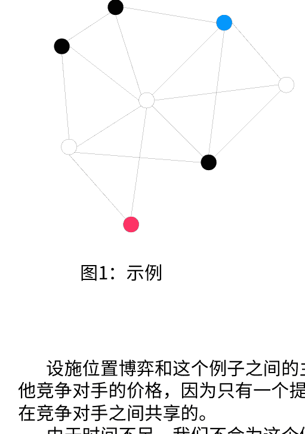
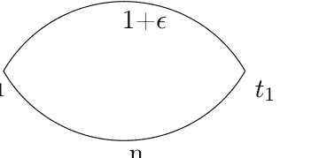
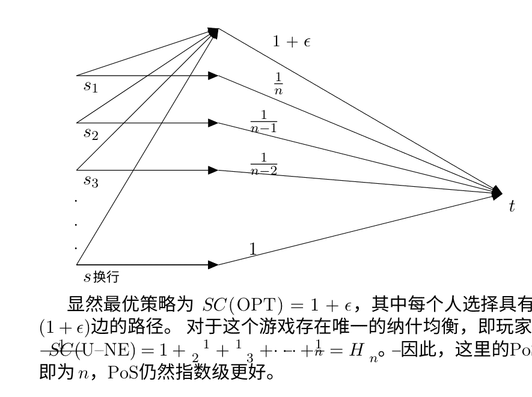
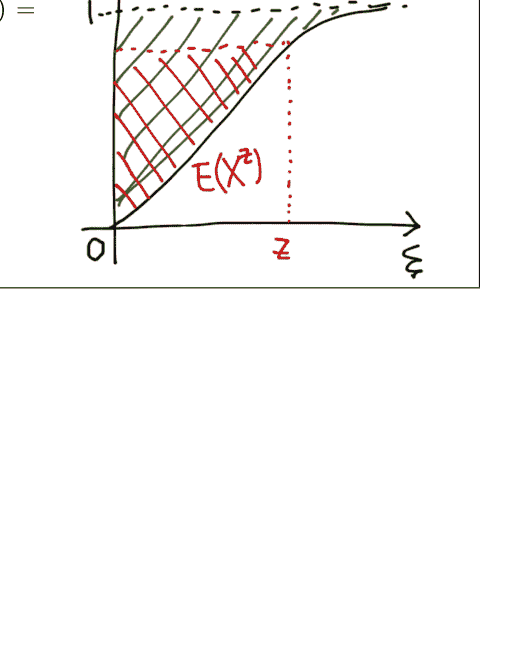
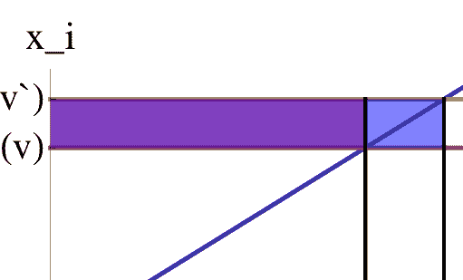

# 康奈尔 CS6840 算法博弈论讲义

# 第1讲 – 2012年1月23日星期一 – 主要是介绍

## 1.1 概述

特别 - 可以额外加分来改进与本课程相关主题的维基百科文章。

激发将博弈论与计算机科学联系起来的动机。

- 互联网。计算机科学曾经被总结为试图使计算机有效。相比之下，今天，互联网将一切连接起来，一个人设计一个算法控制一切的想法是错误的。
- 机制设计。真正的工程学科，设计一个游戏以达到预期的结果。
- 我们关心算法，并且如前所述，我们知道如何设计和分析它们。经济学家从不同的历史角度来解决这些问题，并且在寻找系统的均衡时没有同样强调复杂性。从计算机科学的角度来看，采用这种方法会带来有趣的复杂性结果，我们将在本学期中探索。
- 机制的简洁性。特别是从系统背景来看，机制必须简单。
- （近似）最优性。比如平均响应时间或交付时间。通常情况下，我们的目标函数没有明确的效用度量标准。时间可以是相对的。我们关心7秒和8秒之间的差异吗？

不同的观点。我们的观点与传统的博弈论方法有所不同。

请参阅课程网页了解大致的教学大纲。自从这本书出版以来，机制设计已经有所改变。我们将更多地使用Jason Hartline的书来讲解这个主题，而不是课程教材上列出的那本书。Ken Binmore对博弈论的基本介绍是一个很好的、快速的入门。

## 1.2 一个例子 - Braess悖论

我们将从讨论Braess悖论开始。考虑以下图形。

对于每条边，如果玩家使用这条边，延迟为 \(d_e(x) = delay\)。我们假设 \(d_e(x)\) 是一个单调递增（即非递减）的函数。这里策略1是底部路径，策略2是顶部路径。

请注意两条权重为100的边。这些边无论拥堵情况如何，都需要100秒才能通过，而标有的边则受拥堵情况影响。

我们的目标是预测这里会发生什么。显而易见的预测是玩家应该平分。因此，50个人选择策略一，另外50个人选择策略二。这个预测是一个（纯粹的）纳什均衡 - 一种结果，每个人都选择一种策略，偏离他们的策略不会改善他们的结果。所有玩家的总时间为150。如果遵循一种策略的人试图偏离，他们不会改善他们的结果。在这个例子中，从策略一转换到策略二的人会增加一秒的旅行时间，恶化他们的结果。

现在我们添加一条没有延迟的额外边，看看这如何影响策略。添加这条额外边提供了一个额外的策略：策略3，玩家开始使用顶部边，然后使用我们刚刚添加的边，然后走最后一条边到达终点。从50-50的解开始，但这不再是一个均衡。现在我们声称，所有100选择策略3是所有玩家的纳什均衡，总延迟为200。

为了看到这一点，注意到一个玩家选择策略1或策略2，然后将他的延迟时间从200改变为200，没有改进，因此我们得到了期望的均衡。

这个均衡不是唯一的。99个人可以选择策略3，1个人可以选择策略1。这仍然是一个均衡。这个孤独的人可能会嫉妒他的99个朋友得到延迟199，但改变他的策略对他的结果从200没有帮助，所以系统仍然处于均衡状态。还有许多类似的均衡。

声称至少有98名玩家必须选择策略3，最多只能有1名玩家选择策略1，并且最多只能有1名玩家选择策略2以达到纳什均衡。

与之前的游戏相比，这个游戏的动态是，大多数玩家的总延迟为200，而某些玩家的最佳延迟为198。无论哪种情况，都会使所有角色的生活变得更糟。因此，布雷斯悖论 - 在图中添加一条边使所有玩家的生活变得更糟。

我们将研究以下问题：如何找到这些均衡？为什么会出现像这样的悖论？像这个悖论这样的情况真的很糟吗？添加这条边并没有使玩家的生活变得更糟。玩家能找到这些均衡吗？

我们将研究各种方法来防止像这样的悖论。我们将在玩家的某种'理性'上严重依赖。稍后我们将回过头来看一个更复杂的均衡定义。我们当前的定义足够好，当这些均衡相当稳定和唯一时。然而，对纳什均衡存在批评，下次我们将给出一些纳什均衡无法涵盖我们所需的一切的例子。

下次我们将考虑各种目标函数的重要性。也许你不仅仅想赚很多钱 - 也许比起赚更多的钱，赚比邻居多的钱更重要？或许你不仅仅想在游戏中赚尽可能多的钱，而是确保你赢得游戏。我们将探讨各种效用度量之间的权衡。

# 第2讲 - 2012年1月25日星期三 - 拥堵游戏

## 2.1 定义

定义。拥堵游戏是一类如下定义的游戏：

- 可拥堵元素的基本集合 \(E\)
- \(n\)个玩家
- 每个玩家 \(i\)有有限的策略集合 \(S_i\)
- 策略 \(P \in S_i\) 其中 \(P \subseteq E\)
- 对于每个玩家\(i\)给定一个策略\(P_i\)

\(x_e = \#\{i; e \in P_i\}\) for \(e \in E\)

- 玩家 \(i\) 选择策略 \(P_i\) 会经历延迟

\(\sum_{e \in P_i} d_e(x_e)\)

备注。玩家\(i\)的策略 \(P_i\)定义了纯纳什均衡当且仅当没有玩家可以通过改变到另一个策略 \(Q_i\)来改善延迟。

考虑图1中的游戏中的一个玩家。在这个游戏中，玩家 \(i\)从 \(P_i\)切换到 \(Q_i\)。如图所示，\(P_i\)和 \(Q_i\)可能有共同的部分，也可能有不同的部分。通过切换，玩家 \(i\)在 \(P_i\)和 \(Q_i\)共同部分会经历相同的延迟，而在不同部分中，她将经历由于在 \(Q_i\)中增加一个人而产生的延迟。

> 对于所有玩家 \(i\) 和所有其他 \(Q_i \in S_i\)
> $$\sum_{e\in P_i} d_e(x_e) \leq \sum_{e\in P_i\cap Q_i} d_e(x_e) + \sum_{e\in Q_i\setminus P_i} d_e(x_e + 1)$$

## 2.2 拥塞博弈的均衡

现在，让我们探讨以下问题：

- 一般的拥塞博弈是否有纳什均衡？
- 合理的玩家能否找到纳什均衡？

当我们寻找纳什均衡时，最简单的方法是改变一个玩家的策略，看结果状态是否是纳什均衡。在这种方法中，确保不会出现循环是很重要的，以保证找到纳什均衡。为了看到循环可能如何发生，考虑以下匹配硬币游戏。

> 附注：如果游戏中存在循环，可能无法找到均衡。

例子：匹配硬币游戏

- 2个玩家
- 策略： \(H, T\)
- 规则：
  $$m(s) = \begin{cases}
  \text{玩家 1赢了，如果策略匹配} \\ \text{玩家 2赢了} & \text{否则}
  \end{cases}$$
- 最佳反应：玩家从任意策略开始，如果输了就换
  $$(H \mid H) \rightarrow (H \mid T) \rightarrow (T \mid T) \rightarrow (T \mid H) \rightarrow$$

## 2.3 纳什均衡的存在性

定理1. 拥塞博弈重复最佳反应总能找到纳什均衡。

证明. 拥塞博弈有一个潜力函数 \(\Phi\)，最佳反应会改善这个函数：

> $$\Phi = \sum_e \sum_{k=1}^{x_e} d_e(k)$$

考虑：玩家 \(i\) 从 \(P_i\)切换到 \(Q_i\)， \(\Phi\)的变化：

- 边 \(e \in P_i \setminus Q_i\) 减少了 \(d_e(x_e)\)
- 边 \(e \in Q_i \setminus P_i\) 增加了 \(d_e(x_e + 1)\)

请注意，\(\sum_{k=1}^{x_e} d_e(k)\) 是 \(x_e\) 的离散积分，即潜力函数 \(\Phi\) 是所有边缘的离散积分和潜力函数变化等于玩家从策略 \(P_i\) 切换到 \(Q_i\) 时延迟的变化之和。

> 当玩家从策略 \(P_i\) 切换到 \(Q_i\) 时，延迟的变化等于潜力函数 \(\Phi\) 的变化。

备用证明。最小化 \(\Phi\) 的解是纳什均衡，假设解的数量有限且存在最小值。由于我们假设 \(d_e(x)\) 是单调递增（即非递减）函数，只存在一个最小值，即纳什均衡。

# 第39讲：有限博弈中纳什均衡的存在性

今天我们将使用与上次相同的方法来证明有限博弈中存在纳什均衡。

> 定理1(纳什均衡的存在性). 有限玩家集和有限策略集的博弈至少有一个（混合）纳什均衡。

备注(有限博弈和混合纳什均衡). 这仅适用于通常所称的有限博弈。这里的“有限”有两个含义：有限的玩家集和每个玩家都有有限的策略集。因此，这个定理不适用于我们研究的一些游戏，例如当策略是价格时，策略集不是有限的，因为它可以是实数。其他一些游戏可能有无限多的玩家。在大多数这些游戏中，我们实际上有其他论证来证明纳什均衡的存在性，通常甚至是更好的论证，因为我们习惯于证明纯策略纳什均衡的存在性。而这个定理只是说明存在混合策略纳什均衡，并不令人惊讶，因为一些小的2x2游戏，例如Pennies Matching游戏，没有纯策略纳什均衡。

为了证明这个定理，我们将使用的主要工具是布劳威尔不动点定理。

> 定理2 (布劳威尔不动点定理) . 如果 \(C\) 是有界的、凸的和闭的，并且 \(f : C → C\) 是连续的，那么存在一个点 \(x\)，使得 \(f (x) = x\)。

备注。上次我们只对单纯形做了。一般来说，我们当然需要它是有界的和闭的。从拓扑学的角度来看，我们可以得出比凸更强的结论，但凸对于今天来说已经足够了。

我们将从一个自然但有问题的证明开始。我们想要做的事情和上次一样。从一个可能的游戏状态开始，这是所有玩家的混合策略集合，我们想要知道它是否是一个均衡点。如果不是，我们希望有一个函数将其移动更接近均衡点。

设 \(n\) 为玩家的数量， \(S_i\) 为玩家 \(i\) 的策略集合， \(\Delta_i\) 为玩家 \(i\) 的策略概率分布空间，即

```
Δ_i = { (p_s : s ∈ S_i) | p_s ≥ 0 and ∑_{s ∈ S_i} p_s = 1 }  (1)
```

我们用 \(C\) 来表示所有玩家的混合策略集合，即 \(C= Δ_1 × Δ_2 × … × Δ_n\)。可以证明 \(C\) 是凸的，有界的和闭合的。接下来我们需要一个函数 \(f : C → C\) 使得NE是一个不动点。一个自然的答案是使用最佳反应。也就是说，给定 \(p=(p_1, p_2,⋯ , p_n) ∈ C\)，其中 \(p_i ∈ Δ_i\)。让 \(q_i\) 成为玩家 \(i\) 的最佳反应，我们可以定义函数 \(f(p) = (q_1, q_2,⋯ , q_n)\)。这可以被看作是所有玩家同时移动到最佳反应状态，就好像其他人没有移动一样。

这个“证明”的根本问题在于 \(f\) 可能不是一个函数，因为对于玩家来说最佳反应可能不唯一。解决这个问题的一种自然方法是使用字典序的打破规则。不幸的是，用这种方式构造的函数可能不连续。让我们考虑以下例子。

|   | 正面 | 反面 |
|---|---|---|
| 正面 | (+1, -1) | (-1, +1) |
| 反面 | (-1, +1) | (+1, -1) |

表1：匹配硬币游戏的支付矩阵

例子（匹配硬币）。回顾表1中显示的匹配硬币游戏的支付矩阵。假设第一个玩家的混合策略是 \((p_1, 1-p_1)\)，即他将硬币以概率 \(p_1\) 变成正面，以概率 \(1-p_1\) 变成反面。那么第二个玩家的最佳反应 \((q_2, 1-q_2)\) 为

$$ \text{最佳反应} = \begin{cases} q_2 = 0 & \text{if } p_1 > 1/2, \\ q_2 = 1 & \text{if } p_1 < 1/2, \\ 0 \leq q_2 \leq 1 & \text{if } p_1 = 1/2. \end{cases} $$

显然，在 \(p_1= 1/2\) 处不连续。

因此，我们需要一些更好的方法来解决这个问题。在本讲座中，我们将讨论两个选项。

选项1（集合函数）。定义 \(f: C \to 2^C\) 为 \(f(p) = \{q | q\text{是} p\text{的最佳反应}\}\)。在这个选项中，我们希望找到 \(p\)，使得 \(p \in f(p)\)。为此，我们需要使用Kakutani提供的更强的不动点定理，并正式定义这种集合函数的“连续性”是什么意思。我们不会在今天的讲座中讨论细节。

选项2（更复杂的目标函数）。设 \(u_i(q, p_{-i})\) 为玩家 \(i\) 对于在回应 \(p_{-i}\) 时玩 \(q\) 的效用。这里是自然最佳反应函数

\(\max_q u_i(q, p_{-i}) \to \text{原始最佳反应} q\)

正如我们之前所示，这并不定义一个函数，而使其成为一个函数的自然方法会破坏连续性。或者，考虑

\(\max_q u_i(q, p_{-i}) - \|p_i - q\|^2\)

因此，对于玩家 \(i\)，它不是最大化效用 \(u_i(q, p_{-i})\)，而是最大化效用减去从原始 \(p_i\) 偏离的惩罚，即 \(\|p_i - q\|^2\)。注意 \(\|p_i - q\|^2\) 的任何正比例尺都可以使用。假设玩家 \(i\) 的最大化者是 \(q_i\)，我们定义 \(f(p) = (q_1, q_2, ..., q_n)\)。

为了完成证明，我们首先声称它确实定义了一个函数，这意味着最大化者是唯一的。

引理3。 \(\max_q u_i(q, p_{-i}) - \|q - p_i\|^2\) 是唯一的。

为了证明这一点，我们将使用严格凹函数具有唯一最大化的事实。注意对于向量函数，严格凹的定义有很多。我们将在证明中使用以下定义。

定义(严格凹)。 \(g(x)\) 是严格凹的，如果

$$ \forall x, x', \frac{1}{2}(g(x) + g(x')) > g\left(\frac{x + x'}{2}\right) $$ (2)

证明。注意到

```
u_i(q, p_{-i}) = \sum_{s \in S_i} q_s v_s(p_{-i}) \quad (3)
```

其中 \(v_s(p_{-i})\) 是纯策略 \(s\) 的价值。因此 \(u_i(q, p_{-i})\) 是 \(q\) 的线性函数。而 \(-\|q - p_i\|^2\) 是 \(q\) 的严格凹函数，这使得 \(u_i(q, p_{-i}) - \|q - p_i\|^2\) 严格凹，且具有唯一最大值。

为了证明 \(f\) 是连续的，我们将使用凸优化中的以下事实，不作证明。

声明 1. 如果一个优化问题类具有唯一的最优解，则最优解是目标函数中系数的连续函数

一个重要的缺失部分是我们想要证明函数 \(f\) 的不动点是纳什均衡。当 \(f\) 由 \(u_i(q, p_{-i})\) 的最大化定义时，这是显然的。现在加上惩罚项后，这变得不那么明显，但我们仍然可以证明它。

引理 4. 如果 \(f(p) = p\)，则 \(p\) 是纳什均衡。

如果 \(p\) 不是纳什均衡，那么存在另一个最佳反应 \(q = (q_1, q_2, ..., q_n)\)。对于不执行最佳反应的玩家 \(i\)，考虑从 \(p_i\) 移动到 \(q_i\)。这肯定会增加目标函数 \(u_i(q_i, p_{-i})\) 的第一部分。然而，整个目标函数可能不会增加，因为第二部分 \(\|q_i - p_i\|^2\) 也增加了。我们将证明，如果我们只朝着那个方向移动足够小，那就没问题。

证明。假设 \(p\) 不是纳什均衡。假设一个最佳反应是 \(q = (q_1, q_2, ..., q_n)\)。对于玩家来说，如果 \(p_i\) 不是最佳反应，我们有

```
u_i(q_i, p_{-i}) > u_i(p_i, p_{-i})
```

如果玩家从 \(p_i\) 移动到 \(r_i(\epsilon)\)，考虑他的目标函数 \(\delta_i(\epsilon)\) 的变化

```
δ_i(ε) = [u_i(r_i(ε), p_{-i}) - ||r_i(ε) - p_i||^2] - [u_i(p_i, p_{-i}) - ||p_i - p_i||^2]
       = ε[u_i(q_i, p_{-i}) - u_i(p_i, p_{-i})] - ε^2||q_i - p_i||^2
```
（注：此处原始OCR文本“你我他我 他_我”等乱码已根据数学上下文修正为合理推断的表达式。）

对于足够小的 \(\epsilon\)，我们有变化 \(\delta_i(\epsilon) > 0\)。因此他不能成为最大化 \(u_i(q, p_{-i}) - \|q - p_i\|^2\) 的点，这意味着他不能成为一个不动点。

备注 (函数 \(f\))。函数 \(f\) 假设每个人同时最佳反应，但是当每个人最佳反应时，他们的效用如何改变？我们不知道。这是一个证明，它想要进行这种人为但有些无意义的活动，考虑一个函数，其中每个人最佳反应，好像其他人不动。如果他们不动，我们达到纳什均衡。但是如果他们动了，那就没有意义了。请注意，这不是一个游戏动态，实际上它只是一个用于证明的数学工具。

在接下来的讲座中，我们将展示如果你在游戏中找到 NE，你就能找到相应函数的不动点。

# 引言

在这门课程中，我们将研究用于学习和预测的在线算法。这些算法本身就很有趣，作为理论计算机科学的一个主题，但也因为它们在电子市场设计（例如作为顺序价格实验或在线推荐系统的算法）和博弈论中的作用而引人注目（在线学习过程被提出作为玩家学习游戏均衡的解释）。

# 在线算法形式化

关于在线算法的一般背景，可以参考Borodin和El-Yaniv的书《在线计算和竞争分析》，或阅读MIT的Michel Goemans教授的在线算法课程笔记，可通过FTP获取。

ftp://theory.csail.mit.edu/pub/classes/18.415/notes-online.ps

在本节中，我们给出了在线算法的抽象定义，适用于我们在课堂上学习的预测问题。

定义1. 一个在线计算问题的规范如下：
1. 一组输入 \(\mathscr{I} = \prod_{t=1}^{\infty} I_t\)。
2. 一组输出 \(\mathscr{O} = \prod_{t=1}^{\infty} O_t\)。
3. 一个成本函数 \(Cost : \mathscr{I} \times \mathscr{O} \rightarrow \mathbb{R}\)。

对于一个正整数 \(T\)，我们将定义
$$\mathscr{I}[T] = \prod_{t=1}^{T} I_t, \quad \mathscr{O}[T] = \prod_{t=1}^{T} O_t.$$

一个元素 \(i = (i_1, i_2, \ldots) \in \mathcal{I}\) 应被解释为表示算法随时间逐渐揭示的输入序列，其中 \(i_t\) 表示在时间 \(t\) 揭示的输入部分。类似地，一个元素 \(o = (o_1, o_2, \ldots)\) 应被解释为算法产生的输出序列，其中 \(o_t\) 是时间\(t\) 的输出。

备注 1. 定义将在线计算问题的框架表述为一个无限输入输出序列，但是很容易将有限时间范围\(T\) 的问题作为定义的特殊情况加入进来。具体来说，如果对于所有的\(t > T, |I_t| = |O_t| = 1\)，那么这就编码了一个输入输出序列，在时间\(T\)之后算法不再接收或输出任何信息。

定义 2. 在线算法是一个函数序列

$$F_t : \mathcal{I}[t] \rightarrow O_t.$$

自适应对手（或者简称为对手）是一个函数序列

$$G_t : \mathcal{O}[t-1] \rightarrow I_t.$$

如果每个函数 \(G_t\) 都是一个常数函数，那么对手被称为无知的。

如果 \(F\) 是一个在线算法， \(G\) 是一个自适应对手， \(F\) 和 \(G\) 的转录是唯一的一对 \(\text{Trans}(F, G) = (i, o) \in \mathcal{I} \times \mathcal{O}\)，使得对于所有 \(t \ge 1\),

$$i_t = G_t(o_1, o_2, \ldots, o_{t-1})$$
$$o_t = F_t(i_1, i_2, \ldots, i_t).$$

\(F\) 和 \(G\) 的成本是 \(\text{Cost}(F, G) = \text{Cost}(\text{Trans}(F, G))\)。

人们应该将算法和对手看作是在玩一个游戏，对手根据算法的过去输出指定输入的一个组件，而算法则通过产生一个新的输出来回应。转录指定了当算法和对手玩这个游戏时产生的整个输入和输出序列。

备注 2. 指定一个无知的对手等同于指定一个单一的输入序列 \(i = (i_1, i_2, \ldots) \in \mathcal{I}\)。

备注 3. 我们对算法和对手的定义没有提及计算约束（例如多项式时间计算），对于任何一方都是如此。一般来说，我们希望设计计算效率高的算法，但是在不考虑这些约束的情况下，我们仍然可以提出有意义且非平凡的关于在线计算的问题。

在定义随机化算法和对手时，我们认为每个参与方都可以访问无限多个独立的随机比特（由\([0,1]\)中均匀分布的元素的二进制位表示），这些比特对其他参与方是不可见的。

## 3个二进制预测与一个完美专家

定义 3. 一个随机在线算法是一系列函数
$$F_t : \mathscr{I}[t] \times [0, 1] \rightarrow O_t.$$
一个随机自适应对手是一个函数序列
$$G_t : \mathscr{O}[t-1] \times [0, 1] \rightarrow I_t.$$
如果每个函数 $G_t(o, y)$的输出仅取决于参数 $y$，则称随机对手为无知的。

如果 $F$和 $G$分别是随机算法和随机自适应对手，则 $F$和 $G$的转录是函数 $\mathrm{Trans}(F, G) : [0,1] \times [0,1] \rightarrow \mathscr{I} \times \mathscr{O}$，它将一对 $(x, y)$ 映射到唯一的输入-输出对 $(i, o)$，满足以下条件：
$$i_t = G_t(o_1, o_2, \ldots, o_{t-1}, y)$$
$$o_t = F_t(i_1, i_2, \ldots, i_t, x)$$
对于所有 $t \geq 1$。$F$ 和 $G$的成本 $\mathrm{Cost}(F, G) = \mathbb{E}[\mathrm{Cost}(\mathrm{Trans}(F, G)(x, y))]$，当 $(x, y)$从$[0, 1]^2$上的均匀分布中采样时。

备注4。随机无知的对手等价于输入序列 $i = (i_1, i_2, \ldots) \in \mathscr{I}$上的概率分布。

备注5。在课堂上，我使用了一个无限序列的独立随机变量 $(x_1, x_2, \ldots) \in [0,1]^{\infty}$来定义一个随机算法，对于随机对手也是类似的。因此，传输记录 $\mathrm{Trans}(F, G)$被描述为从 $[0,1]^{\infty} \times [0,1]^{\infty}$ 到 $\mathscr{I} \times \mathscr{O}$ 的函数。这是不必要的复杂化：一个随机数 $x \in [0,1]$已经包含了无限多个独立的随机二进制位，因此它已经包含了算法需要的整个无限输入输出对的随机性。因此，在这些笔记中，我简化了定义，假设算法和对手的随机比特位包含在一个独立的随机实数对 $(x, y)$中，其中 $x$表示算法的随机比特位供应，$y$表示对手的供应。

作为下面要介绍的算法的热身，让我们考虑以下“玩具问题”。算法的目标是预测一个无限二进制序列 $B^{\infty}=(B_1, B_2, \ldots)$，其位逐个透露。在第$t$个位透露之前，一组$t$个专家进行预测 $b_{1t}, b_{2t}, \ldots, b_{nt} \in \{0,1\}$。算法被允许观察所有这些预测，然后做出一个被表示为 $a_t \in \{0,1\}$的猜测，然后真相 $B_t$被揭示。我们被保证至少有一个专家的预测总是准确的，即我们被保证存在一个$i$使得对于所有$t$都有 $b_{it} = B_t$。

这个预测问题是上述框架的一个特例。输入 $i_t$ 包含算法在进行第$(t-1)$次猜测之后和进行第$t$次猜测之前所获得的所有信息：因此，它包括 $B_{t-1}$的值以及所有的预测 $b_{1t}, \ldots, b_{nt}$。输出 $o_t$就是算法的猜测 $a_t$。成本 $\mathrm{Cost}(i, o)$ 是 $t$的次数，使得 $a_t = B_t$。

考虑以下算法，我们将其称为“多数算法”：在每个时间 $t$，它咨询所有在前 $t-1$步中没有犯错的专家的预测。（换句话说，它考虑所有的专家 $i$，使得对于所有的$s < t$， $b_{is} = B_s$。）如果这些专家中预测1的数量多于0，那么 $a_t=1$；否则 $a_t=0$。

**定理 1.** 假设至少存在一个专家 $i$使得对于所有$t$，有 $b_{it} = B_t$，那么多数算法在最多 $\lfloor \log_2(n) \rfloor$次错误中运行。

证明. 令 $S_t$表示在时间 $t$之前没有犯错误的专家集合。令$W_t = |S_t|$。如果多数算法在时间 $t$犯了一个错误，这意味着至少有一半的专家在该时间点上犯了错误，因此 $W_{t+1} \leq \lfloor W_t/2 \rfloor$。另一方面，根据假设，我们有 $|W_t| \geq 1$，对于所有$t$。因此，算法产生的错误次数上界是从 $n$到1所需的函数迭代次数$x \mapsto \lfloor x/2 \rfloor$。这是 $\lfloor \log_2(n) \rfloor$。
$\square$

**备注 6.** 定理 1 中的界限 $\lfloor \log_2(n) \rfloor$在信息论上是最优的，即可以证明没有确定性算法在每个输入上都比$\lfloor \log_2(n) \rfloor$少出错。

**备注 7.** 尽管定理 1 的证明非常简单，但它包含了两个在下面的加权多数和对冲算法的分析中将再次出现的关键要素。即，我们定义一个数 $W_t$来衡量时间 $t$时专家集合的“剩余可信度”，并利用 $W_t$的两个关键性质：

+   当算法犯错时，$W_t$会相应地减少。
+   假设存在一个预测接近真相的专家，那么对于所有的$t$，$W_t$的值都有一个下界。

第二个属性说的是，从初始值开始，$W_t$不能缩小得太多 $n$；第一个属性说的是，如果$W_t$不缩小得太多，那么算法就不会犯太多错误。将这两个观察结果结合起来得到了所述的错误界限。这些笔记中剩下的证明也都依赖于这两个观察结果，尽管为了证明这两个观察结果所需要的操作会随着我们分析的算法变得更加复杂而变得更加复杂。

## 4 确定性二进制预测：加权多数算法

算法 WMA(ε)

```
/* 初始化 */
w_i ← 1 对于 i = 1, 2, . . . , n.

/* 主循环 */
对于 t = 1, 2, . . .
    /* 通过加权多数投票进行预测 */
    如果 ∑_{i: bit=0} w_i > ∑_{i: bit=1} w_i
        输出 a_t = 0;
    否则
        输出 a_t = 1.
    观察 B_t 的值。
    /* 通过乘法更新权重 */
    E_t ← {预测错误的专家}
    w_i ← (1 - ε) · w_i 对于所有 i ∈ E_t。
结束
```

图1：加权多数算法

我们现在提出了一个与第3节中讨论的相同的二进制预测问题的算法。这个新算法，加权多数算法，即使我们不假设存在一个从不犯错误的专家，也满足一个可证明的错误界限。该算法如图1所示。实际上，它是一个一参数族的算法WMA（ε），每个算法都有一个预配置的参数ε∈（0，1）。

定理2. 令 M表示算法 WMA(ε)所犯错误的数量。对于每个整数 m，如果存在一个专家 i 最多犯 m 个错误，则
$$M < \left( \frac{2}{1-\varepsilon} \right) m + \left( \frac{2}{\varepsilon} \right) \ln(n).$$

证明。令 w_{it} 表示主循环的第 t 次迭代开始时 w_i 的值，令 W_t = \sum_{i=1}^n w_{it}。假设意味着存在一个专家 i 使得对于所有的 T，有 w_{iT} \geq (1 - \varepsilon)^m，因此
$$W_T > w_{iT} \geq (1 - \varepsilon)^m \quad (1)$$
对于所有的 $T$。另一方面，如果算法在时间 $t$ 犯了一个错误，那意味着
$$\sum_{i\in E_t} w_{it} \geq \frac{W_t}{2},$$
因此
$$\begin{aligned} W_{t+1} &= \sum_{i\in E_t} (1-ε) \cdot w_{it} + \sum_{i\notin E_t} w_{it} \\ &= \sum_{i=1}^n w_{it} - ε \sum_{i\in E_t} w_{it} \\ &\leq W_t \left(1 - \frac{ε}{2}\right). \end{aligned}$$
对于任意 $T>0$，我们发现
$$\frac{W_T}{W_0} = \prod_{t=0}^{T-1} \frac{W_{t+1}}{W_t} \leq \left(1 - \frac{ε}{2}\right)^M \qquad (2)$$
其中 $M$ 是算法 $\text{WMA}(ε)$ 所犯的总错误数。结合 (1) 和 (2)，并回忆起 $W_0 = \sum_{i=1}^n w_{i0} = \sum_{i=1}^n 1 = n$，我们得到 $(1-ε)^m n$
$$\rule{2cm}{0.4pt} < \frac{W_T}{W_0} \leq \left(1 - \frac{ε}{2}\right)^M.$$
现在我们对两边取自然对数。
$$\ln(1-ε)m - \ln(n) < \ln\left(1 - \frac{ε}{2}\right) M \qquad (3)$$
$$\ln(1-ε)m - \ln(n) < - (ε/2) M \qquad (4)$$
$$\ln\left(\frac{1}{1-ε}\right) m + \ln(n) > (ε/2) M \qquad (5)$$
$$\left(\frac{2}{ε}\right) \ln\left(\frac{1}{1-ε}\right) m + \left(\frac{2}{ε}\right) \ln(n) > M \qquad (6)$$
$$\left(\frac{2}{1-ε}\right) m + \left(\frac{2}{ε}\right) \ln(n) > M \qquad (7)$$
其中 (4) 是根据这些笔记附录中的恒等式 (21) 推导出来的，而 (7) 是根据这些笔记附录中的恒等式 (22) 推导出来的。

## 5 随机预测：Hedge算法

现在我们转向二进制预测问题的一般化：最佳专家问题。在这个问题中，再次有一组专家，我们将其标识为 $n$ 个。对于集合 $[n] = \{1, 2, \ldots, n\}$。在每个时间步骤 $t$ 中，对手指定一个成本函数 $c_t$ 从 $[n]$ 到 $[0,1]$，算法选择一个专家 $x_t \in [n]$。成本函数 $C_t$ 只有在算法选择 $x_t$ 之后才会被揭示给算法。算法的目标是最小化选择的专家的成本之和，即最小化
$$\sum_{t=1}^{\infty} c_t(x_t).$$
观察到这个问题的表述符合第2节中指定的形式化；输入序列 $(i_1, i_2, \ldots)$ 由 $i_t = c_{t-1}$ 给出，输出序列 $(o_1, o_2, \ldots)$ 由 $o_t = x_t$ 给出，成本函数为
$$\text{成本}(i, o) = \sum_{t=1}^{\infty} i_{t+1}(o_t) = \sum_{t=1}^{\infty} c_t(x_t).$$
还要注意，二进制预测问题是最佳专家问题的一个特例，在其中我们定义 $c_t(x) = 1$，如果 $b_{xt} = B_t$，否则为0。

算法 Hedge($\varepsilon$)

```
/* 初始化 */
$w_x \leftarrow 1$ **for** $x \in [n]$

/* 主循环 */
**对于** $t = 1, 2, \ldots$
    /* 定义用于采样随机策略的分布 */
    **for** $x \in [n]$
        $p_t(x) \leftarrow w_x / \left(\sum_{y=1}^{n} w_y\right)$
    **结束**
    随机选择分布 $p_t$ 中的 $[n]$ 中的 $x_t$。
    观察成本函数 $c_t$。

    /* 更新每个策略的得分 */
    **对于** $[n]$ 中的每个 $x$
        令 $w_x \leftarrow w_x \cdot (1 - \varepsilon)^{c_t(x)}$
    **结束**
**结束**
```

图2: 算法 Hedge($\varepsilon$)。

图2展示了最佳专家问题的随机在线算法。与之前一样，它实际上是一个带有预设参数 $\varepsilon \in (0, 1)$ 的单参数算法族 Hedge(ε)。注意算法与 WMA(ε) 的相似性：它维护一个权重向量，每个专家对应一个权重，并且使用 WMA 中的乘法更新规则的直接推广来更新这些权重。主要区别是，WMA通过对专家的加权多数投票来做出决策，而Hedge通过对单个专家进行加权随机选择来做出决策。

**定理3.**

对于每个随机自适应对手，对于每个$T > 0$， Hedge($\epsilon$)所遭受的预期成本满足
$$\mathbf{E}\left[\sum_{t=1}^{T} c_{t}\left(x_{t}\right)\right]<\left(\frac{1}{1-\epsilon}\right) \mathbf{E}\left[\min _{x \in[n]} \sum_{t=1}^{T} c_{t}(x)\right]+\left(\frac{1}{\epsilon}\right) \ln (n). \quad\quad (8)$$

证明.让 $w_{xt}$ 表示主循环的第 $t$ 次迭代开始时 $w_{x}$ 的值，令 $W_{t}=\sum_{x=1}^{n} w_{x t \circ}$ 注意，$w_{xt}$，$W_{t}$ 是随机变量，因为它们取决于对手的选择，而对手的选择又取决于算法在之前步骤中的随机选择。对于专家 $x \in[n]$，令 $c_{1 . . T}(x)$ 表示总成本
$$c_{1 . . T}(x)=\sum_{t=1}^{T} c_{t}(x).$$
令 $x^{*}=\arg \min _{x \in[n]} c_{1 . . T}(x)$。我们有
$$W_{T}>w_{x^{*} t}=(1-\epsilon)^{c_{1 . . T}\left(x^{*}\right)}$$
并且在两边取对数后，变成
$$\ln \left(W_{T}\right)>\ln (1-\epsilon) c_{1 . . T}\left(x^{*}\right) \quad\quad (9)$$
另一方面，我们可以通过归纳论证来从上方限制$\ln(W_{T})$的期望值。令 $w_{* t}$ 表示权重向量 $(w_{1 t}, \ldots, w_{n t})$。
$$\begin{aligned}
\mathbf{E}\left(W_{t+1} \mid w_{* t}\right) & =\sum_{x=1}^{n} \mathbf{E}\left((1-\epsilon)^{c_{t}(x)} w_{x t} \mid w_{* t}\right) \quad\quad (10) \\
& \leq \sum_{x=1}^{n} \mathbf{E}\left((1-\epsilon c_{t}(x)) w_{x t} \mid w_{* t}\right) \quad\quad (11) \\
& =\sum_{x=1}^{n} w_{x t}-\epsilon \mathbf{E}\left(\sum_{x=1}^{n} c_{t}(x) w_{x t} \mid w_{* t}\right) \quad\quad (12) \\
& =W_{t} \cdot\left(1-\epsilon \mathbf{E}\left(\sum_{x=1}^{n} c_{t}(x) p_{t}(x) \mid w_{* t}\right)\right) \quad\quad (13) \\
& =W_{t} \cdot\left(1-\epsilon \mathbf{E}\left(c_{t}\left(x_{t}\right) \mid w_{* t}\right)\right) \quad\quad (14) \\
\mathbf{E}\left(\ln \left(W_{t+1}\right) \mid w_{* t}\right) & \leq \ln \left(W_{t}\right)+\ln \left(1-\epsilon \mathbf{E}\left(c_{t}\left(x_{t}\right) \mid w_{* t}\right)\right) \quad\quad (15) \\
& \leq \ln \left(W_{t}\right)-\epsilon \mathbf{E}\left(c_{t}\left(x_{t}\right) \mid w_{* t}\right) \quad\quad (16)
\end{aligned}$$
$$\varepsilon\mathbf{E}(c_t(x_t)\mid w_{*t}) \leq \ln(W_t) - \mathbf{E}(\ln(W_{t+1})\mid w_{*t})\qquad(17)$$
$$\varepsilon\mathbf{E}(c_t(x_t)) \leq \mathbf{E}(\ln(W_t)) - \mathbf{E}(\ln(W_{t+1}))\qquad(18)$$
$$\varepsilon\mathbf{E}\left(\sum_{t=1}^{T} c_t(x_t)\right) \leq \ln(n) - \mathbf{E}(\ln(W_T)).\qquad(19)$$
这里，(11)是通过附录中的恒等式(23)推导出来的，(13)是通过 $p_t(x) = w_{xt}/W_t$ 这个事实推导出来的，(14)是通过观察到 $x_t$ 是从概率分布 $p_t(\cdot)$ 在 $[n]$ 上随机抽取的，(15)和(16)是通过恒等式(24)和(21)推导出来的，(18)是通过对不等式两边取无条件期望得到的，(19)是通过对 $t$ 求和并回忆 $W_0 = n$ 得到的。将(9)和(19)结合起来，我们得到
$$\varepsilon\mathbf{E}\left(\sum_{t=1}^{T} c_t(x_t)\right) < \ln(n) - \ln(1-\varepsilon)\mathbf{E}(c_{1..T}(x^*))$$
$$\mathbf{E}\left(\sum_{t=1}^{T} c_t(x_t)\right) < \left(\frac{1}{\varepsilon}\right)\ln(n) + \frac{1}{\varepsilon}\ln\left(\frac{1}{1-\varepsilon}\right)\mathbf{E}(c_{1..T}(x^*))$$
$$\mathbf{E}\left(\sum_{t=1}^{T} c_t(x_t)\right) < \left(\frac{1}{\varepsilon}\right)\ln(n) + \left(\frac{1}{1-\varepsilon}\right)\mathbf{E}(c_{1..T}(x^*))$$
最后一行是通过附录中的公式（22）推导得出的。 $\square$

## 附录6：对数和指数函数的一些有用不等式

在上述证明的各个步骤中，我们应用了一些有用的不等式，这些不等式是由指数函数的凸性或对数的凹性得出的。在本节中，我们汇总了所有这些不等式，并指出了它们的证明。

引理4。对于所有实数 $x$，
$$1 + x \leq e^x\qquad(20)$$
等号成立当且仅当 $x = 0$。
证明。函数 $e^x$ 是严格凸函数，而 $y = 1 + x$ 是 $y = e^x$ 在 $(0, 1)$ 处的切线。 $\square$

引理 5.对于所有实数$x > -1$,
$$\ln(1 + x) \leq x\qquad(21)$$
当且仅当 $x=0$时等号成立。

证明。对(20)两边取自然对数。

## 引理 6
对于所有实数 $y \in (0,1)$,

$$\frac{1}{y} \ln \left( \frac{1}{1-y} \right) < \frac{1}{1-y}.$$

证明。将(21)应用于 $x = \frac{y}{1-y}$, 然后两边除以 $y$。

## 引理 7
对于任意一对实数 $x \in [0,1]$, $\varepsilon \in (0,1)$,

$$(1 - \varepsilon)^x \leq 1 - \varepsilon x$$

当且仅当 $x=0$ 或 $x=1$ 时等号成立。

证明。函数 $y=(1-\varepsilon)^x$ 是严格凸函数，直线 $y=1-\varepsilon x$ 在点 $(0,1)$ 和 $(1,1-\varepsilon)$ 相交。

## 引理 8
对于任意随机变量 $X$，我们有

$$\mathbf{E}(\ln(X)) \leq \ln(\mathbf{E}(X))$$

等号成立当且仅当存在常数 $c$ 使得 $\Pr(X=c)=1$。

证明。凸函数的Jensen不等式表明，如果 $f$ 是凸函数且 $X$ 是随机变量，

$$\mathbf{E}(f(X)) \geq f(\mathbf{E}(X)),$$

且如果 $f$ 是严格凸的，则等号成立当且仅当存在常数 $c$ 使得 $\Pr(X=c)=1$。引理通过将Jensen不等式应用于严格凸函数 $f(x)=-\ln(x)$ 得出。

## 第1周总结
以下是关于顺序预测算法的一些总结观察。

*   对于使用专家建议进行序列预测的问题，我们看到了两种算法：一个确定性算法，满足错误界限
    $$ M \le \left( \frac{2}{1 - \varepsilon} \right) m + \left( \frac{2}{\varepsilon} \right) \ln n $$
    和一个随机化算法，满足错误界限
    $$ M \le \left( \frac{1}{1 - \varepsilon} \right) m + \left( \frac{1}{\varepsilon} \right) \ln n, $$
    其中 $n$是专家数量，$m$是最佳专家的错误次数，$\varepsilon > 0$是由算法设计者预先配置的参数。
*   你应该将$1/(1 - \varepsilon)$视为等同于$1 + O(\varepsilon)$。（例如，当$\varepsilon < 1/2$时，我们有$1/(1 - \varepsilon) < 1 + 2\varepsilon$。）因此当 $m \gg \ln(n)$时，随机预测算法几乎与最佳专家犯相同数量的错误。
*   为了实现这些错误界限，两种算法都不需要知道 $m$的值。
*   最好的随机算法犯的错误数量是最好的确定性算法的一半。这似乎是顺序预测问题中的一个重复主题。（你在作业中看到了另一个例子。）这个因子2不是因为它是一个二进制预测问题；当预测 $k$-ary序列的数据时，随机化也可以节省一个因子2，其中 $k > 2$。
*   随机预测算法实际上适用于一个更一般的问题——“最佳专家”问题——在每个时间步骤中，每个专家都有一个与之相关的成本，而每个专家的成本（一个介于0和1之间的实数）只有在算法选择一个专家之后才会揭示。
*   两种算法的分析遵循相同的大致轮廓。记住这个大致轮廓很重要：每当算法累积一单位的成本时，专家的总“权重”会相应地减少。由于总权重永远不会低于最佳专家的权重，并且它的初始值只比最佳专家的权重大 n times，所以算法只能累积 O(log n)比最佳专家多的成本单位。

## 2 遗憾
我们已经看到了一个随机算法 Hedge用于最佳专家问题，其期望成本相对于最佳专家 x*满足

$$ E[\text{成本}(\text{Hedge})] \leq (1 + 2\varepsilon)\text{成本}(x^*) + \frac{\ln(n)}{\varepsilon}, \quad (1) $$

对于任意常数 $\varepsilon \in (0, 1/2)$。每当你看到一个界限，说一个算法计算出的解决方案的成本在最优解的$1 + 2\varepsilon$因子内，对于任意小的$\varepsilon>0$，一个自然的后续问题是是否可以实际上将成本变为最优解的$1 + o(1)$倍，如果可以的话，我们可以将$o(1)$项变得多小？

让我们将(1)重写为

$$ E[\text{成本}(\text{Hedge}) - \text{成本}(x^*)] \leq 2\varepsilon\text{成本}(x^*) + \frac{\ln(n)}{\varepsilon}. \quad (2) $$

定义1 (遗憾的非正式定义)。在线学习算法ALG的遗憾是算法选择和最佳选择之间的预期成本差异的最大值（对于所有输入实例）。

定义2 (遗憾的形式化定义，适用于本讲)。相对于对手类$\mathcal{G}$，在线学习算法ALG的遗憾是

$$ R(\text{ALG}, \text{ADV}) = \sup_{G \in \mathcal{G}} \mathbb{E} \left[ \max_{x \in [n]} \sum_{t=1}^{\infty} c_t(x_t) - c_t(x) \right], $$

其中，$c_t$表示对手$G$在时间$t$选择的（随机）成本函数（即转录Trans(ALG, G)中的第$i$ $t_{+1}$项），而$x_t$表示ALG在时间$t$选择的专家（即转录Trans(ALG, G)中的第$i$项）。

不等式 (2) 给出了一个有用的后悔上界，在可以事先限制最佳专家成本的情况下。以下是两种这样的情况。

有限时间范围假设对手 G有时间范围 T，如果对于所有$t > T$和$x \in [n]$，无论算法做出什么选择，都有 $c_t(x) = 0$。将所有这样的对手的集合记为 $\mathcal{G}[T]$。对于 $\mathcal{G}[T]$中的对手， $\text{Cost}(x^*) \leq T$。

几何折扣假设对手 $G$ 有折扣因子 $\delta = 1 - r$，如果 $r$ 是一个正常数，并且存在另一个对手G — 其成本函数$n\hat{c}_t$ 取值在0和1之间 — 使得 $c_t = \delta^t \hat{c}_t$。将所有这样的对手的集合记为 $\mathcal{G}\langle1 - r\rangle$。对于 $\mathcal{G}\langle1 - r\rangle$ 中的对手， $Cost(x^*) \le 1/r$。

通过选择 $\varepsilon = \sqrt{\ln(n)/2T}$ 在有限时间范围 $T$ 的情况下，或者 $\varepsilon = \sqrt{r \ln(n)/2}$ 在折扣因子为 $1 - r$ 的情况下，我们得到对于对手集合 $\mathcal{G}[T]$ 和 $\mathcal{G}\langle1 - r\rangle$ 的遗憾的上界。

$$R\left( \text{Hedge}\left( \sqrt{\ln(n)/2T} \right), \mathcal{G}[T] \right) \le 2\sqrt{2T \ln(n)} \tag{3}$$
$$R\left( \text{Hedge}\left( \sqrt{r \ln(n)/2} \right), \mathcal{G}\langle 1-r \rangle \right) \le 2\sqrt{2 \ln(n)/r} \tag{4}$$

### 2.1 加倍技巧
为了达到遗憾界限 (3)，算法设计师必须提前知道时间范围 $T$，以指定算法初始化时适当的 $\varepsilon$ 值。我们可以避免这个假设，即 $T$ 事先已知，但代价是一个常数因子，使用加倍技巧。每当我们达到时间步骤 $t$，使得 $t$ 是2的幂时，我们重新启动算法（忘记过去获得的所有信息），将 $\varepsilon$ 设置为 $\sqrt{\ln(n)/2^{j+1}}$。让我们用 Hedge* 来表示这个算法. 如果 $2^k \le T < 2^{k+1}$，算法满足以下对遗憾的上界:

$$\begin{align*}
R(\text{Hedge}^*, \mathcal{G}[T]) &= \sup_{G \in \mathcal{G}[T]} \mathbf{E} \left[ \sup_{x \in [n]} \sum_{t=1}^{T} c_t(x_t) - c_t(x) \right] \\
&= \sup_{G \in \mathcal{G}[T]} \mathbf{E} \left[ \sup_{x \in [n]} \sum_{j=0}^{k} \sum_{t=2^j}^{2^{j+1}-1} c_t(x_t) - c_t(x) \right] \\
&\le \sum_{j=0}^{k} \sup_{G \in \mathcal{G}[2^j]} \mathbf{E} \left[ \sup_{x \in [n]} \sum_{t=1}^{2^j} c_t(x_t) - c_t(x) \right] \\
&= \sum_{j=0}^{k} R\left( \text{Hedge}\left( \sqrt{\ln(n)/2^{j+1}} \right), \mathcal{G}[2^j] \right) \\
&\le \sum_{j=0}^{k} 2\sqrt{2^{j+1} \ln(n)} \\
&< 2\sqrt{2^{k+1} \ln(n)} \sum_{i=0}^{\infty} 2^{-i/2} \\
&< 7\sqrt{T \ln(n)}.
\end{align*}$$

每当我们有一个已知时间horizon T的算法，其遗憾为O(T^α)（其中α>0），我们可以使用这个倍增技巧来获得另一个遗憾为O(T^α)的算法，适用于所有时间horizons T.

### 2.2 遗憾的下界
遗憾界(3)在信息论上是最优的，最多相差一个常数因子：Ω是一个匹配的下界 (√T ln(n))通过考虑一个输入，在其中成本{c_t(x):1≤t≤T,x∈[n]}构成了一个从{0,1}中独立均匀分布的随机样本集合。中心极限定理告诉我们，很大概率上，存在一个专家的总成本为 T/2 - Ω(√T ln(n)).另一方面，很明显任何随机化算法的期望成本为T/2.

## 3 正态形式博弈，混合策略和纳什均衡
### 3.1 定义
定义3.正态形式博弈由以下规定：
- 一组玩家I.
- 对于每个玩家i∈I，一组策略A_i.
- 对于每个玩家i∈I，一个支付函数 $u_i : \prod_{i∈I} A_i \rightarrow \mathbb{R}$.
当一个正则形式游戏有两个玩家时，我们通常将它们称为行玩家(玩家1)和列玩家(玩家2)，并且我们将支付函数写成一个以A_1和A_2为索引的矩阵的行和列。矩阵的第r行和第c列的条目是有序对(u_1(r,c), u_2(r,c)).

### 3.2 两人正则形式游戏的例子
例子1. (巴赫或斯特拉文斯基)两个玩家必须决定是否去听巴赫或斯特拉文斯基的音乐会。一个偏好巴赫，另一个偏好斯特拉文斯基，但他们都更喜欢一起去音乐会而不是单独去。

|   | B | S |
|---|---|---|
| B | (2,1) | (0,0) |
| S | (0,0) | (1,2) |

例子2. (巴赫和斯特拉文斯基)两个玩家住在相邻的房间里。每个人必须决定是以低音量还是高音量播放他们的音乐。每个人都更喜欢以高音量播放自己的音乐，并且更喜欢邻居的音乐以低音量播放。

|   | Q | L |
|---|---|---|
| Q | (3,3) | (1,4) |
| L | (4,1) | (2,2) |

这个游戏是著名的囚徒困境游戏的一种形式。无论对手的策略如何，每个玩家都更好地选择“L”。然而，结果(L,L)对于两个玩家都比结果(Q,Q)更糟糕。

例子3. (点球大战)有两个玩家：射手和守门员。每个人必须选择向左还是向右。如果两个人选择相同的方向，守门员获胜。如果两个人选择相反的方向，前锋赢。

|   | L | R |
|---|---|---|
| L | (-1,1) | (1,-1) |
| R | (1,-1) | (-1,1) |

这个游戏有时被称为匹配硬币。

### 3.3 混合策略
对于一个正常形式游戏的玩家来说，混合策略是从其策略集中随机选择策略的规则。更正式地说，对于一个有限集A，让 \(\Delta( A)\) 表示A上的所有概率分布集合，即

\[
\Delta(A) = \left\{ p : A \to [0,1] \middle| \sum_{a \in A} p(a) = 1 \right\}.
\]

(这个定义可以使用测度论来扩展到无限集，但处理这个扩展所需的形式化方法超出了本课程的范围。) \(\Delta(A_i)\) 的元素被称为玩家 \(i\) 的混合策略。\(\prod_{i \in \mathcal{I}} \Delta(A_i)\) 的元素被称为混合策略配置。游戏的支付函数可以从纯策略配置扩展到混合策略配置，通过定义混合策略配置的支付为每个玩家独立采样其随机策略时的期望支付：\(u_i(p_1, p_2, \ldots, p_{|\mathcal{I}|}) =\)

\[
\sum_{\vec{a}} u_i(\vec{a}) p_1(a_1) p_2(a_2) \ldots p_{|\mathcal{I}|}(a_{|\mathcal{I}|}),
\]

其中求和遍历所有纯策略配置 \(\vec{a} = (a_1, a_2, \ldots, \ldots, \ldots, \ldots, a_{|\mathcal{I}|})\)。

### 3.4 纳什均衡
令 $k = |\mathcal{I}|$. 对于一个策略配置 $\vec{a} = (a_1, a_2, \dots, a_k)$，以及一个元素 $a_i' \in A_i$，我们引入记号 $(a_i', a_{-i})$ 表示：

$$
(a_i', a_{-i}) = (a_1, a_2, \dots, a_{i-1}, a_i', a_{i+1}, \dots, a_k).
$$

换句话说，$(a_i', a_{-i})$ 是通过将玩家 $i$ 的策略从 $a_i$ 改变为 $a_i'$ 得到的策略配置。

**定义4 (纳什均衡)**。一个混合策略配置 $\vec{p} = (p_1, p_2, \dots, p_k)$ 是一个混合纳什均衡（或者简称为纳什均衡），如果对于所有 $i \in \mathcal{I}$ 和所有 $q_i \in \Delta(A_i)$,

$$
    u_i(q_i, p_{-i}) \leq u_i(p_i, p_{-i}).
$$

如果每个 $p_i$ 是一个纯策略（即将概率1分配给 $A_i$ 的一个元素），那么 $\vec{p}$ 是一个纯纳什均衡。

**例子4**。“巴赫或斯特拉文斯基”有两个纯纳什均衡，即(B,B)和(S,S)。还有另一个混合纳什均衡，其中玩家1以2/3的概率选择B，以1/3的概率选择S；玩家2以1/3的概率选择B，以2/3的概率选择S。有趣的是，在混合均衡中，两个玩家的收益都是2/3，所以两个纯均衡对两个玩家都更好。

(从博弈论的角度来看，混合纳什均衡被纯策略均衡所帕累托支配。如果$x$和$y$是博弈的两个结果，我们说$x$帕累托支配$y$当至少有一名玩家严格偏好$x$而不是$y$，并且没有一名玩家严格偏好$y$而不是$x$。）这个例子说明了纳什均衡概念的三个批评之一。

1.  在这种有多个纳什均衡的情况下，我们无法预测玩家会选择哪个均衡（如果有的话）。
2.  此外，不同的均衡意味着两名玩家的回报不同，因此我们甚至无法预测他们的回报。
3.  玩家选择博弈的纳什均衡似乎依赖于循环推理。玩家1希望按照均衡策略进行游戏，因为它相信玩家2会按照相同的策略进行游戏，反之亦然。在存在多个均衡的情况下，为什么我们应该假设两名玩家能够以这种方式协调他们的信念？

对纳什均衡的这些批评并不是故事的终点；它们是一个非常有趣的故事的开端，在这个故事中，博弈论学家们试图通过各种方式改进理论，以解决这些批评，并提高博弈论均衡概念的预测能力。特别地，一些博弈论学家尝试过通过模型来解决批评（3），在这些模型中，玩家通过重复玩游戏并使用学习规则来适应对手的过去行为来达到均衡。这种游戏中的学习理论将是我们接下来几周要讨论的主要话题之一。

例子5. “巴赫和斯特拉文斯基”游戏（即囚徒困境）只有一个纳什均衡，即纯策略（L，L）。这是一个支配策略均衡，意味着每个玩家无论对方做什么，都更好地选择L而不是Q。

例子6. “点球”游戏没有纯纳什均衡。在唯一的混合纳什均衡中，每个玩家都将概率1/2分配给两种策略。

## 4 两人零和游戏和冯·诺依曼的极小极大定理
定义5. 两人零和游戏是指对于所有纯策略组合 $(a_1, a_2)$，都有 $u_2(a_1, a_2) = -u_1(a_1, a_2)$。

冯·诺依曼的一个著名定理说明了两人零和游戏的均衡要比一般两人游戏的均衡简单得多。

### 定理1 (冯·诺依曼的极小极大定理)
对于每个具有有限策略集 $A_1, A_2$的两人零和游戏，存在一个称为游戏价值的数 $v \in \mathbb{R}$，满足以下条件：

$$v = \max_{p \in \Delta(A_1)} \min_{q \in \Delta(A_2)} u_1(p, q) = \min_{q \in \Delta(A_2)} \max_{p \in \Delta(A_1)} u_1(p, q)$$

2.  混合纳什均衡集非空。如果且仅如果，混合策略配置 $(p, q)$是纳什均衡。

$$p \in \arg \max_{p} \min_{q} u_1(p, q)$$
$$q \in \arg \min_{q} \max_{p} u_1(p, q)$$

3.  对于所有混合纳什均衡 $(p, q)$，$u_1(p, q) = v$。

备注1。此定理还意味着，两人零和博弈不会受到上述批评(2)和(3)的影响。尽管可能存在多个均衡，定理的第(3)部分表明所有均衡对于两个玩家来说都具有相同的收益。此外，玩家们不需要相互协调以达到均衡：根据第(2)部分，每个玩家只需在他们各自的arg max或arg min集合中选择一个混合策略，而不需要知道对手将选择哪个均衡混合策略。

## 4.1 关于 Hedge的一些额外观察

在给出定理1的证明之前，我们必须指出Hedge算法的两个简单性质，这些性质在之前的讲座中没有推导出来。

### 4.1.1 使用 Hedge解决最大化问题

尽管我们在线成本最小化问题的背景下定义和分析了 Hedge算法，但很容易将该算法调整为在线收益最大化的设置。最简单的方法是将收益函数转化为成本函数。如果 $g_t: [n] \to [0,1]$是时间 $t$的收益函数，则定义 $c_t(x) = 1 - g_t(x)$，并使用 Hedge计算一系列近似最小化的专家序列 $x_t$。

定理2. 对于每个随机自适应对手，对于每个 $T > 0$，通过 MaxHedge($\epsilon$)获得的期望回报满足

$$\mathbf{E}\left[\sum_{t=1}^T g_t(x_t)\right] > (1-\epsilon) \mathbf{E}\left[\max_{x \in [n]} \sum_{t=1}^T g_t(x)\right] - \left(\frac{1}{\epsilon}\right) \ln(n).$$

推论3. 对于每个 $T > 0$，如果 $\epsilon = \sqrt{\ln(n)/T}$, 通过MaxHedge($\epsilon$)对抗任何自适应对手获得的期望回报满足

$$\mathbf{E}\left[\sum_{t=1}^T g_t(x_t)\right] > \mathbf{E}\left[\max_{x \in [n]} \sum_{t=1}^T g_t(x)\right] - 2\sqrt{T \ln(n)}.$$

在这些笔记的其余部分中，我们不区分算法 Hedge和 MaxHedge。

### 4.1.2 Hedge跟踪最佳专家混合

对于最佳专家问题，我们可以将每个回报函数 $g_t$从一个函数扩展到 $\Delta([n])$，通过平均值：

$$g_t(p) = \sum_{x \in [n]} p(x) g_t(x).$$

观察到对于任意的 $p \in \Delta([n])$，

$$\sum_{t=1}^{T} g_t(p) \leq \max_{x \in [n]} \sum_{t=1}^{T} g_t(x),$$

因为左边是 $\sum_{t=1}^{T} g_t(x)$ 在所有 $[n]$ 元素上的加权平均值。利用这个事实，我们可以看到不等式 (5) 和 (6) 适用于分布：

$$\mathbf{E}\left[\sum_{t=1}^{T} g_t(x_t)\right] > (1-\varepsilon)\mathbf{E}\left[\max_{p\in\Delta([n])}\sum_{t=1}^{T} g_t(p)\right] - \left(\frac{1}{\varepsilon}\right)\ln(n). \quad (7)$$

$$\mathbf{E}\left[\sum_{t=1}^{T} g_t(x_t)\right] > \mathbf{E}\left[\max_{p\in\Delta([n])}\sum_{t=1}^{T} g_t(p)\right] - 2\sqrt{T\ln(n)}. \quad (8)$$

## 4.2 主要引理

冯·诺依曼最小最大定理证明中最困难的一步是证明

$$\max_{p} \min_{q} u_1(p, q) \geq \min_{q} \max_{p} u_1(p, q).$$

我们将使用在线学习算法证明这个事实。证明的基本思想是，如果玩家被允许重复玩游戏，并使用Hedge来适应对方的动作，那么Hedge的低后悔性质保证了每个玩家混合策略的时间平均几乎是对方混合策略的最佳响应的时间平均。

引理4. 对于任意的两人零和游戏，

$$\max_{p\in\Delta(A_1)} \min_{q\in\Delta(A_2)} u_1(p, q) \geq \min_{q\in\Delta(A_2)} \max_{p\in\Delta(A_1)} u_1(p, q).$$

证明. 不失一般性，假设对于所有的 $a_1 \in A_1, a_2 \in A_2$，有 $0 \leq u_1(a_1, a_2) \leq 1$。（如果原始的支付函数 $u_1$ 不满足这些界限，我们可以用适当的常数 $b, c > 0$ 来替换 $u_1$ 为函数 $b u_1 + c$。）令 $n = \max\{|A_1|, |A_2|\}$，对于任意的正数 $\delta > 0$，令

$$T = \lceil 4 \ln(n) / \delta^2 \rceil$$
$$\varepsilon = \sqrt{\ln(n) / T}.$$

假设每个玩家使用 Hedge($\varepsilon$)（其中“专家”对应于玩家的策略集中的元素）来定义对其他玩家策略序列的 $T$ 步混合策略序列的响应。更准确地说，玩家1定义了一个混合策略序列 $p_1, p_2, \ldots, p_T$ 和玩家2定义了一个混合策略序列 $q_1, q_2, \dots, q_T$ 根据以下规则。玩家1运行 Hedge($\varepsilon$)的收益最大化版本，通过以下方式定义时间 $t$ 的收益函数 $g_t(x) = u_1(x, q_t)$。混合策略 $p_t$ 被视为算法在时间 $t$ 采样的分布，即 $p_t(x) = w_{xt} / \left(\sum_{y \in A_1} w_{yt}\right)$，其中 $w_{xt}$ 是 Hedge($\varepsilon$) 在时间 $t$ 分配给策略 $x$ 的权重。同样地，玩家2运行 Hedge($\varepsilon$)的收益最大化版本，通过定义时间 $t$ 的收益函数为 $g_t(x) = 1 - u_1(p_t, x)$，并且 $q_t$ 被视为算法在时间 $t$ 进行采样的分布。

我们选择的 $T$ 和 $\varepsilon$ 保证了每个玩家的遗憾至多为 $\delta T$，根据推论3。因此我们有

$$ \min_q \frac{1}{T} \sum_{t=1}^{T} u_1(p_t, q) + \delta \geq \frac{1}{T} \sum_{t=1}^{T} u_1(p_t, q_t) \geq \max_p \frac{1}{T} \sum_{t=1}^{T} u_1(p, q_t) - \delta \qquad (9) $$

其中第一个不等式是通过考虑玩家2的遗憾得出的，第二个不等式是通过考虑玩家1的遗憾得出的。让

$$ \overline{p} = \frac{1}{T} \sum_{t=1}^{T} p_t, \qquad \overline{q} = \frac{1}{T} \sum_{t=1}^{T} q_t, $$

我们可以将(9)重写为

$$ \min_q u_1(\overline{p}, q) + \delta \geq \max_p u_1(p, \overline{q}) - \delta. \qquad (10) $$

显然，我们有

$$ \max_p \min_q u_1(p, q) + \delta \geq \min_q u_1(\overline{p}, q) + \delta \qquad (11) $$
$$ \max_p u_1(p, \overline{q}) - \delta \geq \min_q \max_p u_1(p, q) - \delta \qquad (12) $$

结合(10)-(12)，我们发现

$$ \max_p \min_q u_1(p, q) + \delta \geq \min_q \max_p u_1(p, q) - \delta. \qquad (13) $$

引理的结论是因为 $\delta$ 可以无限接近于零。 $\square$

考虑以下引理4的另一种证明方法，几乎与第一个证明方法完全相同。

引理4的另一种证明方法。与之前一样，假设对于所有策略概要 $(a_1, a_2)$，都有 $0 \leq u_1(a_1, a_2) \leq 1$。让 $\delta > 0$ 是一个任意小的正数，并定义 $n, T, \varepsilon$ 如上所述。玩家1仍然使用 Hedge($\varepsilon$) 来定义一系列混合策略 $p_1, p_2, \dots$ 作为对引发的支付函数的响应由对手的策略序列决定。但是玩家2现在根据规定对其策略进行对抗性选择，根据最小化目标函数 $q_t \in \text{arg min}_q u_1(p_t, q)$。(14) 注意，最小化玩家1的收益的混合策略集合总是包含一个纯策略，因此如果需要，我们可以假设 $q_t$ 是一个纯策略。定义 $\bar{p}, \bar{q}$ 如上所述。我们发现

$$\begin{aligned}
\max_p \min_q u_1(p, q) &\ge \min_q u_1(\bar{p}, q) \\
&= \min_q \frac{1}{T} \sum_{t=1}^T u_1(p_t, q) \\
&\ge \frac{1}{T} \sum_{t=1}^T \min_q u_1(p_t, q) \\
&= \frac{1}{T} \sum_{t=1}^T u_1(p_t, q_t) \\
&\ge \max_p \frac{1}{T} \sum_{t=1}^T u_1(p, q_t) - \delta \\
&= \max_p u_1(p, \bar{q}) - \delta \\
&\ge \min_q \max_p u_1(p, q) - \delta.
\end{aligned}$$
$\square$

## 4.3 定理1的证明

在本节中，我们完成冯·诺伊曼的极小极大定理的证明。

定理1的证明. 对于任意的混合策略配置 $(\hat{p}, \hat{q})$，我们有
$$u_1(\hat{p}, \hat{q}) \le \max_p u_1(p, \hat{q}).$$

取两边的最小值，由于 $\hat{q}$ 在 $\Delta(A_2)$ 范围内，我们得到
$$\min_q u_1(\hat{p}, q) \le \min_q \max_p u_1(p, q).$$

取两边的最大值，由于 $\hat{p}$ 在 $\Delta(A_1)$ 范围内，我们得到
$$\max_p \min_q u_1(p, q) \le \min_q \max_p u_1(p, q).$$

反向不等式在引理4中已经证明。因此，我们已经证明了定理1的第一部分。

注意到集合 $B_1 = \arg\max_p \min_q u_1(p, q)$ 和 $B_2 = \arg\min_q \max_p u_1(p, q)$ 都是非空的。（这是由于 $\Delta(A_1)$ 和 $\Delta(A_2)$ 的紧致性，$u_1$ 的连续性以及 $A_1$ 和 $A_2$ 的有限性。）如果 $p \in B_1$ 且 $q \in B_2$，则

$$v = \min_q u_1(p, q) \leq u_1(p, q) \leq \max_p u_1(p, q) = v$$

因此 $u_1(p, q) = v$。此外，由于 $q \in B_2$，玩家1不能通过改变其混合策略来获得比 $q$ 更高的支付。同样，由于 $p \in B_1$，玩家2不能通过改变自己的混合策略来使玩家1的支付低于 $v$。

因此，$(p, q)$ 是一个纳什均衡。反之，如果 $(p, q)$ 是一个纳什均衡，则

$$u_1(p, q) = \max_p u_1(p, q) \geq v \quad (15)$$

$$u_1(p, q) = \min_q u_1(p, q) \leq v \quad (16)$$

这意味着在(15)和(16)中，右侧的不等式实际上是一个等式，这又意味着 $p \in B_1$ 和 $q \in B_2$。这完成了(2)和(3)的证明。 $\square$

这里给出的最小最大定理的证明，使用在线学习，与使用线性规划理论的标准证明不同。学习理论的证明有一些优势，其中一些在以下说明中详细说明。

备注2. 使用 Hedge 来近似解决零和游戏的过程非常快速：只需 $O(\log(n)/\delta^2)$ 步骤，就可以收敛到最优解的 $\delta$ 范围内，前提是支付在0和1之间。（通过“收敛到 $\delta$ 范围内”，我们的意思是它输出一对混合策略，$(p, q)$，使得 $\min_q u_1(p, q) \geq v - \delta$，并且 $\max_p u_1(p, q) \leq v + \delta$，其中 $v$ 是游戏价值。）当其中一个玩家的策略集的大小指数级大于游戏的自然表示的大小时，这一点尤为重要。请参见下面的示例7，了解此情况的示例。

回想一下，在引理4的第二个证明中，我们提到了第二个玩家的策略 $q_t$ 可以被视为纯策略。还要注意，只有当玩家2在过去的某个时刻使用了相应的策略时，玩家1使用的Hedge算法才需要查看支付矩阵中一列的分数。因此，只要我们有一个用于找到玩家2对任意混合策略的最佳反应的预言机，我们只需要查看支付矩阵的一个非常稀疏的子集——一个包含 $O(\log(n)/\delta^2)$ 列的子集——就可以计算出玩家1的混合策略，使其获得对游戏价值的加性 $\delta$-近似。再次，参见示例7，其中假设我们没有支付矩阵的显式表示，但我们可以检查任何所需的列，并且我们有一个用于找到玩家2对任意混合策略的最佳反应的预言机。

## 例子 7 (VPN窃听游戏)

设 $G= (V, E)$ 为一个无向图。在“VPN窃听游戏”中，玩家1选择 $G$ 的一条边，玩家2选择 $G$ 的一棵生成树。对于任意的边 $e$ 和生成树 $T$，玩家1的收益是

$$ u_1(e, T) = \begin{cases} \text{如果 } e \in T, \text{ 则为} 1 \\ \text{否则为} 0. \end{cases} $$

（我们可以将玩家1看作是一个可以监听 $G$ 的任意一条边的窃听者，将玩家2看作是在 $T$ 的边上建立虚拟私人网络，将 $G$ 的所有节点连接在一起的人。如果玩家1窃听到了VPN的一部分，则玩家1获胜。）

请注意，一般情况下，玩家2的策略集的基数是指数级的，与 $G$ 的大小成正比。因此，在引理4的证明中出现的参数 $n$ 将与游戏的自然表示的大小成指数关系。然而，检查支付矩阵 $u_1$ 的任何特定列是很容易的：与生成树 $T$ 对应的列将是一个由0和1组成的向量，其中在与 $T$ 的边对应的行上为1。此外，计算玩家2对玩家1的任何混合策略的最佳反应也很容易：只需计算 $G$ 的最小生成树，其中每条边的权重等于玩家1选择该边的概率。

因此，存在一个算法可以近似解决游戏（误差不超过 $\delta$），该算法仅需要进行 $O(\log(M)/\delta^2)$ 个最小生成树计算，其中 $M$ 是 $G$ 的最小生成树的总数。（如果 $G$ 有 $V$ 个顶点，那么根据Cayley公式 $M \leq V^{V-2}$。因此，$\log(M)$ 始终是多项式的 — 实际上，几乎是线性的 — 与 $G$ 的顶点数成正比。）

备注3. Lemma 4的第二个证明的另一个结果是，玩家2有一个稀疏支持的混合策略 — 即最多有 $O(\log(n)/\delta^2)$ 个策略具有正概率 — 但它可以达到对游戏价值的 $\delta$-近似。根据对称性，玩家1也有一个稀疏支持的混合策略，可以达到对游戏价值的 $\delta$-近似。因此，该游戏具有一个近似纳什均衡，其中两个玩家都使用稀疏支持的混合策略。

备注 4. 如果玩家2不理性地玩，通过使用 Hedge玩家1接近于实现对玩家2使用的任何策略分布的最佳回报。如果玩家在重复游戏中不保证这个属性，反而离线解决游戏，选择 $\arg \max_p \min_q u_1(p, q)$ 中的一个策略，并且总是使用这个策略。

备注 5. 如果我们思考人类如何学习相互对抗的游戏的直觉，这个过程可能更类似于学习算法，比如 Hedge，而不是线性规划算法，比如单纯形法。因此，学习理论证明的另一个好处是它为人类能够找到零和游戏的均衡提供了直观的理由。

## 4.4 姚氏引理

冯·诺依曼极小极大定理在计算机科学中有一个重要的结果。假设我们有一个计算问题，有一个有限的可能输入集合I，我们正在考虑一个有限的可能算法集合A。例如，I可能是所有的n位二进制字符串的集合，A可能是所有布尔电路的集合，其大小最多为n³，它接受一个n位输入并返回问题的有效输出。假设我们有一个参数t(i,a)，它对应于在输入i上运行算法a的成本。例如，t(i,a)可以表示算法的运行时间，或者它计算的解决方案的成本。

我们可以将这种情况解释为一个两人零和游戏，其中玩家1指定一个输入，玩家2指定一个算法，t(i,a)是玩家1的收益。让D=Δ(I)表示所有输入的概率分布集合，让R=Δ(A)表示所有算法的概率分布集合，即所有随机算法的集合。我们可以按照通常的方式将函数t扩展到混合策略概要文件中，即t(d,r)=

$$\sum_{i\in I} \sum_{a\in A} t(i,a)d(i)r(a).$$

引理5（姚氏引理）.

$$\max_{d\in D} \min_{a\in A} t(d,a) = \max_{d\in D} \min_{r\in R} t(d,r) = \min_{r\in R} \max_{d\in D} t(d,r) = \min_{r\in R} \max_{i\in I} t(i,r).$$

证明. 第二个等式是冯·诺依曼的极小极大定理的重新表述。第一个和第三个等式是因为对于任何一个玩家的混合策略，另一个玩家总是有一个最佳反应，这个最佳反应是一个纯策略，即

$$\forall d \in D\quad \min_{r\in R} t(d,r) = \min_{a\in A} t(d,a)$$
$$\forall r \in R\quad \max_{d\in D} t(d,r) = \max_{i\in I} t(i,r).$$

## 5 学习非零和博弈中的均衡

这里我们提供一个简短的例子来说明非零和博弈中学习过程的动态可能更加复杂。我们将考虑一个变种的“石头，剪刀，布”游戏，其支付矩阵如下。

| | R | P | S |
| --- | --- | --- | --- |
| R | (-5,-5) | (-1,1) | (1,-1) |
| P | (1,-1) | (-5,-5) | (-1,1) |
| S | (-1,1) | (1,-1) | (-5,-5) |考虑在引理4的第二个证明中研究的动态，即玩家1使用Hedge(ε)来选择混合策略 p_t，而玩家2则以纯粹的策略 q_t ∈ arg min_q u_1(p_t, q)进行对抗性回应。如果观察在无限时间历史的过程中两位玩家的策略，时间线被划分为时期，在每个时期中玩家2总是选择相同的策略 {R, P, S}，而玩家1则相应地调整其混合策略。这些时期的长度近似为几何级数。例如，在玩家2总是选择R的时期，玩家1增加了P的概率，减少了S的概率，并且迅速减少了R的概率。在某个时刻，当S的概率足够小且P的概率足够大时，玩家2将转而选择S。玩家2将继续选择S，直到玩家1增加了足够多的R的概率，使得对于玩家2来说，P比S更有吸引力。然而，这个从S到P的转变比之前从R到S的转变要慢（多一个常数因子），因为在玩家2选择R的期间，玩家1迅速减少了分配给R的权重，在玩家2选择S的期间，玩家1增加了分配给R的权重的速度要慢得多。

由于这些观察结果，我们可以看到玩家2选择的策略的平均值（在引理4的证明中表示为 q 的混合策略）永远不会收敛！同样，玩家1选择的策略的平均值也永远不会收敛。因此，通过这个过程实现的均衡类型的描述（如果有的话）必须比纳什均衡复杂得多。在接下来的几周里，我们将讨论非零和游戏的均衡概念，并分析不同学习过程的极限结果所产生的均衡类型。

## 附录A: MaxHedge 算法

算法 MaxHedge (ε) ——适用于收益最大化而不是成本最小化的 Hedge的版本— —如图1所示。在本节中，我们分析算法，证明定理2和推论3。

引理 6.对于 x > 0,

（17） \[ \frac{1}{x} \ln(1+x) > 1-x. \]

证明.我们有

（公式） \[ \ln \left( \frac{1}{1+x} \right) = \ln \left( 1- \frac{x}{1+x} \right) < -\left( \frac{x}{1+x} \right). \]

两边乘以 -1/x,

（公式） \[ \frac{1}{x} \ln(1+x) > \frac{1}{1+x}. \]

最后，不等式 1 > (1-x)(1+x) 意味着 \[ \frac{1}{1+x} > 1-x, \] 这证明了引理。

```
算法   MaxHedge(ε)

/* 初始化 */
$w_x \leftarrow 1$ 对于 $x \in [n]$

/* 主循环 */
对于 $t = 1, 2, \ldots$
    /* 定义用于采样随机策略的分布 */
    for $x \in [n]$
        $p_t(x) \leftarrow w_x / \left(\sum_{y=1}^n w_y\right)$
    结束
    根据分布 $p_t$，在 $[n]$ 中随机选择 $x_t$。
    观察支付函数 $g_t$。

    /* 更新每个策略的得分 */
    对于 $x \in [n]$
        $w_x \leftarrow w_x \cdot (1 + \varepsilon)^{g_t(x)}$
    结束
结束
```

图1：算法 MaxHedge(ε).

定理2的证明。让 $w_{xt}$ 表示在主循环的第 $t$ 次迭代开始时的 $w_x$ 的值，并且让 $W_t = \sum_{x=1}^n w_{xt}$。注意 $w_{xt}$ 和 $W_t$ 是随机变量，因为它们取决于对手的选择，而对手的选择又取决于算法在之前步骤中的随机选择。对于专家 $x \in [n]$，让 $g_{1..T}(x)$ 表示总收益

$$g_{1..T}(x) = \sum_{t=1}^T g_t(x).$$

让 $x^* = \arg \max_{x \in [n]} g_{1..T}(x)$。我们有

$$W_T > w_{x^*t} = (1 + \varepsilon)^{g_{1..T}(x^*)}$$

并且在两边取对数后变成

$$\ln(W_T) > \ln(1+\varepsilon) g_{1..T}(x^*) \tag{18}$$

另一方面，我们可以通过归纳论证来从上方限制 $\ln(W_T)$ 的期望值。让 $w_{*t}$ 表示权重向量 $(w_{1t}, \ldots, w_{nt})$。

$$\mathbf{E}(W_{t+1} \mid w_{*t}) = \sum_{x=1}^n \mathbf{E} \left( (1+\varepsilon)^{g_t(x)} w_{xt} \mid w_{*t} \right) \tag{19}$$

$$ \leq \sum_{x=1}^{n} \mathbf{E}((1 + \varepsilon g_t(x)) w_{xt} | w_{*t}) \quad (20) $$

$$ = \sum_{x=1}^{n} w_{xt} + \varepsilon \mathbf{E} \left( \sum_{x=1}^{n} g_t(x) w_{xt} | w_{*t} \right) \quad (21) $$

$$ = W_t \cdot \left( 1 + \varepsilon \mathbf{E} \left( \sum_{x=1}^{n} g_t(x) p_t(x) | w_{*t} \right) \right) \quad (22) $$

$$ = W_t \cdot (1 + \varepsilon \mathbf{E}(g_t(x_t) | w_{*t})) \quad (23) $$

$$ \mathbf{E}(\ln(W_{t+1}) | w_{*t}) \leq \ln(W_t) + \ln(1 + \varepsilon \mathbf{E}(g_t(x_t) | w_{*t})) \quad (24) $$

$$ \leq \ln(W_t) + \varepsilon \mathbf{E}(g_t(x_t) | w_{*t}) \quad (25) $$

$$ \mathbf{E}(\ln(W_{t+1}) | w_{*t}) - \ln(W_t) \leq \varepsilon \mathbf{E}(g_t(x_t) | w_{*t}) \quad (26) $$

$$ \mathbf{E}(\ln(W_{t+1})) - \mathbf{E}(\ln(W_t)) \leq \varepsilon \mathbf{E}(g_t(x_t)) \quad (27) $$

$$ \mathbf{E}(\ln(W_T)) - \ln(n) \leq \varepsilon \mathbf{E} \left( \sum_{t=1}^{T} g_t(x_t) \right) \quad (28) $$

在这里，(20)是通过使用恒等式(1+\varepsilon)^x \leq 1 + \varepsilon x导出的，该恒等式对于\varepsilon > 0和0 \leq x \leq 1是有效的。 步骤(22)是通过使用 p_t(x) = w_{xt}/W_t导出的，(23)是通过观察到 x_t 是从概率分布 p_t(\cdot)在 [n]上随机抽取的，(24)是通过使用Jensen不等式导出的，(27)是通过对不等式的两边取无条件期望导出的，(28)是通过对t求和并回忆 W_0 = n导出的。将(18)和(28)结合起来，我们得到

$$ \varepsilon \mathbf{E} \left( \sum_{t=1}^{T} g_t(x_t) \right) > \ln(1 + \varepsilon) \mathbf{E}(g_{1..T}(x^*)) - \ln(n) $$

$$ \mathbf{E} \left( \sum_{t=1}^{T} g_t(x_t) \right) > \frac{1}{\varepsilon} \ln \left( \frac{1}{1+\varepsilon} \right) \mathbf{E}(g_{1..T}(x^*)) - \left( \frac{1}{\varepsilon} \right) \ln(n) $$

$$ \mathbf{E} \left( \sum_{t=1}^{T} g_t(x_t) \right) > (1 - \varepsilon) \mathbf{E}(g_{1..T}(x^*)) - \left( \frac{1}{\varepsilon} \right) \ln(n) \quad (29) $$

最后一行是根据上面引理中的恒等式(17)推导出来的。

推论3的证明。通过将上述(29)与平凡的不等式结合，得到推论。 \mathbf{E}(g_{1..T}(x^*)) \leq T。

## 粗粒度相关均衡作为一个凸集

上次 - 研究了一个能够保证无悔的算法 上上次 - 将粗粒度相关均衡定义为策略向量的概率分布

定义。 $p(s)$ s.t. $E(u_i(s)) \geq E(u_i(x, s_{-i})) \forall i, \forall x.$

这导致了以下推论：

推论1。所有使用小后悔策略的玩家得到的结果接近于粗糙相关均衡

下一个自然的问题是：是否存在粗糙相关均衡？ 我们考虑有限的玩家和策略集。

定理2。对于有限的玩家和策略集，存在一个粗糙相关均衡。

证明1。 我们知道存在一个纳什均衡。然后令 $p_1, \ldots p_n$ 是形成一个纳什均衡的概率分布。观察到 $p(s) = \Pi_i p_i(s_i)$ 是一个粗糙相关均衡。

证明2。 （不依赖于纳什定理）。思路：上一节课的算法以小误差找到它。考虑

min_p[max_i[max_x[E_p(u_i(x_i, s_{-i})) - E_p(u_i(s))]]]

内部最大值中的数量是玩家 $i$ 对策略 $x$ 的遗憾。 如果这个最小值是 $\leq 0$，那么 $p$ 就是一个粗糙的相关均衡。最小值不能等于 $\epsilon > 0$，因为我们知道通过算法，我们可以找到一个遗憾非常小的 $p$。在这个例子中，$\frac{\epsilon}{2}$ 就足够导致矛盾。 因此，我们知道下确界必须小于或等于0，但最小值存在吗？由于我们在 $p$ 上有一个连续函数，而概率分布是一个紧致空间，我们必须达到下确界，所以最小值实际上是 $\leq 0$，因此存在一个粗糙的相关均衡。

备注。这个最小值可以通过满足线性规划的解来计算 $\sum p(s) = 1, p(s) \geq 0$ 以及对于每个 $(i, x)$对的无悔不等式。

## 两人零和游戏

游戏由一个矩阵 $a$ 定义，第一个玩家的策略标记行，第二个玩家的策略标记列。 $a_{ij}$ 是玩家1支付给玩家2的金额，如果策略向量 $(i, j)$ 被使用。

定理3。在这些游戏中，粗糙相关均衡与纳什均衡（基本上）是相同的。

更加精确地说，让 $p(i,j)$ 是一个粗糙相关均衡。在考虑玩家1时，我们关心玩家2的边际分布。

$q(j) = \sum_i p(i,j)$。由于玩家1没有后悔，我们有

$$\sum_{ij} a_{ij} p(i,j) \leq \min_i \sum_j a_{ij} q_j$$

同样地，令 $r(i) = \sum_j p(i,j)$ 是玩家1的边际分布，所以玩家2的无悔意表明：

$$\sum_{ij} a_{ij} p(i,j) \geq \max_j \sum_i a_{ij} r_i$$

### 定理4.上述的q和r是纳什均衡。

证明.对于 $q$ 的最佳反应是

$$\min_i \sum_j a_{ij} q_j \leq \sum_{ij} r(i) q(j) \leq \max_j \sum_i a_{ij} r_i$$

最后一个是 $r$ 的最佳反应。因此，我们也有

$$\sum_{ij} a_{ij} p(i,j) \leq \min_i \sum_j a_{ij} q_j \leq \sum_{ij} r(i) q(j) \leq \max_j \sum_i a_{ij} r_i \leq \sum_{ij} a_{ij} p(i,j)$$

这意味着结果成立，因为它们必须都相等。

## 1讲座 - 2012年2月17日星期五 - 其他均衡

以下符号被使用。$[n] = \{1, 2, \ldots, n\}$ 用于表示玩家集合。玩家 $i$ 有策略集 $S_i$。$\vec{s}$ 表示策略向量。$s_i$ 表示 $\vec{s}$ 的第 $i$ 个元素，$\vec{s}_{-i}$ 表示 $\vec{s}$ 去除第 $i$ 个元素。$c_i(\vec{s})$ 表示当玩家以 $\vec{s}$ 进行游戏时，玩家 $i$ 所承担的成本。

如果对于玩家 $i$ 而言，一系列游戏 $(\vec{s}_1, \vec{s}_2, \dots, \vec{s}_T)$ 没有后悔，则我们称之为没有后悔。

$$ \sum_{t=1}^{T} c_i(\vec{s}^t) \leq \min_{x \in S_i} \sum_{t=1}^{T} c_i(x, \vec{s}_{-i}^t) $$

这意味着玩家 $i$ 至少能达到他在任何固定策略下的表现事后看来。

回想一下，混合纳什均衡被定义为每个玩家 $i$ 对于每个玩家 $i$ 和每个 $x \in S_i$ 的概率分布 $p_i$。

$$ \mathbb{E}(c_i(\vec{s})) \leq \mathbb{E}(c_i(x, \vec{s}_{-i})) $$

其中 $\vec{s}$ 现在是一个随机变量。也就是说，$\vec{s}$ 被玩的概率是 $\Pi_i p_i(\vec{s}_i)$。让这个被表示为 $p(\vec{s})$。

在这里我们注意到，强制任何玩家 $i$ 在 $p_i$ 下的期望成本不超过当 $i$ 转换到任何其他概率分布 $p_i'$ 时的成本的更自然定义等同于上述定义。这是因为玩家 $i$ 转换到概率分布的期望成本将是他在转换到固定策略时的期望成本的凸组合。

一系列的游戏定义了策略向量集合上的概率分布。我们将 $p(\vec{s})$ 定义为 $\vec{s}$ 的频率，即 $\vec{s}$ 被玩的次数除以总的玩的次数。

如果一系列的游戏对所有玩家都没有后悔，那么对于每个玩家 $i$

$$ \sum_{t=1}^{T} c_i(\vec{s}^t) \leq \min_{x \in S_i} \sum_{t=1}^{T} c_i(x, \vec{s}_{-i}^t) $$

这等价于对于每个玩家 $i$

$$ \sum_{\vec{s}} p(\vec{s}) c_i(\vec{s}) \leq \min_{x \in S_i} \sum_{\vec{s}} p(\vec{s}) c_i(x, \vec{s}_{-i}) $$

这样的概率分布被定义为粗糙相关均衡。

**定义。** 粗糙相关均衡被定义为策略向量上的概率分布 $p$，对于每个玩家 $i$

$$ \sum_{\vec{s}} p(\vec{s}) c_i(\vec{s}) \leq \min_{x \in S_i} \sum_{\vec{s}} p(\vec{s}) c_i(x, \vec{s}_{-i}) $$

我们已经看到，对于每个玩家都没有后悔的一系列游戏所引发的分布是粗糙相关均衡。

很容易看出每个纳什均衡都是粗粒度相关均衡。但是，如果存在概率分布 p_i 对于每个玩家 i，使得对于每个 \(\vec{s}\)， \(p(\vec{s})\) 可以表示为 \(\prod_i p_i(\vec{s_i})\)，则粗粒度相关均衡 p 可以导致纳什均衡。

我们以石头剪刀布的例子来寻找一个粗粒度相关均衡。下表描述了支付矩阵，其中 \((x, y)\) 表示行玩家的支付为 x，列玩家的支付为 y。

|   | R | P | S |
|---|---|---|---|
| R | (0,0) | (-1,1) | (1,-1) |
| P | (1,-1) | (0,0) | (-1,1) |
| S | (-1,1) | (1,-1) | (0,0) |

这个游戏有一个唯一的纳什均衡，即随机选择三种策略之一的混合纳什均衡。

对于 \((R, P),(R, S),(P, R),(P, S),(S, R),(S, P)\) 的均匀分布，即非平局策略向量，是一个粗粒度相关均衡。我们可以看到，如果任何玩家选择一个固定策略，他的期望支付将保持不变，即0。

如果我们将支付表格更改为以下内容

|   | R | P | S |
|---|---|---|---|
| R | (-2,-2) | (-1,1) | (1,-1) |
| P | (1,-1) | (-2,-2) | (-1,1) |
| S | (-1,1) | (1,-1) | (-2,-2) |

那么相同的是一个粗糙的相关均衡，每个玩家的预期收益为0。在这里，选择一个固定策略会降低任何玩家的收益为-2/3。

这个修改后的游戏也有一个唯一的纳什均衡，即随机选择每个策略，给每个玩家一个负收益-2/3。

在这个例子中，我们注意到粗糙的相关均衡是在一组形成最佳反应循环的策略向量上均匀分布的。

现在我们定义一个相关均衡。

> 定义。相关均衡被定义为一个概率分布 p over 策略向量
使得对于每个玩家 i，和每个策略 \(s_i \in S_i\)
>
> \[\sum_{\vec{s}} p(\vec{s}|\vec{s}_{-i} = s_{-i}) c_i(\vec{s}) \leq \min_{x \in S_i} \sum_{\vec{s}} p(\vec{s}|\vec{s}_{-i} = s_{-i}) c_i(x, \vec{s}_{-i})\]

直观地说，这意味着在这种均衡中，每个玩家都比选择一个固定策略更好，当其他玩家假设这个玩家保持在均衡中时。因此，保持在均衡中可以被看作是遵循某个协调者的建议。换句话说，当其他玩家假设你遵循你的建议时，你比违背建议更好。

我们以鸡游戏为例。两个玩家参与这个游戏，每个玩家要么敢向前走，要么退缩。如果两个玩家都敢向前走，他们会相撞；如果一个玩家敢向前走，他赢了，另一个玩家输了；如果两个玩家都不敢向前走，没有人赢。支付如下。

|   | D | C |
|---|---|---|
| D | (-10,-10) | (1,0) |
| C | (0,1) | (0,0) |

这个游戏有三个纳什均衡，其中两个是纯策略均衡，一个是混合策略均衡。纯策略均衡是 (D, C) 和 (C, D)。

如果他选择仅仅 Dare，那么将降低对方的预期收益，并且足够小以确保仅选择 Chicken 不是更好的选择。
一个相关均衡是在 $(D, C), (C, C), (C, D)$ 上的均匀分布。 我们可以将协调者视为每个玩家的交通信号灯。 玩家可以看到自己的信号灯，但看不到其他玩家的。 如果一个玩家被告知选择 Chicken，那么有可能（概率为1/2）另一个玩家被告知选择 Dare，因此最好选择 Chicken。 如果一个玩家被告知选择 Dare，那么另一个玩家被告知选择 Chicken，因此最好选择 Dare。

## 第一回顾：原子拥塞博弈

回顾上一讲中原子拥塞博弈的定义，包括以下内容：

- $E$，一个有限的可拥塞元素集合。
- 玩家 $i\in \{1,\ldots,n\}$，每个玩家具有一个策略集合 $S_i$，其中每个策略 $P\in S_i$ 是 $E$ 的一个子集。（每个策略选择都会拥塞一些可拥塞元素。）
- 延迟函数 $d_e \ge 0$ 对于每个 $e \in E$。

此外，对于每个玩家 $i$，给定一组策略选择 $i$，我们定义如下：

- 给定一个元素 $e$ 上的拥塞情况 $x_e = |\{i : e \in P_i\}|$，表示拥塞该元素的玩家数量。
- 每个元素的延迟 $d_e(x_e)$。
- 每个玩家的成本 $i$，等于 $\sum_{e \in P_i} d_e(x_e)$，即该玩家使用的所有元素的延迟之和。

我们还定义了一组策略为纳什均衡，如果没有单个玩家只通过交换自己的策略来改善自己的成本。更正式地说，
$$\forall i, \forall Q_i \in S_i, \sum_{e\in P_i} d_e(x_e) \le \sum_{e\in P_i\cap Q_i} d_e(x_e) + \sum_{e\in Q_i - P_i} d_e(x_e + 1)$$

我们还证明了每个原子拥塞博弈都有一个纳什均衡，并且实际上可以通过进行迭代最佳响应来找到这个纳什均衡。

我们的证明使用了以下潜在函数：
$$\Phi = \sum_{e\in E}\sum_{1}^{x_e} d_e(x_e)$$

我们证明了迭代最佳响应算法的每一步都严格减少了这个潜在函数的值，$\Phi$ 的减少正好等于用户在该迭代中改变策略的成本减少。此外，我们证明了任何局部最小值都对应一个纳什均衡。

我们注意到原子拥塞博弈的一个不够优雅之处是纳什均衡的表达式中包含了一个 “+1”。当玩家数量非常大时，这1个玩家应该只有非常微小的影响。基于这一点，我们定义了非原子拥塞博弈的版本。

## 2 个非原子拥塞博弈

我们对非原子拥塞博弈的定义利用了玩家现在是无限小的事实。我们有以下组成部分：

- 有限的可拥塞元素集合 $E$，保持不变。
- 我们不再有N个玩家，而是有N种类型的玩家，每种类型的玩家数量由 $r_i$ 表示。每种类型 $i$ 从策略集合 $S_i$ 中选择，为简单起见，我们假设 $S_i$ 互不相交。（$r_i$ 可以被看作是特定源和汇之间的流量“速率”，例如）。
- 现在假设每个 $e \in E$ 的延迟函数 $d_e$ 都是连续的。
- 我们允许每种类型的玩家在他们的策略集上进行分配。我们令 $f_P \geq 0$ 表示使用策略 $P$ 的玩家数量。然后我们有约束 $\sum_{P \in S_i} f_P = r_i$，即类型 $i$ 的所有玩家都有一些策略。
- 对于 $e$ 的拥塞情况与原子情况类似定义： $x_e = \sum_{P: e \in P} f_P$。

如果以下条件成立，则策略选择 $f_P$ 被称为纳什均衡：

$$ \forall i, \forall P \in S_i, \text{满足 } f_P > 0 \text{时}, \forall Q \in S_i, \sum_{e \in P} d_e (x_e) \leq \sum_{e \in Q} d_e(x_e) $$

这个方程反映了即使改变一个微小数量的玩家的策略也不能降低所经历的成本的事实。

我们现在希望证明这样一个纳什均衡存在。

## 3 纳什均衡的存在

我们将利用原子游戏的非原子模拟的潜力函数：
$$ \Phi = \sum_{e \in E} \int_0^{x_e} d_e(z) dz $$

我们声称这个函数的最小值是一个纳什均衡。但是我们怎么知道这样的最小值存在呢？

首先观察到 $\Phi$ 是连续的。这是因为内部项是连续函数 ($d_e$) 的积分，上限是连续的，因此它们也是连续的。此外，连续函数的和也是连续的。由此可知 $\Phi$ 是连续的。

还要注意我们正在优化的集合是紧致的，而连续函数在紧致集合上有最小值。

> 注意：紧致集是有界的，并且包含集合中每个收敛序列的极限。例如，$[0, \infty)$ 不是紧致的，因为它不是有界的，$[0,2)$ 不是紧致的，因为我们可以构造一个无限序列收敛到2，但2不在集合中。

还要注意，任何递减函数，例如 $f(x)=7-2x$，在这些集合上没有最小值，因为我们总是可以找到一个更小值的元素。

此外，我们正在优化的集合从上方和下方都是有界的，因为我们有约束条件 $f_P \geq 0$ 和 $\sum_{P \in S_i} f_P = r_i$，并且这个集合也是“闭合”的，即它包含其中所有序列的极限。因此它是一个紧致集。

由此可得存在一组 $f_P$ 使 $\Phi$ 最小化。仍需证明 $\Phi$ 的最小值实际上是纳什均衡。

### 命题1 $\Phi$ 的最小值是纳什均衡。

证明。我们对这个命题给出一个较为非正式的证明。

假设存在一组 $f_P$ 使 $\Phi$ 最小化，但不是纳什均衡。那么 $\exists i, P \in S_i$ 且 $f_P > 0$，$\exists Q \in S_i$ 使得
$$\sum_{e \in P} d_e(x_e) > \sum_{e \in Q} d_e(x_e)$$

我们的想法是取一个微小的数量 $\delta < f_P$ 的使用策略 $P$ 的玩家，并将他们改变为策略 $Q$，即将策略改变为 $f_P - \delta$ 和 $f_Q + \delta$。

注意增加 $f_Q \delta$ 会以相同的 $\delta$ 增加 $Q$ 中的 $x_e$。这会导致将 $\Phi$ 中的 $x_e$ 项增加 $\int_{x_e}^{x_e+\delta} \ldots$ 由于 $d_e$ 是连续的，改变大约是 $\delta \cdot d_e(x_e)$（使用微积分的泰勒界限，误差与 $\delta^2$ 成比例）。当我们减少 $f_P$ 的时候，类似的论证成立 $\delta$。

然后，只要 $\delta$ 足够小且误差足够低（与 $\delta^2$ 成比例），从 $P$ 到 $Q$ 改变 $\delta$ 个玩家的 $\Phi$ 的变化为大约是
$\delta \cdot (\sum_{e \in Q} d_e(x_e) - \sum_{e \in P} d_e(x_e)) < 0$

这与我们的原始策略最小化 $\Phi$ 的事实相矛盾。 因此，任何 $\Phi$ 的最小值也必须是纳什均衡。

# 1. 非原子拥塞管理游戏

非原子拥塞管理的价格是衡量纳什解相对于集中设计的质量的度量最优解。我们考虑非原子拥塞管理游戏，其中：

- 可拥塞元素 $E$
- 用户类型 $i = 1, ..., n$
- 策略集 $S_i$ 对于所有 $i$
- 拥塞 $d_e(x)$ 沿元素 $e$ 给定 $x$ 用户
- $f_p$ 用户选择策略 $p$

## 定义沿元素的拥塞 $e$ 为

$$x_e = \sum_{p|e\in p} f_p$$

并且当所有 用户类型 $i$, 和 $p, q \in S_i$ 时我们有 $\sum_{e\in p} d_e(x_e) \leq \sum_{e\in q} d_e(x_e)$, 或者，当达到平衡时

$$\phi = \sum_e \int_0^{x_e} d_e(\xi) d\xi$$

被最小化。衡量解的公平性

- 延迟总和/平均延迟
- 最大延迟
- 帕累托最优（不需要共享目标）。

注意平均延迟意味着帕累托最优。我们考虑最小化平均延迟，或最小化
$$\sum_p f_p \sum_{e\in p} d_e(x_e) = \sum_e d_e(x_e) \sum_{p\in e} f_p = \sum_e d_e(x_e) x_e.$$

定义。延迟是 $(\lambda, \mu)$-平滑的，如果对于所有 $x, y > 0$
$$y d(x) \leq \lambda y d(y) + \mu x d(x).$$

我们选择 $x$ 作为纳什解，$y$ 作为最优解。

引理。线性延迟函数 $d(x) = ax + b$ 对于 $a, b \geq 0$ 是 $(1,1/4)$-平滑的。

证明。我们想要证明 $y(ax + b) \leq y(ay + b) + \frac{1}{4} x(ax + b)$。让 $x, y \geq 0$ 给定，并假设首先 $x \leq y$。然后

$y(ax + b) \leq y(ay + b)$

$y(ax + b) \leq y(ay + b) + \frac{1}{4} x(ax + b)$

因为每一项都是非负的。现在考虑当 $y < x$。我们想要证明 $y d(x) \leq y d(y) + \frac{1}{4} x d(x)$, 或

$y d(x) - y d(y) \leq \frac{1}{4} x d(x)$

$y(ax + b) - y(ay + b) \leq \frac{1}{4} x(ax + b)$

$ayx - ay^2 \leq \frac{1}{4} a x^2 + \frac{1}{4} x b$

由于 $b \geq 0$ 足以证明
$ayx - ay^2 \leq \frac{1}{4} a x^2$

如果 $a = 0$, 我们完成了。如果 $a > 0$, 我们对上界 $ayx - ay^2$ 相对于 $y$ 感兴趣。使用基本微积分，我们可以看出函数 $f(y) = axy - ay^2$ 在 $y = x/2$ 时达到最大值, 因此我们有
$ayx - ay^2 \leq a x \cdot \frac{x}{2} - a \frac{x^2}{4} = \frac{1}{4} a x^2$,

如定理所要求。□

**定理1.** 假设延迟函数是 $(\lambda, \mu)$-平滑的。如果 $f$ 是纳什均衡，$f^*$ 是最优的（相对于延迟总和），那么
$$\sum_e x_e d_e(x_e) \leq \frac{\lambda}{1 - \mu} \sum_e x_e^* d_e(x_e^*).$$

证明。设 $p_j$ 和 $p_j^*$ 是纳什均衡和最优性时相同源和汇之间的路径，并设 $\delta_j$ 是纳什时沿 $p_j$ 的流量和最优时沿 $p_j^*$ 的流量。由于 $p_j$ 处于纳什均衡，我们有
$$\sum_{e \in p_j} d_e(x_e) \leq \sum_{e \in p_j^*} d_e(x_e)$$

$$\sum_j \delta_j \sum_{e \in p_j} d_e(x_e) \leq \sum_j \delta_j \sum_{e \in p_j^*} d_e(x_e)$$

$$\sum_e d_e(x_e) \sum_{p_j | e \in p_j} \delta_j \leq \sum_e d_e(x_e) \sum_{p_j^* | e \in p_j^*} \delta_j$$

$$\sum_e d_e(x_e) x_e \leq \sum_e d_e(x_e) x_e^*.$$

由于 $d_e$ 是 $(\lambda, \mu)$-平滑的, 我们有
$$\sum_e d_e(x_e)x_e \leq \lambda \sum_e x_e^* d_e(x_e^*) + \mu \sum_e x_e d_e(x_e)$$
$$\sum_e d_e(x_e)x_e - \mu \sum_e x_e d_e(x_e) \leq \lambda \sum_e x_e^* d_e(x_e^*)$$
$$(1 - \mu) \sum_e d_e(x_e)x_e \leq \lambda \sum_e x_e^* d_e(x_e^*)$$
$$\sum_e d_e(x_e)x_e \leq \frac{\lambda}{1 - \mu} \sum_e x_e^* d_e(x_e^*)$$

按要求。□

# # 1 非原子拥塞博弈的无序价格

**定理1.** 如果延迟函数是 $(\lambda, \mu)$-平滑的（对于所有的 $x, y$, $y d(x) \leq \lambda y d(y) + \mu x d(x)$），那么在纳什均衡中的总延迟在最优解中，其中总延迟等于
$$\sum_P f_P(\sum_{e\in P} d_e(x_e)) = \sum_e x_e d_e(x_e).$$

证明。设 $f$ 为纳什均衡时的流量，$X$ 为其造成的拥塞，设 $f^*$ 为最优解时的流量，$X^*$ 为其造成的拥塞。设 $\delta_1, \dots, \delta_N$ 为 $r_1, \dots, r_n$ 的一个划分，其中 $\delta_i$ 的所有成员都是相同类型的，并且都使用 $P_i$ 在 $f$ 和 $P_i^*$ 在 $f^*$ 中。
我们知道对于 $\delta_i$ 的每个成员
$$\sum_{e \in P_i} d_e(x_e) \leq \sum_{e \in P_i^*} d_e(x_e)$$

我们可以将其乘以 $\delta_i$ 并对所有 $i$ 求和，得到
$$\sum_i \delta_i \sum_{e \in P_i} d_e(x_e) \leq \sum_i \delta_i \sum_{e \in P_i^*} d_e(x_e)$$

改变求和的顺序，我们得到
$$\sum_e d_e(x_e) \sum_{i: e \in P_i} \delta_i \leq \sum_e d_e(x_e) \sum_{i: e \in P_i^*} \delta_i$$

我们现在注意到 $\sum_{i: e \in P_i} \delta_i = x_e$ 和 $\sum_{i: e \in P_i^*} \delta_i = x_e^*$ 所以通过使用平滑性，我们得到
$$\sum_e d_e(x_e) x_e \leq \sum_e d_e(x_e) x_e^* \leq \lambda \sum_e d_e(x_e^*) x_e^* + \mu \sum_e d_e(x_e) x_e$$
重新排列项，我们得到我们想要证明的结果。$\square$

# 离散版本的2倍劣势价格

我们使用更一般的游戏形式化：

- $n$ 个玩家，编号 $1 \dots n$
- 每个玩家都有一个策略集 $S_i$
- 对于每个玩家给定一个策略 $s_i \in S_i$，每个玩家都有一个成本函数 $C_i(S)$，它是一个策略向量 $S = (s_1 \dots s_n)$ 的函数
- 我们说 $S = (s_1 \dots s_n)$ 是一个纳什均衡，如果对于每个玩家 $i$ 和每个策略 $s_i' \in S_i$, $C_i(S) \leq C_i(s_i', S_{-i})$ ($S_{-i}$ 是除了 $i$ 之外的所有坐标都相同如 $S$).

我们说这样的游戏是 $(\lambda, \mu)$-平滑的，如果对于所有的策略向量 $S, S^*$,
$$\sum_i C_i(S_i^*, S_{-i}) \le \lambda \sum_i C_i(S^*) + \mu \sum_i C_i(S).$$

**定理2. (Roughgarden '09)** 如果一个游戏对于 $\mu < 1$ 是 $(\lambda, \mu)$-平滑的，那么在纳什均衡点的总成本是 $\le \frac{\lambda}{1 - \mu}$ 最小可能的总成本。

证明. 设 $S$ 为纳什均衡点的策略向量， $S^*$ 为最小成本解的策略向量。根据纳什定理，我们知道
$$C_i(S) \le C_i(S_i^*, S_{-i})$$

我们可以对所有的 $i$ 求和，应用平滑性，并得到
$$\sum_i C_i(S) \le \sum_i C_i(S_i^*, S_{-i}) \le \lambda \sum_i C_i(S^*) + \mu \sum_i C_i(S)$$

重新排列项，我们得到我们想要证明的结果。 $\square$

这为无序性的代价证明提供了一个通用框架，并且已经证明许多证明实际上是在重新证明这个定理，只是使用了与其设置相匹配的特定参数。

## 2.1 离散拥塞博弈的平滑性

设 $p_1, \ldots, p_n$ 和 $p_1^*, \ldots, p_n^*$ 是玩家选择的导致拥塞 $X$ 和 $X^*$ 的路径序列。 我们称离散拥塞博弈为 $(\lambda, \mu)$-平滑，如果对于所有这样的 $P$ 和 $P^*$,
$$\sum_{i} \left( \sum_{e \in p_i^* \cap p_i} d_e(x_e) + \sum_{e \in p_i^* \setminus p_i} d_e(x_e + 1) \right) \le \lambda \sum_e x_e^* d_e(x_e^*) + \mu \sum_e x_e d_e(x_e).$$

## 1 公告

-   记录员职责：尽量在一周内完成，以保持新鲜感。
-   期末项目
    1.  两种类型
        (a) 从我们所涵盖的内容中选择一个喜欢的子领域，“意识到我们所缺少的”并“进一步研究文献。”
        (b) 将博弈论思维融入到你正在进行的其他事情中。
    2.  长度：绝对最大10页。最少5或6页。
    3.  合作伙伴：尝试以双人组合完成最终项目。如果你能让它起作用，项目的三人组也可以。

## 2. 回顾：拥塞博弈的失效代价界限

我们从 (λ, μ)-平滑不等式中推导出失效代价界限。很多人对这个证明不太信服，所以我做了两件事来说服你们：1) 我们假设我们需要的东西。我会提供这些东西实际上是真实的例子。2) 说服你们这些界限是尖锐的（我们无法做得更好）。

## 3. 效用博弈

今天我们转向效用博弈，这是另一个满足平滑性不等式的游戏的例子，导致游戏具有价格混乱的界限。到目前为止，我们已经讨论了成本最小化的游戏，但在其他游戏中，如效用博弈，您从参与游戏中获得利益。

**定义**。效用博弈

-   玩家 1, ..., n; 玩家 i 的策略集 S_i
-   策略给出向量 s = s_1, ..., s_n
-   玩家 i的效用 u_i(s) ≥ 0：取决于策略向量 (您正在做什么以及其他人正在做什么)
-   玩家的目标：最大化效用

如果对于所有的i, s_i' ∈ S_i, s是纳什均衡：
$$u_i(s_i', s_{-i}) \leq u_i(s)$$

如果一个游戏是 $(\lambda - \mu)$-光滑的，那么：
$$\sum_i u_i(s_i^*, s_{-i}) \geq \lambda \sum_i u_i(s^*) - \mu \sum_i u_i(s)$$

每个$\sum$项都是效用（负成本）。我们希望对成本进行上界估计，或者对纳什均衡的效用进行下界估计。直觉上，如果最优解比当前解更好，我们希望通过他/她的 $u_i(s_i^*, s_{-i})$ 高效用来发现它。

注意：目前我们总是假设每个人都知道一切，即我们考虑'完全信息博弈'。

**定理 1**. 如果 $s$ 是纳什均衡且 $s^*$ 最大化总和（$s$ 至少和最优解一样好）：

$$\sum_i u_i(s) \geq \frac{\lambda}{\mu + 1} \sum_i u_i(s^*)$$

**证明**.

$$\sum_i u_i(s) \geq \sum_i u_i(s_i^*, s_{-i}) \geq \lambda \sum_i u_i(s^*) - \mu \sum_i u_i(s)$$
$$(1 + \mu) \sum_i u_i(s) \geq \lambda \sum_i u_i(s^*)$$

**备注**. 这是一种非常不同的游戏-没有拥塞/可拥塞元素。

**例子**. 位置游戏

客户需要某种服务，并且 $k$ 个服务提供者将自己定位为提供尽可能多的此服务。服务提供者$(i)$ 向不同的客户$(j)$ 提供不同的价格 $p_{ij}$。

有一个服务成本 $c_{ij} > 0$（不固定，由位置决定）。每个客户都有相关的价值 $\Pi_j$。

客户 $j$ 选择最低价格 $p_{ij}$，仅当 $\Pi_j \geq p_{ij}$ 时。客户的利益是 $\Pi_j - p_{ij}$，客户只对价格做出反应。为了数学简单起见，我们允许客户进行无害的更改(0利益)。

服务提供商 $i$ 有客户 $A_i$ 和利益 $\sum_{j \in A_i}$。提供商位置已确定，但价格经常变动。提供商相互降价，直到到达平衡点后停止。

给定位置的自然结果是客户选择 $\min_i c_{ij}$（最近的位置），并且提供的价格是：

$$p_{ij} = \max(c_{ij}, \min(\Pi_j, \min_{k=i'} c_{kj}))$$

解释：$\min_{k=i'} c_{kj}$：第二便宜的位置（你担心会降价的提供商）。如果客户的价值较低，收取该价钱，但不得低于为客户提供服务的成本。

注意：这必须被视为一个多阶段的游戏，首先确定位置，然后选择价格。

**技术假设**：成本不会超过收益。

$$\Pi_j \geq c_{ij}, \forall i, j$$

这个假设使得定价规则更加简单：

$$p_{ij} = \begin{cases} \min_{i=k} c_{kj} & \text{由最便宜的提供者 } k \\ c_{kj} & \text{由其他人提供} \end{cases}$$

这个假设是有帮助的，也是无害的。没有损失一般性，因为如果成本超过了价值，我们用 $\Pi_j$ 替换 $c_{ij}$。如果这条边被用于服务，价格将为 $p_{ij} = c_{ij}$，因为根据假设，其他边的 $c_{kj} \leq \Pi_{j}$。这意味着没有人从这条边中获益：用户的收益为 $\Pi_j - p_{ij} = 0$，而边对提供者的收益为 $p_{ij} - c_{ij} = 0$。

因此，尽管我们提出的解决方案在成本改变时可能具有这样的优势，但我们可以在不影响任何人的解决方案质量的情况下将该边从解决方案中删除。

**定理2**. 这个游戏也是一个潜在的博弈。服务提供商是玩家，他们的利益变化与潜在函数的变化完全匹配。我们声称，在这里起作用的潜在函数是社会福利-每个人的“幸福”的总和，并设置 $\Phi$ = 社会福利。

**证明**. 社会福利是所有客户和用户利益的总和。注意：金钱（价格）不对利益/福利做出贡献，但使经济运行。由于其对客户方的负面贡献和对提供者方的正面贡献，金钱被抵消。$i_j$是服务位置serving $j$。

$$\Phi = \sum_{j:客户被服务} \Pi_j - c_{ij}$$

如果提供者 $i$ 停止参与， $\Phi$的变化：让 $A_i$ 是由 $i$ 服务的用户集合。每个人都必须转向第二近的提供者，所以服务成本增加；

$$\Delta\Phi = \sum_{i\in A_i} (-c_{ij} + p_{ij})$$

第二近的供应商为 $j \in A_i$ 定价，所以 $\Delta\Phi = \sum_{i\in A_i} (-c_{ij} + p_{ij})$。正好是游戏中 $i$ 的价值。

要评估 $i$ 改变位置时的变化，可以将供应商切换位置视为一个两步过程：

1) 回家（失去利益）
2) 回来（获得利益）。

注意，社会福利是潜在函数。以后会回到它。

## 讲座7：广义效用博弈

### 1 回顾：设施位置博弈

回顾上节课讨论的设施位置问题。在这个问题中，有一组需要服务的客户和一组服务提供商。每个服务提供商 $i$ 从可能的位置 $A_i$ 中选择一个位置，并向客户 $j$ 提供价格 $p_{i,j}$。请注意，供应商可能向不同的客户提供不同的价格。

此外，每个位置都与为为客户 $j$ 从位置 $i$ 提供服务的成本 $c_{i,j}$ 相关联。我们假设客户 $j$ 对服务有一个价值 $\pi_j$。策略向量 $S$ 只是每个服务提供者选择的位置向量。也就是说，$S = \{s_1,...,s_k\}$ 对于 $k$ 个提供者。

我们可以将这个问题看作是一个三阶段的博弈，如下所示。

-   第一阶段。提供者选择位置。
-   第二阶段。提供者为客户设定价格。每个提供者 $i$ 在所有其他提供者中提供第二便宜的成本。也就是说，$p_{i,j} = \min_{i\neq k} c_{k,j}$ 由最便宜的提供者提供，以及其他所有人的 $c_{k,j}$。
-   第三阶段。每个用户选择一个提供者进行服务，并支付指定的价格。

上次，我们还展示了这是一个具有社会福利作为潜在函数的潜在博弈：

$Φ = \sum_j (π_j - c_{i_j,j})$

其中 $i_j$ 是用户 $j$ 的最小成本位置。

### 2 通用效用博弈框架

在本讲座中，我们将提供关于效用博弈的几个期望属性，并从这些属性中推导出有用的结果。稍后，我们将看到设施定位博弈只是这类博弈的一个例子。本讲座的内容来自论文[Vetta2002]和教材第19章。

回想一下，在一个效用博弈中，每个玩家 $i$ 选择一个位置 $s_i$。社会福利是一个函数 $U(S)$，其中 $S$ 是位置的向量。

以下是我们对博弈的要求：

**属性1**。如果玩家 $i$ 选择位置 $s_i$，其他人选择 $S_{-i}$ 其他位置。玩家 $i$ 获得效用 $u_i(s_i, S_{-i})$。我们假设
$\sum_i u_i(s_i, S_{-i}) \leq U(S)$

**属性 2**. $U(S) \geq 0$ 且 $U$ 在 $S$ 上单调。此外，$U(S)$ 具有递减的边际效用 (与子模性相同)：对于提供者集合 $X \subseteq Y$ 和额外的服务提供者 $s$，我们有
$U(X + s) - U(X) \geq U(Y + s) - U(Y)$

**备注**. 尽管此性质的其他要求是合理的，但单调性的要求是有问题的。这个假设忽略了提供新服务的成本。

**引理**. 设施定位博弈的潜力函数 $\Phi = \sum_j (\pi_j - c_{i_j,j})$ 具有递减的边际效用性质。

**证明**. 对于 $X$，更多的客户在添加时转向 $s$。此外，对于每个转向 $s$ 的客户 $j$，在 $Y$ 中的先前成本 $\leq X$ 中的成本。

**属性 3**. $u_i(s_i, S_{-i}) \geq U(S) - U(S_{-i})$

**备注**. 注意，在设施定位游戏中，我们有一个更强的条件 $u_i(s_i, S_{-i}) = U(S) - U(S_{-i})$。

### 3 灾难的代价

有了上述定义的属性，我们接下来证明本讲座的主要定理。我们首先回顾一下 $(\lambda, \mu)$-平滑游戏的定义。

**定义**。如果对于所有的策略向量 $S, S^*$，我们有
$$\sum_i u_i(s_i^*, S_{-i}) \geq \lambda \sum_i u_i(S^*) - \mu \sum_i u_i(S)$$

如前面的讲座所示，如果社会福利函数是 $(\lambda, \mu)$-光滑的，那么我们有一个结果是 (纳什社会福利) $\geq \frac{\lambda}{1+\mu}$ (最优社会福利)。

接下来，我们证明这门课的主要定理。

**定理1**. 服务位置博弈是 $(1, 1)$-光滑的。（因此，纳什社会福利 $\geq \frac{1}{2}$ 最优）

**证明**. 我们首先定义 $P_i^* = \{s_1^*, s_2^*, \ldots, s_i^*\}$，它是 $S^*$ 的第一个 $i$ 前缀。

$$
\begin{aligned}
\sum_i u_i(s_i^*, S_{-i}) &\geq \sum_i U(S_{-i} + s_i^*) - U(S_{-i}) \quad \text{(根据属性3)} \\
&\geq \sum_i U(S_{-i} + s_i^* + P_{i-1}^* + s_i) - U(S_{-i} + P_{i-1}^* + s_i) \quad \text{(根据属性2)} \\
&= \sum_i U(S + P_i^*) - U(S + P_{i-1}^*) \\
&= U(S + S^*) - U(S) \quad \text{(望远镜求和)} \\
&\geq U(S^*) - U(S) \quad \text{(单调性)}
\end{aligned}
$$

**备注**. 根据定义，这个性质不是严格的 $(1, 1)$-平滑，但非常接近。注意，Nash 的证明 $\geq \frac{1}{2}$ Opt 还没有完成。证明的其余部分将在下一堂课中展示，使用属性1。

## 4 额外示例

在这部分中，我们展示了另一个满足要求的效用游戏的示例。

在这个例子中，仍然有一组客户和一组服务提供商。我们将生活建模为一个图，如图1所示。



在这个图中，每个节点对应一个客户。服务提供商从图中的相同节点中进行选择作为他们的位置。例如，服务提供商选择图1中的黑色节点。如果客户对该节点上的服务感兴趣，则客户和位置之间存在一条边。例如，如果客户对该节点上的服务感兴趣，则客户和位置之间存在一条边。

所有用户按照以下方式选择提供者：

-   如果有相同节点上的提供者，则每个客户端选择该节点上的提供者。例如，黑色节点上的客户端选择相同节点上的提供者。
-   如果相邻节点上有提供者，则客户端均匀地共享这些提供者的服务。例如，蓝色节点共享由两个相邻黑色节点提供的服务。

不幸的红色节点在图1中没有得到服务，因为没有邻居是提供者。

设施位置博弈和这个例子之间的主要区别在于，我们假设在前一个例子中，提供者必须压低其他竞争对手的价格，因为只有一个提供者能赢得客户；但在这个例子中并不是这样，因为服务是在竞争对手之间共享的。

由于时间不足，我们不会为这个例子提供详细的效用函数。然而，关键是这个例子也满足了我们在本讲座中使用的所有必要属性。

## 第9讲笔记

今天的主题：书籍第19.3节。参考文献：Anshelevich等人的《网络设计的稳定性代价与公平成本分配》。FOCS 2004。

## 1 网络设计博弈

描述：

-   $n$个玩家；
-   每个玩家 $i$：在有向网络 $G=(V, E)$上连接$(s_i, t_i)$；
-   玩家 $i$的策略： $P_i \in \mathcal{P}_i$；
-   每个边 $e \in E$的成本 $c_e$；
-   公平成本分配： $d_e(n_e) = \frac{c_e}{n_e}$，其中 $n_e$是选择 $e$的玩家数量；
-   玩家成本： $C_i(S) = \sum_{e \in P_i} \frac{c_e}{n_e}$；
-   社会成本： $SC(S) = \sum_i C_i(S) = \sum_{e \in S} n_e \frac{c_e}{n_e} = \sum_{e \in S} c_e$

**示例1**：考虑以下网络：$n$个玩家可以选择连接边 $s_1$和$t_1$。



一个纳什均衡是所有玩家选择成本为$1 + \epsilon$的边。在这种情况下，玩家的成本 $C_i = \frac{1+\epsilon}{n}$。
另一个纳什均衡是每个人选择成本为 $n$的边，其中玩家的成本 $C_i = n/n = 1$。

从上面的分析可以得出，在这类游戏中，PoA $\geq n$。另一方面，PoA 最多为$n$，因为在一个NE中，玩家的最坏情况成本最多为$\sum_{e \in P_i^*} c_e$。因此，所有玩家成本的总和上界为 $n$乘以最优成本。

更自然地，我们对最佳纳什和最优之间的关系感兴趣。

### 1.1 稳定性价格

**定义**：稳定性价格 (PoS) = $\frac{SC(\text{最佳 } NE)}{SC(OPT)}$

**例2**：考虑以下网络：每个玩家 $i$想要从 $s_i$连接到 $t$。如果它们有成本，边上的成本如图所示。



显然最优策略为 SC(OPT) = 1 + ε，其中每个人选择具有 (1+ε)边的路径。对于这个游戏存在唯一的纳什均衡，即玩家 i选择具有最小边的路径。SC(U-NE) = 1 + \frac{1}{2} + \frac{1}{3} + \dots + \frac{1}{n} = H_n。因此，这里的PoS ≥ H_n = O(log n)。与PoA相比较，即为 n，PoS仍然指数级更好。

现在我们对网络设计游戏的PoS进行上界估计。

注意，根据定义，网络设计游戏是拥塞游戏。因此，它们是具有以下潜力函数的潜力游戏：

-   $\Phi(S) = \Sigma_e \Sigma_{i=1}^{n_e} d_e(i) = \Sigma_e \Sigma_{i=1}^{n_e} \frac{c_e}{i}$。

在所有中，特殊的纳什均衡是潜力的全局最小化者。然而，最小潜力 = 最小SC。在主定理中，我们证明了最小潜力在某种意义上是最小SC的近似值。

**定理1**. 让我们考虑一个拥塞博弈，其潜力函数为 $\Phi(\cdot)$。假设对于任何策略 $S$, $A \cdot SC(S) \leq \Phi(S) \leq B \cdot SC(S)$, 那么PoS $\leq B/A$。

**证明**. 让NE表示潜力的全局最小化者，也是一个纳什均衡。

$SC(NE) \leq \frac{1}{A} \cdot \Phi(NE) \leq \frac{1}{A} \cdot \Phi(OPT) \leq \frac{B}{A} \cdot SC(OPT)$。

对于网络设计博弈类，我们有以下推论。

**推论2**. 网络设计博弈的PoS $\leq H_n$。

**证明**. SC是所有边的成本之和：
$SC(S) = \Sigma_{e \in S} c_e$。

潜力的定义是

$$\Phi(S) = \sum_{e \in S} \sum_{i=1}^{n_e} \frac{c_e}{i} = \sum_{e \in S} c_e H_{n_e}$$

因此，

$$SC(S) \leq \Phi(S) \leq H_n \cdot SC(S)$$

然后应用定理1来证明这个推论。

对于拥塞博弈与线性延迟：

-   $d_e(n_e) = a_e n_e + b_e$，其中 $a_e, b_e \geq 0$

我们有以下定理

**定理 3**. 对于具有线性延迟的拥塞博弈，PoS $\leq 2$。

**证明**. 社会成本是

$$SC(S) = \sum_e n_e d_e(n_e) = \sum_e a_e n_e^2 + b_e n_e.$$

潜力是

$$\Phi(S) = \sum_e \sum_{i=1}^{n_e} (a_e i + b_e) = \sum_e \left( a_e \frac{n_e(n_e+1)}{2} + b_e n_e \right).$$

因此，

$$\frac{1}{2} SC(S) \leq \Phi(S) \leq SC(S).$$

再次，应用定理 1 完成证明.

更一般地，对于网络设计博弈的类别，我们考虑成本 $c_e$ 不再是常数的情况。假设

-   $c_e(i)$ 是 $i$ 的凹函数且单调递增，因此 $\frac{c_e(i)}{i}$ 是一个递减的函数 $i$ 的。然后我们有以下定理。

**定理4**. 对于网络设计游戏类，我们假设建筑成本 $c_e$ 是一个凹且递增的函数 $n_e$。那么 PoS $\leq H_n$。

**证明**. 社会成本是

$$SC(S) = \sum_e c_e(n_e).$$

（潜力函数部分原文未完整提供）因此，

$$\Phi(S) \leq \sum_e \sum_{i=1}^{n_e} \frac{c_e(n_e)}{i} = \sum_e c_e(n_e) H_{n_e} \leq H_n \cdot SC(S),$$

其中第一个不等式是根据我们的假设 $c_e(\cdot)$ 是递增的。另一方面，注意到 $\frac{c_e(i)}{i}$ 是一个递减的函数 $i$，我们有

$$SC(S) = \sum_e c_e(n_e) = \sum_e \sum_{i=1}^{n_e} \frac{c_e(n_e)}{n_e} \leq \sum_e \sum_{i=1}^{n_e} \frac{c_e(i)}{i} = \Phi(S).$$

通过应用定理1，我们完成了证明。 $\square$

例如2，如果我们去掉有向性，纳什均衡将是每个人都通过最便宜的边，这也是最优的。然后 $H_n$ 的界限就不再紧密。事实上，当底层图是无向图时，是否存在一个常数PoS而不是 $H_n$ 是一个未解决的问题。最好的下界是 $\approx 2.24$。

我们能计算出最好的纳什均衡吗？不幸的是，计算最好的纳什均衡是NP-难的。计算最小化潜力的纳什均衡也是NP-难的。

## 1 第15讲 - 2012年2月24日星期五 - 单品拍卖

### 1.1 单品拍卖

- $n$玩家
- 玩家 $i$ 对物品的价值是 $v_i$。
- 如果玩家 $i$ 赢得了物品，则社会价值为 $v_i$。

### 1.2 二价拍卖

- 每个玩家出价一个价值/愿意支付 $b_i$。
- 选择 $i$ 使得 $\max_i b_i$，并让他/她支付 $p_i = \max_{j \neq i} b_j$。

性质1: 二价拍卖是诚实的。 对于每个玩家 $i$，出价 $b_i = v_i$ 优于其他所有出价。

如果玩家 $i$ 出价 $b_i < v_i$ 并且 $b_i < \max_{j \neq i} b_j < v_i$，则 $i$ 会选择偏离。如果玩家 $i$ 出价 $b_i > v_i$ 并且 $v_i < \max_{j \neq i} b_j < b_i$，则 $i$ 会选择偏离。纳什均衡？

- 对于所有 $i$，$b_i = v_i$ 是一种纳什均衡并且最大化社会福利。
- 存在其他均衡，其中玩家 $i$ 具有最大值 $v_i$ 的出价大于第二大值且小于 $v_i$。$\max_{j \neq i} b_j < b_i < v_i$。
- 是的，存在纳什均衡，但不是社会最优的。例如，对于两个玩家: $v_1 < v_2$， $b_1 > v_2$ 且 $b_2 = 0$。

所有满足 $b_i \leq v_i$ 的均衡都是社会最优的。

证明: 如果获胜者 $i$ 的 $b_i < v_i$ 且存在 $j$: $v_j > v_i$，则该解不是纳什均衡，因为 $j$ 想要改变策略并超过 $i$ 的出价。 因此，不存在一个最高价值的玩家不获胜的纳什均衡。

### 1.3 英式拍卖

- 缓慢提高物品价格。
- 一旦只有一个玩家对物品感兴趣，该玩家获胜。
- 一旦价格等于物品的价值，玩家就不再感兴趣了。
- 与第二高价拍卖类似，获胜者支付的金额等于第二高价。

### 1.4 发布价格拍卖

- 发布一个价格 p。
- 如果 b_i > p，以价格 p 向任何人出售。
- 如果是完全信息博弈， p = \max_i v_i - \epsilon。

完全信息博弈是不现实的。 我们考虑一个贝叶斯博弈。

贝叶斯博弈:

- 玩家从已知的概率分布中抽取价值 v_i。
- 每个 v_i 是独立的，并且从分布中抽取。
- 一个例子： v_i ∈ [0, 1] 均匀分布
- 在第二高价拍卖中，对于任何 i， Pr(i获胜) = \frac{1}{n}。
- 设置出售价格 p，使得 Pr(v > p) = \frac{1}{n}。 如果 v_i ∈ [0, 1] 均匀分布，则 p = 1 - \frac{1}{n}。

定理: 假设值是独立从相同分布中抽取的，这个定理表明价格拍卖结果为: E(获胜者的价值) ≥ \frac{e-1}{e} \max_i v_i。

我们拍卖的期望值:

- 第一个玩家不获胜的概率为 1 - \frac{1}{n}，这是我们选择价格的结果。
- 没有获胜者的概率为 (1 - \frac{1}{n})^n。
- 获胜者的期望值为 E(v | v ≥ p)。
- 我们拍卖的期望值为 (1 - (1 - \frac{1}{n})^n) E(v | v ≥ p) ≈ (1 - \frac{1}{e}) E(v | v ≥ p)。

事实: 我们可以将拍卖的期望值上界限制为最优拍卖的价值。

我们考虑一个拍卖，卖家有无限数量的物品要出售，玩家有一个获胜的机会。 n 获胜的机会。 我们称这个拍卖为无限拍卖。

最优拍卖的价值 ≥ 无限拍卖中的最大价值 = n \left(\frac{1}{n}\right) E(v | v ≥ p) = E(v | v ≥ p)。

因此，我们上述拍卖的价值受到 E(v | v ≥ p) 的限制。

## CS 6840 笔记

Eva Tardos

2012年2月28日

## 贝叶斯拍卖

### 上次 - 单品拍卖

- 用户的价值独立地从分布 $\mathcal{F}$ 中抽取。
- 有 $n$ 个用户，我们所知道的是他们都是一样的。

### 两种类型的拍卖

- 第二高价拍卖（选择 $\max_i b_i$）
- 固定价格 $p$ 使得 $\quad \quad Pr(v > p) = \frac{1}{n}$

### 符号

- 用户的价值是 $v_i$（从 $\mathcal{F}$ 中抽取）
- 社会福利是对于获得物品的 $i$ 来说的 $v_i$。
如果我们随机决定谁获得物品，这可能是期望值。

### 今天 - 第一价格拍卖

这是一个传统的游戏，与第二价格拍卖相反，在第二价格拍卖中，出价真实是最优的。

- 分布 $\mathcal{F}$ 是已知的，玩家的价值 $v_i$ 是独立抽取的，并且所有玩家都知道这个分布。
- 玩家的出价 $b_i$
- 选择 $\max_i b_i$，最高出价者获得物品并支付 $b_i$。
- 如果玩家 $i$ 获胜，收益是 $v_i - b_i$。

出价 $b_i = v_i$ 保证没有收益。如果你没有获胜，你什么也得不到。如果你获胜，那么你所获得的净价值仍然为0。

### 定理

以下出价是纳什均衡：

$\quad b(v) =$ 出价，如果价值为 $v = \mathbb{E}(\max_{j=i} v_j \mid v_j \leq v \ \forall \ j)$

条件：v最高。期望值：第二高的期望值。

换句话说，假设你拥有最高的出价，第二高的出价的期望值是多少？

假设所有玩家都使用这种出价策略，拥有最高价值的玩家会赢吗？确定性地是的！每个出价（v）都是相同的函数（与,无关）。此外，出价（v）在v上是单调的，所以最高价值会赢。这导致与第二价格拍卖相同的结果（与第二价格拍卖的结果等价）。

这也与第二价格拍卖的收入等价吗？是的！假设你是玩家i，价值为v₀。你以与第二价格拍卖相同的概率获胜。实际上，对于每个玩家来说，价格与第二价格拍卖的期望价格相同。

### 定理的证明

假设玩家1想要偏离。假设他的出价b₁(v)的范围从0到某个未知数。

出价高于其他玩家的范围是否更好？不是。因为只要在某人的范围顶部出价，你就能确保赢得竞标。

因此，考虑一个合理的替代出价b(z) < v₀。这实际上是在虚张声势，表明你的价值是z而不是v₀。

目标：解决最佳z是什么的微积分问题。如果z = v，则b()是纳什均衡。如果对于所有的i > 1，有b(z) i f z ≥ vᵢ ∀i，则概率为Pr(max_{i>1} vᵢ < z)。

你支付的是b(z) = Ex(max_{i>1} vᵢ|vᵢ < z ∀ i)

因此，你的期望值是

$$Pr(\max_{i>1} v_i < z) \left( v - Ex(\max_{i>1} v_i|v_i < z \forall i) \right)$$

令max_{i>1} vᵢ = X，一个随机变量。

重写后，期望值为

$$Pr(X < z) \cdot (v - E(X|X \leq z))$$

期望值可以写成

$$Pr(X < z)v - \int_0^\infty (Pr(X < z) - Pr(X < \xi)) d\xi = Pr(X < z)v - Pr(X < z)z + \int_0^z Pr(X < \xi) d\xi$$

对z求导，我们得到

$$-Pr(X < z) + Pr(X < z) + Pr(X < z)'(v - z)$$

由于乘积法则和导数是内部值的积分的导数，并进行简化，

$Pr(X < z)'(v - z)$

为了最大化我们的期望，设置 $v = z$，并且我们需要验证这是一个最大值，通过检查 $Pr(X < z)$ 是单调的，因此它的导数是正的。

### 关于期望和概率的附注

X 是任意的随机变量 $\geq 0$。

$Ex(X) = \int_0^\infty (1 - Pr(X < z))dz = \int_0^\infty Pr(X \geq z)dz$

为什么？如果 X 是离散的，取值为 1, ..., u, $E(X) = \sum_{i=1}^u Pr(X = i) =$

$Ex(X|X < z) \cdot Pr(X < z) = Ex(X^z)$ 其中 $X^z = \begin{cases} \text{如果}X < z \\ 0\text{否则} \end{cases}$

$= \int_0^\infty Pr(X < z) - Pr(X < \xi)d\xi = \int_0^\infty Pr(z > X > \xi)d\xi$



## 第18讲 2012年1月23日星期一 - VCG机制

### 概述/复习

本讲的目的是展示VCG机制，它将Vickery拍卖推广到更一般的环境中。它通过提供定价机制来使拍卖变得真实（即，每个玩家的最佳策略是出价其真实价值）。

- 记住我们对单物品拍卖的定义：
  - n玩家
  - 每个玩家i都有一个值vi
  - 目标：选择一个获胜者 i* 以最大化社会福利 SW(i*) = vi*
  - 每个玩家都最大化自己的效用： ui = vi - p 如果 i = i* 且 ui= 0 否则。

在这种情况下，我们有一个真实的拍卖：第二价格拍卖（或Vickery拍卖）：

- 每个玩家 i向拍卖师提交一个出价 bi
- 出价最高的玩家赢得拍卖 (i* = Arg max bi)
- 玩家 i* 支付第二高的出价

这很有趣，因为我们在未知的输入上有一个优化问题（这很d最大 vi）。所以我们定义了一个游戏来解决它。

### Vickery-Clarke Groves机制

我们有兴趣解决以下优化问题：

- n玩家
- 一组可执行的替代方案 A
- 玩家 i对于每个 a ∈ A 都有一个价值 vi( a)
- 如果选择了替代方案 a*, 玩家 i的效用是 ui = vi(a*) - pi
- 目标是选择使社会福利最大化的替代方案 A*: ∑_i vi(a*)

如果值再次未知，我们可以定义一个游戏如下：

- 每个玩家的策略是一个函数 bi : A → ℝ
- 玩家 $i$ 报告 $b_i(.)$
- 选择使 $\sum$ 最大化的 $a^*$（换句话说，将出价视为值）
- 向玩家 $i$ 收费：
$$
p_i = \left[ \max_{a \in A} \sum_{j \neq i} b_j(a) \right] - \sum_{j \neq i} b_j(a^*)
$$

正如我们将看到的，前面的游戏解决了我们试图解决的问题，因为它是真实的 (因此，每个玩家将报告出价 $b_i(a) = v_i(a)$ )。

### VCG机制是真实的

定理1. VCG是真实的 (换句话说：对于所有的 $b_i$, $u_i(v_i, b_{-i}) \geq u_i( b_i, b_{-i})$ )。

证明。

$$
\begin{aligned}
u_i(b_i, b_{-i}) &= v_i(a^*) - p_i \\
&= v_i(a^*) - \left[ \left[ \max_{a \in A} \sum_{j \neq i} b_j(a) \right] - \sum_{j \neq i} b_j(a^*) \right] \\
&= \left[ v_i(a^*) + \sum_{j \neq i} b_j(a^*) \right] - \left[ \max_{a \in A} \sum_{j \neq i} b_j(a) \right]
\end{aligned}
$$
取决于 $b_i$ 通过 $a^*$ 不依赖于 $b_i$

记住， $a^*$ 最大化 $b_i(a^*) + \sum_{j \neq i} b_j(a^*)$, 而玩家 $i$ 希望最大化 $v_i(a^*) + \sum_{j \neq i} v_j(a^*)$。 因此，他的最佳策略是出价他的真实价值。

### VCG机制的特性

VCG机制有（至少）两个有趣的特性。
第一个特性是 $p_i \geq 0$（换句话说，拍卖人从不向玩家支付）。这是因为 $p_i$ 的定义很明确。这个特性被称为无正转移。
第二个特性是（如果 $v_i \geq 0$，则）$u_i \geq 0$（即，玩家参与是因为他们想要）。
为了看到这一点：

$$
u_i(v_i, b_{-i}) = \max_{a^* \in A} \left[ v_i(a^*) + \sum_{j \neq i} b_j(a^*) \right] - \max_{a \in A} \sum_{j \neq i} b_j(a) \geq 0
$$

### 例子：单物品拍卖

在这里，备选项是 $A = \{1,2,\ldots,n\}$，我们选择的玩家是 $i$。如果对于每个玩家，该物品的价值为 $\widetilde{v}_i \in \mathbb{R}$，则 $v_i : A \to \mathbb{R}$ 是 $v_i(i) = \widetilde{v}_i$ 和 $v_i(j) = 0$。
选择的备选项 $i^* \in A$ 是使得 $\sum$ $i b_i(i^*)$（$= \max_i \widetilde{v}_i$ 如果是真实的）。
每个玩家支付的是 $p_i = \left[ \max_{a \in A} \sum_{j=i} b_j(a) \right] - \sum_{j=i}$ 如果 $i=i^*$ 那么第二项为 0，第一项为第二高的出价。如果 $i = i^*$ 那么第一项和第二项都为 $\widetilde{v}_{i^*}$, 且 $p_i = 0$。

### 例子：多物品拍卖

这里我们有以下设置：

- 有 $n$ 个玩家
- 有 $n$ 个房子
- 玩家 $i$ 对房子 $j$ 有一个价值 $\widetilde{v}_{ij}$

备选方案集合为 $A = \{\text{所有玩家到房子的匹配}\}$。
如果我们所有的价值，最大化社会福利就是寻找最大总价值的匹配问题，也被称为加权二分匹配问题。

在这种情况下，我们要求出价 $\widetilde{b}_{ik}$（我们将把这视为函数 $b_i (a) = \widetilde{b}_{ik}$，如果在匹配中 $a$，房子 $k$ 给玩家 $i$。为了选择备选方案（匹配） $a^*$，我们使用出价作为权重来解决一个最大加权二分匹配问题。让 $a_i$ 是给玩家 $i$ 的房子

在备选方案 $a$ 下。价格将是：

$$p_i = \left[ \max_{a \in A} \sum_{j=i} b_j(a) \right] - \sum_{j=i} b_j(a^*) = \left[ \max_{a \in A} \sum_{j=i} \widetilde{b}_{j a_j} \right] - \sum_{j=i} \widetilde{b}_{j a_j^*}$$

上述方程的第二部分是一个简单的计算，而第一部分只是一个最大加权二分匹配，其中我们将玩家 $i$ 对所有房子的权重设置为 0。
对此的另一种解释是，玩家 $i$ 应该支付给其他玩家的伤害（与没有他时的利益相比，他们现在有多少利益）。

### 提醒：

最近几堂课：单品拍卖，完全信息和贝叶斯。一般机制 - VCG。（真实出价是占优势的）

接下来的几堂课：使用平滑性框架在拍卖中对结果进行陈述，而不需要费力的微积分。

### 平滑拍卖：

### 设置：

- 结果 $a \in \Omega$
- 支付 $p_i$ 给玩家 $i$
- 价值 $v_i(a)$ 对于每个结果
- 效用（准线性）$u_i(a, p_i) = v_i(a) - p_i$
- 玩家 $i$ 的策略空间 $S_i$
- $s = (s_1, \dots, s_n)$ 是策略的向量。
- 结果函数 $o$: $S_1 \times \dots \times S_n \rightarrow \Omega$
- 支付函数 $p_i$: $S_1 \times \dots \times S_n \rightarrow \mathbb{R}$

备注：策略 $s_i$ 应被视为玩家 $i$ 对结果的出价集合，通常是他们的支付意愿。之前对这种出价的符号表示是 $b_i$。

符号表示：令 $o(s)$ 为结果函数。支付、价值、效用函数可以表示为 $p_i(s), v_i(o(s)), u_i(o(s), p_i(s))$。其余的注释中，当给出一个机制（一个结果和支付函数的元组）时，将使用 $v_i(s)$ 表示 $v_i(o(s))$，以及使用 $u_i(s)$ 表示 $u_i(o(s), p_i(s))$。

### 例子：

1. VCG - 结果: $\arg\max_a \sum_i b_i(a)$.
2. 一价拍卖 - 结果: $\arg\max_i b_i$. 支付: $p_i = b_i$ 如果 $i = \arg\max_i b_i$, 否则为 0.

方法：让我们看看使用效用平滑会得到什么结果。然后我们将为拍卖博弈定义一个新的平滑性概念。

### 平滑性，效用最大化博弈：回顾一下，如果存在一个策略 $s^*$，使得对于所有的策略 $\forall s \sum_i u_i(s^*_i, s_{-i}) \geq \lambda \text{OPT} - \mu \text{SW}(s)$，则效用博弈是 $(\lambda, \mu)$ 平滑的。

- 我们将在接下来的笔记中将其视为效用平滑性。
- $\text{OPT} = \max_s \sum_i v_i(s)$。注意，$\text{SW}(s^*)$ 不一定等于 $\text{OPT}$。
- $\text{SW}(s) = \sum_i u_i(s)$，其中 $u_i(s) = v_i(s) - p_i(s)$。

了解这如何转化为拍卖游戏是有用的。在拍卖中，拍卖师是一个玩家具有固定策略：收集钱。他/她的效用可以写作 $u_{\text{auctioneer}}(s) = \sum_i p_i(s)$。我们将拍卖师添加为效用博弈的一个玩家。

直接翻译效用平滑性不等式，得到

$$\sum_i u_i(s^*_i, s_{-i}) + \underbrace{\sum_i p_i(s)}_{\text{拍卖师“偏离”}} \geq \lambda \text{OPT} - \mu \left( \underbrace{\sum_i u_i(s) + \sum_i p_i(s)}_{\text{SW}(s)} \right)$$

备注：对 $i$ 的求和是在排除拍卖师的所有玩家上进行的。

## 平滑性，拍卖游戏：

现在，相比之下，我们为拍卖游戏定义了这个新的平滑性概念。（未来讲座中的动机）

定义。拍卖博弈是 $(\lambda, \mu)$ 平滑的，如果 $\exists s^*$ s.t $\forall s$，
$$\sum_i u_i(s^*_i, s_{-i}) \geq \lambda \text{OPT} - \mu \sum_i p_i(s)$$

备注：对 $i$ 的求和是在所有玩家中进行的，不包括拍卖人。这与效用平滑性并没有太大的不同：假设 $u_i \geq 0$，我们可以将 $(\lambda, \mu)$ 平滑的拍卖看作是 $(\lambda, \mu + 1)$ 平滑的效用博弈，其中拍卖人被添加为一个玩家。在未来的讲座中，我们将看到为什么这种对拍卖博弈平滑性的新定义是自然的。

定理1。一个拍卖是 $(\lambda, \mu)$ 平滑的意味着纳什均衡策略配置 $s$ 满足
$$\text{SW}(s) \geq \frac{\lambda}{\max\{1, \mu\}} \text{OPT}$$

证明。设 $s$ 为纳什策略配置，$s^*$ 为满足平滑性要求的策略配置。

对所有玩家求和：

$$\text{SW}(s) \geq \sum_i u_i(s^*_i, s_{-i}) + \sum_i p_i(s)$$
$$\sum_i (u_i(s) + p_i(s)) \geq \sum_i u_i(s^*_i, s_{-i}) + \sum_i p_i(s)$$

$$\sum_i (u_i(s) + p_i(s)) \geq \lambda \mathrm{OPT} - \mu \sum_i p_i(s) + \sum_i p_i(s) \quad \text{通过拍卖的平滑性}$$
$$\sum_i u_i(s) + \mu \sum_i p_i(s) \geq \lambda \mathrm{OPT}$$
$$\max\{\mu, 1\} \left( \sum_i u_i(s) + \sum_i p_i(s) \right) \geq \lambda \mathrm{OPT}$$
$$\mathrm{SW}(s) \geq \frac{\lambda}{\max\{1, \mu\}} \mathrm{OPT} \quad \square$$

备注：对 i 的求和是排除拍卖人的所有玩家。

对贝叶斯纳什的推广：一般来说，$s^*_i$ 对于玩家的计算需要知道其他玩家的值。在贝叶斯设置中，我们没有这些信息。限制 $s^*_i$ 仅依赖于玩家 $i$ 的值，可以证明以下定理：

定理2。如果一个拍卖是 $(\lambda, \mu)$ 平滑的，并且存在 $s^*$ 使得 $s^*_i$ 仅依赖于玩家 $i$ 的值，那么贝叶斯纳什均衡满足 $\mathbb{E}[\mathrm{SW}] \geq \frac{\lambda}{\max\{1,\mu\}} \mathbb{E}[\mathrm{OPT}]$

证明。思路是在定理1的证明周围加上期望运算符。

根据定义，策略 $s(v) = (s_1(v_1), \ldots, s_n(v_n))$ 现在是一个函数（或者是一个函数的分布，如果是随机的），因为每个玩家的策略都取决于他/她自己的值。如果这样的函数是一个贝叶斯纳什均衡，那么对于所有的策略 $s'_i \in S_i$，其中的值 $v = (v_1, \ldots, v_n)$ 是从某个分布中抽取的，有 $\mathbb{E}_v[u_i(s'_i, s_{-i}) | v_i] \leq \mathbb{E}_v[u_i(s) | v_i]$。使用这个对于 $s_i^*$，并且还对 $v_i$ 取期望，我们得到：

$$\mathbb{E}_v [u_i(s)] \geq \mathbb{E}_v [u_i(s_i^*, s_{-i})]$$
$$\sum_i \mathbb{E}_v [u_i(s)] \geq \sum_i \mathbb{E}_v [u_i(s_i^*, s_{-i})] \quad \text{对玩家求和}$$
$$\mathbb{E}_v \left[ \sum_i u_i(s) \right] \geq \mathbb{E}_v \left[ \sum_i u_i(s_i^*, s_{-i}) \right] \quad \text{期望的线性性}$$
$$\mathbb{E}_v \left[ \sum_i u_i(s) \right] \geq \mathbb{E}_v \left[ \lambda \mathrm{OPT} - \mu \sum_i p_i(s) \right] \quad \text{通过平滑性}$$
$$\mathbb{E}_v \left[ \sum_i u_i(s) \right] + \mathbb{E}_v \left[ \mu \sum_i p_i(s) \right] \geq \mathbb{E}_v [\lambda \mathrm{OPT}]$$
$$\mathbb{E}_v[\mathrm{SW}(s)] \geq \frac{\lambda}{\max\{1, \mu\}} \mathbb{E}_v[\mathrm{OPT}] \quad \square$$

下次：在这个框架中满足 $(\lambda, \mu)$ 平滑性的拍卖示例。

## 平滑拍卖的示例（第1部分）

记录员：高佳阳
2014年3月17日
课程：CS 6840
讲师：Eva Tardos

上一堂课，我们定义了拍卖的平滑性如下：

定义1。如果存在 $(\lambda, \mu)$ 平滑的拍卖游戏 $\exists s^*$，s.t. $\sum_i u_i(s^*, s_{-i}) \geq \lambda \text{OPT} - \mu \sum_i p_i(s)$。在策略向量 $s$ 处的结果是 $o(s)$，$V_i(o(s))$ 是玩家 $i$ 在结果 $o(s)$ 处的价值，$p_i(s)$ 是给定策略向量 $s$ 的玩家 $i$ 的支付，而 $u_i(s) = V_i(o(s)) - p_i(s)$，$\text{OPT} = \max_o \sum_i V_i(o)$。

使用平滑性，我们还有以下两个关于完全信息的 PoA 界限的定理。游戏和贝叶斯博弈（分别）。

定理1。对于完全信息博弈，$(\lambda, \mu)$ 平滑意味着对于任何纳什均衡 $s$，$\text{SW}(s) \geq \lambda/(\max(1,\mu))\text{OPT}$。

定理2。对于贝叶斯博弈，$(\lambda, \mu)$ 平滑且 $s^*_i$ 仅依赖于 $v_i$ 对于所有 $i$，意味着对于任何纳什均衡 $s$，$E[\text{SW}(s)] \geq \lambda/(\max(1,\mu))E[\text{OPT}]$。

在这节课和下一节课中，我们将看一些平滑博弈的例子。

### 例子1：单个物品的一价拍卖

- 玩家 1, ……, n。
- 得到物品的价值 $(v_1, ……, v_n)$，如果没有得到物品，则价值为 0。
- 出价 $(b_1, ……, b_n)$。

我们使用以下简单的论证来证明，如果我们让 $s^*_i = v_i/2$ 对于所有的 $i$，那么这个游戏是 $(1/2,1)$ 平滑的。

证明。如果 $j= \arg \max_i v_i$，那么 $u_j(s^*_j, s_{-j}) \geq 1/2 v_j - \sum_i p_i(s)$，因为

- 如果 $j$ 赢了，那么 $u_j = v_j - s^*_j = v_j/2 \geq 1/2 v_j - \sum_i p_i(s)$。
- 如果 $j$ 输了，那么 $u_j=0 > 1/2 v_j - \sum_i p_i(s)$（因为最高出价的人支付他的出价，其他人支付 0）。

如果 $i = \arg \max_i v_i$，那么 $u_i (s_i^*, s_{-i}) \ge 0$，因为如果赢了，效用是他价值的一半，是正数；如果输了，效用是 0。

$$\sum_i u_i(s_i^*, s_{-i}) \ge \frac{1}{2} v_j - \sum_i p_i(s) = \frac{1}{2} \text{OPT} - \sum_i p_i(s)$$

因此，游戏是 $(\frac{1}{2}, 1)$ 平滑的。 $\square$

因此，根据定理1和定理2（注意定理2适用于这里 $s_i^*$ 只取决于 $v_i$），我们有 $\text{SW}(s) \ge \frac{1}{2} \text{OPT}$ 对于完全信息游戏和 $E[\text{SW}(s)] \ge \frac{1}{2} E[\text{OPT}]$ 对于贝叶斯博弈。

实际上，我们可以得到关于 PoA 的更紧密的界限如下。

### 定理3。

对于上述定义的单物品一价拍卖，游戏是 $(1 - \frac{1}{e}, 1)$ 平滑的。

证明。让 $b_i$ 根据概率分布 $f(x) = \frac{1}{v_i(1-1/e)}$ 来自于区间 $[0, (1 - \frac{1}{e})v_i]$。这个概率分布是明确定义的，因为
$$[-\ln(v_i - x)]_0^{v_i(1-\frac{1}{e})} = -\ln(\frac{v_i}{e}) + \ln(v_i) = \ln(\frac{v_i}{v_i/e}) = 1.$$

我们使用与上述类似的技术，

- 如果 $i = \arg \max_i v_i$，则 $u_i(s_i^*, s_{-i}) \ge 0$。
- 如果 $i = \arg \max_i v_i$。那么 $v_i = \text{OPT}$。设 $p = \max_{j \ne i} b_j$，则
$$u_i(s_i^*, s_{-i}) = \int_p^{v_i(1-\frac{1}{e})} f(x)(v_i - x)dx = v_i(1-\frac{1}{e}) - p = v_i(1-\frac{1}{e}) - \max_{j \ne i} b_j \ge v_i(1-\frac{1}{e}) - \max_j b_j = (1-\frac{1}{e})\text{OPT} - \sum_j p_j(s).$$

对所有 $i$ 求和得到

$$\sum_i u_i(s_i^*, s_{-i}) \ge (1 - \frac{1}{e})\text{OPT} - \sum_i p_i(s)$$

因此，这个游戏是 $(1 - \frac{1}{e}, 1)$ 平滑的。 $\square$

同样地，根据定理1和定理2，我们有 $\text{SW}(s) \ge \frac{e-1}{e} \text{OPT}$ 对于完全信息游戏和 $E[\text{SW}(s)] \ge \frac{e-1}{e} E[\text{OPT}]$ 用于贝叶斯博弈。

### 评论：

1. 对于 $s_i^* = \frac{v_i}{2}$，$o(s^*) = \text{OPT}$，因为出价在价值上是单调的，所以最大价值的玩家总是得到物品。
2. 对于 $s_i^*$ 在区间 $[0, (1 - \frac{1}{e})v_i]$ 上的随机值，有可能 $o(s^*) \ne \text{OPT}$，因为即使对于最大价值的玩家，出价接近于 0 也是有可能的。所以在这种情况下，最大价值的人并不总是得到物品。
3. 到目前为止，我们分析了单个物品拍卖。下次我们将讨论如何推广到多个物品拍卖。

## 1条评论：

定义。如果拍卖是 $(\lambda, \mu)$-平滑的，则存在 $s^*$，使得对于所有的 $s$：
$$\sum_i u_i(s^*_i, s_{-i}) \geq \lambda \text{OPT} - \mu \sum_i p_i(s).$$

## 平滑拍卖：设置：

- $o(s)$：结果
- $v_i(o)$：玩家 i 的价值。$\text{OPT} = \max_o \sum_i v_i(o)$
- $u_i(s) = v_i(o(s)) - p_i(s)$
- $p_i(s) =$ 第 i 个支付

上次：单物品一价拍卖的平滑性。

定理1。所有付费单物品拍卖对于任意价值分布都是 $(\frac{1}{2},1)$-平滑的。

证明。令 $i^* = \arg \max_i v_i$。令 $s^*_j = 0$，对于 $j = i^*$ 和 $s^*_i$：根据均匀分布在 $[0, v_i]$ 中随机选择。
对于 $j = i^*$：
$$u_j(s^*_j, s_{-j}) \geq 0$$
对于 $j \ne i^*$，令 $p= \max_{j \ne i^*} s_j$，则：
$$\begin{aligned}
u_{i^*}(s^*_{i^*}, s_{-i^*}) &\geq -E(s^*_{i^*}) + v_{i^*} \Pr(i^* \text{ wins}) \\
&= -\frac{v_{i^*}}{2} + v_{i^*}\left(\frac{v_{i^*} - p}{v_{i^*}}\right) \\
&= 0.5v_{i^*} - p \\
&\geq 0.5v_{i^*} - \sum_j p_j(s)
\end{aligned}$$

对所有 $i$ 求和，我们得到：
$$\sum_i u_i(s^*_i, s_{-i}) \geq \frac{1}{2}\text{OPT} - \sum_i p_i(s)$$

## 2多个物品：

### 2.1 今天的设置：

- 单位需求竞标者
- 出售的物品：$\Omega$
- 玩家：$1,...,n$
- 玩家 $i$ 对物品 j 的价值 $v_{ij}\geq0$
- $A\subset\Omega$，玩家 $i$ 对于集合 $A$ 的价值 $= \sum_{j\in A}v_{ij}$（有自由处理）

### 2.2 平滑性

今天：每个物品都以第一价格出售

VCG 机制：使用 OPT 分配。第一价格拍卖在分析中使用 OPT 分配，但在机制中不使用。

最大价值匹配（最优匹配）：$\max_M \sum_{(i,j)\in M}v_{ij}$，M 表示匹配。

定理2。第一价格多物品拍卖是 $(\frac{1}{2}, 1)$-平滑的（也是 $(1-\frac{1}{e}, 1)$-平滑的）。

证明。取最优匹配 $M$。对于物品 $j$ 的出价为 $s_i^*$，对于其他物品的出价为 0。如果 i 在 M 中没有匹配项，则对所有物品出价为 0。

如果 i 没有匹配项，$u_i(s_i^*, s_{-i}) \geq 0$；
否则，$(i,j)\in M$,
$u_i(s_i^*, s_{-i}) \geq \frac{v_{ij}}{2} - p_j(s).$

$p_j(s)$ 是物品 j 上的出价 $s$ 的价格。（这是因为如果玩家 i 赢得物品 j，则物品 j 的价格 $p_j(s)\leq \frac{v_{ij}}{2}$）。对 i 求和：

$$\sum_i u_i(s_i^*, s_{-i}) \geq \frac{1}{2}\sum_{(i,j)\in M}v_{ij} - \sum_{j\in \Omega}p_j(s) = \frac{1}{2}\text{OPT} - \sum_j p_j(s)$$
（如果物品 j 未被分配，则 $p_j=0$）。

推论3。纳什均衡 s 对于完全信息博弈满足：
$$\text{SW}(s) \geq \frac{\lambda}{\max\{1, \mu\}}\text{OPT}.$$

希望贝叶斯版本：

选项1：$s_i^*$ 仅取决于 $v_i$（第 i 个估值）。我们在单个物品一次性拍卖中使用它。不适用于“全付”或多个物品拍卖。

下次：3
定理：平滑游戏 $\rightarrow$ 贝叶斯 PoA 较小
第二高价拍卖

## CS6840 - 算法博弈论 (3页) 2014年春季
3月21日 - 平滑拍卖中的贝叶斯纳什均衡价格
讲师: Eva Tardos Xiaodong Wang(xw285)

### 1 行政

- PS3 截止日期延长至3月24/25日
- 项目提案为1-4页

### 2 平滑性 $\Rightarrow$ 贝叶斯纳什均衡价格

拍卖游戏是 $(\lambda, \mu)$ 平滑的，如果对于固定的 $v$，$\exists s^*(v)$，s.t $\forall s$（任意），
$$\sum_i u_i(s_i^*(v), s_{-i}) \geq \lambda \text{OPT}(v) - \mu \sum_i p_i(s)$$

- 贝叶斯值 $\in$ 分布
- $u_i^{v_i}(s) =$ 当值为 $v_i$ 时，i 的效用；$v_i$ 可以是一个向量
- $\text{OPT}(v) =$ 当值为 v 时，SW 的最大值
- $u_i^{v_i}(s_i^*, s_{-i})$ 取决于 $v_i$
- $s^*$ 取决于值 v：$s^*(v)$

定理1。如果 $\exists s^*(v)$，且拍卖是 $(\lambda, \mu)$ 平滑的且 $s_i^*$ 仅取决于 $v_i$（而不取决于 $v_{-i}$），那么
$$\mathbb{E}\left(\underbrace{\text{SW}(\text{Nash})}_{\text{a Bayesian Nash}}\right) \geq \frac{\lambda}{\max\{1, \mu\}} \mathbb{E}_v(\text{OPT}(v))$$

### 平滑游戏的例子：

- $s_i^*(v_i)$：第一价格单个物品
- $s^*(v) ： \begin{cases} \text{all pay} \\ \text{price with multiple item and unit demand} \end{cases}$

### 今天：定理 2. 如果一个拍卖是 $(\lambda, \mu)$ 光滑的（即使 $s_i^*$ 取决于 $v$ 的所有坐标），并且不同玩家的价值分布是独立的，则：
$$
\mathbb{E}(SW(\text{Bayesian Nash})) \geq \frac{\lambda}{\max\{1, \mu\}} \mathbb{E}_v(OPT(v))
$$

- 单个投标人对不同物品的价值可以相关。
- 不同投标人对不同物品的价值不能相关。
- 共同知识：价值的分布以及贝叶斯纳什均衡时使用的策略 $s_i(v_i)$，即 $s_i$ 作为 $v_i$ 的函数，是共同知识。
- 如果 $s$ 是贝叶斯纳什均衡，则对于所有的 $i$ 和 $s_i'$ 以及所有的 $v_i$，
$$
\mathbb{E}_{v_{-i}}(u_i^{v_i}(s_i(v_i), s_{-i}(v_{-i}))|v_i) \geq \mathbb{E}_{v_{-i}}(u_i^{v_i}(s_i', s_{-i}(v_{-i}))|v_i)
$$

贝叶斯纳什均衡的一个例子：2个竞标者，均匀分布 $[0,1]$，第一价格拍卖，$b_i(v_i) = v_i/2$。

证明。定理。
从 $v_{-i}$ 的值分布中取 $w_{-i}$；取 $s_i^*(v_i, w_{-i})$ 作为 $s_i'$。在贝叶斯纳什均衡中
$$
\mathbb{E}_{v_{-i}}(u_i^{v_i}(s)|v_i) \geq \mathbb{E}_{v_{-i},w_{-i}}(u_i^{v_i}(s_i^*(v_i, w_{-i}), s_{-i}(v_{-i}))|v_i)
$$
同时对 $v_i$ 取期望，我们得到：
$$
\mathbb{E}_{v}(u_i^{v_i}(s(v))) \geq \mathbb{E}_{v,w_{-i}}(u_i^{v_i}(s_i^*(v_i, w_{-i}), s_{-i}(v_{-i})))
$$
总结一下，
$$
\mathbb{E}_v\left(\sum_i u_i^{v_i}(s(v))\right) = \sum_i \mathbb{E}_v(u_i^{v_i}(s)) \geq_{Nash} \sum_i \mathbb{E}_{v,w_{-i}}(u_i^{v_i}(s_i^*(v_i, w_{-i}), s_{-i}(v_i)))
$$
$(v_i, w_{-i})$ 是类型 $v$ 的随机抽取，因为不同的坐标是独立的。定义一个新变量 $t = (v_i, w_{-i})$ 作为幽灵玩家，或者简单地将变量 $(v_i, w_{-i})$ 重命名为 $t$ 和 $z = (w_i, v_{-i})$，使用一个新的随机变量 $w_i$。使用新变量 $t$ 和 $z$，我们可以将求和重写如下。
$$
\sum_i \mathbb{E}_{v,w_{-i}}(u_i^{v_i}(s_i^*(v_i, w_{-i}), s_{-i}(v_i))) = \sum_i \mathbb{E}_{t,z}(u_i^{t_i}(s^*(t), s_{-i}(z))) \geq_{smoothness} \mathbb{E}_{z,t}(\lambda \mathrm{OPT}(t) - \mu \sum_i p_i(s(z)))
$$
$$
= \lambda \mathbb{E}_t(\mathrm{OPT}(t)) - \mu \mathbb{E}_z\left(\sum_i p_i(s(z))\right)
$$
$$
\Rightarrow \mathbb{E}_v\left(\sum_i u_i^{v_i}(s(v))\right) \geq \lambda \mathbb{E}_t(\text{OPT}(t)) - \mu \mathbb{E}_z\left(\sum_i p_i(s(z))\right)
$$
$$
\mathbb{E}_v(SW(Nash)) = \mathbb{E}_v\left(\sum_i u_i^{v_i}(s(v))\right) + \mathbb{E}_v\left(\sum_i p_i(s(v))\right) \leq \frac{\lambda}{\max(1, \mu)} \mathbb{E}_z(SW(s(z))) \quad \square
$$

“第二价格”只有一个物品是真实的，因此太简单了。广义第二价格拍卖的一个应用是在搜索旁边出售广告。

# 简单模型：广告商对广告进行竞标

$b_i \rightarrow$ 广告商 $i$ 愿意为点击付费的意愿（竞标语言允许依赖于大量信息）。

预算 $B_i =$ 一天内的最大总数，忽略今天 $\rightarrow$ 将其视为非常大，我们不会达到它。

模型广告商的价值：每次点击的价值为 $v_i$（取决于搜索词、时间、搜索地点等...），没有点击为 0。

有问题的假设：如果广告商的广告被展示，价值真的是 0 吗？

# 获得点击的概率

广告位 $_j \rightarrow$ 有概率 $\alpha_j$ 获得点击。

广告 $i$ 本身有概率 $\gamma_i$ 获得点击（取决于各种因素，如 $v_i$）。

有问题的假设：广告 $i$ 在位置 $j$ 以概率 $\alpha_j\gamma_i$ 获得点击。

# 最优分配

广告 $i$ 在位置 $j$ 的价值为 $v_{ij} = v_i\gamma_i\alpha_j = v_i\mathbb{P}[\text{广告}i\text{在位置 }j\text{被点击}]$。

我们可以假设，在重新编号后，$\alpha_1 \ge \alpha_2 \ge ...\ge \alpha_n$ 和 $v_1\gamma_1 \ge v_2\gamma_2 \ge ... \ge v_n\gamma_n$。

最优分配是通过将广告 $i$ 分配给 $\alpha_i$ 来实现的（可以通过简单的交换论证得到：如果分配不是按照这种方式排序的，那么就存在一对 $i, i+1$ 按照错误的顺序排序。交换它们将增加 $\sum_i v_i\mathbb{P}[\text{被点击的}i])$。

这导致了以下算法：

```
ALG:
询问投标人 $b_i$
计算 $\gamma_i$
按 $b_i\gamma_i$ 排序
按此顺序分配插槽。
```

# 定价

从历史上看，有以下版本：

版本 1（一等奖）：如果被点击，则支付 $b_i$。问题：考虑两个玩家竞标两个广告位置。一段时间内，他们为更好的广告位置不断竞价，直到最后，一个人决定以很少的代价接受较差的位置 - 但是然后另一个人可以以稍高的价格获得更好的位置，竞价重新开始 $\rightarrow$ 不稳定。

版本 2：将 $p_i$ 设置为使 $i$ 保留她的位置所需的最小值，即：$p_i = \min \{p: p\gamma_i \geq b_{i+1}\gamma_{i+1}\} = \frac{b_{i+1}\gamma_{i+1}}{\gamma_i}$。

观察：$p_i \leq b_i$。这是真实的吗？

考虑两个玩家，$v_1 = 8$，$v_2 = 5$，$\alpha_1 = 1$，$\alpha_2 = .6$，$\gamma_1 = \gamma_2 = 1$。如果两个玩家都真实出价，玩家 2 支付 0，但玩家 1 的价值为 $(v_1 - p_1)\alpha_1 = 3$（她的预期效用），但是如果出价为 4（例如），$(v_1 - 0) \alpha_2 = 8 \cdot .6 = 4.8 > 3$，因此该机制不是真实的！

下一堂课：对于广义第二价格（假设：$b_i \leq v_i \forall i$ - 这个假设有多糟糕？）的平滑性分析的结果。

## 行政细节：

假期后将发布第四份问题集。那将是期末考试前的最后一份。

## 广义第二价格（GSP）

定义: $n$ 是广告位的数量。对于每个广告位 $i$，我们有一些与之对应的点击率 $\alpha_i$。$m$ 是广告（或广告商）的数量。$v_j$ 是广告 $j$ 的每次点击的价值。$\gamma_j$ 是广告 $j$ 的质量因子。某人在广告位 $i$ 上点击广告 $j$ 的概率是 $\alpha_i \times \gamma_j$。

对于今天，我们将假设 $\forall j. \gamma_j=1$。这是一个常见的假设，主要是为了简化符号表示。

在 GSP 中，我们要求广告商提供一些出价 $b_j$，并按 $b_j \times \gamma_j$ 排序（即按照我们的假设排序）。请注意，出价是以每次点击的费率给出的，而不是总费用。

我们可以安全地假设 $b_1 \geq ... \geq b_m$（根据上述排序），这意味着 $\forall i. p_i = b_{i+1}$，因为这是一个第二价格拍卖（嗯，除了最后一个 $i$，我们说 $p_i=0$）。

根据 $\alpha$，插槽有一个基于总排序的顺序，所以也假设 WLOG $\alpha_1 \geq ... \geq \alpha_n$。

我们可以通过添加虚拟插槽（如果 $n < m$，其中它们具有 $\alpha=0$）或者添加虚拟投标人（如果 $m < n$，其中它们具有 $b=0$）来设置 $m=n$，所以为了简单起见，我们将考虑这种情况。

顺便说一句，显然谷歌发明了 $\gamma$ 而雅虎最初没有使用它。这个 $\gamma$ 有助于搜索公司获得更多的钱。

# 无序程度的价格

定理 1. $GSP$ 的稳定价格为 1（即在完全信息游戏中存在一个最优纳什均衡）。

我们将在休息后稍微回到这个定理，因为它需要一个尚未涉及的主题。

现在我们来处理实际的部分：

定理 2. 无序程度的价格：所有 $GSP$ 的贝叶斯纳什均衡都有 $SW(NE) \geq \frac{1}{4}SW(Opt)$，假设 $\forall i.\ b_i \leq v_i$ 其中 $i$ 是广告商。

事实上，结果表明 $SW(NE) \geq \frac{1}{2(1-\frac{1}{e})}SW(Opt)$，但我们今天不会证明这个。另外，注意第二个条件，$\forall i.\ b_i \leq v_i$ 往往是准确的，因为你不想出价超过你的价值，出价超过你的价值会被出价等于价值本身所取代（详细解释见末尾）。

最好将价值/点击视为非随机的。如果你是广告商，你可以在一定程度上弄清楚这一点。实际上，真正的随机性来自 $\gamma$，而我们假设它为 1。

我们证明定理 2：

证明。回想一下 $u_i = (v_i - p_i) * \alpha_{k_i}$ 其中 $k_i$ 是 $i$ 得到的槽位，出价为 $b_i$。

首先，我们选择一些 $b_i^* = \frac{v_i}{2}$，因为这对我们的证明很方便。

如果 $b$ 是贝叶斯纳什向量，$b^*$ 是上面的出价向量，则：
$E_{v_{-i}}(u_i(b_i^*, b_{-i})|v_i) \leq E_{v_{-i}}(u_i(b_i)|v_i)$

根据纳什的定义，我们对 $v_i$ 取期望，并对 $i$ 求和：
$\sum_i E_{v}(u_i(b_i^*, b_{-i})) \leq \sum_i E_{v}(u_i(b_i))$

因此，我们得到了标准的贝叶斯纳什。

现在，假设在 Opt 中，广告 $i$ 进入了槽位 $j_i$。在这种情况下，$i$ 贡献了 $v_i \times \alpha_{j_i}$ 给 $SW(OPT)$。注意这是价值乘以点击次数，因为 $\gamma=1$。

设 $\beta_j$ 是实际赢得 GSP 槽位 $j$ 的出价。注意这是一个随机变量。另外，回忆一下 $b_i^* = \frac{v_i}{2}$。那么：$u_i(b_i^*, b_{-i}) \geq \frac{1}{2} v_i \alpha_{j_i} - \beta_{j_i} \alpha_{j_i}$。

这是为什么这是真的直觉：我们想要声称如果他得到槽位 $j_i$（最佳情况下他得到的槽位）或更好，那么 $i$ 赢。如果他得到比 $j_i$ 更低的槽位，他就输了。如果他赢了，那么价格 $p_i \leq b_i^* = \frac{v_i}{2}$。然后，$v_i - p_i \geq \frac{v_i}{2}$，点击次数大于或等于 $\alpha_{j_i}$（因为槽位按 $\alpha$ 排序，他至少与槽位 $j_i$ 一样好）。因此，上述不等式成立（因为 $u_i$ 必须大于不等式右侧的第一项）。如果他输了，那么它仍然成立，因为 $\frac{v_i}{2} \leq \beta_{j_i}$，所以它只是说 $u_i \geq 0$（或一些负数）。

现在，我们对所有玩家求和（以下是一些方程式的解释）：

$$
\begin{aligned}
\sum_{i} u_i(b_i^*, b_{-i}) &\geq \frac{1}{2} \sum_{i} v_i \alpha_{j_i} - \sum_{i} \alpha_{j_i} \beta_{j_i} \\
&= \frac{1}{2} OPT(v) - \sum_{i} \alpha_{j_i} \beta_{j_i} \\
&= \frac{1}{2} OPT(v) - \sum_{i} \alpha_{k_i} b_i \\
&\geq \frac{1}{2} OPT(v) - \sum_{i} \alpha_{k_i} v_i \\
&= \frac{1}{2} OPT(v) - SW(b(v))
\end{aligned}
$$

注意：
在步骤 (3) 和 (4) 中，$k_i$ 表示玩家 $i$ 得到的出价 $b_i$ 的位置。方程 (3) 成立是因为我们对 $i$ 求和，无论我们是否使用 $j_i$ 的符号，我们都覆盖了所有的值。
不等式 (4) 成立是因为 $\forall i. v_i \geq b_i$。

$$
\sum_{i} E_v(u_i(b_i^*, b_{-i})) \geq \frac{1}{2} E_v(OPT(v)) - E_v(SW(b(v)))
$$
$$
\sum_{i} E_v(u_i(b_i^*, b_{-i})) \leq \sum_{i} E_v(u_i(b_i)) \leq E_v(SW(b(v)))
$$

所以我们得到：
$$
2 E_v(SW(b(v))) \geq \frac{1}{2} E_v(OPT(v))
$$

因此，我们已经证明了我们想要的结果。

最终结论：出价高于你的价值是一种被支配的策略。出价 $b_i > v_i$ 被 $b_i = v_i$ 所支配。如果你出价高于你的价值，要么你付出更多并且你会受到损失，要么你付出的少于你的价值，那么你可以和你的价值一样出价。

因此，假设 $b_i \leq v_i$ 是一个合理的假设。当然，在现实世界中我们也许我们想要驱赶邻居出局，或者至少确保他们不得到生意，在这种情况下，出价高于我们的价值可能是值得的。虽然可以说你可以把这个包括在你的价值中。

# 主要结果

本讲座基于 Brendan Lucier 和 Alan Borodin [1] 的结果。主要结果如下：

**定理 1。** 如果贪婪算法是问题优化版本的 $c$-近似算法那么，在问题的博弈论版本中，它的价格混乱最多为 $c$（第一价格）和 $(c+1)$（第二价格）。

在证明结果之前，我们需要先了解一下这个定理的真正含义。

# 优化版本的框架

- 出售物品的集合 $S$。
- 每个投标人 $i \in [n]$ 对于子集 $A \subseteq S$ 有价值 $v_i(A)$。

贪婪算法的目标是最大化社会福利：
$$
\max_{\text{不相交的子集 } A_1,\ldots,A_k \subseteq S} \sum_i v_i(A_i)
$$

# 博弈论版本的机制

- 所有用户 $i \in [n]$ 对于每个子集 $A \subseteq S$ 声明一个出价 $b_i(A)$。
- 然后我们运行之前的算法来确定分配。
- 对于定价，我们可以有：
    1. 如果 $i$ 得到 $A_i$，向她收取 $b_i(A_i)$（第一价格）
    2. 如果 $i$ 得到 $A_i$，向她收取 $\Theta_i(A_i)$（第二价格），其中 $\Theta_i(A)$ 将在后面定义。注意在这种情况下，我们需要一个额外的不超过出价的假设：$\forall i, A: b_i(A) \leq v_i(A)$。

贪婪算法 我们将考虑贪婪算法在分配中使用某个函数 $f(i, A, v) \rightarrow \mathbb{R}$ 来确定下一步。这个函数 $f$ 应该是对于固定的 $i, A$ 和满足性质 $\forall i, v, A \subseteq A'$ 的值 $v$ 单调非减的：$f(i, A, v) \geq f(i, A', v)$。

算法如下：按照 $f(i, A, v_i(A))$ 的递减顺序给 $A$ 分配给 $i$ 并将 $i$ 从游戏中移除。

后者（移除部分）在玩家 $i$ 中产生了单位需求特征，并捕捉到某个玩家对两个集合的并集的估值不是它们估值之和的事实。
因此，一旦给他分配了某个集合，就不允许再给他分配其他东西，因为此时估值不再有效。

# 可能的陷阱

1. 在理论中，对估值函数（单调性/次模性）没有任何假设。这不是一个问题的原因隐藏在“if”语句中。这些假设保证了在大多数情况下存在一种贪婪算法。然而，该定理只关心将优化问题的近似算法转化为具有良好价格劣势的机制，而不是关心博弈论问题的版本。
2. 信息量呈指数增长。这也与贪婪算法有关，而不是与定理有关。事实上，存在一些良好行为并适用于我们框架的贪婪算法。我们将给出一些示例。

# 示例

1. 寻找最大价值匹配的问题有一个非常简单的 2 近似贪婪算法（按值对边进行排序，并迭代地添加具有未分配相邻顶点的边中具有最大值的边）。这种情况下，项目的数量较少，表现良好。
2. 一个更接近我们问题的案例是每个玩家 $i$ 只对一个集合 $A_i$ 感兴趣。通过按 $v_i$ 或 $\frac{v_i}{|A_i|}$ 排序，我们得到一个近似解，如果按 $\frac{v_i}{\sqrt{|A_i|}}$ 这种情况下，只有少数项目具有非零值。
3. 路由问题中存在一个图 $G$ 和一些 $\{s_i, t_i\}$，对于任意 $(s_i - t_i)$ 路径，我们有值 $v_i$。尽管可能存在指数数量的可能路径/项目，但它们的值是隐含给定的。

# $c$-近似算法

如果算法的解的值至少是最优解的值的 $\frac{1}{c}$，那么该算法被称为 $c$-近似的最大化问题的算法。

## 第二价格

最后但并非最不重要的是，我们需要定义 $\Theta_i(A)$（在第二价格拍卖中使用）。这对应于与玩家 $i$ 和集合 $A$ 相关的关键价格，即仍然允许他赢得该集合的最低价格。

更正式地说，当算法在所有平局中偏向于 $i$ 时，$\Theta_i(A)$ 等于将集合 $A$ 分配给玩家 $i$ 的最低出价。后者是为了避免需要稍微高于严格赢得拍卖的出价。该数字取决于 $b_{-i}$，但不取决于 $b_i$。

## 定理的证明

假设 $b$ 是纳什均衡下的出价轨迹，导致解 $A_1, \ldots, A_n$，而 $Opt$ 是最大化 $\sum_{i} v_i(O_i)$ 的不相交集合 $O_1, \ldots, O_n$ 的解。

假设 $X_1, \ldots, X_n$ 是最大化 $\sum_{i} b_i$ 的分配（注意，我们不是在最大化实际估值，而是在最大化出价）。它满足 $\sum_{i} b_i(X_i) \ge \sum_{i} b_i(A_i)$（因为 $\sum_{i} b_i(A_i)$ 是可能的分配之一）。

此外，由于算法是 $c$-近似算法，它满足 $\sum_{i} b_i(X_i) \le c \sum_{i} b_i(A_i)$。

因此，我们有以下不等式，我们将其称为 $(*\!\!)$ :

$$\sum_{i} b_i(O_i) \le c \sum_{i} b_i(A_i)$$

## 声明 2.

$$\sum_{i} \Theta_i(O_i) \le c \sum_{i} b_i(A_i)$$

证明。设以下出价:

$$b'_i(A) = \begin{cases} b_i(A) & \text{如果 } A = O_i \\ \Theta_i(A) - \epsilon & \text{else} \end{cases}$$

我们定义 $b^*_i\,(A) = \max(b_i,\, b'_i)$。因此，结果不受影响，因为要么:

- $A$ 在获胜集合中，这种情况下它不会改变
- 它保持其值而不在获胜集合中
- 它增加到略小于其临界值，因此不进入获胜集合。

应用 $(*)$ 在 $b^*$ 上，利用 $b'_i(A) \le b^*_i(A)$ 并取 $\epsilon \to 0$，得出结论。 $\square$

我们将继续证明第二价格的情况（第一价格的情况类似）。

$$b_i^*(A) = \begin{cases} v_i(A) & \text{if } A = O_i \\ 0 & \text{否则} \end{cases}$$

此外，$u_i(b_i^*, b_{-i}) \ge v_i(O_i) - \Theta_i(A_i)$，因为当玩家 $i$ 的效用为 0 时，右边为负数，而当效用的定义为其他情况时，不等式成立。

将这两个不等式相加，并对所有 $i$ 求和，我们有：

$$\sum_{i} u_i(b_i^*, b_{-i}) \ge \sum_{i} v_i(O_i) - \sum_{i} \Theta_i(O_i) = OPT - \sum_{i} \Theta_i(O_i)$$

根据该命题，我们有 $\sum_i \Theta_i(O_i) \le c \sum_i b_i(A_i)$ 并且，根据不过度竞标的假设，$b_i(A_i) \le v_i(A_i)$。因此，它成立——

$$\sum_{i} u_i(b) \ge \sum_{i} u_i(b_i^*, b_{-i}) \ge OPT - \sum_{i} \Theta_i(O_i) \ge OPT - c \sum_{i} b_i(A_i) \ge OPT - c \sum_{i} v_i(A_i)$$

这个不等式 $\sum_i u_i(b) \ge OPT - c \sum_i v_i(A_i)$ 是类似平滑性的。将左边的价格相加，我们有：

$$\sum_{i} v_i(A_i) \ge OPT - c \sum_{i} v_i(A_i)$$

这导致最多（c+1）的劣质价格。

开放问题：一个有趣的开放问题是上述技术在其他（非贪婪）近似算法中能够扩展到什么程度。也就是说，当转化为博弈时，它们能够产生良好的劣质价格结果吗？

## 参考文献

> [1] B. Lucier 和 A. Borodin. 贪婪拍卖的劣质价格。 在第二十一届ACM-SIAM离散算法年会的论文集中，SODA '10，页码537-553，美国宾夕法尼亚州费城，2010年。工业和应用数学学会。

## 1 大纲

在过去的几堂课中，我们研究了以下拍卖的平滑性分析（但并非完全是“Roughgarden smoothness”）：

- 第二价格物品拍卖
- 广义第二价格
- 贪婪算法作为机制

今天，我们将研究多物品拍卖的一般平滑性，所有物品都以第二价格出售。玩家 $i$ 对物品 $j$ 的价值是 $v_{ij}$。所有玩家都有单位需求，因此可以自由处理；如果玩家 $i$ 获得一组物品 $S$，则该玩家的价值只是该集合中价值最高的物品，$v_i(S) = \max_{j \in S} v_{ij}$。

星期三，我们将研究更一般的估值类别，这将结束我们对拍卖的研究。

## 2 平滑性和 PoA

在对广义第二价格和基于贪心算法的机制的纳什均衡的证明中，我们使用了以下平滑性属性 (⋆)：

$$\exists \text{投标 } b_i^* \ \forall i \ \text{s.t. } \forall b, \quad \sum_i u_i(b_i^*, b_{-i}) \ge \lambda \cdot OPT - \mu \cdot \sum_i b_i(A_i)$$

这里，$OPT = \max_{\mathcal{O}} \sum_i v_i(\mathcal{O}_i)$ 其中 $\mathcal{O} = (\mathcal{O}_1, ..., \mathcal{O}_n)$ 是物品分配给玩家的分配。类似地，$A = (A_1, ..., A_n)$ 是机制对投标 $b$ 的分配。

对于 GSP， $\lambda= 1/2, \mu= 1$; 对于基于贪心算法的机制， $\lambda= 1, \mu = c$ (近似因子)。

我们在不同的情境中多次展示了这一点，但作为复习，上述引理意味着在给定一些额外假设的情况下，对于 PoA 有以下界限：

## 声明 1. 在完全信息博弈中，如果 (⋆) 成立且 $b_i (X) \le v_i (X) \ \forall i \ \forall X$ (即出价者是保守的)，那么 $SW (\text{CCE}) \ge \frac{\lambda}{\mu+1} \cdot OPT$

证明。回想一下，对于一个 CCE (或学习结果)，即对出价 $b$ 的某个分布，我们有

$$\mathbb{E}_b [u_i (b_i', b_{-i}) ] \le \mathbb{E}_b [ u_i (b) ] \quad \forall \text{玩家 } i, \quad \forall \text{备选出价 } b'$$

因此，我们有

$$\text{SW}(b) \ge \mathbb{E}_b \left[ \sum_i u_i(b) \right] \qquad (1)$$

$$\ge \mathbb{E}_b \left[ \sum_i u_i(b_i^*, b_{-i}) \right] \qquad (2)$$

$$\ge \lambda \cdot \text{OPT} - \mu \cdot \mathbb{E}_b \left[ \sum_i b_i(A_i) \right] \qquad (3)$$

$$\ge \lambda \cdot \text{OPT} - \mu \cdot \mathbb{E}_b \left[ \sum_i v_i(A_i) \right] \qquad (4)$$

其中 (1) 成立是因为社会福利是所有玩家和拍卖者效用的总和
(2) 成立是因为在 $b$ 上的分布是一个 CCE
(3) 是由于平滑性和期望的线性性
(4) 使用了保守的假设

最右边的项只是 $SW(b)$，所以重新排列后我们得到了所需的 PoA 界限。

观察：结合保守的假设，这正是 Roughgarden 对效用游戏的平滑性。

## 3 拍卖示例

现在，我们来看一下有多个物品的情况，即具有单位需求投标者的第二价格拍卖。回想一下，如果我们使用的是一价拍卖，那么最优社会福利的成本由玩家和物品之间的最大匹配给出，即

$$OPT = \max_{\text{匹配 } \mathcal{M}} \sum_{(i,j)\in\mathcal{M}} v_{ij}$$

声明 2. 第二价格物品拍卖在 (⋆) 意义上是 $(1,1)$ 平滑的。

证明。我们需要想出一些特殊的出价 $b^*$。假设 $j_i^*$ 是玩家 $i$ 在最优分配中获得的物品。然后，让

$$b_{ij}^* = \begin{cases} v_{ij} & \text{if } j=j_i^* \\ 0 & \text{否则} \end{cases}$$

当然，玩家们不知道 $j_i^*$ 是什么，所以他们实际上不能像上面那样出价。我们将回来解决这个问题。

我们可以从下面界定玩家 $i$ 出价 $b_i^*$ 的效用

$$u_i(b_i^*, b_{-i}) \geq v_{ij_i^*} - \max_{k \ne i} b_{kj_i^*}$$

$$\geq v_{ij_i^*} - \max_{k} b_{kj_i^*}$$

对所有玩家求和，

$$\sum_i u_i(b_i^*, b_{-i}) \geq \sum_i v_{ij_i^*} - \sum_i \max_k b_{kj_i^*} = \text{OPT} - \sum_i b_i(A_i)$$

最后一个等式是通过观察得出的，因为最大 $\max_k b_{kj_i^*}$ 是 $k$ 中物品 $j_i^*$ 的最高出价，如果我们对所有玩家求和，实际上是对所有物品的最高出价求和，这等于 $\sum_i b_i(A_i)$。

## 4 学习和 PoA 界限

我们上面指出，玩家实际上并不知道 $j_i^*$，所以尽管我们能够证明这个命题，但我们可能会想知道这个命题在实际上意味着什么。这个想法是让玩家使用学习，他们的选择是在这 $n$ 个项目之间；然后他们对选择的项目 $j$ 出价 $v_{ij}$，对其他项目都出价为0。

命题2的推论是，如果玩家使用学习，期望社会福利至少为 $\frac{1}{2} OPT$（在上述设置中 $OPT$ 是保守的）。

现在，保守性是一个合理的假设吗？不一定如此，如下面的例子所示：考虑一个有两个项目 A 和 B 的游戏。玩家1对两个项目的价值都为1，玩家2对两个项目的价值为 $\frac{1}{2}$。我们可以假设还有其他价值较低的玩家。玩家1对一个项目出价1，对另一个项目出价0。玩家2对每个项目出价 $\frac{1}{2}$，因为这是一个完全信息的情况，他知道自己将输掉一个项目给玩家1。现在，玩家2不是保守的，因为 $b_2(A, B) = \frac{1}{2} + \frac{1}{2} = 1 > v_2(A, B) = \frac{1}{2}$。

## 更复杂估值的拍卖

到目前为止我们研究了以下估值的第二价格拍卖。

- $v_i \in \mathbb{R}$, 单个物品
- GSP
- (a) 单位需求: $u_i(A) = \max_j v_{ij}$
- (b) 加法: $u_i(A) = \sum_{j \in A} v_{ij}$

对于加法估值，最优解是 $\sum_i \max_j v_{ij}$，其中每个拍卖是独立的，并且物品之间没有集合。

今天我们将考虑一般类估值。泛化 (a) 和 (b)：每个 $i$ 使用物品 $v_{ijk}$

(i) $v_i (A) = \max_k \sum_{j \in A} v_{ij}^k$

声明。 这类估值包括单位需求

$$v_{ij}^k = \begin{cases} v_{ij} & \text{如果 } k = j \\ 0 & \text{否则} \end{cases}$$
即向量 $(0, \dots, 0, v_{ij}, 0, \dots, 0)$。

定理。 每个单独出售的二价物品拍卖，投标者保守，$\sum_{j \in A} b_{ij} \le v_i(A)$ 对于所有的 $i$ 和物品子集， Social Welfare Nash (或 CCE) $\ge \frac{1}{2} opt$。

假设 (i) 的估值形式为, $b_{ij} = i^{th}$ 物品 $i$ 的出价, 让物品 $j$ 的获胜出价为 $b(j) = \max_i(b_{ij})$。

证明。 考虑 opt 位置。 $O_1, \dots, O_n$ 集合中的物品分配给投标者 $1, \dots, n$。 $v_i(O_i) = \max_k( \sum_{j \in O_i} v_{ijk} )$, 并且让 $k_i$ 成为达到最大值的向量。 现在定义 $b_{ij}^* = v_{ij}^{k_i}$, 并且我们声称这个出价满足通常的平滑性不等式。

我们有 $u_i(b_i^*, b_{-i}) \ge \sum_{j \in O_i} (v_{ij}^{k_i} - b(j))$

(为了看清楚，假设使用这个出价，玩家 $i$ 赢得了一个集合 $A$。现在

$$u_i(b_i^*, b_{-i}) = v_i(A) - \sum_{j \in A} b(j) \geq \sum_{j \in A} (v_{ij}^{k_i} - b(j)) \geq \sum_{j \in (A \cap O_i)} (v_{ij}^{k_i} - b(j))$$

在顶行中的不等式是根据 $v_i$ 的定义得出的，第二行中的不等式是因为赢得额外物品 $A \setminus O_i$ 只会使价值更高，最后一个不等式是因为添加的项是负数。

对所有玩家求和，并利用竞标 $b$ 形成均衡（因此偏离 $b^*$ 不会提高玩家效用），我们得到：

$$\sum u_i(b) \ge \sum_i \sum_{j \in O_i} v_{ij}^{k_i} - \sum_i \sum_{j \in O_i} b(j) = SW(\text{opt}) - \sum_j b(j) \ge SW(\text{opt}) - \sum_i \sum_{j \in A_i} b(j) \ge SW(\text{opt}) - \sum_i v_i(A_i)$$

其中 $A_i$ 是玩家 $i$ 在纳什中赢得的物品集合，并且最后一个不等式使用了不过度竞标的假设。

现在重新排列项，并利用 $\sum u_i(b) \leq SW(\text{Nash})$ 我们得到

$$\sum u_i(b) + \sum v_i(A_i) \ge SW(\text{opt})$$

□

下一堂课我们将讨论哪些估值可以用这种形式来表示证明。

## 估值的类别

上次我们开始考虑三类估值。对于一个集合 $A$，我们将使用 $v(A)$ 来表示对用户的价值。这节课我们不会为估值加上用户索引，因为我们只考虑一个用户。对于今天我们考虑的所有类别，我们将假设 $v(\emptyset)=0$，价值是单调的，即 $A \subset B$ 意味着 $v(A) \leq v(B)$（存在自由处理）。注意，这也意味着对于所有的 $A$，$v(A) \geq 0$。

1.  次可加估值，要求对于任意不相交的集合 $X$ 和 $Y$，我们有 $v(X) + v(Y) \geq v(X \cup Y)$。
2.  递减边际价值，要求对于任意元素 $j$ 和任意一对集合 $S \subset S'$，我们有 $v(S+j) - v(S) \geq v(S'+j) - v(S')$。
3.  分数次可加：定义为从一组向量 $v^k$ 中获得的函数 $v$，其中坐标为 $v_j^k$，对于某个 $k=1,...$，有 $v(A) = \max_k \sum_{j \in A} v_j^k$。

首先我们想要证明递减边际价值具有以下称为次模性的替代定义。如果对于任意两个集合 $A$ 和 $B$，函数满足以下条件，则称其为次模函数。

$$v(A) + v(B) \geq v(A \cap B) + v(A \cup B).$$

声明 1. 一个非负、单调的函数 $v$，且 $v(\emptyset)=0$，如果它满足递减边际值特性，则它是次模函数。

证明. 首先，我们通过归纳法证明对于一对集合 $S \subset S'$，以及任意集合 $A$，以下递减边际值特性成立：$v(S \cup A) - v(S) \geq v(S' \cup A) - v(S')$。我们通过 $|A|$ 的归纳法证明这一点。当 $|A|=1$ 时，这就是递减边际值特性。当 $A=A'+j$ 时，根据归纳假设 $v(S \cup A') - v(S) \geq v(S' \cup A') - v(S')$，根据递减边际值特性应用于 $S \cup A' \subset S' \cup A'$，我们得到 $v(S \cup A' + j) - v(S \cup A') \geq v(S' \cup A' + j) - v(S' \cup A')$。将两者相加，我们得到 $v(S \cup A) - v(S) \geq v(S' \cup A) - v(S')$ 如所述。

对于集合 $S \subset S'$ 和集合 $A$ 与 $S'$ 不相交，令 $X = S \cup A$，$Y = S'$，则递减边际价值属性正好是具有 $X$ 和 $Y$ 的子模性质，反之亦然，对于集合 $X$ 和 $Y$ 的子模性质是具有 $S' = Y$，$S = X \cap Y$ 和 $A = X \setminus Y$ 的递减边际价值属性。

接下来我们将证明所有分数可加性函数都是可加性的。

## 声明 2. 一个分数次可加函数是可加的。

证明. 设 $A$ 和 $B$ 是两个不相交的集合。值 $v(A \cup B) = \max_k \sum_{j \in A \cup B} v_j^k$。设 $k^*$ 是取得最大值的值。现在我们有
$$v(A \cup B) = \sum_{j \in A \cup B} v_j^{k^*} = \sum_{j \in A} v_j^{k^*} + \sum_{j \in B} v_j^{k^*} \leq \max_k \sum_{j \in A} v_j^{k} + \max_k \sum_{j \in B} v_j^{k} = v(A) + v(B).$$
□

## 声明 3. 任何次模函数都是分数次可加的。

证明. 对于一个次模函数 $v$，我们定义向量 $v_j^k$ 来定义 $v$ 作为分数次可加函数所需的。对于任意顺序 $k$ 的元素，设 $B_j^k$ 表示该顺序的前 $j$ 个元素的集合。对于该顺序中的元素 $\ell$，$\{x\} = B_\ell^k - B_{\ell-1}^{k}$，我们定义 $v_x^k = v(B_\ell^k) - v(B_{\ell-1}^{k})$。我们声明这样定义了 $v$。

对于一个集合 $A$，以及任何以 $A$ 开始的顺序 $k$，显然 $v(A) = \sum_{j \in A} v_j^k$。

我们需要证明对于所有的顺序 $k$，我们有 $v(A) \le \sum_{j \in A} v_j^k$。对于这个顺序 $k$，定义相关的顺序 $k'$，它与 $A$ 中的元素排序相同，但在 $A$ 的所有元素之后有不在 $A$ 中的元素。根据上述 $v(A) = \sum_{j \in A} v_j^{k'}$，并且根据递减边际价值属性 $v^{k'}_j \le v_j^k$ 对于所有的 $j \in A$。
□

最后，我们想知道定义分数次可加函数所需的函数数量，以及哪些函数可以用这种方式定义。对于可用于定义的向量 $v^k$，它必须满足 $v_j^k \geq 0$ 和 $\sum_{j \in A} v_j^k \leq v(A)$ 对于所有的集合 $A$。为了能够将函数 $v$ 定义为分数子可加性，对于所有的集合 $X$，我们需要这样一个向量 $v^k$，它也具有 $\sum_{j \in X} v_j^k = v(X)$。寻找这样一个 $v^k$ 可以写成以下线性规划问题:

对于所有的 $j$, $x_j \geq 0$  (1)
$\sum_{j \in A} x_j \leq v(A)$ 对于所有的集合 $A$  (2)
$\sum_{j \in X} x_j = v(X)$  (3)

如果且仅当这个线性规划问题对于所有的集合 $X$ 都有解时，一个估值 $v$ 是分数子可加性的。注意，这也表明在定义中有 $2^n$ 个向量 $v^k$ 就足够了。为了看到一个函数具有分数子可加性所需的条件，可以采用线性规划的对偶问题（或 Farkas 引理）来得到上述线性规划问题可解的条件。

# 第34讲笔记

记录者: Ben Perlmutter (bsp52)

2012年4月11日

## 1 带宽共享

许多用户想要使用有限的资源，我们如何尽可能高效地分配这些资源？我们定义了问题：

- 用户 $i$ 对于带宽量 $x$ 有效用 $U_i(x)$
- 用户 $i$ 支付 $w_i$ 以获取带宽量 $x$，并获得净效用 $U_i(x) - w_i$
- 可用带宽总量为 $B$

我们还将使用关于 $U_i(x)$ 的假设

- $U_i(x) \geq 0$
- $U_i(x)$ 是递增且凹的
- $U(x)$ 是连续且可微的（不是必需的，但方便）

对于 $U_i(x)$ 递增且凹的假设意味着更多的 $x$ 更好，但是两倍的 $x$ 并不意味着两倍的效用。

## 2 如何最优地分配资源？

### 2.1 第一个想法：设定一个价格 $p$ 并让每个人个别地优化自己的福利

例如，每个玩家个别地找到
$\arg \max_x U_i(x) - px$
求解这个最大值得到
$U_i'(x) - p = 0$
简化后变为
$U_i'(x) = p$
这个函数是单调递减的。

当然，如果每个玩家个别地最大化这个函数，可能导致玩家累计要求超过可用资源的数量。因此，我们定义一个市场清算价格 $p$：

#### 2.1.1 市场清算的定义

如果存在数量 $x_i...x_n$ 使得 $x_i$ maximizes $U_i(x) - px$ and $\sum_i x_i = B$ 其中 $B$ 是资源的总数量。
如果 $U_i(x)$ 只是非递减的，那么一些用户即使在价格 $p=0$ 下也不想要任何资源。
在这种情况下， $\sum_i x_i \leq B$ 根据自由处置的属性；如果属性不具有价值，可以免费处置。

#### 2.1.2 市场清算价格引理

如果存在市场清算价格，将 $B$ 分成 $x_i...x_n$ 是社会最优的。
$\sum_i U_i(x)$ 是将 $B$ 分割的所有方式中的最大值。

#### 2.1.3 市场清算价格引理的证明

让 $x_1^*...x_n^*$ 是最优数量。
我们知道 $U_i(x_i) - p x_i \geq U_i(x_i^*) - p x_i^*$ 因为 $U_i(x_i) - p x_i$ 被定义为最大值。
$\Rightarrow \sum_i U_i(x_i) - p \sum_i x_i \geq \sum_i U_i(x_i^*) - p \sum_i x_i^*$
我们知道 $p \sum_i x_i = pB$ since $\sum_i x_i = B$
$\Rightarrow \sum_i U_i(x_i) \geq \sum_i U_i(x_i^*) + p(B - \sum_i x_i^*)$
$B - \sum_i x_i^*$ 在最优解中为零，因为所有的 $B$ 都分配给了用户。

#### 2.1.4 是否存在这样的 $p$?

我们可以始终使用以下算法找到市场清算 $p$:

- 设置 $p=0$，如果 $\sum_i x_i(p) \leq B$，则完成
- 否则，增加 $p$ 直到 $\sum_i x_i(p) = B$

价格会永远上涨吗？
这不会发生，因为有界导数（边际效用）。如果价格比 $U'_i(\frac{B}{n})$ 更高，那么用户只想购买最多 $\frac{B}{n}$ 的带宽，请求的总带宽将小于或等于总带宽。
$p = \arg \max_i U'_i(\frac{B}{n})$ 导致 $x_i \leq \frac{B}{n}$ 对于所有 $i$。

### 2.2 另一个最优分配的想法：公平共享

游戏:

1. 询问每个用户愿意为资源支付多少钱 $w_i$
2. 收集钱
3. 按照公式 $x_i = (\frac{w_i}{\sum_j w_j}) * (B)$

这将产生一个有效价格 $p = \frac{\sum_j w_j}{B}$

#### 2.2.1 分配 $w_1...w_n$ 是否最优?

假设 $w_j$ 对于所有 $j = i$。
用户将单独优化。想象一个游戏，每个用户出价他们的价值 $w_i$，并获得一些带宽作为回报。在纳什均衡点，对于所有 $j \neq i$ 的 $w_j$ 给定 $w_i$ 是最优的。因此，以下 arg max 是一个纳什均衡。
$\arg \max_{w_i} U_i[(\frac{w_i}{\sum_j w_j}) * (B)] - w_i$
$U'_i(\frac{w_i}{\sum_j w_j} * B)(\frac{1}{\sum_j w_j} * B - \frac{w_i}{(\sum_j w_j)^2} * B) - 1 = 0$
通过有效价格和 #3，我们得出结论
$\Rightarrow U'_i(x_i)(\frac{1}{p} - \frac{1}{p} * \frac{x_i}{B}) - 1 = 0$
$\Rightarrow U'_i(x_i)(1 - \frac{x_i}{B}) = p$
将其与价格均衡进行比较 $U'_i(x_i) = p$ 我们可以看到当 $\frac{x_i}{B}$ 接近零时，这两个条件几乎相同。在互联网的背景下，用户通常没有很大的带宽份额，因此这种定价方案几乎是最优的。

## 1 概述

### 1.1 总结

在本讲中，我们：

- 分析了公平共享模型在单个网络边缘上的无序价格（如前一讲所介绍的）。结果最多为 \( \frac{4}{3} \)。
- 引入了一种新的方法来限制一组问题的PoA - 我们将我们的问题集创建一个多对一的映射 \( f \) 到一个更受限制的问题子集中，使得 \( f \) 只能增加PoA。我们这样做是有策略性的，这样更容易计算子集的PoA。这与关注代理行为的方法不同。

## 2 上下文

### 2.1 带宽公平共享回顾

上一节课，我们介绍了一个带宽共享问题：

- \( n \) 个用户想要共享网络的一个边。
- 用户对于带宽 \( x \) 的效用 \( U_i( x) \) 是非负的、单调不减的、凹的，并且可微。
- 用户接收到的分配是 \( x_{i\circ} \)
- 这个边的总容量是 \( B = \sum \limits_{i} x_{i\circ} \)

我们提出了以下公平共享分配方案：

- 每个用户提出一个出价 \( w_i \)，代表他/她愿意支付的金额。
- 用户支付他们的出价 \( w_{i\circ} \)
- 用户根据他们的出价比例获得带宽的一部分： \( x_i = \left( \frac{w_i}{\sum_j w_j} \right) B_{\circ} \)
- 如果一个用户增加他的出价，他将获得更多的带宽，但也会增加 \( p_{eff} = \frac{\sum_j w_j}{B_{\circ}} \)

### 2.2 上一节课的关键结果

上一堂课，我们发现：

- 价格均衡：$U_i'(x_i) = p$，例如当$i$被分配带宽直到边际收益为零时。
- 证明价格均衡首先存在。
- 公平共享纳什均衡：$U_i'(x_i) \left(1 - \frac{x_i}{B}\right) = p_{eff}$。
- 在有多个用户的情况下，$\frac{x_i}{B} \approx 0$，因此该机制近似最优。

## 3 无序价格分析

### 3.1 概述

如摘要中所述，我们将执行两个步骤，将给定问题（由一组$U_i$函数指定）映射到其PoA严格不更差的问题。然后，我们将能够对一个更简单、受限的问题集的PoA进行代数推理，并在一般情况下上界PoA。

这三个步骤在以下子节中详细说明。我们将使用以下符号表示：$x_i$是分配给$i$的纳什均衡，$x_i^*$是最优（在最大效用和意义上）的分配，并使用$p$来表示$p_{eff}$。

### 3.2 步骤1：映射到线性函数集合中，$U_i(x) = a_i x_i + b_i$

考虑一个相应的问题，其中每个$U_i$被映射到一个新的效用函数$V_i$，它是$U_i(x)$在$x = x_i$处的切线。明确地说，$V_i(x) = U_i'(x_i)(x - x_i) + U(x_i)$。

我们可以看到分配$x$仍然是纳什均衡：
$V'(x_i) = U'(x_i) \implies V_i'(x_i) \left(1 - \frac{x_i}{B}\right) = p_{eff}$

注意，最优社会价值没有变差：因为$U_i$是凹的，$V_i(x_i^*) \geq U_i(x_i^*) \forall i$，因此存在至少与$U$问题中最优分配一样社会最优的分配。

因为纳什值没有改变且最优值没有减少，因此价格的近似度没有减少。

### 3.3 第2步：通过$(0,0)$将其映射到线性函数空间，$Y_i(x) = a_i x_i$

考虑一个相应的问题，其中每个$V_i(x) = a_i x + b_i$被映射到一个新的效用函数$Y_i(x) = a_i x$，它被移动到原点。我们将证明在这个受限的问题子集中，价格的近似度没有改善。

首先，观察到 $b_i \ge 0$ 必须是真的，因为根据规定， $U_i(0) \ge 0$ ，而 $b = V_i(0) \ge U_i(0)$ （这是凹性的结果）。由此可见，每个 $V_i$ 都被向下移动以得到 $W_i$。

现在注意到 $Y'(x_i) = V'(x_i) = U'(x_i)$ ，所以和之前一样，纳什分配不会改变。

从这些中，我们可以看出纳什社会价值减少了 $b_{\Sigma} = \sum_i b_i \ge 0$ ，而最优分配必须减少相同的数量（垂直移动不会引入改进分配的机会）。

令 $O$ 和 $N$ 分别为效用函数 $V_i$ 的总社会价值，我们有：
$$
\begin{aligned}
& O \ge N \\
& O \times N - N \times b_{\Sigma} \ge O \times N - O \times b_{\Sigma} \\
& N(O - b_{\Sigma}) \ge O(N - b_{\Sigma}) \\
& \frac{O - b_{\Sigma}}{N - b_{\Sigma}} \ge \frac{O}{N}
\end{aligned}
$$
因此，我们可以看到在这个映射下，PoA没有减少。

### 3.4 第三步：限制问题空间中最坏的PoA

在这一点上，我们注意到社会最优分配将整个带宽分配给具有最高 $a_i$ 的用户。为了方便起见，我们将所有用户按 $a_i$ 排序，以便最优分配给 $B$ 给 $a_1$ ，总最优效用为 $O' = Ba_1$ 。另一方面，纳什均衡时的效用总和为 $N' = \sum_i Y_i(x_i) = \sum_i a_i x_i = a_1 x_1 + \sum_{i>1} a_i x_i$。

请注意，如果 $a_i \le p$ ，则在纳什分配中， $x_i = 0$ ，因此只有 $a_i > 0$ 的人对减少社会福利做出贡献。我们将利用这个事实，现在将最优值保持不变（而不是纳什值），使纳什值尽可能差。请记住，在均衡状态下， $Y'(x_i) = a_i$
$x_i) = a_i x_i = B(a_i - p)$。为了构思最坏情况的界限，我们希望尽可能降低这个值同时仍然分配给 $i$ ，即尽可能浪费这个容量 $x_i$ ，而不是分配给 1. 因此，最坏情况的界限来自于选择 $a_i$ 非常接近 $p$ ，即 $a_i = p + \epsilon$，其中 $\epsilon$ 非常小。由此可得， $p x_i$ 是 $Y_i(x_i) = a_i x_i$，即纳什效用的下界。

```
PoA ≤ O'/N'
= Ba1 / (a1 x1 + ∑_{i>1} a_i x_i)
≤ Ba1 / (a1 x1 + ∑_{i>1} p x_i)
= Ba1 / (a1 x1 + p (∑_{i>1} x_i))
= Ba1 / (a1 x1 + p (B - x1))
= Ba1 / (a1 x1 + a1 (1 - x1/B) (B - x1))
= Ba1 / (a1 x1 + a1 (1 - x1/B) (B - x1))
= B / (x1 + (1 - x1/B) (B - x1))
= 1 / (x1/B + (1 - x1/B)^2)
```
对于比率 x1/B 的微分，我们发现最坏情况的 PoA 上界出现在 x1/B = 1/2
```
PoA ≤ 1 / (1/2 + (1 - 1/2)^2) = 4/3
```
这是我们的最终结果。

## 4 存在纳什均衡

上一节课，我们看到必然存在价格均衡。事实证明，几乎相同的证明可以证明存在纳什均衡。我们甚至可以将存在纳什均衡的证明简化为证明价格均衡的相同证明:

- 我们寻求建立这样一种分配的存在性，使得 U'_i(x_i) (1 - x_i/B) = p_eff.
- 定义一个‘有效’的效用函数，其导数为 U'_{i,eff}(x_i) = U_i(x_i) (1 - x_i/B). 这可以通过分部积分找到。
- 注意，如果 U_i(x) 是递减的，那么 U'_{i,eff} 是递减的，因为乘法因子在 x_i 上是递减的，所以我们的凹性质得以保持。
- 由于乘法因子对于所有 x_i < B 都是 > 0 的，乘法因子是正的，因此 U'_{i,eff} 是正的。
- 因此，这个‘有效’的效用函数具有我们在存在价格均衡的证明中所要求的性质。

## 5 下一讲的概述

- 我们将介绍问题的网络版本，在该版本中，每个用户都有一个期望的路径通过网络，对路径中的每条边进行出价 $e \in \text{his}$ 路径，并且接收带宽等于路径中任何一条边上的最小带宽。
- 我们将分析一种机制，其中我们在每条边上单独运行公平共享。
- 我们将证明网络博弈中公平共享的价格竞争比也是 $\frac{4}{3}$。

注意：本讲座基于2004年R. Johari和J.N. Tsitsiklis发表的一篇论文您可以在课程网站上找到。

## 1 上一讲回顾

在过去的两次讲座中，我们研究了在单个链路上的公平共享。让我们回顾一下设置：

- n用户在总容量为 B的单个链路上竞争带宽
- 每个用户 i都有自己的效用函数 Ui (x) 对于 x带宽量
- 对于所有 i，我们假设 Ui是凹的、连续可微的、单调递增的，并且是正的
- 用户 i支付金额 wi以获得带宽数量 xi，并获得净效用 Ui(xi)−wi

我们已经看到了两种不同的资源分配方式：

资源分配方式：

1. 价格均衡：我们发布一个固定价格 p每单位数量，并让每个用户通过解决优化问题选择自己的数量 xi
   xi= arg max
   \[ \max_x (U_i(x) - px) \]
   然后我们证明了如果要么 p=0 且 \sum_i x_i \leq B，要么 p>0 且 \sum_i x_i = B; 并且我们还证明了价格均衡的解是社会最优的，即它最大化了 \sum_i U_i (xi).

2. 公平分享作为一种游戏：现在每个用户都提供一定金额的钱 wi，作为结果，他们得到了公平份额
   \[ x_i = \frac{w_i}{\sum_j w_j} B \]
   我们证明了这个游戏的任何纳什均衡都满足对于每个用户 i，要么
   \[ U_i'(0) \leq p \quad \text{和} \quad w_i = 0 \]
   或者
   \[ U_i'(x_i) \left(1 - \frac{x_i}{B}\right) = p \]
   其中 p = \frac{\sum_i w_i}{B} 是带宽的"隐含"价格。
   最后，我们还看到这个游戏的无序价格被限制在 \frac{4}{3} 之内。

## 2 现在来谈网络

现在我们想要将这些结果扩展到由多个链路组成的网络。

让我们定义这个新的设置：

- 我们考虑一个图 G = (V, E)，其中每条边 e ∈ E 都有带宽容量 b_e ≥ 0
- 用户 i 希望在固定路径 P_i 上使用链接 G
- 每个用户 i 为沿着他的路径上的每条边 e ∈ P_i 提供一定金额的钱 w_{i,e}
- 结果，玩家 i 被分配了一定数量的金额 x_{i,e}，对于每条边 e ∈ P_i；并且他实际上享受了带宽$^{1}$
- 因此，用户 i 的净效用是

$$x_i = \min_{e \in P_i} x_{i,e}$$

$$U_i(x_i) - \sum_{e \in P_i} w_{i,e}$$

为了能够对这个游戏中的纳什均衡做出一些论断，我们需要有一个与我们在单链设置中证明的价格均衡定理相类似的结果，以便我们能够将纳什均衡与价格均衡进行比较。

### 2.1 价格均衡定理

就像我们上次为单链做的那样，让我们为每条边 e ∈ E 定义一个价格 p_e；然后每个用户 i 通过解决优化问题来最大化他的效用

$$x_i = \arg \max_x \left( U_i(x) - x \sum_{e \in P_i} p_e \right)$$

定义。 (p_e)_{e \in E} 定义了价格均衡，如果对于每条边 e ∈ E，要么

$$\sum_{i|e \in P_i} x_i = b_e$$

或者

$$\sum_{i|e \in P_i} x_i \leq b_e \text{ 且 } p_e = 0$$

事实证明，我们得到了与单链路情况相同的结果：

**定理1.** 价格均衡是社会最优的，即它最大化了 $\sum_i U_i(x_i)$。

证明。让我们考虑一个价格均衡$(x_1,x_2,\dots,x_n)$，并将其与社会最优分配$(x_1^*,x_2^*,\dots,x_n^*)$进行比较。根据定义，对于所有用户$i$,
```
$U_i(x_i)-x_i\sum_{e\in P_i}p_e\geq U_i(x_i^*)-x_i^*\sum_{e\in P_i}p_e$
```
现在对所有用户求和
```
$\sum_i U_i(x_i)\geq \sum_i U_i(x_i^*)+\sum_i x_i\sum_{e\in P_i}p_e-\sum_i x_i^*\sum_{e\in P_i}p_e$ (1)
```
然而通过改变求和顺序
```
$\sum_i x_i\sum_{e\in P_i}p_e=\sum_e p_e\sum_{i|e\in P_i}x_i=\sum_e p_e b_e$
```
最后一个等式来自价格均衡的定义：要么$\sum_{i|e\in P_i}x_i = b_e$ 或者$p_e=0$，因此在任一情况下$p_e\sum_{i|e\in P_i}x_i = p_e b_e$。此外，通过再次改变求和的顺序
```
$\sum_i x_i^*\sum_{e\in P_i}p_e=\sum_e p_e\sum_{i|e\in P_i}x_i^*\leq\sum_e p_e b_e$
```
最后一个不等式来自于我们不能允许用户超过边缘容量的事实。

因此，
```
$\sum_i x_i\sum_{e\in P_i}p_e - \sum_i x_i^*\sum_{e\in P_i}p_e\geq 0$
```
所以(1)变为
```
$U_i(x_i)\geq U_i(x_i^*)$
```
请注意，该定理并未说明价格均衡存在。使用凸优化，可以证明当效用函数是凹的时候，价格均衡存在。然而，我们在这里没有证明这一点。

### 2.2 网络共享作为一种博弈

现在让我们回到考虑本节开头概述的游戏：每个用户$i$ offers一定金额的钱$w_{i,e}$，对于每条边$e\in P_i$沿着他的路径，作为结果根据公平共享分配带宽的数量$x_{i,e}$:
```
$x_{i,e}=\frac{w_{i,e}}{\sum_j w_{j,e}}b_e$
```
然后他实际享受的带宽是他路径上的最小值，即
```
$x_i=\min_{e\in P_i} x_{i,e}$
```
这导致了净效用
```
$U_i(x_i)-\sum_{e\in P_i}w_{i,e}$
```

不幸的是，这个游戏的自然定义不能有一个均衡点：实际上，如果一个用户 i 是唯一竞争某条边 e 的人，那么任何其他人 w_{i,e} > 0 都会确保他独占整个链路；但如果他出价 w_{i,e} = 0，他将一无所获。

因此，我们将考虑游戏的一个稍微修改的版本来解决这个问题：

- 1. 对于每个用户 i，对于他路径上的任何边，要么进行一次超过 w_{i,e} > 0 的交易，要么要求免费的带宽 f_{i,e} 通过该边。
- 2. 现在对于任何边 e ∈ E:
    - 如果有人为 e 出价，我们按照公平分配规则分享 e。
    - 如果没有人 e 出价，并且我们可以满足所有请求，即 ∑_{i|e∈P_i} f_{i,e} ≤ b_e，那么我们免费提供带宽，即 x_{i,e} = f_{i,e}。
    - 如果没有人 e 出价，但我们无法满足所有请求，即 ∑_{i|e∈P_i} f_{i,e} > b_e，那么没有人会得到任何东西，即 x_{i,e} = 0（这个想法是因为这是一个过度需求的资源，所以我们不愿意免费提供）。

我们将展示这个游戏与单链路设置中我们所见到的类似结果：

定理2。这个游戏的无政府价格最多为 4/3。也就是说，如果 (x_1, x_2, ..., x_n) 和 (x_1^*, x_2^*, ..., x_n^*) 分别是纳什均衡和社会最优分配的分配，则

$$ \sum_i U_i(x_i) \geq \frac{3}{4} \sum_i U_i(x_i^*) $$

这个定理的证明在那节课上没有完成，因为时间不够。我们只在这里建立了纳什均衡的特征，证明的其余部分将在第37节讲义中推导出来。

我们正在寻找的纳什均衡的这种刻画将是对于单链路设置的纳什均衡的结果的类比。我们将这个刻画作为玩家的单变量优化问题的结果得到。相比之下，在这里，每个玩家都会做出一些决策，我们不想尝试解决一个多变量优化问题。让我们看看如何将这个问题转化为一个单变量问题。

我们只需要注意，在均衡状态下，对于每个用户 i，对于所有边 e ∈ P_i， x_{i,e} = x_i（实际上，用户 i 对于在一条边上拥有更多带宽没有兴趣，因为他只享受所有边中的最小值）。

然后，我们可以将所有 w_{i,e} 变量表示为 x_i 的函数，因为根据定义

$$ x_{i,e} = \frac{w_{i,e}}{\sum_j w_{j,e}} b_e $$

重新排列项，并使用在平衡点 x_i = x_{i,e} 处，我们得到在平衡点

$$ w_{i,e} = x_i \frac{\sum_{j \neq i} w_{j,e}}{b_e - x_i} $$

现在我们只剩下一个单变量优化问题：我们正在寻找

$$ x_i = \arg\max_{x} \left( U_i(x) - \sum_{e \in P_i} \frac{\sum_{j \neq i} w_{j,e}}{b_e - x} \right) $$

将上述表达式的导数设为0，我们得到以下特征：对于每个用户 i，在平衡点，要么

$$ U_i'(0) \leq \sum_{e \in P_i} p_e \quad \text{和} \quad x_i = 0 $$

要么

$$ U_i'(x_i) = \sum_{e \in P_i} p_e \frac{1}{1 - \frac{x_i}{b_e}} $$

其中 p_e 是边 e 被出售的单位价格，即

$$ p_e = \frac{\sum_{i|e \in P_i} w_{i,e}}{b_e} $$

请参阅第37讲的笔记，了解证明的结尾。

## 第38讲 2012年4月20日星期五 - 阿罗-德布鲁模型中的价格均衡

### 1.1 设置

- 商品 {1, ..., k}。
- 玩家 {1, ..., n}。
- 玩家 i 带来 w̄_i = (w_1, ..., w_k) 数量的商品到市场，并具有效用 U_i(x̄_i)，其中 x̄_i = (x_{i1}, ..., x_{ik})，这里 x_{ij} 是玩家 i 获得的商品 j 的数量。
- 假设效用函数 U_i(·) 严格单调递增，严格凹，连续可微。

### 1.2 价格均衡

令 p = (p_1, ..., p_k) 为每个商品的价格。每个玩家 i 出售 w̄_i 以获得 p · w̄_i 的金额用于交易。给定价格，每个玩家都会找到

$$ \bar{x}_i = \arg \max_{\bar{x}} \{ U_i(\bar{x}) : p \cdot \bar{x} \leq p \cdot \bar{w}_i, \bar{x} \geq 0 \} $$

注意，由于 U_i(·) 是严格凹的，x̄_i 是唯一的。此外，由于 U_i(·) 在每个维度上都是严格单调递增的， p · x̄_i = p · w̄_i。

定义。价格 p = (p_1, ..., p_k), p_j > 0 是价格均衡，如果得到的 x̄_1, ..., x̄_n 最优解满足：

$$ \forall j \quad \sum_i x_{ij} \leq \sum_i w_{ij} $$

请注意，由于效用的严格单调性，如果 p_j = 0，那么所有用户都希望 x_{ij} = ∞，因此不能成为一个均衡。

引理（市场清算）。对于所有商品 j, ∑_i x_{ij} = ∑_i w_{ij}。

证明。正如前面所指出的，我们有

$$ p \cdot \bar{x}_i = p \cdot \bar{w}_i $$
$$ \sum_i p \cdot \bar{x}_i = \sum_i p \cdot \bar{w}_i $$
$$ \sum_j p_j \sum_i x_{ij} = \sum_j p_j \sum_i w_{ij} $$

这个等式成立的唯一方式是它们逐项相等，因此

$$ p_j \sum_{i} x_{ij} = p_j \sum_{i} w_{ij} $$
$$ \sum_{i} x_{ij} = \sum_{i} w_{ij} $$

更一般地说， p_j (∑_{i} x_{ij} - ∑_{i} w_{ij}) = 0，即使 U_i(·) 只是单调递增。

### 定义（单纯形）。

$$ \Delta_n := \{x \in \mathbb{R}^n : x_i \geq 0, \sum_{i} x_i = 1\} $$

### 定理1（布劳威尔不动点定理）。

如果函数 f: Δ_n → Δ_n 连续，则存在一个点 x 使得 f(x) = x。

### 定理2。存在均衡价格。

证明。注意，如果 p 是价格均衡，则对于任意 α > 0， α p 也是价格均衡。不失一般性，限制价格 p ∈ Δ_n。设 x̄_1, ..., x̄_n 为用户最优解，且

$$ e_j = \left[ \sum_{i} (x_{ij} - w_{ij}) \right]^+ $$
$$ f(p) = \bar{p} $$
$$ \forall j \quad \bar{p}_j = \frac{p_j + e_j}{\sum_{i}(p_i + e_i)} $$

### 引理3。价格均衡成立 ⇔ f(p) = p。

证明。显然，p 是价格均衡 ⟹ f(p) = p。因此，我们只需要证明如果 p 不是价格均衡，则 p 不是 f 的不动点。请注意，除非对于所有的 j，e_j/p_j 是固定的，否则价格会发生变化。我们声称存在一个好的 j，使得 ∑_{i} x_{ij} ≤ ∑_{i} w_{ij}。回想一下，

$$ \sum_{j} p_j \sum_{i} x_{ij} = \sum_{j} p_j \sum_{i} w_{ij} $$

因此，不可能存在 e_j > 0 且对于所有的商品 j，∑_{i} x_{ij} > ∑_{i} w_{ij}。因此，如果 p 不是价格均衡，则存在某个好的 j 使得 e_j > 0，因此在 f 下某个商品的价格会降低，所以 p 不是 f 的不动点。

### 引理4。f 是连续的。

证明。p̄ 是连续的，e_j 是连续的，因此我们只需要证明对于所有的玩家 i，x̄_i 是连续的。使用连续优化的一个事实，优化器 x̄_i（唯一）是 p 的连续函数，因此 f 是连续的。

### 引理5。f: Δ_n → Δ_n 是一个函数。

如果价格为零，则 x_{ij} = ∞ 且 e_j 无界。因此，我们需要将 x̄_i 的值限制在一定范围内，以使 e_j 的值有界。为了做到这一点，我们修改用户优化问题，加入了额外的条件。

$$ \bar{x}_i = \arg \max_{\bar{x}} \left\{ U_i(\bar{x}) : p\bar{x} \leq p\bar{w}, \quad \forall j, x_j \geq 0, \quad \forall j, x_j \leq \sum_{i} w_{ij} + 1 \right\} $$

请注意，最后一个条件在固定点处不能达到紧致性，因为它违反了价格均衡条件。因此，这不会改变问题，但确保了 x̄_i 的值有界，并且 f: Δ_n → Δ_n 确实是一个函数。

将布劳威尔的不动点定理应用于 f 显示价格均衡 p 存在。

## 1 引言

在第17讲中，我们讨论了两种类型的单品拍卖：第一价格和第二价格拍卖。对于前者，我们应用了贝叶斯框架，其中我们假设玩家从公开已知的分布中独立抽取值，并使用一个在他们的值中单调的投标函数。在这个框架下，我们观察到这两种拍卖方式是：

- 结果等价：价值最高的玩家获胜。
- 收入等价：从获胜者收集的付款在期望上是相等的。

一般来说，两种形式的拍卖可能不是结果等价的。然而，即使在更复杂的贝叶斯框架下，结果等价也意味着收入等价（收入等价定理）。我们考虑一个游戏，在这个游戏中后者成立。

## 2 游戏

假设现在：

- 玩家 i 有一个私人价值 v_i 从分布 F_i 中抽取。
- 玩家的价值是相互独立的。
- 分布 F_i 是公共知识，但价值不是。
- 玩家有个体出价函数 b_i(v_i)。

我们构建以下机制，将出价转化为结果和支付：

- 1. 玩家提交出价 b_i(v_i)。
- 2. 机制给每个玩家一个金额 X_i ≥ 0（可能是一个随机变量），并收取每个玩家的价格 p_i。每个玩家的净价值是 v_i X_i - p_i。

备注：令 X_i ∈ {0, 1}，∑_i X_i = 1，p_i = b_i(v_i)（对于高出价者，对于其他人为零），我们恢复了一个单品拍卖。令 X_i ∈ [0, 1]，我们获得一个彩票，每个玩家支付 p_i 以获得概率 X_i 赢得该物品。

## 3 收入等价性

这个游戏的纳什均衡策略可以被清晰地描述：

定理：如果出价函数形成纳什均衡，则：

- 1. 对于每个 i， x_i(v_i) = E[X_i|v_i = v] 在 v 上是非递减的。
- 2. 价格 p_i(v_i) = E[p_i|v_i = v] 满足 p_i(v_i) = x_i(v_i)v_i - ∫_0^{v_i} x_i(z) dz + p_i(0)

其中期望是在其他玩家的价值分布 F_i 上进行的。

备注：根据第2条陈述，因为玩家的支付仅取决于 x_i(v_i)（结果），根据推论（额外假设 p_i(0) = 0），收入等价性成立。

证明：（NE ⇒ 1）假设存在一个玩家 i 和数值 v < v'，使得 x_i(v) > x_i(v')。根据纳什均衡的定义，如果玩家 i 的数值是 v，他更喜欢使用真实数值进行竞标，而不是竞标一个数值 v'：

$$ x_i(v)v - p_i(v) ≥ x_i(v')v - p_i(v') $$

同样地，如果玩家 i 的数值是 v'，他更喜欢不竞标数值 v：

$$ x_i(v')v' - p_i(v') ≥ x_i(v)v' - p_i(v) $$

将两个方程相加、消去并重新组合项，我们得到

$$ x_i(v)v + x_i(v')v' ≥ x_i(v')v + x_i(v)v' $$
$$ [x_i(v) - x_i(v')]v ≥ [x_i(v) - x_i(v')]v' $$
$$ [x_i(v) - x_i(v')](v - v') ≥ 0 $$

由于我们假设 v < v' 且 x_i(v) > x_i(v')，产生矛盾。

(1 & 2 ⇒ NE) 通过图片。为了方便起见，假设出价函数是满射的（如果放宽这个条件，定理仍然成立）。考虑以下 x_i(v_i) 关于 v 的图。

（因为我们假设出价函数是满射的，所以我们可以忽略图中的跳跃。）矩形所围面积表示玩家 i 获得的物品的价值。阴影部分表示玩家 i 的支付，白色部分表示他的净收益。

如果玩家 i 出价 v' > v_i，考虑以下图表：

尽管他增加了自己收到的金额至 x_i(v')，玩家 i 仍然将物品的价值视为 x_i(v')v_i，即实心矩形的面积。然而，他的支付增加至 p_i(v')，导致图表中波浪形区域表示的净损失。

如果玩家 i 出价 v' < v_i，会出现类似的现象：

玩家 i 因此如果根据他的真实价值 v_i 出价，他的净值可以增加波浪区域。这意味着玩家 i 没有动机去出价与其真实价值不同的出价。我们得出结论，我们处于纳什均衡状态。

## 第20讲 2012年3月3日星期一 - 私人信息博弈 - 继续

请参阅 Hartline 的《近似和经济设计》第2.4节和第2.5节，以了解与这些笔记类似的讨论。

### 1. 讲座摘要。

- 纳什均衡 - 回顾并讨论贝叶斯支付/结果博弈的纳什均衡条件。
- 收入等价性 - 发现如果价值为0的代理商没有成本，机制在纳什均衡下是收入等价的，即如果机制在纳什均衡下产生相同的结果，则它们具有相同的预期收入。
- 收入等价性的重要性 - 拍卖师可以自由选择结果，因此可以选择最大化收入的结果（这意味着拍卖师只需解决一个优化问题来优化他们的收入）。
- 从价值空间到概率空间 - 我们将介绍一种变量变换，将我们从价值空间带到概率空间。这种变量变换将最终简化上述优化问题所需的数学计算，并提供有价值的见解。

### 2. 贝叶斯支付/结果博弈设置和纳什均衡条件的回顾。

游戏回顾：

- 玩家 i 的价值为 v_i，其中 v_i 独立地从分布 F_i 中抽取。
- 玩家 i 的结果为 X_i ≥ 0，他们的支付为 P_i。
- 玩家 i 的效用为 v_i X_i - P_i。观察到 v_i X_i 是玩家 i 在游戏结果下享受的价值，而 P_i 是他们为此付出的代价。

评论：我们一直在讨论这些游戏的纳什均衡，仅仅通过考虑结果而不是投标结构。

重要提示：在上一堂课的定义中存在一个重大错误，涉及到变量 x, i 和 p, io。这个错误已经在发布的讲义中进行了修正。请注意，错误定理的证明实际上是正确定理的有效证明。我们将在这里陈述正确的定理，并讨论为什么上次的证明适用于这个定理而不适用于错误的定理。

### 2.1 纠正上次讲座的定义。

我们定义玩家 i 的预期结果和预期支付作为他们的价值 v_i 的函数：
预期结果 x_i(v) = E[X_i | v_i = v]
预期支付 p_i(v) = E[P_i | v_i = v]

期望值取决于玩家 i 的值 v_i 等于 v，并且对所有玩家 j ≠ i 从 F 中取可能的值 v_j 进行积分。这些陈述编码了这是一个私人信息博弈的定性思想。

> [上节课的错误：我们定义了条件为其他玩家的值的误差 - 这在私人信息博弈中是没有意义的。相反，根据我们的值进行条件，考虑其他玩家值的期望是有意义的。]

### 2.2 定理给出纳什均衡的条件。

定理1。具有结果和支付的博弈在纳什均衡下具有以下特性：

单调性：期望结果 x_i(v_i) 在 v_i 中是单调的。

支付等式：期望支付由以下公式给出：

$$ p_i(v) = v x_i(v) + p_i(0) - \int_0^{v} x_i(z) dz $$

p_i(0) 是给定你不评估该物品的所需付款 - 通常这个项为零，因为人们通常希望参与游戏是免费的。

### 2.3 上次讲座的证明讨论。

单调性：还可以参考 Hartline p 32。假设 v' ≥ v。如果你是一个具有价值 v 的玩家，并且你考虑谎报和命名为另一个值 v'，那么你将会经历结果

$$ v x_i(v) - p_i(v) \ge v x_i(v') - p_i(v') $$
如果你命名真实值，结果 ≥ 如果你谎报，结果

如果你是一个具有价值 v' 的玩家，并且你考虑谎报和命名为另一个值 v，那么你将会经历结果

$$ v' x_i(v') - p_i(v') \ge v' x_i(v) - p_i(v) $$
如果你命名真实值，结果 ≥ 如果你谎报，结果

将这两个不等式相加，我们得到

$$ (v' - v)(x_i(v') - x_i(v)) \ge 0 $$

这意味着 v' ≥ v 意味着 x_i(v') ≥ x_i(v)。

[评论：这在当前游戏中是正确的，但上次不可能是真的。我们在其他人的值上进行了条件约束：如果我们在谈论我们的价值和其他玩家的期望值，我们怎么能蓝我们？在其他人的值上进行条件约束是没有意义的，因为我们不知道它们——这是一个有私人信息的游戏！我们只能在我们自己的价值上进行条件约束，并根据该价值改变我们的行为。我们只能考虑其他玩家的期望值（即行为）。]

支付身份：我们可以重新排列不等式2和3来观察：

$$v(x_i(v') - x_i(v)) \leq p_i(v') - p_i(v) \leq v'(x_i(v') - x_i(v)).$$ (5)

这给出了价格差异的下限和上限 $v$ 和 $v'$ 之间。

图1:



假设 $v'$ 比 $v$ 稍大，即 $v' = v + \delta$。从图形上看，这意味着 $p(v') - p(v)$ 至少必须是图1中的紫色区域，最多是蓝色+紫色区域。这意味着随着我们增加 $v'$ 价格会变成蓝色区域。这是一个图示证明了定理的正向陈述的支付等式，即价格是

$$p(i) = \underbrace{v x_i(v)}_{\text{整个盒子}} - \underbrace{\int_0^v x_i(z) dz}_{\text{曲线下的面积}}.$$ (6)

到目前为止，我们有定理的正向方向：如果游戏处于纳什均衡状态，玩家的结果和支付必须由定理中的语句（1）和（2）给出。上次我们给出了正反两个方向的证明。对于我们今天的目的，只关注正向方向是令人满意的。

## 3 收入等价及其影响。

如果我们添加条件 $p_i(0)=0$ 对于所有 $i$，则支付等式显示收入等价性：结果决定支付。

为什么我们关心收入等价性？假设你是一个控制结果的拍卖师，如果你有收入等价性，你也控制收入！因此，为了最大化你的收入，你只需要选择使 $p_i$ 尽可能高的结果 $x_i$：你的任务变成了一个简单的优化问题！

### 3.1 如何在拍卖设计中使用收入等价性。

为了最大化期望值，在分布 $F$下评估期望值 $v$的情况。这是一个关于 $v$的单调函数的问题，使得期望支付最大化：

$$\max_i \sum \text{期望}_{F_i}(p_i(v))$$

这个问题可能会变得尴尬：我们正在最大化一个双重积分函数，该函数是关于分布 $F$的。（期望值涉及到对分布 $F_i$的积分，而 $p_i(v)$本身是对 $F_i$的积分。）

#### 3.1.1 简化积分：从值空间转换为概率空间。

累积分布将值映射到概率 - $F_i(v)=Pr(z \leq v)=1-q$是累积分布，即采样值小于 $v$的概率。

逆累积分布将概率映射到值 - 以概率 $q$一个玩家将拥有一个大于 $v$的值，其中$v = F^{-1}(1-q)$。

一一对应关系 - $F$给出了 $q$和 $v$之间的一一对应关系。当你小于某个非常小的值时的概率为0，当你小于某个非常大的值时的概率为1。当你小于 $v$时的概率为 $1-q$。当你大于 $v$时的概率为 $q$。

作为 $q$的购买概率解释可以解释为购买概率：玩家将以概率 $q=Pr(v>z)=1-Pr( v\leq z)=1-F(v)$来评估该物品。

计划：我们将不再对 $F( v)$进行采样和积分，而是对 $q\in[0,1]$进行采样和积分。对 $q$进行采样将是一个更好的思考过程：$v$来自于分布 $F_i$，这是一个`奇怪'的分布，而 $q$是一个概率，因此来自于`友好'的区间 $[0,1]$。

- $v_i(q)$是对应于概率 $q$的值，即 $v_i(q)=F^{-1}(1-q)$。
- 当我们从 $F$中抽取一个值 $v$时，我们考虑的是在物品的价格为 $v$时的预期支付和结果：$x_i(v)$ 和 $p_i(v)$
- 现在我们从$[0,1]$中抽取一个概率 $q$，我们将考虑的是在物品以概率 $q$被出售时的预期支付和结果：$x_i(v(q))=x_i(q)$和$p_i(v(q))=p_i(q)$。

下次我们将开发一个定理，给出在概率空间中Bayes-Nash均衡的条件。

总结：抽取 $q$而不是 $v$将尴尬的积分变成友好的积分。

## 4 考虑一个只有一个物品和一个用户的交易。

如果你的目标是最大化收入，你会如何将一个物品卖给一个用户？

买家 - 有一个买家，其分布为 $F_i$。

产品 - 你有一个物品要出售。

你会怎么做？买家之间没有竞争，你唯一的行动是设置价格 $p$。因此，你应该设置 $p$ 以最大化收入。

以你设置的价格 $p$ 表示的收入曲线 - 你将获得 $p * P r(v > p) = p(1 - F(p))$。以价格 $v$ 计算的预期收入为 $v(1 - F(v))$。

以购买概率 $q$ 表示的收入曲线 - 玩家购买的概率为 $q$，对应的价格为 $v_i(q)$：你将获得收入 $q * v_i(q)$。

预览：最终我们的目标是实现从价值到虚拟价值的变量转换。这将简化计算并揭示收入公式的来源。