# 普林斯顿 COS511 理论机器学习讲义

## 1 什么是机器学习？

机器学习研究计算机算法来学习做事情。例如，我们可能对学习完成一个任务、进行准确预测或者智能行为感兴趣。所进行的学习总是基于某种观察或数据，例如示例（本课程中最常见的情况）、直接经验或指导。因此，总的来说，机器学习是基于过去的经验来学习如何在未来做得更好。

机器学习的重点在于自动化方法。换句话说，目标是设计能够自动学习而无需人工干预或协助的学习算法。机器学习范式可以被视为“通过示例进行编程”。通常我们有一个具体的任务，例如垃圾邮件过滤。但是与其直接编写计算机来解决任务，机器学习中，我们寻求的是计算机根据我们提供的示例自己生成程序的方法。

机器学习是人工智能的核心子领域。我们很不可能能够构建任何一种具备语言或视觉等智能特征的智能系统，而不使用学习来实现。否则，这些任务将会过于困难。此外，如果一个系统无法学习，我们也不会认为它是真正的智能，因为学习是智能的核心。

尽管是人工智能的一个子领域，机器学习也广泛涉及其他领域，尤其是统计学，还有数学、物理学、理论计算机科学等。

## 2 机器学习问题的两个例子

有许多机器学习问题的例子。本课程的大部分内容将集中在分类问题上，目标是将对象分类到一组固定的类别中。以下是几个例子：

- 光学字符识别：通过所代表的字母对手写字符的图像进行分类。
- 人脸检测：在图像中找到人脸（或指示是否存在人脸）
- 垃圾邮件过滤：将电子邮件消息标识为垃圾邮件或非垃圾邮件
- 口语理解：在有限领域的背景下，确定说话者所说内容的含义，以便将其分类为一组固定的类别
- 医学诊断：诊断患者是否患有某种疾病
- 分类或预测客户/用户行为：例如，预测哪些客户会对特定促销活动做出反应，或者哪些用户会点击特定广告
- 天气预测：例如，预测明天是否会下雨。（在这种情况下，我们最有可能实际上更感兴趣的是估计明天下雨的概率。）

尽管我们将讨论的大部分内容都是关于分类问题的，但还有其他重要的学习问题。在分类中，我们希望将对象分类到固定的类别中。另一方面，在回归中，我们试图预测一个实际值。例如，我们可能希望预测明天会下多少雨。或者，我们可能想预测一栋房子会卖多少钱。

更丰富的学习场景是一个实际上要表现出智能行为或者做出智能决策的场景。例如，一个机器人需要学会在环境中导航而不与任何物体碰撞。为了利用机器学习在股票市场上赚钱，我们可以将投资视为一个分类问题（股票会涨还是跌）或者回归问题（股票会涨多少），或者直接让计算机学习如何决定进行投资以最大化财富。最后一个例子是游戏玩耍，目标是让计算机通过经验学会玩得好。

## 3 机器学习研究的三个目标

机器学习研究的主要目标是开发具有实际价值的通用算法。这些算法应该是高效的。像往常一样，作为计算机科学家，我们关心时间和空间效率。但在学习的背景下，我们还非常关心另一个宝贵的资源，即学习算法所需的数据量。

学习算法也应尽可能通用。我们正在寻找可以轻松应用于广泛学习问题类别的算法，比如上面列出的问题。

首要重要的是，我们希望学习的结果是尽可能准确的预测规则。有时候，我们也对学习产生的预测规则的可解释性感兴趣。换句话说，在某些情况下（如医学诊断），我们希望计算机能够找到人类专家容易理解的预测规则。

如上所述，机器学习可以被看作是“通过示例进行编程”。机器学习相比直接编程的优势是什么？首先，使用机器学习的结果通常比直接编程更准确。原因在于机器学习算法是数据驱动的，能够检查大量的数据。另一方面，人类专家往往会受到不精确的印象或者只检查相对较少的示例的影响。此外，人类经常难以表达他们所知道的东西，但对于标记物品却没有困难。例如，对于我们所有人来说，通过字符来标记字母图像是很容易的，但是我们很难用精确的术语解释我们是如何做到的。

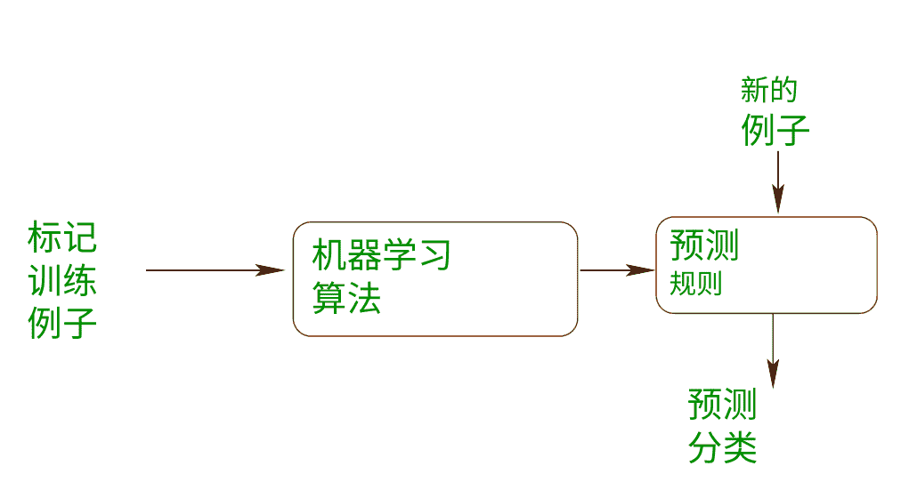

图1：典型学习问题的图表。

研究机器学习的另一个原因是希望它能提供对学习这一普遍现象的洞察。可能会回答的一些问题包括：

- 使得给定学习问题难以解决或容易解决的固有属性是什么？
- 为了能够有效地学习，您需要提前了解正在学习的内容有多少？
- 为什么“更简单”的假设更好？

本课程侧重于机器学习的理论方面。理论机器学习具有相同的目标。我们仍然对设计机器学习算法感兴趣，但我们希望通过数学分析来理解它们的效率。希望通过理论研究能够提供洞察和直觉，即使没有具体的算法，也能帮助设计实用的算法。通过理论，我们希望理解给定学习问题的固有难度。我们还试图解释观察到的使用学习算法的实际实验现象。

本课程强调机器学习的数学模型的研究，以及机器学习算法的设计和分析。主题包括：

- 学习所需的随机样本数量；
- 对实际算法的理论理解，包括提升和支持向量机；
- 从非随机样本中进行在线学习（包括投资组合选择）；
- 从样本中估计概率分布；
- 博弈论及其与学习的关系。

普林斯顿大学最相关的两门计算机科学课程是402（侧重于人工智能的核心领域）和424（侧重于数据的有效使用技术，包括机器学习、统计学和数据挖掘）。与511相比，这两门课程都提供了更广泛、更普遍的机器学习介绍，无论是在涵盖的主题上还是在理论和应用之间的平衡上都更广泛。

| 例子 | 标签 |
|---|---|
| 蚂蚁 | - |
| 蝙蝠 | + |
| 海豚 | - |
| 豹子 | + |
| 海狮 | - |
| 斑马 | + |
| 鲨鱼 | - |
| 老鼠 | + |
| 鸡 | - |
| **测试** | |
| 老虎 | |
| 金枪鱼 | |
| 鸭嘴兽 | |

图2：一个小型学习问题。

## 4 一个典型的学习问题

在一个典型的学习问题中，比如光学字符识别，我们的目标是创建一个能够识别手写字符的系统。但是我们并不直接解决这个问题，而是先收集大量的字符图像示例，这些示例被标记为代表的字母或数字。然后我们将这些示例输入到通用的学习算法中，该算法会生成一个能够分类新图像的预测规则（我们希望如此）。整个过程如图1所示。为了对学习有所了解，我们首先看了图2中所示的学习问题。

在这个例子中，示例被标记为正（“+”）或负（“-”）。在这种情况下，模式是“陆地哺乳动物”是正例，其他的是负例，尽管课堂上还提出了许多其他的建议。实际上，这个模式有点模糊，因为它可能是，例如，正例是不生活在海洋中且不产卵的动物。因此，测试示例“老虎”和“金枪鱼”分别是正例和负例，但我们只能猜测“鸭嘴兽”的正确标签（它是一种在溪流和河流中度过大部分生活的产卵哺乳动物）。

第二个例子显示在图3中。最初，例子被呈现为动物的名称，这个问题似乎很困难。当动物的名称被重新以每个字母在字母表中的位置来表示时，模式变得更加明显，也就是说，只有当第三个字母在字母表中的位置是奇数时，例子才是正例（例如，“elephant”中的第三个字母是“e”，它是字母表中的第五个字母，所以“elephant”是一个正例）。

关于这个实验有一些需要注意的事情。首先，更多的数据更好。例如，我们不确定鸭嘴兽应该是一个正例还是一个负例。然而，如果我们有更多的训练数据，包括例如胎生的非哺乳动物（如蝎子）或者生活在河流而不是海洋中的其他哺乳动物，我们可能能够更好地定义未知模式是什么。此外，许多其他竞争的关于第一个例子问题的建议可以通过更多的数据迅速排除。

| 例子 | 标签 |
|------|------|
| 训练 | |
| 土豚 → 1 1 18 4 22 1 18 11 | - |
| 牛 → 3 15 23 | + |
| 长颈鹿 → 7 9 18 1 6 6 5 | - |
| 白蚁 → 20 5 18 13 9 20 5 | - |
| 牡蛎 → 15 25 19 20 5 18 | + |
| 鸽子 → 4 15 22 5 | - |
| 蜘蛛 → 19 16 9 4 5 18 | + |
| 狗 → 4 15 7 | + |
| 大象 → 5 12 5 16 8 1 14 20 | + |
| 测试 | |
| 兔子 → 18 1 2 2 9 20 | |
| 青蛙 → 6 18 15 7 | |
| 袋鼠 → 11 1 14 7 1 18 15 15 | |

图3：第二个玩具学习问题。最初的例子是以动物名称的形式呈现的，如左列所示，但后来用每个动物名称的每个字母的相应数量进行了重写，如每个名称的右侧所示。

其次，尝试找到与数据一致的模式似乎非常自然，即找到“解释”所有观察到的训练数据的规则。实际上，当然可能无法找到与所有数据完全一致的规则，但我们仍然希望找到尽可能少犯错误的规则。

第三，寻求一条既一致又尽可能简单的规则似乎是自然的。例如，在第一个问题上，没有人满意的规则是，只有当动物以“b”或“l”或“z”或“m”开头时才是正面的（这与该问题的一个建议相差无几）。“简单性”的概念与我们对期望的规则类型的先验信念有关。当通过改变表示方式改变对第二个问题的观点时，看起来简单和自然的规则也发生了变化。

总的来说，学习成功需要满足三个条件。首先，我们需要足够的数据。其次，我们需要找到一条规则，在训练数据上犯错的次数尽可能少。第三，我们需要这条规则尽可能简单。需要注意的是，最后两个要求通常是相互冲突的：有时候我们只能选择一条更复杂的规则来减少错误，而选择一条简单的规则有时候可能会导致在训练数据上允许更多的错误。找到合适的平衡可能是机器学习中最核心的问题。

简单规则应该被优先考虑的观点通常被称为“奥卡姆剃刀”。

## 5 学习模型

为了在数学上研究机器学习，我们需要正式定义学习问题。这个精确的定义被称为学习模型。学习模型应该足够丰富，能够捕捉到真实学习问题的重要方面，但又足够简单，以便进行研究数学问题。与任何数学模型一样，简化假设是不可避免的。

一个学习模型应该回答几个问题：

- 正在学习什么？
- 数据是如何生成的？换句话说，它来自哪里？
- 数据如何呈现给学习者？例如，学习者一次看到所有数据，还是一次只看一个例子？
- 在这个模型中学习的目标是什么？

## 6 定义

在介绍我们的第一个学习模型之前，我们需要一些定义。一个例子（有时也称为实例）是正在被分类的对象。例如，在OCR中，图像就是例子。

通常，一个例子由一组属性描述，也称为特征、变量或维度。例如，在医学诊断中，一个患者可以通过属性（如性别、年龄、体重、血压、体温等）来描述。

标签或类别是我们试图预测的类别。例如，在OCR中，标签是表示可能的字母或数字。在训练过程中，学习算法会提供带有标签的示例，而在测试过程中，只提供未标记的示例。

为了尽可能简单，我们经常假设只有两个可能的标签，我们可以称之为0和1。我们还将做出简化的假设，即存在一个从示例到标签的映射。这个映射被称为一个概念。因此，一个概念是一个形式为$c: X \rightarrow \{0,1\}$的函数，其中X是所有可能示例的空间，称为域或实例空间。一组概念被称为一个概念类。我们经常假设示例由一个未知概念从一个已知概念类中标记。

## 7 一致性模型

我们的第一个学习模型，称为一致性模型，虽然有些不现实，但它直观，并且是一个很好的起点。许多想法在以后也会有价值。该模型捕捉到了这样一个直观的观点：从一组示例中推导出的预测规则应与它们的观察标签一致。

我们说一个概念类 $\mathcal{C}$ 在一致性模型中是可学习的，如果存在一个算法$A$，当给定任何一组标记示例 $(x_1, y_1), \ldots, (x_m, y_m)$，其中 $x_i \in X$ 且 $y_i \in \{0, 1\}$，找到一个与示例一致的概念 $c \in \mathcal{C}$（即 $c(x_i) = y_i$ 对于所有 $i$），或者（正确地）说不存在这样的概念。此外，我们对在这个模型中找到高效算法特别感兴趣。

下次，我们将看一下在这个模型中可学习或不可学习的概念类别的示例。

## 8 定义的回顾

我们现在主要关注分类问题。对于一个特定的分类问题，我们有来自 $X$ 的每个示例/实例，$X$ 是所有可能示例的更大空间，称为域空间或实例空间。每个示例都与一个标签相关，我们将其表示为 $y$。为简单起见，我们假设只有两个可能的标签。

### 8.1 概念和概念类别

我们试图学习的概念是一个未知函数，它将标签分配给示例。它采用形式 $c: X \rightarrow \{0, 1\}$。

一组概念称为概念类。我们经常假设示例是由已知概念类中的未知概念标记的。

### 8.2 一致性模型

如果存在一个算法$A$，当给定任何一组标记示例 $(x_1, y_1), \ldots, (x_m, y_m)$，其中$x_i \in X$且$y_i \in \{0, 1\}$，找到一个与示例一致的概念 $c \in \mathcal{C}$ （即 $c(x_i) = y_i$ 对于所有 $i$ ），或者（正确地）表示不存在这样的概念，我们称一个概念类C在一致性模型中是可学习的。

在接下来的几节中，我们将研究一些概念类别，并看看它们是否可学习。

## 9 布尔逻辑的两个例子

对于本节，我们考虑$n$位向量的实例空间：
$$X = \{0, 1\}^n, \quad \mathbf{x} = (x_1, \ldots, x_n)$$
每个 $n$位向量表示布尔变量的值。布尔变量的例子如下：

- $x_1 = $ “是鸟”
- $x_2 = $ “是哺乳动物”
- $x_3 = $ “生活在陆地上”
- $\vdots$
- 等等。

### 9.1 单调合取

假设我们的概念类是所有单调合取的集合。单调合取是我们的布尔变量的一些AND运算，其中不允许对布尔变量进行否定。在 $\mathcal{C}$ 中可能存在的一个概念是 $c(\mathbf{x}) = x_2 \land x_5 \land x_7$，它是一个接收一个 $n$ 位向量并输出0（或-）或1（或+）的函数。

| 例子 | 标签 |
|------|------|
| 01101 | + |
| 11011 | + |
| 00101 | - |
| 11001 | + |
| 11000 | - |

给定上述标记的示例，什么是与之一致的单调合取式？在这个小例子中，答案是 $x_2 \land x_5$。但是是否存在一种通用算法来找到一致的单调合取式？

考虑这个算法：我们首先只考虑正例，并且只保留所有条目都为'1'的列。例如，只有第二列和第五列都是1，所以我们的单调合取式是 $x_2 \land x_5$。

| 例子 | 标签 |
|------|------|
| 01101 | + |
| 11011 | + |
| 11001 | + |

然后，我们将这个单调合取式与负例进行评估。例如，在我们的负例00101上评估 $x_2 \land x_5$，结果是 $0 \land 1 = 0$。如果我们的单调合取式在所有负例上评估为0，则算法输出该概念；否则，算法表示不存在一致的概念。

这个算法正确吗？我们知道算法输出的任何概念都必须是一致的，因为它已经根据示例进行了检查，但是当算法说没有一致的概念时，我们如何确定这确实是情况呢？

我们注意到，与所有正例一致的任何单调合取式只能包含算法输出的布尔变量。这是因为所有其他布尔变量都被拒绝在至少一个正例中取值为0，所以如果我们包含任何这些布尔变量，概念将错误地将该正例标记为负例。在上面的例子中，我们不能将 $x_1$ 包含在合取式中，因为包含 $x_1$ 会导致概念错误地将正例“01101”标记为负例。出于类似的原因，我们也不能包含 $x_3$ 或 $x_4$。这意味着只有算法选择的布尔变量的子集与所有正例一致的单调合取式，即 $\{\}$， $\{x_2\}$， $\{x_5\}$， 和 $\{x_2, x_5\}$。

现在，我们已经找到了与所有正例一致的所有可能概念，我们希望选择一个与所有负例也一致的概念，如果可能的话。请注意，如果任何负例与所选布尔变量的单调合取一致，它也将与所选布尔变量的单调合取一致。例如，任何被评估为'0'的位向量在被评估为'0'的同时，$x_2$ 必须也被评估为'0'，同时也必须被评估为'0' $x_2 \land x_5$。这意味着如果所有所选布尔变量的单调合取与任何负例不一致，则与所有正例一致的单调合取也不会与该负例一致，因此不存在一致的概念。换句话说，如果存在一致的概念，算法会考虑到它，所以只有在真的没有一致的概念时，它才会声明没有一致的概念。

由于我们对单调合取概念类别有一个学习算法，我们可以得出结论，单调合取概念类别是可学习的。

### 9.2 单调析取

现在让我们考虑单调析取的概念类别。单调析取是我们的布尔变量的一些逻辑或运算，其中我们不允许对布尔变量进行否定。在 $\mathcal{C}$ 中可能的一个概念是 $c(\mathbf{x}) = x_2 \vee x_5 \vee x_{20}$。这个概念类别可学习吗？

再次考虑相同的示例集。使用德摩根定律，$x_1 \vee x_2 = \overline{\overline{x_1} \wedge \overline{x_2}}$，我们可以通过否定示例的位向量和标签将示例转换为单调合取形式：

| 例子 | 标签 |    | 例子 | 标签 |
| :--- | :--: | :-: | :--- | :--: |
| 0 1 1 0 1 |   +  | $\rightarrow$ | 1 0 0 1 0 |   -  |
| 1 1 0 1 1 |   +  | $\rightarrow$ | 0 0 1 0 0 |   -  |
| 0 0 1 0 1 |   -  | $\rightarrow$ | 1 1 0 1 0 |   +  |
| 1 1 0 0 1 |   +  | $\rightarrow$ | 0 0 1 1 0 |   -  |
| 1 1 0 0 0 |   -  | $\rightarrow$ | 0 0 1 1 1 |   +  |

现在我们只需要找到与转换后的示例一致的单调合取，并将合取翻转为析取，以获得原始示例的一致的单调析取。这意味着我们已经将从单调析取概念类别学习的问题简化为已经解决的从单调合取概念类别学习的问题，因此单调析取概念类别也是可学习的。

### 9.3 连词

现在让概念类别成为连词的集合，不一定是单调的。这意味着我们允许布尔变量被否定。例如，一个可能的连词是 $x_3 \land \overline{x_7} \land x_{10}$，其中 $\overline{x_7}$ 是被否定的变量。这个概念类别可学习吗？

再次观察，我们发现这个问题也可以简化为单调连词问题。对于每个位向量中的变量 $x_i$，我们添加一个新变量 $z_i = \overline{x_i}$，并将其附加到示例的位向量上，即 $(x_1, \ldots, x_n) \rightarrow (x_1, \ldots, x_n, z_1, \ldots, z_n)$。我们得到了这个转换后示例的一致单调连词。现在假设我们得到了单调连词 $x_3 \land z_7 \land x_{10}$；我们可以将其转换回一般连词 $x_3 \land \overline{x_7} \land x_{10}$。因此，连词的概念类别也是可学习的。

## 几何学中的3个例子

### 3.1 轴对齐矩形

现在让我们考虑平面上的点，\( X = \mathbb{R}^2 \)。每个点被分配一个标签 + 或 -。我们考虑轴对齐矩形的概念类 —— 每个概念是一个布尔函数，矩形内的点被标记为‘+’，矩形外的点被标记为‘-’。因此，学习问题是：给定一组带标签的平面上的点，找到一个轴对齐矩形，使得所有内部的点都是‘+’，所有外部的点都是‘-’（如下图中的虚线框）。

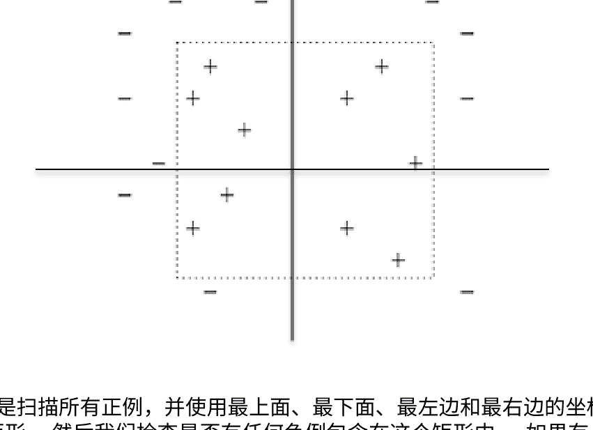

一种算法是扫描所有正例，并使用最上面、最下面、最左边和最右边的坐标来定义包围正例的最小矩形。然后我们检查是否有任何负例包含在这个矩形中 —— 如果有，我们说明没有一致的概念；否则，我们将该矩形输出为一致的概念²。因此，轴对齐矩形的概念类是可学习的。

### 3.2 半空间

让我们考虑在一个 \( n \) 维空间中的点，\( X = \mathbb{R}^n \)。同样，每个点都被分配一个标签 + 或 -。我们考虑半空间或线性阈值函数的概念类 —— 每个概念都是一个布尔函数，其中线性超平面的一侧的点被标记为‘+’，另一侧的点被标记为‘-’。我们想要找到的概念是一个将正例和负例分开的线性超平面（如下一页图表中的虚线）。

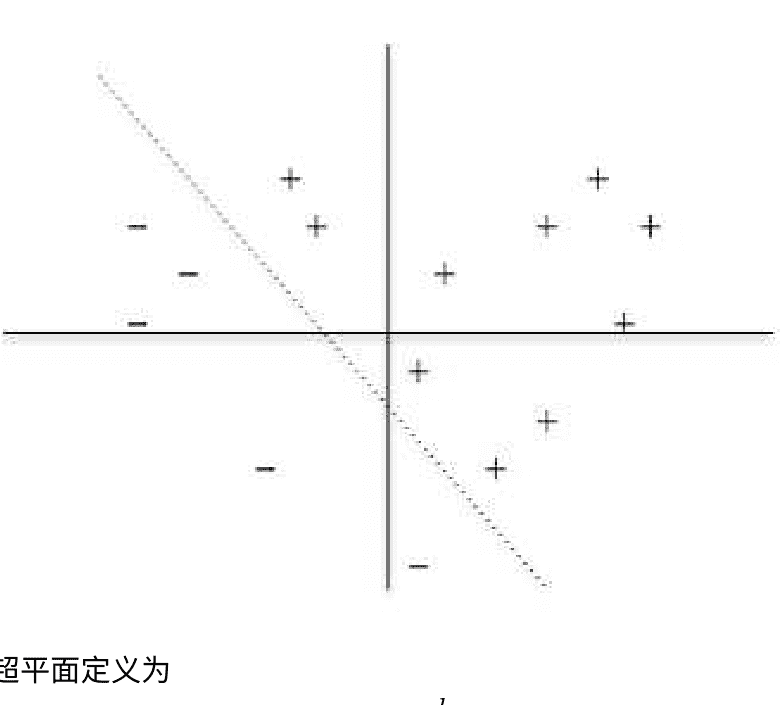

我们可以将超平面定义为

$\mathbf{w} \cdot \mathbf{x} = b$

其中 $\mathbf{w}$ 和 $b$ 是确定超平面的固定值。我们将 $\mathbf{x}_i$ 表示为第 $i$ 个示例， $y_i$ 表示相应的标签。代数上，我们试图做的是：

找到

$\mathbf{w} \in \mathbb{R}^n, b \in \mathbb{R}$

使得

$\forall i,$

$\mathbf{w} \cdot \mathbf{x}_i > b$ 如果 $y_i = 1$

$\mathbf{w} \cdot \mathbf{x}_i < b$ 如果 $y_i = 0$

这实际上是一个线性规划问题，已知可以高效地解决（有数学软件包可以很好地解决这类线性规划问题）。这表明半空间的概念类是可学习的。

² 注意找到尽可能少地包含域空间的概念，同时保持一致性的一般技巧。这个技巧以前用于单调合取。

## 4个布尔逻辑的更多例子

再次，我们的定义域空间是$n$位向量的集合。

### 4.1 k-CNF

合取范式（CNF）中的公式是合取的析取，或者是或的合取。例如，以下公式是一个CNF：

$(x_1 \vee x_3) \wedge (x_4 \vee \overline{x_2}) \wedge (x_2 \vee \overline{x_3} \vee x_6) \wedge (x_7)$

它包含文字，这些文字是布尔变量，可以是其否定形式或非否定形式，并且由子句（文字的逻辑或）组成，这些子句之间是逻辑与关系。对于一个 $k$-CNF，每个子句最多可以包含 $k$ 个文字，并且对公式中的子句数量没有限制。$k$被视为一个常数。上面的例子是一个3-CNF，因为最长的子句包含3个文字。

现在考虑 $k$-CNF的概念类。是否存在一种算法可以得出一致的概念？$^{3}$ 为了简单起见，让我们首先考虑2-CNF。找到一致的概念的一种方法是列出所有可能的文字对（包括布尔变量的否定和非否定形式），将其命名为新变量的逻辑或，并将其附加到示例的位向量上（类似于我们之前对非单调合取式所做的）。这将CNF转换为单调的合取$^{4}$，我们知道如何解决，一旦我们得到解决方案，我们可以通过替换回命名为变量的对来将其转换回2-CNF。对于更一般的 $k$-CNF，我们的新变量将包括所有大小不超过 $k$的文字集合的析取。因此， $k$-CNF的概念类也是可学习的。

### 4.2 2项DNF

在析取范式（DNF）中的公式是合取的析取，或者是AND的OR。它由一个项的合取组成，该合取由不受限制的文字数量的合取组成 - 每个项的大小可以任意大。注意与CNF的不同之处 - 这里限制的是“括号”的数量，而不是括号中的内容数量。正如名称所示， $k$项DNF只能包含最多 $k$个项。例如， $(x_1 \land x_3 \land x_4) \lor (x_2 \land x_3 \land x_6 \land x_7)$是一个2项DNF。现在我们考虑2项DNF的概念类。这个类可学习吗？

我们注意到合取在析取上的分配律 - 我们可以将2项的DNF“展开”，类似于我们如何乘两个多项式，但我们将OR视为乘法符号，将AND视为加法。所以，

$$(x_1 \land x_2 \land x_3) \lor (\bar{x}_2 \land x_4) = (x_1 \lor \bar{x}_2) \land (x_1 \lor x_4) \land (x_2 \lor \bar{x}_2) \land (x_2 \lor x_4) \land (x_3 \lor \bar{x}_2) \land (x_3 \lor x_4)$$

这意味着我们可以将任何2项的DNF转换为2-CNF。太好了！这意味着我们可以将2项的DNF问题简化为2-CNF吗？我们可以使用2-CNF算法生成一致的2-CNF，但不能保证它会产生一个可以因式分解为2项的DNF的2-CNF！我们能够将任何2项的DNF转换为2-CNF只是表明2项的DNF形成了2-CNF概念类的一个子集。即使我们找到了一致的2-CNF，也不能保证我们得到一致的2项的DNF。事实上，2项DNF学习问题是NP难问题，因此不太可能存在高效的学习算法。这是一个无法学习的概念类的例子。

### 4.3 一般DNF

现在我们考虑一般DNF的概念类，其中对DNF中的项数没有限制。这个能学习吗？考虑以下算法：对于每个正例，如果布尔变量的值为零，则取其否定形式，如果值为1，则取其非否定形式，并将所有这些文字进行AND运算形成一个项。例如：

| 例子 | 标签 | DNF术语 |
| :--- | :--- | :--- |
| 0 1 1 0 1 | + | $\bar{x_1} \land x_2 \land x_3 \land \bar{x_4} \land x_5$ |
| 1 1 0 1 1 | + | $x_1 \land x_2 \land \bar{x_3} \land x_4 \land x_5$ |
| 0 0 1 0 1 | - | - |

一旦我们获得了所有正例的术语，我们将它们进行OR运算以形成一个DNF。通过构造，这个DNF自动与所有正例一致。

然后，我们将这个DNF与负例进行一致性检查，如果一致，算法输出DNF；否则输出“没有一致的DNF”。由于这个算法有效，一般的DNF概念类是可学习的。

然而，这个算法似乎执行了一种不太令人满意的“学习”。首先，这个算法输出的DNF将把它之前没有见过的任何实例标记为负例！此外，算法输出的DNF与训练数据的大小相当。因此，实际上，这个“学习”算法只不过是一个查找表而已。

³ 请注意，这与CNF满足问题不同。在CNF满足问题中，我们从已知的CNF开始，尝试找到一个正例。在这里的学习问题中，我们从一堆例子开始，试图找到与所有例子一致的未知CNF。
⁴ 我们可能会得到不必要的项，例如 $x_1 \lor x_1$，但这并不重要，因为我们可以将其设置为0。

## 一致性模型的5个问题

我们在DNF示例中看到的一个问题是，一致性模型对算法学习的概念如何推广到新数据没有任何说明。尽管在一致性模型下，概念类似乎是可学习的，但它以一种不令人满意的方式进行，这似乎与我们通常所说的“学习”无关。

看起来，一致性模型对学习并没有提供太多信息！这表明我们需要一个新的模型。

## 概率概念的6个快速回顾

事件 —— 可能发生或不发生的事情。一个概率性的结果。
随机变量 —— 以概率方式取值的变量。具有分布。
分布 —— $Pr[X=x]$和 $\sum_{x} Pr[X=x] = 1$
期望值 —— $E[X] = \sum_{x} Pr[X=x] \cdot x$
$E[f(X)] = \sum_{x} Pr[X=x] \cdot f(x)$
期望的线性性 —— $E[X + Y] = E[X] + E[Y]$。始终。
条件概率 —— $Pr[a|b] = \frac{Pr[a \land b]}{Pr[b]}$
独立性 —— 如果 $Pr[a \land b] = Pr[a] \cdot Pr[b]$，则a和b是独立的。对于所有的随机变量$A, B$, 对于所有的$a, b$: $Pr[A = a \land B = b] = Pr[A = a] \cdot Pr[B = b]$（简写为 $Pr[A \land B] = Pr[A] \cdot Pr[B]$）。
如果$X, Y$是独立的， $\Rightarrow$ $E[XY] = E[X] \cdot E[Y]$
并集边界 —— $Pr[a \lor b] \leq Pr[a] + Pr[b]$

## 7 简介：PAC学习模型

我们的目标是在这个新模型中捕捉一些学习的概念。这意味着这个模型应该能够从较小的数据集推广到更大的数据集实例集。

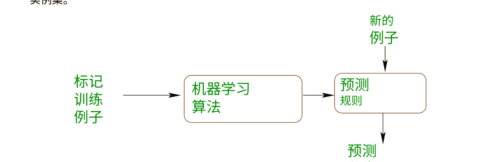

我们现在的目标是开发一个尽可能准确的假设——我们不太关心发现底层真相。我们需要考虑的一个重要问题是——例子从哪里来？我们需要假设这些例子在某种程度上是相关的——否则我们无法学习任何东西。在这个模型中，我们假设这些例子是从相同的分布中随机生成的（不一定是均匀分布）。

由于我们的目标是获得一个准确的假设，我们需要对“准确”进行精确定义。我们将泛化/真实误差定义如下：

$Pr_{x \sim D}[h(x) = c(x)] = err_D(h)$

其中 x是来自未知目标分布 D生成的一些示例，而 h是一个假设。我们通常假设不同的示例彼此独立（尽管这并不总是现实的，例如，在电子邮件垃圾邮件过滤器的情况下）。我们还假设训练示例和测试示例来自同一来源 - 即，它们是从相同的分布 D中抽取的。至于标签，为简单起见，我们假设只有两个可能的值。标签是根据某个未知概念 c : X → {0,1} 应用的，该概念来自已知的概念类 C。概述如下：已标记的

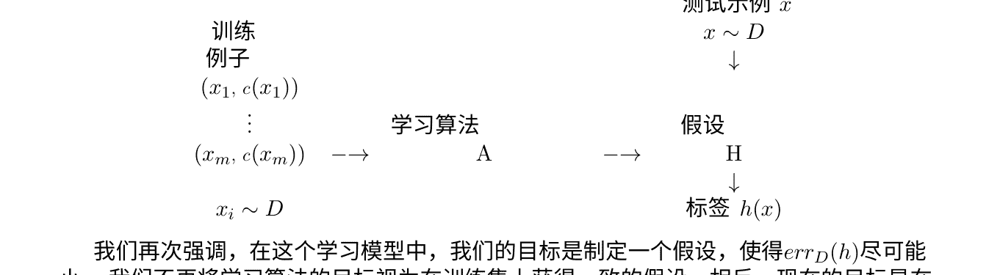

我们再次强调，在这个学习模型中，我们的目标是制定一个假设，使得err_D(h)尽可能小。我们不再将学习算法的目标视为在训练集上获得一致的假设。相反，现在的目标是在测试数据上表现良好的假设，至少是“近似正确”的。但由于训练样本被认为是随机抽取的，由于分布未知，训练集可能与源分布非常不相似。例如，光学字符识别程序在我们对其进行正常文本测试之前可能从未看到字母't'的情况是存在的，虽然不太可能但是有可能。为了能够对假设做出有用的判断，我们需要忽略那些可能完全破坏机器学习算法的极不可能事件。因此，准确的保证是“概率性的”。这为我们提供了“可能近似正确”（PAC）学习模型的基础。

下次，我们将更详细地介绍PAC学习模型。

## 1 可能近似正确（PAC）模型

目标概念类 C如果存在一个假设空间 H，使得存在一个算法 A，对于所有 c∈ C，任何目标分布 D，以及任何正数 ϵ和δ， A使用一个训练集 S = ((x1, c(x1)), (x2, c(x2)), ..., (xm, c(xm)))，其中 m =poly(1/ϵ, 1/δ, ...)个独立同分布的样本从 D中取出，并产生一个 h∈ H，使得 Pr[err_D(h) ≤ϵ] ≥ 1 − δ。

关于符号的几点评论。□被称为准确度参数，如果 err_D(h) ≤ ϵ，我们称其为ϵ-好的”，其中 err_D(h) 被称为真实误差或泛化误差。 δ是置信度参数。 .□和 δ是用户指定的参数（例如5%和1%）。“可能近似正确”这个名字来自于我们希望一个假设在高概率下近似正确（ϵ-好的）的事实。概率是基于 S的选择，它将决定算法选择哪个h。这是一个合理的目标，因为测试数据始终有很小的机会与 D非常不相似。

我们假设训练集和测试数据是从相同的分布D中抽取的。一般来说， H不一定与 C相同。最后，我们可能还希望 m是多项式的，其大小与每个示例或目标概念 c的大小成比例。

## 2 学习正半线

我们现在将看一系列可PAC学习的概念类的例子，从正半线类开始。在这个例子中，域 X是实数线，而 C = H = {正半线}。正半线由一个阈值（实数）定义：阈值左边的所有点标记为负，而阈值右边的所有点标记为正。

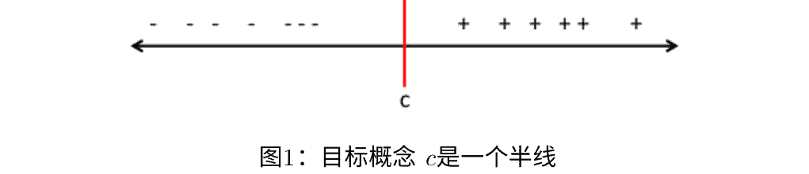

为了找到一个假设，我们只需选择与测试数据一致的某个 h。我们可以通过按升序扫描测试数据，直到找到最大的负标记点和最小的正标记点来实现这一点。然后我们在这个区间内的任意位置设置半线的阈值。注意，我们总是可以找到一个一致的 h，因为 H = C。

如图3所示， h的泛化误差将是落在目标概念 c和我们的假设 h之间的概率质量。该区域内的点将被标记由 $h$ 和 $c$ 不同地标记。任何位于 $h$ 和 $c$ 两侧的点将由 $h$ 和 $c$ 标记为相同。

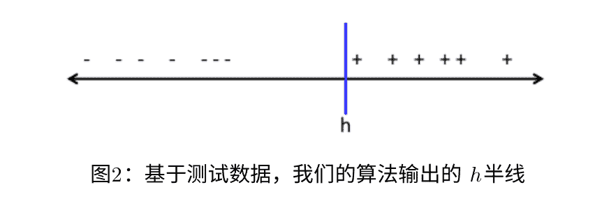

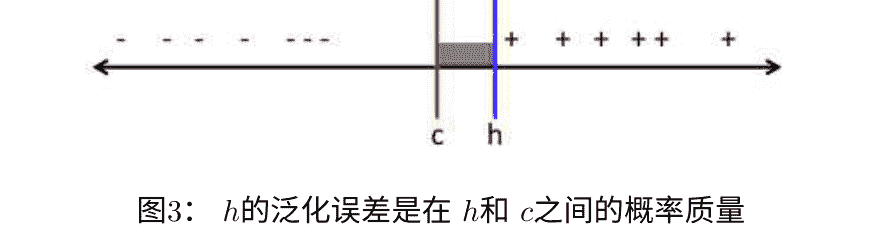

我们需要证明泛化误差在高概率下很低。等价地，我们可以证明 $\mathrm{Pr}[\mathrm{err}_D(h) > \epsilon] \leq \delta$。有两种情况下 $\mathrm{err}_D(h) > \epsilon$。设 $B_+$ 为 $h$ 在 $c$ 右侧超过 $\epsilon$ 概率质量的事件，$B_-$ 为 $h$ 在 $c$ 左侧超过 $\epsilon$ 概率质量的事件。

为了确定 $B_+$ 或 $B_-$ 发生的概率，我们在数轴上定义两个点，如图4所示。设 $r_+$ 是在 $c$ 右侧的一个点，使得区间 $[c, r_+]$ 有 $\epsilon$ 的概率质量。同样，设 $r_-$ 是在 $c$ 左侧的一个点，使得区间 $[r_-, c]$ 有 $\epsilon$ 的概率质量。

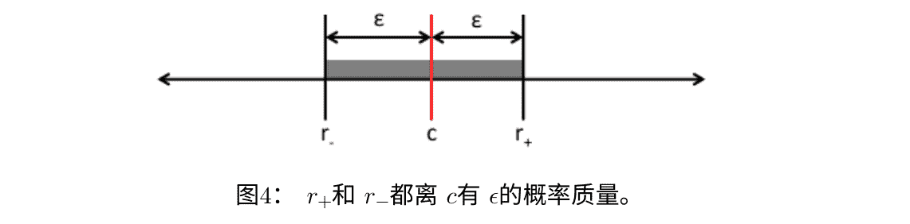

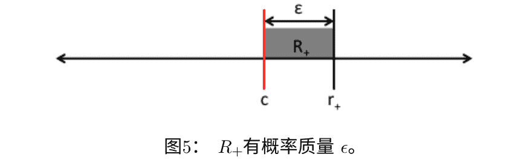

我们首先计算 $B_+$ 的概率。设 $R_+$ 为区间 $[c, r_+]$，其概率质量为 $\epsilon$。现在注意到 $B_+$ 只有在 $h$ 在 $r_+$ 右侧时才会发生，而这只有当所有的 $x_i \in R_+$ 时才会发生。如果任何一个训练点在 $R_+$ 中， $h$ 将在 $r_+$ 的左侧（因为训练点将具有正标签）。现在观察一下，$Pr[x_i \in R_+] \leq 1 - \epsilon$，因为 $R_+$ 的概率质量为 $\epsilon$。然后：

$Pr[B_+] = Pr[x_1 \in R_+ \land x_2 \in R_+ \land ... \land x_m \in R_+] \leq (1 - \epsilon)^m \quad (1)$

最后一个不等式是由于 $x_i$ 的独立性。还要注意，虽然 $x_i$ 是随机的， $R_+$ 是固定的，因为它取决于一个固定的 $c$。此外，根据对称性，$Pr[B_-] \leq (1 - \epsilon)^m$。现在我们可以限制 $err_D(h) > \epsilon$ 的概率。

$Pr[err_D(h) > \epsilon] \leq Pr[B_+ \lor B_-] \quad (2)$
$\leq Pr[B_+] + Pr[B_-] \quad \text{(并集边界)} \quad (3)$
$\leq 2(1 - \epsilon)^m \quad (4)$
$\leq 2e^{-\epsilon m} \quad (\forall x, 1 - x \leq e^{-x}) \quad (5)$

我们希望 $Pr[err_D(h) > \epsilon] \leq \delta$，所以我们设定 $(5) \leq \delta$ 并解出 $m$ 以得到 $m \geq \frac{1}{\epsilon} \ln \frac{2}{\delta}$。这表明 $C$ 可以通过 $H$ 进行 PAC 学习。

如果我们设定 $\delta = (5)$，我们可以写出等价的陈述：至少以概率 $1 - \delta$， $err_D(h) \leq \frac{1}{m} \ln \frac{2}{\delta}$。

## 3 学习间隔

我们下一个概念类 $C$ 是实线上的间隔集合。这也将是我们的假设空间 $H$。每个 $c \in C$ 指定了一个在实线上标记为正的间隔。间隔之外的所有点都标记为负。

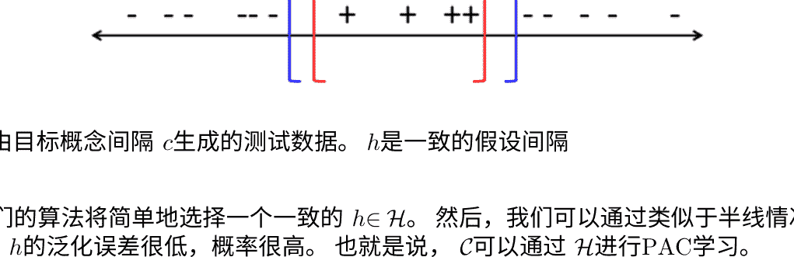

我们的算法将简单地选择一个一致的 $h \in H$。然后，我们可以通过类似于半线情况的论证证明 $h$ 的泛化误差很低，概率很高。也就是说，$C$ 可以通过 $H$ 进行 PAC 学习。

我们将简要总结这个论证。让 $c_l$ 是 $c$ 的左边界。我们在 $c_l$ 的两侧分别做一个概率质量为 $\frac{\epsilon}{2}$ 的间隔。然后分析将与半线情况相同，只是有一个常数因子的差异。我们对 $c$ 的右边界重复这个论证。最后，我们将对四个坏事件进行联合概率上界，每个事件的概率为 $e^{-\frac{\epsilon}{2} m}$。所以 $m \geq \frac{2}{\epsilon} \ln \frac{4}{\delta}$。

## 4 学习轴对齐矩形

我们最后一个例子将学习概念类 $C$ of 轴对齐矩形。我们将使用我们在上一堂课上讲过的算法，该算法找到与数据一致的最小轴对齐矩形。

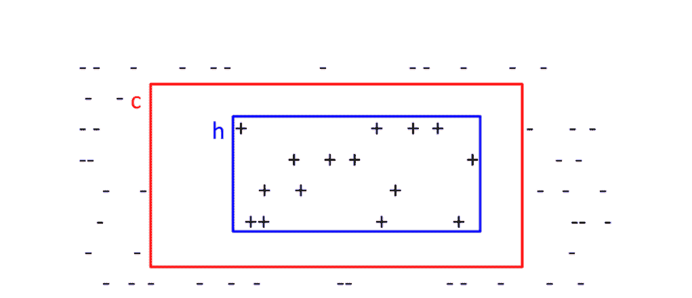

#### 图7: 由目标概念矩形 c 生成的测试数据。h是最小一致的矩形

为了限制泛化误差大于 $\epsilon$ 的概率，我们创建了四个“坏”区域，每个区域都是从 $c$ 的一个墙壁内部开始扩展矩形，直到该区域具有概率质量 $\epsilon/4$。这些矩形重叠并不重要。将这些区域称为 $R^1, ..., R^4$。接下来，我们使用类似于半线段情况的论证来限制每个区域中没有点落入的概率。让 $B_1, ..., B_4$ 分别表示没有点落入区域 $R_1, ..., R_4$ 的事件。那么：

$\begin{aligned} \Pr[\text{err}_D(h) > \epsilon] &\leq \Pr[B_1 \vee B_2 \vee B_3 \vee B_4] \quad &(6)\\ &\leq \Pr[B_1] + \Pr[B_2] + \Pr[B_3] + \Pr[B_4] \quad &\text{(并集边界)} \quad &(7)\\ &\leq 4(1 - \epsilon/4)^m \quad &(8)\\ &\leq 4e^{-\frac{\epsilon m}{4}} \quad &(9) \end{aligned}$

然后我们得到 $m \geq -\frac{4}{\epsilon} \ln \frac{4}{\delta}$。最后注意到，我们可以将这个论证扩展到任意维度的轴对齐超矩形。

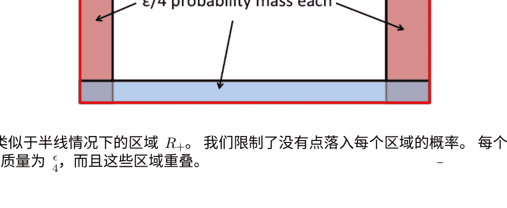

#### 图8: 类似于半线情况下的区域 R+。我们限制了没有点落入每个区域的概率。每个区域的概率质量为 ε/4，而且这些区域重叠。

¹ 如果该区域在达到概率质量 $\epsilon$ 之前撞到了 $c$ 的对立墙，然后我们简单地停止扩大该区域。因此，每个区域的概率质量最多为 $\epsilon/4$。

## 5 证明PAC结果的一般性

我们刚刚看到了几个例子，证明了针对每个问题定制的证明，证明了概念类是可PAC学习的。然而，如果我们有一种方法可以一般地证明PAC结果，那将更方便。幸运的是，对于有限假设空间（即 $|\mathcal{H}| < \infty$），存在这样一种方法。

**定理1.** 假设算法 $A$ 总是找到与 $m$ 个示例一致的假设 $h_A \in \mathcal{H}$，其中 $m \ge \frac{1}{\epsilon} (\ln |\mathcal{H}| + \ln \frac{1}{\delta})$。那么 $\Pr[\text{err}_D(h_A) > \epsilon] \le \delta$。

定理1的证明也将导致这个类似的陈述：至少以概率 $1 - \delta$，如果 $h_A$ 是一致的，那么 $\text{err}_D(h_A) \le \frac{1}{m} (\ln |\mathcal{H}| + \ln \frac{1}{\delta})$：这个陈述本质上是说，如果一个算法找到一个一致的假设，并且相对于假设空间的复杂性和 $\delta$ 使用足够的数据，泛化误差将会很低。

## 6 复杂性和 $|\mathcal{H}|$

定理1中的 $\ln |\mathcal{H}|$ 项是假设空间复杂性的度量。直观地说，我们可以理解对数项本质上是标记每个 $h \in \mathcal{H}$ 所需的比特数，这将是 $|\mathcal{H}|$ 的以2为底的对数。

我们在课堂上做了一个练习，以证明 $|\mathcal{H}|$ 的相关性。每个人都写下了自己选择的20个比特，对应于域上假设的输出。然后教授Schapire揭示了“训练”数据，这是一组10个位，对应于目标概念的输出 $\{1,2,...,10\}$。我们选择了在班级中训练误差最低的假设。然后我们评估了该假设对目标概念输出的10个位的性能，对应于 $\{11,12,...,20\}$。在我们的例子中，最好的假设的训练误差为10%，测试误差为10%。然而，由于Schapire教授使用随机硬币投掷确定他的位，一般来说，具有最佳训练误差的假设将具有预期的测试误差为50%。在一个大班级中，很可能找到一个训练误差较低的假设，但该假设的预期测试误差仍为50%。

这个练习的目的是为了证明，拥有更大的假设空间，尽管具有较差的泛化误差，但较差的假设仍有更大的机会与训练集匹配得很好。因此，假设空间中的复杂性往往会增加选择一个假设的概率，该假设仅仅是由于偶然原因在训练集上拟合得很好，但在测试数据上实际表现不佳。

**例子1.** 假设 $C$ 是在 $n$ 维度中的单调合取的集合。这也将是我们的假设空间。 $|\mathcal{H}|= 2^n$，因为每个变量可以包含或不包含在我们的假设中。由于我们上一堂课的算法找到了一个一致的假设，定理1暗示着如果 $m \ge \frac{1}{\epsilon}(n\ln 2 + \ln \frac{1}{\delta})$，那么 $\Pr[\text{err}_D(h_A) > \epsilon] \le \delta$。

由于 $m$ 只需要在 $\frac{1}{\epsilon}$, $\frac{1}{\delta}$, 和 $n$ 的规模上是多项式的，我们已经证明了单调合取范式是可PAC学习的类。

**例子2.** 现在假设 $C$ 是所有DNF的集合，并且让这也成为我们的假设空间。现在，由于我们可以将每个DNF看作一个布尔公式（给定变量的值，DNF输出两个答案之一），并且每个布尔公式都可以由DNF表示， $|\mathcal{H}|$ 只是 $n$ 变量上的布尔公式的数量，它是 $2^{2^n}$。使用定理1，我们得到 $m \geq \frac{1}{\epsilon}(\ln 2^{2^n} + \ln \frac{1}{\delta}) = \frac{1}{\epsilon}(2^n \ln 2 + \ln \frac{1}{\delta})$，这在变量的数量上是指数级的。这与我们上一节的结论一致，即DNF很可能无法通过少量数据高效学习。

一个非正式的方法来看待DNF类别可能无法高效学习的原因是看看我们上一节中用于学习DNF的算法。在那个算法中，我们为训练集中的每个正例都包含了一个子句。在最坏的情况下，这可能会给我们一个大小为 $O(mn)$ 的假设。如果我们用每个假设的大小来近似 $\ln |\mathcal{H}|$，那么误差就是 $\epsilon \geq \frac{O(mn) + \ln \frac{1}{\delta}}{m}$。

$\frac{1}{m} \geq cn$，其中 $c$ 是某个常数。这太大了，因为我们希望误差小于1。因此，我们先前的算法不能高效地学习DNFs。

总的来说，我们可以看到，如果我们的假设空间不太复杂，找到一个一致的假设将使我们能够用相对较少的数据达到低泛化误差。然而，这个结论并没有涉及计算效率的问题。即使只需要少量的数据，设计高效的学习算法可能也很困难。

## 1 学习界限的证明

为了理解下面的定理，假设存在一个假设 $h$，它是 $\epsilon$-坏的，并且在少量100个示例中至少犯了一个错误。因此，由于 $h$ 是 $\epsilon$-坏的，高概率下它将被淘汰，并且不会被算法选择。

通过并集界，我们将证明所有 $\epsilon$-坏的假设与该训练集不一致。

**定理.** 假设算法 $A$ 总是找到与 $m$ 个示例一致的假设 $h_A \in \mathcal{H}$，其中
$$m \geq \frac{1}{\epsilon} \left( \ln |\mathcal{H}| + \ln \frac{1}{\delta} \right)$$
那么
$$Pr[err_{\mathcal{D}}(h_A) > \epsilon] \leq \delta$$

基本假设是假设空间是有限的，即 $|\mathcal{H}|<\infty$，并且 $m$ 个样本是独立同分布的，相对于分布 $\mathcal{D}$。该定理提供了训练数据量 $m$ 需要达到低误差的上界，且置信度至少为 $1-\delta$。

**证明.** 我们的目标是限制 $h_A$ 是一致且 $\epsilon$-坏的概率，即 $h_A$ 的泛化误差大于 $\epsilon$。令 $\mathcal{B}=\{h\in\mathcal{H}: h \text{ 是 } \epsilon\text{-bad的}\}$ 为所有 $\epsilon$-bad假设的集合。（这里 $\mathcal{B}$ 是一个固定集合而不是随机变量。概念 $c$ 和分布 $\mathcal{D}$ 是固定的，因此在 $\mathcal{D}$ 上有误差的假设 $h$ 是固定的。唯一的随机变量是 $h_A$，它依赖于样本。$h_A$ 的一致性也是随机的。）

$$\begin{aligned}
Pr[h_A \text{ 是一致的且 } \epsilon\text{-bad}] &\leq Pr[\exists h \in \mathcal{H} : h \text{ 是一致的且 } \epsilon\text{-bad}] & (\because \text{if } A \Rightarrow B, \text{那么} Pr[A] \leq Pr[B]) \\
&= Pr[\exists h \in \mathcal{B} : h \text{ 是一致的}] \\
&= Pr \left[ \bigvee_{h \in \mathcal{B}} (h \text{ 是一致的}) \right] \\
&\leq \sum_{h \in \mathcal{B}} Pr[h \text{ 是一致的}] & (\text{通过并集边界}) \\
&= \sum_{h \in \mathcal{B}} Pr[h(x_1) = c(x_1) \wedge \ldots \wedge h(x_m) = c(x_m)] & (\text{通过一致性定义}) \\
&= \sum_{h \in \mathcal{B}} \prod_{i=1}^{m} Pr[h(x_i) = c(x_i)] & (\text{通过独立性}) \\
&\leq \sum_{h \in \mathcal{B}} (1 - \epsilon)^m & (\because h \in \mathcal{B} \Rightarrow Pr[h(x_i) = c(x_i)] \geq \epsilon) \\
&= |\mathcal{B}|(1 - \epsilon)^m \\
&\leq |\mathcal{H}|(1 - \epsilon)^m & (\because \mathcal{B} \subseteq \mathcal{H}) \\
&\leq |\mathcal{H}|e^{-\epsilon m} & (\because \forall x, (1 - x) \leq e^{-x}) \\
&\leq \delta & (\text{根据选择 } m)
\end{aligned}$$

否定 $Pr[\exists h \in \mathcal{H} : h \text{ 是一致的 } \& \ \epsilon\text{-bad}]$ 导致我们得出结论，概率大于等于 $1 - \delta$ 且 $\forall h \in \mathcal{H}$, 如果 $h$ 是一致的，那么
$$err_{\mathcal{D}}(h) \leq \epsilon = \frac{\ln |\mathcal{H}| + \ln \frac{1}{\delta}}{m} \quad\quad\quad\quad\quad\quad (1)$$
方程1以学习性能 $\delta$、假设空间大小 $|\mathcal{H}|$ 和训练样本数量 $m$ 为变量，捕捉了泛化误差的界限。

### 另一种证明方法

我们可以尝试消除泛化误差对假设数量 $|\mathcal{H}|$ 的依赖，具体步骤如下
$$\begin{aligned}
&Pr[err_{\mathcal{D}}(h_A) > \epsilon \mid h_A \text{ 是一致的}] \\
&= \frac{Pr[h_A \text{ 是一致的 } \mid err(h_A) > \epsilon] \, Pr[err(h_A) > \epsilon]}{Pr[h_A \text{ 是一致的}]} & (\text{根据贝叶斯定理}) \\
&= Pr[h_A \text{ 是一致的 } \mid err(h_A) > \epsilon] \, Pr[err(h_A) > \epsilon] & (\because Pr[h_A \text{ 是一致的}] = 1) \\
&\leq Pr[h_A \text{ 是一致的 } \mid err(h_A) > \epsilon] & (\because Pr[err(h_A) > \epsilon] \leq 1) \\
&= Pr[h_A(x_1) = c(x_1) \land \ldots \land h_A(x_m) = c(x_m) \mid err(h_A) > \epsilon] & (\text{根据一致性定义}) \\
&= \prod_{i=1}^{m} Pr[h_A(x_i) = c(x_i) \mid err(h_A) > \epsilon] & (\text{根据条件独立性}) \\
&\leq (1 - \epsilon)^m & (\because Pr[h(x_i) = c(x_i)] \geq \epsilon) \\
&\leq e^{-\epsilon m} & (\because \forall x, (1 - x) \leq e^{-x}) \\
&\leq \delta & (\text{如果 } m \geq \frac{\ln \frac{1}{\delta}}{\epsilon})
\end{aligned}$$

上述论证似乎是合理的，但实际上是错误的。在第一个证明中， $h$ 不是一个随机变量，因为我们在选择样本 $S$ 之前已经选择了它，因此在这种情况下使用独立性是有效的。然而，在这个替代证明中，假设 $h_A$ 是从样本 $S$ 生成的，因此是一个依赖于样本 $S$ 的随机变量。由于 $h_A$ 依赖于样本 $S$，给定 $h_A$ 是 $\epsilon$-bad，来自样本 $S$ 的样本不再是独立同分布的。因此，在上述证明中使用条件独立性是错误的，即
$$Pr[h_A \text{ 是一致的 } \mid err(h_A) > \epsilon] = \prod_{i=1}^{m} Pr[h_A(x_i) = c(x_i) \mid err(h_A) > \epsilon]$$

此外，$Pr[h_A \text{ 是一致的} \mid err(h_A) > \epsilon]$ 应该为1，因为我们假设 $h_A$ 始终是一致的。因此，在选择样本空间 $S$ 之前，必须小心选择假设（用于分析泛化误差）。

## 2 一致性通过PAC

在前一节中，我们已经看到如果我们可以在一致性模型中学习，那么我们可以在PAC模型中学习，前提是 $|\mathcal{H}|$ 不会太大。如果假设空间 $\mathcal{H}$ 与概念类 $\mathcal{C}$ 相同，那么概念类 $\mathcal{C}$ 被称为可以由 $\mathcal{H}$ 正确地PAC学习。现在我们将考虑相反的情况。

**命题.** 给定

- 一个能够正确地PAC学习概念类 $\mathcal{C}$ 的算法 $\mathcal{A}$，即给定一组随机样本，$\mathcal{A}$ 找到一个属于 $\mathcal{C}$ 的假设 $h$，使得假设的泛化误差最多为 $\epsilon$ 的概率很高。
- 一个样本 $S = \langle (x_1, y_1), \ldots, (x_m, y_m) \rangle$

我们可以使用算法 $\mathcal{A}$ 作为子程序来找到与样本 $S$ 一致的概念 $c \in \mathcal{C}$（如果存在）。

直观地说，由于 PAC 学习算法必须具有来自随机分布的示例，而 $S$ 不是一个随机集合，因此我们为其构造一个分布，并从中采样示例（用于输入算法 $\mathcal{A}$）。然后我们使用算法 $\mathcal{A}$ 得到一个假设 $h$，使得 $err_{\mathcal{D}}(h) \leq \epsilon$，并用它来证明 $h$ 是一致的。

**证明.** 给定 $m$ 个示例 $S$，我们构造一个在 $S$ 中均匀分布的分布 $\mathcal{D}$。我们选择 $\epsilon = \frac{1}{2m}$ 和任意所需的 $\delta > 0$。然后我们从分布 $\mathcal{D}$ 中选择 $m' = poly(\frac{1}{\epsilon}, \frac{1}{\delta})$ 个示例来运行算法 $\mathcal{A}$。这里 $m'$ 是 $\mathcal{A}$ 需要达到所需精度 $(1-\epsilon)$ 的示例数，且高概率为 $1-\delta$。

如果 $\mathcal{A}$ 输出假设 $h$，我们检查 $h$ 是否与 $S$ 一致。如果 $h$ 与 $S$ 一致，则输出假设 $h$（从而证明命题），否则（或者如果 $\mathcal{A}$ 未能生成假设），则我们说“无一致性”。数学上，如果存在与 $S$ 一致的 $c \in \mathcal{C}$，则至少以概率 $(1 - \delta)$（因为 $\mathcal{A}$ 是 PAC 学习算法），我们有
$$ err_{\mathcal{D}}(h) \leq \epsilon = \frac{1}{2m} < \frac{1}{m} $$
由于 $\mathcal{D}$ 是均匀的，分配给每个示例的概率是 $\frac{1}{m}$，因此泛化误差是 $\frac{1}{m}$ 的整数倍。根据方程2，这导致结论 $err_{\mathcal{D}}(h) = 0$，且 $h$ 一致。然而，如果不存在与S一致的 $c \in \mathcal{C}$，则算法 $\mathcal{A}$ 会以某种方式失败，即要么给出不一致的假设 $h$，要么通过说“无一致性”终止。

一致性和PAC可学习性是密切相关的概念。

## 3 无限假设空间的可学习性

上面显示的结果仅适用于有限的假设空间。仍然有各种各样的例子，例如正半线、矩形等，即使它们具有无限的假设空间，我们仍然可以学习。我们现在将讨论这些假设空间的特征，以确定什么使一个概念类C具有PAC可学习性。

#### 例子3.1. 正半线

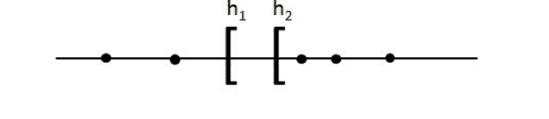

给定任何未标记的点数据集在x轴上，h1和h2在数据集上的行为完全相同。尽管对于这个例子可能存在无限多个假设，但是通过多个假设的相似性，我们可以将假设划分为有限的不同等价类。例如，下面是一组4个未标记示例的5种可能的标记/二分法/行为。


因此，一般来说，对于 $m$ 个未标记的示例，我们有 $(m+1)$ 个可能的等价类，与 $2^m$ 个可能的标记（假设有无限多个假设，但只有有限多个标记）相比。对于未标记的数据集 $[m+1 \ll 2^m]$。等价类/标记/二分法的数量如此之小，使得这个概念类的正半线是可PAC学习的。尽管假设空间是无限大的，但是有效的假设空间很小，是 $O(m)$。

#### 例子3.2. 正/负半线


这个案例与例子3.1类似，只是半线可以在标记点的任一侧将示例标记为正或负。为了计算有效的假设空间，我们将例子3.1的结果翻倍并减去2（以解决所有正标签和所有负标签的重复计数问题）。因此，有效的假设空间 = $2(m+1)-2 = 2m = O(m)$。

#### 例子3.3. 区间

概念类 $C$ 由将实轴上的点分类为正和在区间之外的点分类为负的概念组成（每个概念都有特定的区间）。

对于$m$个点，有$(m+1)$种方法可以放置区间边界的标记，因此选择这种格式的区间的方法数为$\binom{m+1}{2}$。为了考虑到空区间（可以放置在任意两个点之间），需要添加一个额外的值，因此有效的假设基数总数为$\binom{m+1}{2} + 1 \equiv O(m^2)$。或者，可以先选择一对点$\binom{m}{2}$，然后是单个点$m$，最后是空情况$1$，总计为$\binom{m}{2} + m + \binom{m}{1}$，计算结果相同。

总结上述示例的特征，我们有一个假设空间$\mathcal{H}$和一组未标记的示例$S = \langle x_1, x_2, \ldots, x_m \rangle$。因此，我们可以将$\mathcal{H}$在$S$上的所有可能行为/二分法/标记定义为
$$\Pi_{\mathcal{H}}(S) = \{\langle h(x_1), \ldots, h(x_m)\rangle : h \in \mathcal{H}\}$$

因此，对于示例3.1，我们得到 $|\Pi_{\mathcal{H}}(S)|=5$。现在我们可以定义一个关于$m$个样本的增长函数，以捕捉假设空间随着观察到更多样本而变得复杂的程度
$$\Pi_{\mathcal{H}}(m) = \max_{|S|=m} |\Pi_{\mathcal{H}}(S)|$$

直观上，我们希望使用$\Pi_{\mathcal{H}}(S)$作为一个有效的假设空间，并用$\ln |\Pi_{\mathcal{H}}(m)|$替换错误界限中的$\ln |\mathcal{H}|$。错误界限取决于增长函数，这意味着如果增长函数按照$2^m$增长，即$\forall m$, $\Pi_{\mathcal{H}}(m) = 2^m$，则我们将错误界限减小为$\sqrt{\frac{1}{m}(\ln|\mathcal{H}| + \ln\frac{1}{\delta})} = \sqrt{\frac{m \ln 2 + \ln\frac{1}{\delta}}{m}} \geq \sqrt{\ln 2}$。在这种情况下，学习是不可能的，因为我们正在处理类似于所有可能函数的东西。然而，我们将看到，对于所有假设空间来说，唯一可能的情况是增长函数按照$m$的多项式增长，即$\Pi_{\mathcal{H}}(m) = O(m^d)$。这里的$d$被称为$VC$-维度，错误界限不会爆炸。
$$\lim_{m \to \infty} \frac{d \ln m + \ln\frac{1}{\delta}}{m} \longrightarrow 0$$

因此我们观察到对于任何$\mathcal{H}$，要么$\Pi_{\mathcal{H}}(m) = 2^m$对于所有$m$，要么$\Pi_{\mathcal{H}}(m) = O(m^d)$对于某个常数$d$。

## 复习

上一堂课，我们证明了奥卡姆剃刀原理，即以至少$1-\delta$的概率，对于所有的$h \in \mathcal{H}$，如果$h$与从分布 $D$独立采样的所有 $m$个示例一致，那么泛化误差 $err_D(h) \leq \frac{\ln|\mathcal{H}|+\ln \frac{1}{\delta}}{m}$。然而，这个方程只适用于有限的假设空间，因为我们使用了 $\mathcal{H}$的基数。这导致我们在上周的讲座结束时简要讨论了奥卡姆剃刀原理在无限假设空间中的泛化问题。

## 无限假设空间的样本复杂度

为了将奥卡姆剃刀推广到无限假设空间，我们必须在一定程度上替换 $|\mathcal{H}|$。在这里，我们首先介绍一些新的概念和符号，这将简化后面的证明和讨论。

$$
\begin{aligned}
& S = \langle x_1, \cdots, x_m \rangle && (样本集)\\
& \Pi_{\mathcal{H}}(S) = \{\langle h(x_1), \cdots, h(x_m)\rangle : h \in \mathcal{H}\} && (在 \; S \; 上 \; \mathcal{H} \; 的所有可能二分法的集合)\\
& \Pi_{\mathcal{H}}(m) = \max_{S: |S|=m} |\Pi_{\mathcal{H}}(S)| && (增长函数)
\end{aligned}
$$

增长函数表示使用 $\mathcal{H}$中的假设对 $m$个点进行分类的最大不同方式的数量，这提供了另一种衡量假设集 $\mathcal{H}$复杂性的方法。我们将在后面证明 $\forall \mathcal{H}$要么：

- $\Pi_{\mathcal{H}}(m) = 2^m$ (对于PAC来说，无法获得足够的数据)
- 或者 $\Pi_{\mathcal{H}}(m) = \mathcal{O}(m^d)$ (对于PAC来说是可能的)

回想一下，我们的目标是用 $|\mathcal{H}|$替换Occam's Razor中的基数。现在清楚了一个与$\Pi_{\mathcal{H}}(m)$形式相似的增长函数是一个很好的候选。因此，我们的目标是将Occam's Razor修改为以下广义版本：

**定理：**
以至少 $1-\delta$的概率，对于$\mathcal{H}$中的每个$h$，如果 $h$与从分布 $D$独立采样的所有 $m$个示例一致，则泛化误差 $err_D(h) \leq \mathcal{O}\left(\frac{\ln \Pi_{\mathcal{H}}(2m)+\ln \frac{1}{\delta}}{m}\right)$。

在证明之前，我们首先介绍一些定义。让 $D$表示我们的目标分布， $S = \langle x_1, \cdots, x_m \rangle$表示从$D$独立选择的$m > 8/\epsilon$个点的样本。我们还引入了一个“幽灵样本”$S' = \langle x'_1, \cdots, x'_m \rangle$，它由独立同分布地从$D$中抽取的 $m$个点组成。

通过创建这个“幽灵样本”，我们使用“双重采样技巧”将 $S'$ 上的错误作为假设的泛化误差的代理。更重要的是，这样做可以避免处理可能无限的实例空间，同时能够对假设进行断言。$S'$ 被称为“幽灵样本”，因为它实际上并不存在，也不会提供给学习算法。我们还定义了：

- $M(h, S) = \text{假设 } h \text{ 在 } S \text{ 上的错误数量}$
- $B \equiv [\exists h \in \mathcal{H}: (h \text{ 在 } S \text{ 上一致}) \land (err_D(h) > \epsilon)]$
- $B' \equiv [\exists h \in \mathcal{H}: (h \text{ 在 } S \text{ 上一致}) \land (M(h, S') \geq \frac{m\epsilon}{2})]$

### 证明

我们的目标是证明 $Pr[B] \leq \delta$

### 步骤1： $Pr[B'|B] \geq 1/2$

为了证明这一点，假设 $B$ 成立，即存在在$S$上一致的$h$且$err_D(h) > \epsilon$。由于 $err_D(h) > \epsilon$，$M(h, S')$ 的期望值，即错误的概率乘以示例的数量，至少为 $m\epsilon$。通过Chernoff不等式（稍后在课程中讨论），我们可以证明 $Pr[M(h, S') < \frac{m\epsilon}{2}] \leq \frac{1}{2}$。因此，我们可以得出结论 $Pr[B'|B] \geq 1/2$。

### 步骤2： $Pr[B] \leq 2Pr[B']$

从 $A \land B \Rightarrow A$，我们可以证明：

$Pr[B'] \geq Pr[B \land B']$
$= Pr[B]Pr[B'|B]$ (通过乘法规则)
$\geq \frac{1}{2}Pr[B]$ (通过步骤1)

现在我们已经将原始问题简化为寻找 $Pr[B']$ 的上界。

现在，考虑两个实验来生成 $S$ 和 $S'$

实验1：像往常一样选择 $S$，$S'$（从 $D$ 中独立同分布选择）
实验2：首先像往常一样选择 $S$，$S'$（从 $D$ 中独立同分布选择），但对于 $i \in \{1,2,\cdots,m\}$，以0.5的概率交换样本 $x_i$ 在 $S$ 中的位置和 $x'_i$ 在 $S'$ 中的位置，并将得到的样本称为 $T$ 和 $T'$。

注意到 $T$, $T'$ 具有与 $S$, $S'$ 完全相同的分布，因为它们是从独立同分布中抽取的，所以实验1和实验2实际上是相同的。此外，我们定义：

- $B'' \equiv [\exists h \in \mathcal{H}: (h \text{ 在 } T \text{ 上一致}) \land (M(h, T') \geq \frac{m\epsilon}{2})]$
- $\equiv [\exists h \in \mathcal{H}: (M(h, T) = 0) \land (M(h, T') \geq \frac{m\epsilon}{2})]$

### 步骤3：$Pr[B''] = Pr[B']$

因为 $T$, $T'$ 的分布与 $S$, $S'$ 完全相同，所以 $Pr[B''] = Pr[B']$。

定义 $b(h) \equiv [h \text{ 与 } T \text{ 一致} \land M(h, T') \geq \frac{m\epsilon}{2}]$

### 步骤4：$Pr[b(h) | S, S'] \leq 2^{-m\epsilon/2}$

让我们将每个示例 $x$ 在 $S$ 和 $S'$ 中与一个位对应，如果 $h(x) = c(x)$ 则为0，如果 $h(x) \neq c(x)$ 则为1。在这一步中，我们希望限制构建一个只包含示例0的集合 $T$ 和一个只包含示例1的集合 $T'$ 的概率，这些集合是从标准过程中选择的（从 $D$ 中独立同分布地抽取）。我们将其表示为 $b(h)$：

$b(h) = (M(h, T) = 0) \wedge (M(h, T') \geq \frac{m\epsilon}{2})$

让 $r$ 表示从 $S$ 和 $S'$ 中恰好有一个1标记的点对的数量。

$Pr[b(h) | S, S'] \leq 2^{-m\epsilon/2}$ 可以通过以下三种情况来证明：

### 情况1：$\exists x_i, x_i'$，它们都被标记为1

在这种情况下，无论如何通过实验2交换 $S$ 和 $S'$ 中的示例，$T$ 中总会存在一个错误。因此，$Pr[M(h, T) = 0] = 0 \Rightarrow Pr[b(h) | S, S'] = 0$

| S | 1 1 0 0 1 |
| S' | 0 1 0 1 0 |

我们可以从上面的例子看出，无论如何将示例在 $S$ 中与示例在 $S'$ 下方交换，$S$ 中标记为1的最小数量将始终为1，因为第二列中有两个1。

| S | 0 1 0 0 0 |
| S' | 1 1 0 1 1 |

### 情况2：$r < \frac{m\epsilon}{2}$

在这种情况下，$Pr[b(h) | S, S']$ 也为0。这是因为为了使 $b(h)$ 为真，所有的 $r$ 错误都必须发生在 $T'$ 中，并且在 $T'$ 中标记为错误的总数是超过可能的，因为在每对$r$中只有一个错误且 $r < m\epsilon/2$。

### 情况3：$r \geq \frac{m\epsilon}{2}$

现在，错误的总数超过 $m\epsilon/2$，所以有可能 $b(h)$ 是真的。如上所述，实验2将以0.5的概率在 $S$ 和 $S'$ 中交换示例。由于这些事件是独立的，$Pr[b(h) | S, S'] = (2^{-1})^r \leq 2^{-m\epsilon/2}$。

现在，我们可以推导出 $Pr[b(h) | S, S']$ 的界限如下：

$Pr[b(h) | S, S'] \leq 2^{-m\epsilon/2}$

### 步骤5：$Pr[B''|S, S'] \leq \Pi_{\mathcal{H}}(2m)2^{-m\epsilon/2}$

让 $\mathcal{H}'$ 表示每个 $S$, $S'$ 的“代表性”假设空间，它是有限的。我们可以看到 $|\mathcal{H}'| = |\Pi_{\mathcal{H}}(S, S')| \leq \Pi_{\mathcal{H}}(2m)$。

我们现在可以证明 $Pr[B''|S, S'] \leq \Pi_{\mathcal{H}}(2m)2^{-m\epsilon/2}$ 如下所示：

$$
\begin{aligned}
Pr[B''|S, S'] &= Pr[\exists h \in \mathcal{H} : b(h)|S, S'] \\
&= Pr[\exists h \in \mathcal{H}' : b(h)|S, S'] \\
&\leq \sum_{h \in \mathcal{H}'} Pr[b(h)|S, S'] \quad \text{(通过并集边界)} \\
&\leq |\mathcal{H}'|2^{-m\epsilon/2} \quad \text{(来自步骤4)} \\
&\leq \Pi_{\mathcal{H}}(2m)2^{-m\epsilon/2}
\end{aligned}
$$

注意，上述第二步是正确的，因为如果 $b(h)$ 对于某个 $h \in \mathcal{H}$ 成立，它也将对于某个 $h \in \mathcal{H}'$ 成立，因为它们在 $S$ 和 $S'$ 上的行为相同（$b(h)$ 仅取决于 $S$ 和 $S'$）。

### 步骤6：$Pr[B''] \leq \Pi_{\mathcal{H}}(2m)2^{-m\epsilon/2}$

通过边缘化（$Pr[a] = \mathbb{E}_{X}[Pr[a|X]]$），我们可以证明：

$$
\begin{aligned}
Pr[B''] &= \mathbb{E}_{S,S'}[Pr[B''|S, S']] \\
&\leq \Pi_{\mathcal{H}}(2m)2^{-m\epsilon/2} \quad \text{(通过边缘化)}
\end{aligned}
$$

通过上述六个步骤，我们最终可以证明：

$$
\begin{aligned}
Pr[B] &\leq 2Pr[B'] = 2Pr[B''] \\
&\leq 2\Pi_{\mathcal{H}}(2m)2^{-m\epsilon/2} \\
&\leq \delta
\end{aligned}
$$

现在，通过求解上述不等式对于 $\epsilon$ 的解，我们可以看到上述不等式在 $\epsilon \leq \frac{2}{m}(\lg \Pi_{\mathcal{H}}(2m) + \lg \frac{1}{\delta} + 1) = \mathcal{O}\left(\frac{\ln \Pi_{\mathcal{H}}(2m)+\ln \frac{1}{\delta}}{m}\right)$ 时成立，这就是我们试图证明广义奥卡姆剃刀的误差界限。

通过用增长函数 $\Pi_{\mathcal{H}}(2m)$ 替换 $|\mathcal{H}|$，我们现在证明了关于增长函数的一个界限，这个界限与泛化有关。当增长函数的形式为 $\mathcal{O}(m^d)$ 时，我们有一个有用的界限。我们稍后会看到这种增长函数形式何时发生。

## VC-维度

在课程结束时，我们还简要讨论了VC-维度（Vapnik-Chervonenkis维度）。为了定义假设集 $\mathcal{H}$ 的VC-维度，我们首先需要引入“破碎”的概念。如果假设集 $\mathcal{H}$ 能够实现 $S$ 的所有标记，即 $|\Pi_{\mathcal{H}}(S)| = \Pi_{\mathcal{H}}(m) = 2^m$，则大小为$m$的集合$S$被 $\mathcal{H}$ 破碎。而假设集 $\mathcal{H}$ 的VC-维度是能够完全被 $\mathcal{H}$ 破碎的最大集合的基数：

$$VCdim(\mathcal{H}) = \max\{m : \Pi_{\mathcal{H}}(m) = 2^m\}$$

我们现在来看一个例子 $\mathcal{H} = \{\text{区间}\}$：

图1: $\mathcal{H}$ 包含产生 $S$ 中每个点的所有可能标记的假设。因此，$\mathcal{H}$ 破碎 $S$, VCdim $\geq 1$

图2: $\mathcal{H}$ 包含产生 $S$ 中每两个点的所有可能标记的假设。因此，$\mathcal{H}$ 破碎 $S$, VCdim $\geq 2$

图3: 当 $S$ 是一个包含3个点的集合时， $\mathcal{H}$ 不能包含能够标记这种情况的假设。因此， $\mathcal{H}$ 不能破碎 $S$，VCdim < 3

从这个例子中我们可以看出，当 $S$ 包含一个点和两个点时， $\mathcal{H}$ 可以破碎 $S$，但不能破碎三个点。因此，VCdim($\mathcal{H}$) = 2

## 1 VC维度

上次我们证明了一个定理，即以高概率 $1 - \delta$，泛化误差由以下公式给出
$$\text{err}(h) \leq \mathrm{O}\left(\frac{\ln \Pi_{\mathcal{H}}(2m) + \ln 1/\delta}{m}\right) \tag{1}$$
其中 $\Pi_{\mathcal{H}}(m)$ 是增长函数。我们还定义了破碎的概念，即如果 $\mathcal{H}$ 能够破碎 $S$，那么 $|\Pi_{\mathcal{H}}(S)| = 2^{|S|}$。最后，我们定义了VC维度，或者Vapnik-Chervonenkis维度，它是最大破碎集合的基数。在本讲座中，我们将推导增长函数的界限，即 $\mathrm{O}(m^d)$ 或者 $2^m$。

### 1.1 VC-维度的例子

这里有一些通用结果：

- VC-维度(区间) = 2
- VC-维度(轴对齐矩形) = 4
- VC-维度(超矩形在 $\mathbb{R}^n$中) = $2n$
- VC-维度(LTF在 $\mathbb{R}^n$中) = $n + 1$

注意，LTF表示线性阈值函数（或感知器），它被定义为具有参数 $\mathbf{w}$ 的半空间，其中该空间中的每个点都被定义为“+”。形式上，
$$c_{\mathbf{w}}(x) = \begin{cases} 1 & \text{如果 } \mathbf{w} \cdot \mathbf{x} \geq b \\ 0 & \text{如果 } \mathbf{w} \cdot \mathbf{x} < b \end{cases} \tag{2}$$
点号表示内积。如果 $b$ 被强制为0，则VC-维度减少为 $n$。通常情况下，VC-维度等于一个概念的自由参数的数量（例如，矩形的参数是其最上边界、最下边界、最左边界和最右边界，其VC-维度为4）。然而，并不总是成立；存在具有1个参数但无限VC-维度的概念。

VC-维度和基数之间也存在不等式关系。如果VC-维度是 $d$，那么存在一个大小为 $d$ 的破碎集合，$\mathcal{H}$ 可以实现所有可能的标记。因为对于每个标记，必须存在一个对应的假设，我们有 $|\mathcal{H}| \geq 2^d$，这给出了：
$$\text{VC-dim}(\mathcal{H}) \leq \lg |\mathcal{H}| \tag{3}$$

## 1.2 确定VC维度

在上一节中，我们声称VC-dim(轴对齐矩形) = 4。现在我们展示如何证明它。证明包括两个步骤：首先，我们通过展示存在一个4点集合被概念集合破碎（值得注意的是，并非每个4点配置都可以被破碎，但我们只需要一个来证明这个说法）。然后，我们证明不存在一个可以被破碎的5点集合。

-   证明：（1）图1显示了一个具有所有典型标记和相应实现的4点集。因此，我们有VC维≥4。
    （2）对于任意的5点集，我们可以通过以下方式构建数据分配：选择最上方、最下方、最左边和最右边的点，并给它们标记“+”。因为有5个点，必定还有一个点剩下，我们将其分配为“-”。包含所有“+”点的任何矩形必定包含“-”点，这是一种无法破坏的情况。这证明了VC维<5。

总之，VC维（轴对齐矩形）=4。

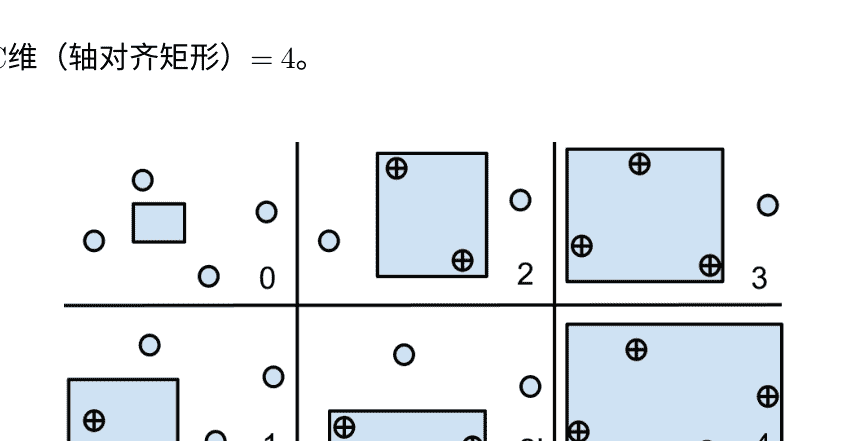

图1：证明矩形概念空间至少可以破坏4个点

## 2 Sauer引理

Sauer引理提供了一个由VC维 $d$ 参数化的 $\Pi_{\mathcal{H}}(m)$ 的上界，其中 $\mathcal{H}$ 的VC维为 $d$。它还导致了生长函数要么是 $O(m^d)$，要么是 $2^m$ 的证明。在本节中，我们将使用二项式系数的这些定义和事实：

$$
\binom{m}{k} = 0 \quad \text{如果 } k < 0 \text{ 或 } k > m \tag{4}
$$

$$
\binom{m}{k} = \binom{m-1}{k-1} + \binom{m-1}{k} \tag{5}
$$

$$
(a+b)^m = \sum_{k=0}^{m} \binom{m}{k} a^k b^{m-k} \tag{6}
$$

> 引理 2.1 (Sauer引理) 假设 $\mathcal{H}$ 是一个具有 VC-dim($\mathcal{H}$) = $d$ 的假设集。那么，对于所有 $m \in \mathbb{N}$，以下不等式成立：

$$
\Pi_{\mathcal{H}}(m) \le \Phi_d(m) = \sum_{i=0}^{d} \binom{m}{i} \tag{7}
$$

证明：证明通过对 $m + d$ 的归纳进行。基本情况如下：

•   当 $m = 0$ 时，对于任何 $d$ 个点，在空间中每个点只有一个可能的标签。所以在这种情况下 $\Pi_{\mathcal{H}}(0) = 1 = \binom{0}{0} = \Phi_d(0)$。

•   当 $d = 0$ 时，对于任意的 $m$，只有一种标记。所以 $\Pi_{\mathcal{H}}(m) = 1 = \sum_{i=0}^{0} \binom{m}{i} = \Phi_0(m)$。

当 $m \ge 1$ 且 $d \ge 1$ 时，假设引理对于任意的 $m'$ 和 $d'$ 成立，如果 $m' + d' < m + d$。假设 $S = \{x_1, ..., x_m\}$；我们现在证明 $\Pi_{\mathcal{H}}(S) \le \Phi_d(m)$。我们首先创建另外两个假设空间：首先，我们通过将 $\mathcal{H}$ 中的概念集合限制在集合 $S' = \{x_1, ..., x_{m-1}\}$ 来构建 $\mathcal{H}_1$。图2展示了构建的一个例子：假设 $\mathcal{H}$ 中有一个概念将 $(x_1, x_2, x_3, x_4, x_5)$ 映射到 $(0, 1, 1, 0, 1)$，通过将这个概念在域 $(x_1, x_2, x_3, x_4)$ 上限制，我们创建了一个新的概念在 $\mathcal{H}_1$ 中，将 $(x_1, x_2, x_3, x_4)$ 映射到 $(0, 1, 1, 0)$。

在这个构造中，一些概念对可能会在 $\mathcal{H}_1$ 中合并成单个概念。$\mathcal{H}_2$ 是通过将所有这些合并的概念包含在内来获得的，在构造 $\mathcal{H}_1$ 时。如图2所示，当概念 $(0, 1, 1, 0, 1)$ 和 $(0, 1, 1, 0, 0)$ 在 $\mathcal{H}_1$ 中合并为一个概念 $(0, 1, 1, 0)$，我们在 $\mathcal{H}_2$ 中添加另一个 $(0, 1, 1, 0)$ 的副本。注意，$\mathcal{H}_1$ 和 $\mathcal{H}_2$ 都是在域 $(x_1, ..., x_{m-1})$ 上定义的。

现在我们推导出这两个新假设空间的大小的界限。

•   任何被 $\mathcal{H}_1$ 打碎的子集 $T \subseteq S'$ 也被 $\mathcal{H}$ 打碎。因此，VC-dim($\mathcal{H}_1$) $\le$ VC-dim($\mathcal{H}$) = $d$。根据归纳假设，$|\mathcal{H}_1| = |\Pi_{\mathcal{H}_1}(S')| \le \Phi_d(m - 1)$。

•   还要注意，VC-维度($\mathcal{H}_2$) $\le d-1$，因为对于任意 $T \subseteq S'$ 被 $\mathcal{H}_2$ 打碎，$T \cup \{x_m\}$ 被 $\mathcal{H}_1$ 打碎。所以 $|\mathcal{H}_2| = |\Pi_{\mathcal{H}_2}(S')| \le \Phi_{d-1}(m - 1)$。

| $\mathcal{H}$ |   |   |   |   |   | $\mathcal{H}_1$ |   |   |   |   | $\mathcal{H}_2$ |   |   |   |
| :---: | :---: | :---: | :---: | :---: | :---: | :---: | :---: | :---: | :---: | :---: | :---: | :---: | :---: | :---: |
| $x_1$ | $x_2$ | $x_3$ | $x_4$ | $x_5$ |   | $x_1$ | $x_2$ | $x_3$ | $x_4$ |   | $x_1$ | $x_2$ | $x_3$ | $x_4$ |
| 0 | 1 | 1 | 0 | 0 | $\longrightarrow$ | 0 | 1 | 1 | 0 |   |   |   |   |   |
| 0 | 1 | 1 | 0 | 1 | $\longrightarrow$ |   |   |   |   | $\longrightarrow$ | 0 | 1 | 1 | 0 |
| 0 | 1 | 1 | 1 | 0 | $\longrightarrow$ | 0 | 1 | 1 | 1 |   |   |   |   |   |
| 1 | 0 | 0 | 1 | 0 | $\longrightarrow$ | 1 | 0 | 0 | 1 |   |   |   |   |   |
| 1 | 0 | 0 | 1 | 1 | $\longrightarrow$ |   |   |   |   | $\longrightarrow$ | 1 | 0 | 0 | 1 |
| 1 | 1 | 0 | 0 | 1 | $\longrightarrow$ | 1 | 1 | 0 | 0 |   |   |   |   |   |


总结一下，

$$
\begin{aligned}
|\Pi_{\mathcal{H}}(S)| &= |\mathcal{H}_1| + |\mathcal{H}_2| \\
&\le \Phi_d(m-1) + \Phi_{d-1}(m-1) \\
&= \sum_{i=0}^{d} \binom{m-1}{i} + \sum_{i=0}^{d-1} \binom{m-1}{i} \\
&= \sum_{i=0}^{d} \left[ \binom{m-1}{i} + \binom{m-1}{i-1} \right] \quad \text{(方程5)} \\
&= \sum_{i=0}^{d} \binom{m}{i} \quad \text{(方程4)}
\end{aligned}
$$

这样就完成了证明。 $\square$

现在我们来证明 $\Phi_d(m)$ 的上界：如果 $m \ge d \ge 1$，那么
$$
\Phi_d(m) \le \left( \frac{em}{d} \right)^d = O(m^d)
$$

证明：根据定义， $\Phi_d(m) = \sum_{i=0}^d \binom{m}{i}$ 。我们在两边都乘以 $(d/m)^d$ 得到，

$$
\begin{aligned}
\left( \frac{d}{m} \right)^d \Phi_d(m) &\le \sum_{i=0}^d \binom{m}{i} \left( \frac{d}{m} \right)^i \\
&\le \sum_{i=0}^d \binom{m}{i} \left( \frac{d}{m} \right)^i \quad \text{(因为 } d/m \le 1 \text{)} \\
&= \sum_{i=0}^d \binom{m}{i} \left( \frac{d}{m} \right)^i \quad \text{(因为 } d \le m \text{)} \\
&\le \sum_{i=0}^m \binom{m}{i} \left( \frac{d}{m} \right)^i \\
&= \left( 1 + \frac{d}{m} \right)^m \quad \text{(二项式定理, 方程6)}
\end{aligned}
$$

由此可得 $\Phi_d(m) \le (em/d)^d$。 $\square$

推论2.2 设 $\mathcal{H}$ 为具有 VC-dim($\mathcal{H}$) = $d$ 的假设空间。 那么对于所有 $m \ge d \ge 1$，
$$
\Pi_{\mathcal{H}}(m) \le \left( \frac{em}{d} \right)^d = O(m^d)
$$

该证明直接来自Sauer引理，其中 $\Pi_{\mathcal{H}}(m) \le \Phi_d(m)$ 和我们刚刚证明的事实。 通过这个推论，我们可以证明增长函数只有两种行为：要么VC-dim($\mathcal{H}$) = $d < \infty$, 在这种情况下 $\Pi_{\mathcal{H}}(m) = O(m^d)$, 要么VC-dim($\mathcal{H}$) = $\infty$, 在这种情况下 $\Pi_{\mathcal{H}}(m) = 2^m$ 对于所有 $m \ge 1$。

最后，我们能够使用VC维度来表达泛化界限：

定理2.3 设 $\mathcal{H}$ 为一个假设空间，其VC维度为 $VC\text{-}dim(\mathcal{H}) = d$。以至少 $1 - \delta$ 的概率，对于所有的 $h \in \mathcal{H}$，如果 $h$ 与从分布 $D$ 独立采样的所有 $m$ 个样本 ($m \ge d \ge 1$) 一致，则泛化误差为
$$
err_D(h) \le \frac{2}{m} \left( d \lg \frac{2em}{d} + \lg \frac{1}{\delta} + 1 \right)
$$
这直接来自于推论2.2和我们之前的界限。

## 3 下界？

VC维度还为可学习性提供了必要条件。从这个意义上说，也可以证明在PAC模型中学习到给定精度所需的示例数量的下界。不同之处在于，不再关注假设空间 $\mathcal{H}$，我们评估概念类 $\mathcal{C}$ 的VC维度。
假设我们正在使用概念类 $\mathcal{C}$ 并且 $VC\text{-}dim(\mathcal{C}) = d$，这意味着存在一个大小为 $d$ 的集合 $\{z_1, ..., z_d\}$，被概念类 $\mathcal{C}$ 所破坏。一个自然的下界是 $d$。直觉上，即使我们给出 $z_1, ..., z_{d-1}$，我们仍然缺乏最后一个点所传达的信息；最后一个点的两种标记仍然是可能的。为了严格证明它，我们需要回到PAC可学习性的定义。

声明3.1 对于任何 $PAC$ 学习概念类 $\mathcal{C}$ 的算法 $A$，如果给出 $d/2$ 个示例，那么 $err(h_A)$ 具有高概率的大泛化误差。

下面给出了一个错误的证明：

在PAC学习设置中，存在一个目标分布 $D$。为了使事情尽可能糟糕，我们可以选择任何分布。因此，我们将 $D$ 定义为破碎集合 $z_1, ..., z_d$ 上的均匀分布。然后我们从 $D$ 中随机选择 $d/2$ 个样本来运行一些候选算法 $A$。该算法将输出假设 $h_A$。选择与训练集 $S$ 上的标签一致的 $c \in \mathcal{C}$。让剩下的样本被错误地标记，即选择 $c(x)$ 使得对于所有 $x \in S$， $c(x) = h_A(x)$。然后 $err(h_A)$ 等于 $1/2$，因为 $h_A$ 在破碎集合中至少错误分类一半的点。

这是错误的，因为该证明在选择训练样本之后才欺骗性地选择概念 $c$ (我们可以对 $h$ 这样做，但不能对 $c$ 这样做)。我们将在下次展示一个正确的证明。

## 1 一个关于样本复杂度的下界

在上一节课中，我们证明了关于PAC学习涉及VC维度所需示例数量的上界。然后我们开始讨论VC维度也为学习提供了一个下界。虽然上界给出了PAC学习的充分条件，但下界给出了必要条件，即如果示例太少，则概念是不可PAC学习的。

上次，我们给出了一个错误的下界证明。我们生成一个随机训练集，然后从C中选择一个概念，该概念的标签与我们的假设给出的预测完全相反。这是作弊的，因为概念必须在生成训练集之前选择。接下来，我们给出一个正确的下界证明：

定理1. 令 $d$ = VC-dimension($\mathcal{C}$)。对于任何算法 $A$，存在分布 $D$ 和一个概念 $c \in \mathcal{C}$，使得如果 $A$ 被给予 $m \le d/2$ 个示例的样本 $S$，则
$$
\Pr[err(h_A) > \frac{1}{8}] \geq \frac{1}{8}
$$

*另一种（更粗糙的）陈述：如果 $\epsilon \leq 1/8$ 并且 $\delta \leq 1/8$，则我们需要超过 $d/2$ 个示例来进行PAC学习。

证明。根据VC维度的定义，我们知道存在由 $\mathcal{C}$ 破碎的点 $z_1, ..., z_d$。让 $D$ 在 $z_1, ..., z_d$ 上均匀分布。让 $\mathcal{C}' \subseteq \mathcal{C}$ 对于破碎点 $z_1, ..., z_d$ 有一个代表。然后我们知道 $|\mathcal{C}'| = 2^d$。然后我们从 $\mathcal{C}'$ 中随机均匀选择一个 $c$。

让我们思考两个关于如何生成变量的实验：

-   实验1：
    -   从 $\mathcal{C}'$ 中随机均匀选择一个 $c$。
    -   $S$ 根据随机选择（根据 $D$）并由 $c$ 标记。
    -   $h$ 从 $S$ 计算得到 $A$。
    -   测试点 $x$ 从 $D$ 中选择。
    -   我们试图测量：$\Pr[h_A(x) = c(x)]$。
-   实验2：选择 $S$ 的未标记部分。
    -   为 $x_i \in S$ 选择随机标签 $y(x_i)$。
    -   $h$ 从标记的 $S$ 计算得到 $A$。
    -   测试点 $x$ 被选择。
    -   如果 $x \notin S$，则随机均匀选择标签 $c(x)$。
    -   我们试图测量：$\Pr[h_A(x) = c(x)]$。

尽管上述两个实验中的顺序相反，但我们声称它们产生相同的随机变量分布和相同的概率测度。这是因为未标记的样本 $S$ 独立于标签的选择生成，并且 $x$ 的标签也是独立于样本 $S$、其他点的标签和假设的预测选择的。因此，在这两个实验中，概率是给定随机变量概念 $c$、样本 $S$ 和测试点 $x$ 的。我们将其表示为 $\Pr_{c,S,x}[h_A(x)=c(x)]$。

让我们来做实验2，我们有

$$
\begin{aligned}
\Pr_{c,S,x}[h_A(x)=c(x)] &\ge \Pr_{c,S,x}[x \notin S \land h_A(x)=c(x)] \\
&= \Pr_{c,S,x}[x \notin S] \cdot \Pr_{c,S,x}[h_A(x)=c(x) \mid x \notin S] \\
&\ge \frac{1}{2} \quad \text{因为 } m \le d/2 \text{ 且 } x \text{ 是均匀选择的} \\
&= \frac{1}{2} \quad \text{因为 } c \text{ 是一个随机猜测} \\
&\ge \frac{1}{4}
\end{aligned}
$$

根据边缘化 $\Pr[a] = \mathbb{E}_X[\Pr[a \mid X]]$，我们有

$$
\Pr_{c,S,x}[h_A(x)=c(x)] = \mathbb{E}_c[\Pr_{S,x}[h_A(x)=c(x)]]
$$

根据如果 $\mathbb{E}[X] \ge b$，那么存在 $x \in X$ 使得 $x \ge b$，我们可以知道存在 $c \in \mathcal{C}' \subseteq \mathcal{C}$，使得

$$
\Pr_{S,x}[h_A(x)=c(x)] \ge \frac{1}{4}
$$

再次使用边缘化，我们可以得到

$$
\begin{aligned}
\frac{1}{4} &\le \Pr_{S,x}[h_A(x)=c(x)] = \mathbb{E}_S[\Pr_x[h_A(x)=c(x)]] \\
&= \mathbb{E}_S[err(h_A)] \\
&\le \Pr_S[err(h_A) \le \frac{1}{8}] \cdot \frac{1}{8} + \Pr_S[err(h_A) > \frac{1}{8}] \cdot 1 \\
&\le \frac{1}{8} + \Pr_S[err(h_A) > \frac{1}{8}]
\end{aligned}
$$

不等式 (1) 的推导如下：对于 $X \in [0, 1]$，

$$
\begin{aligned}
\mathbb{E}[X] &= \sum_{x \in X} \Pr(x) \cdot x \\
&= \sum_{x: x \le 1/8} \Pr(x) \cdot \underbrace{x}_{\le 1/8} + \sum_{x: x > 1/8} \Pr(x) \cdot \underbrace{x}_{\le 1} \\
&\le \Pr[X \le \frac{1}{8}] \cdot \frac{1}{8} + \Pr[X > \frac{1}{8}]
\end{aligned}
$$

## 2 不一致的模型假设

到目前为止，我们只处理了假设一致的情况，并且我们专注于在该空间中学习所需的样本，但是如果找不到一致的假设怎么办？可能不一致的原因如下：

-   概念 $c \notin \mathcal{H}$；($\mathcal{H}$ 不足以表示真相。)
-   $c \in \mathcal{H}$，但找到它只是一个太难的计算问题；
-   可能不存在。（我们总是假设存在一个目标概念 $c$，它是一个将每个实例映射到标签的函数映射，但现实情况并非如此。以天气预报为例——预报员只估计并报告明天下雪的概率。我们相信存在一种固有的随机性，或者说它太难以确定性形式来要求如此多的知识。）因此，现在我们使用一个更现实的模型，可能不存在功能关系。我们可以推广我们通常的模型：我们假设我们有示例 $(x， y)$，其中 $x \in \mathcal{X}$，$y \in \{0，1\}$。现在，我们让 $(x，y)$ 根据分布 $D$ 在 $\mathcal{X} \times \{0，1\}$ 上随机选择。

（与我们之前的模型不同，这里的标签 $y$ 是随机的）。根据链式法则，我们有：$\Pr_D[(x, y)] = \Pr_D[x] \cdot \Pr_D[y|x]$

我们可以将这个过程看作是先由 $\Pr_D[x]$ 生成 $x$，然后根据条件分布 $\Pr_D[y|x]$ 生成 $y$。在PAC模型中，标签是确定性的，$\Pr[y|x]$ 要么是0要么是1，而在这个新模型中，它的取值范围在0和1之间。我们还需要修改错误度量从 $err_D(h)=\Pr_{x \sim D}[h(x) = c(x)]$ 到
$$
err_D(h) = \Pr_{(x,y)\sim D}[h(x) \ne y]
$$

现在，第一个问题是，“在完全了解分布 $D$ 的情况下，泛化误差可以有多小？”让我们从一个更简单的问题开始——抛掷一个已知偏差的硬币。这个硬币正面朝上的概率是 $p$。在这种情况下，为了最小化错误预测的概率，我们的策略是
$$
\begin{cases}
\text{头}, & p > \frac{1}{2}; \\
\text{尾}, & p < \frac{1}{2}; \\
\text{任意}, & p = \frac{1}{2}.
\end{cases}
$$

考虑每个 $x$ 都有一个硬币要翻转，所以最优决策规则与之前类似：
$$
h_{opt}(x) = \begin{cases}
1, & \Pr_D[y=1 \mid x] > \frac{1}{2}; \\
0, & \Pr_D[y=1 \mid x] < \frac{1}{2};
\end{cases}
$$

最优预测规则被称为“贝叶斯最优分类器”或“贝叶斯最优决策规则”，最优可能错误率 $err_D(h_{opt}) = \min_h err_D(h)$ 被称为“贝叶斯错误率”。它为所有假设的错误率提供了一个下界，无论计算能力如何。

现在，我们的目标是在 $h \in \mathcal{H}$ 上最小化误差函数 $err_D(h)$。然后，我们引入一种自然的方法：给定独立随机选择的样本 $(x_1, y_1), ..., (x_m, y_m)$ 来自 $D$，我们尝试最小化训练误差，使用指示变量（如果 $h(x_i) = y_i$，则为0，否则为1）：
$$
\widehat{err}(h) = \frac{1}{m} \sum_{i=1}^{m} \mathbb{1}\{h(x_i) \ne y_i\} \tag{2}
$$
所以假设你能找到 $h = \arg\min_{h \in \mathcal{H}} \widehat{err}(h)$。我们还假设你能证明，对于任意 $h \in \mathcal{H}$，以概率 $1 - \delta$ 成立：
$$
|\widehat{err}(h) - err_D(h)| \le \epsilon \tag{3}
$$那么对于所有 $h \in H$：

$$
\begin{align*}
\text{err}_D(h) &\leq \text{err}(h) + \epsilon \\
&\leq \text{err}(h) + \epsilon \\
&\leq \text{err}_D(h) + 2\epsilon
\end{align*}
$$

因此，假设 $h$ 的泛化误差将接近于所有假设中误差的下界 $\mathcal{H}$：

$$\text{err}_D(h) \leq \min_{h\in H} \text{err}_D(h) + 2\epsilon$$

但是，这种方法需要处理两个问题：

-   如何在(2)中最小化训练误差的计算问题；
-   (3)中的统计问题，它暗示了训练误差是对 $\mathcal{H}$ 中所有假设的真实误差的良好近似。

(3)中的界限也被称为“一致收敛界限”。 我们还将 $\text{err}(h)$ 称为真实/泛化误差或真实风险，$\widehat{\text{err}}(h)$ 称为训练/经验误差或经验风险，并将最小化训练误差的方法称为经验风险最小化。

为了证明一致收敛的界限，我们首先转向一个更抽象的设置。

定义随机变量 $X_1, ..., X_m$, i.i.d $X_i \in [0,1]$ 对于所有 $i=1, \dots, m$. 让 $p = E[X_i]$, $\bar{p} = \frac{1}{m}\sum_i X_i$。

事实上，如果我们把 $X_i$ 定义为 $1\{h(x_i) = y_i\}$，我们可以看到 $\bar{p}$ 是训练错误，$p$ 是泛化错误。 我们想要展示 $\bar{p}$ 相对于均值 $p$ 有多接近。

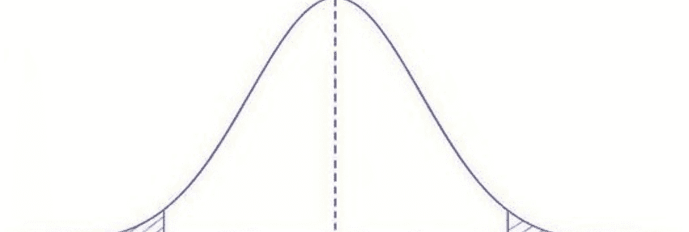

让我们看一下图1中 $p$ 的分布，下次我们将展示尾部 $Pr[\bar{p} > p + \epsilon]$ 和 $Pr[\bar{p} < p - \epsilon]$ 是非常小的，这被称为“尾部界限”或“集中不等式”。 在下一堂课上，我们将证明一个通用界限 - 切尔诺夫界限。

# 上次回顾：1个评论

上节课，我们讨论了训练和泛化误差之间的关系，以及如何将两者联系起来。

$$
(x, y) \sim D
$$

$$
\text{err}_D(h) = \Pr_{(x,y)\sim D}[h(x) = y]
$$

$$
\widehat{\text{err}}(h) = \frac{1}{m} \sum_{i=1}^{m} 1\{h(x_i) = y_i\}
$$

在这里，$\text{err}_D$ 是我们的真实或泛化误差，即在分布 $D$ 中所有样本的误差。另一方面，$\widehat{\text{err}}(h)$ 是训练误差，通过在训练数据中找到错误标记的示例来计算。我们有兴趣将两者联系起来，以了解在样本集上训练后，给定的假设在未见数据上的表现如何。

如果我们指定训练集为 $(x_1, y_1), ..., (x_m, y_m)$ 并且如果我们能够证明概率 $\geq 1 - \delta$:

$$
\forall h \in \mathcal{H} : |\text{err}(h) - \widehat{\text{err}}(h)| \leq \epsilon
$$

并且如果我们能够找到 $\hat{h} = \arg\min_{h \in \mathcal{H}} \widehat{\text{err}}(h)$

那么：

$$
\text{err}(\hat{h}) \leq \min_{h \in \mathcal{H}} \text{err}(h) + 2\epsilon
$$

如果我们的假设成立，那么这意味着如果我们能够在 $\mathcal{H}$ 中找到假设，使得训练误差最小化，我们可以将该假设的真实或泛化误差限制在 $\mathcal{H}$ 中所有假设的最小真实误差加上 $2\epsilon$ 之内。为了证明这一点，我们将使用Chernoff bound的特殊情况，即Hoeffding's不等式。

现在我们专注于统计问题，即证明训练误差接近泛化误差，而不用担心计算问题。

正如上节课末尾提到的，让我们定义随机变量 $X_1, ..., X_m$, i.i.d. $X_i \in [0,1]$ 对于所有 $i = 1, ..., m$:

$$
p = E[X_i]
$$

$$
\hat{p} = \frac{1}{m} \sum_{i=1}^{m} X_i
$$

## 2 霍夫丁不等式

霍夫丁不等式表明:

$$Pr[\hat{p} \geq p + \epsilon] \leq e^{-2\epsilon^{2}m}$$ (1)

$$Pr[\hat{p} \leq p - \epsilon] \leq e^{-2\epsilon^{2}m}$$ (2)

将这两个不等式结合使用并使用并集界限:

$$Pr[|\hat{p} - p| > \epsilon] \leq 2e^{-2\epsilon^{2}m} = \delta$$ (3)

另一种说法是:

概率 $\geq 1 - \delta,$

$$|\hat{p} - p| = |\widehat{\text{err}}(h) - \text{err}(h)| \leq \sqrt{\frac{\ln (\frac{2}{\delta})}{2m}}$$

这意味着训练误差和泛化误差之间的差异会随着样本数量的增加以某个常数的速度递减，其函数关系为 $\sqrt{m}$.

## 3 切尔诺夫界

我们现在将证明切尔诺夫界的一个更强形式，而霍夫丁不等式将作为这个证明的推论。这个更好的界限说:

$$Pr[\hat{p} \geq p + \epsilon] \leq e^{-\text{RE}(p+\epsilon||p)m} \leq e^{-2\epsilon^{2}m}$$ (4)

$$Pr[\hat{p} \leq p - \epsilon] \leq e^{-\text{RE}(p-\epsilon||p)m} \leq e^{-2\epsilon^{2}m}$$ (5)

### 3.1 相对熵

为了理解Chernoff边界，我们必须先来一个小插曲，即定义相对熵，也被称为Kullback-Leibler散度。

KL散度的概念来自信息论，并可以通过一个简单的课堂例子来说明。想象一下，A想要向B发送一条消息。我们能计算发送这条消息所需的比特数吗？显而易见的初始方法是说字母表中有26个字母，由于 $k$ 比特可以描述 $2^{k}$ 个不同的消息，我们只需使用 $\log_{2}(26)$ 比特。将其四舍五入为5，我们可以用5比特编码字母表，其中每个字母都占据5比特（A=00000，B=00001，C=00010，...）。

然而，并不是所有的字母出现的概率都相等，我们可以设计一个更高效的编码系统，其中出现概率较高的字母占用较少的比特，而出现概率较低的字母占用较多的比特（A=00，Q=0110101，...）。这个系统平均使用更少的比特来发送消息。

如果字母是从概率分布 $P$ 中抽取的，并且 $P(x)$ 是发送字母 $x$ 的概率，那么从 $P$ 编码消息的最佳方式是使用 $\log_2(\frac{1}{P(x)})$ 比特来表示 $x$。然后：

$$
E[\text{消息长度}] = \sum_x P(x) \log_2 \frac{1}{P(x)}
$$

这个值被称为分布 $P$ 的熵，可以证明当 $P$ 是均匀分布时，熵达到最大值。

现在假设人A犯了一个错误，使用分布 $Q$ 发送消息，其中 $\log_2(\frac{1}{Q(x)})$ 位被使用。现在

$$
E[\text{消息长度}] = \sum_x P(x) \log_2 \frac{1}{Q(x)}
$$

$$
\begin{aligned} \text{期望} - \text{最优} &= \sum_x P(x) \log_2 \frac{1}{Q(x)} - \sum_x P(x) \log_2 \frac{1}{P(x)} \\ &= \sum_x P(x) \log_2 \frac{P(x)}{Q(x)} \\ &= \text{RE}(P||Q) \end{aligned}
$$

注意：我们将使用自然对数底而不是2为底。两个数字之间的RE将用简写表示：

$$
\text{RE}(p||q) = p \ln \frac{p}{q} + (1-p) \ln \frac{1-p}{1-q}
$$

### 3.2 马尔可夫不等式

马尔可夫不等式是一个简单的不等式，用于比较随机变量的期望值与该变量大于期望值的概率之间的关系。

假设 $X \geq 0$，马尔可夫不等式表明：

$$
\Pr[X \geq t] \leq \frac{E[X]}{t}
$$

证明：

$$
E[X] = \Pr[X \geq t] \cdot E[X|X \geq t] + \Pr[X < t] \cdot E[X|X < t] \geq \Pr[X \geq t] \cdot t
$$

### 3.3 证明

我们现在准备证明方程4。作为第一次尝试，我们让 $q = p + \epsilon$，其中 $p$ 和 $\epsilon$，因此 $q$ 是固定的。我们试图上界 $\Pr[\hat{p} \geq q]$。使用马尔可夫不等式我们可以得到：

$$ Pr[\hat{p} \geq q] \leq \frac{E[\hat{p}]}{q} = \frac{p}{q} = \frac{p}{p+\epsilon} $$

这个值小于1，但是非常弱，没有我们所寻找的 $m$ 的依赖性。接下来，我们尝试一个巧妙的技巧，通过一个单调递增函数将原始不等式的两边都通过，得到一个等价的不等式来处理。这是可能的，因为如果 $f$ 是严格递增的，那么 $\hat{p} \geq q \Leftrightarrow f(\hat{p}) \geq f(q)$。

我们将使用形式 $f(x) = e^{\lambda m x}$ 其中 $\lambda > 0$. 我们的新不等式变为：

$$
\begin{align*}
Pr[\hat{p} \geq q] &= Pr[e^{\lambda m \hat{p}} \geq e^{\lambda m q}] \\
&\leq \frac{E[e^{\lambda m \hat{p}}]}{e^{\lambda m q}} \quad\quad\quad\quad\quad\quad\quad\quad\quad\quad\quad\quad \text{马尔可夫不等式} \\
&= e^{-\lambda m q} \cdot E[\exp(\lambda \sum_{i=1}^{m} X_i)] \\
&= e^{-\lambda m q} \cdot \prod_{i=1}^{m} E[e^{\lambda X_i}] \\
&\leq e^{-\lambda m q} \cdot \prod_{i=1}^{m} E[(1 - X_i) + e^{\lambda} X_i] \quad\quad\quad\quad \text{用一条直线来限制 } e^{\lambda x} \\
&= e^{-\lambda m q} \cdot \prod_{i=1}^{m} [1 - p + e^{\lambda} p] \\
&= e^{-\lambda m q} \cdot [1 - p + e^{\lambda} p]^{m} \\
&= (e^{-\lambda q} [1 - p + e^{\lambda} p])^{m} \\
&= e^{\phi(\lambda) m}
\end{align*}
$$

我们设置 $\phi(\lambda) = \ln[e^{-\lambda q} \cdot (1 - p + e^{\lambda} p)]$ 来得到我们的最终结果。

最小化 $\lambda$ 我们找到：

$$
\begin{align*}
\lambda_{min} &= \ln \left( \frac{q(1-p)}{(1-q)p} \right) \\
\phi(\lambda_{min}) &= -\text{RE}(q||p)
\end{align*}
$$

这对于所有的 $\lambda$ 都成立，对于 $\lambda_{min}$ 也成立，并给出了之前的界限。

## 4 麦迪阿米德不等式

Hoeffding不等式表明一组随机变量的平均值与单个随机变量的期望值有关。Hoeffding不等式作为相对熵的界限的推论可以使用泰勒定理证明。

$$
\frac{1}{m} \sum_{i=1}^{m} x_i \rightarrow E[\frac{1}{m} \sum_{i=1}^{m} x_i] \quad \text{AVG}(x_1, ..., x_m) \rightarrow E[\text{AVG}(x_1, ..., x_m)]
$$

这告诉我们平均值收敛到期望值的速度。还有哪些函数可以替换平均值并仍然得到这些结果？只要 $f$ 具有不改变 $f$ 很多的一个参数的性质，即：

$$
\forall(x_1, ..., x_m, x_i') : |f(x_1, ..., x_i, ..., x_m) - f(x_1, ..., x_i', ..., x_m)| \leq c_i.
$$

让 $X_1, ..., X_m$ 是独立的，但不一定相同。然后：

$$
\Pr[f(X_1, ..., X_m) \geq E[f(X_1, ..., X_m)] + \epsilon] \leq \exp\left(-\frac{2\epsilon^2}{\sum_{i=1}^{m} c_i^2}\right)
$$

$c_i = \frac{1}{m}$ for $\text{AVG}$, 并且我们得到了这种特殊情况下的Hoeffding不等式。

### 4.1 把它放在一起

定理：给定 $m = O\left(\frac{\ln |\mathcal{H}| + \ln \frac{1}{\delta}}{\epsilon^2}\right)$ 例子，然后概率 $\geq 1 - \delta,$

$$
\forall h \in \mathcal{H} : |\text{err}(h) - \widehat{\text{err}}(h)| \leq \epsilon
$$

证明:对于任意的 $h \in \mathcal{H}$, 我们已经证明了

$$
\Pr[|\text{err}(h) - \widehat{\text{err}}(h)| > \epsilon] \leq 2e^{-2m\epsilon^2}
$$

$$
\Pr[\exists h \in \mathcal{H} : |\text{err}(h) - \widehat{\text{err}}(h)| > \epsilon] \leq 2|\mathcal{H}|e^{-2m\epsilon^2} \leq \delta \quad \text{对于给定的 } m
$$

我们可以通过解 $\epsilon$ 来重新编写这些界限，其中：

$$
|\text{err}(h) - \widehat{\text{err}}(h)| \leq O\left(\sqrt{\frac{\ln |\mathcal{H}| + \ln \frac{1}{\delta}}{m}}\right) \quad (8)
$$

这结合了训练样本数量、假设的复杂度以及假设与训练样本的拟合程度。

## 1 处理过拟合的技术

-   交叉验证：
将部分训练数据留出来，用作泛化误差的代理。缺点：1. 浪费数据。2. 耗时，因为交叉验证的很多变种需要对数据进行多次划分用于训练和验证，并且多次运行算法。

-   结构风险最小化：
之前，我们找到了以下形式的泛化误差的上界。
在通常的假设下，至少以概率 $1-\delta$, $\forall h \in \mathcal{H}$ 和 $|\mathcal{H}| < \infty$,
$$
\text{err}(h) \leq \widehat{\text{err}}(h) + O\left(\sqrt{\frac{\ln |\mathcal{H}| + \ln(\frac{1}{\delta})}{m}}\right)
$$
这种技术试图最小化不等式右侧的整体。

-   正则化
这个通用的技术家族与结构风险最小化密切相关。
它最小化形式为 $\widehat{\text{err}} + \text{constant} \times \text{“复杂度”}$ 的表达式

-   倾向于抵抗过拟合的算法

## 2 雷德马赫复杂度

我们已经学习了使用增长函数和VC维作为无限假设空间的复杂度度量。 今天，我们将介绍一种更现代和优雅的复杂度度量，称为雷德马赫复杂度。 这种技术包含了以前的技术，因为我们使用的以 $|\mathcal{H}|$、增长函数或VC维为基础的以前的界限都可以作为新度量的特殊情况。

### 2.1

我们首先介绍雷德马赫复杂度的设置。

我们在这里使用 $\{-1, 1\}$，而不是 $\{0, 1\}$，为了使数学计算更美观。

假设函数 $h: X \rightarrow \{-1, 1\}$
在这里，我们提供了训练误差的另一种定义。

$$
\widehat{\text{err}}(h) = \frac{1}{m} \sum_{i=1}^{m} 1\{h(x_i) = y_i\} \qquad\qquad (1)
$$

$$
\widehat{\text{err}}(h) = \frac{1}{m} \sum_{i=1}^{m} \frac{1 - y_i h(x_i)}{2} = \frac{1}{2} - \frac{1}{2m} \sum_{i=1}^{m} y_i h(x_i) \quad (2)
$$

方程（2）的推导是因为当 $y_i = h(x_i)$ 时， $y_i h(x_i)$ 等于1，当 $y_i \neq h(x_i)$ 时， $y_i h(x_i)$ 等于 -1。

$$
\frac{1}{m} \sum_{i=1}^{m} y_i h(x_i) = 1 - 2\widehat{\text{err}}(h) \quad (3)
$$

训练误差是衡量单个假设与数据集拟合程度的合理指标。从方程（3）可以看出，为了最小化训练误差，我们可以简单地最大化 $-\frac{1}{m} \sum_{i=1}^{m} y_i h(x_i)$。

## 2.2

现在，让我们为数据 $i$ 引入一个随机标签，我们称之为 $\sigma_i$，也被称为Rademacher随机变量。

$$
\sigma_i = \begin{cases} -1, & \text{概率为1/2.} \\ +1, & \text{概率为1/2.} \end{cases} \quad (4)
$$

我们可以利用这个随机标签来构建一个与 $S$ 的真实标签无关的复杂度度量 $\mathcal{H}$。

$$
E_{\sigma} \left[ \max_{h \in \mathcal{H}} \frac{1}{m} \sum_{i} \sigma_i h(x_i) \right] \quad (5)
$$

方程（5）直观地衡量了 $\mathcal{H}$ 的复杂性。注意，我们可以通过两种极端情况来确定这个度量的范围。

-   $\mathcal{H} = \{ h_0 \}$: 因为只有一个假设，不使用max。然后我们得到期望值为0。
-   $S$ 被 $\mathcal{H}$ 击碎：在这种情况下，我们总是可以找到一个假设与所有的 $\sigma_i$ 匹配。因此，期望值为1。

我们现在知道这个度量范围从0到1。

## 2.3

我们现在用函数族 $\mathcal{F}$ 替换 $\mathcal{H}$，其中 $f:\mathcal{Z} \rightarrow \mathcal{R}$。这将我们的假设推广到实值函数。

样本 $\mathcal{S} = \langle z_1, ..., z_m \rangle$，其中 $z_i \in \mathcal{Z}$。

经验Rademacher复杂度的定义是

$$ \hat{\mathcal{R}}_{\mathcal{S}}(\mathcal{F}) = \mathbb{E}_{\sigma}\left[\sup_{f \in \mathcal{F}} \frac{1}{m} \sum_{i=1}^{m} \sigma_i f(z_i) \right] \qquad\qquad (6) $$

请注意，我们用sup（上确界）替换了max，因为当取自无限多个函数时，max可能不存在。上确界取最小上界。例如，$\sup\{.9, .99, .999, ...\} = 1$。

为了找到与分布 $\mathcal{D}$ over $\mathcal{Z}$相关的度量，我们对经验Rademacher复杂度取期望值，并得到了期望Rademacher复杂度的定义，即Rademacher复杂度—方程（7）。

$$ \mathcal{R}_{m}(\mathcal{F}) = \mathbb{E}_{\mathcal{S}}[\hat{\mathcal{R}}_{\mathcal{S}}(\mathcal{F})] \qquad\qquad (7) $$

$\mathcal{S} = \langle z_1, ..., z_m \rangle$, $z_i \sim \mathcal{D}$

## 3 基于 Rademacher 复杂性的泛化界

## 定理

假设 $\mathcal{F}$是一个函数族 $f :\mathcal{Z} \rightarrow [0,1]$。假设 $\mathcal{S} = \langle z_1, ..., z_m \rangle$，独立同分布且 $z_i \sim \mathcal{D}$。定义 $\hat{E}_{\mathcal{S}}[f] = \frac{1}{m} \sum ( \hat{E}_{\mathcal{S}}[f]$ 类似于训练误差的概念而 $E[f]$ 类似于泛化误差的概念)

以至少 $1 - \delta$ 的概率，对于所有的 $f \in \mathcal{F}$，

$$ E[f] \leq \hat{E}_{\mathcal{S}}[f] + 2\mathcal{R}_{m}(\mathcal{F}) + O\left(\sqrt{\frac{ln(\frac{1}{\delta})}{m}}\right) \qquad\qquad (8) $$

$$ E[f] \leq \hat{E}_{\mathcal{S}}[f] + 2\hat{\mathcal{R}}_{\mathcal{S}}(\mathcal{F}) + O\left(\sqrt{\frac{ln(\frac{1}{\delta})}{m}}\right) \qquad\qquad (9) $$

## 证明

我们希望限制以下随机变量：

$$ \Phi(\mathcal{S}) = \sup_{f \in \mathcal{F}} (E[f] - \hat{E}_{\mathcal{S}}[f]) \qquad\qquad (10) $$

## 步骤1

使用定义，我们得到：

$$\Phi(S) = \sup_{f \in \mathcal{F}} (E[f] - \hat{E}_S[f]) = \sup_{f \in \mathcal{F}} \left( E[f] - \frac{1}{m} \sum_i f(z_i) \right) \quad\quad (11)$$

由于 $f(z_i) \in [0, 1]$，改变任何 $z_i$ 值为 $z_i'$ 只能改变 $\frac{1}{m} \sum_i f(z_i))$ 最多变化 $\frac{1}{m}$ 次，因此 $\Phi(S)$ 最多变化 $\frac{1}{m}$ 次. 这意味着 $\Phi(S)$ 满足 McDiarmid 不等式的条件，即 $|\Phi(z_1, ..., z_i, ..., z_m) - \Phi(z_1, ..., z_i', ..., z_m)| \le c_i$, 其中 $c_i = \frac{1}{m}$.

McDiarmid 不等式表明, 至少有 $1 - \delta$ 的概率
$$Pr[|f(x_1, ..., x_m) - E[f(X_1, ..., X_m)]| \ge \epsilon] \le \exp\left(\frac{-2\epsilon^2}{\sum_{i=1}^m c_i^2}\right)$$

应用 McDiarmid 不等式, 我们得到:
至少有 $1 - \delta$ 的概率

$$\Phi(S) \le E_S[\Phi(S)] + \sqrt{\frac{ln(\frac{1}{\delta})}{2m}} \quad\quad (12)$$

## 第2步

让我们定义一个幽灵样本 $S' = \langle z_1', ..., z_m' \rangle, z_i' \sim \mathcal{D}$. 我们的目标是证明 $E[\Phi(S)] \le E_{S,S'}[\sup_{f \in \mathcal{F}} (\hat{E}_{S'}[f] - \hat{E}_S[f])]$.

$$E_{S'}[\hat{E}_{S'}[f]] = E[f] \quad\quad (13)$$

方程式(13)成立是因为随机变量 $\hat{E}_{S'}[f]$ 在所有样本 $S'$ 上的期望值是 $E[f]$.

$$E_{S'}[\hat{E}_{S}[f]] = \hat{E}_{S}[f] \quad\quad (14)$$

方程式 (14) 是正确的，因为随机变量 $\hat{E}_{S}[f]$ 与 $S'$ 独立.

因此，

$$\begin{align*}
E[\Phi(S)] &= E_S[\sup_{f \in \mathcal{F}} (E[f] - \hat{E}_S[f])] \\
&= E_S[\sup_{f \in \mathcal{F}} (E_{S'}[\hat{E}_{S'}[f]] - \hat{E}_S[f])] \\
&\le E_{S,S'}[\sup_{f \in \mathcal{F}} (\hat{E}_{S'}[f] - \hat{E}_S[f])]
\end{align*}$$

最后一个不等式成立，因为某个函数的期望值的最大值至少是函数期望值的最大值。

## 第三步

继续幽灵抽样技术，我们现在尝试通过在 $S$ 和 $S'$ 上运行以下机制来获得两个新样本 $T$ 和 $T'$。

- 对于 $i = 1, ..., m$
- 以 $1/2$ 的概率交换 $z_i$ 和 $z_i'$
- 否则保持不变
- $T, T' = $ 得到的样本

$$E_{\hat{T'}}[f] - E_{\hat{T}}[f] = \frac{1}{m} \sum_i \begin{cases} (f(z_i) - f(z_i')), & \text{以 1/2 的概率} \\ (f(z_i') - f(z_i)), & \text{以 1/2 的概率} \end{cases}. \quad (15)$$

$$\Longrightarrow$$

$$E_{\hat{T'}}[f] - E_{\hat{T}}[f] = \frac{1}{m} \sum_i \sigma_i (f(z_i') - f(z_i)) \quad (16)$$

我们知道 $T, T' \sim S, S'$ (等概分布) 因为 $S, S'$ 是从分布 $\mathcal{D}$ 中独立同分布采样得到的。因此，$\sup_{f \in \mathcal{F}} (E_{\hat{S'}}[f] - E_{\hat{S}}[f]) \sim \sup_{f \in \mathcal{F}} (\frac{1}{m} \sum_i \sigma_i (f(z_i') - f(z_i)))$。

然后，如果我们对两个表达式在 $S, S'$ 和 $\sigma_i$ 上取期望值，那么这两个值应该相等。

方程 (17) 给出了第3步的结论。

$$E_{S, S'} [\sup_{f \in \mathcal{F}} (E_{\hat{S'}}[f] - E_{\hat{S}}[f])] = E_{S, S', \sigma} [\sup_{f \in \mathcal{F}} (\frac{1}{m} \sum_i \sigma_i (f(z_i') - f(z_i)))] \quad (17)$$

在上一讲中，介绍了Rademacher复杂性的概念，目的是证明对于函数族 $\mathcal{F}$ 中的所有 $f$，我们有$\hat{E}_S[f] \approx E[f]$。让我们总结一下感兴趣的定义：

$\mathcal{F}$ 函数族 $f : Z \rightarrow [0, 1]$

$S = \langle z_1, ..., z_m \rangle$

$\hat{\mathcal{R}}_S(\mathcal{F}) = \mathbb{E}_\sigma [\sup_{f\in\mathcal{F}} \frac{1}{m} \sum_{i=1}^{m} \sigma_i f(z_i)]$

$\mathcal{R}_m(\mathcal{F}) = \mathbb{E}_S [\hat{\mathcal{R}}_S(\mathcal{F})]$.

我们还开始证明以下定理：

**定理.** 以至少 $1 - \delta$ 的概率和对于所有 $f\in \mathcal{F}$：

$$E[f] \le \hat{E}_S[f] + 2\mathcal{R}_m(\mathcal{F}) + \mathcal{O}\left(\sqrt{\frac{\ln(1/\delta)}{m}}\right)$$

$$E[f] \le \hat{E}_S[f] + 2\hat{\mathcal{R}}_S(\mathcal{F}) + \mathcal{O}\left(\sqrt{\frac{\ln(1/\delta)}{m}}\right).$$

我们现在完整证明它。

**证明.** 让我们定义：

$$\Phi(S) = \sup_{f\in\mathcal{F}} (E[f] - \hat{E}_S[f])$$

$$E[f] = \mathbb{E}_{z\sim\mathcal{D}}[f(z)]$$

$$\hat{E}_S[f] = \frac{1}{m} \sum_{i=1}^{m} f(z_i)$$

**步骤 1**  $\Phi(S) \le \mathbb{E}_S[\Phi(S)] + \mathcal{O}\left(\sqrt{\frac{\ln(1/\delta)}{m}}\right)$
这是上一节课证明的，并且可以从麦克迪尔米德不等式推导出来。

**步骤 2**  $\mathbb{E}_S[\Phi(S)] \le \mathbb{E}_{S,S'}[\sup_{f\in\mathcal{F}} (\hat{E}_{S'}[f] - \hat{E}_S[f])]$
这也是上一节课展示的。我们还考虑通过抛硬币生成新样本 $T, T'$，即运行 $i=1, . . . , m$ 我们抛硬币，如果是正面，则交换 $z_i$ 和 $z_i'$，否则不做任何操作。然后我们声称由此生成的分布与 $S$ 和 $S'$ 相同，并且我们注意到

$$\hat{E}_{S'}[f] - \hat{E}_S[f] = \frac{1}{m} \sum_i (f(z_i') - f(z_i))$$

这意味着我们可以写成

$$\hat{E}_{T'} [f] - \hat{E}_{T} [f] = \frac{1}{m} \sum_i \sigma_i \left( f(z_i') - f(z_i) \right)$$

这是用Rademacher随机变量 $\sigma_i$ 来表示的。 我们现在开始证明。

## 第三步 我们首先声明

$$\mathrm{E}_{S,S'} \left[ \sup_{f \in \mathcal{F}} \left( \hat{E}_{S'} [f] - \hat{E}_{S} [f] \right) \right] = \mathrm{E}_{S,S',\sigma} \left[ \sup_{f \in \mathcal{F}} \left( \frac{1}{m} \sum_i \left( f(z_i') - f(z_i) \right) \sigma_i \right) \right] .$$

要看到这一点，注意右边实际上是与左边相同的期望，但是与 $T$ 和 $T'$ 相关，它们与 $S$ 和 $S'$ 具有相同的分布。 现在我们可以写成

$$\mathrm{E}_{S,S',\sigma} \left[ \sup_{f \in \mathcal{F}} \left( \frac{1}{m} \sum_i \left( f(z_i') - f(z_i) \right) \sigma_i \right) \right] \leq \mathrm{E}_{S,S',\sigma} \left[ \sup_{f \in \mathcal{F}} \frac{1}{m} \sum_i \sigma_i f(z_i') \right] + \mathrm{E}_{S,S',\sigma} \left[ \sup_{f \in \mathcal{F}} \frac{1}{m} \sum_i (-\sigma_i) f(z_i) \right]$$

我们只是分别最大化总和。 我们现在注意到两点：

1.  随机变量 $-\sigma_i$ 具有与 $\sigma_i$ 相同的分布；
2.  在第一项中，对 $S$ 的期望是无关紧要的，因为期望内部的项不依赖于 $S$。 同样，在第二项中，对 $S'$ 的期望也是无关紧要的。

因此

$$\begin{aligned}
\mathrm{E}_{S,S',\sigma} \left[ \sup_{f \in \mathcal{F}} \frac{1}{m} \sum_i \sigma_i f(z_i') \right] &= \mathrm{E}_{S',\sigma} \left[ \sup_{f \in \mathcal{F}} \frac{1}{m} \sum_i \sigma_i f(z_i') \right] \\
&= \mathrm{E}_{S'} \left[ \mathrm{E}_{\sigma} \left[ \sup_{f \in \mathcal{F}} \frac{1}{m} \sum_i \sigma_i f(z_i') \right] \right] \\
&= \mathcal{R}_m(\mathcal{F})
\end{aligned}$$

同样地

$$\mathrm{E}_{S,S',\sigma} \left[ \sup_{f \in \mathcal{F}} \frac{1}{m} \sum_i (-\sigma_i) f(z_i) \right] = \mathcal{R}_m(\mathcal{F}) 。$$

**第4步** 我们已经证明了

$$\mathrm{E}_{S, S^{\prime}} \left[ \sup_{f \in \mathcal{F}} \left( \hat{\mathrm{E}}_{S^{\prime}}[f] - \hat{\mathrm{E}}_S[f] \right) \right] \le 2 \mathcal{R}_m(\mathcal{F}) 。$$

将我们的结果串联起来，我们得到

$$\Phi(S) = \sup_{f \in \mathcal{F}} \left( \mathrm{E}[f] - \hat{\mathrm{E}}_S[f] \right) \le 2 \mathcal{R}_m(\mathcal{F}) + \mathcal{O} \left( \sqrt{\frac{\ln 1/\delta}{m}} \right) .$$

我们得出结论，至少以概率 $1 - \delta$ 和 $\forall f \in \mathcal{F}$

$$\mathrm{E}[f] - \hat{\mathrm{E}}_S[f] \le \Phi(S) \le 2 \mathcal{R}_m(\mathcal{F}) + \mathcal{O} \left( \sqrt{\frac{\ln 1/\delta}{m}} \right) .$$

因此，至少以概率 $1 - \delta$ 和 $\forall f \in \mathcal{F}$

$$\mathrm{E}[f] \le \hat{\mathrm{E}}_S[f] + 2 \mathcal{R}_m(\mathcal{F}) + \mathcal{O} \left( \sqrt{\frac{\ln 1/\delta}{m}} \right) .$$

这是我们正在寻找的结果之一。证明 $\hat{\mathcal{R}}_S(\mathcal{F})$ 的结果只是应用麦克迪尔密德不等式，以至少以概率 $1 - \delta$ 获得

$$\hat{\mathcal{R}}_S(\mathcal{F}) \le \mathcal{R}_m(\mathcal{F}) + \mathcal{O} \left( \sqrt{\frac{\ln 1/\delta}{m}} \right) .$$

> □

## 1 动机

上述定理的最初动机是获得泛化误差和训练误差之间的关系。我们希望能够说，至少以概率 $1 - \delta, \forall h \in \mathcal{H}$

$$\operatorname{err}(h) \le \widehat{\operatorname{err}}(h) + \text{small term} .$$

我们注意到 $\operatorname{err}(h)$ 与 $\mathrm{E}[f]$ 和 $\widehat{\operatorname{err}}(h)$ 与 $\hat{\mathrm{E}}_S[f]$ 有关，这些出现在我们的定理中。让我们写

$$\operatorname{err}(h) = \Pr_{(x,y)\sim \mathcal{D}}[h(x) = y] = \mathrm{E}_{(x,y)\sim \mathcal{D}}[\mathbf{1}\{h(x) = y\}]$$

$$\widehat{\operatorname{err}}(h) = \frac{1}{m} \sum_i \mathbf{1}\{h(x_i) = y_i\} = \hat{\mathrm{E}}_S[\mathbf{1}\{h(x) = y\}]$$

根据我们的定义。我们看到，为了符合我们的定义，我们必须使用指示函数 $f$。让我们定义

$$\mathcal{Z} = \mathcal{X} \times \{-1, +1\}$$

对于 $h \in \mathcal{H}$:

$$f_h(x, y) = \mathbf{1}\{h(x) = y\}.$$

现在我们可以写成：
$$
\mathrm{E}_{(x,y)\sim \mathcal{D}}[\mathbf{1}\{h(x)=y\}] = \mathrm{E}[f_h]
$$
$$
\hat{\mathrm{E}}_S[\mathbf{1}\{h(x)=y\}] = \hat{\mathrm{E}}_S[f_h]
$$
$$
\mathcal{F}_\mathcal{H} = \{f_h : h \in \mathcal{H}\}.
$$
这使我们能够使用我们的定理来陈述：

以概率 $\ge 1 - \delta$
对于每个 $h \in \mathcal{H}$
$$
\operatorname{err}(h) \le \widehat{\operatorname{err}}(h) + 2 \mathcal{R}_m(\mathcal{F}_\mathcal{H}) + \mathcal{O}\left(\sqrt{\frac{\ln 1 / \delta}{m}}\right)
$$
$$
\operatorname{err}(h) \le \widehat{\operatorname{err}}(h) + 2 \hat{\mathcal{R}}_S(\mathcal{F}_\mathcal{H}) + \mathcal{O}\left(\sqrt{\frac{\ln 1 / \delta}{m}}\right).
$$

我们希望将上述内容写成 $\mathcal{H}$ 的Rademacher复杂度的形式，我们可以通过查看Rademacher复杂度的定义来实现这一点。我们有
$$
\hat{\mathcal{R}}_S(\mathcal{F}_\mathcal{H}) = \mathbb{E}_\sigma \left[ \sup_{f_h \in \mathcal{F}_\mathcal{H}} \frac{1}{m} \sum_{i} \sigma_i f_h(x_i, y_i) \right].
$$

现在，我们的函数 $f_h$ 只是指示函数，可以写成 $f_h(x_i, y_i) = \frac{1 - y_i h(x_i)}{2}$。此外，我们通过函数 $h \in \mathcal{H}$ 对每个函数进行索引。因此，我们可以将最大值的索引从 $f_h \in \mathcal{F}_\mathcal{H}$ 改为 $h \in \mathcal{H}$。写出来如下
$$
\begin{aligned}
\hat{\mathcal{R}}_S(\mathcal{F}_\mathcal{H}) &= \mathbb{E}_\sigma \left[ \sup_{h \in \mathcal{H}} \frac{1}{m} \sum_i \sigma_i \left( \frac{1 - y_i h(x_i)}{2} \right) \right] \\
&= \frac{1}{2} \mathbb{E}_\sigma \left[ \frac{1}{m} \sum_i \sigma_i + \sup_{h \in \mathcal{H}} \frac{1}{m} \sum_i (-y_i \sigma_i) h(x_i) \right].
\end{aligned}
$$

因为 $\sigma_i$ 是一个Rademacher随机变量，其期望值就是0。对于第二项，我们注意到因为样本 $S$ 是固定的，$y_i$ 是固定的，因此该项 $-y_i \sigma_i$ 的分布与 $\sigma_i$ 相同。因此，我们得出结论
$$
\hat{\mathcal{R}}_S(\mathcal{F}_\mathcal{H}) = 0 + \frac{1}{2} \mathbb{E}_\sigma \left[ \sup_{h \in \mathcal{H}} \frac{1}{m} \sum_i \sigma_i h(x_i) \right] = \frac{1}{2} \hat{\mathcal{R}}_S(\mathcal{H}).
$$

因此，我们已经证明了
$$
\operatorname{err}(h) \le \widehat{\operatorname{err}}(h) + \mathcal{R}_m(\mathcal{H}) + \mathcal{O}\left(\sqrt{\frac{\ln 1 / \delta}{m}}\right)
$$
$$
\operatorname{err}(h) \le \widehat{\operatorname{err}}(h) + \hat{\mathcal{R}}_S(\mathcal{H}) + \mathcal{O}\left(\sqrt{\frac{\ln 1 / \delta}{m}}\right).
$$## 2 获得其他界限

在课堂上提到，用Rademacher复杂性来获得上述界限包含了先前展示的其他界限，这可以通过一个例子来证明。我们首先陈述一个简单的定理（稍微弱化版本的定理将在以后的作业中证明）。

定理。对于 $|\mathcal{H}| < \infty$：
$$\hat{R}_S(\mathcal{H}) \leq \sqrt{\frac{2 \ln |\mathcal{H}|}{m}}.$$

现在再次考虑经验Rademacher复杂性的定义：
$$\hat{R}_S(\mathcal{H}) = \mathbb{E}_\sigma \left[ \sup_{h \in \mathcal{H}} \frac{1}{m} \sum_{i=1}^{i} \sigma_i h(x_i) \right].$$
我们看到它只取决于假设在固定集合 $S$ 上的行为。因此，我们在集合上有一个有限的行为集合。定义 $\mathcal{H}' \subseteq \mathcal{H}$，其中 $\mathcal{H}'$ 由 $\mathcal{H}$ 中每个可能的样本集 $S$ 的标记组成。因此
$$|\mathcal{H}'| = |\Pi_{\mathcal{H}}(S)| \leq \Pi_{\mathcal{H}}(m).$$
由于复杂性仅取决于 $S$ 上的行为，我们声称
$$\hat{R}_S(\mathcal{H}) = \mathbb{E}_\sigma \left[ \sup_{h \in \mathcal{H}'} \frac{1}{m} \sum_{i=1}^{i} \sigma_i h(x_i) \right] = \hat{R}_S(\mathcal{H}').$$
我们现在可以使用上述定理来写
$$\hat{R}_S(\mathcal{H}') \leq \sqrt{\frac{2 \ln |\Pi_{\mathcal{H}}(S)|}{m}}.$$
最后，我们回顾一下，在证明了Sauer引理之后，我们证明了 $\Pi_{\mathcal{H}}(m) \leq \left( \frac{e m}{d} \right)^d$，对于 $m \geq d \geq 1$。因此
$$\hat{R}_S(\mathcal{H}) \leq \sqrt{\frac{2d \ln \left( \frac{e m}{d} \right)}{m}}.$$
因此，我们使用Rademacher复杂性结果得到了一个关于VC维度的无限 $|\mathcal{H}|$ 的上界。

## 3 提升

直到这一点，我们一直在考虑的PAC学习模型要求我们能够学习到任意的准确性。因此，我们一直在处理的问题是：

强学习 $\mathcal{C}$ 如果存在算法$A$，则强PAC可学习，其中
$\exists$ 算法 $A$
$\forall$ 分布 $\mathcal{D}$
$\forall c \in \mathcal{C}$
$\forall \epsilon > 0$
$\forall \delta > 0$
给定 $m = poly(1/\epsilon, 1/\delta, \dots)$ 个示例，算法$A$计算出函数 $h$，使得
$\Pr[err(h) \leq \epsilon] \geq 1 - \delta$.

但是如果我们只能找到一个比平均几率稍微好一点的算法（例如40%）呢？我们能否使用它来迭代改进我们的解决方案，达到任意精度？我们想要考虑以下问题：

弱学习 $\mathcal{C}$ 如果存在 $\gamma > 0$ $\exists$ 算法 $A$
$\forall$ 分布 $\mathcal{D}$
$\forall c \in \mathcal{C}$
$\forall \delta > 0$
给定 $m = poly(1/\epsilon, 1/\delta, \dots)$ 个示例，算法$A$计算出函数 $h$使得
$\Pr\left[err(h) \leq \frac{1}{2} - \gamma\right] \geq 1 - \delta$.

我们注意到，在这个问题中，我们不再需要任意的准确性，只需要选择的算法比随机猜测稍微好一点，且概率较高。自然而然的问题是，弱学习是否等价于强学习。

首先考虑一个更简单的情况，即一个固定的分布 $\mathcal{D}$。在这种情况下，我们的问题的答案是否定的，我们可以通过一个简单的例子来说明。

例子：对于固定的 $\mathcal{D}$，定义
$X = \{0,1\}^n \cup \{z\}$
$\mathcal{D}$以概率$1/4$选择 $z$，并以概率$3/4$从 $\{0,1\}^n$中均匀选择
$\mathcal{C} = \{\text{所有关于 } X \text{ 的概念 }\}$。
在训练样本中，我们预计以很高的概率看到 $z$，因此算法将正确学习 $z$。然而，其余的点在 $m$的指数级别上增长，因此即使只有多项式数量的示例（例如 $1/\epsilon$， $1/\delta$，等等），我们在域的其余部分上也不太可能比随机猜测更好。因此，我们预计误差大致由以下公式给出
$err(h) \approx \frac{1}{2} \cdot \frac{3}{4} + 0 \cdot \frac{1}{4} = \frac{3}{8}$
在这种情况下 $\mathcal{C}$是弱可学习的，但不是强可学习的。

我们希望证明在任意分布的一般情况下，以下定理成立：

定理。在$PAC$学习模型下，强学习和弱学习是等价的。我们将通过开发一种提升算法从弱学习算法构建一个强学习算法来达到这个结果。

### 3.1 提升问题

提升算法面临的挑战可以通过以下问题来定义。

提升问题给定：
$(x_1, y_1), ..., (x_m, y_m)$ 其中 $y_i \in \{-1, +1\}$
可以访问一个弱学习器 $A$:
对于所有的分布 $D$ 给定 $D$的示例，计算 $h$使得
$$\mathrm{Pr}\left[err_D(h) \le \frac{1}{2} - \gamma\right] \ge 1 - \delta$$
目标：找到 $H$，使得对于任意固定的 $\epsilon$，有很高的概率使得 $err_D(H) \le \epsilon$。

提升算法背后的主要思想是使用提供的样本从 $D$生成多个不同的分布 $\mathcal{D}_t$。这是必要的，因为仅仅在相同的样本上运行 $A$通常不足以产生任意准确的假设（特别是如果 $A$是确定性的）。因此，提升算法将按照以下方式运行：

```
提升算法
对于 t=1, ..., T
    在 D_t 上运行 A 以获得弱假设 h_t : X → {-1, +1}
    ε_t = 错误率_Dt(h_t) = 1/2 - γ_t，其中 γ_t ≥ γ
end
输出 H，其中 H 是弱假设的组合 h_1, ..., h_T
```

在上述中，分布 $D_t$是在索引1, ..., m上的分布，并且可能在每一轮中都有所变化。通过调整这些分布，提升算法能够实现高准确性。直观上，我们希望选择分布 $D_t$，使得在每一轮中，它们能够为我们提供更多关于样本中的点的信息，这些点是“难以学习”的。提升算法可以在图1中以示意图的形式呈现。

让我们定义：$D_t(i) = D_t(x_i, y_i)$。我们按照以下方式选择分布：
$$\forall i : D_1(i) = \frac{1}{m}$$
$$D_{t+1}(i) = \frac{D_t(i)}{Z_t} \cdot \begin{cases} e^{\alpha_t} & \text{如果 } h_t(x_i) = y_i \\ e^{-\alpha_t} & \text{如果 } h_t(x_i) \neq y_i \end{cases}$$
其中 $\alpha_t > 0$。

直观地说，在提升的第一轮中，我们的所有示例都被认为是平等的。往后看，如果一个示例被错误分类，它在下一轮中的权重将增加，而被正确分类的示例的权重将减少，以便分类器能够专注于那些被证明更难正确分类的示例。

### 1 AdaBoost

```
算法 1 AdaBoost

$\forall i: D_1(i) = \frac{1}{m}$

**对于** $t = 1..T$ **do**

$h_t \leftarrow$ 在 $D_t$ 上运行弱学习器 A

$\epsilon_t = err_{D_t}(h_t) = \frac{1}{2} - \gamma_t$

$\alpha_t = \frac{1}{2} \ln \left( \frac{1 - \epsilon_t}{\epsilon_t} \right)$

$\forall i: D_{t+1}(i) = \frac{D_t(i)}{Z_t} \times \begin{cases} e^{\alpha_t} & \text{如果 } h_t(x_i) = y_i \\ e^{-\alpha_t} & \text{如果 } h_t(x_i) \neq y_i \end{cases}$

**返回** $H(x) = sign \left( \sum_{t=1}^T \alpha_t h_t(x) \right)$
```

在这个算法中，$Z_t$ 表示一个归一化因子，因为 $D_{t+1}$ 是一个概率分布。

### 1.1 限制训练误差

在上一节课中，我们给出了AdaBoost算法的基本直觉。现在，定义了 $\alpha_t$ 的值后，我们在一个玩具示例中跟踪了算法的三轮（请参阅课程网站上的幻灯片）。

**定理 1.1.** 训练误差由以下表达式限制：
$$\begin{aligned}
\hat{err}(H) &\le \prod_{t=1}^{T} 2\sqrt{\epsilon_t (1 - \epsilon_t)} \\
&= \exp \left( -\sum_{t} RE \left( \frac{1}{2} \| \epsilon_t \right) \right) \quad \text{(根据RE的定义)} \\
&= \prod_{t} \sqrt{1 - 4\gamma_t^2} \quad \left(\epsilon_t = \frac{1}{2} - \gamma_t\right) \\
&\le \exp \left( -2\sum_{t} \gamma_t^2 \right) \quad (1 + x \le e^x) \\
\text{考虑弱学习假设：} &\gamma_t \ge \gamma > 0 \\
&\le e^{-2\gamma^2 T}
\end{aligned}$$

**步骤1:** $D_{T+1}(i) = \frac{\exp[-y_i F(x_i)]}{m \prod_t Z_t}$, $F(x) = \sum_t \alpha_t h_t(x)$

**证明.**
$$D_{t+1}(i) = \frac{D_t(i)}{Z_t} \times e^{-\alpha_t y_i h_t(x_i)} = D_t(i) \frac{e^{-y_i \alpha_t h_t(x_i)}}{Z_t}$$
然后，我们可以找到这个表达式为 $t = T$，并递归求解：
$$
D_{T+1}(i) = D_1(i) \frac{e^{-y_i \alpha_1 h_1(x_i)}}{Z_1} \dots \frac{e^{-y_i \alpha_T h_T(x_i)}}{Z_T}
= \frac{1}{m} \frac{\exp \left( -y_i \sum_t \alpha_t h_t(x_i) \right)}{\prod_t Z_t}
= \frac{\exp \left[ -y_i F(x_i) \right]}{m \prod_t Z_t}
$$
□

**第2步:** $\hat{err}(H) \leq \prod_t Z_t$

**证明.**
$$
\begin{aligned}
\hat{err}(H) &= \frac{1}{m} \sum_{i=1}^m \mathbf{1}\{ y_i \neq H(x_i) \} \tag{1} \\
&= \frac{1}{m} \sum_i \mathbf{1}\{ y_i F(x_i) \leq 0 \} \tag{2} \\
&\leq \frac{1}{m} \sum_i e^{-y_i F(x_i)} \tag{3} \\
&= \frac{1}{m} \sum_i D_{T+1}(i) m \prod_t Z_t \tag{4} \quad \text{(由第1步得出)} \\
&= \prod_t Z_t \sum_i D_{T+1}(i) \tag{5} \\
&= \prod_t Z_t \tag{6} \quad \text{(由于我们在分布 $D_{T+1}$ 上求和，所以得到1)}
\end{aligned}
$$
□

**步骤 3:** $Z_t = 2 \sqrt{\epsilon_t (1 - \epsilon_t)}$

**证明.**
$$
\begin{aligned}
Z_t &= \sum_i D_t(i) \times \begin{cases} e^{\alpha_t} & \text{如果 } h_t(x_i) = y_i \\ e^{-\alpha_t} & \text{如果 } h_t(x_i) \neq y_i \end{cases} \tag{1} \\
&= \sum_{i: y_i = h_t(x_i)} D_t(i) e^{\alpha_t} + \sum_{i: y_i \neq h_t(x_i)} D_t(i) e^{-\alpha_t} \tag{2} \quad \text{(从分解两种情况的总和得出)} \\
&= \epsilon_t e^{\alpha_t} + (1 - \epsilon_t) e^{-\alpha_t} \tag{3} \quad \text{(由于 $e^{\alpha_t}$ 或 $e^{-\alpha_t}$ 可以从总和中取出)} \\
\end{aligned}
$$
我们选择 $\alpha_t$ 来最小化经验误差，所以我们得到：
$$\alpha_t = \frac{1}{2} \ln \left( \frac{1 - \epsilon_t}{\epsilon_t} \right)$$
*这就是我们在算法中选择 $\alpha_t$ 的方式。

### 1.2 限制泛化误差

在过去的课程中，我们使用了许多工具，我们选择了增长函数来限制泛化误差。
$$H(x) = sign \left( \sum_{t} \alpha_t h_t(x) \right) \tag{1}$$
$$= g(h_1(x), \ldots, h_T(x)) \tag{2}$$
我们定义 $g(z_1, z_2, \ldots, z_T) = sign(\sum_{t} \alpha_t z_t) = sign(\mathbf{w} \cdot \mathbf{z})$，其中 $\mathbf{w} = \langle \alpha_1, \alpha_2, \ldots, \alpha_T \rangle$，表示 $\mathbb{R}^T$ 中的线性阈值函数。现在让我们定义以下空间：

- $\mathcal{J} = \{ \mathbb{R}^T \text{中的线性阈值函数} \}$
- $\mathcal{H} = \text{弱假设空间}$
- $\mathcal{F} = \text{所有函数} f \text{（如上所述），其中 } g \in \mathcal{J}, h_1, h_2, \ldots, h_T \in \mathcal{H}$

如作业2的问题2所证明的，我们可以设置以下限制：
$$\Pi_{\mathcal{F}}(m) \leq \Pi_{\mathcal{J}}(m) \prod_{t=1}^{T} \Pi_{\mathcal{H}}(m) \tag{3}$$
$$= \Pi_{\mathcal{J}}(m) \left[ \Pi_{\mathcal{H}}(m) \right]^{T} \tag{4}$$

我们有 $\text{VC-dim}(\mathcal{J}) = T$，因为我们考虑的是通过原点的线性阈值函数在 $\mathbb{R}^T$ 中，我们定义 $\text{VC-dim}(\mathcal{H}) = d$。然后，使用 Sauer's 引理：
$$\Pi_{\mathcal{J}}(m) \leq \left( \frac{e m}{T} \right)^{T}$$
$$\Pi_{\mathcal{H}}(m) \leq \left( \frac{e m}{d} \right)^{d}$$

将上述不等式代入方程 (4)：
$$\Pi_{\mathcal{F}}(m) \leq \left( \frac{e m}{T} \right)^{T} \left( \frac{e m}{d} \right)^{dT} \tag{5}$$

使用 “soft-oh” 符号（不仅隐藏常数，还隐藏对数因子），给定 $m$ 个示例，以至少 $1-\delta$ 的概率，对于所有 $H \in \mathcal{F}$：
$$err(H) \leq \hat{err}(H) + \tilde{O} \left( \sqrt{\frac{T d + \ln 1/\delta}{m}} \right)$$

### 1.3 间隔

与我们根据先前的方程所期望的相反，当我们增加 T (复杂度)时，即使训练误差已经为0，我们并不总是得到更差的泛化误差。下面的图片是课堂上展示这种行为的幻灯片中的一张图片：

这种行为背后的原因是，随着轮数的增加，分类器变得更加‘自信’。这种自信转化为更低的泛化误差。我们有：
$$H(x) = sign\left(\sum_{t=1}^{T} \alpha_t h_t(x)\right)$$
通过归一化权重： $a_t = \frac{\alpha_t}{\sum_{t'=1}^{T} \alpha_{t'}}$，使得 $a_t \ge 0$, $\sum a_t = 1$。我们将边界定义为加权分数正确投票的比例和错误投票的比例之间的差异。那么对于一个具有正确标签的示例 $x$，边界是：
$$\begin{aligned}
边界 &= \sum_{t:h_t(x)=y} a_t - \sum_{t:h_t(x)\neq y} a_t \\
&= \sum_{t} a_t y h_t(x) \\
&= y \sum_{t} a_t h_t(x) \\
&= y f(x)
\end{aligned}
\quad \text{其中 } f(x) = \sum_{t} a_t h_t(x)$$## 1 提升的边界理论

回顾之前的讲座，我们可以将我们的假设 $H\left(x\right) = \mathrm{sign} \left(\sum_{t=1}^{T} a_{t} h_{t}(x)\right)$, 其中 $a_{t}=\alpha_{t}/\sum_{s} \alpha_{s}$（使得 $\sum_{t} a_{t}=1$）和 $h_{1}, \ldots, h_{T}$ 是我们通过AdaBoost的 $T$ 次迭代获得的弱假设。

写作 $f(x)=\sum_{t=1}^{T} a_{t} h_{t}(x)$，我们定义 $\operatorname{margin}_{f}(x, y)=y f(x)$ 为 $f$ 的边际值，对于一个训练样本 $(x, y)$。在上一节课中，我们已经看到这个数量代表了 $h_{t}$ 的加权比例，即正确投票的加权比例减去错误投票的加权比例，对于类别 $y$ 在给定数据 $x$ 时。关于边际值的几点说明：

- $y f(x)$ 的取值范围在 $[-1,1]$ 之间。
- $y f(x)>0$ 当且仅当 $H(x)=y$。
- $|y f(x)|$ 的大小表示了对于分类 $H(x)$ 的‘置信度’。一个远离零的数字意味着高置信度，而接近零的数字意味着低置信度。

因此，希望边界 $y f(x)$ “大”，因为这表示高置信度的正确分类。我们将看到，在通常的假设下，AdaBoost能够增加训练集上的边界，并为这些边界实现一个正的下界。特别地，这意味着训练误差将为零，并且我们将看到较大的边界有助于实现较小的泛化误差。

在本讲座中，我们的目标是展示：

1.  Boosting倾向于增加训练样本的边界。此外，更大的边缘在增强后将导致更大的边界。
2.  训练集上的大边界会导致测试数据的更好性能（而这与增强的轮数 $T$ 无关）。

符号

| 符号 | 含义 |
| :--- | :--- |
| $S$ | 训练集 $\left\langle\left(x_{1}, y_{1}\right), \ldots,\left(x_{m}, y_{m}\right)\right\rangle$ |
| $\mathcal{H}$ | 弱假设空间 |
| $d$ | $\mathrm{VCdim}(\mathcal{H})$ |
| $\mathrm{co}(\mathcal{H})$ | 凸包 $\mathcal{H}$ 的集合，由以下函数给出 $\left\{f(x)=\sum_{t=1}^{T} a_{t} h_{t}(x): a_{1}, \ldots, a_{T} \geq 0, \sum_{t} a_{t}=1, h_{1}, \ldots, h_{T} \in \mathcal{H}, T \geq 1\right\}$ |
| $\Pr_{\mathcal{D}}$ | 与真实分布 $\mathcal{D}$ 相关的概率 |
| $E_{\mathcal{D}}$ | 与真实分布 $\mathcal{D}$ 相关的期望 |
| $\Pr_{S}$ | 与 $S$ 相关的经验概率 |
| $E_{S}$ | 与 $S$ 相关的经验期望 |

## 1.1 提升增加训练样本的边缘

我们将证明，通过足够多的提升轮次，我们可以保证对于所有的 $i$，其中 $\gamma > 0$ 是我们弱学习假设中的边缘。 特别地，这意味着 $H(x)$ 将正确分类每个训练样本，并且以至少 $\gamma$ 的置信度进行分类。

我们将使用以下主要结果。

定理 1. 对于 $\theta \in [-1, 1]$，我们有

$$Pr_S[yf(x) \leq \theta] \leq \prod_{t=1}^{T} \left[2\sqrt{\epsilon_t^{1-\theta}(1-\epsilon_t)^{1+\theta}}\right]$$ (1)

此外，如果 $\epsilon_t \leq \frac{1}{2} - \gamma$ 对于 $t=1, \ldots, T$，则

$$Pr_S[yf(x) \leq \theta] \leq \left[\sqrt{(1-2\gamma)^{1-\theta}(1+2\gamma)^{1+\theta}}\right]^{T}$$ (2)

证明。回顾上一讲中

$$\frac{1}{m}\sum_{i=1}^{m} \exp\left(-y_i \sum_{t=1}^{T} \alpha_t h_t(x_i)\right) = \prod_{t=1}^{T} Z_t = \prod_{t=1}^{T} 2\sqrt{\epsilon_t(1-\epsilon_t)}$$

其中我们设置 $\alpha_t = \frac{1}{2} \ln \frac{1-\epsilon_t}{\epsilon_t}$ 以得到最后的等式。

使用类似的论证方法，

$$\begin{aligned} Pr_S[yf(x) \leq \theta] &= \frac{1}{m} \sum_{i=1}^{m} \mathbf{1}\{y_i f(x_i) \leq \theta\} \\ &= \frac{1}{m} \sum_{i=1}^{m} \mathbf{1}\left\{y_i \sum_{t=1}^{T} \alpha_t h_t(x_i) \leq \theta \sum_{t=1}^{T} \alpha_t\right\} \\ &\leq \frac{1}{m} \sum_{i=1}^{m} \exp\left(-y_i \sum_{t=1}^{T} \alpha_t h_t(x_i) + \theta \sum_{t=1}^{T} \alpha_t\right) \\ &= \exp\left(\theta \sum_{t=1}^{T} \alpha_t\right) \frac{1}{m} \sum_{i=1}^{m} \exp\left(-y_i \sum_{t=1}^{T} \alpha_t h_t(x_i)\right) \\ &= \exp\left(\theta \sum_{t=1}^{T} \alpha_t\right) \prod_{t=1}^{T} Z_t \\ &= \prod_{t=1}^{T} e^{\theta \alpha_t} Z_t \\ &= \prod_{t=1}^{T} \left[2\sqrt{\epsilon_t^{1-\theta}(1-\epsilon_t)^{1+\theta}}\right] \end{aligned}$$

其中不等式由 $\mathbf{1}\{x \leq 0\} \leq e^{-x}$ 得到，最后的等式通过设置 $\alpha_t = \frac{1}{2} \ln \frac{1-\epsilon_t}{\epsilon_t}$ 得到。

第二个结果使用了如果 $\epsilon_t \le \frac{1}{2} - \gamma$, 则

$$ e^{\theta \alpha_t} Z_t = e^{\theta \alpha_t} \left( \epsilon_t e^{\alpha_t} + (1 - \epsilon_t)e^{-\alpha_t} \right) \ \le e^{\theta \alpha_t} \left[ \left( \frac{1}{2} - \gamma \right) e^{\alpha_t} + \left( \frac{1}{2} + \gamma \right) e^{-\alpha_t} \right] \ = \sqrt{ (1 - 2\gamma)^{1 - \theta} (1 + 2\gamma)^{1 + \theta} } $$

通过设置 $\alpha_t = \frac{1}{2} \ln \left( \frac{\frac{1}{2} + \gamma}{\frac{1}{2} - \gamma} \right)$。 读者应该验证不等式并计算出细节。 $\square$

备注。通过在上述结果中设置 $\theta = 0$，我们恢复了前一讲中证明的训练误差的界限。此外，可以证明对于任何 $0 < \theta \le \gamma$, 项 $(1 - 2\gamma)^{1 - \theta}(1 + 2\gamma)^{1+\theta} < 1$, 因此当 $T \to \infty$ 时，$(2)$ 的右侧趋近于零。作为一个简单的推论，我们有以下结果：

推论。如果弱学习假设成立，那么在足够大的 $T$ 的情况下，我们有 $y_i f(x_i) \ge \gamma \; \forall \; i$。

## 1.2 在训练集上具有较大边界可以减少泛化误差

之前，我们已经证明了至少有 $1-\delta$ 的概率

$$ \mathrm{err}(H) \le \mathrm{err}(H) + \tilde{O} \left( \sqrt{\frac{T d + \ln(1/\delta)}{m}} \right) $$

我们可以等价地重写为

$$ Pr_{\mathcal{D}}[yf(x) \le 0] \le Pr_{\mathcal{S}}[yf(x) \le 0] + \tilde{O} \left( \sqrt{\frac{T d + \ln(1/\delta)}{m}} \right) $$

我们现在将证明一个变体，其中上界不依赖于 $T$, 而是依赖于一个我们可以与边界相关的参数 $\theta$。

定理。对于 $0 < \theta \le 1$, 至少以概率 $1 - \delta$,

$$ Pr_{\mathcal{D}}[yf(x) \le 0] \le Pr_{\mathcal{S}}[yf(x) \le \theta] + \tilde{O} \left( \sqrt{\frac{d/\theta^2 + \ln(1/\delta)}{m}} \right). $$

在我们证明定理之前，我们先介绍两个引理。

回想一下，对于 $\mathcal{S} = \langle z_1, \dots, z_m \rangle$ 和 $\mathcal{F} = \{ f: Z \to \mathbb{R} \}$, $\mathcal{F}$ 的经验Rademacher复杂度为

$$ R_S(\mathcal{F}) = \mathbb{E}_{\sigma} \left[ \sup_{f \in \mathcal{F}} \frac{1}{m} \sum_{i=1}^{m} \sigma_i f(z_i) \right] $$

在上一节课中，我们已经看到 $R_S(\mathcal{H}) = \tilde{O} \left( \sqrt{\frac{d}{m}} \right)$。下面的引理告诉我们如何将 $R_S(\mathrm{co}(\mathcal{H}))$ 与 $R_S(\mathcal{H})$ 联系起来。

## 引理 1

$\mathcal{H}$ 的Rademacher复杂度等于其凸包的Rademacher复杂度。换句话说，$R_S(\text{co}(\mathcal{H}))=R_S(\mathcal{H})$。

证明。由于 $\mathcal{H} \subset \text{co}(\mathcal{H})$，显然有 $R_S(\mathcal{H}) \leq R_S(\text{co}(\mathcal{H}))$。此外，

$$
\begin{aligned}
R_S(\text{co}(\mathcal{H})) &= E_\sigma \left[ \sup_{f \in \text{co}(\mathcal{H})} \frac{1}{m} \sum_{i=1}^m \sigma_i \sum_t a_t h_t(x_i) \right] \\
&= E_\sigma \left[ \sup_{f \in \text{co}(\mathcal{H})} \frac{1}{m} \sum_t a_t \sum_{i=1}^m \sigma_i h_t(x_i) \right] \\
&\leq E_\sigma \left[ \sup_{f \in \text{co}(\mathcal{H})} \frac{1}{m} \sum_t a_t \sup_{h \in \mathcal{H}} \sum_{i=1}^m \sigma_i h(x_i) \right] \\
&= E_\sigma \left[ \sup_{f \in \text{co}(\mathcal{H})} \frac{1}{m} \sup_{h \in \mathcal{H}} \sum_{i=1}^m \sigma_i h(x_i) \right] \\
&= E_\sigma \left[ \frac{1}{m} \sup_{h \in \mathcal{H}} \sum_{i=1}^m \sigma_i h(x_i) \right] \\
&= R_S(\mathcal{H})
\end{aligned}
$$

为了得到第四行，我们使用了 $\sum_t a_t = 1$ 这个事实，对于第五行，我们注意到 $\sup_f(..)$ 的表达式不依赖于 $f$，所以我们可以省略 $\sup_f$ 函数。因此我们得出结论 $R_S(\text{co}(\mathcal{H})) = R_S(\mathcal{H})$。 $\square$

接下来，对于任何函数 $\phi : \mathbb{R} \to \mathbb{R}$，和 $f : Z \to \mathbb{R}$，我们定义组合函数 $\phi \circ f : Z \to \mathbb{R}$为 $\phi \circ f(z) = \phi( f(z) )$。我们还定义了复合函数的空间 $\phi \circ \mathcal{F} = \{ \phi \circ f : f \in \mathcal{F} \}$。

## 引理 2

假设 $\phi$ 是Lipschitz连续的，即 $\exists L_\phi > 0$ 使得 $\forall u, v \in \mathbb{R}$，$|\phi(u) - \phi(v)| \leq L_\phi |u - v|$。那么 $R_S(\phi \circ \mathcal{F}) \leq L_\phi R_S(\mathcal{F})$。

证明。见Mohri等人。 $\square$

## 定理 2

对于 $0 < \theta \leq 1$，至少以概率 $1 - \delta$ 成立，

$$ P_{\mathcal{D}}[yf(x) \leq 0] \leq P_{\mathcal{S}}[yf(x) \leq \theta] + \tilde{O}\left( \sqrt{\frac{d/\theta^2 + \ln(1/\delta)}{m}} \right) $$

证明。写入边际 $\text{marg}(x, y) = yf(x)$。定义 $\mathcal{M} = \{\text{marg}_f : f \in \text{co}(\mathcal{H})\}$。然后

$$ R_S(\mathcal{M}) = E_\sigma \left[ \sup_{f \in \text{co}(\mathcal{H})} \frac{1}{m} \sum_{i=1}^m (\sigma_i y_i) f(x_i) \right] = R_S(\text{co}(\mathcal{H})) = R_S(\mathcal{H}) \quad (\text{根据引理1}) $$

接下来，我们定义函数 $\phi: \mathbb{R} \to [0,1]$，通过

$$\phi(u) = \begin{cases} 1 & \text{如果 } u \leq 0 \\ 1 - u/\theta & \text{如果 } 0 < u \leq \theta \\ 0 & \text{如果 } u > \theta \end{cases}$$

请注意，对于所有 $u \in \mathbb{R}$，我们有

$1\{u \leq 0\} \leq \phi(u) \leq 1\{u \leq \theta\}$

此外，$\phi$ 显然是Lipschitz连续的，其中 $L_\phi = \frac{1}{\theta}$。因此，引理2给出了我们

$R_S(\phi \circ \mathcal{M}) \leq \frac{1}{\theta} R_S(\mathcal{M}) = \frac{1}{\theta} R_S(\mathcal{H}) \leq \tilde{O}\left( \sqrt{\frac{d/\theta^2}{m}} \right)$

使用前面一堂课的结果和上述结果，我们有

$$\begin{aligned} Pr_{\mathcal{D}}[yf(x) \leq 0] &= E_{\mathcal{D}}[1\{yf(x) \leq 0\}] \\ &\leq E_{\mathcal{D}}[\phi \circ (yf)(x)] \\ &\leq E_{\mathcal{S}}[\phi \circ (yf)(x)] + 2 R_S(\phi \circ \mathcal{M}) + O\left( \sqrt{\frac{\ln(1/\delta)}{m}} \right) \\ &\leq E_{\mathcal{S}}[1\{yf(x) \leq \theta\}] + \tilde{O}\left( \sqrt{\frac{d/\theta^2}{m}} \right) + O\left( \sqrt{\frac{\ln(1/\delta)}{m}} \right) \\ &= Pr_{\mathcal{S}}[yf(x) \leq \theta] + \tilde{O}\left( \sqrt{\frac{d/\theta^2 + \ln(1/\delta)}{m}} \right) \end{aligned}$$

如所需。 $\square$

备注。我们使用的 $\theta$ 值越大，RHS上的 $\tilde{O}(...)$ 项就越小。在训练集上具有更大的间隔时，我们可以选择更大的 $\theta$ 值，同时保持 $Pr_{\mathcal{S}}[yf(x) \leq \theta]$ 项为零（或接近零），这将给我们一个更尖锐的上界对泛化误差的估计。 这表明通过增加训练集上的间隔，我们可以期望看到更小的泛化误差。

## COS 511: 理论机器学习

### 1 支持向量机简介

#### 1.1 动机

正如我们所看到的，提升技术并没有被定义为最大化边界，但我们最终使用边界来分析其性能。 这引出了一个问题：如果我们推导出一种算法，其目标实际上是最大化边界，会怎么样？

#### 1.2 假设

在提升中，我们需要弱学习假设。 在这种情况下，我们要求所有特征都可以转换为实数，无论它们是分类的、离散的还是连续的等等。这使我们能够将特征向量处理为欧几里得空间中的点，这是我们在接下来的笔记中假设的。

#### 1.3 直觉

首先，考虑平面上的标记点 $(x_1, y_1), ..., (x_m, y_m)$，其中 $x_i \in \mathbb{R}^n$ 并且 $y_i \in \{-1, +1\}$，如图1所示。 为了对这些点进行分类，倾向于在它们之间画一条线，并将“线上方”标记为+1，将“线下方”标记为 -1。 但是存在无数条能够清晰地划分数据的线，其中两条如图1所示。我们更喜欢哪一条呢？

其中一些线在直觉上比其他线更好。 例如，虽然绿线和橙线都能够清晰地分离数据，但绿线看起来比橙线更好，因为它提供了更宽的间隔。 例如，如果我们收到一个位于黑点的新数据点，橙线将把它分类为负例，而实际上它离正例很近。 换句话说，橙线只是勉强能够一致地分离数据，而绿线则留下了一些错误的余地。

直观地说，如果我们考虑每个示例周围半径为 $\delta$ 的球，我们希望这个 $\delta$ 球中的所有点都与给定示例具有相同的标签。 因此，我们希望找到一个超平面，不仅可以正确分类训练数据，而且还能尽可能远离所有训练点。

### 2 支持向量机算法

目标是最大化线性分离器与训练数据之间的间隔 $\delta$（请注意，在这种情况下，间隔与提升中的间隔并不完全相同，尽管这两个概念是相关的）。 总会有一些示例与分离器正好相距 $\delta$，这些示例被称为支持向量。 在图2中，支持向量相对于虚线线性分离器是加粗的。

图1：平面上的标记示例
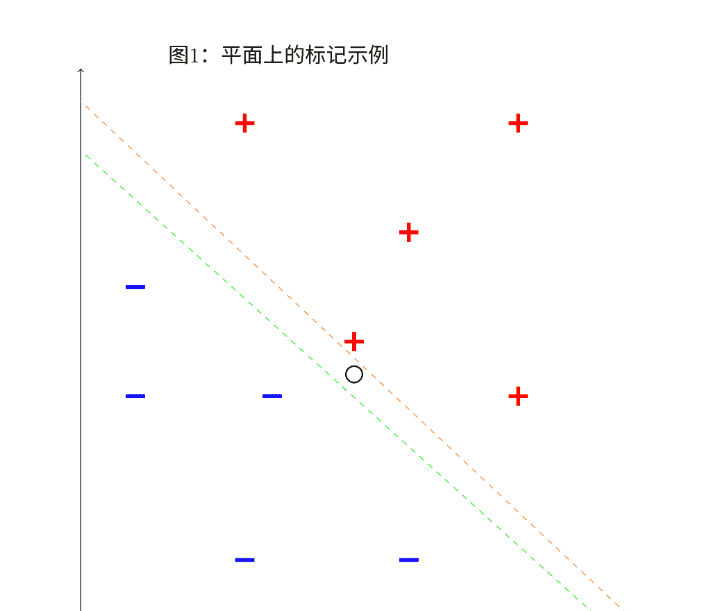

图2：具有LTF的支持向量
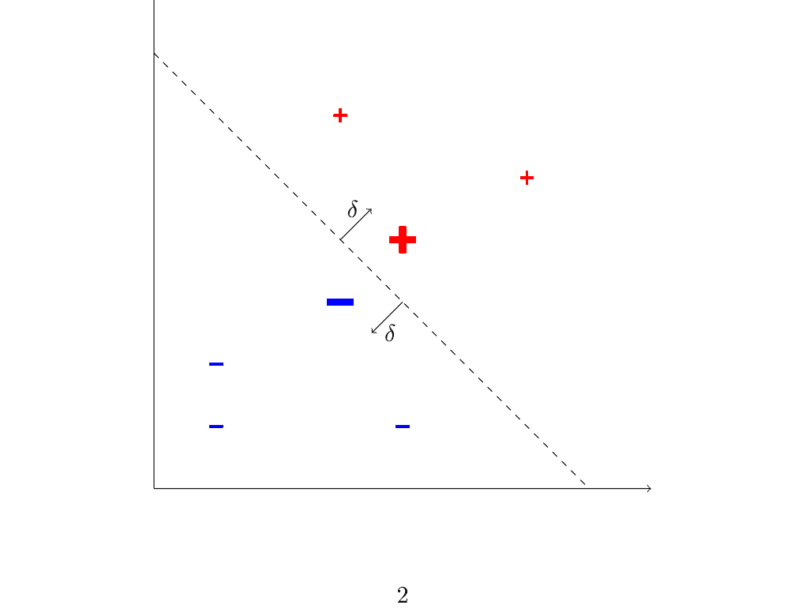

#### 2.1 VC维度

为什么这是一个好的方法？我们能否找到更正式的理由来最大化间隔？回想一下，一个 n维线性阈值函数（LTF）通过原点的VC维度是 n。这可能导致在低维度下可接受的泛化误差界限，但是对于SVMs，我们通常会在具有数十万维度的空间中工作，所以我们希望做得更好。

假设我们所有的示例都包含在单位球内（∀i：‖x_i‖ ≤ 1），我们有以下好的结果：

VC维度（具有间隔δ的LTF）≤1/δ²

请注意，如果我们所有的示例都包含在大小为 R的球内，我们可以对数据进行归一化，上述界限变为 (Rδ)²。

为什么这是一个好的结果？

- 它向我们证明了较大的边界导致较小的VC维度，从而导致对泛化误差有更好的界限。
- 它与维度的数量无关。

VC维度的界限证明将在后面的讲座中给出。使用Rademacher复杂度可以获得对泛化误差的另一种界限，其证明与提升的证明非常相似。

### 3 我们如何找到这些超平面？

我们首先将问题形式化。假设我们的超平面经过原点，它们可以由一个单位法向量 v来定义。也就是说，超平面将被定义为与该向量 v正交的所有点，并且额外的约束条件是 ||v|| = 1。

对于任意给定的点 x，我们还对求解从超平面到 x的距离感兴趣，它可以简单地表示为：v·x

该场景在图3中展示。

接下来，注意这是一个有符号的距离，即：

- 如果x在平面上方，则v·x > 0
- 如果x在平面下方，则v·x < 0
- 如果x在平面上，则v·x = 0

因此，我们可以通过返回 v·x的符号来对一个新的点 x进行分类。形式上：

h(x) = sign(v·x)

那么在这种情况下，我们试图解决什么问题？

图3: 单位法向量
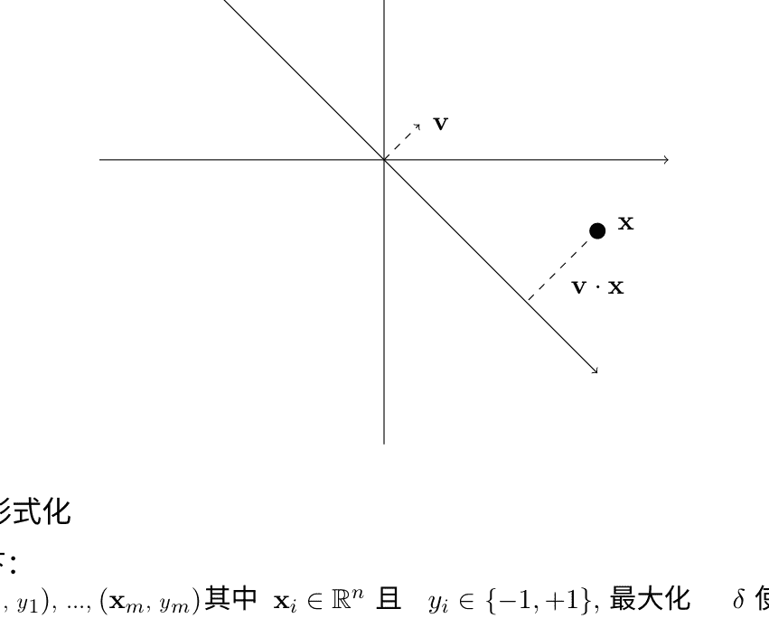

#### 3.1 问题的形式化

问题陈述如下：
给定( $$x_1, y_1$$), ..., ($$x_m, y_m$$) 其中 $$x_i \in \mathbb{R}^n$$ 且 $$y_i \in \{-1, +1\}$$，最大化 $$\delta$$ 使得：

$$\|v\| = 1$$
$$\forall i: v \cdot x_i \geq \delta \quad \text{if } y_i = +1$$
$$v \cdot x_i \leq -\delta \quad \text{if } y_i = -1$$

我们将多次重写这个优化问题。

##### 3.1.1 重写 #1

首先，我们可以合并两个主要约束条件并重写问题如下：
最大化 $$\delta$$ 使得：

$$\forall i: y_i(v \cdot x_i) \geq \delta$$
$$\|v\| = 1$$

##### 3.1.2 重写 #2

接下来，定义 $$w = \frac{v}{\delta}$$。这意味着 $$\|w\| = \frac{1}{\delta}$$ 并且，随后，$$\delta = \frac{1}{\|w\|}$$。最大化 $$\delta$$ 现在类似于最小化 $$\|w\|$$。因此，优化问题现在可以写成：
最小化 $$\|w\|$$ 使得：

$$\forall i: y_i(\frac{v}{\delta} \cdot x_i) \geq \frac{\delta}{\delta}$$
$$y_i(w \cdot x_i) \geq 1$$

这是理想的，因为对 v的约束现在可以忽略不计。此外，这个问题仅仅以一个向量 w 的形式定义，并且不依赖于 δ。为了避免处理平方根，我们重新定义目标为：

最小化 $\frac{1}{2} \| \mathbf{w} \|^2$ 使得 $\forall i: y_i (\mathbf{w} \cdot \mathbf{x}_i) \geq 1$

#### 3.2 拉格朗日函数

由于这个问题是在一个凸函数上受凸约束的情况下定义的，所以它被称为“凸规划”。我们将使用标准技术来解决这类问题。首先，我们将约束条件重写为：

$b_i(\mathbf{w}) \geq 0$ 其中：$b_i(\mathbf{w}) = y_i (\mathbf{w} \cdot \mathbf{x}_i) - 1$

接下来，我们定义拉格朗日函数 $L(\mathbf{w}, \alpha)$，使其满足：

$L(\mathbf{w}, \alpha) = \frac{1}{2} \| \mathbf{w} \|^2 - \sum_{i=1}^m \alpha_i b_i(\mathbf{w})$

声明。前面的表述与解决以下问题是相同的：

$\min_{\mathbf{w} \in \mathbb{R}^n} \max_{\alpha_i \geq 0} [L(\mathbf{w}, \alpha)]$

证明。将优化问题视为两个玩家Mindy和Max之间的游戏。Mindy的目标是最小化上述函数 $L(\mathbf{w}, \alpha)$，她可以选择 $\mathbf{w}$。Max知道Mindy选择的 $\mathbf{w}$，他的目标是在所有 $\alpha_i \geq 0$的约束条件下最大化上述函数。

假设Mindy选择 $\mathbf{w}$，使得对于某个 $i$，$b_i(\mathbf{w}) < 0$。那么，Max会选择 $\alpha_i = \infty$，因为他想最大化函数，而 $-b_i(\mathbf{w})\infty = \infty$在这种情况下。但这对于Mindy来说是一个糟糕的结果，因为她想最小化这个函数。因此，她永远不会选择 $b_i(\mathbf{w}) < 0$，以免给Max有机会获得无限的回报。

考虑剩下的两种情况：

- $b_i(\mathbf{w}) = 0 \implies \alpha_i$是无关的，因为它对拉格朗日函数没有贡献。
- $b_i(\mathbf{w}) > 0 \implies$ 为了最大化函数，Max会选择 $\alpha_i = 0$。

回想一下，根据定义，$\alpha_i \geq 0$。Max的唯一选择是玩 $\alpha_i = 0$ 或 $\alpha_i > 0$。如果他选择 $\alpha_i > 0$，他将减少函数的值。因此，他能做的最好的选择是玩 $\alpha_i = 0$。

在任何一种情况下，都有 $\alpha_i b_i(\mathbf{w}) = 0$。因此，右侧的求和将消失，优化问题将解决为最小化 $\frac{1}{2} \| \mathbf{w} \|^2$，就像在先前的表述中一样。

#### 3.3 凸对偶

对于任意的两个参数的函数，可以证明：

$$ \min_{\mathbf{w}} \left[ \max_{\alpha} L(\mathbf{w}, \alpha) \right] \ge \max_{\alpha} \left[ \min_{\mathbf{w}} L(\mathbf{w}, \alpha) \right] $$

在一定条件下，我们可以进一步证明这两个表达式实际上是相等的。其中最重要的条件是函数 $L$ 在 $\alpha$ 中是凸的，在 $\mathbf{w}$ 中是凹的。事实证明，我们选择的 $L$ 确实满足这个条件以及其他必要条件，给我们带来了相等性：最小值

$$ \min_{\mathbf{w}} \left[ \max_{\alpha} L(\mathbf{w}, \alpha) \right] = \max_{\alpha} \left[ \min_{\mathbf{w}} L(\mathbf{w}, \alpha) \right] $$

这个方程的右手边被称为凸对偶。它也是一个凸优化问题。对偶问题通常更容易解决，但更重要的是，它可以揭示问题本身的重要事实。

定义：

$$ \alpha^* = \arg \max_{\alpha} \left[ \min_{\mathbf{w}} L(\mathbf{w}, \alpha) \right] $$
$$ \mathbf{w}^* = \arg \min_{\mathbf{w}} \left[ \max_{\alpha} L(\mathbf{w}, \alpha) \right] $$

然后，我们有以下一系列方程：

$$ L(\mathbf{w}^*, \alpha^*) \le \max_{\alpha} L(\mathbf{w}^*, \alpha) $$
$$ = \min_{\mathbf{w}} \max_{\alpha} L(\mathbf{w}, \alpha) $$
$$ = \max_{\alpha} \min_{\mathbf{w}} L(\mathbf{w}, \alpha) $$
$$ = \min_{\mathbf{w}} L(\mathbf{w}, \alpha^*) $$
$$ \le L(\mathbf{w}^*, \alpha^*) $$

#### 3.4 鞍点

检查上述两个方程，我们有：

$$ \min_{\mathbf{w}} L(\mathbf{w}, \alpha^*) = L(\mathbf{w}^*, \alpha^*) $$

换句话说，当 $\alpha^*$ 的选择固定时，$\mathbf{w}^*$ 最小化 $L$。同样地，当 $\mathbf{w}$ 的选择固定时，$\alpha^*$ 最大化 $L$。这意味着解的一对 $(\mathbf{w}^*, \alpha^*)$ 形成了一个鞍点，如图4所示。

#### 3.5 KKT条件

我们已经看到：

$$ \forall i : b_i(\mathbf{w}^*) \ge 0 $$
$$ \alpha_i^* \ge 0 $$
$$ \alpha_i^* b_i(\mathbf{w}^*) = 0 $$

图4：鞍点
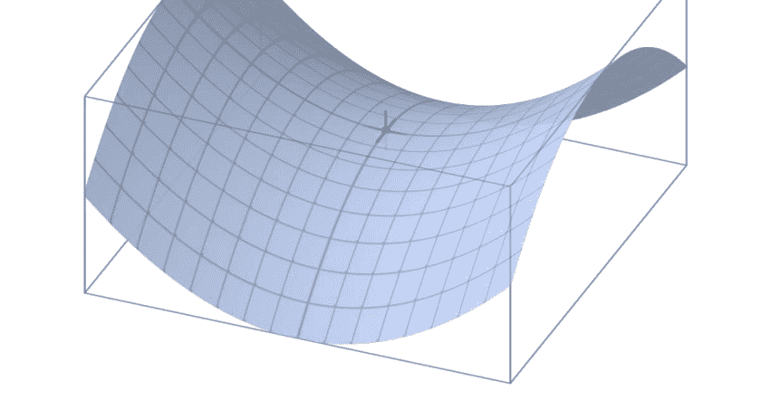

此外，如果 $\mathbf{w}^*$ 实际上是最小化器，则拉格朗日函数对于每个分量 $w_j$ 的偏导数也应该为零。 这会施加额外的条件：

$$ \forall j : \frac{\partial L(\mathbf{w}^*, \boldsymbol{\alpha}^*)}{\partial w_j} = 0 $$

总之，这些被称为 Karush-Kuhn-Tucker (KKT) 条件。
我们可以按照以下方式解决这个表达式：

$$ \begin{align*}
\frac{\partial L(\mathbf{w}^*, \boldsymbol{\alpha}^*)}{\partial w_j} &= 0 \\
&= w_j - \sum_{i=1}^{m} \alpha_i y_i x_{ij} \\
&\implies \mathbf{w} = \sum_{i=1}^{m} \alpha_i y_i \mathbf{x}_i
\end{align*} $$

上面推导的是在固定 $\boldsymbol{\alpha}$ 的情况下最小化 $L$ 的权重向量。 简单的公式意味着对于任何 $\boldsymbol{\alpha}$，我们都可以找到适当的权重向量。 特别地，如果我们能找到 $\boldsymbol{\alpha}^*$，我们就能找到 $\mathbf{w}^*$。

作为下一步，我们可以将 $\mathbf{w}$ 代入 $L$，得到以下结果：

$$ \begin{align*}
L(\mathbf{w}, \boldsymbol{\alpha}) &= L\left(\sum_{i=1}^{m} \alpha_i y_i \mathbf{x}_i, \boldsymbol{\alpha}\right) \\
&= \sum_i \alpha_i - \frac{1}{2} \sum_{i}^{m} \sum_{j}^{m} \alpha_i \alpha_j y_i y_j (\mathbf{x}_i \cdot \mathbf{x}_j)
\end{align*} $$

这表示对 $\mathbf{w}$ 的最小值。 为了完成求解，我们需要在 $\alpha_i \ge 0$ 的约束条件下对上述表达式取最大值。 实际上，这表示了前一个问题的对偶问题。

为了找到 $\alpha^*$，我们可以沿着上述方法的线路使用迭代方法，直到达到所需的鞍点。而且，正如先前演示的那样，找到 $\mathbf{w}^*$给定 $\alpha^*$只是将 $\alpha^*$代入方程 $\mathbf{w}^* = \sum_{i=1}^m \alpha_i^* y_i \mathbf{x}_i$ 的问题。

#### 3.6 支持向量和泛化误差

上述所有条件仍然适用于我们的解决方案（$\mathbf{w}^*$，$\alpha^*$）。特别是：

$\alpha_i^* b_i(\mathbf{w}^*) = 0$
$\alpha_i^* [y_i(\mathbf{w}^* \cdot \mathbf{x}_i) - 1] = 0$

因此，如果 $\alpha_i^*= 0$，那么可以推断出 $y_i(\mathbf{w}^* \cdot \mathbf{x}_i) = 1$。这意味着示例（$\mathbf{x}_i$，$y_i$）是一个支持向量，因为我们可以替换 $\mathbf{w} = \mathbf{v}/\delta$ 以得到：

$y_i(\mathbf{v} \cdot \mathbf{x}_i) = \delta$

这完全满足了支持向量的定义，即在这个例子中，（$\mathbf{x}_i$, $y_i$）与超平面相距$\delta$。

此外，如果($\mathbf{x}_i$, $y_i$)不是支持向量，那么反过来看，可以发现$b_i(\mathbf{w}^*) = 0$，这意味着 $\alpha_i = 0$。因此，解 $\mathbf{w}$ 将是支持向量的线性组合！因此，我们的输出假设可以仅仅用这些支持向量来定义，这是整体训练数据的一个子集。

假设有 $k$个这样的支持向量，我们的算法输出假设 $h$。由于我们的输出假设是训练数据的一个子集的函数，我们可以使用作业2，问题4的结果来限制泛化误差：

$\text{错误}(h) \leq \tilde{O}\left(\frac{k + \ln(1/\delta)}{m}\right)$

这个结果特别吸引人，因为它与维度的数量无关。

### 4 线性不可分性：软边界

到目前为止，我们假设我们的数据是线性可分的。也就是说，我们假设存在一个有效的半平面可以一致地划分数据。然而，通常情况下，这个假设是不成立的。

相反，可能是我们有一些被我们的LTF错误分类的例子，就像图5中的情况。我们希望以某种方式将错误的例子移到超平面的另一侧。但是为此，我们必须付出代价。

在之前的设置中，我们的目标是在约束条件下最小化 $\frac{1}{2} \|\mathbf{w}\|^2$：

$\forall i : y_i(\mathbf{w} \cdot \mathbf{x}_i) \geq 1$

然而，在这种新的设置中（我们被允许轻微地调整我们的示例），我们付出了不同的代价。问题设置如下：

最小化 $\frac{1}{2} \|\mathbf{w}\|^2 + C \sum_{i=1}^m \xi_i$
使得 $\forall i : y_i(\mathbf{w} \cdot \mathbf{x}_i) \geq 1 - \xi_i$
$\qquad \xi_i \geq 0$

图5：一个不一致的LTF
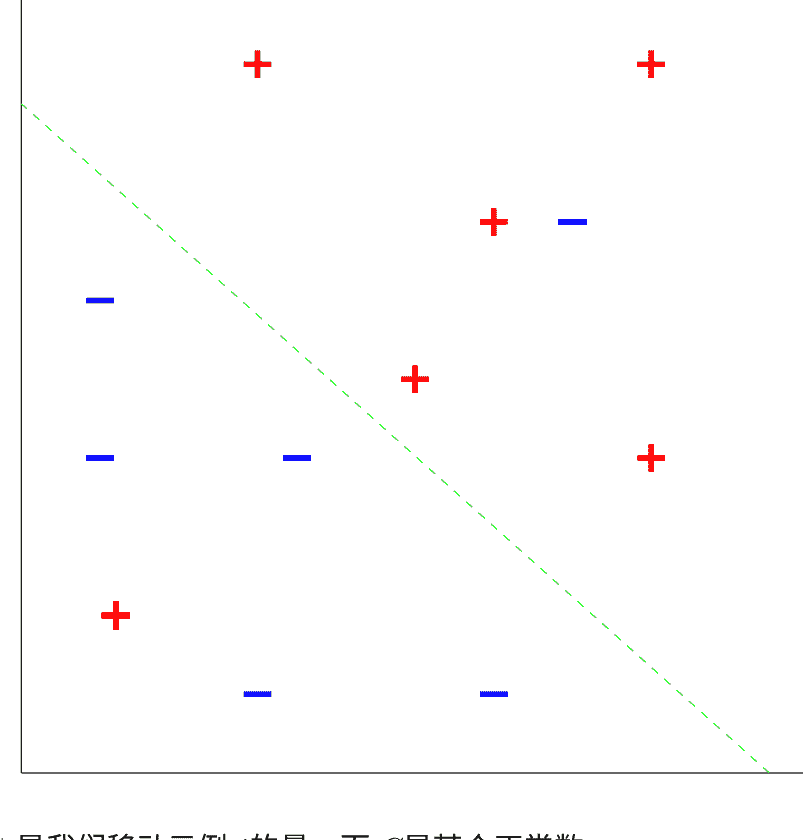

本质上，$\xi_i$是我们移动示例$i$的量，而$C$是某个正常数。这种处理线性不可分性的方法被称为“软边界”技术。

## # 1 支持向量机

### ## 1.1 简要回顾
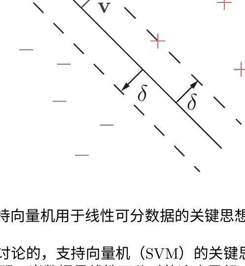

图1：支持向量机用于线性可分数据的关键思想的示意图。

正如在之前的讲座中讨论的，支持向量机（SVM）的关键思想是找到一个可以分离给定数据的超平面。图1说明了当数据是线性可分时的这个思想。超平面由一个单位法向量 v 定义，并且如果我们假设超平面通过原点，我们可以将数据点 x的预测表示为

$$y = \text{sign} (\mathbf{v} \cdot \mathbf{x})$$

从数据点到超平面的“正确”方向的距离被称为边界：

$$\text{边界}(\mathbf{x}, y) = y (\mathbf{v} \cdot \mathbf{x})$$

对于给定的标记数据集$(\mathbf{x}_i, y_i), i=1,\cdots m$, 我们将最小边界 $\delta$定义为

$$\delta = \min_i y_i (\mathbf{v} \cdot \mathbf{x}_i)$$

我们的目标是通过解决凸优化问题找到一个最大化 $\delta$的超平面。图2总结了原始凸优化问题及其对偶形式。

下一个问题是，当解决优化问题时，我们需要为每个样本进行哪些操作。根据方程1，我们可以看出，点积 $(\mathbf{x}_i \cdot \mathbf{x}_j)$ 是解决对偶SVM问题时每个样本所需的唯一计算。

有时候数据是线性不可分的。如果数据“几乎”是线性可分的，我们可以使用软间隔SVM。在这种情况下，我们允许超平面通过轻微移动一些数据点来进行一些分类错误。优化问题可以通过方程2到4进行重新表述，如前面的讲座所讨论的。

## 1.2 关于线性不可分数据的更多信息

如果数据与线性可分相差太远，如图4所示，我们该怎么办？在这种情况下，我们必须寻找另一个解决方案。我们将数据映射到一个更高维度的空间，使得数据可以线性可分。以下是一个例子。

假设原始数据在二维空间中；我们可以使用以下方法将其映射到六维空间中：

$$ \mathbf{x} = (x_1, x_2) \rightarrow \psi(\mathbf{x}) = (1, x_1, x_2, x_1 x_2, x_1^2, x_2^2) \qquad (5) $$

图3：近似线性可分数据的软间隔支持向量机的示意图。

新的超平面由满足 $\mathbf{v} \cdot \psi(\mathbf{x}) = 0$ 的点组成，即：

$$a + bx_1 + cx_2 + dx_1x_2 + ex_1^2 + f x_2^2 = 0 \tag{6}$$

其中 $\mathbf{v}= (a, b, c, d, e, f)$。方程6定义了一个六维空间中的超平面，而在原始的二维空间中，它是一个圆锥曲线的一般方程，即直线、圆、椭圆、抛物线或双曲线。因此，通过这种映射，我们能够在六维空间中分离二维数据。图5展示了一个可能的在二维空间中呈椭圆形的六维超平面用于分类。

上述方法可以推广。如果我们从$n$维空间开始，通过将最高次数为$k$的所有项相加，我们可以得到$O(n^k)$维空间。

接下来，我们必须注意采用这种方法可能出现的问题。存在一个统计问题和一个计算问题：

- 统计问题：根据上述结果，如果我们从100维开始，可能会达到超过一万亿维。也就是说，我们将有更多的参数需要训练，假设的复杂度也会更高。在这种情况下，我们通常需要更多的样本来获得更好的拟合结果。如果样本数量太少，算法容易过拟合。
- 计算问题：数据的存储空间与维数成比例。如果映射后的维数太高，甚至读取数据都需要太长时间。

然而，支持向量机可以克服这两种问题。首先，对于统计问题，我们使用结果

$$\text{VC-维度} \le \left( \frac{R}{\delta} \right)^2, \tag{7}$$

其中 $R$是包含所有数据的球的半径，$\delta$是边界。我们应该注意到，VC-维度不依赖于数据的维度。

因此，尽管增加数据的维度可能会增加 $R$，但通常 $\delta$也会变大。也就是说，我们可以预期VC-维度增长不会那么快。

对于计算问题，回想一下之前的观察，对于每个样本，我们只需要计算内积。因此，在映射之后，计算两个样本 $\mathbf{x}$和 $\mathbf{z}$的公式为：

$$\psi(\mathbf{x}) \cdot \psi(\mathbf{z})$$

然而，基于我们上面给出的数字（从100维到一万维的映射），如果维度过高，计算可能会变得非常缓慢。我们将讨论如何在支持向量机中解决这个问题。

## 1.3 核技巧

我们首先回顾方程5中描述的映射函数。现在假设我们修改映射函数 $\psi(\mathbf{x})$ 为：

$$\mathbf{x}=(x_1, x_2) \rightarrow \psi(\mathbf{x})=(1, \sqrt{2}x_1, \sqrt{2}x_2, \sqrt{2}x_1 x_2, x_1^2, x_2^2) \tag{8}$$

由于我们只改变了一些项的常数，这不会影响我们在映射后能够表示的超平面。然而，$\psi(\mathbf{x})$ 和 $\psi(\mathbf{z})$ 的内积变为：

$\psi(\mathbf{x}) \cdot \psi(\mathbf{z}) = 1 + 2x_1z_1 + 2x_2z_2 + 2x_1z_1x_2z_2 + (x_1z_1)^2 + (x_2z_2)^2$
$= (1 + x_1z_1 + x_2z_2)^2$
$= (1 + \mathbf{x} \cdot \mathbf{z})^2$

也就是说，如果原始维度是 $n$，通过添加所有最多 $k$次的项，我们有
$\psi(\mathbf{x}) \cdot \psi(\mathbf{z}) = (1 + \mathbf{x} \cdot \mathbf{z})^k = K(\mathbf{x}, \mathbf{z})$
计算复杂度现在是 $O(n)$而不是 $O(n^k)$，计算问题得到了缓解。

上面显示的结果表明，在一些特定的映射下，可以使用低维空间中的内积来计算高维空间中的内积。通常，我们定义一个核函数 $K(\mathbf{x}, \mathbf{z}) = \psi(\mathbf{x}) \cdot \psi(\mathbf{z})$，具有这个性质的映射 $\psi$。通过用 $K(\mathbf{x}_i, \mathbf{x}_j)$ 替换方程式1中的内积 $(\mathbf{x}_i \cdot \mathbf{x}_j)$，我们可以得到高维超平面的解。这种方法被称为核技巧。实际应用中有不同种类的核函数。方程式10中显示的核函数被称为多项式核。另一个流行的核函数是高斯径向基函数 (RBF) 核 $K(\mathbf{x}, \mathbf{z}) = \exp(-c \cdot ||\mathbf{x} - \mathbf{z}||^2)$，其维度是无限的。我们还应该注意到，输入到核函数的是 $\mathbf{x}$和 $\mathbf{z}$不一定是向量。例如，$\mathbf{x}$和 $\mathbf{z}$可以是完全不同类型的对象，比如字符串或树，只要核函数为它们提供内积的映射即可。

总结一下，解决SVM问题的目标是最大化间隔 $\delta$。当数据线性不可分时，我们可以通过结合核技巧和软间隔方法来处理它。

## 1.4 SVM和Boosting的比较

现在我们可以比较SVM和Boosting。在SVM中，我们将输入数据视为欧几里得空间中的点：$\mathbf{x} \in \mathbb{R}^n$。正如前面的讲座中所讨论的，假设是很自然的。
在Boosting中，我们实际上从未接触过数据。相反，我们操作的是弱假设。为了简单起见，假设我们使用有限的弱假设空间 $H = \{g_1(\mathbf{x}), \dots, g_N(\mathbf{x})\}$ 并且输入可以被视为向量 $\mathbf{h}(\mathbf{x}) = \langle g_1(\mathbf{x}), \dots, g_N(\mathbf{x}) \rangle$。
回想一下，对于一个向量 $\mathbf{z}$的无穷范数被定义为 $||\mathbf{z}||_\infty = \max_j |z_j|$。因此，我们有 $||\mathbf{h}(\mathbf{x})||_\infty = \max_j |g_j(\mathbf{x})| = 1$，因为 $g_j(\mathbf{x}) \in \{-1, +1\}$。

接下来，我们比较系数来计算和预测。在SVM中，算法计算超平面的单位法向量 $\mathbf{v}$，并且预测是 $\text{sign}(\mathbf{v} \cdot \mathbf{x})$。
在提升算法中，算法计算弱假设 $h_t \in H$的系数 $\alpha_t \ge 0$。假设我们运行提升算法 $T$ 次，预测符号
$(\sum_{t=1}^T \alpha_t h_t(\mathbf{x})) / \sum_t \alpha_t$
是 $h_t$的凸组合。由于每个 $h_t \in H = \{g_1(\mathbf{x}), \dots, g_N(\mathbf{x})\}$，我们可以通过找到相应的权重 $a_j$ 将预测重写为另一个凸组合 $g_j(\mathbf{x})$：

$(\sum_{t=1}^T \alpha_t h_t(\mathbf{x})) / \sum_t \alpha_t = \sum_{j=1}^N a_j g_j(\mathbf{x}) = \mathbf{a} \cdot \mathbf{h}(\mathbf{x}),$

值得注意的是 $\sum_{j=1}^N |a_j| = ||\mathbf{a}||_1 = 1$，其中 $a_j \ge 0$。
因此，提升的目标可以看作是为每个 $g_j$找到一个 $a_j$，并且对于样本 $\mathbf{x}$的预测是 $\text{sign}(\mathbf{a} \cdot \mathbf{h}(\mathbf{x}))$。

|  | 支持向量机 | AdaBoost |
| :--- | :--- | :--- |
| 输入 | $\mathbf{x} \in \mathbb{R}^n$, $\|\mathbf{x}\|_2 \leq 1$ | $\mathbf{h}(x), \|\mathbf{h}(x)\|_\infty = 1$ |
| 找到 | $\|\mathbf{v}\|_2 = 1$ | $\|\mathbf{a}\|_1 = 1, \mathbf{a} = \langle a_1, \dots, a_N \rangle$ |
| 预测 | $\text{sign}(\mathbf{v} \cdot \mathbf{x})$ | $\text{sign}\left(\mathbf{a} \cdot \mathbf{h}(x)\right) = \text{sign}\left(\sum_{j=1}^N a_j g_j(x)\right)$ |
| 边界 | $y(\mathbf{v} \cdot \mathbf{x})$ | $y(\mathbf{a} \cdot \mathbf{h}(x))$ |

图6：支持向量机和Boosting的比较。

最后，我们比较了SVM和Boosting算法的边界。SVM的边界是 $y(\mathbf{v} \cdot \mathbf{x})$，而Boosting的边界是 $y(\mathbf{a} \cdot \mathbf{h}(x))$。SVM和AdaBoost的目标都是最大化边界，但在这里使用的范数是不同的：在SVM中， $\|\mathbf{v}\|_2=1$， $\|\mathbf{x}\|_2=1$，而在Boosting中， $\|\mathbf{a}\|_1=1$， $\|\mathbf{h}(x)\|_\infty=1$。

上述比较的总结列在图6中。

## 2 在线学习

### 2.1 引言

到目前为止，我们专注于PAC学习模型。我们假设存在一个固定的分布，用于训练和测试数据，训练样本是随机选择的。
我们讨论的算法都是批量学习算法，这意味着在训练之后，假设是固定的，然后用于所有未来的测试样本。现在我们转向在线学习。以下是在线学习的一些特点。首先，在线学习中训练和测试同时进行。学习者一次获取一个训练样本，进行预测，然后得到真实结果作为反馈。
一个例子是预测股市。早上，在线学习者预测股价是上涨还是下跌，然后经过一天后可以得到真实情况并调整未来的预测。其次，在线学习算法往往简单。第三，在线学习模型对数据的分布没有任何假设，甚至可以完全放弃数据是随机生成的假设。
在接下来和未来的讲座中，我们将展示即使没有这些假设，我们仍然可以有意义地分析在线学习算法。

### 2.2 专家建议学习

我们从一个股市的例子开始。图7给出了例子的设置。假设有四个专家每天早上对价格进行预测，学习者根据这四个预测进行预测。学习者的目标是在一定时间内提供与最好的专家一样好或者至少不差太多的表现。这个一般的设置被称为“专家建议学习”，并且可以如下表示：

$N=$ 专家数量
对于 $t= 1, \cdots, T$
每个专家 $i$ 预测 $\xi_i \in \{0,1\}$，学习者预测 $\hat{y} \in \{0,1\}$，
观察结果 $y \in \{0,1\}$（如果 $\hat{y} \ne y$则是错误的）。

|  | 专家 1 | 专家 2 | 专家 3 | 专家 4 | 学习者（大师）的结果 |
| :--- | :--- | :--- | :--- | :--- | :--- |
| 第一天 | ↑ | ↑ | ↓ | ↑ | ↑ ↑ |
| 第二天 | ↓ | ↑ | ↑ | ↓ | ↓ ↑ |
| ... | ... | ... | ... | ... | ... |
| 错误数量 | 37 | 12 | 67 | 50 | 18 |

图7：股票市场示例。

我们希望将学习者的错误数量与最佳专家的错误数量相关联。然而，学习者不知道哪个专家是最好的。在假设至少有一个专家是完美的情况下，我们可以采用下面描述的简单算法：

$\hat{y} = \text{迄今没有错误的专家的多数投票}$

这种方法被称为“Halving算法”。为了更具体地了解它的工作原理，我们重新访问图7中的股票市场示例。在第一天，专家3犯了一个错误，所以学习者从第二天开始不考虑专家3的预测。

现在我们可以计算Halving算法的错误界限如下。让$W$是迄今为止没有犯错误的专家数量，或者我们称之为活跃专家的数量。最初我们有$W = N$。在学习者犯下一个错误后，我们有$W \le \frac{1}{2} N$，因为至少有一半的活跃专家犯了这个错误。类似地，在学习者犯下第二个错误后，$W \le \frac{1}{4} N$，以此类推。在学习者犯下$m$个错误后，我们有$W \le \frac{1}{2^m} N$。由于至少有一个专家是完美的假设，我们有$W \ge 1$。即，

$$ 1 \leq W \leq \frac{1}{2^m} N \Rightarrow m \leq \lg(N) $$

最后，我们可以考虑一个特殊情况，即将每个专家视为一个假设。假设我们有一个假设空间$H = \{h_1, \dots, h_N\}$，目标概念$c \in H$。通过采用Halving算法，每一轮学习者获得一个样本$x$，进行预测$\hat{y} \in \{0,1\}$，然后观察真实结果$y = c(x)$。然后我们有以下错误界限：

$$ \text{错误数量} \leq \lg(N) = \lg(|H|) $$

# COS 511：理论机器学习

讲师：Rob Schapire
记录员：Jieming Mao

讲座 # 15
2013年4月1日

## 1 简要回顾

### 1.1 专家建议学习

上次，我们开始讨论“专家建议学习”。这个模型与我们在本学期之前看到的模型非常不同。在这个模型中，学习者一次只能看到一个例子，并且必须根据“专家”的建议和历史进行预测。形式上，该模型可以写成

- $N=$ 专家数量
- 对于 $t= 1, \dots, T$
  - 每个专家 $i$ 预测 $\xi_i \in \{0, 1\}$
  - 学习者预测 $\hat{y} \in \{0, 1\}$
  - 学习者观察 $y \in \{0, 1\}$
  - (如果 $y \ne \hat{y}$, 则错误)

在上一节课中，我们介绍了一个“二分算法”，它在存在一个“完美”专家的情况下起作用。在这种情况下，“二分算法”所犯的错误数量最多为 $\lg(N)$。

### 1.2 与PAC学习的联系

现在我们考虑一个“PAC学习模型的类比”：

- 假设空间 $H = \{h_1, \dots, h_N\}$
- 目标概念 $c \in H$
- 在每一轮中
  - 获取 $x$
  - 预测 $\hat{y}$
  - 观察 $c(x)$

这个问题是一个非常自然的在线学习问题。然而，我们可以通过将每个假设 $h_i$ 视为一个专家，将这个问题与“专家建议学习”联系起来。由于目标概念是在假设空间中选择的，我们总是有一个“完美”专家。因此，我们可以将“Halving算法”应用于解决这个问题，并且“Halving算法”最多会犯 $\lg(N) = \lg(|H|)$个错误。

## 2 限制错误的数量

在前一节中，自然而然地会问“Halving算法”是否是最好的可能的算法。为了回答这个问题，我们必须定义什么是“最好的”。让 $A$是任意的确定性算法，定义

$$M_{\mathcal{A}}(\mathcal{H}) = \max_{c,x}(\#\text{算法 } A\text{犯的错误数})$$

$M_{\mathcal{A}}(\mathcal{H})$是算法 $A$在假设空间 $\mathcal{H}$中在最坏情况下会犯的错误数。如果 $M_{\mathcal{A}}(\mathcal{H})$很小，则认为算法是好的。现在定义

$$opt(\mathcal{H}) = \min_{\mathcal{A}} M_{\mathcal{A}}(\mathcal{H})$$

我们将通过以下定理将 $opt(\mathcal{H})$下界为$VCdim(\mathcal{H})$：

定理 1. $VCdim(\mathcal{H}) \leq opt(\mathcal{H})$

证明: 设 $A$是任意确定性算法。令 $d = VCdim(\mathcal{H})$。设 $x_1, ..., x_d$被 $\mathcal{H}$打碎。现在我们可以构造一种对抗策略，迫使 $A$犯下 $d$个错误，如下所示：

- 对于 $t=1, \cdots, d$
  - 将 $x_t$呈现给 $A$
  - $\hat{y}_t = A$的预测
  - 选择 $y_t= \hat{y}_t$。

由于 $x_1, ..., x_d$被 $\mathcal{H}$打碎，我们知道存在一个概念 $c \in \mathcal{H}$，使得 $c(x_t) = y_t$对于所有 $t$成立。此外，由于 $A$是确定性的，我们可以提前模拟它。因此，这样的对抗构造是可能的。因此存在一种对抗策略，迫使$A$犯下 $d$个错误。

总结这一部分，我们有以下结果，

$$VCdim(\mathcal{H}) \leq opt(\mathcal{H}) \leq M_{Halving}(\mathcal{H}) \leq \lg(|\mathcal{H}|).$$

## 3 加权多数算法

现在我们回到“专家建议学习”并且我们想要设计算法当没有“完美”的专家时。在这种情况下，我们将比较我们的算法的错误数量和最佳专家的错误数量。在这里，我们修改“Halving算法”以获得当没有“完美”的专家时的算法。我们不会丢弃专家，而是为每个专家保留一个权重，并在该专家犯错误时降低权重。

我们将这个算法称为加权多数算法:

- $w_i =$ 专家 $i$ 的权重
- 参数 $0 \leq \beta < 1$
- $N =$ 专家数量

- 最初   $\forall i, w_i = 1$
- 对于 $t = 1, \dots, T$
  - 每个专家 $i$ 预测 $\xi_i \in \{0,1\}$
  - $q_0 = \sum_{i:\xi_i=0} w_i, q_1 = \sum_{i:\xi_i=1} w_i.$
  - 学习者预测 $\hat{y} \in \{0,1\}$
  - $\hat{y} = \begin{cases} 1 & \text{如果 } q_1 \geq q_0 \\ 0 & \text{否则} \end{cases}$ (加权多数投票)
  - 学习者观察到 $y \in \{0,1\}$
  - (错误如果 $y \ne \hat{y}$)
  - 对于每个 $i$, 如果 $\xi_i \ne y$, 那么 $w_i \leftarrow w_i \beta$

现在我们将通过证明以下定理来分析加权多数算法(WMA):

### 定理 2. (#WMA的错误次数) $\leq a_\beta$ (#最佳专家的错误次数) $+ c_\beta \lg(N)$, 其中 $a_\beta = \lg(1/\beta)/\lg(2/(1+\beta))$ 和 $c_\beta = 1/\lg(2/(1+\beta))$.

在证明这个定理之前，让我们先试着理解这个定理意味着什么。下表给出了参数的一个很好的理解:

| $\beta$ | $a_\beta$ | $c_\beta$ |
| :--- | :--- | :--- |
| 1/2 | $\approx$ 2.4 | $\approx$ 2.4 |
| 0 | $+\infty$ | 1 |
| $\to 1$ | 2 | $+\infty$ |

如果我们将不等式两边除以 $T$，我们得到

$$\frac{(\text{WMA的错误次数})}{T} \leq \frac{a_\beta (\text{最佳专家的错误次数})}{T} + \frac{c_\beta \lg(N)}{T}$$

当 $T \to +\infty$时，$\frac{c_\beta \lg(N)}{T} \to 0$。那么这个定理意味着WMA犯错的速率被一个常数乘以最佳专家犯错的速率所限制。

证明: 将$W$定义为所有专家的权重之和: $W = \sum_{i=1}^{N} w_i$。最初，我们有$W = N$。现在我们考虑$W$在某一轮中的变化。在某一轮中，不失一般性，我们假设$y = 0$。那么

$$\text{新的} W = \sum_{i=1}^{N} \text{新的} w_i \\ = \sum_{i:\xi_i=1} w_i \beta + \sum_{i:\xi_i=0} w_i \\ = q_1 \beta + q_0 \\ = q_1 \beta + (W - q_1) \\ = W - (1 - \beta) q_1$$现在假设WMA犯了一个错误。那么

```
$\hat{y}=y \Rightarrow \hat{y}=1 \Rightarrow q_1 \geq q_0$
```

```
$\Rightarrow q_1 \geq \frac{W}{2}$
```

```
$\Rightarrow W_{new} \leq W - (1-\beta)\frac{W}{2} = \left( \frac{1+\beta}{2} \right)W$
```

所以如果WMA犯了一个错误，权重的总和W将会通过乘以$\frac{1+\beta}{2}$来减少

```
$W \leq N \cdot \left( \frac{1+\beta}{2} \right)^m$
```

定义$L_i$为专家$i$犯的错误次数。那么我们有

```
$\forall i, w_i = \beta^{L_i} \leq W \leq N \cdot \left( \frac{1+\beta}{2} \right)^m$
```

解这个不等式，并注意它对所有专家$i$都成立，我们得到

```
$m \leq \frac{(\min_i L_i) \lg(1/\beta) + \lg(N)}{\lg\left( \frac{2}{1+\beta} \right)}$
```

## 4 随机加权多数算法

先前的证明表明，最好的情况下，WMA的错误次数最多是最佳专家的两倍。如果最佳专家实际上犯了大量错误，这个结果就很弱。为了得到更好的算法，我们必须引入随机性。我们将要介绍的下一个算法叫做随机加权多数算法。这个算法与加权多数算法非常相似。

唯一的区别是，在每一轮中，算法根据权重以一定的概率选择一个专家，并使用被随机选择的专家进行预测。算法如下：

- $w_i=$ 专家$i$的权重
- 参数$0 \leq \beta < 1$
- $N=$ 专家数量
- 初始时，$\forall i, w_i=1$
- 对于$t=1,\cdots,T$
  - 每个专家$i$预测$\xi_i \in \{0,1\}$
  - $q_0 = \sum_{i:\xi_i=0} w_i, q_1 = \sum_{i:\xi_i=1} w_i$
  - 学习者预测$\hat{y} \in \{0,1\}$
  - $\hat{y} = \begin{cases} 1 & \text{以概率} \frac{q_1}{W} \\ 0 & \text{以概率} \frac{q_0}{W} \end{cases}$
  - 学习者观察到的$y \in \{0,1\}$
  - 如果 $y \neq \hat{y}$ 则犯错误
  - 对于每个 $i$, 如果 $\xi_i = y$, 那么 $w_i \leftarrow w_i \beta$

现在让我们通过证明以下定理来分析随机权重多数算法(RWMA):

### 定理3. $E(RWMA的错误次数) \leq a_\beta (最佳专家的错误次数) + c_\beta \ln(N)$, 其中 $a_\beta = \frac{\ln(1/\beta)}{1-\beta}$ 和 $c_\beta = \frac{1}{1-\beta}$.

请注意，我们在考虑RWMA的错误次数的期望，因为RWMA是一个随机算法。当 $\beta \to 1$时，$a_\beta \to 1$。这意味着RWMA可以非常接近最优解。

证明: 类似于前一个定理的证明，我们通过考虑权重的总和 $W$来证明这个定理。在某一轮中，将 $l$定义为RWMA犯错误的概率:

$$l = Pr[\hat{y} = y] = \frac{\sum_{i:\xi_i=y} w_i}{W}.$$

然后这一轮的权重会发生变化，变为

$$\begin{aligned} \text{新的}W &= \sum_{i:\xi_i=y} w_i \beta + \sum_{i:\xi_i \neq y} w_i \\ &= l W \beta + (1 - l) W \\ &= W(1 - l(1 - \beta)) \end{aligned}$$

然后我们可以将最终的权重之和表示为

$$\begin{aligned} W_{final} &= N \cdot (1 - l_1(1 - \beta)) \cdots (1 - l_T(1 - \beta)) \\ &\leq N \prod_{t=1}^T \exp(-l_t(1 - \beta)) \\ &= N \cdot \exp(-(1 - \beta) \sum_{t=1}^T l_t) \end{aligned}$$

然后我们有

$$\beta^{L_i} \leq w_i \leq W_{final} \leq N \cdot \exp(-(1 - \beta) \sum_{t=1}^T l_t).$$

定义 $L_A = \sum_{t=1}^T l_t$为RWMA的预期错误次数。我们有

$$L_A = \sum_{t=1}^T l_t \leq \frac{\ln(1/\beta)}{1 - \beta} (最佳专家的错误次数) + \frac{1}{1 - \beta} \ln N.$$

## 5 RWMA的变种

首先讨论如何选择RWMA的参数 β。假设我们有一个上界对最佳专家的错误次数，即min_i L_i ≤ K，那么我们可以选择β为

$$\beta = \frac{1}{1 + \sqrt{\frac{2 \ln(N)}{K}}}$$

然后我们有

$$L_A \leq \min_i L_i + \sqrt{2K \ln(N)} + \ln(N).$$

自然而然地会问我们是否可以比RWMA更好。答案是肯定的。高层次的想法是在WMA和RWMA之间工作。下图显示了这个算法的工作原理。y轴是将ŷ预测为1的概率。x轴是预测1的专家的加权比例。红线是WMA，蓝线是RWMA，绿线是新算法。

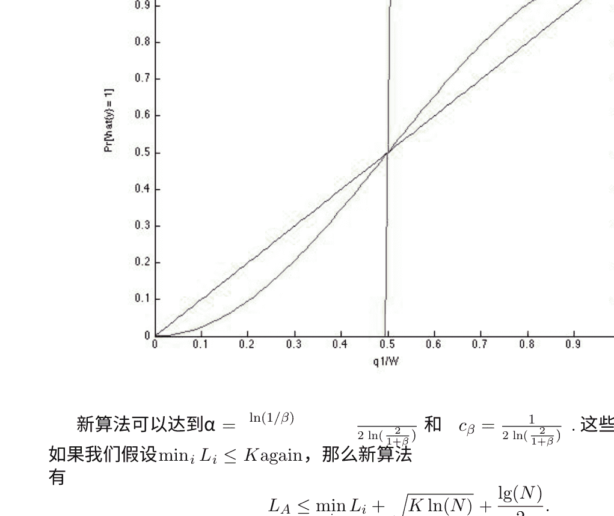

新算法可以达到$\alpha = \frac{\ln(1/\beta)}{2 \ln\left(\frac{2}{1+\beta}\right)}$ 和 $c_\beta = \frac{1}{2 \ln\left(\frac{2}{1+\beta}\right)}$。这些与WMA的一半相同。

如果我们假设min_i L_i ≤ K again, 那么新算法有

$$L_A \leq \min_i L_i + \sqrt{K \ln(N)} + \frac{\lg(N)}{2}.$$

如果我们设置 K = 0, 这意味着存在一个“完美”的专家, 我们有

$$L_A \leq \frac{\lg(N)}{2}$$

因此我们知道这个算法比“Halving算法”更好。

通常我们可以假设 K = T/2 通过添加两个专家: 一个总是预测1, 另一个总是预测0。然后我们有

$$L_A \leq \min_i L_i + \sqrt{\frac{T \ln(N)}{2}} + \frac{\lg(N)}{2}.$$

如果我们两边除以 $T$，我们得到

$$\frac{L_A}{T} \le \frac{\min_i L_i}{T} + \sqrt{\frac{\ln(N)}{2T}} + \frac{\lg(N)}{2T}.$$

当 $T$ 变大时，不等式的右边由该项主导 $\sqrt{\frac{\ln(N)}{2T}}.$

## 6 下界

最后，我们将为“专家建议学习”给出一个下界。这个下界与我们从前一节得到的上界相匹配，即使对于常数因子也是如此。

因此，这个下界是紧密的，我们无法改进前一节中的算法。

为了证明这个下界，我们考虑以下情景：

- 在每一轮中，对手随机选择每个专家的预测， $\xi_i = \begin{cases} 1 & \text{概率为 } 1/2 \\ 0 & \text{概率为 } 1/2 \end{cases}$
- 在每一轮中，对手随机选择反馈， $y = \begin{cases} 1 & \text{概率为 } 1/2 \\ 0 & \text{概率为 } 1/2 \end{cases}$

对于任何学习算法 $A$，

$$E_{y,\xi}[L_A] = E_{\xi}[E_y[L_A|\xi]] = T / 2.$$

对于任何专家 $i$，我们有

$$E[L_i] = T / 2.$$

然而，我们可以证明

$$E[\min_i L_i] \approx \frac{T}{2} - \sqrt{\frac{T \ln(N)}{2}}.$$

因此，

$$E[L_A] - E[\min_i L_i] \ge \sqrt{\frac{T \ln(N)}{2}}.$$

这个术语 $\sqrt{\frac{T \ln(N)}{2}}$ 在前一节中满足主导术语。此外，在下界的证明中，对手只使用完全随机的专家预测和结果。

因此，假设数据是随机的而不是对抗性的并不能带来任何好处。我们在对抗性环境中证明的界限与完全随机数据的界限一样好。

## 1 引言

我们上一节的在线学习场景的目标是与最佳专家进行比较，并且与最佳专家一样好。

另一种情况是没有单个好的专家。但是我们可以组成一个专家委员会，他们可能会更好。

我们将如下形式化：

- 我们有 $N$ 个专家。
- 对于 $t= 1, ..., T$ 我们得到 $\mathbf{x}_t \in \{1, -1\}^N$  
  注意： $\mathbf{x}_t$：一组预测  
  $N$：维度  
  第$i$个分量：专家 $i$的预测
- 每一轮中，学习者预测 $\hat{y}_t \in \{1, -1\}$
- 每一轮中，我们观察到结果 $y_t \in \{1, -1\}$
- 上述内容相同；我们改变的是数据的假设。我们假设存在一个完美的委员会，即一组总是正确的专家的加权和。形式上，这意味着 $\mathbf{u} \in \mathbb{R}^N$，

$$\forall t: y_t = sign\left(\sum_{i=1}^{N} u_i x_{t, i}\right) = sign(\mathbf{x}_t \cdot \mathbf{u})$$
$$\iff y_t(\mathbf{u} \cdot \mathbf{x}_t) > 0$$

从几何上讲，完美的委员会意味着存在一个线性阈值，可以将1点和 $-1$点分开，由适当加权和的专家生成。

## 2 如何进行更新

我们关注的是 $\mathbf{w}_t$，即 $\mathbf{u}$ 的预测。这有点像对专家的正确加权的“猜测”。我们将在每一轮更新权重。今天我们将研究两个算法。对于每个算法，我们只需要关注

- (1) 初始化
- (2) 更新

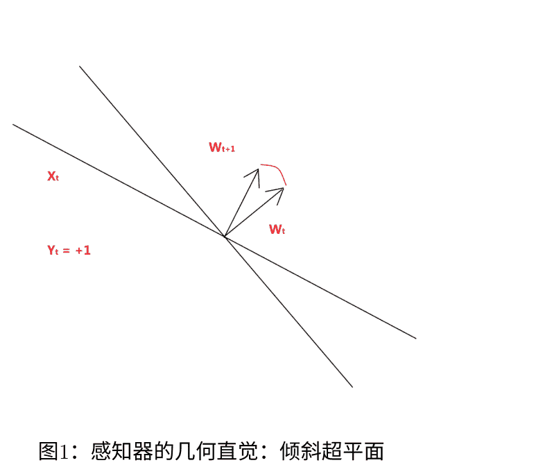

图1：感知器的几何直觉：倾斜超平面

### 2.1 感知器

更新权重的第一种方法将给我们一个称为感知器的算法。更新规则如下：

- 初始化 ：$\mathbf{w}_1 = 0$
- 更新 ：如果错误（$\Leftrightarrow \hat{y}_t = y_t \Leftrightarrow y_t(\mathbf{w}_t \cdot \mathbf{x}_t) \leq 0$），  
  $\mathbf{w}_{t+1} = \mathbf{w}_t + y_t \mathbf{x}_t$
  否则，
  $\mathbf{w}_{t+1} = \mathbf{w}_t$

当没有错误时，不调整权重会使算法保守；算法忽略正确分类的样本。

直觉是，如果答案错误，我们将权重在所有专家上“移动”到正确答案的方向。图1给出了感知器算法的几何直觉。这里 $y_t = +1$，当 $(\mathbf{x}_t, y_t)$ 被错误分类时，我们将 $\mathbf{x}_t y_t$ 添加到 $\mathbf{w}_t$ 中的方向，以便下次更有可能正确分类 $(\mathbf{x}_t, y_t)$；我们正在将 $\mathbf{w}_t$ 定义的超平面向这样一个方向移动，以便更有可能正确分类 $\mathbf{x}_t$。

现在让我们来陈述一个定理，以正式分析感知器算法的性能。然而，首先我们要做一些假设：

- 每一轮都会发生错误。这是因为在其他轮中没有算法变化发生。所以：$T =$ 轮数 $=$ 错误次数。
- 我们对预测向量进行归一化，使得 $\| \mathbf{x}_t \|_2 \leq 1$。
- 我们对完美委员会的权重向量进行归一化，使得$\|\mathbf{u}\|_2=1$。（这是可以的，因为符号函数的值不会受到这种归一化的影响。）
- 我们假设这些点是线性可分的，至少有一个间隔为$\delta$：$\exists \delta, \mathbf{u} \in \mathbb{R}^N, \forall t: y_t(\mathbf{u} \cdot \mathbf{x}_t) \geq \delta > 0$。请注意，这个假设是没有损失一般性的。

**定理2.1** 在上述假设下，$T=$ 错误次数，我们有

$$T \leq \frac{1}{\delta^2}$$

证明: 为了证明这一点，我们将找到一些取决于算法在时间$t$的状态的数量，对其进行上界和下界，并从中得出一个界限。这里的数量是$\Phi_t$，它是向量$\mathbf{w}_t$和$\mathbf{u}$之间夹角$\Theta$的余弦。更正式地说，

$$\Phi_t = \frac{\mathbf{w}_t \cdot \mathbf{u}}{\|\mathbf{w}_t\|_2} = \cos\Theta \leq 1$$

现在对于下界，我们将证明

$$\Phi_{T+1} \geq \sqrt{T} \delta$$

我们将分两部分来完成这个证明——通过对$\Phi_t$的分子进行下界估计，并对分母进行上界估计。

- **步骤1:** $\mathbf{w}_{T+1} \cdot \mathbf{u} \geq T\delta$:

$$\mathbf{w}_{t+1} \cdot \mathbf{u} = (\mathbf{w}_t + y_t \mathbf{x}_t) \cdot \mathbf{u} = \mathbf{w}_t \cdot \mathbf{u} + y_t (\mathbf{u} \cdot \mathbf{x}_t) \geq \mathbf{w}_t \cdot \mathbf{u} + \delta$$

这个不等式是根据上面的第4个假设得出的。最初我们设置$\mathbf{w}_1 \cdot \mathbf{u}=0$，因此上述界限意味着$\mathbf{w}_{T+1} \cdot \mathbf{u} \geq T\delta$。

- **步骤2:** $\|\mathbf{w}_{T+1}\|_2^2 \leq T$:

$$\|\mathbf{w}_{t+1}\|_2^2 = \mathbf{w}_{t+1} \cdot \mathbf{w}_{t+1} = (\mathbf{w}_t + y_t \mathbf{x}_t) \cdot (\mathbf{w}_t + y_t \mathbf{x}_t) = \|\mathbf{w}_t\|_2^2 + 2 y_t (\mathbf{x}_t \cdot \mathbf{w}_t) + \|\mathbf{x}_t\|_2^2$$

由于我们假设每一轮都会出现错误，$y_t (\mathbf{x}_t \cdot \mathbf{w}_t) \leq 0$，并且根据归一化假设，$\|\mathbf{x}_t\|_2^2 \leq 1$，因此我们得到$\|\mathbf{w}_{t+1}\|_2^2 \leq \|\mathbf{w}_t\|_2^2 + 1$。最初我们设置$\|\mathbf{w}_1\|_2^2=0$，所以我们得到$\|\mathbf{w}_{T+1}\|_2^2 \leq T$。

现在我们将步骤1和步骤2结合起来，$1 \geq \Phi_{T+1} \geq \frac{T\delta}{\sqrt{T}}$ 即 $T \leq \frac{1}{\delta^2}$。$\square$

设$\mathcal{H}$为假设空间，$M_{\text{感知机}}(\mathcal{H})$为感知机算法的错误次数。根据上述简单推论，由于假设空间的VC维度受算法的错误次数上界限制，我们得到至少具有$\delta$边际的阈值函数的VC维度最多为

$$VC\text{-dim}(\mathcal{H}) \leq opt(\mathcal{H}) \leq M_{\text{感知机}} (\mathcal{H}) \leq \frac{1}{\delta^2}$$

现在考虑一个目标$\mathbf{u}$由0和1组成的情况，向量中的1的数量为$k$。

$$\mathbf{u} = \frac{1}{\sqrt{k}}(0\ \ 1\ \ 0\ \ 0\ \ 1\ \ ...)$$

请注意这里 $\frac{1}{\sqrt{k}}$ 是为了归一化。将 $k$ 视为与 $N$ 相比较小的值，即它可以是一个非常稀疏的向量。这也是我们之前讨论过的问题之一 - $k$ 专家是“完美”的委员会。我们有，

$$\mathbf{x}_t = \frac{1}{\sqrt{N}}(+1, \ -1, \ -1, \ +1, \ ...)$$
$$y_t = sign(\mathbf{u} \cdot \mathbf{x}_t)$$
$$y_t(\mathbf{u} \cdot \mathbf{x}_t) \geq \frac{1}{\sqrt{kN}}$$

请注意这里 $\frac{1}{\sqrt{N}}$ 是用于归一化的。所以使用 $\frac{1}{\sqrt{kN}}$ 作为 $\delta$，根据定理2.1，感知器算法最多会犯$kN$个错误。然而，这并不好——将专家解释为特征，我们有数百万个无关的特征，而委员会是重要的（可能是十几个）特征。我们得到了对 $N$的线性依赖，通常很大。

受到这个例子的启发，我们提出了另一种更新算法，称为Winnow算法，它将得到一个更好的界限。

### 2.2 Winnow算法

- 初始化 ：
  $$\forall i, w_{1,i} = \frac{1}{N}$$
  我们从所有专家中开始使用均匀分布。
- 更新 :如果我们犯了一个错误，
  $$\forall i: w_{t+1,i} = \frac{w_{t,i} \cdot e^{\eta y_t x_t}}{Z_t}$$
  这里 $\eta$ 是我们稍后将定义的参数，而 $Z_t$ 是一个归一化因子。否则，
  $$\mathbf{w}_{t+1} = \mathbf{w}_t$$

这个更新规则就像对错误的专家进行指数惩罚。如果我们忽略归一化因子，上述更新等价于 $w_{t+1,i} = w_{t,i}e^{\eta}$，如果 $i$ 预测正确，而 $w_{t+1,i} = w_{t,i}e^{-\eta}$ 否则。忽略归一化因子，我们可以将其视为 $w_{t+1,i} = w_{t,i}$，如果 $i$ 预测正确，而 $w_{t+1,i} = w_{t,i}e^{-2\eta}$ 否则。这与加权多数投票相同。

在陈述Winnow算法的正式定理之前，我们做了一些假设，不失一般性地说：

- 我们在每一轮都犯错。
- $\forall t : \|\mathbf{x}_t\|_\infty \leq 1.$
- $\exists \delta, \mathbf{u} : \forall t : y_t(\mathbf{u} \cdot \mathbf{x}_t) \geq \delta > 0.$
- $\| \mathbf{u} \|_1 = 1 \text{ and } \forall i: u_i \geq 0.$

注意这里我们使用了 $L_1$ 和 $L_\infty$ 范数，而不是在感知器算法中使用的 $L_2$ 范数。

## 2.2 错误数上界定理

在上述假设下，我们对错误次数有以下上界：

$$ T \le \frac{\ln N}{\eta\delta + \ln(\frac{2}{e^\eta + e^{-\eta}})} $$

如果我们选择一个最优的 $\eta$ 来最小化界限，当 $\eta = \frac{1}{2} \ln(\frac{1+\delta}{1-\delta})$，

$$ T \le \frac{2 \ln N}{\delta^2} $$

证明这种方法与之前的方法类似。我们使用一个数量 $\Phi_t$，它既上界又下界。我们在这里使用的数量是 $\Phi_t = RE(\mathbf{u} \| \mathbf{w}_t)$。立即可得，对于所有的 $t$， $\Phi_t \geq 0$。

$$ \Phi_{t+1} - \Phi_t = \sum_i u_i \ln(\frac{u_i}{w_{t+1,i}}) - \sum_i u_i \ln(\frac{u_i}{w_{t,i}}) = \sum_i u_i \ln(\frac{w_{t,i}}{w_{t+1,i}}) = \sum_i u_i \ln(\frac{Z_t}{e^{\eta y_t x_{t,i}}}) = \sum_i u_i \ln Z_t - \sum_i u_i \ln e^{\eta y_t x_{t,i}} = \ln Z_t - \eta y_t (\mathbf{u} \cdot \mathbf{x}_t) \le \ln Z_t - \eta \delta $$

最后一个不等式是根据我们假设的边界性质得出的。现在让我们近似 $Z_t$。我们知道 $Z$是归一化因子，可以计算为：

$$ Z = \sum_i w_i e^{\eta y x_i} $$

请注意，这里我们为了简单起见省略了下标 $t$； $Z$和 $w_i$与 $Z_t$和 $w_{t,i}$相同。我们将指数项限制在一个线性函数内，如图所示：

$$ e^{\eta x} \le (\frac{1+x}{2})e^{\eta} + (\frac{1-x}{2})e^{-\eta}, \text{对于} -1 \le x \le 1。 $$

使用这个限制，我们有：

$$ Z = \sum_i w_i e^{\eta y x_i} \le \sum_i w_i (\frac{1 + y x_i}{2}) e^{\eta} + \sum_i w_i (\frac{1 - y x_i}{2}) e^{-\eta} = \frac{e^{\eta} + e^{-\eta}}{2} \sum_i w_i + \frac{e^{\eta} - e^{-\eta}}{2} y \sum_i w_i x_i = \frac{e^{\eta} + e^{-\eta}}{2} + \frac{e^{\eta} - e^{-\eta}}{2} y (\mathbf{w} \cdot \mathbf{x}) \le \frac{e^{\eta} + e^{-\eta}}{2} $$

最后一个不等式来自于专家每次都做出错误预测的假设，所以第二项小于0。所以我们有，

$$ \Phi_{t+1} - \Phi_t \leq \ln Z_t - \eta \delta \leq \ln(\frac{e^{\eta} + e^{-\eta}}{2}) - \eta \delta = -C \quad (4) $$

注意这里 $\ln(\frac{e^{\eta} + e^{-\eta}}{2}) - \eta \delta$ 是一个常数，让我们将其等于 $-C$。所以对于每一轮，$\Phi_t$ 至少减少 $C = \ln(\frac{2}{e^{\eta} + e^{-\eta}}) + \eta \delta$。

在下一节课中，我们将完成定理2.2的证明，并且我们将学习一种名为平衡Winnow算法的修改版本，该算法摆脱了 $\forall i : u_i \geq 0$ 的假设。

## COS 511：理论机器学习

### 1 Winnow算法回顾

```
算法 1 Winnow.
过程 WINNOW
    ∀i : w_{1,i} = \frac{1}{N}
    对于 t= 1, . . . , T执行
        获取 x_t ∈ ℝ^N
        预测 ŷ_t = 符号(w_t · x_t)
        获取 y_t ∈ {-1, +1}
        如果错误，则更新： w_{t+1,i} = \frac{w_{t,i}}{Z_t} e^{η y_t x_{t,i}}
```

关于算法的评论：

- w_t是权重向量。我们可以将其视为概率分布（非负值，总和为1）。最初它是均匀分布的。
- x_t可以被视为空间中的一个点或者一个N维向量。
- 如果没有错误，权重将传递到下一次迭代： w_{t+1} = w_t。

### 2 上界错误数为Winnow

假设：

- 1. 每一轮都会犯错误。
- 2. ∀t : ||x_t||_∞ ≤ 1
- 3. ∃δ, u, ∀t : y_t(u · x_t) ≥ δ > 0
- 4. ∀t : ||u||_1 = 1
- 5. ∀i : u_i ≥ 0

定理 2.1. 在上述假设下，我们可以限制算法所能犯的最大错误数为 $2 \ln N$。

错误的最大数量可以通过算法来限制为 $2 \ln N / \delta^2$ 如果 $\eta = \frac{1}{2} \ln \left( \frac{1+\delta}{1-\delta} \right)$。
$$\# \text{错误} \leq \frac{\ln N}{\eta \delta + \ln \left( \frac{2}{e^{\eta}+e^{-\eta}} \right)} \leq \frac{2 \ln N}{\delta^2}$$
如果 $\eta = \frac{1}{2} \ln \left( \frac{1+\delta}{1-\delta} \right)$。

证明。上次，我们展示了：

$$\Phi_t = RE(\mathbf{u} \| \mathbf{w}) \geq 0 \tag{2}$$
$$\Phi_{t+1} - \Phi_t \leq -c \tag{3}$$

其中 $c = \eta \delta + \ln \frac{2}{e^{\eta}+e^{-\eta}}$。

今天，我们将通过限制潜力的总变化来限制错误的数量。

我们首先上界 $\Phi_1$，第一轮的潜力。

$$\Phi_1 = RE(\mathbf{u} \| \mathbf{w}) = \sum u_i \ln (u_i N) \leq \sum u_i \ln (N) = \ln N \tag{4}$$

到目前为止，我们已经上界了第一轮的潜力。我们还知道以下两件事：

- 1. 每个潜力的最小变化是 $c$，而且由于有 $T$轮
  - 这意味着最小的总潜力变化至少为 $cT$。
- 2. 势能永远不能为负（且 $\Phi_1 \leq \ln N$）。
  - 这意味着势能的最大总变化最多为 $\ln N$。

因此，我们可以用 $N$和 $c$来上界算法的最大迭代次数，如下所示。

$$cT \leq \text{总变化} \leq \ln N$$
$$cT \leq \ln N$$
$$T \leq \frac{\ln N}{c}$$

由于我们的第一个假设是每一轮都会出错，因此错误的数量也受到这个值的限制。因此，我们已经证明了定理 2.1，它限制了算法中错误的数量，而不依赖于概率假设。

最小化界限：我们希望设置 $c$的值，使界限最小化。
为了做到这一点，我们通过求导并将其设置为0来得到会导致最小界限的 $\eta$的值。解出 $\eta$，我们得到：

$$ \eta = \frac{1}{2} \ln \frac{1+\delta}{1-\delta} $$

将其代回我们的c方程中，我们得到：

$$ c = RE(\frac{1}{2} - \frac{\delta}{2} || \frac{1}{2}) $$

由于我们正在计算两个伯努利项之间的相对熵，我们可以将其简化为（两个伯努利项之间的差异的2倍）：

$$ c \geq 2 \cdot (\frac{\delta}{2})^2 = \frac{\delta^2}{2} $$

因此，我们已经证明了定理中的界限：

$$ T \leq \frac{\ln N}{c} \leq \frac{2 \ln N}{\delta^2} $$

□

### 3 平衡Winnow

现在我们想要去除第五个假设，即 $\forall i : u_i \geq 0$。
这样做的快速而简单的方法是修改两个向量， $\mathbf{x}$和 $\mathbf{u}$。假设我们有以下向量$\mathbf{x}$和 $\mathbf{u}$。我们通过创建两个副本的方式修改 $\mathbf{x}$以获得 $\mathbf{x}'$，并修改第二个副本使其符号取反。我们通过创建两个副本的方式修改 $\mathbf{u}$以获得 $\mathbf{u}'$，并修改第二个副本使其所有负分量为零。

$$ \mathbf{x} = (1 \quad 0.7 \quad -0.4) \quad \rightarrow \quad \mathbf{x}' = (1 \quad .7 \quad -.4 \quad | \quad -1 \quad -.7 \quad .4) $$
$$ \mathbf{u} = (0.5 \quad -0.2 \quad 0.3) \quad \rightarrow \quad \mathbf{u}' = (0.5 \quad 0 \quad .3 \quad | \quad 0 \quad .2 \quad 0) $$

我们已经将组件数量翻倍，但其他三个先前的假设仍然成立，如下所示：

假设：

- 1. 每一轮都会犯一个错误：是的。
- 2. $\forall t : \| \mathbf{x}'_t \|_\infty \leq 1$
  - $\| \mathbf{x}'_t \|_\infty$也没有改变，因为我们没有改变最大绝对值。
- 3. $\exists \delta, \mathbf{u}', \forall t : y_t(\mathbf{u}' \cdot \mathbf{x}'_t) \geq \delta > 0$
  - 内积不变： $\mathbf{x}' \cdot \mathbf{u}' = \mathbf{x} \cdot \mathbf{u}$。非负部分的点积保持不变。负部分的点积被抵消掉，因为它是正数，但与负的 $\mathbf{x}_t$的内积取得。
- 4. $\forall t : \| \mathbf{u}' \|_1 = 1$
  - $\| \mathbf{u}' \|_1$也不变，因为我们只对每个分量取绝对值一次。

### 4 比较感知机和Winnow/WMA

| 感知机 | Winnow/WMA |
|--------|------------|
| 加法更新 | 乘法更新 |
| $||\mathbf{x}_t||_2 \leq 1$ | $||\mathbf{x}_t||_\infty \leq 1$ |
| $||\mathbf{u}||_2 = 1$ | $||\mathbf{u}||_1 \leq 1$ |
| 支持向量机 | Adaboost |

### 5 回归

到目前为止，我们一直在学习将对象分类为标签0/1或-1/1。我们的目标是最小化算法产生的错误数量或最小化产生错误的概率。我们谈到了PAC如何输出一个我们希望错误概率低的假设。通过在线学习算法，我们希望算法产生的错误数量低。我们可以通过查看标签来评估这些。现在我们想要转变焦点，有一个不仅仅是获得正确标签的不同目标。

#### 5.1 例子

我们将通过一个例子来介绍这个主题。假设我们正在招聘Alice或Bob来预测天气。我们要求他们每个人预测下雨的概率。Alice说下雨的概率是70%，Bob说是80%。我们看到结果（下雨了），但我们不知道潜在的概率，所以我们无法确定Alice或Bob谁更接近实际概率。在接下来的章节中，我们将探讨如何得出一个接近真实概率的百分比，即使我们永远无法观察到真实概率。

#### 5.2 问题的正式陈述

我们已知天气条件 $\mathbf{x}$，并且我们想要预测 $y$ 的值，如果下雨则为1，否则为0。我们从分布 $D$ 中获取 $\mathbf{x}$ 和 $y$，$(\mathbf{x}, y) \sim D$。我们的目标是估计 $Pr[y=1|\mathbf{x}]$。我们从未观察到这一点，我们只得到结果 $y_0$。我们使用期望来得到一个更一般的问题陈述，允许 $y$ 是任意实数，而不仅仅限于0或1。这个问题被称为回归。我们可以将 $h_A(\mathbf{x})$ 定义为Alice对给定 $\mathbf{x}$ 的降雨概率的估计，将 $h_B(\mathbf{x})$ 定义为Bob对给定 $\mathbf{x}$ 的降雨概率的估计。

#### 5.3 模型

我们将平方/二次损失定义为 $(h(\mathbf{x}) - y)^2$，并且我们使用它来评估预测的好坏。将假设和结果的差异化为自然的方式来描述这一点，并且平方具有更好的数学性质（可微分等）。我们将风险定义为期望损失，$\mathbb{E}[(h(\mathbf{x}) - y)^2]$，并选择使期望值最小化的 $h$。我们将与真实分布 $D$ 相关的风险定义为真实风险。

我们将展示如何通过观察一组预测和结果，并计算平均损失来从样本中估计这个风险。定理5.1及其相关证明说明了为什么最小化这个期望会导致良好的预测。

首先，我们固定 x并定义如下：

$$h = h(x) \text{ 和 } p = p(x) = \Pr[y=1|x]$$

然后我们有：

$$\mathbb{E}[(h - y)^2] = p(h - 1)^2 + (1 - p)h^2.$$

这来自期望的定义：$\Pr[y=1] \cdot \text{resulting loss} + \Pr[y=0] \cdot \text{resulting loss}$。

为了最小化期望，我们对 $h$求导并将其置为0。

$$\frac{d\mathbb{E}}{dh} = 2(h - p) = 0, \text{结果为 } h = p.$$

这意味着当我们设置 $h = p$时，损失最小化。我们无法直接观察 $p$，但这个结果表明最小化损失将导致我们选择等于 $p$的 $h$。现在我们将陈述一个更一般和更强的定理，适用于任何值 $x$。

定理 5.1. $\mathbb{E}_x[(h(x) - p(x))^2] = \mathbb{E}_{x,y}[(h(x) - y)^2] - \mathbb{E}_{x,y}[(p(x) - y)^2]$

注意：

- 第一项是我们可以从数据中测量的损失/风险。
- 第二项衡量了y的内在噪声。
- 我们的目标是最小化 $\mathbb{E}[(h(x) - p(x))^2]$。
  - 由于y的方差不依赖于h，我们有 $\mathbb{E}[(h(x) - p(x))^2] = \mathbb{E}[(h(x) - y)^2] - \text{常数}$
  - 因此，最小化 $\mathbb{E}[(h(x) - y)^2]$ 也最小化 $\mathbb{E}[(h(x) - p(x))^2]$，这证明了使用平方损失来获得最佳预测的合理性。

证明。我们将证明定理5.1对于固定的x成立。然后我们可以使用期望的线性性质来展示它对于任意的x的期望也成立。我们将修改方程的左边和右边来展示它们彼此相等。

$$\text{左边} = (h - p)^2.$$

解释：我们可以去掉期望，因为x是固定的。

$$\begin{aligned}
\text{右边} &= \mathbb{E}[(h - y)^2] - \mathbb{E}[(p - y)^2] \\
&= \mathbb{E}[(h^2 - 2hy + y^2) - (p^2 - 2py + y^2)] \\
&= h^2 - 2h\mathbb{E}[y] - p^2 + 2p\mathbb{E}[y] \\
&= h^2 - 2hp + p^2 \\
&= (h - p)^2 \\
&= \text{LHS}
\end{aligned}$$

### 6 线性回归

我们可以通过观察给定样本的经验平均值来估计 $\mathbb{E}[(h(x) - y)^2]$ 的最小值。给定 $m$ 个样本，$(x_1, y_1)\ldots(x_m, y_m) \sim D$：

$$\hat{\mathbb{E}}[(h(x) - y)^2] = \frac{1}{m} \sum_{i=1}^{m} h(x_i - y_i)^2 = \mathbb{E}[L_h].$$

这是可以使用训练数据来测量的经验风险。我们定义

$$L_h(x, y) = (h(x) - y)^2$$

现在我们做以下两件事情：

- 1. 证明/论证 w.h.p. $\forall h \in H$, $\hat{\mathbb{E}}[L_h] \approx \mathbb{E}[L_h]$。这是一个均匀收敛问题。
- 2. 最小化 $\hat{\mathbb{E}}[L_h]$。这是一个计算问题。

#### 6.1 例子

假设我们有 $m$ 个例子，$(x_1, y_1)\ldots(x_m, y_m)$，其中 $x_i \in \mathbb{R}^n$，标签 $y_i \in R$。
我们的假设形式为，$h(\mathbf{x}) = \mathbf{w} \cdot \mathbf{x}$，这对于某个固定的向量 $\mathbf{w}$。
然后我们有：

$$\hat{\mathbb{E}}[L_h] = \frac{1}{m} \sum_{i=1}^{m} (h(\mathbf{x}_i) - y_i)^2 = \frac{1}{m} \sum_{i=1}^{m} (\mathbf{w} \cdot \mathbf{x}_i - y)^2$$

我们希望找到最小化这个数量的 $\mathbf{w}$。这被称为线性回归。
我们将在矩阵形式处理这个问题，将 $M$ 定义为向量矩阵 $\mathbf{x}$ 的矩阵。

$$\begin{pmatrix}
\leftarrow & \mathbf{x}_1^T & \rightarrow \\
\leftarrow & \mathbf{x}_2^T & \rightarrow \\
& \vdots & \\
\leftarrow & \mathbf{x}_m^T & \rightarrow
\end{pmatrix}
\begin{pmatrix}
w_1 \\
w_2 \\
\vdots \\
w_n
\end{pmatrix}
-
\begin{pmatrix}
y_1 \\
y_2 \\
\vdots \\
y_m
\end{pmatrix}
$$
$$M\mathbf{w} - \mathbf{b}$$
$$\begin{Vmatrix}
\mathbf{w} \cdot \mathbf{x}_1 - y_1 \\
\mathbf{w} \cdot \mathbf{x}_2 - y_2 \\
\vdots \\
\mathbf{w} \cdot \mathbf{x}_m - y_m
\end{Vmatrix}_2^2 = \|M\mathbf{w} - \mathbf{b}\|_2^2$$

欧几里得长度的平方将给出我们的误差平方和，$\sum_{i=1}^{m} (\mathbf{w} \cdot \mathbf{x}_i - y_i)^2$。
现在我们找到使其最小化的 $\mathbf{w}$。为了做到这一点，我们计算梯度并将其设置为0，然后解出 $\mathbf{w}$。

$$\nabla \Phi = 2M^T(M\mathbf{w} - \mathbf{b}) = 0$$
$$\mathbf{w} = (M^TM)^{-1}M^T\mathbf{b}$$

$(M^TM)^{-1}M^T$ 被称为 $M^T$ 的伪逆。

## 7 将回归与在线学习相结合

现在我们来看看在线学习环境中回归是什么样子的。

**算法 2：在线学习回归**

过程：回归

初始化 $\mathbf{w}_1$

对于 $t = 1, \ldots, T$ 执行

- 获取 $\mathbf{x}_t \in \mathbb{R}^N$
- 预测 $\hat{y}_t = \mathbf{w}_t \cdot \mathbf{x}_t \in \mathbb{R}$
- 获取 $y_t \in \mathbb{R}$
- 损失 $= (\hat{y}_t - y_t)^2$
- 更新 $\mathbf{w}_t$

我们的目标是最小化损失，$L_A = \sum_{t=1}^{T} (\hat{y}_t - y_t)^2$。我们有兴趣更新权重 $\mathbf{w}_t$ 并以线性方式使用它进行预测，而不做任何随机假设。我们分析使用一个特定的权重向量 $\mathbf{u} \in \mathbb{R}^N$ 所遭受的损失：

- 预测：$\mathbf{u} \cdot \mathbf{x}_t$
- 损失：$(\mathbf{u} \cdot \mathbf{x}_t - y_t)^2$
- 累积损失 $\sum_{t=1}^{T} (\mathbf{u} \cdot \mathbf{x}_t - y_t)^2$

我们希望达到的结果是：

$$L_A \leq \min_{\mathbf{u}} L_{\mathbf{u}} + \text{小量：“遗憾”}$$

其中 $L_{\mathbf{u}} = \sum_{t=1}^{T} (\mathbf{u} \cdot \mathbf{x}_t - y_t)^2$。

$L_{\mathbf{u}}$ 是线性预测器 $\mathbf{u}$ 的损失。上述不等式对于 $L_A$ 来说，如果存在任何能够给出良好预测的预测器，那么我们的算法的性能接近于该预测器。

## 8 Widrow-Hoff (WH) 算法

课程结束时，我们介绍了 Widrow-Hoff 算法，这是一种特殊的在线回归算法。该算法使用权重向量的方式如下：

- 初始化：$\mathbf{w}_1 = 0$
- 更新：$\mathbf{w}_{t+1} = \mathbf{w}_t - \eta (\mathbf{w}_t \cdot \mathbf{x}_t - y_t) \mathbf{x}_t$

这个算法有两个主要动机。我们在这里讨论第一个动机，并将在下一堂课上继续讨论其余部分。
我们将我们的损失函数定义为：

$L(\mathbf{w}, \mathbf{x}, y) = (\mathbf{w} \cdot \mathbf{x} - y)^2$

这个的梯度下降是：

$\nabla_{\mathbf{w}} L = 2(\mathbf{w} \cdot \mathbf{x} - y) \cdot \mathbf{x}$

我们有 $\mathbf{w}_t$，并且我们使用 $\mathbf{x}_t$ 和 $y_t$ 来改进 $\mathbf{w}_{t+1}$，使得损失在我们刚刚观察到的例子上稍微变小。下面的方程将 $\mathbf{w}$ 沿着梯度方向移动，从而最小化损失函数。

$\mathbf{w}_{t+1} = \mathbf{w}_t - \frac{1}{2} \eta \nabla_{\mathbf{w}} L(\mathbf{w}_t, \mathbf{x}_t, y_t)$

# COS 511: 理论机器学习

讲师: Rob Schapire
记录员: 杨绍庆

讲座 # 18
2014年4月10日

## 1 Widrow-Hoff 算法

首先让我们回顾一下上一堂课讲到的 Widrow-Hoff 算法：

**算法 1：Widrow-Hoff 算法**

| 初始化参数 $\eta > 0$, $\mathbf{w}_1 = \mathbf{0}$ |
| :--- |
| for $t = 1 \ldots T$ |
| 获取 $\mathbf{x}_t \in \mathbb{R}^n$ |
| 预测 $\hat{y}_t = \mathbf{w}_t \cdot \mathbf{x}_t \in \mathbb{R}$ |
| 观察 $y_t \in \mathbb{R}$ |
| 更新 $\mathbf{w}_{t+1} = \mathbf{w}_t - \eta (\mathbf{w}_t \cdot \mathbf{x}_t - y_t) \cdot \mathbf{x}_t$ |

我们将损失函数定义为 $L_A = \sum_{t=1}^{T} (\hat{y}_t - y_t)^2$。而 $L_{\mathbf{u}} = \sum_{t=1}^{T} (\mathbf{u} \cdot \mathbf{x}_t - y_t)^2$。
我们想要的是
$L_A \leq \min_{\mathbf{u}} L_{\mathbf{u}} + \text{小}$

在选择更新函数时，我们有两个目标：$\mathbf{w}_{t+1} = \mathbf{w}_t - \eta (\mathbf{w}_t \cdot \mathbf{x}_t - y_t) \cdot \mathbf{x}_t$：(1) 希望 $\mathbf{w}_{t+1}$ 对于 $\mathbf{x}_t$, $y_t$ 的损失要小。这意味着我们希望最小化 $(\mathbf{w}_{t+1} \cdot \mathbf{x}_t - y_t)^2$。(2) 希望 $\mathbf{w}_{t+1}$ 接近 $\mathbf{w}_t$，这样我们就不会忘记我们迄今为止学到的一切。这意味着我们希望最小化 $\|\mathbf{w}_{t+1} - \mathbf{w}_t\|^2$。

因此，总结一下，我们希望最小化
$\eta (\mathbf{w}_{t+1} \cdot \mathbf{x}_t - y_t)^2 + \|\mathbf{w}_{t+1} - \mathbf{w}_t\|^2$

如果我们对上述方程求导并将其设为零，我们有
$\mathbf{w}_{t+1} = \mathbf{w}_t - \eta (\mathbf{w}_{t+1} \cdot \mathbf{x}_t - y_t) \cdot \mathbf{x}_t$

我们不是解决 $\mathbf{w}_{t+1}$，而是近似计算括号内的项 $\mathbf{w}_{t+1}$，并将其改变为 $\mathbf{w}_t$。我们之所以能这样做，是因为 $\mathbf{w}_{t+1}$ 与 $\mathbf{w}_t$ 相比变化不大。因此，我们有
$\mathbf{w}_{t+1} = \mathbf{w}_t - \eta (\mathbf{w}_t \cdot \mathbf{x}_t - y_t) \cdot \mathbf{x}_t$

这是算法中所述的更新函数。

现在让我们陈述一个定理：

**定理 1.1** 如果我们假设在每一轮 $t$ 上，$\|\mathbf{x}_t\|_2 \leq 1$，则：

$$L_{WH} \leq \min_{\mathbf{u} \in \mathbb{R}^n} \left[ \frac{L_{\mathbf{u}}}{1-\eta} + \frac{\|\mathbf{u}\|_2^2}{\eta} \right]$$

从这个定理中，我们有

$$L_{WH} \leq \frac{1}{1 - \eta} \cdot L_{\mathbf{u}} + \frac{\|\mathbf{u}\|_2^2}{\eta}$$

如果我们在两边除以 $T$，我们有：

$$\frac{L_{WH}}{T} \leq \frac{1}{1 - \eta} \cdot \frac{L_{\mathbf{u}}}{T} + \frac{\|\mathbf{u}\|_2^2}{\eta T}$$

术语 当 $T$ 变大时，$\frac{\|\mathbf{u}\|_2^2}{\eta T}$ 趋近于0。我们可以选择足够小的 $\eta$ 使得 $\frac{1}{1 - \eta}$ 接近于1。因此，算法遭受损失的速率接近于 $L_{\mathbf{u}}$ 遭受损失的速率。

现在让我们证明这个定理：

**证明：** 选择任意的 $\mathbf{u} \in \mathbb{R}^n$。首先让我们定义一些术语：

- $\Phi_t = \|\mathbf{w}_t - \mathbf{u}\|_2^2$
- $l_t = \mathbf{w}_t \cdot \mathbf{x}_t - y_t = \hat{y}_t - y_t$
- $g_t = \mathbf{u} \cdot \mathbf{x}_t - y_t$
- $\Delta_t = \eta (\mathbf{w}_t \cdot \mathbf{x}_t - y_t) \cdot \mathbf{x}_t = \eta l_t \mathbf{x}_t$
- $\mathbf{w}_{t+1} = \mathbf{w}_t - \Delta_t$

我们的主要观点是潜力的变化是：

$$\Phi_{t+1} - \Phi_t \leq -\eta l_t^2 + \frac{\eta}{1 - \eta} \cdot g_t^2 \quad (1)$$

这表明 $l_t^2$ 倾向于降低潜力，而 $g_t^2$ 趋向于驱动电位上升。

现在假设 (1) 成立。注意总电位的变化应该是非负的。而且我们初始化 $\mathbf{w}_1 = \mathbf{0}$。所以我们有以下不等式：

$$-\|\mathbf{u}\|_2^2 = -\Phi_1 \leq \Phi_{T+1} - \Phi_1$$
$$= \sum_{t=1}^{T} (\Phi_{t+1} - \Phi_t)$$
$$\leq \sum_{t=1}^{T} \left[ -\eta l_t^2 + \frac{\eta}{1 - \eta} g_t^2 \right]$$
$$= -\eta \sum_{t} l_t^2 + \frac{\eta}{1 - \eta} \sum_{t} g_t^2$$
$$= -\eta L_{WH} + \frac{\eta}{1 - \eta} L_{\mathbf{u}}$$

现在我们解出 $L_{WH}$，我们得到

$$L_{WH} \leq \frac{1}{1 - \eta} L_{\mathbf{u}} + \frac{\|\mathbf{u}\|_2^2}{\eta}$$

由于这个不等式对于所有的 $\mathbf{u}$ 都成立，我们有：
$$L_{WH} \leq \min_{\mathbf{u} \in \mathbb{R}^n} \left[ \frac{1}{1-\eta} L_{\mathbf{u}} + \frac{\|\mathbf{u}\|_2^2}{\eta} \right]$$
这就是定理。

现在让我们回到证明 (1)：

$$\Phi_{t+1} - \Phi_t = \|\mathbf{w}_{t+1} - \mathbf{u}\|^2 - \|\mathbf{w}_t - \mathbf{u}\|^2$$
$$= \|\mathbf{w}_t - \mathbf{u} - \Delta_t\|^2 - \|\mathbf{w}_t - \mathbf{u}\|^2$$
$$= \|\Delta_t\|^2 - 2(\mathbf{w}_t - \mathbf{u}) \cdot \Delta_t$$
$$= \eta^2 l^2 \|\mathbf{x}\|^2 - 2\eta l \mathbf{x} \cdot (\mathbf{w} - \mathbf{u})$$
$$= \eta^2 l^2 \|\mathbf{x}\|^2 - 2\eta l (\mathbf{w} \cdot \mathbf{x} - \mathbf{u} \cdot \mathbf{x} - y + y)$$
$$= \eta^2 l^2 \|\mathbf{x}\|^2 - 2\eta l [(\mathbf{w} \cdot \mathbf{x} - y) - (\mathbf{u} \cdot \mathbf{x} - y)]$$
$$= \eta^2 l^2 \|\mathbf{x}\|^2 - 2\eta l [l - g]$$
$$= \eta^2 l^2 \|\mathbf{x}\|^2 - 2\eta l^2 + 2\eta l g$$
$$\leq \eta^2 l^2 - 2\eta l^2 + 2\eta l g \quad (\|\mathbf{x}\|^2 \leq 1)$$
$$\leq (\eta^2 - 2\eta) l^2 + \eta \left[ \frac{g^2}{1-\eta} + l^2 (1 - \eta) \right] \quad \left(ab \leq \frac{a^2+b^2}{2}\right)$$
$$= -\eta l^2 + \frac{\eta}{1-\eta} g^2$$

## 2 个在线算法家族

学习算法的两个目标是最小化 $\mathbf{w}_{t+1}$ 在 $\mathbf{x}_t$ 和 $y_t$ 上的损失，并且最小化 $\mathbf{w}_{t+1}$ 和 $\mathbf{w}_t$ 之间的距离。因此，为了泛化，我们试图最小化

$$\eta L(\mathbf{w}_{t+1}, \mathbf{x}_t, y_t) + d(\mathbf{w}_{t+1}, \mathbf{w}_t)$$

所以如果我们使用欧几里德范数作为距离测量，那么上述函数变为：

$$\eta L(\mathbf{w}_{t+1}, \mathbf{x}_t, y_t) + \|\mathbf{w}_t - \mathbf{w}_{t+1}\|^2$$

所以如果我们尝试优化上述函数，我们有更新方程：

$$\mathbf{w}_{t+1} = \mathbf{w}_t - \eta \nabla_{\mathbf{w}} L(\mathbf{w}_{t+1}, \mathbf{x}_t, y_t)$$
$$\approx \mathbf{w}_t - \eta \nabla_{\mathbf{w}} L(\mathbf{w}_t, \mathbf{x}_t, y_t)$$

注意，当我们计算 $\mathbf{w}_{t+1}$ 时，我们使用 $\mathbf{w}_t$ 来近似 $\mathbf{w}_{t+1}$。这被称为梯度下降算法。

或者，我们可以使用相对熵作为距离的度量。现在我们可以将更新函数表示为

$$w_{t+1,i} = \frac{w_{t,i} \cdot \exp\left(\eta \frac{\partial L(\mathbf{w}_{t+1},\mathbf{x}_t,y_t)}{\partial w_i}\right)}{Z_t}$$

这被称为指数梯度算法，或者“EG”算法。我们需要改变范数： $\|\mathbf{x}_t\|_\infty \le 1$ 和 $\|\mathbf{u}\|_1 = 1$。在这门课程中，我们可以证明这个更新方程的上界，但是我们跳过它。

## 3 在线算法在批处理设置中

我们可以稍微修改在线算法，以便在批处理学习设置中使用它们。让我们来看一个线性回归设置的例子。在线性回归设置中，训练和测试样本是从固定分布 $\mathcal{D}$ 中独立同分布地抽取的。所以我们有 $S = \langle(\mathbf{x}_1,y_1)\dots,(\mathbf{x}_m,y_m)\rangle$。我们的目标是找到一个风险较低的 $\mathbf{v}$，其中风险被定义为

$$R_{\mathbf{v}} = E_{(\mathbf{x},y)\sim\mathcal{D}}[(\mathbf{v} \cdot \mathbf{x} - y)^2]$$

我们希望找到 $\mathbf{v}$ 使得 $R_{\mathbf{v}}$ 相对于最小的 $\mathbf{u} R_{\mathbf{u}}$ 很小。

现在我们可以按照以下步骤将 WH 算法应用于数据：
1. 对 $(\mathbf{x}_1, y_1), \dots, (\mathbf{x}_m, y_m)$ 运行 WH 算法，并计算 $\mathbf{w}_1, \mathbf{w}_2, \dots, \mathbf{w}_m$。
2. 合并向量： $\mathbf{v} = \frac{1}{m} \sum_{t=1}^{m} \mathbf{w}_t$ 并输出 $\mathbf{v}$。我们选择输出所有 $\mathbf{w}_t$ 的平均值，因为我们可以在理论上证明它的一些好处，而对于最后一个向量 $\mathbf{w}_m$ 来说，情况未必如此。

现在让我们陈述另一个定理：

**定理 3.1**

$$E_S[R_{\mathbf{v}}] \leq \min_{\mathbf{u} \in \mathbb{R}^n} \left[ \frac{R_{\mathbf{u}}}{1-\eta} + \frac{\|\mathbf{u}\|^2}{\eta m} \right]$$

如果我们在上述方程的两边都除以 $T$，并且选择 $\eta$ 很小，我们可以看到 $R_{\mathbf{v}}$ 当 $T$ 很大时接近 $R_{\mathbf{u}}$。

证明：

证明中需要三个观察结果：

1. 设 $\mathbf{x}$，$y$ 是来自 $\mathcal{D}$ 的随机测试样例。那么我们有
$$(\mathbf{v} \cdot \mathbf{x} - y)^2 \le \frac{1}{m} \sum_{t=1}^{m} (\mathbf{w}_t \cdot \mathbf{x} - y)^2$$

(1) 的证明：

$$
\begin{align*}
(\mathbf{v} \cdot \mathbf{x} - y)^2 &= \left[ \left(\frac{1}{m} \sum_{t=1}^{m} \mathbf{w}_t\right) \cdot \mathbf{x} - y \right]^2 \\
&= \left[ \frac{1}{m} \sum_{t=1}^{m} (\mathbf{w}_t \cdot \mathbf{x}) - y \right]^2 \\
&= \left[ \frac{1}{m} \sum_{t=1}^{m} (\mathbf{w}_t \cdot \mathbf{x} - y) \right]^2 \\
&\leq \frac{1}{m} \sum_{t} (\mathbf{w}_t \cdot \mathbf{x} - y)^2 \quad \text{(凸性的 } f(x) = x^2 \text{)}
\end{align*}
$$

(2):

$$E[(\mathbf{u} \cdot \mathbf{x}_t - y_t)^2] = E[(\mathbf{u} \cdot \mathbf{x} - y)^2]$$

上述期望是关于 $(\mathbf{x}_1, y_1), \ldots, (\mathbf{x}_m, y_m)$ 和 $(\mathbf{x}, y)$ 的随机选择。这是因为 $(\mathbf{x}_t, y_t)$ 和 $(\mathbf{x}, y)$ 来自同一分布。

(3):

$$E[(\mathbf{w}_t \cdot \mathbf{x}_t - y_t)^2] = E[(\mathbf{w}_t \cdot \mathbf{x} - y)^2]$$

这是因为 $\mathbf{w}_t$ 只依赖于前 $t-1$ 个样本，而不依赖于 $(\mathbf{x}_t, y_t)$。

现在让我们开始证明：

$$
\begin{align*}
E_{\mathcal{S}}[R_{\mathbf{v}}] &= E_{\mathcal{S}, (\mathbf{x}, y)}[(\mathbf{v} \cdot \mathbf{x} - y)^2] \\
&\leq E\left[\frac{1}{m} \sum_{t} (\mathbf{w}_t \cdot \mathbf{x} - y)^2\right] \quad \text{(使用观察 (1))} \\
&= \frac{1}{m} \sum_{t} E[(\mathbf{w}_t \cdot \mathbf{x} - y)^2] \\
&= \frac{1}{m} \sum_{t} E[(\mathbf{w}_t \cdot \mathbf{x}_t - y_t)^2] \quad \text{(观察 (3))} \\
&= \frac{1}{m} E\left[\sum_{t} (\mathbf{w}_t \cdot \mathbf{x}_t - y_t)^2\right] \\
&\leq \frac{1}{m} E\left[\frac{\sum_t (\mathbf{u} \cdot \mathbf{x}_t - y_t)^2}{1 - \eta} + \frac{\|\mathbf{u}\|^2}{\eta}\right] \quad \text{(通过 WH 界限)} \\
&= \frac{1}{m} \left[ \frac{\sum_t E[(\mathbf{u} \cdot \mathbf{x}_t - y_t)^2]}{1 - \eta} + \frac{\|\mathbf{u}\|^2}{\eta} \right] \\
&= \frac{1}{m} \left[ \frac{\sum_t E[(\mathbf{u} \cdot \mathbf{x} - y)^2]}{1 - \eta} \right] + \frac{\|\mathbf{u}\|^2}{\eta m} \quad \text{(通过观察 (2))} \\
&= \frac{R_{\mathbf{u}}}{1 - \eta} + \frac{\|\mathbf{u}\|^2}{\eta m}
\end{align*}
$$

我们已经完成了证明。

## 1 概率密度估计简介

### 1.1 概述

在本讲座中，我们考虑了概率密度估计的框架。在我们之前的学习方法（分类，回归）中，我们给出了 m 个标记点 {(x1, y1), (x2, y2), . . . , (xm, ym)} 根据随机分布 P，而且，不考虑这个分布，我们想要以最小误差预测一个新点的标签 x。这样的方法属于判别式方法的类别。这个名字来自于概率的角度，我们试图找到条件分布 Pr(y|x)，这有助于我们区分不同的标签值。另一种选择是生成式方法，这是我们当前讨论的重点。

### 1.2 直觉

在生成式方法设置中，当给出 m 个标记的训练样本 (x1, y1), (x2, y2), . . . , (xm, ym)，我们假设数据点 x 是从一个未知分布 P 生成的。我们的目标是使用条件密度估计来建模这个分布的数量 Pr(x|y)。为了说明这一点，考虑一个数据集，其中训练样本提供了关于人群身高分布的信息。训练样本的形式为 (身高, 性别)，其中标签 y 表示性别。给定一个人的身高，我们可能想猜测这个人的性别。以前，我们可能会使用判别式方法来建模这个问题，通过寻找一个阈值或一个分离的超平面，根据这个决策规则，我们可以确定感兴趣的身高属于男性还是女性。在新的设置中，我们对分别估计女性和男性的身高分布感兴趣，以便我们可以计算一个新样本从这些分布中生成的可能性有多大。一般来说，在本讲座的其余部分中，我们假设值 x 上存在一个概率分布（在上面的例子中，我们假设女性的身高分布与男性的身高分布不同），我们的目标是为了学习和推理建模这个分布。

## 2 最大似然

为了形式化上述学习设置，考虑我们给出 m 个样本 x1, x2, . . . , xm 从概率分布 P 中抽取 X 的有限域（对于连续设置，对域的假设仅仅是为了简化计算）。目标是通过找到一个不太复杂但能够拟合数据的模型来估计 P。为此，让 Q 成为可能有无限多个密度函数 q 的集合。

定义。让 x1, x2, ... xm是从分布 P中独立同分布采样的 m个点，q∈ Q是一个密度函数。在 q下，x1, x2, …, xm的似然是以下数量：

$$
\prod_{i=1}^{m} q(x_i) \quad (1)
$$

注意到这个数量恰好是在给定概率密度 q情况下生成 m个独立样本的概率。

例子（抛硬币）考虑抛一枚硬币，其正面朝上的概率为 q。考虑随机变量 x，如果硬币正面朝上，则取值为1，否则为0。那么在给定 m次抛硬币的情况下，令序列 x1, x2, ..., xm记录抛硬币的序列，注意到正面朝上的次数就是 h = \sum_{i=1}^{m} x_i。用这个符号表示，数据在 q下的似然函数等于 q^h(1 - q)^{m-h}。

自然地，我们对概率函数 q感兴趣，它最接近真实概率分布 P，并使得似然函数的数量更大。由于我们希望最大化序列 x1, x2, …, xm由 q生成的概率，我们注意到：

$$
\max_{q\in Q} \prod_{i} q(x_i) = \text{最大对数} \prod_{i} q(x_i) = \text{最大} \sum_{i} \text{对数}(q(x_i)) = \text{最小} \frac{1}{m} \sum_{i} [-\text{对数} q(x_i)] \quad (2)
$$

其中 -对数 q(x_i)是对数损失。我们使用这个经验风险作为真实期望的代理。损失的真实值或真实风险由数量 E_{x∼P}[-对数 q(x)] 给出，可以迭代地写成：

$$
\begin{aligned}
E_{x\sim P}[-\text{对数} q(x)] \\
= - \sum_{x\in \mathcal{X}} P(x) \text{对数} q(x) \\
= - \sum_{x\in \mathcal{X}} P(x) \text{对数} q(x) + \sum_{x\in \mathcal{X}} P(x) \text{对数} P(x) - \sum_{x\in \mathcal{X}} P(x) \log P(x) \\
= - \sum_{x\in \mathcal{X}} P(x) \log \frac{P(x)}{q(x)} - \sum_{x\in \mathcal{X}} P(x) \log P(x) \\
= KL(P||q) + H(P)
\end{aligned} \quad (3)
$$

其中KL表示相对熵，H表示香农熵。方程 (3) 证明了最小化 (2) 将给出与真实分布最接近的概率密度函数的直观感觉，其中所选择的度量是相对熵。回到抛硬币的例子，从抛硬币的序列中估计硬币的偏差只是找到最大化对数似然的项，即 q = mh。

## 3 最大熵形式

现在考虑给定多个约束或数据特征的兴趣分布建模的相关问题。与之前一样，我们给出样本 $x_1, x_2, \ldots, x_m$，这些样本是从某个未知分布 $\mathcal{P}$ 生成的，该分布是有限集 $\mathcal{X}$ 的基数 $N$ 的函数，其中 $N \gg m$。此外，对于每个 $x$，我们给出一组 $n$ 函数 $f_1, f_2, \ldots, f_n$ 其中 $f_j : \mathcal{X} \to \mathbb{R}$。我们将这些函数称为特征，并将它们视为对分布 $\mathcal{P}$ 的约束。目标与之前相同：在特征引导的约束下估计 $\mathcal{P}$。

一种自然的方法来解决这个问题是利用编码在特征中的附加信息。为此，注意到我们可以使用给定样本的经验平均值来近似计算特征 $f_j$ 的真实分布的期望 $E_{\mathcal{P}}[f_j]$:

$$E_{\mathcal{P}}[f_j] \approx E[f_j] = \frac{1}{m} \sum_{i=1}^{m} f_j(x_i) \qquad (3)$$

该问题可以重新表述为找到 $q$ 的问题，使得对于所有的 $i$ 从 $1$ 到 $n$, $E_q[f_j] = E[f_j]$。由于可能存在许多满足这个约束条件的概率密度函数，我们将选择最小化 $\mathrm{KL}(q||U)$ 的那个，其中 $U$ 是均匀分布在 $X$ 上的分布:

$$
\begin{aligned}
q &= \underset{q}{\text{argmin}} \mathrm{KL}(q||U) = \sum_{x \in X} q(x) \ln \frac{q(x)}{1/N} \\
&= \ln N + \sum_{x \in X} q(x) \ln(q(x)) \\
&= \ln N - H(q)
\end{aligned} \qquad (4)
$$

考虑到这些，让 $\mathcal{P}$ 成为其特征约束的概率密度的集合:

$$\mathcal{P} = \{q \mid E_q[f_j] = E[f_j], \forall j\}. \qquad (5)$$

因此，我们感兴趣的概率是以下公式的解，称为最大熵:

$$
\begin{aligned}
&\text{最大化} \quad H(q) \\
&\text{约束条件为} \quad q \in \mathcal{P}
\end{aligned} \qquad (7)
$$

然而，请注意我们也可以使用前一节中开发的最大似然框架来思考这个问题。在实践中解决这个问题，我们需要通过限制我们最大化（或最小化，如果我们谈论对数损失）的密度函数集合 $Q_{\text{over}}$ 来使搜索可行。解决这个问题的一个方法是考虑概率分布集合 $q$:

$$q(x) \propto \exp\left(\sum_{j=1}^{n} \lambda_j f_j(x)\right) \qquad (8)$$

这个分布函数族是常被称为指数族的一个例子。对于这个特定的族，我们将使用Gibbs分布这个名称。

最大似然问题变为：

$$
\begin{aligned}
&\text{最大化} \quad \sum_{i=1}^m \log q(x_i) \\
&\text{满足} \quad q \in \bar{Q} \tag{9}
\end{aligned}
$$

其中 $\bar{Q}$ 是 $Q$ 的闭包。

下面的定理将这两种方法结合起来，说明它们实际上是等价的。

### 定理1. 最大熵和最大似然之间的对偶性。

- 设 $q^*$ 是一个概率分布。那么，以下等式是等价的：
    1. $q^* = \arg \max_{q \in P} H(q)$,
    2. $q^* = \arg \max_{q \in \bar{Q}} \sum_i \log q(x_i)$,
    3. $q^* \in P \cap \bar{Q}$
    此外，这些性质中的任何一个都可以唯一确定 $q^*$

在不证明这个结果的情况下，让我们考虑似然函数的拉格朗日形式，得到以下等式，其中 $q(x)$ 对于 $x \in \mathcal{X}$ 是原始变量， $\lambda_j$ 和 $\gamma$ 是对偶变量或拉格朗日乘子：

$$L = \sum_{x \in \mathcal{X}} q(x) \log q(x) + \sum_{j=1}^n \lambda_j \left( E[f_j] - \sum_{x \in \mathcal{X}} q(x) f_j(x) \right) + \gamma \left( \sum_{x \in \mathcal{X}} q(x) - 1 \right). \tag{10}$$

设置 $\frac{\partial L}{\partial q(x)}$ 置零，即

$$0 = 1 + \log q(x) + \sum_j \lambda_j f_j(x) + \gamma, \tag{12}$$

我们得到了一个类似于Gibbs分布给出的最优解形式的闭式表达式，即：

$$q(x) = \frac{\exp \left( \sum_{j=1}^n \lambda_j f_j(x) \right)}{e^{\gamma+1}}. \tag{13}$$

通过令 $Z = e^{\gamma+1}$ 并将其代入 $L$ 中，我们注意到表达式简化为 $q$ 的对数似然：

$$
\begin{aligned}
L &= \sum_{x \in \mathcal{X}} q(x) \left( \sum_{j=1}^{n} \lambda_j f_j(x) - \log Z \right) - \sum_{j=1}^{n} \lambda_j \sum_{x \in \mathcal{X}} q(x) f_j(x) + \sum_{j=1}^{n} \lambda_j E[f_j] \\
&= -\log Z + \frac{1}{m} \sum_{j=1}^{n} \lambda_j \sum_{i=1}^{m} f_j(x_i) \\
&= \frac{1}{m} \sum_{i=1}^{m} \left( \sum_{j=1}^{n} \lambda_j f_j(x_i) - \log Z \right) \\
&= \frac{1}{m} \sum_{i=1}^{m} \log q(x_i)
\end{aligned}
$$

这表明，对偶问题是最大化 q的对数似然函数关于拉格朗日乘子 λ的函数。

上次，我们开始讨论如何从样本中学习概率分布 $D$。假设我们已知：

- 1. 一个大但有限的空间 $X$，其中 $|X| = N$
- 2. $D$- 一个（未知的）分布在 $X$上
- 3. $x_1, \ldots, x_m \sim D$ 独立同分布的样本
- 4. $f_1, \ldots, f_n$ 个特征，其中每个特征是一个函数 $f_j: X \to \mathbb{R}$

我们想要估计分布 $D$。以之前的蝴蝶观察模式为例，我们可以通过位置特征（如平均温度、平均年降雨量、海拔等）来估计蝴蝶位置的分布。我们讨论了两种可能的方法。第一种方法是直接找到一个分布$q^*$，使得相对熵最大化：

$$
\begin{aligned}
P &= \{ q \mid \forall j : \mathbf{E}_q[f_j] = \hat{\mathbf{E}}[f_j] \} \\
q^* &= \arg\max_{q \in P} H(q) \quad \text{其中 } H \text{ 是熵函数}
\end{aligned}
$$

上述中，$\mathbf{E}_q[f_j]$ 和 $\hat{\mathbf{E}}[f_j]$ 的定义与之前相同：

$$
\mathbf{E}_q[f_j] = \mathbb{E}_{x \sim q}[f_j(x)] \quad \text{和} \quad \hat{\mathbf{E}}[f_j] = \frac{1}{m} \sum_{i=1}^m f_j(x_i)
$$

从分析的角度来看，直接找到 $H$ 的最大值通常是困难的。第二种方法是使用参数形式，即找到一个参数 $\lambda = \langle \lambda_1, \ldots, \lambda_n \rangle$ 以便最小化：

$$L(\lambda) = -\frac{1}{m} \sum_{i=1}^m \ln(q_\lambda(x_i)) \tag{1}$$

对数损失的形式。上面，$q_\lambda$被定义为：

$$q_\lambda(x) = \frac{\exp \left( \sum_j \lambda_j f_j(x) \right)}{Z_\lambda}$$

其中 $Z_\lambda$是一个归一化常数。我们可以将 $q$重写为：

$$q_\lambda(x) = \frac{\exp(g_\lambda(x))}{Z_\lambda} \quad \text{其中我们使用了 } g_\lambda(x) := \sum_{j=1}^n \lambda_j f_j(x)$$

通常的方法是将 $q_\lambda$对 $\lambda_j$的导数设为0，但这并不能得到一个容易求解的方程组，所以我们将使用迭代方法来找到最小值：

- 选择 λ1
- 对于 t=1,2,...
    - 从 λt 计算 λt+1

即我们试图找到一个序列 λ1, λ2, λ3, ...使得:

$$\lim_{t \to \infty} L(\lambda_t) = \inf_{\lambda} L(\lambda)$$

在上面，我们假设特征是任意函数，但在实践中，我们做出以下假设（不失一般性）:

$$\forall x \forall j: f_j(x) \geq 0 \tag{2}$$

$$\forall x: \sum_{j=1}^n f_j(x) = 1 \tag{3}$$

很容易证明为什么（2）和（3）是不失一般性的。将常数添加到特征函数不会影响分布 q，因此我们可以假设（2）。我们还可以缩放特征的范围为: $f_j: X \to [0,1]$，而不影响分布: $\sum_j f_j(x) \leq 1$。

最后，我们创建一个虚拟特征 f0定义如下:

$$f_0(x) = 1 - \sum_{j=1}^n f_j(x) \text{ 再次不改变 } q$$

我们得到所有特征的(3)。

考虑算法每次迭代后损失函数的差异:

$$\Delta L = L(\lambda_{t+1}) - L(\lambda_t)$$

我们将推导出一个可行的近似值ΔL并将其最小化，因为在每一步最小化损失函数等价于最小化总体损失。让我们专注于一个特定的回合$\lambda = \lambda_t$ 和 $\lambda' = \lambda_{t+1}$。我们有: $\Delta L = L(\lambda') - L(\lambda)$

$$= \frac{1}{m} \sum_{i=1}^m \left[ -\ln \left( \frac{\exp(g_{\lambda'}(x_i))}{Z_{\lambda'}} \right) + \ln \left( \frac{\exp(g_{\lambda}(x_i))}{Z_{\lambda}} \right) \right]$$
$$= \frac{1}{m} \sum_{i} [g_{\lambda}(x_i) - g_{\lambda'}(x_i)] + \ln \left( \frac{Z_{\lambda'}}{Z_{\lambda}} \right) \tag{4}$$

对于(4)中的第一项，将更新后的 $\lambda$ 表示为 $\lambda'_j = \lambda_j + \alpha_j$。然后，这一项变为：

$$\frac{1}{m} \sum_{i} [g_{\lambda}(x_i) - g_{\lambda'}(x_i)] = \frac{1}{m} \sum_{i} \sum_{j} \left(\lambda_j f_j(x_i) - \lambda'_j f_j(x_i)\right)$$
$$= \frac{-1}{m} \sum_{i} \sum_{j} \alpha_j f_j(x_i)$$
$$= -\sum_{j} \alpha_j \underbrace{\left(\frac{1}{m} \sum_{i} f_j(x_i)\right)}_{\text{经验平均值} \hat{f}_j \text{的}}$$
$$= -\sum_{j} \alpha_j \hat{\mathbb{E}}[f_j]$$

现在，重写第二项：

$$\frac{Z_{\lambda'}}{Z_{\lambda}} = \frac{\sum_{x \in X} \exp\left(\sum_{j} \lambda'_j f_j(x)\right)}{Z_{\lambda}}$$
$$= \sum_{x \in X} \underbrace{\frac{\exp\left(\sum_{j} \lambda_j f_j(x)\right)}{Z_{\lambda}}}_{q_{\lambda}(x)} \cdot \exp\left(\sum_{j} \alpha_j f_j(x)\right)$$
$$= \sum_{x} q_{\lambda}(x) \exp\left(\sum_{j} \alpha_j f_j(x)\right)$$

请注意，对于每个 $x$，特征值 $f_1(x), \ldots, f_n(x)$ 根据我们的假设 (2) 和 (3) 形成一个分布。同时 $\sum_j \alpha_j f_j(x)$ 是 $\alpha_j$ 的加权平均值。利用指数函数的凸性，我们有：

$$\frac{Z_{\lambda'}}{Z_{\lambda}} \leq \sum_{x} q_{\lambda}(x) \sum_{j} f_j(x) e^{\alpha_j}$$
$$= \sum_{j} e^{\alpha_j} \underbrace{\sum_{x} q_{\lambda}(x) f_j(x)}_{\mathbb{E}_{q_{\lambda}}[f_j]}$$

最后，回到 (4)，我们有：

$$\Delta L = \frac{1}{m} \sum_{i} [g_{\lambda}(x_i) - g_{\lambda'}(x_i)] + \ln\left(\frac{Z_{\lambda'}}{Z_{\lambda}}\right)$$
$$\leq -\sum_{j} \alpha_j \hat{\mathbb{E}}[f_j] + \ln\left(\sum_{j} e^{\alpha_j} \mathbb{E}_{q_{\lambda}}(f_j)\right)$$
$$= -\sum_{j} \alpha_j \hat{\mathbf{E}}_j + \ln\left(\sum_{j} e^{\alpha_j} \mathbf{E}_j\right) \quad\quad (5)$$

我们定义 $\hat{\mathbf{E}}_j := \hat{\mathbb{E}}[f_j]$ 和 $\mathbf{E}_j := \mathbb{E}_{q_{\lambda}}(f_j)$。注意我们现在可以直接优化(5)的右侧，通过求偏导数：

$$0 = \frac{\partial}{\partial \alpha_j} = -\hat{\mathbf{E}}_j + \frac{\mathbf{E}_j e^{\alpha_j}}{\sum_{j} \mathbf{E}_j e^{\alpha_j}}$$注意如果 $\alpha_j$ 是上述方程的解，那么 $\alpha_j + c$ 也是解，因此我们选择常数 $c$ 使得分母 $\sum_j \mathbf{E}_j e^{\alpha_j}$ 等于零。因此我们找到了一个解，其中 $\alpha_j = \ln\left(\hat{\mathbf{E}}_j/\mathbf{E}_j\right)$。因此算法在第 $t$ 轮的迭代更新为：

$$\lambda_{t+1,j} = \lambda_{t,j} + \ln\left(\frac{\hat{\mathbf{E}}[f_j]}{\mathbf{E}_{q_{\lambda_t}}(f_j)}\right)$$

我们希望这个过程收敛到最优值 $\lambda$。

因此，仍然需要证明收敛性。定义 $p_t = q_{\lambda_t}$。定义一个函数 $A : \{\text{概率分布在} X \text{上}\} \rightarrow \mathbb{R}$ 是一个辅助函数，如果它满足以下要求：

+   1. $A$ 是连续的
+   2. $A(p_t) \le 0$，这样损失函数总是在减小。
+   3. 如果对于某个分布 $p$， $A(p) = 0$，那么对于所有的 $j$， $\mathbf{E}_p [f_j] = \hat{\mathbf{E}}[f_j]$。换句话说， $p \in P$。

定理。 $p_t \rightarrow q^*$。

我们首先证明，如果存在一个辅助函数 $A$，那么定理的陈述成立。

假设 $A$ 是一个辅助函数。根据 $\ln(x)$ 的性质和 $L$ 的定义，我们知道 $L \ge 0$。根据辅助函数的第二个性质，损失 $L$ 是递减的，并且下界为0，因此 $L(\lambda_{t+1}) - L(\lambda_t) \rightarrow 0$，因此 $A(p_t) \rightarrow 0$，当 $t \rightarrow \infty$。

现在，我们考虑 $t$ 的极限情况。假设 $p = \lim_{t \rightarrow \infty} p_t$。由于对于所有的 $t$， $p_t \in Q$，其中 $Q$ 是 $\mathcal{Q}$ 的闭包，我们有 $p \in Q$。另外，由于 $A$ 是连续的，

$$A(p) = A(\lim_{t\to\infty} p_t) = \lim_{t\to\infty} A(p_t) = 0$$

因此， $p \in P$。但是现在我们已经证明了 $p \in P$ 和 $p \in Q$，所以 $p \in P \cap Q$。正如我们已经声明（未经证明）一个定理 $P \cap Q = \{q^*\}$，由此可知 $p = q^*$。

（这假设极限 $\lim_{t \to \infty} p_t$ 存在。如果不存在，应用实分析的一般结论（略微超出本课程的范围），我们知道 $\{p_t | t=0,1,...\}$ 属于 $\mathbb{R}^n$ 的一个紧致子空间，因此存在一个收敛子序列 $p_{t_i}$。根据刚刚给出的相同证明，这个子序列必须收敛到 $q^*$。因此，这个子序列的唯一极限点是 $q^*$。因此，根据实分析的一般结果，整个序列 $p_t$ 收敛到 $q^*$。）

我们现在有：

$$\Delta L \le -\sum_j \alpha_j \hat{\mathbf{E}}_j + \ln\left(\sum_j e^{\alpha_j} \mathbf{E}_j\right)$$
$$= -\sum_j \hat{\mathbf{E}}_j \ln \frac{\hat{\mathbf{E}}_j}{\mathbf{E}_j} + \ln\left(\sum_j \hat{\mathbf{E}}_j\right) \quad \text{使用} \quad \alpha_j = \ln\left(\hat{\mathbf{E}}_j/\mathbf{E}_j\right) \qquad (6)$$

现在，对于任何分布 $q$，

$$\sum_j \mathbf{E}_q[f_j] = \mathbf{E}_q\left[\sum_j f_j(x)\right] = \mathbf{E}_q[1] = 1$$

因此 $\mathbf{E}_q[f_1], \ldots, \mathbf{E}_q[f_n]$ 形成一个分布。特别地，这意味着 $\hat{\mathbf{E}}_j$ 和 $\mathbf{E}_j$ 形成分布。

所以在(6)中，我们发现第二项简化为：

$$\ln \left( \sum_j \hat{\mathbf{E}}_j \right) = \ln 1 = 0$$

因此我们可以用相对熵来重新表示(6)：

$$\Delta L \leq -RE \left( \langle \hat{\mathbf{E}}[f_1], \ldots, \hat{\mathbf{E}}[f_n] \rangle \,||\, \langle \mathbf{E}_{p_t}(f_1), \ldots, \mathbf{E}_{p_t}(f_n) \rangle \right)$$

现在，定义：

$$A(p) := -RE \left( \langle \hat{\mathbf{E}}[f_j] \rangle \,||\, \langle \mathbf{E}_p(f_j) \rangle \right)$$

其中 $\langle \hat{\mathbf{E}}[f_j] \rangle := \langle \hat{\mathbf{E}}[f_1], \ldots, \hat{\mathbf{E}}[f_n] \rangle$ 并且 $\langle \mathbf{E}_p(f_j) \rangle := \langle \mathbf{E}_p(f_1), \ldots, \mathbf{E}_p(f_n) \rangle$。

剩下的是验证 $A$ 是一个辅助函数。显然 $A$ 满足辅助函数的性质1和2（连续性和非正性），根据相对熵的性质。

现在，当且仅当两个分布相同时，相对熵为零，因此 $A(p) = 0$ 意味着 $\hat{\mathbf{E}}[f_j] = \mathbf{E}_p(f_j)$ 对于所有的 $j$，即 $p \in P$。$\square$

观察到我们还没有解决给定算法收敛速度有多快的问题，但这超出了讲座的范围。

下一步：上述算法适用于批处理设置。以下是在在线设置的类似算法的概要，我们将在下次探讨：

+   对于回合 $t = 1,\ldots,T$:
    -   每个专家 $i$ 选择分布 $p_{t,i}$ over X
    -   主控将分布组合成自己的分布 $q_t$
    -   观察 $x_t \in X$
    -   评估损失 = $- \ln q_t(x_t)$

我们希望：

$$\sum_{t=1}^T -\ln q_t(x_t) \leq \min_i \sum_{t=1}^T -\ln p_{t,i}(x_t) + \text{小遗憾}$$

## 1 使用对数损失的在线学习

### 1.1 问题

回顾上次的在线学习问题：
对于每个专家 $i$，当 $t=1, ..., T$ 时
每个专家 $i$ 选择分布 $p_{t, i}$ 在 $X$ 上

主控将其组合成分布 $q_t$ 在 $X$ 上

观察到 $x_t \in X$

学习过程结束时，我们希望对主控的对数损失有以下限制：

$$-\sum_{t=1}^{T} \ln q_t(x_t) \leq \min_{i} \left( -\sum_{t=1}^{T} \ln p_{t, i}(x_t) \right) + \epsilon \tag{1}$$

其中 $\epsilon$ 很小，并且最小化项被解释为最佳专家的累积损失，在事后看来。

### 1.2 通用压缩

在我们开发一个算法来得到方程1中所需的界限之前，我们先来解释一下使用对数损失的在线学习的动机。

这是一个来自编码理论的问题：假设我们有一个发送者，爱丽丝，和一个接收者，鲍勃。假设爱丽丝想要向鲍勃发送一条消息，假设消息由字母组成，字母来自字母表 $X$，$p(x)$ 是选择 $x \in X$ 的概率。那么对于长度为1的消息，编码消息的最佳方式是 $-\lg p(x)$ 位。

但更有趣的问题是将此编码扩展到任意长度的消息，$x_1, x_2, ...$。我们可以假设 $x_t$ 是独立地从相同的分布 $p$ 中抽取的，这样最优编码的长度就很简单

$$\sum_{t} -\lg p(x_t)$$

然而，独立性是一个不好的假设。例如，在英语中，如果我们知道到目前为止的消息是“I am goi”，基本上可以确定下一个字母是 $n$。然而，使用英语字母表上字母的典型分布，草率的方法会猜测 $e$ 是下一个字母的最有可能。

从这个例子中，我们可以得出理想情况下，我们希望 $p_t$ 是下一个字母 $x_t$ 在给定上下文 $\equiv \langle x_1, ..., x_{t-1} \rangle$ 的概率。将这个上下文表示为 $x_1^{t-1}$。如果我们有这样的 $p_t$，那么最优编码的长度将是

$$\sum_{t} -\ln p_t(x_t) \text{ 位}$$

然而，由于几乎无限的上下文数量，学习 $p_t$ 几乎是不可能的。相反，我们考虑一个学习算法，它接受一堆候选方法，用于编码消息，并将它们组合成一个主方法。例如，一个样本候选方法只会查看前一个字母，并且具有长度为一个字母的上下文。形式上，假设第 $i$ 个方法执行以下操作：给定 $x_{1}^{t-1}$，使用 $x_t$ 进行编码 $-\ln p_{t,i}(x_t)$ 位，其中 $p_{t,i}$ 是方法 $i$ 的估计分布，给定 $x_{1}^{t-1}$。然后我们将它们组合成主方法，用 $-\ln q_t(x_t)$ 位对 $x_t$ 进行编码。然后主方法使用总共 $\sum_{t=1}^T -\ln q_t(x_t)$ 位来编码整个消息。我们希望：

$$\sum_{t=1}^T -\ln q_t(x_t) \leq \min_i \sum_{t=1}^T -\ln p_{t,i}(x_t) + \epsilon$$

换句话说，我们希望主节点使用的总位数最多不超过最佳方法使用的位数，再加上一些小的 $\epsilon$。这正是我们在第1.1节中介绍的在线学习模型所做的。

## 2 贝叶斯算法

现在我们回到描述一个得到方程1的算法。为了推导出这样一个算法，我们假装数据是随机的。然而，我们将在下一节中看到，算法的界限证明适用于任意的数据序列，并不依赖于随机性假设。然后假设 $x_1, \ldots, x_T$ 是随机生成的，生成方式如下：

+   随机选择专家 $i^*$（假设在所有专家中均匀选择）。因此 $Pr[i^* = i] = \frac{1}{N}$
+   根据分布 $p_{t,i^*}$ 生成 $x_t$。此外，根据定义，$q(x_t|x_1^{t-1}) = Pr[x_t|x_1^{t-1}]$。然后我们有：

$$q(x_t|x_1^{t-1}) = Pr[x_t|x_1^{t-1}] \quad \text{根据定义}$$
$$= \sum_i Pr[x_t, i^* = i|x_1^{t-1}] \quad \text{对所有专家进行边际化}$$
$$= \sum_i Pr[i^* = i|x_1^{t-1}] \cdot Pr[x_t|i^* = i, x_1^{t-1}] \quad \text{乘法规则}$$
$$= \sum_i w_{t,i} \cdot p_i(x_t|x_1^{t-1})$$

其中我们表示 $w_{t,i} = Pr[i^* = i|x_1^{t-1}]$。然后我们试图说明如何从一轮到另一轮更新 $w_{t,i}$。首先，我们观察到 $w_{1,i} = Pr[i^* = i|\emptyset] = Pr[i^* = i] = \frac{1}{N}$。现在假设我们有 $w_{t,i}$ 并且想要 $w_{t+1,i}$。那么：

$$w_{t+1,i} = Pr[i^* = i|x_1^t]$$
$$= Pr[i^* = i|x_t, x_1^{t-1}]$$
$$= \frac{Pr[i^* = i|x_1^{t-1}] \cdot Pr[x_t|i^* = i, x_1^{t-1}]}{Pr[x_t|x_1^{t-1}]} \quad \text{贝叶斯定理}$$
$$= \frac{w_{t,i} \cdot p_i(x_t|x_1^{t-1})}{Pr[x_t|x_1^{t-1}]} \quad \text{将 } Pr[x_t|x_1^{t-1}] \text{ 视为规范化因子}$$

因为 $Pr[x_{t}|x_{1}^{t-1}]$ 与 $i$ 无关，我们可以将其视为规范化因子。然后我们观察到我们有一个简单的更新算法 for $w_{t,i}$。然后我们修改并填充学习问题 from Section 1.1 with the following algorithm:

### 贝叶斯算法

```
贝叶斯算法
输入：N 个专家
初始化：$w_{1,i} = \frac{1}{N}$
for t = 1, ..., T do
  每个专家 i 选择分布 p_{t,i} over X
  主控将其组合成分布 $q_t(x) = \sum_{i} w_{t,i} p_{t,i}(x)$
  观察到 $x_t \in X$
  更新权重 $w_{t+1,i} = \frac{w_{t,i} \cdot p_{t,i}(x_t)}{\text{规范化因子}}$
end for
```

我们还观察到这个算法与之前看到的权重更新的在线学习算法非常相似，其中 $w_{t+1,i} = \frac{w_{t,i} \cdot \beta^{\text{loss}}}{Z_t}$。在这种情况下，loss 是对数损失，或 $-\ln p_{t,i}(x_t)$。如果我们让 $\beta = e^{-1}$，那么 $\beta^{\text{log-loss}}$ 恰好是贝叶斯算法中的更新因子。

现在我们证明这个算法适用于任何给定的数据 $x_{1}, \dots, x_{T}$，并且达到了方程1中给出的对数损失界限。

### 贝叶斯算法的边界结果

首先，我们扩展 $q$ 的定义，使其适用于整个序列 $x_{1}, \ldots, x_{T}$。
定义：

$$q(x_{1}^{T}) = q(x_{1}) \cdot q(x_{2}|x_{1}) \cdot q(x_{3}|x_{2}, x_{1}) \ldots$$
$$= \prod_{t} q(x_{t}|x_{1}^{t-1})$$
$$= \prod_{t} Pr[x_{t}|x_{1}^{t-1}]$$

类似地，定义：

$$p_{i}(x_{1}^{T}) = \prod_{t} p_{i}(x_{t}|x_{1}^{t-1})$$
$$= \prod_{t} Pr[x_{1}^{T}|i^{*} = i]$$

然后：

$$- \sum_{t} \ln q_{t}(x_{t}) = - \sum_{t} \ln q(x_{t}|x_{1}^{t-1})$$
$$= - \ln \prod_{t} q(x_{t}|x_{1}^{t-1})$$
$$= - \ln q(x_{1}^{T})$$

同样地， $-\sum_t \ln p_{t,i}(x_t) = - \ln p_i(x_1^T)$。然后：

$$q(x_1^T) = Pr[x_1^T] = \sum_i Pr[i^* = i] \cdot Pr[x_1^T | i^* = i] = \frac{1}{N} \sum_i p_i(x_1^T)$$

$$\Rightarrow \text{q的对数损失}= - \ln q(x_1^T) = - \ln\left( \frac{1}{N} \sum_i p_i(x_1^T) \right)$$

$$\leq - \ln \frac{1}{N} p_i(x_1^T) \qquad \text{因为} \sum_i p_i(x_1^T) \geq p_i(x_1^T)$$

因为这个最后的不等式对于所有的 $i$ 都成立，所以 $q$ 的对数损失必须满足 $\leq \min_i ( - \ln p_i(x_1^T) ) + \ln N = \min_i ( -\sum_t \ln p_{t,i}(x_t) ) + \ln N$，这正是我们所期望的方程1。

我们在这里注意到，爱丽丝可以使用离线算法来确定最佳的消息编码。也就是说，爱丽丝在她的消息上运行所有的 $i$ 方法，确定具有最优长度的编码消息，这将是 $\min_i ( -\sum_t \lg p_{t,i}(x_t) )$ 位，然后发送这个消息以及她用于编码的方法的规范。如果有 $N$ 种方法，那么消息的编码需要 $\lg N$ 位。因此，使用离线方法，爱丽丝可以实现对她的最优消息长度的相同限制。然而，使用在线方法，爱丽丝可以在消息以流的形式到来时对其进行编码，并且不需要为计算存储那么多数据。

我们还注意到，我们可以使用不同的先验概率，而不是均匀分布。我们可以使用 $Pr[i^* = i] = \pi_i$，而不是 $1/N$。然后，我们需要对原始贝叶斯算法进行唯一的修改，即将权重的初始化改为 $w_{1,i} = \pi_i$。然后，界限变为

$$-\sum_{t=1}^{T} \ln q_t(x_t) \leq \min_i \left( -\sum_{t=1}^{T} \ln p_{t,i}(x_t) - \ln \pi_i \right)$$

## 4 一个例子

专家 $p$ 以概率 $1 - p$ 预测0，以概率 $p$ 预测1。我们有所有 $p \in [0,1]$ 的专家，因此我们有无限个专家。

$$w_{t,p} = \frac{1}{\text{规范}} \prod_{t'=1}^{t-1} \begin{cases} p & \text{如果 } x_{t'}=1 \\ 1-p & \text{否则} \end{cases}$$

假设到目前为止有 $h$ 个1。那么 $w_{t,p} = \frac{p^h (1-p)^{t-1-h}}{\text{规范}}$

$$q_t = \sum_p w_{t,p} \cdot p = \int_0^1 w_{t,p} \cdot p  dp = \left( \frac{h+1}{(t-1)+2} \right)$$

这被称为拉普拉斯平滑。

但在这种情况下， $N = \infty$，所以贝叶斯算法中的 $\ln N$ 并不有用。在以后的讲座中，我们将得到可以应用于这种特殊情况的一般界限。

## 5个切换专家

下次，我们将介绍一个新的学习模型。迄今为止，我们假设只有一个最佳专家。但这并不总是一个合理的假设。相反，这个新模型假设最佳专家根据模型所见的数据进行切换，随着时间的推移，这可能会发生变化。例如在下图中，最佳专家在每个时期都会发生变化：

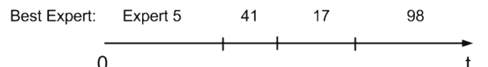

我们还假设开关的数量是有限的。

## 1 贝叶斯算法回顾

在上一讲中，我们推导出了一种用于估计序列元素概率分布的在线算法。我们将该算法开发为一个通用框架，可以整合和选择不同的个体方法来估计分布，以便考虑到在特定环境中估计概率分布的多样性问题。

为了重复正式的问题设置：我们给定了一组用于估计空间中概率分布的方法。我们通常称这些方法为“专家”。我们观察到从空间中选择的元素序列（可能是对抗性的），并根据迄今为止观察到的一切来在线估计概率分布。我们的目标是开发一种在线算法，通过整合预定的一组估计方法的输出来估计分布。我们希望该算法在观察到的元素序列上表现几乎与最佳单个专家一样好，并且有相应的理论界限证明这种“几乎一样好”的比较。

在这个设置中，我们将通过最小化对数损失来衡量性能。

给定一个概率分布和一个观察到的元素，我们定义损失为观察到的元素在概率分布下的概率的负对数，即 $-\log p(x)$ 。 考虑到这些目标，我们推导出了贝叶斯算法，并给出了以下性能比较的界限：

$$-\sum_{t=1}^{T} \ln q_t(x_t) \leq \left(-\sum_{t=1}^{T} \ln p_{i,t}(x_t)\right) + \ln N, \ \forall \text{ 专家 } i \tag{1}$$
其中 $q_t$ 是贝叶斯算法在时间 $t$ 选择的概率分布， $p_{i,t}$ 是专家 $i$ 在时间 $t$ 选择的概率分布， $N$ 是专家的数量。

我们还展示了 $\ln N$ 项对应于稍微更一般的推导的特殊情况，该推导不是在推导开始时假设专家之间的均匀分布，而是使用了一个包含有关不同专家选择的先验知识的不同分布，其中 $\pi_i$ 是专家 $i$ 的新先验概率。更一般的界限如下所示：

$$-\sum_{t=1}^{T} \ln q_t(x_t) \leq \left(-\sum_{t=1}^{T} \ln p_{i,t}(x_t)\right) - \ln \pi_i, \ \forall \text{ 专家 } i \tag{2}$$

## 切换专家

### 一个更一般的问题

现在我们考虑一个稍微更一般的问题：如果在序列的不同部分中，不同的估计方法表现更好怎么办？例如，对于


在线序列的前83个时间步骤中，专家1可能有最好的猜测，而在接下来的47个观测中，专家2可能更准确。

在贝叶斯算法的界限推导中，我们假设数据是根据某个专家的分布在每个时间步骤随机生成的，并且在过程的开始时随机选择遵循的专家的分布。

现在我们通过进一步假设，在任意时间 t，选择的专家被切换到另一个专家。在这种新的设置中，与最好的单个专家相比表现相当好的算法不再令人满意：我们希望与最好的切换序列的专家几乎一样好。

我们原始的编码理论中的动机示例假设有人想要用尽可能少的比特来发送消息，因此他们需要找到一种编码方式，利用消息可能元素的隐含概率分布来最小化用于编码消息的比特数。在这种新的情境中，我们可以想象消息的内容采用了几种不同的形式。例如，消息的第一部分可能是用英语写的，而消息的第二部分可能是用西班牙语写的，这两种语言可能对字符有不同的分布。

进一步推广这个例子，消息的其余部分可能在发送图片之间切换，然后可能是音乐，甚至是完全随机的比特。关键是这些不同类型的消息内容可能具有非常不同的元素分布，因此我们将希望在不同的编码方法之间切换，以单独利用每个分布。

### 解决切换专家问题的策略

所以我们希望能够做得几乎和最好的切换专家序列一样好，而我们已经有一种方法可以几乎做得和单个最好的专家一样好。我们对于解决这个新问题设置的算法的想法是考虑代表一个切换序列的“元专家”。元专家根据它在给定时间认为是“真正”专家的基础专家进行预测。具体来说，我们可以为每个具有 k 个切换的切换序列拥有一个元专家。然后我们可以将贝叶斯算法应用于由 N 个基础专家构建的这个庞大的元专家家族。我们可以计算这些元专家的数量：

$$M，元专家的数量 = N^{k+1} \binom{T+k}{k}$$

如果我们想要将这个大小插入到我们在贝叶斯算法中使用均匀先验的原始界限的错误项中，我们只需要计算 ln M：

$$\ln M \approx \ln N + k \ln N + k \ln (T / k) \approx \ln N + [k(\ln N + \ln T)] \quad\quad (3)$$

内部项 ($\ln N + \ln T$)，乘以开关数 $k$，概念上对应于每次元专家切换基础专家时支付的损失代价，除了贝叶斯算法的原始成本。

### 使元专家可行

这种方法的问题在于元专家的数量是指数级的 $N$。我们需要一种计算技巧，使我们能够在不直接与每个元专家进行计算交互的情况下考虑非常大的元专家空间。

我们元专家想法中的另一个不够优雅的部分是它使用了一个外部参数，即基础专家切换的精确次数。为了解决这个相当任意的参数和大量元专家带来的计算问题，我们将利用贝叶斯算法的灵活性，它适用于对专家空间的任何先验分布，以及巧妙选择的先验分布。

让我们将元专家想象成一个向量 $\mathbf{e}$ of $T$ elements，表示在时间$t$时预测的基础专家。

$$e_t \in \{1, \ldots, N\} \quad \mathbf{e} \in \mathcal{M} \triangleq \{1, \ldots, N\}^T$$

每个元专家对应于空间 $\mathcal{M}$中的一个向量。请注意，我们已经表示了每一个可能的元专家，包括在每个时间步骤都切换的元专家！这似乎是不可取的，因为这样一个元专家代表了一种生成数据的非常复杂的方式。反映了我们在机器学习中对简单假设的一般偏好，我们希望专注于“好看”的块状序列，其中元专家不经常切换。为了体现这种偏好，我们可以对元专家的先验分布进行加权，以给具有较少切换的元专家更高的权重。

为了找到这样的先验分布，我们将提出一个随机过程，以体现简单性偏好的方式生成元专家。随机过程将准确地定义我们对元专家的先验分布，我们可以写成：

$$\Pr[\mathbf{e}^* = \mathbf{e}] = \pi(\mathbf{e})$$

其中 $\pi(\mathbf{e})$ 是在随机过程下元专家的概率，而 $\mathbf{e}^*$是选择的“真实”元专家。

### 对元专家的先验分布

我们要遵循的基本启发式是，更多的切换应该对应较低的概率。我们的随机过程将逐个生成表示元专家的向量分量。让初始分量在随机情况下均匀选择。

$$e^*_1 = \text{均匀分布} \implies \Pr[e^*_1 = i] = 1/N$$

关键步骤是如何根据我们的启发式找到组件 $t+ 1$，我们希望连续的组件具有相对较高的相同概率：

$$e^*_{t+1} = \begin{cases} e^*_t \text{ 的概率为} 1 - \alpha \\ \text{其他的专家被均匀选择的概率为} \alpha \end{cases}$$

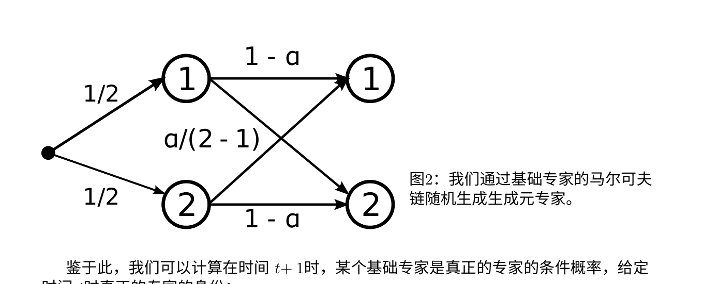

鉴于此，我们可以计算在时间 $t + 1$ 时，某个基础专家是真正的专家的条件概率，给定时间 $t$ 时真正的专家的身份：

$$\Pr[e_{t+1}^* | e_t^*] = \begin{cases} \text{如果 } e_{t+1}^* = e_t^*, \text{则为 } 1 - \alpha \\ \\ \text{否则为 } \alpha/(N - 1) \end{cases}$$

这意味着我们定义了一个基础专家的马尔可夫链，我们在图(2)中进行了说明。

因此，元专家由马尔可夫序列图中的路径定义，并且它们的概率只是边缘概率的乘积。这定义了我们对元专家的先验分布，因此我们现在可以分析我们的原始界限。

### 分析元专家算法的损失

说一些元专家 $\mathbf{e}$ has $k$ 开关。然后我们可以计算先验概率它是生成专家，并且因此计算我们原始边界上的错误项 Bayes算法的错误与任何专家相比，包括最好的专家：

$$- \ln (\pi(\mathbf{e})) = - \ln \left[ (1/N) \left( \frac{\alpha}{N-1} \right)^k (1 - \alpha)^{T-1-k} \right] \\ = \ln N + k \ln \frac{N-1}{\alpha} + (T - k - 1) \ln(1/(1 - \alpha))$$

如果我们“近似最小化”这个关于 $\alpha$ 的函数，我们发现 $\alpha = k/(T - 1)$。然后我们有：

$$- \ln (\pi(\mathbf{e})) \approx \ln N + k(\ln N + \ln T)$$

这与方程 (3) 的界限大致相同，方程 (3) 是对所有具有精确 $k$ 个专家的元-专家空间的界限。这是一个很好的结果，从只考虑具有精确 $k$ 个基础专家之间的转换到具有任意数量的转换的专家，我们仍然可以用生成专家所做的转换次数来界定损失！

### 元专家算法的高效实现

具有任意数量的转换的元专家数量远大于仅具有 $k$ 个转换的专家，因此我们需要找到一种同时处理所有元专家的方法，而不需要进行与人口规模成正比的计算。

回想一下，在贝叶斯算法的每个时间步骤中，“主人”从每个专家那里接收概率分布，并在观察下一个数据点之前将它们组合成一个单一的分布。组合分布是通过加权每个专家的分布并进行归一化来产生的。权重在每一轮通过将每个专家的旧权重乘以其选择分布下观察数据点的概率来更新。

在深入讨论贝叶斯算法如何与元专家一起工作之前，我们定义一些符号，并明确说明问题的术语中一些特定的随机事件的意义。

$$\left\langle x^{t} \right\rangle \text{ 观测序列直到时间}_{t} \qquad \qquad \qquad \qquad (4)$$

$$\text{Pr}[\mathbf{e}^{*} = \mathbf{e}] = \pi(\mathbf{e}) \text{ 是生成元专家 } \mathbf{e} \text{ 的先验概率} \qquad \qquad \qquad \qquad (5)$$

$$\text{Pr}[x_t|x_{1}^{t-1}, \mathbf{e}^{*} = \mathbf{e}] \text{ 是 } \mathbf{e} \text{ 对于 } x_t \text{ 的预测，即基本专家 } \mathbf{e}_t \text{ 的预测 } (6)$$

$$\text{Pr}[x_t|x_{1}^{t-1}, e_t^{*} = i] \triangleq p_i(x_t|x_{1}^{t-1}) \qquad \qquad \qquad \qquad \qquad (7)$$
$$(\text{在时间}t\text{生成元专家选择的基础专家的预测})$$

还记得我们在推导/分析贝叶斯算法时假设观察序列的开始时通过随机过程选择了一个专家，并且在每个时间步骤中，观察到的数据点是根据开始时随机选择的生成专家生成的。我们还定义了由主控生成的概率分布为在这个假设的随机过程下给定到目前为止所有观察到的数据的下一个数据点的概率分布，这在专家方面是隐含地被边缘化的，其中一个专家被随机选择为“生成”专家。

$$q(x_t \mid x_{1}^{t-1}) = \text{Pr}[x_t \mid x_{1}^{t-1}]$$
$$= \sum_{i=1}^{N} \text{Pr}[x_t, e_t^{*} = i \mid x_{1}^{t-1}] \qquad \qquad \qquad (\text{边缘化})$$
$$= \underbrace{\text{Pr}[e_t^{*} = i \mid x_{1}^{t-1}]}_{v_{t,i}} \cdot \underbrace{\text{Pr}[x_t \mid e_t^{*} = i, x_{1}^{t-1}]}_{p_i(x_t \mid x_{1}^{t-1})} \qquad (\text{条件概率的定义})$$

我们将上述两个量分开处理，以便在下面分别处理它们。概率 $v_{t,i}$ 是第 $t$ 个生成专家是基础专家的事件的概率
$i$, 在通过 $x_{t-1}$ 的所有观测下，也可以描述为在时间 $t$ 给定先前观测的基础专家的分布。概率 $p_i(x_t \mid x_{1}^{t-1})$ 是在时间 $t$ 给定所有先前观测和生成基础专家的身份的情况下，时间 $t$ 的观测分布。

首先，我们来看 $v_{t,i \circ}$ 在第一个时间步骤中，我们有 $v_{1,i} = \text{Pr}[e_{1}^{*} = i] = 1/N$。对于时间步骤 $t+1$，我们首先明确地对先前的专家进行边际化处理

时间步骤。

$$\forall i, v_{t+1,i} = \text{Pr}[e_{t+1}^* = i \mid x_1^t] = \sum_{j=1}^{N} \text{Pr}[e_{t+1}^* = i, e_t^* = j \mid x_1^t]$$ $$= \sum_{j=1}^{N} \underset{(B)}{\text{Pr}[e_{t+1}^* = i \mid e_t^* = j, x_1^t]} \cdot \underset{(A)}{\text{Pr}[e_t^* = j \mid x_1^t]} \qquad\qquad (8)$$

注意(B)是由我们早期定义的马尔可夫过程直接定义的：

$$\text{Pr}[e_{t+1}^* = i \mid e_t^* = j, x_1^t] = \text{Pr}[e_{t+1}^* = i \mid e_t^* = j] = \begin{cases} 1 - \alpha & \text{当} \quad i = j \\ \alpha / (N - 1) & \text{否则} \end{cases}$$

深入(A)：

$$\text{Pr}[e_t^* = j \mid x_t, x_1^{t-1}] = \frac{\text{Pr}[x_t \mid e_t^* = j, x_1^{t-1}] \cdot \text{Pr}[e_t^* = j, x_1^{t-1}]}{\text{Pr}[x_t \mid x_1^{t-1}]} \quad \text{(贝叶斯定理)}$$ $$= \frac{v_{t,j} \cdot p_j(x_t \mid x_1^{t-1})}{q(x_t \mid x_1^{t-1})} \qquad\qquad (9)$$

给定这些简化的(A)和(B)的量，我们可以写出一个可计算的表达式来计算

$v_{t+1,i}$

$$v_{t+1,i} = \sum_{j} \frac{v_{t,j} \cdot p_j(x_t \mid x_1^{t-1})}{q_t(x_t \mid x_1^{t-1})} \cdot \begin{cases} 1 - \alpha & \text{当} \quad i = j \\ \alpha / (N - 1) & \text{其他情况} \end{cases} \qquad\qquad (10)$$

所以我们可以看到，$v_{t+1,i}$可以通过方程（10）中的$N$个项的和来计算。这意味着我们可以在$\mathcal{O}(N^2)$的时间内计算出所有$i\in\{1,\ldots,N\}$ in的$v_{t+1,i\circ}$ 事实上，我们可以在不太费力的情况下，通过代数简化以$\mathcal{O}(N)$的时间内计算出这个值：

$$v_{t,i} = \text{Pr}[e_t^* = i \mid x_1^{t-1}] = \sum_{j} \frac{v_{t,j}p_j(x_t \mid x_1^{t-1})}{q_t(x_t \mid x_1^{t-1})} \cdot \begin{cases} 1 - \alpha & \text{当} \quad i = j \\ \alpha / (N - 1) & \text{其他情况} \end{cases}$$ $$= \sum_{j} c_j \left[ \frac{\alpha}{N-1} + \left(1 - \alpha - \frac{\alpha}{N-1}\right) \cdot \mathbb{1}\{i = j\} \right]$$ $$= \left(1 - \alpha - \frac{\alpha}{N-1}\right) c_i + \frac{\alpha}{N-1} \sum_{j=1}^{N} c_j$$ $$= \frac{\alpha}{N-1} + \left(1 - \alpha - \frac{\alpha}{N-1}\right) c_i \qquad\qquad (11)$$

其中$c_i$是数量（A），根据方程（8）和（9），是生成专家在时间$t$时的后验概率。这意味着我们可以在常数时间内计算一个专家在一个时间步骤中的权重更新，因此每个时间步骤只需要$\mathcal{O}(N)$计算来更新一组权重，即使有大量的元专家。

## 2 股票投资，博弈论

你如何选择在不同的投资工具之间分配资金？我们将建立一些符号和一个简单的数学框架，在下一讲中进行扩展。

有 N只股票。每天（选择你喜欢的时间单位），你需要在早上决定如何在股票之间重新分配财富。在每天结束时 t，我们得知每只股票 i的价格变动：

$$ p_t(i) = \frac{\text{收盘价 } t}{\text{开盘价 } t} $$

例如，如果股票 i在第 t天上涨了5%，那么 $p_t(i) = 1.05$。让 $S_t$ 成为我们在第 t天开始时的总财富，令 $S_1= 1$。 让 $w_t(i)$ 为我们选择在第 t天投资于股票 i的财富比例。 因此，我们的符号允许我们将第 t天开始时投资于特定股票 i的财富金额表示为 $S_t \cdot w_t(i)$，而在第 t天结束时对应的金额为 $S_t \cdot w_t(i) \cdot p_t(i)$。

我们在第 t天结束时的总财富如下所示：

$$ S_{t+1} = \sum_{i=1}^{N} S_t w_t(i) p_t(i) = S_t \cdot (\mathbf{w}_t \cdot \mathbf{p}_t) $$

在 T个时间步骤结束时：

$$ S_T = S_1 \cdot \prod_{t=1}^{T} (\mathbf{w}_t \cdot \mathbf{p}_t) = \prod_{t=1}^{T} (\mathbf{w}_t \cdot \mathbf{p}_t) $$

# COS 511: 理论机器学习

讲师：Rob Schapire
记录员：凯文·李
讲座 #23
2014年4月29日

## 1 复习

上一节课，我们简要介绍了投资组合选择的设置。我们假设每个时间段都有 $N$ 只股票可供我们选择，并且我们想要在每个投资期初如何最好地分配我们的资金。我们定义：

```
$p_t(i) = \text{第 } t \text{ 天结束时股票 } i \text{ 的价格}$
$\text{第 } t \text{ 天开始时股票 } i \text{ 的价格作为价格相对值，即股票在一天内涨跌的幅度。}$
```

$S_t$ 表示我们在第 $t$ 天开始时拥有的财富量，我们假设 $S_1 = 1$。我们将 $w_t(i)$ 定义为我们在第 $t$ 天开始时在股票 $i$ 中拥有的财富的比例，可以看作是一个概率分布，即 $\forall i, w_t(i) \geq 0$ 并且 $\sum_i w_t(i) = 1$。然后我们可以推导出第 $i$ 只股票在第 $t$ 天开始时的总财富为 $S_t w_t(i)$，第 $i$ 只股票在第 $t$ 天结束时的总财富为 $S_t w_t(i) p_t(i)$。我们可以通过简单求和的方式计算出我们在第 $t$ 天结束时的总财富：

```
$S_{t+1} = \sum_{i=1}^{N} S_t w_t(i) p_t(i) = S_t (\mathbf{w}_t \cdot \mathbf{p}_t)$
```

然后，经过 $T$ 个时间段后的总财富为：

```
$S_{T+1} = \prod_{t=1}^{T} (\mathbf{w}_t \cdot \mathbf{p}_t)$
```

## 2 投资组合选择

我们的目标是尽可能赚更多的钱。这可以通过最大化 $\prod_{t=1}^{T} (\mathbf{w}_t \cdot \mathbf{p}_t)$ 来实现。这与最大化该表达式的对数是相同的，即 $\sum_{t=1}^{T} \ln(\mathbf{w}_t \cdot \mathbf{p}_t)$。这也与最小化该表达式的负对数相同，即 $\sum_{t=1}^{T} -\ln(\mathbf{w}_t \cdot \mathbf{p}_t)$。因此我们注意到，最大化财富等同于最小化一个类似于对数损失的表达式，因此我们可以将投资视为一个在线学习问题：

```
对于 $t = 1, \ldots, T$：
    学习者/投资者选择 $\mathbf{w}_t$
    股市/自然选择 $\mathbf{p}_t$
    损失 $= -\ln(\mathbf{w}_t \cdot \mathbf{p}_t)$
```

在每一轮中，学习者选择 $\mathbf{w}_t$，这是他投资的方式，而股市则以每只股票当天上涨或下跌的方式作出回应，用 $\mathbf{p}_t$ 表示。我们的目标是最小化累积损失。

一个自然的起点是努力做得和最好的个别股票差不多好。
我们可以通过调整问题的形式来实现这一点，以便我们可以应用设计在对数损失周围的贝叶斯算法。 我们将贝叶斯算法的结果空间定义为 $X = \{0, 1\}$，并选择 $C \geq p_t(i) \; \forall t, i$。 对于算法的每个时间步长 $t$，每个专家 $i$ 需要提出一个关于结果空间 $X$ 的概率分布，通过提出一个关于结果1的概率， $p_{t,i}(1)$，并且显然有 $p_{t,i}(0) = 1 - p_{t,i}(1)$。 让结果 $x_t=1 \; \forall t$。 然后我们可以让 $p_{t,i}(1) = \frac{p_t(i)}{C}$。 应用贝叶斯算法将会给我们返回一个权重向量 $w_{t,i}$，并且我们通过设置 $w_t(i) = w_{t,i}$ 来使用这些权重进行投资。 现在观察一下：
$$q_t(x_t) = q_t(1) = \sum_i w_{t,i} p_{t,i}(1) = \sum_i \frac{w_{t,i} p_t(i)}{C} = \frac{\mathbf{w}_t \cdot \mathbf{p}_t}{C}$$
贝叶斯算法保证的对数损失上界是：
$$-\sum_t \ln q_t(x_t) \leq \min_i -\sum_t \ln p_{t,i}(x_t) + \ln N$$
$$-\sum_t \ln\left(\frac{\mathbf{w}_t \cdot \mathbf{p}_t}{C}\right) \leq \min_i -\sum_t \ln \frac{p_t(i)}{C} + \ln N$$
$$-\sum_t \ln(\mathbf{w}_t \cdot \mathbf{p}_t) \leq \min_i -\sum_t \ln p_t(i) + \ln N$$
这基本上是在说：
$$-\ln(\text{算法的财富}) \leq -\ln(\text{最佳股票的财富}) + \ln N$$
然后我们移除对数以找到：
$$\text{算法的财富} \geq \frac{1}{N} (\text{最佳股票的财富})$$
实际上，该算法等同于“买入并持有”策略，在第一天我们将我们的财富的 $\frac{1}{N}$ 投资到每只股票中，然后就让它在那里。 由于这意味着我们将把我们的财富的 $\frac{1}{N}$ 投资到最佳股票中，算法的财富上限自然地表示，即使在其他股票中我们失去了所有的钱，我们至少也能获得最佳股票的 $\frac{1}{N}$ 财富。 当我们投资我们的钱时，理想情况下，我们希望钱以 $c^t$ 的速率指数级增长，其中 $c$ 是一个要最大化的常数。 算法的财富上限意味着我们从算法中得到的常数 $c$ 将渐近地至少与最佳基础股票的常数一样好。

## 3 常数再平衡投资组合

与最佳个别股票进行比较不同，我们现在将目光投向与常数再平衡投资组合 (CRP) 进行比较。 在CRP中，我们提前决定了不同股票之间的固定分配，并且每天重新平衡不同的投资组合，以便它们始终具有这些固定分配。 最简单的CRP是均匀CRP (UCRP) ，在这种情况下，我们每天在 $N$ 只股票之间进行均等再平衡。 CRP是一种非常常见的策略，因为不断重新平衡投资组合是很自然的，例如，你可以将60%投资于股票，30%投资于债券，10%投资于现金。

| 天 | 股票1价格 | 股票2价格 | 股票1价格相对值 | 股票2价格相对值 |
|----|-----------|-----------|-----------------|-----------------|
| 1  | 1         | 1         | 1               | 0.5             |
| 2  | 1         | 0.5       | 1               | 2               |
| 3  | 1         | 1         | 1               | 0.5             |
| 4  | 1         | 0.5       | 1               | 2               |
| 5  | 1         | 1         | 1               | 0.5             |

图1：股票1和2的行为

股票占30%，债券占30%，现金占10%。 如果股票上涨而债券下跌，那么CRP将会让你卖出股票以购买更多债券。 因此，这鼓励低买高卖。 我们提供了一个具体的例子，证明了CRP是一个好主意。 想象一下，有股票1和股票2，它们都以1美元的价格起步。 股票1的价格从不变化，而股票2的价格在奇数天是1美元，在偶数天是0.50美元。 这两只股票的行为在图1中描述了5天。

当应用于这两只股票时，买入并持有策略永远不会赚钱。 然后我们来看看UCRP的表现：

```
S1 = 1
S2 = S1(1/2 * 1 + 1/2 * 1/2) = S1 * 3/4
S3 = S2(1/2 * 1 + 1/2 * 2) = S2 * 3/2 = S1 * 3/4 * 3/2
```

更一般地，如果我们在第t天有St，那么第t+2天的St+2 = St * 3/4 * 3/2 = St * 9/8。 因此，我们的财富每两天增长12.5%，因此它呈指数增长。

## 4 通用投资组合算法

现在我们回到制定一个算法，试图做得几乎和最好的CRP一样好，而不是最好的个别股票。 假设每个CRP都是一个向量 b = (b1, ..., bN)，它形成了对 N个股票的有效分布，并且使用CRP意味着使用 wt(i) = bi。 然后，我们希望重新应用贝叶斯算法，就像之前一样，但是我们将财富分配给所有可能的CRP。 可能的CRP有无穷多个，因此对于每个CRP，我们给它一个无穷小的财富份额，dμ(b)。 在第 t天开始时：

```
CRP b中的财富 = ∏_{s=1}^{t-1} (b · p_s) dμ(b)
```

∏_{s=1}^{t-1} (b · p_s) 是我们在第一天开始时拥有的财富，如果我们在CRP中投资了1美元，并且 dμ(b) 将这个财富按比例缩小，因为我们实际上只投资了一个无限小的金额到CRP中。 我们可以简单地对所有可能的CRP b进行积分，以找到第一天开始时的总财富 t:

```
总财富 = S_t = ∫ ∏_{s=1}^{t-1} (b · p_s) dμ(b)
```

我们可以使用另一个对所有可能的CRP \(\mathbf{b}\)进行积分，以找到第一天开始时投资于股票 \(i\)的总财富，其中 \(b_i\)是我们在 \(i\)中的财富比例，如下所示：
\[
\text{股票 } i \text{的总财富} = \int b_i \prod_{s=1}^{t-1} (\mathbf{b} \cdot \mathbf{p}_s) d\mu(\mathbf{b})
\]
然后，我们可以计算我们需要投资于股票 \(i\)的财富比例，即 \(w_t(i)\) 如下所示：
\[
w_t(i) = \frac{\int b_i \prod_{s=1}^{t-1} (\mathbf{b} \cdot \mathbf{p}_s) d\mu(\mathbf{b})}{\int \prod_{s=1}^{t-1} (\mathbf{b} \cdot \mathbf{p}_s) d\mu(\mathbf{b})}
\]
使用这个 \(w_t(i)\) 在每个时间步骤中重新平衡我们的投资组合被称为通用投资组合 (UP) 算法或Cover算法。

## 5 UP算法的界限

定理1. \(UP\)算法的财富 \(\geq \left(\frac{1}{(T+1)^{N-1}}\right)\) (最佳 \(CRP\)的财富)

当 \(\left(\frac{1}{(T+1)^{N-1}}\right)\) 可能看起来只是一个小的分数，但它适用于任何股票市场，并且仍然表示该算法的指数增长速度最终将与最佳CRP的指数增长速度相匹配。

我们将分两步证明这个定理的一个稍微弱一点的版本。让最佳CRP为 \(\mathbf{b}^*\)。幸运的是，在我们的算法中，我们将一部分资金投入到 \(\mathbf{b}^*\)中，但不幸的是，我们只投入了一个无穷小的金额。我们注意到CRP实际上只是概率向量，因此它们存在于所有概率向量的空间中，这被称为单纯形。我们在有3只股票的情况下在图2中说明了这个单纯形。\(\mathbf{b}^*\)只是单纯形中的一个点，我们考虑围绕 \(\mathbf{b}^*\)的邻域，该邻域由接近 \(\mathbf{b}^*\)的CRP组成，如图2中的内部阴影三角形所示。然后我们想要证明两点。在第一步中，我们想要证明邻域中的所有CRP都能够获得接近 \(\mathbf{b}^*\)的财富。然后在第二步中，我们想要展示邻域的整体大小是大的。让我们定义
\[
\Delta = \{\text{所有CRPs}\} = \left\{\mathbf{b} : b_i \geq 0, \sum_i b_i = 1\right\}
\]

并且我们定义 b* 的邻域为：

```
$$N(\mathbf{b}^*) = \{(1 - \alpha)\mathbf{b}^* + \alpha z : z \in \Delta\}$$
```

其中 $\alpha$ 是一个小的正数，我们实际上是将 $\mathbf{b}^*$ 与其他一些分布 $z$ 混合在一起。证明。步骤1:

假设 $\mathbf{b}$ 是 $\mathbf{b}^*$ 的邻域中的一个点，因此 $\mathbf{b} = (1 - \alpha)\mathbf{b}^* + \alpha z$。 我们可以推导出 $\mathbf{b}$ 在时间 $t$ 获得的财富量为:

```
$$\mathbf{b} \cdot \mathbf{p}_t = (1 - \alpha) \mathbf{b}^* \cdot \mathbf{p}_t + \alpha z \cdot \mathbf{p}_t$$
```

$z \cdot \mathbf{p}_t \geq 0$ 因为价格相对值永远不会为负。因此，在 $T$ 个时间步之后:

```
$$\text{财富} \quad \mathbf{b} \geq (1 - \alpha)^T(\text{财富} \quad \mathbf{b}^*)$$
```

证明。第二步:

```
$$\text{Vol}(N(\mathbf{b}^*)) = \text{Vol}(\{(1 - \alpha)\mathbf{b}^* + \alpha z : z \in \Delta\})$$
```

其中，$\text{Vol}()$ 表示体积。 我们现在注意到 $(1 - \alpha)\mathbf{b}^*$ 是一个固定的数量，因此如果我们移动单纯形并移除这个数量，总体积将保持不变:

```
$$\begin{align*} \text{Vol}(N(\mathbf{b}^*)) &= \text{Vol}(\{\alpha z : z \in \Delta\}) \\ &= \text{Vol}(\Delta) \cdot \alpha^{N-1} \end{align*}$$
```

最后一个等式成立是因为单纯形是一个 $N-1$ 维对象，每个维度都被 $\alpha$ 缩放。

现在我们可以将两个步骤的结果结合起来展示:

```
$$\begin{align*} \text{UP算法的财富} &\geq (\text{CRPs 在 } N(\mathbf{b}^*) \text{中的比例})( N(\mathbf{b}^*) \text{中任何CRP的最小财富}) \\ &\geq \alpha^{N-1}(1 - \alpha)^T( \mathbf{b}^* \text{的财富}) \\ &\geq \frac{1}{e}(T + 1)^{-(N-1)}( \mathbf{b}^* \text{的财富}) \end{align*}$$
```

如果我们选择 $\alpha = \frac{1}{T+1}$，那么最后一个不等式成立。因此，我们证明了定理的一个稍微弱化的版本。

## 6 博弈论

博弈论是研究游戏的领域，实际上是关于各种玩家之间的互动。 与学习有一个自然的联系，因为在学习中通常存在着教师和学生或学习者和自然之间的互动。 对于我们的目的，一个游戏由一个矩阵定义。 剪刀、石头、布的游戏矩阵如图3所示。 矩阵的行是行玩家Mindy可以采取的行动，列是列玩家Max可以采取的行动。 Mindy选择其中一行，Max选择其中一列。 由这些选择定义的条目

|   | R | P | S |
|---|---|---|---|
| R | 0.5 | 1 | 0 |
| P | 0 | 0.5 | 1 |
| S | 1 | 0 | 0.5 |

图3: 石头，剪刀，布游戏矩阵

矩阵中的每个元素都是Mindy所遭受的损失。Max试图最大化这个损失，而Mindy试图最小化它。一般来说，我们总是有一个游戏矩阵 $M$。玩游戏时，Mindy选择行 $i$，Max选择列 $j$。单独的行 $i$和列 $j$被称为纯策略。矩阵 $M$中的相应条目$(i, j)$是Mindy所遭受的损失。原则上，任何两人零和游戏都可以被转化为这种形式。

### 6.1 游戏理论回顾

假设M是一个所有元素都在[0,1]范围内的矩阵。Mindy（称为行玩家）选择行i，而Max（称为列玩家）选择列j。在这种情况下，Mindy的预期损失是：

```
$\text{损失} = M(i,j)$
```

或者，Mindy可以从分布P中随机选择一步而Max可以从分布Q中随机选择一步。在这里，Mindy的预期损失是：

```
$\text{损失} = \sum_{i,j} P(i)M(i,j)Q(j) = P^T M Q = M(P, Q)$
```

P和Q被称为“混合策略”，而i和j被称为“纯策略”。

### 6.2 极小极大定理

在某些游戏中，例如石头、剪刀、布，玩家同时移动。以这种方式，两个玩家在移动时都有相同的可用信息。

现在我们假设Mindy先行动，然后是Max。Max知道Mindy选择的P，并且对于任何他选择的Q，他还知道M(P, Q)。因此，他选择一个Q，使M(P, Q)最大化。因为Mindy知道Max会选择Q= arg max_Q M(P,Q)对于任何她选择的P，她选择一个P，使max_Q M(P, Q)最小化。因此，如果Mindy先行动，她可以预计会遭受最小化的max_Q M(P, Q)的损失。

总的来说，起初可能会觉得后手玩家有优势，因为她有更多的可用信息。从Mindy的角度来看，这导致：

```
$\max_{Q} \min_{P} M(P, Q) \leq \min_{P} \max_{Q} M(P, Q)$
```

所以，Mindy在Max之后玩似乎比两个人反过来要好。

然而，约翰·冯·诺伊曼证明了无论玩家移动的顺序如何，游戏的预期结果始终相同。

```
$v = \max_{Q} \min_{P} M(P, Q) = \min_{P} \max_{Q} M(P, Q)$
```

在这里，$v$表示游戏的价值。这可能看起来违反直觉，因为第二个玩家在选择移动时有更多的信息可用。我们将使用在线学习算法证明上述陈述。让：

$$P^{*} = \arg \min_{P} \max_{Q} M(P, Q)$$
$$Q^{*} = \arg \max_{Q} \min_{P} M(P, Q)$$

那么，

对于所有的$Q$, $M(P^{*}, Q) \leq v$ (1)
对于所有的$P$, $M(P, Q^{*}) \geq v$ (2)

换句话说，对于一些最优 $P^{*}$，Max可能造成的最大损失受到界限由 $v$和Mindy的损失至少为 $v$，无论他们选择什么样的策略。

如果我们知道 $M$，我们可能能够通过使用线性规划技术找到 $P^{*}$。然而，我们不一定拥有这个知识，即使我们拥有，$M$可能非常大。此外，$P^{*}$仅适用于完全对抗的对手，因此它不考虑可能犯错误的对手。因此，尝试迭代学习 $M$和 $Q$是有意义的。

我们通过以下公式来实现这一点：

+   对于 $t = 1, \ldots,$
    1. $T$, Mindy选择 $P_t$
    2. Max选择 $Q_t$ (在知道 $P_t$的情况下)
    3. Mindy观察 $M(i, Q_t) \forall i$
    4. 损失 $= M(P_t, Q_t)$

显然，该算法的总损失只是 $\sum_{t=1}^{T} M(P_t, Q_t)$。我们希望能够将这个损失与通过固定任何单一策略在所有 $T$次迭代中可能实现的最佳损失进行比较。换句话说，我们想要展示：

$$\sum_{t=1}^{T} M(P_t, Q_t) \leq \min_{P} \sum_{t=1}^{T} M(P, Q_t) + \text{[小遗憾项]}$$

### 6.3 乘法更新

假设我们使用一种乘法权重算法，按照以下方式更新权重，其中 $M$矩阵的行数为N：$$\beta \in [0,1)$$ (3)

$$P_1(i) = \frac{1}{n} \forall i$$ (4)

$$P_{t+1}(i) = \frac{P_t(i) \beta^{M(i,Q_t)}}{\text{归一化常数}}$$ (5)

我们的算法类似于加权多数算法。思路是按照选择该行所遭受的损失的比例减少选择该行的概率。在使用潜势函数进行论证后，我们可以使用该算法得到以下界限:

$$\sum_{t=1}^{T} M(P_t, Q_t) \leq \alpha_\beta \min_P \sum_{t=1}^{T} M(P, Q_t) + c_\beta \ln(n)$$ (6)

其中 $$\alpha_\beta = \frac{\ln(\frac{1}{\beta})}{1-\beta}$$ 和 $$c_\beta = \frac{1}{1-\beta}$$。

### 2.2 推论

我们可以选择 $$\beta$$ 这样:

$$\frac{1}{T} \sum_{t=1}^{T} M(P_T, Q_T) \leq \min_P \frac{1}{T} \sum_{t=1}^{T} M(P, Q_t) + \Delta_T$$ (7)

其中 $$\Delta_T = O(\sqrt{\frac{\ln(n)}{T}})$$, 对于大的 $$T$$, 这个值趋近于零。换句话说，Mindy每轮所遭受的损失逐渐接近最优平均损失。我们将使用这个结果来证明极小极大定理。

### 2.3 证明

假设Mindy使用上述算法选择 $$P_t$$, 并且Max选择 $$Q_t$$ 使得 $$Q_t = \arg \max_Q M(P_T, Q)$$, 最大化 Mindy的损失。同时，设:

$$\bar{P} = \frac{1}{T} \sum_{t=1}^{T} P_t$$ (8)

$$\bar{Q} = \frac{1}{T} \sum_{t=1}^{T} Q_t$$ (9)

我们也凭直觉知道，如前所述，$$\max_Q \min_P M(P, Q) \leq \min_P \max_Q M(P, Q)$$, 因为如前所述，后手玩家拥有更多可用信息。

为了证明前面所述的Minimax定理的相等性，只需证明$\max_Q \min_P M(P, Q) \geq \min_P \max_Q M(P, Q)$也成立。

$\min_P \max_Q P^T M Q \leq \max_Q \bar{P}^T M Q$

根据$\bar{P}$的定义：

$= \max_Q \frac{1}{T} \sum_{t=1}^{T} P_t^T M Q$

根据凸性：

$\leq \frac{1}{T} \max_Q \sum_{t=1}^{T} P_t^T M Q$

根据$Q_t$的定义：

$= \frac{1}{T} \sum_{t=1}^{T} P_t^T M Q_t$

根据推论2.2：

$\leq \min_P \frac{1}{T} \sum_{t=1}^{T} P^T M Q_t + \Delta_T$

根据$\bar{Q}$的定义：

$= \min_P P^T M \bar{Q} + \Delta_T$  
$\leq \max_Q \min_P P^T M Q + \Delta_T$

证明完成是因为$\Delta_T$随着$T$的增大而趋近于零。这个证明还表明：

$\max_Q \bar{P}^T M Q \leq v + \Delta_T$

其中$v=$ 最大_Q最小_P $P^T M Q$。如果我们在算法的每一轮计算的$P_t$项的平均值，我们得到的结果接近于最优值。因为当$T$的值变大时，$\Delta_T$趋近于零，所以我们可以通过简单地增加$T$来接近最优策略。换句话说，随着轮数$T$的增加，这个策略变得越来越接近最优。因此，$\bar{P}$被称为近似最小最大策略。类似的论证可以表明$\bar{Q}$是近似最大最小策略。

## 3 关于在线学习的关系

为了将我们的分析投射到在线学习框架中，考虑以下问题设置：

```
对于 t=1,...,T观察
x_t来自 X预测ŷ_t ∈ {0,1}观察真实标签 c(x_t)结束
```

在这里，我们将每个假设 h 视为来自所有假设集合 H 的专家。我们想要证明：

错误数量 ≤ 最佳 h 的错误数量 + [小遗憾项]

我们建立了一个游戏矩阵 M 其中 M(i, j) = M(h, x) = 1, 如果 h(x) = c(x), 否则为0。因此，这个矩阵的大小为 |H|·|X|。给定一个 x_t, 算法必须选择一些 P_t, 用于预测 x_t 的标签。根据分布选择 h, 然后选择 ŷ_t 作为 h(x_t)。在这个背景下，Q_t 是集中在 x_t 上的分布 (在所有其他 x ∈ X 上为1, 在 x_t 上为0)。因此：

$$\sum_{t=1}^{T} M(P_t, x_t) = E[\text{错误的数量}] \le \min_h \sum_{t=1}^{T} M(h, x_t) + [\text{小遗憾项}]$$

注意 $\min_h \sum_{t=1}^{T} M(h, x_t)$ 等于最好的假设 h 所犯的错误数量。如果我们用 $\sum$ 替换 $M(P_t, x_t) = \sum_h P_t(h) \cdot \mathbb{1}\{h(x_t) = c(x_t)\} = Pr[h(x) = c(x)]$ 上面，我们得到了与前一节相同的界限。

## 4 关于 Boosting 的关系

我们可以将 Boosting 看作是 Boosting 算法和弱学习器之间的游戏它调用。考虑以下问题：

```
对于 t=1,...,T
Boosting 算法选择一个分布 D_t over 训练集样本 X
弱学习器选择一个假设 h_t
结束
```

在这里，我们假设所有的弱学习器 h_t 都符合弱学习假设，即 $Pr_{(x,y)\sim D_t}[h_t(x) = y)] \le \frac{1}{2} - \gamma$ 并且 $\gamma > 0$。我们可以根据上一节中使用的矩阵 M 来定义游戏矩阵 M'。然而，在这里，我们希望对 X 样本进行分布，而不是对假设进行分布，因此我们需要对 M 进行转置和归一化。

$$M' = 1 \ge M^T$$

换句话说，如果 $h(x) = c(x)$，则 $M'(i, j) = M'(x, h) = 1$，否则为0。在这里，$P_t = D_t$，而$Q_t$是完全集中在弱学习器选择的特定 $h_t$上的分布。我们可以应用我们从乘法权重算法中得出的相同分析：

$$\frac{1}{T} \sum_{t=1}^{T} M'(P_t, h_t) \leq \min_x \frac{1}{T} \sum_{t=1}^{T} M'(x, h_t) + \Delta_T$$

同样，

$$M'(P_t, h_t) = \sum_x P_T(x) \cdot 1\{h(x) = c(x)\} = Pr[h_t(x) = c(x)] \geq \frac{1}{2} + \gamma$$

结合这些事实：

$$\frac{1}{2} + \gamma \leq \frac{1}{T} \sum_{t=1}^{T} M'(x, h_t) \\ \leq \min_x \frac{1}{T} \sum_{t=1}^{T} M'(x, h_t) + \Delta_T$$

重新排列，

$$\forall x : \frac{1}{T} \sum_{t=1}^{T} M'(x, h_t) \geq \frac{1}{2} + \gamma \geq \Delta_T > \frac{1}{2}$$

这再次是正确的，因为当$T$变得很大时，$\Delta_T$趋近于0。换句话说，我们发现当 $T$足够大时，超过 $\frac{1}{2}$的弱假设能够正确分类任何 $x$。因为最终的假设只是这些弱学习器的多数投票，我们已经证明了当足够多的弱学习器被使用时，提升算法会将训练误差降低到零。