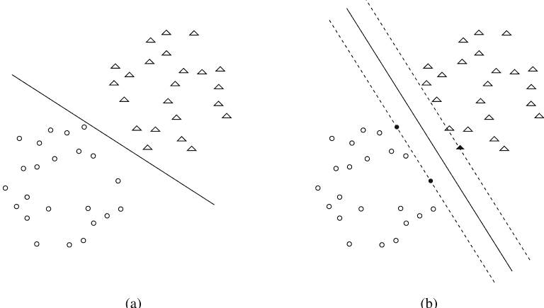
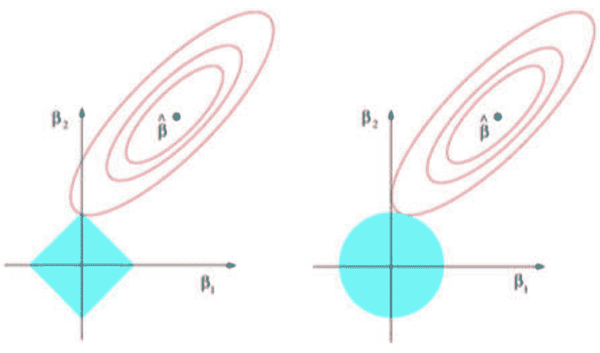
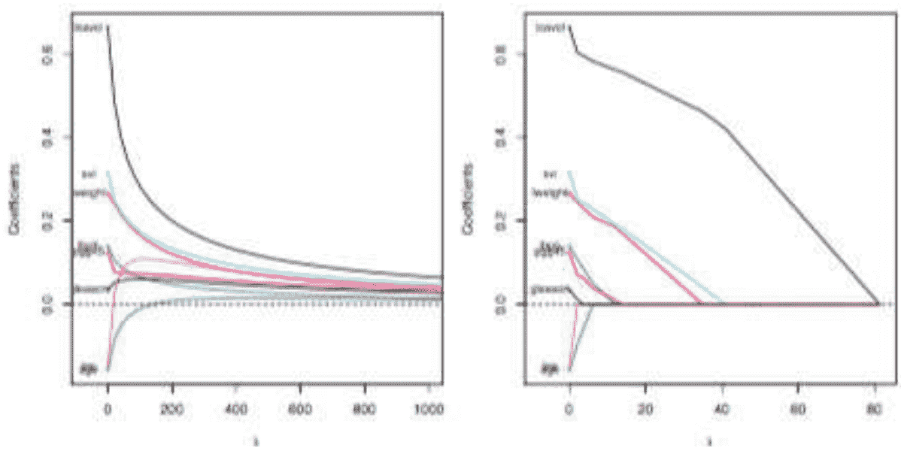

# 杜克 STA561 概率机器学习讲义

Sayan Mukherjee

1 统计科学、计算机科学和数学系，杜克大学，杜罕，27708。
电子邮件地址：sayan@stat.duke.edu

2015年11月19日

## 讲座 1
### 课程准备

机器学习这个术语可以追溯到 Arthur Samuels 和他的计算机下棋算法。1959年，Samuels 将机器学习描述为：“一种使计算机具有学习能力而无需明确编程的研究领域。”

机器学习被认为是人工智能的一个子领域，学习机器的概念出现在 Alan Turing 于 1950 年在《心智：心理学和哲学的季刊》中发表的《计算机与智能》一文中。本文的第一句提出的问题是“机器能思考吗？”。

在这门机器学习课程中，我们将考虑使用算法和概率方法来“从数据中学习”。这门课程涉及统计学、计算机科学的交叉领域，机器学习的一个夸张描述是计算机科学家在做统计学。机器学习通常也与“大数据”这个术语联系在一起，它通常指的是对非常大的数据集进行统计分析，在这里，计算挑战与推断问题一样严重。

广义上说，我们将讨论的方法可以分为两类：

- **程序员（Programmer）**：这将涵盖频率统计学和机器学习的算法方法。这种方法基于找到适用于数据的良好程序。“良好”的意思是某个长期概率的过程，例如分类中出错的长期概率很小。
- **贝叶斯（Bayesian）**：一种基于数据推断参数或模型后验概率的一致公理方法。在某些情况下，贝叶斯推断可能不可行或不实际。

### 1.1. 复习

我们将从统计学的基础知识开始复习。我们将使用贝叶斯和频率主义分析来研究一个统计问题。以下形式将在两个模型中进行量化：

$$P(M \mid D) = \frac{P(D \mid M)P(M)}{P(D)} \propto P(D \mid M)P(M),$$

其中 $P(M \mid D)$ 是给定数据 $D$ 的模型 $M$ 的证据，$P(D \mid M)$ 是给定模型 $M$ 的数据 $D$ 的证据，$P(M)$ 是模型 $M$ 的概率，$P(D)$ 是数据的概率。这些对象的标准统计术语为：

- $P(D \mid M) \equiv \text{Lik}(D; M)$，给定模型 $M$ 的数据的似然（Likelihood）。
- $P(M \mid D) \equiv \text{Post}(D; M)$，给定数据的模型 $M$ 的后验证据（Posterior）。
- $P(M) \equiv \pi(M)$，模型 $M$ 的先验概率（Prior，在观察数据之前）。

### 示例 1: 模式估计

我们考虑一个随机变量 $X$，它是从一个包含 $k=4$ 个字母的字母表中抽取的 $\{A, C, T, G\}$，其中我们表示 $A \equiv 1, C \equiv 2, T \equiv 3, G \equiv 4$。我们将概率分布设置为以下多项式分布，注意我们正在模拟抽取四个字母：

$$\mathbb{P}(n_1, n_2, n_3, n_4 \mid p_1, p_2, p_3, p_4) \equiv \text{Multi}(p_1, p_2, p_3, p_4) \propto \prod_{j=1}^4 p_j^{n_j}, \quad \sum_{j=1}^4 p_j = 1, p_j \ge 0 \, \forall j = 1, \dots, 4,$$

其中 $p_i$ 是观察到第 $i$ 个字母（$\{A, C, T, G\}$）在字母表中的概率，而 $n_i$ 表示第 $i$ 个字母观察到的次数（要么是 1，要么是 0）。上述内容是多项式分布的一个例子。

随机变量 $X$ 是一个序列中的字符串，我们可以将随机字符串 $Z = (X_1, \dots, X_m)$ 视为长度为 $m$ 的字符串，每个 $X_i$ 从分布中独立同分布地抽取。这是一个字符串的例子，让我们称这些字符串为模式。

数据由一系列字符串组成，$D = \{Z_1, \dots, Z_n\}$，每个字符串 $Z_i$ 独立同分布地抽取。

我们首先陈述观察到的数据 $D$ 的似然：

$$\begin{aligned} \text{P}(D \mid M) &= \text{Lik}(D \mid p_1, \dots, p_k) \\ &\propto \prod_{i=1}^n \left[ \prod_{\ell=1}^m \left( \prod_{j=1}^k p_j^{n_{i\ell j}} \right) \right] \\ &\propto \prod_{\ell=1}^m \left[ \prod_{i=1}^n \left( \prod_{j=1}^k p_j^{n_{i\ell j}} \right) \right] \\ &\propto \prod_{\ell=1}^m \left[ \prod_{j=1}^k p_j^{\tilde{n}_{\ell j}} \right], \end{aligned}$$

其中 $n_{i\ell j}$ 是观察 $i$ 中在位置 $\ell$ 上观察到字母 $j$ 的次数（这个次数为 0 或 1），而 $\tilde{n}_{\ell j} = \sum_i n_{i\ell j}$ 是在序列中观察到字母 $j$ 在位置 $\ell$ 的次数。

估计 $p_1, \dots, p_k$ 的经典方法是最大似然公式（MLE）：

$$\begin{aligned} \{\hat{p}_1, \dots, \hat{p}_k\} &= \arg \max_{p_1, \dots, p_k} [\text{Lik}(D \mid p_1, \dots, p_k)], \\ \text{受限于} \quad &\sum_{j=1}^k p_j = 1, p_j \ge 0 \, \forall j = 1, \dots, k. \end{aligned}$$

要理解如何进行上述优化，请了解拉格朗日乘数法的方法。这是一个非常合理的方法，但它有一个问题：如何估计 $\{\hat{p}_1, \dots, \hat{p}_k\}$ 的估计不确定性呢？

我们可以使用贝叶斯规则正式地对不确定性进行建模：

$$\text{P}(M \mid D) \propto \text{P}(D \mid M) \text{P}(M),$$

如果我们可以在模型空间上放置一个概率分布，即 $(p_1, \dots, p_k)$。所有点 $\mathbf{p} = (p_1, \dots, p_k)$ 的空间，使得 $\sum_j p_j = 1$ 且 $p_j \ge 0$ 对于所有 $j = 1, \dots, k$ 被称为单纯形（Simplex）。我们现在介绍一个经典的分布在单纯形上，称为狄利克雷分布（Dirichlet Distribution）：

$$f(p_1, \dots, p_k \mid \alpha_1, \dots, \alpha_k) \equiv \text{Dir}(\alpha_1, \dots, \alpha_k) \propto \prod_{j=1}^k p_j^{\alpha_j-1}, \quad \alpha_j \ge 0 \forall j, \alpha_j \in \mathbb{N},$$

其中 $\mathbb{N}$ 是自然数，我们可以将 $\{\alpha_1, \dots, \alpha_k\}$ 参数看作是计数。我们可以使用狄利克雷分布作为先验 $\pi(M)$，其中均匀先验为 $\text{Dir}(\alpha_1 = 1, \dots, \alpha_k = 1)$。我们现在陈述后验概率 $P(M \mid D)$：

$$\begin{aligned} &\propto \text{Lik}(D \mid p_1, \dots, p_k) \times \pi(p_1, \dots, p_k) \\ &\propto \prod_{i=1}^n \left[ \prod_{\ell=1}^m \left( \prod_{j=1}^k p_j^{n_{i\ell j}} \right) \right] \times \prod_{j=1}^k p_j^{\alpha_j-1} \\ &\propto \prod_{\ell=1}^m \left[ \prod_{i=1}^n \left( \prod_{j=1}^k p_j^{n_{i\ell j}} \right) \right] \times \prod_{j=1}^k p_j^{\alpha_j-1} \\ &\propto \prod_{\ell=1}^m \left[ \prod_{j=1}^k p_j^{\check{n}_{\ell j}} \right] \times \prod_{j=1}^k p_j^{\alpha_j-1} \\ &\propto \left[ \prod_{j=1}^k p_j^{\check{n}_j} \right] \times \prod_{j=1}^k p_j^{\alpha_j-1} \\ &\propto \left[ \prod_{j=1}^k p_j^{\check{n}_j+\alpha_j-1} \right] \\ &= \text{Dir}(\check{n}_1 + \alpha_1, \dots, \check{n}_k + \alpha_k), \end{aligned}$$

其中 $\check{n}_j = \sum_{\ell} \tilde{n}_{\ell j}$。这种估计过程的优势在于，我们不仅得到了一个点估计 $\{\hat{p}_1, \dots, \hat{p}_k\}$（就像 MLE 方法中那样），而且我们得到了一个后验分布。我们可以使用最高概率值作为 $(p_1, \dots, p_k)$ 的估计值，或者使用后验分布的均值。这个例子之所以如此容易，是因为多项式和狄利克雷分布是共轭的。这意味着：

$$\text{Multi}(p_1, \dots, p_k) \times \text{Dir}(\alpha_1, \dots, \alpha_k) = \text{Dir}(n_1 + \alpha_1, \dots, n_k + \alpha_k).$$

## 讲座 2
### 线性回归程序员的方法
### 2.1. 标准多元线性回归

回归问题通常被陈述为：

$$Y = f(X) + \varepsilon, \quad \varepsilon \stackrel{iid}{\sim} \mathrm{N}(0, \sigma^2)$$

多元随机变量 $X \subseteq \mathbb{R}^p$ 被称为协变量，而单变量随机变量 $Y \subseteq \mathbb{R}$ 被称为响应变量，函数属于一类函数 $f \in \mathcal{F}$。随机变量 $X, Y$ 与之相关的分布为：联合分布 $\rho_{X, Y}(x, y)$，边缘分布 $\rho_X(x), \rho_Y(y)$，以及条件分布 $\rho(y \mid x)$。

目前，函数类 $\mathcal{F}$ 将是线性函数：

$$f(x) = \beta^T x, \quad \beta \in \mathbb{R}^p.$$

我们所给出的数据包括 $n$ 个观测 $D = \{(x_i, y_i)\}_{i=1}^n \stackrel{iid}{\sim} \rho(x, y)$，我们称之为样本，样本大小为 $n$。我们将假设我们观察到的数据与以下模型一致：

$$Y_i = \beta^T X_i + \varepsilon_i, \quad \varepsilon_i \stackrel{iid}{\sim} \mathrm{N}(0, \sigma^2).$$

我们的目标是给定数据 $D$ 解决以下问题：

- (1) 参数推断：对于 $\beta$，什么是一个合理的估计值，我们将其称为估计值 $\hat{\beta}$。
- (2) 预测：给定一个新的 $x_*$，对应的 $y_*$ 是什么，尝试 $y_* = \hat{\beta}^T x_*$。
- (3) 估计条件分布：当 $X = x$ 时，$Y \mid X=x$ 是什么。

一个回到高斯时代的估计 $\hat{\beta}$ 的想法是最小化最小二乘误差：

$$\arg \min_{\beta \in \mathbb{R}^p} \left[ \frac{1}{n} \sum_i (y_i - \beta^T x_i)^2 \right].$$.

可以从以下概率模型推导出上述估计量：

$$\operatorname{Lik}(D; \beta) = \prod_{i=1}^n \frac{1}{\sigma \sqrt{2\pi}} \exp \left( -\frac{\|y_i - \beta^T x_i\|^2}{2\sigma^2} \right),$$

通过对 $\beta$ 最大化上述似然函数：

$$\arg \max_{\beta} \text{Lik}(D; \beta) \equiv \arg \min_{\beta \in \mathbb{R}^p} \left[ \frac{1}{n} \sum_i (y_i - \beta^T x_i)^2 \right].$$

我们可以将对数似然的负数表示为：

$$L = \sum_{i=1}^n (y_i - x_i^T \beta)^2.$$

我们将以上内容改写为矩阵表示。在这样做的过程中，我们定义了一个矩阵 $\mathbf{X}$，它是 $n \times p$ 的，并且矩阵的每一行都是一个数据点 $x_i$。我们还定义了一个列向量 $Y$ ($n \times 1$)，其中 $y_i$ 是 $Y$ 的第 $i$ 个元素。类似地，$\beta$ 是一个具有 $p$ 个元素的列向量。我们可以将误差最小化重写为：

$$\arg \min_{\beta} [L = (Y - \mathbf{X}\beta)^T (Y - \mathbf{X}\beta)],$$

对 $\beta$ 求导并将其设置为零：

$$\begin{aligned} \frac{dL}{d\beta} &= -2\mathbf{X}^T (Y - \mathbf{X}\beta) = 0 \\ &\Rightarrow \mathbf{X}^T (Y - \mathbf{X}\beta) = 0. \end{aligned}$$

这意味着：

$$\begin{aligned} \mathbf{X}^T Y &= \mathbf{X}^T \mathbf{X} \beta \\ \hat{\beta} &= (\mathbf{X}^T \mathbf{X})^{-1} \mathbf{X}^T Y. \end{aligned}$$

如果我们仔细观察上面的公式，会发现存在严重的数值问题—— $(\mathbf{X}^T \mathbf{X})^{-1}$。矩阵 $\mathbf{X}^T \mathbf{X}$ 是一个 $p \times p$ 的秩为 $\min(n, p)$ 的矩阵。如果 $p > n$，这意味着 $\mathbf{X}^T \mathbf{X}$ 不能被求逆，因此我们无法通过矩阵求逆来计算估计值 $\hat{\beta}$。有一些数值方法可以解决这个问题，但解决方案可能不是唯一的或稳定的。在估计问题中，一个普遍的规则是数值问题通常与估计参数的统计误差或估计的方差相一致。

### 2.2. Stein 估计器

上述数值问题与一个令人惊奇的结果有关，这个结果首次由 Charles Stein 在 1956 年观察到。Stein 提出的问题是，如果给定一个多元正态分布的观测值：

$$(x_i)_{i=1}^n \stackrel{iid}{\sim} N(\theta, \sigma^2 \mathbf{I}),$$

什么是 $\theta$ 的最佳估计器。在统计学中，如果存在一个比你正在使用的估计器更好的估计器，那么你的估计器被称为不可接受的（inadmissible）。Stein 发现，对于 $p \geq 3$，样本均值 $\hat{\theta} = \frac{1}{n} \sum_i x_i$ 不可接受。一个更好的估计器，称为 James-Stein 估计器，如下所示：

$$\hat{\theta}=\left(1-\frac{(p-2) \frac{\sigma^{2}}{n}}{\|\bar{x}\|^{2}}\right) \bar{x}.$$

关于上述估计器的直觉是将样本均值 $\bar{x}$ 向零点移动一点，这被称为收缩（shrinkage）。现在什么是最小化风险的最优估计器：

$$\arg \min _{\beta \in \mathbb{R}^{p}}\left[\mathbb{E}_{X, Y}\left[\left(y-\beta^{T} x\right)^{2}\right]=\int_{Y, X}\left(y-\beta^{T} x\right)^{2} \rho(x, y) \mathrm{d} x \mathrm{~d} y\right],$$

上面的想法是在未见数据上最小化误差，在课程后面我们会称之为泛化误差 $I[\hat{f}]=\mathbb{E}_{X, Y}[(y-\hat{f}(x))^{2}]$，其中 $\hat{f}(x)=\hat{\beta}^{T} x$，并提供一些理论来证明我们将提出的估计器。

### 2.3. 交叉验证

由于没有访问生成分布 $\rho(x, y)$，因此无法直接估计泛化误差。泛化误差的常见代理是留一交叉验证误差（Leave-one-out Cross-validation）：

$$I[cv]=\frac{1}{n} \sum_{i=1}^{n}\left(y_{i}-\hat{f}_{D^{\setminus i}}\left(x_{i}\right)\right)^{2},$$

其中 $D^{\setminus i}$ 是删除第 $i$ 个样本后的数据集，$\hat{f}_{D^{\setminus i}}$ 是在删除第 $i$ 个样本时估计的函数。这个想法是删除第 $i$ 个样本，用剩下的样本估计一个函数，然后测试在第 $i$ 个样本上产生的误差，并将其平均化到所有的 $n$ 个观测值上。当然，不一定要留出一个观测值，可以留出 $k$ 个观测值。留一估计器是（几乎）无偏的。

### 2.4. 收缩模型

我们现在可以将 James-Stein 估计器的思想应用到线性回归问题上。我们将最小化以下损失函数：

$$\arg \min _{\beta \in \mathbb{R}^{p}} \frac{1}{n} \sum_{i=1}^{n}\left(y_{i}-x_{i}^{T} \beta\right)^{2}+\lambda\|\beta\|^{2},$$

其中 $\lambda>0$ 是一个参数，而 $\|\beta\|^{2}=\sum_{j=1}^{p} \beta_{j}^{2}$。

$$\begin{aligned} \frac{d L}{d \beta} &= -2 \mathbf{X}^{T}(Y-\mathbf{X} \beta)+2 \lambda n \beta=0 \\ &\Rightarrow \mathbf{X}^{T}(\mathbf{X} \beta-Y)+\lambda n \beta = 0. \end{aligned}$$

这意味着：

$$\begin{aligned} \mathbf{X}^{T} Y &= \mathbf{X}^{T} \mathbf{X} \beta+\lambda n \beta \\ \mathbf{X}^{T} Y &= \left(\mathbf{X}^{T} \mathbf{X}+\lambda n \mathbf{I}\right) \beta \\ \hat{\beta} &= \left(\mathbf{X}^{T} \mathbf{X}+\lambda n \mathbf{I}\right)^{-1} \mathbf{X}^{T} Y, \end{aligned}$$其中 $\mathbf{I}$ 是 $p \times p$ 的单位矩阵。矩阵 $(\mathbf{X}^T \mathbf{X} + \lambda n \mathbf{I})$ 是可逆的，这种惩罚损失函数的方法在变量比观测值多的问题中取得了巨大的成功。

## 讲座 3

### 贝叶斯动机的程序主义方法

通常有两种方法来验证统计估计过程：

- (1) 证明该过程是一致的。
- (2) 证明存在一个贝叶斯过程产生相同的结果。

### 3.1. 一致性

在回归的背景下，一致估计量的意思是：

**定义（一致性）**：在回归中，从函数类 $\mathcal{F}$ 中选择的估计量 $\hat{f}$ 如果对于任意 $\varepsilon > 0$：

$$\lim_{n \to \infty} \sup_{\rho} \mathbb{P}_D \left\{ I[\hat{f}] > \inf_{f \in \mathcal{F}} I[f] + \varepsilon \right\} = 0,$$

其中 $\rho$ 是数据的联合分布，$D \equiv \{(X_i, Y_i)\}_{i=1}^n \stackrel{iid}{\sim} \rho(x, y)$ 是从联合分布中独立同分布采样得到的数据。

在课程的后面（几节课之后），我们将讨论为什么准则 (2) 是有效的。我们现在将为上一讲中开发的过程提供一个贝叶斯解释。

### 3.2. 似然函数

任何贝叶斯公式的第一步是为数据陈述似然模型。前面句子的更正式陈述属于所谓的似然原则，可以概括为样本中与模型参数相关的所有证据都包含在似然函数中。

到目前为止，我们的模型是

$$Y_i = f(X_i) + \varepsilon_i, \quad \varepsilon_i \stackrel{iid}{\sim} N(0, \sigma^2),$$

其中 $f \in \mathcal{F}$ 且 $\mathcal{F} = \{f \mid f(x) = \beta^T x \}$。这个模型中有两组参数：向量 $\beta$ 和误差的方差 $\sigma^2$，或记为 $\theta = \{\beta, \sigma^2\}$。似然函数可以陈述为

$$\text{Lik}(D; \theta) = \prod_{i=1}^n \frac{1}{\sigma \sqrt{2\pi}} \exp \left( - \frac{\|y_i - \beta^T x_i\|^2}{2\sigma^2} \right).$$

关于上述似然的一个重要思想是充分统计量 $T(x)$ 的概念。这意味着一旦计算出充分统计量，数据就可以被丢弃而不会丢失信息。以已知方差 $\sigma^2$ 的单变量正态分布为例，给出了似然函数，则 $t(x_1, \dots, x_n) = n^{-1} \sum_i x_i$ 是一个充分统计量。充分统计量可以被看作是对数据集中信息的压缩。检验统计量是否为充分统计量的标准方法是通过所谓的 Neyman-Fisher 分解准则：

**定义（Neyman-Fisher 分解）**：如果一个密度函数具有以下分解形式：

$$f(x_1, \dots, x_n; \theta) = g(t(x_1, \dots, x_n), \theta) h(x_1, \dots, x_n)$$

那么 $t(x_1, \dots, x_n)$ 是一个充分统计量。上述分解建议我们可以将充分统计量 $t$ 与数据 $x_1, \dots, x_n$ 解耦。

有一类似然函数我们经常使用，因为它们具有良好的性质，并且在建模数据中的误差或噪声方面非常有用。这个类别被称为指数族，上述正态似然函数是一个例子。

**定义（指数族）**：密度函数 $f(x \mid \theta)$ 属于指数族，如果密度函数具有以下形式：

$$f(x \mid \theta) = h(x) g(\theta) \exp \left( \eta(\theta)^T \cdot T(x) - A(\theta) \right),$$

其中 $T(x)$ 是数据的充分统计量，$\eta(\theta)$ 是一个函数（有时是参数的恒等变换），$h(x)$ 和 $g(\theta)$ 用于归一化密度。广泛的似然模型属于指数族，包括多元正态分布、二项分布、多项分布、泊松分布和指数分布。

#### 3.2.1. 单变量正态分布

我们现在证明单变量正态分布属于指数族。

$$f(x; \mu, \sigma) = \frac{1}{\sqrt{2\pi\sigma^2}} \exp \left( -(x-\mu)^2/(2\sigma^2) \right)$$
$$\eta = \left( \frac{\mu}{\sigma^2}, -\frac{1}{2\sigma^2} \right)^T, \quad h(x) = \frac{1}{\sqrt{2\pi}}$$
$$T(x) = (x, x^2)^T, \quad g(\eta) = \frac{\mu^2}{2\sigma^2} + \ln |\sigma|$$

##### 3.2.2. 伯努利

我们现在考虑伯努利分布。对于一个伯努利随机变量 $x \sim \text{Be}(\pi)$，其中 $\pi$ 是随机变量 $X$ 的均值参数。指数族分布如下：

$$ \begin{aligned} \text{Be}(x \mid \pi) &= \pi^x (1 - \pi)^{1-x} \\ &= \exp [\log(\pi^x (1 - \pi)^{1-x})] \\ &= \exp [x \log \pi + (1 - x) \log(1 - \pi)] \\ &= \exp [x(\log \pi - \log(1 - \pi)) + \log(1 - \pi)] \\ &= \exp \left[ x \log \left( \frac{\pi}{1 - \pi} \right) + \log(1 - \pi) \right] \end{aligned} $$

将上述公式与指数族形式进行比较，我们有：

$$ \begin{aligned} h(x) &= 1 \\ T(x) &= x \\ \eta &= \log \left( \frac{\pi}{1 - \pi} \right) \\ g(\eta) &= \log \left( \frac{1}{1 - \pi} \right) = \log(1 + \exp(\eta)) \end{aligned} $$

#### 3.3. 最大后验估计

从前一节的推导中，如果我们假设标准线性回归模型，已知方差，我们可以指定似然函数为：

$$\text{Lik}(D; \beta) = \prod_{i=1}^n \frac{1}{\sigma \sqrt{2\pi}} \exp \left( - \frac{\|y_i - \beta^T x_i\|^2}{2\sigma^2} \right).$$

我们还可以根据 James-Stein 或收缩模型对效应大小参数 $\beta$ 进行先验设定：

$$\pi(\beta) = \frac{1}{(2\pi)^{p/2} \gamma^{1/2}} \exp \left( -\frac{1}{2} \beta^T (\tau_0^2 \mathbf{I}_p)^{-1} \beta \right),$$

根据贝叶斯定理，$\beta$ 的后验概率为：

$$\text{后验概率}(\beta \mid D) \propto \left[ \prod_{i=1}^n \frac{1}{\sigma \sqrt{2\pi}} \exp \left( - \frac{\|y_i - \beta^T x_i\|^2}{2\sigma^2} \right) \right] \times \frac{1}{(2\pi)^{p/2} \gamma^{1/2}} \exp \left( -\frac{1}{2} \beta^T (\tau_0^2 \mathbf{I}_p)^{-1} \beta \right).$$

我们可以将后验的负对数写成：

$$L = (2\sigma^2)^{-1} \sum_{i=1}^n \|y_i - \beta^T x_i\|^2 + \frac{1}{2\tau_0^2} \beta^T \beta,$$

可以重写为：

$$\begin{aligned} L &= \frac{1}{n} \sum_{i=1}^n \|y_i - \beta^T x_i\|^2 + \frac{\sigma^2}{n\tau_0^2} \beta^T \beta \\ &= \frac{1}{n} \sum_{i=1}^n \|y_i - \beta^T x_i\|^2 + \lambda_n \beta^T \beta, \end{aligned}$$

其中正则化参数 $\lambda_n$ 现在是样本大小 $n$ 的函数，并且具有噪声方差与先验方差之比的解释。我们可以最小化 $L$ 来获得所谓的最大后验概率 (MAP) 估计器：

$$\hat{\beta} = \arg \min_{\beta} \left[ \frac{1}{n} \sum_{i=1}^n \|y_i - \beta^T x_i\|^2 + \lambda_n \beta^T \beta \right],$$

这实际上就是前一节中的收缩估计器，其中：

$$\hat{\beta} = (\mathbf{X}^T \mathbf{X} + \lambda_n n \mathbf{I})^{-1} \mathbf{X}^T Y.$$

### 3.4. 共轭先验

当先验和后验具有相同的形式时，我们说先验是相应似然函数的共轭先验。对于指数族中的所有分布，我们可以推导出共轭先验。假设先验分布为 $p(\eta \mid \tau)$，其中 $\tau$ 表示超参数。后验可以写成：$p(\eta \mid X) \propto p(X \mid \eta) p(\eta \mid \tau)$。

指数族的似然函数为：

$$p(X \mid \eta) = \left( \prod_{i=1}^{n} h(x_i) \right) \exp \left( \eta^T \sum_{i=1}^{n} T(x_i) - n g(\eta) \right)$$

假设先验分布的形式为：

$$p(\eta \mid \tau) \propto \exp \left\{ \eta^T \tau - \tau_0 g(\eta) \right\},$$

我们观察到超参数和参数 $\eta$ 之间存在内积结构。那么后验分布可以写成：

$$\begin{aligned} p(\eta \mid X) &\propto p(X \mid \eta) p(\eta \mid \tau) \\ &\propto \exp \left( \eta^T \sum_{i=1}^{n} T(x_i) - n g(\eta) \right) \exp \left( \eta^T \tau - \tau_0 g(\eta) \right) \\ &= \exp \left\{ \eta^T \left( \sum_{i=1}^{n} T(x_i) + \tau \right) - (n + \tau_0) g(\eta) \right\} \end{aligned}$$

后验分布与先验分布具有相同的指数族形式，后验超参数是将充分统计量的和添加到共轭先验的超参数中。指数族是唯一存在共轭先验的分布族。这是指数族的一个方便的特性，因为共轭先验简化了后验计算。我们可以进行代数运算而不是微积分和积分。

##### 3.4.0.1. 代数的观点
如果一个先验分布族在采样下是封闭的，那么它被称为共轭先验分布族。这意味着对于任意的先验 $p(\eta) \in \mathcal{F}$，只要对于采样分布 $p(x \mid \eta)$，其后验 $p(\eta \mid x) \in \mathcal{F}$，那么先验分布族 $\mathcal{F}$ 就是共轭的。

有一个有趣的观察是在温和的条件下，共轭先验分布可以通过以下后验线性的条件来刻画：

$$ \mathbb{E}[X \mid \eta] \mid X = x = ax + b. $$

## 多元正态分布的有用性质

### 3.1. 条件和边缘

对于贝叶斯分析来说，了解如何编写多元正态分布的联合、边缘和条件分布非常有用。给定向量 $x \in \mathbb{R}^p$，多元正态密度为：

$$f(x) = \frac{1}{(2\pi)^{p/2}|\Sigma|^{1/2}} \exp \left( -\frac{1}{2}(x - \mu)^T \Sigma^{-1}(x - \mu) \right).$$

现在将向量分成两部分：

$$x = \begin{bmatrix} x_1 \\ x_2 \end{bmatrix}, \quad \mu = \begin{bmatrix} \mu_1 \\ \mu_2 \end{bmatrix}, \quad \text{大小为 } \begin{bmatrix} q \times 1 \\ (p - q) \times 1 \end{bmatrix},$$

和协方差矩阵：

$$\Sigma = \begin{bmatrix} \Sigma_{11} & \Sigma_{12} \\ \Sigma_{21} & \Sigma_{22} \end{bmatrix}, \quad \text{大小为 } \begin{bmatrix} q \times q & q \times (p - q) \\ (p - q) \times q & (p - q) \times (p - q) \end{bmatrix}.$$

联合和边缘分布为：

$$x_1 \sim \text{N}(\mu_1, \Sigma_{11}), \quad x_2 \sim \text{N}(\mu_2, \Sigma_{22}), \quad x \sim \text{N}(\mu, \Sigma),$$

以及条件密度：

$$x_1 \mid x_2 \sim \text{N} \left( \mu_1 + \Sigma_{12} \Sigma_{22}^{-1} (x_2 - \mu_2), \Sigma_{11} - \Sigma_{12} \Sigma_{22}^{-1} \Sigma_{21} \right).$$

对于其他分区大小，相同的想法适用。

### 3.2. 共轭先验

#### 3.2.1. 单变量正态分布

**3.2.1.1. 固定方差，随机均值**：我们考虑参数 $\sigma^2$ 固定，因此我们对 $\mu$ 的共轭先验感兴趣：

$$\pi(\mu \mid \mu_0, \sigma^2) \propto \frac{1}{\sigma_0} \exp \left( -\frac{1}{2\sigma_0^2} (\mu - \mu_0)^2 \right),$$

其中 $\mu_0$ 和 $\sigma_0^2$ 是先验分布的超参数（当我们没有先验知识时，通常考虑 $\mu_0 = 0$ 和 $\sigma_0^2$ 较大）。具有单变量正态似然和上述先验的后验分布将是：

$$\text{Post}(\mu \mid x_1, \dots, x_n) \sim \text{N}\left(\frac{\sigma_0^2}{\frac{\sigma^2}{n} + \sigma_0^2}\bar{x} + \frac{\frac{\sigma^2}{n}}{\frac{\sigma^2}{n} + \sigma_0^2}\mu_0, \left(\frac{1}{\sigma_0^2} + \frac{n}{\sigma^2}\right)^{-1}\right).$$

**3.2.1.2. 固定均值，随机方差**：我们将用两个参数化的尺度参数来表述这个设置：(1) 方差 $\sigma^2$，(2) 精度 $\tau = \frac{1}{\sigma^2}$。两个共轭分布是 Gamma 分布和逆 Gamma 分布（实际上它们是相同的分布，只是重新参数化）：

$$\text{IG}(\alpha, \beta) : f(\sigma^2) = \frac{\beta^\alpha}{\Gamma(\alpha)}(\sigma^2)^{-\alpha-1} \exp(-\beta(\sigma^2)^{-1})$$
$$\text{Ga}(\alpha, \beta) : f(\tau) = \frac{\beta^\alpha}{\Gamma(\alpha)}\tau^{\alpha-1} \exp(-\beta\tau)$$

$\sigma^2$ 的后验分布是：

$$\sigma^2 \mid x_1, \dots, x_n \sim \text{IG}\left(\alpha + \frac{n}{2}, \beta + \frac{1}{2}\sum(x_i - \mu)^2\right).$$

$\tau$ 的后验分布则是：

$$\tau \mid x_1, \dots, x_n \sim \text{Ga}\left(\alpha + \frac{n}{2}, \beta + \frac{1}{2}\sum(x_i - \mu)^2\right).$$

**3.2.1.3. 随机均值，随机方差**：我们现在将之前的先验结合起来，称之为贝叶斯分层模型：

$$\begin{aligned} x_i \mid \mu, \tau &\overset{iid}{\sim} \text{N}(\mu, \tau^{-1}) \\ \mu \mid \tau &\sim \text{N}(\mu_0, (\kappa_0\tau)^{-1}) \\ \tau &\sim \text{Ga}(\alpha, \beta) \end{aligned}$$

对于上述似然函数和先验分布，均值和精度的后验分布为：

$$\mu \mid \tau, x_1, \dots, x_n \sim \text{N}\left(\frac{\mu_0\kappa_0 + n\bar{x}}{n + \kappa_0}, (\tau(n + \kappa_0))^{-1}\right)$$

$$\tau \mid x_1, \dots, x_n \sim \text{Ga}\left(\alpha + \frac{n}{2}, \beta + \frac{1}{2}\sum(x_i - \bar{x})^2 + \frac{n \kappa_0}{n + \kappa_0} \frac{(\bar{x} - \mu_0)^2}{2}\right).$$

#### 3.2.2. 多元正态分布

给定一个向量 $x \in \mathbb{R}^p$，多元正态密度为：

$$f(x) = \frac{1}{(2\pi)^{p/2}|\Sigma|^{1/2}} \exp\left(-\frac{1}{2}(x - \mu)^T\Sigma^{-1}(x - \mu)\right).$$

我们将使用精度矩阵 $\Lambda = \Sigma^{-1}$ 而不是协方差，并考虑以下贝叶斯分层模型：

$$\begin{aligned} x_i \mid \mu, \Lambda &\overset{iid}{\sim} \text{N}(\mu, \Lambda^{-1}) \\ \mu \mid \Lambda &\sim \text{N}(\mu_0, (\kappa_0\Lambda)^{-1}) \\ \Lambda &\sim \text{Wi}(\Lambda_0, n_0) \end{aligned}$$

精度矩阵使用 Wishart 分布建模：

$$f(\Lambda; V, n) = \frac{|\Lambda|^{(n-d-1)/2} \exp(-0.5 \text{tr}(\Lambda V^{-1}))}{2^{nd/2}|V|^{n/2}\Gamma_d(n/2)}.$$

对于上述似然函数和先验分布，均值和精度的后验分布为

$$\begin{aligned} \mu \mid \Lambda, x_{1}, \ldots, x_{n} & \sim \mathrm{N}\left(\frac{\mu_{0} \kappa_{0}+n \bar{x}}{n+\kappa_{0}},\left(\Lambda\left(n+\kappa_{0}\right)\right)^{-1}\right) \\ \Lambda \mid x_{1}, \ldots, x_{n} & \sim \mathrm{Wi}\left(n_{0}+\frac{n}{2}, \Lambda_{0}+\frac{1}{2}\left[\bar{\Sigma}+\frac{\kappa_{0}}{\kappa_{0}+n}\left(\bar{x}-\mu_{0}\right)\left(\bar{x}-\mu_{0}\right)^{T}\right]\right) . \end{aligned}$$

## 讲座 4 贝叶斯线性回归方法

贝叶斯推理背后的主要动机是一种一致的方法来建模不确定性以及推理的公理框架。在本节中，我们将从贝叶斯公式重新表述多元线性回归。

贝叶斯推理涉及以概率分布和条件分布思考。一个重要的概念是共轭先验。在这门课程中，我们还将广泛使用多元正态分布及其性质。

### 4.1. 共轭先验

给定一个似然函数 $p(x | \theta)$ 和一个先验 $\pi(\theta)$, 可以将后验写为

$$p(\theta | x) = \frac{p(x | \theta) \pi(\theta)}{\int_{\Theta} p(x | \theta') \pi(\theta') d\theta'} = \frac{p(x, \theta)}{p(x)},$$

其中 $p(x)$ 是数据的边缘密度，$p(x, \theta)$ 是数据和参数 $\theta$ 的联合密度。先验和似然共轭的想法是先验和后验密度属于同一族。现在我们举几个例子来说明这个想法。

**Beta, 二项式分布：** 考虑具有固定的试验次数 $n$ 的二项式似然函数

$$f(x | p, n) = \binom{n}{x} p^x (1 - p)^{n-x},$$

感兴趣的参数（成功的概率）为 $p \in [0, 1]$。对于 $p$ 的自然先验分布是具有密度的 Beta 分布

$$\pi(p; \alpha, \beta) = \frac{\Gamma(\alpha + \beta)}{\Gamma(\alpha) \Gamma(\beta)} p^{\alpha-1} (1 - p)^{\beta-1}, \quad p \in (0, 1) \text{ 且 } \alpha, \beta > 0,$$

其中 $\frac{\Gamma(\alpha+\beta)}{\Gamma(\alpha)\Gamma(\beta)}$ 是一个归一化常数。给定先验和似然密度，后验密度模除归一化常数将采取以下形式

$$f(p \mid x) \propto \left[ \binom{n}{x} \times \frac{\Gamma(\alpha+\beta)}{\Gamma(\alpha)\Gamma(\beta)} \right] p^x(1-p)^{n-x} \times p^{\alpha-1}(1-p)^{\beta-1},$$
$$\propto p^{x+\alpha-1}(1-p)^{n-x+\beta-1},$$

这意味着 $p$ 的后验分布也是一个 Beta 分布，其中

$$p \mid x \sim \text{Beta}(\alpha + x, \beta + n - x).$$

**正态分布，正态分布：** 给定一个未知均值的正态分布，似然函数的密度为

$$f(x \mid \theta, \sigma^2) \propto \exp \left( -\frac{1}{2\sigma^2}(x-\theta)^2 \right),$$

可以指定一个正态先验分布

$$\pi(\theta; \theta_0, \tau_0^2) \propto \exp \left( -\frac{1}{2\tau_0^2}(\theta-\theta_0)^2 \right),$$

具有超参数 $\theta_0$ 和 $\tau_0$。得到的后验分布将具有以下密度函数

$$f(\theta \mid x) \propto \exp \left( -\frac{1}{2\sigma^2}(x-\theta)^2 \right) \times \exp \left( -\frac{1}{2\tau_0^2}(\theta-\theta_0)^2 \right),$$

经过完成平方和重新排序后，可以写成

$$\theta \mid x \sim N(\theta_1, \tau_1^2), \quad \theta_1 = \frac{\frac{\theta_0}{\tau_0^2} + \frac{x}{\sigma^2}}{\frac{1}{\tau_0^2} + \frac{1}{\sigma^2}}, \quad \tau_1^2 = \frac{1}{\frac{1}{\tau_0^2} + \frac{1}{\sigma^2}}.$$

### 4.2. 贝叶斯线性回归

我们从似然函数开始

$$f(Y \mid \mathbf{X}, \beta, \sigma^2) = \prod_{i=1}^n \frac{1}{\sigma \sqrt{2\pi}} \exp \left( -\frac{\|y_i - \beta^T x_i\|^2}{2\sigma^2} \right).$$

以及先验

$$\pi(\beta) \propto \exp \left( -\frac{1}{2\tau_0^2} \beta^T \beta \right).$$

后验的密度函数为

$$\text{后验概率}(\beta \mid D) \propto \left[ \prod_{i=1}^n \frac{1}{\sigma \sqrt{2\pi}} \exp \left( -\frac{\|y_i - \beta^T x_i\|^2}{2\sigma^2} \right) \right] \times \frac{1}{(2\pi)^{p/2} \gamma^{1/2}} \exp \left( -\frac{1}{2\tau_0^2} \beta^T \beta \right).$$

通过一些操作，上述可以重写为多元正态分布

$$\beta \mid Y, \mathbf{X}, \sigma^2 \sim N_p(\mu_1, \Sigma_1)$$

其中

$$\Sigma_1 = (\tau_0^{-2} \mathbf{I}_p + \sigma^{-2} \mathbf{X}^T \mathbf{X})^{-1}, \quad \mu_1 = \sigma^{-2} \Sigma_1 \mathbf{X}^T Y.$$

注意上述分布与 MAP 估计器的相似之处。将上述估计器的均值与 MAP 估计器相关联。

**预测分布：** 给定数据 $D = \{(x_i, y_i)\}_{i=1}^n$ 和一个新值 $x_*$，我们希望估计 $y_*$。可以使用后验概率进行估计，称为后验预测分布。

$$f(y_* \mid D, x_*, \sigma^2, \tau_0^2) = \int_{\mathbb{R}^p} f(y_* \mid x_*, \beta, \sigma^2) f(\beta \mid Y, \mathbf{X}, \sigma^2, \tau_0^2) \, \mathrm{d}\beta,$$

其中通过一些操作

$$y_* \mid D, x_*, \sigma^2, \tau_0^2 \sim \mathrm{N}(\mu_*, \sigma_*^2),$$

其中

$$\mu_* = \frac{1}{\sigma^2} \Sigma_1 \mathbf{X}^T Y x_*, \quad \sigma_*^2 = \sigma^2 + x_*^T \Sigma_1 x_*.$$

## 功能分析复习*

函数空间是一个函数的空间，其中每个函数可以被看作欧几里得空间中的一个点。功能分析大致上是对函数空间的数学理解。在下一讲中，我们将学习一个非常常用的函数空间，称为再生核希尔伯特空间（RKHS），它在非线性回归中被广泛使用。

### 4.1. 希尔伯特空间

**例子：** 以下是在实数子集上定义的三个函数空间的示例。在这些示例中，我们考虑的实数子集是 $x \in [a, b]$，其中例如 $a=0$ 和 $b=10$。

- (1) $C[a, b]$ 是所有实值连续函数的集合，其中 $x \in [a, b]$。$y = x^3$ 属于 $C[a, b]$，而 $y = \lceil x \rceil$ 不属于 $C[a, b]$。
- (2) $L_2[a, b]$ 是所有在 $x \in [a, b]$ 上可积的平方函数的集合。如果 $(\int_a^b |f(x)|^2 dx)^{1/2} < \infty$，那么 $f \in L_2[a, b]$。$y = x^3$ 在 $L_2[a, b]$ 中，$y = x^3 + \delta(x - c)$ 也在其中，其中 $a < c < b$，然而第二个函数在 $x = c$ 处未定义。
- (3) $L_1[a, b]$ 是所有绝对值在 $x \in [a, b]$ 上可积的函数集合。$y = x^3$ 在 $L_1[a, b]$ 中，$y = x^3 + \delta(x - c)$ 也在其中，其中 $a < c < b$，然而第二个函数在 $x = c$ 处未定义。

**定义：** 一个带范数的向量空间是一个范数被定义的空间 $\mathcal{F}$。一个函数 $\|\cdot\|$ 是一个范数，当且仅当对于所有 $f, g \in \mathcal{F}$：

- (1) $\|f\| \geq 0$ 且 $\|f\| = 0$ 当且仅当 $f = 0$。
- (2) $\|f + g\| \leq \|f\| + \|g\|$
- (3) $\|\alpha f\| = |\alpha| \cdot \|f\|$。

注意，如果除了 $\|f\| = 0$ iff $f = 0$ 之外，所有条件都满足，则空间具有半范数而不是范数。

**定义：** 内积空间是一个定义了内积的线性向量空间 $\mathcal{E}$。一个实值函数 $\langle \cdot, \cdot \rangle$ 是一个内积，当且仅当对于所有的 $f, g, h \in \mathcal{E}$ 和 $\alpha \in \mathbb{R}$：

- (1) $\langle f, g \rangle = \langle g, f \rangle$
- (2) $\langle f + g, h \rangle = \langle f, h \rangle + \langle g, h \rangle$ 并且 $\langle \alpha f, g \rangle = \alpha \langle f, g \rangle$
- (3) $\langle f, f \rangle \geq 0$ 并且 $\langle f, f \rangle = 0$ 当且仅当 $f = 0$。

给定一个内积空间，范数定义为 $\|f\| = \sqrt{\langle f, f \rangle}$ 并且向量之间的角度可以定义。

**定义：** 对于一个范数空间 $\mathcal{A}$，一个子空间 $\mathcal{B} \subset \mathcal{A}$ 在 $\mathcal{A}$ 中是稠密的当且仅当 $\mathcal{A} = \bar{\mathcal{B}}$，其中 $\bar{\mathcal{B}}$ 是集合 $\mathcal{B}$ 的闭包。

**定义：** 一个范数空间 $\mathcal{F}$ 是可分的当且仅当 $\mathcal{F}$ 有一个可数的稠密子集。

**例子：** 所有有理点的集合在实数线上是稠密的，因此实数线是可分的。注意，有理点的集合是可数的。

**反例：** 具有上确界范数的 $[0,1]$ 上的右连续函数空间是不可分的。例如，阶梯函数 $f(x) = U(x - a) \quad \forall a \in [0, 1]$ 不能用可数个函数的上确界范数逼近，因为跳跃必须发生在 $a$ 处，而所有 $a$ 的集合是不可数的。

**定义：** 在一个赋范空间 $\mathcal{F}$ 中，序列 $\{x_n\}$ 被称为柯西序列，如果 $\lim_{n \to \infty} \sup_{m \ge n} \|x_n - x_m\| = 0$。

**定义：** 一个赋范空间 $\mathcal{F}$ 被称为完备的，如果其中的每个柯西序列都收敛。

**定义：** 希尔伯特空间 $\mathcal{H}$ 是一个完备的内积空间，可分离，通常是无限维的。希尔伯特空间具有可数的基。

**例子：** 以下是希尔伯特空间的例子。

- (1) $\mathbb{R}^n$ 是希尔伯特空间的典型例子。空间中的每个点 $x \in \mathbb{R}^n$ 都可以表示为一个向量 $x = \{x_1, \dots, x_n\}$，该空间中的度量为 $\|x\| = \sqrt{\sum_{i=1}^n x_i^2}$。该空间具有非常自然的基，由 $n$ 个基函数组成 $e_1 = \{1, 0, \dots, 0\}, e_2 = \{0, 1, \dots, 0\}, \dots, e_n = \{0, 0, \dots, 1\}$。向量 $x$ 和基向量 $e_i$ 之间的内积简单地是 $x$ 在第 $i$ 个坐标上的投影 $x_i = \langle x, e_i \rangle$。注意，这不是一个无限维的希尔伯特空间。
- (2) $L_2$ 也是一个希尔伯特空间。这个希尔伯特空间是无限维的。

### 4.2. 函数和算子

**定义：** 在希尔伯特空间 $\mathcal{H}$ 上的线性泛函是一个从 $\mathcal{H}$ 到 $\mathbb{R}$ 的线性变换 $T : \mathcal{H} \to \mathbb{R}$。

线性泛函接受一个希尔伯特空间中的元素，并输出一个实数，积分是线性泛函的一个例子。

**定理 (里兹表示定理)：** 设 $V$ 是一个有限维内积空间，$T : V \to \mathbb{R}$ 是一个线性泛函。那么存在一个向量 $w \in V$ 使得对于所有的 $v \in V$，有 $Tv = \langle v, w \rangle$。

积分变换是算子的一个例子（在课程的其余部分中，所有算子的例子都是积分变换）。算子 $T$ 将一个向量空间映射到另一个。

**定义：** 一个积分变换 $T$ 将一个函数映射为另一个函数，如下所示：

$$g(u) = (T f)(u) := \int_{t_1}^{t_2} K(t, u) f(t) dt.$$

## 第5讲 再生核希尔伯特空间

再生核希尔伯特空间（RKHS）是具有一些非常好的性质的假设空间。这些空间的主要特性是再生性质，它将希尔伯特空间中的范数与线性代数联系起来。在高斯过程的背景下，这类函数还有一个很好的解释。因此，它们在计算、统计和功能方面都非常重要。

### 5.1. 再生核希尔伯特空间（RKHS）

我们将使用两种表述来描述RKHS。第一种表述较为具体和构造性。第二种表述较为一般和抽象。这两种表述的关键思想是存在一个核函数 $K : X \times X \rightarrow \mathbb{R}$，这个核函数与之相关联的希尔伯特空间 $\mathcal{H}_K$ 对于优化和推断具有奇妙的性质。

我们将在下一讲中详细研究的算法如下：

$$f := \arg \min_{f \in \mathcal{H}_K} \frac{1}{n} \sum_{i=1}^n (f(x_i) - y_i)^2 + \lambda \|f\|^2_{\mathcal{H}_K},$$

其中 $\mathcal{H}_K$ 是一个RKHS， $\|f\|_{\mathcal{H}_K}$ 是由再生核 $K$ 定义的特定范数。RKHS的美妙之处在于上述无限维函数空间中的优化问题可以被重新表述为一个仅涉及向量和矩阵的二次规划问题。

在本讲的剩余部分，我们将将希尔伯特空间限制在一个紧致域 $\mathcal{X}$ 内。

#### 5.1.1. 构造性表述

在本小节中，RKHS的发展在大多数支持向量机（SVM）和核机器的表述中都有所体现。它不太通用，因为它依赖于再生核是 Mercer 核。然而，它对于大多数人来说需要较少的函数分析知识，并且更加直观。我们首先定义核函数或再生核函数。

**定义：** 再生核函数（RK），$K(\cdot, \cdot)$ 是一个对称的实值函数，其两个变量 $s, t \in \mathcal{X}$。

$$K(s, t) : X \times X \rightarrow \mathbb{R}$$

此外，$K(s, t)$ 必须是正定的，即对于所有实数 $a_1, \dots, a_n$ 和 $t_1, \dots, t_n \in X$：

$$\sum_{i,j=1}^{n} a_i \cdot a_j K(t_i, t_j) \geq 0$$

如果上述不等式严格成立，则 $K(s, t)$ 是严格正定的。

在这个表述中，我们考虑连续再生核函数 $K: X \times X \rightarrow \mathbb{R}$。我们通过以下积分变换定义一个积分算子 $L_K: L_2[X] \rightarrow C[X]$：

$$L_K f := \int_X K(s, t) f(t) dt = g(t). \quad (5.1)$$

如果 $K$ 是正定的，那么 $L_K$ 也是正定的（反之亦然），因此 (5.1) 的特征值是非负的。我们将 (5.1) 的特征值和特征向量分别表示为 $\{\lambda_1, \dots, \lambda_k\}$ 和 $\{\phi_1, \dots, \phi_k\}$：

$$\int_X K(s, t) \phi_k(t) dt = \lambda_k \phi_k(t) \quad \forall k.$$

现在我们陈述 Mercer 定理。

**定理：** 给定由对称正定核 $K$ 定义的积分方程的特征函数和特征值：

$$\int_X K(s, t) \phi(s) ds = \lambda \phi(t).$$

#### 核函数的展开式

$$K(s, t) = \sum_j \lambda_j \phi_j(s) \phi_j(t),$$

其中收敛性是在 $L_2[X]$ 范数中定义的。我们可以将 RKHS 定义为由核函数定义的积分算子的特征函数张成的函数空间：

$$\mathcal{H}_K = \{ f \mid f(s) = \sum_k c_k \phi_k(s) \text{ 和 } \|f\|_{\mathcal{H}_K} < \infty \},$$

其中 RKHS 范数 $\|\cdot\|_{\mathcal{H}_K}$ 定义如下：

$$\|f(s)\|_{\mathcal{H}_K}^2 = \left\langle \sum_j c_j \phi_j(s), \sum_j c_j \phi_j(s) \right\rangle_{\mathcal{H}_K} := \sum_j \frac{c_j^2}{\lambda_j}.$$

类似地，内积的定义如下：

$$\langle f, g \rangle = \left\langle \sum_j c_j \phi_j(s), \sum_j d_j \phi_j(s) \right\rangle_{\mathcal{H}_K} := \sum_j \frac{d_j c_j}{\lambda_j}.$$

作业问题的一部分将是使用 Mercer 定理和上述 RKHS 范数的定义来证明表示器属性：

$$\langle f(\cdot), K(\cdot, x) \rangle_{\mathcal{H}_K} = f(x).$$

### 5.1.2. 核函数和特征空间

RKHS的概念在SVM和核机器文献中被称为核技巧。

定义域中的点 $x \in X \subset \mathbb{R}^d$ 通过再生核的特征值和特征函数映射到更高维度的空间（该空间的维度等于积分算子定义的非零特征值的数量）：$x \to \Phi(x) := \{\sqrt{\lambda_1} \phi_1(x), \dots, \sqrt{\lambda_k} \phi_k(x)\}$.

两个映射到特征空间的点的标准 $L_2$ 内积可以通过一个核函数来计算，根据Mercer定理 $K(s, t) = \langle \Phi(s), \Phi(t) \rangle_{L_2}$。

### 5.1.3. 核函数的例子

任何（半）正定函数都可以用作核函数。例如：

- (1) 线性核函数：$k(u, v) = \langle u, v \rangle$
- (2) 多项式核函数：$k(u, v) = (\langle u, v \rangle + b)^p$
- (3) 高斯核函数：$k(u, v) = \exp(-\kappa \|u - v\|^2)$
- (4) 双指数核函数：$k(u, v) = \exp(-\kappa \|u - v\|)$

### 5.2. 抽象公式

> **命题.** 线性评估函数 $L_t$ 在希尔伯特空间中评估每个函数 $f \in \mathcal{H}$ 在点 $t$ 的值。它将 $f \in \mathcal{H}$ 关联到一个数字 $f(t) \in \mathbb{R}, L_t[f] = f(t)$。
> (1) $L_t[f + g] = f(t) + g(t)$
> (2) $L_t[af] = af(t)$。

> **例子.** Delta函数 $\delta(x - t)$ 是 $C[a, b]$ 的线性评估函数：
> $$f(t) = \int_a^b f(x)\delta(x - t)dx.$$

> **命题.** 如果存在一个 $M$，使得对于希尔伯特空间 $H$ 中的所有函数 $f$，有 $|L_t[f]| = |f(t)| \le M\|f\|$ 成立，则线性评估函数是有界的。其中 $\|f\|$ 是希尔伯特空间的范数。

> **例子.** 对于希尔伯特空间 $C[a, b]$ 和上确界范数，存在一个有界的线性评估函数，因为对于 $C[a, b]$ 中的所有函数，有 $|f(x)| \le M$ 成立。这是由于定义域的连续性和紧致性。评估函数简单地是 $L_t[f] : t \to f(t)$，其中 $M = 1$。

> **反例.** 对于 Hilbert 空间 $L_2[a, b]$，不存在有界线性评估函数。下面的函数在 $L_2[a, b]$ 中，$y = x^3 + \delta(x - c)$，其中 $a < c < b$。在点 $x = c$ 处，不存在 $M$ 使得 $|f(c)| \le M$，因为该函数被评估为 “$\infty$”。这是一个在空间中甚至没有被逐点定义的函数的例子。

**定义：** 如果 Hilbert 空间有一个有界线性评估函数 $L_t$，则它是一个再生核 Hilbert 空间 (RKHS), $\mathcal{H}_K$。

RKHS 的以下性质非常重要，是 Riesz 表示定理的结果。

**命题：** 如果 $\mathcal{H}_K$ 是一个 RKHS，那么存在一个元素在空间 $K_t$ 中，具有以下性质：对于所有 $f \in \mathcal{H}_K$，$L_t[f] = \langle K_t, f \rangle = f(t)$。

内积在 RKHS 范数中，元素 $K_t$ 被称为点 $t$ 处的评估表示器（representer of evaluation）。

**备注：** 上述性质有点令人惊讶，它表明如果一个希尔伯特空间有一个有界线性评估函数，那么这个空间中存在一个元素，通过内积评估空间中的所有函数。在空间 $L_2[a, b]$ 中，我们说 $\delta$ 函数评估 $L_2[a, b]$ 中的所有函数：
$$L_t[f] = \int_a^b f(x) \delta(x-t) dx.$$
然而，$\delta$ 函数不在 $L_2[a, b]$ 中。

一个 RKHS 与其再生核之间存在着深刻的关系。这可以通过以下定理来描述。

**定理：** 对于每个再生核希尔伯特空间 (RKHS)，都存在一个唯一的再生核；反之亦然，给定一个定义在 $X \times X$ 上的正定函数 $K$，我们可以构造一个以 $K$ 为再生核的实值函数的唯一 RKHS。

**证明：**
如果 $\mathcal{H}_K$ 是一个 RKHS，那么根据 Riesz 表示定理，RKHS 中存在一个元素作为评估的表示器。我们定义再生核 $K(s, t) := \langle K_s, K_t \rangle$。其中 $K_s$ 和 $K_t$ 是在 $s$ 和 $t$ 处的表示器。根据希尔伯特空间的性质和表示器的性质，以下成立：
$$\begin{aligned} \left\| \sum_j a_j K_{t_j} \right\|^2 & \ge 0 \\ \left\| \sum_j a_j K_{t_j} \right\|^2 &= \sum_{i,j} a_i a_j \langle K_{t_i}, K_{t_j} \rangle \\ \sum_{i,j} a_i a_j K(t_i, t_j) &= \sum_{i,j} a_i a_j \langle K_{t_i}, K_{t_j} \rangle. \end{aligned}$$
因此 $K(s, t)$ 是正定的。

我们现在证明反过来。给定一个再生核 $K(\cdot, \cdot)$，我们构造 $\mathcal{H}_K$。对于每个 $t \in X$，我们定义实值函数：
$$K_t(\cdot) = K(t, \cdot).$$
我们可以证明 RKHS 只是由集合 $K_t$ 生成的函数空间的完备化：
$$\mathcal{H} = \{ f \mid f = \sum_i a_i K_{t_i} \text{ 其中 } a_i \in \mathbb{R}, \ t_i \in X, \ i \in \mathbb{N} \}$$
具有以下内积：
$$\left\langle \sum_i a_i K_{t_i}, \sum_j b_j K_{t_j} \right\rangle = \sum_{i,j} a_i b_j \langle K_{t_i}, K_{t_j} \rangle = \sum_{i,j} a_i b_j K(t_i, t_j).$$
由于 $K(\cdot, \cdot)$ 是正定的，上述内积是良定义的。对于任意 $f \in \mathcal{H}_K$，我们可以验证：
$$\langle K_t, f \rangle = f(t)$$
因为对于上述线性空间中的任何函数，范数收敛意味着逐点收敛：
$$|f_n(t) - f(t)| = |\langle f_n - f, K_t \rangle| \leq \|f_n - f\| \|K_t\|$$
最后一步是由于柯西-施瓦茨不等式。因此，该空间中的每个柯西序列都收敛，并且它是完备的。 $\square$

## 讲座 6
## 非线性回归

我们将在下一讲中详细研究的算法如下：
$$f := \arg \min_{f \in \mathcal{H}_K} \frac{1}{n} \sum_{i=1}^n (f(x_i) - y_i)^2 + \lambda \|f\|^2_{\mathcal{H}_K}.$$
我们将看到上述最小化器具有一种特定形式，非常适合优化，这是由于表示定理（Representer Theorem）。

### 6.1. 表示定理的结果

以下是三种标准的正则化方法：

- (1) 蒂赫诺夫正则化 (Tikhonov regularization)：通过添加惩罚项间接约束假设空间。
  $$\min_{f \in \mathcal{H}} \left[ n^{-1} \sum_{i=1}^n V(f, z_i) + \lambda \Omega(f) \right].$$
- (2) 伊万诺夫正则化 (Ivanov regularization)：直接约束假设空间。
  $$\min_{f \in \mathcal{H}} \left[ n^{-1} \sum_{i=1}^n V(f, z_i) \right] \quad \text{满足} \quad \Omega(f) \leq \tau.$$
- (3) 菲利普斯正则化 (Phillips regularization)：直接约束假设空间。
  $$\min_{f \in \mathcal{H}} \Omega(f) \quad \text{满足} \quad \left[ n^{-1} \sum_{i=1}^n V(f, z_i) \right] \leq \kappa.$$

考虑到 RKHS 范数将作为正则化函数：
$$\Omega(f) = \|f\|^2_{\mathcal{H}_K}.$$

这定义了以下优化问题:
$$(P1) \quad \min_{f \in \mathcal{H}} \left[ n^{-1} \sum_{i=1}^n V(f, z_i) + \lambda \|f\|_{\mathcal{H}_K}^2 \right]$$
$$(P2) \quad \min_{f \in \mathcal{H}} \left[ n^{-1} \sum_{i=1}^n V(f, z_i) \right] \quad \text{满足} \quad \|f\|_{\mathcal{H}_K}^2 \le \tau$$
$$(P3) \quad \min_{f \in \mathcal{H}} \|f\|_{\mathcal{H}_K}^2 \quad \text{满足} \quad \left[ n^{-1} \sum_{i=1}^n V(f, z_i) \right] \le \kappa$$

上述所有优化问题都涉及包含无限多个函数的函数空间。使用第5.1.1节中的公式，我们可以将任何函数写成 RKHS 中的形式：
$$\mathcal{H}_K = \left\{ f \mid f(x) = \sum_k c_k \phi_k(x) \right\}$$
所以优化过程是在系数 $c_k$ 上进行的。展开式中非零系数的数量定义了 RKHS 的维度，这可以是无限的，例如高斯核函数。

所有上述优化问题的一个令人惊奇的方面是，最小化问题的解形式满足：
$$f(x) = \sum_{i=1}^n c_i K(x, x_i).$$
所以优化过程是在有限个实数变量上进行的。这在以下的“表示定理（Representer Theorem）”中得到了形式化。

**定理：** 给定一组点 $\{(x_i, y_i)\}_{i=1}^n$, 形式为
$$f(x) = \sum_{i=1}^n c_i K(x, x_i)$$
是以下优化过程的最小化器：
$$c((f(x_1), y_1), \dots, (f(x_n), y_n)) + \lambda g(\|f\|_{\mathcal{H}_K}),$$
其中 $\|f\|_{\mathcal{H}_K}$ 是一个 RKHS 范数，$g(\cdot)$ 是单调递增的，而 $c$ 是任意的代价函数。

问题 (P1) 是上述定理中所述优化过程的特殊情况。

**证明：** 为了简化表示，证明中的所有范数和内积都是 RKHS 范数和内积。
假设函数 $f$ 具有以下形式：
$$f = \sum_{i=1}^n b_i K_{x_i} + v$$
其中
$$\langle K_{x_i}, v \rangle = 0 \quad \forall i = 1, \dots, n.$$
正交条件简单地确保 $v$ 不在 $\{K_{x_i}\}_{i=1}^n$ 的张成空间中。

所以对于任意点 $x_j (j = 1, \dots, n)$：
$$f(x_j) = \left\langle \sum_{i=1}^{n} b_i K_{x_i} + v, K_{x_j} \right\rangle = \sum_{i=1}^{n} b_i \langle K_{x_i}, K_{x_j} \rangle,$$
所以 $v$ 对代价函数 $c((f(x_1), y_1), \dots, (f(x_n), y_n))$ 没有影响。

现在我们来看一下 RKHS 范数：
$$g(\|f\|) = g \left( \left\| \sum_{i=1}^{n} b_i K_{x_i} + v \right\| \right) = g \left( \sqrt{\left\| \sum_{i=1}^{n} b_i K_{x_i} \right\|^2 + \|v\|^2} \right) \geq g \left( \sqrt{\left\| \sum_{i=1}^{n} b_i K_{x_i} \right\|^2} \right).$$
因此，额外的因子 $v$ 增加了 RKHS 范数，并对整体成本函数产生不利影响，因此必须为零。函数的形式为：
$$f = \sum_{i=1}^n b_i K_{x_i},$$
通过再生性质：
$$f(x) = \sum_{i=1}^n b_i K(x, x_i). \quad \square$$

作业：证明另外两种正则化形式的表示定理。

### 6.2. 核岭回归

核岭回归 (KRR) 算法已经被发明和重新发明了很多次，并被称为各种名称，如正则化网络、最小二乘支持向量机 (LSSVM)、正则化最小二乘分类 (RLSC)。

我们从 Tikhonov 正则化开始：
$$\min_{f \in \mathcal{H}_K} \left[ n^{-1} \sum_{i=1}^n V(f, z_i) + \lambda \Omega(f) \right]$$
然后将正则化函数设置为 RKHS 范数的平方：
$$\Omega(f) = \|f\|_{\mathcal{H}_K}^2$$
并使用平方损失函数：
$$n^{-1} \sum_{i=1}^n V(f, z_i) = n^{-1} \sum_{i=1}^n (f(x_i) - y_i)^2.$$
由此产生的优化问题是：
(6.1) $$\min_{f \in \mathcal{H}_K} \left[ n^{-1} \sum_{i=1}^n (f(x_i) - y_i)^2 + \lambda \|f\|_{\mathcal{H}_K}^2 \right],$$
我们通过表示定理知道其最小化器的形式为：
$$f(x) = \sum_{i=1}^n c_i K(x, x_i).$$

这意味着我们只需要解决关于 $c_i$ 的优化问题。这将把优化无限维函数的问题转化为优化 $n$ 个实数的问题。

使用表示定理，我们推导出实际解决核岭回归的优化问题。我们首先定义一些符号：我们将使用符号 $K$ 来表示核函数 $K$ 或 $n \times n$ 矩阵 $K$，其中 $K_{ij} \equiv K(x_i, x_j)$。

使用这个定义，函数 $f(x)$ 在训练点 $x_j$ 处的值可以用矩阵表示为：
$$\begin{aligned}
f(x_j) &= \sum_{i=1}^n K(x_i, x_j) c_i \\
&= [Kc]_j,
\end{aligned}$$
其中 $[Kc]_j$ 是通过将核矩阵 $K$ 与向量 $c$ 相乘得到的向量的第 $j$ 个元素。在这个符号表示法中，我们可以将方程(6.1)重写为：
$$\min_{c \in \mathbb{R}^n} \frac{1}{n} (Kc - y)^2 + \lambda \|f\|_K^2,$$
其中 $y$ 是响应值的向量。同时，根据表示定理，RKHS 范数可以使用线性代数进行计算：
$$\|f\|_K^2 = c^T Kc,$$
其中 $c^T$ 是向量 $c$ 的转置。将上述范数代入方程(6.1)得到一个关于向量 $c$ 的优化问题：
$$\arg \min_{c \in \mathbb{R}^n} \left[ g(c) := \frac{1}{n} (Kc - y)^2 + \lambda c^T Kc \right]$$
这是一个关于 $c$ 的凸可微函数，所以我们可以通过对 $c$ 求导并将导数设为 0 来求解：
$$\frac{\partial g(c)}{\partial c} = \frac{2}{n} K (Kc - y) + 2 \lambda Kc = 0.$$
我们证明了上述方程的解是以下线性系统：$c = (K + \lambda n I)^{-1}y$, 其中 $I$ 是单位矩阵。

| 步骤 | 公式 |
|---|---|
| 微分 | $0 = \frac{2}{n} K (Kc - y) + 2 \lambda Kc$ |
| 乘法展开 | $K(Kc) + \lambda n Kc = Ky$ |
| 左乘 $K^{-1}$ | $(K + \lambda n I)c = y$ |
| 求逆/求解 | $c = (K + \lambda n I)^{-1}y$ |

矩阵 $K + \lambda n I$ 是正定的，如果 $\lambda$ 不太小，它将具有良好的条件数。

线性系统的几个性质是：
- (1) 如果 $\lambda > 0$，矩阵 $(K + \lambda n I)$ 是可逆的。当 $\lambda \to 0$ 时，正则化最小二乘解趋向于标准高斯最小二乘解，最小化经验损失。当 $\lambda \to \infty$ 时，解趋向于 $f(\mathbf{x}) = 0$。
- (2) 在实践中，我们实际上不会直接求逆 $(K + \lambda n I)$，而是使用求解线性系统的迭代算法。
- (3) 为了使用这种方法，我们需要计算并存储整个核矩阵 $K$。这使得在处理非常大的训练集时变得不切实际。

最后，可以使用上述算法进行分类。通过这样做，我们实质上将分类问题视为一个回归问题，其中 $y$ 的值为 1 或 -1。

#### 6.2.1. 求解 $c$

共轭梯度 (CG) 算法是解正定线性系统的一种流行算法。CG 是一种迭代算法，其主要操作是将向量 $v$ 乘以矩阵 $A$。请注意，矩阵 $A$ 不一定需要明确提供，我们只需要找到一种形成乘积 $Av$ 的方法。

对于普通的正半定系统，CG 与直接求解方法具有竞争力。如果有一种快速乘以 $A$ 的方法，CG 可能会快得多。

**例子：** 假设我们的核函数 $K$ 是线性的：$K(x, y) = \langle x, y \rangle$。
那么我们的解可以写成：
$$\begin{aligned}
f(x) &= \sum c_i \langle x_i, x \rangle \\
&= \left\langle \left( \sum c_i x_i \right), x \right\rangle \\
&:= \langle w, x \rangle,
\end{aligned}$$
我们可以在时间 $d$ 而不是 $nd$ 内将我们的函数应用于新的例子。这是 Tikhonov 正则化与线性核的一般特性，与平方损失的使用无关。

我们可以使用 CG 算法来解决带有线性核 ($K(\mathbf{x}_1, \mathbf{x}_2) = \mathbf{x}_1 \cdot \mathbf{x}_2$) 的正则化最小二乘回归问题，从而节省大量时间。对于任意的核函数，我们必须明确地形成乘积 $Kv$。对于线性核，我们注意到 $K = AA^T$，其中 $A$ 是一个以数据点为行向量的矩阵。利用这一点：
$$(K + \lambda n I)v = (AA^T + \lambda n I)v = A(A^Tv) + \lambda n Iv.$$

假设我们有 $n$ 个点在 $d$ 个维度中。明确地形成核矩阵 $K$ 需要 $n^2 d$ 时间，并且将向量乘以 $K$ 需要 $n^2$ 时间。如果我们使用线性表示，我们不需要支付形成核矩阵的费用，并且将向量乘以 $K$ 仅需要 $2dn$ 时间。如果 $d \ll n$，我们可以节省大约 $n/d$ 的因子。内存节省更加重要，因为我们无法完全存储大型核矩阵。

对于大型训练集，如果需要重新计算核矩阵的条目，每次迭代将花费 $n^2 d$ 的时间。

还要注意，如果训练数据稀疏（它们由大量维度组成，但每个点的大多数维度为零），则将向量乘以 $K$ 的成本可以写为 $2d \bar{n}$，其中 $\bar{d}$ 是每个数据点的平均非零条目数。

这在与文本相关的应用中经常是这样，其中维度将对应于“字典”中的单词。可能有成千万个单词，但在任何给定的文档中只会出现几百个。

### 6.3. 三种形式的等价性

正则化的三种形式具有一定的等价性。等价性是给定一组点 $\{(x_i, y_i)\}_{i=1}^n$，可以设置参数 $\lambda, \tau$ 和 $\kappa$ 使得相同的函数 $f(x)$ 最小化 (P1), (P2), 和 (P3)。鉴于这种等价性和 (P1) 的表示定理，很明显 (P2) 和 (P3) 也有表示定理。

**命题**。给定一个凸损失函数，以下优化过程是等价的：

$$(P1) \quad \min_{f \in \mathcal{H}_K} \left[ n^{-1} \sum_{i=1}^n V(f, z_i) + \lambda \|f\|^2_{\mathcal{H}_K} \right],$$
$$(P2) \quad \min_{f \in \mathcal{H}_K} \left[ n^{-1} \sum_{i=1}^n V(f, z_i) \right] \quad \text{满足} \quad \|f\|^2_{\mathcal{H}_K} \leq \tau,$$
$$(P3) \quad \min_{f \in \mathcal{H}_K} \|f\|^2_{\mathcal{H}_K} \quad \text{满足} \quad \left[ n^{-1} \sum_{i=1}^n V(f, z_i) \right] \leq \kappa.$$

等价是指如果 $f_0(x)$ 是其中一个问题的解，则存在参数 $\tau, \kappa, \lambda$ 使得 $f_0(x)$ 是其他问题的解。

**证明**。

令 $f_0$ 为 (P2) 的解，对于固定的 $\tau$，并假设优化下的约束是紧的 ($\|f_0\|^2_{\mathcal{H}_K} = \tau$)。让 $\left[ n^{-1} \sum_{i=1}^n V(f_0, z_i) \right] = b_0$。通过检查，当 $\kappa = b_0$ 时，(P3) 的解将是 $f_0$。

令 $f_0$ 为 (P3) 的解，对于固定的 $\kappa$，并假设优化下的约束是紧的 ($\{n^{-1} \sum_{i=1}^n V(f_0, z_i)\} = \kappa$)。让 $\|f_0\|^2_{\mathcal{H}_K} = b_0$。通过检查，当 $\tau = b_0$ 时，(P2) 的解将是 $f_0$。

对于 (P2) 和 (P3)，上述论证可以调整为约束不紧但解不一定唯一的情况。

设 $f_0$ 为固定 $\tau$ 下 (P2) 的解。使用拉格朗日乘子，我们可以将 (P2) 重新写成：

(6.2) $$\min_{f \in \mathcal{H}_K, \alpha} \left[ n^{-1} \sum_{i=1}^n V(f, z_i) \right] + \alpha \left( \|f\|^2_{\mathcal{H}_K} - \tau \right),$$

其中 $\alpha \geq 0$，最优 $\alpha = \alpha_0$。根据 Karush-Kuhn-Tucker (KKT) 条件（互补松弛性）在最优性处：

$$\alpha_0 \left( \|f_0\|^2_{\mathcal{H}_K} - \tau \right) = 0.$$

如果 $\alpha_0=0$，则 $\|f\|_{\mathcal{H}_K}^2 < \tau$ 并且我们可以将方程 (6.2) 重新写成：

$$\min_{f \in \mathcal{H}_K} \left[ n^{-1} \sum_{i=1}^n V(f, z_i) \right],$$

这对应于 $\lambda=0$ 的 (P1)，且最小值为 $f_0$。如果 $\alpha_0 > 0$，则 $\|f\|_{\mathcal{H}_K}^2 = \tau$ 并且我们可以将方程 (6.2) 重新写成以下等价的优化过程：

$$\begin{aligned} (P2) & \quad \min_{f \in \mathcal{H}_K} \left[ n^{-1} \sum_{i=1}^n V(f, z_i) \right] + \alpha_0 \left( \|f\|_{\mathcal{H}_K}^2 - \tau \right), \\ (P2) & \quad \min_{f \in \mathcal{H}_K} \left[ n^{-1} \sum_{i=1}^n V(f, z_i) \right] + \alpha_0 \|f\|_{\mathcal{H}_K}^2, \end{aligned}$$

这对应于 (P1)，其中 $\lambda = \alpha_0$，最小值为 $f_0$。

设 $f_0$ 为固定 $\kappa$ 下 (P3) 的解。使用拉格朗日乘数法，我们可以将 (P3) 重写为：

(6.3) $$\min_{f \in \mathcal{H}_K, \alpha} \|f\|_{\mathcal{H}_K}^2 + \alpha \left( \left[ n^{-1} \sum_{i=1}^n V(f, z_i) \right] - \kappa \right),$$

其中 $\alpha \geq 0$，最优 $\alpha = \alpha_0$。根据最优性的 KKT 条件：

$$\alpha_0 \left( \left[ n^{-1} \sum_{i=1}^n V(f_0, z_i) \right] - \kappa \right) = 0.$$

如果 $\alpha_0=0$，则 $[n^{-1} \sum_{i=1}^n V(f_0, z_i)] < \kappa$，我们可以将方程 (6.3) 重写为最小化 $\min_{f \in \mathcal{H}_K} \|f\|_{\mathcal{H}_K}^2$，这对应于 (P1)，其中 $\lambda = \infty$，最小值为 $f_0$。如果 $\alpha_0 > 0$，则 $[n^{-1} \sum_{i=1}^n V(f_0, z_i)] = \kappa$ 并且我们可以将方程 (6.3) 重写为以下等价的优化过程：

$$\begin{aligned} (P3) & \quad \min_{f \in \mathcal{H}_K} \|f\|_{\mathcal{H}_K}^2 + \alpha_0 \left( \left[ n^{-1} \sum_{i=1}^n V(f, z_i) \right] - \kappa \right), \\ (P3) & \quad \min_{f \in \mathcal{H}_K} \|f\|_{\mathcal{H}_K}^2 + \alpha_0 \left[ n^{-1} \sum_{i=1}^n V(f, z_i) \right], \\ (P3) & \quad \min_{f \in \mathcal{H}_K} \left[ n^{-1} \sum_{i=1}^n V(f, z_i) \right] + \frac{1}{\alpha_0} \|f\|_{\mathcal{H}_K}^2, \end{aligned}$$

对应于 (P1) 的 $\lambda = 1/\alpha_0$ 和最小值为 $f_0$。 $\square$

## 凸优化综述*

凸优化中的概念，如 Karush-Kuhn-Tucker (KKT) 条件，在本讲座的前几节中使用过。在本节中，我们对这些条件进行了简要介绍和推导。

**定义**。集合 $\mathcal{X} \in \mathbb{R}^n$ 是凸的，如果：
$$\forall x_1, x_2 \in \mathcal{X}, \ \forall \lambda \in [0, 1], \lambda x_1 + (1 - \lambda)x_2 \in \mathcal{X}.$$

一个集合是凸的，如果给定集合中的任意两点，连接它们的线段完全位于集合内部。

**定义**。一个函数 $f: \mathbb{R}^n \rightarrow \mathbb{R}$ 如果满足以下条件，则为凸函数：

- (1) 对于函数 $f$ 的定义域中的任意 $x_1$ 和 $x_2$，对于任意 $\lambda \in [0, 1]$，有 $f(\lambda x_1 + (1 - \lambda)x_2) \leq \lambda f(x_1) + (1 - \lambda)f(x_2)$。
- (2) 连接两个点 $f(x_1)$ 和 $f(x_2)$ 的线段完全位于或位于函数 $f$ 的上方。
- (3) 位于或位于函数 $f$ 上方的点的集合是凸的。

如果我们用“在以上”替换“在或以上”，或者用“<”替换 “$\leq$”，那么一个函数就是严格凸的。

**定义**。如果存在 $\varepsilon > 0$，使得对于所有 $\| \mathbf{x} - \mathbf{x}^* \| \leq \varepsilon$，都有 $f(\mathbf{x}^*) < f(\mathbf{x})$，那么点 $\mathbf{x}^*$ 被称为函数 $f$ 的局部最小值。

**定义**。如果对于所有可行的 $\mathbf{x}$，都有 $f(\mathbf{x}^*) < f(\mathbf{x})$，那么点 $\mathbf{x}^*$ 被称为函数 $f$ 的全局最小值。

无约束的凸函数（定义域为整个实数集 $\mathbb{R}^n$）很容易最小化。凸函数几乎处处可微。方向导数总是存在。如果我们在局部移动无法改善我们的解决方案，那么我们已经达到最优解。如果我们找不到一个方向来改善我们的解决方案，那么我们已经达到最优解。

凸函数在凸集上（凸域）也很容易最小化。如果集合和函数都是凸的，如果我们找不到一个方向可以使函数减小，那么我们就完成了。局部最优解是全局最优解。

**例子**。线性规划问题总是一个凸问题：
$$\begin{aligned} & \min_{x} \quad \langle c, x \rangle \\ & \text{约束条件: } \quad Ax = b \\ & \quad\quad\quad\quad Cx \leq d \end{aligned}$$

**例子**。二次规划是一个凸问题，当且仅当矩阵 $Q$ 是半正定的：
$$\begin{aligned} \text{最小化} \quad & x'Qx + \langle c, x \rangle \\ \text{约束条件为:} \quad & Ax = b \\ & Cx \leq d \end{aligned}$$

**定义**。下面的约束优化问题 $P$ 将被称为原始问题：
$$\begin{aligned} \min \quad & f(\mathbf{x}) \\ \text{约束条件为:} \quad & g_i(\mathbf{x}) \geq 0 \quad i=1, \dots, m \\ & h_j(\mathbf{x}) = 0 \quad j=1, \dots, n \\ & x \in \mathcal{X} \end{aligned}$$
在这里，$f$ 是我们的目标函数，$g_i$ 是不等式约束，$h_j$ 是等式约束，$\mathcal{X}$ 是某个集合。

**定义**。我们定义一个拉格朗日对偶问题 $D$：
$$\begin{aligned} \max \quad & \Theta(\mathbf{u}, \mathbf{v}) \\ \text{满足:} \quad & \mathbf{u} \geq 0 \end{aligned}$$
其中 $\Theta(\mathbf{u}, \mathbf{v}) := \inf \left\{ f(\mathbf{x}) - \sum_{i=1}^m u_i g_i(\mathbf{x}) - \sum_{j=1}^n v_j h_j(\mathbf{x}) : x \in \mathcal{X} \right\}$。

**定理（弱对偶性）**。假设 $\mathbf{x}$ 是问题 $P$ 的可行解。假设 $\mathbf{u}, \mathbf{v}$ 是问题 $D$ 的可行解。那么对于所有 $\mathbf{u} \geq 0$：
$$f(\mathbf{x}) \geq \Theta(\mathbf{u}, \mathbf{v}).$$

**证明**。
$$\begin{aligned} \Theta(\mathbf{u}, \mathbf{v}) &= \inf \left\{ f(y) - \sum_{i=1}^m u_i g_i(y) - \sum_{j=1}^n v_j h_j(y) : y \in \mathcal{X} \right\} \\ &\le f(\mathbf{x}) - \sum_{i=1}^m u_i g_i(\mathbf{x}) - \sum_{j=1}^n v_j h_j(\mathbf{x}) \\ &\le f(\mathbf{x}) \end{aligned}$$

弱对偶性表明，对于 $P$ 的每个可行解，其费用至少与 $D$ 的每个可行解一样昂贵。这是对偶性的一个非常普遍的性质，我们没有依赖于任何凸性假设来证明它。

**定义**。当原始问题和对偶问题的最优解等价时，强对偶性成立，即 $Opt(P) = Opt(D)$。

如果强对偶性不成立，我们可能会出现对偶间隙的情况。强对偶性非常有用，因为通常意味着我们可以从计算上更方便的对偶或原始问题中解决，并且通常可以从一个问题的解答得到另一个问题的解。

**命题**。如果目标函数 $f$ 是凸的，并且可行域是凸的，在轻微的技术条件下，我们有强对偶性。

现在我们来看看所谓的拉格朗日函数的鞍点。我们将拉格朗日函数定义为：
$$L(\mathbf{x}, \mathbf{u}, \mathbf{v}) = f(\mathbf{x}) - \sum_{i=1}^m u_i g_i(\mathbf{x}) - \sum_{j=1}^n v_j h_j(\mathbf{x})。$$

对于 $P$ 和 $D$ 的可行解集合 $(\mathbf{x}^*, \mathbf{u}^*, \mathbf{v}^*)$ 被称为拉格朗日函数的鞍点，如果：
当 $\mathbf{u}$ 和 $\mathbf{v}$ 固定在 $\mathbf{u}^*$ 和 $\mathbf{v}^*$ 时，$\mathbf{x}^*$ 最小化 $L$；且当 $\mathbf{x}$ 固定在 $\mathbf{x}^*$ 时，$\mathbf{u}^*$ 和 $\mathbf{v}^*$ 最大化 $L$。

**定义**。点 $(\mathbf{x}^*, \mathbf{u}^*, \mathbf{v}^*)$ 满足 Karush-Kuhn-Tucker (KKT) 条件或者是 KKT 点，如果它们对于 $P$ 和 $D$ 是可行的，并且：
$$\nabla f(\mathbf{x}^*) - \sum_{i=1}^m u_i^* \nabla g_i(\mathbf{x}^*) - \sum_{j=1}^n v_j^* \nabla h_j(\mathbf{x}^*) = \mathbf{0},$$
$$u_i^* g_i(\mathbf{x}^*) = 0 \quad \forall i=1, \dots, m.$$

在一个凸、可微的问题中，满足 KKT 条件的点等价于拉格朗日函数的鞍点，只需满足一些次要的技术条件。

## 讲座 7：支持向量机

支持向量机已经在许多应用中被使用，并且是最流行的机器学习算法之一。我们将从两个角度推导出支持向量机算法：Tikhonov 正则化和更常见的几何角度。

### 7.1. 从 Tikhonov 正则化到支持向量机

我们从 Tikhonov 正则化开始：
$$\min_{f \in \mathcal{H}} \left[ n^{-1} \sum_{i=1}^n V(f, z_i) + \lambda \Omega(f) \right]$$

然后将正则化函数设置为 RKHS 范数：
$$\Omega(f) = \|f\|_{\mathcal{H}_K}^2$$

并使用合页损失函数（Hinge Loss）：
$$n^{-1} \sum_{i=1}^n V(f, z_i) := n^{-1} \sum_{i=1}^n (1 - y_i f(x_i))_+,$$
其中 $(k)_+ := \max(k, 0)$。

由此产生的优化问题是：
(7.1) $$\min_{f \in \mathcal{H}_K} \left[ n^{-1} \sum_{i=1}^n (1 - y_i f(x_i))_+ + \lambda \|f\|^2_{\mathcal{H}_K} \right],$$

由于在 $(1 - y_i f(x_i)) = 0$ 处不可微，因此我们引入松弛变量 $\xi_i$ 并写出以下约束优化问题：
$$\begin{aligned} & \min_{f \in \mathcal{H}_K} n^{-1} \sum_{i=1}^n \xi_i + \lambda \|f\|^2_K \\ \text{满足}: \quad & y_i f(x_i) \geq 1 - \xi_i \quad i = 1, \dots, n \\ & \xi_i \geq 0 \quad i = 1, \dots, n. \end{aligned}$$

通过表示定理，我们可以将上述受限优化问题重新写成一个受限二次规划问题：
$$\begin{aligned} & \min_{c \in \mathbb{R}^n} n^{-1} \sum_{i=1}^n \xi_i + \lambda \mathbf{c}^T K \mathbf{c} \\ \text{满足}: \quad & y_i \sum_{j=1}^n c_j K(x_i, x_j) \geq 1 - \xi_i \quad i = 1, \dots, n \\ & \xi_i \geq 0 \quad i = 1, \dots, n. \end{aligned}$$

SVM 包含一个未正则化的偏置项 $b$，因此表示定理导致函数形式为：
$$f(x) = \sum_{i=1}^n c_i K(x, x_i) + b.$$

将这个形式代入上述受限二次问题中得到了“原始”SVM 优化问题：
$$\begin{aligned} & \min_{\mathbf{c} \in \mathbb{R}^n, b \in \mathbb{R}, \xi \in \mathbb{R}^n} n^{-1} \sum_{i=1}^n \xi_i + \lambda \mathbf{c}^T K \mathbf{c} \\ \text{约束条件}: \quad & y_i \left( \sum_{j=1}^n c_j K(x_i, x_j) + b \right) \geq 1 - \xi_i \quad i = 1, \dots, n \\ & \xi_i \geq 0 \quad i = 1, \dots, n. \end{aligned}$$

现在我们使用拉格朗日乘子技术推导出 Wolfe 对偶二次规划问题：
$$\begin{aligned} L(\mathbf{c}, \xi, b, \alpha, \zeta) &= n^{-1} \sum_{i=1}^n \xi_i + \lambda \mathbf{c}^T K \mathbf{c} \\ & \quad - \sum_{i=1}^n \alpha_i \left( y_i \left\{ \sum_{j=1}^n c_j K(x_i, x_j) + b \right\} - 1 + \xi_i \right) \\ & \quad - \sum_{i=1}^n \zeta_i \xi_i. \end{aligned}$$

我们希望最小化 $L$ 关于 $\mathbf{c}, b,$ 和 $\xi$ 的值，并且最大化 $L$ 关于 $\alpha$ 和 $\zeta$ 的值，同时满足原始问题和非负约束条件。我们首先通过偏导数消除 $b$ 和 $\xi$：
$$\begin{aligned} \frac{\partial L}{\partial b} = 0 &\implies \sum_{i=1}^n \alpha_i y_i = 0 \\ \frac{\partial L}{\partial \xi_i} = 0 &\implies \frac{1}{n} - \alpha_i - \zeta_i = 0 \implies 0 \leq \alpha_i \leq \frac{1}{n}. \end{aligned}$$

上述两个条件将成为必须在最优解时满足的约束条件。这导致了一个简化的拉格朗日函数：

$$L^R(\mathbf{c}, \alpha) = \lambda \mathbf{c}^T K \mathbf{c} - \sum_{i=1}^n \alpha_i \left( y_i \sum_{j=1}^n c_j K(x_i, x_j) - 1 \right).$$

我们现在消除 $\mathbf{c}$：

$$\frac{\partial L^R}{\partial \mathbf{c}} = 0 \implies 2\lambda K \mathbf{c} = K Y \alpha \implies c_i = \frac{\alpha_i y_i}{2\lambda}$$

其中 $Y$ 是一个对角矩阵，其第 $i$ 个对角元素是 $y_i$；$Y \alpha$ 是一个向量，其第 $i$ 个元素是 $\alpha_i y_i$。我们将对 $\mathbf{c}$ 的表达式代入，得到以下“对偶”问题：

最大化
$$\begin{aligned} \max_{\alpha \in \mathbb{R}^n} & \quad \sum_{i=1}^n \alpha_i - \frac{1}{4\lambda} \alpha^T Q \alpha \\ \text{约束条件：} & \quad \sum_{i=1}^n y_i \alpha_i = 0 \\ & \quad 0 \leq \alpha_i \leq \frac{1}{n}, \quad i=1, \dots, n, \end{aligned}$$

其中 $Q$ 是由以下矩阵定义的：
$$Q = \mathbf{y} K \mathbf{y}^T \iff Q_{ij} = y_i y_j K(x_i, x_j).$$

在大多数支持向量机文献中，正则化参数不是通过参数 $\lambda$ 来控制的，而是通过参数 $C$ 来控制的，这个参数通过以下关系定义：
$$C = \frac{1}{2 \lambda n}.$$

使用这个定义（在将目标函数乘以常数 $\frac{1}{2n}$ 之后），基本的正则化问题变成了：
$$\min_{f \in \mathcal{H}_K} C \sum_{i=1}^n V(y_i, f(\mathbf{x}_i)) + \frac{1}{2} \|f\|_K^2.$$

和 $\lambda$ 一样，参数 $C$ 也控制着分类准确性和函数范数之间的权衡。原始问题和对偶问题分别为：

**原始问题：**
$$\begin{aligned} \min_{\mathbf{c} \in \mathbb{R}^n, \xi \in \mathbb{R}^n} & \quad C \sum_{i=1}^n \xi_i + \frac{1}{2} \mathbf{c}^T K \mathbf{c} \\ \text{约束条件：} & \quad y_i \left( \sum_{j=1}^n c_j K(x_i, x_j) + b \right) \geq 1 - \xi_i, \quad i=1, \dots, n \\ & \quad \xi_i \geq 0, \quad i=1, \dots, n \end{aligned}$$

**对偶问题：**
$$\begin{aligned} \max_{\alpha \in \mathbb{R}^n} & \quad \sum_{i=1}^n \alpha_i - \frac{1}{2} \alpha^T Q \alpha \\ \text{约束条件：} & \quad \sum_{i=1}^n y_i \alpha_i = 0 \\ & \quad 0 \leq \alpha_i \leq C, \quad i=1, \dots, n. \end{aligned}$$

### 7.2. 从几何角度看支持向量机

发展支持向量机数学的“传统”方法是从分离超平面和间隔的概念开始。通常在线性空间中发展理论，从感知器的概念开始，感知器是一个线性超平面，用于分离正例和负例。将间隔定义为超平面到最近样本的距离，基本观察是：直观上，我们期望具有较大间隔的超平面比具有较小间隔的超平面更好地泛化。

我们用 $\mathbf{w}$ 表示我们的超平面，并且我们将通过函数对一个新的点 $\mathbf{x}$ 进行分类：
$$f(x) = \text{sign}[\langle \mathbf{w}, \mathbf{x} \rangle].$$

给定一个分离的超平面 $\mathbf{w}$，我们令 $\mathbf{x}$ 成为离 $\mathbf{w}$ 最近的数据点，并且令 $\mathbf{x}^w$ 成为 $\mathbf{w}$ 上离 $\mathbf{x}$ 最近的唯一点。显然，找到一个最大间隔 $\mathbf{w}$ 等价于最大化 $\|\mathbf{x} - \mathbf{x}^w\|$. 所以对于一些 $k$（假设 $k > 0$ 为了方便起见）：
$$\begin{aligned} \langle \mathbf{w}, \mathbf{x} \rangle &= k \\ \langle \mathbf{w}, \mathbf{x}^w \rangle &= 0 \\ \langle \mathbf{w}, (\mathbf{x} - \mathbf{x}^w) \rangle &= k. \end{aligned}$$

注意到向量 $\mathbf{x} - \mathbf{x}^w$ 与法向量 $\mathbf{w}$ 平行：
$$\begin{aligned} \langle \mathbf{w}, (\mathbf{x} - \mathbf{x}^w) \rangle &= \left\langle \mathbf{w}, \left( \frac{\|\mathbf{x} - \mathbf{x}^w\|}{\|\mathbf{w}\|} \mathbf{w} \right) \right\rangle \\ &= \|\mathbf{w}\|^2 \frac{\|\mathbf{x} - \mathbf{x}^w\|}{\|\mathbf{w}\|} \\ &= \|\mathbf{w}\| \cdot \|\mathbf{x} - \mathbf{x}^w\| \\ k &= \|\mathbf{w}\| \cdot \|\mathbf{x} - \mathbf{x}^w\| \\ \frac{k}{\|\mathbf{w}\|} &= \|\mathbf{x} - \mathbf{x}^w\|. \end{aligned}$$

$k$ 是一个“无关参数”，为了不失一般性，我们将 $k$ 固定为 1，并且可以看到，最大化 $\|\mathbf{x} - \mathbf{x}^w\|$ 等价于最小化 $\|\mathbf{w}\|$ 或 $\|\mathbf{w}\|^2$。现在我们可以将间隔定义为超平面 $\langle \mathbf{w}, \mathbf{x} \rangle = 0$ 和 $\langle \mathbf{w}, \mathbf{x} \rangle = 1$ 之间的距离。

所以如果数据是线性可分的情况，并且超平面通过原点，那么最大间隔超平面就是满足以下条件的解：
$$\min_{\mathbf{w} \in \mathbb{R}^n} \quad \|\mathbf{w}\|^2$$
$$\text{满足条件: } \quad y_i \langle \mathbf{w}, \mathbf{x}_i \rangle \geq 1, \quad i=1, \dots, n.$$

Vapnik 引入的 SVM 包括一个未正则化的偏置项 $b$，通过以下形式的函数进行分类：
$$f(x) = \text{sign}[\langle \mathbf{w}, \mathbf{x} \rangle + b].$$

此外，我们还需要处理线性不可分的数据集，因此我们引入松弛变量 $\xi_i$。我们仍然可以将间隔定义为超平面 $\langle \mathbf{w}, \mathbf{x} \rangle = 0$ 和 $\langle \mathbf{w}, \mathbf{x} \rangle = 1$ 之间的距离，但此时几何直观不再那么清晰。加上偏差项和松弛变量后，原始 SVM 问题变为：

$$\begin{aligned} \min_{\mathbf{w} \in \mathbb{R}^n, b \in \mathbb{R}} & \quad C \sum_{i=1}^n \xi_i + \frac{1}{2} \|\mathbf{w}\|^2 \\ \text{约束条件: } & \quad y_i (\langle \mathbf{w}, \mathbf{x}_i \rangle + b) \geq 1 - \xi_i, \quad i=1, \dots, n \\ & \quad \xi_i \geq 0, \quad i=1, \dots, n. \end{aligned}$$

使用拉格朗日乘子，我们可以推导出与前一节相同的对偶形式。

从历史上看，大多数发展都是从几何形式开始的，推导出一个对偶程序，然后才观察到这个程序只需要点积，并且这些点积可以用核函数来替代。在线性可分的情况下，我们还可以将分离超平面推导为一个与正负类中最近两点连接向量平行的向量，通过这个向量的垂直平分线。这就是 Vapnik 在 20 世纪 70 年代提出的“肖像法”（Method of Portraits），最近被 Keerthi 重新发现（包括非可分扩展）。

## 7.3. 最优性条件

原始问题和对偶问题都是可行的凸二次规划。因此，它们都有最优解，并且原始问题和对偶问题的最优解具有相同的目标值。我们使用拉格朗日乘子法从原始问题推导出对偶问题：

$$\begin{aligned} L(\mathbf{c}, \xi, b, \alpha, \zeta) = & \quad C \sum_{i=1}^n \xi_i + \frac{1}{2} \mathbf{c}^T K \mathbf{c} \\ & - \sum_{i=1}^n \alpha_i \left( y_i \left\{ \sum_{j=1}^n c_j K(x_i, x_j) + b \right\} - 1 + \xi_i \right) \\ & - \sum_{i=1}^n \zeta_i \xi_i. \end{aligned}$$

现在我们考虑与原始约束相关的对偶变量：
- $\alpha_i \geq 0$ 对应约束 $y_i \{ \sum_{j=1}^n c_j K(x_i, x_j) + b \} - 1 + \xi_i \geq 0$
- $\zeta_i \geq 0$ 对应约束 $\xi_i \geq 0$

互补松弛条件告诉我们，在最优时，要么原始不等式满足等式，要么对应的对偶变量为零。换句话说，如果 $\mathbf{c}, \xi, b, \alpha$ 和 $\zeta$ 是最优解，则：
$$\alpha_i \left( y_i \left\{ \sum_{j=1}^n c_j K(x_i, x_j) + b \right\} - 1 + \xi_i \right) = 0$$
$$\zeta_i \xi_i = 0$$

所有最优解必须满足 Karush-Kuhn-Tucker (KKT) 条件：
1. $\sum_{j=1}^n c_j K(x_i, x_j) - \sum_{j=1}^n y_j \alpha_j K(x_i, x_j) = 0, \quad i = 1, \dots, n$
2. $\sum_{i=1}^n \alpha_i y_i = 0$
3. $C - \alpha_i - \zeta_i = 0, \quad i = 1, \dots, n$
4. $y_i \left( \sum_{j=1}^n y_j \alpha_j K(x_i, x_j) + b \right) - 1 + \xi_i \geq 0, \quad i = 1, \dots, n$
5. $\alpha_i \left[ y_i \left( \sum_{j=1}^n y_j \alpha_j K(x_i, x_j) + b \right) - 1 + \xi_i \right] = 0, \quad i = 1, \dots, n$
6. $\zeta_i \xi_i = 0, \quad i = 1, \dots, n$
7. $\xi_i, \alpha_i, \zeta_i \geq 0, \quad i = 1, \dots, n$

最优性条件既是必要条件也是充分条件。假设我们有最优的 $\alpha_i$。如果存在一个 $i$ 满足 $0 < \alpha_i < C$，根据条件 3，则 $\zeta_i = C - \alpha_i > 0$，再根据条件 6 可得 $\xi_i = 0$。代入条件 5 得到：
$$y_i \left( \sum_{j=1}^n y_j \alpha_j K(x_i, x_j) + b \right) - 1 = 0 \implies b = y_i - \sum_{j=1}^n y_j \alpha_j K(x_i, x_j).$$
因此，如果我们知道最优的 $\alpha$，就可以确定 $b$。

将我们的分类函数 $f(x)$ 定义为：
$$f(x) = \sum_{i=1}^{n} y_i \alpha_i K(x, x_i) + b,$$

我们可以推导出简化后的最优条件。例如：
- 若 $y_i f(x_i) < 1 \implies \xi_i > 0 \implies \zeta_i = 0 \implies \alpha_i = C$。
- 反之，若 $\alpha_i = C \implies y_i f(x_i) - 1 + \xi_i = 0 \implies y_i f(x_i) \leq 1$。

### 7.4. 解决 SVM 优化问题

我们的计划是解决对偶问题以找到 $\alpha$ 的值，并据此找到 $b$ 和函数 $f$。对偶问题具有简单的箱约束和单个等式约束，且该问题可以分解为一系列较小的问题。

我们可以使用标准软件解决二次规划（QP）问题。主要困难在于 $Q$ 矩阵是 $n \times n$ 的稠密矩阵，当 $n$ 很大时无法直接存储。为了解决内存问题，我们将数据集分成一个工作集 $W$ 和剩余的点 $R$。对偶问题可以重写为：

最大化 $\alpha_W \in \mathbb{R}^{|W|}$：
$$\sum_{i \in W} \alpha_i + \sum_{i \in R} \alpha_i - \frac{1}{2} \begin{bmatrix} \alpha_W^T & \alpha_R^T \end{bmatrix} \begin{bmatrix} Q_{WW} & Q_{WR} \\ Q_{RW} & Q_{RR} \end{bmatrix} \begin{bmatrix} \alpha_W \\ \alpha_R \end{bmatrix}$$
约束条件：
$$\sum_{i \in W} y_i \alpha_i + \sum_{i \in R} y_i \alpha_i = 0$$
$$0 \leq \alpha_i \leq C, \quad \forall i.$$

假设我们有一个可行解 $\alpha$。通过将 $\alpha_W$ 视为变量，将 $\alpha_R$ 视为常数，我们可以通过解决以下简化问题来获得更好的解：
$$\max_{\alpha_W \in \mathbb{R}^{|W|}} \quad (\mathbf{1} - Q_{WR} \alpha_R)^T \alpha_W - \frac{1}{2} \alpha_W^T Q_{WW} \alpha_W$$
约束条件：
$$\sum_{i \in W} y_i \alpha_i = -\sum_{i \in R} y_i \alpha_i$$
$$0 \leq \alpha_i \leq C, \quad \forall i \in W.$$

该简化问题是固定大小的，可以使用标准 QP 代码解决。这种方法在实践中通常能收敛到最优解。选择工作集的策略通常是寻找违反 KKT 条件最严重的点。

## 正则化逻辑回归

SVM 的一个缺点是它不直接输出概率。逻辑回归的主要思想是通过函数 $f(x)$ 来建模对数似然比（Log-odds）：
$$f(x) = \log \left( \frac{P(y = 1|x)}{P(y = -1|x)} \right).$$

由于 $P(y = 1|x) + P(y = -1|x) = 1$，我们可以推导出：
$$\begin{aligned} P(y = 1|x) &= \frac{1}{1 + \exp(-f(x))} \\ P(y = -1|x) &= \frac{1}{1 + \exp(f(x))} \\ P(y = \pm 1|x) &= \frac{1}{1 + \exp(-y f(x))} \end{aligned}$$

给定数据集 $D = \{(x_i, y_i)\}_{i=1}^n$，最大似然估计 (MLE) 是使观测数据的似然函数最大化的函数：
$$f_{\text{MLE}}^* := \arg \max_{f \in \mathcal{H}} [P(D|f)] = \arg \max_{f \in \mathcal{H}} \left[ \prod_{i=1}^n \frac{1}{1 + \exp(-y_i f(x_i))} \right].$$

就像经验风险最小化一样，MLE 估计可能会过拟合，因此需要引入平滑或正则化项。一种经典的施加方式是...在这个背景下，通过对函数 $f \in \mathcal{H}$ 进行先验设定来实现平滑性：

$$P(f) \propto e^{-\|f\|_{\mathcal{H}_K}^2}$$

给定先验和似然，我们可以使用贝叶斯规则计算后验分布 $P(f|D)$：

$$P(f|D) = \frac{P(D|f) P(f)}{P(D)}.$$

如果我们将先验和似然函数代入贝叶斯规则，我们可以计算出最大后验概率（MAP）估计量：

$$\begin{aligned} f_{MAP}^* &:= \arg \max_{f \in \mathcal{H}} \left[ \frac{P(D|f)P(f)}{P(D)} \right] \\ &= \arg \max_{f \in \mathcal{H}} \left[ \frac{\prod_{i=1}^n \frac{1}{1+\exp(y_i f(x_i))} e^{-\|f\|_{\mathcal{H}_K}^2}}{P(D)} \right] \\ &= \arg \max_{f \in \mathcal{H}} \left[ \sum_{i=1}^n \log \left( \frac{1}{1 + \exp(y_i f(x_i))} \right) - \|f\|_{\mathcal{H}_K}^2 \right]. \end{aligned}$$

通过一些简单的代数运算，上述 MAP 估计量可以以 Tikhonov 正则化的形式重写：

$$f_{MAP}^* = \arg \min_{f \in \mathcal{H}_K} \left[ n^{-1} \sum_{i=1}^n \log(1 + \exp(-y_i f(x_i))) + \lambda \|f\|_{\mathcal{H}_K}^2 \right],$$

其中 $\lambda$ 是正则化参数。根据表示定理，上述方程有以下形式的解：

$$f^*(x) = \sum_{i=1}^n c_i K(x, x_i).$$

根据上述表示定理，我们可以通过以下优化问题来解决变量 $c_i$：

$$\min_{\mathbf{c} \in \mathbb{R}^n} \left[ n^{-1} \sum_{i=1}^n \log(1 + \exp(-y_i (\mathbf{c}^T \mathbf{K})_i)) + \lambda \mathbf{c}^T \mathbf{K} \mathbf{c} \right],$$

其中 $(\mathbf{c}^T \mathbf{K})_i$ 是向量 $\mathbf{c}^T \mathbf{K}$ 的第 $i$ 个元素。这个优化问题是凸的且可微的，因此解决 $\mathbf{c}$ 的经典方法是使用牛顿-拉夫逊方法。

## 8.1. 牛顿-拉夫逊

牛顿-拉夫逊方法最初用于求解多项式的根，将其应用于优化问题相对简单。我们首先描述一维情况下的牛顿-拉夫逊方法，即优化问题是关于一个变量的。然后我们描述多元形式，并将其应用于逻辑回归的优化问题。

- **牛顿法求根**：牛顿法主要用于求解多项式的根。该方法由牛顿在 1669 年左右提出，拉夫逊在 1690 年对该方法进行了改进，因此称为牛顿-拉夫逊方法。给定一个多项式 $f(x)$，在点 $x = x_0 + \epsilon$ 附近的泰勒级数展开式为：
  
  $$f(x_0 + \epsilon) = f(x_0) + f'(x_0)\epsilon + \frac{1}{2}f''(x_0)\epsilon^2 + \dots$$

  将展开式截断至一阶项后，得到：
  
  $$f(x_0 + \epsilon) \approx f(x_0) + f'(x_0)\epsilon.$$

  从上面的表达式中，我们可以估计需要的偏移量 $\epsilon$ 来接近根（$x : f(x) = 0$），从初始猜测 $x_0$ 开始。这是通过设置 $f(x_0 + \epsilon) = 0$ 并解出 $\epsilon$ 来完成的：

  $$\begin{aligned} 0 &= f(x_0 + \epsilon) \\ 0 &\approx f(x_0) + f'(x_0)\epsilon \\ -f(x_0) &\approx f'(x_0)\epsilon \\ \epsilon_0 &\approx -\frac{f(x_0)}{f'(x_0)}. \end{aligned}$$

  这是根位置的一阶或线性调整。这可以通过设置 $x_1 = x_0 + \epsilon_0$，计算一个新的 $\epsilon_1$，然后迭代直到收敛来转化为迭代过程：

  $$x_{n+1} = x_n - \frac{f(x_n)}{f'(x_n)}.$$

- **牛顿-拉夫逊方法作为标量优化方法**：给定一个凸最小化问题 $\min_{x \in [a,b]} g(x)$，其中 $g(x)$ 是一个凸函数。函数 $g(x)$ 的极值点将出现在一个值 $x_m$ 使得 $g'(x_m) = 0$，由于函数是凸的，这个极值点将是一个最小值。如果 $g(x)$ 是一个多项式，那么 $g'(x)$ 也是一个多项式，我们可以将牛顿法应用于 $g'(x)$ 进行根查找。如果 $g(x)$ 不是一个多项式，那么我们将根查找方法应用于 $g(x)$ 的多项式近似（polynomial approximation）。我们现在描述涉及的步骤：

    - **1. Taylor 展开 $g(x)$**：对 $g(x)$ 进行截断的 Taylor 展开结果是对 $g(x)$ 的二阶多项式近似：
      $$g(x) \approx g(x_0) + g'(x_0)(x - x_0) + \frac{1}{2}(x - x_0)^2 g''(x_0).$$

    - **2. 将导数设为零**：对 Taylor 展开进行求导并将其设为零：
      $$\frac{dg}{dx} = f(x) = g'(x_0) + g''(x_0)(x - x_0) = 0.$$
      这使我们面临一个寻找根的问题，即寻找 $f(x)$ 的根。我们使用牛顿法来寻找根。

    - **3. 更新规则**：更新规则简化为：
      $$x_{n+1} = x_n - \frac{f(x_n)}{f'(x_n)} = x_n - \frac{g'(x_n)}{g''(x_n)}.$$

上述过程中的一个关键点是 $g(x)$ 的凸性。为了确保该过程收敛，优化域内的二阶导数 $g''(x)$ 必须为正，即在区间 $[a, b]$ 上。凸性保证了 $g(x)$ 满足这一点。

- **牛顿-拉夫逊方法作为向量的优化方法**：给定一个凸最小化问题 $\min_{\mathbf{x} \in \mathcal{X}} g(\mathbf{x})$，其中 $\mathcal{X} \subseteq \mathbb{R}^n$ 是凸集，$g(\mathbf{x})$ 是凸函数。我们按照标量情况的逻辑进行，只是使用向量微积分。

    - **(1) Taylor 展开 $g(\mathbf{x})$**：对 $g(\mathbf{x})$ 进行截断的 Taylor 展开结果是对 $g(\mathbf{x})$ 的二阶多项式近似：
      $$g(\mathbf{x}) \approx g(\mathbf{x}_0) + (\mathbf{x} - \mathbf{x}_0)^T \cdot \nabla g(\mathbf{x}_0) + \frac{1}{2} (\mathbf{x} - \mathbf{x}_0)^T \cdot \mathbf{H}(\mathbf{x}_0) \cdot (\mathbf{x} - \mathbf{x}_0),$$
      其中 $\mathbf{x}$ 是一个长度为 $n$ 的列向量，$\nabla g(\mathbf{x}_0)$ 是在 $\mathbf{x}_0$ 处评估的 $g$ 的梯度，也是一个长度为 $n$ 的列向量，$\mathbf{H}(\mathbf{x}_0)$ 是在 $\mathbf{x}_0$ 处评估的 Hessian 矩阵：
      $$\mathbf{H}_{i,j}(\mathbf{x}_0) = \left. \frac{\partial^2 g(\mathbf{x})}{\partial \mathbf{x}^i \partial \mathbf{x}^j} \right|_{\mathbf{x}_0}, \quad i, j = 1, \dots, n.$$

    - **(2) 将导数设为零**：对 Taylor 展开进行求导并将其设为零：
      $$\nabla g(\mathbf{x}) = \nabla g(\mathbf{x}_0) + \frac{1}{2} \mathbf{H}(\mathbf{x}_0) \cdot (\mathbf{x} - \mathbf{x}_0) + \frac{1}{2} (\mathbf{x} - \mathbf{x}_0)^T \cdot \mathbf{H}(\mathbf{x}_0) = 0,$$
      Hessian 矩阵是对称的且二次可微的（由于凸性），因此我们可以将上述问题简化为：
      $$\nabla g(\mathbf{x}) = \nabla g(\mathbf{x}_0) + \mathbf{H}(\mathbf{x}_0) \cdot (\mathbf{x} - \mathbf{x}_0) = 0.$$
      这意味着在极小值 $\mathbf{x}^*$ 处，梯度为零：
      $$0 = \mathbf{H}(\mathbf{x}_0) \cdot (\mathbf{x}^* - \mathbf{x}_0) + \nabla g(\mathbf{x}_0).$$

    - **(3) 更新规则**：解上述线性方程组得到 $\mathbf{x}^*$ 的值，得到以下更新规则：
      $$\mathbf{x}_{n+1} = \mathbf{x}_n - \mathbf{H}^{-1}(\mathbf{x}_n) \cdot \nabla g(\mathbf{x}_n),$$
      其中 $-\mathbf{H}^{-1}(\mathbf{x}_n) \cdot \nabla g(\mathbf{x}_n)$ 被称为牛顿方向。为了使上述过程收敛到极小值，牛顿方向必须是下降方向：
      $$\nabla g^T(\mathbf{x}_n) \cdot (\mathbf{x}_{n+1} - \mathbf{x}_n) < 0.$$
      如果海森矩阵是正定的，那么牛顿方向将是下降方向，这是正二阶导数的矩阵类比。在定义域 $\mathcal{X}$ 上，$g(\mathbf{x})$ 的凸性确保了海森矩阵是正定的。如果函数 $g(\mathbf{x})$ 是二次的，该过程将在一次迭代中收敛。

- **正则化逻辑回归的牛顿-拉夫逊方法**：正则化逻辑回归的优化问题是 $f^*_{\text{MAP}} = \arg \min_{f \in \mathcal{H}_K} \left[ n^{-1} \sum_{i=1}^n \log(1 + \exp(-y_i f(x_i))) + \lambda \|f\|^2_{\mathcal{H}_K} \right]$。根据表示定理：
  $$f^*(x) = \sum_{i=1}^n c_i K(x, x_i) + b,$$
  $\|f\|_{\mathcal{H}_K}$ 是一个不惩罚常数的半范数，就像 SVM 的情况一样。优化问题可以重写为：
  $$\min_{\mathbf{c} \in \mathbb{R}^n, b \in \mathbb{R}} \left[ L[\mathbf{c}, b] = n^{-1} \sum_{i=1}^n \log(1 + \exp(-y_i ((\mathbf{c}^T \mathbf{K})_i + b))) + \lambda \mathbf{c}^T \mathbf{K} \mathbf{c} \right] ,$$
  其中 $(\mathbf{c}^T \mathbf{K})_i$ 是向量 $\mathbf{c}^T \mathbf{K}$ 的第 $i$ 个元素。

## 讲座 9

## 高斯过程回归

高斯过程回归的思想是在函数空间 $\mathcal{H}$ 上放置一个分布。例如，考虑一个 RKHS $\mathcal{H}_K$，我们希望进行贝叶斯推断。假设一个带有标准噪声假设的回归模型：

$$Y_i = f(X_i) + \varepsilon_i, \quad \varepsilon_i \overset{iid}{\sim} N(0, \sigma^2), \quad f \in \mathcal{H}_K.$$

如果我们知道如何在函数空间中放置先验，理论上我们可以进行贝叶斯推断。

### 9.1. 高斯过程

高斯过程是对函数 $f(x)$ 的概率分布的规范化，其中 $f \in \mathcal{H}$ 且 $x \in \mathcal{X}$ 由均值函数 $\mu$ 和协方差函数 $K(\cdot, \cdot)$ 参数化。这个想法可以非正式地陈述为：

$$p(f) \propto \exp\left(-\frac{1}{2}\|f\|_{\mathcal{H}_K}^2\right), \text{对于所有的函数} f \in \mathcal{H}, p(f) \ge 0, \int_{f \in \mathcal{H}} p(f) \, \mathrm{d}f = 1,$$

这里我们使用“非正式”这个术语，因为 $\mathrm{d}f$ 没有被很好地定义，不清楚 $p(f)$ 的归一化常数是什么，函数空间 $\mathcal{H}$ 与 $\mathcal{H}_K$ 的关系也不清楚。我们将从另一个角度来发展高斯过程。有许多定义和思考高斯过程的方式。一个标准的表述是，高斯过程是多元高斯分布的无限版本，有两个参数：均值函数 $\mu$ 对应于均值向量，正定协方差或核函数 $K$ 对应于正定协方差矩阵。

定义无限维对象的一种常见方法是通过定义其有限维投影。这是我们将采用的高斯过程的方法。将 $\mathcal{X}$ 中的有限点集 $x_1, \dots, x_n$ 视为一个有限集合。对于函数 $f \in \mathcal{H}$ 的高斯过程，$\mathbf{f} = \{f(x_1), \dots, f(x_n)\}^T$ 的概率分布是多元正态分布，其中 $\boldsymbol{\mu} = \{\mu(x_1), \dots, \mu(x_n)\}^T$，协方差 $\boldsymbol{\Sigma}_{ij} = K(x_i, x_j)$：

$$\mathbf{f} \sim N(\boldsymbol{\mu}, \boldsymbol{\Sigma}),$$

其中 $\mu(x) = \mathbb{E}f(x), \quad K(x_i, x_j) = \mathbb{E}\left[(f(x_i) - \mu(x_i))(f(x_j) - \mu(x_j))\right]$ 和 $f \sim \mathcal{GP}(\mu(\cdot), K(\cdot, \cdot)).$

**定义**：如果对于任意的 $\{x_1, \dots, x_n\} \in \mathcal{X}$ 和 $n \in \mathbb{N}$，$\mathbf{f} = \{f(x_1), \dots, f(x_n)\}^T$ 的分布是：

$$\mathbf{f} = \begin{pmatrix} f(x_1) \\ \vdots \\ f(x_n) \end{pmatrix} \sim N \left( \begin{bmatrix} \mu(x_1) \\ \vdots \\ \mu(x_n) \end{bmatrix}, \begin{bmatrix} K(x_1, x_1) & \cdots & K(x_1, n) \\ \vdots & \ddots & \vdots \\ K(x_n, 1) & \cdots & K(x_n, n) \end{bmatrix} \right).$$

### 9.2. 高斯过程回归

考虑数据 $D = \{(x_i, y_i)\}_{i=1}^n$ 采样自模型（drawn from the model）：

$$Y_i = f(x_i) + \varepsilon_i, \quad \varepsilon_i \overset{iid}{\sim} N(0, \sigma^2),$$

我们将在函数空间上放置一个先验，使用高斯过程：

$$f \sim \mathcal{GP}(\mu(\cdot), K(\cdot, \cdot)).$$.

我们还给出了一些新的变量或测试数据 $T = \{x_i^*\}_{i=1}^m$，其中每一个都有相应的 $y_i^*$。

现在我们提供一些符号：

$$\begin{aligned} \mathbf{X} &= \begin{bmatrix} \text{--- } x_1 \text{ ---} \\ \vdots \\ \text{--- } x_n \text{ ---} \end{bmatrix}, \quad \mathbf{X}^* = \begin{bmatrix} \text{--- } x_1^* \text{ ---} \\ \vdots \\ \text{--- } x_m^* \text{ ---} \end{bmatrix}, \quad \mathbf{Y} = \begin{bmatrix} y_1 \\ \vdots \\ y_n \end{bmatrix}, \quad \mathbf{Y}^* = \begin{bmatrix} y_1^* \\ \vdots \\ y_m^* \end{bmatrix}, \\ \varepsilon &= \begin{bmatrix} \varepsilon_1 \\ \vdots \\ \varepsilon_n \end{bmatrix}, \quad \varepsilon^* = \begin{bmatrix} \varepsilon_1^* \\ \vdots \\ \varepsilon_m^* \end{bmatrix}, \quad \mathbf{f} = \begin{bmatrix} f(x_1) \\ \vdots \\ f(x_n) \end{bmatrix}, \quad \mathbf{f}^* = \begin{bmatrix} f(x_1^*) \\ \vdots \\ f(x_m^*) \end{bmatrix}. \end{aligned}$$

我们的最终目标是指定 $\mathbf{Y}^*$ 上的预测分布，我们知道它将是多元正态分布：

$$\mathbf{Y}^* \mid \mathbf{X}^*, \mathbf{X} \sim N(\mu^*, \Sigma^*).$$

现在首先观察：

$$\left[ \begin{array}{c} \mathbf{Y} \\ \mathbf{Y}^* \end{array} \right] \mid \mathbf{X}^*, \mathbf{X} = \left[ \begin{array}{c} \mathbf{f} \\ \mathbf{f}^* \end{array} \right] + \left[ \begin{array}{c} \varepsilon \\ \varepsilon^* \end{array} \right] \sim N \left( \mathbf{0}, \begin{bmatrix} K(\mathbf{X}, \mathbf{X}) + \sigma^2 \mathbf{I} & K(\mathbf{X}, \mathbf{X}^*) \\ K(\mathbf{X}^*, \mathbf{X}) & K(\mathbf{X}^*, \mathbf{X}^*) + \sigma^2 \mathbf{I} \end{bmatrix} \right),$$

其中 $K(\mathbf{X}, \mathbf{X})$ 是一个 $n \times n$ 矩阵，其中 $\mathbf{K}_{ij} = K(x_i, x_j)$，而 $K(\mathbf{X}^*, \mathbf{X}^*)$ 是一个 $m \times m$ 矩阵，其中 $\mathbf{K}_{ij}^* = K(x_i^*, x_j^*)$。

为了得到关于 $\mathbf{Y}^*$ 的预测分布，我们写出条件 $\mathbf{Y}^* \mid \mathbf{X}^*, \mathbf{X}$。给定上述多元正态分布，我们简单地对所有其他变量进行条件处理，以获得后验预测密度的均值和协方差：

$$\begin{aligned} \mu^* &= K(\mathbf{X}^*, \mathbf{X})(K(\mathbf{X}, \mathbf{X}) + \sigma^2 \mathbf{I})^{-1} \mathbf{Y} \\ \Sigma^* &= K(\mathbf{X}^*, \mathbf{X}^*) + \sigma^2 \mathbf{I} - K(\mathbf{X}^*, \mathbf{X})(K(\mathbf{X}, \mathbf{X}) + \sigma^2 \mathbf{I})^{-1} K(\mathbf{X}, \mathbf{X}^*) \end{aligned}$$

高斯过程回归的美妙之处在于我们可以使用核函数对函数进行先验设定，并在有限数量的点上评估函数值的方差，这些都只基于多元正态分布的性质。分布。这是一个非常强大的非线性预测工具。核函数、RKHS（再生核希尔伯特空间）和高斯过程之间存在着强烈的关系。也有一些微妙的差异。主要的差异来自所谓的 Kalianpur 0-1 定律。

**定理 (Kalianpur 1970).** 如果 $Z \sim \mathcal{GP}(\mu, K)$ 是一个具有协方差核 $K$ 和均值 $\mu \in \mathcal{H}_K$ 的高斯过程，并且 $\mathcal{H}_K$ 是无限维的，那么 $\mathbf{P}(Z \in \mathcal{H}_K) = 0$。

上述定理的要点是，如果我们指定一个核 $K$ 并确保高斯过程的均值在与核 $K$ 对应的 RKHS $\mathcal{H}_K$ 中，从这个高斯过程中抽取的样本将不在 RKHS 中。可以正式证明的是，如果我们取任意的随机函数，称之为 $g$，那么对于所有的 $g$，以下命题成立：

$$\int_{\mathcal{X}} g(u) K(x, u) \mathrm{d}u \in \mathcal{H}_K .$$

## 讲座 10：稀疏回归

我们之前已经看到，在 $p \gg n$ 的情况下，以下岭回归模型允许我们进行稳定的推断：

$$\arg \min_{\beta \in \mathbb{R}^p} \frac{1}{n} \sum_{i=1}^n (y_i - x_i^T \beta)^2 + \lambda \|\beta\|^2, \quad \lambda > 0.$$

通常我们不仅想要一个好的预测模型，还想知道哪些变量与预测相关。同时推断一个好的回归模型和选择变量的问题被称为同时回归和变量选择。在本讲座中，我们将介绍一些标准的同时回归和变量选择方法。

我们首先陈述标准模型：

$$Y_i = (\beta^*)^T x_i + \varepsilon_i,$$

然而，我们现在假设大多数坐标的回归系数为零（$j=1, \dots, p$）。真实模型的非零坐标子集 $\mathcal{A}_* = \{j : |\beta_*^{(j)}| \neq 0\}$，非零系数的数量表示为 $|\mathcal{A}_*|$。

我们的目标是给定数据 $D = \{(x_i, y_i)_{i=1}^n\}$ 来推断 $\beta$，使得：

- (1) **选择一致性**：非零子集 $\beta$ 表示为 $\mathcal{A} = \{j : |\beta^{(j)}| \neq 0\}$。我们希望两个子集 $\mathcal{A}_*$ 和 $\mathcal{A}$ 在任何有限的情况下都接近，并在 $n \to \infty$ 时相同。
- (2) **估计一致性**：选择集中的系数收敛得有多好：
  $$\lim_{n \to \infty} \beta_{\mathcal{A}_*} = \beta^*_{\mathcal{A}_*}$$

我们将用以下最小化问题来进行同时回归和变量选择的方法：

$$\arg \min_{\beta \in \mathbb{R}^p} \frac{1}{n} \sum_{i=1}^n (y_i - x_i^T \beta)^2 + \lambda \|\beta\|_q^q, \quad \lambda > 0,$$

其中 $\|\beta\|_q^q$ 是通过 $q$-范数进行惩罚。我们已经看到最小化 2-范数会导致岭回归。现在我们将探讨另外两个范数：1-范数和 0-范数。

我们从零范数开始：

$$\beta := \arg \min_{\beta \in \mathbb{R}^p} \frac{1}{n} \sum_{i=1}^n (y_i - x_i^T \beta)^2 + \lambda \|\beta\|_0, \quad \lambda > 0,$$

这等价于以下最小化问题：

$$\beta := \arg \min_{\beta \in \mathbb{R}^p} \frac{1}{n} \sum_{i=1}^n (y_i - x_i^T \beta)^2 + \lambda \sum_{j=1}^p I(\beta_j \neq 0), \quad \lambda > 0,$$

这意味着使用尽可能少的变量来最小化平方误差，$\lambda$ 作为变量数量和误差之间的权衡。上述最小化问题是 NP-hard 问题，因为它可以约化为精确覆盖问题（Exact Cover）。这意味着我们无法以任何高效的方式实现上述优化问题，即使当 $p$ 较小时，也需要在一个巨大的空间中进行搜索。

### 10.1. LASSO: 最小绝对选择和收缩算子

套索（Lasso）程序背后的思想是最小化：

$$\beta := \arg \min_{\beta \in \mathbb{R}^p} \frac{1}{n} \sum_{i=1}^n (y_i - x_i^T \beta)^2 + \lambda \|\beta\|_1, \quad \lambda > 0,$$

出于我们将讨论的原因，最小化上述惩罚损失函数会导致变量选择和回归，导致回归系数恰好为零。有人认为最小化 $l_1$-范数正则化问题是 $0$-范数最小化问题的很好近似。我们将探讨为什么这个最小化问题近似于 $0$-范数以及最小化 $l_1$-范数的方法。

#### 10.1.1. 多面体的几何

回想一下，以下两者之间存在等价关系：

- $\arg \min_{\beta \in \mathbb{R}^p} \frac{1}{n} \sum_{i=1}^n (y_i - x_i^T \beta)^2 + \lambda \|\beta\|_1$
- $\arg \min_{\beta \in \mathbb{R}^p} \frac{1}{n} \sum_{i=1}^n (y_i - x_i^T \beta)^2$ 满足 $\|\beta\|_1 \leq \tau$

我们将对比以下两个最小化问题：

1. $\arg \min_{\beta \in \mathbb{R}^p} \frac{1}{n} \sum_{i=1}^n (y_i - x_i^T \beta)^2$ 满足 $\|\beta\|_1 \leq \tau$
2. $\arg \min_{\beta \in \mathbb{R}^p} \frac{1}{n} \sum_{i=1}^n (y_i - x_i^T \beta)^2$ 满足 $\|\beta\|_2^2 \leq \tau$

上面问题的解受限于原点周围的 1-范数球，而下面问题的解受限于原点周围的 2-范数球。

考虑真实的 $\beta$ 向量为 $\beta_*$，平方损失的几何形状是椭圆，作为等损失的轮廓。最小化器是与 $p$-范数球边界相交的最小损失值。具有稀疏解的最小化器将触及/相交于轴上的误差椭圆的等高线，即稀疏面的 $p$ 维多面体。例如，当约束是原点周围的 2-范数球时，相交点集中在轴上的可能性非常低。特别是在高维空间中，1-范数球的几何形状与椭圆相交于少数点。例如，$0$-范数是一个位于轴上的星形或尖峰，因此它总是稀疏的。

尽管我们考虑了约束优化的 1-范数问题，但相同的结果适用于套索回归。

#### 10.1.2. 正则化路径

回顾优化问题：

$$\beta := \arg \min_{\beta \in \mathbb{R}^p} \frac{1}{n} \sum_{i=1}^n (y_i - x_i^T \beta)^2 + \lambda \|\beta\|_1, \quad \lambda > 0,$$

众所周知，对于 $\lambda = 0$，解 $\beta_{\text{LASSO}} = \beta_{\text{OLS}}$；对于 $\lambda = \infty$，解为 $\beta_{\text{LASSO}} = 0$。Lasso 回归系数 $\beta_{\lambda}$ 是一个 $p$ 维向量，对于较大的 $\lambda$ 值，其中很多值被设为零。正则化路径的思想是观察 $\beta$ 随着 $\lambda$ 的变化情况，可以将 $\lambda$ 看作是 $x$ 轴，$\beta$ 看作是 $y$ 轴上的点。

数学事实是 $\beta$ 的图形将是分段连续的，并且在某一点趋近于零。正则化路径的思想是帮助选择模型中保留多少个变量。在岭回归模型中，很难将正则化参数解释为系数，因为系数不会趋近于零，变化缓慢。在 Lasso 模型中，这种情况有所缓解。

下图展示了前列腺癌数据集的回归分析结果。响应变量是 PSA（前列腺癌生物标志物），协变量是其他几个生物标志物。

## 讲座 11：增强学习假设和 Adaboost

投票算法（或者最终分类/回归函数是“简单”或“较弱”分类器的加权组合的算法）在各种应用中被广泛使用。我们将更深入地研究两个投票算法的例子：自助采样聚合（BAGGING）和提升（Boosting）算法。

### 11.1. 提升

提升算法，特别是 AdaBoost（自适应提升），对各种实际算法产生了重要影响，并且也成为各个领域理论研究的焦点。提升这个正式术语和第一个提升算法起源于理论计算机科学中的计算复杂性领域。特别是，提升的学习形式来自于可能近似正确（PAC）学习的概念。

### 11.2. PAC 学习

可能近似正确（PAC）学习的概念是由 Leslie Valiant 于 1984 年提出的，旨在描述可学习性。设 $\mathcal{X}$ 是一个包含所有感兴趣对象编码的集合。学习算法的目标是从已知概念类别 $\mathcal{C}$ 中推断出 $\mathcal{X}$ 的某个未知子集，称为概念。

- **概念类别**：概念类别是对 $\mathcal{X}$ 的表示类别，表示为一个二元组 $(\sigma, \mathcal{C})$，其中 $\mathcal{C} \subseteq \{0, 1\}^{*}$ 且 $\sigma: \mathcal{C} \rightarrow 2^{\mathcal{X}}$。对于 $c \in \mathcal{C}$，$c(x) = 1$ 等价于 $x \in \operatorname{pos}(c)$，$c(x) = 0$ 等价于 $x \in \operatorname{neg}(c)$。
- **参数化表示**：我们将研究由索引参数化的表示类，域 $\mathcal{X} = \cup_{n \geq 1} \mathcal{X}_n$ 和表示类 $\mathcal{C} = \cup_{n \geq 1} \mathcal{C}_n$。索引 $n$ 作为概念复杂性的度量。
- **高效评估**：如果存在一个多项式时间评估算法，给定表示 $c \in \mathcal{C}$ 和域点 $x \in \mathcal{X}$，能输出 $c(x)$，则称该类是高效可评估的。
- **样本**：标记示例是一对 $\langle x, b \rangle$，其中 $b \in \{0, 1\}$。样本 $S = (\langle x_1, b_1 \rangle, \dots, \langle x_m, b_m \rangle)$ 是有限的标记示例序列。
- **Oracle**：学习算法通过 Oracle $EX$ 访问根据目标分布 $D$ 随机生成的目标表示示例。
- **误差度量**：给定目标表示 $c \in \mathcal{C}$ 和目标分布 $D$，表示 $h \in \mathcal{H}$ 的误差为：
  $$e_c(h) = \mathbf{P}_{x \sim D}[h(x) \neq c(x)]$$

**定义（强学习）。** 让 $\mathcal{C}$ 和 $\mathcal{H}$ 是在 $\mathcal{X}$ 上可多项式评估的表示类。如果存在一个算法 $\mathcal{A}$，以 $\epsilon, \delta$ 为输入，对于任何目标概念 $c \in \mathcal{C}$ 和分布 $D$，在多项式时间内以至少 $1-\delta$ 的概率输出一个假设 $h \in \mathcal{H}$，满足 $e_c(h) < \epsilon$，则称 $\mathcal{C}$ 是多项式可学习的。

**定义（弱学习）。** 情况与强学习类似，但算法输出的假设 $h$ 仅需满足误差 $e_c(h) < \frac{1}{2} - \frac{1}{p(|c|)}$，其中 $p$ 是一个多项式。即比随机猜测略好。

**定义（样本复杂度）。** 给定学习算法 $\mathcal{A}$，在输入 $\epsilon, \delta$ 的最坏情况下所需调用示例的次数称为其样本复杂度。

以下是一些布尔类的可学习性示例：
- 类 $M_n$：由布尔变量 $x_1, \dots, x_n$ 的单项式组成。
- 类 $kCNF_n$：由每个子句最多包含 $k$ 个文字的合取范式组成。
- 类 $kDNF_n$：由每个术语最多包含 $k$ 个文字的析取范式组成。
- 布尔阈值函数：$I \left( \sum_{i=1}^n w_i x_i > t \right)$，其中 $w_i \in \{0, 1\}$。

**定义（经验风险最小化，ERM）。** 一致算法是指输出与给定样本 $S$ 完全一致（即在样本上零误差）的假设的算法。

**定理。**
- 如果假设类 $\mathcal{H}$ 是有限的，则一致算法可以学习该类。
- 布尔阈值函数是可学习的（原文“不可学习”疑为 OCR 误判，此处保留原文逻辑需注意，但在 PAC 框架下线性阈值函数是可学习的）。
- $\{f \vee g : f \in kCNF, g \in kDNF\}$ 是可学习的。
- 设 $\mathcal{C}$ 具有有限 VC 维度 $VC(\mathcal{C}) = d < \infty$，则 $\mathcal{C}$ 是可学习的。

### 11.3. 假设增强问题

在 20 世纪 80 年代末，一个重要的理论问题是强可学习性和弱可学习性是否等价。这就是假设增强（Hypothesis Boosting）问题：

**猜想：** 如果一个概念类 $\mathcal{C}$ 是弱可学习的，那么它也是强可学习的。

这个猜想在 1990 年被 Robert Schapire 证明为真。

定理。如果一个概念类 $\mathcal{C}$ 是弱可学习的，那么它也是强可学习的。

上述定理的证明基于一个特定的算法。下面的算法输入一个弱学习器、一个错误参数 $\varepsilon$、一个置信度参数 $\delta$、一个预言机 $EX$，并输出一个强学习器。在算法的每次迭代中，错误率为 $\alpha$ 的弱学习器被提升，使其错误率降低到 $3\alpha^2 - 2\alpha^3$。

**算法1** : Learn($\varepsilon, \delta, EX$)
---
**输入** : 错误参数 $\varepsilon$、置信度参数 $\delta$、示例预言机 $EX$
**返回** : 概率 $\ge 1 - \delta$ 的 $\varepsilon$-接近目标概念 $c$ 的假设 $h$。

1. 如果 $\varepsilon \ge 1/2 - 1/p(n, s)$ 则返回 WeakLearn($\delta, EX$);
2. $\alpha \leftarrow g^{-1}(\varepsilon)$; 其中 $g(x) = 3x^2 - 2x^3$;
3. $EX_1 \leftarrow EX$;
4. $h_1 \leftarrow \text{Learn}(\alpha, \delta/5, EX_1)$;
5. $\tau_1 \leftarrow \varepsilon/3$;
6. 令 $\hat{e}_1$ 为错误率 $e_1 = \text{Pr}_{x \sim D}[h_1(x) \neq c(x)]$ 的估计值：
    - 选择一个足够大的样本使得 $|e_1 - \hat{e}_1| \le \tau_1$ 的概率 $\ge 1 - \delta/5$
7. 如果 $\hat{e}_1 \le \varepsilon - \tau_1$ 那么返回 $h_1$;
8. 定义 $EX_2()$:
    - { 抛硬币；
    - 如果是正面，那么返回第一个满足 $h_1(x) = c(x)$ 的 $x$；
    - 否则返回第一个满足 $h_1(x) \neq c(x)$ 的 $x$ }
9. $h_2 \leftarrow \text{Learn}(\alpha, \delta/5, EX_2)$;
10. $\tau_2 \leftarrow (1 - 2\alpha)\varepsilon/9$;
11. 令 $\hat{e}_2$ 是 $e_2 = \text{Pr}_{x \sim D}[h_2(x) \neq c(x)]$ 的估计值：
    - 选择一个足够大的样本使得 $|e_2 - \hat{e}_2| \le \tau_2$ 的概率 $\ge 1 - \delta/5$
12. 如果 $\hat{e}_2 \le \varepsilon - \tau_2$ 那么返回 $h_2$;
13. 定义 $EX_3()$:
    - { 返回第一个满足 $h_1(x) \neq h_2(x)$ 的 $x$ };
14. $h_3 \leftarrow \text{Learn}(\alpha, \delta/5, EX_3)$;
15. 定义 $h(x)$:
    - { $b_1 \leftarrow h_1(x), b_2 \leftarrow h_2(x)$
    - 如果 $b_1 = b_2$ 那么返回 $b_1$
    - 否则返回 $h_3(x)$ }
16. 返回 $h$

---

上述算法可以总结如下：

- (1) 在前 $N$ 个训练点上学习一个初始分类器 $h_1$。
- (2) 在一个新的样本中学习 $h_2$，其中一半样本被 $h_1$ 误分类，另一半被 $h_1$ 正确分类。
- (3) 学习 $h_3$，样本选自 $h_1$ 和 $h_2$ 不一致的地方。
- (4) 提升后的分类器 $h = \text{多数投票}(h_1, h_2, h_3)$。

基本结果是，如果个别分类器 $h_1, h_2$ 和 $h_3$ 的错误率为 $\alpha$，则提升后的分类器的错误率为 $3\alpha^2 - 2\alpha^3$。为了证明定理，需要证明算法在以下意义上是正确的。

**定理**。对于 $0 < \varepsilon < 1/2$ 和 $0 < \delta \le 1$，通过调用 $\text{Learn}(\varepsilon, \delta, EX)$ 返回的假设与目标概念的接近程度至少为 $1 - \varepsilon$ 的概率至少为 $1 - \delta$。

我们首先定义一些量：
- $e_i = \text{Pr}_{x \sim D}[h_i(x) \neq c(x)]$ （第 $i$ 个假设的错误率）
- $v = \text{Pr}_{x \sim D}[h_1(x) \neq c(x) \wedge h_2(x) \neq c(x)]$
- $w = \text{Pr}_{x \sim D}[h_1(x) \neq c(x) \wedge h_2(x) = c(x)]$
- $y = \text{Pr}_{x \sim D}[h_1(x) = c(x) \wedge h_2(x) = c(x)]$
- $z = \text{Pr}_{x \sim D}[h_1(x) = c(x) \wedge h_2(x) \neq c(x)]$

给定上述量：
(11.1) $w + v = \text{Pr}_{x \sim D}[h_1(x) \neq c(x)] = e_1$
(11.2) $y + z = \text{Pr}_{x \sim D}[h_1(x) = c(x)] = 1 - e_1$

我们可以明确地表示 $EX_i$ 返回一个实例 $x$ 的概率密度 $D_i(x)$：
- $D_1(x) = D(x)$
- (11.3) $D_2(x) = \frac{D(x)}{2} \left( \frac{I(h_1(x) = c(x))}{1 - e_1} + \frac{I(h_1(x) \neq c(x))}{e_1} \right)$
- $D_3(x) = \frac{D(x) \cdot I(h_1(x) \neq h_2(x))}{w + z}$

从方程 (11.3) 我们有：
$$
\begin{aligned} e_2 &= \sum_{x} D_2(x) I(h_2(x) \neq c(x)) \\ &= \frac{1}{2 e_1} \sum_{x} D(x) I(h_1(x) \neq c(x)) I(h_2(x) \neq c(x)) + \frac{1}{2(1 - e_1)} \sum_{x} D(x) I(h_1(x) = c(x)) I(h_2(x) \neq c(x)) \\ &= \frac{v}{2 e_1} + \frac{z}{2(1 - e_1)} \end{aligned}
$$

将上述方程与方程 (11.1) 和 (11.2) 结合起来，我们可以解出 $v$ 和 $z$ 的值，以 $e_1, e_2$ 等为变量。

我们现在控制整体错误率：
$$
\begin{aligned}
\text{Pr}_{x \sim D}[h(x) \neq c(x)] &= \text{Pr}_{x \sim D}[(h_1(x) = h_2(x) = \text{错误}) \vee (h_1(x) \neq h_2(x) \wedge h_3(x) = \text{错误})] \\
&= v + \sum_{x} D(x) I(h_1(x) \neq h_2(x)) e_3(x) \\
&= v + e_3(w + z) \\
&\le v + \alpha(w + z) \\
&= \alpha(2e_2 - 1)e_1 + e_1 + z(\alpha - e_1) / (1 - e_1) \\
&\le 3\alpha^2 - 2\alpha^3 = \varepsilon
\end{aligned}
$$
这些不等式是由于 $e_i \le \alpha < 1/2$ 的事实得出的。还需要证明该算法在多项式时间内运行。以下引理说明了这一点。

**引理**。在良好的运行中，$\text{Learn}(\varepsilon, \delta, EX)$ 的预期执行时间是多项式的，与 $n, s, 1/\delta, 1/\varepsilon$ 成比例。

*图1. 绘制了不同增强轮数下，增强后的错误率作为初始错误率的函数关系。*

### 11.4. 自适应增强 (AdaBoost)

我们将称上述增强的公式为多数投票算法。Schapire 提出的多数投票增强公式涉及通过过滤进行增强，因为一个弱学习器作为另一个的过滤器。Yoav Freund 还基于过滤器开发了另一种多数投票增强公式。后来，这两种算法都进行了调整，以便使用采样权重代替过滤器。然而，所有这些算法都存在一个问题，即弱学习器的强度（错误率下界）必须事先知道。

Freund 和 Schapire 开发了以下自适应增强算法 AdaBoost 来解决这些问题。

**算法2: AdaBoost**
---
**输入**: 样本 $S = (x_i, y_i)_{i=1}^N$, 弱学习器, 迭代次数 $T$
**返回**: $h(x) = \text{sign} \left[ \sum_{t=1}^T \alpha_t h_t(x) \right]$

1. 对于 $i=1$ 到 $N$ 执行 $w_i^1 = 1/N$;
2. 对于 $t=1$ 到 $T$ 执行:
    - $h_t \leftarrow$ 使用权重 $w^t$ 调用 WeakLearn 函数;
    - $\varepsilon_t = \sum_{j=1}^N w_j^t I(y_j \neq h_t(x_j))$;
    - $\alpha_t = \frac{1}{2} \log((1 - \varepsilon_t) / \varepsilon_t)$;
    - 对于 $j=1$ 到 $N$ 执行 $w_j^{t+1} = w_j^t \exp(-\alpha_t y_j h_t(x_j))$;
    - $Z_t = \sum_{j=1}^N w_j^{t+1}$;
    - 对于 $j=1$ 到 $N$ 执行 $w_j^{t+1} = w_j^{t+1} / Z_t$;

---

对于上述算法，我们可以证明训练误差会随着增强迭代而减小。上述算法的优点是我们不需要在所有轮次上都使用相同的误差偏移 $\gamma$。我们只需要在每个增强轮次中存在一个 $\gamma_t > 0$。

**定理**。假设 AdaBoost 调用 WeakLearn 生成具有误差 $\varepsilon_1, \dots, \varepsilon_T$ 的假设。假设每个 $\varepsilon_i \le 1/2$, 并且令 $\gamma_i = 1/2 - \varepsilon_i$, 则以下上界对于最终假设 $h$ 的训练错误率成立：
$$ \frac{|\{j : h(x_j) \neq y_j\}|}{N} \le \prod_{t=1}^T \sqrt{1 - 4\gamma_t^2} \le \exp \left( -2 \sum_{t=1}^T \gamma_t^2 \right). $$

**证明**。
如果 $h(x_j) \neq y_j$，那么 $y_j \sum_t \alpha_t h_t(x_j) \le 0$，因此 $\exp(-y_j \sum_t \alpha_t h_t(x_j)) \ge 1$。
$$ \frac{|\{j : h(x_j) \neq y_j\}|}{N} \le \frac{1}{N} \sum_{i=1}^N e^{-y_i f(x_i)} = \prod_{t=1}^T Z_t $$
其中 $f(x) = \sum \alpha_t h_t(x)$。此外，由于 $\alpha_t = \frac{1}{2} \log((1 - \varepsilon_t) / \varepsilon_t)$：
$$ Z_t = 2 \sqrt{\varepsilon_t (1 - \varepsilon_t)} = \sqrt{1 - 4\gamma_t^2} \le e^{-2\gamma_t^2} \quad \square $$

### 11.5. AdaBoost 的统计解释

在本节中，我们将 Boosting 重新解释为一种贪婪算法来拟合一个加性模型。我们首先将我们的弱学习器定义为一个参数化的函数类 $h_\theta(x) = h(x; \theta)$，其中 $\theta \in \Theta$。增强的假设 $h(x)$ 可以被视为弱学习器的线性组合：
$$ h(x) = \sum_{t=1}^T \alpha_t h_{\theta_t}(x) $$
一种设置参数 $\theta_t$ 和权重 $\alpha_t$ 的方法被称为前向逐步加性建模（Forward Stagewise Additive Modeling）。在这种方法中，我们按顺序添加新的基函数，而不调整已存在的部分。

**算法3: 前向逐步加性建模**
---
**输入**: 样本 $S = (x_i, y_i)_{i=1}^N$, 弱学习器, 迭代次数 $T$, 损失函数 $L$
**返回**: $f_T(x) = \sum_{t=1}^T \alpha_t h_{\theta_t}(x)$

1. $f_0(x) = 0$;
2. 对于 $t=1$ 到 $T$ 执行:
    - $(\alpha_t, \theta_t) = \arg \min_{\alpha, \theta} \sum_{i=1}^N L(y_i, f_{t-1}(x_i) + \alpha h_\theta(x))$;
    - $f_t(x) = f_{t-1}(x) + \alpha_t h_{\theta_t}(x)$;

---

我们现在将展示上述具有指数损失 $L(y, f(x)) = e^{-yf(x)}$ 的算法等价于 AdaBoost。在每次迭代中执行以下最小化：
$$
\begin{aligned}
(\alpha_t, \theta_t) &= \arg \min_{\alpha, \theta} \sum_{i=1}^N \exp[-y_i(f_{t-1}(x_i) + \alpha h_\theta(x))] \\
&= \arg \min_{\alpha, \theta} \sum_{i=1}^N w_i^t \exp[-y_i \alpha h_\theta(x)] \quad (11.4)
\end{aligned}
$$
其中 $w_i^t = \exp[-y_i f_{t-1}(x_i)]$。对于任意 $\alpha > 0$，目标函数可以重写为：
$$ \theta_t = \arg \min_{\theta} \left[ e^{-\alpha} \sum_{y_i = h_\theta(x_i)} w_i^t + e^{\alpha} \sum_{y_i \neq h_\theta(x_i)} w_i^t \right] $$
进一步推导可得，最小化该式的 $\theta_t$ 即为最小化加权错误率 $\varepsilon_t$ 的弱学习器。代入回方程 (11.4) 并求导，可以解出：
$$ \alpha_t = \frac{1}{2} \log \frac{1 - \varepsilon_t}{\varepsilon_t} $$
这与 AdaBoost 的更新准则完全一致。因此，AdaBoost 可以被解释为通过前向逐步加性建模来最小化指数损失的算法。

指数损失在分类中是合理的，因为它像 SVM 的铰链损失一样，是 0-1 损失的一个上界。此外，期望指数损失的最小化器：
$$ f^*(x) = \arg \min_{f} \mathbb{E}_{Y|x} [e^{-Yf(x)}] = \frac{1}{2} \log \frac{\text{Pr}(Y=1|x)}{\text{Pr}(Y=-1|x)} $$
它估计了对数几率（log-odds）的一半。

### 11.6. AdaBoost 的间隔解释

我们通过最大化间隔，在可分离的情况下开发了支持向量机的几何形式。类似地，我们可以将 AdaBoost 阐述为最大化间隔的问题。

图 2. 分类损失函数的比较。

回想一下，在具有 $\mathbb{R}^d$ 中的数据点的线性可分离 SVM 中，给定数据集 $S$，以下优化问题描述了最大间隔分类器：

$$\hat{w} = \arg \max_{w \in \mathbb{R}^d} \min_{x_i \in S} \frac{y_i \langle w, x_i \rangle}{\|w\|_{L_2}}.$$

在 AdaBoost 的情况下，我们可以构建一个具有 $T$ 个弱分类器维度的坐标空间，$u \in \mathbb{R}^T$，其中 $\{u_1, \dots, u_T\}$ 对应于弱分类器 $\{f_1(x), \dots, f_T(x)\}$ 的输出。我们可以证明 AdaBoost 是解决以下最小最大问题的迭代方法：

$$\hat{w} = \arg \max_{w \in \mathbb{R}^T} \min_{u_i \in S} \frac{y_i \langle w, u_i \rangle}{\|w\|_{L_1}},$$

其中 $u_i = \{f_1(x_i), \dots, f_T(x_i)\}$，最终分类器的形式为：

$$h_T(x) = \sum_{i=1}^T \hat{w}_i f_i(x).$$

这是根据前向加性分步建模解释得出的，因为在可分性下，每次将弱分类器添加到线性展开中，将会得到一个增强的假设 $h_t$，作为 $t$ 的函数，将在 $y_i h_t(x_i) \enspace \forall i$ 上是非递减的，同时受到 $w^t$ 的 $L_1$ 范数的约束，$\|w\|_{L_1} = 1$，这是因为每次迭代的权重必须满足分布要求。

两个不同的权重范数在两个不同的优化问题中产生了一个有趣的几何结构。主要思想是我们希望将 $w$ 的范数与在 $\mathbb{R}^d$（在 SVM 情况下）或 $\mathbb{R}^T$（在提升情况下）中的点的范数属性相关联。根据 Hölder 不等式的对偶范数 $\|x\|_{L_q}$ 和 $\|w\|_{L_p}$（其中 $\frac{1}{p} + \frac{1}{q} = 1$，$p, q \in [1, \infty]$），以下成立：

$$|\langle x, w \rangle| \leq \|x\|_{L_q} \|w\|_{L_p}.$$

上述不等式意味着最小化 $w$ 的 $L_2$ 范数等价于最大化超平面与数据之间的 $L_2$ 距离。类似地，最小化 $w$ 的 $L_1$ 范数等价于最大化超平面与数据之间的 $L_\infty$ 距离。

## 11. 一维浓度不等式

### 11.1. 大数定律

在本讲座中，我们将研究固定函数的浓度不等式或大数定律。设 $(\Omega, \mathcal{L}, \mu)$ 是一个概率空间。设 $x_1, \dots, x_n$ 是 $\Omega$ 上的实随机变量。如果一个随机变量序列 $y_n$ 几乎必然收敛于一个随机变量 $Y$，则 $\mathbb{P}(y_n \to Y) = 1$。如果一个随机变量序列 $y_n$ 以概率收敛于一个随机变量 $Y$，则对于每个 $\epsilon > 0, \lim_{n \to \infty} \mathbb{P}(|y_n - Y| > \epsilon) = 0$。如果一个序列 $x_1, \dots, x_n$ 满足强大数定律，则存在常数 $c$，使得经验均值 $\hat{\mu}_n$ 几乎必然收敛于 $c$。如果一个序列 $x_1, \dots, x_n$ 满足弱大数定律，则存在常数 $c$，使得 $\hat{\mu}_n$ 以概率收敛于 $c$。一般情况下，常数 $c$ 将是随机变量 $x$ 的期望 $\mathbb{E}x$。

给定随机变量 $x$ 的函数 $f(x)$，如果其经验平均值与期望值 $\mathbb{E}f(x)$ 之间的偏差趋近于零，那么它就是集中的。也就是说 $f(x)$ 满足大数定律。

### 11.2. 多项式不等式

**定理 (Jensen)**：如果 $\phi$ 是一个凸函数，那么 $\phi(\mathbb{E}x) \le \mathbb{E}\phi(x)$。

**定理 (Bienaymé-Chebyshev)**：对于任意随机变量 $x$ 和 $\epsilon > 0$：

$$\mathbb{P}(|x| \ge \epsilon) \le \frac{\mathbb{E}x^2}{\epsilon^2}.$$

证明：

对于任意随机变量 $x$ 和 $\epsilon > 0$，有：

$$\mathbb{P}(x \ge \epsilon) \le \frac{\mathbb{E}e^{\lambda x}}{e^{\lambda \epsilon}}$$

和

$$\mathbb{P}(x \ge \epsilon) \le \inf_{\lambda > 0} e^{-\lambda \epsilon} \mathbb{E}e^{\lambda x}.$$

进一步证明：
$$\mathbb{P}(x > \epsilon) = \mathbb{P}(e^{\lambda x} > e^{\lambda \epsilon}) \leq \frac{\mathbb{E}e^{\lambda x}}{e^{\lambda \epsilon}}. \square$$

### 11.3. 指数不等式

对于独立随机变量的和或平均值，上述界限可以从多项式改进为关于 $\epsilon$ 的指数级别。

**定理 (Bennett)**：设 $x_1, \dots, x_n$ 为独立随机变量，满足 $\mathbb{E}x_i = 0$，$\mathbb{E}x_i^2 = \sigma^2$，且 $|x_i| \leq M$。对于 $\epsilon > 0$：

$$\mathbb{P} \left( \left| \sum_{i=1}^n x_i \right| > \epsilon \right) \leq 2 e^{-\frac{n \sigma^2}{M^2} \phi \left( \frac{\epsilon M}{n \sigma^2} \right)},$$

其中 $\phi(z) = (1+z) \log(1+z) - z$。

证明：我们将证明上述定理的一个单边边界 $\mathbb{P} \left( \sum_{i=1}^n x_i > \epsilon \right)$。

$$\begin{aligned} \mathbb{P} \left( \sum_{i=1}^n x_i > \epsilon \right) &\leq e^{-\lambda \epsilon} \mathbb{E} e^{\lambda \sum x_i} = e^{-\lambda \epsilon} \prod_{i=1}^n \mathbb{E} e^{\lambda x_i} \\ &= e^{-\lambda \epsilon} (\mathbb{E} e^{\lambda x})^n. \end{aligned}$$

$$\begin{aligned} \mathbb{E} e^{\lambda x} &= \mathbb{E} \sum_{k=0}^{\infty} \frac{(\lambda x)^k}{k!} = \sum_{k=0}^{\infty} \lambda^k \frac{\mathbb{E} x^k}{k!} \\ &= 1 + \sum_{k=2}^{\infty} \frac{\lambda^k}{k!} \mathbb{E}[x^2 x^{k-2}] \leq 1 + \sum_{k=2}^{\infty} \frac{\lambda^k}{k!} M^{k-2} \sigma^2 \\ &= 1 + \frac{\sigma^2}{M^2} \sum_{k=2}^{\infty} \frac{(\lambda M)^k}{k!} = 1 + \frac{\sigma^2}{M^2} (e^{\lambda M} - 1 - \lambda M) \\ &\leq e^{\frac{\sigma^2}{M^2} (e^{\lambda M} - \lambda M - 1)} . \end{aligned}$$

最后一行成立是因为 $1+x \leq e^x$。因此：

(11.5) $$\mathbb{P} \left( \sum_{i=1}^n x_i > \epsilon \right) \leq e^{-\lambda \epsilon} e^{\frac{n \sigma^2}{M^2} (e^{\lambda M} - \lambda M - 1)} .$$

现在我们通过对 $\lambda$ 求导来进行优化：

$$\begin{aligned} 0 &= -\epsilon + \frac{n \sigma^2}{M^2} (M e^{\lambda M} - M), \\ e^{\lambda M} &= \frac{\epsilon M}{n \sigma^2} + 1, \\ \lambda &= \frac{1}{M} \log \left( 1 + \frac{\epsilon M}{n \sigma^2} \right) . \end{aligned}$$

通过将 $\lambda$ 代入方程 (11.5) 证明了定理。$\square$ Bennett 不等式的问题在于很难得到一个关于超过 $\epsilon$ 的概率的简单显式表达式。

**定理 (伯恩斯坦)**：设 $x_1, \dots, x_n$ 为独立随机变量，满足 $\mathbb{E}x_i = 0$，$\mathbb{E}x_i^2 = \sigma^2$，且 $|x_i| \le M$。对于 $\epsilon > 0$：

$$\mathbb{P}\left(\left|\sum_{i=1}^n x_i\right| > \epsilon\right) \le 2e^{-\frac{\epsilon^2}{2n\sigma^2 + \frac{2}{3}\epsilon M}}$$

证明：参考 Bennett 不等式的证明，并注意 $\phi(z) \ge \frac{z^2}{2 + \frac{2}{3}z}$。 $\square$

备注：利用伯恩斯坦不等式，可以计算出 $\epsilon$ 关于概率的一个简单表达式。设：

$$\mathbb{P}\left(\sum_{i=1}^n x_i > \epsilon\right) \le 2e^{-\frac{\epsilon^2}{2n\sigma^2 + \frac{2}{3}\epsilon M}} = e^{-u},$$

其中 $u = \frac{\epsilon^2}{2n\sigma^2 + \frac{2}{3}\epsilon M}$。我们现在求解 $\epsilon$：

$$\epsilon^2 - \frac{2}{3}uM\epsilon - 2n\sigma^2 u = 0$$

解得：
$$\epsilon = \frac{1}{3}uM + \sqrt{\frac{u^2M^2}{9} + 2n\sigma^2 u}.$$

因为 $\sqrt{a+b} \le \sqrt{a} + \sqrt{b}$，所以：
$$\epsilon \le \frac{2}{3}uM + \sqrt{2n\sigma^2 u}.$$

所以以很大概率（至少 $1-e^{-u}$）：
$$\sum_{i=1}^n x_i \le \frac{2}{3}uM + \sqrt{2n\sigma^2 u}.$$

如果我们想要限制 $|n^{-1} \sum_{i=1}^n f(x_i) - \mathbb{E}f(x)|$，我们考虑 $|f(x_i) - \mathbb{E}f(x)| \le 2M$。因此：

$$\sum_{i=1}^n (f(x_i) - \mathbb{E}f(x)) \le \frac{4}{3} uM + \sqrt{2n\sigma^2 u}$$

和

$$n^{-1} \sum_{i=1}^n f(x_i) - \mathbb{E}f(x) \le \frac{4}{3} \frac{uM}{n} + \sqrt{\frac{2\sigma^2u}{n}}.$$

同样地，
$$\mathbb{E}f(x) - n^{-1} \sum_{i=1}^n f(x_i) \le \frac{4}{3} \frac{uM}{n} + \sqrt{\frac{2\sigma^2u}{n}}.$$

在上述界限中，如果 $\sqrt{\frac{2\sigma^2u}{n}} \ge \frac{4uM}{n}$，这意味着 $u \le \frac{n\sigma^2}{8M^2}$，因此：

$$|n^{-1} \sum_{i=1}^n f(x_i) - \mathbb{E}f(x)| \lesssim \sqrt{\frac{2\sigma^2u}{n}} \text{ 对于 } u \lesssim n\sigma^2,$$

这对应于高斯随机变量的尾概率，并由中心极限定理 (CLT) 预测。如果 $\lim_{n \to \infty} n\sigma^2 = C$（常数），那么：

$$|n^{-1} \sum_{i=1}^n f(x_i) - \mathbb{E}f(x)| \lesssim \frac{C}{n}$$

这对应于泊松随机变量的尾概率。

现在我们来看一个更简单的指数不等式，它不需要方差的信息。

**定理 (Hoeffding)**：设 $x_1, \dots, x_n$ 是独立随机变量，满足 $\mathbb{E}x_i = 0$ 和 $|x_i| \le M_i$。对于 $\epsilon > 0$：

$$\mathbb{P} \left( \left|\sum_{i=1}^n x_i\right| > \epsilon \right) \le 2e^{-\frac{2\epsilon^2}{\sum_{i=1}^n (2M_i)^2}}.$$

证明：
$$\mathbb{P} \left( \sum_{i=1}^n x_i > \epsilon \right) \le e^{-\lambda\epsilon} \mathbb{E}e^{\lambda \sum_{i=1}^n x_i} = e^{-\lambda\epsilon} \prod_{i=1}^n \mathbb{E}e^{\lambda x_i}.$$

可以证明 $\mathbb{E}(e^{\lambda x_i}) \le e^{\frac{\lambda^2 (2M_i)^2}{8}}$。通过对 $\lambda$ 进行优化，可以证明该界限。 $\square$

将 Hoeffding 不等式应用于 $n^{-1} \sum_{i=1}^n f(x_i) - \mathbb{E}f(x)$，我们可以以概率 $1-e^{-u}$ 认为：

$$n^{-1} \sum_{i=1}^n f(x_i) - \mathbb{E}f(x) \le \sqrt{\frac{2M^2 u}{n}},$$

这是一个亚高斯分布，类似于中心极限定理，但是由于没有方差信息，我们无法达到随机变量具有泊松尾分布时所能达到的速率。

我们将在后面关于 Chaining（链式法）和达德利熵积分的讲座中使用 Hoeffding 不等式的以下版本。

**定理 (Hoeffding)**：设 $x_1, \dots, x_n$ 是独立随机变量，满足 $\mathbb{P}(x_i = M_i) = 1/2$ 和 $\mathbb{P}(x_i = -M_i) = 1/2$。对于 $\epsilon > 0$：

$$\mathbb{P}\left(\left|\sum_{i=1}^n x_i\right| > \epsilon\right) \le 2e^{-\frac{\epsilon^2}{2\sum_{i=1}^n M_i^2}}.$$

证明：
$$\mathbb{P}\left(\sum_{i=1}^n x_i > \epsilon\right) \le e^{-\lambda\epsilon} \mathbb{E}e^{\lambda \sum_{i=1}^n x_i} = e^{-\lambda\epsilon} \prod_{i=1}^n \mathbb{E}e^{\lambda x_i}.$$

$$\mathbb{E}(e^{\lambda x_i}) = \frac{1}{2}e^{\lambda M_i} + \frac{1}{2}e^{-\lambda M_i} = \sum_{k=0}^\infty \frac{(M_i \lambda)^{2k}}{(2k)!} \le e^{\frac{\lambda^2 M_i^2}{2}}.$$

对 $\lambda$ 进行优化得出结论。 $\square$

### 11.4. 鞅不等式

在前一节中，我们提出了一些独立随机变量和的浓度不等式。现在我们来看看更复杂的独立随机变量函数，并引入一个特殊的鞅不等式来证明浓度。

设 $(\Omega, \mathcal{L}, \mu)$ 是一个概率空间。设 $x_1, \dots, x_n$ 是 $\Omega$ 上的独立随机变量。设函数 $Z(x_1, \dots, x_n) : \Omega^n \to \mathbb{R}$ 是从随机变量到实数的映射。如果 $Z(x_1, \dots, x_n)$ 与其期望 $\mathbb{E}Z$ 之间的偏差随着 $n$ 趋向于无穷大而趋于零，则称函数 $Z$ 是集中的。

**定理 (McDiarmid)**：设 $x_1, \dots, x_n$ 为独立随机变量，令 $Z(x_1, \dots, x_n) : \Omega^n \to \mathbb{R}$ 满足：对于任意的 $x_1, \dots, x_n, x'_i$：

$$|Z(x_1, \dots, x_i, \dots, x_n) - Z(x_1, \dots, x'_i, \dots, x_n)| \le c_i,$$

则：
$$\mathbb{P}(Z - \mathbb{E}Z > \epsilon) \le e^{-\frac{2\epsilon^2}{\sum_{i=1}^n c_i^2}}.$$

证明：
$$\mathbb{P}(Z - \mathbb{E}Z > \epsilon) = \mathbb{P}(e^{\lambda(Z - \mathbb{E}Z)} > e^{\lambda\epsilon}) \le e^{-\lambda\epsilon} \mathbb{E}e^{\lambda(Z - \mathbb{E}Z)}.$$

我们将使用以下非常常用的分解：

$$Z(x_1, \dots, x_n) - \mathbb{E}_{x_1',\dots,x_n'} Z(x_1', \dots, x_n') = \begin{aligned}[t] &[Z(x_1, \dots, x_n) - \mathbb{E}_{x_1'} Z(x_1', x_2, \dots, x_n)] \\ +& [\mathbb{E}_{x_1'} Z(x_1', x_2, \dots, x_n) - \mathbb{E}_{x_1',x_2'} Z(x_1', x_2', x_3, \dots, x_n)] \\ +& \dots \\ +& [\mathbb{E}_{x_1',\dots,x_{n-1}'} Z(x_1', x_2', \dots, x_{n-1}', x_n) - \mathbb{E}_{x_1',\dots,x_n'} Z(x_1', \dots, x_n')]. \end{aligned}$$

我们将随机变量定义为：

$$z_i(x_1, \dots, x_n) := \mathbb{E}_{x_1',\dots,x_{i-1}'} Z(x_1', \dots, x_{i-1}', x_i, \dots, x_n) - \mathbb{E}_{x_1',\dots,x_i'} Z(x_1', \dots, x_i', x_{i+1}, \dots, x_n),$$

且有：

$$Z(x_1, \dots, x_n) - \mathbb{E}_{x_1',\dots,x_n'} Z(x_1', \dots, x_n') = z_1 + \dots + z_n.$$

以下不等式成立（见下面的引理证明）：

$$\mathbb{E}_{x_i} e^{\lambda z_i} \le e^{\lambda^2 c_i^2 / 2} \quad \forall \lambda \in \mathbb{R}.$$

由此可得：

$$\begin{aligned} \mathbb{E} e^{\lambda(Z - \mathbb{E}Z)} &= \mathbb{E} e^{\lambda(z_1 + \dots + z_n)} \\ &= \mathbb{E} \mathbb{E}_{x_1} e^{\lambda(z_1 + \dots + z_n)} \\ &= \mathbb{E} [ e^{\lambda(z_2 + \dots + z_n)} \mathbb{E}_{x_1} e^{\lambda z_1} ] \\ &\le \mathbb{E} e^{\lambda(z_2 + \dots + z_n)} e^{\lambda^2 c_1^2 / 2}, \end{aligned}$$

通过归纳法得出：

$$\mathbb{E} e^{\lambda(Z - \mathbb{E}Z)} \le e^{\lambda^2 \sum_{i=1}^n c_i^2 / 2}.$$

为了推导出界，我们对 $\lambda$ 进行优化：

$$e^{-\lambda \epsilon + \lambda^2 \sum_{i=1}^n c_i^2 / 2}. \quad \square$$

**引理**：对于所有的 $\lambda \in \mathbb{R}$，有 $\mathbb{E}_{x_i} e^{\lambda z_i} \le e^{\lambda^2 c_i^2 / 2}$。

**证明**：
对于任意的 $t \in [-1, 1]$，函数 $e^{\lambda t}$ 关于 $\lambda$ 是凸的。

$$\begin{aligned} e^{\lambda t} &= e^{\lambda(\frac{1+t}{2}) - \lambda(\frac{1-t}{2})} \\ &\le \frac{1+t}{2} e^\lambda + \frac{1-t}{2} e^{-\lambda} \\ &= \frac{e^\lambda + e^{-\lambda}}{2} + t \frac{e^\lambda - e^{-\lambda}}{2} \\ &\le e^{\lambda^2 / 2} + t \sinh(\lambda). \end{aligned}$$

设 $t = \frac{z_i}{c_i}$ 并注意到 $\frac{z_i}{c_i} \in [-1, 1]$，所以：

$$e^{\lambda z_i} = e^{\lambda c_i \frac{z_i}{c_i}} \le e^{\lambda^2 c_i^2 / 2} + \frac{z_i}{c_i} \sinh(\lambda c_i),$$

和

$$\mathbb{E}_{x_i} e^{\lambda z_i} \le e^{\lambda^2 c_i^2 / 2}. \quad \square$$

**例子**：我们可以使用麦克迪尔米德（McDiarmid）不等式来证明经验最小值的集中性。给定一个数据集 $\{v_1 = (x_1, y_1), \dots, v_n = (x_n, y_n)\}$，经验最小值是：

$$Z(v_1, \dots, v_n) = \min_{f \in \mathcal{H}_K} n^{-1} \sum_{i=1}^n V(f(x_i), y_i).$$

如果损失函数有界，可以证明对于所有 $(v_1, \dots, v_n, v'_i)$：

$$|Z(v_1, \dots, v_n) - Z(v_1, \dots, v_{i-1}, v'_i, \dots, v_n)| \leq \frac{k}{n}.$$

因此，以概率 $1 - e^{-u}$：

$$|Z - \mathbb{E} Z| \leq \sqrt{\frac{2ku}{n}}.$$

因此经验最小值集中。

## 讲座 12：Vapnik-Červonenkis 理论

### 12.1. 大数定律

在之前的讲座中，我们考虑了单个或固定函数的大数定律。我们将其称为一维集中不等式。现在我们来看一下大数定律的均匀性，即在一类函数上均匀成立的大数定律。

这些均匀极限定理的要点是，如果大数定律对假设空间中的所有函数都成立，则对于经验最小化者也成立。这一章被称为 Vapnik-Chervonenkis 理论的原因是他们提供了研究这些类的基本工具。

### 12.2. 一个函数的泛化界

在研究均匀结果之前，我们证明当假设空间 $\mathcal{H}$ 只包含一个函数 $f_1$ 时的泛化结果。

在这种情况下，经验风险最小化者是 $f_1$：

$$f_1 = f_S := \arg \min_{f \in \mathcal{H}} \left[ n^{-1} \sum_{i=1}^n V(f, z_i) \right] .$$

**定理**：给定 $0 \leq V(f_1, z) \leq M$，对于所有 $z$ 和 $S = \{z_i\}_{i=1}^n$ 独立同分布抽取，则以概率至少 $1 - e^{-t} (t > 0)$：

$$\mathbb{E}_z V(f_1, z) \leq n^{-1} \sum_{i=1}^n V(f_1, z_i) + \sqrt{\frac{M^2 t}{n}} .$$

**证明**：根据 Hoeffding 不等式：

$$\mathbb{P} \left( \mathbb{E}_z V(f_1, z) - n^{-1} \sum_{i=1}^n V(f_1, z_i) > \epsilon \right) \leq e^{-n\epsilon^2 / M^2}$$

所以

$$\mathbb{P} \left( \mathbb{E}_z V(f_1, z) - n^{-1} \sum_{i=1}^n V(f_1, z_i) \leq \epsilon \right) > 1 - e^{-n\epsilon^2 / M^2} .$$

设 $t = n\epsilon^2 / M^2$，结论得证。 $\square$

### 12.3. 有限个函数的泛化界

现在我们来看一下在假设空间 $\mathcal{H}$ 上的 ERM 情况，其中函数的个数是有限的，$K=|\mathcal{H}|$。在这种情况下，经验最小化器将是 $K$ 个函数之一。

**定理**：给定 $0 \le V(f_j, z) \le M$，对于所有 $f_j \in \mathcal{H}, z$ 和 $S = \{z_i\}_{i=1}^n$ 独立同分布抽取的情况下，对于经验最小化器，至少以概率 $1-e^{-t} (t > 0)$ 成立：

$$ \mathbb{E}_z V(f_S, z) < n^{-1} \sum_{i=1}^n V(f_S, z_i) + \sqrt{\frac{M^2 (\log K + t)}{n}} . $$

**证明**：以下事件的蕴含关系成立：

$$ \left\{ \max_{f_j \in \mathcal{H}} \left( \mathbb{E}_z V(f_j, z) - n^{-1} \sum_{i=1}^n V(f_j, z_i) \right) < \epsilon \right\} \Rightarrow \left\{ \mathbb{E}_z V(f_S, z) - n^{-1} \sum_{i=1}^n V(f_S, z_i) < \epsilon \right\} . $$

$$ \begin{aligned} & \mathbb{P} \left( \max_{f_j \in \mathcal{H}} \mathbb{E}_z V(f_j, z) - n^{-1} \sum_{i=1}^n V(f_j, z_i) \ge \epsilon \right) \\ = & \mathbb{P} \left( \bigcup_{f \in \mathcal{H}} \left\{ \mathbb{E}_z V(f, z) - n^{-1} \sum_{i=1}^n V(f, z_i) \ge \epsilon \right\} \right) \\ \le & \sum_{f_j \in \mathcal{H}} \mathbb{P} \left( \mathbb{E}_z V(f_j, z) - n^{-1} \sum_{i=1}^n V(f_j, z_i) \ge \epsilon \right) \\ \le & K e^{-n \epsilon^2 / M^2} , \end{aligned} $$

最后一步来自我们的单函数结果。设 $e^{-t} = K e^{-n \epsilon^2 / M^2}$，结论就得出了。 $\square$

### 12.4. 紧致假设空间的泛化界

我们现在证明了具有无限个函数的假设空间的泛化的充分条件，并给出了一些例子。

- 我们首先假设我们的假设空间是连续函数空间的子集，$\mathcal{H} \subset \mathcal{C}(\mathcal{X})$。

**定义**：度量空间是紧致的当且仅当它是完全有界和完备的。

**定义**：设 $R$ 为度量空间，$\epsilon$ 为任意正数。如果对于集合 $M \subset R$ 中的每个元素 $x$，存在至少一个点 $a \in A$ 使得 $\rho(x, a) < \epsilon$，则集合 $A \subset R$ 被称为 $M$ 的 $\epsilon$-网。这里 $\rho(\cdot, \cdot)$ 是一种范数。

**定义**：给定度量空间 $R$ 和子集 $M \subset R$，假设对于每个 $\epsilon > 0$，$M$ 都有一个有限的 $\epsilon$-网。则 $M$ 被称为完全有界。

**命题**：紧致空间对于所有 $\epsilon > 0$ 都有一个有限的 $\epsilon$-网。

在本节的剩余部分中，我们将使用上确界范数，$\rho(a, b) = \|a - b\|_\infty = \sup_{x \in \mathcal{X}} |a(x) - b(x)|$。

**定义**：给定一个假设空间 $\mathcal{H}$ 和超范数，覆盖数 $\mathcal{N}(\mathcal{H}, \epsilon)$ 是最小的数 $\ell \in \mathbb{N}$，使得对于每个 $f \in \mathcal{H}$ 都存在函数 $\{g_i\}_{i=1}^\ell$，使得：
$$\sup_{x \in \mathcal{X}} |f(x) - g_i(x)| \le \epsilon \text{ 对于某个 } i.$$

现在我们给出这种情况的一个泛化界。在界中我们假设 $V(f, z) = (f(x) - y)^2$，但是结果可以很容易地扩展到任何 Lipschitz 损失：
$$|V(f_1, z) - V(f_2, z)| \le C \|f_1 - f_2\|_\infty \quad \forall z.$$

**定理**：设 $\mathcal{H}$ 是 $\mathcal{C}(\mathcal{X})$ 的一个紧致子集。给定 $0 \le |f(x) - y| \le M$ 对于所有 $f \in \mathcal{H}, z$ 和 $S = \{z_i\}_{i=1}^n$ 独立同分布地抽取，则对于经验最小化函数，至少以概率 $1 - e^{-t} \ (t > 0)$ 有：
$$\mathbb{E}_{x, y} (f_S(x) - y)^2 < n^{-1} \sum_{i=1}^n (f_S(x_i) - y_i)^2 + \sqrt{\frac{M^2 (\log \mathcal{N}(\mathcal{H}, \epsilon/8M) + t)}{n}}.$$

我们首先证明两个有用的引理。定义：
$$D(f, S) := \mathbb{E}_{x, y} (f(x) - y)^2 - n^{-1} \sum_{i=1}^n (f(x_i) - y_i)^2.$$

**引理**：如果 $|f_j(x) - y| \le M$ 对于 $j = 1, 2$，那么：
$$|D(f_1, S) - D(f_2, S)| \le 4M \|f_1 - f_2\|_\infty$$

**证明**：请注意 $(f_1(x) - y)^2 - (f_2(x) - y)^2 = (f_1(x) - f_2(x))(f_1(x) + f_2(x) - 2y)$。

所以：
$$\begin{aligned} |\mathbb{E}_{x, y}(f_1(x) - y)^2 - \mathbb{E}_{x, y}(f_2(x) - y)^2| &= \left|\int (f_1(x) - f_2(x))(f_1(x) + f_2(x) - 2y) d\mu(x, y)\right| \\ &\le \|f_1 - f_2\|_\infty \int |f_1(x) - y + f_2(x) - y| d\mu(x, y) \\ &\le 2M \|f_1 - f_2\|_\infty, \end{aligned}$$
且
$$\begin{aligned} |n^{-1} \sum_{i=1}^n [(f_1(x_i) - y_i)^2 - (f_2(x_i) - y_i)^2]| &= n^{-1} \left| \sum_{i=1}^n (f_1(x_i) - f_2(x_i))(f_1(x_i) + f_2(x_i) - 2y_i) \right| \\ &\le \|f_1 - f_2\|_\infty \frac{1}{n} \sum_{i=1}^n |f_1(x_i) - y_i + f_2(x_i) - y_i| \\ &\le 2M \|f_1 - f_2\|_\infty. \end{aligned}$$
结果由上述两个不等式相加得出。 $\square$

**引理**：设 $\mathcal{H} = B_1 \cup \dots \cup B_\ell$ 且 $\epsilon > 0$。则：
$$\mathbb{P} \left( \sup_{f \in \mathcal{H}} D(f, S) \ge \epsilon \right) \le \sum_{j=1}^\ell \mathbb{P} \left( \sup_{f \in B_j} D(f, S) \ge \epsilon \right).$$

**证明**：结果由以下等价性和并集界得出：
$$\sup_{f \in \mathcal{H}} D(f, S) \ge \epsilon \iff \exists j \le \ell \text{ s.t. } \sup_{f \in B_j} D(f, S) \ge \epsilon. \quad \square$$

我们现在证明定理 12.4。

设 $\ell = \mathcal{N}\left(\mathcal{H}, \frac{\epsilon}{4M}\right)$ 且函数 $\{g_j\}_{j=1}^\ell$ 具有以下性质：以 $g_j$ 为中心，半径为 $\frac{\epsilon}{4M}$ 的球 $B_j$ 覆盖 $\mathcal{H}$。根据第一个引理，对于所有 $f \in B_j$：
$$|D(f, S) - D(g_j, S)| \le 4M \|f - g_j\|_\infty \le 4M \frac{\epsilon}{4M} = \epsilon,$$
这意味着对于所有 $f \in B_j$：
$$\sup_{f \in B_j} |D(f, S)| \ge 2\epsilon \implies |D(g_j, S)| \ge \epsilon.$$

所以：
$$\mathbb{P} \left( \sup_{f \in B_j} |D(f, S)| \ge 2\epsilon \right) \le \mathbb{P} (|D(g_j, S)| \ge \epsilon) \le 2e^{-\epsilon^2n/M^2}.$$

这与第二个引理结合起来意味着：
$$\mathbb{P} \left( \sup_{f \in \mathcal{H}} D(f, S) \ge 2\epsilon \right) \le \mathcal{N} \left(\mathcal{H}, \frac{\epsilon}{4M}\right) 2e^{-\epsilon^2n/M^2}.$$

由于以下事件的蕴含关系成立：
$$\left\{ \sup_{f \in \mathcal{H}} |D(f, S)| < \epsilon \right\} \implies \left\{ \mathbb{E}_z V(f_S, z) - n^{-1} \sum_{i=1}^n V(f_S, z_i) < \epsilon \right\}$$
通过设置 $e^{-t} = \mathcal{N}\left(\mathcal{H}, \frac{\epsilon}{8M}\right) e^{-n\epsilon^2/M^2}$ 来获得结果。 $\square$

上述定理的一个结果是 ERM 的一致收敛和一致性的以下充分条件。

**推论**：对于所有 $\epsilon > 0$，如果满足以下条件，则 ERM 是一致的：
$$\lim_{n \to \infty} \frac{\log \mathcal{N} \left(\mathcal{H}, \epsilon \right)}{n} = 0.$$

**证明**：这直接来自于陈述：
$$\mathbb{P} \left( \sup_{f \in \mathcal{H}} D(f, S) \ge \epsilon \right) \le \mathcal{N} \left(\mathcal{H}, \frac{\epsilon}{8M}\right) e^{-\epsilon^2n/M^2}. \quad \square$$

现在我们计算几种假设空间的覆盖数。我们还需要定义包装数（Packing Number）。

**定义**：给定一个假设空间 $\mathcal{H}$ 和上确界范数，如果 $\ell$ 个函数 $\{g_i\}_{i=1}^\ell$ 是 $\epsilon$-分离的，那么：
$$\sup_{x \in \mathcal{X}} |g_j(x) - g_i(x)| > \epsilon \quad \forall i \neq j.$$

装箱数 $\mathcal{P}(\mathcal{H}, \epsilon)$ 是 $\epsilon$-分离集合的最大基数。

装箱数和覆盖数之间的以下关系非常有用。

## 引理
给定度量空间 $(A, \rho)$。那么对于所有的 $\epsilon > 0$ 和每个 $W \subset A$，覆盖数和装箱数满足：
$$\mathcal{P}(W, 2\epsilon, \rho) \le \mathcal{N}(W, \epsilon, \rho) \le \mathcal{P}(W, \epsilon, \rho)。$$

**证明**： 对于第二个不等式，假设 $P$ 是最大基数的 $\epsilon$-装箱集合，即 $|P| = \mathcal{P}(W, \epsilon, \rho)$。那么对于任意的 $w \in W$，必须存在一个 $u \in P$ 使得 $\rho(u, w) < \epsilon$，否则 $w$ 不是 $P$ 的元素，且 $P \cup \{w\}$ 是一个 $\epsilon$-装箱集合。这与假设 $P$ 是最大的 $\epsilon$-装箱集合相矛盾。因此，任何最大的 $\epsilon$-装箱集合都是一个 $\epsilon$-覆盖集合。

对于第一个不等式，假设 $C$ 是 $W$ 的一个 $\epsilon$-覆盖，并且 $P$ 是 $W$ 的一个最大基数为 $\mathcal{P}(W, 2\epsilon, \rho)$ 的 $2\epsilon$-装箱（packing）。我们将证明 $|P| \le |C|$。假设 $|C| < |P|$。那么根据鸽巢原理，必有两个点 $w_1, w_2 \in P$ 被同一个以 $u \in C$ 为中心、$\epsilon$ 为半径的球覆盖，即以下成立：
$$\rho(w_1, u) \le \epsilon \text{ 和 } \rho(w_2, u) \le \epsilon \Longrightarrow \rho(w_1, w_2) \le 2\epsilon。$$
这与 $P$ 中的点是 $2\epsilon$-分离的事实相矛盾。一般来说，我们将计算假设空间的装箱数，并使用上述引理得到覆盖数。

以下命题将会很有用。

## 命题
给定 $x \in \mathbb{R}^d$，将空间限制在单位球 $B = \{x : \|x\| \le M\}$ 上，并使用标准欧几里得度量 $\rho(x, y) = \|x - y\|$，那么对于 $\epsilon \le M$：
$$\mathcal{P}(B, \epsilon, \rho) \le \left(\frac{3M}{\epsilon}\right)^d。$$

**证明**： 设点 $w_1, \dots, w_\ell$ 构成了一个最优 $\epsilon$-装箱，那么以这些点为中心、$\epsilon/2$ 为半径的球体是互不相交的，并且所有这些小球都包含在半径为 $M + \epsilon/2$ 的大球内。由体积关系得：
$$\begin{aligned} \mathrm{Vol}(M + \frac{\epsilon}{2}) &= C_d \left(M + \frac{\epsilon}{2}\right)^d \\ \mathrm{Vol}\left(\frac{\epsilon}{2}\right) &= C_d \left(\frac{\epsilon}{2}\right)^d \\ \ell \left[C_d \left(\frac{\epsilon}{2}\right)^d\right] &\le C_d \left(M + \frac{\epsilon}{2}\right)^d \\ \ell &\le \left(\frac{2M + \epsilon}{\epsilon}\right)^d \\ &\le \left(\frac{3M}{\epsilon}\right)^d \text{ 对于所有 } \epsilon \le M. \quad \square \end{aligned}$$

#### 例子：有限维有界 RKHS 的覆盖数
对于一个有限维有界再生核希尔伯特空间（RKHS）：
$$\mathcal{H}_K = \left\{ f : f(x) = \sum_{p=1}^m c_p \phi_p(x) \right\},$$
满足 $\|f\|_K^2 \le M$。通过再生性质和柯西-施瓦茨不等式，可以通过 RKHS 范数来限制一致范数（sup-norm）：
$$\begin{aligned} \|f(\mathbf{x})\|_{\infty} & = \|\langle K(\mathbf{x}, \cdot), f(\cdot)\rangle_K \|_{\infty} \\ & \le \|K(\mathbf{x}, \cdot)\|_K \|f\|_K \\ & = \sqrt{\langle K(\mathbf{x}, \cdot), K(\mathbf{x}, \cdot) \rangle} \|f\|_K \\ & = \sqrt{K(\mathbf{x}, \mathbf{x})} \|f\|_K \\ & \le \kappa \|f\|_K \end{aligned}$$
这意味着如果我们可以用 RKHS 范数覆盖，我们也可以用一致范数覆盖。

我们覆盖（cover）中的每个函数 $\{g_i\}_{i=1}^{\ell}$ 都可以写成：
$$g_i(x) = \sum_{p=1}^m d_{ip} \phi_p(x)$$
所以如果我们找到 $\ell$ 个向量 $d_i$，使得对于所有满足 $\sum_{p=1}^m \frac{c_p^2}{\lambda_p} \le M$ 的 $c$，存在一个 $d_i$ 使得：
$$\sum_{p=1}^m \frac{(c_p - d_{ip})^2}{\lambda_p} < \epsilon^2,$$
我们就得到了一个尺度为 $\epsilon$ 的覆盖。上述问题简化为使用欧几里得度量覆盖半径为 $M$ 的球的问题。使用命题 12.4，我们可以用 RKHS 范数和一致范数来限制装箱数：
$$\begin{aligned} \mathcal{P}(\mathcal{H}, \epsilon, \|\cdot\|_{\mathcal{H}_k}) & \le \left(\frac{3M}{\epsilon}\right)^m, \\ \mathcal{P}(\mathcal{H}, \epsilon, \|\cdot\|_{\infty}) & \le \left(\frac{3M}{\kappa\epsilon}\right)^m. \end{aligned}$$
使用引理 12.4，我们可以得到对覆盖数的界限：
$$\mathcal{N}(\mathcal{H}, \epsilon, \|\cdot\|_{\infty}) \le \left(\frac{3M}{\kappa\epsilon}\right)^m。$$
我们已经证明了对于 $\mathcal{H} \subset \mathcal{C}(\mathcal{X})$，如果是紧致的，我们有一致收敛性。但这个要求太严格了，无法确定必要条件。这些条件不适用于一大类函数，如指示函数 $f(x) \in \{0, 1\}$。

## 12.5 指示函数假设空间的泛化界限
在本节中，我们推导出一致收敛的必要和充分条件，从而得到指示函数的泛化界限，$f(x) \in \{0, 1\}$。

与紧致函数的情况一样，我们将取一个指示函数类 $\mathcal{H}$ 并将其归约为一些有限的函数集。对于指示函数的情况，我们通过增长函数的概念来完成，现在我们来定义它。

### 定义
给定一组 $n$ 个点 $\{x_i\}_{i=1}^n$ 和一个指示函数类 $\mathcal{H}$。如果函数 $f \in \mathcal{H}$ 能够选择出 $\{x_i\}_{i=1}^n$ 的某个子集，则我们称该函数 $f$ 标记了该子集。可以被标记出的子集数量的基数被称为增长函数：
$$\Delta(\mathcal{H}, \{x_i\}_{i=1}^n) = \# \{ f \cap \{x_i\}_{i=1}^n : f \in \mathcal{H} \}。$$

现在我们将陈述一个引理，它看起来很像紧致或有限维情况的推广结果。

### 引理
假设 $\mathcal{H}$ 是一个指示函数类，$S = \{z_i\}_{i=1}^n$ 是独立同分布抽取的样本，则对于经验最小化函数 $f_S$，至少以概率 $1 - e^{-t/8}$ ($t > 0$) 成立：
$$\mathbb{E}_{x,y} I_{\{f_S(x) \neq y\}} < n^{-1} \sum_{i=1}^n I_{\{f_S(x_i) \neq y_i\}} + \sqrt{\frac{8 \log (8 \Delta_n(\mathcal{H}, S)) + t}{n}},$$
其中 $\Delta_n(\mathcal{H}, S)$ 是给定 $S$ 观测的增长函数。

注意：上述结果取决于通过增长函数抽取的 $2n$ 样本的特定抽取。我们将很快消除这种依赖关系。

我们首先证明两个有用的引理。定义：
$$D(f, S) := \mathbb{E}_{x,y} I_{\{f(x) \neq y\}} - n^{-1} \sum_{i=1}^n I_{\{f(x_i) \neq y_i\}}。$$
第一个引理基于对称化的思想，将经验误差和期望误差之间的偏差替换为两个经验误差之间的差异。

### 引理（对称化引理）
给定两个独立的数据副本 $S = \{z_i\}_{i=1}^n$ 和 $S' = \{z'_i\}_{i=1}^n$。对于任意固定的 $f \in \mathcal{H}$，如果 $n \geq 2/\epsilon^2$：
$$\mathbb{P} (|D(f, S)| > \epsilon) \leq 2 \mathbb{P} (|D(f, S) - D(f, S')| > \epsilon/2),$$
其中
$$|D(f, S) - D(f, S')| = \left| n^{-1} \sum_{i=1}^n I_{\{f(x_i) \neq y_i\}} - n^{-1} \sum_{i=1}^n I_{\{f(x'_i) \neq y'_i\}} \right|。$$

**证明**： 我们首先假设 $\mathbb{P} (|D(f, S')| \leq \epsilon/2 \mid S) \geq 1/2$。由于 $S$ 和 $S'$ 是独立的，我们可以通过积分得到：
$$1/2 \mathbb{P} (|D(f, S)| > \epsilon) \leq \mathbb{P} (|D(f, S')| \leq \epsilon/2, |D(f, S)| > \epsilon)。$$
根据三角不等式，$|D(f, S)| > \epsilon$ 和 $|D(f, S')| \leq \epsilon/2$ 可以推出 $|D(f, S) - D(f, S')| \geq \epsilon/2$，所以：
$$\mathbb{P} (|D(f, S')| \leq \epsilon/2, |D(f, S)| > \epsilon) \leq \mathbb{P} (|D(f, S) - D(f, S')| \geq \epsilon/2)。$$
为了完成证明，我们需要证明我们的初始假设成立。由于 $\mathcal{H}$ 是一个指示函数类，和式中的元素是二项随机变量，其方差最多为 $1/4n$。因此，根据 Bienaymé-Chebyshev 不等式：
$$\mathbb{P} (|D(f, S')| > \epsilon/2) \leq \frac{\text{Var}(D(f, S'))}{(\epsilon/2)^2} \leq \frac{1/4n}{\epsilon^2/4} = 1/n\epsilon^2。$$
这意味着当 $n \ge 2/\epsilon^2$ 时，$1/n\epsilon^2 \le 1/2$，初始假设成立。 $\square$

通过对称化，我们现在有一个只依赖于样本的项。问题在于它不仅依赖于我们拥有的样本，还依赖于一个独立的复制。通过第二步的对称化，这个麻烦被消除了。

### 引理
设 $\sigma_i$ 为一个 Rademacher 随机变量 ($\mathbb{P}(\sigma_i = \pm 1) = 1/2$)，则：
$$\mathbb{P}\left(|D(f, S)-D(f, S')| > \epsilon/2\right) \le 2\mathbb{P}\left(\left|n^{-1} \sum_{i=1}^n \sigma_i I_{\{f(x_i)=y_i\}}\right| > \epsilon/4\right)。$$

**证明**：
$$\begin{aligned} \mathbb{P}(|D(f, S)-D(f, S')| > \epsilon/2) &= \mathbb{P}\left(\left|n^{-1} \sum_{i=1}^n \sigma_i (I_{\{f(x_i)=y_i\}} - I_{\{f(x_i')=y_i'\}})\right| > \epsilon/2\right) \\ &\le \mathbb{P}\left(\left|n^{-1} \sum_{i=1}^n \sigma_i I_{\{f(x_i)=y_i\}}\right| > \epsilon/4\right) + \mathbb{P}\left(\left|n^{-1} \sum_{i=1}^n \sigma_i I_{\{f(x_i')=y_i'\}}\right| > \epsilon/4\right) \\ &\le 2\mathbb{P}\left(\left|n^{-1} \sum_{i=1}^n \sigma_i I_{\{f(x_i)=y_i\}}\right| > \epsilon/4\right). \quad \square \end{aligned}$$

第二个对称化步骤允许我们基于仅在经验数据上计算的数量来限制经验和期望误差之间的偏差。

我们现在证明引理 12.5。通过对称化引理，对于 $n \ge 8/\epsilon^2$：
$$\mathbb{P}(|D(f, S)| > \epsilon) \le 4\mathbb{P}\left(\left|n^{-1} \sum_{i=1}^n \sigma_i I_{\{f(x_i)=y_i\}}\right| > \epsilon/4\right)。$$
通过 Hoeffding 不等式的 Rademacher 版本：
$$\mathbb{P}\left(\left|n^{-1} \sum_{i=1}^n \sigma_i I_{\{f(x_i)=y_i\}}\right| > \epsilon\right) \le 2e^{-2n\epsilon^2}。$$
结合上述结果，对于单个函数：
$$\mathbb{P}(|D(f, S)| > \epsilon) \le 8e^{-n\epsilon^2/8}。$$
给定数据 $S$，增长函数描述了可以“挑选出”的子集的基数，这是可能的标记或可实现函数的数量的上界，$\ell = \Delta_n(\mathcal{H}, S)$。我们通过 $f_j$ 索引这些可能的标记，其中 $j = 1, \dots, \ell$。我们现在按照有限个函数的情况进行：
$$ \begin{aligned} \mathbb{P}\left(\sup _{f \in \mathcal{H}}|D(f, S)| \geq \epsilon\right) & = \mathbb{P}\left(\bigcup_{j=1}^{\ell}|D(f_j, S)| \geq \epsilon\right) \\ & \leq \sum_{j=1}^{\ell} \mathbb{P}\left(\left|D\left(f_j, S\right)\right| \geq \epsilon\right) \\ & \leq 8 \Delta_n(\mathcal{H}, S) e^{-n \epsilon^2 / 8} . \end{aligned} $$
设置 $e^{-t/8} = 8 \Delta_n(\mathcal{H}, S) e^{-n \epsilon^2 / 8}$ 并求解 $\epsilon$ 即可完成证明。 $\square$

这个界限不是均匀的，因为增长函数取决于数据 $S$。我们可以通过定义一个均匀的增长函数来使界限变得均匀。

### 定义
均匀增长函数是：
$$ \Delta_n(\mathcal{H}) = \max_{x_1, \dots, x_n \in \mathcal{X}} \Delta(\mathcal{H}, \{x_i\}_{i=1}^n). $$

### 推论
设 $\mathcal{H}$ 为指示函数的类别，$S = \{z_i\}_{i=1}^n$ 独立同分布地抽取，那么对于经验最小化器 $f_S$，以至少 $1 - e^{-t/8}$ ($t > 0$) 的概率，有：
$$ \mathbb{E}_{x,y} I_{\{f_S(x) \neq y\}} < n^{-1} \sum_{i=1}^n I_{\{f_S(x_i) \neq y_i\}} + \sqrt{\frac{\log (8 \Delta_n(\mathcal{H})) + t}{n}}, $$
其中 $\Delta_n(\mathcal{H})$ 是均匀增长函数。

### 推论
对于一类指示函数，ERM 是一致的，当且仅当对于所有 $\epsilon > 0$：
$$ \lim_{n \to \infty} \frac{\log \Delta_n(\mathcal{H})}{n} = 0. $$

我们现在描述一下均匀增长函数多项式增长的条件。为了做到这一点，我们需要一些定义。

### 定义
一个假设空间 $\mathcal{H}$，如果它能产生集合 $\{x_1, \dots, x_n\}$ 的所有 $2^n$ 个子集，则称它破碎（shatters）了该集合。Vapnik-Chervonenkis (VC) 维度 $v(\mathcal{H})$，是假设空间中能被 $\mathcal{H}$ 破碎的最大集合的大小 $n$：
$$v(\mathcal{H}) = \sup \{n : \Delta_n(\mathcal{H}) = 2^n\}。$$
如果不存在这样的最大 $n$，则 VC 维度是无穷大。

### 定义
指示函数的假设空间 $\mathcal{H}$ 是一个 VC 类，当且仅当它具有有限的 VC 维度。

### 例子
（此处原文留空或待补充）

VC 维度通过以下引理控制增长函数。

### 引理（Sauer's Lemma）
对于具有 VC 维度 $d$ 的假设空间 $\mathcal{H}$ 和 $n > d$：
$$ \Delta_n(\mathcal{H}) \leq \sum_{i=0}^d \binom{n}{i} \le \left(\frac{en}{d}\right)^d. $$

证明。

证明将通过对 $n+d$ 进行归纳。我们定义 $\binom{n}{i} := 0$，如果 $i < 0$ 或 $i > n$。

此外，可以验证
$$\binom{n}{i} = \binom{n-1}{i-1} + \binom{n-1}{i} .$$

当 $d=0$ 时 $|\mathcal{H}|=1$，因为不能破坏任何点，所以对于所有 $n$
$$\Delta_n(\mathcal{H}) = 1 = \binom{n}{0} = \Phi_0(n) \text{。}$$

当 $n=0$ 时，只有一种方法可以标记0个例子，所以
$$\Delta_0(\mathcal{H}) = 1 = \sum_{i=0}^d \binom{0}{i} = \Phi_d(0) \text{。}$$

假设引理对于 $n', d'$ 成立，使得 $n' + d' < n + d$。

我们现在定义三个假设空间 $\mathcal{H}_0, \mathcal{H}_1, \text{和 } \mathcal{H}_2$:
$$\begin{aligned} \mathcal{H}_0 &:= \{f_i : i = 1, ..., \Delta_n(\mathcal{H}, S)\} \\ \mathcal{H}_1 &:= \{f_i : i = 1, ..., \Delta_{n-1}(\mathcal{H}, S_n)\} \\ \mathcal{H}_2 &:= \mathcal{H}_0 - \mathcal{H}_1, \end{aligned}$$
其中，集合 $\mathcal{H}_0$ 中的每个 $f_i$ 都是 $S$ 通过 $\mathcal{H}$ 的可能标记，集合 $\mathcal{H}_1$ 中的每个 $f_i$ 都是 $S_n$ 通过 $\mathcal{H}$ 的可能标记。

对于集合 $\mathcal{H}_1$ 上的 $S_n$：$n_1 = n-1$，因为样本减少了一个，且 $v(\mathcal{H}_1) \leq d$，因为减少假设的数量不能增加VC维度。

对于集合 $\mathcal{H}_2$ 上的 $S_n$：$n_1 = n-1$，因为样本减少了一个，且 $v(\mathcal{H}_2) \leq d-1$。如果 $S' \subseteq S_n$ 被 $\mathcal{H}_2$ 击碎，则 $S'$ 的所有标记必须同时出现在 $\mathcal{H}_1$ 和 $\mathcal{H}_2$ 中，但在 $x_n$ 上的标记不同。因此，$S' \cup \{x_n\}$ 的基数为 $|S'|+1$，被 $\mathcal{H}$ 击碎，因此 $|S'|$ 不能超过 $d-1$。

通过归纳 $\Delta_{n-1}(\mathcal{H}_1, S_n) \leq \Phi_d(n-1)$ 和 $\Delta_{n-1}(\mathcal{H}_2, S_n) \leq \Phi_{d-1}(n-1)$。

通过构造
$$\begin{aligned} \Delta_n(\mathcal{H}, S) &= |\mathcal{H}_1| + |\mathcal{H}_2| = \Delta_{n-1}(\mathcal{H}_1, S_n) + \Delta_{n-1}(\mathcal{H}_2, S_n) \\ &\leq \Phi_d(n-1) + \Phi_{d-1}(n-1) \\ &= \sum_{i=0}^d \binom{n-1}{i} + \sum_{i=0}^{d-1} \binom{n-1}{i} \\ &= \sum_{i=0}^d \binom{n-1}{i} + \sum_{i=1}^d \binom{n-1}{i-1} \\ &= \sum_{i=0}^d \left[ \binom{n-1}{i} + \binom{n-1}{i-1} \right] \\ &= \sum_{i=0}^d \binom{n}{i} . \square \end{aligned}$$

**引理**。对于 $n \geq d \geq 1$
$$\sum_{i=0}^d \binom{n}{i} < \left( \frac{en}{d} \right)^d .$$

证明。对于 $0 \le i \le d$ 和 $n \ge d$
$$(n/d)^d(d/n)^i \ge 1,$$
所以
$$\sum_{i=0}^d \binom{n}{i} \le (n/d)^d \sum_{i=0}^d \binom{n}{i} (d/n)^i \le (n/d)^d(1 + d/n)^n < (ne/d)^d. \ \Box$$

现在我们可以用VC维度来表达泛化界限。

**定理**。假设 $\mathcal{H}$ 是一个具有VC维度 $d$ 的指示函数类，$S = \{z_i\}_{i=1}^n$ 是独立同分布（i.i.d.）抽取的，那么对于经验最小化函数 $f_S$，至少有概率 $1 - e^{-t/8} \ (t > 0)$ 满足以下条件：
$$\mathbb{E}_{x,y} I_{\{f_S(x)=y\}} < n^{-1} \sum_{i=1}^n I_{\{f_S(x_i)=y_i\}} + 2\sqrt{\frac{8d \log(8en/d) + t}{n}}.$$

证明。从引理的证明我们有
$$\mathbb{P}\left(\sup_{f \in \mathcal{H}} |D(f, S)| \ge \epsilon\right) \le 8\Delta_n(\mathcal{H}, S)e^{-n\epsilon^2/8},$$
因此，由于 $\Delta_n(\mathcal{H}, S) \le \left(\frac{en}{d}\right)^d$，我们有
$$\mathbb{P}\left(\sup_{f \in \mathcal{H}} |D(f, S)| \ge \epsilon\right) \le 8 \left(\frac{en}{d}\right)^d e^{-n\epsilon^2/8},$$
并且设置 $e^{-t/8} = 8 \left(\frac{en}{d}\right)^d e^{-n\epsilon^2/8}$ 给我们
$$\mathbb{E}_{x,y} I_{\{f_S(x)=y\}} < n^{-1} \sum_{i=1}^n I_{\{f_S(x_i)=y_i\}} + \sqrt{\frac{8d \log(8en/d) + t + 8 \log 8}{n}},$$
对于 $n > 2$ 和 $d > 1$，$8 \log 8 < 8d \log(en/d)$ 所以
$$\sqrt{\frac{8d \log(8en/d) + t + 8 \log 8}{n}} < 2\sqrt{\frac{8d \log(8en/d) + t}{n}},$$
这证明了定理。 $\Box$

**定理**。对于一类指示函数 $ERM$，以下是等价的：
- (1) $ERM$ 是一致的
- (2) 对于所有 $\epsilon > 0$
$$\lim_{n \to \infty} \frac{8 \log \Delta_n(\mathcal{H})}{n} = 0.$$
- (3) VC维度 $v(\mathcal{H})$ 是有限的。

## 12.6. 科尔莫哥洛夫链

在本节中，我们介绍科尔莫哥洛夫链，这是一种更高效的构建覆盖的方法。在这个过程中，我们推导出达德利的熵积分。我们首先定义一个经验范数。

**定义**。给定 $S = \{x_1, \dots, x_n\}$，经验 $\ell_2$ 范数是
$$\rho_S(f, g) = \left( n^{-1} \sum_{i=1}^n (f(x_i) - g(x_i))^2 \right)^{1/2} .$$

我们可以根据经验范数定义一个覆盖。

**定义**。给定假设空间 $\mathcal{H}$ 和上述范数，覆盖数 $\mathcal{N}(\mathcal{H}, \epsilon, \rho_S)$ 是最小的数 $\ell \in \mathbb{N}$，使得对于每个 $f \in \mathcal{H}$ 存在函数 $\{g_i\}_{i=1}^\ell$，使得
$$\rho_S(f, g_i) \le \epsilon \text{ 对于某个 } i.$$

以下定理的证明与引理12.5的证明完全相同。

**定理**。给定平方损失和函数空间 $\mathcal{H}$，使得 $-1 \le f(x) \le 1$，$y \in [-1, 1]$，$S = \{z_i\}_{i=1}^n$ 独立同分布地抽取，则对于经验最小化器 $f_S$，至少以概率 $1 - e^{-t}$ ($t > 0$) 成立：
$$\mathbb{E}_{x, y}(f_S(x) - y)^2 < n^{-1} \sum_{i=1}^n (f_S(x_i) - y_i)^2 + \sqrt{\frac{8 \log \mathcal{N}(\mathcal{H}, \epsilon/8M, \rho_S) + t}{n}},$$
其中 $\mathcal{N}(\mathcal{H}, \epsilon/8M, \rho_S)$ 是经验覆盖。

引理12.5和上述定理证明的关键思想是
$$\mathbb{P}(|D(f, S)| > \epsilon) \le 4 \mathbb{P} \left( \left| n^{-1} \sum_{i=1}^n \sigma_i f(x_i) \right| > \epsilon/4 \right),$$
其中
$$D(f, S) := \mathbb{E}_{x, y}(f(x) - y)^2 - n^{-1} \sum_{i=1}^n (f(x_i) - y_i)^2,$$
并且 $\sigma_i$ 是一个 Rademacher 随机变量。

我们现在证明链式定理。

**定理**。给定一个假设空间 $\mathcal{H}$，对于所有的 $f \in \mathcal{H}$ 满足 $-1 \le f(x) \le 1$，如果我们定义
$$R(f) = n^{-1} \sum_{i=1}^n \sigma_i f(x_i),$$
则
$$\mathbb{P} \left( \forall f \in \mathcal{H}, \ R(f) \le \frac{2^{9/2}}{\sqrt{n}} \int_0^{d(0, f)} \log^{1/2} \mathcal{P}(\mathcal{H}, \epsilon, \rho_S) d\epsilon + 2^{7/2} d(0, f) \sqrt{\frac{u}{n}} \right) \ge 1 - e^{-u},$$
其中 $\mathcal{P}(\mathcal{H}, \epsilon, \rho_S)$ 是经验包装数，
$$\int_0^{d(0, f)} \log^{1/2} \mathcal{P}(\mathcal{H}, \epsilon, \rho_S) d\epsilon$$
是达德利的熵积分。

证明。

不失一般性，我们假设零函数 $\{0\}$ 在 $\mathcal{H}$ 中。

我们将构造一系列嵌套的函数集合
$$\{0\} = \mathcal{H}_0 \subseteq \mathcal{H}_1 \subseteq \mathcal{H}_2 \dots \subseteq \mathcal{H}_j \subseteq \dots \mathcal{H}_\infty$$
这些子集具有以下特性：
- (1) $\forall f, g \in \mathcal{H}_j \quad \rho_S(f, g) > 2^{-j}$
- (2) $\forall f \in \mathcal{H} \quad \exists g \in \mathcal{H}_j$ such that $\rho_S(f, g) \leq 2^{-j}$.

给定一个集合 $\mathcal{H}_j$，我们可以通过以下步骤构建 $\mathcal{H}_{j+1}$：
- (1) $\mathcal{H}_{j+1} := \mathcal{H}_j$
- (2) 找到所有 $f \in \mathcal{H}$，使得对于所有 $g \in \mathcal{H}_{j+1}, \quad \rho_S(f, g) > 2^{-(j+1)}$
- (3) 将上述 $f$ 添加到 $\mathcal{H}_{j+1}$ 中。

现在我们定义一个投影操作 $\pi_j : \mathcal{H} \to \mathcal{H}_j$，其中给定 $f \in \mathcal{H}$
$$\pi_j(f) := g, \text{ 其中 } g \in \mathcal{H}_j, \text{ 使得 } \rho_S(g, f) \leq 2^{-j}。$$

对于所有 $f \in \mathcal{H}$，以下链接成立
$$f = \pi_0(f) + (\pi_1(f) - \pi_0(f)) + (\pi_2(f) - \pi_1(f)) + \dots = \sum_{j=1}^{\infty} (\pi_j(f) - \pi_{j-1}(f)),$$
和
$$\rho_S(\pi_{j-1}(f), \pi_j(f)) \leq \rho_S(\pi_{j-1}(f), f) + \rho_S(\pi_j(f), f) \leq 2^{-(j-1)} + 2^{-j} = 3 \cdot 2^{-j} \leq 2^{-j+2}.$$

$R(f)$ 是一个线性函数，所以
$$R(f) = \sum_{j=1}^{\infty} R(\pi_j(f) - \pi_{j-1}(f)).$$

两个层级之间链路的集合定义如下
$$L_{j-1, j} := \{f - g : f \in \mathcal{H}_j, g \in \mathcal{H}_{j-1} \text{ and } \rho_S(f, g) \leq 2^{-j+2}\}.$$

对于一个固定的链接 $\ell \in L_{j-1, j}$
$$R(\ell) = n^{-1} \sum_{i=1}^n \sigma_i \ell(x_i),$$
且 $|\ell(x_i)| \leq 2^{-j+2}$ 所以根据Hoeffding不等式
$$\mathbb{P}(R(\ell) \geq t) \leq e^{-nt^2 / (\frac{2}{n} \sum_{i=1}^n \ell^2(x_i))} \leq e^{-nt^2 / (2 \cdot 2^{-2j+4})}.$$

链接集合的基数为
$$|L_{j-1, j}| \leq |\mathcal{H}_j| \cdot |\mathcal{H}_{j-1}| \leq (|\mathcal{H}_j|)^2.$$

所以
$$\mathbb{P} (\forall \ell \in L_{j-1, j}, R(\ell) \leq t) \geq 1 - (|\mathcal{H}_j|)^2 e^{-nt^2 / 2^{-2j+5}},$$
设置
$$t = \sqrt{\frac{2^{-2j+5}}{n} (4 \log |\mathcal{H}_j| + u)} \leq \sqrt{\frac{2^{-2j+5}}{n} 4 \log |\mathcal{H}_j|} + \sqrt{\frac{2^{-2j+5} u}{n}},$$
给我们
$$\mathbb{P} \left( \forall \ell \in L_{j-1, j}, R(\ell) \leq \frac{2^{7/2} 2^{-j} \log^{1/2} |\mathcal{H}_j|}{\sqrt{n}} + 2^{5/2} 2^{-j} \sqrt{\frac{u}{n}} \right) \geq 1 - \frac{1}{|\mathcal{H}_j|} e^{-u}.$$

如果 $\mathcal{H}_{j-1} = \mathcal{H}_j$, 那么 $\pi_{j-1}(f) = \pi_j(f)$ 并且 $L_{j-1,j} = \{0\}$。

所以在所有级别和链接上，概率至少为 $1 - \sum_{j=1}^{\infty} \frac{1}{|\mathcal{H}_j|} e^{-u}$：
对于所有的 $j \ge 1$，对于所有的 $\ell \in L_{j-1,j}$，$R(\ell) \le \frac{2^{7/2} 2^{-j} \log^{1/2} |\mathcal{H}_j|}{\sqrt{n}} + 2^{5/2} 2^{-j} \sqrt{\frac{u}{n}},$
和
$$1 - \sum_{j=1}^{\infty} \frac{1}{|\mathcal{H}_j|} e^{-u} \ge 1 - \sum_{j=1}^{\infty} \frac{1}{j^2} e^{-u} = 1 - \left(\frac{\pi^2}{6} - 1\right) e^{-u} \ge 1 - e^{-u}.$$

对于某个层级 $k$
$$2^{-(k+1)} \le d(0, f) \le 2^{-k}$$
和
$$0 = \pi_0(f) = \pi_1(f) = \dots = \pi_k(f).$$

所以
$$\begin{aligned} R(f) &= \sum_{j=k+1}^{\infty} R(\pi_j(f) - \pi_{j-1}(f)) \\ &\le \sum_{j=k+1}^{\infty} \left( \frac{2^{7/2} 2^{-j}}{\sqrt{n}} \log^{1/2} |\mathcal{H}_j| + 2^{5/2} 2^{-j} \sqrt{\frac{u}{n}} \right) \\ &\le \sum_{j=k+1}^{\infty} \left( \frac{2^{7/2} 2^{-j}}{\sqrt{n}} \log^{1/2} \mathcal{P}(\mathcal{H}, 2^{-j}, \rho_S) \right) + 2^{5/2} 2^{-k} \sqrt{\frac{u}{n}}. \end{aligned}$$

由于 $2^{-k} < 2d(0, f)$，我们得到定理中的第二项
$$2^{7/2} d(0, f) \sqrt{\frac{u}{n}}.$$

对于第一项
$$\begin{aligned} \sum_{j=k+1}^{\infty} \frac{2^{7/2} 2^{-j}}{\sqrt{n}} \log^{1/2} \mathcal{P}(\mathcal{H}, 2^{-j}, \rho_S) &\le \frac{2^{9/2}}{\sqrt{n}} \sum_{j=k+1}^{\infty} 2^{-(j+1)} \log^{1/2} \mathcal{P}(\mathcal{H}, 2^{-j}, \rho_S) \\ &\le \frac{2^{9/2}}{\sqrt{n}} \int_0^{2^{-(k+1)}} \log^{1/2} \mathcal{P}(\mathcal{H}, \varepsilon, \rho_S) d\varepsilon \\ &\le \frac{2^{9/2}}{\sqrt{n}} \int_0^{d(0,f)} \log^{1/2} \mathcal{P}(\mathcal{H}, \varepsilon, \rho_S) d\varepsilon \end{aligned}$$
上述数量是达德利熵积分。 $\square$

## 12.7. 覆盖数和VC维度

在这一部分中，我们将展示如何通过VC维度来限制覆盖数。我们介绍的覆盖数通常适用于实值函数，而不是指示函数。

VC维度和VC类的概念可以扩展到各种映射中的实值函数。最常见的扩展是VC子图类的概念。

**定义**。函数 $f(x)$ 的子图，其中 $f: \mathcal{X} \rightarrow \mathbb{R}$ 是集合
$$\mathcal{F}_f = \{(x, t) \in \mathcal{X} \times \mathbb{R} : 0 \le t \le f(x) \text{ or } f(x) \le t \le 0\} 。$$

**定义**。函数类 $\mathcal{H}$ 的子图是集合
$$\mathcal{F} = \{\mathcal{F}_f : f \in \mathcal{H}\} 。$$

**定义**。如果 $\mathcal{F}$ 是一个 VC 类的集合，那么 $\mathcal{H}$ 是一个 VC 子图类的函数且 $v(\mathcal{H}) = v(\mathcal{F})$ 。

我们现在证明，对于具有有限 VC 维度的假设空间，我们可以用 VC 维度来上界（upper bound）经验 $\ell_1$ 范数下的覆盖数（covering number）。

**定理**。给定一个 VC 子图类 $\mathcal{H}$，其中 $-1 \le f(x) \le 1, \forall f \in \mathcal{H}, x \in \mathcal{X}$，且 $v(\mathcal{H}) = d$。定义距离 $\rho_S(f, g) = n^{-1} \sum_{i=1}^n |f(x_i) - g(x_i)|$，那么
$$\mathcal{P}(\mathcal{H}, \varepsilon, \rho_S) \le \left( \frac{8e}{\varepsilon} \log \frac{7}{\varepsilon} \right)^d .$$

上述定理中的界限可以改进为
$$\mathcal{P}(\mathcal{H}, \varepsilon, \rho_S) \le \left( \frac{K}{\varepsilon} \right)^d ,$$
然而，证明更加复杂，因此我们证明了较弱的陈述。

**证明**。
设 $m = \mathcal{P}(\mathcal{H}, \varepsilon, \rho_S)$，因此 $\{f_1, \dots, f_m\}$ 是 $\varepsilon$ 分离的，每个函数 $f_k$ 都有其相应的子图 $\mathcal{F}_{f_k}$ 。
从 $\{x_1, \dots, x_n\}$ 中均匀采样 $k$ 个元素 $\{z_1, \dots, z_k\}$，并且在 $[-1, 1]$ 上均匀采样 $k$ 个元素 $\{t_1, \dots, t_k\}$。

现在我们限制两个 $\varepsilon$ 分离函数的子图选择不同子集的概率 $\mathbb{P}(\mathcal{F}_{f_k} \text{ 和 } \mathcal{F}_{f_l} \text{ 挑选出不同的子集 } \{(z_1, t_1), \dots, (z_k, t_k)\})$
$$= \mathbb{P} (\text{至少有一个 } (z_i, t_i) \text{ 被 } \mathcal{F}_{f_k} \text{ 或者 } \mathcal{F}_{f_l} \text{ 挑选出来但不是另一个}) $$
$$= 1 - \mathbb{P} (\text{所有 } (z_i, t_i) \text{ 都被两者或者都没有挑选出来}) .$$
$(z_i, t_i)$ 被两者中的任意一个挑选出来的概率 $\mathcal{F}_{f_k}, \mathcal{F}_{f_l}$ 或者两者都没有挑选出来。

## 12.8 对称化和 Rademacher 复杂度

在之前的讲座中，我们考虑了各种复杂度度量，比如覆盖数。但是对于我们提出的学习问题，什么是正确的复杂度概念呢？暂时考虑一下覆盖数。取一个小的函数类并取其凸包。得到的类可能非常大。

然而，期望误差和经验误差之差的上确界将在顶点处达到，即在基类处。从某种意义上说，类的“内部”并不重要。覆盖数考虑了整个类，并且对于凸包来说会变得非常大，尽管基本复杂度是基类的复杂度。这表明覆盖数不是理想的复杂度度量。在本讲座中，我们介绍另一个概念（Rademacher 平均数），可以称为“正确”的概念。特别是，凸包的 Rademacher 平均数将等于基类的 Rademacher 平均数。

这种复杂度概念还具有其他良好的性质。

我们将采用更长的路线，展示这些平均数是如何产生的，而不是直接跳到 Rademacher 平均数的定义。关于这个主题的结果可以在经验过程理论中找到，因此我们将给出一些定义。

设 $\mathcal{F}$ 为函数类。如果对于任意的 $i$, $(Z_i)_{i \in \mathcal{I}}$ 是一个以 $\mathcal{F}$ 为索引的随机过程，那么 $Z_i(f)$ 对于任意的 $i$ 都是一个随机变量。

与之前一样，$\mu$ 是 $\Omega$ 上的概率测度，数据 $x_1, \dots, x_n \sim \mu$。那么 $\mu_n$ 是支撑在 $x_1, \dots, x_n$ 上的经验测度：
$$\mu_n = \frac{1}{n} \sum_{i=1}^n \delta_{x_i}$$
定义 $Z_i(\cdot) = (\delta_{x_i} - \mu)(\cdot)$，即
$$Z_i(f) = f(x_i) - \mathbb{E}_\mu(f)。$$
那么 $Z_1, \dots, Z_n$ 是一个均值为 0 的独立同分布过程。在之前的讲座中，我们研究了以下数量：
$$(12.1) \quad \sup_{f \in \mathcal{F}} \left| \frac{1}{n} \sum_{i=1}^n f(x_i) - \mathbb{E} f \right|,$$
可以写成 $\frac{1}{n} \sup_{f \in \mathcal{F}} \left| \sum_{i=1}^n Z_i(f) \right|$。

回想一下，(12.1) 的困难在于我们不知道 $\mu$，因此无法计算 $\mathbb{E} f$。覆盖 $\mathcal{F}$ 并使用并集边界的经典方法太松散了。

**命题（对称化）**：如果 $\frac{1}{n} \sum_{i=1}^n f(x_i)$ 接近 $\mathbb{E} f$ 对于数据 $x_1, \dots, x_n$，那么 $\frac{1}{n} \sum_{i=1}^n f(x_i)$ 接近 $\frac{1}{n} \sum_{i=1}^n f(x'_i)$ 对于 $x'_1, \dots, x'_n$ 的经验平均值（对于 $x_1, \dots, x_n$ 的一个独立副本）。因此，如果两个经验平均值相距很远，则经验误差与预期误差相距很远。

现在修复一个函数 $f$。令 $\epsilon_1, \dots, \epsilon_n$ 为独立同分布的 Rademacher 随机变量（以 1/2 的概率取值为 -1 或 1）。那么
$$\begin{aligned} \mathbb{P} \left[ \left| \sum_{i=1}^n (f(x_i) - f(x'_i)) \right| \ge t \right] &= \mathbb{P} \left[ \left| \sum_{i=1}^n \epsilon_i (f(x_i) - f(x'_i)) \right| \ge t \right] \\ &\le \mathbb{P} \left[ \left| \sum_{i=1}^n \epsilon_i f(x_i) \right| \ge t/2 \right] + \mathbb{P} \left[ \left| \sum_{i=1}^n \epsilon_i f(x'_i) \right| \ge t/2 \right] \\ &= 2 \mathbb{P} \left[ \left| \sum_{i=1}^n \epsilon_i f(x_i) \right| \ge t/2 \right] \end{aligned}$$
结合对称化，这表明控制 $\mathbb{P} \left( \left| \sum_{i=1}^n \epsilon_i f(x_i) \right| \ge t/2 \right)$ 足以控制 $\mathbb{P} \left( \left| \frac{1}{n} \sum_{i=1}^n f(x_i) - \mathbb{E} f \right| \ge t \right)$。当然，这是一个非常简单的例子。我们能否对类别中均匀分布的量进行相同的操作？

**定义（经验过程的上确界）**：
$$Z(x_1, \dots, x_n) = \sup_{f \in \mathcal{F}} \left[ \mathbb{E} f - \frac{1}{n} \sum_{i=1}^n f(x_i) \right] 。$$

**定义（Rademacher 过程的上确界）**：
$$R(x_1, \dots, x_n, \epsilon_1, \dots, \epsilon_n) = \sup_{f \in \mathcal{F}} \left[ \frac{1}{n} \sum_{i=1}^n \epsilon_i f(x_i) \right].$$

**命题**：Rademacher 过程的期望值限制了经验过程的期望值：
$$\mathbb{E} Z \le 2\mathbb{E} R^1.$$

**证明**：
$$\begin{aligned} \mathbb{E} Z &= \mathbb{E}_x \sup_{f \in \mathcal{F}} \left[ \mathbb{E} f - \frac{1}{n} \sum_{i=1}^n f(x_i) \right] \\ &= \mathbb{E}_x \sup_{f \in \mathcal{F}} \left[ \mathbb{E}_{x'} \left( \frac{1}{n} \sum_{i=1}^n f(x'_i) \right) - \frac{1}{n} \sum_{i=1}^n f(x_i) \right] \\ &\le \mathbb{E}_{x,x'} \sup_{f \in \mathcal{F}} \frac{1}{n} \sum_{i=1}^n (f(x'_i) - f(x_i)) \\ &= \mathbb{E}_{x,x', \epsilon} \sup_{f \in \mathcal{F}} \frac{1}{n} \sum_{i=1}^n \epsilon_i (f(x'_i) - f(x_i)) \\ &\le \mathbb{E}_{x,x', \epsilon} \sup_{f \in \mathcal{F}} \frac{1}{n} \sum_{i=1}^n \epsilon_i f(x'_i) + \mathbb{E}_{x,x', \epsilon} \sup_{f \in \mathcal{F}} \frac{1}{n} \sum_{i=1}^n (-\epsilon_i) f(x_i) \\ &= 2\mathbb{E} R \quad \square. \end{aligned}$$

正如我们之前讨论的，我们希望对经验过程 $Z$ 进行界定，因为这将对 $\mathcal{F}$ 中的任何函数都意味着“泛化”。我们将通过 Rademacher 平均值 $\mathbb{E}R$ 来界定 $Z$，我们将看到它具有一些很好的性质。

**定理**：如果 $\mathcal{F}$ 中的函数在 $[a, b]$ 之间均匀有界，则以概率 $1 - e^{-u}$，
$$Z \le 2\mathbb{E} R + \sqrt{\frac{2u(b-a)}{n}}.$$

**证明**：这个不等式涉及两个步骤：
1. 集中度 $Z$ 在其均值 $\mathbb{E} Z$ 周围。
2. 应用界定 $\mathbb{E} Z \le 2\mathbb{E} R$。

我们将使用麦克迪尔密德（McDiarmid）不等式作为第一步。我们定义以下两个变量 $Z := Z(x_1, \dots, x_i, \dots, x_n)$ 和 $Z_i := Z(x_1, \dots, x'_i, \dots, x_n)$。由于对于所有的 $f \in \mathcal{F}$，有 $a \le f(x) \le b$：
$$\begin{aligned} |Z_i - Z| &= \left| \sup_{f \in \mathcal{F}} \left| \mathbb{E} f - n^{-1} \sum_{j=1}^n f(x_j) + (n^{-1} f(x_i) - n^{-1} f(x'_i)) \right| - \sup_{f \in \mathcal{F}} \left| \mathbb{E} f - n^{-1} \sum_{j=1}^n f(x_j) \right| \right| \\ &\le \sup_{f \in \mathcal{F}} \frac{1}{n} |f(x_i) - f(x'_i)| \le \frac{b-a}{n} = c_i. \end{aligned}$$

这限制了经验过程的鞅差。给定差异边界，McDiarmid 不等式说明：
$$\mathbb{P}(Z-\mathbb{E} Z>t) \le \exp \left(\frac{-t^2}{2 \sum_{i=1}^n \frac{(b-a)^2}{n^2}}\right)=\exp \left(\frac{-n t^2}{2(b-a)^2}\right) .$$
因此，至少有 $1-e^{-u}$ 的概率，
$$Z-\mathbb{E} Z<\sqrt{\frac{2 u(b-a)}{n}} .$$
因此，随着样本数量 $n$ 的增加，$Z$ 越来越集中在 $\mathbb{E}Z$ 周围。应用对称化证明了定理，至少有 $1-e^{-u}$ 的概率：
$$Z \le \mathbb{E} Z+\sqrt{\frac{2 u(b-a)}{n}} \le 2 \mathbb{E} R+\sqrt{\frac{2 u(b-a)}{n}} . \square$$

McDiarmid 不等式不包含方差的概念，因此可以使用 Talagrand 不等式来获得更尖锐的不等式，用于经验过程的上确界。

现在我们需要限制 Rademacher 平均。在前一讲中，Kolmogorov 链中隐含了这样一个界限。在我们重新陈述该结果并给出一些例子之前，我们先陈述一些关于 Rademacher 平均的好用且有用的性质。

**性质**：让 $\mathcal{F}, \mathcal{G}$ 是实值函数的类。那么对于任意的 $n$：
- (1) 如果 $\mathcal{F} \subseteq \mathcal{G}$, 那么 $\mathbb{E} R(\mathcal{F}) \le \mathbb{E} R(\mathcal{G})$
- (2) $\mathbb{E} R(\mathcal{F})=\mathbb{E} R(\text{conv } \mathcal{F})$
- (3) 对于任意的 $c \in \mathbb{R}, \mathbb{E} R(c \mathcal{F})=|c| \mathbb{E} R(\mathcal{F})$
- (4) 如果 $\phi: \mathbb{R} \to \mathbb{R}$ 是 $L$-Lipschitz 函数且 $\phi(0)=0$, 那么 $\mathbb{E} R(\phi(\mathcal{F})) \le 2 L \mathbb{E} R(\mathcal{F})$
- (5) 对于 RKHS 球, $c(\sum_{i=1}^\infty \lambda_i)^{1/2} \le \mathbb{E} R(\mathcal{F}_k) \le C(\sum_{i=1}^\infty \lambda_i)^{1/2}$，其中 $\lambda_i$ 是 RKHS 中相应线性算子的特征值。

**定理**：Rademacher 平均值由 Dudley 的熵积分界定
$$\mathbb{E}_\epsilon R \le c \frac{1}{\sqrt{n}} \int_0^D \sqrt{\log \mathcal{N}(\epsilon, \mathcal{F}, L_2(\mu_n))} d \epsilon,$$
其中 $\mathcal{N}$ 表示覆盖数。

**例子**：设 $\mathcal{F}$ 为具有有限 VC 维度 $V$ 的类。那么
$$\mathcal{N}(\epsilon, \mathcal{F}, L_2(\mu_n)) \le \left(\frac{2}{\epsilon}\right)^{k V},$$
对于某个常数 $k$。上述熵积分被限制为
$$\begin{aligned} \int_0^1 \sqrt{\log \mathcal{N}(\epsilon, \mathcal{F}, L_2(\mu_n))} d \epsilon & \le \int_0^1 \sqrt{k V \log 2 / \epsilon} d \epsilon \\ & \le k^{\prime} \sqrt{V} \int_0^1 \sqrt{\log 2 / \epsilon} d \epsilon \le k \sqrt{V} . \end{aligned}$$
因此, $\mathbb{E}_\epsilon R \le k \sqrt{\frac{V}{n}}$ 对于某个常数 $k$。

## 讲座 13：混合模型和潜在空间模型

我们现在考虑具有额外未观察变量的模型。这些变量被称为潜在变量或状态变量，而这些模型的一般名称为状态空间模型。一个经典的例子来自遗传学/进化，可以追溯到 1894 年，即螃蟹的甲壳是来自一个正态分布还是来自两个正态分布的混合。

我们将从一个潜在空间模型的常见例子开始：混合模型。

### 13.1 混合模型

#### 13.1.1 高斯混合模型（GMM）

混合模型利用潜在变量来模拟不同组（或簇）的数据点的不同参数。对于一个点 $x_i$，将其所属的簇标记记为 $z_i$；其中 $z_i$ 是潜在的，或者未观察到的。在这个例子中（尽管可以扩展到其他似然函数），我们假设观测特征 $\mathbf{x}_i$ 服从高斯分布，因此均值和方差将根据点 $x_i$ 所关联的簇来选择。然而，在实践中，几乎可以选择任何分布作为观测特征。对于 $d$ 维高斯数据 $x_i$，我们的模型是：

$$
\begin{aligned}
z_i \mid \boldsymbol{\pi} &\sim \text{Mult}(\boldsymbol{\pi}) \\
\mathbf{x}_i \mid z_i=k &\sim \mathcal{N}_D(\boldsymbol{\mu}_k, \boldsymbol{\Sigma}_k),
\end{aligned}
$$

其中 $\boldsymbol{\pi}$ 是 $K$ 维单纯形上的一个点，所以 $\boldsymbol{\pi} \in \mathbb{R}^K$ 满足以下性质：$\sum_{k=1}^K \pi_k = 1$，并且对于所有的 $k \in \{1, 2, \dots, K\} : \pi_k \in [0, 1]$。变量 $\boldsymbol{\pi}$ 被称为混合比例，而簇特定的分布被称为混合成分。变量 $\boldsymbol{\mu}_k$ 和 $\boldsymbol{\Sigma}_k$ 分别是第 $k$ 个簇的均值和协方差参数 ($k \in \{1, 2, \dots, K\}$)。图 1 是一个 GMM 的示例，其中 $d=1$ 且 $K=3$。

---
> 1 数量 $\mathbb{E} R$ 被称为 Rademacher 平均。

给定参数的条件下，$\mathbf{x}_i$ 的似然是：

$$ \begin{aligned} p(\mathbf{x}_i | \boldsymbol{\mu}_k, \boldsymbol{\Sigma}_k, \boldsymbol{\pi}) &= \sum_{k=1}^K p(\mathbf{x}_i, z_i = k | \boldsymbol{\pi}, \theta) \\ &= \sum_{k=1}^K p(z_i = k | \pi_k) p(\mathbf{x}_i | z_i = k, \theta) \\ &= \sum_{k=1}^K \pi_k \mathcal{N}_d(\mathbf{x}_i; \boldsymbol{\mu}_k, \boldsymbol{\Sigma}_k), \end{aligned} $$

这是一个高斯混合模型的加权线性和，这样我们可以很好地解释 $\pi_k$ 为我们模型中每个聚类 $k$ 的概率权重。

#### 13.1.2. 用于聚类的混合模型

混合模型经常用于聚类；这是一个生成模型，因为我们明确地建模了 $p(z)$ 和 $p(x|z)$。对于一般的参数 $\theta=\{\pi, \mu, \Sigma\}$，将点 $\mathbf{x}_i$ 分配给聚类 $k$ 的后验概率由贝叶斯规则给出：

$$ r_{ik} \triangleq p(z_i = k | \mathbf{x}_i, \theta) \propto p(\mathbf{x}_i | z_i = k, \theta) p(z_i = k | \pi). $$

计算每个数据点 $\mathbf{x}_i$ 的后验概率分布，即已知为一个簇的概率被称为软聚类。硬聚类是将最佳簇 $z_i^*$ 分配给数据点 $\mathbf{x}_i^*$ 使得：

$$ z_i^* = \arg \max_k(r_{ik}) = \arg \max_k \log (p(\mathbf{x}_i | z_i = k, \theta)) + \log (p(z_i = k | \pi)). $$

硬聚类在簇之间引入了线性边界，将数据点分配给单个簇，而软聚类计算每个点从每个簇生成的概率。

## 13.1.3. GMM的估计尝试

估计所有参数和聚类的一种可能方法是通过MLE过程，给定我们观察到的 $\mathbf{D} = \{\mathbf{x}_1, \dots, \mathbf{x}_N\}$。我们希望估计的参数是 $\theta = \{\pi, \mu, \Sigma\}$。为了简化符号，我们将写出 $z_i=k$ 作为向量 $\mathbf{z}_i$，其中 $z_{ik} = 1$（当第 $i$ 个点属于第 $k$ 类时），表示向量中有一个单独的1，表示多项式 $\mathbf{z}_i$ 的取值。这被称为多项式向量表示。所以 $\mathbf{z}_i^k$ 被定义为布尔值在 $\mathbf{z}_i$ 向量的 $k$ 位置的值。

$$p(\mathbf{z}_i \mid \pi) = \prod_{k=1}^K \pi_k^{\mathbf{z}_i^k}$$

$$p(\mathbf{x}_i \mid \mathbf{z}_i, \theta) = \prod_{k=1}^K \mathcal{N}(\mu_k, \Sigma_k)^{\mathbf{z}_i^k}$$

因此，GMM的对数似然函数可以写成：

$$\begin{aligned} \ell(\theta ; \mathbf{D}) &=\sum_{i=1}^{N} \log p(\mathbf{x}_i \mid \theta)=\sum_{i=1}^{N} \log \left[\sum_{\mathbf{z}_i=1}^{K} p(\mathbf{x}_i, \mathbf{z}_i \mid \theta)\right] \\ &=\sum_{i=1}^{N} \log \left[\sum_{\mathbf{z}_i \in Z} \prod_{k=1}^{K} \pi_k^{\mathbf{z}_i^k} \mathcal{N}(\mu_k, \Sigma_k)^{\mathbf{z}_i^k}\right] \end{aligned}$$

请注意 $\sum_{\mathbf{z}_i \in Z}$ 表示对 $\mathbf{z}_i$ 的所有可能的分类值求和。这并不解耦似然函数，因为对数不能被“推入”求和符号内部；然而，如果我们观察到每个 $\mathbf{z}_i$，那么这个问题会解耦吗？假设我们观察到每个 $\mathbf{z}_i$，那么现在 $\mathbf{D} = \{(\mathbf{x}_1, \mathbf{z}_1), \dots, (\mathbf{x}_N, \mathbf{z}_N)\}$。现在的对数似然函数变为：

$$\begin{aligned} \ell(\theta ; \mathbf{D}) &=\log \prod_{i=1}^{N} p(\mathbf{z}_i \mid \pi) p(\mathbf{x}_i \mid \mathbf{z}_i, \theta) \\ &=\sum_{i=1}^{N} \log p(\mathbf{z}_i \mid \pi)+\log p(\mathbf{x}_i \mid \mathbf{z}_i, \theta) \\ &=\sum_{i=1}^{N} \sum_{k=1}^{K}\left[\mathbf{z}_i^k \log \pi_k+\mathbf{z}_i^k \log \mathcal{N}(\mu_k, \Sigma_k)\right] \end{aligned}$$

我们的参数估计现在是解耦的，因为我们可以分别估计 $\pi_k$ 和 $\mu_k, \Sigma_k$。事实上，我们对每个参数都有一个单峰后验分布 $p(\theta \mid \mathbf{D})$，因此我们说我们有可识别的参数。

当我们没有 $\theta$ 的唯一最大似然估计或最大后验估计时，就会出现不可识别的参数的问题，这意味着我们的后验分布具有多个模式。换句话说，可能有多个 $\theta$ 的值产生相同的似然度。

对于我们的GMM中未观察到的 $\mathbf{z}_i$ 的情况，我们无法计算出唯一的MLE估计值，因为后验概率依赖于未观察到的 $\mathbf{z}_i$。混合模型需要考虑的另一个问题是标签切换：如果我们将聚类A、B、C排序，然后再次运行，可能会得到聚类C、B、A，它们与聚类A、B、C具有相同的似然度。这在比较不同模型或给定模型的不同运行时需要考虑。在没有观测到 $z$ 的情况下，没有绝对真实值，所以我们只能通过特征分布来猜测隐藏的原因。

## 13.2. 期望最大化 (EM)

EM算法是一种在模型依赖于未观察到的或潜在变量的情况下进行参数估计的通用方法，由Dempster、Laird和Rubin于1977年发表。EM算法交替估计模型参数（从某个初始猜测开始）和估计潜在变量的值。每次迭代包括一个E步（期望步骤）和一个M步（最大化步骤）。设 $X = \{x_1, \dots, x_n\}$ 为一组观察变量，$Z = \{z_1, \dots, z_n\}$ 为一组潜在变量。回顾边际对数似然：

$$\begin{aligned} \ell(\theta ; Z, X) & = \sum_{i=1}^N \log p(x_i \mid \theta) \\ & = \sum_{i=1}^N \log \left[\sum_{z_i} p(x_i, z_i \mid \theta)\right] . \end{aligned}$$

正如第2.3节所讨论的，这很难优化，因为我们在对数内部有求和，这不允许我们的潜在变量和参数在这个方程中分离，导致多个可能的模式。相反，让我们定义完全数据对数似然，或者假设我们有完整观测（即潜在变量和观测变量都有）时的数据似然：

$$\ell_C(\theta ; Z, X) = \sum_{i=1}^N \log p(x_i, z_i \mid \theta)$$

这很容易处理，因为我们在对数内部没有任何求和，并且它很好地解耦。但它仍然依赖于未知的潜在状态。为此，我们将通过EM中的E步骤来估计潜在状态的实现。从完全对数似然中，我们可以根据当前参数的值对潜在变量进行期望：

$$\begin{aligned} Q\left(\theta^{(t)}\right) & = \mathbb{E}_{\theta^{(t)}} \left[\ell_C(\theta ; Z, X) \mid \mathbf{D}, \theta^{(t-1)}\right] \\ & = \mathbb{E} \left[\sum_{i=1}^n \sum_{k=1}^K z_i^k \log \pi_k + z_i^k \log \mathcal{N}(\mathbf{x}_i ; \boldsymbol{\mu}_k, \boldsymbol{\Sigma}_k)\right] \\ & = \sum_{i=1}^n \sum_{k=1}^K \mathbb{E}[z_i^k] \log \pi_k + \mathbb{E}[z_i^k] \log \mathcal{N}(\mathbf{x}_i ; \boldsymbol{\mu}_k, \boldsymbol{\Sigma}_k) . \end{aligned}$$

这个方程 $Q$ 被称为期望完全对数似然或者辅助函数。这个函数表示我们模型的期望充分统计量。为了解决 $Q(\theta^{(t)})$，EM算法由两个主要步骤组成：

- **E步骤**：计算 $z_i$ 的期望充分统计量：
  $$r_{i k}^t = \mathbb{E}_{\theta^t} [z_i^k]$$
  在这个高斯混合模型中，我们将计算 $p(\mathbf{z}_i=k \mid \theta, \mathbf{x}_i)$。
- **M步骤**：更新 $\theta^t$ 为 $\theta^{t+1}$：
  $$\theta^{t+1} = \underset{\theta}{\operatorname{argmax}} \left(Q(\theta^t)\right)$$

我们可以通过最大化后验概率（MAP）来替代MLE估计。在每一轮迭代中：

- **E步骤**：
  $$r_{ik}^{t+1} = p(\mathbf{z}_i = k \mid \theta, \mathbf{x}_i) = \frac{\pi_k^t \mathcal{N}(\mathbf{x}_i \mid \mu_k^t, \Sigma_k^t)}{\sum_{j=1}^K \pi_j^t \mathcal{N}(\mathbf{x}_i \mid \mu_j^t, \Sigma_j^t)}$$
  $r_{ik}^{t+1}$ 是每个数据点分配给 $k$ 的后验概率。

- **M步骤**：在计算完 $r_{ik}^t$ 之后，最大似然更新与朴素贝叶斯中的更新相同，即通过相应的 $Q(\theta^t)$ 的偏导数来更新每个参数：
  $$\begin{aligned} \pi_k^{t+1} &= \frac{\sum_{i=1}^N r_{ik}^t}{N} \\ \mu_k^{t+1} &= \frac{\sum_{i=1}^N r_{ik}^t \mathbf{x}_i}{\sum_{i=1}^N r_{ik}^t} \\ \Sigma_k^{t+1} &= \frac{\sum_{i=1}^N r_{ik}^t (\mathbf{x}_i - \mu_k^{t+1})(\mathbf{x}_i - \mu_k^{t+1})^T}{\sum_{i=1}^N r_{ik}^t} \end{aligned}$$

## 13.3. K-Means

K-means算法是一种简单的聚类方法，旨在使用硬聚类将 $n$ 个观测值划分为 $K$ 个簇，其中每个观测值被分配到最近的均值/质心所在的簇。正如我们将看到的，EM算法为每个簇分配了观测值属于该簇的概率（或权重）。另一方面，K-means没有潜在的概率模型，而是以硬聚类的方式将每个观测值分配到特定的簇中。这就是为什么我们称聚类均值为质心：强调没有潜在的（高斯）概率模型。

以下步骤实现了K-means算法：

1. 设置 $K$ 并选择初始质心 $\eta_k$（通常可以从 $K$ 个数据点中随机选择）。
2. 将每个数据点分配给其最近的质心：
   $$z_{ik} = \begin{cases} 1, & \text{if } k = \arg\min_j \|x_i - \eta_j\|^2 \\ 0, & \text{否则} \end{cases}$$
3. 通过计算分配给它的所有点的平均值来更新每个聚类中心：
   $$\eta_k = \frac{\sum_{i=1}^N z_{ik}x_i}{\sum_{i=1}^N z_{ik}}$$
4. 重复第二步和第三步，直到聚类分配在迭代之间不发生变化。

不合适的 $K$ 选择可能导致结果不佳，因此重要的是变化 $K$ 并运行诊断检查。欧几里德距离（步骤2中定义点 $x_i$ 和质心 $\eta_k$ 之间的距离）也不一定是唯一的度量；其他度量，如马哈拉诺比斯距离，也可以使用。距离度量可以根据您正在使用的特定空间和特征集进行定制。图3提供了 $K$-均值算法的可视化。本质上，$K$-均值假设我们观察到潜在状态 $z$ 并根据这个（假装的）观察更新聚类特定的质心。

接下来的问题是如何在概率框架下调整K-means算法？我们将看到EM算法是如何实现这一点的。与广义线性模型一样，我们可以使用基于梯度的方法来找到似然函数的局部最大值（通过边缘化潜在变量 $z$）。相反，我们将按照概率化K-means的思路进行。

（图3. K-means算法结果示例。来源: www.mathworks.com）

## 讲座 14
### 潜在狄利克雷分配

我们研究的生物问题是通过遗传数据推断种群结构。这是种群遗传学/生物学中的一个重要问题，既可以了解种群的遗传历史，也可以在研究全基因组关联研究（GWAS）时控制种群结构。事实证明，同样的模型可以用于建模文档，在文本分析领域被称为主题建模（Topic Modeling）。

这些想法中使用了几个统计学概念，包括混合模型、吉布斯采样和共轭先验。多项式数据的混合模型的一般形式被称为潜在狄利克雷分配（Latent Dirichlet Allocation, LDA）。

### 无混合的种群结构推断

我们首先考虑观察到的个体没有混合（admixture）的情况。这意味着每个个体都是从一个来自 $k=1, \dots, K$ 个祖先种群的等位基因分布中抽取的。然后我们将考虑混合的情况，每个个体的基因组可以来自 $K$ 个祖先种群的混合。

定义问题的量是：

- (a) $\{X_1, \dots, X_n\}$ — 个体的基因型。这些是观察到的变量，对于每个个体，我们有 $x_{\ell}^{(i, a)} \equiv (x_{\ell}^{(i, 1)}, x_{\ell}^{(i, 2)})$ 表示第 $i$ 个个体在第 $\ell$ 个位点的基因型，其中 $i=1, \dots, n, \ell=1, \dots, L$。
- (b) $\{Z_1, \dots, Z_n\}$ — 第 $i$ 个个体的原始种群，$z_i$ 表示第 $i$ 个个体的来源种群，其中 $z_i \in \{1, 2, \dots, K\}$。
- (c) $p_{k \ell j}$ — 种群 $k$ 中位点 $\ell$ 的频率，其中 $j=1, \dots, J_{\ell}$ 是位点 $\ell$ 上可能的等位基因数。注意 $p_{z(i)\ell j} = \text{Pr}(x_{\ell}^{(i, a)} = j \mid Z, P)$。

观察到基因型 $X$。原始种群 $Z$ 是隐藏的，必须推断出来。频率变量 $P$ 也必须推断出来。从条件概率的角度来看，我们希望计算基因型的似然模型的后验分布：

$$\text{Pr}(Z, P \mid X) \propto \text{Pr}(Z) \times \text{Pr}(P) \times \text{Lik}(X; Z, P), \quad \text{Lik}(X; Z, P) \equiv \text{Pr}(X \mid Z, P).$$

我们现在从最简单的情况到一般情况逐步建立问题。假设只有一个祖先种群 $K=1$，在一个位点 $\ell$ 上只有两种可能的等位基因 $J_\ell=2$。在位点 $\ell$ 上的 $n$ 个个体的似然函数是：

$$\text{Lik}(X_\ell^{1,a}, \dots, X_\ell^{(n,a)}; p) \propto \prod_{i=1}^n p^{X_\ell^{(i,a)}} (1-p)^{1-X_\ell^{(i,a)}},$$

这是一个二项分布。从 $J_\ell=2$ 推广到 $J_\ell > 2$ 对应于从二项分布到多项分布的转变：

$$\text{Lik}(X_\ell^{(1,a)}, \dots, X_\ell^{(n,a)}; \{p_{\ell 1}, \dots, p_{\ell J_\ell}\}) \propto \prod_{i=1}^n \left[ \prod_{j=1}^{J_\ell} p_{\ell j}^{I(X_\ell^{(i,a)}, j)} \right] = \prod_{j=1}^{J_\ell} p_{\ell j}^{S_{\ell j}}$$

其中 $p_{\ell j}$ 是位点 $\ell$ 上第 $j$ 个等位基因的概率，满足 $\sum_{j=1}^{J_\ell} p_{\ell j} = 1, p_{\ell j} \ge 0$；$S_{\ell j} = \#\{X_\ell^{(i, a)} = j\}$ 是在位点 $\ell$ 上具有等位基因 $j$ 的个体数量，而 $I(X^{(i, a)}, j)$ 为指示函数。

参数 $\mathbf{P} = \{p_{\ell 1}, \dots, p_{\ell J_\ell}\}$ 是不确定的，可以用概率分布来建模。当 $J_\ell=2$ 时，建模 $p$ 的自然概率分布是具有参数 $\alpha, \beta > 0$ 的贝塔分布：

$$f(p; \alpha, \beta) \propto p^{\alpha-1}(1-p)^{\beta-1}, \quad 0 \le p \le 1$$

当 $\alpha = \beta = 1$ 时，返回均匀分布。如果我们使用贝塔分布作为先验，并使用二项式似然函数，得到关于 $p$ 的后验分布：

$$\begin{aligned} \text{Pr}(p \mid X_\ell^{(1,a)}, \dots, X_\ell^{(n,a)}) &\propto \text{Lik}(X_\ell^{(1,a)}, \dots, X_\ell^{(n,a)}; p) \times f(p; \alpha, \beta) \\ &= \left[ \prod_{i=1}^n p^{X_\ell^{(i,a)}} (1-p)^{1-X_\ell^{(i,a)}} \right] p^{\alpha-1}(1-p)^{\beta-1} \\ &= p^{S_\ell+\alpha-1}(1-p)^{n-S_\ell+\beta-1}, \quad S_\ell = \#\{X_\ell^{i,a} = 1\} \\ &= \text{Beta}(S_\ell+\alpha, n-S_\ell+\beta), \end{aligned}$$

所以后验分布是一个 Beta 分布。Beta 分布和二项分布是共轭分布。在多项式的情况下，自然分布由狄利克雷分布给出：

$$f(\{p_{\ell 1}, \dots, p_{\ell J_\ell}\}; \{\alpha_1, \dots, \alpha_{J_\ell}\}) \propto \prod_{j=1}^{J_\ell} p_{\ell j}^{\alpha_j-1}.$$

使用狄利克雷分布作为先验，我们可以证明参数的后验分布 $(p_{\ell 1}, \dots, p_{\ell J_\ell})$ 在给定基因型的情况下也是狄利克雷分布：

$$\begin{aligned} \text{Pr}(p \mid X_\ell^{(1,a)}, \dots, X_\ell^{(n,a)}) & \propto \text{Lik}(X_\ell^{(1,a)}, \dots, X_\ell^{(n,a)}; \{p_{\ell 1}, \dots, p_{\ell J_\ell}\}) \times f(\{p_{\ell 1}, \dots, p_{\ell J_\ell}\}; \{\alpha_1, \dots, \alpha_{J_\ell}\}) \\ & = \left[ \prod_{j=1}^{J_\ell} p_{\ell j}^{S_{\ell j}} \right] \left[ \prod_{j=1}^{J_\ell} p_{\ell j}^{\alpha_j-1} \right] \\ & = \prod_{j=1}^{J_\ell} p_{\ell j}^{S_{\ell j}+\alpha_j-1} \\ & = \text{Dir}(S_{\ell 1} + \alpha_1, S_{\ell 2} + \alpha_2, \dots, S_{\ell J_\ell} + \alpha_{J_\ell}) \end{aligned}$$

所以在这一面上，我们知道如果只有一个祖先种群，我们如何推断等位基因频率的后验分布，它由狄利克雷分布给出。显然，这并不那么有趣，因为这种情况违背了推断人口结构的目的。

现在我们扩展到 $K > 1$ 的情况，其中我们有真实的人口结构。我们引入一个潜在变量 $Z^{(i)}$，它为每个个体分配一个原始人口。这种添加变量的方法有时被称为增广（Augmentation）。如果我们知道 $Z^{(i)} = k$，我们可以写出等位基因频率的后验分布 $p_{k \ell j}$，它们是群体 $k$ 在位点 $\ell$ 上等位基因 $j = 1, \dots, J_\ell$ 的频率：

$$\begin{aligned} \text{Pr}(p_{k \ell 1}, \dots, p_{k \ell J_\ell} \mid Z^{(i)} = k, X^{(1,a)}, \dots, X^{(n,a)}) & \propto \left[ \prod_{j=1}^{J_\ell} p_{k \ell j}^{S_{k \ell j}} \right] \left[ \prod_{j=1}^{J_\ell} p_j^{\alpha_j-1} \right] \\ & = \text{Dir}(\alpha_1 + S_{k \ell 1}, \dots, \alpha_{J_\ell} + S_{k \ell J_\ell}) \end{aligned}$$

这给我们提供了从后验分布 $\text{Pr}(P \mid Z, X)$ 中抽样的方法。我们将展示我们也可以从 $\text{Pr}(Z \mid P, X)$ 中抽样。我们可以使用贝叶斯规则写成：

$$\text{Pr}(Z^{(i)} = k \mid X, P) = \frac{\text{Pr}(X^{(i)} \mid P, Z^{(i)} = k)}{\sum_{k'} \text{Pr}(X^{(i)} \mid P, Z^{(i)} = k')}$$

其中

$$\text{Pr}(X^{(i)} \mid P, Z^{(i)} = k) = \prod_{\ell=1}^L p_{k \ell x^{(i,1)}} p_{k \ell x^{(i,2)}}$$

在这一点上，我们知道如何绘制 $\text{Pr}(Z \mid P, X)$ 和 $\text{Pr}(P \mid Z, X)$。问题是我们想要绘制 $\text{Pr}(Z, P \mid X)$。在许多情况下，可以使用一种称为 Gibbs 采样（Gibbs Sampling）的过程来实现这一点。Gibbs 采样背后的思想是，如果我想要从联合分布 $\text{Pr}(Z, P \mid X)$ 中采样，但只能计算条件概率 $\text{Pr}(Z \mid P, X)$ 和 $\text{Pr}(P \mid Z, X)$，那么我可以使用以下迭代过程来采样联合分布：

- (1) 猜测一个初始值 $Z_{(0)}$
- (2) 对于 $t = 1$ 到 $T$：
    - (a) 采样 $P_{(t)} \sim \text{Pr}(P \mid Z_{(t-1)}, X)$
    - (b) 采样 $Z_{(t)} \sim \text{Pr}(Z \mid P_{(t)}, X)$
- (3) 移除前 $t_0$ 对 $(P_{(t)}, Z_{(t)})$，这被称为退火（burn-in）
- (4) 保留剩余的对 $(P_{(t)}, Z_{(t)})$，这被称为稀疏化（thinning）
- (5) 现在我们从 $\text{Pr}(Z, P \mid X)$ 中获得了 $n$ 个独立同分布的样本

STRUCTURE 中的过程按以下方式调整了上述算法：

- (1) 对于 $i$ 从 1 到 $n$：$Z_{(0)}^{(i)} \overset{i.i.d.}{\sim} \text{Uni}(1, \dots, K)$
- (2) 对于 $t$ 从 1 到 $T$：
    - (a) 对于每个 $k, \ell$：
        $P_{k\ell \cdot}^{(t)} \mid X, Z_{(t-1)} \sim \text{Dir}(\lambda_1 + n_{k\ell 1}, \dots, \lambda_{J_\ell} + n_{k\ell J_\ell})$
        其中 $n_{k\ell j} = \#\{(i, a) : X_\ell^{(i,a)} = j, Z_{(t-1)}^{(i)} = k\}$
    - (b) 对于每个 $i$：
        $$\text{Pr}(Z_{(t)}^{(i)} = k \mid X, P^{(t)}) = \frac{\text{Pr}(X^{(i)} \mid P^{(t)}, Z^{(i)} = k)}{\sum_{k'} \text{Pr}(X^{(i)} \mid P^{(t)}, Z^{(i)} = k')}$$
        其中
        $$\text{Pr}(X^{(i)} \mid P^{(t)}, Z^{(i)} = k) = \prod_{\ell=1}^L p_{k\ell x^{(i,1)}}^{(t)} p_{k\ell x^{(i,2)}}^{(t)}$$

## 用混合进行人口结构推断

在存在混合（Admixture）的情况下，每个个体不一定来自一个祖先种群。他们的基因组来自祖先种群的混合。为了对此建模，我们需要引入一个新的变量 $Q$ 并调整我们之前的变量 $Z$。我们的变量 $P$ 和 $X$ 与之前相同。新的或调整后的变量为：

- (a) $\{Q_1, \dots, Q_n\}$ —— 每个个体的混合比例向量，$q_k^{(i)} =$ 第 $i$ 个个体基因组中来自种群 $k$ 的比例。
- (b) $\{Z\}$ —— 等位基因拷贝 $X_\ell^{(i,a)}$ 来自未知种群 $Z_\ell^{(i,a)}$，$z_\ell^{(i,a)} =$ 等位基因拷贝 $X_\ell^{(i,a)}$ 的起源种群。

之前我们只需要每个个体的一个 $Z$。现在我们观察到：

$$\text{Pr}(X_\ell^{(i,a)} = j \mid Z, P, Q) = p_{z_\ell^{(i,a)} \ell j}$$

和

$$\text{Pr}(z_\ell^{(i,a)} = k \mid P, Q) = q_k^{(i)}$$

我们可以给出先验分布：

$$q^{(i)} \sim \text{Dir}(\alpha, \dots, \alpha)$$

我们很快就会看到我们可以如何写出以下条件概率：

$$P, Q \mid X, Z \quad \text{和} \quad Z \mid X, P, Q$$

这使我们能够写出以下吉布斯采样器：

- (1) 对于每个 $i, a$：$Z_{(0)}^{(i,a)} \overset{i.i.d.}{\sim} \text{Uni}(1, \dots, K)$
- (2) 对于 $t$ 从 1 到 $T$：
    - (a) 对于每个 $k, \ell$：
        $P_{k\ell \cdot}^{(t)} \mid X, Z_{(t-1)} \sim \text{Dir}(\lambda_1 + n_{k\ell 1}, \dots, \lambda_{J_\ell} + n_{k\ell J_\ell})$
        其中 $n_{k\ell j} = \#\{(i, a) : X_\ell^{(i,a)} = j, Z_{(t-1)}^{(i,a)} = k\}$
    - (b) 对于每个 $i$：
        $$q_{(t)}^{(i)} \mid X, Z_{(t-1)}^{(i, a)} \sim \text{Dir}(\alpha + m_{1}^{(i)}, \dots, \alpha + m_{K}^{(i)})$$
        其中 $m_{k}^{(i)} = \#\{(\ell, a) : z_{\ell}^{(i, a)} = k\}$
    - (c) 对于每个 $i, a, \ell$：
        $$\text{Pr}(Z_{(t)}^{(i, a)} = k \mid X, P^{(t)}, Q_{(t)}) = \frac{q_k^{(i)} \text{Pr}(X_{\ell}^{(i,a)} \mid P^{(t)}, Z^{(i,a)} = k)}{\sum_{k'} q_{k'}^{(i)} \text{Pr}(X_{\ell}^{(i,a)} \mid P^{(t)}, Z^{(i,a)} = k')}$$
        其中 $\text{Pr}(X_{\ell}^{(i, a)} \mid P^{(t)}, Z^{(i,a)} = k) = p_{k \ell x^{(i, a)}}$

## 讲座 15：马尔可夫链蒙特卡罗

在许多情况下，后验计算是一项挑战，因为没有后验分布的闭式表达式。马尔可夫链蒙特卡罗（MCMC）方法是一种从后验分布中采样的通用方法。为了解释 MCMC，我们需要介绍一些一般的马尔可夫链理论。然而，首先我们先证明吉布斯采样，这可以在不使用任何马尔可夫链理论的情况下完成。

基本问题是我们想要从目标分布中生成样本：

$$\pi(\theta) \equiv f(\theta \mid x) = \frac{f(x \mid \theta) f(\theta)}{f(x)} \equiv \frac{w(\theta)}{Z}$$

这里的归一化常数 $Z = \int f(x, \theta) d\theta$ 通常是难以处理的。我们的 MCMC 算法的目标是从 $\pi(\theta)$ 中采样，而无需直接计算 $Z$。计算 $w(\theta)$ 通常是可处理的，因为评估似然和先验通常是解析操作。

### 15.1 Gibbs 采样器

Gibbs 采样器的思想是要从联合后验分布中采样。我们无法获得联合分布的闭式形式，但我们对条件概率有解析形式。考虑一个联合后验分布 $f(\theta \mid x)$，其中 $x$ 是数据，$\theta = \{\theta_1, \theta_2\}$。为了简化表示，我们将写成 $\pi(\theta_1, \theta_2) \equiv f(\theta_1, \theta_2 \mid x)$。Gibbs 采样算法的思想是以下过程将提供从联合分布 $\pi(\theta_1, \theta_2)$ 中的样本：

- (1) 设置 $\theta_2^{(0)} \sim \text{Unif}[\theta_2 \text{ 的支持}]$
- (2) 从 $\pi(\theta_1 \mid \theta_2)$ 中抽取 $\theta'_1$
- (3) 从 $\pi(\theta_2 \mid \theta'_1)$ 中抽取 $\theta'_2$
- (4) 设置 $\theta_2 = \theta'_2$
- (5) 转到步骤 2

我们现在展示为什么上述算法中的抽样 $(\theta'_1, \theta'_2)$ 是从 $\pi(\theta_1, \theta_2)$ 中得到的：

$$\begin{aligned} p(\theta'_1, \theta'_2) &= \int \pi(\theta_1, \theta_2) \pi(\theta'_1 \mid \theta_2) \pi(\theta'_2 \mid \theta'_1) d\theta_1 d\theta_2 \\ &= \int \pi(\theta_1, \theta_2) \frac{\pi(\theta'_1, \theta_2)}{\pi(\theta_2)} \frac{\pi(\theta'_1, \theta'_2)}{\pi(\theta'_1)} d\theta_1 d\theta_2 \\ &= \int \pi(\theta_1 \mid \theta_2) \pi(\theta_2 \mid \theta'_1) \pi(\theta'_2, \theta'_1) d\theta_1 d\theta_2 \\ &= \pi(\theta'_1, \theta'_2) \left[ \int \pi(\theta_1 \mid \theta_2) \pi(\theta_2 \mid \theta'_1) d\theta_1 d\theta_2 \right] \\ &= \pi(\theta'_1, \theta'_2) \left[ \int \pi(\theta_1, \theta_2 \mid \theta'_1) d\theta_1 d\theta_2 \right] \\ &= \pi(\theta'_1, \theta'_2) \end{aligned}$$

我们还可以从更一般的 Metropolis-Hastings 算法中推导出 Gibbs 采样器。我们将把它作为一个练习留给你。

### 15.2 马尔可夫链

在我们讨论马尔可夫链蒙特卡罗方法之前，我们首先必须定义一些马尔可夫链的基本属性。我们讨论的马尔可夫链始终是离散时间的。链在任意时间 $t = 1, \dots, T$ 可以采用离散或连续的状态空间值。我们将状态空间表示为 $\mathcal{S}$，并且在几乎所有的例子中，我们将考虑一个有限的离散状态空间 $\mathcal{S} = \{s_1, \dots, s_L\}$，这样我们可以使用线性代数进行所有的分析。

在贝叶斯推断的背景下，自然地将状态空间 $\mathcal{S}$ 看作是参数值 $\Theta$ 的空间，而状态 $s_i$ 对应于参数值 $\theta_i$。

对于离散状态的马尔可夫链，我们可以定义一个马尔可夫转移矩阵 $\mathbf{P}$，其中每一个元素

$$\mathbf{P}_{s_t \to s_{t+1}} = \text{Pr}(s_t \to s_{t+1})$$

是在任意时间 $t$ 从一个状态转移到另一个状态的概率。我们将概率向量 $\nu$ 定义为一个由 $L$ 个数构成的向量，满足 $\sum_{\ell} \nu_{\ell} = 1$ 且 $\nu_{\ell} \geq 0$。我们要求我们的链具有唯一的稳定分布。这个要求将通过两个标准来捕捉：不变性（Invariance）和不可约性（Irreducibility）或遍历性（Ergodicity）。

我们从不变性开始：我们希望链具有以下特性：

$$\lim_{T \to \infty} \mathbf{P}^T \nu = \nu^*, \quad \forall \nu$$

极限 $\nu^*$ 被称为不变测度或极限分布。存在唯一的不变分布满足以下一般平衡条件：

$$\sum_{s'} \mathbf{P}(s' \to s) \nu^*(s') = \nu^*(s)$$

给定过渡矩阵 $\mathbf{P}$，可以通过特征值分解 $\mathbf{P} = U^T \Lambda U$ 来检验不变性。如果我们将特征值 $\lambda_{\ell}$ 从大到小排序，我们知道最大的特征值 $\lambda_1 = 1$。我们还知道所有特征值不能小于 $-1$。

考虑极限：
$$\lim_{N \to \infty} \mathbf{P}^N = \lim_{N \to \infty} \left( \sum_\ell \lambda_\ell^N u_\ell v_\ell^T \right)$$

只要没有其他特征值 $\lambda_\ell = 1$ 且没有 $\lambda_\ell = -1$，它将收敛。此外，所有处于开区间 $(-1, 1)$ 内的特征值对极限没有长期影响。

- 链的遍历性或不可约性意味着：存在一个 $N$ 使得对于所有的 $s'$ 和 $s$，满足 $\mathbf{P}^N(s' \to s) > 0$。
- 另一种陈述方式是整个状态空间可以从状态空间中的任意点到达。

我们可以再次使用线性代数来检查不可约性。我们首先定义链的生成器 $L = \mathbf{P} - I_n$。考察 $L$ 的特征值，最小特征值 $\lambda_1 = 0$，对应的特征向量为 $\mathbf{1}$。如果第二个特征值 $\lambda_2 > 0$，那么链是不可约的，$\lambda_2$ 被称为谱间隙（spectral gap）。对于具有唯一的遍历不变测度的马尔可夫链，混合速率满足：

$$\sup \| \nu^* - \mathbf{P}^N\nu \| = O((1 - \lambda)^N)$$

从算法角度来看，我们将设计满足所谓详细平衡（Detailed Balance）的马尔可夫链：

$$\mathbf{P}(s' \to s)\nu^*(s') = \mathbf{P}(s \to s')\nu^*(s), \quad \forall s, s'$$

详细平衡在算法中很容易检查，而详细平衡加上遍历性意味着链条会收敛到目标分布。在下一节中，我们将看到为什么详细平衡对于最常见的 MCMC 算法 Metropolis-Hastings 很容易验证。

### 15.3 Metropolis-Hastings 算法

我们首先介绍一些符号，我们将马尔可夫转移概率或马尔可夫转移核定义为 $Q(s'; s) \equiv f(s' \mid s)$。作为条件概率 $s' \mid s$，在有限状态空间的情况下，这些值由马尔可夫转移矩阵给出。我们还有一个状态概率：

$$p(s) \equiv \frac{w(s)}{Z}$$

在这里，我们可以使用先验和似然度来评估 $w(s)$。请注意，无论何时我们需要计算 $\frac{p(s')}{p(s)}$，都可以使用 $\frac{w(s')}{w(s)}$ 作为替代。

以下是 Metropolis-Hastings 算法：

- (1) 初始化 $t = 1$
- (2) $s^{(t)} \sim \text{Unif}[\text{support of } s]$
- (3) 从建议分布 $Q(s'; s^{(t)})$ 中抽取一个候选状态 $s'$
- (4) 计算接受概率 $\alpha$：
  $$\alpha = \min \left( 1, \frac{p(s')Q(s^{(t)}; s')}{p(s^{(t)})Q(s'; s^{(t)})} \right)$$
- (5) 以概率 $\alpha$ 接受 $s'$：生成 $u \sim \text{Unif}[0,1]$，如果 $u \le \alpha$，则设 $s^{(t+1)} = s'$；否则设 $s^{(t+1)} = s^{(t)}$。
- (6) 令 $t = t + 1$，如果 $t < T$ 则转到步骤 3，否则停止。

Metropolis-Hastings 算法旨在从后验分布 $p(s)$ 中生成样本 $(s^{(1)}, \dots, s^{(T)})$。我们很快将证明该算法满足细致平衡。在此之前，我们将陈述上述算法的一个性质。常见的提议分布 $Q(s'; s)$ 是一个随机游走提议 $s' \sim N(s, \sigma^2)$。如果 $\sigma^2$ 非常小，那么接受率 $\alpha$ 通常接近 1，但在这种情况下，两个连续的抽样 $s^{(t)}, s^{(t+1)}$ 将有较强的条件依赖关系。如果 $\sigma^2$ 非常大，那么接受率 $\alpha$ 接近 0，但在这种情况下，两个连续的抽样 $s^{(t)}, s^{(t+1)}$ 将是独立的。关于步长的局部/全局性以及良好的接受率 $\alpha$ 的技巧，一些理论建议 $\alpha = 0.25$ 是最优的。此外，首 $T_0$ 个样本通常不是从平稳分布中抽取的，因为平稳分布尚未达到。因此，通常不包括首 $T_0$ 个样本，这称为燃烧期（burn-in period）。

我们现在展示详细平衡（Detailed Balance）。首先观察到 $P(s \rightarrow s') = \alpha Q(s'; s)$。我们从这里开始：

$$\begin{aligned}
P(s \rightarrow s')\nu^*(s) &= Q(s'; s) \min \left(1, \frac{\nu^*(s')Q(s; s')}{\nu^*(s)Q(s'; s)}\right) \nu^*(s) \\
&= \min \left(\nu^*(s)Q(s'; s), \nu^*(s')Q(s; s')\right) \\
&= Q(s; s') \min \left(1, \frac{\nu^*(s)Q(s'; s)}{\nu^*(s')Q(s; s')}\right) \nu^*(s') \\
&= P(s' \rightarrow s)\nu^*(s')
\end{aligned}$$

## 讲座 16

### 隐藏马尔可夫模型

隐藏马尔可夫模型 (HMM) 的概念是马尔可夫链的扩展。基本形式是我们有两个变量系列：$X_1, \dots, X_T$ 是观测变量，$Z_1, \dots, Z_T$ 是隐藏状态。它们具有以下条件依赖结构：

$$\begin{aligned}
z_{t+1} &= f(z_t; \theta_1) \\
x_{t+1} &= g(z_{t+1}; \theta_2)
\end{aligned}$$

在这里我们将 $t$ 看作时间，$f(\cdot)$ 和 $g(\cdot)$ 是描述状态演化的概率分布。在这种情况下，我们将时间视为离散的。通常在 HMM 中，我们认为隐藏状态是离散的；此外还有更一般的状态空间模型，其中隐藏变量和观测变量都可以是连续的。条件分布 $f(\cdot)$ 的参数通常被称为转移概率（transition probabilities），而观测分布 $g(z_{t+1}; \theta_2)$ 的参数通常被称为发射概率（emission probabilities）。我们经常使用符号 $x_{1:t} \equiv x_1, \dots, x_t$。

通常使用 HMM 解决的问题包括：

- 过滤（Filtering）：给定观测值 $x_1, \dots, x_t$，我们想要推断当前隐藏状态 $z_t$，即计算 $p(z_t \mid x_{1:t})$。
- 平滑（Smoothing）：给定观测值 $x_1, \dots, x_T$，我们想要推断过去某个时刻的隐藏状态 $z_t$（其中 $t < T$）。在这里，我们同时使用过去和未来的观测来推断隐藏状态，即计算 $p(z_t \mid x_{1:T})$。
- 后验采样（Posterior Sampling）：从后验分布中抽取完整的隐藏轨迹样本 $z_{1:T} \sim p(z_{1:T} \mid x_{1:T})$。

HMM 中的隐藏变量是推断的挑战所在。我们从写下联合（完全）似然函数开始：

$$\text{Lik}(x_1, \dots, x_T, z_1, \dots, z_T; \theta_1, \theta_2) = \pi(z_1) \prod_{t=1}^{T-1} f(z_{t+1} \mid z_t, \theta_1) \prod_{t=1}^T g(x_t \mid z_t, \theta_2),$$

这里 $\pi(\cdot)$ 是初始状态的概率分布。通过边缘化（marginalization），可以得到观测数据的似然：

$$\text{Lik}(x_1, \dots, x_T; \theta_1, \theta_2) = \sum_{z_1, \dots, z_T} \left( \pi(z_1) \prod_{t=1}^{T-1} f(z_{t+1} \mid z_t, \theta_1) \prod_{t=1}^T g(x_t \mid z_t, \theta_2) \right).$$

直观上看，上述求和计算量是非常巨大的，因为它包含了所有可能的隐藏轨迹。如果我们假设有 $N$ 个可能的隐藏状态，那么我们将有 $N^T$ 个可能的轨迹。我们将看到，马尔可夫结构在减少计算量方面给我们带来了极大的好处。

### 16.1. EM算法

我们从完整数据的对数似然（complete log-likelihood）开始：

$$\begin{aligned} 
\ell_c(z, x ; \theta) & = \log [\operatorname{Lik}(z, x \mid \theta)] \\ 
& = \log \left\{p(z_1)\left[\prod_{t=1}^{T-1} p(z_{t+1} \mid z_t)\right]\left[\prod_{t=1}^T p(x_t \mid z_t)\right]\right\} \\ 
& = \log \pi(z_1) + \sum_{t=1}^{T-1} \log a_{z_t, z_{t+1}} + \sum_{t=1}^T \log p(x_t \mid z_t, \theta_2) . 
\end{aligned}$$

然后我们写出期望的完整对数似然：

$$\begin{aligned} 
\mathbb{E} [\ell_c(z, x ; \theta)] & = \mathbb{E} \left[ \log \pi(z_1) + \sum_{t=1}^{T-1} \log a_{z_t, z_{t+1}} + \sum_{t=1}^T \log p(x_t \mid z_t, \theta_2) \right] \\ 
& = \sum_{k=1}^N \mathbb{E}[z_1^k] \log \pi_k + \sum_{t=1}^{T-1} \sum_{j, k=1}^N \mathbb{E}[z_t^j z_{t+1}^k] \log a_{jk} + \sum_{t=1}^T \mathbb{E}[\log p(x_t \mid z_t, \theta_2)], 
\end{aligned}$$

其中 $z_t^k$ 是一个指示变量，表示在时间 $t$ 处于第 $k$ 个状态。

对于 EM 算法的 E 步骤，我们需要计算：

$$\mathbb{E}[Z_1^k] = \mathbb{E}[Z_1^k \mid X_{1:T}, \theta] = p(Z_1^k = 1 \mid X_{1:T}, \theta)$$

这是我们所期望的，因为 $Z_1$ 遵循多项分布，所以其期望值就是其后验概率。我们还需要计算：

$$\mathbb{E}[Z_t^j Z_{t+1}^k] = p(Z_t^j = 1, Z_{t+1}^k = 1 \mid X_{1:T}, \theta)$$

需要注意的是，直观上 $\mathbb{E}[Z_t^j Z_{t+1}^k]$ 计算了我们观察到的状态转移对的后验概率。

我们现在陈述前向-后向算法（Forward-Backward Algorithm），这是一种计算上述期望的高效方法。我们想要计算 $p(z_t \mid x_{1:T})$，于是可以写成：

$$\begin{aligned} 
p(z_t \mid x_{1:T}) &= \frac{p(z_t, x_{1:T})}{p(x_{1:T})} \\ 
p(z_t, x_{1:T}) &= p(x_{t+1:T} \mid z_t) p(x_{1:t}, z_t) \\ 
&= \beta(z_t) \alpha(z_t), 
\end{aligned}$$

其中 $\alpha(z_t)$ “回顾过去”，$\beta(z_t)$ “展望未来”。两者都可以递归计算。

对于 $\alpha$ (前向变量)：

$$\begin{aligned} 
\alpha(z_t) &= p(x_{1:t}, z_t) \\ 
&= \sum_{z_{t-1}} p(x_{1:t}, z_t, z_{t-1}) \\ 
&= \sum_{z_{t-1}} p(x_{1:t-1}, z_{t-1}) p(z_t \mid z_{t-1}) p(x_t \mid z_t) \\ 
&= \sum_{z_{t-1}} \alpha(z_{t-1}) p(z_t \mid z_{t-1}) p(x_t \mid z_t), 
\end{aligned}$$

请注意，给定模型参数，上述计算很容易，因为 $p(x_t \mid z_t)$ 是发射概率，而 $p(z_t \mid z_{t-1})$ 是状态转移概率。我们可以将 $\alpha$ 初始化为 $\alpha(z_1) = p(z_1) p(x_1 \mid z_1)$。

对于 $\beta$ (后向变量)：

$$\begin{aligned} 
\beta(z_t) &= p(x_{t+1:T} \mid z_t) \\ 
&= \sum_{z_{t+1}} p(x_{t+1:T}, z_{t+1} \mid z_t) \\ 
&= \sum_{z_{t+1}} p(x_{t+2:T} \mid z_{t+1}) p(x_{t+1} \mid z_{t+1}) p(z_{t+1} \mid z_t) \\ 
&= \sum_{z_{t+1}} \beta(z_{t+1}) p(x_{t+1} \mid z_{t+1}) p(z_{t+1} \mid z_t) 
\end{aligned}$$

我们可以将 $\beta$ 初始化为 $\beta(z_T) = 1$。

这导致了一个具有两个阶段的算法：
- 前向阶段：$\alpha(z_t) = p(x_t \mid z_t) \sum_{z_{t-1}} p(z_t \mid z_{t-1}) \alpha(z_{t-1})$
- 反向阶段：$\beta(z_t) = \sum_{z_{t+1}} p(x_{t+1} \mid z_{t+1}) p(z_{t+1} \mid z_t) \beta(z_{t+1})$

我们还观察到：
$$p(z_t \mid x_{1:T}) = \frac{p(z_t, x_{1:T})}{p(x_{1:T})} \propto \alpha(z_t)\beta(z_t).$$

回想一下，在 E 步骤中，我们需要计算：
$$\mathbb{E}[Z_1^k] = p(z_1^k \mid x_{1:T}) \propto \alpha(z_1^k) \beta(z_1^k),$$
并且：
$$\begin{aligned} 
\mathbb{E}[Z_t^j Z_{t+1}^k] &= p(z_t^j, z_{t+1}^k \mid x_{1:T}) \\ 
&\propto p(z_t^j, z_{t+1}^k, x_{1:T}) \\ 
&= \beta(z_{t+1}^k) p(x_{t+1} \mid z_{t+1}^k) p(z_{t+1}^k \mid z_t^j) \alpha(z_t^j). 
\end{aligned}$$

上述方程给出了我们对 $\mathbb{E}[Z_1^k]$ 和 $\mathbb{E}[Z_t^j Z_{t+1}^k]$ 的估计。

我们现在指定 M 步骤。为了表示方便，我们将转移概率参数表示为 $a_{jk} = p(z_{t+1}^k \mid z_t^j)$，初始概率表示为 $\pi_i$，发射概率（假设为离散多项分布）参数表示为 $\eta_{jk} = p(x_t^j \mid z_t^k)$。带有参数的完整对数似然期望可以表示为：

$$\sum_{i=1}^N \hat{z}_1^i \log \pi_i + \sum_{t=1}^{T-1} \sum_{i,j=1}^N z_t^{ij} \log a_{ij} + \sum_{t=1}^T \sum_{i,j=1}^{N,O} \hat{z}_t^i x_t^j \log \eta_{ij},$$

其中 $\hat{z}_t^i = \mathbb{E}[Z_t^i]$，$z_t^{ij} = \mathbb{E}[Z_t^i Z_{t+1}^j]$。现在我们定义足够统计量：
$$m_{ij} = \sum_{t=1}^{T-1} z_t^{ij}, \quad n_{ij} = \sum_{t=1}^T \hat{z}_t^i x_t^j.$$

在约束条件 $\sum \pi_i = 1$、$\sum_j a_{ij} = 1$ 和 $\sum_j \eta_{ij} = 1$ 下，使用拉格朗日乘子法，我们得到参数更新公式：

$$\begin{aligned} 
\hat{\pi}_i &= \hat{z}_1^i \\ 
\hat{a}_{ij} &= \frac{m_{ij}}{\sum_{k=1}^N m_{ik}} \\ 
\hat{\eta}_{ij} &= \frac{n_{ij}}{\sum_{k=1}^O n_{ik}}. 
\end{aligned}$$

## 讲座 17

### 谱方法和流形学习

在高维数据分析中的一个关键思想是数据的底层结构是低维的。也就是说，即使 $X \subseteq \mathbb{R}^p$，数据的底层自由度或其支持（support）实际上是低维的，例如 $d \ll p$。关键问题是如何找到这个低维结构，如何利用它，以及在提取该结构时需要做出什么假设。我们将用谱方法来解决这些问题。

### 17.1. 一般的谱方法

在本讲座中，通过谱方法，我们指的是对一个正半定对称算子进行特征分解。我们将从数据中构建不同的算子，这些不同的算子将对数据做出不同的假设或保留不同的数据特征。