# 浙江大学人工智能课件（FeiWu）


## Adversarial Search

- We have more competitive environments, in which the agents’ goals are in **conflict**, giving rise to **adversarial search** problems—often known as games.

Adversarial search = Game playing against an opponent

### From perfect information to imperfect information

| Games | Hardware/System | Data/Rules | Search |
|---|---|---|---|
| Deep Thought and Deep Blue | a massively parallel, RS/6000 SP Thin P2SC-based system, capable of evaluating 200 million moves per second | 200 million moves, 8000 patterns | alpha-beta pruning |
| AlphaGo | Server-cluster (1920 CPUs, 280 GPUs) as well as TensorFlow | 30 million human moves | Monte-Carlo Tree Search, Deep Learning, Reinforcement Learning |
| Libratus (Poker) | did not use neural networks. Mainly, it relied on a form of AI known as reinforcement learning | | |

### State-space complexities and game-tree complexities of various games

| Id | Game | State-space compl. | Game-tree compl. | Reference |
|---:|---|---:|---:|---|
| 1 | Awari | 10^12 | 10^32 | [3,7] |
| 2 | Checkers | 10^21 | 10^31 | [7,94] |
| 3 | Chess | 10^46 | 10^123 | [7,29] |
| 4 | Chinese Chess | 10^48 | 10^150 | [7,113] |
| 5 | Connect-Four | 10^14 | 10^21 | [2,7] |
| 6 | Dakon-6 | 10^15 | 10^33 | [62] |
| 7 | Domineering (8 × 8) | 10^15 | 10^27 | [20] |
| 8 | Draughts | 10^30 | 10^54 | [7] |
| 9 | Go (19 × 19) | 10^172 | 10^360 | [7] |
| 10 | Go-Moku (15 × 15) | 10^105 | 10^70 | [7] |
| 11 | Hex (11 × 11) | 10^57 | 10^98 | [90] |
| 12 | Kalah (6,4) | 10^13 | 10^18 | [62] |
| 13 | Nine Men's Morris | 10^10 | 10^50 | [7,44] |
| 14 | Othello | 10^28 | 10^58 | [7] |
| 15 | Pentominoes | 10^12 | 10^18 | [85] |
| 16 | Qubic | 10^30 | 10^34 | [7] |
| 17 | Renju (15 × 15) | 10^105 | 10^70 | [7] |
| 18 | Shogi | 10^71 | 10^226 | [76] |
| | Connect6 | 10^172 | 10^140–10^188 | |

(Source: [Herik et al. 2002], [Wu et al. 2006])

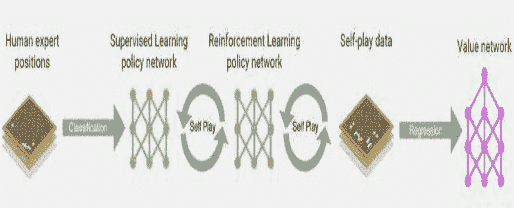

The training phase of AlphaGo

## Our Agenda in Adversarial Search

- **Minimax Search**: How to compute an optimal strategy? Minimax is the canonical (and easiest to understand) algorithm for solving games, i.e., computing an optimal strategy.
- **Evaluation Functions**: But what if we don’t have the time/memory to solve the entire game? Given limited time, the best we can do is look ahead as far as we can. Evaluation functions tell us how to evaluate the leaf states at the cut-off.
- **Alpha-Beta Pruning Search**: How to prune unnecessary parts of the tree? An essential improvement over Minimax.
- **Monte-Carlo Tree Search** (MCTS): An alternative form of game search, based on sampling rather than exhaustive enumeration. The main alternative to Alpha-Beta Search.

**Alpha-Beta = state of the art in Chess**  
**MCTS = state of the art in Go**

## The definition of a game

We first consider games with two players, whom we call MAX and MIN for reasons that will soon become obvious. MAX moves first, and then they take turns moving until the game is over. At the end of the game, points are awarded to the winning player and penalties are given to the loser. A game can be formally defined as a kind of search problem with the following elements:

- S0: The initial state, which specifies how the game is set up at the start.
- PLAYER(s): Defines which player has the move in a state.
- ACTIONS(s): Returns the set of legal moves in a state.
- RESULT(s, a): The transition model, which defines the result of a move.
- TERMINAL-TEST(s): A terminal test, which is true when the game is over and false otherwise. States where the game has ended are called terminal states.
- UTILITY(s, p): A utility function (also called an objective function or payoff function), defines the final numeric value for a game that ends in terminal state s for a player p. In chess, the outcome is a win, loss, or draw, with values +1, 0, or 1/2. Some games have a wider variety of possible outcomes; the payoffs in backgammon range from 0 to +192. A zero-sum game is (confusingly) defined as one where the total payoff to all players is the same for every instance of the game. Chess is zero-sum because every game has payoff of either 0 + 1, 1 + 0 or 1/2 + 1/2. “Constant-sum” would have been a better term, but zero-sum is traditional and makes sense if you imagine each player is charged an entry fee of 1/2.


## The definition of a game (tic-tac-toe)

The initial state. ACTIONS function, and RESULT function define the game tree for the game—a tree where the nodes are game states and the edges are moves. Figure 5.1 shows part of the game tree for tic-tac-toe (noughts and crosses). From the initial state, MAX has nine possible moves. Play alternates between MAX’s placing an X and MIN’s placing an O until we reach leaf nodes corresponding to terminal states such that one player has three in a row or all the squares are filled. The number on each leaf node indicates the utility value of the terminal state from the point of view of MAX; high values are assumed to be good for MAX and bad for MIN (which is how the players get their names).

For tic-tac-toe the game tree is relatively small—fewer than 9! = 362,880 terminal nodes. But for chess there are over 10^40 nodes, so the game tree is best thought of as a theoretical construct that we cannot realize in the physical world. But regardless of the size of the game tree, it is MAX’s job to search for a good move. We use the term search tree for a tree that is superimposed on the full game tree, and examines enough nodes to allow a player to determine what move to make.

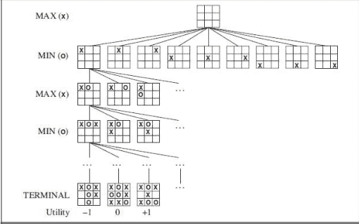

Figure 5.1 A (partial) game tree for the game of tic-tac-toe. The top node is the initial state, and MAX moves first, placing an X in an empty square. We show part of the tree, giving alternating moves by MIN (O) and MAX (X), until we eventually reach terminal states, which can be assigned utilities according to the rules of the game.

## Optimal Decisions in Games

- In a normal search problem, the optimal solution would be a sequence of actions leading to a goal state—a terminal state that is a win.

- In adversarial search, MIN has something to say about it. MAX therefore must find a contingent strategy, which specifies MAX’s move in the initial state, then MAX’s moves in the states resulting from every possible response by MIN, then MAX’s moves in the states resulting from every possible response by MIN to those moves, and so on. This is exactly analogous to the AND–OR search algorithm (Figure 4.11) with MAX playing the role of OR and MIN equivalent to AND. Roughly speaking, an optimal strategy leads to outcomes at least as good as any other strategy when one is playing an infallible opponent. We begin by showing how to find this optimal strategy.

## Optimal Decisions in Games

Even a simple game like tic-tac-toe is too complex for us to draw the entire game tree on one page, so we will switch to the trivial game in Figure 5.2. The possible moves for MAX at the root node are labeled _a_<sub>1</sub>, _a_<sub>2</sub>, and _a_<sub>3</sub>. The possible replies to _a_<sub>1</sub> for MIN are _b_<sub>1</sub>, _b_<sub>2</sub>, _b_<sub>3</sub>, and so on. This particular game ends after one move each by MAX and MIN. (In game parlance, we say that this tree is one move deep, consisting of two half-moves, each of which is called a ply.) The utilities of the terminal states in this game range from 2 to 14.

Given a game tree, the optimal strategy can be determined from the **minimax value** of each node, which we write as MINIMAX(_n_). The minimax value of a node is the utility (for MAX) of being in the corresponding state, _assuming that both players play optimally_ from there to the end of the game. Obviously, the minimax value of a terminal state is just its utility. Furthermore, given a choice, MAX prefers to move to a state of maximum value, whereas MIN prefers a state of minimum value. So we have the following:

MINIMAX(_s_) = 
\(\left\{\begin{array}{ c c }
UTILITY(s) & \text{if TERMINAL-TEST}(s) \\
max_{a \in Actions(s)} MINIMAX(RESULT(s,a)) & \text{if PLAYER}(s) = MAX \\
min_{a \in Actions(s)} MINIMAX(RESULT(s,a)) & \text{if PLAYER}(s) = MIN
\end{array}\right.\)

Let us apply these definitions to the game tree in Figure 5.2. The terminal nodes on the bottom level get their utility values from the game’s UTILITY function. The first MIN node, labeled _B_, has three successor states with values 3, 12, and 8, so its minimax value is 3. Similarly, the other two MIN nodes have minimax value 2. The root node is a MAX node; its successor states have minimax values 3, 2, and 2; so it has a minimax value of 3. We can also identify the **minimax decision** at the root: action _a_<sub>1</sub> is the optimal choice for MAX because it leads to the state with the highest minimax value.

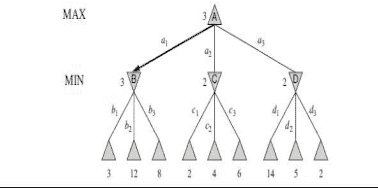

Figure 5.2 A two-ply game tree. The \(\Delta\) nodes are “MAX nodes,” in which it is MAX’s turn to move, and the \(\nabla\) nodes are “MIN nodes.” The terminal nodes show the utility values for MAX; the other nodes are labeled with their minimax values. MAX’s best move at the root is _a_<sub>1</sub>, because it leads to the state with the highest minimax value, and MIN’s best reply is _b_<sub>1</sub>, because it leads to the state with the lowest minimax value.


## Minimax

We want to compute an optimal move for player “Max”. In other words: “We are Max, and our opponent is Min.”

**Remember:**

- Max attempts to *maximize* the utility \(u(s)\) of the terminal state that will be reached during play.
- Min attempts to *minimize* \(u(s)\).

**So what?**

- The computation alternates between minimization and maximization
  ⇒ hence “Minimax”.

## The minimax algorithm

The **minimax algorithm** (Figure 5.3) computes the minimax decision from the current state. It uses a simple recursive computation of the minimax values of each successor state, directly implementing the defining equations. The recursion proceeds all the way down to the leaves of the tree, and then the minimax values are **backed up** through the tree as the recursion unwinds. For example, in Figure 5.2, the algorithm first recurses down to the three bottom-left nodes and uses the UTILITY function on them to discover that their values are 3, 12, and 8, respectively. Then it takes the minimum of these values, 3, and returns it as the backed-up value of node _B_. A similar process gives the backed-up values of 2 for _C_ and 2 for _D_. Finally, we take the maximum of 3, 2, and 2 to get the backed-up value of 3 for the root node.

The minimax algorithm performs a complete depth-first exploration of the game tree. If the maximum depth of the tree is _m_ and there are _b_ legal moves at each point, then the time complexity of the minimax algorithm is _O_(_b<sup>m</sup>_). The space complexity is _O_(_bm_) for an algorithm that generates all actions at once, or _O_(_m_) for an algorithm that generates actions one at a time (see page 87). For real games, of course, the time cost is totally impractical, but this algorithm serves as the basis for the mathematical analysis of games and for more practical algorithms.

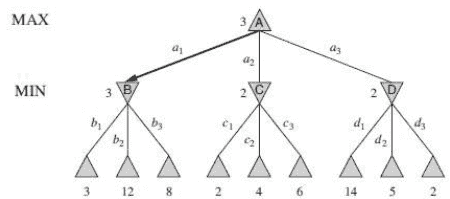

```
function MINIMAX-DECISION(state) returns an action
  return argmax a∈ACTIONS(s) MIN-VALUE(RESULT(state, a))

function MAX-VALUE(state) returns a utility value
  if TERMINAL-TEST(state) then return UTILITY(state)
  v ← −∞
  for each a in ACTIONS(state) do
    v ← MAX(v, MIN-VALUE(RESULT(s, a)))
  return v

function MIN-VALUE(state) returns a utility value
  if TERMINAL-TEST(state) then return UTILITY(state)
  v ← ∞
  for each a in ACTIONS(state) do
    v ← MIN(v, MAX-VALUE(RESULT(s, a)))
  return v
```

**Figure 5.3** An algorithm for calculating minimax decisions. It returns the action corresponding to the best possible move, that is, the move that leads to the outcome with the best utility, under the assumption that the opponent plays to minimize utility. The functions MAX-VALUE and MIN-VALUE go through the whole game tree, all the way to the leaves, to determine the backed-up value of a state. The notation argmaxa∈S f(a) computes the element of set S that has the maximum value of f(a).

## Properties of minimax

- Complete? Yes (if tree is finite)
- Optimal? Yes (against an optimal opponent)
- Time complexity? O(b^m)
- Space complexity? O(bm) (depth-first exploration)

the maximum depth of the tree is _m_ and there are _b_ legal moves at each point

- For chess, b ≈ 35, m ≈100 for "reasonable" games → exact solution completely infeasible

## Minimax: Pros and Cons

### Pros:

- Minimax is the simplest possible (reasonable) game search algorithm.
- Returns an optimal action, assuming perfect opponent play.

### Cons:

- Completely infeasible (search tree way too large).

### Remedies:

- Limit search depth, apply evaluation function to the cut-off states.
- Use **alpha-beta pruning** to reduce search.
- Don't search exhaustively; sample instead (i.e., MCTS).

## Alpha-Beta Pruning

The problem with minimax search is that the number of game states it has to examine is exponential in the depth of the tree. Unfortunately, we can’t eliminate the exponent, but it turns out we can effectively cut it in half. The trick is that it is possible to compute the correct minimax decision without looking at every node in the game tree. That is, we can borrow the idea of pruning from Chapter 3 to eliminate large parts of the tree from consideration. The particular technique we examine is called **alpha-beta pruning**. When applied to a standard minimax tree, it returns the same move as minimax would, but prunes away branches that cannot possibly influence the final decision.

Consider again the two-ply game tree from Figure 5.2. Let’s go through the calculation of the optimal decision once more, this time paying careful attention to what we know at each point in the process. The steps are explained in Figure 5.5. The outcome is that we can identify the minimax decision without ever evaluating two of the leaf nodes.

Another way to look at this is as a simplification of the formula for MINIMAX. Let the two unevaluated successors of node C in Figure 5.5 have values \(x\) and \(y\). Then the value of the root node is given by

\[\begin{aligned}
\operatorname{MINIMAX}(root) &= \max(\min(3,12,8),\min(2,x,y),\min(14,5,2))\\
&= \max(3,\min(2,x,y),2)\\
&= \max(3,2,2) \qquad \text{where } \min(2,x,y) \leq 2\\
&= 3.
\end{aligned}\]

In other words, the value of the root and hence the minimax decision are *independent of the values of the pruned leaves* \(x\) and \(y\).

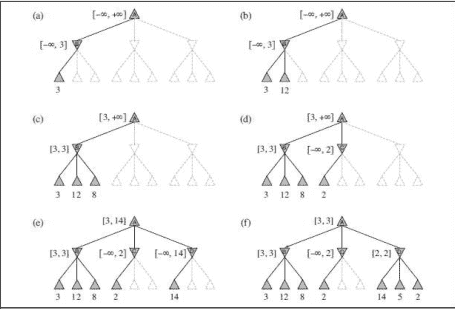

**Figure 5.5** Stages in the calculation of the optimal decision for the game tree in Figure 5.2. At each point, we show the range of possible values for each node. (a) The first leaf below B has the value 3. Hence, B, which is a MIN node, has a value of at most 3. (b) The second leaf below B has a value of 12; MIN would avoid this move, so the value of B is still at most 3. (c) The third leaf below B has a value of 8; we have seen all B’s successor states, so the value of B is exactly 3. Now, we can infer that the value of the root is at least 3, because MAX has a choice worth 3 at the root. (d) The first leaf below C has the value 2. Hence, C, which is a MIN node, has a value of at most 2. But we know that B is worth 3, so MAX would never choose C. Therefore, there is no point in looking at the other successor states of C. This is an example of alpha-beta pruning. (e) The first leaf below D has the value 14, so D is worth at most 14. This is still higher than MAX’s best alternative (i.e., 3), so we need to keep exploring D’s successor states. Notice also that we now have bounds on all of the successors of the root, so the root’s value is also at most 14. (f) The second successor of D is worth 5, so again we need to keep exploring. The third successor is worth 2, so now D is worth exactly 2. MAX’s decision at the root is to move to B, giving a value of 3.


## α-β pruning example

MAX

MIN

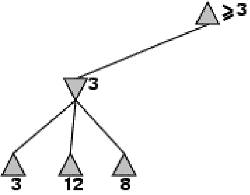

## α-β pruning example

MAX

MIN

3

3

12

8

2

X

X

>=3

<=2

## α-β pruning example

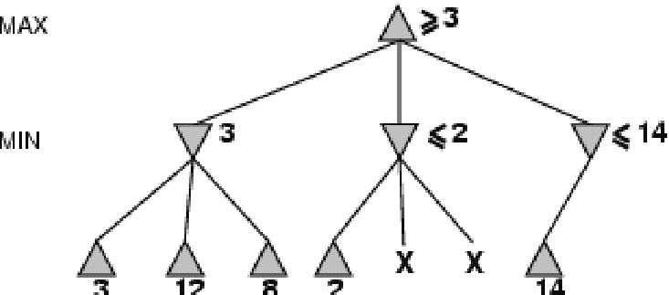

## α-β pruning example

MAX

MIN

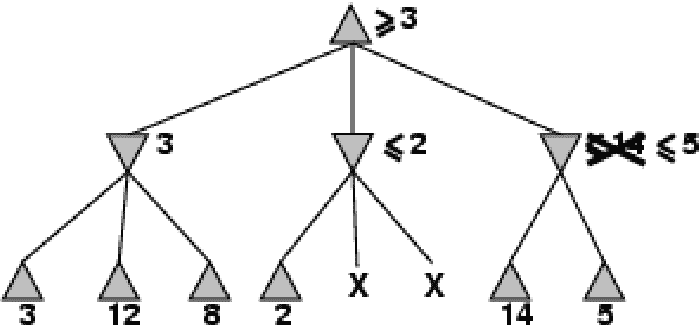

## α-β pruning example

MAX
MIN

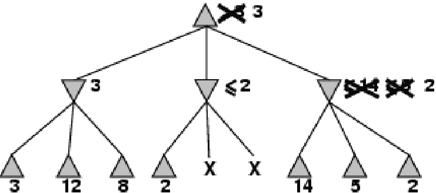

## Alpha-Beta Pruning

- **What is** \(\alpha\): For each search node \(n\), the highest Max-node utility that search has found already on its path to \(n\).
- **How to use** \(\alpha\): In a Min node \(n\), if one of the successors already has utility \(\leq \alpha\), then stop considering \(n\). (Pruning out its remaining successors.)

We can use a dual method for Min:

- **What is** \(\beta\): For each search node \(n\), the lowest Min-node utility that search has found already on its path to \(n\).
- **How to use** \(\beta\): In a Max node \(n\), if one of the successors already has utility \(\geq \beta\), then stop considering \(n\). (Pruning out its remaining successors.)

## Alpha-Beta Pruning

Alpha-beta pruning can be applied to trees of any depth, and it is often possible to prune entire subtrees rather than just leaves. The general principle is this: consider a node _n_ somewhere in the tree (see Figure 5.6), such that Player has a choice of moving to that node. If Player has a better choice _m_ either at the parent node of _n_ or at any choice point further up, then _n_ will never be reached in actual play. So once we have found out enough about _n_ (by examining some of its descendants) to reach this conclusion, we can prune it.

Remember that minimax search is depth-first, so at any one time we just have to consider the nodes along a single path in the tree. Alpha-beta pruning gets its name from the following two parameters that describe bounds on the backed-up values that appear anywhere along the path:

- \(\alpha\) = the value of the best (i.e., highest-value) choice we have found so far at any choice point along the path for MAX.

- \(\beta\) = the value of the best (i.e., lowest-value) choice we have found so far at any choice point along the path for MIN.

Alpha-beta search updates the values of \(\alpha\) and \(\beta\) as it goes along and prunes the remaining branches at a node (i.e., terminates the recursive call) as soon as the value of the current node is known to be worse than the current \(\alpha\) or \(\beta\) value for MAX or MIN, respectively. The complete algorithm is given in Figure 5.7. We encourage you to trace its behavior when applied to the tree in Figure 5.5.

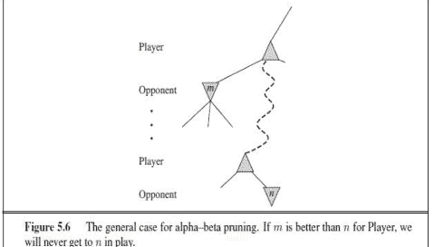

- General configuration (MIN version)
  - We’re computing the MIN-VALUE at some node *n*
  - We’re looping over *n*’s children
  - *n*’s estimate of the children’s min is dropping
  - Who cares about *n*’s value? MAX
  - Let *a* be the best value that MAX can get at any choice point along the current path from the root
  - If *n* becomes worse than *a*, MAX will avoid it, so we can stop considering *n*’s other children (it’s already bad enough that it won’t be played)
- MAX version is symmetric

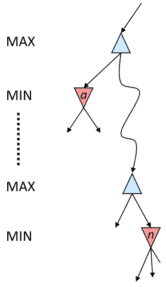

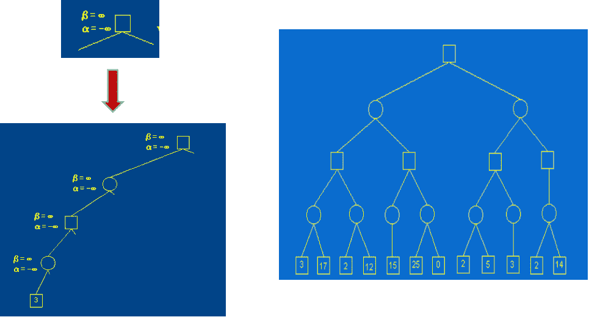

We pass this node back to the min node above. Since this is a min node, we now know that the minimax value of this node must be less than or equal to 3. In other words, we change beta to 3.

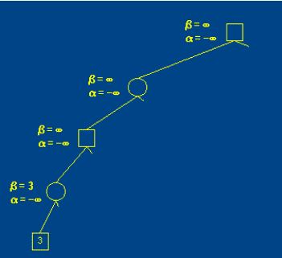

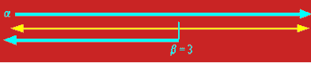

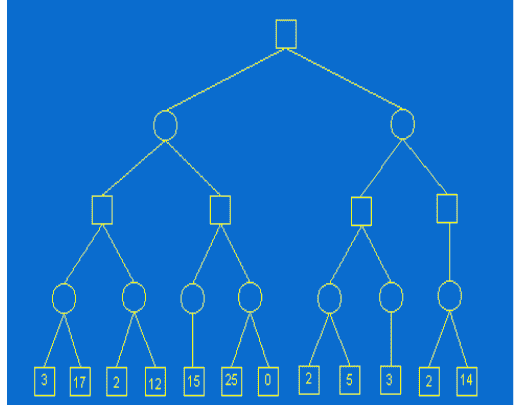

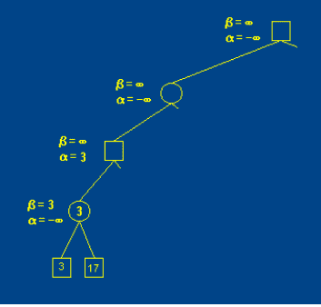

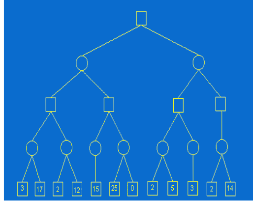

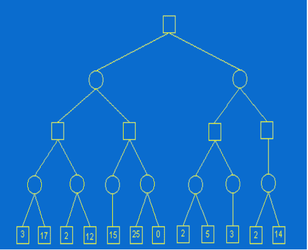

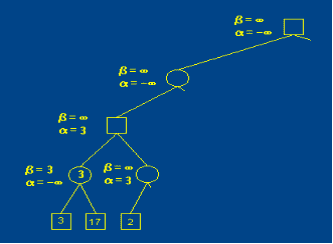

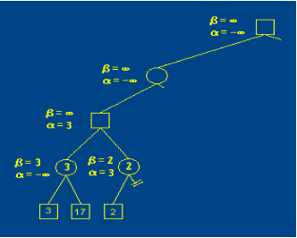

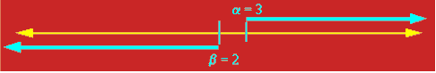


## Alpha-Beta Pruning: Move ordering

The effectiveness of alpha–beta pruning is highly dependent on the order in which the states are examined. For example, in Figure 5.5(e) and (f), we could not prune any successors of D at all because the worst successors (from the point of view of MIN) were generated first. If the third successor of D had been generated first, we would have been able to prune the other two. This suggests that it might be worthwhile to try to examine first the successors that are likely to be best.

If this can be done, then it turns out that alpha–beta needs to examine only O(b^(m/2)) nodes to pick the best move, instead of O(b^m) for minimax. This means that the effective branching factor becomes √b instead of b—for chess, about 6 instead of 35. Put another way, alpha–beta can solve a tree roughly twice as deep as minimax in the same amount of time. If successors are examined in random order rather than best-first, the total number of nodes examined will be roughly O(b^(3m/4)) for moderate b. For chess, a fairly simple ordering function (such as trying captures first, then threats, then forward moves, and then backward moves) gets you to within about a factor of 2 of the best-case O(b^(m/2)) result.

m is the maximum depth of the tree and b are legal moves at each point

# Alpha-Beta Algorithm

```
function ALPHA-BETA-SEARCH(state) returns an action
    v ← MAX-VALUE(state, -∞, +∞)
    return the action in ACTIONS(state) with value v

function MAX-VALUE(state, α, β) returns a utility value
    if TERMINAL-TEST(state) then return UTILITY(state)
    v ← -∞
    for each a in ACTIONS(state) do
        v ← MAX(v, MIN-VALUE(RESULT(s, a), α, β))
        if v ≥ β then return v
        α ← MAX(α, v)
    return v

function MIN-VALUE(state, α, β) returns a utility value
    if TERMINAL-TEST(state) then return UTILITY(state)
    v ← +∞
    for each a in ACTIONS(state) do
        v ← MIN(v, MAX-VALUE(RESULT(s, a), α, β))
        if v ≤ α then return v
        β ← MIN(β, v)
    return v
```

> **Figure 5.7** The alpha-beta search algorithm. Notice that these routines are the same as the MINIMAX functions in Figure 5.3, except for the two lines in each of MIN-VALUE and MAX-VALUE that maintain α and β (and the bookkeeping to pass these parameters along).

# Properties of α–β

- Alpha–beta pruning is a search algorithm that seeks to decrease the number of nodes that are evaluated by the minimax algorithm in its search tree. It is an adversarial search algorithm used commonly for machine playing of two-player games (Tic-tac-toe, Chess, Go, etc.).

- The benefit of alpha–beta pruning lies in the fact that branches of the search tree can be eliminated. This way, the search time can be limited to the 'more promising' subtree, and a deeper search can be performed in the same time.

## Properties of α-β

- The algorithm maintains two values, alpha and beta, which represent the maximum score that the maximizing player is assured of and the minimum score that the minimizing player is assured of respectively.

- Initially alpha is negative infinity and beta is positive infinity, i.e. both players start with their lowest possible score.

- It can happen that when choosing a certain branch of a certain node the minimum score that the minimizing player is assured of becomes less than the maximum score that the maximizing player is assured of **(beta<=alpha)**. If this is the case, the parent node should not choose this node, because it will make the score for the parent node worse. Therefore, the other branches of the node do not have to be explored.


## Properties of α-β

- The benefit of alpha–beta pruning lies in the fact that branches of the search tree can be eliminated. This way, the search time can be limited to the 'more promising' subtree, and a deeper search can be performed in the same time.

The effectiveness of alpha–beta pruning is highly dependent on the order in which the states are examined. For example, in Figure 5.5(e) and (f), we could not prune any successors of D at all because the worst successors (from the point of view of MIN) were generated first. If the third successor of D had been generated first, we would have been able to prune the other two. This suggests that it might be worthwhile to try to examine first the successors that are likely to be best.

If this can be done,² then it turns out that alpha–beta needs to examine only O(b^(m/2)) nodes to pick the best move, instead of O(b^m) for minimax. This means that the effective branching factor becomes √b instead of b—for chess, about 6 instead of 35. Put another way, alpha–beta can solve a tree roughly twice as deep as minimax in the same amount of time. If successors are examined in random order rather than best-first, the total number of nodes examined will be roughly O(b^(3m/4)) for moderate b. For chess, a fairly simple ordering function (such as trying captures first, then threats, then forward moves, and then backward moves) gets you to within about a factor of 2 of the best-case O(b^(m/2)) result.

- Pruning **does not** affect final result
- Good move ordering improves effectiveness of pruning
- With "perfect ordering," time complexity = O(b^(m/2))
  - → **doubles** depth of search

## Imperfect Real-time Decisions

- The minimax algorithm generates the entire game search space, whereas the alpha–beta algorithm allows us to prune large parts of it. However, alpha–beta still has to search all the way to terminal states for at least a portion of the search space. This depth is usually not practical, because moves must be made in a reasonable amount of time—typically a few minutes at most.

- We should cut off the search earlier and apply a heuristic evaluation function to states in the search, effectively turning nonterminal nodes into terminal leaves. In other words, the suggestion is to alter minimax or alpha–beta in two ways: replace the utility function by a heuristic evaluation function EVAL, which estimates the position’s utility, and replace the terminal test by a cutoff test that decides when to apply EVAL.

- That gives us the following for heuristic minimax for state s and maximum depth d:

```
H-MINIMAX(s,d) =
⎧ EVAL(s)                                 if CUTOFF-TEST(s,d)
⎨ max_{a∈Actions(s)} H-MINIMAX(RESULT(s,a),d+1)   if PLAYER(s)=MAX
⎩ min_{a∈Actions(s)} H-MINIMAX(RESULT(s,a),d+1)   if PLAYER(s)=MIN.
```

### Imperfect Real-time Decisions: Evaluation functions

An evaluation function returns an *estimate* of the expected utility of the game from a given position. How exactly do we design good evaluation functions?

- First, the evaluation function should order the terminal states in the same way as the true utility function: states that are wins must evaluate better than draws, which in turn must be better than losses. Otherwise, an agent using the evaluation function might err even if it can see ahead all the way to the end of the game.
- Second, the computation must not take too long! (The whole point is to search faster.)
- Third, for nonterminal states, the evaluation function should be strongly correlated with the actual chances of winning.

Most evaluation functions work by calculating various **features** of the state—for example, in chess, we would have features for the number of white pawns, black pawns, white queens, black queens, and so on. The features, taken together, define various *categories* or *equivalence classes* of states: the states in each category have the same values for all the features.

The evaluation function cannot know which states are which, but it can return a single value that reflects the proportion of states with each outcome. For example, suppose our experience suggests that 72% of the states encountered in the two-pawns vs. one-pawn category lead to a win (utility +1); 20% to a loss (0), and 8% to a draw (1/2). Then a reasonable evaluation for states in the category is the expected value: (0.72 × +1) + (0.20 × 0) + (0.08 × 1/2) = 0.76


In practice, this kind of analysis requires too many categories and hence too much experience to estimate all the probabilities of winning. Instead, most evaluation functions compute separate numerical contributions from each feature and then combine them to find the total value. For example, introductory chess books give an approximate material value for each piece: each pawn is worth 1, a knight or bishop is worth 3, a rook 5, and the queen 9. Other features such as “good pawn structure” and “king safety” might be worth half a pawn, say. These feature values are then simply added up to obtain the evaluation of the position.

Mathematically, this kind of evaluation function is called **a weighted linear function** because it can be expressed as

$$EVAL(s)=w_1f_1(s)+w_2f_2(s)+\cdots+w_nf_n(s)=\sum_{i=1}^{n}w_if_i(s),$$

where each $w_i$ is a weight and each $f_i$ is a feature of the position. For chess, the $f_i$ could be the numbers of each kind of piece on the board, and the $w_i$ could be the values of the pieces (1 for pawn, 3 for bishop, etc.).

Adding up the values of features seems like a reasonable thing to do, but in fact it involves a strong assumption: that the contribution of each feature is **independent** of the values of the other features. For example, assigning the value 3 to a bishop ignores the fact that bishops are more powerful in the endgame, when they have a lot of space to maneuver.

For this reason, current programs for chess and other games also use *nonlinear* combinations of features. For example, a pair of bishops might be worth slightly more than twice the value of a single bishop, and a bishop is worth more in the endgame (that is, when the *move number* feature is high or the *number of remaining pieces* feature is low).

The astute reader will have noticed that the features and weights are *not* part of the rules of chess! They come from centuries of human chess-playing experience. In games where this kind of experience is not available, the weights of the evaluation function can be estimated by the machine learning techniques of Chapter 18. Reassuringly, applying these techniques to chess has confirmed that a bishop is indeed worth about three pawns.

## Fast simple $f$: weighted linear function

$$w_1f_1+w_2f_2+\cdots+w_nf_n$$

where the $w_i$ are the weights, and the $f_i$ are the features.

## How to obtain such functions?

- Weights $w_i$ can be learned automatically.
- The features $f_i$ have to be designed by human experts.

## Cutting off search

The next step is to modify ALPHA-BETA-SEARCH so that it will call the heuristic EVAL function when it is appropriate to cut off the search. We replace the two lines in Figure 5.7 that mention TERMINAL-TEST with the following line:

if CUTOFF-TEST(state, depth) then return EVAL(state)

We also must arrange for some bookkeeping so that the current depth is incremented on each recursive call. The most straightforward approach to controlling the amount of search is to set a fixed depth limit so that CUTOFF-TEST(state, depth) returns true for all depth greater than some fixed depth d. (It must also return true for all terminal states, just as TERMINAL-TEST did.) The depth d is chosen so that a move is selected within the allocated time. A more robust approach is to apply iterative deepening. (See Chapter 3.) When time runs out, the program returns the move selected by the deepest completed search. As a bonus, iterative deepening also helps with move ordering.

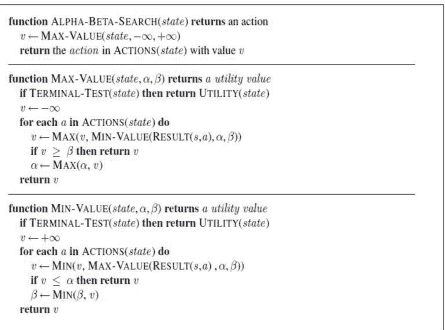

Figure 5.7 The alpha-beta search algorithm. Notice that these routines are the same as the MINMAX functions in Figure 5.3, except for the two lines in each of MIN-VALUE and MAX-VALUE that maintain α and β (and the bookkeeping to pass these parameters along).


## Stochastic Games

Although White knows what his or her own legal moves are, White does not know what Black is going to roll and thus does not know what Black’s legal moves will be. That means White cannot construct a standard game tree of the sort we saw in chess and tic-tac-toe. A game tree in backgammon must include **chance nodes** in addition to MAX and MIN nodes.

Chance nodes are shown as circles in Figure 5.11. The branches leading from each chance node to the possible dice rolls; each branch is labeled with the roll and its probability. There are 36 ways to roll two dice, each equally likely; but because a 6-5 is the same as a 5-6, there are only 21 distinct rolls. The six doubles (1-1 through 6-6) each have a probability of 1/36, so we say P(1-1) = 1/36. The other 15 distinct rolls each have a 1/18 probability.

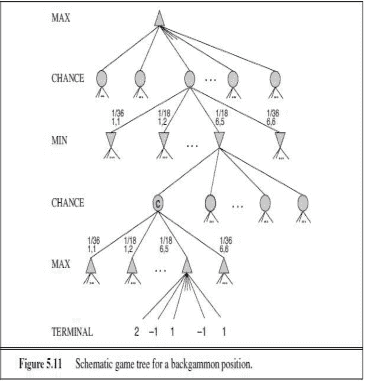

## Partially Observable Games: Cards

Card games provide many examples of stochastic partial observability, where the missing information is generated randomly. For example, in many games, cards are dealt randomly at the beginning of the game, with each player receiving a hand that is not visible to the other players. Such games include bridge, whist, hearts, and some forms of poker.

At first sight, it might seem that these card games are just like dice games: the cards are dealt randomly and determine the moves available to each player, but all the “dice” are rolled at the beginning! Even though this analogy turns out to be incorrect, it suggests an effective algorithm: consider all possible deals of the invisible cards; solve each one as if it were a fully observable game; and then choose the move that has the best outcome averaged over all the deals. Suppose that each deal s occurs with probability P(s); then the move we want is

\(\operatorname{argmax}_a \sum_s P(s) \text{MINIMAX}(\text{RESULT}(s, a)) .\)

Here, we run exact MINIMAX if computationally feasible; otherwise, we run H-MINIMAX.

Now, in most card games, the number of possible deals is rather large. For example, in bridge play, each player sees just two of the four hands; there are two unseen hands of 13 cards each, so the number of deals is \(\binom{26}{13} = 10,400,600\). Solving even one deal is quite difficult, so solving ten million is out of the question. Instead, we resort to a Monte Carlo

## Artificial Intelligence

## Adversarial Search

## Monte Carlo Tree Search

selectively random sampling with simulations

Fei Wu

College of Computer Science, Zhejiang University

[http://person.zju.edu.cn/wufei/](http://person.zju.edu.cn/wufei/)

## References

- David Silver, et.al., Mastering the game of Go with Deep Neural Networks and Tree Search, **Nature**, 529:484-490, 2016
- Cameron Browne, et.al., Survey of Monte Carlo Tree Search Methods, **IEEE Transactions on Computational Intelligence and AI in Games**, 4(1):1-49, 2012
- Sylvain Gelly, Levente Kocsis, Marc Schoenauer, et al., The Grand Challenge of Computer Go: Monte Carlo Tree Search and Extensions, **Communications of the ACM**, 55(3):106-113, 2012
- Levente Kocsis, Csaba Szepesvari, Bandit Based Monte-Carlo Planning, **ECML** 2006
- Auer, P., Cesa-Bianchi, N., & Fischer, P. . Finite-time analysis of the multi-armed bandit problem, **Machine learning**, 47(2), 235-256, 2002

## Monte Carlo Method

- In principle, Monte Carlo methods can be used to solve any problem having a probabilistic interpretation. By the law of large numbers, integrals described by the expected value of some random variable can be approximated by taking the empirical mean (a.k.a. the sample mean) of independent samples of the variable. When the probability distribution of the variable is parametrized, mathematicians often use a Markov Chain Monte Carlo (MCMC) sampler.
- The central idea is to design a judicious Markov chain model with a prescribed stationary probability distribution. That is, in the limit, the samples being generated by the MCMC method will be samples from the desired (target) distribution.


## Calculation of Pi Using the Monte Carlo Method

- The blue circle square has an area of πr².
- The gray square has an area of (2 × r)² = 4r².
- The ratio of the circle area to square area is \(p = \frac{\pi r^2}{4r^2} = \frac{\pi}{4}\).
- Therefore the value of π is 4×p.
- The red square contains ¼ of blue and gray points so the ratio of points is the same (p).

The implementation takes a random point inside the unit square of size 1×1 and checks if that point lies within the blue circle. The ratio of points inside the circle to all generated points is p. Multiplying p by 4 gives the approximate value of π.

## Monte-Carlo Simulation

- In some games of interest, e.g., in the game of Go, it has proven hard to encode or learn an evaluation function of sufficient quality to achieve good performance in a minimax search. Instead of constructing an evaluation function, an alternative idea is to first construct a **policy**, and then to use that policy to **estimate** the values of states.

- A policy is a mapping from states to actions, in other words a policy determines a way to play the game. Given a policy pair (one policy for each player, which if symmetric can be represented by a single policy), a value estimate for a state scan be obtained by simulation: start in state s and follow the respective policies in an alternating manner from s until the end of the game, and use the reward in the terminal state as the value of state s.

- In some games, it is easier to estimate the value indirectly by simulation, i.e., it may be easier to come up with a simple policy that leads to good value estimates via simulation, than to estimate those values directly.

## Monte-Carlo Simulation

- The potential benefit of randomization is twofold: it can reduce the influence of systematic errors and it also allows one to make a distinction between states where it is "easy to win" (i.e., from where most reasonable policy pairs lead to a high reward terminal state) and states where it is "hard to win".

- This distinction pays off because real-world opponents are also imperfect, and therefore it is worthwhile to bias the game towards states with many available winning strategies. Note that the concepts of "easy" and "hard" do not make sense against a perfect opponent.

## Monte-Carlo Simulation

- When the policy is randomized, computing the exact expected value of a state under the policy can be as hard as (or even harder than) computing its optimal value. Luckily, Monte-Carlo methods can give a good approximation to the expected value of a state. The idea is simply to run a number of simulations by sampling the actions according to the randomized policy. The rewards from these simulations are then averaged to give the Monte-Carlo value estimate of the initial state.

In detail, the value of action \(a\) in position \(s_0\) (the root of the game tree) is estimated as follows. Run \(N\) simulations from state \(s_0\) until the end of the game, using a fixed randomized policy for both players. Let \(N(a)\) be the number of these simulations in which \(a\) is the first action taken in state \(s_0\). Let \(W(a)\) be the total reward collected by Black in these games. Then, the value of action \(a\) is estimated by \(\frac{W(a)}{N(a)}\).

## Monte-Carlo Planning

- Single State Case (multi-armed bandits)
  - A basic tool for other algorithms, sampling actions selectively
- Upper Confidence Bound (UCB) Strategies
- Monte-Carlo Tree Search
  - UCT (Upper Confidence Bounds on Trees)

## Monte-Carlo Planning

For each simulation:

- Traverse the tree using a _tree policy_ (trading off _exploration_ and _exploitation_) until a leaf node is reached
- Run a _rollout_ using a _default policy_ (e.g., random moves) until a terminal state is reached
- Update the value estimates of nodes along the path to reflect the win percentage of simulations passing through that node

a rollout-based algorithm builds its lookahead tree by repeatedly sampling episodes from the initial state. An episode is a sequence of state-action-reward triplets that are obtained using the domains generative model. The tree is built by adding the information gathered during an episode to it in an incremental manner.


## Monte-Carlo Planning

- **Selection:**
  - starting at the root node, a child selection policy is recursively applied to descend through the tree until the most urgent expandable node is reached. A node is expandable if it represents a nonterminal state and has unvisited (i.e. unexpanded) children.

- **Expansion:**
  - one (or more) child nodes are added to expand the tree, according to the available actions.

- **Simulation:**
  - A simulation is run from the new node(s). This step is sometimes also called playout or rollout.

- **Backpropagation:**
  - The simulation result is “backed up” (i.e. backpropagated) through the selected nodes to update their statistics.

There are two distinct policies:

- **Tree Policy:** Select or create a leaf node from the nodes already contained within the search tree (selection and expansion). The tree policy must trade off exploration and exploitation.
- **Default Policy:** Play out the domain from a given non-terminal state to produce a value estimate (simulation).

Instead of depth-limited search with an evaluation function, use randomized simulations

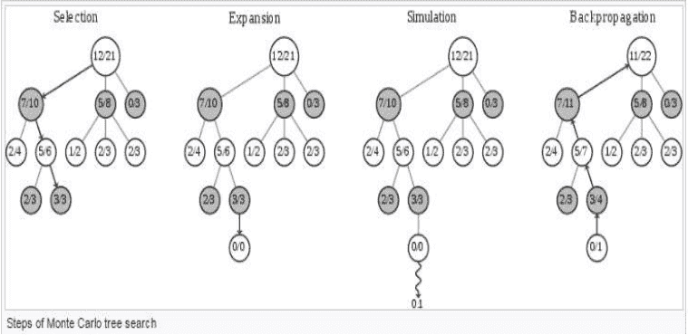

## Multi-armed bandit

- Multi-armed bandit problems are the most basic examples of sequential decision problems with an **exploration and exploitation** trade-off.

- This is the balance between staying with the option that gave highest payoffs in the past (i.e., **exploitation**) and exploring new options that might give higher payoffs in the future (i.e., **exploration**).

- **Clinical Trials**
  - Arms = possible treatments
  - Arm Pulls = application of treatment to individual
  - Rewards = outcome of treatment
  - Objective = maximize cumulative reward = maximize benefit to trial population (or find best treatment quickly)

- **Online Advertising**
  - Arms = different ads/ad-types for a web page
  - Arm Pulls = displaying an ad upon a page access
  - Rewards = click through
  - Objective = maximize cumulative reward = maximize clicks (or find best ad quickly)

In order to analyze the behavior of a player or forecaster (i.e., the agent implementing a bandit strategy), we may compare its performance with that of an optimal strategy that, for any horizon of n time steps, consistently plays the arm that is best in the first n steps. In other terms, we may study the **regret** of the forecaster for not playing always optimally. More specifically, given \( K \ge 2 \) arms and sequences \( X_{i,1}, X_{i,2}, \dots \) of unknown rewards associated with each arm \( i = 1, \dots, K \), we study forecasters that at each time step \( t = 1, 2, \dots \) select an arm \( I_t \) and receive the associated reward \( X_{I_t, t} \). The regret after \( n \) plays \( I_1, \dots, I_n \) is defined by

\( R_n = \max_{i=1,\dots,K} \sum_{t=1}^n X_{i,t} - \sum_{t=1}^n X_{I_t, t}. \) (1.1)

If the time horizon is not known in advance we say that the forecaster is *anytime*.

In the original formalization of Robbins [146], which builds on the work of Wald [164] — see also Arrow et al. [16], each arm \(i = 1, \dots, K\) corresponds to an unknown probability distribution \(\nu_i\) on \([0, 1]\), and rewards \(X_{i,t}\) are independent draws from the distribution \(\nu_i\) corresponding to the selected arm.

> **The stochastic bandit problem**
>
> _Known parameters_: number of arms \(K\) and (possibly) number of rounds \(n \ge K\).
>
> _Unknown parameters_: \(K\) probability distributions \(\nu_1, \dots, \nu_K\) on \([0, 1]\).
>
> For each round \(t = 1, 2, \dots\)
>
> (1) the forecaster chooses \(I_t \in \{1, \dots, K\}\);
>
> (2) given \(I_t\), the environment draws the reward \(X_{I_t, t} \sim \nu_{I_t}\) independently from the past and reveals it to the forecaster.

[146] H. Robbins, Some aspects of the sequential design of experiments, Bulletin of the American Mathematical Society, vol. 58, pp. 527–535, 1952


## Multi-armed bandit

For \( i = 1, \dots, K \) we denote by \( \mu_i \) the mean of \( \nu_i \) (mean reward of arm \( i \)). Let

\( \mu^* = \max_{i=1,\dots,K} \mu_i \quad \text{and} \quad i^* \in \operatorname{argmax}_{i=1,\dots,K} \mu_i. \)

In the stochastic setting, it is easy to see that the pseudo-regret can be written as

\( \overline{R}_n = n\mu^* - \sum_{t=1}^n \mathbb{E}[\mu_{I_t}]. \) (1.4)

The analysis of the stochastic bandit model was pioneered in the seminal paper of Lai and Robbins [125], who introduced the technique of upper confidence bounds for the asymptotic analysis of regret.

[125] T. L. Lai and H. Robbins, Asymptotically efficient adaptive allocation rules, Advances in Applied Mathematics, vol. 6, pp. 4–22, 1985.

## Upper Confidence Bound Strategies

- UCB is a simple, yet attractive algorithm that succeeds in resolving the exploration-exploitation tradeoff.

UCB keeps track the average rewards \( \bar{X}_{i,T_i(t-1)} \) all the arms and chooses the arm with the best upper confidence bound:

$$I_t = \underset{i\in\{1,\ldots,K\}}{\arg\max}\left\{\bar{X}_{i,T_i(t-1)} + c_{t-1,T_i(t-1)}\right\}$$

where \( c_{t,s} \) is a bias sequence chosen to be

$$c_{t,s}=\sqrt{\frac{2\ln t}{s}}$$

where \( T_i(t)=\sum_{s=1}^{t}\mathbb{I}(I_s=i) \) is the number of times arm \( i \) was played up to time \( t \) (including \( t \))

## Upper Confidence Bound Strategies

- Why UCB utilizes exploration-exploitation tradeoff.
  - probability is decreasing in terms of the number of visits (explore)
  - probability is increasing in terms of a node's value (exploit)

For bandit problems, it is useful to know the _upper confidence bound (UCB)_ that any given arm will be optimal. The simplest UCB policy proposed by Auer et al. [13] is called _UCB1_, which has an expected logarithmic growth of regret uniformly over _n_ (not just asymptotically) without any prior knowledge regarding the reward distributions (which have to have their support in [0, 1]). The policy dictates to play arm _j_ that maximises:

UCB1 = \(\bar{X}_j + \sqrt{\frac{2 \ln n}{n_j}}\)

where \(\bar{X}_j\) is the average reward from arm _j_, _n<sub>j</sub>_ is the number of times arm _j_ was played and _n_ is the overall number of plays so far. The reward term \(\bar{X}_j\) encourages the _exploitation_ of higher-reward choices, while the right hand term \(\sqrt{\frac{2 \ln n}{n_j}}\) encourages the _exploration_ of less-visited choices. The exploration term is related to the size of the one-sided confidence interval for the average reward within which the true expected reward falls with overwhelming probability [13, p 237].


## Upper Confidence Bound Strategies

- UCB is a simple, yet attractive algorithm that succeeds in resolving the exploration-exploitation tradeoff.

The bias sequence is such that if \( X_{it} \) were independently and identically distributed then the inequalities

\(\mathbb{P}\left(\overline{X}_{is} \geq \mu_i + c_{t,s}\right) \leq t^{-4},\)
\(\mathbb{P}\left(\overline{X}_{is} \leq \mu_i - c_{t,s}\right) \leq t^{-4}\)

UCB is used in the internal nodes to select the actions to be sampled next.

## Upper Confidence Bound Strategies

- UCB pseudo code

**Deterministic policy:** UCB1.
**Initialization:** Play each machine once.
**Loop:**

- Play machine \( j \) that maximizes \( \bar{x}_j + \sqrt{\frac{2 \ln n}{n_j}} \), where \( \bar{x}_j \) is the average reward obtained from machine \( j \), \( n_j \) is the number of times machine \( j \) has been played so far, and \( n \) is the overall number of plays done so far.

## Regret Bound of Upper Confidence Bound Strategies

**Theorem:** Suppose that UCB1 is run on the bandit game with \( K \) actions, each of whose reward distribution \( X_{i,t} \) has values in [0,1]. Then its expected cumulative regret after \( T \) rounds is at most \( O(\sqrt{KT \log T}) \).

Actually, we'll prove a more specific theorem. Let \( \Delta_i \) be the difference \( \mu^* - \mu_i \), where \( \mu^* \) is the expected payoff of the best action, and let \( \Delta \) be the minimal nonzero \( \Delta_i \). That is, \( \Delta_i \) represents how suboptimal an action is and \( \Delta \) is the suboptimality of the second best action. These constants are called _problem-dependent constants_. The theorem we'll actually prove is:

**Theorem:** Suppose UCB1 is run as above. Then its expected cumulative regret \( \mathbb{E}(R_{\text{UCB1}}(T)) \) is at most

\( 8 \sum_{i: \mu_i < \mu^*} \frac{\log T}{\Delta_i} + \left(1 + \frac{\pi^2}{3}\right) \left( \sum_{j=1}^K \Delta_j \right) \)


## Why Monte-Carlo Tree Search

- **Two-player games:**
  - The players move in an alternating manner, and the games are assumed to be deterministic and to be perfect information.
  - Determinism rules out games of chance involving
  - Perfect information rules out games where the players have private information such as cards that are hidden from the other players. More specifically, perfect information means that knowing the rules of the game, each player can compute the distribution of game outcomes (which is a single game outcome, if deterministic) given any fixed future sequence of actions.
  - All of sequences can be enumerable

## Monte-Carlo Tree Search

- **Monte-Carlo Tree Search** (MCTS): An alternative form of game search, based on **sampling** rather than **exhaustive enumeration**. The main alternative to Alpha-Beta Search.

- Monte-Carlo tree search (MCTS) combines Monte-Carlo simulation with game tree search. It proceeds by selectively growing a game tree. As in minimax search, each node in the tree corresponds to a single state of the game. However, unlike minimax search, the values of nodes (including both leaf nodes and interior nodes) are now estimated by Monte-Carlo simulation.

- In the previous discussion of Monte-Carlo simulation, we assumed that a single, fixed policy was used during simulation. One of the key ideas of MCTS is to gradually adapt and improve this simulation policy. As more simulations are run, the game tree grows larger and the Monte-Carlo values at the nodes become more accurate, providing a great deal of useful information that can be used to bias the policy towards selecting actions which lead to child nodes with high values.

- On average, this bias improves the policy, resulting in simulations that are closer to optimal. The stronger the bias, the more selective the game tree will be, resulting in a strongly asymmetric tree that expands the highest value nodes most deeply. Nevertheless, the game tree will only typically contain a small subtree of the overall game. At some point, the simulation will reach a state that is not represented in the tree.

- At this point, the algorithm reverts to a single, fixed policy, which is followed by both players until a terminal state is reached, just like Monte-Carlo simulation. This part of the simulation is known as a roll-out.

### Algorithm 1 General MCTS approach.

function MCTSSEARCH($s_0$)
  create root node $v_0$ with state $s_0$
  while within computational budget do
    $v_l \leftarrow$ TREEPOLICY($v_0$)
    $\Delta \leftarrow$ DEFAULTPOLICY($s(v_l)$)
    BACKUP($v_l, \Delta$)
  return $a$(BESTCHILD($v_0$))

Here \(v_0\) is the root node corresponding to state \(s_0\), \(v_l\) is the last node reached during the tree policy stage and corresponds to state \(s_l\), and \(\Delta\) is the reward for the terminal state reached by running the default policy from state \(s_l\). The result of the overall search \(a(\text{BESTCHILD}(v_0))\) is the action \(a\) that leads to the best child of the root node \(v_0\), where the exact definition of "best" is defined by the implementation.

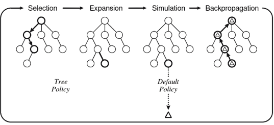

### Selection

- Start at root node
- Based on Tree Policy select child
- Apply recursively - descend through tree
- Stop when expandable node is reached

Expandable: Node that is non-terminal and has unexplored children

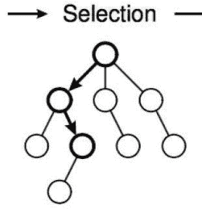

### Expansion

- Add one or more child nodes to tree
- Depends on what actions are available for the current position
- Method in which this is done depends on Tree Policy

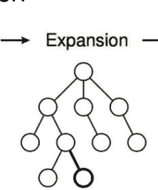

### Simulation

- Runs simulation of path that was selected
- Get position at end of simulation
- Default Policy determines how simulation is run
- Board outcome determines value

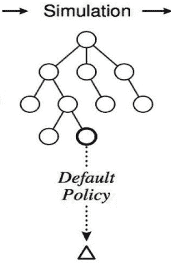


## Monte-Carlo Tree Search

## Backpropagation

- Moves backward through saved path; value of node is representative of benefit of going down that path from parent.
- Values are updated dependent on board outcome.
- Based on how the simulated game ends, values are updated.

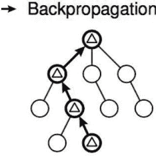

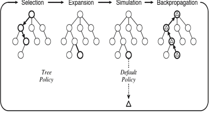

Fig. 2. One iteration of the general MCTS approach

Figure 2 shows one iteration of the basic MCTS algorithm. Starting at the root node t₀, child nodes are recursively selected according to some utility function until a node tₙ is reached that either describes a terminal state or is not fully expanded (note that this is not necessarily a leaf node of the tree). An unvisited action a from this state s is selected and a new leaf node tₗ is added to the tree, which describes the state s′ reached from applying action a to state s. This completes the tree policy component for this iteration.

A simulation is then run from the newly expanded leaf node tₗ to produce a reward value Δ, which is then backpropagated up the sequence of nodes selected for this iteration to update the node statistics; each node’s visit count is incremented and its average reward or Q value updated according to Δ. The reward value Δ may be a discrete (win/draw/loss) result or continuous reward value for simpler domains, or a vector of reward values relative to each agent p for more complex multi-agent domains.

As soon as the search is interrupted or the computation budget is reached, the search terminates and an action a of the root node t₀ is selected by some mechanism.

## Upper Confidence Bounds on Trees (UCT)

- An extremely desirable property of any game-tree search algorithm is **consistency**, i.e., given enough time, the search algorithm will find the optimal values for all nodes of the tree, and can therefore select the optimal action at the root state. The UCT algorithm is a consistent version of Monte-Carlo tree search.
- If all leaf value estimates were truly the optimal values, one could achieve consistency at the parent nodes by applying greedy action selection, which simply chooses the action with the highest value in each node. If all descendants of a given node have optimal value estimates, then greedy action selection produces optimal play from that node onwards, and therefore simulation will produce an optimal value estimate for that node. By induction, the value estimate for all nodes will eventually become optimal, and ultimately this procedure will select an optimal action at the root.
- However, the value estimates are not usually optimal for two reasons:
  1. the policy is stochastic, so there is some inherent randomness in the values.
  2. the policy is imperfect. Thus, going with the action that has the highest value estimate can lead to suboptimal play, e.g., if the value of the optimal action was initially underestimated. Therefore, occasionally at least, one must choose actions that look suboptimal according to the current value estimates.
- The problem of when and how to select optimal or suboptimal actions has been extensively studied in the simplest of all stochastic action selection problems. These problems are known as **multi-armed bandit problems**.
- Each game ends after the very first action, with the player receiving a stochastic reward that depends only on the selected action. The challenge is to maximize the player's total expected reward, i.e., quickly find the action with the highest expected reward, without losing too much reward along the way.
- One simple, yet effective, strategy is to always select the action whose value estimate is the largest, with an optimistic adjustment that takes account of the uncertainty of the value estimate. This way, each action either results in an optimal action or in a reduction of the uncertainty associated with the value estimate of the chosen action. Thus, suboptimal actions cannot be chosen indefinitely.


## Upper Confidence Bounds on Trees (UCT)

The principle of always choosing the action with the highest optimistic value estimate is known as the "principle of optimism in the face of uncertainty" and was first proposed and studied by Lai and Robbins [1]. A simple implementation of this idea, due to Auer et al. [2], is to compute an upper confidence bound (UCB) for each value estimate, using Hoeffding's tail inequality.

Applying this idea in an MCTS algorithm gives the **Upper Confidence Bounds on Trees** (UCT) algorithm due to Kocsis and Szepesvari [3].

- [1] T. L. Lai and H. Robbins. Asymptotically efficient adaptive allocation rules. Advances in Applied Mathematics, 6:4-22, 1985
- [2] P. Auer, N. Cesa-Bianchi, and P. Fischer. Finite time analysis of the multiarmed bandit problem. Machine Learning, 47(2-3):235-256, 2002
- [3] L. Kocsis and C. Szepesvari. Bandit based Monte-Carlo planning. In 15th European Conference on Machine Learning (ECML), 282-293, 2006.

Applying this idea in an MCTS algorithm gives the Upper Confidence Bounds on Trees (UCT) algorithm due to Kocsis and Szepesvari [3], where Black's UCB score \(Z(s; a)\) of an action \(a\) in state \(s\) is obtained by as following

\[
Z(s,a)=\frac{W(s,a)}{N(s,a)}+B(s,a),
\]

\[
B(s,a)=C\sqrt{\frac{\log N(s)}{N(s,a)}},
\]

where \(C>0\) is a tuning constant, \(N(s,a)\) is the number of simulations in which move \(a\) was selected from state \(s\), \(W(s,a)\) is the total reward collected at terminal states during these simulations, \(N(s)=\sum_a N(s,a)\) is the number of simulations from state \(s\), and \(B(s,a)\) is the *exploration bonus*. Each move is scored by optimistically biasing the sample mean, by adding an exploration bonus. This bonus is largest for the actions that have been tried the least number of times, and are therefore the most uncertain. This encourages rarely explored moves to be tried more frequently.

[3] L. Kocsis and C. Szepesvari, Bandit based Monte-Carlo planning, In 15th European Conference on Machine Learning (ECML), 282-293, 2006.

### Another view of UCT

bandit problem. A child node \( j \) is selected to maximise:

\[
UCT = \overline{X}_j + 2C_p \sqrt{\frac{2 \ln n}{n_j}}
\]

where \( n \) is the number of times the current (parent) node has been visited, \( n_j \) the number of times child \( j \) has been visited and \( C_p > 0 \) is a constant. If more than one child node has the same maximal value, the tie is usually broken randomly [120]. The values of \( X_{i,t} \) and thus of \( \overline{X}_j \) are understood to be within \( [0, 1] \) (this holds true for both the UCB1 and the UCT proofs). It is generally understood that \( n_j = 0 \) yields a UCT value of \( \infty \), so that previously unvisited children are assigned the largest possible value, to ensure that all children of a node are considered at least once before any child is expanded further. This results in a powerful form of **iterated local search**.

There is an essential balance between the first (exploitation) and second (exploration) terms of the UCB equation. As each node is visited, the denominator of the exploration term increases, which decreases its contribution. On the other hand, if another child of the parent node is visited, the numerator increases and hence the exploration values of unvisited siblings increase. The exploration term ensures that each child has a non-zero probability of selection, which is essential given the random nature of the playouts. This also imparts an inherent **restart** property to the algorithm, as even low-reward children are guaranteed to be chosen eventually (given sufficient time), and hence different lines of play explored.

The constant in the exploration term \( C_p \) can be adjusted to lower or increase the amount of exploration performed. The value \( C_p = 1/\sqrt{2} \) was shown by Kocsis and Szepesvári [120] to satisfy the Hoeffding inequality with rewards in the range \( [0, 1] \). With rewards outside this range, a different value of \( C_p \) may be needed and also certain enhancements<sup>9</sup> work better with a different value for \( C_p \) (7.1.3).


## The Algorithm of Upper Confidence Bounds on Trees (UCT)

Before describing the algorithm, let us define some notations first.

- $s(v)$: the associated state to node $v$
- $a(v)$: the incoming action that leads to node $v$
- $N(v)$: the visit count of node $v$
- $Q(v)$: the vector of total simulation rewards of node $v$ for all players

```
function UCTSEARCH($s_0$)
    create root node $v_0$ with state $s_0$
    while within computational budget do
        $v_l \leftarrow$ TREEPOLICY($v_0$)
        $\Delta \leftarrow$ DEFAULTPOLICY($s(v_l)$)
        BACKUP($v_l$, $\Delta$)
    return $a$(BESTCHILD($v_0$, $0$))
```

The selection step is described below, which returns the expandable node according to the tree policy.

```
function TREEPOLICY(v)
  while v is nonterminal do
    if v not fully expanded then
      return EXPAND(v)
    else
      v ← BESTCHILD(v, Cp)
  return v
```

The child selection is described below, which returns the best child of a given node. It essentially applies the UCB method, which uses a constant C to balance the exploitation with the exploration. It should be noted that there might be multiple players, but the best child is selected as per the interest of the player who is supposed to play in this state.

```
function BESTCHILD(v, c)
    return arg max_{v' ∈ Children of v} Q(v') / N(v') + c√(2 ln N(v) / N(v'))
```

The selected node after the selection step is expanded by choosing one of its unvisited children, and then adding the associated data to the new node. The procedure is described below.

```
function EXPAND(v)
    choose a ∈ untried actions from A(s(v))
    add a new child v' to v
    with s(v') = f(s(v), a)
    and a(v') = a
    return v'
```

Given the state associated to the newly expanded node, a random simulation is run as indicated below, which finds a random path to a terminal state and returns the simulated reward.

```
function DEFAULTPOLICY(s)
    while s is non-terminal do
        choose a ∈ A(s) uniformly at random
        s ← f(s, a)
    return reward for state s
```

Once the simulated reward of the newly expanded node is obtained, it is backpropagated through the selected nodes in the selection step. The visit counts are updated at the same time.

```
function BACKUP(v, Δ)
    while v is not null do
        N(v) ← N(v) + 1
        Q(v) ← Q(v) + Δ(v, p)
        v ← parent of v
```

Recall the board game example, assume that the rewards of winning and losing a game are 1 and 0, respectively. After applying the MCTS algorithm, for each node $v$ in the tree, $Q(v)$ would be the number of wins that is accumulated from $N(v)$ visits of this node, and thus $\frac{Q(v)}{N(v)}$ would be the winning rate. This is exactly the information we could rely on to choose the best action to take in the current state.


## Upper Confidence Bounds on Trees (UCT)

### Algorithm 2: The UCT algorithm.

```text
function UCTSEARCH(s0)
    create root node v0 with state s0
    while within computational budget do
        vl ← TREEPOLICY(v0)
        Δ ← DEFAULTPOLICY(s(vl))
        BACKUP(vl, Δ)
    return a(BESTCHILD(v0, 0))

function TREEPOLICY(v)
    while v is nonterminal do
        if v not fully expanded then
            return EXPAND(v)
        else
            v ← BESTCHILD(v, Cp)
    return v

function EXPAND(v)
    choose a ∈ untried actions from A(s(v))
    add a new child v' to v
        with s(v') = f(s(v), a)
        and a(v') = a
    return v'

function BESTCHILD(v, c)
    return arg max over v' ∈ children of v of [ Q(v') / N(v') + c √(2 ln N(v) / N(v')) ]

function DEFAULTPOLICY(s)
    while s is non-terminal do
        choose a ∈ A(s) uniformly at random
        s ← f(s, a)
    return reward for state s

function BACKUP(v, Δ)
    while v is not null do
        N(v) ← N(v) + 1
        Q(v) ← Q(v) + Δ(v, p)
        v ← parent of v
```

Each node **v** has four pieces of data associated with it: the associated state **s(v)**, the incoming action **a(v)**, the total simulation reward **Q(v)** (a vector of real values), and the visit count **N(v)** (a nonnegative integer). Instead of storing **s(v)** for each node, it is often more efficient in terms of memory usage to recalculate it as TREEPOLICY descends the tree. The term Δ(v, p) denotes the component of the reward vector Δ associated with the current player **p** at node **v**.

The return value of the overall search in this case is a(BESTCHILD(v0, 0)), which will give the action **a** that leads to the child with the highest reward,¹⁰ since the exploration parameter **c** is set to 0 for this final call on the root node v0. The algorithm could instead return the action that leads to the most visited child; these two options will usually – but not always! – describe the same action. This potential discrepancy is addressed in the Go program ERICA by continuing the search if the most visited root action is not also the one with the highest reward. This improved ERICA’s winning rate against GNU Go from 47% to 55% [107].

## Monte-Carlo Tree Search

### UCT Algorithm

- **S**: The set of states.
- **A(s)**: The set of valid and unvisited actions for state **s**.
- **s(v)**: The state that **v** represents.
- **a(v)**: The action leading to **v**.
- **f**: S × A → S, the state transition function.
- **N(v)**: The number of times node **v** has been visited.
- **Q(v)**: The total reward of the action leading to **v**.
- **Δ(v, p)**: The reward for the player **p** to move at node **v**.

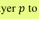

```text
function UCTSEARCH(s0)
    create root node v0 with state s0
    while within computational budget do
        vl ← TREEPOLICY(v0)
        Δ ← DEFAULTPOLICY(s(vl))
        BACKUP(vl, Δ)
    return a(BESTCHILD(v0, 0))

function TREEPOLICY(v)
    while v is nonterminal do
        if v not fully expanded then
            return EXPAND(v)
        else
            v ← BESTCHILD(v, Cp)
    return v

function DEFAULTPOLICY(s)
    while s is non-terminal do
        choose a ∈ A(s) uniformly at random
        s ← f(s, a)
    return reward for state s

function BACKUP(v, Δ)
    while v is not null do
        N(v) ← N(v) + 1
        Q(v) ← Q(v) + Δ(v, p)
        v ← parent of v

function EXPAND(v)
    choose a ∈ untried actions from A(s(v))
    add a new child v' to v
        with s(v') = f(s(v), a)
        and a(v') = a
    return v'

function BESTCHILD(v, c)
    return arg max over v' ∈ children of v of [ Q(v') / N(v') + c √(2 ln N(v) / N(v')) ]
```

## Monte-Carlo Tree Search

### UCT Algorithm

```text
function UCTSEARCH(s0)
    create root node v0 with state s0
    while within computational budget do
        vl ← TREEPOLICY(v0)
        Δ ← DEFAULTPOLICY(s(vl))
        BACKUP(vl, Δ)
    return a(BESTCHILD(v0, 0))

function TREEPOLICY(v)
    while v is nonterminal do
        if v not fully expanded then
            return EXPAND(v)
        else
            v ← BESTCHILD(v, Cp)
    return v

function DEFAULTPOLICY(s)
    while s is non-terminal do
        choose a ∈ A(s) uniformly at random
        s ← f(s, a)
    return reward for state s

function BACKUP(v, Δ)
    while v is not null do
        N(v) ← N(v) + 1
        Q(v) ← Q(v) + Δ(v, p)
        v ← parent of v

function EXPAND(v)
    choose a ∈ untried actions from A(s(v))
    add a new child v' to v
        with s(v') = f(s(v), a)
        and a(v') = a
    return v'

function BESTCHILD(v, c)
    return arg max over v' ∈ children of v of [ Q(v') / N(v') + c √(2 ln N(v) / N(v')) ]
```

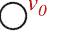

- **S**: The set of states.
- **A(s)**: The set of valid and unvisited actions for state **s**.
- **s(v)**: The state that **v** represents.
- **a(v)**: The action leading to **v**.
- **f**: S × A → S, the state transition function.
- **N(v)**: The number of times node **v** has been visited.
- **Q(v)**: The total reward of the action leading to **v**.
- **Δ(v, p)**: The reward for the player **p** to move at node **v**.


## Monte-Carlo Tree Search

### UCT Algorithm

$S$: The set of states.  
$A(s)$: The set of valid and unvisited actions for state $s$.  
$s(v)$: The state that $v$ represents.  
$a(v)$: The action that leading to $v$.  
$f:S \times A \to S$, the state transition function.  
$N(v)$: The number of times node $v$ has been visited.  
$Q(v)$: The total reward of the action leading to $v$.  
$\Delta(v,p)$: The reward for the player $p$ to move at node $v$.

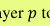

```
function UCTSearch($s_0$)  
    create root node $v_0$ with state $s_0$  
    while within computational budget do  
        $v_l \leftarrow$ TreePolicy($v_0$)  
        $\Delta \leftarrow$ DefaultPolicy($s(v_l)$)  
        Backup($v_l, \Delta$)  
    return argmax BestChild($v_0, 0$)
```

```
function TreePolicy($v$)  
    while $v$ is nonterminal do  
        if $v$ not fully expanded then  
            return Expand($v$)  
        else  
            $v \leftarrow$ BestChild($v, C_p$)  
    return $v$
```

```
function DefaultPolicy($s$)  
    while $s$ is non-terminal do  
        choose $a \in A(s)$ uniformly at random  
        $s \leftarrow f(s,a)$  
    return reward for state $s$
```

```
function Backup($v, \Delta$)  
    while $v$ is not null do  
        $N(v) \leftarrow N(v)+1$  
        $Q(v) \leftarrow Q(v)+\Delta(v,p)$  
        $v \leftarrow$ parent of $v$
```

```
function Expand($v$)  
    choose $a \in$ untried actions from $A(s(v))$  
    add a new child $v'$ to $v$  
        with $s(v')=f(s(v),a)$  
        and $a(v')=a$  
    return $v'$
```

```
function BestChild($v,c$)  
    return arg max$_{v' \in children\ of\ v$} \left[\frac{Q(v')}{N(v')}+c\sqrt{\frac{2\ln N(v)}{N(v')}}\right]$
```


## Monte-Carlo Tree Search

### UCT Algorithm

```text
function UCTSEARCH(s0)
create root node v0 with state s0
while within computational budget do
    vl ← TREEPOLICY(v0)
    Δ ← DEFAULTPOLICY(s(vl))
    BACKUP(vl, Δ)
return a(BESTCHILD(v0, 0))
```

```text
function TREEPOLICY(v)
while v is nonterminal do
    if v not fully expanded then
        return EXPAND(v)
    else
        v ← BESTCHILD(v, Cp)
return v
```

```text
function DEFAULTPOLICY(s)
while s is non-terminal do
    choose a ∈ A(s) uniformly at random
    s ← f(s, a)
return reward for state s
```

```text
function BACKUP(v, Δ)
while v is not null do
    N(v) ← N(v) + 1
    Q(v) ← Q(v) + Δ(v,p)
    v ← parent of v
```

```text
function EXPAND(v)
choose a ∈ untried actions from A(s(v))
add a new child v’ to v
    with s(v’) = f(s(v), a)
    and a(v’) = a
return v’
```

```text
function BESTCHILD(v, c)
return arg max
v′∈children of v
Q(v′)
N(v′)
+ c√
2 ln N(v)
N(v′)
```

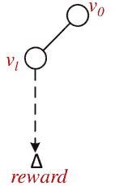

S : The set of states.
A(s) : The set of valid and unvisited actions for state s .
s(v) : The state that v represents.
a(v) : The action that leading to v .
f : S × A → S , the state transition function.
N(v) : The number of times node v has been visited.
Q(V) : The total reward of the action leading to v .
Δ(v,p) : The reward for the player p to move at node v .

```text
function BACKUPNEGAMAX(v, Δ)
while v is not null do
    N(v) ← N(v) + 1
    Q(v) ← Q(v) + Δ
    Δ ← -Δ
    v ← parent of v
```

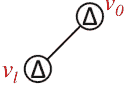

S : The set of states.
A(s) : The set of valid and unvisited actions for state s .
s(v) : The state that v represents.
a(v) : The action that leading to v .
f : S × A → S , the state transition function.
N(v) : The number of times node v has been visited.
Q(V) : The total reward of the action leading to v .
Δ(v,p) : The reward for the player p to move at node v .

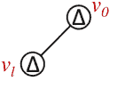

S : The set of states.
A(s) : The set of valid and unvisited actions for state s .
s(v) : The state that v represents.
a(v) : The action that leading to v .
f : S × A → S , the state transition function.
N(v) : The number of times node v has been visited.
Q(V) : The total reward of the action leading to v .
Δ(v,p) : The reward for the player p to move at node v .


## Monte-Carlo Tree Search

### UCT Algorithm

**Notation**

- $S$: The set of states.
- $A(s)$: The set of valid and unvisited actions for state $s$.
- $s(v)$: The state that $v$ represents.
- $a(v)$: The action that led to $v$.
- $f:S \times A \to S$: The state transition function.
- $N(v)$: The number of times node $v$ has been visited.
- $Q(v)$: The total reward of the action leading to $v$.
- $\Delta(v,p)$: The reward for the player $p$ to move at node $v$.

```text
function UCTSearch(s₀)
    create root node v₀ with state s₀
    while within computational budget do
        v₁ ← TreePolicy(v₀)
        Δ ← DefaultPolicy(s(v₁))
        Backup(v₁, Δ)
    return a(BestChild(v₀, 0))
```

```text
function TreePolicy(v)
    while v is not terminal do
        if v not fully expanded then
            return Expand(v)
        else
            v ← BestChild(v, Cₚ)
    return v
```

```text
function DefaultPolicy(s)
    while s is non-terminal do
        choose a ∈ A(s) uniformly at random
        s ← f(s, a)
    return reward for state s
```

```text
function Backup(v, Δ)
    while v is not null do
        N(v) ← N(v) + 1
        Q(v) ← Q(v) + Δ(v, p)
        v ← parent of v
```

```text
function Expand(v)
    choose a ∈ untried actions from A(s(v))
    add a new child v′ to v
        with s(v′) = f(s(v), a)
        and a(v′) = a
    return v′
```

```text
function BestChild(v, c)
    return arg max over v′ ∈ children of v of [ Q(v′)/N(v′) + c√(2 ln N(v)/N(v′)) ]
```

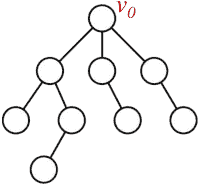


## Monte-Carlo Tree Search

### UCT Algorithm

**S**: The set of states.

**A(s)**: The set of valid and unvisited actions for state *s*.

**s(v)**: The state that *v* represents.

**a(v)**: The action that leading to *v*.

**f**: S × A → S, the state transition function.

**N(v)**: The number of times node *v* has been visited.

**Q(v)**: The total reward for the action leading to *v*.

**Δ(v,p)**: The reward for the player *p* to move at node *v*.

```
function UCTSEARCH(s₀)
    create root node v₀ with state s₀
    while within computational budget do
        vₗ ← TREEPOLICY(v₀)
        Δ ← DEFAULTPOLICY(s(vₗ))
        BACKUP(vₗ, Δ)
    return a(BESTCHILD(v₀, 0))
```

```
function TREEPOLICY(v)
    while v is not terminal do
        if v not fully expanded then
            return EXPAND(v)
        else
            v ← BESTCHILD(v, Cₚ)
    return v
```

```
function DEFAULTPOLICY(s)
    while s is non-terminal do
        choose a ∈ A(s) uniformly at random
        s ← f(s, a)
    return reward for state s
```

```
function BACKUP(v, Δ)
    while v is not null do
        N(v) ← N(v) + 1
        Q(v) ← Q(v) + Δ(v, p)
        v ← parent of v
```

```
function EXPAND(v)
    choose a ∈ untried actions from A(s(v))
    add a new child v′ to v
        with s(v′) = f(s(v), a)
        and a(v′) = a
    return v′
```

```
function BESTCHILD(v, c)
    return arg max over v′ ∈ children of v [ Q(v′) / N(v′) + c √(2 ln N(v) / N(v′)) ]
```

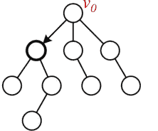

S : The set of states.
A(s) : The set of valid and unvisited actions for state s .
s(v) : The state that v represents.
a(v) : The action that leading to v .
f : S × A → S , the state transition function.
N(v) : The number of times node v has been visited.
Q(V) : The total reward of the action leading to v .
Δ(v, p) : The reward for the player p to move at node v .


## Monte-Carlo Tree Search

### UCT Algorithm

``` 
function UCTSEARCH(s0)
    create root node v0 with state s0
    while within computational budget do
        vl ← TREEPOLICY(v0)
        Δ ← DEFAULTPOLICY(s(vl))
        BACKUP(vl, Δ)
    return a(BESTCHILD(v0, 0))
```

``` 
function TREEPOLICY(v)
    while v is nonterminal do
        if v is not fully expanded then
            return EXPAND(v)
        else
            v ← BESTCHILD(v, Cp)
    return v
```

``` 
function DEFAULTPOLICY(s)
    while s is non-terminal do
        choose a ∈ A(s) uniformly at random
        s ← f(s, a)
    return reward for state s
```

``` 
function BACKUP(v, Δ)
    while v is not null do
        N(v) ← N(v) + 1
        Q(v) ← Q(v) + Δ(v,p)
        v ← parent of v
```

``` 
function EXPAND(v)
    choose a ∈ untried actions from A(s(v))
    add a new child v' to v
    with s(v') = f(s(v), a)
    and a(v') = a
    return v'
```

``` 
function BESTCHILD(v, c)
    return arg max over v'∈children of v: Q(v')/N(v') + c * sqrt(2 ln N(v)/N(v'))
```

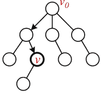

- S : The set of states.
- A(s) : The set of valid and unvisited actions for state s .
- s(v) : The state that v represents.
- a(v) : The action that leads to v .
- f : S × A → S , the state transition function.
- N(v) : The number of times node v has been visited.
- Q(v) : The total reward of the action leading to v .
- Δ(v,p) : The reward for the player p to move at node v .

## Monte-Carlo Tree Search

### UCT Algorithm

``` 
function UCTSEARCH(s0)
    create root node v0 with state s0
    while within computational budget do
        vl ← TREEPOLICY(v0)
        Δ ← DEFAULTPOLICY(s(vl))
        BACKUP(vl, Δ)
    return a(BESTCHILD(v0, 0))
```

``` 
function TREEPOLICY(v)
    while v is nonterminal do
        if v is not fully expanded then
            return EXPAND(v)
        else
            v ← BESTCHILD(v, Cp)
    return v
```

``` 
function DEFAULTPOLICY(s)
    while s is non-terminal do
        choose a ∈ A(s) uniformly at random
        s ← f(s, a)
    return reward for state s
```

``` 
function BACKUP(v, Δ)
    while v is not null do
        N(v) ← N(v) + 1
        Q(v) ← Q(v) + Δ(v,p)
        v ← parent of v
```

``` 
function EXPAND(v)
    choose a ∈ untried actions from A(s(v))
    add a new child v' to v
    with s(v') = f(s(v), a)
    and a(v') = a
    return v'
```

``` 
function BESTCHILD(v, c)
    return arg max over v'∈children of v: Q(v')/N(v') + c * sqrt(2 ln N(v)/N(v'))
```

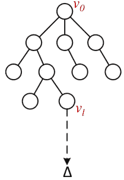

- S : The set of states.
- A(s) : The set of valid and unvisited actions for state s .
- s(v) : The state that v represents.
- a(v) : The action that leads to v .
- f : S × A → S , the state transition function.
- N(v) : The number of times node v has been visited.
- Q(v) : The total reward of the action leading to v .
- Δ(v,p) : The reward for the player p to move at node v .

## Monte-Carlo Tree Search

### UCT Algorithm

``` 
function UCTSEARCH(s0)
    create root node v0 with state s0
    while within computational budget do
        vl ← TREEPOLICY(v0)
        Δ ← DEFAULTPOLICY(s(vl))
        BACKUP(vl, Δ)
    return a(BESTCHILD(v0, 0))
```

``` 
function TREEPOLICY(v)
    while v is nonterminal do
        if v is not fully expanded then
            return EXPAND(v)
        else
            v ← BESTCHILD(v, Cp)
    return v
```

``` 
function DEFAULTPOLICY(s)
    while s is non-terminal do
        choose a ∈ A(s) uniformly at random
        s ← f(s, a)
    return reward for state s
```

``` 
function BACKUP(v, Δ)
    while v is not null do
        N(v) ← N(v) + 1
        Q(v) ← Q(v) + Δ(v,p)
        v ← parent of v
```

``` 
function EXPAND(v)
    choose a ∈ untried actions from A(s(v))
    add a new child v' to v
    with s(v') = f(s(v), a)
    and a(v') = a
    return v'
```

``` 
function BESTCHILD(v, c)
    return arg max over v'∈children of v: Q(v')/N(v') + c * sqrt(2 ln N(v)/N(v'))
```

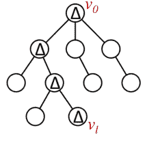

- S : The set of states.
- A(s) : The set of valid and unvisited actions for state s .
- s(v) : The state that v represents.
- a(v) : The action that leads to v .
- f : S × A → S , the state transition function.
- N(v) : The number of times node v has been visited.
- Q(v) : The total reward of the action leading to v .
- Δ(v,p) : The reward for the player p to move at node v .


## Monte-Carlo Tree Search

### UCT Algorithm

```text
function UCTSEARCH(s0)
  create root node v0 with state s0
  while within computational budget do
    vl ← TREEPOLICY(v0)
    Δ ← DEFAULTPOLICY(s(vl))
    BACKUP(vl, Δ)
  return a(BESTCHILD(v0, 0))
```

```text
function TREEPOLICY(v)
  while v is nonterminal do
    if v not fully expanded then
      return EXPAND(v)
    else
      v ← BESTCHILD(v, Cp)
  return v
```

```text
function DEFAULTPOLICY(s)
  while s is non-terminal do
    choose a ∈ A(s) uniformly at random
    s ← f(s, a)
  return reward for state s
```

```text
function BACKUP(v, Δ)
  while v is not null do
    N(v) ← N(v) + 1
    Q(v) ← Q(v) + Δ(v,p)
    v ← parent of v
```

```text
function EXPAND(v)
  choose a ∈ untried actions from A(s(v))
  add a new child v′ to v
    with s(v′) = f(s(v), a)
    and a(v′) = a
  return v′
```

```text
function BESTCHILD(v, c)
  return arg max
    v′∈children of v
    Q(v′) / N(v′) + c√(2 ln N(v) / N(v′))
```

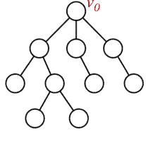

S : The set of states.
A(s) : The set of valid and unvisited actions for state s .
s(v) : The state that v represents.
a(v) : The action that leading to v .
f : S × A → S , the state transition function.
N(v) : The number of times node v has been visited.
Q(V) : The total reward of the action leading to v .
Δ(v,p) : The reward for the player p to move at node v .

## Comparisons with other algorithms

- When faced with a problem, the a priori choice between MCTS and minimax may be difficult. If the game tree is of nontrivial size and no reliable heuristic exists for the game of interest, minimax is unsuitable but MCTS is applicable.

- If domain-specific knowledge is readily available, on the other hand, both algorithms may be viable approaches.

- MCTS approaches to games such as Chess are not as successful as for games such as Go. They consider a class of synthetic spaces in which UCT significantly outperforms minimax. In particular, the model produces bounded trees where there is exactly one optimal action per state; sub-optimal choices are penalized with a fixed additive cost. The systematic construction of the tree ensures that the true minimax values are known. In this domain, UCT clearly outperforms minimax and the gap in performance increases with tree depth.

UCT performs poorly in domains with many trap states (states that lead to losses within a small number of moves), whereas iterative deepening minimax performs relatively well. Trap states are common in Chess but relatively uncommon in Go, which may go some way towards explaining the algorithms’ relative performance in those games.


## Terminology

The terms MCTS and UCT are used in a variety of ways in the literature, sometimes inconsistently, potentially leading to confusion regarding the specifics of the algorithm referred to.

- Flat Monte Carlo: A Monte Carlo method with uniform move selection and no tree growth.
- Flat UCB: A Monte Carlo method with bandit-based move selection but no tree growth.
- MCTS: A Monte Carlo method that builds a tree to inform its policy online.
- UCT: MCTS with any UCB tree selection policy.
- Plain UCT: MCTS with UCB1 as proposed by Kocsis and Szepesvari

L. Kocsis and C. Szepesvari, Bandit based Monte-Carlo Planning, **ECML**, 2006:282–293

## AlphaGo

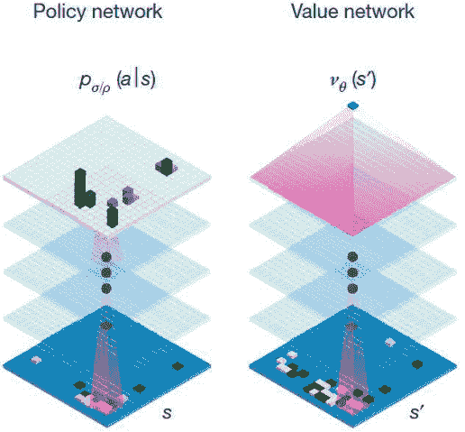

Policy network

Value network

$p_{\theta}(a|s)$

$v_{\theta}(s')$

- **Deep convolutional neural networks**
  - Treat the Go board as an image
  - Powerful function approximation machinery
  - Can be trained to predict distribution over possible moves (*policy*) or expected *value* of position

> David Silver, et.al., *Mastering the game of Go with Deep Neural Networks and Tree Search*, _Nature_, 529:484–490, 2016

## AlphaGo

- **SL policy network**
  - Idea: perform *supervised learning* (SL) to predict human moves
  - Given state s, predict probability distribution over moves a, P(a|s)
  - Trained on 30M positions, 57% accuracy on predicting human moves
  - Also train a smaller, faster *rollout policy* network (24% accurate)
- **RL policy network**
  - Idea: fine-tune policy network using *reinforcement learning* (RL)
  - Initialize RL network to SL network
  - Play two snapshots of the network against each other, update parameters to maximize expected final outcome
  - RL network wins against SL network 80% of the time, wins against open-source Pachi Go program 85% of the time

## AlphaGo

- SL policy network
- RL policy network
- Value network
  - Idea: train network for position evaluation
  - Given state s, estimate v(s), expected outcome of play starting with position s and following the learned policy for both players
  - Train network by minimizing mean squared error between actual and predicted outcome
  - Trained on 30M positions sampled from different self-play games

## AlphaGo

Rollout policy SL policy network RL policy network Value network

pπ pσ pρ vθ

Policy gradient

Classification Classification Self-play Regression

Human expert positions Self-play positions

Neural network Data

## AlphaGo

Aided by the useful information learned by two deep convolutional neural networks (a.k.a., deep learning), policy network and value network, Google’s AlphaGo applies MCTS in an innovative way.

- First, for the tree policy to select child, instead of using the UCB method, AlphaGo takes into account the prior probability of actions learned by the policy network. More specifically, for node _v_<sub>0</sub>, the child _v_ is selected by maximizing

```
\(\frac{Q(v)}{N(v)} + \frac{P(v|v_0)}{1 + N(v)},\)
(2)
```

where _P_(_v_|_v_<sub>0</sub>) is the prior probability that is provided by the policy network. This greatly improves the child selection policy, and thus grants more professional moves (e.g., by human experts) priorities in MCTS simulation.

- Second, for the default policy to evaluate expanded nodes, AlphaGo combines the outcomes from simulation steps and node values learned by the value network, and their weights are balanced by a constant \(\lambda\).

Note that both the policy network and value network are trained offline, which greatly reduces the time cost in a real-time contest.

## AlphaGo

- Monte Carlo Tree Search

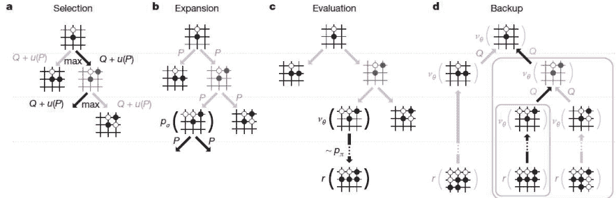

Figure 3 | Monte Carlo tree search in AlphaGo. a, Each simulation traverses the tree by selecting the edge with maximum action value Q, plus a bonus u(P) that depends on a stored prior probability P for that edge. b, The leaf node may be expanded; the new node is processed once by the policy network p_θ and the output probabilities are stored as prior probabilities P for each action. c, At the end of a simulation, the leaf node is evaluated in two ways: using the value network v_θ and by running a rollout to the end of the game with the fast rollout policy p_π, then computing the winner with function r. d, Action values Q are updated to track the mean value of all evaluations r(·) and v_θ(·) in the subtree below that action.

Searching with policy and value networks in AlphaGo

```
argmax_a(Q(s_b, a) + \frac{P(s, a)}{1 + N(s, a)})
```


## AlphaGo

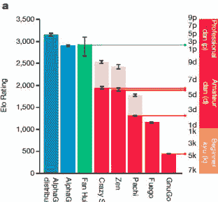

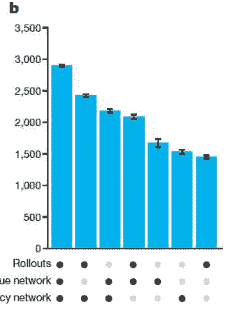

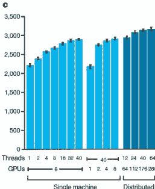

**Figure 4** | **Tournament evaluation of AlphaGo**. **a**, Results of a tournament between different Go programs (see Extended Data Tables 6–11). Each program used approximately 5 s computation time per move. To provide a greater challenge to AlphaGo, some programs (pale upper bars) were given four handicap stones (that is, free moves at the start of every game) against all opponents. Programs were evaluated on an Elo scale<sup>37</sup>: a 230 point gap corresponds to 79% probability of winning, which roughly corresponds to one amateur _dan_ rank advantage on KGS<sup>38</sup>; an approximate correspondence to human ranks is also shown.

horizontal lines show KGS ranks achieved online by that program. Games against the human European champion Fan Hui were also included; these games used longer time controls. 95% confidence intervals are shown. **b**, Performance of AlphaGo, on a single machine, for different combinations of components. The version solely using the policy network does not perform any search. **c**, Scalability study of MCTS in AlphaGo with search threads and GPUs, using asynchronous search (light blue) or distributed search (dark blue), for 2 s per move.

## Monte-Carlo Tree Search: Basic Ideas

**Monte-Carlo Sampling**: Evaluate actions through sampling.
→ When deciding which action to take on game state s:
**while** time not up do
select action a applicable to s
run a random sample from a until terminal state t
**return** an a for s with maximal average u(t)

**Monte-Carlo Tree Search**: Maintain a search tree T.
**while** time not up do
apply actions within T to select a leaf state s'
select action a' applicable to s', run random sample from a'
add s' to T, update averages etc.
**return** an a for s with maximal average u(t)
When executing a, keep the part of T below a

→ Compared to alpha-beta search: no exhaustive enumeration. Pro: runtime & memory. Contra: need good guidance how to “select” and “sample”.

## Artificial Intelligence

## Deep Learning

#### From Shallow Learning to Deep Learning

Fei Wu

College of Computer Science Zhejiang University

http://person.zju.edu.cn/wufei/

## Traditional Machine Learning: shallow learning

features are handcrafted instead of **learning**


image

dense keypoints

SIFT descriptors

vocabulary

visual words

histogram

tiling

spatial histogram

## Regression and Classification

### Outlines

- Neural Network
  - Biological inspiration
  - Feedforward Neural Network
- Optimization and Gradient Descent
  - Gradient Descent
  - Stochastic Gradient Descent
  - Backpropagation
- Convolutional Neural Network
  - Basic concepts
  - Case study: AlexNet, GoogLeNet, VGG,...

# Biological inspiration: Modeling one neuron

- The basic computational unit of the brain is a neuron.
- 86 billion neurons can be found in the human nervous system and they are connected with approximately 10^14 - 10^15 synapses.
- Each neuron receives input signals from its dendrites and produces output signals along its (single) axon connections.

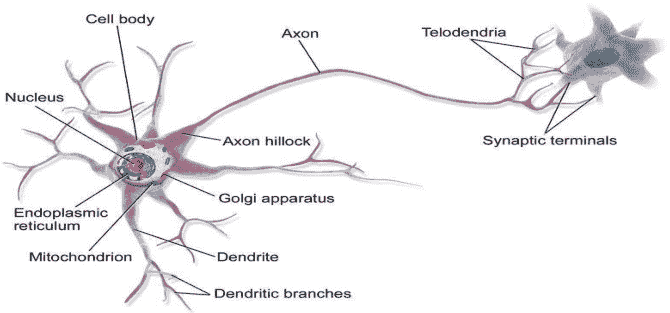

# Biological inspiration: Modeling one neuron


**Figure 18.19** A simple mathematical model for a neuron. The unit’s output activation is $a_j = g(\sum_{i=0}^{n} w_{i,j}a_i)$, where $a_i$ is the output activation of unit $i$ and $w_{i,j}$ is the weight on the link from unit $i$ to this unit.


$in_j = \sum_{i=0}^{n} w_{i,j}a_i$

- $a_j$: Activation value of unit $j$  
- $w_{i,j}$: Weight on link from unit $i$ to unit $j$  
- $in_j$: Weighted sum of inputs to unit $j$  
- $a_i$: Activation value of unit $i$  
- $g$: Activation function


# Biological inspiration: Modeling one neuron


An example code for forward-propagating a single neuron might look as follows:

```python
class Neuron(object):
    # ...

    def forward(inputs):
        """ assume inputs and weights are 1-D numpy arrays and bias is a number """
        cell_body_sum = np.sum(inputs * self.weights) + self.bias
        firing_rate = 1.0 / (1.0 + math.exp(-cell_body_sum)) # sigmoid activation function
        return firing_rate
```

In other words, each neuron performs a dot product with the input and its weights, adds the bias and applies the non-linearity (or activation function), in this case the sigmoid, i.e., $\sigma(x)=1/(1+e^{-x})$

### Activation functions (non-linear functions)

- sigmoid/logistic
- tanh
- Rectified Linear Unit (ReLU)


Left: Sigmoid non-linearity squashes real numbers to range between [0,1] Right: The tanh non-linearity squashes real numbers to range between [-1,1].

**Sigmoid.** The sigmoid non-linearity has the mathematical form $\sigma(x) = 1/(1 + e^{-x})$ and is shown in the image above on the left. As alluded to in the previous section, it takes a real-valued number and “squashes” it into range between 0 and 1. In particular, large negative numbers become 0 and large positive numbers become 1.

**Tanh.** The tanh non-linearity is shown on the image above on the right. It squashes a real-valued number to the range [-1, 1]. Like the sigmoid neuron, its activations saturate, but unlike the sigmoid neuron its output is zero-centered. Therefore, in practice the *tanh non-linearity is always preferred to the sigmoid nonlinearity*. Also note that the tanh neuron is simply a scaled sigmoid neuron, in particular the following holds: $\tanh(x) = 2\sigma(2x) - 1$.

**ReLU.** The Rectified Linear Unit has become very popular in the last few years. It computes the function $f(x)=\max(0,x)$. In other words, the activation is simply thresholded at zero.

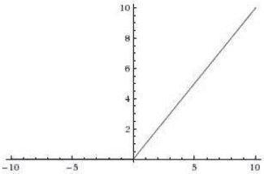

Rectified Linear Unit (ReLU) activation function, which is zero when x is less than 0 and then linear with slope 1 when x is greater than 0

## Common activation functions as well as their derivatives

| Name | Plot | Equation | Derivative (with respect to x) | Range | Order of continuity | Monotonic |
|---|---|---|---|---|---|---|
| Identity |  | \( f(x) = x \) | \( f'(x) = 1 \) | \( (-\infty, \infty) \) | \( C^\infty \) | Yes |
| Binary step |  | \( f(x) = \begin{cases} 0 & \text{for } x < 0 \\ 1 & \text{for } x \ge 0 \end{cases} \) | \( f'(x) = \begin{cases} 0 & \text{for } x \neq 0 \\ ? & \text{for } x = 0 \end{cases} \) | \( \{0, 1\} \) | \( C^{-1} \) | Yes |
| Logistic (a.k.a Soft step) |  | \( f(x) = \frac{1}{1 + e^{-x}} \) | \( f'(x) = f(x)(1 - f(x)) \) | \( (0, 1) \) | \( C^\infty \) | Yes |
| TanH |  | \( f(x) = \tanh(x) = \frac{2}{1 + e^{-2x}} - 1 \) | \( f'(x) = 1 - f(x)^2 \) | \( (-1, 1) \) | \( C^\infty \) | Yes |
| ArcTan |  | \( f(x) = \tan^{-1}(x) \) | \( f'(x) = \frac{1}{x^2 + 1} \) | \( \left( -\frac{\pi}{2}, \frac{\pi}{2} \right) \) | \( C^\infty \) | Yes |
| Softsign [7][8] |  | \( f(x) = \frac{x}{1 + |x|} \) | \( f'(x) = \frac{1}{(1 + |x|)^2} \) | \( (-1, 1) \) | \( C^1 \) | Yes |
| Rectifier (ReLU)[9] |  | \( f(x) = \begin{cases} 0 & \text{for } x < 0 \\ x & \text{for } x \ge 0 \end{cases} \) | \( f'(x) = \begin{cases} 0 & \text{for } x < 0 \\ 1 & \text{for } x \ge 0 \end{cases} \) | \( [0, \infty) \) | \( C^0 \) | Yes |
| Parametric Rectified Linear Unit (PReLU)[10] |  | \( f(\alpha, x) = \begin{cases} \alpha x & \text{for } x < 0 \\ x & \text{for } x \ge 0 \end{cases} \) | \( f'(\alpha, x) = \begin{cases} \alpha & \text{for } x < 0 \\ 1 & \text{for } x \ge 0 \end{cases} \) | \( (-\infty, \infty) \) | \( C^0 \) | Yes iff \( \alpha \ge 0 \) |


## Feed-forward Neural Network

- Neural Networks are modeled as collections of neurons that are connected in an acyclic graph (**layer-wise organization**).

- In other words, the outputs of some neurons can become inputs to other neurons. Cycles are not allowed since that would imply an infinite loop in the forward pass of a network.

- The most common layer type is the **fully-connected layer**, in which neurons between two adjacent layers are fully pairwise connected, but neurons within a single layer share no connections.


Left: A 2-layer Neural Network (one hidden layer of 4 neurons (or units) and one output layer with 2 neurons), and three inputs. Right: A 3-layer neural network with three inputs, two hidden layers of 4 neurons each and one output layer. Notice that in both cases there are connections (synapses) between neurons across layers, but not within a layer.

## Perceptron Networks

- Single-layer feed-forward neural networks (no hidden units)
  - Signals travel in one direction through net
  - Net computes a function of the inputs

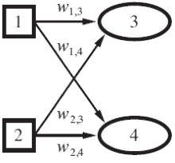


Neurons are connected by directed, weighted paths.

> Frank Rosenblatt: "Electronic ‘Brain’ Teaches Itself", New York Times. 1957.

- Single perceptron for image recognition


Mark 1 perceptron, Input: 400-pixel image

- The limitation of single perceptron for image recognition


- Multilayer perceptron for MNIST digit recognition
  - Nonlinear activation functions: sigmoid, tanh


## Hebbian theory

A theory in neuroscience that proposes an explanation for the adaptation of neurons in the brain during the learning process, describing a basic mechanism for synaptic plasticity, where an increase in synaptic efficacy arises from the presynaptic cell's repeated and persistent stimulation of the postsynaptic cell. Introduced by Donald Hebb in his 1949 book The Organization of Behavior.[1] The theory is also called Hebb's rule, Hebb's postulate, and cell assembly theory.

### IEEE Frank Rosenblatt Award (established in 2004)

For outstanding contributions to biologically and linguistically motivated computational paradigms and systems

| Year | Recipient | Citation |
| --- | --- | --- |
| 2017 | STEPHEN GROSSBERG, Wang Professor of Cognitive and Neural Systems, Boston University, Boston, Massachusetts, USA | "For contributions to understanding brain cognition and behavior and their emulation by technology." |
| 2016 | RONALD R. YAGER, Professor, Machine Intelligence Institute, Iona College, New York, New York, USA | "For contributions to the theory of fuzzy sets and systems." |
| 2015 | MARCO DORIGO, Professor, IRIDIA, Université Libre de Bruxelles, Belgium | "For contributions to the foundations of swarm intelligence." |
| 2014 | GEOFFREY E. HINTON, University Professor, University of Toronto, Department of Computer Science, Toronto, ON, Canada | "For contributions to neural networks and deep learning." |
| 2013 | TERRENCE J. SEJNOWSKI, Professor, Francis Crick Chair, The Salk Institute for Biological Studies, La Jolla, CA, USA | "For contributions to computational neuroscience." |
| 2012 | VLADIMIR VAPNIK, Professor, Columbia University, New York, NY, USA | "For development of support vector machines and statistical learning theory as a foundation of biologically inspired learning." |


# Representation Power

Neural Networks with fully-connected layers define a family of functions that are parameterized by the weights of the network.

It turns out that Neural Networks with at least one hidden layer are *universal approximators*. That is, it can be shown (e.g. see *Approximation by Superpositions of Sigmoidal Function* from 1989 (pdf), or this intuitive explanation from Michael Nielsen) that given any continuous function $f(x)$ and some $\epsilon > 0$, there exists a Neural Network $g(x)$ with one hidden layer (with a reasonable choice of non-linearity, e.g. sigmoid) such that $\forall x,\ |f(x)-g(x)| < \epsilon$. In other words, the neural network can approximate any continuous function.

If one hidden layer suffices to approximate any function, why use more layers and go deeper? The answer is that the fact that a two-layer Neural Network is a universal approximator is, while mathematically cute, a relatively weak and useless statement in practice. In one dimension, the “sum of indicator bumps” function $g(x)=\sum_i c_i\mathbf{1}(a_i < x < b_i)$ where $a,b,c$ are parameter vectors is also a universal approximator, but no one would suggest that we use this functional form in Machine Learning. Neural Networks work well in practice because they compactly express nice, smooth functions that fit well with the statistical properties of data we encounter in practice, and are also easy to learn using our optimization algorithms (e.g. gradient descent). Similarly, the fact that deeper networks (with multiple hidden layers) can work better than a single-hidden-layer networks is an empirical observation, despite the fact that their representational power is equal.

## universal approximation theorem

A **feed-forward** network with a single hidden layer containing a finite number of **neurons** (i.e., a **multilayer perceptron**), can approximate **continuous functions** on **compact subsets** of Rⁿ, under mild assumptions on the activation function. The theorem thus states that simple neural networks can _represent_ a wide variety of interesting functions when given appropriate parameters; however, it does not touch upon the algorithmic **learnability** of those parameters. One of the first versions of the **theorem** was proved by **George Cybenko** in 1989 for **sigmoid** activation functions.

- Balázs Csanád Csáji, Approximation with Artificial Neural Networks, Faculty of Sciences; Eötvös Loránd University, Hungary
- Cybenko, G., Approximations by superpositions of sigmoidal functions, _Mathematics of Control, Signals, and Systems_, 2 (4), 303-31, 1989
- Kurt Hornik, Approximation Capabilities of Multilayer Feedforward Networks, _Neural Networks_, 4(2), 251–257, 1991

We increase the size and number of layers in a Neural Network, the **capacity** of the network increases. That is, the space of representable functions grows since the neurons can collaborate to express many different functions


Larger Neural Networks can represent more complicated functions. The data are shown as circles colored by their class, and the decision regions by a trained neural network are shown underneath.

Overfitting occurs with 20 hidden neurons

## Artificial Intelligence
# OPTIMIZATION AND GRADIENT DESCENT

# Problem

- How to learn the best W of a classifier?
  - We have some dataset of (x,y)
  - We have a score function: $s = f(x) = W\phi(x)$
  - We have a loss function: softmax, svm…


## Optimization


## Optimization

- Strategy #1:

- A first very bad idea solution: Random search

```python
# assume X_train is the data where each column is an example (e.g. 3073 x 50,000)
# assume Y_train are the labels (e.g. 1D array of 50,000)
# assume the function L evaluates the loss function
bestloss = float("inf") # Python assigns the highest possible float value
for num in xrange(1000):
    W = np.random.randn(10, 3073) * 0.0001 # generate random parameters
    loss = L(X_train, Y_train, W) # get the loss over the entire training set
    if loss < bestloss: # keep track of the best solution
        bestloss = loss
        bestW = W
    print 'in attempt %d the loss was %f, best %f' % (num, loss, bestloss)

# prints:
# in attempt 0 the loss was 9.401632, best 9.401632
# in attempt 1 the loss was 8.959668, best 8.959668
# in attempt 2 the loss was 9.044034, best 8.959668
# in attempt 3 the loss was 9.278948, best 8.959668
# in attempt 4 the loss was 8.857370, best 8.857370
# in attempt 5 the loss was 8.943151, best 8.857370
# in attempt 6 the loss was 8.605604, best 8.605604
# ... (truncated: continues for 1000 lines)
```


## Optimization

- Strategy #1: A first very bad idea solution: Random search
- Let's see how well this works on the test set...

```python
# Assume X_test is [3073 x 10000], Y_test [10000 x 1]
scores = Wbest.dot(Xte_cols) # 10 x 10000, the class scores for all test examples
# find the index with max score in each column (the predicted class)
Yte_predict = np.argmax(scores, axis = 0)
# and calculate accuracy (fraction of predictions that are correct)
np.mean(Yte_predict == Yte)
# returns 0.1555
```

- 15.5% accuracy!
- Strategy #2: **Follow the slope**


- Numerical gradient: approximate, slow, easy to write
- Analytic gradient: exact, fast, error-prone
- In practice: Always use analytic gradient, but check implementation with numerical gradient (gradient check).

## Gradient Descent

```python
# Vanilla Gradient Descent

while True:
    weights_grad = evaluate_gradient(loss_fun, data, weights)
    weights += - step_size * weights_grad  # perform parameter update
```


Suppose the loss function \(f(x)\) is a continuously differentiable multivariate function. Its Taylor expansion is:

\(f(x + \Delta x) = f(x) + f'(x)\Delta x + \frac{1}{2}f''(x)(\Delta x)^2 + \cdots + \frac{1}{n!}f^{(n)}(x)(\Delta x)^n\)

We have

\(f(x + \Delta x) - f(x) \approx (\nabla f(x))^T \Delta x\)

We attempt to minimize the loss function \(f(x)\), then \((\nabla f(x))^T \Delta x < 0\).

Since \((\nabla f(x))^T \Delta x = \|\nabla f(x)\|\|\Delta x\| \cos \theta\), to find a local minimum of a function using gradient descent, one takes steps proportional to the **negative** of the gradient of the loss function (i.e., \(\theta = \pi\)) at the current point.

The reduced value in terms of \(f(x + \Delta x) - f(x)\) is: \(\|\nabla f(x)\|\|\Delta x\| \cos \theta = -\alpha \|\nabla f(x)\|\).

As a result, the loss function must be reduced toward the **negative** of the gradient of the loss function.

For smooth functions, both minimum/maximum values and relative extreme values can occur only where \(\nabla f(x) = 0\). However, zero slope, while necessary, is not sufficient.


## Stochastic Gradient Descent (SGD)

- Full sum expensive when N is large!
- Approximate sum using a **minibatch** of examples (32 / 64 / 128 common)

```python
# Vanilla Minibatch Gradient Descent

while True:
    data_batch = sample_training_data(data, 256) # sample 256 examples
    weights_grad = evaluate_gradient(loss_fun, data_batch, weights)
    weights += - step_size * weights_grad # perform parameter update
```

http://vision.stanford.edu/teaching/cs231n-demos/linear-classify/

## Backpropagation

- A way of computing gradients of expressions through recursive application of **chain rule**

**Problem statement**. The core problem studied in this section is as follows: We are given some function \( f(x) \) where \( x \) is a vector of inputs and we are interested in computing the gradient of \( f \) at \( x \) (i.e. \( \nabla f(x) \) ).

**Motivation**. Recall that the primary reason we are interested in this problem is that in the specific case of Neural Networks, \( f \) will correspond to the loss function ( \( L \) ) and the inputs \( x \) will consist of the training data and the neural network weights. For example, the loss could be the SVM loss function and the inputs are both the training data \( (x_i, y_i), i = 1 \dots N \) and the weights and biases \( W, b \). Note that (as is usually the case in Machine Learning) we think of the training data as given and fixed, and of the weights as variables we have control over. Hence, even though we can easily use backpropagation to compute the gradient on the input examples \( x_i \), in practice we usually only compute the gradient for the parameters (e.g. \( W, b \)) so that we can use it to perform a parameter update. However, as we will see later in the class the gradient on \( x_i \) can still be useful sometimes, for example for purposes of visualization and interpreting what the Neural Network might be doing.


## Backpropagation

- Gradient descent:

$$\frac{df(x)}{dx}=\lim_{h\to0}\frac{f(x+h)-f(x)}{h}$$


- Computational graph:


## What is a computational graph?

- Computational graph is a kind of descriptive language,
  - Can represent an arbitrary mathematical computation as a graph,
  - usually is a directed acyclic graph (DAG).
  - Each node represents an operator or a variable/input
  - E.g. e = (a + b) * (b + 1)


http://colah.github.io/posts/2015-08-Backprop/

## Why use a computational graph in DL?

- Two key strengths of computational graphs:
  - Allow simple functions to be combined to form quite complex models
    - A wide range of neural network models can be created by defining computational graphs consisting of simple, primitive operations.
  - Enable **automatic differentiation**
    - Automatic differentiation is a technique for calculating derivatives in computational graphs: once the graph has been defined using underlying primitive operations, derivatives are calculated automatically based on “local” derivatives of these operations.
    - Gradient-based learning algorithms can be used to train NN, providing that the gradient of the loss function with respect to the parameters can be calculated efficiently.

## Computational Graphs: A Formal Definition

**Definition (Computational Graphs)** _A computational graph is a 6-tuple_ \(\langle n, l, E, u^1 \dots u^n, d^1 \dots d^n, f^{l+1} \dots f^n \rangle\)

_where:_

- _n is an integer specifying the number of vertices in the graph._
- _l is an integer such that_ \(1 \leq l \leq n\) _that specifies the number of leaves in the graph._
- _E_: The set of edges in the computational graph. For each \((j, i) \in E\) we have _j < i_ (the graph is topologically ordered), \(j \in \{1 \dots (n-1)\}\), and \(i \in \{(l+1) \dots n\}\).
- _u<sup>i</sup>_ for \(i \in \{1 \dots n\}\) is the variable associated with vertex _i_ in the graph.
- _d<sup>i</sup>_ for \(i \in \{1 \dots n\}\) is the dimensionality for each variable, that is, \(u^i \in \mathbb{R}^{d^i}\).
- _f<sup>i</sup>_ for \(i \in \{(l+1) \dots n\}\) is the local function for vertex _i_ in the graph
- \(\alpha^i\) for \(i \in \{(l+1) \dots n\}\) is defined as \(\alpha^i = \langle u^j | (j, i) \in E\rangle\), i.e., \(\alpha^i\) contains all input values for vertex _i_.

## Forward/backward computation

- Once a graph is constructed, we can easily perform forward and backward computation to calculate derivatives

- **Forward computation:**
  - Traverse the graph in a *topological order*, and fill a value of every node (compute the loss)

- **Backward computation (backpropagation):**
  - Traverse the graph in a reverse order, and calculate derivatives at each node
  - automatically done if we know the derivative of the function at each node (auto differentiation)

- Topological order
  - Defined on a directed acyclic graph (DAG)
  - Traverse every node so that its parent has been always previously visited
  - There are several algorithms to do this.


## Backward computation


- **Goal:** Fill value $d_a$ at each node $a$
- $d_a = \frac{\partial l}{\partial a}$: derivative of loss with respect to $a$
- In general: $d_a = \sum_{c_i \in \pi_a^{-1}} d_{c_i} \cdot \frac{\partial f_{c_i}}{\partial a}$
- In this case:

$$d_a = d_{c_1}\frac{\partial f_{c_1}}{\partial a} + d_{c_2}\frac{\partial f_{c_2}}{\partial a}$$

### Compound expressions with chain rule

Let’s now start to consider more complicated expressions that involve multiple composed functions, such as \( f(x, y, z) = (x + y)z \). This expression is still simple enough to differentiate directly, but we’ll take a particular approach to it that will be helpful with understanding the intuition behind backpropagation. In particular, note that this expression can be broken down into two expressions: \( q = x + y \) and \( f = qz \). Moreover, we know how to compute the derivatives of both expressions separately, as seen in the previous section. \( f \) is just multiplication of \( q \) and \( z \), so \( \frac{\partial f}{\partial q} = z \), \( \frac{\partial f}{\partial z} = q \), and \( q \) is addition of \( x \) and \( y \) so \( \frac{\partial q}{\partial x} = 1 \), \( \frac{\partial q}{\partial y} = 1 \). However, we don’t necessarily care about the gradient on the intermediate value \( q \) - the value of \( \frac{\partial f}{\partial q} \) is not useful. Instead, we are ultimately interested in the gradient of \( f \) with respect to its inputs \( x, y, z \). The **chain rule** tells us that the correct way to “chain” these gradient expressions together is through multiplication. For example, \( \frac{\partial f}{\partial x} = \frac{\partial f}{\partial q} \frac{\partial q}{\partial x} \). In practice this is simply a multiplication of the two numbers that hold the two gradients. Let’s see this with an example:


The real-valued “circuit” on left shows the visual representation of the computation. The **forward pass** computes values from inputs to output (shown in green). The **backward pass** then performs backpropagation which starts at the end and recursively applies the chain rule to compute the gradients (shown in red) all the way to the inputs of the circuit. The gradients can be thought of as flowing backwards through the circuit.


## Backpropagation

### Backpropagation: a simple example

f(x, y, z) = (x + y)z

e.g. x = -2, y = 5, z = -4


f(x,y,z)=(x+y)z

e.g. x=-2, y=5, z=-4

q=x+y   ∂q/∂x=1, ∂q/∂y=1

f=qz   ∂f/∂q=z, ∂f/∂z=q

Want: ∂f/∂x, ∂f/∂y, ∂f/∂z


f(x,y,z)=(x+y)z

e.g. x=-2, y=5, z=-4

q=x+y   ∂q/∂x=1, ∂q/∂y=1

f=qz   ∂f/∂q=z, ∂f/∂z=q

Want: ∂f/∂x, ∂f/∂y, ∂f/∂z


f(x, y, z) = (x + y)z

e.g. x = -2, y = 5, z = -4

- q = x + y   ∂q/∂x = 1, ∂q/∂y = 1
- f = qz   ∂f/∂q = z, ∂f/∂z = q

Want: ∂f/∂x, ∂f/∂y, ∂f/∂z


f(x, y, z) = (x + y)z

e.g. x = -2, y = 5, z = -4

q = x + y

∂q/∂x = 1, ∂q/∂y = 1

f = qz

∂f/∂q = z, ∂f/∂z = q

Want: ∂f/∂x, ∂f/∂y, ∂f/∂z


f(x, y, z) = (x + y)z

e.g. x = -2, y = 5, z = -4

q = x + y   ∂q/∂x = 1, ∂q/∂y = 1

f = qz   ∂f/∂q = z, ∂f/∂z = q

Want: ∂f/∂x, ∂f/∂y, ∂f/∂z

∂f/∂z


f(x, y, z) = (x + y)z

e.g. x = -2, y = 5, z = -4

q = x + y   ∂q/∂x = 1, ∂q/∂y = 1

f = qz   ∂f/∂q = z, ∂f/∂z = q

Want: ∂f/∂x, ∂f/∂y, ∂f/∂z


f(x, y, z) = (x + y)z

e.g. x = -2, y = 5, z = -4

q = x + y   ∂q/∂x = 1, ∂q/∂y = 1

f = qz   ∂f/∂q = z, ∂f/∂z = q

Want: ∂f/∂x, ∂f/∂y, ∂f/∂z


f(x, y, z) = (x + y)z

e.g. x = -2, y = 5, z = -4

q = x + y   ∂q/∂x = 1, ∂q/∂y = 1

f = qz   ∂f/∂q = z, ∂f/∂z = q

Want: ∂f/∂x, ∂f/∂y, ∂f/∂z


f(x, y, z) = (x + y)z

e.g. x = -2, y = 5, z = -4

q = x + y

∂q/∂x = 1, ∂q/∂y = 1

f = qz

∂f/∂q = z, ∂f/∂z = q

Want: ∂f/∂x, ∂f/∂y, ∂f/∂z

Chain rule:
∂f/∂y = ∂f/∂q * ∂q/∂y


f(x,y,z)=(x+y)z

e.g. x=-2, y=5, z=-4

q=x+y   ∂q/∂x=1, ∂q/∂y=1

f=qz   ∂f/∂q=z, ∂f/∂z=q

Want: ∂f/∂x, ∂f/∂y, ∂f/∂z


## Backpropagation

### Another example:

$$f(w,x)=\frac{1}{1+e^{-(w_0x_0+w_1x_1+w_2)}}$$


$f(x) = e^x \quad \rightarrow \quad \frac{df}{dx} = e^x$

$f_a(x) = ax \quad \rightarrow \quad \frac{df}{dx} = a$

$f(x) = \frac{1}{x} \quad \rightarrow \quad \frac{df}{dx} = -1/x^2$

$f_c(x) = c + x \quad \rightarrow \quad \frac{df}{dx} = 1$

Another example: \( f(w,x) = \frac{1}{1 + e^{-(w_0x_0 + w_1x_1 + w_2)}} \)


\( f(x) = e^x \quad \rightarrow \quad \frac{df}{dx} = e^x \)
\( f_a(x) = ax \quad \rightarrow \quad \frac{df}{dx} = a \)

\( f(x) = \frac{1}{x} \quad \rightarrow \quad \frac{df}{dx} = -1/x^2 \)
\( f_c(x) = c + x \quad \rightarrow \quad \frac{df}{dx} = 1 \)

Another example: \( f(w,x) = \frac{1}{1 + e^{-(w_0x_0 + w_1x_1 + w_2)}} \)

\( (\frac{-1}{1.37^2})(1.00) = -0.53 \)

\( f(x) = e^x \rightarrow \frac{df}{dx} = e^x \)
\( f_a(x) = ax \rightarrow \frac{df}{dx} = a \)

\( f(x) = \frac{1}{x} \rightarrow \frac{df}{dx} = -1/x^2 \)
\( f_c(x) = c + x \rightarrow \frac{df}{dx} = 1 \)


Another example: \( f(w,x) = \frac{1}{1 + e^{-(w_0x_0 + w_1x_1 + w_2)}} \)


\( f(x) = e^x \quad \rightarrow \quad \frac{df}{dx} = e^x \)

\( f_a(x) = ax \quad \rightarrow \quad \frac{df}{dx} = a \)

\( f(x) = \frac{1}{x} \quad \rightarrow \quad \frac{df}{dx} = -1/x^2 \)

\( f_c(x) = c + x \quad \rightarrow \quad \frac{df}{dx} = 1 \)

Another example: \( f(w,x) = \frac{1}{1 + e^{-(w_0x_0 + w_1x_1 + w_2)}} \)

(1)(-0.53) = -0.53

\( f(x) = e^x \rightarrow \frac{df}{dx} = e^x \)

\( f_a(x) = ax \rightarrow \frac{df}{dx} = a \)

\( f(x) = \frac{1}{x} \rightarrow \frac{df}{dx} = -1/x^2 \)

\( f_c(x) = c + x \rightarrow \frac{df}{dx} = 1 \)


Another example:

$$f(w,x)=\frac{1}{1+e^{-(w_0x_0+w_1x_1+w_2)}}$$


| 函数 | 导数 |
|---|---|
| $f(x)=e^x$ | $\frac{df}{dx}=e^x$ |
| $f_a(x)=ax$ | $\frac{df}{dx}=a$ |
| $f(x)=\frac{1}{x}$ | $\frac{df}{dx}=-1/x^2$ |
| $f_c(x)=c+x$ | $\frac{df}{dx}=1$ |

Another example: \( f(w,x) = \frac{1}{1 + e^{-(w_0 x_0 + w_1 x_1 + w_2)}} \)

\( (e^{-1})(-0.53) = -0.20 \)

| \( f(x) = e^x \) | \( \rightarrow \) | \( \frac{df}{dx} = e^x \) |
|---|---|---|
| \( f_a(x) = ax \) | \( \rightarrow \) | \( \frac{df}{dx} = a \) |

| \( f(x) = \frac{1}{x} \) | \( \rightarrow \) | \( \frac{df}{dx} = -1/x^2 \) |
|---|---|---|
| \( f_c(x) = c + x \) | \( \rightarrow \) | \( \frac{df}{dx} = 1 \) |

Another example:

$$f(w,x)=\frac{1}{1+e^{-(w_0x_0+w_1x_1+w_2)}}$$


$f(x)=e^x \quad\rightarrow\quad \frac{df}{dx}=e^x$

$f_a(x)=ax \quad\rightarrow\quad \frac{df}{dx}=a$

$f(x)=\frac{1}{x} \quad\rightarrow\quad \frac{df}{dx}=-1/x^2$

$f_c(x)=c+x \quad\rightarrow\quad \frac{df}{dx}=1$

### Another example:

$$f(w,x)=\frac{1}{1+e^{-(w_0x_0+w_1x_1+w_2)}}$$


$$f(x) = e^x \rightarrow \frac{df}{dx} = e^x$$

$$f_a(x) = ax \rightarrow \frac{df}{dx} = a$$

$$f(x) = \frac{1}{x} \rightarrow \frac{df}{dx} = -1/x^2$$

$$f_c(x) = c + x \rightarrow \frac{df}{dx} = 1$$


## Backpropagation

Another example:

\( f(w,x) = \frac{1}{1 + e^{-(w_0x_0 + w_1x_1 + w_2)}} \)

\( f(x) = e^x \rightarrow \frac{df}{dx} = e^x \)

\( f_a(x) = ax \rightarrow \frac{df}{dx} = a \)

\( f(x) = \frac{1}{x} \rightarrow \frac{df}{dx} = -1/x^2 \)

\( f_c(x) = c + x \rightarrow \frac{df}{dx} = 1 \)


## Backpropagation

### Another example:

\( f(w,x) = \frac{1}{1 + e^{-(w_0x_0 + w_1x_1 + w_2)}} \)


[local gradient] x [upstream gradient]
[1] x [0.2] = 0.2
[1] x [0.2] = 0.2 (both inputs!)

\( f(x) = e^x \quad \rightarrow \quad \frac{df}{dx} = e^x \)
\( f_a(x) = ax \quad \rightarrow \quad \frac{df}{dx} = a \)

\( f(x) = \frac{1}{x} \quad \rightarrow \quad \frac{df}{dx} = -1/x^2 \)
\( f_c(x) = c + x \quad \rightarrow \quad \frac{df}{dx} = 1 \)

## Backpropagation

Another example:

$$f(w,x)=\frac{1}{1+e^{-(w_0x_0+w_1x_1+w_2)}}$$


$$f(x)=e^x \quad\rightarrow\quad \frac{df}{dx}=e^x$$

$$f_a(x)=ax \quad\rightarrow\quad \frac{df}{dx}=a$$

$$f(x)=\frac{1}{x} \quad\rightarrow\quad \frac{df}{dx}=-1/x^2$$

$$f_c(x)=c+x \quad\rightarrow\quad \frac{df}{dx}=1$$

## Backpropagation

### Another example:

f(w,x) = \frac{1}{1 + e^{-(w_0x_0 + w_1x_1 + w_2)}}


[local gradient] x [upstream gradient]
x0: [2] x [0.2] = 0.4
w0: [-1] x [0.2] = -0.2

f(x) = e^x → df/dx = e^x
f_a(x) = ax → df/dx = a

f(x) = 1/x → df/dx = -1/x^2
f_c(x) = c + x → df/dx = 1

## Backpropagation

f(w,x) = 1 / (1 + e^-(w0x0 + w1x1 + w2))

σ(x) = 1 / (1 + e^-x) sigmoid function

dσ(x)/dx = e^-x / (1 + e^-x)^2 = (1 + e^-x - 1) / (1 + e^-x) * (1 / (1 + e^-x)) = (1 - σ(x))σ(x)


## Backpropagation: Another Example


Basic structure


initial weights, the biases, and training inputs/outputs

- The goal of backpropagation is to optimize the weights so that the neural network can learn how to correctly map arbitrary inputs to outputs.
- We're going to work with a single training set: given inputs 0.05 and 0.10, we want the neural network to output 0.01 and 0.99.


Here's how we calculate the total net input for h₁:

netₕ₁ = w₁ * i₁ + w₂ * i₂ + b₁ * 1

netₕ₁ = 0.15 * 0.05 + 0.2 * 0.1 + 0.35 * 1 = 0.3775

We then squash it using the logistic function to get the output of h₁:

outₕ₁ = 1 / (1 + e⁻ⁿᵉᵗₕ₁) = 1 / (1 + e⁻⁰·³⁷⁷⁵) = 0.593269992

Carrying out the same process for h₂ we get:

outₕ₂ = 0.596884378

We repeat this process for the output layer neurons, using the output from the hidden layer neurons as inputs.

Here's the output for o₁:

netₒ₁ = w₅ * outₕ₁ + w₆ * outₕ₂ + b₂ * 1

netₒ₁ = 0.4 * 0.593269992 + 0.45 * 0.596884378 + 0.6 * 1 = 1.105905967

outₒ₁ = 1 / (1 + e⁻ⁿᵉᵗₒ₁) = 1 / (1 + e⁻¹·¹⁰⁵⁹⁰⁵⁹⁶⁷) = 0.75136507

And carrying out the same process for o₂ we get:

outₒ₂ = 0.772928465

## Calculating the Total Error

For example, the target output for _o_<sub>1</sub> is 0.01 but the neural network output 0.75136507, therefore its error is:

Repeating this process for _o_<sub>2</sub> (remembering that the target is 0.99) we get:

The total error for the neural network is the sum of these errors:


E_{total} = \sum \frac{1}{2}(target - output)^2

E_{o1} = \frac{1}{2}(target_{o1} - out_{o1})^2 = \frac{1}{2}(0.01 - 0.75136507)^2 = 0.274811083

E_{o2} = 0.023560026

E_{total} = E_{o1} + E_{o2} = 0.274811083 + 0.023560026 = 0.298371109


$$\frac{\partial E_{total}}{\partial w_5}=\frac{\partial E_{total}}{\partial out_1}\times\frac{\partial out_1}{\partial net_{o1}}\times\frac{\partial net_{o1}}{\partial w_5}$$

Visually, here's what we're doing:


We need to figure out each piece in this equation.

## The Backwards Pass

Output Layer

Consider $w_5$. We want to know how much a change in $w_5$ affects the total error, aka $\frac{\partial E_{total}}{\partial w_5}$.

First, how much does the total error change with respect to the output?

$$E_{total}=\frac{1}{2}(target_{o1}-out_{o1})^2+\frac{1}{2}(target_{o2}-out_{o2})^2$$

$$\frac{\partial E_{total}}{\partial out_{o1}}=2\times\frac{1}{2}(target_{o1}-out_{o1})^{2-1}\times(-1)+0$$

$$\frac{\partial E_{total}}{\partial out_{o1}}=-(target_{o1}-out_{o1})=-(0.01-0.75136507)=0.74136507$$


Next, how much does the output of \( o_1 \) change with respect to its total net input?

The partial <u>derivative of the logistic function</u> is the output multiplied by 1 minus the output:

$$ out_{o1} = \frac{1}{1+e^{-net_{o1}}} $$

$$ \frac{\partial out_{o1}}{\partial net_{o1}} = out_{o1}(1 - out_{o1}) = 0.75136507(1 - 0.75136507) = 0.186815602 $$

Finally, how much does the total net input of \( o_1 \) change with respect to \( w_5 \)?

$$ net_{o1} = w_5 * out_{h1} + w_6 * out_{h2} + b_2 * 1 $$

$$ \frac{\partial net_{o1}}{\partial w_5} = 1 * out_{h1} * w_5^{(1-1)} + 0 + 0 = out_{h1} = 0.593269992 $$

Putting it all together:

$$ \frac{\partial E_{total}}{\partial w_5} = \frac{\partial E_{total}}{\partial out_{o1}} * \frac{\partial out_{o1}}{\partial net_{o1}} * \frac{\partial net_{o1}}{\partial w_5} $$

$$ \frac{\partial E_{total}}{\partial w_5} = 0.74136507 * 0.186815602 * 0.593269992 = 0.082167041 $$

To decrease the error, we then subtract this value from the current weight (optionally multiplied by some learning rate, eta, which we'll set to 0.5):

$$ w_5^+ = w_5 - \eta * \frac{\partial E_{total}}{\partial w_5} = 0.4 - 0.5 * 0.082167041 = 0.35891648 $$

## Backpropagation


**Fig. 1** Overview of backpropagation. (a) Training pattern is fed forward, generating corresponding output. (b) Error between actual and desired output is computed. (c) The error propagates back, through updates where a ratio of the gradient \(\frac{\partial E}{\partial w_i}\) is subtracted from each weight. \(x_i\), \(w_i\), \(\phi\) are the inputs, input weights, and activation function of a neuron. Error _E_ is computed from output _y_ and desired output _t_. \(\eta\) is the learning rate.


- Input Layer
- Hidden Layer
- Output Layer
- Weight


In = α * a + β * b
Out = Sigmoid(In)


$$ In_{o_1} = w_5 * h_1 + w_7 * h_2 $$

$$ o_1 = Out_{o_1} = Sigmoid(In_{o_1}) $$


$$ In_{o_2} = w_6 * h_1 + w_8 * h_2 $$

$$ o_2 = Out_{o_2} = Sigmoid(In_{o_2}) $$


$$ Error = \sum_{i=1}^{2} \frac{1}{2}(z_i-o_i)^2 $$

\( z_i \) is the ground truth label


$$ In_{h_1}=w_1*x_1+w_3*x_2 $$

$$ In_{h_2}=w_2*x_1+w_4*x_2 $$

$$ In_{o_1}=w_5*h_1+w_7*h_2 $$

$$ In_{o_2}=w_6*h_1+w_8*h_2 $$

$$ h_1=Out_{h_1}=Sigmoid(In_{h_1}) $$

$$ h_2=Out_{h_2}=Sigmoid(In_{h_2}) $$

$$ o_1=Out_{o_1}=Sigmoid(In_{o_1}) $$

$$ o_2=Out_{o_2}=Sigmoid(In_{o_2}) $$

$$ Error=\sum_{i=1}^{2}\frac{1}{2}(z_i-o_i)^2 $$

## Backward Propagation

### Update of W₅₋₈


**1. Gradient Computation**

$$ \delta_5 = \frac{\partial Error}{\partial w_5} = \frac{\partial Error}{\partial o_1} * \frac{\partial o_1}{\partial In_{o_1}} * \frac{\partial In_{o_1}}{\partial w_5} $$

where,

$$ \frac{\partial Error}{\partial o_1} = z_1 - o_1 $$

$$ \frac{\partial o_1}{\partial In_{o_1}} = o_1 * (1 - o_1) $$

$$ \frac{\partial In_{o_1}}{\partial w_5} = h_1 $$

**2. Update weight**

$$ w'_5 = w_5 - \eta * \delta_5 $$

### Update of W<sub>1~4</sub>

**1. Gradient Computation**

$$ \delta_1 = \frac{\partial Error}{\partial w_1} = \frac{\partial Error}{\partial o_1} * \frac{\partial o_1}{\partial w_1} + \frac{\partial Error}{\partial o_2} * \frac{\partial o_2}{\partial w_1} $$

$$ = \frac{\partial Error}{\partial o_1} * \frac{\partial o_1}{\partial In_{o_1}} * \frac{\partial In_{o_1}}{\partial h_1} * \frac{\partial h_1}{\partial In_{h_1}} * \frac{\partial In_{h_1}}{\partial w_1} + \frac{\partial Error}{\partial o_2} * \frac{\partial o_2}{\partial In_{o_2}} * \frac{\partial In_{o_2}}{\partial h_1} * \frac{\partial h_1}{\partial In_{h_1}} * \frac{\partial In_{h_1}}{\partial w_1} $$

where,

$$ \frac{\partial Error}{\partial o_1} = z_1 - o_1 $$

$$ \frac{\partial o_1}{\partial In_{o_1}} = o_1 * (1 - o_1) \quad \frac{\partial In_{o_1}}{\partial h_1} = w_5 $$

$$ \frac{\partial h_1}{\partial In_{h_1}} = h_1 * (1 - h_1) $$

$$ \frac{\partial In_{h_1}}{\partial w_1} = x_1 $$


## Update of $W_{1\sim4}$

### 1. Gradient Computation

$\delta_1 = \frac{\partial Error}{\partial w_1} = \frac{\partial Error}{\partial o_1} * \frac{\partial o_1}{\partial w_1} + \frac{\partial Error}{\partial o_2} * \frac{\partial o_2}{\partial w_1}$

$= \frac{\partial Error}{\partial o_1} * \frac{\partial o_1}{\partial In_{o_1}} * \frac{\partial In_{o_1}}{\partial h_1} * \frac{\partial h_1}{\partial In_{h_1}} * \frac{\partial In_{h_1}}{\partial w_1} + \frac{\partial Error}{\partial o_2} * \frac{\partial o_2}{\partial In_{o_2}} * \frac{\partial In_{o_2}}{\partial h_1} * \frac{\partial h_1}{\partial In_{h_1}} * \frac{\partial In_{h_1}}{\partial w_1}$

where,

$\frac{\partial Error}{\partial o_2} = z_2 - o_2$


$\frac{\partial o_2}{\partial In_{o_2}} = o_2 * (1 - o_2)$

$\frac{\partial In_{o_2}}{\partial h_1} = w_6$

$\frac{\partial h_1}{\partial In_{h_1}} = h_1 * (1 - h_1)$

$\frac{\partial In_{h_1}}{\partial w_1} = x_1$

### 2. Update Weight

\( w'_1 = w_1 - \eta * \delta_1 \)

## Backpropagation in Neural Network

Paul J. Werbos (born 1947) is a scientist best known for his 1974 Harvard University Ph.D. thesis, which first described the process of training artificial neural networks through backpropagation of errors. The thesis, and some supplementary information, can be found in his book, The Roots of Backpropagation (ISBN 0-471-59897-6). He also was a pioneer of recurrent neural networks.

Werbos was one of the original three two-year Presidents of the International Neural Network Society (INNS). He was awarded the IEEE Neural Network Pioneer Award for the discovery of backpropagation and other basic neural network learning frameworks such as Adaptive Dynamic Programming.


> Paul J. Werbos, Backpropagation Through Time: What It Does and How to Do It, *Proceedings of the IEEE*, 78(10):1550-1560, 1990

Repeatedly adjusts the weights of the connections in the network so as to minimize the measure of the difference between the actual output vector of the net and the desired output vector. As a result of the weight adjustments, internal “hidden” units which are not part of the input or output come to represent important features of the task domain, and the regularities in the task are captured by the interactions of these units.

Rumelhart, David E.; Hinton, Geoffrey E.; Williams, Ronald J., Learning representations by back-propagating errors, *Nature*, 323 (6088): 533–536,1986

## Artificial Intelligence
### CONVOLUTIONAL NEURAL NETWORKS

## SUPERVISED
## DEEP
## SHALLOW
## UNSUPERVISED

Recurrent Neural Net  
Convolutional Neural Net  
Neural Net  
Boosting  
Perceptron  
SVM  
Deep (sparse/denoising) Autoencoder  
SP  
Deep Belief Net  
BayesNP  
Autoencoder Neural Net  
Sparse Coding  
GMM  
Restricted BM  

## Brief history

- A little more recently...

2002 Restricted Boltzman Machines  
Greedy-Wise Pretraining 2006  
2012 Dropout  
Artificial Neural Networks 1986/2013  
The Future  

  
  
  
  
  

Deep Learning in Music Informatics, by E.M Schmidt, http://steinhardt.nyu.edu/marl/research/deep_learning_in_music_informatics  

## Two breakthrough architectures in CNN

1998  
LeCun et al.  

  

# of transistors  
10⁶  

# of pixels used in training  
10⁷  MNIST  

2012  
Krizhevsky et al.  

  

# of transistors  
10⁹  

GPUs  

# of pixels used in training  
10¹⁴  IMAGENET  


## Two breakthrough architectures in CNN

- Convolutional Neural Networks (ConvNet)
  - LeNet-5 by LeCun et al. 1989 ~ 1998
  - Feed-forward:
    - Convolve input
    - Non-linearity: RelU
    - Pooling
  - Good at MNIST/CIFAR-10/Traffic sign recognition
  - Less good at more complex datasets, e.g. Caltech-101/256


## Two breakthrough architectures in CNN

- Convolutional Neural Networks (ConvNet)
  - AlexNet by Alex Krizhevsky et al. 2012
  - ILSVRC-2012 Image recognition top-1 and top-5 error rates of 37.5% and 17.0%


# ImageNet and ILSVRC

- ImageNet Large Scale Visual Recognition Challenge (ILSVRC)


http://www.image-net.org/challenges/LSVRC/

# ImageNet and ILSVRC

# Computer Vision Tasks

### Classification


CAT

### Classification + Localization


CAT

# Object Detection


**CAT**, DOG, DUCK

# Instance Segmentation


**CAT**, DOG, DUCK

Single object

Multiple objects

# ImageNet and ILSVRC

- ILSVRC 2015
  - Two main competitions:
    - Object detection for 200 fully labeled categories.
    - Object localization for 1000 categories.
  - Two taster competitions (New):
    - Object detection from video for 30 fully labeled categories.
    - Scene classification for 401 categories. Joint with MIT Places team.
- ILSVRC 2016
  - Object localization for 1000 categories.
  - Object detection for 200 fully labeled categories.
  - Object detection from video for 30 fully labeled categories.
  - Scene classification for 365 scene categories (Joint with MIT Places team) on Places2 Database http://places2.csail.mit.edu.
  - Scene parsing (New) for 150 stuff and discrete object categories (Joint with MIT Places team).

# ImageNet and ILSVRC

- Localization and detection


Kaiming He, Xiangyu Zhang, Shaoqing Ren, & Jian Sun. “Deep Residual Learning for Image Recognition”. arXiv 2015.
Shaoqing Ren, Kaiming He, Ross Girshick, & Jian Sun. “Faster R-CNN: Towards Real-Time Object Detection with Region Proposal Networks”. NIPS 2015.

# ImageNet and ILSVRC

- Instance Segmentation


Kaiming He, Xiangyu Zhang, Shaoqing Ren, and Jian Sun. “Deep Residual Learning for Image Recognition.” arXiv 2015. Jifeng Dai, Kaiming He, and Jian Sun. “Instance-aware Semantic Segmentation via Multi-task Network Cascades.” arXiv 2015.

# ImageNet and ILSVRC

- Instance Segmentation


# ImageNet and ILSVRC

### Year 2010

### Year 2012

### Year 2014

### Year 2015

NEC-UIUC

SuperVision

GoogLeNet

VGG

MSRA


- Dense grid descriptor: HOG, LBP
- Coding: local coordinate, super-vector
- Pooling, SPM
- Linear SVM

- Convolution
- Pooling
- Softmax
- Other

> [Lin CVPR 2011]

> [Krizhevsky NIPS 2012]

> [Szegedy arxiv 2014]

> [Simonyan arxiv 2014]

# ImageNet Classification (2010-2015)

ImageNet Classification top-5 error (%)

2016, Trimps-Soushen, 2.991

- 152 layers
- 22 layers
- 19 layers
- 8 layers
- 8 layers
- shallow

| Model | Error (%) |
|---|---|
| ILSVRC'15 ResNet | 3.57 |
| ILSVRC'14 GoogleNet | 6.7 |
| ILSVRC'14 VGG | 7.3 |
| ILSVRC'13 | 11.7 |
| ILSVRC'12 AlexNet | 16.4 |
| ILSVRC'11 | 25.8 |
| ILSVRC'10 | 28.2 |


# ImageNet Classification + Localization (2010-2015)

2016, Trimps-Soushen, 7.7087

- AlexNet: Localization method not published
- Overfeat: Multiscale convolutional regression with box merging
- VGG: Same as Overfeat, but fewer scales and locations; simpler method, gains all due to deeper features
- ResNet: Different localization method (RPN) and much deeper features

## The groundbreaking papers (2006)

- Hinton, G. E., Osindero, S. & Teh, Y.-W. A fast learning algorithm for deep belief nets. Neural Comp. 18, 1527–1554 (2006).
  - *This paper introduced a novel and effective way of training very deep neural networks by pre-training one hidden layer at a time using the unsupervised learning procedure for restricted Boltzmann machines.*
- Bengio, Y., Lamblin, P., Popovici, D. & Larochelle, H. Greedy layer-wise training of deep networks. In Proc. Advances in Neural Information Processing Systems 19 153–160 (2006).
  - *This report demonstrated that the unsupervised pre-training method introduced in ref. 32 significantly improves performance on test data and generalizes the method to other unsupervised representation-learning techniques, such as auto-encoders.*
- Ranzato, M., Poultney, C., Chopra, S. & LeCun, Y. Efficient learning of sparse representations with an energy-based model. In Proc. Advances in Neural Information Processing Systems 19 1137–1144 (2006).
- Hinton, G. E. & Salakhutdinov, R. Reducing the dimensionality of data with neural networks. Science 313, 504–507 (2006).

*LeCun, Yann, Yoshua Bengio, and Geoffrey Hinton. "Deep learning." Nature 521.7553 (2015): 436-444.*

## Convolutional Neural Network：convolution

Different Gaussian filters as well as the convolved results

## ConvNet Architecture

### Convolution Layer

32x32x3 image -> preserve spatial structure

### Convolution Layer

32x32x3 image

5x5x3 filter

**Convolve** the filter with the image
i.e. “slide over the image spatially,
computing dot products”


## ConvNet Architecture

### Convolution Layer

32x32x3 image  
5x5x3 filter _w_

1 number:  
the result of taking a dot product between the filter and a small 5x5x3 chunk of the image  
(i.e. 5*5*3 = 75-dimensional dot product + bias)  
_w<sup>T</sup>x + b_


### Convolution Layer

consider a second, green filter

32x32x3 image  
5x5x3 filter  

convolve (slide) over all spatial locations  

activation maps  

  


For example, if we had 6 5x5 filters, we'll get 6 separate activation maps:


We stack these up to get a “new image” of size 28x28x6!

**Preview:** ConvNet is a sequence of Convolutional Layers, interspersed with activation functions


A closer look at spatial dimensions:


32x32x3 image  
5x5x3 filter  
convolve (slide) over all spatial locations  
activation map  

A closer look at spatial dimensions:


7×7 input (spatially)  
assume 3×3 filter  

A closer look at spatial dimensions:


7  
7  
7x7 input (spatially)  
assume 3x3 filter  

A closer look at spatial dimensions:


7  
7  
7x7 input (spatially)  
assume 3x3 filter  

A closer look at spatial dimensions:


7  
7  
7×7 input (spatially)  
assume 3×3 filter  

=> 5x5 output  

A closer look at spatial dimensions:


7  
7  
7x7 input (spatially)  
assume 3x3 filter  

A closer look at spatial dimensions:


7  
7  
7×7 input (spatially)  
assume 3×3 filter  
applied **with stride 2**  

A closer look at spatial dimensions:


7x7 input (spatially)  
assume 3x3 filter  
applied **with stride 2**  

A closer look at spatial dimensions:


7x7 input (spatially)  
assume 3x3 filter  
applied **with stride 2**  
**=> 3x3 output!**  

A closer look at spatial dimensions:


7x7 input (spatially)  
assume 3x3 filter  
applied **with stride 3**?  

A closer look at spatial dimensions:

7x7 input (spatially)  
assume 3x3 filter  
applied **with stride 3?**  

**doesn't fit!**  
cannot apply 3x3 filter on  
7x7 input with stride 3.  


Output size:

**(N - F) / stride + 1**

e.g. N = 7, F = 3:

stride 1 => (7 - 3)/1 + 1 = 5  
stride 2 => (7 - 3)/2 + 1 = 3  
stride 3 => (7 - 3)/3 + 1 = 2.33 :\  

# In practice: Common to zero pad the border


e.g. input 7x7  
**3x3 filter, applied with stride 1**  
**pad with 1 pixel border => what is the output?**

(recall:)  
**(N - F) / stride + 1**  

# In practice: Common to zero pad the border


e.g. input 7x7  
3x3 filter, applied with **stride 1**  
**pad with 1 pixel border** => what is the output?

7x7 output!


## ConvNet Architecture

In practice: Common to zero pad the border

A 9×9 grid illustrating a 7×7 input with a one-pixel zero-padded border. The border cells are marked `0`.

e.g. input 7x7  
**3x3 filter**, applied with **stride 1**  
**pad with 1 pixel border** => what is the output?

**7x7 output!**

in general, common to see CONV layers with stride 1, filters of size FxF, and zero-padding with (F-1)/2. (will preserve size spatially)

- e.g. F = 3 => zero pad with 1
- F = 5 => zero pad with 2
- F = 7 => zero pad with 3

## Remember back to...

E.g. 32x32 input convolved repeatedly with 5x5 filters shrinks volumes spatially! (32 -> 28 -> 24 ...). Shrinking too fast is not good, doesn't work well.


Examples time:

Input volume: **32x32x3**
10 5x5 filters with stride 1, pad 2

Output volume size: ?


Examples time:

Input volume: **32x32x3**

**10** 5x5 filters with stride 1, pad **2**

Output volume size:

(32+2*2-5)/1+1 = 32 spatially, so

**32x32x10**


Examples time:

Input volume: **32x32x3**
10 5x5 filters with stride 1, pad 2

Number of parameters in this layer?


Examples time:

Input volume: **32x32x3**

**10** 5x5 filters with stride 1, pad 2

Number of parameters in this layer?

each filter has **5*5*3 + 1 = 76** params

**=> 76*10 = 760**


> (+1 for bias)

(1x1 convolution layers make perfect sense)


- Convolutional Layer -- Summary
  - Accepts a volume of size W₁×H₁×D₁
  - Requires four hyperparameters:
    - Number of filters K,
    - their spatial extent F,
    - the stride S,
    - the amount of zero padding P.
  - Produces a volume of size W₂×H₂×D₂ where:
    - W₂=(W₁−F+2P)/S+1
    - H₂=(H₁−F+2P)/S+1 (i.e. width and height are computed equally by symmetry)
    - D₂=K
  - With parameter sharing, it introduces F·F·D₁ weights per filter, for a total of (F·F·D₁)·K weights and K biases.
  - In the output volume, the d-th depth slice (of size W₂×H₂) is the result of performing a valid convolution of the d-th filter over the input volume with a stride of S, and then offset by d-th bias.

- Pooling Layer
  – It is common to periodically insert a Pooling layer in-between successive Conv layers in a ConvNet architecture.
  – Its function is to progressively reduce the spatial size of the representation to reduce the amount of parameters and computation in the network, and hence to also control overfitting.
  – The Pooling Layer operates independently on every depth slice of the input and resizes it spatially, using the MAX operation.
  – The most common form is a pooling layer with filters of size 2x2 applied with a stride of 2 downsamples every depth slice in the input by 2 along both width and height, discarding 75% of the activations. Every MAX operation would in this case be taking a max over 4 numbers (little 2x2 region in some depth slice). The depth dimension remains unchanged.

- **Pooling Layer – General pooling summary**
  - Accepts a volume of size $W_1 \times H_1 \times D_1$
  - Requires three hyperparameters:
    - their spatial extent $F$,
    - the stride $S$,
  - Produces a volume of size $W_2 \times H_2 \times D_2$ where:
    - $W_2=(W_1-F)/S+1$
    - $H_2=(H_1-F)/S+1$
    - $D_2=D_1$
  - Introduces zero parameters since it computes a fixed function of the input
  - Note that it is not common to use zero-padding for Pooling layers

It is worth noting that there are only two commonly seen variations of the max pooling layer found in practice: A pooling layer with $F=3,S=2$ (also called *overlapping pooling*), and more commonly $F=2,S=2$. Pooling sizes with larger receptive fields are too destructive


## ConvNet Architecture

- Pooling Layer – General pooling example
- In addition to max pooling, the pooling units can also perform other functions, such as average pooling or even L2-norm pooling.


## ConvNet Architecture

- **Normalization Layer**
  - Many types of normalization layers have been proposed for use in ConvNet architectures, sometimes with the intentions of implementing inhibition schemes observed in the biological brain. However, these layers have recently fallen out of favor because in practice their contribution has been shown to be minimal, if any.

- **Fully-connected layer**
  - Neurons in a fully connected layer have full connections to all activations in the previous layer, as seen in regular Neural Networks. Their activations can hence be computed with a matrix multiplication followed by a bias offset.

## ConvNet Architecture

- Any FC layer can be converted to a CONV layer
  - For example, an FC layer with K=4096 that is looking at some input volume of size 7×7×512 can be equivalently expressed as a CONV layer with F=7,P=0,S=1,K=4096.
  - In other words, we are setting the filter size to be exactly the size of the input volume, and hence the output will simply be 1×1×4096 since only a single depth column "fits" across the input volume, giving identical result as the initial FC layer
  - By converting FC layers to CONV layers, we can build a *Fully Convolutional Networks*

## ConvNet Architecture

- Fully Convolutional Networks
  - AlexNet: for a 227x227 image producing 1x1x1000 vector of output
  - FCN: for a 500x500 image producing 10x10x1000 tensor of output


Figure 2. Transforming fully connected layers into convolution layers enables a classification net to output a heatmap. Adding layers and a spatial loss (as in Figure 1) produces an efficient machine for end-to-end dense learning.

## ConvNet Architecture

- Fully Convolutional Networks


## ConvNet Architecture

- How to build a ConvNet:
  - Commonly made up of only three types: CONV, POOL and FC
  - Explicitly list the RELU activation function as a separate layer

INPUT -> [ [CONV -> RELU]*N -> POOL? ]*M -> [FC -> RELU]*K -> FC


## ConvNet Architecture

- Several cases of ConvNet:
  - **LeNet.** The first successful applications of Convolutional Networks were developed by Yann LeCun in 1990's. Of these, the best known is the [LeNet](https://yann.lecun.com/exdb/lenet/) architecture that was used to read zip codes, digits, etc.
  - **AlexNet.** The first work that popularized Convolutional Networks in Computer Vision was the [AlexNet](https://en.wikipedia.org/wiki/AlexNet), developed by Alex Krizhevsky, Ilya Sutskever and Geoff Hinton. The AlexNet was submitted to the [ImageNet ILSVRC challenge](http://www.image-net.org/challenges/LSVRC/2012/) in 2012 and significantly outperformed the second runner-up (top 5 error of 16% compared to runner-up with 26% error). The Network had a similar architecture basic as LeNet, but was deeper, bigger, and featured Convolutional Layers stacked on top of each other (previously it was common to only have a single CONV layer immediately followed by a POOL layer).
  - **ZF Net.** The ILSVRC 2013 winner was a Convolutional Network from Matthew Zeiler and Rob Fergus. It became known as the [ZF Net](https://arxiv.org/abs/1311.2901) (short for Zeiler & Fergus Net). It was an improvement on AlexNet by tweaking the architecture hyperparameters, in particular by expanding the size of the middle convolutional layers.

## ConvNet Architecture

- Several cases of ConvNet:
  - **GoogLeNet**. The ILSVRC 2014 winner was a Convolutional Network from Szegedy et al. from Google. Its main contribution was the development of an *Inception Module* that dramatically reduced the number of parameters in the network (4M, compared to AlexNet with 60M).
  - **VGGNet**. The runner-up in ILSVRC 2014 was the network from Karen Simonyan and Andrew Zisserman that became known as the VGGNet. Its main contribution was in showing that the depth of the network is a critical component for good performance. Their final best network contains 16 CONV/FC layers and, appealingly, features an extremely homogeneous architecture that only performs 3x3 convolutions and 2x2 pooling from the beginning to the end. It was later found that despite its slightly weaker classification performance, the VGG ConvNet features outperform those of GoogLeNet in multiple transfer learning tasks. Hence, the VGG network is currently the most preferred choice in the community when extracting CNN features from images. In particular, their pretrained model is available for plug and play use in Caffe. A downside of the VGGNet is that it is more expensive to evaluate and uses a lot more memory and parameters (140M).


## AlexNet

- Alex Krizhevsky, Ilya Sutskever, Geoffrey E. Hinton.
  - ImageNet Classification with Deep Convolutional Neural Networks, NIPS 2012
  - University of Toronto
  - LSVRC-2010, 1000 classes classification
    - Top-1: 37.5% error rate
    - Top-5: 17.0% error rate
    - 60 million parameters, 650,000 neurons, 5 convolutional layers + 3 fc
    - 1000-way softmax

Krizhevsky A, Sutskever I, Hinton G E. ImageNet classification with deep convolutional neural networks. NIPS. 2012. (>3200)

### Architecture of AlexNet

Layer: input layer, convolutional layers, fully-connected layers, 1, 2, 3, 4, 5, 6, 7, 8


- Trained with stochastic gradient descent on two NVIDIA GPUs for about a week
- 650,000 neurons
- 60,000,000 parameters
- 630,000,000 connections
- **Final feature layer:** 4096-dimensional


**Convolutional layer:** convolves its input with a bank of 3D filters, then applies point-wise non-linearity

**Fully-connected layer:** applies linear filters to its input, then applies point-wise non-linearity

### Reducing Overfitting

- Data Augmentation
  - Generate image translations and horizontal reflections. Extract 224×224 patches from 256×256 images. Enlarge the dataset by a factor of 2048 (=(256−224)×(256−224)×2).
  - Alter the intensities of the RGB channels in training images. Perform PCA on the set of RGB pixel values. Add multiples of the found principal components to each training image. Captures an important property of natural images. Invariant to changes in the intensity and color of the illumination.
- Dropout
  - Zero the output of each hidden neuron with probability 0.5. Reduces complex co-adaptations of neurons: a neuron cannot rely on the presence of particular other neurons. Forced to learn more robust features.
  - Used in first two fully-connected layers.

### Experiments and discussions

| Model | Top-1 | Top-5 |
|---|---|---|
| Sparse coding [2] | 47.1% | 28.2% |
| SIFT + FVs [24] | 45.7% | 25.7% |
| CNN | **37.5%** | **17.0%** |

| Model | Top-1 (val) | Top-5 (val) | Top-5 (test) |
|---|---|---|---|
| SIFT + FVs [7] | — | — | 26.2% |
| 1 CNN | 40.7% | 18.2% | — |
| 5 CNNs | 38.1% | 16.4% | **16.4%** |
| 1 CNN* | 39.0% | 16.6% | — |
| 7 CNNs* | 36.7% | 15.4% | **15.3%** |

Table 1: Comparison of results on ILSVRC-2010 test set. In *italics* are best results achieved by others.

Table 2: Comparison of error rates on ILSVRC-2012 validation and test sets. In *italics* are best results achieved by others. Models with an asterisk* were “pre-trained” to classify the entire ImageNet 2011 Fall release. See Section 6 for details.


Figure 4: (**Left**) Eight ILSVRC-2010 test images and the five labels considered most probable by our model. The correct label is written under each image, and the probability assigned to the correct label is also shown with a red column (if it happens to be in the top 5). (**Right**) Five ILSVRC-2010 test images in the first column. The remaining columns show the six training images that produce feature vectors in the last hidden layer with the smallest Euclidean distance from the feature vector for the test image.

### Architecture of AlexNet

- 8 layers total
- 18.2% top-5 error rate


### Architecture of AlexNet

- 8 layers total
- 18.2% top-5 error rate
- Remove top FC layer
  - Layer 7
  - Drop 16 million parameters
  - Only 1.1% drop in performance!


## AlexNet

- Architecture of AlexNet:
  - 8 layers total
  - 18.2% top-5 error rate

- Remove both top FC layers
  - Layer 6 & 7
  - Drop ~50 million parameters
  - Only 5.7% drop in performance!


## AlexNet

- Architecture of AlexNet:
  - 8 layers total
  - 18.2% top-5 error rate

- Remove upper feature extractor layers
  - Layer 3 & 4
  - Drop ~1 million parameters
  - Only 3.0% drop in performance!


## AlexNet

- Architecture of AlexNet:
  - 8 layers total
  - 18.2% top-5 error rate

- Remove upper feature extractor layers & two FC layers
  - Layer 3, 4, 6, 7
  - 33.5% drop in performance!
  - Depth of network is key


- Plug features from each layer into linear SVM or soft-max:

| | Caltech-101<br>(30/class) | Caltech-256<br>(60/class) |
|---|---:|---:|
| SVM(1) | 44.8 ± 0.7 | 24.6 ± 0.4 |
| SVM(2) | 66.2 ± 0.5 | 39.6 ± 0.3 |
| SVM(3) | 72.3 ± 0.4 | 46.0 ± 0.3 |
| SVM(4) | 76.6 ± 0.4 | 51.3 ± 0.1 |
| SVM(5) | 86.2 ± 0.8 | 65.6 ± 0.3 |
| SVM(7) | 85.5 ± 0.4 | 71.7 ± 0.2 |
| Softmax(5) | 82.9 ± 0.4 | 65.7 ± 0.5 |
| Softmax(7) | 85.4 ± 0.4 | 72.6 ± 0.1 |


## Training problem in Deep Net

- Generalization:
  - Add noise
  - Pre-training


## Training problem in Deep Net

- Generalization:
  - Transfer learning

1. Train on Imagenet

2. Small dataset: feature extractor

3. Medium dataset: finetuning

more data = retrain more of the network (or all of it)

Freeze these

Freeze these

Train this

Train this


## Computer Vision
### APPLICATION OF DL IN CV

## CNN for Classification

- ConvNet Architecture: AlexNet


## CNN for Classification

### Year 2010

NEC-UIUC


[Lin CVPR 2011]

### Year 2012

SuperVision


[Krizhevsky NIPS 2012]

### Year 2014

GoogLeNet


[Szegedy arxiv 2014]

VGG


[Simonyan arxiv 2014]

### Year 2015

MSRA


# CNN for CV Tasks

# Computer Vision Tasks

# Semantic Segmentation


GRASS, CAT,
TREE, SKY

### Classification + Localization


CAT

# Object Detection


DOG, DOG, CAT

# Instance Segmentation


DOG, DOG, CAT

No objects, just pixels

Single Object

Multiple Object

## CNN for Classification + Localization

### Classification + Localization


GRASS, CAT, TREE, SKY

CAT

DOG, DOG, CAT

DOG, DOG, CAT

No objects, just pixels

Single Object

Multiple Object

## CNN for Classification + Localization

### Classification + Localization

Treat localization as a regression problem!


Fully Connected: 4096 to 1000

Class Scores
Cat: 0.9
Dog: 0.05
Car: 0.01
...

Vector: 4096
Fully Connected: 4096 to 4

Box Coordinates
(x, y, w, h)


## CNN for Classification + Localization

### Classification + Localization


Often pretrained on ImageNet (Transfer learning)

Fully Connected: 4096 to 1000

Class Scores:
- Cat: 0.9
- Dog: 0.05
- Car: 0.01
- ...

Correct label:
Cat

Softmax Loss

Vector: 4096

Fully Connected: 4096 to 4

Box Coordinates:
(x, y, w, h)

L2 Loss

Correct box:
(x', y', w', h')

Loss

Multitask Loss


Treat localization as a regression problem!

### Aside: Human Pose Estimation


Represent pose as a set of 14 joint positions:
- Left / right foot
- Left / right knee
- Left / right hip
- Left / right shoulder
- Left / right elbow
- Left / right hand
- Neck
- Head top

Johnson and Everingham, "Clustered Pose and Nonlinear Appearance Models for Human Pose Estimation", BMVC 2010


> Toshev and Szegedy, "DeepPose: Human Pose Estimation via Deep Neural Networks", CVPR 2014


Figure 2. Left: schematic view of the DNN-based pose regression. We visualize the network layers with their corresponding dimensions, where convolutional layers are in blue, while fully connected ones are in green. We do not show the parameter free layers. Right: at stage s, a refining regressor is applied on a sub image to refine a prediction from the previous stage.

Toshev and Szegedy, "DeepPose: Human Pose Estimation via Deep Neural Networks", CVPR 2014


### HW

- Deep learning for Classification + Localization for a single category

OverFeat: Integrated Recognition, Localization and Detection using Convolutional Networks

### 数据

- images.txt
  - `<img_id> <img_path>`
  - …
- bounding_boxes.txt
  - `<img_id> <x> <y> <w> <h>`
  - …
- images.tar.gz

共 11788 个样本，共 200 种类别的鸟。

按类别对样本进行分层采样，按 8:2 的比例划分为训练集和测试集。


### 模型

使用在 ImageNet 上预训练好的 18 层残差网络，将其最后一个全连接层改为 4 维，分别预测 x, y, w, h

| layer name | output size | 18-layer | 34-layer | 50-layer | 101-layer | 152-layer |
|---|---|---|---|---|---|---|
| conv1 | 112×112 | 7×7, 64, stride 2 | 7×7, 64, stride 2 | 7×7, 64, stride 2 | 7×7, 64, stride 2 | 7×7, 64, stride 2 |
| conv2_x | 56×56 | [3×3, 64; 3×3, 64] ×2 | [3×3, 64; 3×3, 64] ×3 | [1×1, 64; 3×3, 64; 1×1, 256] ×3 | [1×1, 64; 3×3, 64; 1×1, 256] ×3 | [1×1, 64; 3×3, 64; 1×1, 256] ×3 |
| conv3_x | 28×28 | [3×3, 128; 3×3, 128] ×2 | [3×3, 128; 3×3, 128] ×4 | [1×1, 128; 3×3, 128; 1×1, 512] ×4 | [1×1, 128; 3×3, 128; 1×1, 512] ×4 | [1×1, 128; 3×3, 128; 1×1, 512] ×8 |
| conv4_x | 14×14 | [3×3, 256; 3×3, 256] ×2 | [3×3, 256; 3×3, 256] ×6 | [1×1, 256; 3×3, 256; 1×1, 1024] ×6 | [1×1, 256; 3×3, 256; 1×1, 1024] ×23 | [1×1, 256; 3×3, 256; 1×1, 1024] ×36 |
| conv5_x | 7×7 | [3×3, 512; 3×3, 512] ×2 | [3×3, 512; 3×3, 512] ×3 | [1×1, 512; 3×3, 512; 1×1, 2048] ×3 | [1×1, 512; 3×3, 512; 1×1, 2048] ×3 | [1×1, 512; 3×3, 512; 1×1, 2048] ×3 |
|  |  | average pool, 1000-d fc, softmax | average pool, 1000-d fc, softmax | average pool, 1000-d fc, softmax | average pool, 1000-d fc, softmax | average pool, 1000-d fc, softmax |
| FLOPs |  | 1.8×10^9 | 3.6×10^9 | 3.8×10^9 | 7.6×10^9 | 11.3×10^9 |

Table 1. Architectures for ImageNet. Building blocks are shown in brackets (see also Fig. 5), with the numbers of blocks stacked. Down-sampling is performed by conv3_1, conv4_1, and conv5_1 with a stride of 2.


# 损失函数

SmoothL1 Loss:

$$L_{loc}(t^u,v)=\sum_{i\in\{x,y,w,h\}} smooth_{L_1}(t_i^u-v_i)$$

in which

$$smooth_{L_1}(x)=\begin{cases}0.5x^2 & \text{if } |x|<1\\ |x|-0.5 & \text{otherwise,}\end{cases}$$

正确率：若预测的 bounding box 与 ground truth 的 IoU 大于等于 0.75，则认为预测正确。

# 训练

使用 Adam 算法进行优化，初始学习率设置为 1e-3，每隔 5 个 epoch 将学习率降低 10 倍，训练 20 个 epochs。


# 预测

绿框是 ground truth  
红框是预测结果


## Artificial Intelligence

## Deep Learning

## Recurrent Neural Network

Fei Wu

College of Computer Science Zhejiang University

http://person.zju.edu.cn/wufei/

- Ian Goodfellow, Yoshua Bengio, Aaron Courville, *Deep Learning: Chapter 10 Sequence Modeling: Recurrent and Recursive Nets*

- A. Graves, *Supervised Sequence Labelling with Recurrent Neural Networks*. Textbook, Studies in Computational Intelligence, Springer, 2012

### Outlines

- Recurrent Neural Networks
- Encoder-Decoder Sequence-to-Sequence Architectures
- The Long Short-Term Memory and Other Gated RNNs

# The architecture of Seq2Seq Learning


### seq2seq learning: machine translation

- 1. Part of Speech
- 2. Parsing
- 3. Semantic Analysis

Jordan likes playing basketball

Jordan/NNP likes/VBZ playing/VBG basketball/NN


| Jordan | likes | playing | basketball |
|---|---|---|---|
| AD | V | A1 | |
| AD | | V | A1 |

乔丹　　喜欢　　打篮球

### seq2seq learning: machine translation


# **Data-driven learning via amounts of bilingual corpus**  
*(the aligned source-target sentences)*

### seq2seq learning: visual Q-A


### seq2seq learning: Image-captioning


<start> A man in a white helmet is riding a bike

Decoder

Encoder

<start> A man in a white helmet is riding a bike

### seq2seq learning: video action classification


# Seq2seq learning: put it together


# Seq2seq learning: put it together


# Recurrent Neural Network: deal with a sequence of vectors **x** by applying a recurrence formula at every time step


Notice: the same function and the same set of parameters are shared at every time step

# RNN: Computational Graph: Many to Many


# Example: Character-level Language Model

Vocabulary: [h,e,l,o]

Example training sequence: "hello"

\(h_t = f(W_{hh}h_{t-1} + W_{xh}x_t)\)


# Sample

## Softmax

output layer

hidden layer

input layer

Input chars: "h"

|   |   |
|---|---|
| .03 | .25 |
| .13 | .20 |
| .00 | .05 |
| .84 | .50 |

|   |   |
|---|---|
| 1.0 | 0.5 |
| 2.2 | 0.3 |
| -3.0 | -1.0 |
| 4.1 | 1.2 |

|   |   |
|---|---|
| 0.3 | 1.0 |
| -0.1 | 0.3 |
| 0.9 | 0.1 |

|   |   |
|---|---|
| 1 | 0 |
| 0 | 1 |
| 0 | 0 |
| 0 | 0 |

|   |   |
|---|---|
| .11 | .11 |
| .17 | .02 |
| .68 | .08 |
| .03 | .79 |

|   |   |
|---|---|
| 0.1 | 0.2 |
| 0.5 | -1.5 |
| 1.9 | -0.1 |
| -1.1 | 2.2 |

|   |   |
|---|---|
| 0.1 | -0.3 |
| -0.5 | 0.9 |
| -0.3 | 0.7 |

|   |   |
|---|---|
| 0 | 0 |
| 0 | 0 |
| 1 | 1 |
| 0 | 0 |

|   |   |
|---|---|
| .11 | .11 |
| .02 | .02 |
| .08 | .08 |
| .79 | .79 |

|   |   |
|---|---|
| 0.2 | 0.2 |
| -1.5 | -1.5 |
| -0.1 | -0.1 |
| 2.2 | 2.2 |

|   |   |
|---|---|
| -0.3 | -0.3 |
| 0.9 | 0.9 |
| 0.7 | 0.7 |

|   |   |
|---|---|
| 0 | 0 |
| 0 | 0 |
| 1 | 1 |
| 0 | 0 |


## Recurrent Neural Network

- How to compute loss:

### Backpropagation through time

> Forward through entire sequence to compute loss, then backward through entire sequence to compute gradient


## Recurrent Neural Network

- How to compute loss:

### Truncated Backpropagation through time


Run forward and backward through chunks of the sequence instead of the whole sequence

## Recurrent Neural Network

- How to compute loss:

### Truncated Backpropagation through time


## Recurrent Neural Network

- How to compute loss:

### Truncated Backpropagation through time


## Application of RNN

### Image Captioning


Explain Images with Multimodal Recurrent Neural Networks, Mao et al.
Deep Visual-Semantic Alignments for Generating Image Descriptions, Karpathy and Fei-Fei
Show and Tell: A Neural Image Caption Generator, Vinyals et al.
Long-term Recurrent Convolutional Networks for Visual Recognition and Description, Donahue et al.
Learning a Recurrent Visual Representation for Image Caption Generation, Chen and Zitnick

## Application of RNN

## Recurrent Neural Network


## Convolutional Neural Network

## Application of RNN


This image is CC0 public domain

## Application of RNN


- Image
- conv-64
- conv-64
- maxpool
- conv-128
- conv-128
- maxpool
- conv-256
- conv-256
- maxpool
- conv-512
- conv-512
- maxpool
- conv-512
- conv-512
- maxpool
- FC-4096
- FC-4096
- FC-1000
- softmax

## Application of RNN


| Image    |
|----------|
| conv-64  |
| conv-64  |
| maxpool  |
| conv-128 |
| conv-128 |
| maxpool  |
| conv-256 |
| conv-256 |
| maxpool  |
| conv-512 |
| conv-512 |
| maxpool  |
| conv-512 |
| conv-512 |
| maxpool  |
| FC-4096  |
| FC-4096  |

<START>

## Application of RNN


test image

sample!

Image
conv-64
conv-64
maxpool
conv-128
conv-128
maxpool
conv-256
conv-256
maxpool
conv-512
conv-512
maxpool
conv-512
conv-512
maxpool
FC-4096
FC-4096

y0
h0
x0
<START>
<START>
straw

## Application of RNN


test image

- Image
- conv-64
- conv-64
- maxpool
- conv-128
- conv-128
- maxpool
- conv-256
- conv-256
- maxpool
- conv-512
- conv-512
- maxpool
- conv-512
- conv-512
- maxpool
- FC-4096
- FC-4096


## Application of RNN


test image

- Image
- conv-64
- conv-64
- maxpool
- conv-128
- conv-128
- maxpool
- conv-256
- conv-256
- maxpool
- conv-512
- conv-512
- maxpool
- conv-512
- conv-512
- maxpool
- FC-4096
- FC-4096


sample!

<START>

## Application of RNN


- Image
- conv-64
- conv-64
- maxpool
- conv-128
- conv-128
- maxpool
- conv-256
- conv-256
- maxpool
- conv-512
- conv-512
- maxpool
- conv-512
- conv-512
- maxpool
- FC-4096
- FC-4096


## Application of RNN

- Image
- conv-64
- conv-64
- maxpool
- conv-128
- conv-128
- maxpool
- conv-256
- conv-256
- maxpool
- conv-512
- conv-512
- maxpool
- conv-512
- conv-512
- maxpool
- FC-4096
- FC-4096

sample
<END> token
=> finish.

## Application of RNN

### Image Captioning: Failure Cases

A woman is holding a cat in her hand

A person holding a computer mouse on a desk

A woman standing on a beach holding a surfboard

A bird is perched on a tree branch

A man in a baseball uniform throwing a ball

## Application of RNN

### Image Captioning with Attention

RNN focuses its attention at a different spatial location when generating each word

Xu et al. “Show, Attend, and Tell: Neural Image Caption Generation with Visual Attention”, ICML 2015 Figure copyright Kelvin Xu, Jimmy Ba, Ryan Kiros, Kyunghyun Cho, Aaron Courville, Ruslan Salakhudinov, Richard S. Zemel, and Yoshua Bengio, 2015. Reproduced with permission.

## Application of RNN

### Image Captioning with Attention

L vectors, each of which is a D-dimensional representation corresponding to a part of the image

Features: L × D

> Xu et al., “Show, Attend and Tell: Neural Image Caption Generation with Visual Attention”, ICML 2015

## Application of RNN

### Image Captioning with Attention

Distribution over L locations

Xu et al. "Show, Attend and Tell: Neural Image Caption Generation with Visual Attention", ICML 2015

## Application of RNN

### Image Captioning with Attention

Distribution over L locations

Weighted features: D

Weighted combination of features

Xu et al. "Show, Attend and Tell: Neural Image Caption Generation with Visual Attention", ICML 2015

\( z = \sum_{i=1}^{L} p_i v_i \)

## Application of RNN

### Image Captioning with Attention

Image: H × W × 3

CNN

Features: L × D

Weighted combination of features

Distribution over L locations

Weighted features: D

Distribution over vocab

First word

Xu et al., “Show, Attend and Tell: Neural Image Caption Generation with Visual Attention”, ICML 2015

## Application of RNN

### Image Captioning with Attention

Distribution over L locations

Distribution over vocab

Weighted features: D

Weighted combination of features

First word

Xu et al. "Show, Attend and Tell: Neural Image Caption Generation with Visual Attention", ICML 2015


## Application of RNN

### Image Captioning with Attention

Distribution over L locations

Distribution over vocab

Weighted features: D

Weighted combination of features

First word

Xu et al. "Show, Attend and Tell: Neural Image Caption Generation with Visual Attention", ICML 2015

Xu et al. “Show, Attend, and Tell: Neural Image Caption Generation with Visual Attention”, ICML 2015
Figure copyright Kelvin Xu, Jimmy Lei Ba, Jamie Kiros, Kyunghyun Cho, Aaron Courville, Ruslan Salakhutdinov, Richard S. Zemel, and Yoshua Bengio, 2015. Reproduced with permission.

A woman is throwing a frisbee in a park.

A dog is standing on a hardwood floor.

A stop sign is on a road with a mountain in the background.

A little girl sitting on a bed with a teddy bear.

A group of people sitting on a boat in the water.

A giraffe standing in a forest with trees in the background.

Xu et al., “Show, Attend, and Tell: Neural Image Caption Generation with Visual Attention,” ICML 2015.

Figure copyright: Kevin Xu, Jimmy Lei Bai, Jiang Wang, Kaiyan Xie, Yunjing Chen, Andrej Karpathy, Richard Socher, Li Fei-Fei, and Yoshua Bengio; 2015. Reproduced with permission.

## Application of RNN

### Visual Question Answering

Q: What endangered animal is featured on the truck?
A: A bald eagle.
A: A sparrow.
A: A humming bird.
A: A raven.

Q: Where will the driver go if turning right?
A: Onto 24 % Rd.
A: Onto 25 % Rd.
A: Onto 23 % Rd.
A: Onto Main Street.

Q: When was the picture taken?
A: During a wedding.
A: During a bar mitzah.
A: During a funeral.
A: During a Sunday church service

Q: Who is under the umbrella?
A: Two women.
A: A child.
A: An old man.
A: A husband and a wife.

Agravat et al. “VQA: Visual Question Answering”. ICCV 2015
Zhu et al. “Visual 7W: Grounded Question Answering in Images”. CVPR 2016
Figure from Zhu et al. copyright IEEE 2016. Reproduced for educational purposes.

## Application of RNN

### Visual Question Answering: RNNs with Attention

## Application of RNN

### Multilayer RNNs

### LSTM:

### Bidirectional RNNs

Figure 10.11: Computation of a typical bidirectional recurrent neural network, meant to learn to map input sequences _x_ to target sequences _y_, with loss _L_<sup>(_t_)</sup> at each step _t_. The _h_ recurrence propagates information forward in time (toward the right), while the _g_ recurrence propagates information backward in time (toward the left). Thus at each point _t_, the output units _o_<sup>(_t_)</sup> can benefit from a relevant summary of the past in its _h_<sup>(_t_)</sup> input and from a relevant summary of the future in its _g_<sup>(_t_)</sup> input.


### Encoder-Decoder Sequence-to-Sequence Architectures


Figure 10.12: Example of an encoder-decoder or sequence-to-sequence RNN architecture, for learning to generate an output sequence $(y^{(1)},\ldots,y^{(n_y)})$ given an input sequence $(x^{(1)},x^{(2)},\ldots,x^{(n_x)})$. It is composed of an encoder RNN that reads the input sequence as well as a decoder RNN that generates the output sequence (or computes the probability of a given output sequence). The final hidden state of the encoder RNN is used to compute a generally fixed-size context variable $C$, which represents a semantic summary of the input sequence and is given as input to the decoder RNN.

## Training a RNN with Gradient Flow

there is a loss at each timestep since a prediction is made at each timestep.


$$\hat{y}^{(t)} = \operatorname{softmax}(c + Vh^{(t)})$$
$$h^{(t)} = \tanh(b + Wh^{(t-1)} + Ux^{(t)})$$

$$s_t = \tanh(Wx_t + Us_{t-1})$$
$$s_2 = \tanh(Wx_2 + Us_1)$$
$$s_0 = \tanh(Wx_0)$$

## Training a RNN with Gradient Flow

there is a loss at each timestep since a prediction is made at each timestep.

### sum the losses across time

loss at time \( t = J_t(\Theta) \)

total loss = \( J(\Theta) = \sum_t J_t(\Theta) \)

we sum gradients across time for each parameter \( P \):

\( \frac{\partial J}{\partial P} = \sum_t \frac{\partial J_t}{\partial P} \)


## Training a RNN with Gradient Flow

let’s try it out for W with the chain rule


$$\frac{\partial J}{\partial W}=\sum_t\frac{\partial J_t}{\partial W}$$

so let’s take a single timestep $t$:

$$\frac{\partial J_2}{\partial W}=\frac{\partial J_2}{\partial y_2}\frac{\partial y_2}{\partial s_2}\frac{\partial s_2}{\partial W}$$

but wait...

$$s_2=\tanh(Us_1+Wx_2)$$

$s_1$ also depends on $W$ so we can’t just treat $\frac{\partial s_2}{\partial W}$ as a constant!

$$s_2=\tanh(Wx_2+Us_1)=\tanh(Wx_2+U\tanh(Wx_1+Us_0))$$

$$s_0=\tanh(Wx_0)$$

## Training a RNN with Gradient Flow

## how does \(s_2\) depend on W?


\(s_2 = \tanh(Wx_2 + Us_1) = \tanh(Wx_2 + U \tanh(Wx_1 + Us_0))\)

\(s_0 = \tanh(Wx_0)\)

\(\frac{\partial s_2}{\partial W}\)

\(+ \frac{\partial s_2}{\partial s_1} \frac{\partial s_1}{\partial W}\)

\(+ \frac{\partial s_2}{\partial s_0} \frac{\partial s_0}{\partial W}\)

## Training a RNN with Gradient Flow

backpropagation through time:

\(\frac{\partial J_2}{\partial W} = \sum_{k=0}^2 \frac{\partial J_2}{\partial y_2} \frac{\partial y_2}{\partial s_2} \frac{\partial s_2}{\partial s_k} \frac{\partial s_k}{\partial W}\)

Contributions of _W_ in previous timesteps to the error at timestep _t_

\(\frac{\partial J_t}{\partial W} = \sum_{k=0}^t \frac{\partial J_t}{\partial y_t} \frac{\partial y_t}{\partial s_t} \frac{\partial s_t}{\partial s_k} \frac{\partial s_k}{\partial W}\)

Contributions of _W_ in previous timesteps to the error at timestep _t_

\(s_t = \tanh(Wx_t + Us_{t-1})\)

\(s_2 = \tanh(Wx_2 + Us_1) = \tanh(Wx_2 + U \tanh(Wx_1 + Us_0))\)

\(s_0 = \tanh(Wx_0)\)

## Training a RNN with Gradient Flow

why are RNNs hard to train?

problem: vanishing gradient

what are each of these terms?


$$\frac{\partial s_n}{\partial s_{n-1}}=U^T\operatorname{diag}\left[1-\tanh^2(Wx_t+Us_{n-1})\right]$$

$$s_t=\tanh(Wx_t+Us_{t-1})$$

$U$ = sampled from standard normal distribution = mostly < 1

$f$ = tanh or sigmoid so $f' < 1$

the derivative of tanh is 1-tanh²

we’re multiplying a lot of **small numbers** together.

we’re multiplying a lot of small numbers together.
errors due to further back timesteps have increasingly smaller gradients.
parameters become biased to capture shorter-term dependencies.

$$s_2=\tanh(Wx_2+Us_1)=\tanh\left(Wx_2+U\tanh(Wx_1+Us_0)\right)$$

$$s_0=\tanh(Wx_0)$$


## Training a RNN with Gradient Flow

Predicting via neighboring dependence without further context:

the clouds are in the ~~sky~~

Sometimes, predicting via further context:

I grew up in ~~France~~, where ..., and I speak a fluent ~~French~~ language

the model parameters are not trained to capture long-term dependencies, so the word predicted will mostly depend on the previous few words rather than earlier ones.

# LSTM

### Solution: long short-term memory (LSTM)

- Rather than each node being just a simple RNN cell, make each node a more complex unit with gates controlling what information is passed through.
- Instead of a unit that simply applies an element-wise nonlinearity to the affine transformation of inputs and recurrent units, LSTM recurrent networks have “LSTM cells” that have an internal recurrence (a self-loop), in addition to the outer recurrence of the RNN.


# LSTM


Figure 10.16: Block diagram of the LSTM recurrent network “cell.” Cells are connected recurrently to each other, replacing the usual hidden units of ordinary recurrent networks. An input feature is computed with a regular artificial neuron unit. Its value can be accumulated into the state if the sigmoidal input gate allows it. The state unit has a linear self-loop whose weight is controlled by the forget gate. The output of the cell can be shut off by the output gate. All the gating units have a sigmoid nonlinearity, while the input unit can have any squashing nonlinearity. The state unit can also be used as an extra input to the gating units. The black square indicates a delay of a single time step.

$$f_i^{(t)}=\sigma\left(b_i^f+\sum_j U_{i,j}^f x_j^{(t)}+\sum_j W_{i,j}^f h_j^{(t-1)}\right)$$

$$s_i^{(t)}=f_i^{(t)}s_i^{(t-1)}+g_i^{(t)}\sigma\left(b_i+\sum_j U_{i,j}x_j^{(t)}+\sum_j W_{i,j}h_j^{(t-1)}\right)$$

$$g_i^{(t)}=\sigma\left(b_i^g+\sum_j U_{i,j}^g x_j^{(t)}+\sum_j W_{i,j}^g h_j^{(t-1)}\right)$$

$$h_i^{(t)}=\tanh\left(s_i^{(t)}\right)q_i^{(t)}$$

$$q_i^{(t)}=\sigma\left(b_i^o+\sum_j U_{i,j}^o x_j^{(t)}+\sum_j W_{i,j}^o h_j^{(t-1)}\right)$$

### Why do LSTMs help?

- 1. Forget gate allows information to pass through unchanged
- 2. Cell state is separated from what's outputted
- 3. \(s^t\) depends on \(s^{t-1}\) through addition!
  → derivatives don't expand into a long product!

\(s_t = \tanh(W x_t + U s_{t-1})\)

\(= \tanh([W \ U] [x_t \ s_{t-1}]) \rightarrow\)

\(s_i^{(t)} = f_i^{(t)} s_i^{(t-1)} + g_i^{(t)} \sigma(b_i + \sum_j U_{i,j} x_j^{(t)} + \sum_j W_{i,j} h_j^{(t-1)})\)


## Vanilla RNN vs LSTM

## Vanilla RNN Gradient Flow

Bengio et al, “Learning long-term dependencies with gradient descent is difficult”, IEEE Transactions on Neural Networks, 1994  
Pascanu et al, “On the difficulty of training recurrent neural networks”, ICML 2013


**Backpropagation from $h_t$ to $h_{t-1}$ multiplies by $W_{hh}$**


$$h_t = \tanh(W_{hh}h_{t-1} + W_{xh}x_t)$$

$$= \tanh\left(\begin{pmatrix}W_{hh} & W_{hx}\end{pmatrix}\begin{pmatrix}h_{t-1}\\x_t\end{pmatrix}\right)$$

$$= \tanh\left(W\begin{pmatrix}h_{t-1}\\x_t\end{pmatrix}\right)$$

$$a^{(t)} = b + Wh^{(t-1)} + Ux^{(t)}$$

$$h^{(t)} = \tanh(a^{(t)})$$

$$o^{(t)} = c + Vh^{(t)}$$

$$y^{(t)} = \operatorname{softmax}(o^{(t)})$$


## Vanilla RNN vs LSTM

## Vanilla RNN Gradient Flow

Bengio et al. "Learning long-term dependencies with gradient descent is difficult", IEEE Transactions on Neural Networks, 1994  
Pascanu et al. "On the difficulty of training recurrent neural networks", ICML 2013

Computing gradient of h₀ involves many factors of W (and repeated tanh)

Largest singular value > 1: **Exploding gradients**

Largest singular value < 1: **Vanishing gradients**


Computing gradient of \( h_0 \) involves many factors of W (and repeated tanh)

Largest singular value > 1: **Exploding gradients**

Largest singular value < 1: **Vanishing gradients**

**Gradient clipping**: Scale gradient if its norm is too big  
grad_norm = np.sum(grad * grad)  
if grad_norm > threshold:  
grad *= (threshold / grad_norm)

> Bengio et al. "Learning long-term dependencies with gradient descent is difficult", IEEE Transactions on Neural Networks, 1994  
> Pascanu et al. "On the difficulty of training recurrent neural networks", ICML 2013

## Vanilla RNN Gradient Flow

Bengio et al., “Learning long-term dependencies with gradient descent is difficult”, IEEE Transactions on Neural Networks, 1994  
Pascanu et al., “On the difficulty of training recurrent neural networks”, ICML 2013


Computing gradient of h₀ involves many factors of W (and repeated tanh)

Largest singular value > 1:  
**Exploding gradients**

Largest singular value < 1:  
**Vanishing gradients**

Change RNN architecture


$f_t = \sigma(W_f \cdot [h_{t-1}, x_t] + b_f)$  
$i_t = \sigma(W_i \cdot [h_{t-1}, x_t] + b_i)$  
$\tilde{C}_t = \tanh(W_C \cdot [h_{t-1}, x_t] + b_C)$  
$C_t = f_t * C_{t-1} + i_t * \tilde{C}_t$  
$o_t = \sigma(W_o \cdot [h_{t-1}, x_t] + b_o)$  
$h_t = o_t * \tanh(C_t)$


# Long Short Term Memory (LSTM)

# Vanilla RNN

h_t = tanh(W(h_{t-1}x_t))

# LSTM

⎛i⎞   ⎛σ⎞           ⎛h_{t-1}⎞  
⎜f⎟ = ⎜σ⎟ W ⎜     ⎟  
⎜o⎟   ⎜σ⎟           ⎜ x_t   ⎟  
⎝g⎠   ⎝tanh⎠  

c_t = f ⊙ c_{t-1} + i ⊙ g  
h_t = o ⊙ tanh(c_t)

Hochreiter and Schmidhuber, 'Long Short Term Memory', Neural Computation


Figure 1. Detailed schematic of the Simple Recurrent Network (SRN) unit (left) and a Long Short-Term Memory block (right) as used in the hidden layers of a recurrent neural network.

# Long Short Term Memory (LSTM)

[Hochreiter et al., 1997]

- i: **I**nput gate, whether to write to cell  
- f: **F**orget gate, Whether to erase cell  
- o: **O**utput gate, How much to reveal cell  
- g: **G**ate gate (?), How much to write to cell  

  


## LSTM: look into the gradient flow

**Looking at the full LSTM gradient** To understand why nothing really changes when using the full gradient, we need to look at what happens to the recursive gradient when we take the full gradient. As we stated before, the recursive derivative is the main thing that is causing the vanishing gradient, so lets expand out the full derivative for $\frac{\partial C_t}{\partial C_{t-1}}$. First recall that in the LSTM, $C_t$ is a function of $f_t$ (the forget gate), $i_t$ (the input gate), and $\tilde{C}_t$ (the candidate cell state), each of these being a function of $C_{t-1}$ (since they are all functions of $h_{t-1}$). Via the multivariate chain rule we get:

$$\begin{aligned}
f_t &= \sigma(W_f\cdot[h_{t-1},x_t]+b_f)\\
i_t &= \sigma(W_i\cdot[h_{t-1},x_t]+b_i)\\
\tilde{C}_t &= \tanh(W_C\cdot[h_{t-1},x_t]+b_C)\\
C_t &= f_t*C_{t-1}+i_t*\tilde{C}_t\\
o_t &= \sigma(W_o\cdot[h_{t-1},x_t]+b_o)\\
h_t &= o_t*\tanh(C_t)
\end{aligned}$$

$$\frac{\partial C_t}{\partial C_{t-1}} = \frac{\partial C_t}{\partial f_t}\frac{\partial f_t}{\partial h_{t-1}}\frac{\partial h_{t-1}}{\partial C_{t-1}} + \frac{\partial C_t}{\partial i_t}\frac{\partial i_t}{\partial h_{t-1}}\frac{\partial h_{t-1}}{\partial C_{t-1}} + \frac{\partial C_t}{\partial \tilde{C}_t}\frac{\partial \tilde{C}_t}{\partial h_{t-1}}\frac{\partial h_{t-1}}{\partial C_{t-1}} + \frac{\partial C_t}{\partial C_{t-1}}$$

$$\begin{aligned}
\frac{\partial C_t}{\partial C_{t-1}} ={}& C_{t-1}\sigma'(\cdot)W_f * o_{t-1}\tanh'(C_{t-1})\\
&+ \tilde{C}_t\sigma'(\cdot)W_i * o_{t-1}\tanh'(C_{t-1})\\
&+ i_t\tanh'(\cdot)W_C * o_{t-1}\tanh'(C_{t-1})\\
&+ f_t
\end{aligned}$$


## LSTM: look into the gradient flow

- This might all seem magical, but it really is just the result of two main things:
  - The additive update function for the cell state gives a derivative that is much more ‘well behaved’
  - The gating functions allow the network to decide how much the gradient vanishes, and can take on different values at each time step. The values that they take on are learned functions of the current input and hidden state.

## Vanilla RNN vs LSTM

### Long Short Term Memory (LSTM): Gradient Flow

*[Hochreiter et al., 1997]*


Backpropagation from $c_t$ to $c_{t-1}$ only elementwise multiplication by $f$, no matrix multiply by $W$

$$\begin{pmatrix} i \\ f \\ o \\ g \end{pmatrix} = \begin{pmatrix} \sigma \\ \sigma \\ \sigma \\ \tanh \end{pmatrix} W \begin{pmatrix} h_{t-1} \\ x_t \end{pmatrix}$$

$$c_t = f \odot c_{t-1} + i \odot g$$

$$h_t = o \odot \tanh(c_t)$$

### Uninterrupted gradient flow!


### Uninterrupted gradient flow!


Similar to ResNet!


## Explicit Memory:

Memory networks: include a set of memory cells that can be accessed via an addressing mechanism. Memory networks originally required a supervision signal instructing them how to use their memory cells.

Neural Turing machine: able to learn to read from and write arbitrary content to memory cells without explicit supervision about which actions to undertake, and allowed end-to-end training without this supervision signal, via the use of a content-based soft attention mechanism.


### Summary

- RNNs allow a lot of flexibility in architecture design
- Vanilla RNNs are simple but don’t work very well
- Common to use LSTM or GRU: their additive interactions improve gradient flow
- Backward flow of gradients in RNN can explode or vanish. Exploding is controlled with gradient clipping. Vanishing is controlled with additive interactions (LSTM)
- Better/simpler architectures are a hot topic of current research
- Better understanding (both theoretical and empirical) is needed.

## Artificial Intelligence

### *Statistical Learning and Modeling*

# Mixture Models, EM and Boosting

Fei Wu

College of Computer Science Zhejiang University

[http://www.dcd.zju.edu.cn/](http://www.dcd.zju.edu.cn/) [http://person.zju.edu.cn/wufei/](http://person.zju.edu.cn/wufei/)

# MIXTURE MODELS AND EM

References:

1. Bishop. “Pattern Recognition and Machine Learning”, Chapter 9. 2006.

## K-means clustering

(unsupervised learning)

## K-means clustering

- Suppose we have a data set { x<sub>1</sub>, x<sub>2</sub>, ..., x<sub>N</sub> } in D-dimensional space and these data points have an intrinsic structure of K clusters.

- We use \(\mu_k\) as a prototype associated with the \(k^{th}\) cluster.

- Goal: find an assignment of data points to clusters such that some objective function is achieved.


## K-means clustering

• Distortion measure (responsibilities):

\( J = \sum_{n=1}^N \sum_{k=1}^K r_{nk} \| \mathbf{x}_n - \mu_k \|^2 \)

\( \frac{\partial J}{\partial \mu_k} = 2 \sum_{n=1}^N r_{nk} (\mathbf{x}_n - \mu_k) = 0 \)

\( \mu_k = \frac{\sum_n r_{nk} \mathbf{x}_n}{\sum_n r_{nk}} \)

**Responsibilities**

**Data**

**Prototypes**
**(expected value )**

\( r_{nk} = \left\{ \begin{array}{ll} 1 & \text{if } k = \text{arg min}_j \| \mathbf{x}_n - \mu_j \|^2 \\ 0 & \text{otherwise.} \end{array} \right. \)

\( r_{n,k} = \left( \begin{array}{ c c c } 1 & 0 & 0 \\ 0 & 0 & 1 \\ 0 & 1 & 0 \\ 0 & 0 & 1 \\ 1 & 0 & 0 \end{array} \right) \)

Example: 5 data points
and 3 clusters

### K-means algorithm (batch version):

1. Pick number of clusters \( k \)
2. Randomly scatter \( k \) “cluster centers” in data space
3. Repeat:
   a. Assign each data point to its closest cluster center
   b. Move each cluster center to the mean of the points assigned to it


## K-means clustering

The procedure of k-means algorithm:

\( J = \sum_{n=1}^N \sum_{k=1}^K r_{nk} \| \mathbf{x}_n - \boldsymbol{\mu}_k \|^2 \)


## K-means clustering


**Figure 9.1** Illustration of the K-means algorithm using the re-scaled Old Faithful data set. (a) Green points denote the data set in a two-dimensional Euclidean space. The initial choices for centers μ₁ and μ₂ are shown by the red and blue crosses, respectively. (b) In the initial E step, each data point is assigned either to the red cluster or to the blue cluster, according to which cluster centre is nearer. This is equivalent to classifying the points according to which side of the perpendicular bisector of the two cluster centres, shown by the magenta line, they lie on. (c) In the subsequent M step, each cluster centre is re-computed to be the mean of the points assigned to the corresponding cluster. (d)–(i) show successive E and M steps through to final convergence of the algorithm.

## K-means clustering

- Online k-means algorithm (sequential k-means):

$$J=\sum_{n=1}^{N}\sum_{k=1}^{K}r_{nk}\lVert x_n-\mu_k\rVert^2$$

$$\mu_k=\frac{\sum_n r_{nk}x_n}{\sum_n r_{nk}}\quad\rightarrow\quad \mu_k^{\mathrm{new}}=\mu_k^{\mathrm{old}}+\eta_n(x_n-\mu_k^{\mathrm{old}})$$


- K-medoids algorithm:
  - Chooses input data points as centers;
  - Works with an arbitrary matrix of distances between data points instead of Euclidean distance.
    - E.g. Manhattan distance or Minkowski distance

$$J=\sum_{n=1}^{N}\sum_{k=1}^{K}r_{nk}\lVert x_n-\mu_k\rVert^2\quad\rightarrow\quad \tilde{J}=\sum_{n=1}^{N}\sum_{k=1}^{K}r_{nk}\mathcal{V}(x_n,\mu_k)$$

## The limitation of K-means clustering

- The K-means algorithm often convergence to a local minimum.


## The limitation of K-means clustering

- The K-means algorithm adopts the hard assignment and doesn’t consider the data density and probabilistic distribution.


## The limitation of K-means clustering

- The K-means algorithm adopts the hard assignment and doesn’t consider the data density and probabilistic distribution.


## Gaussian mixture distribution

- **Definition:**

$$p(x)=\sum_{k=1}^{K}\pi_k\mathcal{N}(x\mid\mu_k,\Sigma_k)$$

$$\sum_{k=1}^{K}\pi_k=1,\qquad 0\leq\pi_k\leq1$$

- Introduce a $K$-dimensional binary random variable $z=(z_1,z_2,\ldots,z_K)^T$

$$z_k\in\{0,1\},\qquad\sum_k z_k=1,\qquad p(z_k=1)=\pi_k$$

$$p(z)=\prod_{k=1}^{K}\pi_k^{z_k}$$

- If $p(x\mid z_k=1)=\mathcal{N}(x\mid\mu_k,\Sigma_k)$, then $$p(x\mid z)=\prod_{k=1}^{K}\mathcal{N}(x\mid\mu_k,\Sigma_k)^{z_k}$$

> Latent variable

- **Equivalent formulation of the Gaussian mixture:**

$$p(x)=\sum_z p(x\mid z)p(z)=\sum_z\prod_{k=1}^{K}\left(\pi_k\mathcal{N}(x\mid\mu_k,\Sigma_k)\right)^{z_k}$$

$$=\sum_{j=1}^{K}\prod_{k=1}^{K}\left(\pi_k\mathcal{N}(x\mid\mu_k,\Sigma_k)\right)^{I_{kj}}=\sum_{j=1}^{K}\pi_j\mathcal{N}(x\mid\mu_j,\Sigma_j)$$

$$I_{kj}=\begin{cases}1&\text{if }k=j\\0&\text{otherwise.}\end{cases}$$

$$\gamma(z_k)=p(z_k=1\mid x)=\frac{p(z_k=1)p(x\mid z_k=1)}{\sum_{j=1}^{K}p(z_j=1)p(x\mid z_j=1)}=\frac{\pi_k\mathcal{N}(x\mid\mu_k,\Sigma_k)}{\sum_{j=1}^{K}\pi_j\mathcal{N}(x\mid\mu_j,\Sigma_j)}$$

*responsibility*

## Gaussian mixture distribution

$$p(\mathbf{x}) = \sum_z p(\mathbf{x}|z)p(z) = \sum_{j=1}^{K} \pi_j \mathcal{N}(\mathbf{x}|\boldsymbol{\mu}_j, \boldsymbol{\Sigma}_j)$$

$$\gamma(z_k) = p(z_k=1|\mathbf{x}) = \frac{p(z_k=1)p(\mathbf{x}|z_k=1)}{\sum_{j=1}^{K}p(z_j=1)p(\mathbf{x}|z_j=1)} = \frac{\pi_k\mathcal{N}(\mathbf{x}|\boldsymbol{\mu}_k,\boldsymbol{\Sigma}_k)}{\sum_{j=1}^{K}\pi_j\mathcal{N}(\mathbf{x}|\boldsymbol{\mu}_j,\boldsymbol{\Sigma}_j)}$$

*responsibility*


**Figure 9.5** Example of 500 points drawn from the mixture of 3 Gaussians shown in Figure 2.23. (a) Samples from the joint distribution $p(z)p(\mathbf{x}|z)$ in which the three states of $z$, corresponding to the three components of the mixture, are depicted in red, green, and blue, and (b) the corresponding samples from the marginal distribution $p(\mathbf{x})$, which is obtained by simply ignoring the values of $z$ and just plotting the $\mathbf{x}$ values. The data set in (a) is said to be complete, whereas that in (b) is incomplete. (c) The same samples in which the colours represent the value of the responsibilities $\gamma(z_{nk})$ associated with data point $\mathbf{x}_n$, obtained by plotting the corresponding point using proportions of red, blue, and green ink given by $\gamma(z_{nk})$ for $k=1,2,3$, respectively.


## Gaussian mixture distribution

matrix X in which the nth row is given by **x**ₙᵀ. Similarly, the corresponding latent variables will be denoted by an *N* × *K* matrix Z with rows **z**ₙᵀ. If we assume that the data points are drawn independently from the distribution, then we can express the Gaussian mixture model for this i.i.d. data set using the graphical representation shown in Figure 9.6. From (9.7) the log of the likelihood function is given by

$$\ln p(\mathbf{X}\mid\boldsymbol{\pi},\boldsymbol{\mu},\boldsymbol{\Sigma})=\sum_{n=1}^{N}\ln\left\{\sum_{k=1}^{K}\pi_k\mathcal{N}(\mathbf{x}_n\mid\boldsymbol{\mu}_k,\boldsymbol{\Sigma}_k)\right\}.$$  (9.14)

Before discussing how to maximize this function, it is worth emphasizing that there is a significant problem associated with the maximum likelihood framework applied to Gaussian mixture models, due to the presence of singularities. For simplicity, consider a Gaussian mixture whose components have covariance matrices given by $\boldsymbol{\Sigma}_k=\sigma_k^2\mathbf{I}$, where **I** is the unit matrix, although the conclusions will hold for general covariance matrices. Suppose that one of the components of the mixture model, let us say the *j*th component, has its mean $\boldsymbol{\mu}_j$ exactly equal to one of the data


## The difficulty of estimating parameters in GMM by ML

\(p(x)=\sum_z p(x|z)p(z)=\sum_{j=1}^K \pi_j \mathcal{N}(x|\mu_j, \Sigma_j)\)

- The log of the likelihood function of GMM:
  
  \(\ln p(X|\pi, \mu, \Sigma)=\sum_{n=1}^N \ln \left\{\sum_{k=1}^K \pi_k \mathcal{N}(x_n|\mu_k, \Sigma_k)\right\}\)

- Issue #1: singularities
  - Collapses onto a specific data point

- Issue #2: identifiability
  - Total K! equivalent solutions

- Issue #3: no closed form solution
  - The derivatives of the log likelihood are complex.


## Expectation-Maximization algorithm for GMM

\(\ln p(\mathbf{X}|\pi,\mu,\Sigma)=\sum_{n=1}^N \ln \left\{\sum_{k=1}^K \pi_k\mathcal{N}(\mathbf{x}_n|\mu_k,\Sigma_k)\right\}\)
\(\sum_{k=1}^K \pi_k=1\quad 0 \leq \pi_k \leq 1\)

### E Step

\(\gamma(z_{nk})=\frac{\pi_k\mathcal{N}(\mathbf{x}_n|\mu_k,\Sigma_k)}{\sum_j \pi_j\mathcal{N}(\mathbf{x}_n|\mu_j,\Sigma_j)}\)

> Each iteration will increase the log likelihood function.

### M Step

- Solve \(\mu_k\) : \(\frac{\partial \ln p(\mathbf{X}|\pi,\mu,\Sigma)}{\partial \mu_k}=0 \Rightarrow 0 = -\sum_{n=1}^N \frac{\pi_k\mathcal{N}(\mathbf{x}_n|\mu_k,\Sigma_k)}{\sum_j \pi_j\mathcal{N}(\mathbf{x}_n|\mu_j,\Sigma_j)} \Sigma_k^{-1}(\mathbf{x}_n - \mu_k)\)
  \(\Rightarrow \mu_k = \frac{1}{N_k} \sum_{n=1}^N \gamma(z_{nk})\mathbf{x}_n \quad N_k = \sum_{n=1}^N \gamma(z_{nk})\)

- Solve \(\Sigma_k\) : \(\frac{\partial \ln p(\mathbf{X}|\pi,\mu,\Sigma)}{\partial \Sigma_k}=0 \Rightarrow \Sigma_k = \frac{1}{N_k} \sum_{n=1}^N \gamma(z_{nk})(\mathbf{x}_n - \mu_k)(\mathbf{x}_n - \mu_k)^\mathrm{T}\)

- Solve \(\pi_k\) : \(\frac{\partial}{\partial \pi_k}\left\{ \ln p(\mathbf{X}|\pi,\mu,\Sigma) + \lambda \left( \sum_{k=1}^K \pi_k - 1 \right) \right\}=0 \Rightarrow 0 = \sum_{n=1}^N \frac{\mathcal{N}(\mathbf{x}_n|\mu_k,\Sigma_k)}{\sum_j \pi_j\mathcal{N}(\mathbf{x}_n|\mu_j,\Sigma_j)} + \lambda \Rightarrow \pi_k = \frac{N_k}{N}\)

## Expectation-Maximization algorithm for GMM

### EM for Gaussian Mixtures

1. Initialize the means \(\mu_k\), covariances \(\Sigma_k\) and mixing coefficients \(\pi_k\), and evaluate the initial value of the log likelihood.

2. **E step.** Evaluate the responsibilities using the current parameter values

\(\gamma(z_{nk}) = \frac{\pi_k \mathcal{N}(\mathbf{x}_n | \mu_k, \Sigma_k)}{\sum_j \pi_j \mathcal{N}(\mathbf{x}_n | \mu_j, \Sigma_j)}\)

3. **M step.** Re-estimate the parameters using the current responsibilities

\(\mu_k^{\text{new}} = \frac{1}{N_k} \sum_{n=1}^N \gamma(z_{nk}) \mathbf{x}_n\)

\(\Sigma_k^{\text{new}} = \frac{1}{N_k} \sum_{n=1}^N \gamma(z_{nk}) (\mathbf{x}_n - \mu_k^{\text{new}}) (\mathbf{x}_n - \mu_k^{\text{new}})^T\)

\(\pi_k^{\text{new}} = \frac{N_k}{N} \quad \text{where} \quad N_k = \sum_{n=1}^N \gamma(z_{nk}).\)

4. Evaluate the log likelihood

\(\ln p(\mathbf{X} | \mu, \Sigma, \pi) = \sum_{n=1}^N \ln \left\{ \sum_{k=1}^K \pi_k \mathcal{N}(\mathbf{x}_n | \mu_k, \Sigma_k) \right\}\)

and check for convergence of either the parameters or the log likelihood. If the convergence criterion is not satisfied return to step 2.


## EM algorithm for GMM: experiment

### The Old Faithful data set:


The Old Faithful geyser in Yellowstone National Park. ©Bruce T. Gourley www.brucegourley.com.

Plot of the time to the next eruption in minutes (vertical axis) versus the duration of the eruption in minutes (horizontal axis) for the Old Faithful data set.

### The Old Faithful data set:


Illustration of the EM algorithm using the Old Faithful set as used for the illustration of the K-means algorithm

## An Alternative View of EM

## The general EM algorithm

- The log likelihood of a discrete latent variables model:

\(\ln p(X|\theta) = \ln \left\{ \sum_Z p(X, Z|\theta) \right\}\)

- The goal of EM algorithm is to find maximum likelihood solution for models having latent variables.

- For the complete data set {X, Z}, the log likelihood function:

\(\ln p(X|\theta) \longrightarrow \ln p(X, Z|\theta)\)

- For the incomplete data set {X}, we adopt the following steps to find maximum likelihood solution:

\(\theta^{old} \longleftarrow \theta^{new} = \arg \max_\theta Q(\theta, \theta^{old})\)

\(\downarrow\)

\(p(Z|X, \theta^{old}) \longrightarrow E_Z[\ln p(X, Z|\theta)] = \sum_Z p(Z|X, \theta^{old}) \ln p(X, Z|\theta) = Q(\theta, \theta^{old})\)

## The General EM Algorithm

Given a joint distribution $p(X,Z|\theta)$ over observed variables $X$ and latent variables $Z$, governed by parameters $\theta$, the goal is to maximize the likelihood function $p(X|\theta)$ with respect to $\theta$.

1. Choose an initial setting for the parameters $\theta^{\mathrm{old}}$.

2. **E step** Evaluate $p(Z|X,\theta^{\mathrm{old}})$.

3. **M step** Evaluate $\theta^{\mathrm{new}}$ given by
   $$\theta^{\mathrm{new}} = \arg\max_{\theta} Q(\theta,\theta^{\mathrm{old}})$$
   where
   $$Q(\theta,\theta^{\mathrm{old}})=\sum_Z p(Z|X,\theta^{\mathrm{old}})\ln p(X,Z|\theta).$$

4. Check for convergence of either the log likelihood or the parameter values. If the convergence criterion is not satisfied, then let
   $$\theta^{\mathrm{old}} \leftarrow \theta^{\mathrm{new}}$$
   and return to step 2.


> EM algorithm can be used to find MAP solution

## Gaussian mixtures revisited

$$\ln p(\mathbf{X}|\theta)=\ln\left\{\sum_{\mathbf{Z}}p(\mathbf{X},\mathbf{Z}|\theta)\right\}\;\Rightarrow\;\ln p(\mathbf{X}|\pi,\mu,\Sigma)=\sum_{n=1}^{N}\ln\left\{\sum_{k=1}^{K}\pi_k\mathcal{N}(x_n|\mu_k,\Sigma_k)\right\}$$

- *For the complete data set {X, Z}, the log likelihood function:*

$$p(\mathbf{X},\mathbf{Z}|\mu,\Sigma,\pi)=\prod_{n=1}^{N}\prod_{k=1}^{K}\pi_k^{z_{nk}}\mathcal{N}(x_n|\mu_k,\Sigma_k)^{z_{nk}},\qquad \sum_{k=1}^{K}\pi_k=1,\quad 0\leq\pi_k\leq1$$

$$\ln p(\mathbf{X},\mathbf{Z}|\mu,\Sigma,\pi)=\sum_{n=1}^{N}\sum_{k=1}^{K}z_{nk}\{\ln\pi_k+\ln\mathcal{N}(x_n|\mu_k,\Sigma_k)\}$$

$$\frac{\partial}{\partial\pi_k}\left\{\ln p(\mathbf{X},\mathbf{Z}|\mu,\Sigma,\pi)+\lambda\left(\sum_{k=1}^{K}\pi_k-1\right)\right\}=0\;\Rightarrow\;\pi_k=\frac{1}{N}\sum_{n=1}^{N}z_{nk}$$

## Gaussian mixtures revisited

\(\ln p(\mathbf{X}|\theta)=\ln \left\{\sum_{\mathbf{Z}} p(\mathbf{X}, \mathbf{Z}|\theta) \right\} \Longrightarrow \ln p(\mathbf{X}|\pi, \mu, \Sigma)=\sum_{n=1}^N \ln \left\{\sum_{k=1}^K \pi_k \mathcal{N}(\mathbf{x}_n|\mu_k, \Sigma_k) \right\}\)

- *For the incomplete data set {X}, the posterior distribution of the latent variables:*

\(p(\mathbf{x}|\mathbf{z})=\prod_{k=1}^K \mathcal{N}(\mathbf{x}|\mu_k, \Sigma_k)^{z_k} \quad p(\mathbf{z})=\prod_{k=1}^K \pi_k^{z_k} \Longrightarrow p(\mathbf{z}|\mathbf{x}) \propto p(\mathbf{x}|\mathbf{z})p(\mathbf{z})=\prod_{k=1}^K \left(\pi_k \mathcal{N}(\mathbf{x}|\mu_k, \Sigma_k)\right)^{z_k}\)

\(\Longrightarrow p(\mathbf{Z}|\mathbf{X}, \mu, \Sigma, \pi) \propto \prod_{n=1}^N \prod_{k=1}^K \left[\pi_k \mathcal{N}(\mathbf{x}_n|\mu_k, \Sigma_k)\right]^{z_{nk}}\)

- *Expectation:*

\(\mathbb{E}[z_{nk}] = \frac{\sum_{z_n} z_{nk} \prod_{k'} \left[\pi_{k'} \mathcal{N}(\mathbf{x}_n|\mu_{k'}, \Sigma_{k'})\right]^{z_{nk'}}}{\sum_{z_n} \prod_j \left[\pi_j \mathcal{N}(\mathbf{x}_n|\mu_j, \Sigma_j)\right]^{z_{nj}}} = \frac{\pi_k \mathcal{N}(\mathbf{x}_n|\mu_k, \Sigma_k)}{\sum_{j=1}^K \pi_j \mathcal{N}(\mathbf{x}_n|\mu_j, \Sigma_j)} = \gamma(z_{nk})\)

- *We have:* \(\ln p(\mathbf{X}, \mathbf{Z}|\mu, \Sigma, \pi) = \sum_{n=1}^N \sum_{k=1}^K z_{nk} \left\{\ln \pi_k + \ln \mathcal{N}(\mathbf{x}_n|\mu_k, \Sigma_k) \right\}\)

\(\mathbb{E}_\mathbf{Z}[\ln p(\mathbf{X}, \mathbf{Z}|\mu, \Sigma, \pi)] = \sum_{n=1}^N \sum_{k=1}^K \gamma(z_{nk}) \left\{\ln \pi_k + \ln \mathcal{N}(\mathbf{x}_n|\mu_k, \Sigma_k) \right\}\)

\(\mu^\text{old}, \Sigma^\text{old} \text{and } \pi^\text{old} \Longrightarrow \gamma(z_{nk}) \Longrightarrow \arg \max_{\mu, \Sigma, \pi} \mathbb{E}_\mathbf{Z}[\ln p(\mathbf{X}, \mathbf{Z}|\mu, \Sigma, \pi)] \Longrightarrow \mu^\text{new}, \Sigma^\text{new} \text{and } \pi^\text{new}\)


## Relation to K-means

- Consider a Gaussian mixture model in which the covariance matrices of the mixture components are given by \(\epsilon\mathbf{I}\), where \(\epsilon\) is a variance parameter that is shared by all of the components, and **I** is the identity matrix, so that

\(p(\mathbf{x}|\mu_k,\Sigma_k)=\frac{1}{(2\pi\epsilon)^{1/2}}\exp\left\{-\frac{1}{2\epsilon}\|\mathbf{x}-\mu_k\|^2\right\}\)

\(\gamma(z_{nk})=\frac{\pi_k\mathcal{N}(\mathbf{x}_n|\mu_k,\Sigma_k)}{\sum_j\pi_j\mathcal{N}(\mathbf{x}_n|\mu_j,\Sigma_j)}\) \(\xrightarrow{\text{treat }\epsilon\text{ as a fixed constant}}\) \(\gamma(z_{nk})=\frac{\pi_k\exp\{-\|\mathbf{x}_n-\mu_k\|^2/2\epsilon\}}{\sum_j\pi_j\exp\{-\|\mathbf{x}_n-\mu_j\|^2/2\epsilon\}}\)

- If we consider the limit \(\epsilon \rightarrow 0\), we see that in the denominator the term for which \(\|\mathbf{x}_n-\mu_j\|^2\) is smallest will go to zero most slowly, and hence the responsibilities \(\gamma(z_{nk})\) for the data point \(\mathbf{x}_n\) all go to zero except for term *j*, for which the responsibility \(\gamma(z_{nj})\) will go to unity.

\(\mathbb{E}_\mathbf{Z}[\ln p(\mathbf{X},\mathbf{Z}|\mu,\Sigma,\pi)] \rightarrow -\frac{1}{2}\sum_{n=1}^N\sum_{k=1}^K r_{nk}\|\mathbf{x}_n-\mu_k\|^2 + \text{const}\)

\(J=\sum_{n=1}^N\sum_{k=1}^K r_{nk}\|\mathbf{x}_n-\mu_k\|^2\qquad r_{nk}=\left\{\begin{array}{ll} 1 & \text{if } k=\arg\min_j\|\mathbf{x}_n-\mu_j\|^2 \\ 0 & \text{otherwise.} \end{array}\right.\)

## The EM Algorithm in General

*The EM algorithm is a general technique for finding maximum likelihood solutions for probabilistic models having latent variables.*

## The EM Algorithm in General

- We have known, for the incomplete data set {X}, direct optimization of the log likelihood function is difficult:

\[ \ln p(\mathbf{X}|\theta) = \ln \left\{ \sum_{\mathbf{Z}} p(\mathbf{X}, \mathbf{Z}|\theta) \right\} \]

- Introduce a distribution \( q(\mathbf{Z}) \) defined over the latent variables, and we observe that, for any choice of \( q(\mathbf{Z}) \), the following decomposition holds:

\[ \ln p(\mathbf{X}|\theta) = \mathcal{L}(q, \theta) + \text{KL}(q\|p) \]

\[ \mathcal{L}(q, \theta) = \sum_{\mathbf{Z}} q(\mathbf{Z}) \ln \left\{ \frac{p(\mathbf{X}, \mathbf{Z}|\theta)}{q(\mathbf{Z})} \right\} \]

\[ \text{KL}(q\|p) = - \sum_{\mathbf{Z}} q(\mathbf{Z}) \ln \left\{ \frac{p(\mathbf{Z}|\mathbf{X}, \theta)}{q(\mathbf{Z})} \right\} \]

\[ \ln p(\mathbf{X}, \mathbf{Z}|\theta) = \ln p(\mathbf{Z}|\mathbf{X}, \theta) + \ln p(\mathbf{X}|\theta) \]

KL(q||p) is the Kullback-Leibler divergence between q(Z) and the posterior distribution p(Z|X,θ). Recall that the Kullback-Leibler divergence satisfies KL(q||p)≥0, with equality if, and only if, q(Z) = p(Z|X,θ). See Section 1.6.1 to see proof (Jenson’s inequality). It therefore follows from (9.70) that L(q,θ)≤ln p(X|θ), in other words that L(q,θ) is a lower bound on ln p(X|θ).


## The EM Algorithm in General

- The connection between the decomposition and EM algorithm:

ln p(X|θ) = L(q, θ) + KL(q||p)

L(q, θ) = Σ_Z q(Z) ln { p(X, Z|θ) / q(Z) }

KL(q||p) = - Σ_Z q(Z) ln { p(Z|X, θ) / q(Z) }

L(q, θ) = Σ_Z p(Z|X, θ^old) ln p(X, Z|θ) - Σ_Z p(Z|X, θ^old) ln p(Z|X, θ^old) = Q(θ, θ^old) + const

### E step

q(Z) = p(Z|X, θ^old)

Illustration of the E step of the EM algorithm. The q distribution is set equal to the posterior distribution for the current parameter values θ^old, causing the lower bound to move up to the same value as the log likelihood function, with the KL divergence vanishing.

### M step

Illustration of the M step of the EM algorithm. The distribution q(Z) is held fixed and the lower bound L(q, θ) is maximized with respect to the parameter vector θ to give a revised value θ^new. Because the KL divergence is non-negative, this causes the log likelihood ln p(X|θ) to increase by at least as much as the lower bound does.


## The latent model: **Latent Dirichlet allocation**


- Each *topic* is a distribution over words
- Each *document* is a mixture of topics
- Each *word* is drawn from one of those topics
- From *bag of words* to *bag of topics*

> D. Blei, A. Ng, and M. Jordan, *Latent Dirichlet allocation*, Journal of Machine Learning Research, 3:993–1022, January 2003

---

## Statistical Learning and Modeling

### Boosting

1. Bishop. “Pattern Recognition and Machine Learning”, Chapter 14. 2006.
2. Stuart J. Russell and Peter Norvig. “Artificial Intelligence: A Modern Approach”, Chapter 18. 2011.
3. A decision-theoretic generalization of on-line learning and an application to boosting.

---

### Boosting (ensemble learning)

- Boosting is a powerful technique for combining multiple ‘base’ classifiers to produce a form of committee whose performance can be significantly better than that of any of the base classifiers.
  - AdaBoost: adaptive boosting
  - E.g. Combining many weak classifiers to form a strong classifier
- Boosting vs. Committee
  - The base classifiers are trained in sequence
  - Each base classifier is trained using a weighted form of the data set in which the weighting coefficient associated with each data point depends on the performance of the previous classifiers
    - Misclassified points get greater weight in next training

---

### Boosting

- Combining the predictions of all classifiers through a weighted majority voting scheme:

Schematic illustration of the boosting framework. Each base classifier $y_m(x)$ is trained on a weighted form of the training set (blue arrows) in which the weights $w_n^{(m)}$ depend on the performance of the previous base classifier $y_{m-1}(x)$ (green arrows). Once all base classifiers have been trained, they are combined to give the final classifier $Y_M(x)$ (red arrows).


---

### Boosting

**Algorithm:**

1. Initialize the data weighting coefficients \(\{w_n\}\) by setting \(w_n^{(1)} = 1/N\) for \(n = 1, \dots, N\).

2. For \(m = 1, \dots, M\):

   - (a) Fit a classifier \(y_m(\mathbf{x})\) to the training data by minimizing the weighted error function:
     \[
     J_m = \sum_{n=1}^N w_n^{(m)} I(y_m(\mathbf{x}_n) \neq t_n)
     \]
     where \(I(y_m(\mathbf{x}_n) \neq t_n)\) is the indicator function and equals 1 when \(y_m(\mathbf{x}_n) \neq t_n\) and 0 otherwise.

   - (b) Evaluate the quantities:
     \[
     \epsilon_m = \frac{\sum_{n=1}^N w_n^{(m)} I(y_m(\mathbf{x}_n) \neq t_n)}{\sum_{n=1}^N w_n^{(m)}}
     \]
     and then use these to evaluate:
     \[
     \alpha_m = \ln \left\{ \frac{1 - \epsilon_m}{\epsilon_m} \right\}.
     \]

   - (c) Update the data weighting coefficients:
     \[
     w_n^{(m+1)} = w_n^{(m)} \exp \left\{ \alpha_m I(y_m(\mathbf{x}_n) \neq t_n) \right\}
     \]

3. Make predictions using the final model, which is given by:
   \[
   Y_M(\mathbf{x}) = \text{sign} \left( \sum_{m=1}^M \alpha_m y_m(\mathbf{x}) \right).
   \]

---

### Boosting

- Example results:


**Figure 14.2** Illustration of boosting in which the base learners consist of simple thresholds applied to one or other of the axes. Each figure shows the number $m$ of base learners trained so far, along with the decision boundary of the most recent base learner (dashed black line) and the combined decision boundary of the ensemble (solid green line). Each data point is depicted by a circle whose radius indicates the weight assigned to that data point when training the most recently added base learner. Thus, for instance, we see that points that are misclassified by the $m=1$ base learner are given greater weight when training the $m=2$ base learner.

---

### Ensemble learning method

Ensemble is a Machine Learning concept in which the idea is to train **multiple models** using the same learning algorithm.

Bagging (Bootstrap Aggregating) and Boosting are similar in that they are both **ensemble techniques**, where a set of weak learners are combined to create a strong learner that obtains better performance than a single one.


## Artificial Intelligence

# Introduction

Fei Wu

College of Computer Science

Zhejiang University

[http://person.zju.edu.cn/wufei](http://person.zju.edu.cn/wufei)

# The AI in Chinese ancient society


## 孟子和荀子的“智能”观

恻隐之心，仁之端也  
羞恶之心，义之端也  
辞让之心，礼之端也  
是非之心，**智**之端也。

孟子（约公元前479年）

| 内容 |
|---|
| 知之在人者谓之**知** |
| 知有所合谓之**智** |
| 所以能之在人者为之**能** |
| 能有所合谓之**能** |

荀子（约公元前313年—公元前238年）

## The Birth of AI

1956，John McCarthy，Marvin Lee Minsky, Herbert Simon and Allen Newell as well as Claude Elwood Shannon wrote a proposal for the research project on AI at Dartmouth College.

In this proposal, the “Artificial Intelligence” was first coined.


Research Project on Artificial Intelligence , August 31, 1955, Dartmouth

In this proposal, authors proposed a 2 month, 10 man study of AI be carried out during the summer of 1956 at Dartmouth College. This proposal listed the following challenges of AI:

- Automatic Computers
- How Can a Computer be Programmed to Use a Language
- Neuron Nets
- Theory of the Size of a Calculation
- Self-improvement
- Abstractions (intuition)
- Randomness and Creativity


## What's AI?

- Human-like Intelligence:
  - make machines learn and think like human beings
- Human-like Intelligence consists of two models:
  - Weak AI/ Narrow AI: task-oriented (domain-specific) intelligence (adherence to explicit instructions) such as Deep Blue and AlphaGo
  - General AI/ Artificial General Intelligence (AGI)/ Strong AI: intelligence in a general context (the capability to learn from experience).

## What’s AI?

- **Hybrid-augmented intelligence**
  - introduce human cognitive capabilities or human-like cognitive models into AI systems to develop a new form of AI, that is, hybrid-augmented intelligence.
  - Hybrid-augmented intelligence can be divided into two basic models:
    - human-in-the-loop augmented intelligence with human-computer collaboration
    - Cognitive computing based augmented intelligence, in which a cognitive model is embedded in the machine learning system.


## The history of AI from 1960-2000

— —From Raj Reddy's Keynote Speech at *IJCAI-07*

- 1960s:
  - Problem Solving; Language Understanding; Question Answering
- 1970s:
  - Speech; Vision; Expert Systems
- 1980s:
  - Robotics; Knowledge Based Systems
- 1990s:
  - Language Translation; Search; Neural Network
- 2000s:
  - Systems that Learn with Experience

## The main approaches of AI

### Connectionist AI

- Connectionism is a movement in cognitive science that hopes to explain intellectual abilities using artificial neural networks (also known as ‘neural networks’ or ‘neural nets’).

- Donald Hebb(hypothesis of learnir based on the mechanism of neural plasticity in 1940s)

- Frank Rosenblatt(created the two-layer perceptron in 1958)

- Paul Werbos (proposed the backpropagation algorithm in 1975).


## Backpropagation in Neural Network

Paul J. Werbos (born 1947) is a scientist best known for his 1974 Harvard University Ph.D. thesis, which first described the process of training artificial neural networks through backpropagation of errors.

### AlexNet:

- Five max-pooled convolution layers, three fully connected layers and a softmax layer designed with 60 million parameters and 650,000 neurons.

- The total parameter in a fully connected layers are 4096*4096=16,777,216=16 million


Paul J. Werbos, Backpropagation Through Time: What It Does and How to Do It, Proceedings of the IEEE, 78(10):1550-1560,1990

## Backpropagation Through Time: What It Does and How to Do It

PAUL J. WERBOS

Backpropagation is one the most widely used tool in the art of training neural networks to perform input/output mappings. It is also the most widely used tool for training neural networks to perform temporal predictions—predicting the next input in a sequence. This paper explains how backpropagation through time can be used to train recurrent networks for temporal prediction. It explains how this approach can be used to train networks to generate trajectories, to discover an optimal control strategy for a given plant, or to discover an optimal control strategy for a plant whose equations are not known in advance. It explains how backpropagation through time relates to dynamic programming, to the work of Widrow, to the work of Bryson, to optimal control theory, and to the work of Williams. It explains how backpropagation through time can be applied to the problem of learning an internal model of the environment, as well as to the problem of learning an optimal controller. It explains how backpropagation through time can be applied to the problem of learning an optimal controller for a plant whose equations are not known in advance. It explains how backpropagation through time can be applied to the problem of learning an optimal controller for a plant whose equations are not known in advance.

Manuscript received September 12, 1988; recommended by Dr. T. Sejnowski. This work was supported in part by the Office of Naval Research under Grant N00014-85-K-0124 and by the System Development Foundation.
The author is with the Department of Mathematics, University of Massachusetts, Boston, MA 02125 USA.
IEEE Log Number 8829740.

U.S. Government work not protected by U.S. copyright

prognosis." The concepts here will already be familiar to many readers, but the paper may still be useful as a tutorial for those who are new to this field. [2] The seminal book, Parallel Distributed Processing [PDP], by Rumelhart, Hinton, and Williams [1986], gives a good introduction to backpropagation. This book also acknowledges the prior work of Werbos [1974] and of Parker [1985] on backpropagation. [3] The book by Lippmann [1987] is also useful. [4] The article by Rumelhart, Hinton, and Williams [1986] will now be referred to as "RHW." The need for new notation may seem unnecessary to some readers, but it will be explained below.

propagation through time. It is unusual because it is not a new idea. Backpropagation through time is a very powerful tool, with applications to a prediction problem, dynamic modeling, and optimal control. It is unusual because, in many ways, it is not a new idea. Backpropagation through time is a very powerful tool, with applications to a prediction problem, dynamic modeling, and optimal control. It is unusual because, in many ways, it is not a new idea. Backpropagation through time is a very powerful tool, with applications to a prediction problem, dynamic modeling, and optimal control. It is unusual because, in many ways, it is not a new idea.

B. Basic Backpropagation
A. The Supervised Learning Problem
Backpropagation is a method for solving the general supervised learning problem. The target output training set, which is a set of input/output pairs, is used to train a neural network to produce an output that is as close as possible to the target output for each input. The target output training set is a set of input/output pairs. The target output training set is a set of input/output pairs. The target output training set is a set of input/output pairs. The target output training set is a set of input/output pairs.

The train of supervised learning tools lay in pattern

PROCEEDINGS OF THE IEEE, VOL. 78, NO. 10, OCTOBER 1990


## The main approaches of AI

### Behavior-Based Artificial Intelligence

- Intelligence is composed of a large number of modular elements that are relatively simple to design. Each element operates only in a particular context, which the module itself recognizes.
- Norbert Wiener (MIT, 1894-1964, the originator of cybernetics, a formalization of the notion of feedback)
- Rodney Brooks (MIT)

Brooks, R. A. (1986), A robust layered control system for a mobile robot, IEEE Journal of Robotics and Automation, RA-2:14-23

### Data-driven AI

- Machine learning methods

## Three main paradigms of Artificial Intelligence

- Logic and Algorithms (Common-sense "Thinking" Machines):
  - good at reasoning by search, constraint satisfaction problems, first order logic, planning and Inductive logic programming when the world can be symbolically well-devised.

| 1 Artificial Intelligence | 1 |
|---|---|
| 1.1 What Is AI? | 1 |
| 1.2 Foundations of Artificial Intelligence | 4 |
| 1.3 The History of Artificial Intelligence | 16 |
| 1.4 The State of the Art | 28 |
| 1.5 Summary, Bibliographical and Historical Notes, Exercises | 29 |

| 2 Intelligent Agents | 34 |
|---|---|
| 2.1 Agents and Environments | 34 |
| 2.2 Good Behavior: The Concept of Rationality | 38 |
| 2.3 The Nature of Environments | 40 |
| 2.4 The Structure of Agents | 46 |
| 2.5 Summary, Bibliographical and Historical Notes, Exercises | 50 |

| II Problem-solving | 64 |
|---|---|
| 3 Solving Problems by Searching | 64 |
| 3.1 Problem-Solving Agents | 65 |
| 3.2 Example Problems | 69 |
| 3.3 Searching for Solutions | 75 |
| 3.4 Uninformed Search Strategies | 81 |
| 3.5 Informed (Heuristic) Search Strategies | 92 |
| 3.6 Heuristic Functions | 102 |
| 3.7 Summary, Bibliographical and Historical Notes, Exercises | 108 |

| 4 Beyond Classical Search | 120 |
|---|---|
| 4.1 Local Search Algorithms and Optimization Problems | 120 |
| 4.2 Local Search in Continuous Spaces | 129 |
| 4.3 Searching with Nondeterministic Actions | 133 |
| 4.4 Searching with Partial Observations | 138 |
| 4.5 Online Search Agents and Unknown Environments | 147 |
| 4.6 Summary, Bibliographical and Historical Notes, Exercises | 153 |

| 5 Adversarial Search | 161 |
|---|---|
| 5.1 Games | 161 |
| 5.2 Optimal Decisions in Games | 163 |
| 5.3 Alpha–Beta Pruning | 167 |
| 5.4 Imperfect Real-Time Decisions | 172 |
| 5.5 Stochastic Games | 177 |

| 5.6 Partially Observable Games | 180 |
|---|---|
| 5.7 State-of-the-Art Game Programs | 185 |
| 5.8 Summary, Bibliographical and Historical Notes, Exercises | 191 |

| 6 Constraint Satisfaction Problems | 202 |
|---|---|
| 6.1 Defining Constraint Satisfaction Problems | 203 |
| 6.2 Constraint Propagation: Inference in CSPs | 208 |
| 6.3 Backtracking Search for CSPs | 214 |
| 6.4 Local Search for Constraint Satisfaction Problems | 220 |
| 6.5 The Structure of Problems | 222 |
| 6.6 Summary, Bibliographical and Historical Notes, Exercises | 227 |

| III Knowledge, reasoning, and planning | 234 |
|---|---|
| 7 Logical Agents | 235 |
| 7.1 Knowledge-Based Agents | 235 |
| 7.2 The Wumpus World | 236 |
| 7.3 Logic | 240 |
| 7.4 Propositional Logic: A Very Simple Logic | 243 |
| 7.5 Propositional Theorem Proving | 249 |
| 7.6 Effective Propositional Model Checking | 259 |
| 7.7 Agents Based on Propositional Logic | 264 |
| 7.8 Summary, Bibliographical and Historical Notes, Exercises | 275 |

| 8 First-Order Logic | 285 |
|---|---|
| 8.1 Representation Revisited | 285 |
| 8.2 Syntax and Semantics of First-Order Logic | 289 |
| 8.3 Using First-Order Logic | 300 |
| 8.4 Knowledge Engineering in First-Order Logic | 307 |
| 8.5 Summary, Bibliographical and Historical Notes, Exercises | 313 |

| 9 Inference in First-Order Logic | 322 |
|---|---|
| 9.1 Propositional vs. First-Order Inference | 322 |
| 9.2 Unification and Lifting | 325 |
| 9.3 Forward Chaining | 330 |
| 9.4 Backward Chaining | 334 |
| 9.5 Resolution | 345 |
| 9.6 Summary, Bibliographical and Historical Notes, Exercises | 357 |

| 10 Classical Planning | 366 |
|---|---|
| 10.1 Definition of Classical Planning | 366 |
| 10.2 Algorithms for Planning as State-Space Search | 370 |
| 10.3 Planning Graphs | 379 |


## Three main paradigms of Artificial Intelligence

- Probability, Statistics, and Graphical Models ("Measuring" Machines)
  - Probabilistic methods in Artificial Intelligence came out of the need to deal with uncertainty
  - These methods are data-driven and make inferences purely from data.
  - Probabilistic Graphical Models are a marriage of Graph Theory with Probabilistic Methods

- Deep Learning and Machine Learning (Data-Driven Machines)
  - Rich expressive power through many layers of non-linear mapping in an end-to-end manner.


## How to judge AI

The Turing test is a test, developed by Alan Turing in 1950, of a machine's ability to exhibit intelligent behavior equivalent to, or indistinguishable from, that of a human.


A. M. Turing, *Computing Machinery and Intelligence*, Oxford University Press on behalf of the Mind Association, 1950

...I propose to consider the question, "Can machines think?" ...

In 1990 [Hugh Loebner](https://web.archive.org/web/20120204193107/http://www.loebner.net/Prizef/HughLoebner.html) agreed with The Cambridge Center for Behavioral Studies to underwrite a contest designed to implement the Turing Test. Dr. Loebner pledged a Grand Prize of $100,000 and a Gold Medal (pictured above) for the first computer whose responses were indistinguishable from a human's.

### Winners of Previous Contests

- 1991 Joseph Weintraub. Thinking Systems Software
- 1992 Joseph Weintraub. Thinking Systems Software
- 1993 Joseph Weintraub. Thinking Systems Software
- 1994 Thomas Whalen
- 1995 Joseph Weintraub. Thinking Systems Software
- 1996 Jason Hutchens. Awgorld Pty Ltd
- 1997 David Levy. Intelligent Research Ltd.
- 1998 Robby Garner
- 1999 Robby Garner
- 2000 Richard Wallace (another link)
- 2001 Richard Wallace
- 2002 Kevin Copple
- 2003 Igor Epshteyn
- 2004 Richard Wallace
- 2005 Rollo Carpenter
- 2006 Rollo Carpenter
- 2007 Robert Medeksza
- 2008 Fred Roberts and Artificial Solutions
- 2009 David Levy
- 2010 Bruce Wilcox
- 2011 Bruce Wilcox

### Home Page of The Loebner Prize in Artificial Intelligence

### "The First Turing Test"


Loebner Prize Gold Medal  
(Solid 18 carat, not gold-plated like the Olympic "Gold" medals)

[http://www.loebner.net/Prizef/loebner-prize.html](http://www.loebner.net/Prizef/loebner-prize.html)

## Three AI winters (setbacks)

- The first AI winter: **Lighthill report** published in 1973
  - The report was compiled by Lighthill for the British Science Research Council as an evaluation of the academic research in the field of artificial intelligence.
  - The report gave a very **pessimistic prognosis** for many core aspects of research in this field, stating that "in no part of the field have discoveries made so far produced the major impact that was then promised".

  

  Sir James Lighthill, *Artificial Intelligence: A General Survey*, Science Research Council, 1973

  - The Lighthill Report is organized around a classification of AI research into three categories:
    - Category A is advanced automation or applications.
    - Category C comprises studies of the central nervous system including computer modeling in support of both neurophysiology and psychology.
    - Category B is defined as "building robots" and "bridge" between the other two categories.

> ...work in the categories A and C has some respectable achievements to its credit, but to a **disappointingly** smaller extent than had been hoped and expected, while progress in category B has been even **slower** and more **discouraging**...


## Three AI winters (setbacks)

- The first AI winter: **Lighthill report** published in 1973
- The report led to the complete dismantling of AI research in England
- AI research continued in only a few top universities (Edinburgh, Essex and Sussex).
- This created a bow-wave effect that led to funding cuts across Europe. Research would not revive on a large scale until 1983, when Alvey (a research project of the British Government) began to fund AI again from a war chest of £350 million in response to the Japanese Fifth Generation Project.
- Lessons: It is very difficult to make a clear judgement at the inception of AI development.

## Three AI winters (setbacks)

- The Second AI winter: **the Failure of Japanese Fifth Generation Project**
  - begun in 1982
  - The target defined by the FGCS project was to develop "Knowledge Information Processing systems" (roughly meaning, applied Artificial Intelligence). The chosen tool to implement this goal was logic programming.
  - The meaning of Logic programming:
    - The use of logic to express information in a computer.
    - The use of logic to present problems to a computer.
    - The use of logical inference to solve these problems.
  - Lessons: AI is not only drove by intelligent hardware, but also droved by intelligent software and knowledge.

> Shapiro, Ehud Y, The fifth generation project—a trip report, *Communications of the ACM*, 26(9): 637-641, 1983

## Three AI winters (setbacks)

- The third AI winter: **the fall of expert system and Knowledge Engineering**

- Expert system is a computer system that emulates the decision-making ability of a human expert. Expert systems are designed to solve complex problems by reasoning depending on one well-defined existing knowledge.

- Cyc is an artificial intelligence project started in 1984 that attempts to assemble a comprehensive ontology and knowledge base of everyday common sense knowledge, with the goal of enabling AI applications to perform human-like reasoning ( [http://www.cyc.com/](http://www.cyc.com/) )

## Three AI winters (setbacks)

The third AI winter: **the fall of expert system and Knowledge Engineering**


The Knowledge base in Cyc consists of terms and assertions which relate those terms. At the present time, the Cyc KB contains over five hundred thousand terms, including about seventeen thousand types of relations, and about seven million assertions relating these terms. New assertions are continually added to the KB through a combination of automated and manual means.

- Lessons: it is very difficult to build up a common-sense knowledge solely by experts. Instead, knowledge is most learned from data.

## The recent resurgence of AI (1): Human-Computer Game

## How computers conquered chess—and now Go?


- David Silver, Aja Huang, et.al, Mastering the game of Go with deep neural networks and tree search, Nature, 529:484-498, 2016

- M. Campbell, A.J. Hoane, F.H.Hsu, Deep Blue, Artificial Intelligence, 134:57–59, 2002

## The recent resurgence of AI (1): Human-Computer Game

| Games | Hardware/System | Data/Rules | Search |
|---|---|---|---|
| Deep Thought and Deep Blue | a massively parallel, RS/6000 SP Thin P2SC-based system, capable of evaluating 200 million moves per second | 200 millions moves, 8000 patterns | alpha-beta pruning |
| AlphaGo | Server-cluster (1920 CPUs, 280 GPUs) as well as Tensorflow | 30 million human moves | Monte-Carlo Tree Search; Deep Learning; Reinforcement learning |

## The recent resurgence of AI (1): Human-Computer Game


AlphaGo


ALphaGo Zero: starting *tabula rasa*

## The recent resurgence of AI (1): Human-Computer Game

from perfect information to imperfect information


# Heads-up limit hold’em poker is solved

Poker is a family of games that exhibit imperfect information, where players do not have full knowledge of past events. Whereas many perfect-information games have been solved (e.g., Connect Four and checkers), no nontrivial imperfect-information game played competitively by humans has previously been solved. Here, we announce that heads-up limit Texas hold’em is now essentially weakly solved. Furthermore, our computation formally proves the common wisdom that the dealer in the game holds a substantial advantage. This result was enabled by a new algorithm, CFR+, which is capable of solving extensive-form games orders of magnitude larger than previously possible.

> “Heads-up limit hold’em poker is solved, 347(6218):145-149, 2015, *Science*”

# CARNEGIE MELLON ARTIFICIAL INTELLIGENCE BEATS TOP POKER PROS


Libratus by CMU


## The recent resurgence of AI (1): Human-Computer Game from perfect information to imperfect information

### Inside the Libratus:

- **Learn from scratch**: reinforcement learning instead of deep neural networks, a method of extreme trial-and-error. Libratus learned from scratch via an algorithm called counterfactual regret minimization, it began by playing at random, and eventually, after several months of training and trillions of hands of poker.
- **analyze the state of play and focus the attention of the first**: end-game strategy
- **Computing resources**: 1.35 petaflops and 274 Terabytes

Reinforcement Renaissance, Communications of the ACM, 2016,59(8):12-14  
Noam Brown, Tuomas Sandholm, Safe and Nested Endgame Solving for Imperfect-Information Games, AAAI 2017

## The recent resurgence of AI (2): Deep Learning

### Automating Feature Discovery

### Discovering and representing higher-level abstractions

- Clustering
- Classification
- recognition

Shallow Pipeline

### input

end-to-end learning: convolution, pooling and fine-tuning

output: semantics

### Image classification on ImageNet via deep learning

- 2012 Alex Net (8 layers , errors : 16.4%) second (non-CNN) 26.2%
- 2013 Zeiler Net (8 layers , errors : 11.2%)
- 2014 GoogLeNet (22 layers , errors : 6.66%)
- 2015 ResNet (152 layer , errors : 3.57%)

### Machine Translation via deep learning

Jordan likes playing basketball

Jordan/NNP likes/VBZ playing/VBG basketball/NN

- Part of Speech
- Parsing
- Semantic Analysis

| Jordan | likes | playing | basketball |
|---|---|---|---|
| AD | V | A1 | |
| AD | | V | A1 |

乔丹　喜欢　打篮球

### The Traditional method

### Data-driven learning via amounts of bilingual corpus

(the aligned source-target sentences)

### Image-captioning via deep learning

- Kelvin Xu, Jimmy Ba, Ryan Kiros, Kyunghyun Cho, Aaron Courville, Ruslan Salakhudinov, Rich Zemel and Yoshua Bengio, Show, Attend and Tell: Neural Image Caption Generation with Visual Attention, *ICML-15*, 2048–2057
- Junqi Jin, Kun Fu, Runpeng Cui, Fei Sha, Changshui Zhang, Aligning where to see and what to tell: image caption with region-based attention and scene factorization

# The recent resurgence of AI (3): Crowdsourcing and Collective Intelligence

- Voluntary (explicit)
- Incentive-based (explicit)
- Implicit crowded data
- Human computation, a term introduced by Luis von Ahn, refers to distributed systems that combine the strengths of humans and computers to accomplish tasks that neither can do alone.
- The seminal example is reCAPTCHA, a Web widget used by 100 million people a day when they transcribe distorted text into a box to prove they are human.
- The best known example of human computation is Wikipedia.


# The recent resurgence of AI (3): Crowdsourcing and Collective Intelligence

《Science》: *The Power of Crowds*, Vol.351, Issues 6268, 2016

**Microtasking:** Crowdsourcing breaks large tasks down into microtasks, which can be things at which humans excel, like classifying images. The microtasks are delivered to a large crowd via a user-friendly interface, and the data are aggregated for further processing.

The annotated images in ImageNet


**Workflow:** Complex workflows funnel crowdworkers into roles such that workers at each step use and augment the information provided by previous workers.

**Wiki and Q-A**


**Problem-solving ecosystem**: explore how to combine the cognitive processing of many human contributors with machine based computing to build faithful models of the complex, interdependent systems that underlie the world’s most challenging problems.

**Human in the loop**


# The recent resurgence of AI (4): Knowledge Graph


Inference

- (textual/visual) Concepts
- (textual/visual) Entities
- (textual/visual) Attributes
- (textual/visual) Relations


Knowledge Graph Population

| Knowledge base | concepts | entity | relation | #Confident facts |
|---|---|---|---|---|
| Knowledge Vault | 1100 | 45M | 4469 | 271M |
| NELL | 271 | 5.19M | 306 | 0.435M(0.87%) Data-driven |
| YAGO2 | 350,000 | 9.8M | 100 | 4M(95%) Human curated |
| Freebase | 1500 | 40M | 35,000 | 673M |
| Knowledge Graph | 1500 | 570M | 35,000 | 18,000M |

# TAC Knowledge Base Population (KBP) 2016

Evaluation: February-November, 2016  
Workshop: November 14-15, 2016

Conducted by:  
U.S. National Institute of Standards and Technology (NIST)

With support from:  
U.S. Department of Defense

## Overview

The Text Analysis Conference (TAC) is a series of evaluation workshops organized to encourage research in Natural Language Processing and related applications, by providing a large test collection, common evaluation procedures, and a forum for organizations to share their results. TAC comprises sets of tasks known as "tracks," each of which focuses on a particular subproblem of NLP. TAC tracks focus on end-user tasks, but also include component evaluations situated within the context of end-user tasks.

The goal of TAC Knowledge Base Population (KBP) is to develop and evaluate technologies for populating knowledge bases (KBs) from unstructured text.

The end-to-end Cold Start KBP task is to build a KB from scratch, using a predefined KB schema and a collection of unstructured text. The current KB schema consists of entities that can be a specific individual person (PER), organization (ORG), geopolitical entity (GPE), location (LOC), or facility (FAC), and predefined attributes (a.k.a "slots") for those entities. The submitted Cold Start KBs are evaluated by applying a set of slot filling evaluation queries to each KB and assessing the correctness of the relations found.

In addition to end-to-end Cold Start KB construction, two diagnostic tasks and evaluations are offered:

1. Entity Discovery and Linking (EDL): The EDL task is to extract name and nominal mentions of specific individual PER, ORG, GPE, LOC, and FAC entities mentioned in the Cold Start document collection, and to link each mention to its KB node (either a node in the TAC reference KB, or a newly created NIL node if it doesn't have a corresponding KB entry).

2. Slot Filling (SF): The slot filling task is to search the Cold Start document collection to fill in values for specific slots for specific entities.

The slot filler validation task in the validation-ensemble track focuses on the refinement of output from slot filling systems by either combining information from multiple slot filling systems, or applying more intensive linguistic processing to validate candidate slot fillers.


# TAC Knowledge Base Population (KBP) 2016

## Task 1: Cold Start KBP

The Cold Start KBP track builds a knowledge base from scratch using a given document collection and a predefined schema for the entities and relations that will comprise the KB. In addition to an end-to-end **KB Construction** task, Cold Start KBP includes a **Slot Filling (SF)** task to fill in values for predefined slots (attributes) for a given entity.

| Person | Organization |
|---|---|
| per:alternate_names | org:alternate_names |
| per:date_of_birth | org:political/religious_affiliation |
| per:age | org:top_members/employees |
| per:country_of_birth | org:number_of_employees/members |
| per:stateorprovince_of_birth | org:members |
| per:city_of_birth | org:member_of |
| per:origin | org:subsidiaries |
| per:date_of_death | org:parents |
| per:country_of_death | org:founded_by |
| per:stateorprovince_of_death | org:founded |
| per:city_of_death | org:dissolved |
| per:cause_of_death | org:country_of_headquarters |
| per:countries_of_residence | org:stateorprovince_of_headquarters |
| per:stateorprovinces_of_residence | org:city_of_headquarters |
| per:cities_of_residence | org:shareholders |
| per:schools_attended | org:website |

## Person and Organization

## Task 2: Entity Discovery and Linking (EDL)

The Entity Discovery and Linking (EDL) track aims to extract entity mentions from a source collection of textual documents in multiple languages (English, Chinese, and Spanish), and link them to an existing Knowledge Base (KB); an EDL system is also required to cluster mentions for those entities that don't have corresponding KB entries.

## Task 3: Event Track

The goal of the Event track is to extract information about events such that the information would be suitable as input to a knowledge base. The track includes **Event Nugget (EN)** tasks to detect and link events, and **Event Argument (EA)** tasks to extract event arguments and link arguments that belong to the same event.

## Task 4: Belief/Sentiment Track

The Belief and Sentiment track detects belief and sentiment of an entity toward another entity, relation, or event.

one topic in aclImdb: *Thriller and Suspense Films*

| JST positive | JST negative | reversed JST positive | reversed JST negative | MgS-LDA laudatory | MgS-LDA boring | MgS-LDA funny | MgS-LDA objective |
|---|---|---|---|---|---|---|---|
| good (0.035)<br>budget (0.031)<br>movie (0.026)<br>suspense (0.023)<br>plot (0.018) | dumb (0.035)<br>you (0.032)<br>tell (0.021)<br>plot (0.021)<br>predictable (0.019) | film (0.039)<br>story (0.035)<br>good (0.026)<br>some (0.018)<br>suspense (0.018) | movie (0.036)<br>dumb (0.034)<br>you (0.026)<br>club (0.023)<br>watch (0.019) | good (0.114)<br>great (0.036)<br>special (0.034)<br>first (0.026)<br>wonderful (0.019) | you (0.098)<br>watch (0.058)<br>dumb (0.039)<br>unfortunately (0.035)<br>acting (0.026) | laughing (0.067)<br>time (0.019)<br>story (0.018)<br>ridiculous (0.017)<br>funny (0.017) | people (0.154)<br>movie (0.064)<br>film (0.036)<br>characters (0.027)<br>scene (0.025) |

one topic in Customer Review Dataset: *Canon G3 Camera*

| JST positive | JST negative | reversed JST positive | reversed JST negative | MgS-LDA awesome | MgS-LDA annoyed | MgS-LDA expensive | MgS-LDA objective |
|---|---|---|---|---|---|---|---|
| camera (0.039)<br>you (0.037)<br>easy (0.033)<br>flash (0.028)<br>get (0.022) | camera (0.043)<br>time (0.023)<br>canon (0.023)<br>buy (0.022)<br>you (0.021) | camera (0.036)<br>you (0.028)<br>use (0.024)<br>digital (0.024)<br>canon (0.020) | camera (0.035)<br>you (0.031)<br>bad (0.027)<br>canon (0.027)<br>cost (0.021) | great (0.063)<br>good (0.050)<br>easy (0.042)<br>features (0.036)<br>other (0.024) | had (0.094)<br>bad (0.072)<br>more (0.046)<br>complaint (0.024)<br>bought (0.024) | purchased (0.085)<br>you (0.074)<br>expensive (0.066)<br>cannon (0.066)<br>price (0.023) | camera (0.207)<br>canon (0.072)<br>you (0.047)<br>digital (0.037)<br>online (0.037) |


# The recent resurgence of AI (5): **unmanned autonomous systems**


# August 2016: ARTIFICIAL INTELLIGENCE AND LIFE IN 2030

# 2030

# ARTIFICIAL INTELLIGENCE AND LIFE IN 2030

ONE HUNDRED YEAR STUDY ON ARTIFICIAL INTELLIGENCE | REPORT OF THE 2015 STUDY PANEL | SEPTEMBER 2016

## PREFACE

The One Hundred Year Study on Artificial Intelligence, launched in the fall of 2014, is a long-term investigation of the field of Artificial Intelligence (AI) and its influences on people, their communities, and society. It considers the science, engineering, and deployment of AI-enabled computing systems. As its core activity, the Standing Committee that oversees the One Hundred Year Study forms a Study Panel every five years to assess the current state of AI. The Study Panel reviews AI’s progress in the years following the immediately prior report, envisions the potential advances that lie ahead, and describes the technical and societal challenges and opportunities these advances raise, including in such arenas as ethics, economics, and the design of systems compatible with human cognition. The overarching purpose of the One Hundred Year Study’s periodic expert review is to provide a collected and connected reflection.

The studies are expected to develop syntheses and assessments of the field’s advances. The studies will provide expert guidance for direction in AI research, development, and systems design, as well as programs and policies to help ensure that these systems broadly benefit individuals and society.

The One Hundred Year Study is modeled on an earlier effort informally known as the “AAAI Asilomar Study”. During 2008-2009, the then president of the Association for Advancement of Artificial Intelligence (AAAI), Eric Horvitz, assembled a group of AI experts from multiple institutions and areas of the field, along with

The overarching purpose of the One Hundred Year Study’s periodic expert review is to provide a collected and connected

The research that fuels the AI revolution has also seen rapid changes:

- maturation of machine learning (deep learning)
- provides and leverages large amounts of data
- the rise of cloud computing resources
- consumer demand for widespread access to services such as speech recognition and navigation support

The field of AI is shifting toward building intelligent systems that can collaborate effectively with people, including creative ways to develop interactive and scalable ways for people to teach robots.


# August 2016: ARTIFICIAL INTELLIGENCE AND LIFE IN 2030

**Large-scale machine learning** concerns the design of learning algorithms, as well as scaling existing algorithms, to work with extremely large data sets.

**Deep learning**, a class of learning procedures, has facilitated object recognition in images, video labeling, and activity recognition, and is making significant inroads into other areas of perception, such as audio, speech, and natural language processing.

**Reinforcement learning** is a framework that shifts the focus of machine learning from patterns recognition to experience-driven sequential decision-making. It promises to carry AI applications forward toward taking actions in the real world. While largely confined to academia over the past several decades, it is now seeing some practical, real-world successes.

**Robotics** is currently concerned with how to train a robot to interact with the world around it in generalizable and predictable ways, how to facilitate manipulation of objects in interactive environments, and how to interact with people. Advances in robotics will rely on commensurate advances to improve the reliability and safety of computer vision and other forms of machine perception.

**Computer vision** is currently the most prominent form of machine perception. It has been the sub-area of AI most transformed by the rise of deep learning. For the first time, computers are able to perform some vision tasks better than people. Much current research is focused on automatic image and video captioning.

**Natural Language Processing**, often coupled with automatic speech recognition, is quickly becoming a commodity for widely spoken languages with large data sets. Research is now shifting to develop refined and capable systems that are able to interact with people through dialog, not just react to stylized requests. Great strides have also been made in machine translation among different languages, with more real-time person-to-person exchanges on the near horizon.

**Collaborative systems** research investigates models and algorithms to help develop autonomous systems that can work collectively with other systems and with humans.

**Crowdsourcing and human computation** research investigates methods to augment computer systems by making automated calls to human expertise to solve problems that computers alone cannot solve well.

**Algorithmic game theory and computational social choice** draw attention to the economic and social computing dimensions of AI, such as how systems can handle potentially misaligned incentives, including self-interested human participants or firms and the automated AI-based agents representing them.

**Internet of Things (IoT)** research is devoted to the idea that a wide array of devices, including appliances, vehicles, buildings, and cameras, can be interconnected to collect and share their abundant sensory information to use for intelligent purposes.

**Neuromorphic computing** is a set of technologies that seek to mimic biological neural networks to improve the hardware efficiency and robustness of computing systems, often replacing an older emphasis on separate modules for input/output, instruction-processing, and memory.

- Large-scale machine learning
- Deep learning
- Reinforcement learning
- Robotics
- Computer Vision
- Natural Language Processing
- Collaborative Systems
- Crowdsourcing and Human Computation
- Algorithmic game theory and computational social choice
- Internet of Things (IoT)
- Neuromorphic computing


## IBM Response to - Request for Information:

### Preparing for the Future of Artificial Intelligence

- **Machine learning and reasoning:** Most current AI systems use supervised learning, using massive amounts of labeled data for training. Fundamental research is needed for AI systems that learn as humans do: through instruction, interaction (by discussing, debating, watching other people learn), by doing things (utilizing motor skills), generalizing from very little data, and by transferring skills across many tasks.
- **Decision techniques:** For AI-based systems to succeed broadly, new techniques must be developed for modeling systemic risks, analyzing tradeoffs, detecting anomalies in context, analyzing data while preserving privacy, and making decisions under uncertainty.
- **Domain-specific AI systems:** Deeply understanding the domains of human expertise, such as medicine, engineering, law and thousands more, poses particularly difficult issues of knowledge acquisition, representation, and reasoning. AI systems must ultimately perform professional-level tasks, such as managing contradictions, designing experiments, and negotiating.

## IBM Response to - Request for Information:

### Preparing for the Future of Artificial Intelligence

- **Data assurance and trust**: Training and test data can be biased, incomplete, or maliciously compromised. Significant effort should be devoted to techniques for measuring entropy of datasets, validating the quality and integrity of data, and for making AI systems more objective, resilient, and accurate. People will trust AI systems when systems know users’ intents and priorities, explain their reasoning, learn from mistakes, and can be independently certified.
- **Radically efficient computing infrastructure**: When deployed at scale, AI systems will need to handle unprecedented workloads that will require the development of high-performance distributed cloud systems, new computing architectures such as neuromorphic and approximate computing, and new devices such as quantum and new types of memory devices.
- **Social AI**: AI systems will not work in isolation. They will be tightly connected to humans, in their professional and personal life. Thus they will need to have significant social capabilities, because their presence in our lives has a profound impact on our emotions and on our decision making capabilities. As an example, companion robots for elder care need to know how to relate to an elder person in order to reach the desired goals (such as making them take a pill) optimally. Sophisticated natural language capabilities will be needed for this purpose, to allow a natural interaction and dialog between humans and machines.

## China’s National 15-year AI Plan

### The State Council on the issuance Notice of the new generation of artificial intelligence development plan

[2017] No. 35

Provinces, autonomous regions and municipalities directly under the Central People’s Government, the State Council ministries, the institutions directly under:

Now the ‘next generation of artificial intelligence development plan’ issued to you, please carefully implement.

The State Council
July 8, 2017

### State Council Notice on the Issuance of the Next Generation Artificial Intelligence Development Plan

Completed: July 20, 2017
Released: July 20, 2017

### A Next Generation Artificial Intelligence Development Plan

The rapid development of artificial intelligence (AI) will profoundly change human society and life and change the world. To seize the major strategic opportunity for the development of AI, to build China’s first-mover advantage in the development of AI, to accelerate the development of intelligent economy and society, and to promote the world’s development of AI in accordance with the requirements of the CPC Central Committee and the State Council, this plan has been formulated.

### I. The Strategic Situation

The development of AI has entered a new stage. After sixty years of evolution, especially in mobile Internet, big data, supercomputing, sensor networks, brain science, and other new theories and new technologies, under the joint impetus of powerful elements of economic and social development, AI development has accelerated, displaying deep learning cross-domain integration, multi-model characteristics, data-driven significant intelligence, autonomous control, and other new characteristics. Big data-driven cognitive learning, human-machine collaboration, swarm intelligence, and autonomous intelligence are emerging. AI is permeating all fields of economic and social development, forming new formats and new modes, and profoundly changing human production, life, and.

AI has become a new focus of international competition. AI is a strategic technology that will lead the future; the world’s major developed countries are taking the development of AI as a major strategy to enhance national competitiveness and protect national security; intensifying the introduction of plans and strategies for this technology, top talent, standards and regulations, etc., and trying to seize the initiative in the new round of international competition. Countries are more actively promoting the development of AI, China is actively participating in international cooperation in this field, and AI has become an important strategic resource for the development of China.


This is the first top-level Artificial Intelligence plan: develop new generation of artificial intelligence (AI) in China for the next 15 years, and set up ambitious goals up to 2030


## The main architecture of new generation AI

## intelligent economy and smart society

- Big Data intelligence
- Collective intelligence
- Cross-media intelligence
- Human-machine Hybrid intelligence
- unmanned intelligence

## AI chips, AI super-computing system, AI software and hardware, AI cloud platform

## Fundamental AI research

## 1978, Computer Science founded


The first enrolled 5 graduate students majoring in AI (enrolled in 1978 and graduated in 1981)


The first enrolled Ph.D. student majoring in AI (enrolled in 1987 and graduated in 1990)


the national key lab of CAD & CG created in 198

## Artificial Intelligence

## Computer Graphics

## The current AI trends

- the next generation AI with regard to big data is an explainable, robust, and general AI:
  - it can perform deep neural reasoning, instead of brute-force shallow computation (e.g., search).
  - it is capable of harnessing data-driven models with structured logical rules.
  - it can learn from experience.

## The current AI trends

### From big data to knowledge and decision


Figure The Flowchart from Data to Knowledge

Yueting Zhuang, Fei Wu, Chun Chen, Yunhe Pan, Challenges and opportunities from big data to Knowledge in AI2.0, Frontiers of Information Technology & Electronic Engineering, 2017,18(1):3-14

## The current AI trends

### from known to unknown


## The current AI trends

### from computation/inference to intuition

- Humans are the only species that combines **intuitive** (*implicit*) and **symbolic** (*explicit*) knowledge, with the dual capacity to transform the former into the latter and in reverse to improve the former with the latter's feedback.

- **Intuition**: The ability to understand something immediately, without the need for conscious reasoning


## The current AI trends

### Explainable AI


## The current AI trends


Yunhe Pan, **Heading toward Artificial Intelligence 2.0**, Engineering, 2016, 409–413


Yunhe Pan, **Special issue on Artificial Intelligence 2.0**, FITEE, 2017 18(1): 1–2

## The current AI trends

Editorial: 2018 Special issue on artificial intelligence 2.0: Theories and Applications

Yunhe Pan, Zhejiang University

This editorial introduces the 2018 special issue on artificial intelligence 2.0, discussing the development of AI, deep learning, machine intelligence, and related research directions.

| Article type | Title | Author | Affiliation |
|---|---|---|---|
| Editorial | Special Issue on AI 2.0 | Yunhe Pan | Zhejiang University |
| Interview | Interview with Dr. Raj Reddy | Raj Reddy | United States |
| Perspective | Artificial Intelligence and Statistics | Bin Yu, Karl Kumbier | University of California at Berkeley, UNITED STATES |
| Review | From Eliza to Xiaole: Challenges and Opportunities with Social Chatbots | Heung-Yeung Shum, Xiaodong He, Di Li | Microsoft Redmond, WA, UNITED STATES |
| Review | Visual Interpretability for Deep Learning: A Survey | Quanshi Zhang, Song-Chun Zhu | University of California Los Angeles, UNITED STATES |
| Review | Past Review, Current Progress and Challenges Ahead on Cocktail Party Problem | Yanmin Qian, Chao Wang, Xuankai Chang, Shuang Wang, Dong Yu | Tencent AI Lab, Tencent, Bellevue, WA, USA |
| Review | A Survey on Acceleration of Deep Neural Networks | Jian Chen, Peisong Wang, Gang Li, Qinghao Hu, Hanqing Lu | National Laboratory of Pattern Recognition, Institute of Automation, Chinese Academy of Sciences, Beijing 100190, China |
| Research Article | A Platform of Digital Brain Using Crowd Power | Dongrong Xu | Columbia University, UNITED STATES |

Yunhe Pan, 2018 **Special issue on Artificial Intelligence 2.0**, FITEE, 2018


## The Course Syllabus

| Week | Course content |
|---|---|
| **Introduction (1 weeks)** | Introduction |
| **Problem-solving by search (4 weeks)** | Uninformed Search and Informed (Heuristic) Search （1 week）<br>Adversarial Search: Minimax Search, Evaluation Functions, Alpha-Beta Search, Stochastic Search<br>Adversarial Search: Multi-armed bandits, Upper Confidence Bound (UCB), Upper Confidence Bounds on Trees, Monte-Carlo Tree Search (MCTS) |
| **Statistical learning and modeling (5 weeks)** | Probability Theory, Model selection, The curse of Dimensionality, Decision Theory, Information Theory<br>Probability distribution: The Gaussian Distribution, Conditional Gaussian distributions, Marginal Gaussian distributions, Bayes’ theorem for Gaussian variables, Maximum likelihood for the Gaussian, Mixtures of Gaussians, Nonparametric Methods<br>Linear model for regression: Linear basis function models; The Bias-Variance Decomposition<br>Linear model for classification: Basic Concepts; Discriminant Functions (non-probabilistic methods); Probabilistic Generative Models; Probabilistic Discriminative Models<br>K-means Clustering and GMM & Expectation–Maximization (EM) algorithm, Boosting |

| Course Topic | Contents |
|---|---|
| **Deep Learning**<br>**(4 weeks)** | Stochastic Gradient Descent, Backpropagation<br>Feedforward Neural Network<br>Convolutional Neural Networks<br>Recurrent Neural Network (LSTM, GRU)<br>Generative adversarial network (GAN)<br>Deep learning in NLP (word2vec), CV (localization) and VQA(cross-media) |
| **Reinforcement learning (1 weeks)** | Reinforcement learning: introduction |
| **Review (1 weeks)** | Review |

Project: MiniAlphaGo(15%), Machine learning for image recovery(15%), AI for summarization(15%), attendance (5%)

## Artificial Intelligence

## Statistical Learning and Modeling

### Linear Model for Regression and Classification

Fei Wu

College of Computer Science Zhejiang University

http://www.dcd.zju.edu.cn/ http://person.zju.edu.cn/wufei/

## References

- Christopher M. Bishop, *Pattern Recognition and Machine Learning*, 2006, Springer

### Linear Model for Classification


Array of 32x32x3 numbers (3072 numbers total)

f(x, W)

10 numbers giving class scores

W parameters or weights

Stretch pixels into column


| 0.2 | -0.5 | 0.1 | 2.0 |
|---:|---:|---:|---:|
| 1.5 | 1.3 | 2.1 | 0.0 |
| 0 | 0.25 | 0.2 | -0.3 |

W

| 56 |
|---:|
| 231 |
| 24 |
| 2 |

| 1.1 |
|---:|
| 3.2 |
| -1.2 |

| -96.8 | Cat score |
|---:|---|
| 437.9 | Dog score |
| 61.95 | Ship score |

$f(x, W) = Wx + b$


### Outlines

- Linear model for regression
  - Linear basis function models
  - The Bias-Variance Decomposition
- Linear model for classification
  - Basic Concepts
  - Discriminant Functions (non-probabilistic methods)
  - Probabilistic Generative Models
  - Probabilistic Discriminative Models

### Linear model for Regression

- The goal of regression is to predict the value of one or more continuous target variables **t** given the value of a D-dimensional vector **X** of input variables.

- The simplest form of linear regression models are also linear functions of the input variables.

- However, we can obtain a much more useful class of functions by taking linear combinations of a fixed set of nonlinear functions of the input variables, known as **basis functions**.

### Linear Basis Function Models

The simplest linear model for regression is one that involves a linear combination of
the input variables

\(y(\mathbf{x}, \mathbf{w}) = w_0 + w_1 x_1 + \dots + w_D x_D\) (3.1)

where \(\mathbf{x} = (x_1, \dots, x_D)^T\). This is often simply known as _linear regression_. The key
property of this model is that it is a linear function of the parameters \(w_0, \dots, w_D\). It is
also, however, a linear function of the input variables \(x_i\), and this imposes significant
limitations on the model. We therefore extend the class of models by considering
linear combinations of fixed nonlinear functions of the input variables, of the form

\(y(\mathbf{x}, \mathbf{w}) = w_0 + \sum_{j=1}^{M-1} w_j \phi_j(\mathbf{x})\) (3.2)

where \(\phi_j(\mathbf{x})\) are known as _basis functions_. By denoting the maximum value of the
index \(j\) by \(M-1\), the total number of parameters in this model will be \(M\).

The parameter \(w_0\) allows for any fixed offset in the data and is sometimes called
a _bias parameter_ (not to be confused with ‘bias’ in a statistical sense). It is often
convenient to define an additional dummy ‘basis function’ \(\phi_0(\mathbf{x}) = 1\) so that

\(y(\mathbf{x}, \mathbf{w}) = \sum_{j=0}^{M-1} w_j \phi_j(\mathbf{x}) = \mathbf{w}^T \boldsymbol{\phi}(\mathbf{x})\) (3.3)

where \(\mathbf{w} = (w_0, \dots, w_{M-1})^T\) and \(\boldsymbol{\phi} = (\phi_0, \dots, \phi_{M-1})^T\).


## basis functions

There are many other possible choices for the basis functions, for example

\(\phi_j(x) = \exp \left\{ - \frac{(x - \mu_j)^2}{2s^2} \right\}\) (3.4)

where the \(\mu_j\) govern the locations of the basis functions in input space, and the parameter \(s\) governs their spatial scale. These are usually referred to as ‘Gaussian’ basis functions, although it should be noted that they are not required to have a probabilistic interpretation, and in particular the normalization coefficient is unimportant because these basis functions will be multiplied by adaptive parameters \(w_j\).

Another possibility is the sigmoidal basis function of the form

\(\phi_j(x) = \sigma \left( \frac{x - \mu_j}{s} \right)\) (3.5)

where \(\sigma(a)\) is the logistic sigmoid function defined by

\(\sigma(a) = \frac{1}{1 + \exp(-a)}.\) (3.6)

Equivalently, we can use the ‘tanh’ function because this is related to the logistic sigmoid by \(\tanh(a) = 2\sigma(a) - 1\), and so a general linear combination of logistic sigmoid functions is equivalent to a general linear combination of ‘tanh’ functions. These various choices of basis function are illustrated in Figure 3.1.


Figure 3.1 Examples of basis functions, showing polynomials on the left, Gaussians of the form (3.4) in the centre, and sigmoidal of the form (3.5) on the right.

## Maximum likelihood and least squares

As before, we assume that the target variable \(t\) is given by a deterministic function \(y(\mathbf{x}, \mathbf{w})\) with additive Gaussian noise so that

\(t=y(\mathbf{x}, \mathbf{w})+\epsilon\) (3.7)

where \(\epsilon\) is a zero mean Gaussian random variable with precision (inverse variance) \(\beta\). Thus we can write

\(p(t|\mathbf{x}, \mathbf{w}, \beta)=\mathcal{N}(t|y(\mathbf{x}, \mathbf{w}), \beta^{-1}).\) (3.8)

Recall that, if we assume a squared loss function, then the optimal prediction, for a new value of \(\mathbf{x}\), will be given by the conditional mean of the target variable. In the case of a Gaussian conditional distribution of the form (3.8), the conditional mean will be simply

\(\mathbb{E}[t|\mathbf{x}]=\int tp(t|\mathbf{x})\mathrm{d}t=y(\mathbf{x}, \mathbf{w}).\) (3.9)

Note that the Gaussian noise assumption implies that the conditional distribution of \(t\) given \(\mathbf{x}\) is unimodal, which may be inappropriate for some applications. An extension to mixtures of conditional Gaussian distributions, which permit multimodal conditional distributions, will be discussed in Section 14.5.1.

- Assume:  
  \( t = y(x, \mathbf{w}) + \epsilon \qquad y(x, \mathbf{w}) = \sum_{j=0}^{M-1} w_j \phi_j(x) = \mathbf{w}^T \phi(x) \)

- Thus:  
  \( p(t|x, \mathbf{w}, \beta) = \mathcal{N}(t|y(x, \mathbf{w}), \beta^{-1}) \implies \mathbb{E}[t|x] = \int tp(t|x) \, dt = y(x, \mathbf{w}) \)

- For data set \(\mathbf{X} = \{\mathbf{x}_1, \dots, \mathbf{x}_N\}\) and target vector \(\mathbf{t} = (t_1, \dots, t_N)^T\), the likelihood function:  
  \( p(\mathbf{t}|\mathbf{X}, \mathbf{w}, \beta) = \prod_{n=1}^N \mathcal{N}(t_n|\mathbf{w}^T \phi(\mathbf{x}_n), \beta^{-1}) \)  
  \( \ln p(\mathbf{t}|\mathbf{w}, \beta) = \sum_{n=1}^N \ln \mathcal{N}(t_n|\mathbf{w}^T \phi(\mathbf{x}_n), \beta^{-1}) = \frac{N}{2} \ln \beta - \frac{N}{2} \ln(2\pi) - \beta E_D(\mathbf{w}) \)  
  SSE: sum-of-squares error function  
  \( E_D(\mathbf{w}) = \frac{1}{2} \sum_{n=1}^N \{t_n - \mathbf{w}^T \phi(\mathbf{x}_n)\}^2 = \frac{1}{2} \|\mathbf{t} - \Phi \mathbf{w}\|^2 \)

\( \ln p(\mathbf{t}|\mathbf{w}, \beta) = \sum_{n=1}^N \ln \mathcal{N}(t_n|\mathbf{w}^\mathrm{T}\phi(\mathbf{x}_n), \beta^{-1}) = \frac{N}{2} \ln \beta - \frac{N}{2} \ln(2\pi) - \beta E_D(\mathbf{w}) \)

\(E_D(\mathbf{w}) = \frac{1}{2} \sum_{n=1}^N \{t_n - \mathbf{w}^\mathrm{T}\phi(\mathbf{x}_n)\}^2 = \frac{1}{2}\|\mathbf{t} - \mathbf{\Phi}\mathbf{w}\|^2 \quad \mathbf{w} = (w_0, \dots, w_{M-1})^\mathrm{T}\)

- Solving w by ML:  
  \( \nabla \ln p(\mathbf{t}|\mathbf{w}, \beta) = \sum_{n=1}^N \{t_n - \mathbf{w}^\mathrm{T}\phi(\mathbf{x}_n)\} \phi(\mathbf{x}_n)^\mathrm{T} \)  
  \( 0 = \sum_{n=1}^N t_n\phi(\mathbf{x}_n)^\mathrm{T} - \mathbf{w}^\mathrm{T} \left( \sum_{n=1}^N \phi(\mathbf{x}_n)\phi(\mathbf{x}_n)^\mathrm{T} \right) \quad \Rightarrow \quad \mathbf{w}_\mathrm{ML} = (\mathbf{\Phi}^\mathrm{T}\mathbf{\Phi})^{-1} \mathbf{\Phi}^\mathrm{T}\mathbf{t} \)

\(\mathbf{\Phi} = \begin{pmatrix} \phi_0(\mathbf{x}_1) & \phi_1(\mathbf{x}_1) & \cdots & \phi_{M-1}(\mathbf{x}_1) \\ \phi_0(\mathbf{x}_2) & \phi_1(\mathbf{x}_2) & \cdots & \phi_{M-1}(\mathbf{x}_2) \\ \vdots & \vdots & \ddots & \vdots \\ \phi_0(\mathbf{x}_N) & \phi_1(\mathbf{x}_N) & \cdots & \phi_{M-1}(\mathbf{x}_N) \end{pmatrix} = \begin{pmatrix} \phi(\mathbf{x}_1)^\mathrm{T} \\ \phi(\mathbf{x}_2)^\mathrm{T} \\ \vdots \\ \phi(\mathbf{x}_N)^\mathrm{T} \end{pmatrix} \quad N \times M \text{ design matrix}\)

\(\mathbf{\Phi}^\dagger \equiv (\mathbf{\Phi}^\mathrm{T}\mathbf{\Phi})^{-1} \mathbf{\Phi}^\mathrm{T} \quad \text{Moore-Penrose pseudo-inverse}\)


## Maximum likelihood and least squares

\(\ln p(\mathbf{t}|\mathbf{w}, \beta) = \sum_{n=1}^N \ln \mathcal{N}(t_n|\mathbf{w}^T \phi(\mathbf{x}_n), \beta^{-1}) = \frac{N}{2} \ln \beta - \frac{N}{2} \ln(2\pi) - \beta E_D(\mathbf{w})\)

\(E_D(\mathbf{w}) = \frac{1}{2} \sum_{n=1}^N \{t_n - \mathbf{w}^T \phi(\mathbf{x}_n)\}^2 = \frac{1}{2} \|\mathbf{t} - \mathbf{\Phi} \mathbf{w}\|^2 \quad \mathbf{w} = (w_0, \dots, w_{M-1})^T\)

## About bias parameter \(w_0\):

\(E_D(\mathbf{w}) = \frac{1}{2} \sum_{n=1}^N \{t_n - w_0 - \sum_{j=1}^{M-1} w_j \phi_j(\mathbf{x}_n)\}^2 \quad \Rightarrow \quad w_0 = \overline{t} - \sum_{j=1}^{M-1} w_j \overline{\phi_j}\)

\(\overline{t} = \frac{1}{N} \sum_{n=1}^N t_n \quad \overline{\phi_j} = \frac{1}{N} \sum_{n=1}^N \phi_j(\mathbf{x}_n)\)

> Thus the bias \(w_0\) compensates for the difference between the averages (over the training set) of the target values and the weighted sum of the averages of the basis function values.

- Solving the noise precision parameter \(\beta\) by ML:

\(\frac{N}{2 \beta} = E_D(\mathbf{w}) = \frac{1}{2} \sum_{n=1}^N \{t_n - \mathbf{w}^T \phi(\mathbf{x}_n)\}^2 \quad \Rightarrow \quad \frac{1}{\beta_\text{ML}} = \frac{1}{N} \sum_{n=1}^N \{t_n - \mathbf{w}_\text{ML}^T \phi(\mathbf{x}_n)\}^2\)

## Geometry of least squares

- The geometrical interpretation of the least-squares solution

\(\ln p(\mathbf{t}|\mathbf{w}, \beta) = \sum_{n=1}^N \ln \mathcal{N}(t_n|\mathbf{w}^T \phi(\mathbf{x}_n), \beta^{-1}) = \frac{N}{2} \ln \beta - \frac{N}{2} \ln(2\pi) - \beta E_D(\mathbf{w})\)

\(E_D(\mathbf{w}) = \frac{1}{2} \sum_{n=1}^N \{t_n - \mathbf{w}^T \phi(\mathbf{x}_n)\}^2 = \frac{1}{2}\|\mathbf{t} - \mathbf{\Phi}\mathbf{w}\|^2 \qquad \mathbf{w}_\text{ML} = \left(\mathbf{\Phi}^T \mathbf{\Phi}\right)^{-1} \mathbf{\Phi}^T \mathbf{t}\)

\(\mathbf{\Phi} = \begin{pmatrix} \phi_0(\mathbf{x}_1) & \phi_1(\mathbf{x}_1) & \cdots & \phi_{M-1}(\mathbf{x}_1) \\ \phi_0(\mathbf{x}_2) & \phi_1(\mathbf{x}_2) & \cdots & \phi_{M-1}(\mathbf{x}_2) \\ \vdots & \vdots & \ddots & \vdots \\ \phi_0(\mathbf{x}_N) & \phi_1(\mathbf{x}_N) & \cdots & \phi_{M-1}(\mathbf{x}_N) \end{pmatrix} = \left( \boldsymbol{\varphi}_0 \quad \boldsymbol{\varphi}_1 \quad \cdots \quad \boldsymbol{\varphi}_{M-1} \right) \qquad \boldsymbol{\varphi}_j = \begin{pmatrix} \phi_j(\mathbf{x}_1) \\ \phi_j(\mathbf{x}_2) \\ \vdots \\ \phi_j(\mathbf{x}_N) \end{pmatrix}\)

\(\mathbf{w} = (w_0, \dots, w_{M-1})^T\)

Geometrical interpretation of the least-squares solution, in an _N_-dimensional space whose axes are the values of _t_<sub>1</sub>_,...,t<sub>N</sub>_. The least-squares regression function is obtained by finding the orthogonal projection of the data vector **t** onto the subspace spanned by the basis functions \(\phi_j(\mathbf{x})\) in which each basis function is viewed as a vector \(\boldsymbol{\varphi}_j\) of length _N_ with elements \(\phi_j(\mathbf{x}_n)\).


## Sequential learning (online learning)

- Gradient descent

- Gradient descent is based on the observation that if the multivariate function J(w) is defined and differentiable in a neighborhood of a point w<sub>0</sub>, then J(w) decreases **fastest** if one goes from w<sub>0</sub> in the direction of the negative gradient of J(.) at w<sub>0</sub>, -J'(w<sub>0</sub>).


## Sequential learning

- Stochastic gradient descent (sequential gradient descent)

w<sup>(τ+1)</sup> = w<sup>(τ)</sup> - η∇E<sub>n</sub>   n = 1, 2, ..., N

Learning rate

Error function


- least-mean-squares or the LMS algorithm

E<sub>D</sub>(w) = 1/2 Σ<sub>n=1</sub><sup>N</sup>{t<sub>n</sub> - w<sup>T</sup>φ(x<sub>n</sub>)}<sup>2</sup>   ⟹   E<sub>n</sub>(w) = 1/2{t<sub>n</sub> - w<sup>T</sup>φ(x<sub>n</sub>)}<sup>2</sup>

w<sup>(τ+1)</sup> = w<sup>(τ)</sup> - η∇E<sub>n</sub>   ⟹   w<sup>(τ+1)</sup> = w<sup>(τ)</sup> + η(t<sub>n</sub> - w<sup>(τ)T</sup>φ<sub>n</sub>)φ<sub>n</sub>


## Regularized least squares

In Section 1.1, we introduced the idea of adding a regularization term to an error function in order to control over-fitting, so that the total error function to be minimized takes the form

$$
E_D(\mathbf{w}) + \lambda E_W(\mathbf{w}) \tag{3.24}
$$

where \(\lambda\) is the regularization coefficient that controls the relative importance of the data-dependent error \(E_D(\mathbf{w})\) and the regularization term \(E_W(\mathbf{w})\). One of the simplest forms of regularizer is given by the sum-of-squares of the weight vector elements

$$
E_W(\mathbf{w}) = \frac{1}{2}\mathbf{w}^{\mathrm T}\mathbf{w}. \tag{3.25}
$$

If we also consider the sum-of-squares error function given by

$$
E(\mathbf{w}) = \frac{1}{2}\sum_{n=1}^N \{t_n - \mathbf{w}^{\mathrm T}\phi(\mathbf{x}_n)\}^2 \tag{3.26}
$$

then the total error function becomes

$$
\frac{1}{2}\sum_{n=1}^N \{t_n - \mathbf{w}^{\mathrm T}\phi(\mathbf{x}_n)\}^2 + \frac{\lambda}{2}\mathbf{w}^{\mathrm T}\mathbf{w}. \tag{3.27}
$$

This particular choice of regularizer is known in the machine learning literature as _weight decay_ because in sequential learning algorithms, it encourages weight values to decay towards zero, unless supported by the data. In statistics, it provides an example of a _parameter shrinkage_ method because it shrinks parameter values towards zero. It has the advantage that the error function remains a quadratic function of \(\mathbf{w}\), and so its exact minimizer can be found in closed form. Specifically, setting the gradient of (3.27) with respect to \(\mathbf{w}\) to zero, and solving for \(\mathbf{w}\) as before, we obtain

$$
\mathbf{w} = (\lambda\mathbf{I} + \mathbf{\Phi}^{\mathrm T}\mathbf{\Phi})^{-1}\mathbf{\Phi}^{\mathrm T}\mathbf{t}. \tag{3.28}
$$

This represents a simple extension of the least-squares solution (3.15).

A more general regularizer is sometimes used, for which the regularized error takes the form

$$
\frac{1}{2}\sum_{n=1}^{N}\{t_n-\mathbf{w}^{\mathrm T}\phi(\mathbf{x}_n)\}^{2}+\frac{\lambda}{2}\sum_{j=1}^{M}|w_j|^q \tag{3.29}
$$

where \(q=2\) corresponds to the quadratic regularizer (3.27). Figure 3.3 shows contours of the regularization function for different values of \(q\). The case of \(q=1\) is known as the lasso in the statistics literature (Tibshirani, 1996). It has the property that if \(\lambda\) is sufficiently large, some of the coefficients \(w_j\) are driven to zero, leading to a sparse model in which the corresponding basis functions play no role. To see this, we first note that minimizing (3.29) is equivalent to minimizing the unregularized sum-of-squares error (3.12) subject to the constraint

$$
\sum_{j=1}^{M}|w_j|^q\leq\eta \tag{3.30}
$$

for an appropriate value of the parameter \(\eta\), where the two approaches can be related using Lagrange multipliers. The origin of the sparsity can be seen from Figure 3.4, which shows the minimum of the error function subject to the constraint (3.30). As \(\lambda\) is increased, so an increasing number of parameters are driven to zero. Regularization allows complex models to be trained on data sets of limited size without severe over-fitting, essentially by limiting the effective model complexity. However, the problem of determining the optimal model complexity is then shifted from one of finding the appropriate number of basis functions to one of determining a suitable value of the regularization coefficient \(\lambda\). We shall return to the issue of model complexity later in this chapter.


## Feature selection

The number of features \(p\) is often larger than the number of samples \(n\), that is to say \(p\gg n\) (high-dimension), and there are many highly correlated features (structural priors).


Rob Tibshirani (Lasso)

Leo Breiman (non-negative garotte)

- Tibshirani, R., Regression shrinkage and selection via the lasso, Journal of the Royal Statistical Society: Series B (Statistical Methodology), 58(1): 267-288, 1996
- Breiman, L., Heuristics of instability and stabilization in model selection, The Annals of Statistics, 24(6): 2350-2383, 1996


## Multiple outputs

- Output K-dimensional target vector y:

\( y(\mathbf{x}, \mathbf{w}) = \sum_{j=0}^{M-1} w_j \phi_j(\mathbf{x}) = \mathbf{w}^T \phi(\mathbf{x}) \)

\( p(t|\mathbf{x}, \mathbf{w}, \beta) = \mathcal{N}(t|y(\mathbf{x}, \mathbf{w}), \beta^{-1}) \)

\( y(\mathbf{x}, \mathbf{w}) = \mathbf{W}^T \phi(\mathbf{x}) \)

\( p(\mathbf{t}|\mathbf{x}, \mathbf{W}, \beta) = \mathcal{N}(\mathbf{t}|\mathbf{W}^T \phi(\mathbf{x}), \beta^{-1} \mathbf{I}) \)

\( \mathbf{W} = (\mathbf{w}_1 \ \dots \ \mathbf{w}_K)_{M \times K} \Rightarrow \mathbf{W}^T = \begin{pmatrix} \mathbf{w}_1^T \\ \vdots \\ \mathbf{w}_K^T \end{pmatrix}_{K \times M} \)


- Estimate W by ML:

\( p(\mathbf{t}|\mathbf{X},\mathbf{w},\beta)=\prod_{n=1}^N\mathcal{N}(t_n|\mathbf{w}^T\phi(\mathbf{x}_n),\beta^{-1}) \)

\( \mathbf{w}_\text{ML}=(\Phi^T\Phi)^{-1}\Phi^T\mathbf{t} \)

\( \ln p(\mathbf{t}|\mathbf{X},\mathbf{w},\beta)=\sum_{n=1}^N\ln\mathcal{N}(t_n|\mathbf{w}^T\phi(\mathbf{x}_n),\beta^{-1})=\frac{N}{2}\ln\beta-\frac{N}{2}\ln(2\pi)-\beta E_D(\mathbf{w}) \)

\( p(\mathbf{t}|\mathbf{x},\mathbf{W},\beta)=\mathcal{N}(\mathbf{t}|\mathbf{W}^T\phi(\mathbf{x}),\beta^{-1}\mathbf{I}) \)

\( p(\mathbf{T}|\mathbf{X},\mathbf{W},\beta)=\prod_{n=1}^N\mathcal{N}(\mathbf{t}_n|\mathbf{W}^T\phi(\mathbf{x}_n),\beta^{-1}\mathbf{I}) \)

\( \ln p(\mathbf{T}|\mathbf{X},\mathbf{W},\beta)=\sum_{n=1}^N\ln\mathcal{N}(\mathbf{t}_n|\mathbf{W}^T\phi(\mathbf{x}_n),\beta^{-1}\mathbf{I})=\frac{NK}{2}\ln\left(\frac{\beta}{2\pi}\right)-\frac{\beta}{2}\sum_{n=1}^N\left\|\mathbf{t}_n-\mathbf{W}^T\phi(\mathbf{x}_n)\right\|^2 \)

\( \mathbf{W}_\text{ML}=(\Phi^T\Phi)^{-1}\Phi^T\mathbf{T} \)

\( \mathbf{w}_k=(\Phi^T\Phi)^{-1}\Phi^T\mathbf{t}_k=\Phi^\dagger\mathbf{t}_k \)

## The Bias-Variance Decomposition

When we discuss prediction models, prediction errors can be decomposed into two main subcomponents we care about: error due to "bias" and error due to "variance". There is a tradeoff between a model's ability to minimize bias and variance. Understanding these two types of error can help us diagnose model results and avoid the mistake of **over-fitting** or **under-fitting**.

**Error due to Bias:** The error due to bias is taken as the difference between the expected (or average) prediction of our model and the correct value which we are trying to predict. Of course you only have one model so talking about expected or average prediction values might seem a little strange. However, imagine you could repeat the whole model building process more than once: each time you gather new data and run a new analysis creating a new model. Due to randomness in the underlying data sets, the resulting models will have a range of predictions. Bias measures how far off in general these models' predictions are from the correct value.

**Error due to Variance:** The error due to variance is taken as the variability of a model prediction for a given data point. Again, imagine you can repeat the entire model building process multiple times. The variance is how much the predictions for a given point vary between different realizations of the model.

### linear regression (housing prices)


### logistic regression (housing prices)


underfitting (High-bias), good model, overfitting (High variance)

When we discuss prediction models, prediction errors can be decomposed into two main subcomponents we care about: error due to "bias" and error due to "variance". There is a tradeoff between a model's ability to minimize bias and variance. Understanding these two types of error can help us diagnose model results and avoid the mistake of **over-fitting** or **under-fitting**.

If we denote the variable we are trying to predict as \(Y\) and our covariates as \(X\), we may assume that there is a relationship relating one to the other such as \(Y = f(X) + \epsilon\) where the error term \(\epsilon\) is normally distributed with a mean of zero like so \(\epsilon \sim \mathcal{N}(0, \sigma_\epsilon)\).

We may estimate a model \(\hat{f}(X)\) of \(f(X)\) using linear regressions or another modeling technique. In this case, the expected squared prediction error at a point \(x\) is:

\(Err(x) = E \left[ (Y - \hat{f}(x))^2 \right]\)

This error may then be decomposed into bias and variance components:

\(Err(x) = \left( E[\hat{f}(x)] - f(x) \right)^2 + E \left[ \left( \hat{f}(x) - E[\hat{f}(x)] \right)^2 \right] + \sigma_\epsilon^2\)

\(Err(x) = \text{Bias}^2 + \text{Variance} + \text{Irreducible Error}\)

That third term, irreducible error, is the noise term in the true relationship that cannot fundamentally be reduced by any model. Given the true model and infinite data to calibrate it, we should be able to reduce both the bias and variance terms to 0. However, in a world with imperfect models and finite data, there is a tradeoff between minimizing the bias and minimizing the variance.


## The Bias-Variance Decomposition

Graphical illustration of bias and variance

We have: \(\mathbb{E}[L] = \iint L(t, y(x))p(x, t) \, dx \, dt = \iint \{y(x) - t\}^2 p(x, t) \, dx \, dt\)

\(\{y(x) - t\}^2 = \{y(x) - \mathbb{E}[t|x] + \mathbb{E}[t|x] - t\}^2\)

\(= \{y(x) - \mathbb{E}[t|x]\}^2 + 2\{y(x) - \mathbb{E}[t|x]\}\{\mathbb{E}[t|x] - t\} + \{\mathbb{E}[t|x] - t\}^2\)

\(\Rightarrow \mathbb{E}[L] = \int \{y(x) - \mathbb{E}[t|x]\}^2 p(x) \, dx + \int \{\mathbb{E}[t|x] - t\}^2 p(x) \, dx\)

Let : \(h(x) = \mathbb{E}[t|x] = \int t p(t|x) \, dt\)

\(\Rightarrow \mathbb{E}[L] = \int \{y(x) - h(x)\}^2 p(x) \, dx + \int \{h(x) - t\}^2 p(x, t) \, dx \, dt\)

For data set \(\mathcal{D}\): \(\{y(x; \mathcal{D}) - \mathbb{E}_\mathcal{D}[y(x; \mathcal{D})] + \mathbb{E}_\mathcal{D}[y(x; \mathcal{D})] - h(x)\}^2\)

\(= \{y(x; \mathcal{D}) - \mathbb{E}_\mathcal{D}[y(x; \mathcal{D})]\}^2 + \{\mathbb{E}_\mathcal{D}[y(x; \mathcal{D})] - h(x)\}^2\)

\(+2\{y(x; \mathcal{D}) - \mathbb{E}_\mathcal{D}[y(x; \mathcal{D})]\}\{\mathbb{E}_\mathcal{D}[y(x; \mathcal{D})] - h(x)\}\)

\(\Rightarrow \mathbb{E}_\mathcal{D} \left[ \{y(x; \mathcal{D}) - h(x)\}^2 \right]\)

\(= \underbrace{\{\mathbb{E}_\mathcal{D}[y(x; \mathcal{D})] - h(x)\}^2}_{(\text{bias})^2} + \underbrace{\mathbb{E}_\mathcal{D} \left[ \{y(x; \mathcal{D}) - \mathbb{E}_\mathcal{D}[y(x; \mathcal{D})]\}^2 \right]}_{\text{variance}}\)

## The Bias-Variance Trade-off

Substitute \(\mathbb{E}_D[(y(x;D)-h(x))^2]\)

Into: \(\mathbb{E}[L]=\int \{y(x)-h(x)\}^2p(x)\,dx+\int \{h(x)-t\}^2p(x,t)\,dx\,dt\)

Obtain: expected loss = \((\text{bias})^2+\text{variance}+\text{noise}\)

\(\mathbb{E}[L]=\int \{\mathbb{E}_D[y(x;D)]-h(x)\}^2p(x)\,dx+\int \mathbb{E}_D[\{y(x;D)-\mathbb{E}_D[y(x;D)]\}^2]p(x)\,dx+\int \{h(x)-t\}^2p(x,t)\,dx\,dt\)

bias²

variance

noise

Bias and variance contributing to total error

## Statistical Learning and Modeling
### LINEAR MODEL FOR CLASSIFICATION

References:
1. Bishop. “Pattern Recognition and Machine Learning”, Chapter 4. 2006.

### Basic Concepts

### Linearly separable

- Decision regions:
  - Input space is divided into several regions
- Decision boundaries (surfaces):
  - Under linear models, it's a linear function of the input vector x
  - (D-1)-dimensional hyper-plane within the D-dimensional input space
- Data sets whose classes can be separated exactly by linear decision surfaces are said to be *linear separable*.

### Representation of Class Labels

- Two classes (K=2):
  - Target variable t ∈ {0, 1}, t=1 represents class C₁, else class C₂
- K-classes (K>2):
  - 1-of-K coding scheme: t = (0, 1, 0, 0, 0)ᵀ
- Predict discrete class labels:
  - Linear model prediction (linear discriminant function): y(x) = wᵀx + w₀
  - Nonlinear function f(.) : R → (0, 1)
  - Generalized linear models:
    - f(.) : activation function
    - f⁻¹(.) : link function
    - y(x) = f(wᵀx + w₀)
  - Decision surface:
    - y(x) = constant → wᵀx + w₀ = constant

### Three classification approaches

- Discriminant function:

- Use discriminant functions directly, and do not compute probabilities

Given discriminant functions \( f_1(\mathbf{x}), \dots, f_K(\mathbf{x}) \)
Classify \(\mathbf{x}\) as class \( C_k \), **iff** \( f_k(\mathbf{x}) > f_j(\mathbf{x}), \forall j \neq k \)

- **Least-squares approach**: making the model predictions as close as possible to a set of target values

- **Fisher’s linear discriminant**: maximum class separation in the output space

- **The perceptron algorithm of Rosenblatt**: generalized linear model


### Three classification approaches

- Generative approach:
  - Model the class-conditional densities and the class priors
  - Compute posterior probabilities through Bayes's theorem

Compare the probability of the input under separate, class-specific, generative models

Model both the class conditional densities \(p(\mathbf{x}|C_k)\), and the prior class probabilities \(p(C_k)\)

Compute posterior using Bayes' theorem

$$
p(C_k|\mathbf{x}) = \frac{p(\mathbf{x}|C_k)p(C_k)}{p(\mathbf{x})} = \frac{p(\mathbf{x}|C_k)p(C_k)}{\sum_j p(\mathbf{x}|C_j)p(C_j)}
$$

- Discriminative approach:
  - Directly training posterior probabilities.
  - Discriminative Approach: Model \(p(C_k|\mathbf{x})\) directly, for example by representing them as parametric models, and optimize for parameters using the training set (e.g. logistic regression).

## Discriminant Functions (nonprobabilistic methods)

### Two classes

- **Linear discriminant function:** \(y(\mathbf{x}) = \mathbf{w}^{\mathrm{T}}\mathbf{x} + w_0\)
  - if \(y(\mathbf{x}) \ge 0\), assign \(\mathbf{x}\) to class \(C_1\), else class \(C_2\)
  - decision surface \(\Omega\): \(y(\mathbf{x}) = 0\)
  - the normal distance from the origin to the decision surface: \(\frac{\mathbf{w}^{\mathrm{T}}\mathbf{x}}{\|\mathbf{w}\|} = -\frac{w_0}{\|\mathbf{w}\|}\)

The distance from any point \(\mathbf{y}\) to a plane given a normal vector \(\mathbf{w}\) to the plane and any point \(\mathbf{x}\) on the plane is \(d = \frac{\mathbf{w}^{\mathrm{T}}(\mathbf{y}-\mathbf{x})}{\|\mathbf{w}\|}\). \(\mathbf{y}\) is the origin, hence \(\mathbf{y}-\mathbf{x}=-\mathbf{x}\). Therefore, here, \(d = \frac{|\mathbf{w}^{\mathrm{T}}\mathbf{x}|}{\|\mathbf{w}\|}\).


\(x_A\) and \(x_B\) lie on the decision surface: \(y(x_A) = y(x_B) = 0\)

\(\mathbf{w}^T(x_A - x_B) = 0\)

\(\mathbf{w}\) is orthogonal to every vector lying within \(\Omega\)

\(\frac{\mathbf{w}}{\|\mathbf{w}\|}\) is the normal vector of \(\Omega\)

\(x = x_\perp + r \frac{\mathbf{w}}{\|\mathbf{w}\|} \quad \Rightarrow \quad r = \frac{y(x)}{\|\mathbf{w}\|}\)


**Figure 4.1** Illustration of the geometry of a linear discriminant function in two dimensions. The decision surface, shown in red, is perpendicular to \(\mathbf{w}\), and its displacement from the origin is controlled by the bias parameter \(w_0\). Also, the signed orthogonal distance of a general point \(\mathbf{x}\) from the decision surface is given by \(y(x)/\|w\|\).

\(\Omega\)

\(\widetilde{w} = (w_0, \mathbf{w}) \quad \widetilde{x} = (x_0, \mathbf{x})\)

\(y(x) = \widetilde{w}^T \widetilde{x}\)

Suppose that we run a learning algorithm on a data set and it outputs a linear threshold function. Intuitively speaking, we can probably be relatively confident that points that are far from the decision boundary are labeled correctly, while we may be less confident about points that are very close to the decision boundary, since a small change to the boundary would result in different labels for these points. It would be nice if we could find a decision boundary such that no points are too close. We formalize this idea by introducing the notion of a margin.

**Definition 1.** _Given a linear separator represented by its normal vector_ \(\mathbf{w}\)_, the margin_ \(\gamma\) _of a point_ \(\mathbf{x}\) _with label_ \(y \in \{-1, +1\}\) _is the distance between_ \(\mathbf{x}\) _and the decision boundary. That is,_

\(\gamma = y \left( \frac{\mathbf{w}}{\|\mathbf{w}\|} \cdot \mathbf{x} \right).\)

Let’s verify that this expression does indeed give the distance between \(\mathbf{x}\) and the decision boundary. If \(\mathbf{x}\) lies on the decision boundary, then \(\mathbf{x}\) must be orthogonal to \(\mathbf{w}\), and so we get \(\gamma = 0\) as desired.

Suppose \(\mathbf{x}\) does not lie on the boundary. Let \(\mathbf{z}\) be the projection of \(\mathbf{x}\) onto the decision boundary, i.e., \(\mathbf{z}\) is the closest point to \(\mathbf{x}\) that lies on the boundary. Note that \(\mathbf{x} - \mathbf{z}\) is parallel to \(\mathbf{w}\). If \(y=+1\), we have that

\(\mathbf{x} - \mathbf{z} = \gamma \frac{\mathbf{w}}{\|\mathbf{w}\|}\)

\(\mathbf{z} = \mathbf{x} - \gamma \frac{\mathbf{w}}{\|\mathbf{w}\|}\)

\(\mathbf{z} \cdot \mathbf{w} = \mathbf{x} \cdot \mathbf{w} - \gamma \frac{\mathbf{w} \cdot \mathbf{w}}{\|\mathbf{w}\|}\)

\(0 = \mathbf{x} \cdot \mathbf{w} - \gamma \|\mathbf{w}\|\)

\(\gamma = \mathbf{x} \cdot \frac{\mathbf{w}}{\|\mathbf{w}\|} = y \left( \mathbf{x} \cdot \frac{\mathbf{w}}{\|\mathbf{w}\|} \right)\)

If \(y=-1\), the derivation is similar, except we start with

\(\mathbf{x} - \mathbf{z} = -\gamma \frac{\mathbf{w}}{\|\mathbf{w}\|}\)

which leads us to

\(\gamma = -\mathbf{x} \cdot \frac{\mathbf{w}}{\|\mathbf{w}\|} = y \left( \mathbf{x} \cdot \frac{\mathbf{w}}{\|\mathbf{w}\|} \right).\)


## Multiple classes

- How to build a K-class discriminant function?
  - One-versus-the-rest classifier
    - K − 1 classifiers each of which solves a two-class problem
  - One-versus-one classifier
    - K(K − 1)/2 binary discriminant functions


- Single K-class discriminant comprising K linear functions:

\[
y_k(\mathbf{x}) = \mathbf{w}_k^\mathrm{T}\mathbf{x} + w_{k0}
\]

- Assigning a point \(\mathbf{x}\) to class \(C_k\) if \(y_k(\mathbf{x}) > y_j(\mathbf{x})\) for all \(j \neq k\).

- Decision boundary between class \(C_k\) and class \(C_j\) is given by \(y_k(\mathbf{x}) = y_j(\mathbf{x})\):

\[
(\mathbf{w}_k - \mathbf{w}_j)^\mathrm{T}\mathbf{x} + (w_{k0} - w_{j0}) = 0
\]

- \(R_k\) is singly connected and convex.


\[
\hat{\mathbf{x}} = \lambda \mathbf{x}_A + (1 - \lambda) \mathbf{x}_B, \quad \text{where } 0 \le \lambda \le 1
\]
\[
y_k(\hat{\mathbf{x}}) = \lambda y_k(\mathbf{x}_A) + (1 - \lambda) y_k(\mathbf{x}_B)
\]

Because both \(\mathbf{x}_A\) and \(\mathbf{x}_B\) lie inside \(R_k\), it follows that

\[
y_k(\mathbf{x}_A) > y_j(\mathbf{x}_A) \quad \text{and} \quad y_k(\mathbf{x}_B) > y_j(\mathbf{x}_B) \quad \text{for all } j \neq k,
\]

and hence

\[
y_k(\hat{\mathbf{x}}) > y_j(\hat{\mathbf{x}}),
\]

and so \(\hat{\mathbf{x}}\) also lies inside \(R_k\).

Illustration of the decision regions for a multiclass linear discriminant, with the decision boundaries shown in red. If two points \(\mathbf{x}_A\) and \(\mathbf{x}_B\) both lie inside the same decision region \(R_k\), then any point \(\hat{\mathbf{x}}\) that lies on the line segment connecting these two points must also lie in \(R_k\), and hence the decision region must be singly connected and convex.

## Least squares for classification

- Problem:
  - Each class \(\mathcal{C}_k\) is described by its own linear model:

\[
y_k(\mathbf{x}) = \mathbf{w}_k^\mathrm{T}\mathbf{x} + w_{k0}, \quad \text{where } k = 1, \dots, K
\]

  - Group together:

\[
\mathbf{y}(\mathbf{x}) = \widetilde{\mathbf{W}}^\mathrm{T}\widetilde{\mathbf{x}}, \quad \widetilde{\mathbf{w}}_k = (w_{k0}, \mathbf{w}_k^\mathrm{T})^\mathrm{T}, \quad \widetilde{\mathbf{x}} = (1, \mathbf{x}^\mathrm{T})^\mathrm{T}
\]

  - New input \(\mathbf{x}\) is then assigned to the class for which the output \(y_k = \widetilde{\mathbf{w}}_k^\mathrm{T}\widetilde{\mathbf{x}}\) is largest.

- Learning \(\widetilde{\mathbf{W}}\) with training data set \(\{ \mathbf{x}_n, \mathbf{t}_n \}\), where \(n = 1, \dots, N\).

- Minimizing a sum-of-squares error function:

\[
E_D(\widetilde{\mathbf{W}}) = \frac{1}{2} \mathrm{Tr} \left\{ (\widetilde{\mathbf{X}}\widetilde{\mathbf{W}} - \mathbf{T})^\mathrm{T}(\widetilde{\mathbf{X}}\widetilde{\mathbf{W}} - \mathbf{T}) \right\}
\]
\[
\implies \widetilde{\mathbf{W}} = (\widetilde{\mathbf{X}}^\mathrm{T}\widetilde{\mathbf{X}})^{-1}\widetilde{\mathbf{X}}^\mathrm{T}\mathbf{T} = \widetilde{\mathbf{X}}^\dagger\mathbf{T}
\]

- Discriminant function:

\[
\mathbf{y}(\mathbf{x}) = \widetilde{\mathbf{W}}^\mathrm{T}\widetilde{\mathbf{x}} = \mathbf{T}^\mathrm{T} \left( \widetilde{\mathbf{X}}^\dagger \right)^\mathrm{T} \widetilde{\mathbf{x}}
\]


**Figure 4.8** The left plot shows data from two classes, denoted by red crosses and blue circles, together with the decision boundary found by least squares (magenta curve) and also by the logistic regression model (green curve), which is discussed later in Section 4.3.2. The right-hand plot shows the corresponding results obtained when outlier data points are added to the bottom left of the diagram, showing that least squares is highly sensitive to outliers, unlike logistic regression.


## Fisher's linear discriminant

- The Fisher's criterion: maximize the separation between the projected class means as well as the inverse of the total within-class variance.

\( J(\mathbf{w}) = \frac{(m_2 - m_1)^2}{s_1^2 + s_2^2} \quad s_k^2 = \sum_{n \in C_k} (y_n - m_k)^2 \quad y = \mathbf{w}^T \mathbf{x} \quad m_k = \mathbf{w}^T \mathbf{m}_k \)

\( J(\mathbf{w}) = \frac{\mathbf{w}^T \mathbf{S}_B \mathbf{w}}{\mathbf{w}^T \mathbf{S}_W \mathbf{w}} \quad \text{Generalized Rayleigh quotient} \)

\( \mathbf{S}_B = (\mathbf{m}_2 - \mathbf{m}_1)(\mathbf{m}_2 - \mathbf{m}_1)^T \quad \text{Between-class covariance matrix} \)

\( \mathbf{S}_W = \sum_{n \in C_1} (\mathbf{x}_n - \mathbf{m}_1)(\mathbf{x}_n - \mathbf{m}_1)^T + \sum_{n \in C_2} (\mathbf{x}_n - \mathbf{m}_2)(\mathbf{x}_n - \mathbf{m}_2)^T \quad \text{Within-class covariance matrix} \)

- Fisher's linear discriminant:

\( \nabla J(\mathbf{w}) = 0 \quad \Rightarrow \quad (\mathbf{w}^T \mathbf{S}_B \mathbf{w}) \mathbf{S}_W \mathbf{w} = (\mathbf{w}^T \mathbf{S}_W \mathbf{w}) \mathbf{S}_B \mathbf{w} \quad \Rightarrow \quad \mathbf{w} \propto \mathbf{S}_W^{-1} (\mathbf{m}_2 - \mathbf{m}_1) \)

- Notice that the objective \( J(\mathbf{w}) \) is invariant with respect to rescaling of the vector \( \mathbf{w} \rightarrow \alpha \mathbf{w} \).

- Maximizing

\( J(\mathbf{w}) = \frac{\mathbf{w}^T S_b \mathbf{w}}{\mathbf{w}^T S_w \mathbf{w}} \)

is equivalent to the following constraint optimization problem, known as the generalized eigenvalue problem:

\( \min_{\mathbf{w}} -\mathbf{w}^T S_b \mathbf{w}, \quad \text{subject to } \mathbf{w}^T S_w \mathbf{w} = 1. \)

- Forming the Lagrangian:

\( L = -\mathbf{w}^T S_b \mathbf{w} + \lambda(\mathbf{w}^T S_w \mathbf{w} - 1). \)

- The following equation needs to hold at the solution:

\( 2S_b \mathbf{w} = 2\lambda S_w \mathbf{w}. \)

- The solution is given by the eigenvector of \( S_w^{-1} S_b \) that correspond to the largest eigenvalue.

## Relation to least squares

- The Fisher criterion can be obtained as a special case of least squares if we consider following target coding scheme:
  - The target for class _C_<sub>1</sub> to be _N/N_<sub>1</sub>, for class _C_<sub>2</sub> to be -_N/N_<sub>2</sub>
  - The sum-of-squares error function:

    $$E = \frac{1}{2} \sum_{n=1}^N \left( \mathbf{w}^T \mathbf{x}_n + w_0 - t_n \right)^2$$

\(\frac{\partial E}{\partial w_0} = \sum_{n=1}^N \left( \mathbf{w}^T \mathbf{x}_n + w_0 - t_n \right) = 0\)

\(\sum_{n=1}^N t_n = N_1 \frac{N}{N_1} - N_2 \frac{N}{N_2} = 0\)

\(\Rightarrow w_0 = -\mathbf{w}^T \mathbf{m}\)

\(\mathbf{m} = \frac{1}{N} \sum_{n=1}^N \mathbf{x}_n = \frac{1}{N} \left( N_1 \mathbf{m}_1 + N_2 \mathbf{m}_2 \right)\)

\(\frac{\partial E}{\partial \mathbf{w}} = \sum_{n=1}^N \left( \mathbf{w}^T \mathbf{x}_n + w_0 - t_n \right) \mathbf{x}_n = 0\)

\(\Rightarrow \left( \mathbf{S}_W + \frac{N_1 N_2}{N} \mathbf{S}_B \right) \mathbf{w} = N \left( \mathbf{m}_1 - \mathbf{m}_2 \right)\)

\(\mathbf{S}_B = \left( \mathbf{m}_2 - \mathbf{m}_1 \right) \left( \mathbf{m}_2 - \mathbf{m}_1 \right)^T\)

\(\mathbf{w} \propto \mathbf{S}_W^{-1} \left( \mathbf{m}_2 - \mathbf{m}_1 \right)\)

## Fisher's discriminant for multiple classes

- Assume input space dimensionality \( D > K \) (number of classes, \( K > 2 \)):

\( y = \mathbf{W}^T \mathbf{x} \qquad y_k = \mathbf{w}_k^T \mathbf{x} \)

covariance matrices defined in the original x-space

- Total covariance matrix: \( \mathbf{S}_T = \mathbf{S}_W + \mathbf{S}_B \)

\( \mathbf{S}_T = \sum_{n=1}^N (\mathbf{x}_n - \mathbf{m})(\mathbf{x}_n - \mathbf{m})^T \quad \mathbf{m} = \frac{1}{N} \sum_{n=1}^N \mathbf{x}_n = \frac{1}{N} \sum_{k=1}^K N_k \mathbf{m}_k \quad N = \sum_k N_k \)

- The generalization of the within-class covariance matrix:

\( \mathbf{S}_W = \sum_{k=1}^K \mathbf{S}_k \quad \mathbf{S}_k = \sum_{n \in C_k} (\mathbf{x}_n - \mathbf{m}_k)(\mathbf{x}_n - \mathbf{m}_k)^T \quad \mathbf{m}_k = \frac{1}{N_k} \sum_{n \in C_k} \mathbf{x}_n \)

- The generalization of the between-class covariance matrix:

\( \mathbf{S}_B = \sum_{k=1}^K N_k (\mathbf{m}_k - \mathbf{m})(\mathbf{m}_k - \mathbf{m})^T \)


## Fisher’s discriminant for multiple classes

- Assume input space dimensionality \( D > K \) (number of classes, \( K > 2 \)):
  - \( y = \mathbf{W}^T \mathbf{x} \quad y_k = \mathbf{w}_k^T \mathbf{x} \)

### Covariance matrices defined in the projected y-space

- The generalization of the within-class and between-class covariance matrices:

\[
s_W = \sum_{k=1}^K \sum_{n \in C_k} (y_n - \mu_k)(y_n - \mu_k)^T \quad
s_B = \sum_{k=1}^K N_k (\mu_k - \mu)(\mu_k - \mu)^T \quad
\mu_k = \frac{1}{N_k} \sum_{n \in C_k} y_n \quad
\mu = \frac{1}{N} \sum_{k=1}^K N_k \mu_k
\]

- The Fisher’s criterion:

\[
J(\mathbf{W}) = \mathrm{Tr} \left\{ s_W^{-1} s_B \right\} = \mathrm{Tr} \left\{ (\mathbf{W}^T \mathbf{S}_W \mathbf{W})^{-1} (\mathbf{W}^T \mathbf{S}_B \mathbf{W}) \right\}
\]


- \( \mathbf{S}_W = \sum_{k=1}^K \sum_{n \in C_k} (\mathbf{x}_n - \mathbf{m}_k)(\mathbf{x}_n - \mathbf{m}_k)^T \quad \mathbf{S}_B = \sum_{k=1}^K N_k (\mathbf{m}_k - \mathbf{m})(\mathbf{m}_k - \mathbf{m})^T \)

## The perceptron algorithm

- Construct a generalized linear model:

\[
y(\mathbf{x}) = f\left(\mathbf{w}^\mathrm{T}\phi(\mathbf{x})\right)\qquad f(a) = \begin{cases}
+1, & a \geqslant 0 \\
-1, & a < 0
\end{cases}
\]


We therefore consider an alternative error function known as the *perceptron criterion*. To derive this, we note that we are seeking a weight vector \(\mathbf{w}\) such that patterns \(\mathbf{x}_n\) in class \(C_1\) will have \(\mathbf{w}^\mathrm{T}\phi(\mathbf{x}_n) > 0\), whereas patterns \(\mathbf{x}_n\) in class \(C_2\) have \(\mathbf{w}^\mathrm{T}\phi(\mathbf{x}_n) < 0\). Using the \(t \in \{-1,+1\}\) target coding scheme it follows we would like all patterns to satisfy \(\mathbf{w}^\mathrm{T}\phi(\mathbf{x}_n) t_n > 0\). The perceptron criterion associates zero error with any pattern that is correctly classified, whereas for a misclassified pattern \(\mathbf{x}_n\) it tries to minimize the quantity \(-\mathbf{w}^\mathrm{T}\phi(\mathbf{x}_n) t_n\). The perceptron criterion is therefore given by

- Perceptron criterion (need to be minimized):

\[
E_\mathrm{P}(\mathbf{w}) = -\sum_{n\in\mathcal{M}}\mathbf{w}^\mathrm{T}\phi_n t_n
\]

where \(\mathcal{M}\) denotes the set of all misclassified patterns. The contribution to the error associated with a particular misclassified pattern is a linear function of \(\mathbf{w}\) in regions of \(\mathbf{w}\) space where the pattern is misclassified and zero in regions where it is correctly classified. The total error function is therefore piecewise linear.

We now apply the stochastic gradient descent algorithm to this error function. The change in the weight vector \(\mathbf{w}\) is then given by

\[
\mathbf{w}^{(\tau+1)} = \mathbf{w}^{(\tau)} - \eta \nabla E_P(\mathbf{w}) = \mathbf{w}^{(\tau)} + \eta \phi_n t_n \quad (4.55)
\]

where \(\eta\) is the learning rate parameter and \(\tau\) is an integer that indexes the steps of the algorithm. Because the perceptron function \(y(\mathbf{x}, \mathbf{w})\) is unchanged if we multiply \(\mathbf{w}\) by a constant, we can set the learning rate parameter \(\eta\) equal to \(1\) without loss of generality. Note that, as the weight vector evolves during training, the set of patterns that are misclassified will change.

- Stochastic gradient descent algorithm:
  - \(\eta = 1\)
  - \(\mathbf{w}^{(\tau+1)} = \mathbf{w}^{(\tau)} - \eta \nabla E_P(\mathbf{w}) = \mathbf{w}^{(\tau)} + \eta \phi_n t_n\)
  - \(-\mathbf{w}^{(\tau+1)T}\phi_n t_n = -\mathbf{w}^{(\tau)T}\phi_n t_n - (\phi_n t_n)^T \phi_n t_n < -\mathbf{w}^{(\tau)T}\phi_n t_n\)

- Perceptron convergence theorem:
  - If there exists an exact solution (in other words, if the training data set is linearly separable), then the perceptron learning algorithm is guaranteed to find an exact solution in a finite number of steps.


### Frank Rosenblatt

#### 1928–1969

Rosenblatt’s perceptron played an important role in the history of machine learning. Initially, Rosenblatt simulated the perceptron on an IBM 704 computer at Cornell in 1957, but by the early 1960s he had built special-purpose hardware that provided a direct, parallel implementation of perceptron learning. Many of his ideas were encapsulated in “Principles of Neurodynamics: Perceptrons and the Theory of Brain Mechanisms” published in 1962. Rosenblatt’s work was criticized by Marvin Minsky, whose objections were published in the book “Perceptrons”, co-authored with Seymour Papert. This book was widely misinterpreted at the time as showing that neural networks were fatally flawed and could only learn solutions for linearly separable problems. In fact, it only proved such limitations in the case of single-layer networks such as the perceptron and merely conjectured (incorrectly) that they applied to more general network models. Unfortunately, however, this book contributed to the substantial decline in research funding for neural computing, a situation that was not reversed until the mid-1980s. Today, there are many hundreds, if not thousands, of applications of neural networks in widespread use, with examples in areas such as handwriting recognition and information retrieval being used routinely by millions of people.


## The perceptron algorithm

- Analogue hardware implementations:


Figure 4.7 Illustration of the convergence of the perceptron learning algorithm, showing data points from two classes (red and blue) in a two-dimensional feature space \((\phi_1, \phi_2)\). The top left plot shows the initial parameter vector **w** shown as a black arrow together with the corresponding decision boundary (black line), in which the arrow points towards the decision region which classified as belonging to the red class. The data point circled in green is misclassified and so its feature vector is added to the current weight vector, giving the new decision boundary shown in the top right plot. The bottom left plot shows the next misclassified point to be considered, indicated by the green circle, and its feature vector is again added to the weight vector giving the decision boundary shown in the bottom right plot for which all data points are correctly classified.

## Probabilistic Generative Models

We turn next to a probabilistic view of classification and show how models with linear decision boundaries arise from simple assumptions about the distribution of the data. In Section 1.5.4, we discussed the distinction between the discriminative and the generative approaches to classification. Here we shall adopt a generative approach in which we model the class-conditional densities _p_(**x**|_C<sub>k</sub>_), as well as the class priors _p_(_C<sub>k</sub>_), and then use these to compute the posterior probabilities _p_(_C<sub>k</sub>_|**x**) through Bayes’ theorem.

Consider first of all the case of two classes. The posterior probability for class _C_<sub>1</sub> can be written as

\(p(C_1|\mathbf{x})=\frac{p(\mathbf{x}|C_1)p(C_1)}{p(\mathbf{x}|C_1)p(C_1)+p(\mathbf{x}|C_2)p(C_2)}\)

\(=\frac{1}{1+\exp(-a)}=\sigma(a)\) (4.57)

where we have defined

\(a=\mathrm{ln}\frac{p(\mathbf{x}|C_1)p(C_1)}{p(\mathbf{x}|C_2)p(C_2)}\) (4.58)

and \(\sigma(a)\) is the _logistic sigmoid_ function defined by

\(\sigma(a)=\frac{1}{1+\exp(-a)}\) (4.59)

## Probabilistic Generative Models


Figure 4.9 Plot of the logistic sigmoid function \(\sigma(a)\) defined by (4.59), shown in red, together with the scaled probit function \(\Phi(\lambda a)\), for \(\lambda^2 = \pi/8\), shown in dashed blue, where \(\Phi(a)\) is defined by (4.114). The scaling factor \(\tau/8\) is chosen so that the derivatives of the two curves are equal for \(a = 0\).

\(\sigma(a) = \frac{1}{1 + \exp(-a)}\) (4.59)

\(\sigma(-a) = 1 - \sigma(a)\) (4.60)

as is easily verified. The inverse of the logistic sigmoid is given by

\(a = \ln \left( \frac{\sigma}{1 - \sigma} \right)\) (4.61)

and is known as the _logit_ function. It represents the log of the ratio of probabilities \(\ln \left[ p(C_1|\mathbf{x}) / p(C_2|\mathbf{x}) \right]\) for the two classes, also known as the _log odds_.

## Probabilistic Generative Models: softmax function

- For case of K>2 classes, we have the following multi-class generalization:

\(p(C_k|\mathbf{x}) = \frac{p(\mathbf{x}|C_k)p(C_k)}{\sum_j p(\mathbf{x}|C_j)p(C_j)} = \frac{\exp(a_k)}{\sum_j \exp(a_j)}, \quad a_k = \ln[p(\mathbf{x}|C_k)p(C_k)].\)

- This normalized exponential is also known as the softmax function, as it represents a smoothed version of the max function:

\(\text{if } a_k \gg a_j, \forall j \neq k, \text{ then } p(C_k|\mathbf{x}) \approx 1, \quad p(C_j|\mathbf{x}) \approx 0.\)

- We now look at some specific forms of class conditional distributions.


## Continuous inputs

- Assume: \( p(x|C_k) = \frac{1}{(2\pi)^{D/2} |\Sigma|^{1/2}} \exp \left\{ -\frac{1}{2} (x - \mu_k)^T \Sigma^{-1} (x - \mu_k) \right\} \)

- 2 classes: \( p(C_1|x) = \sigma(w^T x + w_0) \quad w = \Sigma^{-1}(\mu_1 - \mu_2) \quad w_0 = -\frac{1}{2} \mu_1^T \Sigma^{-1} \mu_1 + \frac{1}{2} \mu_2^T \Sigma^{-1} \mu_2 + \ln \frac{p(C_1)}{p(C_2)} \)


- K classes: \( a_k(x) = w_k^T x + w_{k0} \quad w_k = \Sigma^{-1} \mu_k \quad w_{k0} = -\frac{1}{2} \mu_k^T \Sigma^{-1} \mu_k + \ln p(C_k) \)

## Continuous inputs

- **Assume:** \( p(\mathbf{x}|\mathcal{C}_k) = \frac{1}{(2\pi)^{D/2}|\boldsymbol{\Sigma}|^{1/2}} \exp \left\{ -\frac{1}{2}(\mathbf{x} - \boldsymbol{\mu}_k)^\mathrm{T} \boldsymbol{\Sigma}^{-1} (\mathbf{x} - \boldsymbol{\mu}_k) \right\} \)

- **_K_ classes with its own covariance matrix (quadratic discriminant):**

\( a_k(\mathbf{x}) = \mathbf{w}_k^\mathrm{T} \mathbf{x} + w_{k0} \qquad \mathbf{w}_k = \boldsymbol{\Sigma}_k^{-1} \boldsymbol{\mu}_k \qquad w_{k0} = -\frac{1}{2} \boldsymbol{\mu}_k^\mathrm{T} \boldsymbol{\Sigma}_k^{-1} \boldsymbol{\mu}_k + \ln p(\mathcal{C}_k) \)


**Figure 4.11** The left-hand plot shows the class-conditional densities for three classes each having a Gaussian distribution, coloured red, green, and blue, in which the red and green classes have the same covariance matrix. The right-hand plot shows the corresponding posterior probabilities, in which the RGB colour vector represents the posterior probabilities for the respective three classes. The decision boundaries are also shown. Notice that the boundary between the red and green classes, which have the same covariance matrix, is linear, whereas those between the other pairs of classes are quadratic.

## Maximum likelihood solution for two classes

\(\ln p(\mathbf{t}|\pi,\mu_1,\mu_2,\Sigma)=\sum_{n=1}^N\{t_n\ln\pi+(1-t_n)\ln(1-\pi)+t_n\ln\mathcal{N}(\mathbf{x}_n|\mu_1,\Sigma)+(1-t_n)\ln\mathcal{N}(\mathbf{x}_n|\mu_2,\Sigma)\}\)

- **Solve** \(\pi\):

\(\sum_{n=1}^N\{t_n\ln\pi+(1-t_n)\ln(1-\pi)\} \implies \pi=\frac{1}{N}\sum_{n=1}^N t_n=\frac{N_1}{N}=\frac{N_1}{N_1+N_2}\)

- **Solve** \(\mu_1, \mu_2\):

\(\sum_{n=1}^N t_n \ln \mathcal{N}(\mathbf{x}_n|\mu_1, \Sigma) = -\frac{1}{2}\sum_{n=1}^N t_n(\mathbf{x}_n-\mu_1)^\mathrm{T}\Sigma^{-1}(\mathbf{x}_n-\mu_1) + \text{const}\)

\(\implies \mu_1 = \frac{1}{N_1}\sum_{n=1}^N t_n \mathbf{x}_n \qquad \mu_2 = \frac{1}{N_2}\sum_{n=1}^N (1-t_n)\mathbf{x}_n\)

- **Solve** \(\Sigma\):

\(-\frac{1}{2}\sum_{n=1}^N t_n \ln |\Sigma| - \frac{1}{2}\sum_{n=1}^N t_n(\mathbf{x}_n-\mu_1)^\mathrm{T}\Sigma^{-1}(\mathbf{x}_n-\mu_1)\)

\(-\frac{1}{2}\sum_{n=1}^N (1-t_n) \ln |\Sigma| - \frac{1}{2}\sum_{n=1}^N (1-t_n)(\mathbf{x}_n-\mu_2)^\mathrm{T}\Sigma^{-1}(\mathbf{x}_n-\mu_2) = -\frac{N}{2} \ln |\Sigma| - \frac{N}{2} \text{Tr}\{\Sigma^{-1}\mathbf{S}\}\)

\(\mathbf{S} = \frac{N_1}{N}\left[\frac{1}{N_1}\sum_{n \in \mathcal{C}_1} (\mathbf{x}_n-\mu_1)(\mathbf{x}_n-\mu_1)^\mathrm{T}\right] + \frac{N_2}{N}\left[\frac{1}{N_2}\sum_{n \in \mathcal{C}_2} (\mathbf{x}_n-\mu_2)(\mathbf{x}_n-\mu_2)^\mathrm{T}\right] \implies \Sigma = \mathbf{S}\)

## Maximum likelihood solution for K-classes

- The likelihood function: \( p \left( \left\{ \phi_n, \mathbf{t}_n \right\} \mid \left\{ \pi_k \right\} \right) = \prod_{n=1}^N \prod_{k=1}^K \left\{ p(\phi_n|C_k)\pi_k \right\}^{t_{nk}} \qquad \sum_k \pi_k = 1 \)

- The log likelihood: \( \ln p \left( \left\{ \phi_n, \mathbf{t}_n \right\} \mid \left\{ \pi_k \right\} \right) = \sum_{n=1}^N \sum_{k=1}^K t_{nk} \left\{ \ln p(\phi_n|C_k) + \ln \pi_k \right\} \)

- Introduce a Lagrange multiplier \(\lambda\): \( \ln p \left( \left\{ \phi_n, \mathbf{t}_n \right\} \mid \left\{ \pi_k \right\} \right) + \lambda \left( \sum_{k=1}^K \pi_k - 1 \right) \)

- Solve \(\pi_k\): \( \pi_k = \frac{N_k}{N} \)

- Solve \(\mu_k\): \( \mu_k = \frac{1}{N_k} \sum_{n=1}^N t_{nk} \phi_n \)

- Solve \(\Sigma\): \( \Sigma = \sum_{k=1}^K \frac{N_k}{N} \mathbf{S}_k \qquad \mathbf{S}_k = \frac{1}{N_k} \sum_{n=1}^N t_{nk}(\phi_n - \mu_k)(\phi_n - \mu_k)^\mathrm{T} \)

**Assumption**: Each class-conditional density is Gaussian with a shared covariance matrix.


## Probabilistic Discriminative Models

### Fixed basis functions

Classification models work on feature space instead of original input space by nonlinear basis functions:


**Figure 4.12** Illustration of the role of nonlinear basis functions in linear classification models. The left plot shows the original input space \((x_1, x_2)\) together with data points from two classes labelled red and blue. Two ‘Gaussian’ basis functions \(\phi_1(x)\) and \(\phi_2(x)\) are defined in this space with centres shown by the green circles and with contours shown by the green circles. The right-hand plot shows the corresponding feature space \((\phi_1, \phi_2)\) together with the linear decision boundary obtained given by a logistic regression model of the form discussed in Section 4.3.2. This corresponds to a nonlinear decision boundary in the original input space, shown by the black curve in the left-hand plot.

## Logistic regression

- Consider the problem of two-class classification.

- We have seen that the posterior probability of class C<sub>1</sub> can be written as a logistic sigmoid function:

\( p(C_1|\mathbf{x}) = \frac{1}{1 + \exp(-\mathbf{w}^T\mathbf{x})} = \sigma(\mathbf{w}^T\mathbf{x}), \)

where \( p(C_2|\mathbf{x}) = 1 - p(C_1|\mathbf{x}) \), and we omit the bias term for clarity.

- This model is known as logistic regression (although this is a model for classification rather than regression).

Note that for generative models, we would first determine the class conditional densities and class-specific priors, and then use Bayes' rule to obtain the posterior probabilities.

Here we model \( p(C_k|\mathbf{x}) \) directly.


### Maximum Likelihood for Logistic regression

- We observed a training dataset \(\{ \mathbf{x}_n, t_n \}, n = 1, .., N; t_n \in \{0, 1\}\).

- Maximize the probability of getting the label right, so the likelihood function takes form:

\( p(\mathbf{t}|\mathbf{X}, \mathbf{w}) = \prod_{n=1}^N \left[ y_n^{t_n} (1 - y_n)^{1 - t_n} \right], \quad y_n = \sigma(\mathbf{w}^T \mathbf{x}_n). \)

- Taking the negative log of the likelihood, we can define cross-entropy error function (that we want to minimize):

\( E(\mathbf{w}) = - \ln p(\mathbf{t}|\mathbf{X}, \mathbf{w}) = - \sum_{n=1}^N \left[ t_n \ln y_n + (1 - t_n) \ln(1 - y_n) \right] = \sum_{n=1}^N E_n. \)

- Differentiating and using the chain rule:

\( \frac{\mathrm{d}}{\mathrm{d}y_n} E_n = \frac{y_n - t_n}{y_n(1 - y_n)}, \quad \frac{\mathrm{d}}{\mathrm{d}\mathbf{w}} y_n = y_n(1 - y_n)\mathbf{x}_n, \quad \frac{\mathrm{d}}{\mathrm{d}a}\sigma(a) = \sigma(a)(1 - \sigma(a)). \)

\( \frac{\mathrm{d}}{\mathrm{d}\mathbf{w}} E_n = \frac{\mathrm{d}E_n}{\mathrm{d}y_n} \frac{\mathrm{d}y_n}{\mathrm{d}\mathbf{w}} = (y_n - t_n)\mathbf{x}_n. \)

Note that the factor involving the derivative of the logistic function cancelled.

### Multi-class for Logistic regression

- For the multiclass case, we represent posterior probabilities by a softmax transformation of linear functions of input variables :

\( p(C_k|\mathbf{x}) = y_k(\mathbf{x}) = \frac{\exp(\mathbf{w}_k^T\mathbf{x})}{\sum_j \exp(\mathbf{w}_j^T\mathbf{x})} \)

- Unlike in generative models, here we will use maximum likelihood to determine parameters of this discriminative model directly.

- As usual, we observed a dataset \(\{ \mathbf{x}_n, t_n \}, n = 1, ..., N\), where we use 1-of-K encoding for the target vector \(\mathbf{t}_n\).

- So if \(\mathbf{x}_n\) belongs to class \(C_k\), then **t** is a binary vector of length K containing a single 1 for element k (the correct class) and 0 elsewhere.

- For example, if we have K=5 classes, then an input that belongs to class 2 would be given a target vector:

\( t = (0, 1, 0, 0, 0)^T \)

- We can write down the likelihood function:

\( p(\mathbf{T}|\mathbf{X}, \mathbf{w}_1, ..., \mathbf{w}_K) = \prod_{n=1}^N \left[ \prod_{k=1}^K p(C_k|\mathbf{x}_n)^{t_{nk}} \right] = \prod_{n=1}^N \left[ \prod_{k=1}^K y_{nk}^{t_{nk}} \right] \)

N × K binary matrix of target variables.

Only one term corresponding to correct class contributes.

where \( y_{nk} = p(C_k|\mathbf{x}_n) = \frac{\exp(\mathbf{w}_k^T\mathbf{x}_n)}{\sum_j \exp(\mathbf{w}_j^T\mathbf{x}_n)} \).

- Taking the negative logarithm gives the cross-entropy entropy function for multi-class classification problem:

\( E(\mathbf{w}_1, ..., \mathbf{w}_K) = -\ln p(\mathbf{T}|\mathbf{X}, \mathbf{w}_1, ..., \mathbf{w}_K) = -\sum_{n=1}^N \left[ \sum_{k=1}^K t_{nk} \ln y_{nk} \right] \).

- Taking the gradient:

\( \nabla E_{\mathbf{w}_j}(\mathbf{w}_1, ...\mathbf{w}_K) = \sum_{n=1}^N (y_{nj} - t_{nj})\mathbf{x}_n \).


## Special case of softmax

- If we consider a softmax function for two classes:

\[
p(C_1 \mid \mathbf{x}) = \frac{\exp(a_1)}{\exp(a_1)+\exp(a_2)} = \frac{1}{1+\exp(-(a_1-a_2))} = \sigma(a_1-a_2).
\]

- So the **logistic sigmoid** is just a special case of the **softmax function** that avoids using redundant parameters:
  - Adding the same constant to both \(a_1\) and \(a_2\) has no effect.
  - The over-parameterization of the softmax is because probabilities must add up to one.

## Logistic regression

- Logistic regression model:

- Only \(M\) parameters need to be estimated.

logistic sigmoid function

\[
p(C_1|\phi) = y(\phi) = \sigma \left( \mathbf{w}^T \phi \right) \qquad p(C_2|\phi) = 1 - p(C_1|\phi) \qquad \sigma(a) = \frac{1}{1 + \exp(-a)}
\]

- For a data set \(\{\phi_n, t_n\}\), where \(t_n \in \{0, 1\}\) and \(\phi_n = \phi(\mathbf{x}_n)\), \(n=1, \dots, N\), the likelihood function can be written

\[
p(\mathbf{t}|\mathbf{w}) = \prod_{n=1}^N y_n^{t_n} \{1 - y_n\}^{1-t_n} \quad \text{where } \mathbf{t} = (t_1, \dots, t_N)^T \text{ and } y_n = p(C_1|\phi_n).
\]

- Cross-entropy error function:

\[
E(\mathbf{w}) = - \ln p(\mathbf{t}|\mathbf{w}) = - \sum_{n=1}^N \{t_n \ln y_n + (1 - t_n) \ln(1 - y_n)\}
\]

\[
y_n = \sigma(a_n)
\]

\[
a_n = \mathbf{w}^T \phi_n
\]

\[
\frac{d\sigma}{da} = \sigma(1 - \sigma)
\]

\[
\frac{\partial E}{\partial y_n} = \frac{1 - t_n}{1 - y_n} - \frac{t_n}{y_n} = \frac{y_n(1 - t_n) - t_n(1 - y_n)}{y_n(1 - y_n)} = \frac{y_n - t_n}{y_n(1 - y_n)}
\]

\[
\frac{\partial y_n}{\partial a_n} = \frac{\partial \sigma(a_n)}{\partial a_n} = \sigma(a_n)(1 - \sigma(a_n)) = y_n(1 - y_n)
\]

No closed-form solution

\[
\nabla E(\mathbf{w}) = \sum_{n=1}^N \frac{\partial E}{\partial y_n} \frac{\partial y_n}{\partial a_n} \nabla a_n = \sum_{n=1}^N (y_n - t_n) \phi_n = \sum_{n=1}^N (\sigma(\mathbf{w}^T \phi_n) - t_n) \phi_n
\]

## Iterative reweighted least squares (IRLS) algorithm

- *Newton-Raphson iterative optimization scheme:*

\[
\mathbf{w}^{(\mathrm{new})} = \mathbf{w}^{(\mathrm{old})} - \mathbf{H}^{-1} \nabla E(\mathbf{w})
\]


- For linear regression model with the sum-of-squares error function:

\[
\nabla E(\mathbf{w})=\sum_{n=1}^{N}(\mathbf{w}^{T}\boldsymbol{\phi}_n-t_n)\boldsymbol{\phi}_n=\mathbf{\Phi}^{T}\mathbf{\Phi}\mathbf{w}-\mathbf{\Phi}^{T}\mathbf{t}
\]

\[
\mathbf{H}=\nabla\nabla E(\mathbf{w})=\sum_{n=1}^{N}\boldsymbol{\phi}_n\boldsymbol{\phi}_n^{T}=\mathbf{\Phi}^{T}\mathbf{\Phi}
\]

\[
\mathbf{w}^{(\mathrm{new})}=\mathbf{w}^{(\mathrm{old})}-(\mathbf{\Phi}^{T}\mathbf{\Phi})^{-1}\{\mathbf{\Phi}^{T}\mathbf{\Phi}\mathbf{w}^{(\mathrm{old})}-\mathbf{\Phi}^{T}\mathbf{t}\}=(\mathbf{\Phi}^{T}\mathbf{\Phi})^{-1}\mathbf{\Phi}^{T}\mathbf{t}
\]

- For logistic regression model with cross-entropy error function:

\[
\nabla E(\mathbf{w})=\sum_{n=1}^{N}(y_n-t_n)\boldsymbol{\phi}_n=\mathbf{\Phi}^{T}(\mathbf{y}-\mathbf{t})
\]

\[
\mathbf{H}=\nabla\nabla E(\mathbf{w})=\sum_{n=1}^{N}y_n(1-y_n)\boldsymbol{\phi}_n\boldsymbol{\phi}_n^{T}=\mathbf{\Phi}^{T}\mathbf{R}\mathbf{\Phi}
\]

\[
\mathbf{w}^{(\mathrm{new})}=\mathbf{w}^{(\mathrm{old})}-(\mathbf{\Phi}^{T}\mathbf{R}\mathbf{\Phi})^{-1}\mathbf{\Phi}^{T}(\mathbf{y}-\mathbf{t})=(\mathbf{\Phi}^{T}\mathbf{R}\mathbf{\Phi})^{-1}\{\mathbf{\Phi}^{T}\mathbf{R}\mathbf{\Phi}\mathbf{w}^{(\mathrm{old})}-\mathbf{\Phi}^{T}(\mathbf{y}-\mathbf{t})\}
\]

\[
=(\mathbf{\Phi}^{T}\mathbf{R}\mathbf{\Phi})^{-1}\mathbf{\Phi}^{T}\mathbf{R}\mathbf{z}
\]

\[
\mathbf{z}=\mathbf{\Phi}\mathbf{w}^{(\mathrm{old})}-\mathbf{R}^{-1}(\mathbf{y}-\mathbf{t})
\]

\[
a_n(\mathbf{w})\simeq a_n(\mathbf{w}^{(\mathrm{old})})+\left.\frac{da_n}{dy_n}\right|_{\mathbf{w}^{(\mathrm{old})}}(t_n-y_n)
\]

\[
=\boldsymbol{\phi}_n^{T}\mathbf{w}^{(\mathrm{old})}-\frac{(y_n-t_n)}{y_n(1-y_n)}=z_n
\]

*local linear approximation to the logistic sigmoid function around the current operating point* \(\mathbf{w}^{(\mathrm{old})}\)


## Multiclass logistic regression

- Models:

  \( p(C_1|\phi) = y(\phi) = \sigma \left( \mathbf{w}^\mathrm{T} \phi \right) \quad \Longrightarrow \quad p(C_k|\phi) = y_k(\phi) = \frac{\exp(a_k)}{\sum_j \exp(a_j)} \qquad a_k = \mathbf{w}_k^\mathrm{T} \phi \)

- Likelihood function (1-of-K coding scheme):

  \( p(\mathbf{T}|\mathbf{w}_1, \dots, \mathbf{w}_K) = \prod_{n=1}^N \prod_{k=1}^K p(C_k|\phi_n)^{t_{nk}} = \prod_{n=1}^N \prod_{k=1}^K y_{nk}^{t_{nk}} \qquad y_{nk} = y_k(\phi_n) \)

- Cross-entropy error function:

  \( E(\mathbf{w}_1, \dots, \mathbf{w}_K) = - \ln p(\mathbf{T}|\mathbf{w}_1, \dots, \mathbf{w}_K) = - \sum_{n=1}^N \sum_{k=1}^K t_{nk} \ln y_{nk} \)

  \( \frac{\partial y_k}{\partial a_j} = y_k(I_{kj} - y_j) \quad \Longrightarrow \quad \nabla_{w_j} E(\mathbf{w}_1, \dots, \mathbf{w}_K) = \sum_{n=1}^N (y_{nj} - t_{nj}) \phi_n \qquad \sum_k t_{nk} = 1 \)

  _Exercise 4.18_

  \( \mathbf{w}^{(\tau+1)} = \mathbf{w}^{(\tau)} - \eta \nabla E_n \quad \Longrightarrow \quad \mathbf{w}_1, \dots, \mathbf{w}_K \)

  _Sequential learning algorithm to update \(\mathbf{w}\) one by one_

- Solve by IRLS algorithm:

  \( \mathbf{w}^{(\mathrm{new})} = \mathbf{w}^{(\mathrm{old})} - \mathbf{H}^{-1} \nabla E(\mathbf{w}) \)

  _Block \(j,k\) of the Hessian matrix (comprises blocks of size \(M \times M\))_

  \( \nabla_{w_k} \nabla_{w_j} E(\mathbf{w}_1, \dots, \mathbf{w}_K) = \sum_{n=1}^N y_{nk}(I_{kj} - y_{nj}) \phi_n \phi_n^\mathrm{T} \)

## Recap

image dense keypoints SIFT descriptors vocabulary

visual words histogram tiling spatial histogram

Regression and Classification

- **Generative approach**: Determine the class conditional densities and class-specific priors, and then use Bayes’ rule to obtain the posterior probabilities.

  - Different models can be trained separately on different machines.

  - It is easy to add a new class without retraining all the other classes.

  $$p(C_k|\mathbf{x}) = \frac{p(\mathbf{x}|C_k)p(C_k)}{p(\mathbf{x})}.$$

- **Discriminative approach**: Train all of the model parameters to maximize the probability of getting the labels right.

  Model \( p(C_k|\mathbf{x}) \) directly.

## Artificial Intelligence

## Statistical Learning and Modeling

#### Probability Distribution

Fei Wu

College of Computer Science　Zhejiang University

[http://www.dcd.zju.edu.cn/](http://www.dcd.zju.edu.cn/)　[http://person.zju.edu.cn/wufei/](http://person.zju.edu.cn/wufei/)

## References

- Christopher M. Bishop, *Pattern Recognition and Machine Learning*, 2006, Springer

## The Gaussian Distribution (normal distribution)


Figure 1. Gaussian density function. For normally distributed data, 68% of the samples fall within the interval defined by the mean plus and minus the standard deviation.

Carl Friedrich Gauss  
1777–1855  

It is said that when Gauss went to elementary school at age 7, his teacher Büttner, trying to keep the class occupied, asked the pupils to sum the integers from 1 to 100. To the teacher’s amazement, Gauss arrived at the answer in a matter of moments by noting that the sum can be represented as 50 pairs (1 + 100, 2 + 99, etc.) each of which added to 101, giving the answer 5,050. It is now believed that the problem which was actually set was of the same form but somewhat harder in that the sequence had a larger starting value and a larger increment. Gauss was a German mathematician and scientist with a reputation for being a hard-working perfectionist. One of his many contributions was to show that least squares can be derived under the assumption of normally distributed errors. He also created an early formulation of non-Euclidean geometry (a self-consistent geometrical theory that violates the axioms of Euclid) but was reluctant to discuss it openly for fear that his reputation might suffer if it were seen that he believed in such a geometry. At one point, Gauss was asked to conduct a geodetic survey of the state of Hanover, which led to his formulation of the normal distribution, now also known as the Gaussian. After his death, a study of his diaries revealed that he had discovered several important mathematical results years or even decades before they were published by others.


### The Gaussian Distribution

- Central limit theorem:


Figure 2.6 Histogram plots of the mean of _N_ uniformly distributed numbers for various values of _N_. We observe that as _N_ increases, the distribution tends towards a Gaussian.

\(\mathcal{N}(x|\mu, \sigma^2) = \frac{1}{(2\pi\sigma^2)^{1/2}} \exp \left\{ -\frac{1}{2\sigma^2}(x - \mu)^2 \right\}\)

\(\mathcal{N}(\mathbf{x}|\boldsymbol{\mu}, \boldsymbol{\Sigma}) = \frac{1}{(2\pi)^{D/2}} \frac{1}{|\boldsymbol{\Sigma}|^{1/2}} \exp \left\{ -\frac{1}{2}(\mathbf{x} - \boldsymbol{\mu})^\mathrm{T} \boldsymbol{\Sigma}^{-1} (\mathbf{x} - \boldsymbol{\mu}) \right\}\)

## Multivariate Gaussian Distribution

$$\mathcal{N}(\mathbf{x}|\boldsymbol{\mu},\mathbf{\Sigma})=\frac{1}{(2\pi)^{D/2}|\mathbf{\Sigma}|^{1/2}}\exp\left\{-\frac{1}{2}(\mathbf{x}-\boldsymbol{\mu})^\mathrm{T}\mathbf{\Sigma}^{-1}(\mathbf{x}-\boldsymbol{\mu})\right\}$$

The functional dependence of the Gaussian on **x** is through the quadratic form

$$\Delta^2=(\mathbf{x}-\boldsymbol{\mu})^\mathrm{T}\mathbf{\Sigma}^{-1}(\mathbf{x}-\boldsymbol{\mu})$$

- Mahalanobis distance $\Delta$ → Euclidean distance (when $\Delta$ is identity matrix)


```
mu = [0 0];
Sigma = [.25 .3; .3 1];
%Sigma = [.25 0; 0 1];
%Sigma = [0.5 0; 0 0.5];
x1 = -3:1:3;
x2 = -3:1:3;
[X1,X2] = meshgrid(x1,x2);
F = mvnpdf([X1(:) X2(:)],mu,Sigma);

F = reshape(F,length(x2),length(x1));
surf(x1,x2,F);
caxis([min(F(:))-5*range(F(:)),max(F(:))]);
axis([-3 3 -3 3 0 .4])
xlabel('x1'); ylabel('x2');
zlabel('Probability Density');
```

## Multivariate Gaussian Distribution

First of all, we note that the matrix \(\Sigma\) can be taken to be symmetric, without loss of generality, because any antisymmetric component would disappear from the exponent. Now consider the eigenvector equation for the covariance matrix

\(\Sigma \mathbf{u}_i = \lambda_i \mathbf{u}_i\) (2.45)

where \(i = 1, \ldots, D\). Because \(\Sigma\) is a real, symmetric matrix its eigenvalues will be real, and its eigenvectors can be chosen to form an orthonormal set, so that

\(\mathbf{u}_i^T \mathbf{u}_j = I_{ij}\) (2.46)

where \(I_{ij}\) is the \(i,j\) element of the identity matrix and satisfies

\(I_{ij} = \begin{cases} 1, & \text{if } i = j \\ 0, & \text{otherwise.} \end{cases}\) (2.47)

The covariance matrix \(\Sigma\) can be expressed as an expansion in terms of its eigenvectors in the form

\(\Sigma = \sum_{i=1}^D \lambda_i \mathbf{u}_i \mathbf{u}_i^T\) (2.48)

and similarly the inverse covariance matrix \(\Sigma^{-1}\) can be expressed as

\(\Sigma^{-1} = \sum_{i=1}^D \frac{1}{\lambda_i} \mathbf{u}_i \mathbf{u}_i^T.\) (2.49)

## Multivariate Gaussian Distribution

Substituting (2.49) into (2.44), the quadratic form becomes

\(\Delta^2 = \sum_{i=1}^D \frac{y_i^2}{\lambda_i}\) (2.50)

where we have defined

\(y_i = \mathbf{u}_i^\mathrm{T}(\mathbf{x} - \mu).\) (2.51)

We can interpret \(\{y_i\}\) as a new coordinate system defined by the orthonormal vectors \(\mathbf{u}_i\) that are shifted and rotated with respect to the original \(x_i\) coordinates. Forming the vector \(\mathbf{y} = (y_1, \dots, y_D)^\mathrm{T}\), we have

\(\mathbf{y} = \mathbf{U}(\mathbf{x} - \mu)\) (2.52)

where **U** is a matrix whose rows are given by \(\mathbf{u}_i^\mathrm{T}\). From (2.46) it follows that **U** is an _orthogonal_ matrix, i.e., it satisfies \(\mathbf{U}\mathbf{U}^\mathrm{T} = \mathbf{I}\), and hence also \(\mathbf{U}^\mathrm{T}\mathbf{U} = \mathbf{I}\), where **I** is the identity matrix.

## Multivariate Gaussian Distribution


The quadratic form, and hence the Gaussian density, will be constant on surfaces for which (2.51) is constant. If all of the eigenvalues \(\lambda_i\) are positive, then these surfaces represent ellipsoids, with their centres at \(\mu\) and their axes oriented along \(\mathbf{u}_i\), and with scaling factors in the directions of the axes given by \(\lambda_i^{1/2}\), as illustrated in Figure 2.7.

For the Gaussian distribution to be well defined, it is necessary for all of the eigenvalues \(\lambda_i\) of the covariance matrix to be strictly positive, otherwise the distribution cannot be properly normalized. A matrix whose eigenvalues are strictly positive is said to be _positive definite_.


## Multivariate Gaussian Distribution

\(\Delta^2 = (x - \mu)^T\Sigma^{-1}(x - \mu) = (x - \mu)^TU\Lambda^{-1}U^T(x - \mu) = (U^T(x - \mu))^T\Lambda^{-1}(U^T(x - \mu)) = y^T\Lambda^{-1}y\)

The matrix \(\Sigma\) can be taken to be symmetric, without loss of generality.

The eigenvector equation for the covariance matrix: (Exercise 2.18, 2.19)

\(\Sigma u_i = \lambda_i u_i \text{ where } i = 1, ..., D \Rightarrow \Sigma U = \Sigma(u_1, ..., u_D) = (u_1, ..., u_D)\begin{pmatrix} \lambda_1 & \cdots & 0 \\ \vdots & \ddots & \vdots \\ 0 & \cdots & \lambda_D \end{pmatrix} = U\Lambda\)

\(\forall i, j \in \{1, ..., D\}, u_i^T u_j = I_{ij} = \begin{cases} 1, \text{if } i = j \\ 0, \text{otherwise} \end{cases} \Rightarrow U^T U = \begin{pmatrix} u_1^T u_1 & \cdots & u_1^T u_D \\ \vdots & \ddots & \vdots \\ u_D^T u_1 & \cdots & u_D^T u_D \end{pmatrix} = \mathbf{I}\)

So U is orthonormal, \(U^{-1} = U^T \Rightarrow UU^T = \mathbf{I} \Rightarrow \Sigma UU^T = U\Lambda U^T\)

\(\Rightarrow \Sigma = U\Lambda U^T = \sum_{i=1}^D \lambda_i u_i u_i^T \Rightarrow \Sigma^{-1} = (U\Lambda U^T)^{-1} = U\Lambda^{-1}U^T = \sum_{i=1}^D \frac{1}{\lambda_i} u_i u_i^T\)

\(\Delta^2 = (x - \mu)^T\Sigma^{-1}(x - \mu) \quad y = U^T(x - \mu) \Rightarrow \Delta^2 = y^T\Lambda^{-1}y \quad y_i = u_i^T(x - \mu) \quad \Delta^2 = \sum_{i=1}^D \frac{y_i^2}{\lambda_i}\)

## Operations and properties

- Quadratic forms

Given a square matrix \( A \in \mathbb{R}^{n \times n} \) and a vector \( x \in \mathbb{R}^n \), the scalar value \( x^T A x \) is called a **quadratic form**. Written explicitly, we see that

\( x^T A x = \sum_{i=1}^n x_i(Ax)_i = \sum_{i=1}^n x_i \left( \sum_{j=1}^n A_{ij} x_j \right) = \sum_{i=1}^n \sum_{j=1}^n A_{ij} x_i x_j . \)

Note that,

\( x^T A x = (x^T A x)^T = x^T A^T x = x^T \left( \frac{1}{2} A + \frac{1}{2} A^T \right) x ,\)

- Let \( A = \Sigma^{-1} \), if A is not symmetric, let \( A^* = (A + A^T)/2 \), then it’s symmetric and \( (x - \mu)^T A (x - \mu) = (x - \mu)^T A^* (x - \mu) \).

M is symmetric, so that \( \mathbf{M}^T = \mathbf{M} \). \( \mathbf{M} \mathbf{M}^{-1} = \mathbf{I} \)

\( (\mathbf{M}^{-1})^T \mathbf{M}^T = \mathbf{I}^T = \mathbf{I} \Rightarrow (\mathbf{M}^{-1})^T \mathbf{M} = \mathbf{I} \Rightarrow (\mathbf{M}^{-1})^T = \mathbf{M}^{-1} \)

so \( \mathbf{M}^{-1} \) is also a symmetric matrix.

## Matrix multiplication

- Matrix-matrix products:


## The Gaussian distribution in the new coordinate system

Thus in the \( y_j \) coordinate system, the Gaussian distribution takes the form

\( p(\mathbf{y}) = p(\mathbf{x})|\mathbf{J}| = \prod_{j=1}^D \frac{1}{(2\pi \lambda_j)^{1/2}} \exp \left\{ -\frac{y_j^2}{2\lambda_j} \right\} \tag{2.56} \)

which is the product of \( D \) independent univariate Gaussian distributions. The eigenvectors therefore define a new set of shifted and rotated coordinates with respect to which the joint probability distribution factorizes into a product of independent distributions. The integral of the distribution in the \( y \) coordinate system is then

\( \int p(\mathbf{y}) \, d\mathbf{y} = \prod_{j=1}^D \int_{-\infty}^\infty \frac{1}{(2\pi \lambda_j)^{1/2}} \exp \left\{ -\frac{y_j^2}{2\lambda_j} \right\} \, dy_j = 1 \tag{2.57} \)

where we have used the result (1.48) for the normalization of the univariate Gaussian. This confirms that the multivariate Gaussian (2.43) is indeed normalized.

## Jacobian factor or matrix

Under a nonlinear change of variable, a probability density transforms differently from a simple function, due to the Jacobian factor. For instance, if we consider a change of variables $x = g(y)$, then a function $f(x)$ becomes $\tilde{f}(y) = f(g(y))$. Now consider a probability density $p_x(x)$ that corresponds to a density $p_y(y)$ with respect to the new variable $y$, where the suffixes denote the fact that $p_x(x)$ and $p_y(y)$ are different densities. Observations falling in the range $(x, x + \delta x)$ will, for small values of $\delta x$, be transformed into the range $(y, y + \delta y)$ where $p_x(x)\delta x \simeq p_y(y)\delta y$, and hence

$$p_y(y) = p_x(x)\left|\frac{dx}{dy}\right| = p_x(g(y))\left|g'(y)\right|.$$

$$\Delta^2 = \sum_{i=1}^{D}\frac{y_i^2}{\lambda_i},\qquad y_i = \mathbf{u}_i^{\mathsf T}(\mathbf{x}-\boldsymbol{\mu}),\qquad \mathbf{y}=\mathbf{U}^{\mathsf T}(\mathbf{x}-\boldsymbol{\mu})\;\Rightarrow\;\mathbf{x}=\mathbf{U}\mathbf{y}+\boldsymbol{\mu}\;\Rightarrow\;J_{ij}=\frac{\partial x_i}{\partial y_j}=U_{ji}$$

$$\Rightarrow\;\mathbf{J}=\mathbf{U}^{\mathsf T}\;\Rightarrow\;|\mathbf{J}|^2=|\mathbf{U}^{\mathsf T}|^2=|\mathbf{U}^{\mathsf T}|\,|\mathbf{U}|=|\mathbf{U}^{\mathsf T}\mathbf{U}|=|\mathbf{I}|=1\;\Rightarrow\;|\mathbf{J}|=1$$

$$|\boldsymbol{\Sigma}|^{1/2}=|\boldsymbol{\Lambda}|^{1/2}=\prod_{j=1}^{D}\lambda_j^{1/2}\;\xrightarrow[\text{coordinate system}]{\text{In the }y}\;p(\mathbf{y})=p(\mathbf{x})|\mathbf{J}|=\prod_{j=1}^{D}\frac{1}{(2\pi\lambda_j)^{1/2}}\exp\left\{-\frac{y_j^2}{2\lambda_j}\right\}$$

$$|A|=|A^{\mathsf T}|\qquad |AB|=|A||B|\qquad \mathcal{N}(\mathbf{x}|\boldsymbol{\mu},\boldsymbol{\Sigma})=\frac{1}{(2\pi)^{D/2}|\boldsymbol{\Sigma}|^{1/2}}\exp\left\{-\frac{1}{2}(\mathbf{x}-\boldsymbol{\mu})^{\mathsf T}\boldsymbol{\Sigma}^{-1}(\mathbf{x}-\boldsymbol{\mu})\right\}$$


## Multivariate Gaussian Distribution

\(\mathcal{N}(\mathbf{x}|\mu, \Sigma) = \frac{1}{(2\pi)^{D/2}} \frac{1}{|\Sigma|^{1/2}} \exp \left\{ -\frac{1}{2}(\mathbf{x} - \mu)^\mathrm{T}\Sigma^{-1}(\mathbf{x} - \mu) \right\}\)

\(\Delta^2 = (\mathbf{x} - \mu)^\mathrm{T}\Sigma^{-1}(\mathbf{x} - \mu) = \mathbf{y}^\mathrm{T}\Lambda^{-1}\mathbf{y} \qquad \Sigma^{-1} = \mathbf{U}\Lambda^{-1}\mathbf{U}^\mathrm{T}\)

\(\Delta^2 = \sum_{i=1}^D \frac{y_i^2}{\lambda_i} \qquad y_i = \mathbf{u}_i^\mathrm{T}(\mathbf{x} - \mu) \qquad \mathbf{y} = \mathbf{U}^\mathrm{T}(\mathbf{x} - \mu)\)


**Figure 2.8** Contours of constant probability density for a Gaussian distribution in two dimensions in which the covariance matrix is (a) in general form, (b) diagonal, in which the elliptical contours are aligned with the coordinate axes, and (c) proportional to the identity matrix, in which the contours are concentric circles.


## Jacobian factor or matrix

- Transformed Densities


$$p_Y(y) = p_X(x)\left|\frac{dx}{dy}\right|$$

$$= p_X(g(y))\left|g'(y)\right|$$

This figure was taken from Solution 1.4 in the web-edition of the solutions manual for PRML, available at http://research.microsoft.com/~cmbishop/PRML. A more thorough explanation of what the figure shows is provided in the text of the solution.

- It's normalized!

\(\int_{-\infty}^{\infty} \mathcal{N} \left(x|\mu, \sigma^{2}\right) \mathrm{d} x=1\)

\(\mathcal{N}(\mathbf{x}|\boldsymbol{\mu}, \boldsymbol{\Sigma})=\frac{1}{(2 \pi)^{D / 2}} \frac{1}{|\boldsymbol{\Sigma}|^{1 / 2}} \exp \left\{-\frac{1}{2}(\mathbf{x}-\boldsymbol{\mu})^{\mathrm{T}} \boldsymbol{\Sigma}^{-1}(\mathbf{x}-\boldsymbol{\mu})\right\}\)

\(\Delta^{2}=\sum_{i=1}^{D} \frac{y_{i}^{2}}{\lambda_{i}}\)

\(|\mathbf{J}|=1\)

\(\boldsymbol{\Sigma}=\mathbf{U} \boldsymbol{\Lambda} \mathbf{U}^{\mathrm{T}} \Longrightarrow|\boldsymbol{\Sigma}|=|\mathbf{U} \boldsymbol{\Lambda} \mathbf{U}^{\mathrm{T}}|=|\mathbf{U}||\boldsymbol{\Lambda}||\mathbf{U}^{\mathrm{T}}|=|\mathbf{U}||\mathbf{U}^{\mathrm{T}}||\boldsymbol{\Lambda}|=|\boldsymbol{\Lambda}| \Longrightarrow|\boldsymbol{\Sigma}|^{1 / 2}=\prod_{j=1}^{D} \lambda_{j}^{1 / 2}\)

\(p(\mathbf{y})=p(\mathbf{x})|\mathbf{J}|=\prod_{j=1}^{D} \frac{1}{(2 \pi \lambda_{j})^{1 / 2}} \exp \left\{-\frac{y_{j}^{2}}{2 \lambda_{j}}\right\}\)

\(\Longrightarrow \int p(\mathbf{y}) \mathrm{d} \mathbf{y}=\prod_{j=1}^{D} \int_{-\infty}^{\infty} \frac{1}{(2 \pi \lambda_{j})^{1 / 2}} \exp \left\{-\frac{y_{j}^{2}}{2 \lambda_{j}}\right\} \mathrm{d} y_{j}=1 \Longrightarrow \int p(\mathbf{y}) \mathrm{d} \mathbf{y}=1\)

- Expectation of a random vector \(\mathbf{x}\) (the mean of the Gaussian distribution):

\(\mathcal{N}(\mathbf{x}|\boldsymbol{\mu}, \boldsymbol{\Sigma}) = \frac{1}{(2\pi)^{D/2}} \frac{1}{|\boldsymbol{\Sigma}|^{1/2}} \exp \left\{ -\frac{1}{2}(\mathbf{x} - \boldsymbol{\mu})^\mathrm{T} \boldsymbol{\Sigma}^{-1} (\mathbf{x} - \boldsymbol{\mu}) \right\}\)

\(\mathbb{E}[\mathbf{x}] = \frac{1}{(2\pi)^{D/2}} \frac{1}{|\boldsymbol{\Sigma}|^{1/2}} \int \exp \left\{ -\frac{1}{2}(\mathbf{x} - \boldsymbol{\mu})^\mathrm{T} \boldsymbol{\Sigma}^{-1} (\mathbf{x} - \boldsymbol{\mu}) \right\} \mathbf{x} \, d\mathbf{x}\)

\(\underline{\mathbf{z} = \mathbf{x} - \boldsymbol{\mu}} \quad \frac{1}{(2\pi)^{D/2}} \frac{1}{|\boldsymbol{\Sigma}|^{1/2}} \int \exp \left\{ -\frac{1}{2}\mathbf{z}^\mathrm{T} \boldsymbol{\Sigma}^{-1} \mathbf{z} \right\} (\mathbf{z} + \boldsymbol{\mu}) \, d\mathbf{z} \quad = \boldsymbol{\mu}\)

- The second order moments of the Gaussian

\(\mathbb{E}[\mathbf{x}\mathbf{x}^\mathrm{T}] = \frac{1}{(2\pi)^{D/2}} \frac{1}{|\boldsymbol{\Sigma}|^{1/2}} \int \exp \left\{ -\frac{1}{2}(\mathbf{x} - \boldsymbol{\mu})^\mathrm{T} \boldsymbol{\Sigma}^{-1} (\mathbf{x} - \boldsymbol{\mu}) \right\} \mathbf{x}\mathbf{x}^\mathrm{T} \, d\mathbf{x}\)

\(\underline{\mathbf{z} = \mathbf{x} - \boldsymbol{\mu}} \quad \frac{1}{(2\pi)^{D/2}} \frac{1}{|\boldsymbol{\Sigma}|^{1/2}} \int \exp \left\{ -\frac{1}{2}\mathbf{z}^\mathrm{T} \boldsymbol{\Sigma}^{-1} \mathbf{z} \right\} (\mathbf{z} + \boldsymbol{\mu})(\mathbf{z} + \boldsymbol{\mu})^\mathrm{T} \, d\mathbf{z}\)

\(\boldsymbol{\mu}\boldsymbol{\mu}^\mathrm{T}\) is constant. \(\mathbf{z}\boldsymbol{\mu}^\mathrm{T}\) and \(\boldsymbol{\mu}\mathbf{z}^\mathrm{T}\) will again vanish by symmetry.

Consider the term involving \(\mathbf{z}\mathbf{z}^\mathrm{T}\)

\(\frac{1}{(2\pi)^{D/2}} \frac{1}{|\boldsymbol{\Sigma}|^{1/2}} \int \exp \left\{ -\frac{1}{2}\mathbf{z}^\mathrm{T} \boldsymbol{\Sigma}^{-1} \mathbf{z} \right\} \mathbf{z}\mathbf{z}^\mathrm{T} \, d\mathbf{z}\)

\(= \frac{1}{(2\pi)^{D/2}} \frac{1}{|\boldsymbol{\Sigma}|^{1/2}} \sum_{i=1}^D \sum_{j=1}^D \mathbf{u}_i \mathbf{u}_j^\mathrm{T} \int \exp \left\{ -\sum_{k=1}^D \frac{y_k^2}{2\lambda_k} \right\} y_i y_j \, d\mathbf{y} = \sum_{i=1}^D \mathbf{u}_i \mathbf{u}_i^\mathrm{T} \lambda_i = \boldsymbol{\Sigma}\)

\(\mathbb{E}[\mathbf{x}\mathbf{x}^\mathrm{T}] = \boldsymbol{\mu}\boldsymbol{\mu}^\mathrm{T} + \boldsymbol{\Sigma}\)


## Multivariate Gaussian Distribution

The covariance of a random vector \(\mathbf{x}\) (For single random variables, we subtracted the mean before taking second moments in order to define a variance):

\[
\operatorname{cov}[\mathbf{x}] = \mathbb{E}\left[(\mathbf{x}-\mathbb{E}[\mathbf{x}])(\mathbf{x}-\mathbb{E}[\mathbf{x}])^\mathrm{T}\right]
\]

\[
\mathbb{E}[\mathbf{x}] = \boldsymbol{\mu}
\]

\[
\mathbb{E}[\mathbf{x}\mathbf{x}^\mathrm{T}] = \boldsymbol{\mu}\boldsymbol{\mu}^\mathrm{T} + \boldsymbol{\Sigma}
\]

\[
\operatorname{cov}[\mathbf{x}] = \boldsymbol{\Sigma}
\]

A general symmetric covariance matrix \(\boldsymbol{\Sigma}\) will have \(D(D+1)/2\) independent parameters, and there are another \(D\) independent parameters in \(\boldsymbol{\mu}\), giving \(D(D+3)/2\) parameters in total.


- \(\boldsymbol{\Sigma} = \operatorname{diag}(\sigma_i^2)\) — \(2D\) independent parameters
- \(\boldsymbol{\Sigma} = \sigma^2\mathbf{I}\) — isotropic covariance, \(D+1\) independent parameters

### Conditional Gaussian Distributions

\[
\mathcal{N}(\mathbf{x}|\boldsymbol{\mu}, \boldsymbol{\Sigma}) = \frac{1}{(2\pi)^{D/2}} \frac{1}{|\boldsymbol{\Sigma}|^{1/2}} \exp \left\{ -\frac{1}{2}(\mathbf{x} - \boldsymbol{\mu})^\mathrm{T} \boldsymbol{\Sigma}^{-1} (\mathbf{x} - \boldsymbol{\mu}) \right\}
\]

\[
p(\mathbf{x}) = p(\mathbf{x}_a, \mathbf{x}_b) = p(\mathbf{x}_a|\mathbf{x}_b)p(\mathbf{x}_b)
\]

- If two sets of variables are jointly Gaussian, then the conditional distribution of one set conditioned on the other is again Gaussian.

\[
\mathbf{x} = \begin{pmatrix} \mathbf{x}_a \\ \mathbf{x}_b \end{pmatrix}, \quad
\boldsymbol{\mu} = \begin{pmatrix} \boldsymbol{\mu}_a \\ \boldsymbol{\mu}_b \end{pmatrix}, \quad
\boldsymbol{\Sigma} = \begin{pmatrix} \boldsymbol{\Sigma}_{aa} & \boldsymbol{\Sigma}_{ab} \\ \boldsymbol{\Sigma}_{ba} & \boldsymbol{\Sigma}_{bb} \end{pmatrix} \; \text{(covariance matrix)}, \quad
\boldsymbol{\Lambda} \equiv \boldsymbol{\Sigma}^{-1} = \begin{pmatrix} \boldsymbol{\Lambda}_{aa} & \boldsymbol{\Lambda}_{ab} \\ \boldsymbol{\Lambda}_{ba} & \boldsymbol{\Lambda}_{bb} \end{pmatrix} \; \text{(precision matrix)}.
\]

Both \(\boldsymbol{\Sigma}\) and \(\boldsymbol{\Lambda}\) can be taken to be symmetric, without loss of generality.

\[
p(\mathbf{x}_a|\mathbf{x}_b) \quad\longrightarrow\quad -\frac{1}{2}(\mathbf{x} - \boldsymbol{\mu})^\mathrm{T} \boldsymbol{\Sigma}^{-1}(\mathbf{x} - \boldsymbol{\mu}) = -\frac{1}{2}\mathbf{x}^\mathrm{T} \boldsymbol{\Sigma}^{-1}\mathbf{x} + \mathbf{x}^\mathrm{T} \boldsymbol{\Sigma}^{-1}\boldsymbol{\mu} + \mathrm{const}
\]

\[
= -\frac{1}{2}(\mathbf{x}_a - \boldsymbol{\mu}_a)^\mathrm{T} \boldsymbol{\Lambda}_{aa}(\mathbf{x}_a - \boldsymbol{\mu}_a) - \frac{1}{2}(\mathbf{x}_a - \boldsymbol{\mu}_a)^\mathrm{T} \boldsymbol{\Lambda}_{ab}(\mathbf{x}_b - \boldsymbol{\mu}_b)
\]

Completing the square:

\[
-\frac{1}{2}(\mathbf{x}_b - \boldsymbol{\mu}_b)^\mathrm{T} \boldsymbol{\Lambda}_{ba}(\mathbf{x}_a - \boldsymbol{\mu}_a) - \frac{1}{2}(\mathbf{x}_b - \boldsymbol{\mu}_b)^\mathrm{T} \boldsymbol{\Lambda}_{bb}(\mathbf{x}_b - \boldsymbol{\mu}_b).
\]

### Completing the square

\[
\mu_{a|b}\quad \Sigma_{a|b}\quad p(\mathbf{x}_a|\mathbf{x}_b)\quad\Rightarrow\quad -\frac{1}{2}\mathbf{x}^\mathrm{T}\boldsymbol{\Sigma}^{-1}\mathbf{x} + \mathbf{x}^\mathrm{T}\boldsymbol{\Sigma}^{-1}\boldsymbol{\mu} + \mathrm{const}
\]

\[
-\frac{1}{2}(\mathbf{x}_a - \boldsymbol{\mu}_a)^\mathrm{T}\boldsymbol{\Lambda}_{aa}(\mathbf{x}_a - \boldsymbol{\mu}_a) - \frac{1}{2}(\mathbf{x}_a - \boldsymbol{\mu}_a)^\mathrm{T}\boldsymbol{\Lambda}_{ab}(\mathbf{x}_b - \boldsymbol{\mu}_b) - \frac{1}{2}(\mathbf{x}_b - \boldsymbol{\mu}_b)^\mathrm{T}\boldsymbol{\Lambda}_{ba}(\mathbf{x}_a - \boldsymbol{\mu}_a) - \frac{1}{2}(\mathbf{x}_b - \boldsymbol{\mu}_b)^\mathrm{T}\boldsymbol{\Lambda}_{bb}(\mathbf{x}_b - \boldsymbol{\mu}_b)
\]

\[
-\frac{1}{2}\mathbf{x}_a^\mathrm{T}\boldsymbol{\Lambda}_{aa}\mathbf{x}_a \quad\Rightarrow\quad \boxed{\boldsymbol{\Sigma}_{a|b} = \boldsymbol{\Lambda}_{aa}^{-1}}
\]

\[
\mathbf{x}_a^\mathrm{T}\{\boldsymbol{\Lambda}_{aa}\boldsymbol{\mu}_a - \boldsymbol{\Lambda}_{ab}(\mathbf{x}_b - \boldsymbol{\mu}_b)\} = \mathbf{x}_a^\mathrm{T}\boldsymbol{\Sigma}_{a|b}^{-1}\boldsymbol{\mu}_{a|b} \quad\Rightarrow\quad \boldsymbol{\Sigma}_{a|b}^{-1}\boldsymbol{\mu}_{a|b} = \boldsymbol{\Lambda}_{aa}\boldsymbol{\mu}_a - \boldsymbol{\Lambda}_{ab}(\mathbf{x}_b - \boldsymbol{\mu}_b)
\]

\[
\Rightarrow\quad \boldsymbol{\mu}_{a|b} = \boldsymbol{\Sigma}_{a|b}\{\boldsymbol{\Lambda}_{aa}\boldsymbol{\mu}_a - \boldsymbol{\Lambda}_{ab}(\mathbf{x}_b - \boldsymbol{\mu}_b)\} = \boxed{\boldsymbol{\mu}_a - \boldsymbol{\Lambda}_{aa}^{-1}\boldsymbol{\Lambda}_{ab}(\mathbf{x}_b - \boldsymbol{\mu}_b)}
\]

\[
\boxed{\begin{pmatrix} \mathbf{A} & \mathbf{B} \\ \mathbf{C} & \mathbf{D} \end{pmatrix}^{-1} = \begin{pmatrix} \mathbf{M} & -\mathbf{M}\mathbf{B}\mathbf{D}^{-1} \\ -\mathbf{D}^{-1}\mathbf{C}\mathbf{M} & \mathbf{D}^{-1} + \mathbf{D}^{-1}\mathbf{C}\mathbf{M}\mathbf{B}\mathbf{D}^{-1} \end{pmatrix}}
\]

\[
\mathbf{M} = (\mathbf{A} - \mathbf{B}\mathbf{D}^{-1}\mathbf{C})^{-1}
\]

\[
\begin{pmatrix} \boldsymbol{\Sigma}_{aa} & \boldsymbol{\Sigma}_{ab} \\ \boldsymbol{\Sigma}_{ba} & \boldsymbol{\Sigma}_{bb} \end{pmatrix}^{-1} = \begin{pmatrix} \boldsymbol{\Lambda}_{aa} & \boldsymbol{\Lambda}_{ab} \\ \boldsymbol{\Lambda}_{ba} & \boldsymbol{\Lambda}_{bb} \end{pmatrix}
\]

\[
\boldsymbol{\Lambda}_{aa} = (\boldsymbol{\Sigma}_{aa} - \boldsymbol{\Sigma}_{ab}\boldsymbol{\Sigma}_{bb}^{-1}\boldsymbol{\Sigma}_{ba})^{-1}
\]

\[
\boldsymbol{\Lambda}_{ab} = -(\boldsymbol{\Sigma}_{aa} - \boldsymbol{\Sigma}_{ab}\boldsymbol{\Sigma}_{bb}^{-1}\boldsymbol{\Sigma}_{ba})^{-1}\boldsymbol{\Sigma}_{ab}\boldsymbol{\Sigma}_{bb}^{-1}
\]

\[
\boxed{\begin{aligned} \boldsymbol{\mu}_{a|b} &= \boldsymbol{\mu}_a + \boldsymbol{\Sigma}_{ab}\boldsymbol{\Sigma}_{bb}^{-1}(\mathbf{x}_b - \boldsymbol{\mu}_b) \\ \boldsymbol{\Sigma}_{a|b} &= \boldsymbol{\Sigma}_{aa} - \boldsymbol{\Sigma}_{ab}\boldsymbol{\Sigma}_{bb}^{-1}\boldsymbol{\Sigma}_{ba}. \end{aligned}}
\]

The mean of the conditional distribution \(p(\mathbf{x}_a|\mathbf{x}_b)\) is a linear function of \(\mathbf{x}_b\), and the covariance is independent of \(\mathbf{x}_a\).


## Marginal Gaussian Distributions

\(p(\mathbf{x}_a, \mathbf{x}_b) := -\frac{1}{2}(\mathbf{x}_a - \mu_a)^\mathrm{T} \Lambda_{aa} (\mathbf{x}_a - \mu_a) - \frac{1}{2}(\mathbf{x}_a - \mu_a)^\mathrm{T} \Lambda_{ab} (\mathbf{x}_b - \mu_b) - \frac{1}{2}(\mathbf{x}_b - \mu_b)^\mathrm{T} \Lambda_{ba} (\mathbf{x}_a - \mu_a) - \frac{1}{2}(\mathbf{x}_b - \mu_b)^\mathrm{T} \Lambda_{bb} (\mathbf{x}_b - \mu_b)\)

\(p(\mathbf{x}_a) = \int p(\mathbf{x}_a, \mathbf{x}_b) \, \mathrm{d}\mathbf{x}_b\)

1. considering the terms involving \(\mathbf{x}_b\) and then completing the square:

\(-\frac{1}{2} \mathbf{x}_b^\mathrm{T} \Lambda_{bb} \mathbf{x}_b + \mathbf{x}_b^\mathrm{T} \mathbf{m} = -\frac{1}{2} (\mathbf{x}_b - \Lambda_{bb}^{-1} \mathbf{m})^\mathrm{T} \Lambda_{bb} (\mathbf{x}_b - \Lambda_{bb}^{-1} \mathbf{m}) + \frac{1}{2} \mathbf{m}^\mathrm{T} \Lambda_{bb}^{-1} \mathbf{m}\)

\(\int \exp \left\{ -\frac{1}{2} (\mathbf{x}_b - \Lambda_{bb}^{-1} \mathbf{m})^\mathrm{T} \Lambda_{bb} (\mathbf{x}_b - \Lambda_{bb}^{-1} \mathbf{m}) \right\} \, \mathrm{d}\mathbf{x}_b \qquad \mathbf{m} = \Lambda_{bb} \mu_b - \Lambda_{ba} (\mathbf{x}_a - \mu_a)\)

2. considering the remaining terms that depend on \(\mathbf{x}_a\):

\(\frac{1}{2} [\Lambda_{bb} \mu_b - \Lambda_{ba} (\mathbf{x}_a - \mu_a)]^\mathrm{T} \Lambda_{bb}^{-1} [\Lambda_{bb} \mu_b - \Lambda_{ba} (\mathbf{x}_a - \mu_a)] - \frac{1}{2} \mathbf{x}_a^\mathrm{T} \Lambda_{aa} \mathbf{x}_a + \mathbf{x}_a^\mathrm{T} (\Lambda_{aa} \mu_a + \Lambda_{ab} \mu_b) + \text{const}\)

\(= -\frac{1}{2} \mathbf{x}_a^\mathrm{T} (\Lambda_{aa} - \Lambda_{ab} \Lambda_{bb}^{-1} \Lambda_{ba}) \mathbf{x}_a + \mathbf{x}_a^\mathrm{T} (\Lambda_{aa} - \Lambda_{ab} \Lambda_{bb}^{-1} \Lambda_{ba})^{-1} \mu_a + \text{const}\)

\(\begin{pmatrix} \Lambda_{aa} & \Lambda_{ab} \\ \Lambda_{ba} & \Lambda_{bb} \end{pmatrix}^{-1} = \begin{pmatrix} \Sigma_{aa} & \Sigma_{ab} \\ \Sigma_{ba} & \Sigma_{bb} \end{pmatrix}\)

\((\Lambda_{aa} - \Lambda_{ab} \Lambda_{bb}^{-1} \Lambda_{ba})^{-1} = \Sigma_{aa}\)

\(\Sigma_a = (\Lambda_{aa} - \Lambda_{ab} \Lambda_{bb}^{-1} \Lambda_{ba})^{-1}\)

\(\Sigma_a (\Lambda_{aa} - \Lambda_{ab} \Lambda_{bb}^{-1} \Lambda_{ba}) \mu_a = \mu_a\)

\(\mathbb{E}[\mathbf{x}_a] = \mu_a\)

\(\text{cov}[\mathbf{x}_a] = \Sigma_{aa}\)

### Partitioned Gaussians

### the marginal and conditional distributions of a partitioned Gaussian are summarized below

### Partitioned Gaussians

Given a joint Gaussian distribution \(\mathcal{N}(\mathbf{x}|\boldsymbol{\mu}, \boldsymbol{\Sigma})\) with \(\boldsymbol{\Lambda} \equiv \boldsymbol{\Sigma}^{-1}\) and

\(\mathbf{x} = \left(\begin{array}{ c }
\mathbf{x}_a \\
\mathbf{x}_b
\end{array}\right), \quad \boldsymbol{\mu} = \left(\begin{array}{ c }
\boldsymbol{\mu}_a \\
\boldsymbol{\mu}_b
\end{array}\right)\)

\(\boldsymbol{\Sigma} = \left(\begin{array}{ c c }
\boldsymbol{\Sigma}_{aa} & \boldsymbol{\Sigma}_{ab} \\
\boldsymbol{\Sigma}_{ba} & \boldsymbol{\Sigma}_{bb}
\end{array}\right), \quad \boldsymbol{\Lambda} = \left(\begin{array}{ c c }
\boldsymbol{\Lambda}_{aa} & \boldsymbol{\Lambda}_{ab} \\
\boldsymbol{\Lambda}_{ba} & \boldsymbol{\Lambda}_{bb}
\end{array}\right).\)

### Conditional distribution:

\(p(\mathbf{x}_a|\mathbf{x}_b) = \mathcal{N}(\mathbf{x}|\boldsymbol{\mu}_{a|b}, \boldsymbol{\Lambda}_{aa}^{-1})\)

\(\boldsymbol{\mu}_{a|b} = \boldsymbol{\mu}_a - \boldsymbol{\Lambda}_{aa}^{-1} \boldsymbol{\Lambda}_{ab} (\mathbf{x}_b - \boldsymbol{\mu}_b).\)

### Marginal distribution:

\(p(\mathbf{x}_a) = \mathcal{N}(\mathbf{x}_a|\boldsymbol{\mu}_a, \boldsymbol{\Sigma}_{aa}).\)


## Bayes' Theorem for Gaussian Variables

ln p(z) = ln p(x) + ln p(y|x) = -1/2(x - μ)^TΛ(x - μ) - 1/2(y - Ax - b)^TL(y - Ax - b) + const

-1/2(x - μ)^TΣ^-1(x - μ) = -1/2x^TΣ^-1x + x^TΣ^-1μ + const

-1/2x^T(Λ + A^TLA)x - 1/2y^TLy + 1/2y^TLAx + 1/2x^TA^TLy = -1/2 (x y)^T (Λ + A^TLA -A^TL -LA L) (x y) = -1/2z^TRz

R = (Λ + A^TLA -A^TL -LA L) cov[z] = R^-1 = (Λ^-1 Λ^-1A^T AA^-1 L^-1 + AA^-1A^T)

x^TΛμ - x^TA^TLb + y^TLb = (x y)^T (Λμ - A^TLb Lb)

E[z] = R^-1 (Λμ - A^TLb Lb) = (μ Aμ + b)

Conditional distribution: p(xa|xb) = N(x|μa|b, Λaa^-1) μa|b = μa - Λaa^-1Λab(xb - μb) Marginal distribution: p(xa) = N(xa|μa, Σaa)

E[y] = Aμ + b cov[y] = L^-1 + AA^-1A^T E[x|y] = (Λ + A^TLA)^-1 {A^TL(y - b) + Λμ} cov[x|y] = (Λ + A^TLA)^-1.


## Maximum Likelihood for the Gaussian

Given a data set **X** = (x₁, …, xₙ)ᵀ in which the observations {xₙ} are assumed to be drawn independently from a multivariate Gaussian distribution, how to estimate the parameters of the distribution by maximum likelihood?

$$\mathcal{N}(\mathbf{x}\mid\boldsymbol{\mu},\boldsymbol{\Sigma})=\frac{1}{(2\pi)^{D/2}}\frac{1}{|\boldsymbol{\Sigma}|^{1/2}}\exp\left\{-\frac{1}{2}(\mathbf{x}-\boldsymbol{\mu})^T\boldsymbol{\Sigma}^{-1}(\mathbf{x}-\boldsymbol{\mu})\right\}$$

$$p(\mathbf{X}\mid\boldsymbol{\mu},\boldsymbol{\Sigma})=\prod_{n=1}^{N}\mathcal{N}(\mathbf{x}_n\mid\boldsymbol{\mu},\boldsymbol{\Sigma})$$

$$\ln p(\mathbf{X}\mid\boldsymbol{\mu},\boldsymbol{\Sigma})=-\frac{ND}{2}\ln(2\pi)-\frac{N}{2}\ln|\boldsymbol{\Sigma}|-\frac{1}{2}\sum_{n=1}^{N}(\mathbf{x}_n-\boldsymbol{\mu})^T\boldsymbol{\Sigma}^{-1}(\mathbf{x}_n-\boldsymbol{\mu})$$

$$\ln p(\mathbf{X}\mid\mu,\Sigma)=-\frac{ND}{2}\ln(2\pi)-\frac{N}{2}\ln|\Sigma|-\frac{1}{2}\sum_{n=1}^{N}(\mathbf{x}_n-\mu)^\mathrm{T}\Sigma^{-1}(\mathbf{x}_n-\mu)$$

$$\frac{\partial}{\partial\mu}\ln p(\mathbf{X}\mid\mu,\Sigma)=\sum_{n=1}^{N}\Sigma^{-1}(\mathbf{x}_n-\mu)\quad\Longrightarrow\quad \mu_{\mathrm{ML}}=\frac{1}{N}\sum_{n=1}^{N}\mathbf{x}_n$$

$$\frac{\partial}{\partial\Sigma}\ln p(\mathbf{X}\mid\mu,\Sigma)=-\frac{N}{2}\frac{\partial}{\partial\Sigma}\ln|\Sigma|-\frac{1}{2}\frac{\partial}{\partial\Sigma}\sum_{n=1}^{N}(\mathbf{x}_n-\mu)^\mathrm{T}\Sigma^{-1}(\mathbf{x}_n-\mu)$$

$$-\frac{N}{2}\frac{\partial}{\partial\Sigma}\ln|\Sigma|=-\frac{N}{2}(\Sigma^{-1})^\mathrm{T}=-\frac{N}{2}\Sigma^{-1}$$

$$-\frac{1}{2}\frac{\partial}{\partial\Sigma}\sum_{n=1}^{N}(\mathbf{x}_n-\mu)^\mathrm{T}\Sigma^{-1}(\mathbf{x}_n-\mu)=\frac{N}{2}\Sigma^{-1}S\Sigma^{-1},\quad S=\frac{1}{N}\sum_{n=1}^{N}(\mathbf{x}_n-\mu)(\mathbf{x}_n-\mu)^\mathrm{T}$$

$$\frac{\partial\mathbf{a}^{\mathrm{T}}X^{-1}\mathbf{b}}{\partial X}=-X^{-\mathrm{T}}\mathbf{a}\mathbf{b}^{\mathrm{T}}X^{-\mathrm{T}}$$

$$\frac{\partial}{\partial A}\ln|A|=(A^{-1})^{\mathrm{T}}$$

$$\frac{N}{2}\Sigma^{-1}=\frac{N}{2}\Sigma^{-1}S\Sigma^{-1}\quad\Longrightarrow\quad \Sigma=S$$

$$\Sigma_{\mathrm{ML}}=\frac{1}{N}\sum_{n=1}^{N}(\mathbf{x}_n-\mu_{\mathrm{ML}})(\mathbf{x}_n-\mu_{\mathrm{ML}})^\mathrm{T}$$

\(\frac{\partial}{\partial \Sigma} \ln p(X|\mu, \Sigma) = -\frac{N}{2} \frac{\partial}{\partial \Sigma} \ln |\Sigma| - \frac{1}{2} \frac{\partial}{\partial \Sigma} \sum_{n=1}^N (x_n - \mu)^T \Sigma^{-1} (x_n - \mu)\)

\(\frac{\partial}{\partial A} \ln |A| = (A^{-1})^T\)

\(-\frac{N}{2} \frac{\partial}{\partial \Sigma} \ln |\Sigma| = -\frac{N}{2} (\Sigma^{-1})^T = -\frac{N}{2} \Sigma^{-1}\)

\(\sum_{n=1}^N (x_n - \mu)^T \Sigma^{-1} (x_n - \mu) = N \text{Tr} \left[ \Sigma^{-1} S \right]\)

\(S = \frac{1}{N} \sum_{n=1}^N (x_n - \mu)(x_n - \mu)^T\)

\(\frac{\partial}{\partial \Sigma_{ij}} \sum_{n=1}^N (x_n - \mu)^T \Sigma^{-1} (x_n - \mu) = N \frac{\partial}{\partial \Sigma_{ij}} \text{Tr} \left[ \Sigma^{-1} S \right]\)

\(= N \text{Tr} \left[ \frac{\partial}{\partial \Sigma_{ij}} \Sigma^{-1} S \right] = -N \text{Tr} \left[ \Sigma^{-1} \frac{\partial \Sigma}{\partial \Sigma_{ij}} \Sigma^{-1} S \right]\)

\(= -N \text{Tr} \left[ \frac{\partial \Sigma}{\partial \Sigma_{ij}} \Sigma^{-1} S \Sigma^{-1} \right] = -N \left( \Sigma^{-1} S \Sigma^{-1} \right)_{ij}\)

\(-\frac{1}{2} \frac{\partial}{\partial \Sigma} \sum_{n=1}^N (x_n - \mu)^T \Sigma^{-1} (x_n - \mu) = \frac{N}{2} \Sigma^{-1} S \Sigma^{-1}\)

\(\frac{N}{2} \Sigma^{-1} = \frac{N}{2} \Sigma^{-1} S \Sigma^{-1}\)

\(\Sigma = S\)

\(\Sigma_{\text{ML}} = \frac{1}{N} \sum_{n=1}^N (x_n - \mu_{\text{ML}})(x_n - \mu_{\text{ML}})^T\)

## Bayesian Inference for the Gaussian

- Maximum likelihood framework → Bayesian treatment
  - Input:
    \(\mathbf{X} = \{x_1, \dots, x_N\}\)

| Model | Known | To infer |
|---|---|---|
| \(\mathcal{N}(x|\mu, \sigma^2)\) | variance \(\sigma^2\) | mean \(\mu\) |
| | mean \(\mu\) | variance \(\sigma^2\) |
| \(\mathcal{N}(\mathbf{x}|\boldsymbol{\mu}, \boldsymbol{\Sigma})\) | | mean \(\boldsymbol{\mu}\) variance \(\sigma^2\) |


## Bayesian Inference for the Gaussian

### 1. Known the variance, to infer the mean:

Likelihood: \( p(\mathbf{X}|\mu) = \prod_{n=1}^N p(x_n|\mu) = \frac{1}{(2\pi\sigma^2)^{N/2}} \exp \left\{ - \frac{1}{2\sigma^2} \sum_{n=1}^N (x_n - \mu)^2 \right\} \)

Prior: \( p(\mu) = \mathcal{N} \left( \mu | \mu_0, \sigma_0^2 \right) \)

Posterior: \( p(\mu|\mathbf{X}) \propto p(\mathbf{X}|\mu)p(\mu) \)

\( p(\mu|\mathbf{X}) = \mathcal{N} \left( \mu | \mu_N, \sigma_N^2 \right) \)

\(\begin{aligned} \mu_N &= \frac{\sigma^2}{N\sigma_0^2 + \sigma^2}\mu_0 + \frac{N\sigma_0^2}{N\sigma_0^2 + \sigma^2}\mu^\text{ML} \\ \frac{1}{\sigma_N^2} &= \frac{1}{\sigma_0^2} + \frac{N}{\sigma^2} \end{aligned}\)


Likelihood: $p(\mathbf{X}\mid\mu)=\prod_{n=1}^{N}p(x_n\mid\mu)=\frac{1}{(2\pi\sigma^2)^{N/2}}\exp\left\{-\frac{1}{2\sigma^2}\sum_{n=1}^{N}(x_n-\mu)^2\right\}$

Prior: $p(\mu)=\mathcal{N}(\mu\mid\mu_0,\sigma_0^2)$

Posterior: $p(\mu\mid\mathbf{X})\propto p(\mathbf{X}\mid\mu)p(\mu)$

$p(\mu\mid\mathbf{X})=\mathcal{N}(\mu\mid\mu_N,\sigma_N^2)$

$-\frac{1}{2}(\mathbf{x}-\boldsymbol{\mu})^T\boldsymbol{\Sigma}^{-1}(\mathbf{x}-\boldsymbol{\mu})=-\frac{1}{2}\mathbf{x}^T\boldsymbol{\Sigma}^{-1}\mathbf{x}+\mathbf{x}^T\boldsymbol{\Sigma}^{-1}\boldsymbol{\mu}+\mathrm{const}$

$-\frac{1}{2\sigma_0^2}(\mu-\mu_0)^2-\frac{1}{2\sigma^2}\sum_{n=1}^{N}(x_n-\mu)^2$

$=-\frac{\mu^2}{2}\left(\frac{1}{\sigma_0^2}+\frac{N}{\sigma^2}\right)+\mu\left(\frac{\mu_0}{\sigma_0^2}+\frac{1}{\sigma^2}\sum_{n=1}^{N}x_n\right)+\mathrm{const}$

$\frac{1}{\sigma_N^2}=\frac{N}{\sigma^2}+\frac{1}{\sigma_0^2}$

$\mu_N=\left(\frac{N}{\sigma^2}+\frac{1}{\sigma_0^2}\right)^{-1}\left(\frac{\mu_0}{\sigma_0^2}+\frac{1}{\sigma^2}\sum_{n=1}^{N}x_n\right)$

$=\frac{\sigma^2}{N\sigma_0^2+\sigma^2}\mu_0+\frac{N\sigma_0^2}{N\sigma_0^2+\sigma^2}\mu_{\mathrm{ML}}$

$\mu_{\mathrm{ML}}=\frac{1}{N}\sum_{n=1}^{N}x_n$

### 2. Known the mean, to infer the variance: \(\lambda \equiv 1/\sigma^2\)

**Likelihood:** \(p(\mathbf{X}|\lambda) = \prod_{n=1}^N \mathcal{N}(x_n|\mu, \lambda^{-1}) \propto \lambda^{N/2} \exp \left\{ -\frac{\lambda}{2} \sum_{n=1}^N (x_n - \mu)^2 \right\}\)

**Prior:** \(\text{Gam}(\lambda|a_0, b_0)\) _gamma distribution_

**Posterior:** \(p(\lambda|\mathbf{X}) \propto p(\mathbf{X}|\lambda) \text{Gam}(\lambda|a_0, b_0)\)

\(\text{Gam}(\lambda|a, b) = \frac{1}{\Gamma(a)} b^a \lambda^{a-1} \exp(-b \lambda)\)

\(p(\lambda|\mathbf{X}) \propto \lambda^{a_0-1} \lambda^{N/2} \exp \left\{ -b_0 \lambda - \frac{\lambda}{2} \sum_{n=1}^N (x_n - \mu)^2 \right\} \quad \Rightarrow \quad \text{Gam}(\lambda|a_N, b_N)\)

\(a_N = a_0 + \frac{N}{2}\)

\(b_N = b_0 + \frac{1}{2} \sum_{n=1}^N (x_n - \mu)^2 = b_0 + \frac{N}{2} \sigma_\text{ML}^2\)

## Gamma distribution: \( \text{Gam}(\lambda|a, b) = \frac{1}{\Gamma(a)} b^a \lambda^{a-1} \exp(-b\lambda) \)

> \( \Gamma(x) \equiv \int_0^\infty u^{x-1} e^{-u} \, du \)


\(\int_0^\infty \text{Gam}(\tau|a, b) \, d\tau = \frac{1}{\Gamma(a)} \int_0^\infty b^a \tau^{a-1} \exp(-b\tau) \, d\tau\)

\( = \frac{1}{\Gamma(a)} \int_0^\infty b^a u^{a-1} \exp(-u) b^{1-a} b^{-1} \, du \)

\( = 1 \)

> \( b\tau = u \)

\(\mathbb{E}[\tau] = \frac{1}{\Gamma(a)} \int_0^\infty b^a \tau^{a-1} \tau \exp(-b\tau) \, d\tau\)

\( = \frac{1}{\Gamma(a)} \int_0^\infty b^a u^a \exp(-u) b^{-a} b^{-1} \, du \)

\( = \frac{\Gamma(a+1)}{b\Gamma(a)} = \frac{a}{b} \)

\(\mathbb{E}[\tau^2] = \frac{1}{\Gamma(a)} \int_0^\infty b^a \tau^{a-1} \tau^2 \exp(-b\tau) \, d\tau\)

\( = \frac{1}{\Gamma(a)} \int_0^\infty b^a u^{a+1} \exp(-u) b^{-a-1} b^{-1} \, du \)

\( = \frac{\Gamma(a+2)}{b^2\Gamma(a)} = \frac{(a+1)\Gamma(a+1)}{b^2\Gamma(a)} = \frac{a(a+1)}{b^2} \)

\(\text{var}[\tau] = \mathbb{E}[\tau^2] - \mathbb{E}[\tau]^2 = \frac{a(a+1)}{b^2} - \frac{a^2}{b^2} = \frac{a}{b^2} \)

## Mixture of Gaussians

- Component and mixing coefficients

\( p(\mathbf{x}) = \sum_{k=1}^{K} \pi_k \mathcal{N}(\mathbf{x}|\mu_k, \Sigma_k) \)

\( \sum_{k=1}^{K} \pi_k = 1 \quad 0 \leq \pi_k \leq 1 \)

**Figure 2.22** Example of a Gaussian mixture distribution in one dimension showing three Gaussians (each scaled by a coefficient) in blue and their sum in red.


**Figure 2.23** Illustration of a mixture of 3 Gaussians in a two-dimensional space. (a) Contours of constant density for each of the mixture components, in which the 3 components are denoted red, blue and green, and the values of the mixing coefficients are shown below each component. (b) Contours of the marginal probability density \( p(\mathbf{x}) \) of the mixture distribution. (c) A surface plot of the distribution \( p(\mathbf{x}) \).


## Mixture of Gaussians

- Mixture of Gaussians in speech recognition via HMMs


## Nonparametric Methods

Probability distribution

Nonparametric statistics is the branch of statistics that is not based solely on parameterized families of probability distributions (common examples of parameters are the mean and variance). Nonparametric statistics is based on either being distribution-free or having a specified distribution but with the distribution's parameters unspecified. Nonparametric statistics includes both descriptive statistics and statistical inference.

Non-parametric models differ from parametric models in that the model structure is not specified a priori but is instead determined from data. The term non-parametric is not meant to imply that such models completely lack parameters but that the number and nature of the parameters are flexible and not fixed in advance.

- **A histogram** is a simple nonparametric estimate of a probability distribution.
- **Kernel density estimation** provides better estimates of the density than histograms.
- **Nonparametric regression** and semiparametric regression methods have been developed based on kernels, splines, and wavelets.
- **KNNs (K-nearest neighbors)** classify the unseen instance based on the K points in the training set which are nearest to it.
- ...

- **How to estimate unknown probability density** \(p(x)\):
  - Assume we have collected a data set comprising \(N\) observations drawn from \(p(x)\). Consider some small region \(R\) containing \(x\), the probability mass associated with this region is given by

    \[
    P = \int_R p(x)\,dx \quad\Longrightarrow\quad p(x) = \frac{K}{NV}
    \]

  - \(V\) is the volume of \(R\)
  - \(K\) is the total number of points that lie inside \(R\)


- ① **Kernel density estimator**
  - Fix \(V\), determine \(K\) from the data

- ② **KNN density estimator**
  - K-nearest-neighbor
  - Fix \(K\), determine the value of \(V\) from the data

## Kernel density estimators

- Parzen window (an example of a Kernel function)

\[
k(\mathbf{u}) = \left\{ \begin{array}{ll} 1, & |u_i| \leqslant 1/2, \\ 0, & \text{otherwise} \end{array} \right. \quad i = 1, \dots, D
\]

- The total number of data points lying inside this cube:

\[
K = \sum_{n=1}^N k \left( \frac{\mathbf{x} - \mathbf{x}_n}{h} \right)
\]

- The estimated density at \(x\):

\[
p(\mathbf{x}) = \frac{1}{N} \sum_{n=1}^N \frac{1}{h^D} k \left( \frac{\mathbf{x} - \mathbf{x}_n}{h} \right)
\]

#### Smoother density model (Gaussian):

\[
p(\mathbf{x}) = \frac{1}{N} \sum_{n=1}^N \frac{1}{(2\pi h^2)^{D/2}} \exp \left\{ - \frac{\|\mathbf{x} - \mathbf{x}_n\|^2}{2h^2} \right\}
\]


## Nearest-neighbor methods

- KNN density estimation
  - K-nearest-neighbor
  - Fix \(K\), determine the value of \(V\) from the data
  - \(K\) governs the radius of the sphere

Illustration of _K_-nearest-neighbour density estimation using the same data set as in Figures 2.25 and 2.24. We see that the parameter _K_ governs the degree of smoothing, so that a small value of _K_ leads to a very noisy density model (top panel), whereas a large value (bottom panel) smoothes out the bimodal nature of the true distribution (shown by the green curve) from which the data set was generated.


\[
p(x) = \frac{K}{NV}
\]

- KNN classifier

\[
p(x|C_k) = \frac{K_k}{N_k V}
\]

\[
p(C_k) = \frac{N_k}{N}
\]

\[
p(x) = \frac{K}{NV}
\]

\[
\Rightarrow p(C_k|x) = \frac{p(x|C_k)p(C_k)}{p(x)} = \frac{K_k}{K}
\]

\[
p(C_1|x) = 1
\]

\[
p(C_2|x) = 1
\]


Original data

K=1 (Voronoi Diagram)


## Nearest-neighbor methods

- MNIST digital number classification
  - Input: raw pixels, e.g. vectorized image/subimage.


## K-Nearest Neighbor Classifier

- **Training Phase:** storing the d-Dim feature vectors and class labels of the training samples.
- **Testing Phase:** An object is classified by a majority vote of its neighbors, with the object being assigned to the class most common among its k nearest neighbors (k = 1,3,5,…).
- **Drawback:** it is sensitive to the local structure of the data. Examples of a more frequent class tend to dominate the prediction of the new example


*KNN classifier:* http://www.mathworks.cn/cn/help/stats/classificationknnclass.html

## K-Nearest Neighbor Classifier

- Example: image classification
  - Similarity measure: L1, L2, ...


## Artificial Intelligence

### *Statistical Learning and Modeling*

## Probability Theory

Fei Wu

College of Computer Science  Zhejiang University

http://www.dcd.zju.edu.cn/  http://person.zju.edu.cn/wufei/

## References

- Christopher M. Bishop, **Pattern Recognition and Machine Learning**, 2006, Springer

## Example

### Handwritten Digit Recognition


difficult to hand-craft rules to recognize digits

## Example

### Handwritten Digit Recognition

\(x_i\) =


\(t_i = (0,0,0,1,0,0,0,0,0,0)\)

- Represent input image as a vector \(x_i \in \mathbb{R}^{784}\).
- Suppose we have a target vector \(t_i\)
  - This is supervised learning
  - Discrete, finite label set: perhaps \(t_i \in \{0,1\}^{10}\), a classification problem
- Given a training set \(\{(x_1,t_1),\dots,(x_N,t_N)\}\), learning problem is to construct a "good" function \(y(x)\) from these.
  - \(y: \mathbb{R}^{784} \rightarrow \mathbb{R}^{10}\)


## Types of learning problems

- **Supervised learning problems**: applications in which the training data comprises examples of the input vectors along with their corresponding target vectors are known.
  - Classification and Regression

- **Unsupervised learning problems**: the training data consists of a set of input vectors **x** without any corresponding target values.
  - Density estimation
  - Clustering: k-means, mixture models, hierarchical clustering
  - Hidden Markov models

- **Reinforcement learning problem**: finding suitable actions to take in a given situation in order to maximize a reward. Here the learning algorithm is not given examples of optimal outputs, in contrast to supervised learning, but must instead discover them by a process of trial and error. A general feature of reinforcement learning is the trade-off between exploration and exploitation.

## An Example---Polynomial Curve Fitting

- What form is $y(x)$?
  - Let's try polynomials of degree $M$:
  
    $y(x,w)=w_0+w_1x+w_2x^2+\ldots+w_Mx^M$
  
  - This is the hypothesis space.

- How do we measure success?
  - Sum of squared errors:
  
    $$E(w)=\frac{1}{2}\sum_{n=1}^{N}\{y(x_n,w)-t_n\}^2$$

- Among functions in the class, choose that which minimizes this error


## An Example---Polynomial Curve Fitting


**Figure 1.4** Plots of polynomials having various orders $M$, shown as red curves, fitted to the data set shown in Figure 1.2.


## Over-fitting

A model selection problem  
\( M = 9 \rightarrow E(w^*) = 0 \): This is over-fitting

Root-Mean-Square (RMS) Error: \( E_{\text{RMS}} = \sqrt{2E(\mathbf{w}^*)/N} \)

## Over-fitting

**Figure 1.6** Plots of the solutions obtained by minimizing the sum-of-squares error function using the \( M=9 \) polynomial for \( N=15 \) data points (left plot) and \( N=100 \) data points (right plot). We see that increasing the size of the data set reduces the over-fitting problem.

For a given model complexity, the over-fitting problem becomes less severe as the size of the data set increases.

## Polynomial Coefficients: *regularization*

may wish to use relatively complex and flexible models. One technique that is often used to control the over-fitting phenomenon in such cases is that of regularization, which involves adding a penalty term to the error function (1.2) in order to discourage the coefficients from reaching large values. The simplest such penalty term takes the form of a sum of squares of all of the coefficients, leading to a modified error function of the form

where \(\|\mathbf{w}\|^2 = \mathbf{w}^T\mathbf{w} = w_0^2 + w_1^2 + \cdots + w_M^2\), and the coefficient \(\lambda\) governs the relative importance of the regularization term compared with the sum-of-squares error term. Note that often the coefficient \(w_0\) is omitted from the regularizer because its inclusion causes the results to depend on the choice of origin for the target variable (Hastie et al., 2001), or it may be included but with its own regularization coefficient (we shall discuss this topic in more detail in Section 5.5.1). Again, the error function in (1.4) can be minimized exactly in closed form. Techniques such as this are known in the statistics literature as *shrinkage* methods because they reduce the value of the coefficients. The particular case of a quadratic regularizer is called *ridge regression* (Hoerl and Kennard, 1970). In the context of neural networks, this approach is known as *weight decay*.

|  | \(M=0\) | \(M=1\) | \(M=6\) | \(M=9\) |
|---|---:|---:|---:|---:|
| \(w_0^*\) | 0.19 | 0.82 | 0.31 | 0.35 |
| \(w_1^*\) |  | -1.27 | 7.99 | 232.37 |
| \(w_2^*\) |  |  | -25.43 | -5321.83 |
| \(w_3^*\) |  |  | 17.37 | 48568.31 |
| \(w_4^*\) |  |  |  | -231639.30 |
| \(w_5^*\) |  |  |  | 640042.26 |
| \(w_6^*\) |  |  |  | -1061800.52 |
| \(w_7^*\) |  |  |  | 1042400.18 |
| \(w_8^*\) |  |  |  | -557682.99 |
| \(w_9^*\) |  |  |  | 125201.43 |

Table of the coefficients \(\mathbf{w}^*\) for polynomials of various order. Observe how the typical magnitude of the coefficients increases dramatically as the order of the polynomial increases.

### Regularization

Figure 1.7 Plots of \( M = 9 \) polynomials fitted to the data set shown in Figure 1.2 using the regularized error function (1.4) for two values of the regularization parameter \( \lambda \) corresponding to \( \ln \lambda = -18 \) and \( \ln \lambda = 0 \). The case of no regularizer, i.e., \( \lambda = 0 \), corresponding to \( \ln \lambda = -\infty \), is shown at the bottom right of Figure 1.4.

Figure 1.7 shows the results of fitting the polynomial of order \( M = 9 \) to the same data set as before but now using the regularized error function given by (1.4). We see that, for a value of \( \ln \lambda = -18 \), the over-fitting has been suppressed and we now obtain a much closer representation of the underlying function \( \sin(2\pi x) \). If, however, we use too large a value for \( \lambda \) then we again obtain a poor fit, as shown in Figure 1.7 for \( \ln \lambda = 0 \). The corresponding coefficients from the fitted polynomials

## Regularization: \( E_{\text{RMS}} \text{ vs. } \ln \lambda \)


## Polynomial Coefficients

Table of the coefficients w* for M = 9 polynomials with various values for the regularization parameter λ. Note that ln λ = −∞ corresponds to a model with no regularization, i.e., to the graph at the bottom right in Figure 1.4. We see that, as the value of λ increases, the typical magnitude of the coefficients gets smaller.

|    | ln λ = −∞ | ln λ = −18 | ln λ = 0 |
|---|---|---|---|
| w₀* | 0.35 | 0.35 | 0.13 |
| w₁* | 232.37 | 4.74 | -0.05 |
| w₂* | -5321.83 | -0.77 | -0.06 |
| w₃* | 48568.31 | -31.97 | -0.05 |
| w₄* | -231639.30 | -3.89 | -0.03 |
| w₅* | 640042.26 | 55.28 | -0.02 |
| w₆* | -1061800.52 | 41.32 | -0.01 |
| w₇* | 1042400.18 | -45.95 | -0.00 |
| w₈* | -557682.99 | -91.53 | 0.00 |
| w₉* | 125201.43 | 72.68 | 0.01 |

The impact of the regularization term on the generalization error can be seen by plotting the value of the RMS error (1.3) for both training and test sets against ln λ, as shown in Figure 1.8. We see that in effect λ now controls the effective complexity of the model and hence determines the degree of over-fitting.

## Sparse Representation

In statistics and machine learning, *lasso* (least absolute shrinkage and selection operator) (also Lasso or LASSO) is a regression analysis method that performs both variable selection and regularization in order to enhance the prediction accuracy and interpretability of the statistical model it produces.


Rob Tibshirani (*Lasso*)


Leo Breiman (*non-negative garrotte*)

- Tibshirani, R., *Regression shrinkage and selection via the lasso*, *Journal of the Royal Statistical Society: Series B (Statistical Methodology)*, 58(1): 267-288, 1996
- Breiman, L., *Heuristics of instability and stabilization in model selection*, *The Annals of Statistics*, 24(6):2350-2383, 1996

## Probability Theory

### Apples and Oranges

p(B = r) = 4/10 and p(B = b) = 6/10


(apples shown in green and oranges shown in orange)

## Probability Theory

Figure 1.10 We can derive the sum and product rules of probability by considering two random variables, X, which takes the values {x<sub>i</sub>} where i = 1, ..., M, and Y, which takes the values {y<sub>j</sub>} where j = 1, ..., L. In this illustration we have M = 5 and L = 3. If we consider a total number N of instances of these variables, then we denote the number of instances where X = x<sub>i</sub> and Y = y<sub>j</sub> by n<sub>ij</sub>, which is the number of points in the corresponding cell of the array. The number of points in column i, corresponding to X = x<sub>i</sub>, is denoted by c<sub>i</sub>, and the number of points in row j, corresponding to Y = y<sub>j</sub>, is denoted by r<sub>j</sub>.


### •Sum Rule

\(p(X=x_i)=\frac{c_i}{N}=\frac{1}{N}\sum_{j=1}^Ln_{ij}\)

\(=\sum_{j=1}^Lp(X=x_i,Y=y_j)\)

### Product Rule

\(p(X=x_i,Y=y_j)=\frac{n_{ij}}{N}=\frac{n_{ij}}{c_i}\cdot\frac{c_i}{N}\)

\(=p(Y=y_j|X=x_i)p(X=x_i)\)

### The Rules of Probability

### The Rules of Probability

sum rule
\( p(X) = \sum_Y p(X,Y) \) (1.10)

product rule
\( p(X,Y) = p(Y|X)p(X). \) (1.11)

Here \( p(X,Y) \) is a joint probability and is verbalized as "the probability of _X_ and _Y_". Similarly, the quantity \( p(Y|X) \) is a conditional probability and is verbalized as "the probability of _Y_ given _X_", whereas the quantity \( p(X) \) is a marginal probability and is simply "the probability of _X_". These two simple rules form the basis for all of the probabilistic machinery that we use throughout this book.

## Bayes’ Theorem

From the product rule, together with the symmetry property \(p(X, Y) = p(Y, X)\), we immediately obtain the following relationship between conditional probabilities

\(p(Y \mid X) = \frac{p(X \mid Y)p(Y)}{p(X)}\) (1.12)

which is called _Bayes’ theorem_ and which plays a central role in pattern recognition and machine learning. Using the sum rule, the denominator in Bayes’ theorem can be expressed in terms of the quantities appearing in the numerator

\(p(X) = \sum_Y p(X \mid Y)p(Y).\) (1.13)

We can view the denominator in Bayes’ theorem as being the normalization constant required to ensure that the sum of the conditional probability on the left-hand side of (1.12) over all values of _Y_ equals one.

Given this definition of likelihood, we can state Bayes’ theorem in words

posterior \(\propto\) likelihood \(\times\) prior (1.44)


Thomas Bayes 1701–1761 Thomas Bayes was born in Tunbridge Wells and was a clergyman as well as an amateur scientist and a mathematician. He studied logic and theology at Edinburgh University Royal Society in 1742. and was elected Fellow of the Royal Society in 1742. During the 18th century, issues regarding probability arose in connection with gambling and with the new concept of insurance. One particularly important problem concerned so-called inverse probability. A solution was proposed by Thomas Bayes in his paper ‘Essay towards solving a problem in the doctrine of chances’, which was published in 1764, some three years after his death, in the _Philosophical Transactions of the Royal Society_. In fact, Bayes only formulated his theory for the case of a uniform prior, and it was Pierre-Simon Laplace who independently rediscovered the theory in general form and who demonstrated its broad applicability.


## An example: a joint distribution over two variables

Figure 1.11 An illustration of a distribution over two variables, X, which takes 9 possible values, and Y, which takes two possible values. The top left figure shows a sample of 60 points drawn from a joint probability distribution over these variables. The remaining figures show histogram estimates of the marginal distributions p(X) and p(Y), as well as the conditional distribution p(X|Y = 1) corresponding to the bottom row in the top left figure.

## An example: boxes of fruit

\(p(B=r)=4/10\) (1.14)

\(p(B=b)=6/10\) (1.15)

respectively. Note that these satisfy \(p(B=r)+p(B=b)=1\).

Now suppose that we pick a box at random, and it turns out to be the blue box. Then the probability of selecting an apple is just the fraction of apples in the blue box which is 3/4, and so \(p(F=a|B=b)=3/4\). In fact, we can write out all four conditional probabilities for the type of fruit, given the selected box

\(p(F=a|B=r)=1/4\) (1.16)

\(p(F=o|B=r)=3/4\) (1.17)

\(p(F=a|B=b)=3/4\) (1.18)

\(p(F=o|B=b)=1/4.\) (1.19)

Again, note that these probabilities are normalized so that

\(p(F=a|B=r)+p(F=o|B=r)=1\) (1.20)

and similarly

\(p(F=a|B=b)+p(F=o|B=b)=1.\) (1.21)

We can now use the sum and product rules of probability to evaluate the overall probability of choosing an apple

\(p(F=a)=p(F=a|B=r)p(B=r)+p(F=a|B=b)p(B=b)\)

\(=\frac{1}{4}\times\frac{4}{10}+\frac{3}{4}\times\frac{6}{10}=\frac{11}{20}\) (1.22)

from which it follows, using the sum rule, that \(p(F=o)=1-11/20=9/20\).

Suppose instead we are told that a piece of fruit has been selected and it is an orange, and we would like to know which box it came from. This requires that we evaluate the probability distribution over boxes conditioned on the identity of the fruit, whereas the probabilities in (1.16)-(1.19) give the probability distribution over the fruit conditioned on the identity of the box. We can solve the problem of reversing the conditional probability by using Bayes’ theorem to give

\(p(B=r|F=o)=\frac{p(F=o|B=r)p(B=r)}{p(F=o)}=\frac{3}{4}\times\frac{4}{10}\times\frac{20}{9}\times\frac{2}{3}.\) (1.23)

From the sum rule, it then follows that \(p(B=b|F=o)=1-2/3=1/3\).

## Intuitive interpretation of Bayes’ theorem

We can provide an important interpretation of Bayes’ theorem as follows. If we had been asked which box had been chosen before being told the identity of the selected item of fruit, then the most complete information we have available is provided by the probability _p_(_B_). We call this the _prior probability_ because it is the probability available _before_ we observe the identity of the fruit. Once we are told that the fruit is an orange, we can then use Bayes’ theorem to compute the probability _p_(_B_|_F_), which we shall call the _posterior probability_ because it is the probability obtained _after_ we have observed _F_. Note that in this example, the prior probability of selecting the red box was 4/10, so that we were more likely to select the blue box than the red one. However, once we have observed that the piece of selected fruit is an orange, we find that the posterior probability of the red box is now 2/3, so that it is now more likely that the box we selected was in fact the red one. This result accords with our intuition, as the proportion of oranges is much higher in the red box than it is in the blue box, and so the observation that the fruit was an orange provides significant evidence favouring the red box. In fact, the evidence is sufficiently strong that it outweighs the prior and makes it more likely that the red box was chosen rather than the blue one.

Finally, we note that if the joint distribution of two variables factorizes into the product of the marginals, so that _p_(_X,Y_)=_p_(_X_)_p_(_Y_), then _X_ and _Y_ are said to be _independent_. From the product rule, we see that _p_(_Y_|_X_)=_p_(_Y_), and so the conditional distribution of _Y_ given _X_ is indeed independent of the value of _X_. For instance, in our boxes of fruit example, if each box contained the same fraction of apples and oranges, then _p_(_F_|_B_)=_P_(_F_), so that the probability of selecting, say, an apple is independent of which box is chosen.


## Expectations and Covariances

One of the most important operations involving probabilities is that of finding weighted averages of functions. The average value of some function \(f(x)\) under a probability distribution \(p(x)\) is called the *expectation* of \(f(x)\) and will be denoted by \(\mathbb{E}[f]\). For a discrete distribution, it is given by

\[
\mathbb{E}[f]=\sum_x p(x)f(x) \tag{1.33}
\]

so that the average is weighted by the relative probabilities of the different values of \(x\). In the case of continuous variables, expectations are expressed in terms of an integration with respect to the corresponding probability density

\[
\mathbb{E}[f]=\int p(x)f(x)\,\mathrm{d}x. \tag{1.34}
\]

In either case, if we are given a finite number \(N\) of points drawn from the probability distribution or probability density, then the expectation can be approximated as a finite sum over these points

\[
\mathbb{E}[f]\simeq\frac{1}{N}\sum_{n=1}^N f(x_n). \tag{1.35}
\]

Sometimes we will be considering expectations of functions of several variables, in which case we can use a subscript to indicate which variable is being averaged over, so that for instance

\[
\mathbb{E}_x[f(x,y)]
\]

denotes the average of the function \(f(x,y)\) with respect to the distribution of \(x\). Note that \(\mathbb{E}_x[f(x,y)]\) will be a function of \(y\). We can also consider a *conditional expectation* with respect to a conditional distribution, so that

\[
\mathbb{E}_x[f|y]=\sum_x p(x|y)f(x)
\]

with an analogous definition for continuous variables. The variance of \(f(x)\) is defined by

\[
\mathrm{var}[f]=\mathbb{E}\left[\left(f(x)-\mathbb{E}[f(x)]\right)^2\right]
\]

and provides a measure of how much variability there is in \(f(x)\) around its mean value \(\mathbb{E}[f(x)]\). Expanding out the square, we see that the variance can also be written in terms of the expectations of \(f(x)\) and \(f(x)^2\)

\[
\mathrm{var}[f]=\mathbb{E}[f(x)^2]-\mathbb{E}[f(x)]^2.
\]

In particular, we can consider the variance of the variable \(x\) itself, which is given by

\[
\mathrm{var}[x]=\mathbb{E}[x^2]-\mathbb{E}[x]^2.
\]

For two random variables \(x\) and \(y\), the *covariance* is defined by

\[
\begin{aligned}
\mathrm{cov}[x,y] &=\mathbb{E}_{x,y}\left[\left\{x-\mathbb{E}[x]\right\}\left\{y-\mathbb{E}[y]\right\}\right] \\
&=\mathbb{E}_{x,y}[xy]-\mathbb{E}[x]\mathbb{E}[y]
\end{aligned}
\]

which expresses the extent to which \(x\) and \(y\) vary together. If \(x\) and \(y\) are independent, then their covariance vanishes.

### Properties of expected values

\[
\begin{array}{c}
\mathbb{E}[X+c]=\mathbb{E}[X]+c \\
\mathbb{E}[X+Y]=\mathbb{E}[X]+\mathbb{E}[Y] \\
\mathbb{E}[aX]=a\mathbb{E}[X]
\end{array}
\]

\[
\mathbb{E}[aX+bY+c]=a\mathbb{E}[X]+b\mathbb{E}[Y]+c
\]

\[
\begin{array}{c}
\mathrm{Var}(X)=\mathbb{E}\left[(X-\mathbb{E}[X])^2\right] \\
=\mathbb{E}\left[X^2-2X\mathbb{E}[X]+(\mathbb{E}[X])^2\right] \\
=\mathbb{E}\left[X^2\right]-2\mathbb{E}[X]\mathbb{E}[X]+(\mathbb{E}[X])^2 \\
=\mathbb{E}\left[X^2\right]-(\mathbb{E}[X])^2
\end{array}
\]

### The Variance of the Sum of Two Independent Random Variables is the Sum of the Variances

Imagine two such random variables \(X\) and \(Y\).

| X | probability |
|---|---|
| x₁ | p₁ |
| x₂ | p₂ |
| ... | ... |
| xₙ | pₙ |

| Y | probability |
|---|---|
| y₁ | q₁ |
| y₂ | q₂ |
| ... | ... |
| yₘ | qₘ |

Since \(X\) and \(Y\) are independent random variables, the probability of \(X\) taking on the value \(x_i\) and \(Y\) the value \(y_j\) is simply the product \(p_i q_j\).

\[
\begin{aligned}
\mathrm{Var}(X+Y) &= \sum_{ij} p_i q_j (x_i + y_j - \mu_x - \mu_y)^2 \\
&= \sum_{ij} p_i q_j (x_i - \mu_x)^2 + \sum_{ij} p_i q_j (y_j - \mu_y)^2 + 2\sum_{ij} p_i q_j (x_i - \mu_x)(y_j - \mu_y) \\
&= \left(\sum_j q_j\right)\mathrm{Var}(X) + \left(\sum_i p_i\right)\mathrm{Var}(Y) + 2\left(\sum_i p_i (x_i - \mu_x)\right)\left(\sum_j q_j (y_j - \mu_y)\right) \\
&= 1 \cdot \mathrm{Var}(X) + 1 \cdot \mathrm{Var}(Y) + 2 \cdot 0 \cdot 0 \\
&= \mathrm{Var}(X) + \mathrm{Var}(Y).
\end{aligned}
\]


## Expectations and Covariances

In the case of two vectors of random variables x and y, the covariance is a matrix

\(\begin{aligned} \text{cov}[\mathrm{x}, \mathrm{y}] & = \mathbb{E}_{\mathrm{x}, \mathrm{y}}\left\{[\mathrm{x}-\mathbb{E}\{\mathrm{x}]\}\{\mathrm{y}^\mathrm{T}-\mathbb{E}[\mathrm{y}^\mathrm{T}]\}\right\] \\ & = \mathbb{E}_{\mathrm{x}, \mathrm{y}}[\mathrm{x} \mathrm{y}^\mathrm{T}]-\mathbb{E}[\mathrm{x}]\mathbb{E}[\mathrm{y}^\mathrm{T}]. \end{aligned}\) (1.42)

If we consider the covariance of the components of a vector x with each other, then we use a slightly simpler notation \(\text{cov}[\mathrm{x}] \equiv \text{cov}[\mathrm{x}, \mathrm{x}]\).

## Bayesian Probabilities


**Thomas Bayes**  
1701–1761

Thomas Bayes was born in Tunbridge Wells and was a clergyman as well as an amateur scientist and a mathematician. He studied logic and theology at Edinburgh University and was elected Fellow of the Royal Society in 1742. During the 18th century, his suggestions regarding probability arose in connection with gambling and with the new concept of insurance. One particularly important problem concerned so-called inverse probability. A solution was proposed by Thomas Bayes in his paper “Essay towards solving a problem in the doctrine of chances”, which was published in 1764, some three years after his death, in the *Philosophical Transactions of the Royal Society*. In fact, Bayes only formulated his theory for the case of a uniform prior, and it was Pierre-Simon Laplace who independently rediscovered the theory in general form and who demonstrated its broad applicability.


**Pierre-Simon Laplace**  
1749–1827

It is said that Laplace was seriously lacking in modesty and at one point declared himself to be the best mathematician in France at the time, a claim that was arguably true. As well as being prolific in mathematics, he also made numerous contributions to astronomy, including the nebular hypothesis by which the earth is thought to have formed from the condensation and cooling of a large rotating disk of gas and dust. In 1812 he published the first edition of *Théorie Analytique des Probabilités*, in which Laplace states that “probability theory is nothing but common sense reduced to calculation”. This work included a discussion of the inverse probability calculation (later termed Bayes theorem by Poincaré), which he used to solve problems in life expectancy, jurisprudence, planetary masses, triangulation, and error estimation.

# PHILOSOPHICAL TRANSACTIONS:

**An Essay towards Solving a Problem in the Doctrine of Chances. By the Late Rev. Mr. Bayes, F. R. S. Communicated by Mr. Price, in a Letter to John Canton, A. M. F. R. S.**

Mr. Bayes and Mr. Price

*Phil. Trans.* 1763 53, 370–418, published 1 January 1763

## Bayesian Probabilities

Bayes’ theorem now acquires a new significance. Recall that in the boxes of fruit example, the observation of the identity of the fruit provided relevant information that altered the probability that the chosen box was the red one. In that example, Bayes’ theorem was used to convert a prior probability into a posterior probability by incorporating the evidence provided by the observed data. As we shall see in detail later, we can adopt a similar approach when making inferences about quantities such as the parameters **w** in the polynomial curve fitting example. We capture our assumptions about **w**, before observing the data, in the form of a prior probability distribution _p_(**w**). The effect of the observed data D = {_t_<sub>1</sub>, ..., _t<sub>N</sub>_} is expressed through the conditional probability _p_(D|**w**), and we shall see later, in Section 1.2.5, how this can be represented explicitly. Bayes’ theorem, which takes the form

\(p(\mathbf{w}|\mathcal{D})=\frac{p(\mathcal{D}|\mathbf{w})p(\mathbf{w})}{p(\mathcal{D})}\) (1.43)

then allows us to evaluate the uncertainty in **w** after we have observed D in the form of the posterior probability _p_(**w**|D).

The quantity _p_(D|**w**) on the right-hand side of Bayes’ theorem is evaluated for the observed data set D and can be viewed as a function of the parameter vector **w**, in which case it is called the _likelihood function_. It expresses how probable the observed data set is for different settings of the parameter vector **w**. Note that the likelihood is not a probability distribution over **w**, and its integral with respect to **w** does not (necessarily) equal one.

Given this definition of likelihood, we can state Bayes’ theorem in words

\(\text{posterior}\propto\text{likelihood}\times\text{prior}\) (1.44)

where all of these quantities are viewed as functions of **w**. The denominator in (1.43) is the normalization constant, which ensures that the posterior distribution on the left-hand side is a valid probability density and integrates to one. Indeed, integrating both sides of (1.43) with respect to **w**, we can express the denominator in Bayes’ theorem in terms of the prior distribution and the likelihood function

\(p(\mathcal{D})=\int p(\mathcal{D}|\mathbf{w})p(\mathbf{w})\text{d}\mathbf{w}.\) (1.45)


## Bayesian Probabilities

A widely used frequentist estimator is *maximum likelihood*, in which \(\mathbf{w}\) is set to the value that maximizes the likelihood function \(p(\mathcal{D}|\mathbf{w})\). This corresponds to choosing the value of \(\mathbf{w}\) for which the probability of the observed data set is maximized. In the machine learning literature, the negative log of the likelihood function is called an *error function*. Because the negative logarithm is a monotonically decreasing function, maximizing the likelihood is equivalent to minimizing the error.

### The Gaussian Distribution

For the case of a single real-valued variable \(x\), the Gaussian distribution is defined by

\[
\mathcal{N}(x|\mu, \sigma^2) = \frac{1}{(2\pi\sigma^2)^{1/2}} \exp \left\{ -\frac{1}{2\sigma^2}(x - \mu)^2 \right\} \tag{1.46}
\]

which is governed by two parameters: \(\mu\), called the **mean**, and \(\sigma^2\), called the **variance**. The square root of the variance, given by \(\sigma\), is called the **standard deviation**, and the reciprocal of the variance, written as \(\beta = 1/\sigma^2\), is called the **precision** (\(\beta = 1/\sigma^2\); the bigger \(\beta\) is, the smaller \(\sigma\) is, thus the more “precise” the distribution is). We shall see the motivation for these terms shortly. Figure 1.13 shows a plot of the Gaussian distribution.


From the form of (1.46) we see that the Gaussian distribution satisfies

\[
\mathcal{N}(x|\mu, \sigma^2) > 0. \tag{1.47}
\]

Also it is straightforward to show that the Gaussian is normalized, so that

\[
\int_{-\infty}^{\infty} \mathcal{N}(x|\mu, \sigma^2) \, dx = 1. \tag{1.48}
\]

Thus (1.46) satisfies the two requirements for a valid probability density.

We can readily find expectations of functions of \(x\) under the Gaussian distribution. In particular, the average value of \(x\) is given by

\[
\mathbb{E}[x] = \int_{-\infty}^{\infty} \mathcal{N}\left(x|\mu,\sigma^2\right) x \, \mathrm{d}x = \mu. \tag{1.49}
\]

Because the parameter \(\mu\) represents the average value of \(x\) under the distribution, it is referred to as the mean. Similarly, for the second order moment

\[
\mathbb{E}[x^2] = \int_{-\infty}^{\infty} \mathcal{N}\left(x|\mu,\sigma^2\right) x^2 \, \mathrm{d}x = \mu^2 + \sigma^2. \tag{1.50}
\]

From (1.49) and (1.50), it follows that the variance of \(x\) is given by

\[
\text{var}[x] = \mathbb{E}[x^2] - \mathbb{E}[x]^2 = \sigma^2 \tag{1.51}
\]

and hence \(\sigma^2\) is referred to as the variance parameter. The maximum of a distribution is known as its mode. For a Gaussian, the mode coincides with the mean.

We are also interested in the Gaussian distribution defined over a \(D\)-dimensional vector \(\mathbf{x}\) of continuous variables, which is given by

\[
\mathcal{N}(\mathbf{x}|\boldsymbol{\mu},\boldsymbol{\Sigma}) = \frac{1}{(2\pi)^{D/2}} \frac{1}{|\boldsymbol{\Sigma}|^{1/2}} \exp \left\{ -\frac{1}{2}(\mathbf{x}-\boldsymbol{\mu})^\mathrm{T}\boldsymbol{\Sigma}^{-1}(\mathbf{x}-\boldsymbol{\mu}) \right\} \tag{1.52}
\]

where the \(D\)-dimensional vector \(\boldsymbol{\mu}\) is called the mean, the \(D \times D\) matrix \(\boldsymbol{\Sigma}\) is called the covariance, and \(|\boldsymbol{\Sigma}|\) denotes the determinant of \(\boldsymbol{\Sigma}\). We shall make use of the multivariate Gaussian distribution briefly in this chapter, although its properties will be studied in detail in Section 2.3.

**Figure 1.14** Illustration of the likelihood function for a Gaussian distribution, shown by the red curve. Here the black points denote a data set of values \(\{x_n\}\), and the likelihood function given by (1.53) corresponds to the product of the blue values. Maximizing the likelihood involves adjusting the mean and variance of the Gaussian so as to maximize this product.


Now suppose that we have a data set of observations \(\mathbf{x} = (x_1, \dots, x_N)^\mathrm{T}\), representing \(N\) observations of the scalar variable \(x\). Note that we are using the typeface \(\mathbf{x}\) to distinguish this from a single observation of the vector-valued variable \((x_1, \dots, x_D)^\mathrm{T}\), which we denote by \(\mathbf{x}\). We shall suppose that the observations are drawn independently from a Gaussian distribution whose mean \(\mu\) and variance \(\sigma^2\) are unknown, and we would like to determine these parameters from the data set. Data points that are drawn independently from the same distribution are said to be *independent* and *identically distributed*, which is often abbreviated to i.i.d. We have seen that the joint probability of two independent events is given by the product of the marginal probabilities for each event separately. Because our data set \(\mathbf{x}\) is i.i.d., we can therefore write the probability of the data set, given \(\mu\) and \(\sigma^2\), in the form

\[
p(\mathbf{x}|\mu,\sigma^2)=\prod_{n=1}^N\mathcal{N}\left(x_n|\mu,\sigma^2\right). \tag{1.53}
\]

When viewed as a function of \(\mu\) and \(\sigma^2\), this is the likelihood function for the Gaussian and is interpreted diagrammatically in Figure 1.14.


One common criterion for determining the parameters in a probability distribution using an observed data set is to find the parameter values that maximize the likelihood function. This might seem like a strange criterion because, from our foregoing discussion of probability theory, it would seem more natural to maximize the probability of the parameters given the data, not the probability of the data given the parameters. In fact, these two criteria are related, as we shall discuss in the context of curve fitting.

For the moment, however, we shall determine values for the unknown parameters \(\mu\) and \(\sigma^2\) in the Gaussian by maximizing the likelihood function (1.53). In practice, it is more convenient to maximize the log of the likelihood function. Because the logarithm is a monotonically increasing function of its argument, maximization of the log of a function is equivalent to maximization of the function itself. Taking the log not only simplifies the subsequent mathematical analysis, but it also helps numerically because the product of a large number of small probabilities can easily underflow the numerical precision of the computer, and this is resolved by computing instead the sum of the log probabilities. From (1.46) and (1.53), the log likelihood function can be written in the form

\(ln p(\mathbf{x}|\mu, \sigma^2) = -\frac{1}{2\sigma^2} \sum_{n=1}^N (x_n - \mu)^2 - \frac{N}{2} \ln \sigma^2 - \frac{N}{2} \ln(2\pi).\) (1.54)

Maximizing (1.54) with respect to \(\mu\), we obtain the maximum likelihood solution given by

\(\mu_{ML} = \frac{1}{N} \sum_{n=1}^N x_n\) (1.55)

which is the *sample mean*, i.e., the mean of the observed values \(\{x_n\}\). Similarly, maximizing (1.54) with respect to \(\sigma^2\), we obtain the maximum likelihood solution for the variance in the form

\(\sigma_{ML}^2 = \frac{1}{N} \sum_{n=1}^N (x_n - \mu_{ML})^2\) (1.56)

which is the *sample variance* measured with respect to the sample mean \(\mu_{ML}\). Note that we are performing a joint maximization of (1.54) with respect to \(\mu\) and \(\sigma^2\), but in the case of the Gaussian distribution the solution for \(\mu\) decouples from that for \(\sigma^2\) so that we can first evaluate (1.55) and then subsequently use this result to evaluate (1.56).

```
\(\mathcal{N}(x|\mu, \sigma^2) = \frac{1}{(2\pi\sigma^2)^{1/2}} \exp \left\{ -\frac{1}{2\sigma^2}(x - \mu)^2 \right\}\) (1.46)
```

```
\(p(\mathbf{X}|\mu, \sigma^2) = \prod_{n=1}^N \mathcal{N}(x_n|\mu, \sigma^2).\) (1.53)
```

Maximizing (1.54) with respect to \(\mu\), we obtain the maximum likelihood solution given by

\(\mu_{\mathrm{ML}} = \frac{1}{N}\sum_{n=1}^{N}x_n\) (1.55)

which is the *sample mean*, i.e., the mean of the observed values \(\{x_n\}\). Similarly,

\(\ln p(\mathbf{x}\mid\mu,\sigma^2)=-\frac{1}{2\sigma^2}\sum_{n=1}^{N}(x_n-\mu)^2-\frac{N}{2}\ln\sigma^2-\frac{N}{2}\ln(2\pi)\)

Taking the partial derivative of the log likelihood with respect to \(\mu\), and setting to 0, we have:

\(-\frac{2}{2\sigma^2}\sum_{n=1}^{N}(x_n-\mu)(-1)=0\)

\(\Rightarrow \sum_{n=1}^{N}(x_n-\mu)=0\)

\(\Rightarrow \sum_{n=1}^{N}x_n-N\mu=0\)

\(\Rightarrow \mu=\frac{\sum_{n=1}^{N}x_n}{N}=\bar{x}\)

maximizing (1.54) with respect to \(\sigma^2\), we obtain the maximum likelihood solution for the variance in the form

\(\sigma_\text{ML}^2 = \frac{1}{N} \sum_{n=1}^N (x_n - \mu_\text{ML})^2\) (1.56)

which is the *sample variance* measured with respect to the sample mean \(\mu_\text{ML}\). Note

\(\ln P(x | \mu, \sigma^2) = -\frac{1}{2\sigma^2} \sum_{n=1}^N (x_n - \mu)^2 - \frac{N}{2} \ln \sigma^2 - \frac{N}{2} \ln(2\pi)\)

Taking the partial derivative of the log likelihood with respect to \(\sigma^2\), and setting to 0, we have:

\(-\frac{N}{2\sigma^2} + \frac{1}{2\sigma^4} \sum_{n=1}^N (x_n - \mu)^2 \equiv 0\)

\(-N \cdot \sigma^2 + \sum_{n=1}^N (x_n - \mu)^2 = 0\)

\(\sigma^2 = \frac{1}{N} \sum_{n=1}^N (x_n - \mu)^2\)

\((\ln x)' = \frac{1}{x}\)


## Maximum Likelihood Estimator for Variance is Biased (i.e., underestimation)

In statistics, we evaluate the “goodness” of the estimation by checking if the estimation is “unbiased”. By saying “unbiased”, it means the expectation of the estimator equals to the true value, e.g. if $E[\bar{x}] = \mu$ then the mean estimator is unbiased. Now we will show that the equation actually holds for mean estimator.

$$E[\bar{x}] = E\left[\frac{1}{N}\sum_{i=1}^{N}x_i\right] = \frac{1}{N}\sum_{i=1}^{N}E[x_i]$$

$$= \frac{1}{N}\cdot N\cdot E[x]$$

$$= E[x] = \mu$$

The first line makes use of the assumption that the samples are drawn i.i.d from the true distribution, thus $E[x_i]$ is actually $E[x]$. From the proof above, it is shown that the mean estimator is unbiased.

## Maximum Likelihood Estimator for Variance is Biased (i.e., underestimation)

Now we move to the variance estimator. At the first glance, the variance estimator \(s^2 = \frac{1}{N} \sum_{i=1}^N (x_i - \overline{x})^2\) should follow because mean estimator \(\overline{x}\) is unbiased. However, it is not the

\(\mathbb{E}[s^2] = \mathbb{E}[\frac{1}{N} \sum_{i=1}^N (x_i - \overline{x})^2]\)
\(= \frac{1}{N} \mathbb{E}[\sum_{i=1}^N x_i^2 - 2 \sum_{i=1}^N x_i \overline{x} + \sum_{i=1}^N \overline{x}^2]\)

We know \(\sum_{i=1}^N x_i = N \cdot \overline{x}\) and \(\sum_{i=1}^N x_i^2 = N \cdot \overline{x^2}\). Plug these into the derivation:

\(\mathbb{E}[s^2] = \frac{1}{N} \mathbb{E}[\sum_{i=1}^N x_i^2 - 2N \cdot \overline{x}^2 + N \cdot \overline{x}^2]\)
\(= \frac{1}{N} \mathbb{E}[\sum_{i=1}^N x_i^2 - N \cdot \overline{x}^2]\)
\(= \frac{1}{N} \mathbb{E}[\sum_{i=1}^N x_i^2] - \mathbb{E}[\overline{x}^2]\)
\(= \mathbb{E}[x^2] - \mathbb{E}[\overline{x}^2]\)

According to the alternative definition of variance, \(\sigma_x^2 = \mathbb{E}[x^2] - \mathbb{E}[x]^2\) and similarly, \(\sigma_\overline{x}^2 = \mathbb{E}[\overline{x}^2] - \mathbb{E}[\overline{x}]^2\), where the random variable is \(\overline{x}\). Note that \(\mathbb{E}[x] = \mathbb{E}[\overline{x}] = \mu\). Plug the 2 equations to the derivation:

\(\mathbb{E}[s^2] = (\sigma_x^2 + \mu^2) - (\sigma_\overline{x}^2 + \mu^2)\)
\(= \sigma_x^2 - \sigma_\overline{x}^2\)
\(\sigma_\overline{x}^2 = \text{VAR}[\overline{x}] = \text{VAR}[\frac{1}{N} \sum_{i=1}^N x_i] = \frac{1}{N^2} \text{VAR}[\sum_{i=1}^N x_i]\)

## Maximum Likelihood Estimator for Variance is Biased (i.e., underestimation)

Since the samples are drawn i.i.d.

\(\text{VAR}[\sum_{i=1}^N x_i] = \sum_{i=1}^N \text{VAR}[x] = N \cdot \text{VAR}[x]\)

Thus,

\(\sigma_x^2 = \frac{1}{N} \text{VAR}[x] = \frac{1}{N} \sigma_x^2\)

Plug back to the \(\mathbb{E}[s^2]\) derivation,

\(\mathbb{E}[s^2] = \frac{N-1}{N} \sigma_x^2\)

Therefore, \(\mathbb{E}[s^2] \neq \sigma_x^2\) and it is shown that we tend to underestimate the variance. In order to overcome this biased problem, the maximum likelihood estimator for variance can be slightly modified to take this into account:

\(s^2 = \frac{1}{N-1} \sum_{i=1}^N (x_i - \overline{x})^2\)

It is easy to show that this modified variance estimator is unbiased.

## Maximum Likelihood Estimator for Variance is Biased (i.e., underestimation)


respect to the data set values, which themselves come from a Gaussian distribution with parameters μ and σ². It is straightforward to show that

$$E[\mu_{ML}] = \mu$$  (1.57)

$$E[\sigma^2_{ML}] = \left(\frac{N-1}{N}\right)\sigma^2$$  (1.58)

so that on average the maximum likelihood estimate will obtain the correct mean but will underestimate the true variance by a factor $(N-1)/N$. The intuition behind this result is given by Figure 1.15.

From (1.58) it follows that the following estimate for the variance parameter is unbiased

$$\tilde{\sigma}^2 = \frac{N}{N-1}\hat{\sigma}^2_{ML} = \frac{1}{N-1}\sum_{n=1}^{N}(x_n-\mu_{ML})^2.$$  (1.59)

## Curve Fitting Re-visited

The goal in the curve fitting problem is to be able to make predictions for the target variable _t_ given some new value of the input variable _x_ on the basis of a set of training data comprising _N_ input values **x** = (_x_<sub>1</sub>, ..., _x<sub>N</sub>_)<sup>T</sup> and their corresponding target values **t** = (_t_<sub>1</sub>, ..., _t<sub>N</sub>_)<sup>T</sup>. We can express our uncertainty over the value of the target variable using a probability distribution. For this purpose, we shall assume that, given the value of _x_, the corresponding value of _t_ has a Gaussian distribution with a mean equal to the value _y_(_x_, **w**) of the polynomial curve given by (1.61). Thus we have

p(t|_x_, **w**, β) = N (_t_|_y_(_x_, **w**), β<sup>-1</sup>) (1.60)

where, for consistency with the notation in later chapters, we have defined a precision parameter β corresponding to the inverse variance of the distribution. This is illustrated schematically in Figure 1.16.


## Curve Fitting Re-visited

We now use the training data {**x**_,_**t**} to determine the values of the unknown parameters **w** and \(\beta\) by maximum likelihood. If the data are assumed to be drawn independently from the distribution (1.60), then the likelihood function is given by

\(p(\mathbf{t}|\mathbf{x},\mathbf{w},\beta)=\prod_{n=1}^N\mathcal{N}\left(t_n|y(x_n,\mathbf{w}),\beta^{-1}\right).\) (1.61)

As we did in the case of the simple Gaussian distribution earlier, it is convenient to maximize the logarithm of the likelihood function. Substituting for the form of the Gaussian distribution, given by (1.46), we obtain the log likelihood function in the form

\(\mathrm{ln}p(\mathbf{t}|\mathbf{x},\mathbf{w},\beta)=-\frac{\beta}{2}\sum_{n=1}^N\{y(x_n,\mathbf{w})-t_n\}^2+\frac{N}{2}\mathrm{ln}\beta-\frac{N}{2}\mathrm{ln}(2\pi).\) (1.62)

Consider first the determination of the maximum likelihood solution for the polynomial coefficients, which will be denoted by **w**ML. These are determined by maximizing (1.62) with respect to **w**. For this purpose, we can omit the last two terms on the right-hand side of (1.62) because they do not depend on **w**. Also, we note that scaling the log likelihood by a positive constant coefficient does not alter the location of the maximum with respect to **w**, and so we can replace the coefficient \(\beta/2\) with 1_/_2. Finally, instead of maximizing the log likelihood, we can equivalently minimize the negative log likelihood. We therefore see that maximizing likelihood is equivalent, so far as determining **w** is concerned, to minimizing the _sum-of-squares error function_ defined by (1.2). Thus the sum-of-squares error function has arisen as a consequence of maximizing likelihood under the assumption of a Gaussian noise distribution.

Having determined the parameters **w** and \(\beta\), we can now make predictions for new values of \(x\). Because we now have a probabilistic model, these are expressed in terms of the predictive distribution that gives the probability distribution over \(t\), rather than simply a point estimate, and is obtained by substituting the maximum likelihood parameters into (1.60) to give

\(p(t|x,\mathbf{w}_\text{ML},\beta_\text{ML})=\mathcal{N}\left(t|y(x,\mathbf{w}_\text{ML}),\beta_\text{ML}^{-1}\right).\) (1.64)

Now let us take a step towards a more Bayesian approach and introduce a prior distribution over the polynomial coefficients \(\mathbf{w}\). For simplicity, let us consider a Gaussian distribution of the form

\(p(\mathbf{w}|\alpha)=\mathcal{N}(\mathbf{w}|\mathbf{0},\alpha^{-1}\mathbf{I})=\left(\frac{\alpha}{2\pi}\right)^{(M+1)/2}\mathrm{exp}\left\{-\frac{\alpha}{2}\mathbf{w}^\mathrm{T}\mathbf{w}\right\}\) (1.65)

where \(\alpha\) is the precision of the distribution, and \(M+1\) is the total number of elements in the vector \(\mathbf{w}\) for an \(M\)th order polynomial. Variables such as \(\alpha\), which control the distribution of model parameters, are called hyperparameters. Using Bayes’ theorem, the posterior distribution for \(\mathbf{w}\) is proportional to the product of the prior distribution and the likelihood function

\(p(\mathbf{w}|\mathbf{x},\mathbf{t},\alpha,\beta)\propto p(\mathbf{t}|\mathbf{x},\mathbf{w},\beta)p(\mathbf{w}|\alpha).\) (1.66)

We can now determine \(\mathbf{w}\) by finding the most probable value of \(\mathbf{w}\) given the data, in other words by maximizing the posterior distribution. This technique is called maximum posterior, or simply MAP. Taking the negative logarithm of (1.66) and combining with (1.62) and (1.65), we find that the maximum of the posterior is given by the minimum of

\(\frac{\beta}{2}\sum_{n=1}^N\{y(x_n,\mathbf{w})-t_n\}^2+\frac{\alpha}{2}\mathbf{w}^\mathrm{T}\mathbf{w}.\) (1.67)

Thus we see that maximizing the posterior distribution is equivalent to minimizing the regularized sum-of-squares error function encountered earlier in the form (1.4), with a regularization parameter given by \(\lambda = \alpha/\beta\).

## Bayesian curve fitting

Although we have included a prior distribution \(p(\mathbf{w}|\alpha)\), we are so far still making a point estimate of **w** and so this does not yet amount to a Bayesian treatment. In a fully Bayesian approach, we should consistently apply the sum and product rules of probability, which, as we shall see shortly, that we integrate over all values of **w**. Such marginalizations lie at the heart of Bayesian methods for pattern recognition.

In the curve fitting problem, we are given the training data **x** and **t**, along with a new test point \(x\), and our goal is to predict the value of \(t\). We therefore wish to evaluate the predictive distribution \(p(t|x,\mathbf{x},\mathbf{t})\). Here we shall assume that the parameters \(\alpha\) and \(\beta\) are fixed and known in advance (in later chapters we shall discuss how such parameters can be inferred from data in a Bayesian setting).

A Bayesian treatment simply corresponds to a consistent application of the sum and product rules of probability, which allow the predictive distribution to be written in the form

\(p(t|x,\mathbf{x},\mathbf{t})=\int p(t|x,\mathbf{w})p(\mathbf{w}|\mathbf{x},\mathbf{t})\mathrm{d}\mathbf{w}.\) (1.68)

Here \(p(t|x,\mathbf{w})\) is given by (1.60), and we have omitted the dependence on \(\alpha\) and \(\beta\) to simplify the notation. Here \(p(\mathbf{w}|\mathbf{x},\mathbf{t})\) is the posterior distribution over parameters, and can be found by normalizing the right-hand side of (1.66).


## Bayesian curve fitting


- Each *topic* is a distribution over words
- Each *document* is a mixture of *topics*
- Each *word* is drawn from one of those topics

- D. Blei, A. Ng, and M. Jordan, *Latent Dirichlet allocation*, Journal of Machine Learning Research, 3:993–1022, 2003
- Jinhui Yuan, Fei Gao, Qirong Ho, Wei Dai, Jinliang Wei, Xun Zheng, Eric P. Xing, Tie-Yan Liu, and Wei-Ying Ma, *LightLDA: Big Topic Models on Modest Compute Clusters*, WWW 2015

## Model Selection

In our example of polynomial curve fitting using least squares, we saw that there was an optimal order of polynomial that gave the best generalization. The order of the polynomial controls the number of free parameters in the model and thereby governs the model complexity. With regularized least squares, the regularization coefficient λ also controls the effective complexity of the model, whereas for more complex models, such as mixture distributions or neural networks there may be multiple parameters governing complexity. In a practical application, we need to determine the values of such parameters, and the principal objective in doing so is usually to achieve the best predictive performance on new data. Furthermore, as well as finding the appropriate values for complexity parameters within a given model, we may wish to consider a range of different types of model in order to find the best one for our particular application.

We have already seen that, in the maximum likelihood approach, the performance on the training set is not a good indicator of predictive performance on unseen data due to the problem of over-fitting. If data is plentiful, then one approach is simply to use some of the available data to train a range of models, or a given model with a range of values for its complexity parameters, and then to compare them on independent data, sometimes called a validation set, and select the one having the best predictive performance. If the model design is iterated many times using a limited size data set, then some over-fitting to the validation data can occur and so it may be necessary to keep aside a third test set on which the performance of the selected model is finally evaluated.

## Model Selection

In many applications, however, the supply of data for training and testing will be limited, and in order to build good models, we wish to use as much of the available data as possible for training. However, if the validation set is small, it will give a relatively noisy estimate of predictive performance. One solution to this dilemma is to use cross-validation, which is illustrated in Figure 1.18. This allows a proportion of (_S_-1)_/S_ of the available data to be used for training while making use of all of the data to assess performance. When data is particularly scarce, it may be appropriate to consider the case _S_=_N_, where _N_ is the total number of data points, which gives the _leave-one-out_ technique.


## Validation Set

- Split training data into training set and **validation set**
- Train different models (e.g. di. order polynomials) on **training set**
- Choose model (e.g. order of polynomial) with minimum error on **validation set**

## Performance Measurement

- Want models that generalize to new data
  - Train model on training set
- Measure performance on held-out test set
  - Performance on test set is good estimate of performance on new data

### Curse of Dimensionality

In the polynomial curve fitting example we had just one input variable $x$. For practical applications of pattern recognition, however, we will have to deal with spaces of high dimensionality comprising many input variables. As we now discuss, this poses some serious challenges and is an important factor influencing the design of pattern recognition techniques.

In order to illustrate the problem we consider a synthetically generated data set representing measurements taken from a pipeline containing a mixture of oil, water, and gas (Bishop and James, 1993). These three materials can be present in one of three different geometrical configurations known as ‘homogeneous’, ‘annular’, and ‘laminar’, and the fractions of the three materials can also vary. Each data point comprises a 12-dimensional input vector consisting of measurements taken with gamma ray densitometers that measure the attenuation of gamma rays passing along narrow beams through the pipe. This data set is described in detail in Appendix A.

**Figure 1.19** Scatter plot of the oil flow data for input variables $x_6$ and $x_7$, in which red denotes the ‘homogeneous’ class, green denotes the ‘annular’ class, and blue denotes the ‘laminar’ class. Our goal is to classify the new test point denoted by ‘×’.


### Curse of Dimensionality

Figure 1.20 Illustration of a simple approach to the solution of a classification problem in which the input space is divided into cells and any new test point is assigned to the class that has the majority of training representatives in the same cell as the test point. As we shall see shortly, this simplistic approach has some severe shortcomings.


Figure 1.21 Illustration of the curse of dimensionality, showing how the number of regions of a regular grid grows exponentially with the dimensionality _D_ of the space. For clarity, only a subset of the cubical regions are shown for _D_ = 3.


14th-century English logician and Franciscan friar, William of Ockham


### Occam's Razor

Principle of Parsimony: Entities must not be multiplied beyond necessity.

Many natural signals are sparse or compressible in the sense that they have concise representations when expressed in the proper basis

- Megapixel image represented as 2.5% largest wavelet coefficients [Candès and Wakin, 2008]


### Polynomial curve fitting, M = 3

$$y(\mathbf{x}, \mathbf{w}) = w_0 + \sum_{i=1}^D w_i x_i + \sum_{i=1}^D \sum_{j=1}^D w_{ij} x_i x_j + \sum_{i=1}^D \sum_{j=1}^D \sum_{k=1}^D w_{ijk} x_i x_j x_k$$


## Decision Theory

Suppose we have an input vector x together with a corresponding vector t of target variables, and our goal is to predict t given a new value for x. For regression problems, t will comprise continuous variables, whereas for classification problems t will represent class labels. The joint probability distribution p(x, t) provides a complete summary of the uncertainty associated with these variables. Determination of p(x, t) from a set of training data is an example of inference and is typically a very difficult problem whose solution forms the subject of much of this book. In a practical application, however, we must often make a specific prediction for the value of t, or more generally take a specific action based on our understanding of the values t is likely to take, and this aspect is the subject of decision theory.

Consider, for example, a medical diagnosis problem in which we have taken an X-ray image of a patient, and we wish to determine whether the patient has cancer or not. In this case, the input vector x is the set of pixel intensities in the image, and output variable t will represent the presence of cancer, which we denote by the class C1, or the absence of cancer, which we denote by the class C2. We might, for instance, choose t to be a binary variable such that t = 0 corresponds to class C1 and t = 1 corresponds to class C2. We shall see later that this choice of label values is particularly convenient for probabilistic models. The general inference problem then involves determining the joint distribution p(x, Ck), or equivalently p(x, t), which gives us the most complete probabilistic description of the situation. Although this can be a very useful and informative quantity, in the end we must decide either to give treatment to the patient or not, and we would like this choice to be optimal in some appropriate sense (Duda and Hart, 1973). This is the decision step, and it is the subject of decision theory to tell us how to make optimal decisions given the appropriate probabilities. We shall see that the decision stage is generally very simple, even trivial, once we have solved the inference problem.

Before giving a more detailed analysis, let us first consider informally how we might expect probabilities to play a role in making decisions. When we obtain the X-ray image x for a new patient, our goal is to decide which of the two classes to assign to the image. We are interested in the probabilities of the two classes given the image, which are given by p(C<sub>k</sub>|x). Using Bayes’ theorem, these probabilities can be expressed in the form

\(p(C_k|\mathbf{x})=\frac{p(\mathbf{x}|C_k)p(C_k)}{p(\mathbf{x})}.\) (1.77)

Note that any of the quantities appearing in Bayes’ theorem can be obtained from the joint distribution p(x,C<sub>k</sub>) by either marginalizing or conditioning with respect to the appropriate variables. We can now interpret p(C<sub>k</sub>) as the prior probability for the class C<sub>k</sub>, and p(C<sub>k</sub>|x) as the corresponding posterior probability. Thus p(C<sub>1</sub>) represents the probability that a person has cancer, before we take the X-ray measurement. Similarly, p(C<sub>1</sub>|x) is the corresponding probability, revised using Bayes’ theorem in light of the information contained in the X-ray. If our aim is to minimize the chance of assigning x to the wrong class, then intuitively we would choose the class having the higher posterior probability. We now show that this intuition is correct, and we also discuss more general criteria for making decisions.


## Minimizing the misclassification rate

Suppose that our goal is simply to make as few misclassifications as possible. We need a rule that assigns each value of x to one of the available classes. Such a rule will divide the input space into regions R<sub>k</sub> called decision regions, one for each class, such that all points in R<sub>k</sub> are assigned to class C<sub>k</sub>. The boundaries between decision regions are called decision boundaries or decision surfaces. Note that each decision region need not be contiguous but could comprise some number of disjoint regions. We shall encounter examples of decision boundaries and decision regions in later chapters. In order to find the optimal decision rule, consider first of all the case of two classes, as in the cancer problem for instance. A mistake occurs when an input vector belonging to class C<sub>1</sub> is assigned to class C<sub>2</sub> or vice versa. The probability of this occurring is given by

p(mistake) = p(x ∈ R<sub>1</sub>, C<sub>2</sub>) + p(x ∈ R<sub>2</sub>, C<sub>1</sub>)

= ∫<sub>R<sub>1</sub></sub> p(x, C<sub>2</sub>) dx + ∫<sub>R<sub>2</sub></sub> p(x, C<sub>1</sub>) dx.   (1.78)


**Figure 1.24** Schematic illustration of the joint probabilities p(x,C<sub>k</sub>) for each of two classes plotted against x, together with the decision boundary x = x̃. Values of x ≥ x̃ are classified as class C<sub>2</sub> and hence belong to decision region R<sub>2</sub>, whereas points x < x̃ are classified as C<sub>1</sub> and belong to R<sub>1</sub>. Errors arise from the blue, green, and red regions, so that for x < x̃ the errors are due to points from class C<sub>2</sub> being misclassified as C<sub>1</sub> (represented by the sum of the red and green regions), and conversely for points in the region x ≥ x̃ the errors are due to points from class C<sub>1</sub> being misclassified as C<sub>2</sub> (represented by the blue region). As we vary the location x̃ of the decision boundary, the combined areas of the blue and green regions remain constant, whereas the size of the red region varies. The optimal choice for x̃ is where the curves for p(x,C<sub>1</sub>) and p(x,C<sub>2</sub>) cross, corresponding to x̃ = x<sub>0</sub>, because in this case the red region disappears. This is equivalent to the minimum misclassification rate decision rule, which assigns each value of x to the class having the higher posterior probability p(C<sub>k</sub>|x).

For the more general case of K classes, it is slightly easier to maximize the probability of being correct, which is given by

p(correct) = ∑<sub>k=1</sub><sup>K</sup> p(x ∈ R<sub>k</sub>, C<sub>k</sub>) = ∑<sub>k=1</sub><sup>K</sup> ∫<sub>R<sub>k</sub></sub> p(x, C<sub>k</sub>) dx (1.79)

which is maximized when the regions R<sub>k</sub> are chosen such that each x is assigned to the class for which p(x, C<sub>k</sub>) is largest. Again, using the product rule p(x, C<sub>k</sub>) = p(C<sub>k</sub>|x)p(x), and noting that the factor of p(x) is common to all terms, we see that each x should be assigned to the class having the largest posterior probability p(C<sub>k</sub>|x).

## Minimizing the expected loss

For many applications, our objective will be more complex than simply minimizing the number of misclassifications. Let us consider again the medical diagnosis problem. We note that, if a patient who does not have cancer is incorrectly diagnosed as having cancer, the consequences may be some patient distress plus the need for further investigations. Conversely, if a patient with cancer is diagnosed as healthy, the result may be premature death due to lack of treatment. Thus the consequences of these two types of mistake can be dramatically different. It would clearly be better to make fewer mistakes of the second kind, even if this was at the expense of making more mistakes of the first kind.

We can formalize such issues through the introduction of a loss function, also called a cost function, which is a single, overall measure of loss incurred in taking any of the available decisions or actions. Our goal is then to minimize the total loss incurred. Note that some authors consider instead a utility function, whose value they aim to maximize. These are equivalent concepts if we take the utility to be simply the negative of the loss, and throughout this text we shall use the loss function convention. Suppose that, for a new value of x, the true class is C<sub>k</sub> and that we assign x to class C<sub>j</sub> (where j may or may not be equal to k). In so doing, we incur some level of loss, which we denote by L<sub>kj</sub>, which we can view as the k, j element of a loss matrix. For instance, in our cancer example, we might have a loss matrix of the form shown in Figure 1.25. This particular loss matrix says that there is no loss incurred if the correct decision is made, there is a loss of 1 if a healthy patient is diagnosed as having cancer, whereas there is a loss of 1000 if a patient having cancer is diagnosed as healthy.


**Figure 1.25** An example of a loss matrix with elements L<sub>kj</sub> for the cancer treatment problem. The rows correspond to the true class, whereas the columns correspond to the assignment of classes made by our decision criterion.


## Minimizing the expected loss

The optimal solution is the one which minimizes the loss function. However, the loss function depends on the true class, which is unknown. For a given input vector x, our uncertainty in the true class is expressed through the joint probability distribution p(x,C<sub>k</sub>) and so we seek instead to minimize the average loss, where the average is computed with respect to this distribution, which is given by

\(\mathbb{E}[L]=\sum_k\sum_j\int_{\mathcal{R}_j}L_{kj}p(x,C_k)\mathrm{d}x.\) (1.80)

Each x can be assigned independently to one of the decision regions R<sub>j</sub>. Our goal is to choose the regions R<sub>j</sub> in order to minimize the expected loss (1.80), which implies that for each x we should minimize \(\sum_kL_{kj}p(x,C_k)\). As before, we can use the product rule p(x,C<sub>k</sub>)=p(C<sub>k</sub>|x)p(x) to eliminate the common factor of p(x). Thus the decision rule that minimizes the expected loss is the one that assigns each new x to the class j for which the quantity

\(\sum_kL_{kj}p(C_k|x)\) (1.81)

is a minimum. This is clearly trivial to do, once we know the posterior class probabilities p(C<sub>k</sub>|x).

## The reject option

We have seen that classification errors arise from the regions of input space where the largest of the posterior probabilities \( p(C_k|x) \) is significantly less than unity, or equivalently where the joint distributions \( p(x, C_k) \) have comparable values. These are regions where we are relatively uncertain about class membership. In some applications, it will be appropriate to avoid making decisions on the difficult cases in anticipation of a lower error rate on those examples for which a classification decision is made. This is known as the **reject option**. For example, in our hypothetical medical illustration, it may be appropriate to use an automatic system to classify those X-ray images for which there is little doubt as to the correct class, while leaving a human expert to classify the more ambiguous cases. We can achieve this by introducing a threshold \( \theta \) on the largest posterior probability \( p(C_k|x) \) for which the posterior probabilities \( p(C_k|x) \) is less than or equal to \( \theta \). This is illustrated for the case of two classes, and a single continuous input variable \( x \), in Figure 1.26. Note that setting \( \theta = 1 \) will ensure that all examples are rejected, whereas if there are \( K \) classes then setting \( \theta < 1/K \) will ensure that no examples are rejected. Thus fraction of examples that get rejected is controlled by the value of \( \theta \).

We can easily extend the reject criterion to minimize the expected loss, when a loss matrix is given, taking account of the loss incurred when a reject decision is made.


## Inference and decision

We have broken the classification problem down into two separate stages, the inference stage in which we use training data to learn a model for p(Ck|x), and the subsequent decision stage in which we use these posterior probabilities to make optimal class assignments. An alternative possibility would be to solve both problems together and simply learn a function that maps inputs x directly into decisions. Such a function is called a discriminative function.

## three distinct approaches to solving decision problems

(a) First solve the inference problem of determining the class-conditional densities \( p(x|C_k) \) for each class \( C_k \) individually. Also separately infer the prior class probabilities \( p(C_k) \). Then use Bayes’ theorem in the form

\( p(C_k|x) = \frac{p(x|C_k)p(C_k)}{p(x)} \) (1.82)

to find the posterior class probabilities \( p(C_k|x) \). As usual, the denominator in Bayes’ theorem can be found in terms of the quantities appearing in the numerator, because

\( p(x) = \sum_k p(x|C_k)p(C_k) \). (1.83)

Equivalently, we can model the joint distribution \( p(x, C_k) \) directly and then normalize to obtain the posterior probabilities. Having found the posterior probabilities, we use decision theory to determine class membership for each new input \( x \). Approaches that explicitly or implicitly model the distribution of inputs as well as outputs are known as **generative models**, because by sampling from them it is possible to generate synthetic data points in the input space.


## three distinct approaches to solving decision problems

(b) First solve the inference problem of determining the posterior class probabilities $p(C_k \mid x)$, and then subsequently use decision theory to assign each new $x$ to one of the classes. Approaches that model the posterior probabilities directly are called *discriminative models*.

(c) Find a function $f(x)$, called a discriminant function, which maps each input $x$ directly onto a class label. For instance, in the case of two-class problems, $f(\cdot)$ might be binary valued and such that $f = 0$ represents class $C_1$ and $f = 1$ represents class $C_2$. In this case, probabilities play no role.


1000

semantic gap

1000

Input x is 1000*1000 pixels


$F(x)=\text{tree}$

$F(\cdot)$ is discriminative function

## three distinct approaches to solving decision problems

Let us consider the relative merits of these three alternatives. Approach (a) is the most demanding because it involves finding the joint distribution over both **x** and C<sub>k</sub>. For many applications, **x** will have high dimensionality, and consequently we may need a large training set in order to be able to determine the class-conditional densities to reasonable accuracy. Note that the class priors p(C<sub>k</sub>) can often be estimated simply from the fractions of the training set data points in each of the classes. One advantage of approach (a), however, is that it also allows the marginal density of data p(**x**) to be determined from (1.83). This can be useful for detecting new data points that have low probability under the model and for which the predictions may be of low accuracy, which is known as **outlier detection** or **novelty detection** (Bishop, 1994; Tarassenko, 1995).

However, if we only wish to make classification decisions, then it can be wasteful of computational resources, and excessively demanding of data, to find the joint distribution p(**x**, C<sub>k</sub>) when in fact we only really need the posterior probabilities p(C<sub>k</sub>|**x**), which can be obtained directly through approach (b). Indeed, the class- conditional densities may contain a lot of structure that has little effect on the posterior probabilities, as illustrated in Figure 1.27. There has been much interest in exploring the relative merits of generative and discriminative approaches to machine learning, and in finding ways to combine them (Jebara, 2004; Lasserre _et al._, 2006).

An even simpler approach is (c) in which we use the training data to find a discriminant function f(**x**) that maps each **x** directly onto a class label, thereby combining the inference and decision stages into a single learning problem. In the example of Figure 1.27, this would correspond to finding the value of _x_ shown by the vertical green line, because this is the decision boundary giving the minimum probability of misclassification.

## three distinct approaches to solving decision problems


Figure 1.27 Example of the class-conditional densities for two classes having a single input variable _x_ (left plot) together with the corresponding posterior probabilities (right plot). Note that the left-hand mode of the class-conditional density _p_(_x_|_C_<sub>1</sub>), shown in blue on the left plot, has no effect on the posterior probabilities. The vertical green line in the right plot shows the decision boundary in _x_ that gives the minimum misclassification rate.

## Claude Shannon 1916–2001

After graduating from Michigan and MIT, Shannon joined the AT&T Bell Telephone laboratories in 1941. His paper ‘A Mathematical Theory of Communication’ published in the Bell System Technical Journal in 1948 laid the foundations for modern information theory. This paper introduced the word ‘bit’, and his concept that information could be sent as a stream of 1s and 0s paved the way for the communications revolution. It is said that von Neumann recommended to Shannon that he use the term entropy, not only because of its similarity to the quantity used in physics, but also because “nobody knows what entropy really is, so in any discussion you will always have an advantage”.

Shannon entropy provides an absolute limit on the best possible average length of lossless encoding or compression of an information source.


### Information theory: entropy

We can interpret the bins as the states \( x_i \) of a discrete random variable \( X \), where \( p(X = x_i) = p_i \). The entropy of the random variable \( X \) is then

\( H[p] = -\sum_i p(x_i) \ln p(x_i). \) (1.98)

Distributions \( p(x_i) \) that are sharply peaked around a few values will have a relatively low entropy, whereas those that are spread more evenly across many values will have higher entropy, as illustrated in Figure 1.30. Because \( 0 \leqslant p_i \leqslant 1 \), the entropy is nonnegative, and it will equal its minimum value of 0 when one of the \( p_i = 1 \) and all other \( p_{j \neq i} = 0 \). The maximum entropy configuration can be found by maximizing \( H \) using a Lagrange multiplier to enforce the normalization constraint on the probabilities. Thus we maximize

\( \tilde{H} = -\sum_i p(x_i) \ln p(x_i) + \lambda \left( \sum_i p(x_i) - 1 \right) \) (1.99)

from which we find that all of the \( p(x_i) \) are equal and are given by \( p(x_i) = 1/M \) where \( M \) is the total number of states \( x_i \). The corresponding value of the entropy is then \( H = \ln M \). This result can also be derived from Jensen’s inequality (to be discussed shortly). To verify that the stationary point is indeed a maximum, we can


Figure 1.30 Histograms of two probability distributions over 30 bins illustrating the higher value of the entropy H for the broader distribution. The largest entropy would arise from a uniform distribution that would give H = −ln(1/30) = 3.40.

### Relative entropy and mutual information

So far in this section, we have introduced a number of concepts from information theory, including the key notion of entropy. We now start to relate these ideas to pattern recognition. Consider some unknown distribution _p_(x), and suppose that we have modelled this using an approximating distribution _q_(x). If we use _q_(x) to construct a coding scheme for the purpose of transmitting values of x to a receiver, then the average _additional_ amount of information (in nats) required to specify the value of x (assuming we choose an efficient coding scheme) as a result of using _q_(x) instead of the true distribution _p_(x) is given by

```
\(\mathrm{KL}(p\|q)=-\int p(x)\ln q(x)\mathrm{d}x-\left(-\int p(x)\ln p(x)\mathrm{d}x\right)\)
\(=-\int p(x)\ln\left\{\frac{q(x)}{p(x)}\right\}\mathrm{d}x.\) (1.113)
```

This is known as the _relative entropy_ or _Kullback-Leibler divergence_, or _KL divergence_ (Kullback and Leibler, 1951), between the distributions _p_(x) and _q_(x). Note that it is not a symmetrical quantity, that is to say \(\mathrm{KL}(p\|q)\neq\mathrm{KL}(q\|p)\).

## Problem-Solving by Search

- In this part, we show how an agent can act by establishing _goals_ and considering sequences of actions that might achieve those goals.
- A goal and a set of means for achieving the goal is called a _problem_, and the process of exploring what the means can do is called _search_.

## Problem-Solving by Search

- **Uninformed** search algorithms
  - algorithms that are given no information about the problem other than its definition. Although some of these algorithms can solve any solvable problem, none of them can do so efficiently.
- **Informed** search algorithms
  - do quite well given some guidance on where to look for solutions.

## The types of Problem-solving by Search

- **Deterministic, fully observable** ⇒ *single-state problem*
  - Agent knows exactly which state it will be in
  - solution is a sequence
- **Non-observable** ⇒ *conformant planning problem (i.e., non-observable non-deterministic domains)*
  - The problem of conformant planning is that of deciding whether there exists a linear sequence of actions that will achieve the goal from any initial state and any resolution of the non-determinism in the problem
  - Agent may have no idea where it is
  - solution (if any) is a sequence


## The types of Problem-solving by Search

- Nondeterministic and/or partially observable ⇒ contingency problem
  - percepts provide new information about current state
  - solution is a tree or policy
  - often interleave search, execution

- Unknown state space ⇒ exploration problem ("online", reinforcement learning)


## Example: Romania


Figure 3.2 A simplified road map of part of Romania.

## Some assumptions

- observable: the environment is observable, so the agent always knows the current state.
- discrete: the environment is discrete, so at any given state there are only finitely many actions to choose from.
- Known: the agent knows which states are reached by each action, i.e., having an accurate map suffices to meet this condition for navigation problems.
- deterministic: each action has exactly one outcome.

Under these assumptions, the **solution** to any problem is a fixed sequence of actions. The process of looking for a sequence of actions that reaches the goal is called **search**.

## Well-defined problems and solutions

- A problem can be defined formally by five components:

- **Initial state**: The **initial state** that the agent starts in. For example, the initial state for our agent in Romania might be described as In(Arad).

- **Actions**: A description of the possible **actions** available to the agent. Given a particular state s, ACTIONS(s) returns the set of actions that can be executed in s. We say that each of these actions is applicable in s. For example, from the state In(Arad), the applicable actions are {Go(Sibiu), Go(Timisoara), Go(Zerind)}.

- **Transition model**: A description of what each action does; the formal name for this is the **transition model**, specified by a function RESULT(s, a) that returns the state that results from doing action **a** in state **s**. We also use the term **successor** to refer to any state reachable from a given state by a single action. For example, we have RESULT(In(Arad),Go(Zerind)) = In(Zerind)

- **Graph (Path)**: The initial state, actions, and transition model implicitly define the state space of the problem—the set of all states reachable from the initial state by any sequence of actions. The state space forms a directed **network** or **graph** in which the nodes are states and the links between nodes are actions. (The map of Romania can be interpreted as a state-space graph if we view each road as standing PATH for two driving actions, one in each direction.) A **path** in the state space is a sequence of states connected by a sequence of actions.

- **Goal test**: The **goal test**, which determines whether a given state is a goal state. Sometimes there is an explicit set of possible goal states, and the test simply checks whether the given state is one of them. The agent’s goal in Romania is the singleton set {In(Bucharest)}. Sometimes the goal is specified by an abstract property rather than an explicitly enumerated set of states.

- **Path cost**: A *path cost* function that assigns a numeric cost to each path. The problem-solving agent chooses a cost function that reflects its own performance measure. For the agent trying to get to Bucharest, time is of the essence, so the cost of a path might be its length in kilometers.

## A toy problem: vacuum world


| Percept sequence | Action |
|---|---|
| [A, Clean] | Right |
| [A, Dirty] | Suck |
| [B, Clean] | Left |
| [B, Dirty] | Suck |
| [A, Clean], [A, Clean] | Right |
| [A, Clean], [A, Dirty] | Suck |
| ... | ... |
| [A, Clean], [A, Clean], [A, Clean] | Right |
| [A, Clean], [A, Clean], [A, Dirty] | Suck |

Three kinds of actions: **Right, Left, Suck**


## Example problem: vacuum world


State space forms a directed graph.

- **States:** The state is determined by both the agent location and the dirt locations. The agent is in one of two locations, each of which might or might not contain dirt. Thus, there are $2 \times 2^2 = 8$ possible world states. A larger environment with $n$ locations has $n \cdot 2^n$ states.
- **Initial state:** Any state can be designated as the initial state.
- **Actions:** In this simple environment, each state has just three actions: *Left, Right,* and *Suck*. Larger environments might also include *Up* and *Down*.
- **Transition model:** The actions have their expected effects, except that moving *Left* in the leftmost square, moving *Right* in the rightmost square, and *Sucking* in a clean square have no effect. The complete state space is shown in Figure 3.3.
- **Goal test:** This checks whether all the squares are clean.
- **Path cost:** Each step costs 1, so the path cost is the number of steps in the path.

## Example problem: 8-puzzle


**Figure 3.4** A typical instance of the 8-puzzle.

The 8-puzzle, an instance of which is shown in Figure 3.4, consists of a \(3 \times 3\) board with eight numbered tiles and a blank space. A tile adjacent to the blank space can slide into the space. The object is to reach a specified goal state, such as the one shown on the right of the figure.

### The standard formulation of 8-puzzle problem

- **States:** A state description specifies the location of each of the eight tiles and the blank in one of the nine squares.
- **Initial state:** Any state can be designated as the initial state. Note that any given goal can be reached from exactly half of the possible initial states (Exercise 3.4).
- **Actions:** The simplest formulation defines the actions as movements of the blank space Left, Right, Up, or Down. Different subsets of these are possible depending on where the blank is.
- **Transition model:** Given a state and action, this returns the resulting state; for example, if we apply Left to the start state in Figure 3.4, the resulting state has the 5 and the blank switched.
- **Goal test:** This checks whether the state matches the goal configuration shown in Figure 3.4. (Other goal configurations are possible.)
- **Path cost:** Each step costs 1, so the path cost is the number of steps in the path.

### The sizes of states

States: configurations of tiles  
Operators: move one tile Up/Down/Left/Right

- There are \( 9! = 362,880 \) possible states (all permutations of \( [\square, 1, 2, 3, 4, 5, 6, 7, 8] \)).
- There are \( 16! \) possible states for 15-puzzle.
- Not all states are directly reachable from a given state. (In fact, exactly half of them are reachable from a given state.)

The 8-puzzle belongs to the family of **sliding-block puzzles**, which are often used as test problems for new search algorithms in AI. This family is known to be NP-complete, so one does not expect to find methods significantly better in the worst case than the search algorithms described in this chapter and the next. The 8-puzzle has \( 9!/2 = 181,440 \) reachable states and is easily solved. The 15-puzzle (on a \( 4 \times 4 \) board) has around 1.3 trillion states, and random instances can be solved optimally in a few milliseconds by the best search algorithms. The 24-puzzle (on a \( 5 \times 5 \) board) has around \( 10^{25} \) states, and random instances take several hours to solve optimally.

## Example problem: 8-queens problem

The goal of the 8-queens problem is to place eight queens on a chessboard such that no queen attacks any other. (A queen attacks any piece in the same row, column or diagonal.) Figure 3.5 shows an attempted solution that fails: the queen in the rightmost column is attacked by the queen at the top left.


**Figure 3.5** Almost a solution to the 8-queens problem. (Solution is left as an exercise.)


## Example problem: 8-queens problem

- Although efficient special-purpose algorithms exist for this problem and for the whole n-queens family, it remains a useful test problem for search algorithms. There are two main kinds of formulation. An **incremental formulation** involves operators that augment the state description, starting with an empty state; for the 8-queens problem, this means that each action adds a queen to the state. A **complete-state formulation** starts with all 8 queens on the board and moves them around. In either case, the path cost is of no interest because only the final state counts.

- The first incremental formulation one might try is the following:

- States: Any arrangement of 0 to 8 queens on the board is a state.
- Initial state: No queens on the board.
- Actions: Add a queen to any empty square.
- Transition model: Returns the board with a queen added to the specified square.
- Goal test: 8 queens are on the board, none attacked.

In this formulation, we have \(64 \cdot 63 \cdots 57 \approx 1.8 \times 10^{14}\) possible sequences to investigate. A better formulation would prohibit placing a queen in any square that is already attacked:

- States: All possible arrangements of \(n\) queens (\(0 \leq n \leq 8\)), one per column in the leftmost \(n\) columns, with no queen attacking another.
- Actions: Add a queen to any square in the leftmost empty column such that it is not attacked by any other queen.

This formulation reduces the 8-queens state space from \(1.8 \times 10^{14}\) to just 2,057, and solutions are easy to find. On the other hand, for 100 queens the reduction is from roughly \(10^{400}\) states to about \(10^{52}\) states (Exercise 3.5)—a big improvement, but not enough to make the problem tractable. Section 4.1 describes the complete-state formulation, and Chapter 6 gives a simple algorithm that solves even the million-queens problem with ease.

## Real-world problems: route-finding problem

- Consider the airline travel problems that must be solved by a travel-planning Web site:

- States: Each state obviously includes a location (e.g., an airport) and the current time. Furthermore, because the cost of an action (a flight segment) may depend on previous segments, their fare bases, and their status as domestic or international, the state must record extra information about these “historical” aspects.
- Initial state: This is specified by the user’s query.
- Actions: Take any flight from the current location, in any seat class, leaving after the current time, leaving enough time for within-airport transfer if needed.
- Transition model: The state resulting from taking a flight will have the flight’s destination as the current location and the flight’s arrival time as the current time.
- Goal test: Are we at the final destination specified by the user?
- Path cost: This depends on monetary cost, waiting time, flight time, customs and immigration procedures, seat quality, time of day, type of airplane, frequent-flyer mileage awards, and so on.

## Searching for solution

- A solution is an action sequence, so search algorithms work by considering various possible action sequences. The possible action sequences starting at the initial state form a **search tree** with the initial state at the root; the branches are actions and the **nodes** correspond to states in the state space of the problem.
- Figure 3.6 shows the first few steps in growing the search tree for finding a route from Arad to Bucharest.
- The root node of the tree corresponds to the initial state, *In(Arad)*.

- Three branches from the parent node In(Arad) leading to three new child nodes:
  - In(Sibiu), In(Timisoara), and In(Zerind).
  - Now we must choose which of these three possibilities to consider further.


## Searching for solution

Leaf node: a node with no children in the tree. The set of all leaf nodes available for expansion at any given point is called the frontier. (Many authors call it the open list, which is both geographically less evocative and less accurate, because other data structures are better suited than a list.) In Figure 3.6, the frontier of each tree consists of those nodes with bold outlines.

The process of expanding nodes on the frontier continues until either a solution is found or there are no more states to expand. The general algorithm is shown informally in Figure 3.7. Search algorithms all share this basic structure; they vary primarily according to how they choose which state to expand next—the so-called search strategy.

- In(Arad)is a repeated state in the search tree, generated in this case by **a loopy path**.

- Considering such loopy paths means that the complete search tree for Romania is infinite because there is no limit to how often one can traverse a loop. On the other hand, the state space—the map shown in Figure 3.2—has only 20 states.

- loops can cause certain algorithms to fail, making otherwise solvable problems unsolvable. Fortunately, there is no need to consider loopy paths. We can rely on more than intuition for this: because path costs are additive and step costs are nonnegative, a loopy path to any given state is never better than the same path with the loop removed.

### Tree-search and graph-search algorithms

function TREE-SEARCH(problem) returns a solution, or failure
  initialize the frontier using the initial state of problem
  loop do
    if the frontier is empty then return failure
    choose a leaf node and remove it from the frontier
    if the node contains a goal state then return the corresponding solution
    expand the chosen node, adding the resulting nodes to the frontier

function GRAPH-SEARCH(problem) returns a solution, or failure
  initialize the frontier using the initial state of problem
  initialize the explored set to be empty
  loop do
    if the frontier is empty then return failure
    choose a leaf node and remove it from the frontier
    if the node contains a goal state then return the corresponding solution
    add the node to the explored set
    expand the chosen node, adding the resulting nodes to the frontier
      only if not in the frontier or explored set

In order to avoid exploring redundant paths, we augment the TREE-SEARCH algorithm with a data structure called the explored set (also known as the closed list), which remembers every expanded node.

### Tree-search and graph-search algorithms

![img/c69bfdf1f6addd09d49cae0440fcc5c7_757_0.png]

![img/c69bfdf1f6addd09d49cae0440fcc5c7_757_1.png]

## Infrastructure for search algorithms

Search algorithms require a data structure to keep track of the search tree that is being constructed. For each node *n* of the tree, we have a structure that contains four components:

- **n.STATE**: the state in the state space to which the node corresponds;
- **n.PARENT**: the node in the search tree that generated this node;
- **n.ACTION**: the action that was applied to the parent to generate the node;
- **n.PATH-COST**: the cost, traditionally denoted by *g(n)*, of the path from the initial state to the node, as indicated by the parent pointers.

Given the components for a parent node, it is easy to see how to compute the necessary components for a child node. The function CHILD-NODE takes a parent node and an action and returns the resulting child node:

function CHILD-NODE(problem, parent, action) returns a node
    return a node with
        STATE = problem.RESULT(parent.STATE, action),
        PARENT = parent, ACTION = action,
        PATH-COST = parent.PATH-COST + problem.STEP-COST(parent.STATE, action)


## Infrastructure for search algorithms

- The node data structure is depicted in Figure 3.10. Notice how the PARENT pointers string the nodes together into a tree structure. These pointers also allow the solution path to be extracted when a goal node is found; we use the SOLUTION function to return the sequence of actions obtained by following parent pointers back to the root.

- Up to now, we have not been very careful to distinguish between nodes and states, but in writing detailed algorithms it's important to make that distinction. A node is a bookkeeping data structure used to represent the search tree. A state corresponds to a configuration of the world. Thus, nodes are on particular paths, as defined by PARENT pointers, whereas states are not.

- Furthermore, two different nodes can contain the same world state if that state is generated via two different search paths.

![img/c69bfdf1f6addd09d49cae0440fcc5c7_759_0.png]

Now that we have nodes, we need somewhere to put them. The frontier needs to be stored in such a way that the search algorithm can easily choose the next node to expand according to its preferred strategy. The appropriate data structure for this is a **queue**. The operations on a queue are as follows:

- EMPTY?(queue) returns true only if there are no more elements in the queue.
- Pop(queue) removes the first element of the queue and returns it.
- INSERT(element, queue) inserts an element and returns the resulting queue.

Queues are characterized by the **order** in which they store the inserted nodes. Three common variants are the first-in, first-out or **FIFO queue**, which pops the _oldest_ element of the queue; the last-in, first-out or **LIFO queue** (also known as a **stack**), which pops the _newest_ element of the queue; and the **priority queue**, which pops the element of the queue with the highest priority according to some ordering function.

The explored set can be implemented with a hash table to allow efficient checking for repeated states. With a good implementation, insertion and lookup can be done in roughly constant time no matter how many states are stored. One must take care to implement the hash table with the right notion of equality between states. For example, in the traveling salesperson problem (page 74), the hash table needs to know that the set of visited cities {Bucharest,Urziceni,Vaslui} is the same as {Urziceni,Vaslui,Bucharest}. Sometimes this can be achieved most easily by insisting that the data structures for states be in some **canonical form**; that is, logically equivalent states should map to the same data structure. In the case of states described by sets, for example, a bit-vector representation or a sorted list without repetition would be canonical, whereas an unsorted list would not.

## Measuring problem-solving performance

- **Completeness**: Is the algorithm guaranteed to find a solution when there is one?
- **Optimality**: Does the strategy find the optimal solution?
- **Time complexity**: How long does it take to find a solution?
- **Space complexity**: How much memory is needed to perform the search?

## Breadth-first search

**Breadth-first search** is a simple strategy in which the root node is expanded first, then all the successors of the root node are expanded next, then _their_ successors, and so on. In general, all the nodes are expanded at a given depth in the search tree before any nodes at the next level are expanded.

```
function BREADTH-FIRST-SEARCH(problem) returns a solution, or failure
  node ← a node with STATE = problem.INITIAL-STATE, PATH-COST = 0
  if problem.GOAL-TEST(node.STATE) then return SOLUTION(node)
  frontier ← a FIFO queue with node as the only element
  explored ← an empty set
  loop do
    if EMPTY?(frontier) then return failure
    node ← POP(frontier) /* chooses the shallowest node in frontier */
    add node.STATE to explored
    for each action in problem.ACTIONS(node.STATE) do
      child ← CHILD-NODE(problem, node, action)
      if child.STATE is not in explored or frontier then
        if problem.GOAL-TEST(child.STATE) then return SOLUTION(child)
        frontier ← INSERT(child, frontier)
```

Figure 3.11 Breadth-first search on a graph.


## Breadth-first search

generalSearch(problem, queue)
# of nodes tested: 0, expanded: 0

| expnd. node | nodes list |
|-------------|------------|
|             | {S}        |

generalSearch(problem, queue)
# of nodes tested: 1, expanded: 1

| expnd. node | nodes list   |
|-------------|--------------|
|             | {S}          |
| S not goal  | {A,B,C}      |

generalSearch(problem, queue)
# of nodes tested: 3, expanded: 3

| expnd. node | nodes list   |
|-------------|--------------|
|             | {S}          |
| S           | {A,B,C}      |
| A           | {B,C,D,E}    |
| B not goal  | {C,D,E,G}    |

generalSearch(problem, queue)
# of nodes tested: 4, expanded: 4

| expnd. node | nodes list   |
|-------------|--------------|
|             | {S}          |
| S           | {A,B,C}      |
| A           | {B,C,D,E}    |
| B           | {C,D,E,G}    |
| C not goal  | {D,E,G,F}    |

generalSearch(problem, queue)
# of nodes tested: 5, expanded: 5

| expnd. node | nodes list   |
|-------------|--------------|
|             | {S}          |
| S           | {A,B,C}      |
| A           | {B,C,D,E}    |
| B           | {C,D,E,G}    |
| C           | {D,E,G,F}    |
| D not goal  | {E,G,F,H}    |

generalSearch(problem, queue)
# of nodes tested: 6, expanded: 6

| expnd. node | nodes list   |
|-------------|--------------|
|             | {S}          |
| S           | {A,B,C}      |
| A           | {B,C,D,E}    |
| B           | {C,D,E,G}    |
| C           | {D,E,G,F}    |
| D           | {E,G,F,H}    |
| E not goal  | {G,F,H,G}    |

generalSearch(problem, queue)
# of nodes tested: 7, expanded: 6

| expnd. node | nodes list   |
|-------------|--------------|
|             | {S}          |
| S           | {A,B,C}      |
| A           | {B,C,D,E}    |
| B           | {C,D,E,G}    |
| C           | {D,E,G,F}    |
| D           | {E,G,F,H}    |
| E           | {G,F,H,G}    |
| G goal      | {F,H,G} no expand |

generalSearch(problem, queue)
# of nodes tested: 7, expanded: 6

| expnd. node | nodes list   |
|-------------|--------------|
|             | {S}          |
| S           | {A,B,C}      |
| A           | {B,C,D,E}    |
| B           | {C,D,E,G}    |
| C           | {D,E,G,F}    |
| D           | {E,G,F,H}    |
| E           | {G,F,H,G}    |
| G           | {F,H,G}      |

path: S,B,G
cost: 8

## Properties of breadth-first search

- Completeness: Yes, if b is finite
- Time complexity: O(b^d), i.e., exponential in d
- Space complexity: O(b^d), keeps every node in memory
- Optimality: Yes, if cost = 1 per step; not optimal in general

So far, the news about breadth-first search has been good. The news about time and space is not so good. Imagine searching a uniform tree where every state has b successors. The root of the search tree generates b nodes at the first level, each of which generates b more nodes, for a total of b^2 at the second level. Each of these generates b more nodes, yielding b^3 nodes at the third level, and so on. Now suppose that the solution is at depth d. In the worst case, it is the last node generated at that depth. Then the total number of nodes generated is b + b^2 + b^3 + ... + b^d = O(b^d).

(If the algorithm were to apply the goal test to nodes when selected for expansion, rather than when generated, the whole layer of nodes at depth d would be expanded before the goal was detected and the time complexity would be O(b^(d+1)).)


## Properties of breadth-first search

| Depth | Nodes | Time | Memory |
|---|---|---|---|
| 2 | 110 | .11 milliseconds | 107 kilobytes |
| 4 | 11,110 | 11 milliseconds | 10.6 megabytes |
| 6 | 10^6 | 1.1 seconds | 1 gigabyte |
| 8 | 10^8 | 2 minutes | 103 gigabytes |
| 10 | 10^10 | 3 hours | 10 terabytes |
| 12 | 10^12 | 13 days | 1 petabyte |
| 14 | 10^14 | 3.5 years | 99 petabytes |
| 16 | 10^16 | 350 years | 10 exabytes |

**Figure 3.13** Time and memory requirements for breadth-first search. The numbers shown assume branching factor _b_ = 10; 1 million nodes/second; 1000 bytes/node.

Two lessons can be learned from Figure 3.13. First, _the memory requirements are a bigger problem for breadth-first search than is the execution time_. One might wait 13 days for the solution to an important problem with search depth 12, but no personal computer has the petabyte of memory it would take. Fortunately, other strategies require less memory.

The second lesson is that time is still a major factor. If your problem has a solution at depth 16, then (given our assumptions) it will take about 350 years for breadth-first search (or indeed any uninformed search) to find it. In general, _exponential-complexity search problems cannot be solved by uninformed methods for any but the smallest instances_.

## Depth-first search

**Depth-first search** always expands the deepest node in the current frontier of the search tree. The search proceeds immediately to the deepest level of the search tree, where the nodes have no successors. As those nodes are expanded, they are dropped from the frontier, so then the search “backs up” to the next deepest node that still has unexplored successors.

Whereas breadth-first search uses a FIFO queue, depth-first search uses a LIFO queue.


**Figure 3.16** Depth-first search on a binary tree. The unexplored region is shown in light gray. Explored nodes with no descendants in the frontier are removed from memory. Nodes at depth 3 have no successors and M is the only goal node.

```
generalSearch(problem, stack)
```

| Expanded node | Nodes list | Nodes tested / expanded | Search-tree state |
|---|---|---|---|
|  | {S} | 0 / 0 |  |
| S **not goal** | {A, B, C} | 1 / 1 |  |
| A **not goal** | {D, E, B, C} | 2 / 2 |  |
| D **not goal** | {H, E, B, C} | 3 / 3 |  |
| H **not goal** | {E, B, C} | 4 / 4 |  |
| E **not goal** | {G, B, C} | 5 / 5 |  |
| G **goal** | {B, C} no expand | 6 / 5 |  |


## Depth-first search

```
generalSearch(problem, stack)
# of nodes tested: 6, expanded: 5
```

| Expanded node | Nodes list |
|---|---|
|  | {S} |
| S | {A,B,C} |
| A | {D,E,B,C} |
| D | {H,E,B,C} |
| H | {E,B,C} |
| E | {G,B,C} |
| G | {B,C} |


*Dive into the search tree as far as you can, backing up only when there is no way to proceed*

```
function Depth-First-Search(problem) returns solution
    nodes := Make-Queue(Make-Node(Initial-State(problem)))
    loop do
        if nodes is empty then return failure
        node := Remove-Front(nodes)
        if Goal-Test[problem] applied to State(node) succeeds
            then return node
        new-nodes := Expand(node, Operators[problem])
        nodes := Insert-At-Front-of-Queue(new-nodes)
    end
```


## Properties of depth-first search

- **Completeness:** No, fails in infinite state-space
- **Time complexity:** $O(b^m)$
- **Space complexity:** $O(bm)$
- **Optimality:** No – it may never find the path!

The time complexity of depth-first graph search is bounded by the size of the state space (which may be infinite, of course). A depth-first tree search, on the other hand, may generate all of the $O(b^m)$ nodes in the search tree, where $m$ is the maximum depth of any node; this can be much greater than the size of the state space. Note that $m$ itself can be much larger than $d$ (the depth of the shallowest solution) and is infinite if the tree is unbounded.

Ensure that the nodes that are visited are marked. This will prevent you from visiting the same node more than once. If you do not mark the nodes that are visited and you visit the same node more than once, you may end up in an infinite loop.


Visit nodes in the order A, B, D, F, E, A, B, D, F, E, etc. forever, caught in the A, B, D, F, E cycle and never reaching C or G.

## Comparing uninformed search strategies

Figure 3.21 compares search strategies in terms of the four evaluation criteria set forth in Section 3.3.2. This comparison is for tree-search versions. For graph searches, the main differences are that depth-first search is complete for finite state spaces and that the space and time complexities are bounded by the size of the state space.

| Criterion | Breadth-First | Uniform-Cost | Depth-First | Depth-Limited | Iterative Deepening | Bidirectional (if applicable) |
|---|---|---|---|---|---|---|
| Complete? | Yes<sup>a</sup> | Yes<sup>a,b</sup> | No | No | Yes<sup>a</sup> | Yes<sup>a,d</sup> |
| Time | $O(b^d)$ | $O(b^{1+\lfloor C^*/\varepsilon \rfloor})$ | $O(b^m)$ | $O(b^l)$ | $O(b^d)$ | $O(b^{d/2})$ |
| Space | $O(b^d)$ | $O(b^{1+\lfloor C^*/\varepsilon \rfloor})$ | $O(bm)$ | $O(bl)$ | $O(bd)$ | $O(b^{d/2})$ |
| Optimal? | Yes<sup>c</sup> | Yes | No | No | Yes<sup>c</sup> | Yes<sup>c,d</sup> |

**Figure 3.21** Evaluation of tree-search strategies. *b* is the branching factor; *d* is the depth of the shallowest solution; *m* is the maximum depth of the search tree; *l* is the depth limit. Superscript caveats are as follows: <sup>a</sup> complete if *b* is finite; <sup>b</sup> complete if step costs ≥ ε for positive ε; <sup>c</sup> optimal if step costs are all identical; <sup>d</sup> if both directions use breadth-first search.

## Informed (Heuristic) Search Strategies

How an informed search strategy—one that uses problem-specific knowledge beyond the definition of the problem itself—can find solutions more efficiently than can an uninformed strategy.

- Greedy best-first search
- A* search: Minimizing the total estimated solution cost

The general approach we consider is called best-first search. Best-first search is an instance of the general TREE-SEARCH or GRAPH-SEARCH algorithm in which a node is selected for expansion based on an evaluation function, f(n). The evaluation function is construed as a cost estimate, so the node with the lowest evaluation is expanded first. The implementation of best-first graph search is identical to that for uniform-cost search (Figure 3.14), except for the use of f instead of g to order the priority queue.

The choice of f determines the search strategy. (For example, as Exercise 3.21 shows, best-first tree search includes depth-first search as a special case.) Most best-first algorithms include as a component of f a heuristic function, denoted h(n):

h(n) = estimated cost of the cheapest path from the state at node n to a goal state.

(Notice that h(n) takes a node as input, but, unlike g(n), it depends only on the state at that node.) For example, in Romania, one might estimate the cost of the cheapest path from Arad to Bucharest via the straight-line distance from Arad to Bucharest.


## Greedy best-first search

Figure 3.23 shows the progress of a greedy best-first search using _h<sub>SLD</sub>_ to find a path from Arad to Bucharest. The first node to be expanded from Arad will be Sibiu because it is closer to Bucharest than either Zerind or Timisoara. The next node to be expanded will be Fagaras because it is closest. Fagaras in turn generates Bucharest, which is the goal. For this particular problem, greedy best-first search using _h<sub>SLD</sub>_ finds a solution without ever expanding a node that is not on the solution path; hence, its search cost is minimal. It is not optimal, however: the path via Sibiu and Fagaras to Bucharest is 32 kilometers longer than the path through Rimnicu Vilcea and Pitesti. This shows why the algorithm is called “greedy”—at each step it tries to get as close to the goal as it can.


Greedy best-first search is both non-optimal and incomplete (such as leading to an infinite loop)

Greedy best-first tree search is also incomplete even in a finite state space, much like depth-first search. Consider the problem of getting from Iasi to Fagaras. The heuristic suggests that Neamt be expanded first because it is closest to Fagaras, but it is a dead end. The solution is to go first to Vaslui—a step that is actually farther from the goal according to the heuristic—and then to continue to Urziceni, Bucharest, and Fagaras. The algorithm will never find this solution, however, because expanding Neamt puts Iasi back into the frontier. Iasi is closer to Fagaras than Vaslui is, and so Iasi will be expanded again, leading to an infinite loop. (The graph search version is complete in finite spaces, but not in infinite ones.) The worst-case time and space complexity for the tree version is _O_(_b<sup>m</sup>_), where _m_ is the maximum depth of the search space. With a good heuristic function, however, the complexity can be reduced substantially. The amount of the reduction depends on the particular problem and on the quality of the heuristic.


## A* search: Minimizing the total estimated solution cost

The most widely known form of best-first search is called A* search (pronounced “A-star search”). It evaluates nodes by combining _g_(_n_), the cost to reach the node, and _h_(_n_), the cost to get from the node to the goal:

_f_(_n_) = _g_(_n_) + _h_(_n_) .

Since _g_(_n_) gives the path cost from the start node to node _n_, and _h_(_n_) is the estimated cost of the cheapest path from _n_ to the goal, we have

_f_(_n_) = estimated cost of the cheapest solution through _n_ .

Thus, if we are trying to find the cheapest solution, a reasonable thing to try first is the node with the lowest value of _g_(_n_) + _h_(_n_). It turns out that this strategy is more than just reasonable: provided that the heuristic function _h_(_n_) satisfies certain conditions, A* search is both complete and optimal. The algorithm is identical to UNIFORM-COST-SEARCH except that A* uses _g_ + _h_ instead of _g_.


### (a) The initial state

### (b) After expanding Arad

### (c) After expanding Sibiu

### (d) After expanding Rimnicu Vilea

Figure 3.24 Stages in an A* search for Bucharest. Nodes are labeled with _f_ = _g_ + _h_. The _h_ values are the straight-line distances to Bucharest taken from Figure 3.22.

Figure 3.2 A simplified road map of part of Romania.

Figure 3.22 Values of _h<sub>SLD</sub>_—straight-line distances to Bucharest.

| Arad    | 366   | Mehadia   | 241   |
|---------|-------|-----------|-------|
| Bucharest | 0   | Neamt   | 234   |
| Craiova   | 160   | Oradea   | 380   |
| Drobeta   | 242   | Pitesti   | 100   |
| Eforie   | 161   | Rimnicu Vilea | 193   |
| Fagaras   | 176   | Sibiu   | 253   |
| Giurgiu   | 77   | Timisoara   | 329   |
| Hirsova   | 151   | Urziceni   | 80   |
| Iasi    | 226   | Vaslui   | 199   |
| Lugoj   | 244   | Zerind   | 374   |


**Figure 3.24** Stages in an A* search for Bucharest. Nodes are labeled with *f* = *g* + *h*. The *h* values are the straight-line distances to Bucharest taken from Figure 3.22.

**(e) After expanding Fagaras**


**(f) After expanding Pitesti**


**Figure 3.22** Values of *h*<sub>SLD</sub>—straight-line distances to Bucharest.

| City | Distance | City | Distance |
| --- | --- | --- | --- |
| Arad | 366 | Mehadia | 241 |
| Bucharest | 0 | Neamt | 234 |
| Craiova | 160 | Oradea | 380 |
| Drobeta | 242 | Pitesti | 100 |
| Eforie | 161 | Rimnicu Vilcea | 193 |
| Fagaras | 176 | Sibiu | 253 |
| Giurgiu | 77 | Timisoara | 329 |
| Hirsova | 151 | Urziceni | 80 |
| Iasi | 226 | Vaslui | 199 |
| Lugoj | 244 | Zerind | 374 |

## A* search: Minimizing the total estimated solution cost

### Conditions for optimality: Admissibility and consistency

The first condition we require for optimality is that *h*(*n*) be an admissible heuristic. An admissible heuristic is one that never overestimates the cost to reach the goal. Since *g*(*n*) is the actual cost to reach *n* along the current path, and *f*(*n*) = *g*(*n*) + *h*(*n*), we have as an immediate consequence that *f*(*n*) never overestimates the true cost of a solution along the current path through *n*.

Admissible heuristics are by nature optimistic because they think the cost of solving the problem is less than it actually is. An obvious example of an admissible heuristic is the straight-line distance *h*<sub>SLD</sub> that we used in getting to Bucharest. Straight-line distance is admissible because the shortest path between any two points is a straight line, so the straight line cannot be an overestimate. In Figure 3.24, we show the progress of an A* tree search for Bucharest. The values of *g* are computed from the step costs in Figure 3.2, and the values of *h*<sub>SLD</sub> are given in Figure 3.22. Notice in particular that Bucharest first appears on the frontier at step (e), but it is not selected for expansion because its *f*-cost (450) is higher than that of Pitesti (417). Another way to say this is that there might be a solution through Pitesti whose cost is as low as 417, so the algorithm will not settle for a solution that costs 450.

> For tree search problems, if an admissible heuristic is used, the A* search algorithm will never return a suboptimal goal node.

A second, slightly stronger condition called **consistency** (or sometimes **monotonicity**) is required only for applications of A* to graph search.<sup>9</sup> A heuristic *h*(*n*) is consistent if, for every node *n* and every successor *n*′ of *n* generated by any action *a*, the estimated cost of reaching the goal from *n* is no greater than the step cost of getting to *n*′ plus the estimated cost of reaching the goal from *n*′:

*h*(*n*) ≤ *c*(*n*, *a*, *n*′) + *h*(*n*′).

This is a form of the general **triangle inequality**, which stipulates that each side of a triangle cannot be longer than the sum of the other two sides. Here, the triangle is formed by *n*, *n*′, and the goal *G*<sub>*n*</sub> closest to *n*. For an admissible heuristic, the inequality makes perfect sense: if there were a route from *n* to *G*<sub>*n*</sub> via *n*′ that was cheaper than *h*(*n*), that would violate the property that *h*(*n*) is a lower bound on the cost to reach *G*<sub>*n*</sub>.

It is fairly easy to show (Exercise 3.29) that every consistent heuristic is also admissible. Consistency is therefore a stricter requirement than admissibility, but one has to work quite hard to concoct heuristics that are admissible but not consistent. All the admissible heuristics we discuss in this chapter are also consistent. Consider, for example, *h*<sub>SLD</sub>. We know that the general triangle inequality is satisfied when each side is measured by the straight-line distance and that the straight-line distance between *n* and *n*′ is no greater than *c*(*n*, *a*, *n*′). Hence, *h*<sub>SLD</sub> is a consistent heuristic.


## A* search: Minimizing the total estimated solution cost

### Conditions for optimality: Admissibility and consistency

As we mentioned earlier, A* has the following properties: _the tree-search version of A* is optimal if h(n) is admissible, while the graph-search version is optimal if h(n) is consistent._

We show the second of these two claims since it is more useful. The argument essentially mirrors the argument for the optimality of uniform-cost search, with _g_ replaced by _f_—just as in the A* algorithm itself.

The first step is to establish the following: _if h(n) is consistent, then the values of f(n) along any path are nondecreasing_. The proof follows directly from the definition of consistency. Suppose \( n' \) is a successor of _n_; then \( g(n') = g(n) + c(n, a, n') \) for some action _a_, and we have

\( f(n') = g(n') + h(n') = g(n) + c(n, a, n') + h(n') \geq g(n) + h(n) = f(n) \).

The next step is to prove that _whenever A* selects a node n for expansion, the optimal path to that node has been found_. Were this not the case, there would have to be another frontier node \( n' \) on the optimal path from the start node to _n_, by the graph separation property of Figure 3.9; because _f_ is nondecreasing along any path, \( n' \) would have lower _f_-cost than _n_ and would have been selected first.

From the two preceding observations, it follows that the sequence of nodes expanded by A* using GRAPH-SEARCH is in nondecreasing order of _f_(_n_). Hence, the first goal node selected for expansion must be an optimal solution because _f_ is the true cost for goal nodes (which have _h_ = 0) and all later goal nodes will be at least as expensive.

## Heuristic Functions: hamming distance and Manhattan distances


need a heuristic function that never overestimates the number of steps to the goal. There is a long history of such heuristics for the 15-puzzle; here are two commonly used candidates:

- \( h_1 = \) the number of misplaced tiles. For Figure 3.28, all of the eight tiles are out of position, so the start state would have \( h_1 = 8 \). It is an admissible heuristic because it is clear that any tile that is out of place must be moved at least once.

- \( h_2 = \) the sum of the distances of the tiles from their goal positions. Because tiles cannot move along diagonals, the distance we will count is the sum of the horizontal and vertical distances. This is sometimes called the **city block distance** or **Manhattan distance**. \( h_2 \) is also admissible because all any move can do is move one tile one step closer to the goal. Tiles 1 to 8 in the start state give a Manhattan distance of

\( h_2 = 3 + 1 + 2 + 2 + 2 + 3 + 3 + 2 = 18 \).

As expected, neither of these overestimates the true solution cost, which is 26.


\( h(n) = \sum_{\text{all tiles}} distance(\text{tile}, \text{correct position}) \)

- It is clear that this hamming distance is admissible heuristic since the total number of moves to order the tiles correctly is at least the number of misplaced tiles (each tile not in place must be moved at least once). The cost (number of moves) to the goal (an ordered puzzle) is at least the Hamming distance of the puzzle.

- The Manhattan distance is admissible heuristic because every tile will have to be moved at least the number of spots in between itself and its correct position.

- However, note that although an admissible heuristic can guarantee final optimality, it's not necessarily efficient

## Heuristic Functions

Heuristic functions must be:

- admissible: for every state n, h(n) is smaller than the minimal cost from n to goal state

- consistent (satisfy triangle inequality, monotonically non-decreasing)

for every state n, \(h(n) \leq c(n, a, n') + h(n')\)

admissibility follows from consistency and often consistency follows from admissibility


## Heuristic Functions

### The effect of heuristic accuracy on performance

One way to characterize the quality of a heuristic is the **effective branching factor** _b_<sup>∗</sup>. If the total number of nodes generated by A<sup>∗</sup> for a particular problem is _N_ and the solution depth is _d_, then _b_<sup>∗</sup> is the branching factor that a uniform tree of depth _d_ would have to have in order to contain _N_+1 nodes. Thus,
_N_+1=1+_b_<sup>∗</sup>+(_b_<sup>∗</sup>)<sup>2</sup>+⋯+(_b_<sup>∗</sup>)_<sup>d</sup>_ .

For example, if A<sup>∗</sup> finds a solution at depth 5 using 52 nodes, then the effective branching factor is 1.92. The effective branching factor can vary across problem instances, but usually it is fairly constant for sufficiently hard problems. (The existence of an effective branching factor follows from the result, mentioned earlier, that the number of nodes expanded by A<sup>∗</sup> grows exponentially with solution depth.) Therefore, experimental measurements of _b_<sup>∗</sup> on a small set of problems can provide a good guide to the heuristic’s overall usefulness. A well-designed heuristic would have a value of _b_<sup>∗</sup> close to 1, allowing fairly large problems to be solved at reasonable computational cost.

To test the heuristic functions _h_<sub>1</sub> and _h_<sub>2</sub>, we generated 1200 random problems with solution lengths from 2 to 24 (100 for each even number) and solved them with iterative deepening search and with A* tree search using both _h_<sub>1</sub> and _h_<sub>2</sub>. Figure 3.29 gives the average number of nodes generated by each strategy and the effective branching factor. The results suggest that _h_<sub>2</sub> is better than _h_<sub>1</sub>, and is far better than using iterative deepening search. Even for small problems with _d_ = 12, A* with _h_<sub>2</sub> is 50,000 times more efficient than uninformed iterative deepening search.

One might ask whether _h_<sub>2</sub> is _always_ better than _h_<sub>1</sub>. The answer is “Essentially, yes.” It is easy to see from the definitions of the two heuristics that, for any node _n_, _h_<sub>2</sub>(_n_) ≥ _h_<sub>1</sub>(_n_). We thus say that _h_<sub>2</sub> _dominates h_<sub>1</sub>. Domination translates directly into efficiency: A* using _h_<sub>2</sub> will never expand more nodes than A* using _h_<sub>1</sub> (except possibly for some nodes with _f_(_n_) = _C_<sup>∗</sup>). The argument is simple. Recall the observation on page 97 that every node with _f_(_n_) < _C_<sup>∗</sup> will surely be expanded. This is the same as saying that every node with _h_(_n_) < _C_<sup>∗</sup> − _g_(_n_) will surely be expanded. But because _h_<sub>2</sub> is at least as big as _h_<sub>1</sub> for all nodes, every node that is surely expanded by A* search with _h_<sub>2</sub> will also surely be expanded with _h_<sub>1</sub>, and _h_<sub>1</sub> might cause other nodes to be expanded as well. Hence, it is generally better to use a heuristic function with higher values, provided it is consistent and that the computation time for the heuristic is not too long.

| d | Search Cost (nodes generated) | | | Effective Branching Factor | | |
|---|---|---|---|---|---|---|
| | IDS | A<sup>∗</sup>(_h_<sub>1</sub>) | A<sup>∗</sup>(_h_<sub>2</sub>) | IDS | A<sup>∗</sup>(_h_<sub>1</sub>) | A<sup>∗</sup>(_h_<sub>2</sub>) |
| 2 | 10 | 6 | 6 | 2.45 | 1.79 | 1.79 |
| 4 | 112 | 13 | 12 | 2.87 | 1.48 | 1.45 |
| 6 | 680 | 20 | 18 | 2.73 | 1.34 | 1.30 |
| 8 | 6384 | 39 | 25 | 2.80 | 1.33 | 1.24 |
| 10 | 47127 | 93 | 39 | 2.79 | 1.38 | 1.22 |
| 12 | 3644035 | 227 | 73 | 2.78 | 1.42 | 1.24 |
| 14 | – | 539 | 113 | – | 1.44 | 1.23 |
| 16 | – | 1301 | 211 | – | 1.45 | 1.25 |
| 18 | – | 3056 | 363 | – | 1.46 | 1.26 |
| 20 | – | 7276 | 676 | – | 1.47 | 1.27 |
| 22 | – | 18094 | 1219 | – | 1.48 | 1.28 |
| 24 | – | 39135 | 1641 | – | 1.48 | 1.26 |

**Figure 3.29** Comparison of the search costs and effective branching factors for the ITERATIVE-DEEPENING-SEARCH and A* algorithms with _h_<sub>1</sub>, _h_<sub>2</sub>. Data are averaged over 100 instances of the 8-puzzle for each of various solution lengths _d_.


## Heuristic Functions

### Generating admissible heuristics from relaxed problems

We have seen that both *h₁* (misplaced tiles) and *h₂* (Manhattan distance) are fairly good heuristics for the 8-puzzle and that *h₂* is better. How might one come up with *h₂*? Is it possible for a computer to invent such a heuristic mechanically?

*h₁* and *h₂* are estimates of the remaining path length for the 8-puzzle, but they are also perfectly accurate path lengths for *simplified versions* of the puzzle. If the rules of the puzzle were changed so that a tile could move anywhere instead of just to the adjacent empty square, then *h₁* would give the exact number of steps in the shortest solution. Similarly, if a tile could move one square in any direction, even onto an occupied square, then *h₂* would give the exact number of steps in the shortest solution. A problem with fewer restrictions on the actions is called a *relaxed problem*. The state-space graph of the relaxed problem is a *supergraph* of the original state space because the removal of restrictions creates added edges in the graph.

Because the relaxed problem adds edges to the state space, any optimal solution in the original problem is, by definition, also a solution in the relaxed problem, but the relaxed problem may have better solutions if the added edges provide short cuts. Hence, the *cost of an optimal solution to a relaxed problem is an admissible heuristic for the original problem*. Furthermore, because the derived heuristic is an exact cost for the relaxed problem, it must obey the triangle inequality and is therefore consistent (see page 95).

If a problem definition is written down in a formal language, it is possible to construct relaxed problems automatically.<sup>11</sup> For example, if the 8-puzzle actions are described as

A tile can move from square A to square B if

A is horizontally or vertically adjacent to B and B is blank,

we can generate three relaxed problems by removing one or both of the conditions:

(a) A tile can move from square A to square B if A is adjacent to B.

(b) A tile can move from square A to square B if B is blank.

(c) A tile can move from square A to square B.

From (a), we can derive _h_<sub>2</sub> (Manhattan distance). The reasoning is that _h_<sub>2</sub> would be the proper score if we moved each tile in turn to its destination. The heuristic derived from (b) is discussed in Exercise 3.31. From (c), we can derive _h_<sub>1</sub> (misplaced tiles) because it would be the proper score if tiles could move to their intended destination in one step. Notice that it is crucial that the relaxed problems generated by this technique can be solved essentially _without search_, because the relaxed rules allow the problem to be decomposed into eight independent subproblems. If the relaxed problem is hard to solve, then the values of the corresponding heuristic will be expensive to obtain.<sup>12</sup>

## Learning heuristics from experience

A heuristic function $h(n)$ is supposed to estimate the cost of a solution beginning from the state at node $n$. How could an agent construct such a function? One solution was given in the preceding sections—namely, to devise relaxed problems for which an optimal solution can be found efficiently. Another solution is to learn from experience. “Experience” here means solving lots of 8-puzzles, for instance. Each optimal solution to an 8-puzzle problem provides examples from which $h(n)$ can be learned. Each example consists of a state from the solution path and the actual cost of the solution from that point. From these examples, a learning algorithm can be used to construct a function $h(n)$ that can (with luck) predict solution costs for other states that arise during search. Techniques for doing just this using neural nets, decision trees, and other methods are demonstrated in Chapter 18. (The reinforcement learning methods described in Chapter 21 are also applicable.)


## Learning heuristics from experience

Inductive learning methods work best when supplied with features of a state that are relevant to predicting the state’s value, rather than with just the raw state description. For example, the feature “number of misplaced tiles” might be helpful in predicting the actual distance of a state from the goal. Let’s call this feature _x_<sub>1</sub>(_n_). We could take 100 random generated 8-puzzle configurations and gather statistics on their actual solution costs. We might find that when _x_<sub>1</sub>(_n_) is 5, the average solution cost is around 14, and so on. Given these data, the value of _x_<sub>1</sub> can be used to predict _h_(_n_). Of course, we can use several features. A second feature _x_<sub>2</sub>(_n_) might be “number of pairs of adjacent tiles that are not adjacent in the goal state.” How should _x_<sub>1</sub>(_n_) and _x_<sub>2</sub>(_n_) be combined to predict _h_(_n_)? A common approach is to use a linear combination:

\(h(n)=c_1x_1(n)+c_2x_2(n).\)

The constants _c_<sub>1</sub> and _c_<sub>2</sub> are adjusted to give the best fit to the actual data on solution costs. One expects both _c_<sub>1</sub> and _c_<sub>2</sub> to be positive because misplaced tiles and incorrect adjacent pairs make the problem harder to solve. Notice that this heuristic does satisfy the condition that _h_(_n_)=0 for goal states, but it is not necessarily admissible or consistent.

### Summary

We have introduced methods that an agent can use to select actions in environments that are deterministic, observable, static, and completely known. In such cases, the agent can construct sequences of actions that achieve its goals; this process is called **search**

- Before an agent can start searching for solutions, a **goal** must be identified and a well defined **problem** must be formulated.
- A problem consists of five parts: the **initial state**, a set of **actions**, a **transition model** describing the results of those actions, a **goal test** function, and a **path cost** function.
- The environment of the problem is represented by a **state space**. A path through the state space from the initial state to a goal state is a **solution**.
- Search algorithms treat states and actions as **atomic**: they do not consider any internal structure they might possess.

### Summary

We have introduced methods that an agent can use to select actions in environments that are **deterministic**, **observable**, **static**, and **completely known**. In such cases, the agent can construct sequences of actions that achieve its goals; this process is called **search**

- A general TREE-SEARCH algorithm considers all possible paths to find a solution, whereas a GRAPH-SEARCH algorithm avoids consideration of redundant paths.
- Search algorithms are judged on the basis of **completeness**, **optimality**, **time complexity**, and **space complexity**. Complexity depends on b, the branching factor in the state space, and d, the depth of the shallowest solution.

### Summary

**Uninformed search** methods have access only to the problem definition. The basic algorithms are as follows:

- **Breadth-first search** expands the shallowest nodes first; it is complete, optimal for unit step costs, but has exponential space complexity.
- **Uniform-cost search** expands the node with lowest path cost, g(n), and is optimal for general step costs.
- **Depth-first search** expands the deepest unexpanded node first. It is neither complete nor optimal, but has linear space complexity. **Depth-limited search** adds a depth bound.
- **Iterative deepening search** calls depth-first search with increasing depth limits until a goal is found. It is complete, optimal for unit step costs, has time complexity comparable to breadth-first search, and has linear space complexity.
- **Bidirectional search** can enormously reduce time complexity, but it is not always applicable and may require too much space.


### Summary

Informed search methods may have access to a heuristic function h(n) that estimates the cost of a solution from n.

- The generic best-first search algorithm selects a node for expansion according to an evaluation function.
- Greedy best-first search expands nodes with minimal h(n). It is not optimal but is often efficient.
- A* search expands nodes with minimal f(n) = g(n) + h(n). A* is complete and optimal, provided that h(n) is admissible (for TREE-SEARCH) or consistent (for GRAPH-SEARCH). The space complexity of A* is still prohibitive.
- RBFS (recursive best-first search) and SMA* (simplified memory-bounded A*) are robust, optimal search algorithms that use limited amounts of memory; given enough time, they can solve problems that A* cannot solve because it runs out of memory.
- The performance of heuristic search algorithms depends on the quality of the heuristic function. One can sometimes construct good heuristics by relaxing the problem definition, by storing precomputed solution costs for subproblems in a pattern database, or by learning from experience with the problem class.

## Artificial Intelligence

# *Course Review*

AI Institute@ZJU

### Outlines

- Course grading and final exam
- References

## Project and grading

- Project:
  - Three projects (15 points each)
  - The project will contain written questions and questions that require some Python programming;
  - Submit your project (code) in time to get base score (50%), other score (50%) depends on your solution;
  - Project turned in late will be penalized 1 point per late day.
- Course grades:
  - S1: three projects (45% total, 15% each project)
  - S2: attendance (5%)
  - S3: final exam score (50%)
  - If S3 < 50, then Score == S3,
    else Score == S1*45% + S2*5% + S3*50%.

## Final Exam

1. Fill in the blank (30 points)
   – Basic concept, definition and fundamental knowledge

2. Single Choice (40 points, 2pt/per)
   – Same as first part, but focus on the difference among important concepts and definitions.

3. Analysis and Calculus (30 points)

> **Notice:** The exam focuses on basic concepts and does not include formula derivation and proof. The formulas that may be used during the examination are given in the appendix.

## Examination scope

- **The Course Syllabus**

| Week | Course content |
|---|---|
| Introduction (1 week) | Introduction (not within final exam) |
| Problem-solving by search (4 weeks) | Uninformed Search and Informed (Heuristic) Search (AI textbook Chap.3 Solving problems by searching)<br><br>Adversarial Search: Minimax Search, Evaluation Functions, Alpha-Beta Search, Stochastic Search (AI textbook Chap.5.1 – 5.3)<br><br>Adversarial Search: Multi-armed bandits, Upper Confidence Bound (UCB), Upper Confidence Bounds on Trees, Monte-Carlo Tree Search (MCTS) (not within final exam) |

## Examination scope

- **The Course Syllabus**

| Week | Course content |
|---|---|
| Statistical learning and modeling (5 weeks) | Probability Theory, Model selection, The curse of Dimensionality, Decision Theory, Information Theory; Probability Distribution (PRML textbook Chap.1.1 – 1.6, Chap.2.3.1-2.3.4, 2.3.6 ) Linear model for regression: Linear basis function models; The Bias-Variance Decomposition (PRML textbook Chap.3.1 – 3.2 ) Linear model for classification: Basic Concepts; (PRML textbook Chap.4.1) Discriminant Functions (non-probabilistic methods); Probabilistic Generative Models; Probabilistic Discriminative Models (not within final exam) K-means Clustering and GMM & EM algorithm, Boosting (PRML textbook Chap.9.1 – 9.2 ) |

## Examination scope

- **The Course Syllabus**

| Week | Course content |
|---|---|
| Deep Learning (4 weeks) | Stochastic Gradient Descent, Backpropagation Feedforward Neural Network (refer to course slides) Convolutional Neural Networks (refer to course slides) Deep learning in NLP (word2vec) (not within final exam) Recurrent Neural Network (LSTM, GRU) (basic concepts mentioned in course slides) Generative Models, Generative adversarial network (GAN) (not within final exam) |
| Reinforcement learning (1 week) | Reinforcement learning: introduction (not within final exam) |


## References

## Artificial Intelligence

## Problem-solving

### Outlines

- Solving problems by searching
  - Uninformed Search
  - Informed (Heuristic) Search
- Adversarial Search
  - Minimax Search
  - Evaluation Function
  - Alpha-Beta Pruning
  - Stochastic Search

## Problem-solving

### Solving problems by searching

1. Stuart J. Russell and Peter Norvig. “Artificial Intelligence – A Modern Approach (Third Edition)”, Chapter 3. 2006.

## Problem-Solving by Search

- In this part, we show how an agent can act by establishing goals and considering sequences of actions that might achieve those goals.
  - **Goal** is a set of world states, in which the goal is satisfied.
  - **Goal formulation** is the 1st step in problem-solving, based on the current situation and the agent's performance measure.
  - **Problem formulation** is the process of deciding what actions and states to consider, given a goal.
  - **Search** is the process of looking for a sequence of actions that reaches the goal. A search algorithm takes a problem as input and returns a solution in the form of an action sequence.
  - **Execution** phase: once a solution is found, the actions it recommends can be carried out.
  - E.g. PSA with the design of “formulate—search—execution”

## Problem-Solving by Search

- PSA with **“formulate—search—execution”**

```
function SIMPLE-PROBLEM-SOLVING-AGENT(percept) returns an action
persistent: seq, an action sequence, initially empty
           state, some description of the current world state
           goal, a goal, initially null
           problem, a problem formulation

state ← UPDATE-STATE(state, percept)
if seq is empty then
    goal ← FORMULATE-GOAL(state)
    problem ← FORMULATE-PROBLEM(state, goal)
    seq ← SEARCH(problem)
    if seq = failure then return a null action
action ← FIRST(seq)
seq ← REST(seq)
return action
```

> **Figure 3.1** A simple problem-solving agent. It first formulates a goal and a problem, searches for a sequence of actions that would solve the problem, and then executes the actions one at a time. When this is complete, it formulates another goal and starts over.

## Problem-Solving by Search

- The types of search algorithms

– Uninformed search algorithms:

• algorithms that are given no information about the problem other than its definition. Although some of these algorithms can solve any solvable problem, none of them can do so efficiently.

– Informed search algorithms:

• do quite well given some guidance on where to look for solutions.

## The types of Problem-solving by Search

- **Deterministic, fully observable** ⇒ single-state problem  
  - Agent knows exactly which state it will be in  
  - solution is a sequence  

- **Non-observable** ⇒ sensorless/conformant planning problem  
  - Agent may have no idea where it is  
  - solution (if any) is a sequence  

- **Nondeterministic and/or partially observable** ⇒ contingency planning problem  
  - percepts provide new information about current state  
  - solution is a tree or policy  
  - often interleave search, execution  

- **Unknown state space** ⇒ exploration problem (online planning, reinforcement learning)

## Example: Romania

- **Problem**: On holiday in Romania; currently in Arad. Flight leaves tomorrow from Bucharest. Find a short route to drive to Bucharest.


**states**: various cities

actions: drive between cities

solution: sequence of cities, e.g., Arad, Sibiu, Fagaras, Bucharest

## Some assumptions about environment

- observable: the environment is observable, so the agent always knows the current state.

- discrete :the environment is discrete, so at any given state there are only finitely many actions to choose from.

- Known: the agent knows which states are reached by each action, i.e., having an accurate map suffices to meet this condition for navigation problems.

- deterministic: each action has exactly one outcome.

Under these assumptions, the **solution** to any problem is a fixed sequence of actions. The process of looking for a sequence of actions that reaches the goal is called **search**.


## Well-defined problems and solutions

### Problem definition:

- **Initial state**: The initial state that the agent starts in. For example, the initial state for our agent in Romania might be described as _In(Arad)_.

- **Actions**: A description of the possible actions available to the agent. Given a particular state _s_, _ACTIONS(s)_ returns the set of actions that can be executed in _s_. We say that each of these actions is applicable in _s_. For example, from the state _In(Arad)_, the applicable actions are {_Go(Sibiu), Go(Timisoara), Go(Zerind)_}.


### Problem definition:

- **Transition model**: A description of what each action does; the formal name for this is the transition model, specified by a function RESULT(s, a) that returns the state that results from doing action a in state s. We also use the term successor to refer to any state reachable from a given state by a single action. For example, we have RESULT(In(Arad), Go(Zerind)) = In(Zerind)

State Space, Directed network (Graph) and Path: The initial state, actions, and transition model implicitly define the state space of the problem—the set of all states reachable from the initial state by any sequence of actions. The state space forms a directed network or graph in which the nodes are states and the links between nodes are actions. (The map of Romania can be interpreted as a state-space graph if we view each road as standing for two driving actions, one in each direction.) A path in the state space is a sequence of states connected by a sequence of actions.

### Problem definition:

- **Goal test**: The goal test, which determines whether a given state is a goal state. Sometimes there is an explicit set of possible goal states, and the test simply checks whether the given state is one of them. The agent's goal in Romania is the singleton set {_In_(_Bucharest_)}. Sometimes the goal is specified by an abstract property rather than an explicitly enumerated set of states. E.g. 8-queens problem, or reach a state called “checkmate” in chess game

- **Path cost**: a function that assigns a numeric cost to each path. The problem-solving agent chooses a cost function that reflects its own performance measure. E.g. the cost of a path might be its length in kilometers in Romania problem, described as the sum of the costs of the individual actions along the path. The **step cost** of taking action _a_ in state _s_ to reach state _s_’ is denoted by _c_(_s_,_a_,_s_’).

- **Goal test**: state. Some simply check whether the current state is the goal state. Romania is an example of a problem defined by an abstract goal test. E.g. 8-queens.

- **Path cost**: The cost of solving an agent's problem, a measure of the path. The path cost is given by c(s, a, s′).


**Figure 3.2** A simplified road map of part of Romania.

## Example problem: vacuum world

- A vacuum-cleaner world with just two locations


Three kinds of actions: Right, Left, Suck

| Percept sequence | Action |
|---|---|
| [A, Clean] | Right |
| [A, Dirty] | Suck |
| [B, Clean] | Left |
| [B, Dirty] | Suck |
| [A, Clean], [A, Clean] | Right |
| [A, Clean], [A, Dirty] | Suck |
| ... | ... |
| [A, Clean], [A, Clean], [A, Clean] | Right |
| [A, Clean], [A, Clean], [A, Dirty] | Suck |
| ... | ... |

Figure 2.3 Partial tabulation of a simple agent function for the vacuum-cleaner world shown in Figure 2.2.

## Example problem: vacuum world

- **States**: The state is determined by both the agent location and the dirt locations. The agent is in one of two locations, each of which might or might not contain dirt. Thus, there are \( 2 \times 2^2 = 8 \) possible world states. A larger environment with n locations has \( n \times 2^n \) states.

- **Initial state**: Any state can be designated as the initial state.

- **Actions**: In this simple environment, each state has just three actions: Left, Right, and Suck. Larger environments might also include Up and Down.

- **Transition model**: The actions have their expected effects, except that moving Left in the leftmost square, moving Right in the rightmost square, and Sucking in a clean square have no effect. The complete state space is shown in Figure 3.3.

- **Goal test**: This checks whether all the squares are clean.

- **Path cost**: Each step costs 1, so the path cost is the number of steps in the path.


## Example problem: vacuum world


state space forms a directed **graph**

## Example problem: 8 puzzle

- The 8-puzzle, an instance of which is shown in Figure 3.4, consists of a 3×3 board with eight numbered tiles and a blank space. A tile adjacent to the blank space can slide into the space. The object is to reach a specified goal state, such as the one shown on the right of the figure.


## Example problem: 8-puzzle

- The standard formulation of 8-puzzle problem
  - States: A state description specifies the location of each of the eight tiles and the blank in one of the nine squares.
  - Initial state: Any state can be designated as the initial state. Note that any given goal can be reached from exactly half of the possible initial states (Exercise 3.4).
  - Actions: The simplest formulation defines the actions as movements of the blank space Left, Right, Up, or Down. Different subsets of these are possible depending on where the blank is.
  - Transition model: Given a state and action, this returns the resulting state; for example, if we apply Left to the start state in Figure 3.4, the resulting state has the 5 and the blank switched.
  - Goal test: This checks whether the state matches the goal configuration shown in Figure 3.4. (Other goal configurations are possible.)
  - Path cost: Each step costs 1, so the path cost is the number of steps in the path.

## Example problem: 8-puzzle

- The sizes of states
  - The 8-puzzle belongs to the family of sliding-block puzzles, which are often used as test problems for new search algorithms in AI. This family is known to be NP-complete.
  - The 8-puzzle has 9!/2=181,440 reachable states and is easily solved. The 15-puzzle (on a 4×4 board) has around 1.3 trillion states, and random instances can be solved optimally in a few milliseconds by the best search algorithms. The 24-puzzle (on a 5 × 5 board) has around 10^25 states, and random instances take several hours to solve optimally.


## Example problem: 8-queens problem

- The goal of the 8-queens problem is to place eight queens on a chessboard such that no queen attacks any other. (A queen attacks any piece in the same row, column or diagonal.)


Figure 3.5 Almost a solution to the 8-queens problem. (Solution is left as an exercise.)

## Example problem: 8-queens problem

- Two main kinds of formulation
  - Incremental formulation: involves operators that augment the state description, starting with an empty state; for the 8-queens problem, this means that each action adds a queen to the state.
  - Complete-state formulation: starts with all 8 queens on the board and moves them around. In either case, the path cost is of no interest because only the final state counts.
- In either case, no path cost!


## Example problem: 8-queens problem

- **Incremental formulation:**
  - **States**: Any arrangement of 0 to 8 queens on the board is a state.
  - **Initial state**: No queens on the board.
  - **Actions**: Add a queen to any empty square.
  - **Transition model**: Returns the board with a queen added to the specified square.
  - **Goal test**: 8 queens are on the board, none attacked.
- **In this formulation, we have** \(64 \times 63 \times \dots \times 57 \approx 1.8 \times 10^{14}\) **possible sequences to investigate. A better formulation would prohibit placing a queen in any square that is already attacked:**
  - **States**: All possible arrangements of n queens (\(0 \le n \le 8\)), one per column in the leftmost n columns, with no queen attacking another.
  - **Actions**: Add a queen to any square in the leftmost empty column such that it is not attacked by any other queen.
- **Reduces the 8-queens state space from** \(1.8 \times 10^{14}\) **to just 2,057**


## Searching for solution

- A solution is an **action sequence**, so search algorithms work by considering various possible action sequences. The possible action sequences starting at the initial state form a **search tree** with the initial state at the root; the branches are actions and the **nodes** correspond to states in the state space of the problem.
- Figure 3.6 shows the first few steps in growing the search tree for finding a route from *Arad* to *Bucharest*.
- The root node of the tree corresponds to the initial state, *In(Arad)*.
- *In(Arad)* is a repeated state in the search tree, generated in this case by a **loopy path**.
- Considering such loopy paths means that the complete search tree for Romania is infinite because there is no limit to how often one can traverse a loop. On the other hand, the state space—the map shown in Figure 3.2—has only 20 states.
- Loops can cause certain algorithms to fail, making otherwise solvable problems unsolvable. Fortunately, there is no need to consider loopy paths. We can rely on more than intuition for this: *because path costs are additive and step costs are nonnegative, a loopy path to any given state is never better than the same path with the loop removed.*

### Tree-search and graph-search algorithms

In order to avoid exploring redundant paths, we augment the **TREE-SEARCH** algorithm with a data structure called the **explored set** (also known as the **closed list**), which remembers every expanded node. The new algorithm, called **GRAPH-SEARCH**.

```
function TREE-SEARCH(problem) returns a solution, or failure
    initialize the frontier using the initial state of problem
    loop do
        if the frontier is empty then return failure
        choose a leaf node and remove it from the frontier
        if the node contains a goal state then return the corresponding solution
        expand the chosen node, adding the resulting nodes to the frontier

function GRAPH-SEARCH(problem) returns a solution, or failure
    initialize the frontier using the initial state of problem
    initialize the explored set to be empty
    loop do
        if the frontier is empty then return failure
        choose a leaf node and remove it from the frontier
        if the node contains a goal state then return the corresponding solution
        add the node to the explored set
        expand the chosen node, adding the resulting nodes to the frontier
            only if not in the frontier or explored set
```

A sequence of search trees generated by a graph search on the Romania problem of Figure 3.2.


Oradea has become a dead end.

### The separation property of Graph-Search


**Figure 3.9** The separation property of GRAPH-SEARCH, illustrated on a rectangular-grid problem. The frontier (white nodes) always separates the explored region of the state space (black nodes) from the unexplored region (gray nodes). In (a), just the root has been expanded. In (b), one leaf node has been expanded. In (c), the remaining successors of the root have been expanded in clockwise order.

## Infrastructure for search algorithms

**The node data structure**

Search algorithms require a data structure to keep track of the search tree that is being constructed. For each node n of the tree, we have a structure that contains four components:

- n.STATE: the state in the state space to which the node corresponds;
- n.PARENT: the node in the search tree that generated this node;
- n.ACTION: the action that was applied to the parent to generate the node;
- n.PATH-COST: the cost, traditionally denoted by _g_(_n_), of the path **from the initial state to the node**, as indicated by the parent pointers.


## Infrastructure for search algorithms

- How to compute the necessary components for a child node?
  - The function **CHILD-NODE** takes a parent node and an action and returns the resulting child node:

```
function CHILD-NODE(problem, parent, action) returns a node
    return a node with
        STATE = problem.RESULT(parent.STATE, action),
        PARENT = parent, ACTION = action,
        PATH-COST = parent.PATH-COST + problem.STEP-COST(parent.STATE, action)
```

The **PARENT** pointers string the nodes together into a tree structure. These pointers also allow the solution path to be extracted when a goal node is found; we use the **SOLUTION** function to return the sequence of actions obtained by following parent pointers back to the root.


## Infrastructure for search algorithms

- Distinction between nodes and states
  - **Node**: a bookkeeping data structure used to represent the search tree.
  - **State**: corresponds to a configuration of the world.
  - Thus, nodes are on particular paths, as defined by PARENT pointers, whereas states are not.
  - Furthermore, two different nodes can contain the same world state if that state is generated via two different search paths.


## Infrastructure for search algorithms

- How to store the nodes?
  - The frontier needs to be stored in such a way that the search algorithm can easily choose the next node to expand QUEUE according to its preferred strategy.
  - The appropriate data structure for this is a queue. The operations on a queue are as follows:
    - EMPTY?(queue) returns true only if there are no more elements in the queue.
    - POP(queue) removes the first element of the queue and returns it.
    - INSERT(element, queue) inserts an element and returns the resulting queue.
  - Three common queues: FIFO queue, LIFO queue (stack), priority queue
  - The explored set can be implemented with a hash table to allow efficient checking for repeated states


## Measuring problem-solving performance

- **Completeness**: Is the algorithm guaranteed to find a solution when there is one?
- **Optimality**: Does the strategy find the optimal solution?
- **Time complexity**: How long does it take to find a solution?
- **Space complexity**: How much memory is needed to perform the search?


## Uninformed Search Strategies

- The **uninformed search** (also called **blind search**) means that the strategies have no additional information about states beyond that provided in the problem definition.
- All they can do is generate successors and distinguish a goal state from a non-goal state.
- All search strategies are distinguished by the order in which nodes are expanded.
  1. **Breadth-first search**
  2. **Depth-first search**
- Strategies that know whether one non-goal state is “more promising” than another are called **informed search** or **heuristic search** strategies.


## Breadth-first search

**Breadth-first search (BFS)** is a simple strategy in which the root node is expanded first, then all the successors of the root node are expanded next, then _their_ successors, and so on. In general, all the nodes are expanded at a given depth in the search tree before any nodes at the next level are expanded.

```
function BREADTH-FIRST-SEARCH(problem) returns a solution, or failure
  node ← a node with STATE = problem.INITIAL-STATE, PATH-COST = 0
  if problem.GOAL-TEST(node.STATE) then return SOLUTION(node)
  frontier ← a FIFO queue with node as the only element
  explored ← an empty set
  loop do
    if EMPTY?(frontier) then return failure
    node ← POP(frontier) /* chooses the shallowest node in frontier */
    add node.STATE to explored
    for each action in problem.ACTIONS(node.STATE) do
      child ← CHILD-NODE(problem, node, action)
      if child.STATE is not in explored or frontier then
        if problem.GOAL-TEST(child.STATE) then return SOLUTION(child)
        frontier ← INSERT(child, frontier)
```

> > Problem definition:
> > • Initial state
> > • Actions
> > • Transition model
> > • Goal test
> > • Path cost


**Figure 3.11** Breadth-first search on a graph.


## Breadth-first search

```
function BREADTH-FIRST-SEARCH(problem) returns a solution, or failure
  node ← a node with STATE = problem.INITIAL-STATE, PATH-COST = 0
  if problem.GOAL-TEST(node.STATE) then return SOLUTION(node)
  frontier ← a FIFO queue with node as the only element
  explored ← an empty set
  loop do
    if EMPTY?(frontier) then return failure
    node ← POP(frontier) /* chooses the shallowest node in frontier */
    add node.STATE to explored
    for each action in problem.ACTIONS(node.STATE) do
      child ← CHILD-NODE(problem,node,action)
      if child.STATE is not in explored or frontier then
        if problem.GOAL-TEST(child.STATE) then return SOLUTION(child)
        frontier ← INSERT(child,frontier)
```


**Figure 3.11** Breadth-first search on a graph.

| frontier   | {S}      | {A,B,C}  | {B,C,D,E} |
|------------|----------|----------|-----------|
| explored   | {}       | {S}      | {S,A}     |
| node       | S        | A        | B         |
| child      | A,B,C    | D,E      | G         |

## Breadth-first search: another version

```
function BREADTH-FIRST-SEARCH(problem) returns a solution, or failure
  node ← a node with STATE = problem.INITIAL-STATE, PATH-COST = 0
  if problem.GOAL-TEST(node.STATE) then return SOLUTION(node)
  frontier ← a FIFO queue with node as the only element
  explored ← an empty set
  loop do
    if EMPTY?(frontier) then return failure
    node ← POP(frontier) /* chooses the shallowest node in frontier */
    add node.STATE to explored
    if problem.GOAL-TEST(node.STATE) then return SOLUTION(node)
    for each action in problem.ACTIONS(node.STATE) do
      child ← CHILD-NODE(problem, node, action)
      if child.STATE is not in explored or frontier then
        frontier ← INSERT(child, frontier)
```


| frontier | {S} | {A,B,C} | {B,C,D,E} |
|---|---|---|---|
| explored | {} | {S} | {S,A} |
| node | S | A | B |
| child | A,B,C | D,E | G |

## Breadth-first search: another version

```
generalSearch(problem, queue)
```
# of nodes tested: 0, expanded: 0

| expnd. node | nodes list   |
|-------------|--------------|
|             | {S}          |


## Breadth-first search: another version

```
generalSearch(problem, queue)
```
# of nodes tested: 1, expanded: 1

| expnd. node | nodes list   |
|-------------|--------------|
|             | {S}          |
| S not goal  | {A,B,C}      |


## Breadth-first search: another version

```
generalSearch(problem, queue)
```
# of nodes tested: 2, expanded: 2

| expnd. node | nodes list   |
|-------------|--------------|
|             | {S}          |
| S           | {A,B,C}      |
| A not goal  | {B,C,D,E}    |


## Breadth-first search: another version

```
generalSearch(problem, queue)
```
# of nodes tested: 3, expanded: 3

| expnd. node | nodes list   |
|-------------|--------------|
|             | {S}          |
| S           | {A,B,C}      |
| A           | {B,C,D,E}    |
| B not goal  | {C,D,E,G}    |


## Breadth-first search: another version

```
generalSearch(problem, queue)
```
# of nodes tested: 4, expanded: 4

| expnd. node | nodes list |
|---|---|
|  | {S} |
| S | {A,B,C} |
| A | {B,C,D,E} |
| B | {C,D,E,G} |
| C **not goal** | {D,E,G,F} |


## Breadth-first search: another version

```
generalSearch(problem, queue)
```
# of nodes tested: 5, expanded: 5

| expnd. node | nodes list   |
|-------------|--------------|
|             | {S}          |
| S           | {A,B,C}      |
| A           | {B,C,D,E}    |
| B           | {C,D,E,G}    |
| C           | {D,E,G,F}    |
| D not goal  | {E,G,F,H}    |


## Breadth-first search: another version

generalSearch(problem, queue)

# of nodes tested: 6, expanded: 6

| expnd. node | nodes list   |
|-------------|--------------|
|             | {S}          |
| S           | {A,B,C}      |
| A           | {B,C,D,E}    |
| B           | {C,D,E,G}    |
| C           | {D,E,G,F}    |
| D           | {E,G,F,H}    |
| E not goal  | {G,F,H,G}    |


## Breadth-first search: another version

`generalSearch(problem, queue)`

# of nodes tested: 7, expanded: 6

| expnd. node | nodes list |
|---|---|
|  | {S} |
| S | {A,B,C} |
| A | {B,C,D,E} |
| B | {C,D,E,G} |
| C | {D,E,G,F} |
| D | {E,G,F,H} |
| E | {G,F,H,G} |
| G goal | {F,H,G} no expand |


## Breadth-first search: another version

```
generalSearch(problem, queue)
# of nodes tested: 7, expanded: 6
```

| expnd. node | nodes list   |
|-------------|--------------|
|             | {S}          |
| S           | {A,B,C}      |
| A           | {B,C,D,E}    |
| B           | {C,D,E,G}    |
| C           | {D,E,G,F}    |
| D           | {E,G,F,H}    |
| E           | {G,F,H,G}    |
| G           | {F,H,G}      |


## Breadth-first search: another version

- Again...


## Breadth-first search @ binary tree

function BREADTH-FIRST-SEARCH( problem) returns a solution, or failure
  node ← a node with STATE = problem.INITIAL-STATE, PATH-COST = 0
  if problem.GOAL-TEST(node.STATE) then return SOLUTION(node)
  frontier ← a FIFO queue with node as the only element
  explored ← an empty set
  loop do
    if EMPTY?(frontier) then return failure
    node ← Pop( frontier) /* chooses the shallowest node in frontier */
    add node.STATE to explored
    for each action in problem.ACTIONS(node.action) do
      child ← CHILD-NODE(problem, node, action)
      if child.STATE is not in explored or frontier then
        if problem.GOAL-TEST(child.STATE) then return SOLUTION(child)
        frontier ← INSERT(child, frontier)

## Properties of breadth-first search

- Completeness: (Does it always find a solution?)
- Time complexity: (How long does it take?)
- Space complexity: (How much memory does it take?)
- Optimality: (It always finds the shortest path)

## Properties of breadth-first search

- Completeness: Yes, if \( b \) is finite  
  (\( b \) is number of branches, \( d \) is the depth)

- Time complexity: \( O(b^d) \), i.e., exponential in \( d \)

- Space complexity: \( O(b^d) \), keeps every node in memory

- Optimality: Yes, if cost = 1 per step; not optimal in general

## Uniform-cost search

- When all step costs are equal, breadth-first search is optimal because it always expands the shallowest unexpanded node. By a simple extension, we can find an algorithm that is optimal with any step-cost function.
- Instead of expanding the shallowest node, uniform-cost search expands the node $n$ with the lowest path cost $g(n)$. This is done by storing the frontier as a priority queue ordered by $g(n)$.


**Figure 3.15** Part of the Romania state space, selected to illustrate uniform-cost search.

```
function UNIFORM-COST-SEARCH(problem) returns a solution, or failure
  node ← a node with STATE = problem.INITIAL-STATE, PATH-COST = 0
  frontier ← a priority queue ordered by PATH-COST, with node as the only element
  explored ← an empty set
  loop do
    if EMPTY?(frontier) then return failure
    node ← POP(frontier) /* chooses the lowest-cost node in frontier */
    if problem.GOAL-TEST(node.STATE) then return SOLUTION(node)
    add node.STATE to explored
    for each action in problem.ACTIONS(node.STATE) do
      child ← CHILD-NODE(problem, node, action)
      if child.STATE is not in explored or frontier then
        frontier ← INSERT(child, frontier)
      else if child.STATE is in frontier with higher PATH-COST then
        replace that frontier node with child
```

Figure 3.14 Uniform-cost search on a graph. The algorithm is identical to the general
graph search algorithm in Figure 3.7, except for the use of a priority queue and the addition
of an extra check in case a shorter path to a frontier state is discovered. The data structure for
frontier needs to support efficient membership testing, so it should combine the capabilities
of a priority queue and a hash table.


## Depth-first search

- **Depth-first search (DFS)** always expands the deepest node in the current frontier of the search tree.
- The search proceeds immediately to the deepest level of the search tree, where the nodes have no successors.
- As those nodes are expanded, they are dropped from the frontier, so then the search “backs up” to the next deepest node that still has unexplored successors.
- **Whereas breadth-first-search uses a FIFO queue, depth-first search uses a LIFO queue.**


**Figure 3.16** Depth-first search on a binary tree. The unexplored region is shown in light gray. Explored nodes with no descendants in the frontier are removed from memory. Nodes at depth 3 have no successors and M is the only goal node.

```
generalSearch(problem, stack)
# of nodes tested: 0, expanded: 0
```

| expnd. node | nodes list |
|---|---|
|  | {S} |


```
generalSearch(problem, stack)
# of nodes tested: 1, expanded: 1
```

| expnd. node | nodes list |
|---|---|
|  | {S} |
| S not goal | {A,B,C} |


```
generalSearch(problem, stack)
# of nodes tested: 2, expanded: 2
```

| expnd. node | nodes list |
|---|---|
|  | {S} |
| S | {A,B,C} |
| A not goal | {D,E,B,C} |


```
generalSearch(problem, stack)
# of nodes tested: 3, expanded: 3
```

| expnd. node | nodes list |
|---|---|
|  | {S} |
| S | {A,B,C} |
| A | {D,E,B,C} |
| D not goal | {H,E,B,C} |


```
generalSearch(problem, stack)
# of nodes tested: 4, expanded: 4
```

| expnd. node | nodes list |
|---|---|
|  | {S} |
| S | {A,B,C} |
| A | {D,E,B,C} |
| D | {H,E,B,C} |
| H not goal | {E,B,C} |


```
generalSearch(problem, stack)
# of nodes tested: 5, expanded: 5
```

| expnd. node | nodes list |
|---|---|
|  | {S} |
| S | {A,B,C} |
| A | {D,E,B,C} |
| D | {H,E,B,C} |
| H | {E,B,C} |
| E not goal | {G,B,C} |


```
generalSearch(problem, stack)
# of nodes tested: 6, expanded: 5
```

| expnd. node | nodes list |
|---|---|
|  | {S} |
| S | {A,B,C} |
| A | {D,E,B,C} |
| D | {H,E,B,C} |
| H | {E,B,C} |
| E | {G,B,C} |
| G goal | {B,C} no expand |


```
generalSearch(problem, stack)
# of nodes tested: 6, expanded: 5
```

| expnd. node | nodes list |
|---|---|
| S | {A,B,C} |
| A | {D,E,B,C} |
| D | {H,E,B,C} |
| H | {E,B,C} |
| E | {G,B,C} |
| G | {B,C} |


path: S,A,E,G
cost: 15


## Properties of depth-first search

- Completeness: No, fails in infinite state-space
- Time complexity: \(O(b^m)\)
- Space complexity: \(O(bm)\)
- Optimality: No – it may never find the path!

## Depth-limited search

- Depth-first search can be viewed as a special case of **depth-limited search (DLS)** with **limit = ∞**

```
function DEPTH-LIMITED-SEARCH(problem, limit) returns a solution, or failure/cutoff
    return RECURSIVE-DLS(MAKE-NODE(problem.INITIAL-STATE), problem, limit)

function RECURSIVE-DLS(node, problem, limit) returns a solution, or failure/cutoff
    if problem.GOAL-TEST(node.STATE) then return SOLUTION(node)
    else if limit = 0 then return cutoff
    else
        cutoff_occurred? ← false
        for each action in problem.ACTIONS(node.STATE) do
            child ← CHILD-NODE(problem, node, action)
            result ← RECURSIVE-DLS(child, problem, limit − 1)
            if result = cutoff then cutoff_occurred? ← true
            else if result ≠ failure then return result
        if cutoff_occurred? then return cutoff else return failure
```

**Figure 3.17** A recursive implementation of depth-limited tree search.


## Iterative deepening depth-first search

### Iterative deepening search (IDS)

```
function ITERATIVE-DEEPENING-SEARCH(problem) returns a solution, or failure
  for depth = 0 to ∞ do
    result ← DEPTH-LIMITED-SEARCH(problem, depth)
    if result ≠ cutoff then return result
```

**Figure 3.18** The iterative deepening search algorithm, which repeatedly applies depth-limited search with increasing limits. It terminates when a solution is found or if the depth-limited search returns failure, meaning that no solution exists.

- the total number of nodes generated in the worst case is:
  - N(IDS) = (d)b + (d − 1)b² + ⋯ + (1)bᵈ

- E.g. b=10, d=5
  - N(IDS) = 50 + 400 + 3,000 + 20,000 + 100,000 = 123,450
  - N(BFS) = 10 + 100 + 1,000 + 10,000 + 100,000 = 111,110

• Iterativ

Limit = 0

Limit = 1

Limit = 2

Limit = 3

Figure 3.19 Four iterations of iterative deepening search on a binary tree.

## Comparing uninformed search strategies

Figure 3.21 compares search strategies in terms of the four evaluation criteria set forth in Section 3.3.2. This comparison is for tree-search versions. For graph searches, the main differences are that depth-first search is complete for finite state spaces and that the space and time complexities are bounded by the size of the state space.

| Criterion | Breadth-First | Uniform-Cost | Depth-First | Depth-Limited | Iterative Deepening | Bidirectional (if applicable) |
|---|---|---|---|---|---|---|
| Complete? | Yesᵃ | Yesᵃ,ᵇ | No | No | Yesᵃ | Yesᵃ,ᵈ |
| Time | O(bᵈ) | O(b^{1+⌊C*/ε⌋}) | O(bᵐ) | O(bˡ) | O(bᵈ) | O(b^{d/2}) |
| Space | O(bᵈ) | O(b^{1+⌊C*/ε⌋}) | O(bm) | O(bl) | O(bᵈ) | O(b^{d/2}) |
| Optimal? | Yesᶜ | Yes | No | No | Yesᶜ | Yesᶜ,ᵈ |

**Figure 3.21** Evaluation of tree-search strategies. *b* is the branching factor; *d* is the depth of the shallowest solution; *m* is the maximum depth of the search tree; *l* is the depth limit. Superscript caveats are as follows: ᵃ complete if *b* is finite; ᵇ complete if step costs ≥ ε for some positive ε; ᶜ optimal if step costs are all identical; ᵈ if both directions use breadth-first search.

## Informed (Heuristic) Search Strategies

- How an informed search strategy—one that uses problem-specific knowledge beyond the definition of the problem itself—can find solutions more efficiently than can an uninformed strategy.
  - Greedy best-first search
  - A* search: Minimizing the total estimated solution cost

- First, let’s consider a general approach which is called **best-first search**

## Informed (Heuristic) Search Strategies

- **Best-first search**
  - Best-first search is an instance of the general TREE-SEARCH or GRAPH-SEARCH algorithm in which a node is selected for expansion based on an **evaluation function**, _f_(_n_).
  - The evaluation function is construed as a cost estimate, so the node with the lowest evaluation is expanded first.
  - The implementation of best-first graph search is identical to that for uniform-cost search (Figure 3.14), except for the use of _f_ instead of _g_ to order the priority queue.
  - The choice of _f_ determines the search strategy.

## Informed (Heuristic) Search Strategies

- How to choose a **evaluation function** _f_ ?

- Most best-first algorithms include as a component of _f_ a **heuristic function**, denoted _h_(_n_): **estimated cost of the cheapest path from the state at node** _n_ **to a goal state**.

- _(Notice that h_(_n_) _takes a node as input, but, unlike g_(_n_)_, it depends only on the state at that node.)_ For example, in Romania, one might estimate the cost of the cheapest path from Arad to Bucharest via the **straight-line distance** from Arad to Bucharest.

- Heuristic functions are the most common form in which additional knowledge of the problem is imparted to the search algorithm.

- For now, we consider _h_(_n_) to be **arbitrary**, **nonnegative**, **problem-specific** functions, with one constraint: if _n_ is a goal node, then _h_(_n_)=0.

- **Greedy best-first search**: _f_(_n_) = _h_(_n_)


## Greedy best-first search

Greedy best-first search tries to expand the node that is closest to the goal, on the grounds that this is likely to lead to a solution quickly.

Let us see how this works for route-finding problems in Romania; we use the **straight-line distance** heuristic, which we will call _h<sub>SLD</sub>_. If the goal is Bucharest, we need to know the straight-line distances to Bucharest, which are shown in Figure 3.22. For example, _h<sub>SLD</sub>_(Arad) = 366. Notice that the values of _h<sub>SLD</sub>_ cannot be computed from the problem description itself. Moreover, it takes a certain amount of experience to know that _h<sub>SLD</sub>_ is correlated with actual road distances and is, therefore, a useful heuristic.

| Arad | 366 | Mehadia | 241 |
|---|---|---|---|
| Bucharest | 0 | Neamt | 234 |
| Craiova | 160 | Oradea | 380 |
| Drobeta | 242 | Pitesti | 100 |
| Eforie | 161 | Rimnicu Vilcea | 193 |
| Fagaras | 176 | Sibiu | 253 |
| Giurgiu | 77 | Timisoara | 329 |
| Hirsova | 151 | Urziceni | 80 |
| Iasi | 226 | Vaslui | 199 |
| Lugoj | 244 | Zerind | 374 |

**Figure 3.22** Values of _h<sub>SLD</sub>_—straight-line distances to Bucharest.

Figure 3.23 shows the progress of a greedy best-first search using $h_{SLD}$ to find a path from Arad to Bucharest.

The first node to be expanded from Arad will be Sibiu because it is closer to Bucharest than either Zerind or Timisoara. The next node to be expanded will be Fagaras because it is closest. Fagaras in turn generates Bucharest, which is the goal. For this particular problem, greedy best-first search using $h_{SLD}$ finds a solution without ever expanding a node that is not on the solution path; hence, its search cost is minimal. It is not optimal, however, as the path via Sibiu and Fagaras to Bucharest is 32 kilometers longer than the path through Rimnicu Vilcea and Pitesti. This shows why the algorithm is called “greedy”—at each step it tries to get as close to the goal as it can.

| City | $h_{SLD}$ | City | $h_{SLD}$ |
|---|---:|---|---:|
| Arad | 366 | Mehadia | 241 |
| Bucharest | 0 | Neamt | 234 |
| Craiova | 160 | Oradea | 380 |
| Drobeta | 242 | Pitesti | 100 |
| Eforie | 161 | Rimnicu Vilcea | 193 |
| Fagaras | 176 | Sibiu | 253 |
| Giurgiu | 77 | Timisoara | 329 |
| Hirsova | 151 | Urziceni | 80 |
| Iasi | 226 | Vaslui | 199 |
| Lugoj | 244 | Zerind | 374 |

Greedy best-first tree search is also incomplete even in a finite state space, much like depth-first search.

Consider the problem of getting from Iasi to Fagaras. The heuristic suggests that Neamt be expanded first because it is closest to Fagaras, but it is a dead end.

The solution is to go first to Vaslui—a step that is actually farther from the goal according to the heuristic—and then to continue to Urziceni, Bucharest, and Fagaras. The algorithm will never find this solution, however, because expanding Neamt puts Iasi back into the frontier, Iasi is closer to Fagaras than Vaslui is, and so Iasi will be expanded again, leading to an infinite loop.

## A* search: Minimizing the total estimated solution cost

A* search:

The most widely known form of best-first search is called **A* search** (pronounced “A-star search”). It evaluates nodes by combining _g_(_n_), the cost to reach the node, and _h_(_n_), the cost to get from the node to the goal:

\( f(n) = g(n) + h(n) \) .

Since _g_(_n_) gives the path cost from the start node to node _n_, and _h_(_n_) is the estimated cost of the cheapest path from _n_ to the goal, we have

\( f(n) = \text{estimated cost of the cheapest solution through } n \) .

Thus, if we are trying to find the cheapest solution, a reasonable thing to try first is the node with the lowest value of _g_(_n_) + _h_(_n_). It turns out that this strategy is more than just reasonable: provided that the heuristic function _h_(_n_) satisfies certain conditions, A* search is both complete and optimal. The algorithm is identical to UNIFORM-COST-SEARCH except that A* uses _g_ + _h_ instead of _g_.


### (a) The initial state


### (b) After expanding Arad


### (c) After expanding Sibiu


### (d) After expanding Rimnicu Vilcea


### (e) After expanding Fagaras

### (f) After expanding Pitesti


**Figure 3.24** Stages in an A* search for Bucharest. Nodes are labeled with *f = g + h*. The *h* values are the straight-line distances to Bucharest taken from Figure 3.22.

**Figure 3.22** Values of \(h_{\text{SLD}}\)—straight-line distances to Bucharest.

| City | Straight-line distance to Bucharest |
|---|---:|
| Arad | 366 |
| Bucharest | 0 |
| Craiova | 160 |
| Drobeta | 242 |
| Eforie | 161 |
| Fagaras | 176 |
| Giurgiu | 77 |
| Hirsova | 151 |
| Iasi | 226 |
| Lugoj | 244 |
| Mehadia | 241 |
| Neamt | 234 |
| Oradea | 380 |
| Pitesti | 100 |
| Rimnicu Vilcea | 193 |
| Sibiu | 253 |
| Timisoara | 329 |
| Urziceni | 80 |
| Vaslui | 199 |
| Zerind | 374 |

## A* search: Minimizing the total estimated solution cost

- Conditions for optimality: **Admissibility** and Consistency
  - \( f(n) = g(n) + h(n) \)
  - \( g(n) \) is the actual cost to reach \( n \) along the current path
  - \( h(n) \) is an admissible heuristic function: it never overestimates the cost to reach the goal
  - So, \( f(n) \) never overestimates the true cost of a solution along the current path through \( n \)
  - E.g. \( h_{SLD} \) is admissible because the shortest path between any two points is a straight line.
  - \( h(n) \le c(n, a, n') + h(n') \)
  - for every node \( n \) and every successor \( n' \) of \( n \) generated by any action \( a \), the estimated cost of reaching the goal from \( n \) is no greater than the step cost of getting to \( n' \) plus the estimated cost of reaching the goal from \( n' \)
  - It is fairly easy to show (Exercise 3.29) that **every consistent heuristic is also admissible**.
  - E.g. \( h_{SLD} \) is consistent because the general triangle inequality is satisfied when each side is measured by the straight-line distance and that the straight-line distance between \( n \) and \( n' \) is no greater than \( c(n, a, n') \).
- Properties of A* search:
  - The tree-search version of A* is optimal if \( h(n) \) is admissible
  - The graph-search version of A* is optimal if \( h(n) \) is consistent

## Heuristic Functions

The 8-puzzle was one of the earliest heuristic search problems. As mentioned in Section 3.2, the object of the puzzle is to slide the tiles horizontally or vertically into the empty space until the configuration matches the goal configuration.

The average solution cost for a randomly generated 8-puzzle instance is about 22 steps. The branching factor is about 3. (When the empty tile is in the middle, four moves are possible; when it is in a corner, two; and when it is along an edge, three.) This means that an exhaustive tree search to depth 22 would look at about 3<sup>22</sup> ≈ 3.1 × 10<sup>10</sup> states. A graph search would cut this down by a factor of about 170,000 because only 9!/2 = 181,440 distinct states are reachable. (See Exercise 3.4.) This is a manageable number, but the corresponding number for the 15-puzzle is roughly 10<sup>13</sup>, so the next order of business is to find a good heuristic function. If we want to find the shortest solutions by using A*, we need a heuristic function that never overestimates the number of steps to the goal. There is a


## Heuristic Functions


We need a heuristic function that never overestimates the number of steps to the goal. There is a long history of such heuristics for the 15-puzzle; here are two commonly used candidates:

- \(h_1 =\) the number of misplaced tiles. For Figure 3.28, all of the eight tiles are out of position, so the start state would have \(h_1 = 8\). \(h_1\) is an admissible heuristic because it is clear that any tile that is out of place must be moved at least once.

- \(h_2 =\) the sum of the distances of the tiles from their goal positions. Because tiles cannot move along diagonals, the distance we will count is the sum of the horizontal and vertical distances. This is sometimes called the city block distance or Manhattan distance. \(h_2\) is also admissible because all any move can do is move one tile one step closer to the goal. Tiles 1 to 8 in the start state give a Manhattan distance of

\[
h_2 = 3 + 1 + 2 + 2 + 2 + 3 + 3 + 2 = 18.
\]

As expected, neither of these overestimates the true solution cost, which is 26.

### The effect of heuristic accuracy on performance

One way to characterize the quality of a heuristic is the **effective branching factor** \(b^*\). If the total number of nodes generated by \(A^*\) for a particular problem is \(N\) and the solution depth is \(d\), then \(b^*\) is the branching factor that a uniform tree of depth \(d\) would have to have in order to contain \(N+1\) nodes. Thus,

\[
N + 1 = 1 + b^* + (b^*)^2 + \cdots + (b^*)^d .
\]

For example, if \(A^*\) finds a solution at depth 5 using 52 nodes, then the effective branching factor is 1.92. The effective branching factor can vary across problem instances, but usually it is fairly constant for sufficiently hard problems. (The existence of an effective branching factor follows from the result, mentioned earlier, that the number of nodes expanded by \(A^*\) grows exponentially with solution depth.) Therefore, experimental measurements of \(b^*\) on a small set of problems can provide a good guide to the heuristic’s overall usefulness. A well-designed heuristic would have a value of \(b^*\) close to 1, allowing fairly large problems to be solved at reasonable computational cost.

To test the heuristic functions \(h_1\) and \(h_2\), we generated 1200 random problems with solution lengths from 2 to 24 (100 for each even value) and solved them with iterative deepening search and with \(A^*\) tree search using both \(h_1\) and \(h_2\). Figure 3.29 gives the average number of nodes generated by each strategy and the effective branching factor. The results suggest that \(h_2\) is better than \(h_1\), and is far better than using iterative deepening search. Even for small problems with \(d=12\), \(A^*\) with \(h_2\) is 50,000 times more efficient than uninformed iterative deepening search.

| \(d\) | IDS | \(A^*(h_1)\) | \(A^*(h_2)\) | IDS | \(A^*(h_1)\) | \(A^*(h_2)\) |
|---:|---:|---:|---:|---:|---:|---:|
| 2 | 10 | 6 | 6 | 2.45 | 1.79 | 1.79 |
| 4 | 112 | 13 | 12 | 2.87 | 1.48 | 1.45 |
| 6 | 680 | 20 | 18 | 2.73 | 1.34 | 1.30 |
| 8 | 6384 | 39 | 25 | 2.80 | 1.33 | 1.24 |
| 10 | 47127 | 93 | 39 | 2.79 | 1.38 | 1.22 |
| 12 | 3644035 | 227 | 73 | 2.78 | 1.42 | 1.24 |
| 14 | — | 539 | 113 | — | 1.44 | 1.23 |
| 16 | — | 1301 | 211 | — | 1.45 | 1.25 |
| 18 | — | 3056 | 363 | — | 1.46 | 1.26 |
| 20 | — | 7276 | 676 | — | 1.47 | 1.27 |
| 22 | — | 18094 | 1219 | — | 1.48 | 1.28 |
| 24 | — | 39135 | 1641 | — | 1.48 | 1.26 |

**Search Cost (nodes generated)** and **Effective Branching Factor**

**Figure 3.29** Comparison of the search costs and effective branching factors for Iterative-Deepening-Search and \(A^*\) algorithms with \(h_1\), \(h_2\). Data are averaged over 100 instances of the 8-puzzle for each of various solution lengths \(d\).

One might ask whether \(h_2\) is always better than \(h_1\). The answer is “Essentially, yes.” It is easy to see from the definitions of the two heuristics that, for any node \(n\), \(h_2(n) \ge h_1(n)\). We thus say that \(h_2\) **dominates** \(h_1\). Domination translates directly into efficiency. \(A^*\) using \(h_2\) will never expand more nodes than \(A^*\) using \(h_1\) (except possibly for some nodes with \(f(n)=C^*\)). The argument is simple. Recall the observation on page 97 that every node with \(f(n)<C^*\) will surely be expanded. This is the same as saying that every node with \(h(n)<C^*-g(n)\) will surely be expanded. But because \(h_2\) is at least as big as \(h_1\) for all nodes, every node that is surely expanded by \(A^*\) search with \(h_2\) will also surely be expanded with \(h_1\), and \(h_1\) might cause other nodes to be expanded as well. Hence, it is generally better to use a heuristic function with higher values, provided it is consistent and that the computation time for the heuristic is not too long.


### Summary

We have introduced methods that an agent can use to select actions in environments that are **deterministic**, **observable**, **static**, and **completely known**. In such cases, the agent can construct sequences of actions that achieve its goals; this process is called **search**.

- Before an agent can start searching for solutions, a **goal** must be identified and a well defined **problem** must be formulated.
- A problem consists of five parts: the **initial state**, a set of **actions**, a **transition model** describing the results of those actions, a **goal test** function, and a **path cost** function.
- The environment of the problem is represented by a **state space**. A **path** through the state space from the initial state to a goal state is a **solution**.
- Search algorithms treat states and actions as **atomic**: they do not consider any internal structure they might possess.
- A general TREE-SEARCH algorithm considers all possible paths to find a solution, whereas a GRAPH-SEARCH algorithm avoids consideration of redundant paths.
- Search algorithms are judged on the basis of **completeness**, **optimality**, **time complexity**, and **space complexity**. Complexity depends on *b*, the branching factor in the state space, and *d*, the depth of the shallowest solution.

**Uninformed search** methods have access only to the problem definition. The basic algorithms are as follows:

- **Breadth-first search** expands the shallowest nodes first; it is complete, optimal for unit step costs, but has exponential space complexity.
- **Uniform-cost search** expands the node with lowest path cost, *g*(*n*), and is optimal for general step costs.
- **Depth-first search** expands the deepest unexpanded node first. It is neither complete nor optimal, but has linear space complexity. **Depth-limited search** adds a depth bound.
- **Iterative deepening search** calls depth-first search with increasing depth limits until a goal is found. It is complete, optimal for unit step costs, has time complexity comparable to breadth-first search, and has linear space complexity.
- **Bidirectional search** can enormously reduce time complexity, but it is not always applicable and may require too much space.

**Informed search** methods may have access to a **heuristic function** *h*(*n*) that estimates the cost of a solution from *n*.

- The generic best-first search algorithm selects a node for expansion according to an evaluation function.
- Greedy best-first search expands nodes with minimal *h*(*n*). It is not optimal but is often efficient.
- A* search expands nodes with minimal *f*(*n*) = *g*(*n*) + *h*(*n*). A* is complete and optimal, provided that *h*(*n*) is admissible (for TREE-SEARCH) or consistent (for GRAPH-SEARCH). The space complexity of A* is still prohibitive.
- RBFS (recursive best-first search) and SMA* (simplified memory-bounded A*) are robust, optimal search algorithms that use limited amounts of memory; given enough time, they can solve problems that A* cannot solve because it runs out of memory.
- The performance of heuristic search algorithms depends on the quality of the heuristic function. One can sometimes construct good heuristics by relaxing the problem definition, by storing precomputed solution costs for subproblems in a pattern database, or by learning from experience with the problem class.

## Problem-solving

### Adversarial search

**References:**

- Stuart J. Russell and Peter Norvig. “Artificial Intelligence – A Modern Approach (Third Edition)”, Chapter 5. 2006.
- Knuth, D. E., Moore, R. W., *An Analysis of Alpha–Beta Pruning*, Artificial Intelligence, 6 (4): 293–326, 1975


## Adversarial Search

- We have more competitive environments, in which the agents’ goals are in **conflict**, giving rise to **adversarial search** problems—often known as games.

Adversarial search = Game playing against an opponent

What To Do When Your “Solution” is Somebody Else’s Failure

## Our Agenda in Adversarial Search

- **Minimax Search**: How to compute an optimal strategy? Minimax is the canonical (and easiest to understand) algorithm for solving games, i.e., computing an optimal strategy.
- **Evaluation Functions**: But what if we don’t have the time/memory to solve the entire game? Given limited time, the best we can do is look ahead as far as we can. Evaluation functions tell us how to evaluate the leaf states at the cut-off.
- **Alpha-Beta Pruning Search**: How to prune unnecessary parts of the tree? An essential improvement over Minimax.
- **Monte-Carlo Tree Search (MCTS)**: An alternative form of game search, based on sampling rather than exhaustive enumeration. The main alternative to Alpha-Beta Search.

Alpha-Beta: state of the art in Chess  
MCTS: state of the art in Go

## The definition of a game

- A game can be formally defined as a kind of search problem with the following elements:
  - **S₀**: The **initial state**, which specifies how the game is set up at the start.
  - **PLAYER(s)**: Defines which player has the move in a state.
  - **ACTIONS(s)**: Returns the set of legal moves in a state.
  - **RESULT(s, a)**: The **transition model**, which defines the result of a move.
  - **TERMINAL-TEST(s)**: A **terminal test**, which is true when the game is over and false otherwise. States where the game has ended are called **terminal states**.
  - **UTILITY(s, p)**: A **utility function** (also called an objective function or payoff function), defines the final numeric value for a game that ends in terminal state s for a player p.

## The definition of a game

We first consider games with two players, whom we call MAX and MIN for reasons that will soon become obvious. MAX moves first, and then they take turns moving until the game is over. At the end of the game, points are awarded to the winning player and penalties are given to the loser. A game can be formally defined as a kind of search problem with the following elements:

- \( S_0 \): The **initial state**, which specifies how the game is set up at the start.
- \( \text{PLAYER}(s) \): Defines which player has the move in a state.
- \( \text{ACTIONS}(s) \): Returns the set of legal moves in a state.
- \( \text{RESULT}(s, a) \): The **transition model**, which defines the result of a move.
- \( \text{TERMINAL-TEST}(s) \): A **terminal test**, which is true when the game is over and false otherwise. States where the game has ended are called **terminal states**.
- \( \text{UTILITY}(s, p) \): A **utility function** (also called an objective function or payoff function), defines the final numeric value for a game that ends in terminal state \( s \) for a player \( p \). In chess, the outcome is a win, loss, or draw, with values \( +1 \), \( 0 \), or \( \frac{1}{2} \). Some games have a wider variety of possible outcomes; the payoffs in backgammon range from \( 0 \) to \( +192 \). A **zero-sum game** is (confusingly) defined as one where the total payoff to all players is the same for every instance of the game. Chess is zero-sum because every game has payoff of either \( 0 + 1 \), \( 1 + 0 \) or \( \frac{1}{2} + \frac{1}{2} \). "Constant-sum" would have been a better term, but zero-sum is traditional and makes sense if you imagine each player is charged an entry fee of \( \frac{1}{2} \).

## The definition of a game

- **Game Tree**
  - A tree where the nodes are game states and the edges are moves
  - Tic-tac-toe: fewer than 9!=362,880 terminal nodes.


## 浙江大学 Zhejiang University 人工智能研究所 Institute of Artificial Intelligence


## Optimal Decisions in Games

- In a normal search problem, the optimal solution would be a sequence of actions leading to a goal state—a terminal state that is a win.

- In adversarial search, MIN has something to say about it. MAX therefore must find a contingent strategy, which specifies MAX’s move in the initial state, then MAX’s moves in the states resulting from every possible response by MIN, then MAX’s moves in the states resulting from every possible response by MIN to those moves, and so on. This is exactly analogous to the AND–OR search algorithm (Figure 4.11) with MAX playing the role of OR and MIN equivalent to AND. Roughly speaking, an optimal strategy leads to outcomes at least as good as any other strategy when one is playing an infallible opponent. We begin by showing how to find this optimal strategy.

## Optimal Decisions in Games

- Given a game tree, the optimal strategy can be determined from the **minimax value** of each node, which we write as MINIMAX(n). The minimax value of a node is the utility (**for MAX**) of being in the corresponding state, **_assuming that both players play optimally_** from there to the end of the game. Obviously, the minimax value of a terminal state is just its utility. Furthermore, given a choice, MAX prefers to move to a state of maximum value, whereas MIN prefers a state of minimum value. So we have the following:


**Figure 5.2** A two-ply game tree. The △ nodes are “MAX nodes,” in which it is MAX’s turn to move, and the ∇ nodes are “MIN nodes.” The terminal nodes show the utility values for MAX; the other nodes are labeled with their minimax values. MAX’s best move at the root is _a_<sub>1</sub>, because it leads to the state with the highest minimax value, and MIN’s best reply is _b_<sub>1</sub>, because it leads to the state with the lowest minimax value.

## Optimal Decisions in Games

- Given a game tree, the optimal strategy can be determined from the **minimax value** of each node, which we write as MINIMAX(n). The minimax value of a node is the utility (**for MAX**) of being in the corresponding state, **_assuming that both players play optimally_** from there to the end of the game. Obviously, the minimax value of a terminal state is just its utility. Furthermore, given a choice, MAX prefers to move to a state of maximum value, whereas MIN prefers a state of minimum value. So we have the following:


- The terminal nodes on the bottom level get their utility values from the game’s UTILITY function. The first MIN node, labeled B, has three successor states with values 3, 12, and 8, so its minimax value is 3. Similarly, the other two MIN nodes have minimax value 2. The root node is a MAX node; its successor states have minimax values 3, 2, and 2; so it has a minimax value of 3. We can also identify the **minimax decision** at the root: action _a_<sub>1</sub> is the optimal choice for MAX because it leads to the state with the highest minimax value.

## Minimax decision

We want to compute an optimal move for player “Max”. In other words: “We are Max, and our opponent is Min."

### Remember:

- Max attempts to _maximize_ the utility _u(s)_ of the terminal state that will be reached during play.

- Min attempts to _minimize u(s)_.

### So what?

- The computation alternates between minimization and maximization \(\Longrightarrow\) hence “Minimax”.

## The minimax algorithm

```
function MINIMAX-DECISION(state) returns an action
  return arg max a∈ ACTIONS(s) MIN-VALUE(RESULT(state, a))
function MAX-VALUE(state) returns a utility value
  if TERMINAL-TEST(state) then return Utility(state)
  v ← −∞
  for each a in ACTIONS(state) do
    v ← MAX(v, MIN-VALUE(RESULT(s, a)))
  return v
function MIN-VALUE(state) returns a utility value
  if TERMINAL-TEST(state) then return Utility(state)
  v ← ∞
  for each a in ACTIONS(state) do
    v ← MIN(v, MAX-VALUE(RESULT(s, a)))
  return v
```

Figure 5.3 An algorithm for calculating minimax decisions. It returns the action corresponding to the best possible move, that is, the move that leads to the outcome with the best utility, under the assumption that the opponent plays to minimize utility. The functions MAX-VALUE and MIN-VALUE go through the whole game tree, all the way to the leaves, to determine the backed-up value of a state. The notation argmax\(_{a \in S} f(a)\) computes the element \(a\) of set \(S\) that has the maximum value of \(f(a)\).


## The minimax algorithm

The **minimax algorithm** computes the minimax decision from the current state. It uses a simple recursive computation of the minimax values of each successor state, directly implementing the defining equations. The recursion proceeds all the way down to the leaves of the tree, and then the minimax values are backed up through the tree as the recursion unwinds. The minimax algorithm performs a complete depth-first exploration of the game tree.


```text
function MINIMAX-DECISION(state) returns an action
    return arg max_{a ∈ ACTIONS(s)} MIN-VALUE(RESULT(state, a))

function MAX-VALUE(state) returns a utility value
    if TERMINAL-TEST(state) then return UTILITY(state)
    v ← −∞
    for each a in ACTIONS(state) do
        v ← MAX(v, MIN-VALUE(RESULT(s, a)))
    return v

function MIN-VALUE(state) returns a utility value
    if TERMINAL-TEST(state) then return UTILITY(state)
    v ← ∞
    for each a in ACTIONS(state) do
        v ← MIN(v, MAX-VALUE(RESULT(s, a)))
    return v
```

If the maximum depth of the tree is $m$ and there are $b$ legal moves at each point, then the time complexity of the minimax algorithm is $O(b^m)$. The space complexity is $O(bm)$ for an algorithm that generates all actions at once, or $O(m)$ for an algorithm that generates actions one at a time. For real games, of course, the time cost is totally impractical, but this algorithm serves as the basis for the mathematical analysis of games and for more practical algorithms.

## Properties of minimax

- Complete? Yes (if tree is finite)
- Optimal? Yes (against an optimal opponent)
- Time complexity? O(b<sup>m</sup>)
- Space complexity? O(bm) (depth-first exploration)
- For chess, b ≈ 35, m ≈100 for "reasonable" games -> exact solution completely infeasible

## Minimax: Pros and Cons

### Pros:

- Minimax is the simplest possible (reasonable) game search algorithm.
- Returns an optimal action, assuming perfect opponent play.

### Cons:

- Completely infeasible (search tree way too large).

### Remedies:

- Limit search depth, apply evaluation function to the cut-off states.
- Use alpha-beta pruning to reduce search.
- Don't search exhaustively; sample instead: MCTS.

## Alpha-Beta Pruning

The problem of Minimax search

- The number of game states it has to examine is exponential in the depth of the tree
- Can we eliminate the exponent? No, but we can cut it in half!
- How to do?
  - The trick is that it is possible to compute the correct minimax decision without looking at every node in the game tree
  - That is we can borrow the idea of pruning to eliminate large parts of the tree from consideration, it's called alpha-beta pruning.
  - When applied to a standard minimax tree, it returns the same move as minimax would.

## Alpha-Beta Pruning

Stages in the calculation of the optimal decision for the game tree in Figure 5.2

- At each point, we show the range of possible values for each nodes

```text
function ALPHA-BETA-SEARCH(state) returns an action
    v ← MAX-VALUE(state, −∞, +∞)
    return the action in ACTIONS(state) with value v

function MAX-VALUE(state, α, β) returns a utility value
    if TERMINAL-TEST(state) then return UTILITY(state)
    v ← −∞
    for each a in ACTIONS(state) do
        v ← MAX(v, MIN-VALUE(RESULT(s, a), α, β))
        if v ≥ β then return v
        α ← MAX(α, v)
    return v

function MIN-VALUE(state, α, β) returns a utility value
    if TERMINAL-TEST(state) then return UTILITY(state)
    v ← +∞
    for each a in ACTIONS(state) do
        v ← MIN(v, MAX-VALUE(RESULT(s, a), α, β))
        if v ≤ α then return v
        β ← MIN(β, v)
    return v
```

```text
function MINIMAX-DECISION(state) returns an action
    return arg maxₐ ∈ ACTIONS(s) MIN-VALUE(RESULT(state, a))

function MAX-VALUE(state) returns a utility value
    if TERMINAL-TEST(state) then return UTILITY(state)
    v ← −∞
    for each a in ACTIONS(state) do
        v ← MAX(v, MIN-VALUE(RESULT(s, a)))
    return v

function MIN-VALUE(state) returns a utility value
    if TERMINAL-TEST(state) then return UTILITY(state)
    v ← +∞
    for each a in ACTIONS(state) do
        v ← MIN(v, MAX-VALUE(RESULT(s, a)))
    return v
```


## Alpha-Beta Pruning

- **What is α:** For each search node *n*, the highest Max-node utility that search has found already on its path to *n*.
- **How to use α:** In a Min node *n*, if one of the successors already has utility ≤ α, then stop considering *n*. (Pruning out its remaining successors.)

We can use a dual method for Min:

- **What is β:** For each search node *n*, the lowest Min-node utility that search has found already on its path to *n*.
- **How to use β:** In a Max node *n*, if one of the successors already has utility ≥ β, then stop considering *n*. (Pruning out its remaining successors.)

Alpha–beta pruning can be applied to trees of any depth, and it is often possible to prune entire subtrees rather than just leaves. The general principle is this: consider a node *n* somewhere in the tree (see Figure 5.6), such that Player has a choice of moving to that node. If Player has a better choice *m* either at the parent node of *n* or at any choice point further up, then *n* will never be reached in actual play. So once we have found out enough about *n* (by examining some of its descendants) to reach this conclusion, we can prune it.

Remember that minimax search is depth-first, so at any one time we just have to consider the nodes along a single path in the tree. Alpha–beta pruning gets its name from the following two parameters that describe bounds on the backed-up values that appear anywhere along the path:

α = the value of the best (i.e., highest-value) choice we have found so far at any choice point along the path for MAX.
β = the value of the best (i.e., lowest-value) choice we have found so far at any choice point along the path for MIN.

Alpha-beta search updates the values of α and β as it goes along and prunes the remaining branches at a node (i.e., terminates the recursive call) as soon as the value of the current node is known to be worse than the current α or β value for MAX or MIN, respectively. The complete algorithm is given in Figure 5.7. We encourage you to trace its behavior when applied to the tree in Figure 5.5.


> If *m* is better than *n* for Player, we will never get to *n* in play.

- Alpha is the maximum lower bound of possible solutions
- Beta is the minimum upper bound of possible solutions
- When any new node is being considered as a possible path to the solution, it can only work if:

$\alpha \leq N \leq \beta$ (where N is the current estimate of the value of the node)

To visualize this, we can use a number line. At any point in time, alpha and beta are lower and upper bounds on the set of possible solution values, like so:


As the problem progresses, we can assume restrictions about the range of possible solutions based on **Min** nodes (which may place an upper bound) and **Max** nodes (which may place a lower bound). As we move through the search tree, these bounds typically get closer and closer together:


This convergence is not a problem as long as there is some overlap in the ranges of alpha and beta. At some point in evaluating a node, we may find that it has moved one of the bounds such that there is no longer any overlap between the ranges of alpha and beta. At this point, we know that this node could never result in a solution path that we will consider, so we may stop processing this node. In other words, we stop generating its children and move back to its parent node. For the value of this node, we should pass to the parent the value we changed which exceeded the other bound.


We pass this node back to the Min node above. Since this is a Min node, we now know that the minimax value of this node must be less than or equal to 3. In other words, we change beta to 3.


## Alpha-Beta Pruning: Move ordering

- **The effectiveness of alpha–beta pruning is highly dependent on the order in which the states are examined.**
  - For example, in Figure 5.5(e) and (f), we could not prune any successors of D at all because the worst successors (from the point of view of MIN) were generated first. If the third successor of D had been generated first, we would have been able to prune the other two.
    
- This suggests that it might be worthwhile to try to examine first the successors that are likely to be best.
- If this can be done, then it turns out that alpha–beta needs to examine only O(b<sup>m/2</sup>) nodes to pick the best move, instead of O(b<sup>m</sup>) for minimax.
- This means that the effective branching factor becomes \(\sqrt{b}\) instead of b—for chess, about 6 instead of 35. Put another way, alpha–beta can solve a tree roughly twice as deep as minimax in the same amount of time.
- If successors are examined in random order rather than best-first, the total number of nodes examined will be roughly O(b<sup>3m/4</sup>) for moderate b. For chess, a fairly simple ordering function (such as trying captures first, then threats, then forward moves, and then backward moves) gets you to within about a factor of 2 of the best-case O(b<sup>m/2</sup>) result.

m is the maximum depth of the tree and b are legal moves at each point.

## Properties of α-β

- Alpha–beta pruning is a search algorithm that **seeks to decrease the number of nodes** that are evaluated by the minimax algorithm in its search tree. It is an adversarial search algorithm used commonly for machine playing of two-player games (Tic-tac-toe, Chess, Go, etc.).
- The **benefit of alpha-beta pruning** lies in the fact that **branches of the search tree can be eliminated**. This way, the search time can be limited to the 'more promising' subtree, and a deeper search can be performed in the same time.
- The algorithm maintains two values, alpha and beta, which represent the maximum score that the maximizing player is assured of and the minimum score that the minimizing player is assured of respectively.
- Initially alpha is negative infinity and beta is positive infinity, i.e. both players start with their lowest possible score.
- It can happen that when choosing a certain branch of a certain node the minimum score that the minimizing player is assured of becomes less than the maximum score that the maximizing player is assured of (β ≤ α). If this is the case, the parent node should not choose this node, because it will make the score for the parent node worse. Therefore, the other branches of the node do not have to be explored.
- Pruning **does not** affect final result.
- Good move ordering improves effectiveness of pruning.
- With "perfect ordering," time complexity = O(b<sup>m/2</sup>).
  - → **doubles** depth of search

## Artificial Intelligence

## Statistical Learning and Modeling

PRML Chap.1

## Types of learning problems

- **Supervised learning problems**: applications in which the training data comprises examples of the input vectors along with their corresponding target vectors are known.
  - Classification and Regression
- **Unsupervised learning problems**: the training data consists of a set of input vectors **x** without any corresponding target values.
  - Density estimation
  - Clustering: k-means, mixture models, hierarchical clustering
  - Hidden Markov models
- **Reinforcement learning problem**: finding suitable actions to take in a given situation in order to maximize a reward. Here the learning algorithm is not given examples of optimal outputs, in contrast to supervised learning, but must instead discover them by a process of trial and error. A general feature of reinforcement learning is the trade-off between exploration and exploitation.


## Introduction to Statistical Learning and Modeling

## Example: Polynomial curve fitting

Suppose we are given a training set comprising $N$ observations of $x$, written $\mathbf{x} = (x_1, \ldots, x_N)^T$, together with corresponding observations of the values of $t$, denoted $\mathbf{t} = (t_1, \ldots, t_N)^T$, $x_i, t_i \in \mathbb{R}$.

*Regression problem*: estimate $y(x)$ from these data

Plot of a training data set of $N = 10$ points, shown as blue circles, each comprising an observation of the input variable $x$ along with the corresponding target variable $t$. The green curve shows the function $\sin(2\pi x)$ used to generate the data. Our goal is to predict the value of $t$ for some new value of $x$, without knowledge of the green curve.


Figure 1.2

Suppose we are given a training set comprising $N$ observations of $x$, written $\mathbf{x} = (x_1, \dots, x_N)^T$, together with corresponding observations of the values of $t$, denoted $\mathbf{t} = (t_1, \dots, x_N)^T$, $x_i, t_i \in \mathbb{R}$.

**Regression problem**: estimate $y(x)$ from these data

What form is $y(x)$?

- Linear model: polynomials of degree M

$y(x, \mathbf{w}) = w_0 + w_1 x + w_2 x^2 + \dots + w_M x^M = \sum_{j=0}^{M} w_j x^j$

How do we measure success?

- Error functions: SSE, RMS

$E(\mathbf{w}) = \frac{1}{2} \sum_{n=1}^{N} \{ y(x_n, \mathbf{w}) - t_n \}^2$

**Our goal**: minimize error function


Model comparison or model selection

- Which M is better?


Model comparison or model selection

- Train data $\{(x_i, t_i)\}$, $i = 1, \dots, N$, test data $\{(x_i, t_i)\}$, $i = N + 1, \dots, N + M$

- Validation set: split train data into two part, one for training set, another for validation set

- Choose model (e.g. order of polynomial) with minimum error on validation set

- Use S-fold cross-validation when data are limited.

- Leave-one-out cross-validation (LOO-CV)

- E.g. 4-fold CV

The technique of S-fold cross-validation, illustrated here for the case of $S = 4$, involves taking the available data and partitioning it into $S$ groups (in the simplest case these are of equal size). Then $S - 1$ of the groups are used to train a set of models that are then evaluated on the remaining group. This procedure is then repeated for all $S$ possible choices for the held-out group, indicated here by the red blocks, and the performance scores from the $S$ runs are then averaged.


Error function:

- SSE (sum-of-square) error

$E(\mathbf{w}) = \frac{1}{2} \sum_{n=1}^{N} \{ y(x_n, \mathbf{w}) - t_n \}^2$

- RMS (root-mean-square) error

$E_\text{RMS} = \sqrt{2E(\mathbf{w}^*)/N}$


How to control Over-fitting?

- More train data

- Regularization (penalty term)

- Bayesian approach (prior)

- Cross-validation ...


The size of the data set $N$ vs. model parameters $K$

$N > (5\sim10)* K$ or Bayesian approach


Figure 1.6 Plots of the solutions obtained by minimizing the sum-of-squares error function using the $M = 9$ polynomial for $N = 15$ data points (left plot) and $N = 100$ data points (right plot). We see that increasing the size of the data set reduces the over-fitting problem.


## Example: Polynomial curve fitting

### Regularization

- Penalty term
- Closed form
- Shrinkage methods
- Ridge regression

\[
E(\mathbf{w}) = \frac{1}{2} \sum_{n=1}^N \left\{ y(x_n, \mathbf{w}) - t_n \right\}^2
\]

\[
\widetilde{E}(\mathbf{w}) = \frac{1}{2} \sum_{n=1}^N \left\{ y(x_n, \mathbf{w}) - t_n \right\}^2 + \frac{\lambda}{2} \|\mathbf{w}\|^2
\]

> Occam's Razor (Among competing hypotheses, the simplest is the best)

|    | ln λ = -∞ | ln λ = -18 | ln λ = 0 |
|---|---:|---:|---:|
| w₀* | 0.35 | 0.35 | 0.13 |
| w₁* | 232.37 | 4.74 | -0.05 |
| w₂* | -5321.83 | -0.77 | -0.06 |
| w₃* | 48568.31 | -31.97 | -0.05 |
| w₄* | -231639.30 | -3.89 | -0.03 |
| w₅* | 640042.26 | 55.28 | -0.02 |
| w₆* | -1061800.52 | 41.32 | -0.01 |
| w₇* | 1042400.18 | -45.95 | -0.00 |
| w₈* | -557682.99 | -91.53 | 0.00 |
| w₉* | 125201.43 | 72.68 | 0.01 |


**Figure 1.7** Plots of \(M = 9\) polynomials fitted to the data set shown in Figure 1.2 using the regularized error function (1.4) for two values of the regularization parameter \(\lambda\) corresponding to \(\ln \lambda = -18\) and \(\ln \lambda = 0\). The case of no regularizer, i.e., \(\lambda = 0\), corresponding to \(\ln \lambda = -\infty\), is shown at the bottom right of Figure 1.4.

### Curse of Dimensionality

- Extend polynomial curve fitting approach to deal with input spaces having several variables. If we have D input variables, then a general polynomial with coefficients up to order 3 would take the form:

\[
y(\mathbf{x}, \mathbf{w}) = w_0 + \sum_{i=1}^D w_i x_i + \sum_{i=1}^D \sum_{j=1}^D w_{ij} x_i x_j + \sum_{i=1}^D \sum_{j=1}^D \sum_{k=1}^D w_{ijk} x_i x_j x_k
\]


## Introduction to Statistical Learning and Modeling

### Probability theory review and notation

- References:
  - 1. Bishop. "Pattern Recognition and Machine Learning", Chapter 2. 2006.
  - 2. The Probability and Statistics Cookbook, http://statistics.zone/

## Basic notation

- Random variable and rules of probability
  - Sum rule (marginal):

    \[
    p(X)=\sum_Y p(X,Y)
    \]

  - Product rule (joint):

    \[
    p(X,Y)=p(Y|X)p(X)
    \]

  - Bayes's theorem:

    \[
    p(Y|X)=\frac{p(X|Y)p(Y)}{p(X)}
    \]


- Suppose that we have one box which contains 10 apples, 20 oranges and 10 limes. Each fruit has three possible colors, e.g. red, yellow or green, as shown in the table. (with equal probability of selecting any of the items in the box)
  - Now we select any of the items in the box, then what is the probability of selecting an apple?
  - If we observe that the selected fruit is in fact an orange, what is the probability that it has a green color?
  - What is the probability of selecting a yellow fruit? What is the probability of selecting a green orange?

| Fruit | Red | Yellow | Green |
|---|---:|---:|---:|
| Apple | 4 | 1 | 5 |
| Orange | 4 | 10 | 6 |
| Lime | 2 | 4 | 4 |

\[
p(F = \text{apple}) = \frac{10}{40} = 0.25 \quad p(C = \text{green} | F = \text{orange}) = \frac{6}{20} = 0.3 \quad p(F = \text{lime} | C = \text{green}) = ? \quad p(C = \text{Yellow}) = ? \quad p(F = \text{orange}, C = \text{green}) = ?
\]

- Conditional Probability: independent and dependent
  - Independent events: means each event is not affected by any other events
    - E.g. Tossing a coin
  - Dependent events: means event can be affected by previous events


- Now we consider the case of three boxes with fruit, and suppose we have different prior probabilities for choosing any one box.

- A fruit is removed from the box (with equal probability of selecting any of the items in the box), then what is the probability of selecting an apple?

\[
p(a) = p(a|r)p(r) + p(a|b)p(b) + p(a|g)p(g)
\]

\[
= \frac{3}{10} \times 0.2 + \frac{1}{2} \times 0.2 + \frac{3}{10} \times 0.6 = 0.34
\]

- If we observe that the selected fruit is in fact an orange, what is the probability that it came from the green box?

\[
p(g|o) = \frac{p(o|g)p(g)}{p(o)}
\]

\[
p(g|o) = \frac{3}{10} \times \frac{0.6}{0.36} = \frac{1}{2}
\]

\[
p(o) = p(o|r)p(r) + p(o|b)p(b) + p(o|g)p(g)
\]

\[
= \frac{4}{10} \times 0.2 + \frac{1}{2} \times 0.2 + \frac{3}{10} \times 0.6 = 0.36
\]

(Exercise 1.3)

|    | Red Box | Blue Box | Green Box |
|---|---:|---:|---:|
| Apple | 3 | 1 | 3 |
| Orange | 4 | 1 | 3 |
| Lime | 3 | 0 | 4 |

\(p(r) = 0.2\), \(p(b) = 0.2\), \(p(g) = 0.6\)


## Probability densities

- Probability density function:
  \( p(x \in (a, b)) = \int_a^b p(x) \, dx \)

- \( p(x) \) must satisfy the two conditions:
  \( p(x) \geqslant 0 \)
  \( \int_{-\infty}^{\infty} p(x) \, dx = 1 \)

- Cumulative distribution function
  – The probability density can be expressed as the derivative of a CDF.
  \( P(z) = \int_{-\infty}^z p(x) \, dx \qquad P'(x) = p(x) \)


## Expectation and Variance

- Expectation of \( f(x) \) under a probability distribution \( p(x) \)
  \[\mathbb{E}[f] = \sum_x p(x)f(x) \qquad \mathbb{E}[f] = \int p(x)f(x) \, dx \qquad \mathbb{E}[f] \simeq \frac{1}{N} \sum_{n=1}^N f(x_n)\]

- Multiple variables:
  \[\mathbb{E}_x[f(x, y)] = \int p(x)f(x, y) \, dx\]

- Conditional expectation: \(\mathbb{E}_x[f|y] = \sum_x p(x|y)f(x)\)

- Variance of \( f(x) \): \(\boxed{\text{var}[f] = \mathbb{E}\left[(f(x) - \mathbb{E}[f(x)])^2\right] = \mathbb{E}[f(x)^2] - \mathbb{E}[f(x)]^2}\)

- Covariance:
  \[\begin{aligned}
  \text{cov}[x, y] &= \mathbb{E}_{x,y}\left[\{x - \mathbb{E}[x]\}\{y - \mathbb{E}[y]\}\right] \\
  &= \mathbb{E}_{x,y}[xy] - \mathbb{E}[x]\mathbb{E}[y] \\
  \text{cov}[\mathbf{x}, \mathbf{y}] &= \mathbb{E}_{\mathbf{x}, \mathbf{y}}\left[\{\mathbf{x} - \mathbb{E}[\mathbf{x}]\}\{\mathbf{y}^T - \mathbb{E}[\mathbf{y}^T]\}\right] \\
  &= \mathbb{E}_{\mathbf{x}, \mathbf{y}}[\mathbf{x}\mathbf{y}^T] - \mathbb{E}[\mathbf{x}]\mathbb{E}[\mathbf{y}^T].
  \end{aligned}\]

## Expectation and Variance

- Some properties of Expectation:

- \(\mathbb{P} [X = c] = 1 \implies \mathbb{E} [X] = c\)

- \(\mathbb{E} [cX] = c\mathbb{E} [X]\)

- \(\mathbb{E} [X + Y] = \mathbb{E} [X] + \mathbb{E} [Y]\)

- \(\mathbb{P} [X \ge Y] = 1 \implies \mathbb{E} [X] \ge \mathbb{E} [Y]\)

- \(\mathbb{P} [X = Y] = 1 \implies \mathbb{E} [X] = \mathbb{E} [Y]\)

- \(\mathbb{E} [X] = \mathbb{E} [\mathbb{E} [X | Y]]\)

- \(\mathbb{E} [Y + Z | X] = \mathbb{E} [Y | X] + \mathbb{E} [Z | X]\)

- \(\mathbb{E} [Y | X] = c \implies \text{Cov} [X, Y] = 0\)

\(\mathbb{E}[X + c] = \mathbb{E}[X] + c\)
\(\mathbb{E}[X + Y] = \mathbb{E}[X] + \mathbb{E}[Y]\)
\(\mathbb{E}[aX] = a\mathbb{E}[X]\)
\(\mathbb{E}[aX + bY + c] = a\mathbb{E}[X] + b\mathbb{E}[Y] + c\)

## Expectation and Variance

- Some properties of Variance:

Definition and properties

- \(\mathbb{V}[X] = \sigma_X^2 = \mathbb{E}[(X - \mathbb{E}[X])^2] = \mathbb{E}[X^2] - \mathbb{E}[X]^2\)

- \(\mathbb{V}\left[\sum_{i=1}^n X_i\right] = \sum_{i=1}^n \mathbb{V}[X_i] + \sum_{i \neq j} \text{Cov}[X_i, X_j] = \sum_{i=1}^n \mathbb{V}[X_i] \quad \text{if } X_i \perp\!\!\perp X_j\)

Standard deviation \(\text{sd}[X] = \sqrt{\mathbb{V}[X]} = \sigma_X\)

Covariance

- \(\text{Cov}[X, Y] = \mathbb{E}[(X - \mathbb{E}[X])(Y - \mathbb{E}[Y])] = \mathbb{E}[XY] - \mathbb{E}[X]\mathbb{E}[Y]\)

- \(\text{Cov}[X, a] = 0\)

- \(\text{Cov}[X, X] = \mathbb{V}[X]\)

- \(\text{Cov}[X, Y] = \text{Cov}[Y, X]\)

- \(\text{Cov}[aX, bY] = ab\text{Cov}[X, Y] \Rightarrow V[aX] = \text{Cov}[aX, aX] = a^2V[X]\)

- \(\text{Cov}[X + a, Y + b] = \text{Cov}[X, Y]\)

## Expectation and Variance

### the Variance of the Sum of Two Independent Random Variables is the Sum of the Variances

Imagine two such random variables _X_ and _Y_.

| X   | probability   |
|-----|---------------|
| x₁  | p₁            |
| x₂  | p₂            |
| ... | ...           |
| xₙ  | pₙ            |

| Y   | probability   |
|-----|---------------|
| y₁  | q₁            |
| y₂  | q₂            |
| ... | ...           |
| yₘ  | qₘ            |

Since _X_ and _Y_ are independent random variables, the probability of _X_
taking on the value _x<sub>i</sub>_ and _Y_ the value _y<sub>j</sub>_ is simply the product _p<sub>i</sub>q<sub>j</sub>_.

\(Var(X+Y)=\sum_{i,j}p_iq_j(x_i+y_j-\mu_X-\mu_Y)^2=\sum_{i,j}p_iq_j(x_i-\mu_X)^2+\sum_{i,j}p_iq_j(y_j-\mu_Y)^2+2\sum_{i,j}p_iq_j(x_i-\mu_X)(y_j-\mu_Y)=(\sum_jq_j)Var(X)+(\sum_ip_i)Var(Y)+2(\sum_ip_i(x_i-\mu_X))(\sum_jq_j(y_j-\mu_Y))=1\cdot Var(X)+1\cdot Var(Y)+2\cdot 0\cdot 0=Var(X)+Var(Y).\)


## Bayesian probabilities

- Frequentist statistics vs. Bayesian statistics
  - View probabilities in terms of the frequencies of random, repeatable events.
  - Probabilities provide a quantification of uncertainty.

\[
p(\mathbf{w}|\mathcal{D})=\frac{p(\mathcal{D}|\mathbf{w})p(\mathbf{w})}{p(\mathcal{D})}, \quad \text{posterior} \propto \text{likelihood} \times \text{prior}, \quad p(\mathcal{D})=\int p(\mathcal{D}|\mathbf{w})p(\mathbf{w}) \, d\mathbf{w}
\]


- Maximum Likelihood Estimation
- Maximum posterior - MAP

### The Gaussian Distribution

- Gaussian distribution (normal distribution)

\[
\mathcal{N}(x|\mu, \sigma^{2})=\frac{1}{(2\pi \sigma^{2})^{1/2}} \exp \left\{-\frac{1}{2 \sigma^{2}}(x-\mu)^{2}\right\}
\]

\[
\int_{-\infty}^{\infty} \mathcal{N}(x|\mu, \sigma^{2}) \, dx=1
\]

\[
\mathbb{E}[x]=\int_{-\infty}^{\infty} \mathcal{N}(x|\mu, \sigma^{2}) \, x \, dx=\mu
\]

\[
\mathbb{E}[x^{2}]=\int_{-\infty}^{\infty} \mathcal{N}(x|\mu, \sigma^{2}) \, x^{2} \, dx=\mu^{2}+\sigma^{2}
\]

\[
\mathrm{var}[x]=\mathbb{E}[x^{2}]-\mathbb{E}[x]^{2}=\sigma^{2}
\]

\[
\mathcal{N}(\mathbf{x}|\mu, \Sigma)=\frac{1}{(2\pi)^{D/2}} \frac{1}{|\Sigma|^{1/2}} \exp \left\{-\frac{1}{2}(\mathbf{x}-\mu)^{\mathrm{T}} \Sigma^{-1}(\mathbf{x}-\mu)\right\}
\]


- Independent and identically distributed (i.i.d.)

\[
p(\mathbf{x}|\mu, \sigma^2)=\prod_{n=1}^N \mathcal{N}(x_n|\mu, \sigma^2)
\]

- Log likelihood:

\[
\ln p(\mathbf{x}|\mu, \sigma^2)=-\frac{1}{2\sigma^2}\sum_{n=1}^N (x_n-\mu)^2-\frac{N}{2}\ln \sigma^2-\frac{N}{2}\ln(2\pi)
\]

- The maximum likelihood solution:

\[
\mu_\mathrm{ML}=\frac{1}{N}\sum_{n=1}^N x_n, \qquad \sigma_\mathrm{ML}^2=\frac{1}{N}\sum_{n=1}^N (x_n-\mu_\mathrm{ML})^2
\]

\[
\widetilde{\sigma}^2=\frac{N}{N-1}\sigma_\mathrm{ML}^2=\frac{1}{N-1}\sum_{n=1}^N (x_n-\mu_\mathrm{ML})^2
\]

\[
\mathbb{E}[\mu_\mathrm{ML}]=\mu
\]

\[
\mathbb{E}[\sigma_\mathrm{ML}^2]=\left(\frac{N-1}{N}\right)\sigma^2
\]


For the case of a single real-valued variable \(x\), the Gaussian distribution is defined by

\[
\mathcal{N}(x|\mu, \sigma^2)=\frac{1}{(2\pi\sigma^2)^{1/2}} \exp\left\{-\frac{1}{2\sigma^2}(x-\mu)^2\right\} \tag{1.46}
\]

which is governed by two parameters: \(\mu\), called the **mean**, and \(\sigma^2\), called the **variance**. The square root of the variance, given by \(\sigma\), is called the **standard deviation**, and the reciprocal of the variance, written as \(\beta = 1/\sigma^2\), is called the **precision**. We shall see the motivation for these terms shortly. Figure 1.13 shows a plot of the Gaussian distribution.

From the form of (1.46) we see that the Gaussian distribution satisfies

\[
\mathcal{N}(x|\mu, \sigma^2)>0. \tag{1.47}
\]

Also it is straightforward to show that the Gaussian is normalized, so that

\[
\int_{-\infty}^{\infty} \mathcal{N}(x|\mu, \sigma^2) \, dx=1. \tag{1.48}
\]

Thus (1.46) satisfies the two requirements for a valid probability density.

\(\beta = 1/\sigma^2\) (precision – the bigger \(\beta\) is, the smaller \(\sigma\) is, thus the more “precise” the distribution is.)

We can readily find expectations of functions of \(x\) under the Gaussian distribution. In particular, the average value of \(x\) is given by

\[
\mathbb{E}[x]=\int_{-\infty}^{\infty} \mathcal{N}(x\mid\mu,\sigma^2)\,x\,dx=\mu. \tag{1.49}
\]

Because the parameter \(\mu\) represents the average value of \(x\) under the distribution, it is referred to as the mean. Similarly, for the second order moment

\[
\mathbb{E}[x^2]=\int_{-\infty}^{\infty} \mathcal{N}(x\mid\mu,\sigma^2)\,x^2\,dx=\mu^2+\sigma^2. \tag{1.50}
\]

From (1.49) and (1.50), it follows that the variance of \(x\) is given by

\[
\operatorname{var}[x]=\mathbb{E}[x^2]-\mathbb{E}[x]^2=\sigma^2. \tag{1.51}
\]

and hence \(\sigma^2\) is referred to as the variance parameter. The maximum of a distribution is known as its mode. For a Gaussian, the mode coincides with the mean.

We are also interested in the Gaussian distribution defined over a \(D\)-dimensional vector \(x\) of continuous variables, which is given by

\[
\mathcal{N}(x\mid\mu,\Sigma)=\frac{1}{(2\pi)^{D/2}|\Sigma|^{1/2}}\exp\left\{-\frac{1}{2}(x-\mu)^\mathrm{T}\Sigma^{-1}(x-\mu)\right\}. \tag{1.52}
\]

where the \(D\)-dimensional vector \(\mu\) is called the mean, the \(D\times D\) matrix \(\Sigma\) is called the covariance, and \(|\Sigma|\) denotes the determinant of \(\Sigma\). We shall make use of the multivariate Gaussian distribution briefly in this chapter, although its properties will be studied in detail in Section 2.3.


## Figure 1.14 Illustration of the likelihood function for a Gaussian distribution, shown by the red curve. Here the black points denote a data set of values {_x<sub>n</sub>_}, and the likelihood function given by (1.53) corresponds to the product of the blue values. Maximizing the likelihood involves adjusting the mean and variance of the Gaussian so as to maximize this product.


Now suppose that we have a data set of observations **x** = (_x_<sub>1</sub>_,...,x<sub>N</sub>_)<sup>T</sup>, representing _N_ observations of the scalar variable _x_. Note that we are using the typeface **x** to distinguish this from a single observation of the vector-valued variable (_x_<sub>1</sub>_,...,x<sub>D</sub>_)<sup>T</sup>, which we denote by **x**. We shall suppose that the observations are drawn independently from a Gaussian distribution whose mean μ and variance σ<sup>2</sup> are unknown, and we would like to determine these parameters from the data set. Data points that are drawn independently from the same distribution are said to be _independent_ and _identically distributed_, which is often abbreviated to i.i.d. We have seen that the joint probability of two independent events is given by the product of the marginal probabilities for each event separately. Because our data set **x** is i.i.d., we can therefore write the probability of the data set, given μ and σ<sup>2</sup>, in the form

\(p(\mathbf{x}|\mu,\sigma^2)=\prod_{n=1}^N\mathcal{N}\left(x_n|\mu,\sigma^2\right).\) (1.53)

When viewed as a function of μ and σ<sup>2</sup>, this is the likelihood function for the Gaussian and is interpreted diagrammatically in Figure 1.14.

One common criterion for determining the parameters in a probability distribution using an observed data set is to find the parameter values that maximize the likelihood function. This might seem like a strange criterion because, from our foregoing discussion of probability theory, it would seem more natural to maximize the probability of the parameters given the data, not the probability of the data given the parameters. In fact, these two criteria are related, as we shall discuss in the context of curve fitting.

For the moment, however, we shall determine values for the unknown parameters μ and σ² in the Gaussian by maximizing the likelihood function (1.53). In practice, it is more convenient to maximize the log of the likelihood function. Because the logarithm is a monotonically increasing function of its argument, maximization of the log of a function is equivalent to maximization of the function itself. Taking the log not only simplifies the subsequent mathematical analysis, but it also helps numerically because the product of a large number of small probabilities can easily underflow the numerical precision of the computer, and this is resolved by computing instead the sum of the log probabilities. From (1.46) and (1.53), the log likelihood function can be written in the form

Maximizing (1.54) with respect to μ, we obtain the maximum likelihood solution given by

which is the sample mean, i.e., the mean of the observed values {xₙ}. Similarly, maximizing (1.54) with respect to σ², we obtain the maximum likelihood solution for the variance in the form

which is the sample variance measured with respect to the sample mean μML. Note that we are performing a joint maximization of (1.54) with respect to μ and σ², but in the case of the Gaussian distribution the solution for μ decouples from that for σ² so that we can first evaluate (1.55) and then subsequently use this result to evaluate (1.56).


Maximizing (1.54) with respect to $\mu$, we obtain the maximum likelihood solution given by

$$\mu_{\mathrm{ML}}=\frac{1}{N}\sum_{n=1}^{N}x_n$$  (1.55)

which is the *sample mean*, i.e., the mean of the observed values $\{x_n\}$. Similarly,

$$\ln p(\mathbf{x}\mid\mu,\sigma^2)=-\frac{1}{2\sigma^2}\sum_{n=1}^{N}(x_n-\mu)^2-\frac{N}{2}\ln\sigma^2-\frac{N}{2}\ln(2\pi)$$

Taking the partial derivative of the log likelihood with respect to $\mu$, and setting to 0, we have:

$$-\frac{2}{2\sigma^2}\sum_{n=1}^{N}(x_n-\mu)(-1)=0$$

$$\Rightarrow\sum_{n=1}^{N}(x_n-\mu)=0$$

$$\Rightarrow\sum_{n=1}^{N}x_n-N\mu=0$$

$$\Rightarrow\mu=\frac{\sum_{n=1}^{N}x_n}{N}=\bar{x}$$


maximizing (1.54) with respect to \(\sigma^2\), we obtain the maximum likelihood solution for the variance in the form

\(\sigma_{\text{ML}}^2 = \frac{1}{N} \sum_{n=1}^N (x_n - \mu_{\text{ML}})^2\) (1.56)

which is the _sample variance_ measured with respect to the sample mean \(\mu_{\text{ML}}\). Note

\(\ln P(x | \mu, \sigma^2) = -\frac{1}{2\sigma^2} \sum_{n=1}^N (x_n - \mu)^2 - \frac{N}{2} \ln \sigma^2 - \frac{N}{2} \ln(2\pi)\)

Taking the partial derivative of the log likelihood with respect to \(\sigma^2\), and setting to 0, we have:

\(-\frac{N}{2\sigma^2} + \frac{1}{2\sigma^4} \sum_{n=1}^N (x_n - \mu)^2 \equiv 0\)

\(-N \cdot \sigma^2 + \sum_{n=1}^N (x_n - \mu)^2 = 0\)

\(\sigma^2 = \frac{1}{N} \sum_{n=1}^N (x_n - \mu)^2\)

\((\ln x)' = \frac{1}{x}\)


## Maximum Likelihood Estimator for Variance is Biased (i.e., underestimation)

In statistics, we evaluate the “goodness” of the estimation by checking if the estimation is “unbiased”. By saying “unbiased”, it means the expectation of the estimator equals to the true value, e.g. if E[x̄] = μ then the mean estimator is unbiased. Now we will show that the equation actually holds for mean estimator.

```
E[x̄] = E[1/N Σ xi] = 1/N Σ E[xi]

     = 1/N · N · E[x]

     = E[x] = μ
```

The first line makes use of the assumption that the samples are drawn i.i.d from the true distribution, thus E[xi] is actually E[x]. From the proof above, it is shown that the mean estimator is unbiased.

## Maximum Likelihood Estimator for Variance is Biased (i.e., underestimation)

Now we move to the variance estimator. At the first glance, the variance estimator \( s^2 = \frac{1}{N} \sum_{i=1}^N (x_i - \overline{x})^2 \) should follow because mean estimator \(\overline{x}\) is unbiased. However, it is not the

\(\mathbb{E}[s^2] = \mathbb{E}[\frac{1}{N} \sum_{i=1}^N (x_i - \overline{x})^2]\)
\(= \frac{1}{N} \mathbb{E}[\sum_{i=1}^N x_i^2 - 2 \sum_{i=1}^N x_i \overline{x} + \sum_{i=1}^N \overline{x}^2]\)

We know \(\sum_{i=1}^N x_i = N \cdot \overline{x}\) and \(\sum_{i=1}^N x^2 = N \cdot \overline{x^2}\). Plug these into the derivation:

\(\mathbb{E}[s^2] = \frac{1}{N} \mathbb{E}[\sum_{i=1}^N x_i^2 - 2N \cdot \overline{x}^2 + N \cdot \overline{x}^2]\)
\(= \frac{1}{N} \mathbb{E}[\sum_{i=1}^N x_i^2 - N \cdot \overline{x}^2]\)
\(= \frac{1}{N} \mathbb{E}[\sum_{i=1}^N x_i^2] - \mathbb{E}[\overline{x}^2]\)
\(= \mathbb{E}[x^2] - \mathbb{E}[\overline{x}^2]\)

According to the alternative definition of variance, \(\sigma_x^2 = \mathbb{E}[x^2] - \mathbb{E}[x]^2\) and similarly, \(\sigma_\overline{x}^2 = \mathbb{E}[\overline{x}^2] - \mathbb{E}[\overline{x}]^2\), where the random variable is \(\overline{x}\). Note that \(\mathbb{E}[x] = \mathbb{E}[\overline{x}] = \mu\). Plug the 2 equations to the derivation:

\(\mathbb{E}[s^2] = (\sigma_x^2 + \mu^2) - (\sigma_\overline{x}^2 + \mu^2)\)
\(= \sigma_x^2 - \sigma_\overline{x}^2\)
\(\sigma_\overline{x}^2 = \text{VAR}[\overline{x}] = \text{VAR}[\frac{1}{N} \sum_{i=1}^N x_i] = \frac{1}{N^2} \text{VAR}[\sum_{i=1}^N x_i]\)

## Maximum Likelihood Estimator for Variance is Biased (i.e., underestimation)

Since the samples are drawn i.i.d.

\(\text{VAR}[\sum_{i=1}^N x_i] = \sum_{i=1}^N \text{VAR}[x] = N \cdot \text{VAR}[x]\)

Thus,

\(\sigma_x^2 = \frac{1}{N} \text{VAR}[x] = \frac{1}{N} \sigma_x^2\)

Plug back to the \(\mathbb{E}[s^2]\) derivation,

\(\mathbb{E}[s^2] = \frac{N-1}{N} \sigma_x^2\)

Therefore, \(\mathbb{E}[s^2] \neq \sigma_x^2\) and it is shown that we tend to underestimate the variance. In order to overcome this biased problem, the maximum likelihood estimator for variance can be slightly modified to take this into account:

\(s^2 = \frac{1}{N-1} \sum_{i=1}^N (x_i - \overline{x})^2\)

It is easy to show that this modified variance estimator is unbiased.

## Introduction to Statistical Learning and Modeling
### Curve fitting: probabilistic perspective


## Example: Polynomial curve fitting

- Suppose we are given a training set comprising \( N \) observations of \( x \), written \( \mathbf{x} = (x_1, \dots, x_N)^T \), together with corresponding observations of the values of \( t \), denoted \( \mathbf{t} = (t_1, \dots, t_N)^T \), \( x_i, t_i \in \mathbb{R} \).

- **Regression problem**: estimate \( y(x) \) from these data

- What form is \( y(x) \)?

  - Linear model: polynomials of degree M

  \( y(x, \mathbf{w}) = w_0 + w_1 x + w_2 x^2 + \dots + w_M x^M = \sum_{j=0}^{M} w_j x^j \)

- How do we measure success?

  - Error functions: SSE, RMS

  \( E(\mathbf{w}) = \frac{1}{2} \sum_{n=1}^{N} \{ y(x_n, \mathbf{w}) - t_n \}^2 \)

- **Our goal**: minimize error function


## Curve fitting re-visited

- Express uncertainty over the value of the target variable using a probability distribution:

\( p(t|x, \mathbf{w}, \beta) = \mathcal{N} \left( t|y(x, \mathbf{w}), \beta^{-1} \right) \)

training data \(\{ \mathbf{x}, \mathbf{t} \}\)

\( p(\mathbf{t}|\mathbf{x}, \mathbf{w}, \beta) = \prod_{n=1}^{N} \mathcal{N} \left( t_n|y(x_n, \mathbf{w}), \beta^{-1} \right) \)

\( \ln p(\mathbf{t}|\mathbf{x}, \mathbf{w}, \beta) = -\frac{\beta}{2} \sum_{n=1}^{N} \{ y(x_n, \mathbf{w}) - t_n \}^2 + \frac{N}{2} \ln \beta - \frac{N}{2} \ln(2\pi) \)

\( p(t|x, \mathbf{w}_{ML}, \beta_{ML}) = \mathcal{N} \left( t|y(x, \mathbf{w}_{ML}), \beta_{ML}^{-1} \right) \)


## Curve fitting re-visited

- More Bayesian approach:

\( p(\mathbf{t}|\mathbf{x}, \mathbf{w}, \beta) = \prod_{n=1}^N \mathcal{N} \left( t_n|y(x_n, \mathbf{w}), \beta^{-1} \right) \)

\( p(\mathbf{w}|\mathbf{x}, \mathbf{t}, \alpha, \beta) \propto p(\mathbf{t}|\mathbf{x}, \mathbf{w}, \beta)p(\mathbf{w}|\alpha) \)

\( p(\mathbf{w}|\alpha) = \mathcal{N}(\mathbf{w}|\mathbf{0}, \alpha^{-1}\mathbf{I}) = \left(\frac{\alpha}{2\pi}\right)^{(M+1)/2} \exp \left\{-\frac{\alpha}{2}\mathbf{w}^\mathrm{T}\mathbf{w}\right\} \)

\( \ln p(\mathbf{t}|\mathbf{x}, \mathbf{w}, \beta) = -\frac{\beta}{2} \sum_{n=1}^N \{y(x_n, \mathbf{w}) - t_n\}^2 + \frac{N}{2} \ln \beta - \frac{N}{2} \ln(2\pi) \)

\( \frac{\beta}{2} \sum_{n=1}^N \{y(x_n, \mathbf{w}) - t_n\}^2 + \frac{\alpha}{2}\mathbf{w}^\mathrm{T}\mathbf{w} \)

maximizing the posterior distribution is equivalent to minimizing the regularized sum-of-squares error function encountered earlier in the form (1.4), with a regularization parameter given by \(\lambda = \alpha/\beta\).


## Bayesian curve fitting

- Full Bayesian approach


The predictive distribution resulting from a Bayesian treatment of polynomial curve fitting using an \( M=9 \) polynomial, with the fixed parameters \( \alpha=5\times10^{-3} \) and \( \beta=11.1 \) (corresponding to the known noise variance), in which the red curve denotes the mean of the predictive distribution and the red region corresponds to \( \pm1 \) standard deviation around the mean.

## Conjugate priors

- Conjugacy: If we choose a prior, then the posterior distribution will have the same functional form as the prior.

- For any member of the exponential family: \( p(x|\eta) = h(x)g(\eta) \exp \left\{ \eta^T u(x) \right\} \)

- there exists a conjugate prior: \( p(\eta|\chi, \nu) = f(\chi, \nu)g(\eta)^\nu \exp \left\{ \nu\eta^T \chi \right\} \)

## Performance Measurement

- Want models that generalize to new data
  - Train model on training set
- Measure performance on held-out test set
  - Performance on test set is good estimate of performance on new data

## Decision Theory

Suppose we have an input vector x together with a corresponding vector t of target variables, and our goal is to predict t given a new value for x. For regression problems, t will comprise continuous variables, whereas for classification problems t will represent class labels. The joint probability distribution p(x, t) provides a complete summary of the uncertainty associated with these variables. Determination of p(x, t) from a set of training data is an example of inference and is typically a very difficult problem whose solution forms the subject of much of this book. In a practical application, however, we must often make a specific prediction for the value of t, or more generally take a specific action based on our understanding of the values t is likely to take, and this aspect is the subject of decision theory.

Consider, for example, a medical diagnosis problem in which we have taken an X-ray image of a patient, and we wish to determine whether the patient has cancer or not. In this case, the input vector x is the set of pixel intensities in the image, and output variable t will represent the presence of cancer, which we denote by the class C1, or the absence of cancer, which we denote by the class C2. We might, for instance, choose t to be a binary variable such that t = 0 corresponds to class C1 and t = 1 corresponds to class C2. We shall see later that this choice of label values is particularly convenient for probabilistic models. The general inference problem then involves determining the joint distribution p(x, Ck), or equivalently p(x, t), which gives us the most complete probabilistic description of the situation. Although this can be a very useful and informative quantity, in the end we must decide either to give treatment to the patient or not, and we would like this choice to be optimal in some appropriate sense (Duda and Hart, 1973). This is the decision step, and it is the subject of decision theory to tell us how to make optimal decisions given the appropriate probabilities. We shall see that the decision stage is generally very simple, even trivial, once we have solved the inference problem.


## Decision Theory

Before giving a more detailed analysis, let us first consider informally how we might expect probabilities to play a role in making decisions. When we obtain the X-ray image **x** for a new patient, our goal is to decide which of the two classes to assign to the image. We are interested in the probabilities of the two classes given the image, which are given by _p_(_C<sub>k</sub>_|**x**). Using Bayes’ theorem, these probabilities can be expressed in the form

\(p(C_k|\mathbf{x})=\frac{p(\mathbf{x}|C_k)p(C_k)}{p(\mathbf{x})}.\) (1.77)

Note that any of the quantities appearing in Bayes’ theorem can be obtained from the joint distribution _p_(**x**_,C<sub>k</sub>_) by either marginalizing or conditioning with respect to the appropriate variables. We can now interpret _p_(_C<sub>k</sub>_) as the prior probability for the class _C<sub>k</sub>_, and _p_(_C<sub>k</sub>_|**x**) as the corresponding posterior probability. Thus _p_(_C_<sub>1</sub>) represents the probability that a person has cancer, before we take the X-ray measurement. Similarly, _p_(_C_<sub>1</sub>|**x**) is the corresponding probability, revised using Bayes’ theorem in light of the information contained in the X-ray. If our aim is to minimize the chance of assigning **x** to the wrong class, then intuitively we would choose the class having the higher posterior probability. We now show that this intuition is correct, and we also discuss more general criteria for making decisions.

## Minimizing the misclassification rate

Suppose that our goal is simply to make as few misclassifications as possible. We need a rule that assigns each value of x to one of the available classes. Such a rule will divide the input space into regions R<sub>k</sub> called decision regions, one for each class, such that all points in R<sub>k</sub> are assigned to class C<sub>k</sub>. The boundaries between decision regions are called decision boundaries or decision surfaces. Note that each decision region need not be contiguous but could comprise some number of disjoint regions. We shall encounter examples of decision boundaries and decision regions in later chapters. In order to find the optimal decision rule, consider first of all the case of two classes, as in the cancer problem for instance. A mistake occurs when an input vector belonging to class C<sub>1</sub> is assigned to class C<sub>2</sub> or vice versa. The probability of this occurring is given by

\(p(mistake) = p(x \in \mathcal{R}_1, C_2) + p(x \in \mathcal{R}_2, C_1)\)
\(= \int_{\mathcal{R}_1} p(x, C_2) \, \mathrm{d}x + \int_{\mathcal{R}_2} p(x, C_1) \, \mathrm{d}x.\) (1.78)

## Minimizing the misclassification rate


**Figure 1.24** Schematic illustration of the joint probabilities _p_(_x_, C_<sub>k</sub>_) for each of two classes plotted against _x_, together with the decision boundary _x_ = x̃. Values of _x_ ≥ x̃ are classified as class C<sub>2</sub> and hence belong to decision region R<sub>2</sub>, whereas points _x_ < x̃ are classified as C<sub>1</sub> and belong to R<sub>1</sub>. Errors arise from the blue, green, and red regions, so that for _x_ < x̃ the errors are due to points from class C<sub>2</sub> being misclassified as C<sub>1</sub> (represented by the sum of the red and green regions), and conversely for points in the region _x_ ≥ x̃ the errors are due to points from class C<sub>1</sub> being misclassified as C<sub>2</sub> (represented by the blue region). As we vary the location x̃ of the decision boundary, the combined areas of the blue and green regions remain constant, whereas the size of the red region varies. The optimal choice for x̃ is where the curves for _p_(_x_, C<sub>1</sub>) and _p_(_x_, C<sub>2</sub>) cross, corresponding to x̃ = _x_<sub>0</sub>, because in this case the red region disappears. This is equivalent to the minimum misclassification rate decision rule, which assigns each value of _x_ to the class having the higher posterior probability _p_(C_<sub>k</sub>_|_x_).


## Minimizing the misclassification rate

For the more general case of _K_ classes, it is slightly easier to maximize the probability of being correct, which is given by

$$p(\text{correct})=\sum_{k=1}^Kp\left(\mathbf{x}\in\mathcal{R}_k,C_k\right)$$
$$=\sum_{k=1}^K\int_{\mathcal{R}_k}p\left(\mathbf{x},C_k\right)\mathrm{d}\mathbf{x} \tag{1.79}$$

which is maximized when the regions R_<sub>k</sub>_ are chosen such that each **x** is assigned to the class for which _p_(**x**_,C<sub>k</sub>_) is largest. Again, using the product rule _p_(**x**_,C<sub>k</sub>_)=_p_(_C<sub>k</sub>_|**x**)_p_(**x**), and noting that the factor of _p_(**x**) is common to all terms, we see that each **x** should be assigned to the class having the largest posterior probability _p_(_C<sub>k</sub>_|**x**).

## Minimizing the expected loss

For many applications, our objective will be more complex than simply minimizing the number of misclassifications. Let us consider again the medical diagnosis problem. We note that, if a patient who does not have cancer is incorrectly diagnosed as having cancer, the consequences may be some patient distress plus the need for further investigations. Conversely, if a patient with cancer is diagnosed as healthy, the result may be premature death due to lack of treatment. Thus the consequences of these two types of mistake can be dramatically different. It would clearly be better to make fewer mistakes of the second kind, even if this was at the expense of making more mistakes of the first kind.

We can formalize such issues through the introduction of a _loss function_, also called a _cost function_, which is a single, overall measure of loss incurred in taking any of the available decisions or actions. Our goal is then to minimize the total loss incurred. Note that some authors consider instead a _utility function_, whose value they aim to maximize. These are equivalent concepts if we take the utility to be simply the negative of the loss, and throughout this text we shall use the loss function convention. Suppose that, for a new value of x, the true class is C<sub>k</sub> and that we assign x to class C<sub>j</sub> (where j may or may not be equal to k). In so doing, we incur some level of loss that we denote by L<sub>kj</sub>, which we can view as the k, j element of a _loss matrix_. For instance, in our cancer example, we might have a loss matrix of the form shown in Figure 1.25. This particular loss matrix says that there is no loss incurred if the correct decision is made, there is a loss of 1 if a healthy patient is diagnosed as having cancer, whereas there is of loss of 1000 if a patient having cancer is diagnosed as healthy.


**Figure 1.25** An example of a loss matrix with elements L<sub>kj</sub> for the cancer treatment problem. The rows correspond to the true class, whereas the columns correspond to the assignment of class made by our decision criterion.

## Minimizing the expected loss

The optimal solution is the one which minimizes the loss function. However, the loss function depends on the true class, which is unknown. For a given input vector x, our uncertainty in the true class is expressed through the joint probability distribution p(x, C_k), and so we seek instead to minimize the average loss, where the average is computed with respect to this distribution, which is given by

$$\mathbb{E}[L] = \sum_k \sum_j \int_{\mathcal{R}_j} L_{kj}p(x,C_k)\,dx. \tag{1.80}$$

Each x can be assigned independently to one of the decision regions $\mathcal{R}_j$. Our goal is to choose the regions $\mathcal{R}_j$ in order to minimize the expected loss (1.80), which implies that for each x we should minimize $\sum_k L_{kj}p(x,C_k)$. As before, we can use the product rule $p(x,C_k)=p(C_k|x)p(x)$ to eliminate the common factor of $p(x)$. Thus the decision rule that minimizes the expected loss is the one that assigns each new x to the class j for which the quantity

$$\sum_k L_{kj}p(C_k|x) \tag{1.81}$$

is a minimum. This is clearly trivial to do, once we know the posterior class probabilities $p(C_k|x)$.


## The reject option

We have seen that classification errors arise from the regions of input space where the largest of the posterior probabilities \(p(C_k|x)\) is significantly less than unity, or equivalently where the joint distributions \(p(x, C_k)\) have comparable values. These are the regions where we are relatively uncertain about class membership. In some applications, it will be appropriate to avoid making decisions on the difficult cases in anticipation of a lower error rate on those examples for which a classification decision is made. This is known as the **reject option**. For example, in our hypothetical medical illustration, it may be appropriate to use an automatic system to classify those X-ray images for which there is little doubt as to the correct class, while leaving a human expert to classify the more ambiguous cases. We can achieve this by introducing a threshold \(\theta\) such that we reject inputs for which the largest of the posterior probabilities \(p(C_k|x)\) is less than or equal to \(\theta\). This is illustrated for the case of two classes, and a single continuous input variable \(x\), in Figure 1.26. Note that setting \(\theta = 1\) will ensure that all examples are rejected, whereas if there are \(K\) classes then setting \(\theta < 1/K\) will ensure that no examples are rejected. The fraction of examples that get rejected is controlled by the value of \(\theta\).

We can easily extend the reject criterion to minimize the expected loss, when a loss matrix is given, taking account of the loss incurred when a reject decision is made.


## Inference and decision

We have broken the classification problem down into two separate stages, the *inference stage* in which we use training data to learn a model for \(p(C_k \mid x)\), and the subsequent *decision stage* in which we use these posterior probabilities to make optimal class assignments. An alternative possibility would be to solve both problems together and simply learn a function that maps inputs \(x\) directly into decisions. Such a function is called a *discriminant function*.

## three distinct approaches to solving decision problems

- (a) First solve the inference problem of determining the class-conditional densities \(p(x|C_k)\) for each class \(C_k\) individually. Also separately infer the prior class probabilities \(p(C_k)\). Then use Bayes’ theorem in the form

  \(p(C_k|x) = \frac{p(x|C_k)p(C_k)}{p(x)}\) (1.82)

  to find the posterior class probabilities \(p(C_k|x)\). As usual, the denominator in Bayes’ theorem can be found in terms of the quantities appearing in the numerator, because

  \(p(x) = \sum_k p(x|C_k)p(C_k)\) (1.83)

  Equivalently, we can model the joint distribution \(p(x, C_k)\) directly and then normalize to obtain the posterior probabilities. Having found the posterior probabilities, we use decision theory to determine class membership for each new input \(x\). Approaches that explicitly or implicitly model the distribution of inputs as well as outputs are known as **generative models**, because by sampling from them it is possible to generate synthetic data points in the input space.


Input x is 1000*1000 pixels

1000 semantic gap


Let us consider the relative merits of these three alternatives. Approach (a) is the most demanding because it involves finding the joint distribution over both \(x\) and \(C_k\). For many applications, \(x\) will have high dimensionality, and consequently we may need a large training set in order to be able to determine the class-conditional densities to reasonable accuracy. Note that the class priors \(p(C_k)\) can often be estimated simply from the fractions of the training set data points in each of the classes. One advantage of approach (a), however, is that it also allows the marginal density of data \(p(x)\) to be determined from (1.83). This can be useful for detecting new data points that have low probability under the model and for which the predictions may be of low accuracy, which is known as outlier detection or novelty detection (Bishop, 1994; Tarassenko, 1995).

However, if we only wish to make classification decisions, then it can be wasteful of computational resources, and excessively demanding of data, to find the joint distribution \(p(x, C_k)\) when in fact we only really need the posterior probabilities \(p(C_k|x)\), which can be obtained directly through approach (b). Indeed, the class-conditional densities may contain a lot of structure that has little effect on the posterior probabilities, as illustrated in Figure 1.27. There has been much interest in exploring the relative merits of generative and discriminative approaches to machine learning, and in finding ways to combine them (Jebara, 2004; Lasserre et al., 2006).

An even simpler approach is (c) in which we use the training data to find a discriminant function \(f(x)\) that maps each \(x\) directly onto a class label, thereby combining the inference and decision stages into a single learning problem. In the example of Figure 1.27, this would correspond to finding the value of \(x\) shown by the vertical green line, because this is the decision boundary giving the minimum probability of misclassification.


### Information theory: entropy

We begin by considering a discrete random variable _x_ and we ask how much information is received when we observe a specific value for this variable. The amount of information can be viewed as the ‘degree of surprise’ on learning the value of _x_. If we are told that a highly improbable event has just occurred, we will have received more information than if we were told that some very likely event has just occurred, and if we knew that the event was certain to happen we would receive no information. Our measure of information content will therefore depend on the probabilistic distribution _p_(_x_), and we therefore look for a quantity _h_(_x_) that is a monotonic function of the probability _p_(_x_) and that expresses the information content. The form of \(h(\cdot)\) can be found by noting that if we have two events _x_ and _y_ that are unrelated, then the information gain from observing both of them should be the sum of the information gained from each of them separately, so that _h_(_x,y_) = _h_(_x_) + _h_(_y_). Two unrelated events will be statistically independent and so _p_(_x,y_) = _p_(_x_)_p_(_y_). From these two relationships, it is easily shown that _h_(_x_) must be given by the logarithm of _p_(_x_) and so we have

\(h(x) = -\log_2 p(x)\) (1.92)

where the negative sign ensures that information is positive or zero. Note that low probability events _x_ correspond to high information content. The choice of basis for the logarithm is arbitrary, and for the moment we shall adopt the convention prevalent in information theory using logarithms to the base of 2. In this case, as we shall see shortly, the units of _h_(_x_) are bits (‘binary digits’).

Now suppose that a sender wishes to transmit the value of a random variable to a receiver. The average amount of information that they transmit in the process is obtained by taking the expectation of (1.92) with respect to the distribution _p_(_x_) and is given by

\(\text{H}[x] = -\sum_x p(x) \log_2 p(x).\) (1.93)

This important quantity is called the **entropy** of the random variable _x_. Note that \(lim_{p \to 0} p \ln p = 0\) and so we shall take _p_(_x_)ln_p_(_x_) = 0 whenever we encounter a value for _x_ such that _p_(_x_) = 0.

tion (1.92) and the corresponding entropy (1.93). We now show that these definitions indeed possess useful properties. Consider a random variable _x_ having 8 possible states, each of which is equally likely. In order to communicate the value of _x_ to a receiver, we would need to transmit a message of length 3 bits. Notice that the entropy of this variable is given by

\(\text{H}[x] = -8 \times \frac{1}{8} \log_2 \frac{1}{8} = 3 \text{ bits}.\)

Now consider an example (Cover and Thomas, 1991) of a variable having 8 possible states \(\{a,b,c,d,e,f,g,h\}\) for which the respective probabilities are given by \((\frac{1}{2}, \frac{1}{4}, \frac{1}{8}, \frac{1}{16}, \frac{1}{64}, \frac{1}{64}, \frac{1}{64}, \frac{1}{64})\). The entropy in this case is given by

\(\text{H}[x] = -\frac{1}{2} \log_2 \frac{1}{2} - \frac{1}{4} \log_2 \frac{1}{4} - \frac{1}{8} \log_2 \frac{1}{8} - \frac{1}{16} \log_2 \frac{1}{16} - \frac{4}{64} \log_2 \frac{1}{64} = 2 \text{ bits}.\)

We see that the nonuniform distribution has a smaller entropy than the uniform one, and we shall gain some insight into this shortly when we discuss the interpretation of entropy in terms of disorder. For the moment, let us consider how we would transmit the identity of the variable’s state to a receiver. We could do this, as before, using a 3-bit number. However, we can take advantage of the nonuniform distribution by using shorter codes for the more probable events, at the expense of longer codes for the less probable events, in the hope of getting a shorter average code length. This can be done by representing the states \(\{a,b,c,d,e,f,g,h\}\) using, for instance, the following set of code strings: 0, 10, 110, 1110, 111100, 111101, 111110, 111111. The average length of the code that has to be transmitted is then

\(\text{average code length} = \frac{1}{2} \times 1 + \frac{1}{4} \times 2 + \frac{1}{8} \times 3 + \frac{1}{16} \times 4 + 4 \times \frac{1}{64} \times 6 = 2 \text{ bits}\)

which again is the same as the entropy of the random variable. Note that shorter code strings cannot be used because it must be possible to disambiguate a concatenation of such strings into its component parts. For instance, 11001110 decodes uniquely into the state sequence _c,a,d_.

This relation between entropy and shortest coding length is a general one. The _source coding theorem_ of Shannon, 1948 states that the entropy is a lower bound on the number of bits required to transmit the state of a random variable.


## Claude Shannon

1916–2001

After graduating from Michigan and MIT, Shannon joined the AT&T Bell Telephone Laboratories in 1941. His paper “A Mathematical Theory of Communication” published in the Bell System Technical Journal in 1948 laid the foundation for modern information theory. This paper introduced the word “bit”, and his concept that information could be sent as a stream of 1s and 0s paved the way for the communications revolution. It is said that von Neumann recommended to Shannon that he use the term entropy, not only because of its similarity to the quantity used in physics, but also because “nobody knows what entropy really is, so in any discussion you will always have an advantage”.


Shannon entropy provides an absolute limit on the best possible average length of lossless encoding or compression of an information source.


### Information theory: entropy

We can interpret the bins as the states \(x_i\) of a discrete random variable \(X\), where \(p(X=x_i)=p_i\). The entropy of the random variable \(X\) is then

\[
\mathrm{H}[p]=-\sum_i p(x_i)\ln p(x_i). \tag{1.98}
\]

Distributions \(p(x_i)\) that are sharply peaked around a few values will have a relatively low entropy, whereas those that are spread more evenly across many values will have higher entropy, as illustrated in Figure 1.30. Because \(0 \leqslant p_i \leqslant 1\), the entropy is nonnegative, and it will equal its minimum value of 0 when one of the \(p_i=1\) and all other \(p_{j \neq i}=0\). The maximum entropy configuration can be found by maximizing \(\mathrm{H}\) using a Lagrange multiplier to enforce the normalization constraint on the probabilities. Thus we maximize

\[
\widetilde{\mathrm{H}}=-\sum_i p(x_i)\ln p(x_i)+\lambda\left(\sum_i p(x_i)-1\right) \tag{1.99}
\]

from which we find that all of the \(p(x_i)\) are equal and are given by \(p(x_i)=1/M\) where \(M\) is the total number of states \(x_i\). The corresponding value of the entropy is then \(\mathrm{H}=\ln M\). This result can also be derived from Jensen's inequality (to be discussed shortly). To verify that the stationary point is indeed a maximum, we can


Figure 1.30 Histograms of two probability distributions over 30 bins illustrating the higher value of the entropy H for the broader distribution. The largest entropy would arise from a uniform distribution that would give H = −ln(1/30) = 3.40.

### Relative entropy and mutual information

So far in this section, we have introduced a number of concepts from information theory, including the key notion of entropy. We now start to relate these ideas to pattern recognition. Consider some unknown distribution \(p(x)\), and suppose that we have modelled this using an approximating distribution \(q(x)\). If we use \(q(x)\) to construct a coding scheme for the purpose of transmitting values of x to a receiver, then the average additional amount of information (in nats) required to specify the value of x (assuming we choose an efficient coding scheme) as a result of using \(q(x)\) instead of the true distribution \(p(x)\) is given by

\[
\mathrm{KL}(p\|q)=-\int p(x)\ln q(x)\mathrm{d}x-\left(-\int p(x)\ln p(x)\mathrm{d}x\right)
=-\int p(x)\ln\left\{\frac{q(x)}{p(x)}\right\}\mathrm{d}x. \tag{1.113}
\]

This is known as the relative entropy or Kullback-Leibler divergence, or KL divergence (Kullback and Leibler, 1951), between the distributions \(p(x)\) and \(q(x)\). Note that it is not a symmetrical quantity, that is to say \(\mathrm{KL}(p\|q)\neq\mathrm{KL}(q\|p)\).

## Artificial Intelligence

### Probability Distributions

### The Gaussian Distribution

- Single variable Gaussian

\[
\mathcal{N}(x\mid\mu,\sigma^2)=\frac{1}{(2\pi\sigma^2)^{1/2}}\exp\left\{-\frac{1}{2\sigma^2}(x-\mu)^2\right\}
\]


- Multivariate Gaussian

\[
\mathcal{N}(x\mid\mu,\Sigma)=\frac{1}{(2\pi)^{D/2}|\Sigma|^{1/2}}\exp\left\{-\frac{1}{2}(x-\mu)^T\Sigma^{-1}(x-\mu)\right\}
\]


## Multivariate Gaussian Distribution

\(\mathcal{N}(\mathbf{x}|\mu, \Sigma) = \frac{1}{(2\pi)^{D/2}} \frac{1}{|\Sigma|^{1/2}} \exp \left\{ -\frac{1}{2}(\mathbf{x} - \mu)^\mathrm{T} \Sigma^{-1} (\mathbf{x} - \mu) \right\}\)

- Mahalanobis distance \(\Delta\) → Euclidean distance
- \(\Delta^2 = (\mathbf{x} - \mu)^\mathrm{T} \Sigma^{-1} (\mathbf{x} - \mu)\)


```
mu = [0 0];
Sigma = [.25 .3; .3 1];
%Sigma = [.25 0; 0 1];
%Sigma = [0.5 0; 0 0.5];
x1 = -3:.1:3;
x2 = -3:.1:3;
[X1,X2] = meshgrid(x1,x2);
F = mvnpdf([X1(:) X2(:)],mu,Sigma);

F = reshape(F,length(x2),length(x1));
surf(x1,x2,F);
axis([min(F(:))-.5*range(F(:)),max(F(:))]);
axis([-3 3 -3 0 .4])
xlabel('x1'); ylabel('x2');
zlabel('Probability Density');
```

## Multivariate Gaussian Distribution

$\Delta^2=(x-\mu)^T\Sigma^{-1}(x-\mu)=(x-\mu)^TU^T\Lambda^{-1}U(x-\mu)=(U(x-\mu))^T\Lambda^{-1}(U(x-\mu))=y^T\Lambda^{-1}y$

The matrix $\Sigma$ can be taken to be symmetric, without loss of generality.

$M$ is symmetric, so that $M^T=M$. $MM^{-1}=I$

$(M^{-1})^TM^T=I^T=I \Rightarrow (M^{-1})^TM=I \Rightarrow (M^{-1})^T=M^{-1}$

so $M^{-1}$ is also a symmetric matrix.

the eigenvector equation for the covariance matrix

$\Sigma u_i=\lambda_i u_i \quad \text{where } i=1,\ldots,D$

$u_i^Tu_j=I_{ij},\quad I_{ij}=\begin{cases}1,&\text{if }i=j\\0,&\text{otherwise}\end{cases},\quad UU^T=I$

$\Sigma=\sum_{i=1}^{D}\lambda_i u_i u_i^T=U\Lambda U^T \Rightarrow U^T\Sigma U=U^TU\Lambda U^TU=\Lambda \quad U\text{ is orthonormal},\ U^{-1}=U^T$

$\Sigma^{-1}=(U\Lambda U^T)^{-1}=(U^T)^{-1}\Lambda^{-1}U^{-1}=U\Lambda^{-1}U^T=\sum_{i=1}^{D}\frac{1}{\lambda_i}u_i u_i^T$

$\Delta^2=(x-\mu)^T\Sigma^{-1}(x-\mu) \xrightarrow{y_i=u_i^T(x-\mu)} \Delta^2=\sum_{i=1}^{D}\frac{y_i^2}{\lambda_i} \xrightarrow{y=U(x-\mu)} \Delta^2=y^T\Lambda^{-1}y$

## Multivariate Gaussian Distribution

\(\mathcal{N}(\mathbf{x}|\boldsymbol{\mu}, \boldsymbol{\Sigma}) = \frac{1}{(2\pi)^{D/2}} \frac{1}{|\boldsymbol{\Sigma}|^{1/2}} \exp \left\{ -\frac{1}{2}(\mathbf{x} - \boldsymbol{\mu})^\mathrm{T} \boldsymbol{\Sigma}^{-1} (\mathbf{x} - \boldsymbol{\mu}) \right\}\)

\(\Delta^2 = (\mathbf{x} - \boldsymbol{\mu})^\mathrm{T} \boldsymbol{\Sigma}^{-1} (\mathbf{x} - \boldsymbol{\mu}) = \mathbf{y}^\mathrm{T} \boldsymbol{\Lambda}^{-1} \mathbf{y} \qquad \boldsymbol{\Sigma}^{-1} = \mathbf{U} \boldsymbol{\Lambda}^{-1} \mathbf{U}^\mathrm{T}\)

\(\Delta^2 = \sum_{i=1}^D \frac{y_i^2}{\lambda_i} \qquad y_i = \mathbf{u}_i^\mathrm{T}(\mathbf{x} - \boldsymbol{\mu}) \qquad \mathbf{y} = \mathbf{U}(\mathbf{x} - \boldsymbol{\mu})\)


## Jacobian factor or matrix

Under a nonlinear change of variable, a probability density transforms differently from a simple function, due to the Jacobian factor. For instance, if we consider a change of variables $x = g(y)$, then a function $f(x)$ becomes $\tilde{f}(y) = f(g(y))$. Now consider a probability density $p_x(x)$ that corresponds to a density $p_y(y)$ with respect to the new variable $y$, where the suffices denote the fact that $p_x(x)$ and $p_y(y)$ are different densities. Observations falling in the range $(x, x + \delta x)$ will, for small values of $\delta x$, be transformed into the range $(y, y + \delta y)$ where $p_x(x)\delta x \simeq p_y(y)\delta y$, and hence

$$p_y(y)=p_x(x)\left|\frac{dx}{dy}\right|=p_x(g(y))\left|g'(y)\right|.$$

$$\Delta^2=\sum_{i=1}^{D}\frac{y_i^2}{\lambda_i},\qquad y_i=\mathbf{u}_i^\mathsf{T}(\mathbf{x}-\boldsymbol{\mu}),\qquad \mathbf{y}=\mathbf{U}(\mathbf{x}-\boldsymbol{\mu})\Rightarrow\mathbf{x}=\mathbf{U}^\mathsf{T}\mathbf{y}+\boldsymbol{\mu}\Rightarrow J_{ij}=\frac{\partial x_i}{\partial y_j}=U_{ji}.$$

$$\Rightarrow\mathbf{J}=\mathbf{U}^\mathsf{T}\Rightarrow |\mathbf{J}|^2=|\mathbf{U}^\mathsf{T}|^2=|\mathbf{U}^\mathsf{T}|\,|\mathbf{U}|=|\mathbf{U}^\mathsf{T}\mathbf{U}|=|\mathbf{I}|=1\Rightarrow |\mathbf{J}|=1.$$

$$|\boldsymbol{\Sigma}|^{1/2}=\prod_{j=1}^{D}\lambda_j^{1/2}\Rightarrow p(\mathbf{y})=p(\mathbf{x})|\mathbf{J}|=\prod_{j=1}^{D}\frac{1}{(2\pi\lambda_j)^{1/2}}\exp\left\{-\frac{y_j^2}{2\lambda_j}\right\}.$$


## Multivariate Gaussian Distribution

- It's normalized!  
$$\int_{-\infty}^{\infty} \mathcal{N}(x|\mu, \sigma^2) \, dx = 1$$

$$\mathcal{N}(x|\mu, \Sigma) = \frac{1}{(2\pi)^{D/2}} \frac{1}{|\Sigma|^{1/2}} \exp \left\{ -\frac{1}{2}(x - \mu)^\mathrm{T} \Sigma^{-1} (x - \mu) \right\}$$

$$\Delta^2 = \sum_{i=1}^D \frac{y_i^2}{\lambda_i}$$  
$$|\mathbf{J}| = 1$$

$$\Sigma = \mathbf{U} \Lambda \mathbf{U}^\mathrm{T} \implies |\Sigma| = |\mathbf{U} \Lambda \mathbf{U}^\mathrm{T}| = |\mathbf{U}||\Lambda||\mathbf{U}^\mathrm{T}| = |\mathbf{U}||\mathbf{U}^\mathrm{T}||\Lambda| = |\Lambda| \implies |\Sigma|^{1/2} = \prod_{j=1}^D \lambda_j^{1/2}$$

$$p(y) = p(x)|\mathbf{J}| = \prod_{j=1}^D \frac{1}{(2\pi\lambda_j)^{1/2}} \exp \left\{ -\frac{y_j^2}{2\lambda_j} \right\}$$

$$\implies \int p(y) \, dy = \prod_{j=1}^D \int_{-\infty}^{\infty} \frac{1}{(2\pi\lambda_j)^{1/2}} \exp \left\{ -\frac{y_j^2}{2\lambda_j} \right\} dy_j = 1 \implies \int p(y) \, dy = 1$$

## Multivariate Gaussian Distribution

• Expectation of a random vector x:

$$\mathcal{N}(x\mid\mu,\Sigma)=\frac{1}{(2\pi)^{D/2}|\Sigma|^{1/2}}\exp\left\{-\frac{1}{2}(x-\mu)^\mathrm{T}\Sigma^{-1}(x-\mu)\right\}$$

$$\mathbb{E}[x]=\frac{1}{(2\pi)^{D/2}|\Sigma|^{1/2}}\int \exp\left\{-\frac{1}{2}(x-\mu)^\mathrm{T}\Sigma^{-1}(x-\mu)\right\}x\,dx$$

Let $z=x-\mu$:

$$\mathbb{E}[x]=\frac{1}{(2\pi)^{D/2}|\Sigma|^{1/2}}\int \exp\left\{-\frac{1}{2}z^\mathrm{T}\Sigma^{-1}z\right\}(z+\mu)\,dz=\mu$$

## Multivariate Gaussian Distribution

• The second order moments of the Gaussian

\(\mathbb{E}[\mathbf{x}\mathbf{x}^\mathrm{T}] = \frac{1}{(2\pi)^{D/2}} \frac{1}{|\Sigma|^{1/2}} \int \exp \left\{ -\frac{1}{2}(\mathbf{x} - \boldsymbol{\mu})^\mathrm{T} \Sigma^{-1} (\mathbf{x} - \boldsymbol{\mu}) \right\} \mathbf{x}\mathbf{x}^\mathrm{T} \, d\mathbf{x}\)

\(\underline{\mathbf{z} = \mathbf{x} - \boldsymbol{\mu}} \quad \frac{1}{(2\pi)^{D/2}} \frac{1}{|\Sigma|^{1/2}} \int \exp \left\{ -\frac{1}{2} \mathbf{z}^\mathrm{T} \Sigma^{-1} \mathbf{z} \right\} (\mathbf{z} + \boldsymbol{\mu})(\mathbf{z} + \boldsymbol{\mu})^\mathrm{T} \, d\mathbf{z}\)

\(\boldsymbol{\mu}\boldsymbol{\mu}^\mathrm{T}\) is constant, \(\boldsymbol{\mu}\mathbf{z}^\mathrm{T}\) and \(\boldsymbol{\mu}^\mathrm{T}\mathbf{z}\) will again vanish by symmetry.

Consider the term involving \(\mathbf{z}\mathbf{z}^\mathrm{T}\)

\(\frac{1}{(2\pi)^{D/2}} \frac{1}{|\Sigma|^{1/2}} \int \exp \left\{ -\frac{1}{2} \mathbf{z}^\mathrm{T} \Sigma^{-1} \mathbf{z} \right\} \mathbf{z}\mathbf{z}^\mathrm{T} \, d\mathbf{z}\)

\(= \frac{1}{(2\pi)^{D/2}} \frac{1}{|\Sigma|^{1/2}} \sum_{i=1}^D \sum_{j=1}^D \mathbf{u}_i \mathbf{u}_j^\mathrm{T} \int \exp \left\{ -\sum_{k=1}^D \frac{y_k^2}{2\lambda_k} \right\} y_i y_j \, d\mathbf{y} = \sum_{i=1}^D \mathbf{u}_i \mathbf{u}_i^\mathrm{T} \lambda_i = \Sigma\)


\(\boxed{\mathbb{E}[\mathbf{x}\mathbf{x}^\mathrm{T}] = \boldsymbol{\mu}\boldsymbol{\mu}^\mathrm{T} + \Sigma}\)

## Multivariate Gaussian Distribution

- The covariance of a random vector x:

\(\text{cov}[\text{x}] = \mathbb{E}\left[(\text{x} - \mathbb{E}[\text{x}])(\text{x} - \mathbb{E}[\text{x}])^\text{T}\right]\)
\(\mathbb{E}[\text{x}] = \mu\)
\(\text{cov}[\text{x}] = \Sigma\)

A general symmetric covariance matrix \(\Sigma\) will have D(D + 1)/2 independent parameters, and there are another D independent parameters in \(\mu\), giving D(D + 3)/2 parameters in total.


\(\Sigma = \text{diag}(\sigma_i^2)\) 2D independent parameters

\(\Sigma = \sigma^2\mathbf{I}\) isotropic covariance, D + 1 independent parameters

### Partitioned Gaussians

### Partitioned Gaussians

Given a joint Gaussian distribution \(\mathcal{N}(\mathbf{x}|\boldsymbol{\mu}, \boldsymbol{\Sigma})\) with \(\boldsymbol{\Lambda} \equiv \boldsymbol{\Sigma}^{-1}\) and

\(\mathbf{x} = \begin{pmatrix} \mathbf{x}_a \\ \mathbf{x}_b \end{pmatrix}, \quad \boldsymbol{\mu} = \begin{pmatrix} \boldsymbol{\mu}_a \\ \boldsymbol{\mu}_b \end{pmatrix}\)

\(\boldsymbol{\Sigma} = \begin{pmatrix} \boldsymbol{\Sigma}_{aa} & \boldsymbol{\Sigma}_{ab} \\ \boldsymbol{\Sigma}_{ba} & \boldsymbol{\Sigma}_{bb} \end{pmatrix}, \quad \boldsymbol{\Lambda} = \begin{pmatrix} \boldsymbol{\Lambda}_{aa} & \boldsymbol{\Lambda}_{ab} \\ \boldsymbol{\Lambda}_{ba} & \boldsymbol{\Lambda}_{bb} \end{pmatrix}.\)

### Conditional distribution:

\(p(\mathbf{x}_a|\mathbf{x}_b) = \mathcal{N}(\mathbf{x}|\boldsymbol{\mu}_{a|b}, \boldsymbol{\Lambda}_{aa}^{-1})\)
\(\boldsymbol{\mu}_{a|b} = \boldsymbol{\mu}_a - \boldsymbol{\Lambda}_{aa}^{-1} \boldsymbol{\Lambda}_{ab} (\mathbf{x}_b - \boldsymbol{\mu}_b).\)

### Marginal distribution:

\(p(\mathbf{x}_a) = \mathcal{N}(\mathbf{x}_a|\boldsymbol{\mu}_a, \boldsymbol{\Sigma}_{aa}).\)


## Bayes’ Theorem for Gaussian Variables

$$p(\mathbf{x}) = \mathcal{N}(\mathbf{x}\mid\boldsymbol{\mu},\boldsymbol{\Lambda}^{-1})$$

$$p(\mathbf{y}\mid\mathbf{x}) = \mathcal{N}(\mathbf{y}\mid\mathbf{A}\mathbf{x}+\mathbf{b},\mathbf{L}^{-1})$$

$$p(\mathbf{z})=p(\mathbf{y}\mid\mathbf{x})p(\mathbf{x}) \qquad \mathbf{z}=\begin{pmatrix}\mathbf{x}\\\mathbf{y}\end{pmatrix}$$


$$\ln p(\mathbf{z}) = \ln p(\mathbf{x}) + \ln p(\mathbf{y}\mid\mathbf{x})$$

$$= -\frac{1}{2}(\mathbf{x}-\boldsymbol{\mu})^\mathrm{T}\boldsymbol{\Lambda}(\mathbf{x}-\boldsymbol{\mu}) - \frac{1}{2}(\mathbf{y}-\mathbf{A}\mathbf{x}-\mathbf{b})^\mathrm{T}\mathbf{L}(\mathbf{y}-\mathbf{A}\mathbf{x}-\mathbf{b}) + \mathrm{const}.$$

ln p(z) = ln p(x) + ln p(y|x)

= -1/2(x - μ)^T Λ(x - μ) - 1/2(y - Ax - b)^T L(y - Ax - b) + const

-1/2(x - μ)^T Λ(x - μ) = -1/2 x^T Σ^-1 x + x^T Σ^-1 μ + const

-1/2 x^T(Λ + A^T L A)x - 1/2 y^T L y + 1/2 y^T L A x + 1/2 x^T A^T L y

= -1/2 (x y)^T (Λ + A^T L A -A^T L -LA L) (x y) = -1/2 z^T R z

R = (Λ + A^T L A -A^T L -LA L)

cov[z] = R^-1 = (Λ^-1 Λ^-1 A^T A A^-1 L^-1 + A A^-1 A^T)

x^T Λ μ - x^T A^T L b + y^T L b = (x y)^T (Λ μ - A^T L b L b)

E[z] = R^-1 (Λ μ - A^T L b) = (μ A μ + b)

Conditional distribution:
p(x_a | x_b) = N(x | μ_a|b, Λ_aa^-1)
μ_a|b = μ_a - Λ_aa^-1 Λ_ab (x_b - μ_b)
Marginal distribution:
p(x_a) = N(x_a | μ_a, Σ_aa)

E[y] = A μ + b
cov[y] = L^-1 + A A^-1 A^T
E[x | y] = (Λ + A^T L A)^-1 { A^T L(y - b) + Λ μ }
cov[x | y] = (Λ + A^T L A)^-1.

## Maximum Likelihood for the Gaussian

Given a data set \(\mathbf{X} = (x_1, \dots, x_N)^\text{T}\) in which the observations \(\{x_n\}\) are assumed to be drawn independently from a multivariate Gaussian distribution, how to estimate the parameters of the distribution by maximum likelihood?

\(\mathcal{N}(x|\mu, \Sigma) = \frac{1}{(2\pi)^{D/2}} \frac{1}{|\Sigma|^{1/2}} \exp \left\{ -\frac{1}{2}(x - \mu)^\text{T} \Sigma^{-1} (x - \mu) \right\}\)

\(\ln p(\mathbf{X}|\mu, \Sigma) = -\frac{ND}{2} \ln(2\pi) - \frac{N}{2} \ln |\Sigma| - \frac{1}{2} \sum_{n=1}^N (x_n - \mu)^\text{T} \Sigma^{-1} (x_n - \mu)\)

\(\ln p(X|\mu, \Sigma) = -\frac{ND}{2}\ln(2\pi) - \frac{N}{2}\ln|\Sigma| - \frac{1}{2}\sum_{n=1}^N (x_n - \mu)^T \Sigma^{-1} (x_n - \mu)\)

\(\frac{\partial}{\partial \mu} \ln p(X|\mu, \Sigma) = \sum_{n=1}^N \Sigma^{-1} (x_n - \mu) \Rightarrow \mu_{ML} = \frac{1}{N} \sum_{n=1}^N x_n\)

\(\frac{\partial}{\partial \Sigma} \ln p(X|\mu, \Sigma) = -\frac{N}{2} \frac{\partial}{\partial \Sigma} \ln|\Sigma| - \frac{1}{2} \frac{\partial}{\partial \Sigma} \sum_{n=1}^N (x_n - \mu)^T \Sigma^{-1} (x_n - \mu)\)

\(\frac{\partial a^T X^{-1} b}{\partial X} = -X^{-T} ab^T X^{-T}\)

\(\frac{\partial}{\partial A} \ln|A| = (A^{-1})^T \Rightarrow -\frac{N}{2} \frac{\partial}{\partial \Sigma} \ln|\Sigma| = -\frac{N}{2} (\Sigma^{-1})^T = -\frac{N}{2} \Sigma^{-1}\)

\(-\frac{1}{2} \frac{\partial}{\partial \Sigma} \sum_{n=1}^N (x_n - \mu)^T \Sigma^{-1} (x_n - \mu) = \frac{N}{2} \Sigma^{-1} S \Sigma^{-1} \quad S = \frac{1}{N} \sum_{n=1}^N (x_n - \mu)(x_n - \mu)^T\)

\(\frac{N}{2} \Sigma^{-1} = \frac{N}{2} \Sigma^{-1} S \Sigma^{-1} \Rightarrow \Sigma = S \quad \Sigma_{ML} = \frac{1}{N} \sum_{n=1}^N (x_n - \mu_{ML})(x_n - \mu_{ML})^T\)

\(\frac{\partial}{\partial \Sigma} \ln p(\mathbf{X}|\mu, \Sigma) = -\frac{N}{2} \frac{\partial}{\partial \Sigma} \ln |\Sigma| - \frac{1}{2} \frac{\partial}{\partial \Sigma} \sum_{n=1}^N (\mathbf{x}_n - \mu)^\mathrm{T} \Sigma^{-1} (\mathbf{x}_n - \mu)\)

\(\boxed{\frac{\partial}{\partial \mathbf{A}} \ln |\mathbf{A}| = \left( \mathbf{A}^{-1} \right)^\mathrm{T}} \quad \Rightarrow \quad -\frac{N}{2} \frac{\partial}{\partial \Sigma} \ln |\Sigma| = -\frac{N}{2} \left( \Sigma^{-1} \right)^\mathrm{T} = -\frac{N}{2} \Sigma^{-1}\)

\(\sum_{n=1}^N (\mathbf{x}_n - \mu)^\mathrm{T} \Sigma^{-1} (\mathbf{x}_n - \mu) = N \mathrm{Tr}\left[ \Sigma^{-1} \mathbf{S} \right]\)
\(\mathbf{S} = \frac{1}{N} \sum_{n=1}^N (\mathbf{x}_n - \mu)(\mathbf{x}_n - \mu)^\mathrm{T}\)

\(\frac{\partial}{\partial \Sigma_{ij}} \sum_{n=1}^N (\mathbf{x}_n - \mu)^\mathrm{T} \Sigma^{-1} (\mathbf{x}_n - \mu) = N \frac{\partial}{\partial \Sigma_{ij}} \mathrm{Tr}\left[ \Sigma^{-1} \mathbf{S} \right]\)
\(= N \mathrm{Tr}\left[ \frac{\partial}{\partial \Sigma_{ij}} \Sigma^{-1} \mathbf{S} \right] = -N \mathrm{Tr}\left[ \Sigma^{-1} \frac{\partial \Sigma}{\partial \Sigma_{ij}} \Sigma^{-1} \mathbf{S} \right]\)
\(= -N \mathrm{Tr}\left[ \frac{\partial \Sigma}{\partial \Sigma_{ij}} \Sigma^{-1} \mathbf{S} \Sigma^{-1} \right] = -N \left( \Sigma^{-1} \mathbf{S} \Sigma^{-1} \right)_{ij}\)
\(-\frac{1}{2} \frac{\partial}{\partial \Sigma} \sum_{n=1}^N (\mathbf{x}_n - \mu)^\mathrm{T} \Sigma^{-1} (\mathbf{x}_n - \mu) = \frac{N}{2} \Sigma^{-1} \mathbf{S} \Sigma^{-1}\)

\(\frac{N}{2} \Sigma^{-1} = \frac{N}{2} \Sigma^{-1} \mathbf{S} \Sigma^{-1} \quad \Rightarrow \quad \Sigma = \mathbf{S}\)
\(\Sigma_\mathrm{ML} = \frac{1}{N} \sum_{n=1}^N (\mathbf{x}_n - \mu_\mathrm{ML})(\mathbf{x}_n - \mu_\mathrm{ML})^\mathrm{T}\)


## Maximum Likelihood for the Gaussian

- Estimate the parameters of the distribution by maximum likelihood:

$$\ln p(\mathbf{X}\mid\boldsymbol{\mu},\boldsymbol{\Sigma})=-\frac{ND}{2}\ln(2\pi)-\frac{N}{2}\ln\lvert\boldsymbol{\Sigma}\rvert-\frac{1}{2}\sum_{n=1}^{N}(\mathbf{x}_n-\boldsymbol{\mu})^T\boldsymbol{\Sigma}^{-1}(\mathbf{x}_n-\boldsymbol{\mu})$$

$$\boldsymbol{\mu}_{\mathrm{ML}}=\frac{1}{N}\sum_{n=1}^{N}\mathbf{x}_n,\qquad \boldsymbol{\Sigma}_{\mathrm{ML}}=\frac{1}{N}\sum_{n=1}^{N}(\mathbf{x}_n-\boldsymbol{\mu}_{\mathrm{ML}})(\mathbf{x}_n-\boldsymbol{\mu}_{\mathrm{ML}})^T$$

$$\mathbb{E}[\boldsymbol{\Sigma}_{\mathrm{ML}}]=\frac{1}{N}\sum_{n=1}^{N}\mathbb{E}\left[\left(\mathbf{x}_n-\frac{1}{N}\sum_{m=1}^{N}\mathbf{x}_m\right)\left(\mathbf{x}_n^T-\frac{1}{N}\sum_{l=1}^{N}\mathbf{x}_l^T\right)\right]$$

$$=\frac{1}{N}\sum_{n=1}^{N}\mathbb{E}\left[\mathbf{x}_n\mathbf{x}_n^T-\frac{2}{N}\mathbf{x}_n\sum_{m=1}^{N}\mathbf{x}_m^T+\frac{1}{N^2}\sum_{m=1}^{N}\sum_{l=1}^{N}\mathbf{x}_m\mathbf{x}_l^T\right]$$

$$=\left\{\boldsymbol{\mu}\boldsymbol{\mu}^T+\boldsymbol{\Sigma}-2\left(\boldsymbol{\mu}\boldsymbol{\mu}^T+\frac{1}{N}\boldsymbol{\Sigma}\right)+\boldsymbol{\mu}\boldsymbol{\mu}^T+\frac{1}{N}\boldsymbol{\Sigma}\right\}$$

$$=\left(\frac{N-1}{N}\right)\boldsymbol{\Sigma}$$

$$\mathbb{E}[\boldsymbol{\mu}_{\mathrm{ML}}]=\boldsymbol{\mu}$$

$$\mathbb{E}[\boldsymbol{\Sigma}_{\mathrm{ML}}]=\frac{N-1}{N}\boldsymbol{\Sigma}$$

$$\widetilde{\boldsymbol{\Sigma}}=\frac{1}{N-1}\sum_{n=1}^{N}(\mathbf{x}_n-\boldsymbol{\mu}_{\mathrm{ML}})(\mathbf{x}_n-\boldsymbol{\mu}_{\mathrm{ML}})^T$$

## Bayesian Inference for the Gaussian

### 1. Know the variance, to infer the mean:

Likelihood: $p(\mathbf{X}\mid\mu)=\prod_{n=1}^{N}p(x_n\mid\mu)=\frac{1}{(2\pi\sigma^2)^{N/2}}\exp\left\{-\frac{1}{2\sigma^2}\sum_{n=1}^{N}(x_n-\mu)^2\right\}$

Prior: $p(\mu)=\mathcal{N}(\mu\mid\mu_0,\sigma_0^2)$

Posterior: $p(\mu\mid\mathbf{X})\propto p(\mathbf{X}\mid\mu)p(\mu)$

$p(\mu\mid\mathbf{X})=\mathcal{N}(\mu\mid\mu_N,\sigma_N^2)$

$\mu_N=\frac{\sigma^2}{N\sigma_0^2+\sigma^2}\mu_0+\frac{N\sigma_0^2}{N\sigma_0^2+\sigma^2}\mu_{\mathrm{ML}}$

$\frac{1}{\sigma_N^2}=\frac{1}{\sigma_0^2}+\frac{N}{\sigma^2}$


Likelihood: $p(\mathbf{X}\mid\mu)=\prod_{n=1}^{N}p(x_n\mid\mu)=\frac{1}{(2\pi\sigma^2)^{N/2}}\exp\left\{-\frac{1}{2\sigma^2}\sum_{n=1}^{N}(x_n-\mu)^2\right\}$

Prior: $p(\mu)=\mathcal{N}(\mu\mid\mu_0,\sigma_0^2)$

Posterior: $p(\mu\mid\mathbf{X})\propto p(\mathbf{X}\mid\mu)p(\mu)\qquad p(\mu\mid\mathbf{X})=\mathcal{N}(\mu\mid\mu_N,\sigma_N^2)$

$$-\frac{1}{2}(\mathbf{x}-\boldsymbol{\mu})^{\mathsf{T}}\boldsymbol{\Sigma}^{-1}(\mathbf{x}-\boldsymbol{\mu})=-\frac{1}{2}\mathbf{x}^{\mathsf{T}}\boldsymbol{\Sigma}^{-1}\mathbf{x}+\mathbf{x}^{\mathsf{T}}\boldsymbol{\Sigma}^{-1}\boldsymbol{\mu}+\mathrm{const}$$

$$-\frac{1}{2\sigma_0^2}(\mu-\mu_0)^2-\frac{1}{2\sigma^2}\sum_{n=1}^{N}(x_n-\mu)^2$$

$$=-\frac{\mu^2}{2}\left(\frac{1}{\sigma_0^2}+\frac{N}{\sigma^2}\right)+\mu\left(\frac{\mu_0}{\sigma_0^2}+\frac{1}{\sigma^2}\sum_{n=1}^{N}x_n\right)+\mathrm{const}$$

$$\frac{1}{\sigma_N^2}=\frac{N}{\sigma^2}+\frac{1}{\sigma_0^2}\qquad \mu_N=\left(\frac{N}{\sigma^2}+\frac{1}{\sigma_0^2}\right)^{-1}\left(\frac{\mu_0}{\sigma_0^2}+\frac{1}{\sigma^2}\sum_{n=1}^{N}x_n\right)$$

$$\mu_{\mathrm{ML}}=\frac{1}{N}\sum_{n=1}^{N}x_n\qquad \mu_N=\frac{\sigma^2}{N\sigma_0^2+\sigma^2}\mu_0+\frac{N\sigma_0^2}{N\sigma_0^2+\sigma^2}\mu_{\mathrm{ML}}$$

### 2. Know the mean, to infer the variance:

$\lambda \equiv 1/\sigma^2$

Likelihood: $p(\mathbf{X}\mid\lambda)=\prod_{n=1}^{N}\mathcal{N}(x_n\mid\mu,\lambda^{-1})\propto \lambda^{N/2}\exp\left\{-\frac{\lambda}{2}\sum_{n=1}^{N}(x_n-\mu)^2\right\}$

Prior: $\mathrm{Gam}(\lambda\mid a_0,b_0)$ *gamma distribution*

Posterior: $p(\lambda\mid\mathbf{X})\propto p(\mathbf{X}\mid\lambda)\,\mathrm{Gam}(\lambda\mid a_0,b_0)$

$p(\lambda\mid\mathbf{X})\propto \lambda^{a_0-1+N/2}\exp\left\{-b_0\lambda-\frac{\lambda}{2}\sum_{n=1}^{N}(x_n-\mu)^2\right\}\ \rightarrow\ \mathrm{Gam}(\lambda\mid a_N,b_N)$

$a_N=a_0+\frac{N}{2}$

$b_N=b_0+\frac{1}{2}\sum_{n=1}^{N}(x_n-\mu)^2=b_0+\frac{N}{2}\sigma^2_{\mathrm{ML}}$

$\mathrm{Gam}(\lambda\mid a,b)=\frac{1}{\Gamma(a)}b^a\lambda^{a-1}\exp(-b\lambda)$


## Bayesian Inference for the Gaussian

### 3. Both unknown, to infer the mean and the variance: \(\lambda \equiv 1/\sigma^2\)

Likelihood: \(p(\mathbf{X}|\mu, \lambda) = \prod_{n=1}^N \left(\frac{\lambda}{2\pi}\right)^{1/2} \exp \left\{-\frac{\lambda}{2}(x_n - \mu)^2\right\}\)

\(\propto \left[\lambda^{1/2} \exp \left(-\frac{\lambda\mu^2}{2}\right)\right]^N \exp \left\{\lambda\mu \sum_{n=1}^N x_n - \frac{\lambda}{2} \sum_{n=1}^N x_n^2\right\}\)

Conjugate Prior: \(p(\mu, \lambda) \propto \left[\lambda^{1/2} \exp \left(-\frac{\lambda\mu^2}{2}\right)\right]^\beta \exp \{c\lambda\mu - d\lambda\}\)

\(\mu_0 = c/\beta\)  
\(a = 1 + \beta/2\)  
\(b = d - c^2/2\beta\)

\(= \exp \left\{-\frac{\beta\lambda}{2}(\mu - c/\beta)^2\right\} \lambda^{\beta/2} \exp \left\{-\left(d - \frac{c^2}{2\beta}\right)\lambda\right\}\)  
\(= \mathcal{N}(\mu|\mu_0, (\beta\lambda)^{-1}) \text{Gam}(\lambda|a, b) \quad \text{normal-gamma or Gaussian-gamma}\)

Posterior: \(p(\mu, \lambda|\mathbf{X}) \propto p(\mathbf{X}|\mu, \lambda)p(\mu, \lambda)\)

## Mixture of Gaussians

- Component and mixing coefficients

$$p(x)=\sum_{k=1}^{K}\pi_k\mathcal{N}(x\mid\mu_k,\Sigma_k)$$

$$\sum_{k=1}^{K}\pi_k=1$$

$$0\leq\pi_k\leq1$$


## Nonparametric Methods

- How to estimate unknown probability density p(x):

\( P = \int_{\mathcal{R}} p(x) \, \mathrm{d}x \quad \Longrightarrow \quad p(x) = \frac{K}{NV} \)

- Kernel density estimator
  - Fix V, determine K from the data

- KNN density estimator
  - K-nearest-neighbour
  - Fix K, determine the value of V from the data


## Kernel density estimators

- Parzen window (an example of a Kernel function)

\(k(\mathbf{u}) = \left\{ \begin{array}{ll} 1, & |u_i| \leqslant 1/2, \\ 0, & \text{otherwise} \end{array} \right. \quad i = 1, \dots, D\)

- The total number of data points lying inside this cube:

\(K = \sum_{n=1}^N k \left( \frac{\mathbf{x} - \mathbf{x}_n}{h} \right)\)

- The estimated density at x:

\(p(\mathbf{x}) = \frac{1}{N} \sum_{n=1}^N \frac{1}{h^D} k \left( \frac{\mathbf{x} - \mathbf{x}_n}{h} \right)\)

\(p(\mathbf{x}) = \frac{1}{N} \sum_{n=1}^N \frac{1}{(2\pi h^2)^{D/2}} \exp \left\{ - \frac{\|\mathbf{x} - \mathbf{x}_n\|^2}{2h^2} \right\}\)


## Nearest-neighbour methods

- KNN density estimation
  - K govern the radius of the sphere

- KNN classifier

\(p(\mathbf{x}|\mathcal{C}_k)=\frac{K_k}{N_kV} \quad p(\mathbf{x})=\frac{K}{NV} \quad p(\mathcal{C}_k)=\frac{N_k}{N}\)

\(p(\mathcal{C}_k|\mathbf{x})=\frac{p(\mathbf{x}|\mathcal{C}_k)p(\mathcal{C}_k)}{p(\mathbf{x})}=\frac{K_k}{K}\)


## Artificial Intelligence

## Statistical Learning and Modeling

### Linear Model for Regression and Classification

## References

- Christopher M. Bishop, **Pattern Recognition and Machine Learning**, 2006, Springer
  - Chapter 3: Linear Models for Regression
  - Chapter 4: Linear Models for Classification

### Outlines

- Linear model for regression
  - Linear basis function models
  - The Bias-Variance Decomposition
- Linear model for classification
  - Basic Concepts

## Linear basis function models

- Regression:

Given a training data set comprising $N$ observations $\{\mathbf{x}_n\}$, where $n=1,\ldots,N$, together with corresponding target values $\{t_n\}$, the goal is to predict the value of $t$ for a new value of $\mathbf{x}$.

- Linear regression:

$$y(\mathbf{x},\mathbf{w})=w_0+w_1x_1+\cdots+w_Dx_D$$

where $\mathbf{x}=(x_1,\ldots,x_D)^\mathrm{T}$

- Linear basis function model:
  - Linear combinations of fixed nonlinear functions of the input variables


## Typical basis functions

\(y(\mathbf{x}, \mathbf{w}) = \sum_{j=0}^{M-1} w_j \phi_j(\mathbf{x}) = \mathbf{w}^T \phi(\mathbf{x}) \quad \mathbf{w} = (w_0, \dots, w_{M-1})^T \quad \phi = (\phi_0, \dots, \phi_{M-1})^T\)

\(\phi_0(\mathbf{x}) = 1\)

- Polynomial basis function: \(\phi_j(x) = x^j\)

- ‘Gaussian’ basis function: \(\phi_j(x) = \exp \left\{ -\frac{(x - \mu_j)^2}{2s^2} \right\}\)

- sigmoid basis function: \(\phi_j(x) = \sigma \left( \frac{x - \mu_j}{s} \right) \quad \sigma(a) = \frac{1}{1 + \exp(-a)}\)

- Fourier basis / wavelets basis


## Maximum likelihood and least squares

- Assume:

\( t = y(x, \mathbf{w}) + \epsilon \qquad y(x, \mathbf{w}) = \sum_{j=0}^{M-1} w_j \phi_j(x) = \mathbf{w}^T \phi(x) \)

- Thus:

\( p(t|x, \mathbf{w}, \beta) = \mathcal{N}(t|y(x, \mathbf{w}), \beta^{-1}) \implies \mathbb{E}[t|x] = \int tp(t|x) \, dt = y(x, \mathbf{w}) \)

- For data set \(\mathbf{X} = \{\mathbf{x}_1, \dots, \mathbf{x}_N\}\) and target vector \(\mathbf{t} = (t_1, \dots, t_N)^T\), the likelihood function:

\( p(\mathbf{t}|\mathbf{X}, \mathbf{w}, \beta) = \prod_{n=1}^N \mathcal{N}(t_n|\mathbf{w}^T \phi(\mathbf{x}_n), \beta^{-1}) \)

\( \ln p(\mathbf{t}|\mathbf{w}, \beta) = \sum_{n=1}^N \ln \mathcal{N}(t_n|\mathbf{w}^T \phi(\mathbf{x}_n), \beta^{-1}) = \frac{N}{2} \ln \beta - \frac{N}{2} \ln(2\pi) - \beta E_D(\mathbf{w}) \)

SSE: sum-of-squares error function

\( E_D(\mathbf{w}) = \frac{1}{2} \sum_{n=1}^N \{t_n - \mathbf{w}^T \phi(\mathbf{x}_n)\}^2 = \frac{1}{2} \|\mathbf{t} - \Phi \mathbf{w}\|^2 \)

\(\ln p(\mathbf{t}|\mathbf{w}, \beta) = \sum_{n=1}^N \ln \mathcal{N}(t_n|\mathbf{w}^\mathrm{T}\phi(\mathbf{x}_n), \beta^{-1}) = \frac{N}{2} \ln \beta - \frac{N}{2} \ln(2\pi) - \beta E_D(\mathbf{w})\)

\(E_D(\mathbf{w}) = \frac{1}{2} \sum_{n=1}^N \{t_n - \mathbf{w}^\mathrm{T}\phi(\mathbf{x}_n)\}^2 = \frac{1}{2}\|\mathbf{t} - \mathbf{\Phi}\mathbf{w}\|^2 \quad \mathbf{w} = (w_0, \dots, w_{M-1})^\mathrm{T}\)

- Solving w by ML:

\(\nabla \ln p(\mathbf{t}|\mathbf{w}, \beta) = \sum_{n=1}^N \{t_n - \mathbf{w}^\mathrm{T}\phi(\mathbf{x}_n)\} \phi(\mathbf{x}_n)^\mathrm{T}\)

\(0 = \sum_{n=1}^N t_n\phi(\mathbf{x}_n)^\mathrm{T} - \mathbf{w}^\mathrm{T} \left( \sum_{n=1}^N \phi(\mathbf{x}_n)\phi(\mathbf{x}_n)^\mathrm{T} \right) \quad \Rightarrow \quad \mathbf{w}_\mathrm{ML} = (\mathbf{\Phi}^\mathrm{T}\mathbf{\Phi})^{-1} \mathbf{\Phi}^\mathrm{T}\mathbf{t}\)

\(\mathbf{\Phi} = \begin{pmatrix} \phi_0(\mathbf{x}_1) & \phi_1(\mathbf{x}_1) & \cdots & \phi_{M-1}(\mathbf{x}_1) \\ \phi_0(\mathbf{x}_2) & \phi_1(\mathbf{x}_2) & \cdots & \phi_{M-1}(\mathbf{x}_2) \\ \vdots & \vdots & \ddots & \vdots \\ \phi_0(\mathbf{x}_N) & \phi_1(\mathbf{x}_N) & \cdots & \phi_{M-1}(\mathbf{x}_N) \end{pmatrix} = \begin{pmatrix} \phi(\mathbf{x}_1)^\mathrm{T} \\ \phi(\mathbf{x}_2)^\mathrm{T} \\ \vdots \\ \phi(\mathbf{x}_N)^\mathrm{T} \end{pmatrix} \quad N \times M \text{ design matrix}\)

\(\mathbf{\Phi}^\dagger \equiv (\mathbf{\Phi}^\mathrm{T}\mathbf{\Phi})^{-1} \mathbf{\Phi}^\mathrm{T} \quad \text{Moore-Penrose pseudo-inverse}\)

## Maximum likelihood and least squares

$\ln p(\mathbf{t}|\mathbf{w},\beta)=\sum_{n=1}^{N}\ln\mathcal{N}(t_n|\mathbf{w}^{\mathsf{T}}\boldsymbol{\phi}(\mathbf{x}_n),\beta^{-1})=\frac{N}{2}\ln\beta-\frac{N}{2}\ln(2\pi)-\beta E_D(\mathbf{w})$

$E_D(\mathbf{w})=\frac{1}{2}\sum_{n=1}^{N}\{t_n-\mathbf{w}^{\mathsf{T}}\boldsymbol{\phi}(\mathbf{x}_n)\}^2=\frac{1}{2}\|\mathbf{t}-\Phi\mathbf{w}\|^2,\quad \mathbf{w}=(w_0,\ldots,w_{M-1})^{\mathsf{T}}$

- **About bias parameter $w_0$:**

$E_D(\mathbf{w})=\frac{1}{2}\sum_{n=1}^{N}\left\{t_n-w_0-\sum_{j=1}^{M-1}w_j\phi_j(\mathbf{x}_n)\right\}^2 \quad\Longrightarrow\quad w_0=\bar{t}-\sum_{j=1}^{M-1}w_j\bar{\phi}_j$

> Thus the bias $w_0$ compensates for the difference between the averages (over the training set) of the target values and the weighted sum of the averages of the basis function values.

$\bar{t}=\frac{1}{N}\sum_{n=1}^{N}t_n,\quad \bar{\phi}_j=\frac{1}{N}\sum_{n=1}^{N}\phi_j(\mathbf{x}_n)$

- Solving the noise precision parameter $\beta$ by ML:

$\frac{N}{2\beta}=E_D(\mathbf{w})=\frac{1}{2}\sum_{n=1}^{N}\{t_n-\mathbf{w}^{\mathsf{T}}\boldsymbol{\phi}(\mathbf{x}_n)\}^2 \quad\Longrightarrow\quad \frac{1}{\beta_{\mathrm{ML}}}=\frac{1}{N}\sum_{n=1}^{N}\{t_n-\mathbf{w}_{\mathrm{ML}}^{\mathsf{T}}\boldsymbol{\phi}(\mathbf{x}_n)\}^2$


## Geometry of least squares

- The geometrical interpretation of the least-squares solution

  \[
  \ln p(\mathbf{t}|\mathbf{w},\beta)=\sum_{n=1}^{N}\ln\mathcal{N}(t_n|\mathbf{w}^{\mathrm{T}}\boldsymbol{\phi}(\mathbf{x}_n),\beta^{-1})=\frac{N}{2}\ln\beta-\frac{N}{2}\ln(2\pi)-\beta E_D(\mathbf{w})
  \]

  \[
  E_D(\mathbf{w})=\frac{1}{2}\sum_{n=1}^{N}\{t_n-\mathbf{w}^{\mathrm{T}}\boldsymbol{\phi}(\mathbf{x}_n)\}^2=\frac{1}{2}\|\mathbf{t}-\Phi\mathbf{w}\|^2\qquad \mathbf{w}_{\mathrm{ML}}=(\Phi^{\mathrm{T}}\Phi)^{-1}\Phi^{\mathrm{T}}\mathbf{t}
  \]

  \[
  \Phi=\begin{pmatrix}\phi_0(\mathbf{x}_1)&\phi_1(\mathbf{x}_1)&\cdots&\phi_{M-1}(\mathbf{x}_1)\\\phi_0(\mathbf{x}_2)&\phi_1(\mathbf{x}_2)&\cdots&\phi_{M-1}(\mathbf{x}_2)\\\vdots&\vdots&\ddots&\vdots\\\phi_0(\mathbf{x}_N)&\phi_1(\mathbf{x}_N)&\cdots&\phi_{M-1}(\mathbf{x}_N)\end{pmatrix}=\begin{pmatrix}\boldsymbol{\phi}_0&\boldsymbol{\phi}_1&\cdots&\boldsymbol{\phi}_{M-1}\end{pmatrix},\qquad \boldsymbol{\phi}_j=\begin{pmatrix}\phi_j(\mathbf{x}_1)\\\phi_j(\mathbf{x}_2)\\\vdots\\\phi_j(\mathbf{x}_N)\end{pmatrix}
  \]

  \[
  \mathbf{w}=(w_0,\ldots,w_{M-1})^{\mathrm{T}}
  \]

Geometrical interpretation of the least-squares solution, in an \(N\)-dimensional space whose axes are the values of \(t_1,\ldots,t_N\). The least-squares regression function is obtained by finding the orthogonal projection of the data vector onto the subspace spanned by the basis functions \(\phi_j(\mathbf{x})\), in which each basis function is viewed as a vector \(\boldsymbol{\phi}_j\) of length \(N\) with elements \(\phi_j(\mathbf{x}_n)\).


## Sequential learning

- **Gradient descent**
  - Gradient descent is based on the observation that if the multivariable function \(J(\mathbf{w})\) is defined and differentiable in a neighbourhood of a point \(\mathbf{w}_0\), then \(J(\mathbf{w})\) decreases *fastest* if one goes from \(\mathbf{w}_0\) in the direction of the negative gradient of \(J(\cdot)\) at \(\mathbf{w}_0\), \(-J'(\mathbf{w}_0)\).

  

  

- Batch gradient descent:

  \[
  \mathbf{w}^{(\tau+1)} = \mathbf{w}^{(\tau)} - \eta\nabla E_D(\mathbf{w})
  \]

  \[
  E_D(\mathbf{w}) = \frac{1}{2} \sum_{n=1}^N \{t_n - \mathbf{w}^{\mathrm{T}} \boldsymbol{\phi}(\mathbf{x}_n)\}^2 = \frac{1}{2} \|\mathbf{t} - \Phi \mathbf{w}\|^2
  \]

  Let \(J(\mathbf{w}) = E_D(\mathbf{w})\), \(\nabla J(\mathbf{w}) = -\Phi^{\mathrm{T}}(\mathbf{t} - \Phi \mathbf{w})\)

  \[
  \mathbf{w}^{(\tau+1)} = \mathbf{w}^{(\tau)} + \eta \Phi^{\mathrm{T}}(\mathbf{t} - \Phi \mathbf{w}^{(\tau)})
  \]

  If \(\mathbf{w}^{(\tau+1)} = \mathbf{w}^{(\tau)}\), then \(\eta \Phi^{\mathrm{T}}(\mathbf{t} - \Phi \mathbf{w}^{(\tau)}) = 0\),

  \[
  \mathbf{w}^{(\tau)} = (\Phi^{\mathrm{T}} \Phi)^{-1} \Phi^{\mathrm{T}} \mathbf{t}
  \]

- Stochastic gradient descent (sequential gradient descent)

  \[
  \mathbf{w}^{(\tau+1)} = \mathbf{w}^{(\tau)} - \eta\nabla E_n \qquad n = 1, 2, \ldots, N
  \]

  Learning rate

  Error function

  - least-mean-squares or the LMS algorithm

    \[
    E_D(\mathbf{w}) = \frac{1}{2} \sum_{n=1}^N \{t_n - \mathbf{w}^{\mathrm{T}} \boldsymbol{\phi}(\mathbf{x}_n)\}^2 \quad \Longrightarrow \quad E_n(\mathbf{w}) = \frac{1}{2} \{t_n - \mathbf{w}^{\mathrm{T}} \boldsymbol{\phi}(\mathbf{x}_n)\}^2
    \]

    \[
    \mathbf{w}^{(\tau+1)} = \mathbf{w}^{(\tau)} - \eta \nabla E_n \quad \Longrightarrow \quad \mathbf{w}^{(\tau+1)} = \mathbf{w}^{(\tau)} + \eta (t_n - \mathbf{w}^{(\tau)\mathrm{T}}\boldsymbol{\phi}_n)\boldsymbol{\phi}_n
    \]

  

## Regularized least squares

- Error function with regularization term:

  \[
  E_D(\mathbf{w}) + \lambda E_W(\mathbf{w}) = \frac{1}{2} \sum_{n=1}^N \{t_n - \mathbf{w}^{\mathrm{T}} \boldsymbol{\phi}(\mathbf{x}_n)\}^2 + \frac{\lambda}{2} \mathbf{w}^{\mathrm{T}} \mathbf{w} \implies \mathbf{w} = (\lambda \mathbf{I} + \Phi^{\mathrm{T}} \Phi)^{-1} \Phi^{\mathrm{T}} \mathbf{t}
  \]

- Weight decay:
  - parameter shrinkage method

    \[
    \frac{1}{2} \sum_{n=1}^N \{t_n - \mathbf{w}^{\mathrm{T}} \boldsymbol{\phi}(\mathbf{x}_n)\}^2 + \frac{\lambda}{2} \sum_{j=1}^M |w_j|^q
    \]

  

In Section 1.1.1, we introduced the idea of adding a regularization term to an error function in order to control over-fitting, so that the total error function to be minimized takes the form

\[
E_D(\mathbf{w}) + \lambda E_W(\mathbf{w}) \tag{3.24}
\]

where \(\lambda\) is the regularization coefficient that controls the relative importance of the data-dependent error \(E_D(\mathbf{w})\) and the regularization term \(E_W(\mathbf{w})\). One of the simplest forms of regularizer is given by the sum-of-squares of the weight vector elements

\[
E_W(\mathbf{w}) = \frac{1}{2}\mathbf{w}^{\mathrm{T}}\mathbf{w} \tag{3.25}
\]

If we also consider the sum-of-squares error function given by

\[
E(\mathbf{w}) = \frac{1}{2}\sum_{n=1}^N \{t_n - \mathbf{w}^{\mathrm{T}}\boldsymbol{\phi}(\mathbf{x}_n)\}^2 \tag{3.26}
\]

then the total error function becomes

\[
\frac{1}{2}\sum_{n=1}^N \{t_n - \mathbf{w}^{\mathrm{T}}\boldsymbol{\phi}(\mathbf{x}_n)\}^2 + \frac{\lambda}{2}\mathbf{w}^{\mathrm{T}}\mathbf{w} \tag{3.27}
\]

This particular choice of regularizer is known in the machine learning literature as _weight decay_ because in sequential learning algorithms, it encourages weight values to decay towards zero, unless supported by the data. In statistics, it provides an example of a _parameter shrinkage_ method because it shrinks parameter values towards zero. It has the advantage that the error function remains a quadratic function of \(\mathbf{w}\), and so its exact minimizer can be found in closed form. Specifically, setting the gradient of (3.27) with respect to \(\mathbf{w}\) to zero, and solving for \(\mathbf{w}\) as before, we obtain

\[
\mathbf{w} = (\lambda\mathbf{I} + \Phi^{\mathrm{T}}\Phi)^{-1}\Phi^{\mathrm{T}}\mathbf{t} \tag{3.28}
\]

This represents a simple extension of the least-squares solution (3.15).


## Regularized least squares

A more general regularizer is sometimes used, for which the regularized error takes the form

$$\frac{1}{2}\sum_{n=1}^{N}\{t_n-\mathbf{w}^{T}\phi(\mathbf{x}_n)\}^{2}+\frac{\lambda}{2}\sum_{j=1}^{M}|w_j|^q$$  (3.29)

where $q=2$ corresponds to the quadratic regularizer (3.27). Figure 3.3 shows contours of the regularization function for different values of $q$. The case of $q=1$ is known as the lasso in the statistics literature (Tibshirani, 1996). It has the property that if $\lambda$ is sufficiently large, some of the coefficients $w_j$ are driven to zero, leading to a sparse model in which the corresponding basis functions play no role. To see this, we first note that minimizing (3.29) is equivalent to minimizing the unregularized sum-of-squares error (3.12) subject to the constraint

$$\sum_{j=1}^{M}|w_j|^q\leq\eta$$  (3.30)

for an appropriate value of the parameter $\eta$, where the two approaches can be related using Lagrange multipliers. The origin of the sparsity can be seen from Figure 3.4, which shows that the minimum of the error function, subject to the constraint (3.30). As $\lambda$ is increased, so an increasing number of parameters are driven to zero. Regularization allows complex models to be trained on data sets of limited size without severe over-fitting, essentially by limiting the effective model complexity. However, the problem of determining the optimal model complexity is then shifted from one of finding the appropriate number of basis functions to one of determining a suitable value of the regularization coefficient $\lambda$. We shall return to the issue of model complexity later in this chapter.


## Multiple outputs

- Output K-dimensional target vector y:

\( y(x, w) = \sum_{j=0}^{M-1} w_j \phi_j(x) = w^T \phi(x) \)

\( p(t|x, w, \beta) = \mathcal{N}(t|y(x, w), \beta^{-1}) \)

\( y(x, w) = W^T \phi(x) \)

\( p(t|x, W, \beta) = \mathcal{N}(t|W^T \phi(x), \beta^{-1} I) \)

\( W = \begin{pmatrix} w_1 & \dots & w_K \end{pmatrix}_{M*K} \Rightarrow W^T = \begin{pmatrix} w_1^T \\ \vdots \\ w_K^T \end{pmatrix}_{K*M} \)


## Multiple outputs

- Estimate W by ML:

\(p(\mathbf{t}|\mathbf{X},\mathbf{w},\beta)=\prod_{n=1}^N\mathcal{N}(t_n|\mathbf{w}^T\phi(\mathbf{x}_n),\beta^{-1})\)

\(\mathbf{w}_\text{ML}=(\unknown^\mathbf{T}\unknown)^{-1}\unknown^\mathbf{T}\mathbf{t}\)

\(\mathrm{ln}p(\mathbf{t}|\mathbf{w},\beta)=\sum_{n=1}^N\mathrm{ln}\mathcal{N}(t_n|\mathbf{w}^\mathbf{T}\phi(\mathbf{x}_n),\beta^{-1})=\frac{N}{2}\mathrm{ln}\beta-\frac{N}{2}\mathrm{ln}(2\pi)-\beta E_D(\mathbf{w})\)

\(p(\mathbf{t}|\mathbf{x},\mathbf{W},\beta)=\mathcal{N}(\mathbf{t}|\mathbf{W}^\mathbf{T}\phi(\mathbf{x}),\beta^{-1}\mathbf{I})\)

\(p(\mathbf{T}|\mathbf{X},\mathbf{W},\beta)=\prod_{n=1}^N\mathcal{N}(\mathbf{t}_n|\mathbf{W}^\mathbf{T}\phi(\mathbf{x}_n),\beta^{-1}\mathbf{I})\)

\(\mathrm{ln}p(\mathbf{T}|\mathbf{X},\mathbf{W},\beta)=\sum_{n=1}^N\mathrm{ln}\mathcal{N}(\mathbf{t}_n|\mathbf{W}^\mathbf{T}\phi(\mathbf{x}_n),\beta^{-1}\mathbf{I})=\frac{NK}{2}\mathrm{ln}\left(\frac{\beta}{2\pi}\right)-\frac{\beta}{2}\sum_{n=1}^N\left\|\mathbf{t}_n-\mathbf{W}^\mathbf{T}\phi(\mathbf{x}_n)\right\|^2\)

\(\mathbf{W}_\text{ML}=(\unknown^\mathbf{T}\unknown)^{-1}\unknown^\mathbf{T}\mathbf{T}\)

\(\mathbf{w}_k=(\unknown^\mathbf{T}\unknown)^{-1}\unknown^\mathbf{T}\mathbf{t}_k=\unknown^\dagger\mathbf{t}_k\)

## The Bias-Variance Decomposition

When we discuss prediction models, prediction errors can be decomposed into two main subcomponents we care about: error due to "bias" and error due to "variance". There is a tradeoff between a model's ability to minimize bias and variance. Understanding these two types of error can help us diagnose model results and avoid the mistake of **over-fitting** or **under-fitting**.

**Error due to Bias:** The error due to bias is taken as the difference between the expected (or average) prediction of our model and the correct value which we are trying to predict. Of course you only have one model so talking about expected or average prediction values might seem a little strange. However, imagine you could repeat the whole model building process more than once; each time you gather new data and run a new analysis creating a new model. Due to randomness in the underlying data sets, the resulting models will have a range of predictions. Bias measures how far off in general these models' predictions are from the correct value.

**Error due to Variance:** The error due to variance is taken as the variability of a model prediction for a given data point. Again, imagine you can repeat the entire model building process multiple times. The variance is how much the predictions for a given point vary between different realizations of the model.


## The Bias-Variance Decomposition

### Linear regression (housing prices)


### Logistic regression (housing prices)


Underfitting (high-bias), good model, overfitting (high variance).

*When we discuss prediction models, prediction errors can be decomposed into two main subcomponents we care about: error due to "bias" and error due to "variance". There is a tradeoff between a model's ability to minimize bias and variance. Understanding these two types of error can help us diagnose model results and avoid the mistake of **over-fitting** or **under-fitting**.*

If we denote the variable we are trying to predict as $Y$ and our covariates as $X$, we may assume that there is a relationship relating one to the other such as $Y = f(X) + \epsilon$ where the error term $\epsilon$ is normally distributed with a mean of zero like so $\epsilon \sim N(0, \sigma_\epsilon^2)$.

We may estimate a model $\hat{f}(X)$ of $f(X)$ using linear regressions or another modeling technique. In this case, the expected squared prediction error at a point $x$ is:

$$Err(x) = E\left[(Y - \hat{f}(x))^2\right]$$

This error may then be decomposed into bias and variance components:

$$Err(x) = \left(E[\hat{f}(x)] - f(x)\right)^2 + E\left[\left(\hat{f}(x) - E[\hat{f}(x)]\right)^2\right] + \sigma_\epsilon^2$$

$$Err(x) = \mathrm{Bias}^2 + \mathrm{Variance} + \mathrm{Irreducible\ Error}$$

That third term, irreducible error, is the noise term in the true relationship that cannot fundamentally be reduced by any model. Given the true model and infinite data to calibrate it, we should be able to reduce both the bias and variance terms to 0. However, in a world with imperfect models and finite data, there is a tradeoff between minimizing the bias and minimizing the variance.

-   We have:
    $\mathbb{E}[L] = \iint L(t, y(x))p(x, t) \, \mathrm{d}x \, \mathrm{d}t = \iint \{y(x) - t\}^2 p(x, t) \, \mathrm{d}x \, \mathrm{d}t$
    $\{y(x) - t\}^2 = \{y(x) - \mathbb{E}[t|x] + \mathbb{E}[t|x] - t\}^2$
    $= \{y(x) - \mathbb{E}[t|x]\}^2 + 2\{y(x) - \mathbb{E}[t|x]\}\{\mathbb{E}[t|x] - t\} + \{\mathbb{E}[t|x] - t\}^2$
    $\Rightarrow \mathbb{E}[L] = \int \{y(x) - \mathbb{E}[t | x]\}^2 p(x) \, \mathrm{d}x + \int \text{var}[t | x] p(x) \, \mathrm{d}x$

-   Let: $h(x) = \mathbb{E}[t|x] = \int t p(t|x) \, \mathrm{d}t$
    $\Rightarrow \mathbb{E}[L] = \int \{y(x) - h(x)\}^2 p(x) \, \mathrm{d}x + \int \{h(x) - t\}^2 p(x, t) \, \mathrm{d}x \, \mathrm{d}t$

-   For data set $\mathcal{D}$:
    $\{y(x; \mathcal{D}) - \mathbb{E}_\mathcal{D}[y(x; \mathcal{D})] + \mathbb{E}_\mathcal{D}[y(x; \mathcal{D})] - h(x)\}^2$
    $= \{y(x; \mathcal{D}) - \mathbb{E}_\mathcal{D}[y(x; \mathcal{D})]\}^2 + \{\mathbb{E}_\mathcal{D}[y(x; \mathcal{D})] - h(x)\}^2$
    $+2\{y(x; \mathcal{D}) - \mathbb{E}_\mathcal{D}[y(x; \mathcal{D})]\}\{\mathbb{E}_\mathcal{D}[y(x; \mathcal{D})] - h(x)\}$
    $\Rightarrow \mathbb{E}_\mathcal{D} \left[ \{y(x; \mathcal{D}) - h(x)\}^2 \right]$
    $= \underbrace{\{\mathbb{E}_\mathcal{D}[y(x; \mathcal{D})] - h(x)\}^2}_{(\text{bias})^2} + \underbrace{\mathbb{E}_\mathcal{D} \left[ \{y(x; \mathcal{D}) - \mathbb{E}_\mathcal{D}[y(x; \mathcal{D})]\}^2 \right]}_{\text{variance}}$


Graphical illustration of bias and variance

## The Bias-Variance Trade-off


$$\mathbb{E}[L] = \int \{\mathbb{E}_D[y(x;D)] - h(x)\}^2 p(x)\,dx + \int \mathbb{E}_D\left[\{y(x;D)-\mathbb{E}_D[y(x;D)]\}^2\right]p(x)\,dx + \int \{h(x)-t\}^2p(x,t)\,dx\,dt$$

*(bias)²*

*variance*

*noise*

**Figure 3.6** Plot of squared bias and variance, together with their sum, corresponding to the results shown in Figure 3.5. Also shown is the average test set error for a test data set size of 10000 points. The minimum value of (bias)² + variance occurs around ln λ = −0.31, which is close to the value that gives the minimum error on the test data.


## Statistical Learning and Modeling

### Linear model for classification

> References:
> 
> 1. Bishop. “Pattern Recognition and Machine Learning”, Chapter 4. 2006.

### Basic Concepts

### Linearly separable

- **Decision regions:**
  - Input space is divided into several regions
- **Decision boundaries (surfaces):**
  - Under linear models, it’s a linear function of the input vector x
  - (D-1)-dimensional hyper-plane within the D-dimensional input space
- Data sets whose classes can be separated exactly by linear decision surfaces are said to be *linear separable*.


### Representation of Class Labels

- Two classes (K=2):
  - Target variable t ∈ {0, 1}, t=1 represents class C₁, else class C₂
- K-classes (K>2):
  - 1-of-K coding scheme: t = (0, 1, 0, 0, 0)ᵀ
- Predict discrete class labels:
  - Linear model prediction (linear discriminant function): y(x) = wᵀx + w₀
  - Nonlinear function f(.) : R → (0, 1)
  - Generalized linear models:
    - f(.) : activation function
    - f⁻¹(.) : link function
    - y(x) = f(wᵀx + w₀)
  - Decision surface:
    - y(x) = constant → wᵀx + w₀ = constant


### Three classification approaches

- Discriminant function:

- Use discriminant functions directly, and do not compute probabilities

Given discriminant functions \( f_1(\mathbf{x}), \dots, f_K(\mathbf{x}) \)
Classify \(\mathbf{x}\) as class \( C_k \), **iff** \( f_k(\mathbf{x}) > f_j(\mathbf{x}), \forall j \neq k \)

- **Least-squares approach**: making the model predictions as close as possible to a set of target values

- **Fisher’s linear discriminant**: maximum class separation in the output space

- **The perceptron algorithm of Rosenblatt**: generalized linear model

### Three classification approaches

- **Generative approach:**
  - Model the class-conditional densities and the class priors
  - Compute posterior probabilities through Bayes’s theorem

Compare the probability of the input under separate, class-specific, generative models

Model both the class conditional densities $p(x|C_k)$, and the prior class probabilities $p(C_k)$

Compute posterior using Bayes’ theorem

$$p(C_k|x)=\frac{p(x|C_k)p(C_k)}{p(x)}=\frac{p(x|C_k)p(C_k)}{\sum_j p(x|C_j)p(C_j)}$$

- **Discriminative approach:**
  - Directly training posterior probabilities.

Discriminative Approach: Model $p(C_k|x)$, directly, for example by representing them as parametric models, and optimize for parameters using the training set (e.g. logistic regression).

## Artificial Intelligence

### K-means Clustering, Mixture Models and EM

### Contents

- K-means clustering
- Mixtures of Gaussians
- An alternative view of EM
- The EM algorithm in general

References:
1. Bishop. “Pattern Recognition and Machine Learning”, Chapter 9. 2006.

## K-means clustering

## K-means clustering

- • Distortion measure (responsibilities):

\(J = \sum_{n=1}^N \sum_{k=1}^K r_{nk} \| \mathbf{x}_n - \boldsymbol{\mu}_k \|^2\)

\(\frac{\partial J}{\partial \boldsymbol{\mu}_k} = 2 \sum_{n=1}^N r_{nk} (\mathbf{x}_n - \boldsymbol{\mu}_k) = 0\)

\(\boldsymbol{\mu}_k = \frac{\sum_n r_{nk} \mathbf{x}_n}{\sum_n r_{nk}}\)

- Responsibilities

- Data

- Prototypes (expected value )

\(r_{nk} = \left\{ \begin{array}{ll} 1 & \text{if } k = \text{arg min}_j \| \mathbf{x}_n - \boldsymbol{\mu}_j \|^2 \\ 0 & \text{otherwise.} \end{array} \right.\)

\(r_{n,k} = \left( \begin{array}{ c c c } 1 & 0 & 0 \\ 0 & 0 & 1 \\ 0 & 1 & 0 \\ 0 & 0 & 1 \\ 1 & 0 & 0 \end{array} \text{Example: 5 data points and 3 clusters} \right)\)

### K-means algorithm (batch version):

1. Pick number of clusters \(k\)

2. Randomly scatter \(k\) “cluster centers” in data space

3. Repeat:

   a. Assign each data point to its closest cluster center

   b. Move each cluster center to the mean of the points assigned to it


## K-means clustering

- The procedure of k-means algorithm:

\( J = \sum_{n=1}^N \sum_{k=1}^K r_{nk} \| \mathbf{x}_n - \boldsymbol{\mu}_k \|^2 \)


- The convergence of J:

$$J=\sum_{n=1}^{N}\sum_{k=1}^{K}r_{nk}\lVert x_n-\mu_k\rVert^2$$


- Online k-means algorithm (sequential k-means):

$$J=\sum_{n=1}^{N}\sum_{k=1}^{K}r_{nk}\lVert x_n-\mu_k\rVert^2$$

$$\mu_k=\frac{\sum_n r_{nk}x_n}{\sum_n r_{nk}}\quad\rightarrow\quad \mu_k^{\mathrm{new}}=\mu_k^{\mathrm{old}}+\eta_n(x_n-\mu_k^{\mathrm{old}})$$


- K-medoids algorithm:
  - Chooses input data points as centers;
  - Works with an arbitrary matrix of distances between data points instead of Euclidean distance.
    - E.g. Manhattan distance or Minkowski distance

$$J=\sum_{n=1}^{N}\sum_{k=1}^{K}r_{nk}\lVert x_n-\mu_k\rVert^2\quad\rightarrow\quad \tilde{J}=\sum_{n=1}^{N}\sum_{k=1}^{K}r_{nk}\mathcal{V}(x_n,\mu_k)$$

## The limitation of K-means clustering

- The K-means algorithm often convergence to a local minimum.


- The K-means algorithm adopts the hard assignment and doesn’t consider the data density and probabilistic distribution.


## Gaussian mixture distribution

- **Definition:**

$$p(x)=\sum_{k=1}^{K}\pi_k\mathcal{N}(x\mid\mu_k,\Sigma_k)$$

$$\sum_{k=1}^{K}\pi_k=1,\qquad 0\leq\pi_k\leq1$$

- Introduce a $K$-dimensional binary random variable $z=(z_1,z_2,\ldots,z_K)^T$

$$z_k\in\{0,1\},\qquad\sum_k z_k=1,\qquad p(z_k=1)=\pi_k$$

$$p(z)=\prod_{k=1}^{K}\pi_k^{z_k}$$

- If $p(x\mid z_k=1)=\mathcal{N}(x\mid\mu_k,\Sigma_k)$, then $$p(x\mid z)=\prod_{k=1}^{K}\mathcal{N}(x\mid\mu_k,\Sigma_k)^{z_k}$$

> Latent variable

- **Equivalent formulation of the Gaussian mixture:**

$$p(x)=\sum_z p(x\mid z)p(z)=\sum_z\prod_{k=1}^{K}\left(\pi_k\mathcal{N}(x\mid\mu_k,\Sigma_k)\right)^{z_k}$$

$$=\sum_{j=1}^{K}\prod_{k=1}^{K}\left(\pi_k\mathcal{N}(x\mid\mu_k,\Sigma_k)\right)^{I_{kj}}=\sum_{j=1}^{K}\pi_j\mathcal{N}(x\mid\mu_j,\Sigma_j)$$

$$I_{kj}=\begin{cases}1&\text{if }k=j\\0&\text{otherwise.}\end{cases}$$

$$\gamma(z_k)=p(z_k=1\mid x)=\frac{p(z_k=1)p(x\mid z_k=1)}{\sum_{j=1}^{K}p(z_j=1)p(x\mid z_j=1)}=\frac{\pi_k\mathcal{N}(x\mid\mu_k,\Sigma_k)}{\sum_{j=1}^{K}\pi_j\mathcal{N}(x\mid\mu_j,\Sigma_j)}$$

*responsibility*

$$p(\mathbf{x})=\sum_z p(\mathbf{x}|z)p(z)=\sum_{j=1}^{K}\pi_j\mathcal{N}(\mathbf{x}|\boldsymbol{\mu}_j,\boldsymbol{\Sigma}_j)$$

$$\gamma(z_k)\equiv p(z_k=1|\mathbf{x})=\frac{p(z_k=1)p(\mathbf{x}|z_k=1)}{\sum_{j=1}^{K}p(z_j=1)p(\mathbf{x}|z_j=1)}=\frac{\pi_k\mathcal{N}(\mathbf{x}|\boldsymbol{\mu}_k,\boldsymbol{\Sigma}_k)}{\sum_{j=1}^{K}\pi_j\mathcal{N}(\mathbf{x}|\boldsymbol{\mu}_j,\boldsymbol{\Sigma}_j)}$$

*responsibility*


**Figure 9.5** Example of 500 points drawn from the mixture of 3 Gaussians shown in Figure 2.23. (a) Samples from the joint distribution $p(\mathbf{x},z)p(\mathbf{x}|z)$ in which the three states of $z$, corresponding to the three components of the mixture, are depicted in red, green, and blue, and (b) the corresponding samples from the marginal distribution $p(\mathbf{x})$, which is obtained by simply ignoring the values of $z$ and just plotting the $\mathbf{x}$ values. The data set in (a) is said to be complete, whereas that in (b) is incomplete. (c) The same samples in which the colours represent the value of the responsibilities $\gamma(z_{nk})$ associated with data point $\mathbf{x}_n$, obtained by plotting the corresponding point using proportions of red, blue, and green ink given by $\gamma(z_{nk})$ for $k=1,2,3$, respectively.


## The difficulty of estimating parameters in GMM by ML

\(p(x)=\sum_z p(x|z)p(z)=\sum_{j=1}^K \pi_j \mathcal{N}(x|\mu_j, \Sigma_j)\)

- The log of the likelihood function of GMM:

\(\ln p(X|\pi, \mu, \Sigma)=\sum_{n=1}^N \ln \left\{\sum_{k=1}^K \pi_k \mathcal{N}(x_n|\mu_k, \Sigma_k)\right\}\)

- Issue #1: singularities
  - Collapses onto a specific data point

- Issue #2: identifiability
  - Total K! equivalent solutions

- Issue #3: no closed form solution
  - The derivatives of the log likelihood are complex.


## Expectation-Maximization algorithm for GMM

\(\ln p(\mathbf{X}|\pi,\mu,\Sigma)=\sum_{n=1}^N \ln \left\{\sum_{k=1}^K \pi_k\mathcal{N}(\mathbf{x}_n|\mu_k,\Sigma_k)\right\}\)
\(\sum_{k=1}^K \pi_k=1\quad 0 \leq \pi_k \leq 1\)

### E Step

\(\gamma(z_{nk})=\frac{\pi_k\mathcal{N}(\mathbf{x}_n|\mu_k,\Sigma_k)}{\sum_j \pi_j\mathcal{N}(\mathbf{x}_n|\mu_j,\Sigma_j)}\)

> Each iteration will increase the log likelihood function.

### M Step

- Solve \(\mu_k\) : \(\frac{\partial \ln p(\mathbf{X}|\pi,\mu,\Sigma)}{\partial \mu_k}=0 \Rightarrow 0 = -\sum_{n=1}^N \frac{\pi_k\mathcal{N}(\mathbf{x}_n|\mu_k,\Sigma_k)}{\sum_j \pi_j\mathcal{N}(\mathbf{x}_n|\mu_j,\Sigma_j)} \Sigma_k^{-1}(\mathbf{x}_n - \mu_k)\)
  \(\Rightarrow \mu_k = \frac{1}{N_k} \sum_{n=1}^N \gamma(z_{nk})\mathbf{x}_n \quad N_k = \sum_{n=1}^N \gamma(z_{nk})\)

- Solve \(\Sigma_k\) : \(\frac{\partial \ln p(\mathbf{X}|\pi,\mu,\Sigma)}{\partial \Sigma_k}=0 \Rightarrow \Sigma_k = \frac{1}{N_k} \sum_{n=1}^N \gamma(z_{nk})(\mathbf{x}_n - \mu_k)(\mathbf{x}_n - \mu_k)^\mathrm{T}\)

- Solve \(\pi_k\) : \(\frac{\partial}{\partial \pi_k}\left\{ \ln p(\mathbf{X}|\pi,\mu,\Sigma) + \lambda \left( \sum_{k=1}^K \pi_k - 1 \right) \right\}=0 \Rightarrow 0 = \sum_{n=1}^N \frac{\mathcal{N}(\mathbf{x}_n|\mu_k,\Sigma_k)}{\sum_j \pi_j\mathcal{N}(\mathbf{x}_n|\mu_j,\Sigma_j)} + \lambda \Rightarrow \pi_k = \frac{N_k}{N}\)

## Expectation-Maximization algorithm for GMM

### EM for Gaussian Mixtures

1. Initialize the means \(\mu_k\), covariances \(\Sigma_k\) and mixing coefficients \(\pi_k\), and evaluate the initial value of the log likelihood.

2. **E step.** Evaluate the responsibilities using the current parameter values

\(\gamma(z_{nk}) = \frac{\pi_k \mathcal{N}(\mathbf{x}_n | \mu_k, \Sigma_k)}{\sum_j \pi_j \mathcal{N}(\mathbf{x}_n | \mu_j, \Sigma_j)}\)

3. **M step.** Re-estimate the parameters using the current responsibilities

\(\mu_k^{\text{new}} = \frac{1}{N_k} \sum_{n=1}^N \gamma(z_{nk}) \mathbf{x}_n\)

\(\Sigma_k^{\text{new}} = \frac{1}{N_k} \sum_{n=1}^N \gamma(z_{nk}) (\mathbf{x}_n - \mu_k^{\text{new}}) (\mathbf{x}_n - \mu_k^{\text{new}})^T\)

\(\pi_k^{\text{new}} = \frac{N_k}{N} \quad \text{where} \quad N_k = \sum_{n=1}^N \gamma(z_{nk}).\)

4. Evaluate the log likelihood

\(\ln p(\mathbf{X} | \mu, \Sigma, \pi) = \sum_{n=1}^N \ln \left\{ \sum_{k=1}^K \pi_k \mathcal{N}(\mathbf{x}_n | \mu_k, \Sigma_k) \right\}\)

and check for convergence of either the parameters or the log likelihood. If the convergence criterion is not satisfied return to step 2.

## EM algorithm for GMM: experiment

• The Old Faithful data set:


The Old Faithful geyser in Yellowstone National Park. ©Bruce T. Gourley www.brucegourley.com.

Plot of the time to the next eruption in minutes (vertical axis) versus the duration of the eruption in minutes (horizontal axis) for the Old Faithful data set.

## EM algorithm for GMM: experiment

• The Old Faithful data set:


## An Alternative View of EM

## The general EM algorithm

- The log likelihood of a discrete latent variables model:

\[ \ln p(\mathbf{X}|\theta) = \ln \left\{ \sum_{\mathbf{Z}} p(\mathbf{X}, \mathbf{Z}|\theta) \right\} \]

Direct optimization of this log likelihood function is difficult!

- The goal of EM algorithm is to find maximum likelihood solution for models having latent variables.

- For the complete data set {**X**, **Z**}, the log likelihood function:

\[ \ln p(\mathbf{X}|\theta) \longrightarrow \ln p(\mathbf{X}, \mathbf{Z}|\theta) \]

Suppose that maximization of this complete-data log likelihood function is very easier!

- For the incomplete data set {**X**}, we adopt the following steps to find maximum likelihood solution:

\[ \theta^{old} \longleftarrow \theta^{new} = \arg \max_{\theta} Q(\theta, \theta^{old}) \]

Expectation of this complete-data log likelihood function

\[ p(\mathbf{Z}|\mathbf{X}, \theta^{old}) \longrightarrow \mathbb{E}_{\mathbf{Z}}[\ln p(\mathbf{X}, \mathbf{Z}|\theta)] = \sum_{\mathbf{Z}} p(\mathbf{Z}|\mathbf{X}, \theta^{old}) \ln p(\mathbf{X}, \mathbf{Z}|\theta) = Q(\theta, \theta^{old}) \]

## The general EM algorithm

Given a joint distribution $p(X,Z|\theta)$ over observed variables $X$ and latent variables $Z$, governed by parameters $\theta$, the goal is to maximize the likelihood function $p(X|\theta)$ with respect to $\theta$.

1. Choose an initial setting for the parameters $\theta^{\mathrm{old}}$.

2. **E step** Evaluate $p(Z|X,\theta^{\mathrm{old}})$.

3. **M step** Evaluate $\theta^{\mathrm{new}}$ given by
   $$\theta^{\mathrm{new}} = \arg\max_{\theta} Q(\theta,\theta^{\mathrm{old}})$$
   where
   $$Q(\theta,\theta^{\mathrm{old}})=\sum_Z p(Z|X,\theta^{\mathrm{old}})\ln p(X,Z|\theta).$$

4. Check for convergence of either the log likelihood or the parameter values. If the convergence criterion is not satisfied, then let
   $$\theta^{\mathrm{old}} \leftarrow \theta^{\mathrm{new}}$$
   and return to step 2.

![img/c69bfdf1f6addd09d49cae0440fcc5c7_1095_0.png]

EM algorithm can be used to find MAP solution

## Gaussian mixtures revisited

$$\ln p(\mathbf{X}|\theta)=\ln\left\{\sum_{\mathbf{Z}}p(\mathbf{X},\mathbf{Z}|\theta)\right\}\;\Rightarrow\;\ln p(\mathbf{X}|\pi,\mu,\Sigma)=\sum_{n=1}^{N}\ln\left\{\sum_{k=1}^{K}\pi_k\mathcal{N}(x_n|\mu_k,\Sigma_k)\right\}$$

- For the complete data set {X, Z}, the log likelihood function:

$$p(\mathbf{X},\mathbf{Z}|\mu,\Sigma,\pi)=\prod_{n=1}^{N}\prod_{k=1}^{K}\pi_k^{z_{nk}}\mathcal{N}(x_n|\mu_k,\Sigma_k)^{z_{nk}},\qquad \sum_{k=1}^{K}\pi_k=1,\quad 0\leq\pi_k\leq1$$

$$\ln p(\mathbf{X},\mathbf{Z}|\mu,\Sigma,\pi)=\sum_{n=1}^{N}\sum_{k=1}^{K}z_{nk}\{\ln\pi_k+\ln\mathcal{N}(x_n|\mu_k,\Sigma_k)\}$$

$$\frac{\partial}{\partial\pi_k}\left\{\ln p(\mathbf{X},\mathbf{Z}|\mu,\Sigma,\pi)+\lambda\left(\sum_{k=1}^{K}\pi_k-1\right)\right\}=0\;\Rightarrow\;\pi_k=\frac{1}{N}\sum_{n=1}^{N}z_{nk}$$

## Gaussian mixtures revisited

\(\ln p(\mathbf{X}|\theta)=\ln \left\{\sum_{\mathbf{Z}} p(\mathbf{X}, \mathbf{Z}|\theta) \right\} \Longrightarrow \ln p(\mathbf{X}|\pi, \mu, \Sigma)=\sum_{n=1}^N \ln \left\{\sum_{k=1}^K \pi_k \mathcal{N}(\mathbf{x}_n|\mu_k, \Sigma_k) \right\}\)

- For the incomplete data set {X}, the posterior distribution of the latent variables:

\(p(\mathbf{x}|\mathbf{z})=\prod_{k=1}^K \mathcal{N}(\mathbf{x}|\mu_k, \Sigma_k)^{z_k} \quad p(\mathbf{z})=\prod_{k=1}^K \pi_k^{z_k} \Longrightarrow p(\mathbf{z}|\mathbf{x}) \propto p(\mathbf{x}|\mathbf{z})p(\mathbf{z})=\prod_{k=1}^K \left(\pi_k \mathcal{N}(\mathbf{x}|\mu_k, \Sigma_k)\right)^{z_k}\)

\(\Longrightarrow p(\mathbf{Z}|\mathbf{X}, \mu, \Sigma, \pi) \propto \prod_{n=1}^N \prod_{k=1}^K \left[\pi_k \mathcal{N}(\mathbf{x}_n|\mu_k, \Sigma_k)\right]^{z_{nk}}\)

- Expectation:

\(\mathbb{E}[z_{nk}] = \frac{\sum_{z_n} z_{nk} \prod_{k'} \left[\pi_{k'} \mathcal{N}(\mathbf{x}_n|\mu_{k'}, \Sigma_{k'})\right]^{z_{nk'}}}{\sum_{z_n} \prod_j \left[\pi_j \mathcal{N}(\mathbf{x}_n|\mu_j, \Sigma_j)\right]^{z_{nj}}} = \frac{\pi_k \mathcal{N}(\mathbf{x}_n|\mu_k, \Sigma_k)}{\sum_{j=1}^K \pi_j \mathcal{N}(\mathbf{x}_n|\mu_j, \Sigma_j)} = \gamma(z_{nk})\)

- We have: \(\ln p(\mathbf{X}, \mathbf{Z}|\mu, \Sigma, \pi) = \sum_{n=1}^N \sum_{k=1}^K z_{nk} \left\{\ln \pi_k + \ln \mathcal{N}(\mathbf{x}_n|\mu_k, \Sigma_k) \right\}\)

\(\mathbb{E}_\mathbf{Z}[\ln p(\mathbf{X}, \mathbf{Z}|\mu, \Sigma, \pi)] = \sum_{n=1}^N \sum_{k=1}^K \gamma(z_{nk}) \left\{\ln \pi_k + \ln \mathcal{N}(\mathbf{x}_n|\mu_k, \Sigma_k) \right\}\)

\(\mu^\text{old}, \Sigma^\text{old} \text{and } \pi^\text{old} \Longrightarrow \gamma(z_{nk}) \Longrightarrow \arg \max_{\mu, \Sigma, \pi} \mathbb{E}_\mathbf{Z}[\ln p(\mathbf{X}, \mathbf{Z}|\mu, \Sigma, \pi)] \Longrightarrow \mu^\text{new}, \Sigma^\text{new} \text{and } \pi^\text{new}\)


## Relation to K-means

- Consider a Gaussian mixture model in which the covariance matrices of the mixture components are given by \(\epsilon\mathbf{I}\), where \(\epsilon\) is a variance parameter that is shared by all of the components, and **I** is the identity matrix, so that

\(p(\mathbf{x}|\mu_k,\Sigma_k)=\frac{1}{(2\pi\epsilon)^{1/2}}\exp\left\{-\frac{1}{2\epsilon}\|\mathbf{x}-\mu_k\|^2\right\}\)

\(\gamma(z_{nk})=\frac{\pi_k\mathcal{N}(\mathbf{x}_n|\mu_k,\Sigma_k)}{\sum_j\pi_j\mathcal{N}(\mathbf{x}_n|\mu_j,\Sigma_j)}\) \(\xrightarrow{\text{treat }\epsilon\text{ as a fixed constant}}\) \(\gamma(z_{nk})=\frac{\pi_k\exp\{-\|\mathbf{x}_n-\mu_k\|^2/2\epsilon\}}{\sum_j\pi_j\exp\{-\|\mathbf{x}_n-\mu_j\|^2/2\epsilon\}}\)

- If we consider the limit \(\epsilon \rightarrow 0\), we see that in the denominator the term for which \(\|\mathbf{x}_n-\mu_j\|^2\) is smallest will go to zero most slowly, and hence the responsibilities \(\gamma(z_{nk})\) for the data point \(\mathbf{x}_n\) all go to zero except for term *j*, for which the responsibility \(\gamma(z_{nj})\) will go to unity.

\(\mathbb{E}_\mathbf{Z}[\ln p(\mathbf{X},\mathbf{Z}|\mu,\Sigma,\pi)] \rightarrow -\frac{1}{2}\sum_{n=1}^N\sum_{k=1}^K r_{nk}\|\mathbf{x}_n-\mu_k\|^2 + \text{const}\)

\(J=\sum_{n=1}^N\sum_{k=1}^K r_{nk}\|\mathbf{x}_n-\mu_k\|^2\qquad r_{nk}=\left\{\begin{array}{ll} 1 & \text{if } k=\arg\min_j\|\mathbf{x}_n-\mu_j\|^2 \\ 0 & \text{otherwise.} \end{array}\right.\)

## EM for GMM vs. K-means


## Artificial Intelligence

## Deep Learning

## Traditional Machine Learning: shallow learning

features are handcrafted instead of **learning**


image
dense keypoints
SIFT descriptors
vocabulary
visual words
histogram
tiling
spatial histogram

## Regression and Classification

### Outlines

- Neural Network
  - Biological inspiration
  - Feedforward Neural Network
- Optimization and Gradient Descent
  - Gradient Descent
  - Stochastic Gradient Descent
  - Backpropagation
- Convolutional Neural Network
  - Basic concepts
  - Case study: AlexNet, GoogLeNet, VGG,...

# Biological inspiration: Modeling one neuron

- The basic computational unit of the brain is a neuron.
- 86 billion neurons can be found in the human nervous system and they are connected with approximately 10^14 - 10^15 synapses.
- Each neuron receives input signals from its dendrites and produces output signals along its (single) axon connections.


**Figure 18.19** A simple mathematical model for a neuron. The unit’s output activation is $a_j = g(\sum_{i=0}^{n} w_{i,j}a_i)$, where $a_i$ is the output activation of unit $i$ and $w_{i,j}$ is the weight on the link from unit $i$ to this unit.


$in_j = \sum_{i=0}^{n} w_{i,j}a_i$

- $a_j$: Activation value of unit $j$
- $w_{i,j}$: Weight on link from unit $i$ to unit $j$
- $in_j$: Weighted sum of inputs to unit $j$
- $a_i$: Activation value of unit $i$
- $g$: Activation function


An example code for forward-propagating a single neuron might look as follows:

```python
class Neuron(object):
    # ...

    def forward(inputs):
        """ assume inputs and weights are 1-D numpy arrays and bias is a number """
        cell_body_sum = np.sum(inputs * self.weights) + self.bias
        firing_rate = 1.0 / (1.0 + math.exp(-cell_body_sum)) # sigmoid activation function
        return firing_rate
```

In other words, each neuron performs a dot product with the input and its weights, adds the bias and applies the non-linearity (or activation function), in this case the sigmoid, i.e., $\sigma(x)=1/(1+e^{-x})$


# Biological inspiration: Modeling one neuron

## ● Activation functions (non-linear functions)

+   • sigmoid/logistic, tanh, Rectified Linear Unit(ReLu)


Left: Sigmoid non-linearity squashes real numbers to range between [0,1] Right: The tanh non-linearity squashes real numbers to range between [-1,1].

**Sigmoid.** The sigmoid non-linearity has the mathematical form $\sigma(x) = 1/(1 + e^{-x})$ and is shown in the image above on the left. As alluded to in the previous section, it takes a real-valued number and “squashes” it into range between 0 and 1. In particular, large negative numbers become 0 and large positive numbers become 1.

**Tanh.** The tanh non-linearity is shown on the image above on the right. It squashes a real-valued number to the range [-1, 1]. Like the sigmoid neuron, its activations saturate, but unlike the sigmoid neuron its output is zero-centered. Therefore, in practice the *tanh non-linearity is always preferred to the sigmoid nonlinearity*. Also note that the tanh neuron is simply a scaled sigmoid neuron, in particular the following holds: $\tanh(x) = 2\sigma(2x) - 1$.

**ReLU.** The Rectified Linear Unit has become very popular in the last few years. It computes the function $f(x)=\max(0,x)$. In other words, the activation is simply thresholded at zero.


Rectified Linear Unit (ReLU) activation function, which is zero when x is less than 0 and then linear with slope 1 when x is greater than 0

## # Common activation functions as well as their derivatives

| Name | Plot | Equation | Derivative (with respect to x) | Range | Order of continuity | Monotonic |
|---|---|---|---|---|---|---|
| Identity |  | \( f(x) = x \) | \( f'(x) = 1 \) | \( (-\infty, \infty) \) | \( C^\infty \) | Yes |
| Binary step |  | \( f(x) = \begin{cases} 0 & \text{for } x < 0 \\ 1 & \text{for } x \ge 0 \end{cases} \) | \( f'(x) = \begin{cases} 0 & \text{for } x \neq 0 \\ ? & \text{for } x = 0 \end{cases} \) | \( \{0, 1\} \) | \( C^{-1} \) | Yes |
| Logistic (a.k.a Soft step) |  | \( f(x) = \frac{1}{1 + e^{-x}} \) | \( f'(x) = f(x)(1 - f(x)) \) | \( (0, 1) \) | \( C^\infty \) | Yes |
| TanH |  | \( f(x) = \tanh(x) = \frac{2}{1 + e^{-2x}} - 1 \) | \( f'(x) = 1 - f(x)^2 \) | \( (-1, 1) \) | \( C^\infty \) | Yes |
| ArcTan |  | \( f(x) = \tan^{-1}(x) \) | \( f'(x) = \frac{1}{x^2 + 1} \) | \( \left( -\frac{\pi}{2}, \frac{\pi}{2} \right) \) | \( C^\infty \) | Yes |
| Softsign [7][8] |  | \( f(x) = \frac{x}{1 + |x|} \) | \( f'(x) = \frac{1}{(1 + |x|)^2} \) | \( (-1, 1) \) | \( C^1 \) | Yes |
| Rectifier (ReLU)[9] |  | \( f(x) = \begin{cases} 0 & \text{for } x < 0 \\ x & \text{for } x \ge 0 \end{cases} \) | \( f'(x) = \begin{cases} 0 & \text{for } x < 0 \\ 1 & \text{for } x \ge 0 \end{cases} \) | \( [0, \infty) \) | \( C^0 \) | Yes |
| Parametric Rectified Linear Unit (PReLU)[10] |  | \( f(\alpha, x) = \begin{cases} \alpha x & \text{for } x < 0 \\ x & \text{for } x \ge 0 \end{cases} \) | \( f'(\alpha, x) = \begin{cases} \alpha & \text{for } x < 0 \\ 1 & \text{for } x \ge 0 \end{cases} \) | \( (-\infty, \infty) \) | \( C^0 \) | Yes iff \( \alpha \ge 0 \) |


## Feed-forward Neural Network

- Neural Networks are modeled as collections of neurons that are connected in an acyclic graph (**layer-wise organization**).
- In other words, the outputs of some neurons can become inputs to other neurons. Cycles are not allowed since that would imply an infinite loop in the forward pass of a network.
- The most common layer type is the **fully-connected layer** in which neurons between two adjacent layers are fully pairwise connected, but neurons within a single layer share no connections.


Left: A 2-layer Neural Network (one hidden layer of 4 neurons (or units) and one output layer with 2 neurons), and three inputs. Right: A 3-layer neural network with three inputs, two hidden layers of 4 neurons each and one output layer. Notice that in both cases there are connections (synapses) between neurons across layers, but not within a layer.

## Perceptron Networks

- Single-layer feed-forward neural networks (no hidden units)
  - Signals travel in one direction through net
  - Net computes a function of the inputs


Neurons are connected by directed, weighted paths.

> Frank Rosenblatt: "Electronic ‘Brain’ Teaches Itself", New York Times. 1957.

## Perceptron Networks

- Single perceptron for image recognition


Mark 1 perceptron, Input: 400-pixel image

## Perceptron Networks

- The limitation of single perceptron for image recognition


## Perceptron Networks

- Multilayer perceptron for MNIST digit recognition
  - Nonlinear activation functions: sigmoid, tanh


## Perceptron Networks

## Hebbian theory

A theory in neuroscience that proposes an explanation for the adaptation of neurons in the brain during the learning process, describing a basic mechanism for synaptic plasticity, where an increase in synaptic efficacy arises from the presynaptic cell's repeated and persistent stimulation of the postsynaptic cell. Introduced by Donald Hebb in his 1949 book The Organization of Behavior.[1] The theory is also called Hebb's rule, Hebb's postulate, and cell assembly theory.

## IEEE Frank Rosenblatt Award (established in 2004): For outstanding contributions to biologically and linguistically motivated computational paradigms and systems

- 2017 - STEPHEN GROSSBERG Wang Professor of Cognitive and Neural Systems, Boston University, Boston, Massachusetts, USA "For contributions to understanding brain cognition and behavior and their emulation by technology."
- 2016 - RONALD R. YAGER Professor, Machine Intelligence Institute, Iona College, New York, New York, USA "For contributions to the theory of fuzzy sets and systems."
- 2015 - MARCO DORIGO Professor, IRIDIA, Université Libre de Bruxelles, Belgium "For contributions to the foundations of swarm intelligence."
- 2014 - GEOFFREY E. HINTON University Professor, University of Toronto, Department of Computer Science, Toronto, ON, Canada "For contributions to neural networks and deep learning."
- 2013 - TERRENCE J. SEJNOWSKI Professor, Francis Crick Chair, The Salk Institute, Salt Institute for Biological Studies, La Jolla, CA, USA "For contributions to computational neuroscience."
- 2012 - VLADIMIR VAPNIK Professor, Columbia University, New York, NY, USA "For development of support vector machines and statistical learning theory as a foundation of biologically inspired learning."


# Representation Power

Neural Networks with fully-connected layers define a family of functions that are parameterized by the weights of the network.

It turns out that Neural Networks with at least one hidden layer are *universal approximators*. That is, it can be shown (e.g. see *Approximation by Superpositions of Sigmoidal Function* from 1989 (pdf), or this intuitive explanation from Michael Nielsen) that given any continuous function $f(x)$ and some $\epsilon > 0$, there exists a Neural Network $g(x)$ with one hidden layer (with a reasonable choice of non-linearity, e.g. sigmoid) such that $\forall x,\ |f(x)-g(x)| < \epsilon$. In other words, the neural network can approximate any continuous function.

If one hidden layer suffices to approximate any function, why use more layers and go deeper? The answer is that the fact that a two-layer Neural Network is a universal approximator is, while mathematically cute, a relatively weak and useless statement in practice. In one dimension, the “sum of indicator bumps” function $g(x)=\sum_i c_i\mathbf{1}(a_i < x < b_i)$ where $a,b,c$ are parameter vectors is also a universal approximator, but no one would suggest that we use this functional form in Machine Learning. Neural Networks work well in practice because they compactly express nice, smooth functions that fit well with the statistical properties of data we encounter in practice, and are also easy to learn using our optimization algorithms (e.g. gradient descent). Similarly, the fact that deeper networks (with multiple hidden layers) can work better than a single-hidden-layer networks is an empirical observation, despite the fact that their representational power is equal.

# Representation Power

## universal approximation theorem

A **feed-forward** network with a single hidden layer containing a finite number of **neurons** (i.e., a **multilayer perceptron**), can approximate **continuous functions** on **compact subsets** of Rⁿ, under mild assumptions on the activation function. The theorem thus states that simple neural networks can _represent_ a wide variety of interesting functions when given appropriate parameters; however, it does not touch upon the algorithmic **learnability** of those parameters. One of the first versions of the **theorem** was proved by **George Cybenko** in 1989 for **sigmoid** activation functions.

- Balázs Csanád Csáji, Approximation with Artificial Neural Networks, Faculty of Sciences; Eötvös Loránd University, Hungary
- Cybenko, G., Approximations by superpositions of sigmoidal functions, _Mathematics of Control, Signals, and Systems_, 2 (4), 303-31, 1989
- Kurt Hornik, Approximation Capabilities of Multilayer Feedforward Networks, _Neural Networks_, 4(2), 251–257, 1991

# Representation Power

We increase the size and number of layers in a Neural Network, the **capacity** of the network increases. That is, the space of representable functions grows since the neurons can collaborate to express many different functions


Larger Neural Networks can represent more complicated functions. The data are shown as circles colored by their class, and the decision regions by a trained neural network are shown underneath.

Overfitting occurs with 20 hidden neurons

## Artificial Intelligence
# Optimization and Gradient Descent

# Problem

- How to learn the best W of a classifier?
  - We have some dataset of (x,y)
  - We have a score function: $s = f(x) = W\phi(x)$
  - We have a loss function: softmax, svm…


## Optimization


## Optimization

- Strategy #1:

- A first very bad idea solution: Random search

```python
# assume X_train is the data where each column is an example (e.g. 3073 x 50,000)
# assume Y_train are the labels (e.g. 1D array of 50,000)
# assume the function L evaluates the loss function
bestloss = float("inf") # Python assigns the highest possible float value
for num in xrange(1000):
    W = np.random.randn(10, 3073) * 0.0001 # generate random parameters
    loss = L(X_train, Y_train, W) # get the loss over the entire training set
    if loss < bestloss: # keep track of the best solution
        bestloss = loss
        bestW = W
    print 'in attempt %d the loss was %f, best %f' % (num, loss, bestloss)

# prints:
# in attempt 0 the loss was 9.401632, best 9.401632
# in attempt 1 the loss was 8.959668, best 8.959668
# in attempt 2 the loss was 9.044034, best 8.959668
# in attempt 3 the loss was 9.278948, best 8.959668
# in attempt 4 the loss was 8.857370, best 8.857370
# in attempt 5 the loss was 8.943151, best 8.857370
# in attempt 6 the loss was 8.605604, best 8.605604
# ... (truncated: continues for 1000 lines)
```


## Optimization

- Strategy #1:

- A first very bad idea solution: Random search

- Lets see how well this works on the test set...

```python
# Assume X_test is [3073 x 10000], Y_test [10000 x 1]
scores = Wbest.dot(Xte_cols) # 10 x 10000, the class scores for all test examples
# find the index with max score in each column (the predicted class)
Yte_predict = np.argmax(scores, axis = 0)
# and calculate accuracy (fraction of predictions that are correct)
np.mean(Yte_predict == Yte)
# returns 0.1555
```

- 15.5% accuracy!

## Optimization

- Strategy #2: Follow the slope


## Optimization

- Strategy #2: **Follow the slope**

- Numerical gradient: approximate, slow, easy to write
- Analytic gradient: exact, fast, error-prone

- In practice: Always use analytic gradient, but check implementation with numerical gradient (gradient check).

## Gradient Descent

```python
# Vanilla Gradient Descent

while True:
    weights_grad = evaluate_gradient(loss_fun, data, weights)
    weights += - step_size * weights_grad  # perform parameter update
```


## Gradient Descent

Suppose the loss function f(x) is a continuous differentiable multi-variant function, its Taylor expansion is:

\(f(x + \Delta x) = f(x) + f'(x)\Delta x + \frac{1}{2}f''(x)(\Delta x)^2 + \cdots + \frac{1}{n!}f^{(n)}(x)(\Delta x)^n\)

We have

\(f(x + \Delta x) - f(x) \approx (\nabla f(x))^T \Delta x\)

We attempt to minimize the loss function f(x), then \((\nabla f(x))^T \Delta x < 0\)

Since \((\nabla f(x))^T \Delta x = \|\nabla f(x)\|\|\Delta x\| \cos \theta\), to find a local minimum of a function using gradient descent, one takes steps proportional to the **negative** of the gradient of the loss function (i.e., \(\theta = \pi\)) at the current point.

The reduced value between in terms of \(f(x + \Delta x) - f(x)\) is: \(\|\nabla f(x)\|\|\Delta x\| \cos \theta = -\alpha \|\nabla f(x)\|\).

As a result, the loss function must be reduced toward to the **negative** of the gradient of the loss function.

For smooth functions, both minimum/maximum values and relative extreme values can occur only where \(\nabla f(x) = 0\). However, zero slope while necessary, is not sufficient


## Gradient Descent

## Stochastic Gradient Descent (SGD)

Full sum expensive
when N is large!

Approximate sum
using a **minibatch** of
examples
32 / 64 / 128 common

```python
# Vanilla Minibatch Gradient Descent

while True:
    data_batch = sample_training_data(data, 256) # sample 256 examples
    weights_grad = evaluate_gradient(loss_fun, data_batch, weights)
    weights += - step_size * weights_grad # perform parameter update
```

http://vision.stanford.edu/teaching/cs231n-demos/linear-classify/

|   |   |
|---|---|
|   |   |
|   |   |

## Backpropagation

- A way of computing gradients of expressions through recursive application of **chain rule**

**Problem statement**. The core problem studied in this section is as follows: We are given some function \( f(x) \) where \( x \) is a vector of inputs and we are interested in computing the gradient of \( f \) at \( x \) (i.e. \( \nabla f(x) \) ).

**Motivation**. Recall that the primary reason we are interested in this problem is that in the specific case of Neural Networks, \( f \) will correspond to the loss function ( \( L \) ) and the inputs \( x \) will consist of the training data and the neural network weights. For example, the loss could be the SVM loss function and the inputs are both the training data \( (x_i, y_i), i = 1 \dots N \) and the weights and biases \( W, b \). Note that (as is usually the case in Machine Learning) we think of the training data as given and fixed, and of the weights as variables we have control over. Hence, even though we can easily use backpropagation to compute the gradient on the input examples \( x_i \), in practice we usually only compute the gradient for the parameters (e.g. \( W, b \)) so that we can use it to perform a parameter update. However, as we will see later in the class the gradient on \( x_i \) can still be useful sometimes, for example for purposes of visualization and interpreting what the Neural Network might be doing.


## Backpropagation

- Gradient descent:

$$\frac{df(x)}{dx}=\lim_{h\to0}\frac{f(x+h)-f(x)}{h}$$


- Computational graph:


## What is a computational graph?

- Computational graph is a kind of descriptive language,
  - Can represent an arbitrary mathematical computation as a graph,
  - usually is a directed acyclic graph (DAG).
  - Each node represents an operator or a variable/input
  - E.g. e = (a + b) * (b + 1)


http://colah.github.io/posts/2015-08-Backprop/

## Why use a computational graph in DL?

- Two key strengths of computational graphs:
  - Allow simple functions to be combined to form quite complex models
    - A wide range of neural network models can be created by defining computational graphs consisting of simple, primitive operations.
  - Enable **automatic differentiation**
    - Automatic differentiation is a technique for calculating derivatives in computational graphs: once the graph has been defined using underlying primitive operations, derivatives are calculated automatically based on “local” derivatives of these operations.
    - Gradient-based learning algorithms can be used to train NN, providing that the gradient of the loss function with respect to the parameters can be calculated efficiently.

## Computational Graphs: A Formal Definition

**Definition (Computational Graphs)** _A computational graph is a_ 6 _- tuple_ \(\langle n, l, E, u^1 \dots u^n, d^1 \dots d^n, f^{l+1} \dots f^n \rangle\)

_where:_

- _n is an integer specifying the number of vertices in the graph._
- _l is an integer such that_ \(1 \leq l \leq n\) _that pecifies the number of leaves in the graph._

- _E_: The set of edges in the computational graph. For each \((j, i) \in E\) we have _j < i_ (the graph is topologically ordered), \(j \in \{1 \dots (n-1)\}\), and \(i \in \{(l+1) \dots n\}\).
- _u<sup>i</sup>_ for \(i \in \{1 \dots n\}\) is the variable associated with vertex _i_ in the graph.
- _d<sup>i</sup>_ for \(i \in \{1 \dots n\}\) is the dimensionality for each variable, that is, \(u^i \in \mathbb{R}^{d^i}\).
- _f<sup>i</sup>_ for \(i \in \{(l+1) \dots n\}\) is the local function for vertex _i_ in the graph
- \(\alpha^i\) for \(i \in \{(l+1) \dots n\}\) is defined as \(\alpha^i = \langle u^j | (j, i) \in E\rangle\), i.e., \(\alpha^i\) contains all input values for vertex _i_.

## Forward/backward computation

- Once a graph is constructed, we can easily perform forward and backward computation to calculate derivatives

- **Forward computation:**
  - Traverse the graph in a *topological order*, and fill a value of every node (compute the loss)

- **Backward computation (backpropagation):**
  - Traverse the graph in a reverse order, and calculate derivatives at each node
  - automatically done if we know the derivative of the function at each node (auto differentiation)

## Forward/backward computation

- Topological order
  - Defined on a directed acyclic graph (DAG)
  - Traverse every node so that it’s parent has been always previously visited
  - There are several algorithms to do this.


## Backward computation


- **Goal:** Fill value $d_a$ at each node $a$
- $d_a = \frac{\partial l}{\partial a}$: derivative of loss with respect to $a$
- In general: $d_a = \sum_{c_i \in \pi_a^{-1}} d_{c_i} \cdot \frac{\partial f_{c_i}}{\partial a}$
- In this case:
  $$d_a = d_{c_1}\frac{\partial f_{c_1}}{\partial a} + d_{c_2}\frac{\partial f_{c_2}}{\partial a}$$

## Backpropagation

### Compound expressions with chain rule

Lets now start to consider more complicated expressions that involve multiple composed functions, such as \( f(x, y, z) = (x + y)z \). This expression is still simple enough to differentiate directly, but we’ll take a particular approach to it that will be helpful with understanding the intuition behind backpropagation. In particular, note that this expression can be broken down into two expressions: \( q = x + y \) and \( f = qz \). Moreover, we know how to compute the derivatives of both expressions separately, as seen in the previous section. \( f \) is just multiplication of \( q \) and \( z \), so \( \frac{\partial f}{\partial q} = z \), \( \frac{\partial f}{\partial z} = q \), and \( q \) is addition of \( x \) and \( y \) so \( \frac{\partial q}{\partial x} = 1 \), \( \frac{\partial q}{\partial y} = 1 \). However, we don’t necessarily care about the gradient on the intermediate value \( q \) - the value of \( \frac{\partial f}{\partial q} \) is not useful. Instead, we are ultimately interested in the gradient of \( f \) with respect to its inputs \( x, y, z \). The **chain rule** tells us that the correct way to “chain” these gradient expressions together is through multiplication. For example, \( \frac{\partial f}{\partial x} = \frac{\partial f}{\partial q} \frac{\partial q}{\partial x} \). In practice this is simply a multiplication of the two numbers that hold the two gradients. Lets see this with an example:


The real-valued “circuit” on left shows the visual representation of the computation. The **forward pass** computes values from inputs to output (shown in green). The **backward pass** then performs backpropagation which starts at the end and recursively applies the chain rule to compute the gradients (shown in red) all the way to the inputs of the circuit. The gradients can be thought of as flowing backwards through the circuit.


## Backpropagation

### Backpropagation: a simple example

$f(x, y, z) = (x + y)z$

e.g. $x = -2$, $y = 5$, $z = -4$

$q = x + y \qquad \frac{\partial q}{\partial x} = 1,\ \frac{\partial q}{\partial y} = 1$

$f = qz \qquad \frac{\partial f}{\partial q} = z,\ \frac{\partial f}{\partial z} = q$

Want: $\frac{\partial f}{\partial x},\ \frac{\partial f}{\partial y},\ \frac{\partial f}{\partial z}$

Chain rule:
$\frac{\partial f}{\partial y} = \frac{\partial f}{\partial q} * \frac{\partial q}{\partial y}$


## Backpropagation

### Another example:

$$f(w,x)=\frac{1}{1+e^{-(w_0x_0+w_1x_1+w_2)}}$$


$$f(x)=e^x \quad \rightarrow \quad \frac{df}{dx}=e^x$$

$$f_a(x)=ax \quad \rightarrow \quad \frac{df}{dx}=a$$

$$f(x)=\frac{1}{x} \quad \rightarrow \quad \frac{df}{dx}=-1/x^2$$

$$f_c(x)=c+x \quad \rightarrow \quad \frac{df}{dx}=1$$

Another example: \( f(w,x) = \frac{1}{1 + e^{-(w_0x_0 + w_1x_1 + w_2)}} \)


\( f(x) = e^x \quad \rightarrow \quad \frac{df}{dx} = e^x \)
\( f_a(x) = ax \quad \rightarrow \quad \frac{df}{dx} = a \)

\( f(x) = \frac{1}{x} \quad \rightarrow \quad \frac{df}{dx} = -1/x^2 \)
\( f_c(x) = c + x \quad \rightarrow \quad \frac{df}{dx} = 1 \)

Another example: \( f(w,x) = \frac{1}{1 + e^{-(w_0x_0 + w_1x_1 + w_2)}} \)

\( (\frac{-1}{1.37^2})(1.00) = -0.53 \)

\( f(x) = e^x \rightarrow \frac{df}{dx} = e^x \)
\( f_a(x) = ax \rightarrow \frac{df}{dx} = a \)

\( f(x) = \frac{1}{x} \rightarrow \frac{df}{dx} = -1/x^2 \)
\( f_c(x) = c + x \rightarrow \frac{df}{dx} = 1 \)


Another example: \( f(w,x) = \frac{1}{1 + e^{-(w_0x_0 + w_1x_1 + w_2)}} \)


\( f(x) = e^x \quad \rightarrow \quad \frac{df}{dx} = e^x \)

\( f_a(x) = ax \quad \rightarrow \quad \frac{df}{dx} = a \)

\( f(x) = \frac{1}{x} \quad \rightarrow \quad \frac{df}{dx} = -1/x^2 \)

\( f_c(x) = c + x \quad \rightarrow \quad \frac{df}{dx} = 1 \)

Another example: \( f(w,x) = \frac{1}{1 + e^{-(w_0x_0 + w_1x_1 + w_2)}} \)

(1)(-0.53) = -0.53

\( f(x) = e^x \rightarrow \frac{df}{dx} = e^x \)

\( f_a(x) = ax \rightarrow \frac{df}{dx} = a \)

\( f(x) = \frac{1}{x} \rightarrow \frac{df}{dx} = -1/x^2 \)

\( f_c(x) = c + x \rightarrow \frac{df}{dx} = 1 \)


Another example:

$$f(w,x)=\frac{1}{1+e^{-(w_0x_0+w_1x_1+w_2)}}$$


| 函数 | 导数 |
|---|---|
| $f(x)=e^x$ | $\frac{df}{dx}=e^x$ |
| $f_a(x)=ax$ | $\frac{df}{dx}=a$ |
| $f(x)=\frac{1}{x}$ | $\frac{df}{dx}=-1/x^2$ |
| $f_c(x)=c+x$ | $\frac{df}{dx}=1$ |

Another example: \( f(w,x) = \frac{1}{1 + e^{-(w_0 x_0 + w_1 x_1 + w_2)}} \)

\( (e^{-1})(-0.53) = -0.20 \)

| \( f(x) = e^x \) | \( \rightarrow \) | \( \frac{df}{dx} = e^x \) |
|---|---|---|
| \( f_a(x) = ax \) | \( \rightarrow \) | \( \frac{df}{dx} = a \) |

| \( f(x) = \frac{1}{x} \) | \( \rightarrow \) | \( \frac{df}{dx} = -1/x^2 \) |
|---|---|---|
| \( f_c(x) = c + x \) | \( \rightarrow \) | \( \frac{df}{dx} = 1 \) |

Another example:

$$f(w,x)=\frac{1}{1+e^{-(w_0x_0+w_1x_1+w_2)}}$$


$f(x)=e^x \quad\rightarrow\quad \frac{df}{dx}=e^x$

$f_a(x)=ax \quad\rightarrow\quad \frac{df}{dx}=a$

$f(x)=\frac{1}{x} \quad\rightarrow\quad \frac{df}{dx}=-1/x^2$

$f_c(x)=c+x \quad\rightarrow\quad \frac{df}{dx}=1$

### Another example:

$$f(w,x) = \frac{1}{1 + e^{-(w_0x_0 + w_1x_1 + w_2)}}$$


$$f(x) = e^x \rightarrow \frac{df}{dx} = e^x$$

$$f_a(x) = ax \rightarrow \frac{df}{dx} = a$$

$$f(x) = \frac{1}{x} \rightarrow \frac{df}{dx} = -1/x^2$$

$$f_c(x) = c + x \rightarrow \frac{df}{dx} = 1$$


## Backpropagation

Another example:

\( f(w,x) = \frac{1}{1 + e^{-(w_0x_0 + w_1x_1 + w_2)}} \)

\( f(x) = e^x \rightarrow \frac{df}{dx} = e^x \)

\( f_a(x) = ax \rightarrow \frac{df}{dx} = a \)

\( f(x) = \frac{1}{x} \rightarrow \frac{df}{dx} = -1/x^2 \)

\( f_c(x) = c + x \rightarrow \frac{df}{dx} = 1 \)


## Backpropagation

### Another example:

\( f(w,x) = \frac{1}{1 + e^{-(w_0x_0 + w_1x_1 + w_2)}} \)


[local gradient] x [upstream gradient]
[1] x [0.2] = 0.2
[1] x [0.2] = 0.2 (both inputs!)

\( f(x) = e^x \quad \rightarrow \quad \frac{df}{dx} = e^x \)
\( f_a(x) = ax \quad \rightarrow \quad \frac{df}{dx} = a \)

\( f(x) = \frac{1}{x} \quad \rightarrow \quad \frac{df}{dx} = -1/x^2 \)
\( f_c(x) = c + x \quad \rightarrow \quad \frac{df}{dx} = 1 \)

## Backpropagation

Another example:

$$f(w,x)=\frac{1}{1+e^{-(w_0x_0+w_1x_1+w_2)}}$$


$$f(x)=e^x \quad\rightarrow\quad \frac{df}{dx}=e^x$$

$$f_a(x)=ax \quad\rightarrow\quad \frac{df}{dx}=a$$

$$f(x)=\frac{1}{x} \quad\rightarrow\quad \frac{df}{dx}=-1/x^2$$

$$f_c(x)=c+x \quad\rightarrow\quad \frac{df}{dx}=1$$

## Backpropagation

### Another example:

f(w,x) = \frac{1}{1 + e^{-(w_0x_0 + w_1x_1 + w_2)}}


[local gradient] x [upstream gradient]
x0: [2] x [0.2] = 0.4
w0: [-1] x [0.2] = -0.2

f(x) = e^x → df/dx = e^x
f_a(x) = ax → df/dx = a

f(x) = 1/x → df/dx = -1/x^2
f_c(x) = c + x → df/dx = 1

## Backpropagation

f(w,x) = 1 / (1 + e^-(w0x0 + w1x1 + w2))

σ(x) = 1 / (1 + e^-x) sigmoid function

dσ(x)/dx = e^-x / (1 + e^-x)^2 = (1 + e^-x - 1) / (1 + e^-x) * (1 / (1 + e^-x)) = (1 - σ(x))σ(x)


## Backpropagation: Another Example


Basic structure


initial weights, the biases, and training inputs/outputs

- The goal of backpropagation is to optimize the weights so that the neural network can learn how to correctly map arbitrary inputs to outputs.
- We're going to work with a single training set: given inputs 0.05 and 0.10, we want the neural network to output 0.01 and 0.99.


Here's how we calculate the total net input for h₁:

netₕ₁ = w₁ * i₁ + w₂ * i₂ + b₁ * 1

netₕ₁ = 0.15 * 0.05 + 0.2 * 0.1 + 0.35 * 1 = 0.3775

We then squash it using the logistic function to get the output of h₁:

outₕ₁ = 1 / (1 + e⁻ⁿᵉᵗₕ₁) = 1 / (1 + e⁻⁰·³⁷⁷⁵) = 0.593269992

Carrying out the same process for h₂ we get:

outₕ₂ = 0.596884378

We repeat this process for the output layer neurons, using the output from the hidden layer neurons as inputs.

Here's the output for o₁:

netₒ₁ = w₅ * outₕ₁ + w₆ * outₕ₂ + b₂ * 1

netₒ₁ = 0.4 * 0.593269992 + 0.45 * 0.596884378 + 0.6 * 1 = 1.105905967

outₒ₁ = 1 / (1 + e⁻ⁿᵉᵗₒ₁) = 1 / (1 + e⁻¹·¹⁰⁵⁹⁰⁵⁹⁶⁷) = 0.75136507

And carrying out the same process for o₂ we get:

outₒ₂ = 0.772928465

## Calculating the Total Error

For example, the target output for _o_<sub>1</sub> is 0.01 but the neural network output 0.75136507, therefore its error is:

Repeating this process for _o_<sub>2</sub> (remembering that the target is 0.99) we get:

The total error for the neural network is the sum of these errors:


$$E_{total} = \sum \frac{1}{2}(target - output)^2$$

$$E_{o1} = \frac{1}{2}(target_{o1} - out_{o1})^2 = \frac{1}{2}(0.01 - 0.75136507)^2 = 0.274811083$$

$$E_{o2} = 0.023560026$$

$$E_{total} = E_{o1} + E_{o2} = 0.274811083 + 0.023560026 = 0.298371109$$


$$\frac{\partial E_{total}}{\partial w_5}=\frac{\partial E_{total}}{\partial out_1}\times\frac{\partial out_1}{\partial net_{o1}}\times\frac{\partial net_{o1}}{\partial w_5}$$

Visually, here's what we're doing:


We need to figure out each piece in this equation.

## The Backwards Pass

Output Layer

Consider $w_5$. We want to know how much a change in $w_5$ affects the total error, aka $\frac{\partial E_{total}}{\partial w_5}$.

First, how much does the total error change with respect to the output?

$$E_{total}=\frac{1}{2}(target_{o1}-out_{o1})^2+\frac{1}{2}(target_{o2}-out_{o2})^2$$

$$\frac{\partial E_{total}}{\partial out_{o1}}=2\times\frac{1}{2}(target_{o1}-out_{o1})^{2-1}\times(-1)+0$$

$$\frac{\partial E_{total}}{\partial out_{o1}}=-(target_{o1}-out_{o1})=-(0.01-0.75136507)=0.74136507$$


Next, how much does the output of \( o_1 \) change with respect to its total net input?

The partial <u>derivative of the logistic function</u> is the output multiplied by 1 minus the output:

\( out_{o1} = \frac{1}{1+e^{-net_{o1}}} \)

\( \frac{\partial out_{o1}}{\partial net_{o1}} = out_{o1}(1 - out_{o1}) = 0.75136507(1 - 0.75136507) = 0.186815602 \)

Finally, how much does the total net input of \( o_1 \) change with respect to \( w_5 \)?

\( net_{o1} = w_5 * out_{h1} + w_6 * out_{h2} + b_2 * 1 \)

\( \frac{\partial net_{o1}}{\partial w_5} = 1 * out_{h1} * w_5^{(1-1)} + 0 + 0 = out_{h1} = 0.593269992 \)

Putting it all together:

\( \frac{\partial E_{total}}{\partial w_5} = \frac{\partial E_{total}}{\partial out_{o1}} * \frac{\partial out_{o1}}{\partial net_{o1}} * \frac{\partial net_{o1}}{\partial w_5} \)

\( \frac{\partial E_{total}}{\partial w_5} = 0.74136507 * 0.186815602 * 0.593269992 = 0.082167041 \)

To decrease the error, we then subtract this value from the current weight (optionally multiplied by some learning rate, eta, which we'll set to 0.5):

\( w_5^+ = w_5 - \eta * \frac{\partial E_{total}}{\partial w_5} = 0.4 - 0.5 * 0.082167041 = 0.35891648 \)

## Backpropagation


**Fig. 1** Overview of backpropagation. (a) Training pattern is fed forward, generating corresponding output. (b) Error between actual and desired output is computed. (c) The error propagates back, through updates where a ratio of the gradient \(\frac{\partial E}{\partial w_i}\) is subtracted from each weight. \(x_i\), \(w_i\), \(\phi\) are the inputs, input weights, and activation function of a neuron. Error _E_ is computed from output _y_ and desired output _t_. \(\eta\) is the learning rate.


Input Layer

Hidden Layer

Output Layer

Weight


In = α * a + β * b

Out = Sigmoid(In)

## Forward Propagation


\( In_{h_1} = w_1 * x_1 + w_3 * x_2 \)
\( h_1 = Out_{h_1} = Sigmoid(In_{h_1}) \)


$$\mathrm{Error}=\sum_{i=1}^{2}\frac{1}{2}(z_i-o_i)^2$$

$z_i$ is the ground truth label

## Backward Propagation

## Update of $w_{5\sim8}$


### 1. Gradient Computation

$\delta_5 = \frac{\partial Error}{\partial w_5} = \frac{\partial Error}{\partial o_1} * \frac{\partial o_1}{\partial In_{o_1}} * \frac{\partial In_{o_1}}{\partial w_5}$

where,

$\frac{\partial Error}{\partial o_1} = z_1 - o_1$

$\frac{\partial o_1}{\partial In_{o_1}} = o_1 * (1 - o_1)$

$\frac{\partial In_{o_1}}{\partial w_5} = h_1$

### 2. Update weight

$w_5' = w_5 - \eta * \delta_5$

### 1. Gradient Computation

\(\delta_1 = \frac{\partial Error}{\partial w_1} = \frac{\partial Error}{\partial o_1} * \frac{\partial o_1}{\partial w_1} + \frac{\partial Error}{\partial o_2} * \frac{\partial o_2}{\partial w_1}\)

\(= \frac{\partial Error}{\partial o_1} * \frac{\partial o_1}{\partial ln_{o_1}} * \frac{\partial ln_{o_1}}{\partial h_1} * \frac{\partial h_1}{\partial ln_{h_1}} * \frac{\partial ln_{h_1}}{\partial w_1} + \frac{\partial Error}{\partial o_2} * \frac{\partial o_2}{\partial ln_{o_2}} * \frac{\partial ln_{o_2}}{\partial h_1} * \frac{\partial h_1}{\partial ln_{h_1}} * \frac{\partial ln_{h_1}}{\partial w_1}\)

where,

\(\frac{\partial Error}{\partial o_1} = z_1 - o_1\)

\(\frac{\partial o_1}{\partial ln_{o_1}} = o_1 * (1 - o_1) \quad \frac{\partial ln_{o_1}}{\partial h_1} = w_5\)

\(\frac{\partial h_1}{\partial ln_{h_1}} = h_1 * (1 - h_1)\)

\(\frac{\partial ln_{h_1}}{\partial w_1} = x_1\)


## Backpropagation in Neural Network

Paul J. Werbos (born 1947) is a scientist best known for his 1974 Harvard University Ph.D. thesis, which first described the process of training artificial neural networks through backpropagation of errors. The thesis, and some supplementary information, can be found in his book, The Roots of Backpropagation (ISBN 0-471-59897-6). He also was a pioneer of recurrent neural networks.

Werbos was one of the original three two-year Presidents of the International Neural Network Society (INNS). He was awarded the IEEE Neural Network Pioneer Award for the discovery of backpropagation and other basic neural network learning frameworks such as Adaptive Dynamic Programming.

> Paul J. Werbos, Backpropagation Through Time: What It Does and How to Do It, *Proceedings of the IEEE*, 78(10):1550-1560, 1990

Repeatedly adjusts the weights of the connections in the network so as to minimize the measure of the difference between the actual output vector of the net and the desired output vector. As a result of the weight adjustments, internal “hidden” units which are not part of the input or output come to represent important features of the task domain, and the regularities in the task are captured by the interactions of these units.

Rumelhart, David E.; Hinton, Geoffrey E.; Williams, Ronald J., Learning representations by back-propagating errors, *Nature*, 323 (6088): 533–536, 1986

## Artificial Intelligence

## Convolutional Neural Networks

## SUPERVISED

## DEEP

## SHALLOW

## UNSUPERVISED

- Recurrent Neural Net
- Convolutional Neural Net
- Neural Net
- Boosting
- Perceptron
- SVM
- Deep (sparse/denoising) Autoencoder
- SP
- Deep Belief Net
- BayesNP
- Autoencoder Neural Net
- Sparse Coding
- GMM
- Restricted BM

## Brief history

- A little more recently...

| Year | Event |
|------|-------|
| 2002 | Restricted Boltzman Machines |
| 2006 | Greedy-Wise Pretraining |
| 2012 | Dropout |
| 1986/2013 | Artificial Neural Networks |
| — | The Future |

Deep Learning in Music Informatics, by E.M Schmidt, http://steinhardt.nyu.edu/marl/research/deep_learning_in_music_informatics

## Two breakthrough architectures in CNN

### 1998
LeCun et al.

- # of transistors: 10⁶
- # of pixels used in training: 10⁷ MNIST

### 2012
Krizhevsky et al.

- # of transistors: 10⁹
- GPUs
- # of pixels used in training: 10¹⁴ IMAGENET

## Two breakthrough architectures in CNN

- Convolutional Neural Networks (ConvNet)
  - LeNet-5 by LeCun et al. 1989 ~ 1998
  - Feed-forward:
    - Convolve input
    - Non-linearity: RelU
    - Pooling
  - Good at MNIST/CIFAR-10/Traffic sign recognition
  - Less good at more complex datasets, e.g. Caltech-101/256

## Two breakthrough architectures in CNN

- Convolutional Neural Networks (ConvNet)
  - AlexNet by Alex Krizhevsky et al. 2012
  - ILSVRC-2012 Image recognition top-1 and top-5 error rates of 37.5% and 17.0%

# ImageNet and ILSVRC

- ImageNet Large Scale Visual Recognition Challenge (ILSVRC)

http://www.image-net.org/challenges/LSVRC/


# ImageNet and ILSVRC

# Computer Vision Tasks

### Classification


CAT

### Classification + Localization


CAT

# Object Detection


**CAT**, DOG, DUCK

# Instance Segmentation


**CAT**, DOG, DUCK

Single object

Multiple objects

# ImageNet and ILSVRC

- ILSVRC 2015
  - Two main competitions:
    - Object detection for 200 fully labeled categories.
    - Object localization for 1000 categories.
  - Two taster competitions (New):
    - Object detection from video for 30 fully labeled categories.
    - Scene classification for 401 categories. Joint with MIT Places team.
- ILSVRC 2016
  - Object localization for 1000 categories.
  - Object detection for 200 fully labeled categories.
  - Object detection from video for 30 fully labeled categories.
  - Scene classification for 365 scene categories (Joint with MIT Places team) on Places2 Database http://places2.csail.mit.edu.
  - Scene parsing (New) for 150 stuff and discrete object categories (Joint with MIT Places team).

# ImageNet and ILSVRC

- Localization and detection


Kaiming He, Xiangyu Zhang, Shaoqing Ren, & Jian Sun. “Deep Residual Learning for Image Recognition”. arXiv 2015.
Shaoqing Ren, Kaiming He, Ross Girshick, & Jian Sun. “Faster R-CNN: Towards Real-Time Object Detection with Region Proposal Networks”. NIPS 2015.

# ImageNet and ILSVRC

- Instance Segmentation


Kaiming He, Xiangyu Zhang, Shaoqing Ren, and Jian Sun. “Deep Residual Learning for Image Recognition.” arXiv 2015. Jifeng Dai, Kaiming He, and Jian Sun. “Instance-aware Semantic Segmentation via Multi-task Network Cascades.” arXiv 2015.

# ImageNet and ILSVRC

- Instance Segmentation


# ImageNet and ILSVRC

### Year 2010

### Year 2012

### Year 2014

### Year 2015

NEC-UIUC

SuperVision

GoogLeNet

VGG

MSRA


- Dense grid descriptor: HOG, LBP
- Coding: local coordinate, super-vector
- Pooling, SPM
- Linear SVM

- Convolution
- Pooling
- Softmax
- Other

> [Lin CVPR 2011]

> [Krizhevsky NIPS 2012]

> [Szegedy arxiv 2014]

> [Simonyan arxiv 2014]

# ImageNet Classification (2010-2015)

ImageNet Classification top-5 error (%)

2016, Trimps-Soushen, 2.991

- 152 layers
- 22 layers
- 19 layers
- 8 layers
- 8 layers
- shallow

| Model | Error (%) |
|---|---|
| ILSVRC'15 ResNet | 3.57 |
| ILSVRC'14 GoogleNet | 6.7 |
| ILSVRC'14 VGG | 7.3 |
| ILSVRC'13 | 11.7 |
| ILSVRC'12 AlexNet | 16.4 |
| ILSVRC'11 | 25.8 |
| ILSVRC'10 | 28.2 |

# ImageNet Classification + Localization (2010-2015)


2016, Trimps-Soushen, 7.7087

- **AlexNet:** Localization method not published
- **Overfeat:** Multiscale convolutional regression with box merging
- **VGG:** Same as Overfeat, but fewer scales and locations; simpler method, gains all due to deeper features
- **ResNet:** Different localization method (RPN) and much deeper features

## The groundbreaking papers (2006)

- Hinton, G. E., Osindero, S. & Teh, Y.-W. A fast learning algorithm for deep belief nets. Neural Comp. 18, 1527–1554 (2006).
  - *This paper introduced a novel and effective way of training very deep neural networks by pre-training one hidden layer at a time using the unsupervised learning procedure for restricted Boltzmann machines.*
- Bengio, Y., Lamblin, P., Popovici, D. & Larochelle, H. Greedy layer-wise training of deep networks. In Proc. Advances in Neural Information Processing Systems 19 153–160 (2006).
  - *This report demonstrated that the unsupervised pre-training method introduced in ref. 32 significantly improves performance on test data and generalizes the method to other unsupervised representation-learning techniques, such as auto-encoders.*
- Ranzato, M., Poultney, C., Chopra, S. & LeCun, Y. Efficient learning of sparse representations with an energy-based model. In Proc. Advances in Neural Information Processing Systems 19 1137–1144 (2006).
- Hinton, G. E. & Salakhutdinov, R. Reducing the dimensionality of data with neural networks. Science 313, 504–507 (2006).

*LeCun, Yann, Yoshua Bengio, and Geoffrey Hinton. "Deep learning." Nature 521.7553 (2015): 436-444.*


## The groundbreaking papers (2006)

- Hinton, G. E. & Salakhutdinov, R. Reducing the dimensionality of data with neural networks. Science 313, 504–507 (2006).


LeCun, Yann, Yoshua Bengio, and Geoffrey Hinton. "Deep learning." Nature 521.7553 (2015): 436-444.

## Convolutional Neural Network：convolution


## Convolutional Neural Network：convolution


| 0.0000 | 0.0002 | 0.0011 | 0.0018 | 0.0011 | 0.0002 | 0.0000 | 0.0002 | 0.0029 | 0.0131 | 0.0216 | 0.0131 | 0.0029 | 0.0002 | 0.0011 | 0.0131 | 0.0586 | 0.0966 | 0.0586 | 0.0131 | 0.0011 | 0.0018 | 0.0216 | 0.0966 | 0.1592 | 0.0966 | 0.0216 | 0.0018 | 0.0011 | 0.0131 | 0.0586 | 0.0966 | 0.0586 | 0.0131 | 0.0011 | 0.0011 | 0.0131 | 0.0586 | 0.0966 | 0.0586 | 0.0131 | 0.0011 | 0.0002 | 0.0029 | 0.0131 | 0.0216 | 0.0131 | 0.0029 | 0.0002 | 0.0000 | 0.0002 | 0.0011 | 0.0018 | 0.0011 | 0.0002 | 0.0000 |
| 0.0194 | 0.0199 | 0.0202 | 0.0203 | 0.0202 | 0.0199 | 0.0194 | 0.0199 | 0.0204 | 0.0207 | 0.0208 | 0.0207 | 0.0204 | 0.0199 | 0.0202 | 0.0207 | 0.0210 | 0.0211 | 0.0210 | 0.0207 | 0.0202 | 0.0203 | 0.0208 | 0.0211 | 0.0212 | 0.0211 | 0.0208 | 0.0203 | 0.0202 | 0.0207 | 0.0210 | 0.0211 | 0.0210 | 0.0207 | 0.0202 | 0.0202 | 0.0207 | 0.0210 | 0.0211 | 0.0210 | 0.0207 | 0.0202 | 0.0199 | 0.0204 | 0.0207 | 0.0208 | 0.0207 | 0.0204 | 0.0199 | 0.0194 | 0.0199 | 0.0202 | 0.0203 | 0.0202 | 0.0199 | 0.0194 |

Different Gaussian filters as well as the convolved results

## ConvNet Architecture

### Convolution Layer

32x32x3 image -> preserve spatial structure


## ConvNet Architecture

### Convolution Layer

32x32x3 image

5x5x3 filter

**Convolve** the filter with the image
i.e. “slide over the image spatially,
computing dot products”


## ConvNet Architecture

### Convolution Layer

32x32x3 image
5x5x3 filter _w_

1 number:
the result of taking a dot product between the
filter and a small 5x5x3 chunk of the image
(i.e. 5*5*3 = 75-dimensional dot product + bias)
_w<sup>T</sup>x + b_


## ConvNet Architecture

### Convolution Layer


## ConvNet Architecture

### Convolution Layer

consider a second, green filter

32x32x3 image
5x5x3 filter

convolve (slide) over all spatial locations

activation maps


## ConvNet Architecture

For example, if we had 6 5x5 filters, we'll get 6 separate activation maps:


We stack these up to get a “new image” of size 28x28x6!

## ConvNet Architecture

**Preview:** ConvNet is a sequence of Convolutional Layers, interspersed with activation functions


## ConvNet Architecture

A closer look at spatial dimensions:


32x32x3 image

5x5x3 filter

convolve (slide) over all spatial locations

activation map

## ConvNet Architecture

A closer look at spatial dimensions:


7×7 input (spatially)
assume 3×3 filter

## ConvNet Architecture

A closer look at spatial dimensions:


7

7

7x7 input (spatially)
assume 3x3 filter

## ConvNet Architecture

A closer look at spatial dimensions:


7

7

7x7 input (spatially)
assume 3x3 filter


## ConvNet Architecture

A closer look at spatial dimensions:


7

7

7×7 input (spatially)
assume 3×3 filter

=> 5x5 output

7×7 input (spatially)
assume 3×3 filter
applied **with stride 2**

7x7 input (spatially)
assume 3x3 filter
applied **with stride 2**

**=> 3x3 output!**

7x7 input (spatially)
assume 3x3 filter
applied **with stride 3**?

**doesn't fit!**
cannot apply 3x3 filter on
7x7 input with stride 3.


Output size:

**(N - F) / stride + 1**

e.g. N = 7, F = 3:

stride 1 => (7 - 3)/1 + 1 = 5

stride 2 => (7 - 3)/2 + 1 = 3

stride 3 => (7 - 3)/3 + 1 = 2.33 :\

# In practice: Common to zero pad the border


e.g. input 7x7  
**3x3 filter, applied with stride 1**  
**pad with 1 pixel border => what is the output?**

(recall:)  
**(N - F) / stride + 1**

e.g. input 7x7
3x3 filter, applied with **stride 1**
**pad with 1 pixel border** => what is the output?

7x7 output!

A 9×9 grid illustrating a 7×7 input with a one-pixel zero-padded border. The border cells are marked `0`.

e.g. input 7x7  
**3x3 filter**, applied with **stride 1**  
**pad with 1 pixel border** => what is the output?

**7x7 output!**

in general, common to see CONV layers with stride 1, filters of size FxF, and zero-padding with (F-1)/2. (will preserve size spatially)

+   - e.g. F = 3 => zero pad with 1
+   - F = 5 => zero pad with 2
+   - F = 7 => zero pad with 3

# ## Remember back to...

E.g. 32x32 input convolved repeatedly with 5x5 filters shrinks volumes spatially! (32 -> 28 -> 24 ...). Shrinking too fast is not good, doesn't work well.


Examples time:

Input volume: **32x32x3**
10 5x5 filters with stride 1, pad 2

Output volume size: ?


Examples time:

Input volume: **32x32x3**

**10** 5x5 filters with stride 1, pad **2**

Output volume size:

(32+2*2-5)/1+1 = 32 spatially, so

**32x32x10**


Examples time:

Input volume: **32x32x3**
10 5x5 filters with stride 1, pad 2

Number of parameters in this layer?


Examples time:

Input volume: **32x32x3**

**10** 5x5 filters with stride 1, pad 2

Number of parameters in this layer?

each filter has **5*5*3 + 1 = 76** params

**=> 76*10 = 760**


> (+1 for bias)

# (1x1 convolution layers make perfect sense)


## ConvNet Architecture

- Convolutional Layer -- Summary
  - Accepts a volume of size W₁×H₁×D₁
  - Requires four hyperparameters:
    - Number of filters K,
    - their spatial extent F,
    - the stride S,
    - the amount of zero padding P.
  - Produces a volume of size W₂×H₂×D₂ where:
    - W₂=(W₁−F+2P)/S+1
    - H₂=(H₁−F+2P)/S+1 (i.e. width and height are computed equally by symmetry)
    - D₂=K
  - With parameter sharing, it introduces F·F·D₁ weights per filter, for a total of (F·F·D₁)·K weights and K biases.
  - In the output volume, the d-th depth slice (of size W₂×H₂) is the result of performing a valid convolution of the d-th filter over the input volume with a stride of S, and then offset by d-th bias.

- Pooling Layer
  - It is common to periodically insert a Pooling layer in-between successive Conv layers in a ConvNet architecture.
  - Its function is to progressively reduce the spatial size of the representation to reduce the amount of parameters and computation in the network, and hence to also control overfitting.
  - The Pooling Layer operates independently on every depth slice of the input and resizes it spatially, using the MAX operation.
  - The most common form is a pooling layer with filters of size 2x2 applied with a stride of 2 downsamples every depth slice in the input by 2 along both width and height, discarding 75% of the activations. Every MAX operation would in this case be taking a max over 4 numbers (little 2x2 region in some depth slice). The depth dimension remains unchanged.

- Pooling Layer – General pooling summary
  - Accepts a volume of size $W_1 \times H_1 \times D_1$
  - Requires three hyperparameters:
    - their spatial extent $F$,
    - the stride $S$,
  - Produces a volume of size $W_2 \times H_2 \times D_2$ where:
    - $W_2=(W_1-F)/S+1$
    - $H_2=(H_1-F)/S+1$
    - $D_2=D_1$
  - Introduces zero parameters since it computes a fixed function of the input
  - Note that it is not common to use zero-padding for Pooling layers

It is worth noting that there are only two commonly seen variations of the max pooling layer found in practice: A pooling layer with $F=3,S=2$ (also called *overlapping pooling*), and more commonly $F=2,S=2$. Pooling sizes with larger receptive fields are too destructive

- Pooling Layer – General pooling example

  – In addition to max pooling, the pooling units can also perform other functions, such as average pooling or even L2-norm pooling.


- Normalization Layer
  - Many types of normalization layers have been proposed for use in ConvNet architectures, sometimes with the intentions of implementing inhibition schemes observed in the biological brain. However, these layers have recently fallen out of favor because in practice their contribution has been shown to be minimal, if any.

- Fully-connected layer
  - Neurons in a fully connected layer have full connections to all activations in the previous layer, as seen in regular Neural Networks. Their activations can hence be computed with a matrix multiplication followed by a bias offset.

- Any FC layer can be converted to a CONV layer
  - For example, an FC layer with K=4096 that is looking at some input volume of size 7×7×512 can be equivalently expressed as a CONV layer with F=7,P=0,S=1,K=4096.
  - In other words, we are setting the filter size to be exactly the size of the input volume, and hence the output will simply be 1×1×4096 since only a single depth column "fits" across the input volume, giving identical result as the initial FC layer
  - By converting FC layers to CONV layers, we can build a *Fully Convolutional Networks*


## ConvNet Architecture

- Fully Convolutional Networks
  - AlexNet: for a 227x227 image producing 1x1x1000 vector of output
  - FCN: for a 500x500 image producing 10x10x1000 tensor of output


Figure 2. Transforming fully connected layers into convolution layers enables a classification net to output a heatmap. Adding layers and a spatial loss (as in Figure 1) produces an efficient machine for end-to-end dense learning.

## ConvNet Architecture

- How to build a ConvNet:
  - Commonly made up of only three types: CONV, POOL and FC
  - Explicitly list the RELU activation function as a separate layer

INPUT -> [ [CONV -> RELU]*N -> POOL? ]*M -> [FC -> RELU]*K -> FC


## ConvNet Architecture

- Several cases of ConvNet:
  - **LeNet**. The first successful applications of Convolutional Networks were developed by Yann LeCun in 1990's. Of these, the best known is the LeNet architecture that was used to read zip codes, digits, etc.
  - **AlexNet**. The first work that popularized Convolutional Networks in Computer Vision was the AlexNet, developed by Alex Krizhevsky, Ilya Sutskever and Geoff Hinton. The AlexNet was submitted to the ImageNet ILSVRC challenge in 2012 and significantly outperformed the second runner-up (top 5 error of 16% compared to runner-up with 26% error). The Network had a similar architecture basic as LeNet, but was deeper, bigger, and featured Convolutional Layers stacked on top of each other (previously it was common to only have a single CONV layer immediately followed by a POOL layer).
  - **ZF Net**. The ILSVRC 2013 winner was a Convolutional Network from Matthew Zeiler and Rob Fergus. It became known as the ZF Net (short for Zeiler & Fergus Net). It was an improvement on AlexNet by tweaking the architecture hyperparameters, in particular by expanding the size of the middle convolutional layers.

## ConvNet Architecture

- Several cases of ConvNet:
  - **GoogLeNet**. The ILSVRC 2014 winner was a Convolutional Network from Szegedy et al. from Google. Its main contribution was the development of an *Inception Module* that dramatically reduced the number of parameters in the network (4M, compared to AlexNet with 60M).
  - **VGGNet**. The runner-up in ILSVRC 2014 was the network from Karen Simonyan and Andrew Zisserman that became known as the VGGNet. Its main contribution was in showing that the depth of the network is a critical component for good performance. Their final best network contains 16 CONV/FC layers and, appealingly, features an extremely homogeneous architecture that only performs 3x3 convolutions and 2x2 pooling from the beginning to the end. It was later found that despite its slightly weaker classification performance, the VGG ConvNet features outperform those of GoogLeNet in multiple transfer learning tasks. Hence, the VGG network is currently the most preferred choice in the community when extracting CNN features from images. In particular, their pretrained model is available for plug and play use in Caffe. A downside of the VGGNet is that it is more expensive to evaluate and uses a lot more memory and parameters (140M).

## AlexNet

- Alex Krizhevsky, Ilya Sutskever, Geoffrey E. Hinton.
  - ImageNet Classification with Deep Convolutional Neural Networks, NIPS 2012
  - University of Toronto
  - LSVRC-2010, 1000 classes classification
    - Top-1: 37.5% error rate
    - Top-5: 17.0% error rate
    - 60 million parameters, 650,000 neurons, 5 convolutional layers + 3 fc
    - 1000-way softmax

Krizhevsky A, Sutskever I, Hinton G E. Imagenet classification with deep convolutional neural networks. NIPS. 2012. (>3200)

## AlexNet

- Architecture of AlexNet

| Layer | |
|-------|---|
| input layer | |
| convolutional layers | |
| fully-connected layers | |
| 1 | |
| 2 | |
| 3 | |
| 4 | |
| 5 | |
| 6 | |
| 7 | |
| 8 | |


## AlexNet

- Trained with stochastic gradient descent on two NVIDIA GPUs for about a week
- 650,000 neurons
- 60,000,000 parameters
- 630,000,000 connections
- **Final feature layer:** 4096-dimensional


**Convolutional layer:** convolves its input with a bank of 3D filters, then applies point-wise non-linearity

**Fully-connected layer:** applies linear filters to its input, then applies point-wise non-linearity

## AlexNet

- Reducing Overfitting:
  - Data Augmentation
    - Generate image translations and horizontal reflections.
    - Extract 224*224 patches from 256*256 images.
    - Enlarge the dataset by a factor of 2048 (=256-224)*(256-224)*2).
    - Alter the intensities of the RGB channels in training images.
    - Perform PCA on the set of RGB pixel values.
    - Add multiples of the found principal components to each training image.
    - Captures an important property of natural images.
    - Invariant to changes in the intensity and color of the illumination.
  - Dropout
    - Zero the output of each hidden neuron with probability 0.5. Reduces complex co-adaptations of neurons: a neuron cannot rely on the presence of particular other neurons. Forced to learn more robust features.
    - Used in first two fully-connected layers.

## AlexNet

- Experiments and discussions:

| Model | Top-1 | Top-5 |
|---|---|---|
| Sparse coding [2] | 47.1% | 28.2% |
| SIFT + FVs [24] | 45.7% | 25.7% |
| CNN | **37.5%** | **17.0%** |

| Model | Top-1 (val) | Top-5 (val) | Top-5 (test) |
|---|---|---|---|
| SIFT + FVs [7] | — | — | 26.2% |
| 1 CNN | 40.7% | 18.2% | — |
| 5 CNNs | 38.1% | 16.4% | **16.4%** |
| 1 CNN* | 39.0% | 16.6% | — |
| 7 CNNs* | 36.7% | 15.4% | **15.3%** |

Table 1: Comparison of results on ILSVRC-2010 test set. In *italics* are best results achieved by others.

Table 2: Comparison of error rates on ILSVRC-2012 validation and test sets. In *italics* are best results achieved by others. Models with an asterisk* were “pre-trained” to classify the entire ImageNet 2011 Fall release. See Section 6 for details.

## AlexNet

- Experiments and discussions:


Figure 4: (**Left**) Eight ILSVRC-2010 test images and the five labels considered most probable by our model. The correct label is written under each image, and the probability assigned to the correct label is also shown with a red column (if it happens to be in the top 5). (**Right**) Five ILSVRC-2010 test images in the first column. The remaining columns show the six training images that produce feature vectors in the last hidden layer with the smallest Euclidean distance from the feature vector for the test image.

## AlexNet

- Architecture of AlexNet:
  - 8 layers total
  - 18.2% top-5 error rate


## AlexNet

- Architecture of AlexNet:
  - 8 layers total
  - 18.2% top-5 error rate

- Remove top FC layer
  - Layer 7
  - Drop 16 million parameters
  - Only 1.1% drop in performance!


## AlexNet

- Architecture of AlexNet:
  - 8 layers total
  - 18.2% top-5 error rate

- Remove both top FC layers
  - Layer 6 & 7
  - Drop ~50 million parameters
  - Only 5.7% drop in performance!


## AlexNet

- Architecture of AlexNet:
  - 8 layers total
  - 18.2% top-5 error rate

- Remove upper feature extractor layers
  - Layer 3 & 4
  - Drop ~1 million parameters
  - Only 3.0% drop in performance!


## AlexNet

- Architecture of AlexNet:
  - 8 layers total
  - 18.2% top-5 error rate

- Remove upper feature extractor layers & two FC layers
  - Layer 3, 4, 6, 7
  - 33.5% drop in performance!
  - Depth of network is key


- Plug features from each layer into linear SVM or soft-max:

| | Caltech-101 (30/class) | Caltech-256 (60/class) |
|---|---|---|
| SVM(1) | 44.8 ± 0.7 | 24.6 ± 0.4 |
| SVM(2) | 66.2 ± 0.5 | 39.6 ± 0.3 |
| SVM(3) | 72.3 ± 0.4 | 46.0 ± 0.3 |
| SVM(4) | 76.6 ± 0.4 | 51.3 ± 0.1 |
| SVM(5) | 86.2 ± 0.8 | 65.6 ± 0.3 |
| SVM(7) | 85.5 ± 0.4 | 71.7 ± 0.2 |
| Softmax(5) | 82.9 ± 0.4 | 65.7 ± 0.5 |
| Softmax(7) | 85.4 ± 0.4 | 72.6 ± 0.1 |


## Training problem in Deep Net

- Generalization:
  - Add noise
  - Pre-training


- Generalization:
  - Transfer learning

1. Train on Imagenet

2. Small dataset: feature extractor

3. Medium dataset: finetuning

more data = retrain more of the network (or all of it)

Freeze these

Freeze these

Train this

Train this


## CNN for Classification

- ConvNet Architecture: AlexNet


### Year 2010

NEC-UIUC


[Lin CVPR 2011]

### Year 2012

SuperVision


[Krizhevsky NIPS 2012]

### Year 2014

GoogLeNet


[Szegedy arxiv 2014]

VGG


[Simonyan arxiv 2014]

### Year 2015

MSRA


# CNN for CV Tasks

# Computer Vision Tasks

# Semantic Segmentation


GRASS, CAT, TREE, SKY

### Classification + Localization


CAT

# Object Detection


DOG, DOG, CAT

# Instance Segmentation


DOG, DOG, CAT

No objects, just pixels

Single Object

Multiple Object

## CNN for Classification + Localization

### Classification + Localization


GRASS, CAT, TREE, SKY

CAT

DOG, DOG, CAT

DOG, DOG, CAT

No objects, just pixels

Single Object

Multiple Object

## CNN for Classification + Localization

### Classification + Localization

Treat localization as a regression problem!


Fully Connected: 4096 to 1000

Class Scores
Cat: 0.9
Dog: 0.05
Car: 0.01
...

Vector: 4096
Fully Connected: 4096 to 4

Box Coordinates
(x, y, w, h)

## CNN for Classification + Localization

### Classification + Localization


Fully Connected: 4096 to 1000

Class Scores
Cat: 0.9
Dog: 0.05
Car: 0.01
...

Correct label:
Cat

Softmax Loss

Vector: 4096

Fully Connected: 4096 to 4

Box Coordinates
(x, y, w, h)

L2 Loss

Correct box:
(x’, y’, w’, h’)

Treat localization as a regression problem!

## CNN for Classification + Localization

### Classification + Localization


Fully Connected: 4096 to 1000

Class Scores
Cat: 0.9
Dog: 0.05
Car: 0.01
...

Fully Connected: 4096 to 4

Box Coordinates
(x, y, w, h)

Correct label:
Cat

Softmax Loss

Correct box:
(x', y', w', h')

L2 Loss

Loss

Multitask Loss

Treat localization as a regression problem!


## CNN for Classification + Localization

### Classification + Localization

Often pretrained on ImageNet (Transfer learning)

Fully Connected: 4096 to 1000

Class Scores
Cat: 0.9
Dog: 0.05
Car: 0.01
...

Softmax Loss

Correct label:
Cat

Loss

Vector: 4096

Fully Connected: 4096 to 4

Box Coordinates
(x, y, w, h)

L2 Loss

Correct box:
(x′, y′, w′, h′)

Treat localization as a regression problem!

### Aside: Human Pose Estimation

Represent pose as a set of 14 joint positions:
Left / right foot
Left / right knee
Left / right hip
Left / right shoulder
Left / right elbow
Left / right hand
Neck
Head top

Johnson and Everingham, "Clustered Pose and Nonlinear Appearance Models for Human Pose Estimation", BMVC 2010

> Toshev and Szegedy, "DeepPose: Human Pose Estimation via Deep Neural Networks", CVPR 2014

Figure 2. Left: schematic view of the DNN-based pose regression. We visualize the network layers with their corresponding dimensions, where convolutional layers are in blue, while fully connected ones are in green. We do not show the parameter free layers. Right: at stage s, a refining regressor is applied on a sub image to refine a prediction from the previous stage.

Toshev and Szegedy, "DeepPose: Human Pose Estimation via Deep Neural Networks", CVPR 2014

## Artificial Intelligence

## Deep Learning

### Outlines

- Recurrent Neural Networks
- Encoder-Decoder Sequence-to-Sequence Architectures
- The Long Short-Term Memory and Other Gated RNNs

Reference:

1. Ian Goodfellow, Yoshua Bengio, Aaron Courville, *Deep Learning: Chapter 10 Sequence Modeling: Recurrent and Recursive Nets*

## Recurrent Neural Network

- Recurrent neural networks or RNNs

- A family of neural networks for processing sequential data \(x^{(1)}, \dots, x^{(\tau)}\)

- Sentence:

- “Jordan likes playing basketball”

- Timing signal:

- continuous voice:

- video frames:

## Recurrent Neural Network

- The architecture of sequence-to-sequence learning:

### seq2seq learning: machine translation

Data-driven learning via amounts of bilingual corpus

(the aligned source-target sentences)

### seq2seq learning: visual Q-A

### seq2seq learning: Image-captioning

<start> A man in a white helmet is riding a bike

<start> A man in a white helmet is riding a bike

### seq2seq learning: video action classification


# Seq2seq learning: put it together


Image Classification

Image Captioning

Sentiment Analysis

# Seq2seq learning: put it together


## Recurrent Neural Network

We can process a sequence of vectors x by applying a **recurrence formula** at every time step:

\( h_t = f_W(h_{t-1}, x_t) \)

**new state** **old state** **input vector at some time step**

**some function with parameters W**


## Recurrent Neural Network

We can process a sequence of vectors **x** by applying a **recurrence formula** at every time step:

\( h_t = f_W(h_{t-1}, x_t) \)

new state

some function with parameters W

old state

input vector at some time step

Notice: the same function and the same set of parameters are used at every time step.


## Recurrent Neural Network


The computational graph to compute the training loss of a recurrent network that maps an input sequence of x values to corresponding sequence of output o values. y is the training target and L is the loss function.

a<sup>(t)</sup> = b + Wh<sup>(t-1)</sup> + Ux<sup>(t)</sup>
h<sup>(t)</sup> = tanh(a<sup>(t)</sup>)
o<sup>(t)</sup> = c + Vh<sup>(t)</sup>
ŷ<sup>(t)</sup> = softmax(o<sup>(t)</sup>)

the bias vectors b and c
the weight matrices U, V and W

L({x<sup>(1)</sup>,...,x<sup>(τ)</sup>},{y<sup>(1)</sup>,...,y<sup>(τ)</sup>})=∑<sub>t</sub>L<sup>(t)</sup>=-∑<sub>t</sub>logp<sub>model</sub>(y<sup>(t)</sup>|{x<sup>(1)</sup>,...,x<sup>(t)</sup>})

## Recurrent Neural Network

+   - Computational Graph of RNN:


## Recurrent Neural Network

+   * Computational Graph of RNN:


## Recurrent Neural Network

+   * Computational Graph of RNN:


## Recurrent Neural Network

+   - Computational Graph of RNN:

Re-use the same weight matrix at every time-step


## Recurrent Neural Network

+   • Computational Graph of RNN: many-to-many


## Recurrent Neural Network

+   • Computational Graph of RNN: many-to-many


## Recurrent Neural Network

• Computational Graph of RNN: many-to-many

$\hat{y}^{(t)} = \operatorname{softmax}(c + Vh^{(t)})$


$h^{(t)} = \tanh(b + Wh^{(t-1)} + Ux^{(t)})$

## Recurrent Neural Network

+   - Computational Graph of RNN: many-to-one


## Recurrent Neural Network

+   - Computational Graph of RNN: one-to-many


## Recurrent Neural Network

+   - Computational Graph of RNN:

# Many-to-one + one-to-many

Many to one: Encode input sequence in a single vector

One to many: Produce output sequence from single input vector


## Recurrent Neural Network

+   • RNN for character generation:

# Example: Character-level Language Model

Vocabulary:
[h,e,l,o]

Example training sequence:
"hello"


## Recurrent Neural Network

+   - RNN for character generation:

# Example: Character-level Language Model

#### Vocabulary: [h,e,l,o]

# Example training sequence: "hello"


## Recurrent Neural Network

- RNN for character generation:

### Example: Character-level Language Model Sampling

#### Vocabulary: [h,e,l,o]

At test-time sample characters one at a time, feed back to model


- RNN for character generation:

### Example: Character-level Language Model Sampling

Vocabulary:
[h,e,l,o]

At test-time sample characters one at a time, feed back to model


- RNN for character generation:

### Example: Character-level Language Model Sampling

#### Vocabulary: [h,e,l,o]

At test-time sample characters one at a time, feed back to model


- RNN for character generation:

### Example: Character-level Language Model Sampling

Vocabulary:
[h,e,l,o]

At test-time sample characters one at a time, feed back to model


- How to compute loss:

### Backpropagation through time

Forward through entire sequence to compute loss, then backward through entire sequence to compute gradient


- How to compute loss:

### Truncated Backpropagation through time


Run forward and backward through chunks of the sequence instead of whole sequence

- How to compute loss:

### Truncated Backpropagation through time


Carry hidden states forward in time forever, but only backpropagate for some smaller number of steps

## Application of RNN

### Image Captioning


Explain Images with Multimodal Recurrent Neural Networks, Mao et al.
Deep Visual-Semantic Alignments for Generating Image Descriptions, Karpathy and Fei-Fei
Show and Tell: A Neural Image Caption Generator, Vinyals et al.
Long-term Recurrent Convolutional Networks for Visual Recognition and Description, Donahue et al.
Learning a Recurrent Visual Representation for Image Caption Generation, Chen and Zitnick

## Application of RNN


test image

## Application of RNN


- image
- conv-64
- conv-64
- maxpool
- conv-128
- conv-128
- maxpool
- conv-256
- conv-256
- maxpool
- conv-512
- conv-512
- maxpool
- conv-512
- conv-512
- maxpool
- FC-4096
- FC-4096
- FC-1000
- softmax

## Application of RNN


test image

- image
- conv-64
- conv-64
- maxpool
- conv-128
- conv-128
- maxpool
- conv-256
- conv-256
- maxpool
- conv-512
- conv-512
- maxpool
- conv-512
- conv-512
- maxpool
- FC-4096
- FC-4096
- FC-1000
- softmax

## Application of RNN


- image
- conv-64
- conv-64
- maxpool
- conv-128
- conv-128
- maxpool
- conv-256
- conv-256
- maxpool
- conv-512
- conv-512
- maxpool
- conv-512
- conv-512
- maxpool
- FC-4096
- FC-4096


## Application of RNN


**before:**

$h = \tanh(W_{xh} * x + W_{hh} * h)$

**now:**

$h = \tanh(W_{xh} * x + W_{hh} * h + W_{ih} * V)$


## Application of RNN


sample!

- Image
- conv-64
- conv-64
- maxpool
- conv-128
- conv-128
- maxpool
- conv-256
- conv-256
- maxpool
- conv-512
- conv-512
- maxpool
- conv-512
- conv-512
- maxpool
- FC-4096
- FC-4096

y0

h0

x0

<START>

<START>

straw


- Image
- conv-64
- conv-64
- maxpool
- conv-128
- conv-128
- maxpool
- conv-256
- conv-256
- maxpool
- conv-512
- conv-512
- maxpool
- conv-512
- conv-512
- maxpool
- FC-4096
- FC-4096


sample!

<START>

straw

hat


test image

- Image
- conv-64
- conv-64
- maxpool
- conv-128
- conv-128
- maxpool
- conv-256
- conv-256
- maxpool
- conv-512
- conv-512
- maxpool
- conv-512
- conv-512
- maxpool
- FC-4096
- FC-4096


### Image Captioning: Example Results

-  A cat sitting on a suitcase on the floor
-  A cat is sitting on a tree branch
-  A dog is running in the grass with a frisbee
-  A white teddy bear sitting in the grass
-  Two people walking on the beach with surfboards
-  A tennis player in action on the court
-  Two giraffes standing in a grassy field
-  A man riding a dirt bike on a dirt track

### Image Captioning: Failure Cases

-  A woman is holding a cat in her hand
-  A woman standing on a beach holding a surfboard
-  A person holding a computer mouse on a desk
-  A bird is perched on a tree branch
-  A man in a baseball uniform throwing a ball

### Image Captioning with Attention


Xu et al. "Show, Attend and Tell: Neural Image Caption Generation with Visual Attention", ICML 2015


CNN

Features: L × D

Distribution over L locations

a1

h0

Weighted features: D

z1

Weighted combination of features

$z = \sum_{i=1}^{L} p_i v_i$

> Xu et al., “Show, Attend and Tell: Neural Image Caption Generation with Visual Attention”, ICML 2015


## Application of RNN

### Image Captioning with Attention

Distribution over L locations


Image: H × W × 3

Features: L × D

Weighted features: D

Weighted combination of features

First word


Distribution over L locations

Distribution over vocab

Weighted combination of features

Weighted features: D

First word


Image: H × W × 3

CNN

Features: L × D

Distribution over L locations

Distribution over vocab

Weighted features: D

Weighted combination of features

First word

a1
a2
d1
h0
h1
h2
z1
y1
z2
y2


> Xu et al., “Show, Attend and Tell: Neural Image Caption Generation with Visual Attention”, ICML 2015
> Figure copyright Kelvin Xu, Jimmy Ba, Ryan Kiros, Kyunghyun Cho, Aaron Courville, Ruslan Salakhutdinov, Richard S. Zemel, and Yoshua Bengio, 2015. Reproduced with permission.

### Visual Question Answering


- Q: What endangered animal is featured on the truck?
  - A: A bald eagle.
  - A: A sparrow.
  - A: A hummingbird.
  - A: A raven.

- Q: Where will the driver go if turning right?
  - A: Onto 24th Rd.
  - A: Onto 25th Rd.
  - A: Onto 23rd Rd.
  - A: Onto Main Street.

- Q: When was the picture taken?
  - A: During a wedding.
  - A: During a bar mitzvah.
  - A: During a funeral.
  - A: During a Sunday church service.

- Q: Who is under the umbrella?
  - A: Two women.
  - A: A child.
  - A: An old man.
  - A: A husband and a wife.

- Agrawal et al. “VQA: Visual Question Answering”. ICCV 2015
- Zhu et al. “Visual 7W: Grounded Question Answering in Images”. CVPR 2016
- Figure from Zhu et al. copyright IEEE 2016. Reproduced for educational purposes.


## Application of RNN

### Visual Question Answering: RNNs with Attention

Zhu et al. “Visual 7W: Grounded Question Answering in Images”. CVPR 2016 Figures from Zhu et al, copyright IEEE 2016. Reproduced for educational purposes.

### Multilayer RNNs

### LSTM:

### Bidirectional RNNs

Figure 10.11: Computation of a typical bidirectional recurrent neural network, meant to learn to map input sequences _x_ to target sequences _y_, with loss _L_<sup>(_t_)</sup> at each step _t_. The _h_ recurrence propagates information forward in time (towards the right) while the _g_ recurrence propagates information backward in time (towards the left). Thus at each point _t_, the output units _o_<sup>(_t_)</sup> can benefit from a relevant summary of the past in its _h_<sup>(_t_)</sup> input and from a relevant summary of the future in its _g_<sup>(_t_)</sup> input.

### Encoder-Decoder Sequence-to-Sequence Architectures

Figure 10.12: Example of an encoder-decoder or sequence-to-sequence RNN architecture, for learning to generate an output sequence (**y**<sup>(1)</sup>,...,**y**<sup>(_n<sub>y</sub>_)</sup>) given an input sequence (**x**<sup>(1)</sup>,**x**<sup>(2)</sup>,...,**x**<sup>(_n<sub>x</sub>_)</sup>). It is composed of an encoder RNN that reads the input sequence and a decoder RNN that generates the output sequence (or computes the probability of a given output sequence). The final hidden state of the encoder RNN is used to compute a generally fixed-size context variable _C_ which represents a semantic summary of the input sequence and is given as input to the decoder RNN.

## Training a RNN with Gradient Flow

- How to train a recurrent neural network?
  - Backpropagation

1. take the derivative (gradient) of the loss with respect to each parameter
2. shift parameters in the opposite direction in order to minimize loss

there is a loss at each timestep since a prediction is made at each timestep.

### sum the losses across time

loss at time \( t = J_t(\Theta) \)

total loss = \( J(\Theta) = \sum_t J_t(\Theta) \)

we sum gradients across time for each parameter \( P \):

\( \frac{\partial J}{\partial P} = \sum_t \frac{\partial J_t}{\partial P} \)

let's try it out for **W** with the chain rule

\(s_2 = \tanh(Wx_2 + Us_1) = \tanh(Wx_2 + U \tanh(Wx_1 + Us_0))\)  
\(s_0 = \tanh(Wx_0)\)

\(\frac{\partial J}{\partial W} = \sum_t \frac{\partial J_t}{\partial W}\)

so let's take a single timestep _t_:

\(\frac{\partial J_2}{\partial W} = \frac{\partial J_2}{\partial y_2} \frac{\partial y_2}{\partial s_2} \frac{\partial s_2}{\partial W}\)

but wait...

\(s_2 = \tanh(Us_1 + Wx_2)\)

_s_<sub>1</sub> also depends on _W_ so we can't just treat \(\frac{\partial s_2}{\partial W}\) as a constant!

### how does s<sub>2</sub> depend on W?

s<sub>2</sub> = tanh(Wx<sub>2</sub> + Us<sub>1</sub>) = tanh(Wx<sub>2</sub> + U tanh(Wx<sub>1</sub> + Us<sub>0</sub>))  
s<sub>0</sub> = tanh(Wx<sub>0</sub>)


## Training a RNN with Gradient Flow

why are RNNs hard to train?

problem: vanishing gradient

\(\frac{\partial J_2}{\partial W} = \sum_{k=0}^2 \frac{\partial J_2}{\partial y_2} \frac{\partial y_2}{\partial s_2} \frac{\partial s_2}{\partial s_k} \frac{\partial s_k}{\partial W}\)

at \(k = 0\): \(\frac{\partial s_2}{\partial s_0} = \frac{\partial s_2}{\partial s_1} \frac{\partial s_1}{\partial s_0}\)

\(\frac{\partial J_n}{\partial W} = \sum_{k=0}^n \frac{\partial J_n}{\partial y_n} \frac{\partial y_n}{\partial s_n} \frac{\partial s_n}{\partial s_k} \frac{\partial s_k}{\partial W}\)

\(\frac{\partial s_n}{\partial s_{n-1}} \frac{\partial s_{n-1}}{\partial s_{n-2}} \cdots \frac{\partial s_3}{\partial s_2} \frac{\partial s_2}{\partial s_1} \frac{\partial s_1}{\partial s_0}\)

as the gap between timesteps gets bigger, this product gets longer and longer!


## Training a RNN with Gradient Flow

why are RNNs hard to train? problem: vanishing gradient

what are each of these terms?

\(\frac{\partial s_n}{\partial s_{n-1}} = U^T diag[1 - tanh^2(Wx_t + Us_{n-1})]\)

\(U = \text{sampled from standard normal distribution} = \text{mostly} < 1\)

\(f = \text{tanh or sigmoid so } f' < 1\)

we're multiplying a lot of **small numbers** together.

we're multiplying a lot of small numbers together.
errors due to further back timesteps have increasingly smaller gradients.
parameters become biased to capture shorter-term dependencies.

\(s_2 = \tanh(Wx_2 + Us_1) = \tanh(Wx_2 + U \tanh(Wx_1 + Us_0))\)

\(s_0 = \tanh(Wx_0)\)


\(s_t = \tanh(Wx_t + Us_{t-1})\)

## Training a RNN with Gradient Flow

Predicting via neighboring dependence without further context:

the clouds are in the ~~sky~~

Sometimes, predicting via further context:

I grew up in ~~France~~, where ..., and I speak a fluent ~~French~~ ~~language~~

the model parameters are not trained to capture long-term dependencies,
so the word predicted will mostly depend on the previous few words rather
than earlier ones.

# LSTM

### Solution: long-short term memory (LSTM)

- rather each node being just a simple RNN cell, make each node a more complex unit with gates controlling what information is passed through.
- Instead of a unit that simply applies an element-wise nonlinearity to the affine transformation of inputs and recurrent units, LSTM recurrent networks have “LSTM cells” that have an internal recurrence (a self-loop), in addition to the outer recurrence of the RNN.


# LSTM

Figure 10.16: Block diagram of the LSTM recurrent network “cell.” Cells are connected recurrently to each other, replacing the usual hidden units of ordinary recurrent networks. An input feature is computed with a regular artificial neuron unit. Its value can be accumulated into the state if the sigmoidal input gate allows it. The state unit has a linear self-loop whose weight is controlled by the forget gate. The output of the cell can be shut off by the output gate. All the gating units have a sigmoid nonlinearity, while the input unit can have any squashing nonlinearity. The state unit can also be used as an extra input to the gating units. The black square indicates a delay of a single time step.


\(f_i^{(t)}=\sigma\left(b_i^f+\sum_jU_{i,j}^fx_j^{(t)}+\sum_jW_{i,j}^fh_j^{(t-1)}\right)\)
\(s_i^{(t)}=f_i^{(t)}s_i^{(t-1)}+g_i^{(t)}\sigma\left(b_i+\sum_jU_{i,j}x_j^{(t)}+\sum_jW_{i,j}h_j^{(t-1)}\right)\)
\(g_i^{(t)}=\sigma\left(b_i^g+\sum_jU_{i,j}^gx_j^{(t)}+\sum_jW_{i,j}^gh_j^{(t-1)}\right)\)
\(h_i^{(t)}=\mathrm{tanh}\left(s_i^{(t)}\right)q_i^{(t)}\)
\(q_i^{(t)}=\sigma\left(b_i^o+\sum_jU_{i,j}^ox_j^{(t)}+\sum_jW_{i,j}^oh_j^{(t-1)}\right)\)


# LSTM

## why do LSTMs help?

- forget gate allows information to **pass through unchanged**
- **cell state is separate** from what's outputted
- $s^t$ depends on $s^{t-1}$ through **addition**!
  → derivatives don't expand into a long product!

$s_t = \tanh(Wx_t + Us_{t-1})$

$= \tanh\left([W\quad U]\begin{bmatrix}x_t\\s_{t-1}\end{bmatrix}\right)$


$s_i^{(t)} = f_i^{(t)}s_i^{(t-1)} + g_i^{(t)}\sigma\left(b_i + \sum_j U_{i,j}x_j^{(t)} + \sum_j W_{i,j}h_j^{(t-1)}\right)$

## Vanilla RNN vs LSTM

## Vanilla RNN Gradient Flow

Bengio et al, “Learning long-term dependencies with gradient descent is difficult”, IEEE Transactions on Neural Networks, 1994
Pascanu et al., “On the difficulty of training recurrent neural networks”, ICML 2013


$$h_t = \tanh(W_{hh}h_{t-1}+W_{xh}x_t)$$
$$= \tanh\left(\begin{pmatrix}W_{hh} & W_{hx}\end{pmatrix}\begin{pmatrix}h_{t-1}\\x_t\end{pmatrix}\right)$$
$$= \tanh\left(W\begin{pmatrix}h_{t-1}\\x_t\end{pmatrix}\right)$$


$$a^{(t)} = b + Wh^{(t-1)} + Ux^{(t)}$$
$$h^{(t)} = \tanh(a^{(t)})$$
$$o^{(t)} = c + Vh^{(t)}$$
$$y^{(t)} = \operatorname{softmax}(o^{(t)})$$

## Vanilla RNN vs LSTM

## Vanilla RNN Gradient Flow


Backpropagation from h<sub>t</sub> to h<sub>t-1</sub> multiplies by W<sub>hh</sub>

h<sub>t</sub> = tanh(W<sub>hh</sub>h<sub>t-1</sub> + W<sub>xh</sub>x<sub>t</sub>)

= tanh \left( \begin{pmatrix} W_{hh} & W_{hx} \end{pmatrix} \begin{pmatrix} h_{t-1} \\ x_t \end{pmatrix} \right)

= tanh \left( W \begin{pmatrix} h_{t-1} \\ x_t \end{pmatrix} \right)


a<sup>(t)</sup> = b + Wh<sup>(t-1)</sup> + Ux<sup>(t)</sup>

h<sup>(t)</sup> = tanh(a<sup>(t)</sup>)

o<sup>(t)</sup> = c + Vh<sup>(t)</sup>

y<sup>(t)</sup> = softmax(o<sup>(t)</sup>)

> Bengio et al. "Learning long-term dependencies with gradient descent is difficult". IEEE Transactions on Neural Networks, 1994
> Pascanu et al. "On the difficulty of training recurrent neural networks", ICML 2013

## Vanilla RNN vs LSTM

## Vanilla RNN Gradient Flow


Computing gradient of \( h_0 \) involves many factors of W (and repeated tanh)

> > Bengio et al. "Learning long-term dependencies with gradient descent is difficult", IEEE Transactions on Neural Networks, 1994 Pascanu et al. "On the difficulty of training recurrent neural networks", ICML 2013

## Vanilla RNN vs LSTM

## Vanilla RNN Gradient Flow


Computing gradient of h₀ involves many factors of W (and repeated tanh)

Largest singular value > 1: **Exploding gradients**

Largest singular value < 1: **Vanishing gradients**

> > Bengio et al. "Learning long-term dependencies with gradient descent is difficult", IEEE Transactions on Neural Networks, 1994
> > Pascanu et al. "On the difficulty of training recurrent neural networks", ICML 2013

## Vanilla RNN vs LSTM

## Vanilla RNN Gradient Flow


Computing gradient of \(h_0\) involves many factors of W (and repeated tanh)

Largest singular value > 1: **Exploding gradients**

Largest singular value < 1: **Vanishing gradients**

**Gradient clipping**: Scale gradient if its norm is too big

grad_norm = np.sum(grad * grad)
if grad_norm > threshold:
grad *= (threshold / grad_norm)

> > Bengio et al. "Learning long-term dependencies with gradient descent is difficult", IEEE Transactions on Neural Networks, 1994
> Pascanu et al. "On the difficulty of training recurrent neural networks", ICML 2013

## Vanilla RNN vs LSTM

## Vanilla RNN Gradient Flow


Computing gradient of h₀ involves many factors of W (and repeated tanh)

Largest singular value > 1: Exploding gradients

Largest singular value < 1: Vanishing gradients

Change RNN architecture

> > Bengio et al. "Learning long-term dependencies with gradient descent is difficult", IEEE Transactions on Neural Networks, 1994
> > Pascanu et al. "On the difficulty of training recurrent neural networks", ICML 2013


## Vanilla RNN vs LSTM


图例：Neural Network Layer；Pointwise Operation；Vector Transfer；Concatenate；Copy

## Vanilla RNN vs LSTM


## Vanilla RNN vs LSTM


## Vanilla RNN vs LSTM


## Vanilla RNN vs LSTM


$f_t = \sigma(W_f \cdot [h_{t-1}, x_t] + b_f)$  
$i_t = \sigma(W_i \cdot [h_{t-1}, x_t] + b_i)$  
$\tilde{C}_t = \tanh(W_C \cdot [h_{t-1}, x_t] + b_C)$  
$C_t = f_t * C_{t-1} + i_t * \tilde{C}_t$  
$o_t = \sigma(W_o \cdot [h_{t-1}, x_t] + b_o)$  
$h_t = o_t * \tanh(C_t)$


$f_t = \sigma \left(W_f \cdot \left[h_{t-1}, x_t\right] + b_f\right)$  
$i_t = \sigma \left(W_i \cdot \left[h_{t-1}, x_t\right] + b_i\right)$  
\(\tilde{C}_t = \tanh \left(W_C \cdot \left[h_{t-1}, x_t\right] + b_C\right)\)  
$C_t = f_t * C_{t-1} + i_t * \tilde{C}_t$  
$o_t = \sigma \left(W_o \left[h_{t-1}, x_t\right] + b_o\right)$  
$h_t = o_t * \tanh \left(C_t\right)\)


\(\left(\begin{array}{ c }
i \\
f \\
o \\
g
\end{array}\right)=\left(\begin{array}{ c }
\sigma \\
\sigma \\
\sigma \\
\tanh
\end{array}\right) W\left(\begin{array}{ c }
h_{t-1} \\
x_t
\end{array}\right)\)  
\(c_t=f \odot c_{t-1}+i \odot g\)  
\(h_t=o \odot \tanh\left(c_t\right)\)

## Vanilla RNN vs LSTM

# Long Short Term Memory (LSTM)

# Vanilla RNN

# LSTM

\( h_t = \tanh \left( W \left( \begin{array} { c } \\ { h _ { t - 1 } } \\ { x _ { t } } \\ \end{array} \right) \right) \)

\( \left( \begin{array} { c } \\ { i } \\ { f } \\ { o } \\ { g } \\ \end{array} \right) = \left( \begin{array} { c } \\ { \sigma } \\ { \sigma } \\ { \sigma } \\ { \tanh } \\ \end{array} \right) W \left( \begin{array} { c } \\ { h _ { t - 1 } } \\ { x _ { t } } \\ \end{array} \right) \)  
\( c _ { t } = f \odot c _ { t - 1 } + i \odot g \)  
\( h _ { t } = o \odot \tanh ( c _ { t } ) \)

Hochreiter and Schmidhuber, 'Long Short Term Memory', Neural Computation

## Vanilla RNN vs LSTM

# Long Short Term Memory (LSTM)

> *[Hochreiter et al., 1997]*

i: **Input gate**, whether to write to cell  
f: **Forget gate**, Whether to erase cell  
o: **Output gate**, How much to reveal cell  
g: **Gate gate (?)**, How much to write to cell


$$\begin{pmatrix} i \\ f \\ o \\ g \end{pmatrix} = \begin{pmatrix} \sigma \\ \sigma \\ \sigma \\ \tanh \end{pmatrix} W\begin{pmatrix}h_{t-1} \\ x_t\end{pmatrix}$$

$$c_t = f \odot c_{t-1} + i \odot g$$

$$h_t = o \odot \tanh(c_t)$$

## Vanilla RNN vs LSTM

# Long Short Term Memory (LSTM)

[Hochreiter et al., 1997]


## LSTM: look into the gradient flow

**Looking at the full LSTM gradient**  To understand why nothing really changes when using the full gradient, we need to look at what happens to the recursive gradient when we take the full gradient. As we stated before, the recursive derivative is the main thing that is causing the vanishing gradient, so lets expand out the full derivative for $\frac{\partial C_t}{\partial C_{t-1}}$. First recall that in the LSTM, $C_t$ is a function of $f_t$ (the forget gate), $i_t$ (the input gate), and $\tilde{C}_t$ (the candidate cell state), each of these being a function of $C_{t-1}$ (since they are all functions of $h_{t-1}$). Via the multivariate chain rule we get:

$$\begin{aligned}
f_t &= \sigma(W_f\cdot[h_{t-1},x_t]+b_f)\\
i_t &= \sigma(W_i\cdot[h_{t-1},x_t]+b_i)\\
\tilde{C}_t &= \tanh(W_C\cdot[h_{t-1},x_t]+b_C)\\
C_t &= f_t*C_{t-1}+i_t*\tilde{C}_t\\
o_t &= \sigma(W_o\cdot[h_{t-1},x_t]+b_o)\\
h_t &= o_t*\tanh(C_t)
\end{aligned}$$

$$\frac{\partial C_t}{\partial C_{t-1}} = \frac{\partial C_t}{\partial f_t}\frac{\partial f_t}{\partial h_{t-1}}\frac{\partial h_{t-1}}{\partial C_{t-1}} + \frac{\partial C_t}{\partial i_t}\frac{\partial i_t}{\partial h_{t-1}}\frac{\partial h_{t-1}}{\partial C_{t-1}} + \frac{\partial C_t}{\partial \tilde{C}_t}\frac{\partial \tilde{C}_t}{\partial h_{t-1}}\frac{\partial h_{t-1}}{\partial C_{t-1}} + \frac{\partial C_t}{\partial C_{t-1}}$$

$$\begin{aligned}
\frac{\partial C_t}{\partial C_{t-1}} ={}& C_{t-1}\sigma'(\cdot)W_f*o_{t-1}\tanh'(C_{t-1})\\
&+\tilde{C}_t\sigma'(\cdot)W_i*o_{t-1}\tanh'(C_{t-1})\\
&+i_t\tanh'(\cdot)W_C*o_{t-1}\tanh'(C_{t-1})\\
&+f_t
\end{aligned}$$


## LSTM: look into the gradient flow

- This might all seem magical, but it really is just the result of two main things:
  - The additive update function for the cell state gives a derivative that is much more ‘well behaved’
  - The gating functions allow the network to decide how much the gradient vanishes, and can take on different values at each time step. The values that they take on are learned functions of the current input and hidden state.

## Vanilla RNN vs LSTM

### Long Short Term Memory (LSTM): Gradient Flow

[Hochreiter et al., 1997]

### Uninterrupted gradient flow!


## Vanilla RNN vs LSTM

### Long Short Term Memory (LSTM): Gradient Flow

> *[Hochreiter et al., 1997]*

### Uninterrupted gradient flow!


### Similar to ResNet!


## Vanilla RNN vs LSTM

### Summary

- RNNs allow a lot of flexibility in architecture design
- Vanilla RNNs are simple but don’t work very well
- Common to use LSTM or GRU: their additive interactions improve gradient flow
- Backward flow of gradients in RNN can explode or vanish. Exploding is controlled with gradient clipping. Vanishing is controlled with additive interactions (LSTM)
- Better/simpler architectures are a hot topic of current research
- Better understanding (both theoretical and empirical) is needed.

## RNN Variants

### Other RNN Variants

**GRU** [*Learning Phrase Representations using RNN Encoder-Decoder for Statistical Machine Translation*, Cho et al., 2014]

```
$$r_t = \sigma(W_{xr}x_t + W_{hr}h_{t-1} + b_r)$$

$$z_t = \sigma(W_{xz}x_t + W_{hz}h_{t-1} + b_z)$$

$$\tilde{h}_t = \tanh(W_{xh}x_t + W_{hh}(r_t \odot h_{t-1}) + b_h)$$

$$h_t = z_t \odot h_{t-1} + (1-z_t) \odot \tilde{h}_t$$
```

*The main difference with the LSTM is that a single gating unit simultaneously controls the forgetting factor and the decision to update the state unit.*

> [*LSTM: A Search Space Odyssey*, Greff et al., 2015]

[*An Empirical Exploration of Recurrent Network Architectures*, Jozefowicz et al., 2015]

```
**MUT1:**

$$z = \sigma(W_{xz}x_t + b_z)$$
$$r = \sigma(W_{xr}x_t + W_{hr}h_t + b_r)$$
$$h_{t+1} = \tanh(W_{hh}(r \odot h_t) + \tanh(x_t) + b_h) \odot z + h_t \odot (1-z)$$

**MUT2:**

$$z = \sigma(W_{xz}x_t + W_{hz}h_t + b_z)$$
$$r = \sigma(x_t + W_{hr}h_t + b_r)$$
$$h_{t+1} = \tanh(W_{hh}(r \odot h_t) + W_{xh}x_t + b_h) \odot z + h_t \odot (1-z)$$

**MUT3:**

$$z = \sigma(W_{xz}x_t + W_{hz}\tanh(h_t) + b_z)$$
$$r = \sigma(W_{xr}x_t + W_{hr}h_t + b_r)$$
$$h_{t+1} = \tanh(W_{hh}(r \odot h_t) + W_{xh}x_t + b_h) \odot z + h_t \odot (1-z)$$
```

Course grade: 45% on project + 5% on attendance + 50% on final exam

## Good luck!
