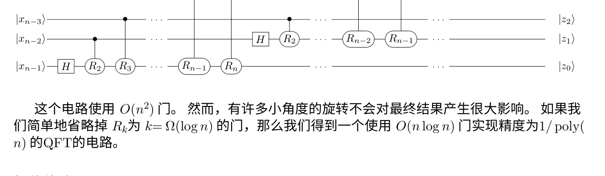
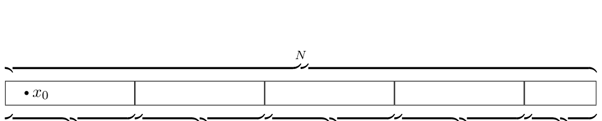
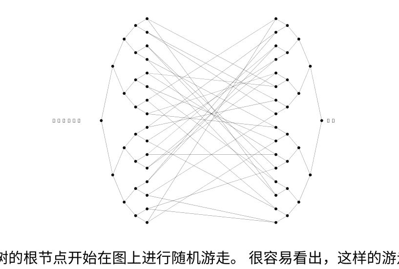

# 滑铁卢 CO781 量子算法讲义

## 安德鲁·奇尔兹，滑铁卢大学

## 讲座1：量子电路

这是一门关于量子算法的课程。它面向已经学过量子信息导论课程的研究生。这样的课程通常只涵盖量子算法的早期突破，即Shor的因式分解算法（1994年）和Grover的搜索算法（1996年）。本课程的目的是通过探索自那时以来已经发展起来的许多量子算法，展示量子计算不仅仅局限于Shor和Grover。

本课程将涵盖量子算法的几个主要主题，如下所示：

- 我们将讨论推广Shor算法主要思想的算法。这些算法利用了量子傅里叶变换，并且通常在经典计算机上实现指数级（或至少是超多项式级）的加速。特别地，我们将探索一个称为“隐藏子群问题”的群论问题。我们将看到如何解决这个问题对于阿贝尔群会导致几个应用，并且我们还将讨论非阿贝尔情况下的已知情况。
- 我们将探讨量子漫步的概念，这是随机漫步的量子推广。这个概念导致了一个强大的框架，用于解决搜索问题，推广了Grover的搜索算法。
- 我们将讨论量子查询复杂性的下界，展示了量子算法的能力限制。我们将介绍两种主要的量子下界技术，对手方法和多项式方法。
- 我们将看到如何通过跨度程序的概念，将量子对手方法实际上转化为量子查询复杂性的上界。我们还将看到这些思想如何导致用于评估布尔公式的最优量子算法。
- 如果时间允许，我们还将涵盖量子算法中的其他最新主题，如绝热优化和Jones多项式的近似。

在本讲座中，我们将简要回顾一些关于量子计算的背景材料。如果你计划参加这门课程，这些材料中的大部分应该对你来说是熟悉的（除了Solovay-Kitaev定理的细节）。

### 量子数据

量子计算机是一种使用量子力学表示信息进行计算的设备。信息存储在量子比特中，其状态可以表示为复向量空间中的ℓ₂-归一化向量。例如，我们可以将n个量子比特的状态写为

$$|\psi\rangle = \sum_{x\in\{0,1\}^n} a_x|x\rangle\qquad (1)$$

其中 $a_x \in \mathbb{C}$ 满足 $\sum_{x} |a_x|^2 = 1$。我们将状态 $|x\rangle$ 的基础称为计算基础。

将量子状态视为以更抽象的形式存储数据通常是有用的。例如，给定一个群 $G$，我们可以写 $|g\rangle$ 表示对应于群元素的基态，$g \in G$，以及

$$|\phi\rangle = \sum_{g \in G} b_g |g\rangle \quad (2)$$

对于一个任意的超级位置的群。我们假设有一种规范的方式来高效地使用位串表示群元素；通常不需要明确表示这种表示。

如果量子计算机存储状态 $|\psi\rangle$和状态 $|\phi\rangle$，其整体状态由这两个状态的张量积给出。 这可以表示为 $|\psi\rangle \otimes |\phi\rangle = |\psi\rangle|\phi\rangle = |\psi, \phi\rangle$。

### 量子电路

（纯）量子态上允许的操作是将归一化态映射到归一化态的操作，即满足 $U U^\dagger = U^\dagger U = I$ 的幺正算子 $U$。 （你可能知道还有更一般的量子操作，但在这门课程中我们大部分时间不需要使用它们。）

为了对 efficient计算有一个合理的概念，我们要求量子计算中出现的酉算符由量子电路实现。我们给定了一组门，每个门作用于一个或两个量子比特（意味着它是一个作用在其余量子比特上的单位算符的张量积）。 量子计算从 $|0\rangle$状态开始，应用一系列从允许的门集合中选择的一比特和两比特门，最后通过在计算基中测量得到一个结果。

### 通用门集

原则上，任何作用于 $n$ 量子比特的酉算符都可以只使用一比特和两比特门来实现。因此，我们说所有一比特和两比特门的集合是（完全）通用的。 当然，有些酉算符可能需要更多的一比特和两比特门来实现，事实上，计数论证表明，大多数作用于 $n$ 量子比特的酉算符只能通过指数级数量的一比特和两比特门电路来实现。

一般来说，我们满足于给出能够近似我们所期望的酉变换的电路。 我们称具有门 $U_1$，$U_2$，... 的电路为 $U$ 的近似电路。 如果$U$的近似电路的精度为 $\epsilon$，我们说它近似$U$。

$$||U - U_t ... U_2 U_1|| \leq \epsilon \quad (3)$$

这里 $||\cdot||$表示某个适当的矩阵范数，它应该具有这样的性质：如果 $||U - V||$很小，那么无论它们作用于什么量子态，$U$都很难与 $V$区分开。一个自然的选择（适用于我们的目的）是谱范数。

$$||A|| := \max_{|\psi\rangle} \frac{||A|\psi\rangle||}{|||\psi\rangle||} \quad (4)$$

（其中 $||\psi\rangle = \sqrt{\langle\psi|\psi\rangle}$ 表示 $|\psi\rangle$的向量2-范数），即 $A$ 的最大奇异值。然后，如果一组基本门能够以任意所需的精度 $\epsilon$近似于固定数量的量子比特上的任意酉算子，我们称其为通用的。

事实证明，存在一些有限的门集合是通用的：例如，集合 $\{H，T，C\}$，用

$$H := \frac{1}{\sqrt{2}}\begin{pmatrix}1 & 1 \\ 1 & -1\end{pmatrix} \quad T := \begin{pmatrix}e^{i\pi/8} & 0 \\ 0 & e^{-i\pi/8}\end{pmatrix} \quad C := \begin{pmatrix}1 & 0 & 0 & 0 \\ 0 & 1 & 0 & 0 \\ 0 & 0 & 0 & 1 \\ 0 & 0 & 1 & 0\end{pmatrix}. \quad \text{(5)}$$

在某些情况下，我们说一组门是有效通用的，即使它不能实际上近似任何量子比特上的幺正算符。例如，集合 $\{H, T^2, \text{Tof}\}$，其中

$$\text{Tof} := \begin{pmatrix}1 & 0 & 0 & 0 & 0 & 0 & 0 & 0 \\ 0 & 1 & 0 & 0 & 0 & 0 & 0 & 0 \\ 0 & 0 & 1 & 0 & 0 & 0 & 0 & 0 \\ 0 & 0 & 0 & 1 & 0 & 0 & 0 & 0 \\ 0 & 0 & 0 & 0 & 1 & 0 & 0 & 0 \\ 0 & 0 & 0 & 0 & 0 & 1 & 0 & 0 \\ 0 & 0 & 0 & 0 & 0 & 0 & 0 & 1 \\ 0 & 0 & 0 & 0 & 0 & 0 & 1 & 0\end{pmatrix} \quad \text{(6)}$$

是通用的，但只有在允许使用辅助量子比特（起始和结束状态为 $|0\rangle$）的情况下。同样，基础 $\{H, \text{Tof}\}$在使用辅助量子比特的情况下是通用的，可以近似任何正交矩阵。显然，它不能近似复数幺正矩阵，因为 $H$和 $\text{Tof}$的元素是实数；但通过分别模拟实部和虚部，可以模拟任意幺正变换的效果。

### 不同通用门集之间的等价性

有些通用门集比其他门集更好吗？在经典情况下，这不是一个问题：可能的操作集是离散的，因此任何作用在固定位数的门都可以使用给定的通用门集中的固定数量的门进行精确模拟。但我们可以想象，一些量子门比其他门更强大。例如，给定两个绕奇怪轴旋转的奇怪角度，可能不明显如何实现一个哈达玛门，我们可能担心实现这样一个门需要非常多的基本操作，随着所需精度的增加而扩展得很糟糕。

幸运的是，事实证明这并非如此：可以用一组1比特和2比特门高效地实现一个可以高效实现的酉算符。特别地，我们有以下结论。

定理（Solovay-Kitaev）。选择两个在逆运算下封闭的通用门集。然后，使用一个门集的任何 $t$-门电路可以通过使用另一个门集的 $t \cdot $多项式对数 $\epsilon$门电路来实现精确度 $\epsilon$（实际上，存在一个经典算法可以在时间 $t \cdot $多项式对数 $\epsilon$内找到这个电路）。

因此，两个门集在多项式时间约化下等价，而使用一个门集的算法的运行时间与使用另一个门集的算法的运行时间相同，只相差对数因子。这意味着即使是多项式量子加速也对门集的选择具有鲁棒性。

为了证明这一点，我们首先注意到一个基本事实，即一个量子电路对另一个电路的近似误差是线性累积的。

引理。设 $U_i$, $V_i$是满足 $\|U_i - V_i\| \leq \epsilon$的酉矩阵，对于所有 $i \in \{1, 2, \dots, t\}$。那么 $\|U_t \dots U_2 U_1 - V_t \dots V_2 V_1\| \leq t\epsilon$。

证明。我们使用归纳法来证明 t。对于 t = 1，引理是显然成立的。现在假设引理对于某个特定的 t 值成立。然后根据三角不等式和范数的酉不变性（‖U A V‖ = ‖A‖对于任意酉矩阵U, V），

‖U_{t+1} U_t … U_1 - V_{t+1} V_t … V_1‖
= ‖U_{t+1} U_t … U_1 - U_{t+1} V_t … V_1 + U_{t+1} V_t … V_1 - V_{t+1} V_t … V_1‖          (7)
≤ ‖U_{t+1} U_t … U_1 - U_{t+1} V_t … V_1‖ + ‖U_{t+1} V_t … V_1 - V_{t+1} V_t … V_1‖          (8)
= ‖U_{t+1} (U_t … U_1 - V_t … V_1)‖ + ‖(U_{t+1} - V_{t+1}) V_t … V_1‖          (9)
= ‖U_t … U_1 - V_t … V_1‖ + ‖U_{t+1} - V_{t+1}‖          (10)
≤ (t + 1)ε,          (11)

所以引理通过归纳得出。 □

因此，为了模拟一个总误差不超过 ε 的 t-门量子电路，只需模拟每个单独的门，使其误差不超过 ε/t。

为了模拟任意的单独门，策略是首先构建一个非常精细的网格，覆盖一个非常小的球体，围绕着单位元，使用群交换子，
[[U, V]] := U V U^{-1} V^{-1}.          (12)

为了近似一般的幺正算子，我们将它们有效地转化为接近单位算子。
注意，我们只需要考虑行列式为1的幺正门（即SU(2)的元素），因为全局相位是无关紧要的。

S_ε := {U ∈ SU(2) : ‖I - U‖ ≤ ε}          (13)
表示以单位算子为中心的 ε-球。给定集合Γ, S ⊆ SU(2)，我们说Γ是S的一个 ε-网，如果对于任意的 A ∈ S，存在一个 U ∈ Γ 使得 ‖ A - U‖ ≤ ε。下面的结果（稍后证明）表明群对易子如何帮助我们在单位算子周围构建一个精细的网格。引理。如果Γ是S_ε的一个 ε^2-网，那么 [[Γ, Γ]] := {[[U, V]] : U, V ∈ Γ}是S_{ε_2}的一个 O(ε^3)-网。

为了构建一个任意精细的网格，我们递归地应用这个思想。但首先，推导出引理的一个更适合递归的结果是很有帮助的。我们希望保持球的大小和网格的质量之间的二次关系。如果我们目标是一个 k^2 ε^3-网格（对于某个常数 k），我们希望它适用于 S_{k ε^{3/2}}中的任意点，而引理只允许我们近似S_{ε^2}中的点。为了处理任意的 A ∈ S_{k ε^{3/2}}，我们首先让 W 成为离 A 最近的门。对于足够小的 ε，我们有 k ε^{3/2} < ε，所以 S_{k ε^{3/2}} ⊂ S_ε，因此 A ∈ S_ε。由于Γ是 S_ε的一个 ε^2-网格，我们有 ‖A - W‖ ≤ ε^2，即 ‖A W^† - I‖ ≤ ε^2，所以 A W^† ∈ S_{ε^2}。然后，我们可以应用引理找到 U, V ∈ Γ，使得 ‖A W^† - [[U, V]]‖ = ‖A - [[U, V]] W‖ ≤ k^2 ε^3。

换句话说，如果Γ是一个 ε^2-网格，那么 [[Γ, Γ]]Γ := {[[U, V]] W : U, V, W ∈ Γ}是一个 k^2 ε^3-网格 S_{k ε^{3/2}}。

现在假设Γ_0是一个 ε_0^2-网格，用于 S_{ε_0}，并且对于所有正整数 i，令 Γ_i := [[Γ_{i-1}, Γ_{i-1}]] Γ_{i-1}。那么Γ_i是一个 ε_i^2-网格，用于 S_{ε_i}。解这个递归得到 ε_i = (k^2 ε_0)^{(3^2)_i} / k^2。

有了这些工具，我们准备好建立主要结果了。

Solovay-Kitaev定理的证明。我们只需要考虑如何用给定的通用门集合Γ来近似任意的 U ∈ SU(2)。ε的精度。

首先，我们将\(\Gamma\)的元素相乘，形成一个新的通用门集合\(\Gamma_0\)，它是一个 \(\epsilon_0^2\)-网格对于\(SU(2)\)，对于某个足够小的常数 \(\epsilon_0\)。我们知道这是可以做到的，因为\(\Gamma\)是通用的。由于 \(\epsilon_0\)是一个常数，构建\(\Gamma_0\)的开销是恒定的。

现在我们可以找到一个 \(V_0 \in \Gamma_0\)，使得 \(\|U - V_0\| \leq \epsilon_0^2\)。由于 \(\|U - V_0\| = \|U V_0^\dagger - I\|\)，我们有 \(U V_0^\dagger \in S_{\epsilon_0^2}\)。如果 \(\epsilon_0\)足够小，则 \(\epsilon_0^2 < k \epsilon_0^{3/2} = \epsilon_1\)，所以\(U V_0^\dagger \in S_{\epsilon_1}\)。

由于\(\Gamma_0\)是 \(\epsilon_0^2\)-\(SU(2)\)的网络，特别是它是一个 \(\epsilon_1^2\)-\(SU(2)\)的网络。因此根据上述论证，\(\Gamma_1\)是 \(\epsilon_1^2\)-\(SU(2)\)的网络，所以我们可以找到 \(V_1 \in \Gamma_1\) 使得 \(\|U V_0^\dagger - V_1\| \leq \epsilon_1^2 < k \epsilon_1^{3/2} = \epsilon_2\)，即，\(U V_0^\dagger V_1^\dagger - I \in S_{\epsilon_2}\)。

一般来说，假设我们给定了 \(V_0, V_1, \ldots, V_{i-1}\)，使得 \(U V_0^\dagger V_1^\dagger \ldots V_{i-1}^\dagger \in S_{\epsilon_i}\)。由于\(\Gamma_i\)是一个 \(\epsilon_i^2\)-网，用于 \(S_{\epsilon_i}\)，我们可以找到 \(V_i \in \Gamma_i\)，使得 \(\|U V_0^\dagger V_1^\dagger \ldots V_{i-1}^\dagger - V_i\| \leq \epsilon_i^2\)。反过来，这意味着 \(U V_0^\dagger V_1^\dagger \ldots V_i^\dagger \in S_{\epsilon_{i+1}}\)。

重复这个过程 \(t\)次，可以非常好地近似\(U\)通过 \(V_t \ldots V_1 V_0\)：我们有\(\| U - V_t \ldots V_1 V_0\| \leq \epsilon_t^2\)。假设我们认为\(\Gamma_0\)到\(\Gamma_t\)之间的门是基本的。（这些门可以使用\(\Gamma\)中的一定数量的门来实现，因此如果只计算\(\Gamma\)中的门数作为基本门，则存在一个常数因子的开销。）实现\(\Gamma^t\)中的门所需的基本门数量为\(5^t\)，因此近似中的门总数为 \(\sum_{i=0}^t 5^i = (5^{t+1} - 1)/4 = O(5^t)\)。

为了使整体误差最多为 \(\epsilon\)，我们需要 \(\epsilon_t^2 = ((k^2 \epsilon_0)^{(3/2)^t} / k^2)^2 \leq \epsilon\)，即，

> $$\left(\frac{3}{2}\right)^t > \frac{\frac{1}{2} \log(k^2 \epsilon)}{\log(k^2 \epsilon_0)}.$$(14)

因此，使用的门数量为 \(O(\log^\nu \frac{1}{\epsilon})\)，其中 \(\nu = \log 5 / \log \frac{3}{2}\)。

此时，可能还不清楚如何快速找到近似值，因为\(\Gamma_i\)包含大量点，所以我们需要小心地找到一个好的近似值 \(V_i \in \Gamma_i\) of \(U V_0^\dagger V_1^\dagger \ldots V_{i-1}^\dagger\)。然而，通过递归构造近似值，可以证明此过程的运行时间为\(poly(\log \frac{1}{\epsilon})\)。在我们证明引理之后，如何做到这一点将更清楚，但我们将细节留作练习。

还需要证明引理。一个关键的想法是在李群\(SU(2)\)和它的李代数之间进行转换，即生成这些酉矩阵的哈密顿量。特别地，我们可以将任意的\(A \in SU(2)\)表示为\(A = e^{i \vec{a} \cdot \vec{\sigma}}\)，其中 \(\vec{a} \in \mathbb{R}^3\)，而 \(\vec{\sigma} = (\sigma_x, \sigma_y, \sigma_z)\)是一个Pauli矩阵的向量。注意到我们可以选择 \(\|\vec{a}\| \leq \pi\)而不失一般性。

在证明中，关于\(SU(2)\)的以下基本事实将会有用。

- (i) \(\|I - e^{i \vec{a} \cdot \vec{\sigma}}\| = 2 \sin \frac{\|\vec{a}\|}{2} = \|\vec{a}\| + O(\|\vec{a}\|^3)\)
- (ii) \(\|e^{i \vec{b} \cdot \vec{\sigma}} - e^{i \vec{c} \cdot \vec{\sigma}}\| \leq \|\vec{b} - \vec{c}\|\)
- (iii) \([\vec{b} \cdot \vec{\sigma}, \vec{c} \cdot \vec{\sigma}] = 2i (\vec{b} \times \vec{c}) \cdot \vec{\sigma}\)
- (iv) \(\| [e^{i \vec{b} \cdot \vec{\sigma}}, e^{i \vec{c} \cdot \vec{\sigma}}] - e^{-[\vec{b} \cdot \vec{\sigma}, \vec{c} \cdot \vec{\sigma}]} \| = O(\|\vec{b}\| \|\vec{c}\| (\|\vec{b}\| + \|\vec{c}\|))\)

这里大-O符号是关于 \(\|\vec{a}\| \to 0\) 在 (i) 中，关于 \(\|\vec{b}\|, \|\vec{c}\| \to 0\) 在 (iv) 中。

### 引理的证明

设 \(A \in S_{\epsilon^2}\)。我们的目标是找到 \(U, V \in \Gamma\)，使得 \(\|A - [U, V]\| = O(\epsilon^3)\)。
选择 \(\vec{a} \in \mathbb{R}^3\)，使得 \(A = e^{i \vec{a} \cdot \vec{\sigma}}\)。由于 \(A \in S_{\epsilon^2}\)，根据 (i)，我们可以选择 \(\vec{a}\)，使得 \(\|\vec{a}\| = O(\epsilon^2)\)。
然后选择 \(\vec{b}, \vec{c} \in \mathbb{R}^3\)，使得 \(2\vec{b} \times \vec{c} = \vec{a}\)。我们可以选择这些向量为正交向量且长度相等，使得 \(\|\vec{b}\| = \|\vec{c}\| = \sqrt{\|\vec{a}\|/2}\)。令 \(B = e^{i \vec{b} \cdot \vec{\sigma}}\) 和 \(C = e^{i \vec{c} \cdot \vec{\sigma}}\)。然后唯一的区别在于 $A$ 和 $\llbracket B, C \rrbracket$ 之间的对易子和群对易子之间的差异，这是由(iv)得到的 $O(\epsilon^3)$。

然而，我们需要从网格$\Gamma$中选择点。 所以让 $U = e^{i\vec{u}\cdot\vec{\sigma}}$是离$B$最近的元素$\Gamma$，让 $V = e^{i\vec{v}\cdot\vec{\sigma}}$是离 $C$最近的元素$\Gamma$。由于$\Gamma$是 $\epsilon^2$-网格，我们有 $\|U - B\| \le \epsilon^2$和 $\|V - C\| \le \epsilon^2$，所以特别地 $\|\vec{u} - \vec{b}\| = O(\epsilon^2)$和 $\|\vec{v} - \vec{c}\| = O(\epsilon^2)$。

现在根据三角不等式，我们有

$$\|A - \llbracket U, V \rrbracket\| \le \|A - e^{2i(\vec{u}\times\vec{v})\cdot\vec{\sigma}}\| + \|e^{2i(\vec{u}\times\vec{v})\cdot\vec{\sigma}} - \llbracket U, V \rrbracket\|. \qquad (15)$$

对于第一项，使用 (ii)，我们有

$$\begin{aligned}
\|A - e^{2i(\vec{u}\times\vec{v})\cdot\vec{\sigma}}\| &= \|e^{2i(\vec{b}\times\vec{c})\cdot\vec{\sigma}} - e^{2i(\vec{u}\times\vec{v})\cdot\vec{\sigma}}\| & (16) \\
&\le 2\|\vec{b} \times \vec{c} - \vec{u} \times \vec{v}\| & (17) \\
&= 2\|(\vec{b} - \vec{u} + \vec{u}) \times (\vec{c} - \vec{v} + \vec{v}) - \vec{u} \times \vec{v}\| & (18) \\
&= 2\|(\vec{b} - \vec{u}) \times (\vec{c} - \vec{v}) + (\vec{b} - \vec{u}) \times \vec{v} + \vec{u} \times (\vec{c} - \vec{v})\| & (19) \\
&= O(\epsilon^3). & (20)
\end{aligned}$$

对于第二项，使用(iii)和(iv)得到

$$\|e^{2i(\vec{u}\times\vec{v})\cdot\vec{\sigma}} - \llbracket U, V \rrbracket\| = \|e^{-[\vec{u}\cdot\vec{\sigma}, \vec{v}\cdot\vec{\sigma}]} - \llbracket U, V \rrbracket\| = O(\epsilon^3) \qquad (21)$$

引理如下。 $\square$

注意，可以在上述版本的基础上稍微改进构造。

此外，它可以推广到任意$N$的$\mathrm{SU}(N)$。一般来说，成本是指数级的在 $N^2$，但对于任何固定的 $N$，这只是一个常数。

### 可逆计算

酉矩阵是可逆的：特别地， $U^{-1} = U^\dagger$。因此，任何酉变换都是可逆操作。这可能与我们通常如何定义经典电路相矛盾，使用不可逆门，如和和 OR。但实际上，任何经典计算都可以通过将任何不可逆门 $x \to g(x)$替换为可逆门$(x, y) \to (x, y \oplus g(x))$，并在输入$(x, 0)$上运行它，产生$(x, g(x))$，使之可逆。换句话说，通过存储所有中间步骤的计算，我们使之可逆。

在量子计算机上，存储所有中间计算步骤可能会带来问题，因为以不同方式获得的两个相同结果将无法干涉。然而，有一种简单的方法可以消除累积的信息。在使用可逆门进行经典计算后，我们只需将答案与一个辅助寄存器进行异或运算，然后按相反的顺序进行计算。因此，即使$f$是由许多门组成的复杂电路，我们也可以实现映射$(x, y) \to (x, y \oplus f(x))$。

基态，例如，我们可以进行转换

$$\frac{1}{\sqrt{2^n}} \sum_{x \in \{0,1\}^n} |x, 0\rangle \mapsto \frac{1}{\sqrt{2^n}} \sum_{x \in \{0,1\}^n} |x, f(x)\rangle. \tag{22}$$

请注意，这并不一定意味着我们可以有效地实现映射 |x⟩ ↦ |f(x)⟩，即使 f 是一个双射（这样确实是一个酉变换）。然而，如果我们能够有效地反转 f，那么我们确实可以有效地做到这一点。

### 均匀性

当我们给出一个计算问题的算法时，我们考虑不同大小的输入。通常，不同大小的实例的电路之间会有简单的关系。但这不一定是这样的；事实上，如果能够为每个输入大小选择任意电路，我们可以计算不可计算的语言。因此，我们要求我们的电路是均匀生成的：即存在一个固定的（经典的）图灵机，给定一个包含符号'1'的纸带，以多项式时间输出第n个电路的描述。

### 量子复杂性

我们说一个问题的算法是高效的，如果描述它的电路包含了一个与写下输入所需的位数多项式相关的门数。例如，如果输入是模 N 的一个数，输入大小是 ⌈log2 N⌉。

使用量子计算机，就像使用随机（或有噪声）的经典计算机一样，计算的最终结果可能不确定。相反，我们通常满足于一个能够以足够高的概率产生正确答案的算法（对于决策问题，上界为 1/2；对于非决策问题，我们可以检查正确解的情况下，Ω(1)）。通过多次重复计算，我们可以使输出错误答案的概率任意小。

除了考虑明确的计算问题，其中输入是一个字符串，我们还将考虑查询复杂性的概念。在这里，输入是一个黑盒变换，我们的目标是通过尽可能少的查询来发现变换的某些属性。例如，在Simon的问题中，我们给定一个变换 f: ℤ₂ⁿ → S satisfying f(x) = f(y) iff y = x ⊕ t for 一些未知的 t ∈ ℤ₂ⁿ，目标是学习 t。考虑查询复杂性的主要优势在于它允许我们证明解决给定问题所需的查询数量的下界。此外，如果我们找到一个在查询复杂性中的问题的高效算法，那么如果我们得到一个实现黑盒变换的明确电路，我们将拥有一个明确计算问题的高效算法。

有时候，我们关心的不仅是实现特定酉操作的电路的大小，还关心其深度，即从输入到输出的任意路径上的门的最大数量。电路的深度告诉我们如果我们可以并行执行门操作，它需要多长时间来实现。在问题集中，你将有机会思考用于实现量子傅里叶变换的并行电路。

### 容错性

在任何真实的计算机中，操作都不能完美执行。 量子门和测量可能不精确，并且即使在不进行操作的情况下，存储的数据也可能发生错误。 幸运的是，有处理在量子计算执行过程中可能发生的错误的协议。 具体来说，阈值定理表明只要噪声水平低于某个阈值（取决于噪声模型，但通常在10^{-3}到10^{-4}的范围内），就可以进行任意长的计算，并且错误的数量可以任意小。

在这门课程中，我们将隐含地假设已经应用了容错协议，以便我们可以有效地假设量子计算机完美地运行。

# 量子算法（CO 781/CS 867/QIC 823，2013年冬季）

## 安德鲁·奇尔兹，滑铁卢大学

## 讲座2：阿贝尔QFT，相位估计和离散对数

### 量子傅里叶变换

在量子计算中，最重要的酉变换可能是量子傅里叶变换(QFT)。稍后，我们将讨论任意有限群上的QFT，但现在我们将重点放在阿贝尔群 G 的情况上。这里的变换是

$$F_G := \frac{1}{\sqrt{|G|}} \sum_{x \in G} \sum_{y \in \hat{G}} \chi_y(x) |y\rangle\langle x|$$

其中\hat{G}是 G 的一个完备字符集，\chi_y(x)表示在 x 处评估的 G 的第 y 个字符。（您可以通过字符的正交性验证这是一个酉算子。）由于G和\hat{G}是同构的，我们可以使用G的元素来标记 \hat{G}的元素，并且这样做通常是有用的。

在一族群上最简单的量子傅里叶变换是在 G = \mathbb{Z}_2^n 上的量子傅里叶变换。这个群的特征是 \chi_y(x) = (-1)^{x·y}，所以量子傅里叶变换很简单。

$$F_{\mathbb{Z}_2^n} = \frac{1}{\sqrt{2^n}} \sum_{x,y \in \mathbb{Z}_2^n} (-1)^{x·y} |y\rangle\langle x| = H^{\otimes n}$$

你可能已经看到了这个变换在解决Simon问题中的应用。

### 在 \mathbb{Z}_{2^n} 上的量子傅里叶变换

一个更复杂的量子傅里叶变换是在 G = \mathbb{Z}_{2^n} 上的量子傅里叶变换:

$$F_{\mathbb{Z}_{2^n}} = \frac{1}{\sqrt{2^n}} \sum_{x,y \in \mathbb{Z}_{2^n}} \omega_{2^n}^{xy} |y\rangle\langle x|$$

其中 \omega_m := \exp(2\pi i / m)是一个原始的 m 次单位根。为了看到如何通过量子电路实现这个变换，将输入 x 表示为一串比特，x = x_{n-1}...x_1x_0，并考虑输入基向量的变换:

$$\begin{aligned}|x\rangle &\mapsto \frac{1}{\sqrt{2^n}} \sum_{y \in \mathbb{Z}_{2^n}} \omega_{2^n}^{xy} |y\rangle \\&= \frac{1}{\sqrt{2^n}} \sum_{y \in \mathbb{Z}_{2^n}} \omega_{2^n}^{x(\sum_{k=0}^{n-1} y_k 2^k)} |y_{n-1} \cdots y_1 y_0\rangle \\&= \frac{1}{\sqrt{2^n}} \sum_{y \in \mathbb{Z}_{2^n}} \prod_{k=0}^{n-1} \omega_{2^n}^{x y_k 2^k} |y_{n-1} \cdots y_1 y_0\rangle \\&= \frac{1}{\sqrt{2^n}} \bigotimes_{k=0}^{n-1} \sum_{y_k \in \mathbb{Z}_2} \omega_{2^n}^{x y_k 2^k} |y_k\rangle \\&= \bigotimes_{k=0}^{n-1} |z_k\rangle\end{aligned}$$

其中

$$|z_k\rangle := \frac{1}{\sqrt{2}} \sum_{y_k \in \mathbb{Z}_2} \omega_{2^n}^{x y_k 2^k} |y_k\rangle \quad (9) \\ = \frac{1}{\sqrt{2}}(|0\rangle + \omega_{2^n}^{x 2^k}|1\rangle) \quad (10) \\ = \frac{1}{\sqrt{2}}(|0\rangle + \omega_{2^n}^{\sum_{j=0}^{n-1} x_j 2^{j+k}}|1\rangle) \quad (11) \\ = \frac{1}{\sqrt{2}}(|0\rangle + e^{2\pi i(x_0 2^{k-n} + x_1 2^{k+1-n} + \dots + x_{n-1-k} 2^{-1})}|1\rangle). \quad (12)$$

（更简洁的写法是 $|z_k\rangle = \frac{1}{\sqrt{2}}(|0\rangle + \omega_{2^{n-k}}^{x}|1\rangle)$，但上述表达更有助于理解电路。）换句话说，$F|x\rangle$是单比特态的张量积，其中第 $k$ 比特仅依赖于 $x$ 的 $k$ 个最低有效位。

这个分解立即给出了一个在 $\mathbb{Z}_{2^n}$ 上的QFT电路。让 $R_k$ 表示单比特幺正算子$R_k: = \begin{pmatrix} 1 & 0 \\ 0 & \omega_{2^k} \end{pmatrix}$。

$$R_k = \begin{pmatrix} 1 & 0 \\ 0 & \omega_{2^k} \end{pmatrix}. \quad (13)$$

然后电路可以写成如下形式：



这个电路使用 $O(n^2)$ 门。然而，有许多小角度的旋转不会对最终结果产生很大影响。如果我们简单地省略掉 $R_k$ 为 $k = \Omega(\log n)$ 的门，那么我们得到一个使用 $O(n \log n)$ 门实现精度为 $1/\text{poly}(n)$ 的QFT的电路。

### 相位估计

除了在量子算法中直接使用，如Shor算法，QFT over $\mathbb{Z}_{2^n}$ 还提供了一个有用的量子计算原语，称为相位估计。在相位估计问题中，我们给定一个酉算子 $U$（可以是一个明确的电路，也可以是一个黑盒，让我们可以应用一个控制-$U^j$ 操作，其中 $j$ 是整数）。我们还给定了一个状态 $|\phi\rangle$，承诺它是 $U$ 的特征向量，即 $U|\phi\rangle = e^{i\phi}|\phi\rangle$，其中 $\phi \in \mathbb{R}$。目标是输出对 $\phi$ 的某种精度估计。

相位估计的过程很简单。为了获得对 $\phi$ 的 $n$ 位估计，将量子计算机准备在状态1

$$\frac{1}{\sqrt{2^n}} \sum_{x \in \mathbb{Z}_{2^n}} |x, \phi\rangle, \quad (14)$$

应用算子

$$ \sum_{x \in \mathbb{Z}_{2^n}} |x\rangle\langle x| \otimes U^x \quad (15) $$

给出状态

$$ \frac{1}{\sqrt{2^n}} \sum_{x \in \mathbb{Z}_{2^n}} e^{i\phi x} |x, \phi\rangle, \quad (16) $$

在第一个寄存器上应用逆傅里叶变换，并进行测量。如果 φ/2π 的二进制展开在最多 n 位后终止（即，如果 φ=2π y/2^n，其中 y ∈ ℤ_{2^n}），那么状态 (16) 为 F_{2^n}|y⟩ ⊗ |φ⟩，因此结果保证是 φ/2π 的二进制展开。一般情况下，我们以很高的概率获得一个很好的近似值。特别地，获得结果 y（对应于相位估计 2π y/2^n）的概率为

$$ \mathrm{Pr}(y) = \frac{1}{2^{2n}} \cdot \frac{\sin^2(2^{n-1} \phi)}{\sin^2(\frac{\phi}{2} - \frac{\pi y}{2^n})}, \quad (17) $$

它在最佳的 n 位近似值周围有很强的峰值（特别是，它以至少 4/π^2 的概率给出了最佳的 n 位近似值）。当我们讨论周期查找时，我们将看到类似计算的细节。

### 在 ℤ_N 和一般有限阿贝尔群上的 QFT

相位估计的一个有用应用是在任意循环群 ℤ_N 上实现 QFT：

$$ F_{\mathbb{Z}_N} = \frac{1}{\sqrt{N}} \sum_{x,y \in \mathbb{Z}_N} \omega_N^{xy} |y\rangle\langle x|. \quad (18) $$

我们使用输入和输出的二进制表示导出的电路仅在 N 是 2 的幂（或者，稍微推广一下，其他一些小整数）时有效。但是有一种简单的方法来实现 F_{ℤ_N}（近似地）使用相位估计。

我们希望执行将 |x⟩ 映射为 |˜x⟩ 的变换，其中 |˜x⟩ := F_{ℤ_N}|x⟩ 表示一个傅里叶基态。（根据线性性质，如果变换在基态上正确作用，它在所有态上都正确作用。）执行变换 |x,0⟩ ↦ |x,˜x⟩ 是直接的；然后需要从这样的态中抹去寄存器 |x⟩。

考虑加一取模 N 的幺正算子：

$$ U := \sum_{x \in \mathbb{Z}_N} |x+1\rangle\langle x|. \quad (19) $$

这个算子的本征态恰好是傅里叶基态 |˜x⟩ := F_{ℤ_N}|x⟩，因为（如简单计算所示）

$$ F_{\mathbb{Z}_N}^\dagger U F_{\mathbb{Z}_N} = \sum_{x \in \mathbb{Z}_N} \omega_N^x |x\rangle\langle x|. \quad (20) $$

因此，使用相位估计在 U 上（精确到 n 位，其中 n = O(log N)），我们可以执行变换

$$ |\tilde{x}, 0\rangle \mapsto |\tilde{x}, x\rangle \quad (21) $$

（实际上，相位估计只给出 x 的近似值，因此我们只能近似实现这个变换）。通过以相反的方式运行此操作，我们可以擦除 |x⟩，并从而产生所需的 QFT。

给定 $\mathbb{Z}_N$ 上的傅里叶变换，实现任意有限阿贝尔群上的QFT是直接的：任何有限阿贝尔群都可以写成循环因子的直积，而直积群上的QFT只是各个群的QFT的张量积。

### 离散对数

QFT在循环群上的一个应用是解离散对数问题。该问题的定义如下。设 $G = \langle g \rangle$ 是由 $g$ 生成的循环群，用乘法写成。给定一个元素 $x \in G$，关于 $g$ 的离散对数 $x$ 在 $G$ 中的最小非负整数 $\alpha$ 满足 $g^\alpha = x$。离散对数问题是计算 $\log_g x$ 的问题。

以下是一些离散对数的简单示例：
- 对于任何 $G = \langle g \rangle$，$\log_g 1 = 0$
- 对于 $G = \mathbb{Z}_7^\times$，$\log_3 2 = 2$
- 对于 $G = \mathbb{Z}_{541}^\times$，$\log_{126} 282 = 101$

离散对数似乎是一个很好的单向函数候选。我们可以高效地计算 $g$ 的 $\alpha$ 次方，即使 $\alpha$ 的大小是指数级的（在 $\log|G|$ 的情况下），使用重复平方。但是给定 $x$，如何计算 $\log_g x$ 并不明显，除非通过检查指数级的可能性。（有比暴力搜索更好的算法，但目前没有已知的多项式时间算法。）这是众所周知的迪菲-赫尔曼密钥交换协议的基础。

### Shor的算法

现在我们将看到Shor的算法如何用于计算离散对数。这是一个很好的例子，因为它比因子分解算法更简单，但它解决的问题实际上至少和因子分解一样困难：将 $N$ 的因子分解问题归约到计算 $\mathbb{Z}^\times N$ 中的离散对数。（不幸的是，这本身并不能给出一个用于因子分解的量子算法，因为Shor的离散对数算法需要我们知道 $G$ 的阶数，但计算 $|\mathbb{Z}^\times N| = \phi(N)$ 和因子分解 $N$ 一样困难。）给定循环群 $G = \langle g \rangle$ 的某个元素 $x$，我们想计算 $\log_g x$，即最小的整数 $\alpha$ 使得 $g$ 的 $\alpha$ 次方等于 $x$。为简单起见，让我们假设 $G$ 的阶数 $N$ 是已知的。

（例如，如果 $G = \mathbb{Z}_p^\times$ 对于素数 $p$，那么我们知道 $N = p-1$。一般来说，如果我们不知道 $N$，我们可以使用Shor的周期查找算法来学习它，我们稍后会回顾。）我们还可以假设这是真的 $x = g$（即，$\log_g x = 1$），因为很容易检查这是否成立。
为了解决这个问题，考虑以下函数 $f: \mathbb{Z}_N \times \mathbb{Z}_N \rightarrow G$：
$$f(\alpha, \beta) = x^\alpha g^\beta. \tag{22}$$
由于 $f(\alpha, \beta) = g^{\alpha \log_g x + \beta}$，$f$ 在直线上是常数
$$L_{\gamma} := \{ (\alpha, \beta) \in \mathbb{Z}_N^2 : \alpha \log_g x + \beta = \gamma \}. \tag{23}$$
Shor算法用于寻找对数 $\log_g x$ 的过程如下。我们从均匀叠加态开始在 $\mathbb{Z}_N \times \mathbb{Z}_N$ 上计算隐藏函数：
$$\left| \mathbb{Z}_N \times \mathbb{Z}_N \right\rangle := \frac{1}{N} \sum_{\alpha, \beta \in \mathbb{Z}_N} \left| \alpha, \beta \right\rangle \mapsto \frac{1}{N} \sum_{\alpha, \beta \in \mathbb{Z}_N} \left| \alpha, \beta, f(\alpha, \beta) \right\rangle. \tag{24}$$

然后我们丢弃第三个寄存器。为了看清楚这个过程，想象一下我们实际上测量了第三个寄存器。然后测量后的状态是与观察到的函数值（比如 $g^\delta$）一致的群元素的叠加态，它简单地是某条线上的点集 $L_\delta$。换句话说，我们得到的状态是

$$|L_\delta\rangle = \frac{1}{\sqrt{N}} \sum_{\alpha\in\mathbb{Z}_N} |\alpha, \delta - \alpha\log_g x\rangle$$ (25)

然而，请注意测量结果是无用的：每个可能的值都以相等的概率出现，除非我们知道如何进行离散对数运算，否则我们无法从 $g^\delta$ 中获得 $\delta$。因此，我们可以简单地丢弃第三个寄存器，使系统处于由纯态（25）的集合描述的混合态中，其中 $\delta$ 是均匀随机且未知的。

现在，我们可以利用量子态的对称性，在 $\mathbb{Z}_N \times \mathbb{Z}_N$ 上执行QFT；然后状态变为

$$\frac{1}{N^{3/2}} \sum_{\alpha,\mu,\nu\in\mathbb{Z}_N} \omega_N^{\mu\alpha+\nu(\delta-\alpha\log_g x)}|\mu,\nu\rangle = \frac{1}{N^{3/2}} \sum_{\mu,\nu\in\mathbb{Z}_N} \omega_N^{\nu\delta} \sum_{\alpha\in\mathbb{Z}_N} \omega_N^{\alpha(\mu-\nu\log_g x)}|\mu,\nu\rangle$$ (26)

并使用恒等式 $\sum_{\alpha\in\mathbb{Z}_N} \omega_N^{\alpha\beta} = N\delta_{\beta,0}$，我们有

$$\frac{1}{\sqrt{N}} \sum_{\nu\in\mathbb{Z}_N} \omega_N^{\nu\delta}|\nu\log_g x,\nu\rangle$$ (27)

现在假设我们在计算基础上测量这个状态。然后我们得到一对 $(\nu \log_g x, \nu)$ 对于均匀随机的 $\nu \in \mathbb{Z}_N$。如果 $\nu$ 在模 $N$ 下有一个乘法逆元，我们可以通过 $\nu$ 除以第一个寄存器来得到所需的答案。如果 $\nu$ 没有乘法逆元，我们只需再次重复整个过程。每次独立尝试的成功概率为 $\phi(N)/N = \Omega(1/\log \log N)$（其中 $\phi(N)$ 表示小于且与N互质的正整数的数量），因此我们不需要重复多次过程就能找到一个可逆的 $\nu$。

只要我们有一个唯一的群元素表示，并且能够高效地计算 $G$ 中的乘积，这个算法就可以在任何循环群 $G$ 中执行。（我们需要能够计算群元素的高次幂，但是请记住这可以通过重复平方来快速完成。）特别地，它还可以用于解决椭圆曲线的离散对数问题，从而破坏了大多数椭圆曲线密码学。

# 量子算法（CO 781/CS 867/QIC 823，2013年冬季）

## 安德鲁·奇尔兹，滑铁卢大学

## 讲座3：阿贝尔隐藏子群问题

在这个讲座中，我们将介绍一般的隐藏子群问题（HSP）。我们将看到Shor的离散对数算法如何在阿贝尔群中解决隐藏子群问题的一个特定实例。最后，我们将看到如何在已知结构的任何有限阿贝尔群中解决隐藏子群问题。

### 隐藏子群问题

在一般的HSP中，我们给定一个黑盒函数$f: G \to S$，其中$G$是一个已知的群，$S$是一个有限集合。该函数被承诺满足以下条件

> 当且仅当$f(x)=f(y)$，则$x^{-1}y \in H$，即$y = xh$，其中$h \in H$

其中$H \le G$是一个未知的子群。我们称这样的函数隐藏$H$。HSP的目标是通过对$f$进行查询来学习$H$（例如，用生成集合来指定）。

很明显，如果我们拥有$f$的完整真值表，那么$H$可以从原则上被重建。特别注意，只有当$x \in H$时，$f(1)=f(x)$才成立：隐藏函数在隐藏子群上是常数，并且在其他地方不取该值。

但是隐藏函数具有更多的结构。如果我们固定某个元素$g \in G$且$g \notin H$，我们可以看到只有当$x \in gH$时，$f(g)=f(x)$成立，其中$H$是$G$中的左陪集，$g$是陪集的代表。因此，$f$在$G$的左陪集上是常数，在不同的左陪集上是不同的。

在上述HSP的定义中，我们任意选择了在右侧乘以$H$的元素，这就是为什么隐藏函数在左陪集上是常数的原因。我们同样可以选择在左侧乘以$H$的元素，这样隐藏函数将在右陪集上是常数；这个问题的结果是等价的。当然，在$G$是阿贝尔群的情况下，我们不需要做出这样的选择。出于我们稍后将看到的原因，这种情况比一般情况要简单得多；实际上，在任何阿贝尔群中都存在一个高效的量子算法来解决HSP问题，而对于已知的非阿贝尔群，只有少数几个存在高效算法。

你应该熟悉Simon的问题，它简单地是具有$G = \mathbb{Z}_2^n$和$H = \{0, s\}$对于某个$s \in \mathbb{Z}_2^n$的HSP。对于这个问题，有一个直接的量子算法，然而可以证明任何经典算法在找到$s$时必须查询隐藏函数指数多次（在$n$中）。论证的要点是，由于集合$S$是无结构的，只要我们不知道两个元素$x, y$满足$f(x)=f(y)$，我们就不能比查询随机群元素更好。但根据生日问题，我们不太可能在我们进行$\Omega(\sqrt{|G|/|H|})$次随机查询之前看到这样的碰撞。

### 定理

> 假设$G$有一个集合$\mathcal{H}$的$N$个子群，它们的唯一共同元素是单位元。那么一个经典计算机必须进行$\Omega(\sqrt{N})$次查询才能解决HSP问题。

证明。假设预先隐藏的oracle不是特定的子群，而是以对抗性的方式行为，如下所示。在第$\ell$次查询中，算法查询$g_\ell$，我们假设它与$g_1, \ldots, g_{\ell-1}$不同。如果没有损失地一般性。如果存在任何子群 $H \in \mathcal{H}$, 使得对于所有的 $1 \leq j < k \leq \ell$ (即, oracle可以以一致的方式将 $g_{\ell}$ 分配给一个尚未查询的隐藏子群的陪集), 那么oracle简单地输出 $\ell$; 否则, oracle承认失败, 并输出到目前为止与其回答一致的某个 $H \in \mathcal{H}$ 的生成集 (根据构造, 这必须存在)。

算法的目标是迫使预言机让步, 我们希望下界限制查询的数量。(给定一个在 $G$ 中求HSP的算法, 显然存在一个算法只需要多查询一次就能迫使预言机让步。) 现在考虑一个在迫使预言机让步之前查询预言机 $t$ 次的算法。这个算法只是简单地看到一个固定的响应序列 $1, 2, \ldots, t$, 所以对于前 $t$ 次查询, 算法不能是自适应的。但是请注意, 无论查询哪些 $t$ 群元素, 最多只有 $\binom{t}{2}$ 个值 $g_k g_j^{-1}$, 而在 $\mathcal{H}$ 中可能有 $N$ 个子群。因此, 为了满足对于所有的 $H \in \mathcal{H}$, 存在一对 $j, k$ 使得 $g_k g_j^{-1} \in H$ 的 $N$ 个条件, 我们必须有 $\binom{t}{2} \geq N$, 即, $t = \Omega(\sqrt{N})$。

请注意, 有些情况下, 经典算法可以用多项式次数的查询找到隐藏的子群。特别是, 由于经典计算机可以轻松测试某个子群是否确实是隐藏的子群, 对于具有多项式个子群的群来说, 隐藏子群问题是容易的。例如, 经典计算机可以轻松解决 $\mathbb{Z}_p$ 中的隐藏子群问题 (因为它只有2个子群) 和 $\mathbb{Z}_{2^n}$ 中的隐藏子群问题 (因为它只有 $n+1$ 个子群) 。

### 离散对数作为隐藏子群问题

离散对数问题很容易被识别为隐藏子群问题。回想一下, Shor算法用于计算 $\log_g x$ 的函数 $f: \mathbb{Z}_N \times \mathbb{Z}_N \to \langle g\rangle$ 定义为 $f(\alpha, \beta) = x^{\alpha} g^{\beta}$。这个函数在直线 $L_{\gamma} = \{(\alpha, \beta) \in \mathbb{Z}_N^2: \alpha \log_g x + \beta = \gamma\}$ 上是常数。观察到 $H = L_0$ 是 $G = \mathbb{Z}_N \times \mathbb{Z}_N$ 的一个子群, 而集合 $L_{\gamma} = L_0 + (0, \gamma)$ 是它的陪集。Shor的离散对数算法通过制备均匀随机的陪集状态 $|L_{\gamma}\rangle$ 并在傅里叶基下进行测量来工作。

### 阿贝尔HSP

我们现在考虑一般阿贝尔群的HSP。当群元素交换时, 使用加法符号表示群操作通常更有意义。我们在这里使用这个约定, 写出 $f$ hides $H$ as $f(x) = f(y)$ iff $x - y \in H$ 的条件。

一般阿贝尔HSP的策略紧随离散对数问题的算法。我们首先在群上创建一个均匀叠加态,

$$|G\rangle := \frac{1}{\sqrt{|G|}} \sum_{x \in G} |x\rangle. \quad (2)$$

然后我们在另一个寄存器中计算函数值, 得到

$$\frac{1}{\sqrt{|G|}} \sum_{x \in G} |x, f(x)\rangle. \quad (3)$$

丢弃第二个寄存器后, 得到一组随机选择的余集元素的均匀叠加态 $x + H := \{x + h: h \in H\}$ of $H$ in $G$,

$$|x + H\rangle = \frac{1}{\sqrt{|H|}} \sum_{h \in H} |x + h\rangle. \quad (4)$$

这种状态通常被称为余集态。同样，由于余集是未知且均匀随机的，该状态可以用密度矩阵描述。

$$\rho_H := \frac{1}{|G|} \sum_{x \in G} |x + H\rangle\langle x + H|.$$

接下来，我们对 $G$ 应用 QFT。然后我们得到状态

$$|x + H\rangle := F_G |x + H\rangle \ = \frac{1}{\sqrt{|H| \cdot |G|}} \sum_{y \in \hat{G}} \sum_{h \in H} \chi_y(x + h) |y\rangle \ = \sqrt{\frac{|H|}{|G|}} \sum_{y \in \hat{G}} \chi_y(x) \chi_y(H) |y\rangle$$

其中

$$\chi_y(H) := \frac{1}{|H|} \sum_{h \in H} \chi_y(h).$$

请注意，应用 QFT 是正确的选择，因为状态 $\rho_H$ 是 $G$ 不变的。换句话说，它与 $G$ 的常规表示，即满足对所有的 $x, y \in G$ 都有 $U(x)|y\rangle = |x + y\rangle$ 的酉矩阵 $U(x)$ 交换。我们有

$$U(x) \rho_H = \frac{1}{|G|} \sum_{y \in G} |x + y + H\rangle\langle y + H| \ = \frac{1}{|G|} \sum_{z \in G} |z + H\rangle\langle z - x + H| \ = \rho_H U(-x)^\dagger \ = \rho_H U(x).$$

由此可知，$\hat{\rho}_H := F_G \rho_H F_G^\dagger$ 是对角的（事实上，我们在下面明确验证了这一点），因此我们可以进行测量而不会丢失任何信息。当我们讨论非阿贝尔傅里叶采样时，我们将更详细地讨论这个现象。

注意，如果我们将注意力限制在子群上，$\chi_y$ 是 $H$ 的一个特征。如果对于所有的 $h \in H$, $\chi_y(h) = 1$，那么显然 $\chi_y(H) = 1$。另一方面，如果存在任何 $h \in H$，使得 $\chi_y(h) = 1$（即，如果 $\chi_y$ 对 $H$ 的限制不是 $H$ 的平凡特征），那么根据不同特征的正交性，

$$\frac{1}{|H|} \sum_{x \in H} \chi_y(x) \chi_{y'}(x)^* = \delta_{y,y'}$$

（等价于量子傅里叶变换的幺正性），我们有 $\chi_y(H) = 0$。因此我们有

$$|x + H\rangle = \sqrt{\frac{|H|}{|G|}} \sum_{y: \chi_y(H)=1} \chi_y(x) |y\rangle$$

或者等价地，混合量子态

$$\hat{\rho}_H = \frac{|H|}{|G|^2} \sum_{x \in G} \sum_{y,y': \chi_y(H)=\chi_{y'}(H)=1} \chi_y(x)\chi_{y'}(x)|y\rangle\langle y'| = \frac{|H|}{|G|} \sum_{y: \chi_y(H)=1} |y\rangle\langle y|. \quad (16)$$

接下来我们在计算基础上进行测量。然后我们得到一些字符 $\chi_y$，它在隐藏子群 $H$上是平凡的。这个信息缩小了隐藏子群的可能元素范围：我们可以将注意力限制在满足 $\chi_y(g)=1$的那些元素$g \in G$上。这样的元素集合被称为 $\chi_y$的核。

$$\ker \chi_y := \{g \in G : \chi_y(g)=1\}; \quad (17)$$

它是 $G$的一个子群。现在我们的策略是重复整个采样过程多次，并计算结果字符的内核的交集。仅经过多项式次数的步骤，我们声称结果子群是 $H$的概率很高。显然它不能比 $H$更小（因为每个采样字符的内核都包含$H$），所以只需证明每个采样很可能将 $H$的大小减少到一个相当大的比例，直到达到 $H$。

假设在这个过程的某个时刻，内核的交集是 $K \leq G$，其中 $K = H$。由于 $K$是 $G$的一个子群，且$H < K$，根据拉格朗日定理，我们有 $|K| \geq 2|H|$。因为每个满足 $\chi_y(H)$ 的字符 $\chi_y$ of $G$出现的概率是$|H|/|G|$，我们看到某个 $\chi_y$使得 $K \leq \ker \chi_y$的概率是$|H|$

$$\frac{|H|}{|G|} |\{y \in \hat{G}: K \leq \ker \chi_y\}|. \quad (18)$$

但是这样的 $y$s的数量恰好是 $|G|/|K|$，因为我们知道如果子群 $K$被隐藏了，我们将均匀地采样这样的 $y$s，概率为 $|K|/|G|$。因此，我们看到一个 $y$的概率，其中 $K \leq \ker \chi_y$，恰好是 $|H|/|K| \leq 1/2$。现在，如果我们观察到一个 $y$，使得 $K \leq \ker \chi_y$，那么 $|K \cap \ker \chi_y| \leq |K|/2$；此外，这种情况发生的概率至少为$1/2$。因此，如果我们重复这个过程 $O(\log |G|)$次，结果子群实际上是 $H$的可能性非常高。

### 分解阿贝尔群

为了应用上述算法，我们必须了解群 $G$的结构；特别是，我们必须能够应用傅里叶变换 $F_G$。对于某些应用，我们可能事先不知道 $G$的结构。但是，如果我们只假设我们对 $G$的每个元素有唯一的编码，能够在这些元素上执行群操作，并且有一个生成集合 $G$，那么存在一个高效的量子算法（由Mosca提出）将群分解为$G = \langle\gamma_1\rangle \oplus \langle\gamma_2\rangle \oplus \cdots \oplus \langle\gamma_t\rangle$

$$\quad (19)$$

）以生成元 $\gamma_1$，$\gamma_2$，$\ldots$，$\gamma_t$表示。这里 $\oplus$表示内直和，意味着群 $\langle\gamma_i\rangle$只在单位元素处相交；换句话说，我们有

$$G \cong \mathbb{Z}_{|\langle\gamma_1\rangle|} \times \mathbb{Z}_{|\langle\gamma_2\rangle|} \times \cdots \times \mathbb{Z}_{|\langle\gamma_t\rangle|}. \quad (20)$$

给定这样的分解，实现$F_G$并从而解决HSP问题是直接的。我们还可以使用这个工具来分解由HSP算法输出的隐藏子群 $H$的结构，例如计算 $|H|$。

这个算法基于Shor的找阶算法，以及群论中的标准工具。我们没有时间详细介绍这个算法；更多信息请参阅2011年的讲义。

# 量子算法（CO 781/CS 867/QIC 823，2013年冬季）

## 安德鲁·奇尔兹，滑铁卢大学

## 讲座4：从 ℤ到 ℝ的周期发现

在本讲座中，我们将探讨确定函数周期的量子算法。Shor的因子分解算法基于解决整数上函数的周期发现问题。最近，Hallgren考虑了解决二次丢番图方程（也称为Pell方程）以及涉及数域的相关问题。Hallgren通过将整数上的周期发现推广到实数上的周期发现，为这些问题提供了高效的量子算法。

### 因子分解和次序查找

Shor的因子分解算法基于将因子分解归约为次序查找（由Miller在1970年代观察到）。这种归约通常在量子计算的第一门课程中讲解，因此我们在这里不讨论细节。

在群 G的次序查找问题中，我们给定一个元素 g ∈ G，我们的目标是找到 g的次序，即最小的 r ∈ ℕ，使得 g r= 1。（因子分解 L归约为次序查找在 G = ℤL中。）解决这个问题的一种方法是考虑函数 f： ℤ → G，定义为f（x） = gx。这个函数的周期为 r，有一种高效的量子算法可以找到这个周期，我们将在下面进行回顾。

### 佩尔方程

给定一个无平方因子的整数 d（即不可被任何完全平方数整除的整数），丢番图方程

$$x^2 - dy^2 = 1 \quad (1)$$

被称为佩尔方程。这个方程已经在古代印度和希腊进行了研究，并与代数数论中的概念密切相关。

佩尔方程的左边可以分解为

$$x^2 - dy^2 = (x + y\sqrt{d})(x - y\sqrt{d})$$. (2)

注意，方程的解（x， y） ∈ ℤ2可以唯一地编码为实数 x+y : 因为√d 是无理数， x + y√d = w + z√d当且仅当（x， y） = （w， z）。（证明： (x-w)/(z-y)= √d.）因此，我们也可以将数字 x + y称为 √d Pell方程的一个解。

显然，将我们的注意力限制在正解上并没有损失一般性，即对于使得x >0和y >0的解。很容易证明，如果 x1 + y1 是一个正解，那么(x1 + y1 √d)^n对于任何 n ∈ ℕ也是一个正解。实际上，可以证明所有正解都可以通过这种方式得到，其中 x1 + y1 √d是方程的基本解，即方程的最小正解。因此，尽管Pell方程有无限多个解，我们可以通过找到基本解来找到它们所有。

不幸的是，明确找到基本解是不可行的。解可以很大 - 大小为 x1 + y1 √d只有上界为2O(√d log d)。因此，甚至无法用poly(log d)位数写出基本解。

为了解决这个困难，我们定义了基本解的调节器，

```
R := \ln(x_1 + y_1 \sqrt{d})
```

由于 \( R = O(\sqrt{d} \log d) \)，我们可以用 \( O(\log \lceil dR \rceil) \) 位数写出 \( dR \)。现在 \( R \) 是一个无理数，所以仅确定其整数部分可能看起来不令人满意。但实际上，给定 \( R \) 的整数部分，有一个经典算法可以在时间 poly(log d, n) 内计算出 \( R \) 的 n 位小数。因此，只需给出一个在时间 poly(log d) 内找到 \( R \) 的整数部分的算法即可。对于这个问题，已知的最好的经典算法在假设广义黎曼猜想的情况下需要时间 \( O(\sqrt{\log d} \log \log d) \)，或者在没有这样的假设的情况下需要时间 \( O(d^{1/4} \text{poly}(\log d)) \)。

Hallgren 解决 Pell 方程的算法基于定义一个有效计算的周期函数，其周期是调节器。定义这个函数需要我们引入大量的代数数论，所以我们在这里省略了细节（部分内容请参见 2011 年的讲座笔记；更详细的处理请参见 Jozsa 的评论文章）。相反，我们将重点放在解决周期查找问题的量子部分算法上。

### 在整数上进行周期查找

回想一下，Shor 的因式分解算法是通过找到函数 \( f: \mathbb{Z} \to \mathbb{Z}_L \) 的周期来解决数字 \( L \) 的因式分解问题的（其中 \( a \) 是随机选择的）。换句话说，我们试图找到最小的正整数 \( r \)，使得 \( a^x \mod L = a^{x+r} \mod L \) 对于所有的 \( x \in \mathbb{Z} \) 成立。注意，由于周期通常不能整除已知的数字 \( N \)，我们不能简单地将这个任务简化为在 \( \mathbb{Z}_N \) 上进行周期查找；相反，我们应该将其视为在 \( \mathbb{Z} \) 上进行周期查找（或者等价地，隐藏子群问题在 \( \mathbb{Z} \) 上的问题）。

当然，我们不能指望用有限的内存在计算机上表示任意整数。相反，我们将仅考虑输入 \( \{0, 1, \ldots, N-1\} \) 的函数，其中选择了某个 \( N \)，并且我们将在 \( \mathbb{Z}_N \) 上执行傅里叶采样。我们将看到，即使函数在 \( \mathbb{Z}_N \) 上不是精确周期的，这个过程也可以工作。当然，只有当周期足够小的时候，这才有可能成功，否则我们可能会完全错过周期。

稍后，我们将看到如何选择 \( N \)，如果我们已经给出了周期的先验上界 \( M \)。如果我们最初没有这样的上界，我们可以简单地从 \( M=2 \) 开始，然后重复加倍 \( M \)，直到它足够大以便进行周期查找。这个过程产生的开销只有多项式对数 \( \log r \)。

给定一个值 \( N \)，我们在 \( \{0, 1, \ldots, N-1\} \) 上准备一个均匀叠加态，并在另一个寄存器中计算函数，得到

```
\frac{1}{\sqrt{N}} \sum_{x \in \{0, \ldots, N-1\}} |x\rangle \mapsto \frac{1}{\sqrt{N}} \sum_{x \in \{0, \ldots, N-1\}} |x, f(x)\rangle.
```

接下来我们测量第二个寄存器，将第一个寄存器保持在与测量结果一致的值的均匀叠加态中。当 \( f \) 是周期性函数，最小周期为 \( r \) 时，我们得到一个以周期 \( r \) 分隔的点的叠加态。这样的点的数量为 \( N \)，取决于第一个点 \( x_0 \in \{0, 1, \ldots, r-1\} \) 的位置。当限制在 \( \{0, 1, \ldots, N-1\} \) 上时，函数有 \( \lfloor N/r \rfloor \) 个完整周期和 \( N - r \lfloor N/r \rfloor \) 个剩余点，如下图所示。因此，如果 \( x_0 < N - r \lfloor N/r \rfloor \)，则 \( n = \lfloor N/r \rfloor + 1 \)，否则 \( n = \lfloor N/r \rfloor \)。



丢弃测量结果，我们得到量子态

```
$$\frac{1}{\sqrt{n}} \sum_{j=0}^{n-1} |x_0 + jr \rangle \qquad \qquad \qquad \qquad \qquad \qquad \qquad (5)$$
```

其中 $x_0$ 几乎均匀随机地出现（以概率 $n/N$），且未知。为了获得周期的信息，我们对 $\mathbb{Z}_N$ 进行傅里叶变换，得到

```
$$\frac{1}{\sqrt{nN}} \sum_{j=0}^{n-1} \sum_{k \in \mathbb{Z}_N} \omega_N^{k(x_0 + jr)} |k\rangle = \frac{1}{\sqrt{nN}} \sum_{k \in \mathbb{Z}_N} \omega_N^{kx_0} \sum_{j=0}^{n-1} \omega_N^{jkr} |k\rangle. \qquad \qquad (6)$$
```

现在，如果我们足够幸运地选择了一个 $N$ 的值，使得 $r \mid N$，那么实际上 $n = N/r$，无论 $x_0$ 的值如何，上述的 $j$ 的求和是

```
$$\sum_{j=0}^{n-1} \omega_N^{jkr} = \sum_{j=0}^{n-1} \omega_n^{jk} \qquad \qquad \qquad \qquad \qquad \qquad \qquad (7)$$
$$= n \delta_{k \bmod n, 0}. \qquad \qquad \qquad \qquad \qquad \qquad \qquad (8)$$
```

在这种特别简单的情况下，量子态是

```
$$\frac{n}{\sqrt{nN}} \sum_{k \in \mathbb{Z}_N} \omega_N^{kx_0} \delta_{k \bmod n, 0} = \frac{1}{\sqrt{r}} \sum_{k \in n \mathbb{Z}_r} \omega_N^{kx_0} |k\rangle, \qquad \qquad (9)$$
```

并且测量 $k$ 的结果保证是 $N/r$ 的整数倍，每个 $k$ 的倍数出现的概率都是 $1/r$。但更一般地，式（6）中的求和是几何级数

```
$$\sum_{j=0}^{n-1} \omega_N^{jkr} = \frac{\omega_N^{krn} - 1}{\omega_N^{kr} - 1} \qquad \qquad \qquad \qquad \qquad \qquad \qquad (10)$$
$$= \omega_N^{(n-1)kr/2} \frac{\sin \frac{\pi krn}{N}}{\sin \frac{\pi kr}{N}}. \qquad \qquad \qquad \qquad \qquad \qquad \qquad (11)$$
```

看到特定值 $k$ 的概率由归一化因子 $1/nN$ 乘以这个和的模的平方给出，即

```
$$\mathrm{Pr}(k) = \frac{\sin^2 \frac{\pi krn}{N}}{nN \sin^2 \frac{\pi kr}{N}}. \qquad \qquad \qquad \qquad \qquad \qquad \qquad (12)$$
```

从情况 $n = N/r$ 出发，我们预计这个分布会在接近整数倍的 $k$ 值附近有很强的峰值。当看到 $k = \lfloor jN/r \rfloor = jN/r + \epsilon$ 时，其中 $\lfloor x \rfloor$ 表示最接近 $x$ 的整数，概率为

```
$$\mathrm{Pr}(k = \lfloor jN/r \rfloor) = \frac{\sin^2 (\pi j n + \frac{\pi \epsilon n}{N})}{nN \sin^2 (\pi j + \frac{\pi \epsilon}{N})} \qquad \qquad \qquad \qquad (13)$$
$$= \frac{\sin^2 \frac{\pi \epsilon n}{N}}{nN \sin^2 \frac{\pi \epsilon}{N}}. \qquad \qquad \qquad \qquad \qquad \qquad \qquad (14)$$
```

现在使用不等式4x²/π² ≤ sin²x ≤ x²（其中下界对于|x| ≤ π/2成立，并且可以应用，因为|ε| ≤ 1/2），我们有

```
$$\text{Pr}(k = \lfloor jN/r \rfloor) \geq \frac{4\left(\frac{\epsilon n}{N}\right)^2}{nN\left(\frac{\pi \epsilon}{N}\right)^2} = \frac{4n}{\pi^2 N} = \frac{4}{\pi^2 r}.$$
(15)
(16)
(17)
```

这个界限表明，傅里叶采样产生的k值是最接近N/r的整数之一的概率不低于一个常数。

为了发现给定的一个值⌊jN/r⌋，我们可以除以N得到一个最多偏离1/2N的有理近似。然后考虑连分数展开

```
$$\frac{\lfloor jN/r \rfloor}{N} = \frac{1}{a_1 + \frac{1}{a_2 + \frac{1}{a_3 + \cdots}}}.$$
(18)
```

在有限项后截断这个展开式得到一个收敛的展开式。这些收敛式提供了一系列逐渐更好的⌊jN/r⌋/N的近似分数，可以在多项式时间内计算（例如参见Knuth的《计算机程序设计艺术》第2卷）。此外，可以证明任何满足|p/q - ⌊jN/r⌋/N| < 1/2q²的分数p/q将出现作为一个收敛式（例如参见Hardy和Wright的定理184）。由于j/r与⌊jN/r⌋/N最多相差1/2N，当N² < N时，分数j/r将出现作为一个收敛式。通过取N足够大，这提供了一种有效的方法来恢复周期。

### 在实数上进行周期查找

现在假设我们有一个函数f: ℝ → S满足f(x + r) = f(x)，其中r ∈ ℝ，并且通常情况下，假设f在每个（最小）周期内是单射的。现在我们将看到如何调整Shor的过程来找到对r的近似，即使它可能是无理数。

要在数字计算机上执行周期查找，我们当然必须离散化函数。我们必须小心地进行这种离散化。例如，假设S = ℝ。如果我们只在等间距点上评估f并将结果值四舍五入（可能重新缩放）以获得整数，那么与周期接近的输入对应的函数值没有任何相关性。可能离散化函数是单射的，完全没有关于周期的任何信息。

相反，我们将以一种方式离散化，使得结果函数是伪周期性的。我们说对于每个ℓ ∈ ℤ，如果对于每个k ∈ ℤ，要么f(k) = f(k + ⌊ℓr⌋)，要么f(k) = f(k - ⌊ℓr⌋)，那么函数f是在k ∈ ℤ以周期r ∈ ℝ的伪周期性。我们说函数f是ε-伪周期性的，如果它对于至少一个ε分数的值k=0,1,…,⌊r⌋是伪周期性的。我们假设离散化函数在某个常数ε的情况下是ε-伪周期性的，并且在伪周期性输入的子集上是单射的。注意佩尔方程的调节器的周期函数可以构造成满足这些条件。

现在让我们考虑当我们将傅里叶采样应用于一个伪周期函数时会发生什么。与之前一样，我们将在ℤ_N上进行傅里叶采样，其中N稍后确定（再次取决于一些先验上界 M 对于周期 r)。我们首先在均匀叠加上计算伪周期函数：

$$\sum_{x\in\{0,...,N-1\}} |x\rangle | \rightarrow \sum_{x\in\{0,...,N-1\}} |x, f(x)\rangle. \tag{19}$$

现在测量第二个寄存器会以恒定的概率给出一个使 f伪周期的值。假设这个值是 f（x₀），其中0 ≤ x₀ ≤ r。与之前一样，如果 x₀< N − r ⌊N/r⌋，则我们看到 n =⌊N/r⌋+1个点，否则（可能根据 x的最大值的四舍五入情况而有所偏移，但我们不用担心这个细节）我们看到 n = ⌊N/r⌋个点。我们将用[ℓ]表示一个既可以是 ⌊ℓ⌋也可以是 ⌈ℓ⌉的整数。使用这个符号，我们得到

$$\frac{1}{\sqrt{n}} \sum_{j=0}^{n-1} |x_0 + [jr]\rangle. \tag{20}$$

接下来，对 $\mathbb{Z}_N$进行傅里叶变换

$$\frac{1}{\sqrt{nN}} \sum_{j=0}^{n-1} \sum_{k\in\mathbb{Z}_N} \omega_N^{k(x_0+[jr])} |k\rangle = \frac{1}{\sqrt{nN}} \sum_{k\in\mathbb{Z}_N} \omega_N^{kx_0} \sum_{j=0}^{n-1} \omega_N^{k[jr]} |k\rangle. \tag{21}$$

现在我们有 $[jr] = jr + \delta_j$，其中 $-1 < \delta_j < 1$，所以对 j的求和是

$$\sum_{j=0}^{n-1} \omega_N^{k[jr]} = \sum_{j=0}^{n-1} \omega_N^{kjr} \omega_N^{k\delta_j}. \tag{22}$$

我们希望这个值接近于偏移量 $\delta_j$为零的情况下的相应求和（在归一化后，与在$\mathbb{Z}$上找周期的情况下的计算相同，即 $\Omega(1/\sqrt{r})$）。考虑振幅的偏差，

$$\left| \sum_{j=0}^{n-1} \omega_N^{kjr} \omega_N^{k\delta_j} - \sum_{j=0}^{n-1} \omega_N^{kjr} \right| \leq \sum_{j=0}^{n-1} |\omega_N^{k\delta_j} - 1| \tag{23}$$
$$= \frac{1}{2} \sum_{j=0}^{n-1} \left| \sin \frac{\pi k \delta_j}{N} \right| \tag{24}$$
$$\leq \frac{1}{2} \sum_{j=0}^{n-1} \left| \frac{\pi k \delta_j}{N} \right| \tag{25}$$
$$\leq \frac{\pi k n}{2N}. \tag{26}$$ 至少在这个界限上，振幅可能不会在所有的k值上都接近。然而，假设我们只考虑小于N/ log r的k值。（我们将以大约1/ log r的概率获得这样的k值，因此我们可以在这个事件上进行条件约束，而只有多项式的开销。）对于这样的k值，我们有

$$\left| \frac{1}{\sqrt{nN}} \sum_{j=0}^{n-1} \omega_N^{k[jr]} \right| = \Omega(1/\sqrt{r}) - O(\frac{1}{\sqrt{nN}} \cdot \frac{n}{\log r}) \tag{27}$$
$$= \Omega(1/\sqrt{r}) - O(\frac{1}{\sqrt{r} \log r}) \tag{28}$$
$$= \Omega(1/\sqrt{r}). \tag{29}$$

因此，就像在 $\mathbb{Z}$ 上找周期一样，傅里叶采样使我们能够从一个分布中采样，其中某个值 $k = \lfloor jN/r \rfloor$（其中 $j \in \mathbb{Z}$）以相当大的概率出现（现在是 $\Omega(1/\text{poly}(\log r))$ 而不是 $\Omega(1)$）。

最后，我们必须使用这些样本获得对 $r$ 的近似。由于 $r$ 不是整数，Shor 的周期查找算法中使用的过程不足够。然而，我们可以进行足够多次的傅里叶采样，以获得两个值 $\lfloor jN/r \rfloor$, $\lfloor j'N/r \rfloor$，使得 $j$ 和 $j'$ 互质，而且只有多项式开销。我们在下面证明，如果 $N \geq 3r^2$，则 $j/j'$ 是 $\lfloor jN/r \rfloor / \lfloor j'N/r \rfloor$ 的连分数展开中的一个收敛值。因此，我们可以学到 $j$，从而计算 $jN/\lfloor jN/r \rfloor$，这给出了对 $r$ 的良好近似：特别地，$|r - jN/\lfloor jN/r \rfloor| \leq 1$。

## 引理。如果 $N \geq 3r^2$，则 $j/j'$ 出现在连分数展开中的一个收敛项中 $\lfloor jN/r \rfloor / \lfloor j'N/r \rfloor$。此外，$|r - jN/\lfloor jN/r \rfloor| \leq 1$。

## 证明。关于连分数逼近理论的一个标准结果表明，如果 $a, b \in \mathbb{Z}$ 且 $|x - \frac{a}{b}| \leq \frac{1}{2b^2}$，那么 $a/b$ 出现在连分数展开中的一个收敛项中 $x$（参见例如 Hardy 和 Wright 的《数论导论》第 184 定理）。因此，只需证明

$$\left| \frac{\lfloor jN/r \rfloor}{\lfloor j'N/r \rfloor} - \frac{j}{j'} \right| < \frac{1}{2j'^2}. \quad\quad (30)$$

让 $\lfloor jN/r \rfloor = jN/r + \mu$ 和 $\lfloor j'N/r \rfloor = j'N/r + \nu$，其中 $|\mu|, |\nu| \leq 1/2$，我们有

$$\begin{align*} \left| \frac{\lfloor jN/r \rfloor}{\lfloor j'N/r \rfloor} - \frac{j}{j'} \right| &= \left| \frac{jN/r + \mu}{j'N/r + \nu} - \frac{j}{j'} \right| \ (31) \ &= \left| \frac{jN + \mu r}{j'N + \nu r} - \frac{j}{j'} \right| \ (32) \ &= \left| \frac{r(\mu j' - \nu j)}{j'(j'N + \nu r)} \right| \ (33) \ &\leq \frac{r(j + j')}{2j'^2N - j'r} \ (34) \ &\leq \frac{r}{j'N - r/2} \ (35) \end{align*}$$

在最后一步中，我们假设 $j < j'$ wlog。这个上界由 $1/2j'^2$ 限制，前提是 $j'N \geq r/2 + 2j'^2r$，这当然成立如果 $N \geq 3r^2$（使用 $j' < r$ 的事实）。

最后

$$\begin{align*} r - \frac{jN}{\lfloor jN/r \rfloor} &= r - \frac{jN}{\frac{jN}{r} + \mu} \ (36) \ &= r - \frac{jN r}{jN + \mu r} \ (37) \ &= \frac{\mu r^2}{jN + \mu r} \ (38) \end{align*}$$

这是因为 $N \geq 3r^2$ 时，其绝对值最大为 1，$|\mu| \leq 1/2$，并且 $j \geq 1$。 $\square$

### 其他数域算法

最后，我们提到了量子计算在计算代数数论中的一些进一步应用。

Hallgren关于Pell方程的原始论文还解决了另一个问题，即主理想问题，即判断一个理想是否为主理想，并找到一个生成元的问题。因子分解归约为解Pell方程的问题，而Pell方程归约为主理想问题；但是目前没有已知的反向归约。受到主理想问题可能比因子分解更难的可能性的启发，Buchmann和Williams设计了一个基于它的密钥交换协议。Hallgren的算法表明量子计算机可以破解这个加密系统。

随后，Hallgren、Schmidt和Vollmer分别找到了与代数数论问题相关的进一步算法。具体来说，他们找到了计算常数次数的数域的单位群和类群的多项式时间算法。这些算法需要将周期查找从 ℝ 广义化到类似的问题 ℝ^d 上。

## 量子算法 (CO 781/CS 867/QIC 823, 2013年冬季)
安德鲁·奇尔兹, 滑铁卢大学
讲座5: HSP的量子查询复杂度

到目前为止, 我们已经考虑了阿贝尔群中的隐藏子群问题。现在我们转向群可能是非阿贝尔的情况。我们将研究HSP的一些潜在应用, 然后证明一般问题具有多项式量子查询复杂度。

## 非阿贝尔HSP及其应用

回想一下, 对于一个群 $G$ 的隐藏子群问题, 我们给出了一个黑盒函数 $f: G \to S$, 其中 $S$ 是一个有限集合。我们说 $f$ 隐藏了子群 $H \leq G$, 如果 $$f(x) = f(y) \quad \text{当且仅当} \quad x^{-1}y \in H. \tag{1}$$ 换句话说, $f$ 在左陪集 $H, g_1H, g_2H, \ldots$ 上是常数。在 $G$ 中, 对于不同的左陪集, 它在不同的左陪集上是不同的。当 $G$ 是一个非阿贝尔群时, 我们将这个问题称为非阿贝尔HSP。非阿贝尔HSP之所以有趣, 不仅因为它在自然方式上推广了阿贝尔情况, 而且因为解决某些非阿贝尔隐藏子群问题将具有特别有用的应用。最著名(也是最直接)的应用是图自同构问题和图同构问题, 目前尚无有效的经典算法。

在图自同构问题中, 给定一个有$n$个顶点的图$\Gamma$, 目标是确定它是否具有一些非平凡的自同构。换句话说, 我们想知道是否存在任何非平凡的置换 $\pi \in S_n$, 使得 $\pi(\Gamma) = \Gamma$。$\Gamma$ 的自同构形成一个子群$\text{Aut } \Gamma \leq S_n$; 如果$\text{Aut } \Gamma$是平凡的, 则称$\Gamma$是刚性的。我们可以将图自同构问题转化为在 $S_n$ 上的HSP, 通过考虑隐藏$\text{Aut } \Gamma$的函数 $f(\pi) := \pi(\Gamma)$。如果我们能够解决 $S_n$ 中的HSP问题, 那么通过检查自同构群是否平凡, 我们可以决定图自同构。

在图同构问题中, 我们给出两个图$\Gamma, \Gamma'$, 每个图有 $n$ 个顶点, 我们的目标是确定是否存在任何置换 $\pi \in S_n$, 使得 $\pi(\Gamma) = \Gamma'$, 如果存在这样的置换, 我们称 $\Gamma$ 和 $\Gamma'$ 是同构的。我们可以将图同构问题转化为 wreath 乘积中的 HSP 问题$S_n \wr S_2 \leq S_{2n}$, 即由第一个$n$个点的置换、第二个 $n$ 个点的置换以及交换两组点的置换生成的 $S_2 \ n$ 的子群。将 $S_n \wr S_2$ 的元素写成形式 $(\sigma, \tau, b)$, 其中$\sigma, \tau \in S_n$分别表示$\Gamma, \Gamma'$的置换, $b \in \{0, 1\}$表示是否交换两个图, 我们可以定义一个函数 $$f(\sigma, \tau, b) := \begin{cases} (\sigma(\Gamma), \tau(\Gamma')) & b = 0 \\ (\sigma(\Gamma'), \tau(\Gamma)) & b = 1. \end{cases} \tag{2}$$ 这个函数隐藏了$\Gamma$和$\Gamma'$的不相交并的自同构群, 只有当它们同构时才包含一个交换两个图的元素。特别地, 如果$\Gamma$和$\Gamma'$是刚性的(这似乎是图同构的HSP方法最困难的情况), 当$\Gamma, \Gamma'$不同构时, 隐藏子群是平凡的; 当$\Gamma = \pi(\Gamma')$时, 它的阶数为2, 其非平凡元素为 $(\pi, \pi^{-1}, 1)$ 的逆。

隐藏子群问题的第二个主要潜在应用是格问题。一个 $n$维格子是所有整数线性组合的集合(基于格子的基础)。在 $\mathbb{R}^n$ 中的向量。在最短向量问题中，我们被要求在格子中找到一个最短的非零向量。特别地，在 $g(n)$-唯一最短向量问题中，我们承诺最短的非零向量是唯一的（除了它的符号），并且比任何其他非平行向量都要短 $g(n)$ 倍。如果 $g(n)$ 足够大（比如指数级别），这个问题可以在经典计算机上在多项式时间内解决，如果 $g(n) = O(1)$，则是NP难问题。关于中间情况了解较少，但是据推测，即使对于 $g(n) = \text{poly}(n)$ 的情况，这个问题在经典计算机上也很难解决，以至于基于这个假设设计了密码系统。

Regev证明了基于所谓的标准方法（如下所述）的有效量子算法可以用于解决多项式（$n$）唯一最短向量问题。这样的算法将是重要的，因为它将破解格密码系统，这是少数几个不受Shor算法影响的提议密码系统之一。

到目前为止，只有对称和二面体隐藏子群问题已知具有重要应用。尽管如此，人们对于理解一般群的HSP的复杂性产生了相当大的兴趣。这至少有三个原因。首先，这个问题仅仅是基本的兴趣：它似乎是探索量子计算机相对于经典计算机优势程度的自然环境。其次，为其他HSPs开发的技术可能最终适用于对称或二面体群。最后，探索量子计算机在HSPs中的限制可能会提出能够抵御量子攻击的密码系统。

### 标准方法

几乎所有已知的非阿贝尔隐藏子群问题的算法都以与阿贝尔HSP中基本相同的方式使用黑盒子 $f$。因此，这种方法被称为标准方法。

在标准方法中，我们首先准备一个群元素的均匀叠加态：

$$|G\rangle := \frac{1}{\sqrt{|G|}} \sum_{g \in G} |g\rangle. \qquad (3)$$

然后我们在辅助寄存器中计算值 $f(g)$，得到状态

$$\frac{1}{\sqrt{|G|}} \sum_{g \in G} |g, f(g)\rangle. \qquad (4)$$

最后，我们测量第二个寄存器并丢弃结果（或者等效地，简单地丢弃第二个寄存器）。如果我们得到结果 $s \in S$，则状态被投影到那些满足 $f(g) = s$ 的 $g \in G$ 的均匀叠加态上，根据 $f$ 的定义，这只是某个左陪集。由于每个陪集包含相同数量的元素，每个左陪集出现的概率相等。因此，这个过程产生了陪集态。

$$|gH\rangle := \frac{1}{\sqrt{|H|}} \sum_{h \in H} |gh\rangle \text{其中 } g \in G \text{是均匀随机选择的} \qquad (5)$$

（或者等价地，我们可以将 $g$ 视为从 $G$ 中的某个左陪集均匀随机选择的）

根据上下文，将结果视为随机纯态或等价地视为混合量子态可能更方便

$$\rho_H := \frac{1}{|G|} \sum_{g \in G} |gH\rangle\langle gH|$$

我们称之为一个隐藏子群态。在隐藏子群问题的标准方法中，我们尝试使用这个隐藏子群态的样本来确定 H。换句话说，给定 $\rho_H^{\otimes k}$ (其中 $k= \text{poly}(\log |G|)$ )，我们试图找到 $H$ 的一个生成集。

### 隐藏子群问题的查询复杂度

作为理解隐藏子群问题的量子复杂度的第一步，我们可以问解决这个问题需要多少次隐藏函数的查询。如果我们能够证明需要指数数量的量子查询，那么我们就知道没有高效的量子算法。但事实证明并非如此：Ettiner、Høyer和Knill证明，对 $f$ 进行 $\text{poly}(\log |G|)$ 次查询就足以确定 $H$。特别地，他们在标准方法的框架内证明了这一点：$\rho_H^{\otimes \text{poly}(\log |G|)}$ 包含足够的信息以恢复 $H$。当然，这并不一定意味着隐藏子群问题的量子计算复杂度是多项式的，因为通常情况下如何高效地执行量子后处理隐藏子群状态并不清楚。然而，这是一个重要的观察，因为它已经显示了量子计算和经典计算之间的差异，并提供了一些关于如何设计高效量子算法的线索。

要显示隐藏子群问题的查询复杂度是多项式的，只需显示（单个副本的）隐藏子群状态在统计上是可区分的，这可以通过量子保真度来衡量。

$$F(\rho, \rho') := \mathrm{tr} |\sqrt{\rho} \sqrt{\rho'}|$$

这是巴纳姆和尼尔的一个结果，他们证明了以下结论。

**定理。** 假设$\rho$从一个集合 $\{\rho_1, ..., \rho_N\}$中随机选择，其中每个$\rho_i$以一定的先验概率$p_i$出现。那么存在一个量子测量（即所谓的 pretty good测量），它以至少

$$1 - N \sqrt{\max_{i \neq j} F(\rho_i, \rho_j)}$$

的概率识别$\rho$。

事实上，根据极小极大定理，即使不假设先验分布，这个结论仍然成立。

只给出一个隐藏子群状态的副本，(8)通常只会给出一个平凡的界限。然而，通过获取隐藏子群状态的多个副本，我们可以确保整体状态几乎正交，从而可区分。特别是，使用$k$个副本的$\rho$，我们可以看到至少有一种测量方法可以以概率识别$\rho$

$$1 - N \sqrt{\max_{i \neq j} F(\rho_i^{\otimes k}, \rho_j^{\otimes k})} = 1 - N \sqrt{\max_{i \neq j} F(\rho_i, \rho_j)^k}$$

（因为保真度在张量积下是可乘的）。将这个表达式设为$1-\epsilon$，并解出$k$，我们可以看到只要使用足够小的错误概率$\epsilon$，就可以实现。

$$k \geq \left\lceil \frac{2(\log N - \log \epsilon)}{\log (1/\max_{i \neq j} F(\rho_i, \rho_j))} \right\rceil$$

$\rho$的副本。

假设$G$没有太多的子群，并且两个不同隐藏子群状态之间的保真度不接近1，这表明多项式数量的$\rho_H$足以解决HSP问题。群$G$的子群总数为$2^{O(\log^2 |G|)}$，可以如下所示。

任何群$K$可以用至多$\log_2 |K|$个生成元来指定，因为每个额外的（非冗余）生成元至少将群的大小增加一倍。由于$G$的每个子群可以由$G$的至多$\log_2 |G|$个元素的子集来指定，所以$G$的子群数量上界为$|G|^{\log_2 |G|} = 2^{(\log_2 |G|)^2}$。这表明我们可以在（10）中取$\log N = \text{poly}(\log |G|)$。因此，$k = \text{poly}(\log |G|)$个$\rho_H$副本足以以恒定的概率识别$H$，前提是最大保真度至少为$1/\text{poly}(\log |G|)$。

为了上界两个状态$\rho, \rho'$之间的保真度，考虑投影到$\rho$的支撑或其正交补的两结果测量。结果分布的经典保真度是量子保真度的上界，所以

$$F(\rho, \rho') \leq \sqrt{\text{tr } \Pi_\rho \rho} \sqrt{\text{tr } \Pi_\rho \rho'} + \sqrt{\text{tr}((1 - \Pi_\rho)\rho)} \sqrt{\text{tr}((1 - \Pi_\rho)\rho')}$$
$$= \sqrt{\text{tr } \Pi_\rho \rho'}.$$

其中$\Pi_\rho$表示投影到$\rho$的投影算子。

现在考虑两个不同子群$H, H' \leq G$之间的保真度。假设$|H| \geq |H'|$没有损失一般性。我们可以将（6）写成

$$\rho_H = \frac{1}{|G|} \sum_{g \in G} |gH\rangle\langle gH| = \frac{|H|}{|G|} \sum_{g \in T_H} |gH\rangle\langle gH|.$$

其中$T_H$表示$G$中的某个左横截面。由于右手边的表达式是$\rho_H$的谱分解，我们有

$$\Pi_{\rho_H} = \sum_{g \in T_H} |gH\rangle\langle gH| = \frac{1}{|H|} \sum_{g \in G} |gH\rangle\langle gH|.$$

然后我们有

$$F(\rho_H, \rho_{H'})^2 \leq \text{tr } \Pi_{\rho_H} \rho_{H'}$$
$$= \frac{1}{|H| \cdot |G|} \sum_{g,g' \in G} |\langle gH | g'H'\rangle|^2$$
$$= \frac{1}{|H| \cdot |G|} \sum_{g,g' \in G} \frac{|gH \cap g'H'|^2}{|H| \cdot |H'|}$$
$$= \frac{1}{|G| \cdot |H|^2 \cdot |H'|} \sum_{g,g' \in G} |gH \cap g'H'|^2.$$

现在

$$
|gH \cap g'H'| = |\{(h, h') \in H \times H' : gh = g'h'\}| \tag{19}
= |\{(h, h') \in H \times H' : hh' = g^{-1}g'\}| \tag{21}
= \begin{cases}
|H \cap H'| & \text{if } g^{-1}g' \in HH' \\
0 & \text{如果 } g^{-1}g' \notin HH',
\end{cases} \tag{22}
$$

所以

$$
\sum_{g,g'\in G} |gH \cap g'H'|^2 = |G| \cdot |HH'| \cdot |H \cap H'|^2 \tag{23}
= |G| \cdot |H| \cdot |H'| \cdot |H \cap H'|. \tag{24}
$$

因此我们有

$$
F(\rho_H, \rho_{H'})^2 = \frac{|G| \cdot |H| \cdot |H'| \cdot |H \cap H'|}{|G| \cdot |H|^2 \cdot |H'|} \tag{25}
= \frac{|H \cap H'|}{|H|} \tag{26}
\leq \frac{1}{2}. \tag{27}
$$

这表明 $F(\rho_H, \rho_{H'}) \leq 1/\sqrt{2}$，从而确定了HSP的查询复杂度为 $\text{poly}(\log |G|)$。

# 量子算法（CO 781/CS 867/QIC 823，2013年冬季）
安德鲁·奇尔兹，滑铁卢大学
第6讲：非阿贝尔群中的傅里叶分析

我们已经看到隐藏子群状态包含足够的信息来确定隐藏的子群。现在我们想知道是否可以高效地提取这些信息。在本讲中，我们将介绍傅里叶分析在一般群上的理论，这是解决这个问题的重要工具。

## 表示论简介

为了理解非阿贝尔傅里叶分析，我们首先需要介绍一些来自群表示论的概念。关于这个主题的更多信息，一个很好的基础参考书是Serre的《有限群的线性表示》。

一个群 $G$ 在向量空间 $\mathbb{C}^d$ 上的线性表示（或简称表示）是一个从群元素到非奇异 $d \times d$ 复数矩阵的同态映射 $\sigma: G \to GL(\mathbb{C}^d)$，即对于所有的 $x, y \in G$，满足 $\sigma(x)\sigma(y) = \sigma(xy)$。显然，$\sigma(1) = I$，$\sigma(x^{-1}) = \sigma(x)^{-1}$。我们将 $\mathbb{C}^d$ 称为 $\sigma$ 的表示空间，其中 $d$ 称为其维度（或度），记作 $d_\sigma$。

具有表示空间 $\mathbb{C}^d$ 的两个表示 $\sigma$ 和 $\sigma'$ 如果存在一个可逆线性变换 $M \in \mathbb{C}^{d \times d}$ 使得对于所有的 $x \in G$，都有 $M \sigma(x) = \sigma'(x) M$，则它们被称为同构（表示为 $\sigma \sim \sigma'$）。否则，它们被称为非同构（表示为 $\sigma \nsim \sigma'$）。特别地，不同维度的表示是非同构的。每个有限群的表示都同构于一个幺正表示，即对于所有的 $x \in G$，都有 $\sigma(x)^{-1} = \sigma(x)^\dagger$。因此，我们可以将注意力限制在幺正表示上，而不会损失一般性。

最简单的表示是维度为一的表示，其中 $\sigma(x) \in \mathbb{C}$ 且 $|\sigma(x)|= 1$ 对于所有的 $x \in G$。每个群都有一个称为平凡表示的一维表示，定义为对于所有的 $x \in G$，都有 $\sigma(x) = 1$。

群 $G$ 的两个特别有用的表示是左正则表示和右正则表示。这两个表示的维度都是 $|G|$，它们的表示空间是群代数 $\mathbb{C}G$，即由基向量 $|x\rangle$（其中 $x \in G$）张成的 $|G|$ 维复向量空间。左正则表示 $L$ 满足 $L(x)|y\rangle = |xy\rangle$，右正则表示 $R$ 满足 $R(x)|y\rangle = |yx^{-1}\rangle$。特别地，这两个正则表示都是置换表示：它们的表示矩阵都是置换矩阵。

给定两个表示 $\sigma: G \to V$ 和 $\sigma': G \to V'$，我们可以定义它们的直和表示 $\sigma \oplus \sigma': G \to V \oplus V'$，其维度为 $d_{\sigma\oplus\sigma'} = d_\sigma + d_{\sigma'}$。表示 $\sigma \oplus \sigma'$ 的表示矩阵是分块对角的，形式为

$$(\sigma \oplus \sigma')(x) = \begin{pmatrix} \sigma(x) & 0 \\ 0 & \sigma'(x) \end{pmatrix} \qquad (1)$$

对于所有的 $x \in G$。

如果一个表示不能被分解为其他两个表示的直和，则称其为不可约表示。任何一个有限群 $G$ 的表示都可以写成不可约表示（或 irreps）的直和。

另一种组合两个表示的方法是张量积。表示 $\sigma: G \to V$ 和 $\sigma': G \to V'$ 的张量积是 $\sigma\otimes\sigma': G \to V \otimes V'$，其维度为 $d_{\sigma\otimes\sigma'} = d_\sigma d_{\sigma'}$。

表示 $\sigma$ 的特征是函数 $\chi_{\sigma}: G \to \mathbb{C}$，定义为 $\chi_{\sigma}(x) := \text{tr} \sigma(x)$。我们有

- $\chi_{\sigma}(1) = d_{\sigma}$ (因为 $\sigma(1)$ 是 $I_d$，即 $d$维单位矩阵)
- $\chi_{\sigma}(x^{-1}) = \chi_{\sigma}(x)^*$ (因为我们可以假设 $\sigma$ 是幺正的), 并且
- $\chi_{\sigma}(yx) = \chi_{\sigma}(xy)$ 对于所有的 $x, y \in G$ (因为迹是循环的)。

特别地，$\chi_{\sigma}(yxy^{-1}) = \chi_{\sigma}(x)$，所以特征是共轭类上的常数。对于两个表示 $\sigma, \sigma'$，我们有 $\chi_{\sigma \oplus \sigma'} = \chi_{\sigma} + \chi_{\sigma'}$ 和 $\chi_{\sigma \otimes \sigma'} = \chi_{\sigma} \cdot \chi_{\sigma'}$。

**定理 (Schur引理)**。设 $\sigma$ 和 $\sigma'$ 是 $G$ 的两个不可约表示，设 $M \in \mathbb{C}^{d_{\sigma} \times d_{\sigma'}}$ 是一个满足对于所有的 $x \in G$，有 $\sigma(x) M = M \sigma'(x)$ 的矩阵。那么如果 $\sigma \nsim \sigma'$，$M= 0$；如果 $\sigma = \sigma'$，$M$是标量倍数的单位矩阵。

Schur引理可以用来证明不可约表示的正交关系如下：

**定理 (不可约表示的正交性)**。对于 $G$ 的两个不可约表示 $\sigma$ 和 $\sigma'$，我们有
$$\frac{d_{\sigma}}{|G|} \sum_{x \in G} \sigma(x)^*_{i,j} \sigma'(x)_{i',j'} = \delta_{\sigma,\sigma'}\delta_{i,i'}\delta_{j,j'}, \qquad (2)$$
我们解释 $\delta_{\sigma,\sigma'}$为 1如果 $\sigma \sim \sigma'$，否则为 0。

**定理 (特征的正交性)**。对于 $G$ 的两个不可约表示 $\sigma$ 和 $\sigma'$，我们有
$$(\chi_{\sigma}, \chi_{\sigma'}) := \frac{1}{|G|} \sum_{x \in G} \chi_{\sigma}(x)^* \chi_{\sigma'}(x) = \delta_{\sigma,\sigma'}. \qquad (3)$$

$G$ 的特征提供了类函数空间的正交基，这些函数在 $G$ 的共轭类上是常数。（回想一下，特征本身就是类函数。）这通过 $G$ 的特征表的正交性来表达，该表是一个方阵，其行标签为不可约表示，列标签为共轭类，条目为相应的特征。特征正交定理说，这个矩阵的行是正交的，只要每个条目都乘以相应共轭类的大小除以 $|G|$的平方根。实际上，列也是以相同的方式正交的。

任何对 $G$ 的表示都可以分解为其不可约分量。对 $G$ 的常规表示对于理解这种分解很有用，因为它们包含了 $G$ 的每个可能的不可约表示，每个不可约表示的次数等于其维度。

让 $G$ 的完备不可约表示集合为 $\hat{G}$（在同构意义下是唯一的）。那么我们有
$$L \cong \bigoplus_{\sigma \in \hat{G}} \left(\sigma \otimes I_{d_{\sigma}}\right), \quad R \cong \bigoplus_{\sigma \in \hat{G}} \left(I_{d_{\sigma}} \otimes \sigma^*\right). \qquad (4)$$
事实上，由于左右正则表示是可交换的，所以对于 $L$ 和 $R$，这个同构是相同的。这个同构就是 $G$ 上的傅里叶变换，我们在下面进一步讨论。

考虑到 $\chi_L(1) = \chi_R(1) = |G|$，并使用这个分解，我们得到了众所周知的恒等式
$$\sum_{\sigma \in \hat{G}} d_\sigma^2 = |G|. \tag{5}$$

此外，注意到对于任意的 $x \in G \setminus \{1\}$，有 $\chi_L(x) = \chi_R(x) = 0$，我们可以看到
$$\sum_{\sigma \in \hat{G}} d_\sigma \chi_\sigma(x) = 0. \tag{6}$$

一般来说，任意表示 $\tau$ of $G$ 中的不可约表示 $\sigma$ 的重数由 $\mu_\sigma^\tau := (\chi_\sigma, \chi_\tau)$ 给出。这给出了分解
$$\tau \cong \bigoplus_{\sigma \in \hat{G}} \sigma \otimes I_{\mu_\sigma^\tau}. \tag{7}$$

特征标还提供了一个简单的不可约性测试：对于任意表示 $\sigma$，$(\chi_\sigma, \chi_\sigma)$ 是一个正整数，并且当且仅当 $\sigma$ 是不可约的时候等于1。

任何表示 $\sigma$ of $G$ 也可以看作是任何子群 $H \leq G$ 的表示，只需将其定义域限制在 $H$ 的元素上。我们用 $\text{Res}^G_H \sigma$ 表示得到的受限制表示。即使 $\sigma$ 在 $G$ 上是不可约的，它在 $H$ 上可能不是不可约的。

### 非阿贝尔群的傅里叶分析

傅里叶变换是从群代数 $\mathbb{C}G$ 到一个复向量空间的幺正变换，其基向量对应于 $G$ 的不可约表示的矩阵元素，即 $\bigoplus$。根据(5)，这两个空间具有相同的维度。

基向量 $|x\rangle \in \mathbb{C}G$ 的傅里叶变换对应于群元素 $x \in G$ 的所有不可约表示 $\sigma \in \hat{G}$ 的加权叠加。
$$|\hat{x}\rangle := \sum_{\sigma \in \hat{G}} \frac{d_\sigma}{\sqrt{|G|}} |\sigma, \sigma(x)\rangle, \tag{8}$$
其中 $|\sigma\rangle$ 是标记不可约表示的状态，而 $|\sigma(x)\rangle$ 是一个归一化的，$d_\sigma^2$-维状态，其振幅对应于矩阵 $\sigma(x)/\sqrt{d_\sigma}$ 的条目：
$$|\sigma(x)\rangle := \sum_{j,k=1}^{d_\sigma} \frac{\sigma(x)_{j,k}}{\sqrt{d_\sigma}} |j, k\rangle. \tag{9}$$
(如果 $\sigma$ 是一维的，则 $|\sigma(x)\rangle$ 只是一个相位因子 $\sigma(x) = \chi_\sigma(x) \in \mathbb{C}$，其中 $|\sigma(x)| = 1$。)

傅里叶变换在 $G$ 上的酉矩阵
$$F_G := \sum_{x \in G} |\hat{x}\rangle\langle x| \tag{10}$$
$$= \sum_{x \in G} \sum_{\sigma \in \hat{G}} \sqrt{\frac{d_\sigma}{|G|}} \sum_{j,k=1}^{d_\sigma} \sigma(x)_{j,k} |\sigma, j, k\rangle\langle x|. \tag{11}$$

请注意，对于 G 的傅里叶变换并不是唯一定义的，而是取决于每个不可约表示的基础选择。

很容易验证 F_G 确实是一个酉变换。利用恒等式
$$
\langle \sigma( ) | \sigma( ) \rangle = \mathrm{tr} \sigma^\dagger( ) \sigma( ) / d_\sigma \qquad (12) \n= \mathrm{tr} \sigma( ^{-1} ) / d_\sigma \qquad (13) \n= \chi_\sigma( ^{-1} ) / d_\sigma, \qquad (14)
$$

我们有
$$
\langle \hat{} | \hat{} \rangle = \sum_{\sigma \in \hat{G}} \frac{d_\sigma^2}{|G|} \langle \sigma(y) | \sigma(x) \rangle \qquad (15) \n= \sum_{\sigma \in \hat{G}} \frac{d_\sigma}{|G|} \chi_\sigma(y^{-1} x). \qquad (16)
$$

因此根据上述 (5-6)，我们可以看到 ⟨ŷ|x̂⟩ = δ_{x,y}。

F_G 恰好是将 G 的左右正则表示分解为它们的不可约分量的变换。让我们明确地检查左正则表示 L。回想一下，这个表示满足 L(x)|y⟩ = |xy⟩，所以我们有 L̂(x) := F_G L(x) F_G^†
$$
= \sum_{y \in G} |xy\rangle \langle \hat{y}| \qquad (17, 18) \n= \sum_{y \in G} \sum_{\sigma, \sigma' \in \hat{G}} \sum_{j,k=1}^{d_\sigma} \sum_{j',k'=1}^{d_{\sigma'}} \frac{\sqrt{d_\sigma d_{\sigma'}}}{|G|} \sigma(xy)_{j,k} \sigma'(y)^*_{j',k'} |\sigma, j, k\rangle \langle \sigma', j', k'| \qquad (19) \n= \sum_{y \in G} \sum_{\sigma, \sigma' \in \hat{G}} \sum_{j,k,l=1}^{d_\sigma} \sum_{j',k'=1}^{d_{\sigma'}} \frac{\sqrt{d_\sigma d_{\sigma'}}}{|G|} \sigma(x)_{j,l} \sigma(y)_{l,k} \sigma'(y)^*_{j',k'} |\sigma, j, k\rangle \langle \sigma', j', k'| \qquad (20) \n= \sum_{\sigma \in \hat{G}} \sum_{j,k,l=1}^{d_\sigma} \sigma(x)_{j,l} |\sigma, j, k\rangle \langle \sigma, l, k| \qquad (21) \n= \bigoplus_{\sigma \in \hat{G}} \left( \sigma(x) \otimes I_{d_\sigma} \right). \qquad (22)
$$

在第四行中，我们使用了不可约表示的正交关系。

类似的计算可以用右正则表示来完成，该表示由 R(x)|y⟩ = |yx^{-1}⟩ 定义，得到
$$
\hat{R}(x) := F_G R(x) F_G^\dagger \qquad (23) \n= \bigoplus_{\sigma \in \hat{G}} \left( I_{d_\sigma} \otimes \sigma(x)^* \right). \qquad (24)
$$

当分析量子傅里叶变换应用于隐藏子群问题时，这个恒等式将会很有用。

要将傅里叶变换作为量子计算的一部分使用，我们必须能够通过某个量子电路有效地实现它。对于许多非阿贝尔群，已知存在有效的量子傅里叶变换电路。 已知存在有效的QFT的群包括亚循环群（即循环群的半直积），如二面体群；对称群；以及许多具有适当良好的子群塔的群的族。

有一些值得注意的群体，对于这些群体，我们不知道是否存在高效的QFT，比如广义线性群$GL_n(q)$，它是一个 $\mathbb{F}_q$ 上的 $n \times n$ 可逆矩阵的集合，其中 $q$ 是一个有$q$个元素的有限域。

# 量子算法（CO 781/CS 867/QIC 823，2013年冬季）

## 安德鲁·奇尔兹，滑铁卢大学

## 讲座7：傅里叶采样

在本讲座中，我们将看到傅里叶变换如何用于简化标准方法中获得的状态的结构，以解决隐藏子群问题。特别是，我们将看到弱傅里叶采样足以识别任何正规隐藏子群（推广了阿贝尔HSP的解决方案）。我们还将简要讨论强傅里叶采样超越弱傅里叶采样的潜力。

### 弱傅里叶采样

回想一下，标准方法允许我们产生一个余集态
$$|gH\rangle := \frac{1}{\sqrt{|H|}} \sum_{h \in H} |gh\rangle \qquad (1)$$
其中每个 $g \in G$ 以均匀随机的方式出现；或者等价地，隐藏子群态
$$\rho_H := \frac{1}{|G|} \sum_{g \in G} |gH\rangle\langle gH|. \qquad (2)$$

这种状态的对称性可以利用量子傅里叶变换来利用。特别地，我们有
$$|gH\rangle = \frac{1}{\sqrt{|H|}} \sum_{h \in H} R(h)|g\rangle \qquad (3)$$
其中 $R$ 是 $G$ 的右正则表示。因此，隐藏子群状态可以写成
$$\begin{aligned} \rho_H &= \frac{1}{|G| \cdot |H|} \sum_{g \in G} \sum_{h, h' \in H} R(h)|g\rangle\langle g|R(h')^\dagger \qquad (4) \ &= \frac{1}{|G| \cdot |H|} \sum_{h, h' \in H} R(hh'^{-1}) \qquad (5) \ &= \frac{1}{|G|} \sum_{h \in H} R(h). \qquad (6) \end{aligned}$$

由于右正则表示在傅里叶基下是块对角的，$\rho_H$ 也是如此。特别地，我们有
$$\hat{\rho}_H := F_G \rho_H F_G^\dagger \qquad (7)$$
$$= \frac{1}{|G|} \bigoplus_{\sigma \in \hat{G}} (I_{d_\sigma} \otimes \sigma(H)^*) \qquad (8)$$
其中
$$\sigma(H) := \sum_{h \in H} \sigma(h). \qquad (9)$$

由于 $\hat{\rho}_H$ 是块对角的，块的标签由不可约表示标记，我们现在可以测量不可约表示的标签而不会丢失信息。这个过程被称为弱傅里叶采样。在弱傅里叶采样下观察到表示 $\sigma \in \hat{G}$ 的概率是
$$\text{Pr}(\sigma) = \frac{1}{|G|} \text{tr} (I_{d_\sigma} \otimes \sigma(H)^*) \tag{10}$$
$$= \frac{d_\sigma}{|G|} \sum_{h \in H} \chi_\sigma(h)^* \tag{11}$$
$$= \frac{d_\sigma |H|}{|G|} (\chi_\sigma, \chi_1)_H, \tag{12}$$
或者换句话说，$d_\sigma |H|/|G|$ 乘以不可约表示在 $\text{Res}^{GH} \sigma$ 中出现的次数，即 $\sigma$ 限制到 $H$ 的表示。现在我们可以问，从这个分布中多项式数量的样本是否足以确定 $H$，如果是的话，是否可以高效地从这些信息中重建 $H$。

### 正规子群

如果 $G$ 是阿贝尔群，则其所有表示都是一维的，因此弱傅里叶采样可以揭示关于 $\rho_H$ 的所有可用信息。（在这种情况下，弱傅里叶采样和强傅里叶采样没有区别，我们稍后会讨论。）事实上，对于阿贝尔群，我们看到傅里叶采样提供的信息可以用于高效地确定 $H$。弱傅里叶采样在 $H$ 是 $G$ 的一个正规子群（表示为 $H \preceq G$）时也成功，即对于所有 $g \in G$，都有 $g H g^{-1} = H$。在这种情况下，隐藏子群状态在不可约表示 $\sigma \in \hat{G}$ 中与
$$\sigma(H)^* = \frac{1}{|G|} \sum_{g \in G, h \in H} \sigma(ghg^{-1})^*. \tag{13}$$
这与 $\sigma(g)^*$ 对于所有 $g \in G$ 都交换，所以根据Schur引理，它是单位矩阵的倍数。因此，$\hat{\rho}_H$ 在每个块内与单位矩阵成比例，再次通过弱傅里叶采样可以揭示所有可用的关于 $H$ 的信息。

此外，当 $H \preceq G$ 时，弱傅里叶采样下的分布是阿贝尔情况的一个特别简单的推广：我们有
$$\text{Pr}(\sigma) = \begin{cases} d_\sigma^2 |H|/|G| & H \leq \ker \sigma \\ 0 & \text{否则} \end{cases} \tag{14}$$
其中 $\ker \sigma := \{g \in G : \sigma(g) = I_{d_\sigma}\}$ 是表示 $\sigma$ 的核（$G$ 的一个正规子群）。要看到这一点，注意如果 $H \leq \ker \sigma$，则存在某个 $h' \in H$ 使得 $\sigma(h') = 1$；但是然后 $\sigma(h') \sigma(H) = \sum_{h \in H} \sigma(h' h) = \sigma(H)$，而且由于 $\sigma(h')$ 是幺正的，$\sigma(H)$ 是标量倍数的单位矩阵，只有当 $\sigma(H) = 0$ 时才能满足。另一方面，如果 $H \leq \ker \sigma$，则对于所有的 $h \in H$，有 $\chi_\sigma(h) = d_\sigma$，结果是显然的。

要找到 $H$，我们可以简单地按照阿贝尔情况进行：进行弱傅里叶采样 $O(\log |G|)$ 次，并计算结果不可约表示的核的交集（假设这可以高效地完成）。同样，很明显，得到的子群包含 $H$，并且我们声称它与 $H$ 有很高的概率相等。假设在这个过程中的某个阶段，内核的交集是 $K \unlhd G$，其中 $K = H$；然后获得不可约表示 $\sigma$ 的概率为满足 $K \leq \ker \sigma$ 的概率
$$\frac{|H|}{|G|}\sum_{\sigma: K\leq\ker\sigma}d_\sigma^2 = \frac{|H|}{|K|} \leq \frac{1}{2} \tag{15}$$
我们使用的事实是，如果 $H$ 被替换为 $G$ 的任何正规子群，分布 (14) 仍然保持归一化。由于弱傅里叶采样的每次重复都有至少1/2的概率将内核的交集至少减半，$O(\log|G|)$ 次重复足以以相当大的概率收敛到 $H$。事实上，当 $H$ 在 $G$ 中不一定是正规的时候，应用相同的方法可以找到 $H$ 的正规核心，即在 $G$ 中正规的最大子群。

### 强傅里叶采样

尽管我们刚刚讨论了一些例子，但弱傅里叶采样不能提供足够的信息来恢复大多数隐藏子群问题的隐藏子群。例如，弱傅里叶采样无法解决对称群和二面体群中的HSP问题。

为了获得关于隐藏子群的更多信息，我们可以对弱傅里叶采样返回结果时得到的 $d_\sigma^2$ 维状态进行测量。这种方法被称为强傅里叶采样。

回想一下，$\hat{\rho}_H$ (8) 中的状态在行寄存器上是最大混合的，这是左右正则表示交换的结果。因此，我们可以丢弃这个寄存器而不会丢失信息，因此强傅里叶采样实际上面临的是一个 $d_\sigma$ 维状态。
$$\hat{\rho}_{H,\sigma} := \frac{\sigma(H)^*}{\sum_{h\in H}\chi_\sigma(h)^*} \tag{16}$$
事实上，这个状态与一个秩为简单表示出现次数的投影子成比例 $\operatorname{Res}^{G}_{H}\sigma^*$。这是因为
$$\sigma(H)^2 = \sum_{h,h'\in H}\sigma(hh') = |H|\sigma(H), \tag{17}$$
这给出了
$$\hat{\rho}_{H,\sigma}^2 = \frac{|H|}{\sum_{h\in H}\chi_\sigma(h)^*}\hat{\rho}_{H,\sigma}, \tag{18}$$
所以 $\hat{\rho}_{H,\sigma}$ 与秩为 $(\hat{\rho}_{H,\sigma}) = \sum_{h\in H}\chi_\sigma(h)^*/|H|$ 的投影子成比例。

如何选择一个好的基础来进行强傅里叶采样并不明显，因此一个自然的第一步是考虑在一个随机基础上进行测量的效果（即，均匀选择一个基础，关于 $\mathbb{C}^{d_\sigma}$ 的哈尔测度）。有一些情况下，这种随机强傅里叶采样产生足够的信息来识别隐藏的子群-特别是，Sen表明，只要对于所有的 $\sigma \in \hat{G}$，$\operatorname{rank}(\hat{\rho}_{H,\sigma}) = \operatorname{poly}(\log|G|)$，它就会成功。

然而，在许多情况下，随机强傅里叶采样是无用的。例如，Grigni等人表明，如果 $H$ 足够小且 $G$ 足够非阿贝尔（在某种精确的意义下），那么随机强傅里叶采样并不提供很多信息。特别地，他们证明了这一点对于在对称群中寻找隐藏的对合元的问题。另一个例子是由Moore等人提供的，他们证明了在亚循环群 $\mathbb{Z}_p \times \mathbb{Z}_q$（是仿射群 $\mathbb{Z}_p \times \mathbb{Z}_p^\times$ 的子群）中，当 $q < p^{1-\epsilon}$ 对于某个 $\epsilon > 0$ 时，随机强傅里叶采样失败。

即使在随机基础上进行测量在信息论上是足够的，它也不能提供高效的量子算法，因为在随机基础上进行测量是不可能高效实现的。找到可以高效实现的信息丰富的伪随机基础将是有趣的。

然而，在没有这些技术的情况下，我们可以希望找到明确的基础，以便可以高效地进行强傅里叶采样，并且结果给出了HSP的解决方案。第一个这样的算法是由Moore等人提供的，针对上述的亚循环群，但是 $q = p / \text{poly}(\log p)$。请注意，对于这些值的 $p, q$，与 $q < p^{1-\epsilon}$ 的情况不同，随机基础上的测量在信息论上是足够的。事实上，我们不知道任何一个HSP的例子，其中强傅里叶采样成功，而随机强傅里叶采样失败；找到任何这样的例子（或证明不存在）将是有趣的。

请注意，仅仅找到一个有信息量的基础是不够的；同样重要的是测量结果可以被高效地后处理。这个问题不仅出现在伪随机基础的测量中，也出现在某些明确的基础中。例如，Ettinger和Høyer给出了一个二面体HSP的基础，在该基础上的测量提供了足够的经典信息来推断隐藏的子群，但是没有已知的高效后处理这些信息的方法。

对于一些群体来说，强傅里叶采样根本无法成功。Moore、Russell和Schulman表明，无论选择什么基础，强傅里叶采样都无法提供足够的信息来解决对称群中的HSP问题。具体来说，他们证明了对于任何测量基础（实际上，对于应用于隐藏子群状态的任何POVM），隐藏子群是平凡的和隐藏子群是对合的情况下，结果的分布是指数接近的。因此，一般来说，我们必须考虑对隐藏子群状态的多个副本进行纠缠测量。（实际上，对于对称群，Hallgren等人证明了可能需要对 $\Omega(\log |G|)$ 个副本进行纠缠测量。）在接下来的两个讲座中，我们将看到一些利用纠缠测量的量子算法的示例，用于HSP问题。

## 量子算法 (CO 781/CS 867/QIC 823, 2013年冬季)
安德鲁·奇尔兹，滑铁卢大学

## 讲座8：Kuperberg的二面体HSP算法

在这个讲座中，我们将讨论一个用于二面体隐藏子群问题的量子算法。目前尚未找到解决这个问题的多项式时间算法。然而，Kuperberg提出了一个量子算法，它在次指数时间（尽管超多项式时间）内运行，具体来说，它的运行时间为 $2^{O(\sqrt{\log |G|})}$。

### 在二面体群中的HSP

二面体群的阶为$2N$，表示为 $D_N$，是一个正 $N$边形的对称群。它的表示为

$$D_N = \langle r, s : r^2 = s^N = 1, rsr = s^{-1} \rangle. \tag{1}$$

这里，$r$可以被看作是关于某个固定轴的反射，$s$可以被看作是将 $N$边形旋转$2\pi/N$的角度。

使用定义关系，我们可以将任何群元素写成形式 $s^xr^a$其中 $x \in \mathbb{Z}_N$和 $a \in \mathbb{Z}_2$。因此，我们可以等价地将群看作由元素$(x, a) \in \mathbb{Z}_N \times \mathbb{Z}_2$组成。

由于

$$(s^xr^a)(s^yr^b) = s^xr^as^yr^ar^{a+b} \tag{2}$$
$$= s^xs^{(-1)^a}yr^{a+b} \tag{3}$$
$$= s^{x+(-1)^a}yr^{a+b}, \tag{4}$$

这样的元素上的群运算‘$\cdot$’可以表示为

$$(x, a) \cdot (y, b) = (x + (-1)^a y, a + b). \tag{5}$$

（特别地，这表明二面体群是半直积 $\mathbb{Z}_N \rtimes_{\varphi} \mathbb{Z}_2$，其中 $\varphi : \mathbb{Z}_2 \rightarrow \text{Aut}(\mathbb{Z}_N)$由 $\varphi(a)(y) = (-1)^a y$定义。）很容易看出群的逆元是

$$(x, a)^{-1} = (-(-1)^a x, a). \tag{6}$$

$D_N$的子群要么是循环的，要么是二面体的。可能的循环子群的形式是$\langle (x, 0) \rangle$其中 $x \in \mathbb{Z}_N$要么是0，要么是$N$的某个除数。可能的二面体子群的形式是$\langle (y, 1) \rangle$其中 $y \in \mathbb{Z}_N$，以及形式为$\langle (x, 0), (y, 1) \rangle$其中 $x \in \mathbb{Z}_N$是$N$的某个除数，$y \in \mathbb{Z}_{x}$。Ettinger和Høyer的一个结果将一般的二面体HSP问题，其中隐藏子群可能是这些可能性之一，简化为具有隐藏子群形式$\langle (y, 1) \rangle = \{(0, 0), (y, 1)\}$的二面体HSP问题，即由反射$(y, 1)$生成的阶为2的子群。

**Ettinger-Høyer约简**的基本思想如下。假设 $f: D_N \rightarrow S$隐藏在子群 $H = \langle (x, 0), (y, 1) \rangle$中。然后我们可以考虑函数 $f$在来自于阿贝尔群 $\mathbb{Z}_N \times \{0\} \leq D_N$的元素上的限制。这个限制函数隐藏了子群 $\langle (x, 0) \rangle$，由于限制群是阿贝尔的，我们可以使用Shor算法高效地找到 $x$。现在 $\langle (x, 0) \rangle$属于 $D_N$（因为 $(z, a)(x, 0)(z, a)^{-1} = (z+(-1)^a x, a)(-(-1)^a z, a) = ((-1)^a x, 0) \in \mathbb{Z}_N \times \{0\}$），所以我们可以定义商群 $D_N/\langle (x, 0) \rangle$。但这只是一个二面体群（阶为 $N/x$），如果我们现在定义一个函数 $f'$作为 $f$在某个陪集代表上的求值，它隐藏了子群 $\langle (y, 1) \rangle$。

### 在二面体群中进行傅里叶采样

当隐藏的子群为 $H = \langle(y, 1)\rangle$时， $G$中一个特定的左陪集由所有 $z \in \mathbb{Z}_N$的左陪集代表$(z,0)$组成。对应于陪集$(z, 0) H$的陪集态为

$$|(z,0)\{(0,0),(y,1)\} = \frac{1}{\sqrt{2}}(|z,0\rangle + |y + z, 1\rangle). \qquad (7)$$

我们希望通过这个状态的样本来确定 $y$。我们已经看到，要区分一般的陪集状态，应该首先进行弱傅里叶采样：在 $G$上应用傅里叶变换，然后测量表示标签。然而，在这种情况下，我们将只对 $\mathbb{Z}_N$上的第一个寄存器进行傅里叶变换，保持第二个寄存器不变。可以证明，测量结果状态的第一个寄存器本质上等价于在 $D_N$上进行弱傅里叶采样（并丢弃行寄存器），但为了简单起见，我们只考虑阿贝尔过程。

对 $\mathbb{Z}_N$上的第一个寄存器进行傅里叶变换，我们得到

$$\begin{aligned}
(F_{\mathbb{Z}_N} \otimes I_2)|(z,0)H\rangle &= \frac{1}{\sqrt{2N}} \sum_{k\in\mathbb{Z}_N} (\omega_N^{kz}|k,0\rangle + \omega_N^{k(y+z)}|k,1\rangle) \qquad (8)\\&= \frac{1}{\sqrt{N}} \sum_{k\in\mathbb{Z}_N} \omega_N^{kz}|k\rangle \otimes \frac{1}{\sqrt{2}}(|0\rangle + \omega_N^{ky}|1\rangle). \qquad (9)
\end{aligned}$$

如果我们测量第一个寄存器，我们将随机获得 $N$个值之一的 $k$，并且我们将得到测量后的状态

$$|\psi_k\rangle := \frac{1}{\sqrt{2}}(|0\rangle + \omega_N^{yk}|1\rangle). \qquad (10)$$

因此，我们面临的问题是在已知能够产生单比特态的情况下确定 $y$的值。

### 组合态

如果我们能够准备具有特定$k$值的态 $|\psi_k\rangle$，那将非常有用。例如，如果我们能够准备状态 $|\psi_{N/2}\rangle = \frac{1}{\sqrt{2}}(|0\rangle+(-1)^y|1\rangle)$，然后我们可以通过在状态 $|\pm\rangle$的基础上测量来学习奇偶性（即最低有效位）$\rangle)/\sqrt{2}$。Kuperberg算法的主要思想是将形式为(10)的状态组合起来，产生具有更理想的 $k$值的新状态。

要组合状态，我们可以使用以下过程。给定两个状态 $|\psi_p\rangle$和 $|\psi_q\rangle$，从前者到后者执行一个控制非门，得到

$$\begin{aligned}
|\psi_p, \psi_q\rangle &= \frac{1}{2}(|0,0\rangle + \omega_N^{yp}|1,0\rangle + \omega_N^{yq}|0,1\rangle + \omega_N^{y(p+q)}|1,1\rangle) \qquad (11)\\&\to \frac{1}{2}(|0,0\rangle + \omega_N^{yp}|1,1\rangle + \omega_N^{yq}|0,1\rangle + \omega_N^{y(p+q)}|1,0\rangle) \qquad (12)\\&= \frac{1}{\sqrt{2}}(|\psi_{p+q}, 0\rangle + \omega_N^{yq}|\psi_{p-q}, 1\rangle). \qquad (13)
\end{aligned}$$

然后对第二个量子比特进行测量，将第一个量子比特留在状态 $|\psi_{p\pm q}\rangle$（忽略不相关的全局相位），当结果为0时，使用$+$号，当结果为1时，使用$-$号，每个结果的概率为1/2。

这个组合操作有一个很好的表示论解释：状态指数p和q可以被看作是 D_N 的不可约表示的标签，而 $|\psi_{p\pm q}>$ 的提取可以被看作是将它们的张量积（ D_N 的可约表示）分解为两个不可约分量之一。

### Kuperberg筛法

现在我们准备描述算法的工作原理。为了简单起见，我们将假设从现在开始 N=2 是2的幂。对于这样一个二面体群，只需要能够确定 y 的最低有效位就足够了，因为这样的算法可以递归地用于确定 y 的所有位。可以如下所示。群 D_N 包含两个同构于 D_{N/2} 的子群，即 {(2x,0),(2x,1): x∈Z_{N/2}} 和 {(2x,0),(2x+1,1): x∈Z_{N/2}}。如果 y 的奇偶性为偶数，则隐藏子群是前者的子群，如果 y 的奇偶性为奇数，则隐藏子群是后者的子群。因此，一旦我们了解了 y 的奇偶性，我们可以将注意力限制在适当的 D_{N/2} 子群上。任何一个 D_{N/2} 子群的元素只需要使用 N-1 位来表示，并且在该子群中找到隐藏反射的最低有效位对应于在 D_N 中找到 y 的第二个最低有效位。以此类推，我们可以在只进行 N 次迭代的情况下学习到 y 的所有位，用于找到隐藏反射的最低有效位的算法。

Kuperberg算法的思想是从大量的状态开始，并将它们收集成对 |ψ_p>, |ψ_q>，这些对在它们的最低有效位上有很多相同的位，这样 |ψ_{p-q}> 很可能在它的最低有效位上有很多位等于零。试图一次性将除了最高有效位之外的所有位都置零将需要指数级的运行时间，因此我们将分阶段进行，每个阶段只尝试将一些最低有效位置零；这将带来改进。

具体而言，算法的步骤如下：

- 1. 准备 $\Theta(16^{\sqrt{n}})$ 形式的陪集态(10)的副本，其中每个副本的 $k\in\mathbb{Z}_{2^n}$ 是独立且均匀地随机选择的。
- 2. 对于每个 $j=0,1,\dots,m-1$ 其中 $m:=\lceil\sqrt{n}\rceil$，假设当前余类状态都是形如 $|\psi_k>$ 的，其中至少 $m_j$ 个最低有效位 $k$ 等于0。将它们收集成对 $|\psi_p>, |\psi_q>$，它们至少共享 $m$ 个次低有效位，丢弃无法配对的任何量子比特。从每对中创建一个状态 $|\psi_{p\pm q}>$，并丢弃带有$-$符号的状态。
注意到结果状态至少有 $m(j+1)$ 个有效位等于0。
- 3. 剩下的状态的形式为 $|\psi_0>$ 和 $|\psi_{2^{n-1}}>$。在 $|\pm>$ 基上测量后者之一，以确定 $y$ 的最低有效位。

由于该算法需要 $2^{O(\sqrt{n})}$ 个初始查询，并且经过 $O(\sqrt{n})$ 个阶段，每个阶段最多需要 $2^{O(\sqrt{n})}$ 步骤，因此总运行时间为 $2^{O(\sqrt{n})}$。

### Kuperberg筛法的分析

为了证明该算法有效，我们需要证明一些量子比特以非可忽略的概率在过程的最后阶段存活下来。让我们分析算法的更一般版本，以了解为什么我们应该一次将 $\sqrt{n}$ 个比特归零，从 $2^{O(\sqrt{n})}$ 个状态开始。

假设我们在每个阶段尝试取消 $m$ 个比特，这样就会有 $n/m$ 个阶段（尚未假设 $m$ 和 $n$ 之间的任何关系），从 $2^\ell$ 个状态开始。每个组合操作成功的概率为1/2，并将2个状态转换为1个状态，因此在每个步骤中，我们只保留大约1/4的状态。可以配对的状态。现在，当我们配对允许我们取消 $m$ 位的状态时，最多可以有 $2^m$ 个未配对的状态，因为这是要取消的 $m$ 位的值的数量。因此，如果我们确保每个阶段至少有 $2\cdot 2^m$ 个状态，我们预计将保留至少 $1/8$ 的状态用于下一个阶段。由于我们从 $2^\ell$ 个状态开始，我们预计在第 $i$ 个阶段后至少剩下 $2^{\ell-3i}$ 个状态。因此，要在算法的最后一个阶段保留 $2\cdot 2^m$ 个状态，我们需要 $2^{\ell-3n/m} > 2^{m+1}$，或 $\ell > m+ 3n/m+ 1$。通过选择 $m\approx \sqrt{n}$，可以将其最小化，因此我们可以看到 $\ell \approx 4\sqrt{n}$ 足够。

这个分析并不完全正确，因为我们在下一个阶段中没有精确地获得 $1/8$ 的配对状态的分数。对于大多数阶段，我们有超过 $2\cdot 2^m$ 个状态，所以几乎所有的状态都可以配对，而下一个阶段剩下的期望分数接近 $1/4$。当然，精确的分数会有统计波动。然而，由于我们处理的状态数量很大，与预期值的偏差非常小，更仔细的分析（使用Chernoff界限）表明该过程具有很高的成功概率。有关详细论证，请参阅Kuperberg的论文第3.1节（SICOMP版本）。

该论文还提供了一种更快且适用于一般 $N$ 的改进算法。请注意，该算法不仅使用超多项式时间，还使用超多项式空间，因为所有 $\Theta (16^{\sqrt{n}})$ 陪集状态在算法开始时存在。然而，通过一次只创建较小数量的陪集状态，并根据子集和问题的解组合它们，Regev展示了如何使空间需求多项式，并且只略微增加运行时间。

### 纠缠测量

尽管该算法一次作用于一对陪集状态，但整体算法有效地对所有 $\Theta ( \sqrt{16^n} )$ 寄存器执行高度纠缠的测量，因为产生 $|\psi_{p\pm q}\rangle$ 的组合操作纠缠了陪集状态 $|\psi_p\rangle$ 和 $|\psi_q\rangle$。Regev的多项式空间变体也是如此。

自然而然地会问是否可以将类似的筛选方法应用于其他隐藏子群问题，例如对称群中需要高度纠缠测量的问题。Alagic、Moore和Russell采用了类似的方法，为固定的非阿贝尔群 $G$ 的隐藏子群问题提供了一个亚指数时间算法。（注意，在 $G^n$ 中的HSP可能比在 $G$ 中解决的HSP实例更难，因为 $G^n$ 有许多不是 $G$ 的子群的直积。）但不幸的是，这种筛选方法似乎不适用于对称群。特别地，Moore、Russell和Sniady给出了以下关于 $S_n / Z_2$ 中HSP的负面结果，其中隐藏子群被承诺要么是平凡的，要么是一个对合。考虑任何通过组合隐藏子群状态对来产生在其张量积的不可约表示分解中的新状态（即在它们的 Clebsch-Gordan 分解中）的算法，并使用测量结果序列猜测隐藏子群是平凡的还是非平凡的。任何这样的算法必须使用 $2^{\Omega(\sqrt{n})}$ 查询。因此，通过这种方式无法给出比经典算法更好的图同构算法，因为存在经典的图同构算法可以在 $2^{O( \sqrt{n} / \log n )}$。

请注意，纠缠测量在二面体 HSP中并不是信息理论上必要的：Ettinger和Høyer给出了一个明确的测量（即，强傅里叶采样的明确基础），测量结果提供了足够的信息来确定隐藏的子群。假设我们给定状态（10），我们只需在 $|\pm\rangle$ 基上进行测量。然后我们得到结果 $|+\rangle$ 的概率为

$$ \left| \left( \frac{\langle 0| + \langle 1|}{\sqrt{2}} \right) \left( \frac{|0\rangle + \omega_N^{yk}|1\rangle}{\sqrt{2}} \right) \right|^2 = \left| \frac{1 + \omega_N^{yk}}{2} \right|^2 = \cos^2 \frac{\pi y k}{N}. \tag{14} $$

如果我们在获得这个结果后进行后选择（假设 y=0，以均匀随机的 k值的概率1/2），那么我们有效地以概率 $\text{Pr}(k|+) = \frac{2}{N} \cos^2 \frac{\pi y k}{N}$ 获得每个 $k \in \mathbb{Z}_N$ 的值。

很容易证明，对于不同的 k值，这些分布在统计上是相距甚远的，因此原则上只需要多项式数量的样本就可以区分它们。然而，目前尚未知道任何高效（甚至是亚指数时间）的经典（甚至是量子）算法来实现这一点。

# 量子算法（CO 781/CS 867/QIC 823，2013年冬季）
安德鲁·奇尔兹，滑铁卢大学

### 第9讲：模拟哈密顿动力学

到目前为止，我们主要关注隐藏子群问题的量子算法，应用于数论问题，如因子分解，计算离散对数和在数域中进行计算。量子计算机的另一个重要潜在应用是量子动力学的模拟。事实上，这是费曼首次提出量子计算机概念的想法。在本讲中，我们将看到一个通用量子计算机如何高效地模拟几个自然的哈密顿量族。这些模拟方法可以用于模拟实际物理系统，或者用于实现基于哈密顿动力学的量子算法（如连续时间量子行走和绝热量子算法）的定义。

### 哈密顿动力学

在量子力学中，波函数 $|\psi(t)\rangle$的时间演化由薛定谔方程控制，

$$i\hbar\frac{d}{dt}|\psi(t)\rangle = H(t)|\psi(t)\rangle.$$

这里 $H(t)$是哈密顿量，一个具有能量单位的算符，而 $\hbar$是普朗克常数。为了方便起见，通常选择单位使得 $\hbar = 1$。给定一个初始波函数 $|\psi(0)\rangle$，我们可以解这个微分方程来确定任意后（或前）的时间 $t$的 $|\psi(t)\rangle$。对于独立于时间的 $H$，薛定谔方程的解为 $|\psi(t)\rangle = e^{-iHt}|\psi(0)\rangle$。

为了简单起见，我们只考虑这种情况。有许多情况会出现时间相关的哈密顿量，不仅限于物理系统，还包括计算应用，如绝热量子计算。在这种情况下，演化通常不能以这样的简单形式写出，但是类似的思想可以用来模拟动力学。

### 高效模拟

我们将说，作用在 $n$量子比特上的哈密顿量 $H$可以被高效地模拟，如果对于任意的 $t > 0$, $\epsilon > 0$，存在一个由多项式 $(n, t, 1/\epsilon)$ 个门组成的量子电路 $U$，使得 $|| U - e^{-iHt} ||< \epsilon$。

显然，一般情况下模拟哈密顿量的问题是BQP难的，因为我们可以通过一系列哈密顿演化来实现任何量子计算。事实上，即使在我们考虑的哈密顿量种类上有自然限制的情况下，也很容易指定BQP完全（或更准确地说，PromiseBQP完全）的哈密顿量模拟问题。

你可能会问为什么我们将高效模拟的概念定义为多项式时间复杂度 $t$；如果 $t$作为输入的一部分给出，这意味着运行时间严格来说不是多项式时间复杂度的输入大小。然而，可以证明对数时间复杂度的运行时间是不可能的；一般情况下需要运行时间 $\Omega(t)$（直观上，不能“快进”根据通用哈密顿量的演化）。对 $\epsilon$的依赖更加微妙。在 $\epsilon$方面没有非平凡的下界，更好地理解模拟误差作为量子模拟复杂性的函数是一个未解决的问题。

我们希望了解能够高效模拟哈密顿量的条件。当然，我们不能指望能够高效模拟任意的哈密顿量，就像我们不能希望能够高效地实现任意的酉变换。相反，我们将简单地描述几类可以高效模拟的哈密顿量。我们的策略是从易于模拟的简单哈密顿量开始，并定义组合已知模拟以得到更复杂的哈密顿量的方法。

有几种情况下，哈密顿量可以明显地高效模拟。例如，如果 H 只对一定数量的量子比特起作用，那么任何对一定数量的量子比特的酉演化都可以用误差至多 ε 的一元和二元门近似表示，这是由 Solovay-Kitaev 定理保证的。

请注意，由于我们要求对任意时间 t（使用多项式(t)个门）进行模拟，我们可以通过任意多项式因子对演化进行重新缩放：如果 H 可以高效模拟，那么对于任意 c= poly(n)， cH 也可以高效模拟。即使 c<0，这个结论仍然成立，因为任何高效模拟都是以量子门的形式表达的，可以简单地反向运行。

此外，我们可以使用任何酉变换将应用哈密顿量的基进行旋转，而酉变换可以有效地分解为基本门。换句话说，如果 H 可以有效地模拟，并且酉变换 U 可以有效地实现，那么 U H U^\dagger 可以有效地模拟。这是根据简单的恒等式得出的

$$e^{-iU HU^\dagger t} = U e^{-iHt} U^\dagger.$$
(2)

模拟哈密顿量的另一个简单但有用的技巧是以下内容。假设 H 在计算基础上是对角的，并且可以有效地计算任何对角元素 d(a)= ⟨a|H|a⟩。然后，可以使用以下操作序列有效地模拟 H，对于任何输入的计算基础状态 |a⟩:

$$\begin{aligned}
|a,0\rangle &\mapsto |a,d(a)\rangle \\ 
&\rightarrow e^{-it d(a)} |a,d(a)\rangle \\ 
&\rightarrow e^{-it d(a)} |a,0\rangle \\ 
&= e^{-iHt} |a\rangle |0\rangle.
\end{aligned}$$
(3)-(6)

通过线性性，这个过程模拟了在任意输入上的时间为 t 的 H。

注意，如果我们将这个模拟与之前的模拟结合起来，我们就有了一个模拟任何可以高效对角化且其特征值可以高效计算的 Hamiltonian 的方法。

### 乘积公式

许多自然的 Hamiltonian 具有一系列项的形式，每个项都可以通过上述技术进行模拟。例如，考虑一个粒子在势能中的 Hamiltonian:

$$H = \frac{p^2}{2m} + V(x).$$

为了模拟这个连续时间量子模拟，我们可以想象将 x 坐标离散化。算符 V(x) 是对角的，而 p^2 = -d^2/dx^2 的自然离散化在离散傅里叶基下是对角的。因此，我们可以高效地模拟 V(x) 和 p^2/2m。类似地，考虑一个自旋系统的哈密顿量，比如形式为

$$H = \sum_i h_i X_i + \sum_{ij} J_{ij} Z_i Z_j.$$

（或者更一般地，任何 $k$ 局部哈密顿量，由作用在最多 $k$ 个量子比特上的项的和组成）。这由一系列项的和组成，每个项只作用于常数个量子比特，因此易于模拟。

一般来说，如果 $H_1$ 和 $H_2$ 可以高效地模拟，那么 $H_1 + H_2$ 也可以高效地模拟。如果这两个哈密顿量对易，那么这是平凡的，因为 $e^{-iH_1 t}e^{-iH_2 t} = e^{-i(H_1 + H_2)t}$。然而，在一般情况下，两个哈密顿算符不对易，我们仍然可以通过李乘积公式模拟它们的和

$$ e^{-i(H_1 + H_2)t} = \lim_{m\to\infty} \left(e^{-iH_1 t/m}e^{-iH_2 t/m}\right)^m. \tag{7} $$

通过将这个表达式截断为有限的项数，可以实现有限步数的模拟，这引入了一定的误差，必须保持很小。特别是，如果我们想要

$$ \left\| \left(e^{-iH_1 t/m}e^{-iH_2 t/m}\right)^m - e^{-i(H_1 + H_2)t} \right\| \leq \epsilon, \tag{8} $$

只需取 $m = O((\nu t)^2/\epsilon)$，其中 $\nu := \max\{\|H_1\|, \|H_2\|\}$。（要求 $H_1$ 和 $H_2$ 可以高效模拟意味着 $\nu$ 最多可以是多项式 $(n)$。）

令人不太愉快的是，要模拟时间 $t$ 的演化，我们需要步数与 $t$ 的比例成正比。幸运的是，如果我们使用更高阶的近似 (7) 可以改善这种情况。例如，可以证明

$$ \left\| \left(e^{-iH_1 t/2m}e^{-iH_2 t/m}e^{-iH_1 t/2m}\right)^m - e^{-i(H_1 + H_2)t} \right\| \leq \epsilon \tag{9} $$

当 $m$ 的值较小时。事实上，通过使用更高阶的近似，可以证明对于任意固定的 $\delta > 0$，无论多小，可以仅用 $O(t^{1+\delta})$ 的时间模拟 $H_1 + H_2$。

由多项式项之和组成的哈密顿量可以通过组合两个项的模拟或直接使用近似恒等式来高效模拟。

$$ e^{-i(H_1 + \dots + H_k)t} = \lim_{m\to\infty} \left(e^{-iH_1 t/m} \dots e^{-iH_k t/m}\right)^m. \tag{10} $$

另一种组合哈密顿量的方法来自于对易：如果 $H_1$ 和 $H_2$ 可以有效地模拟，那么 $i[H_1, H_2]$ 可以有效地模拟。这是一个恒等式的结果

$$ e^{[H_1, H_2]t} = \lim_{m\to\infty} \left(e^{-iH_1\sqrt{t/m}}e^{-iH_2\sqrt{t/m}}e^{iH_1\sqrt{t/m}}e^{iH_2\sqrt{t/m}}\right)^m, \tag{11} $$

这可以再次用有限数量的项来近似。然而，我不知道任何算法应用这样的模拟。

### 稀疏哈密顿量

我们将称一个 $N \times N$ 的厄米矩阵在一个固定基下是稀疏的，如果在任意固定的行中，只有多项式($\log N$)个非零元素。上述模拟技术使我们能够高效地模拟稀疏哈密顿量。更准确地说，假设对于任意的 $a$，我们可以高效地确定所有使得 $\langle a | H | b \rangle$ 非零的 $b$，以及相应矩阵元素的值；

那么 H 可以被高效地模拟。特别地，这为任意最大度数为多项式(log |V|)的图 G=(V, E)上的连续时间量子行走提供了高效的实现。

模拟的基本思想是给图上的边着色，分别模拟每种颜色的边，并使用（7）将这些部分组合起来。模拟中的主要新技术要素是对 H 的非零矩阵元素的图的边进行着色。图论中的一个经典结果（Vizing定理）表明，最大度数为 d 的图可以用至多 d+1 种颜色进行边着色（事实上，边色数要么是 d，要么是 d+1）。如果我们愿意接受使用的颜色数多项式级别的开销，那么我们实际上可以仅使用关于图的局部信息来找到边的着色。

引理。假设我们有一个无向图 G，有 N 个顶点和最大度数 d，并且我们可以有效地计算任何给定顶点的邻居。. 那么存在一个可以有效计算的函数 c(a, b) = c(b, a)，它可以取 poly (d, log N) 个值，使得对于所有的 a, c(a, b) = c(a, b') 意味着 b = b'。换句话说，c(a, b) 是 G的一个着色。

这里有一个简单的证明，证明 O(d^2 log N) 个颜色是足够的（注意，更强的结果是可能的）：

证明。给 G 的顶点编号从1到 N。对于任何顶点 a，让 idx(a, b) 表示顶点 b 在顶点 a 的邻居列表中的索引。另外，让 k(a, b) 是 a 和 b 的第一个不同位的索引。注意 k(a, b) = k(b, a)，且 k ≤ ⌈log_2 N⌉。对于 a < b，定义边 ab 的颜色为4元组

$$c(a, b) := (idx(a, b), idx(b, a), k(a, b), b_{k(a,b)})$$

其中 b_k 表示 b 的第 k 位。对于 a > b，定义 c(a, b) := c(b, a)。

现在假设 c(a, b) = c(a, b')。有四种可能的情况：

- 1. 假设 a < b 且 a < b'。那么 c 的第一个分量表明 idx(a, b) = idx(a, b')，这意味着 b = b'。
- 2. 假设 a > b 且 a > b'。那么 c 的第二个分量表明 idx(a, b) = idx(a, b')，这意味着 b = b'。
- 3. 假设 a < b 且 a > b'。然后从 c 的第三和第四个分量中，k(a, b) = k(a, b') 并且 a_{k(a,b)} = b_{k(a,b)}，这是一个矛盾。
- 4. 假设 a > b 且 a < b'。然后从 c 的第三和第四个分量中，k(a, b) = k(a, b') 并且 a_{k(a,b)} = b'_{k(a,b)}，这是一个矛盾。

每个不导致矛盾的情况都会产生一个有效的着色，这完成了证明。 □

根据这个引理，模拟过程如下。将 H 写成一个对角矩阵加上一个对角线上有零的矩阵。我们已经展示了如何模拟对角部分，所以我们可以假设 H 的对角线上有零，不失一般性。

只需模拟特定颜色 c 的边的项。我们展示如何使模拟适用于任何特定的顶点 x；然后通过线性性质使其适用于一般情况。通过计算 x 的所有邻居的完整列表并计算它们的颜色，我们可以可逆地

计算 $v_c(x)$ ，通过颜色 $c$ 与 $x$ 相邻的顶点，以及相关的矩阵元素：

$$|x\rangle \mapsto |x, v_c(x), H_{x,v_c(x)}\rangle. \tag{13}$$

然后我们可以模拟由映射定义的 $H$ 独立哈密顿量

$$|x, y, h\rangle \mapsto h|y, x, h^*\rangle \tag{14}$$

因为它很容易对角化，因为它由二维块的直和组成。 最后，我们可以取消计算第二和第三个寄存器。 在取消计算之前，模拟产生了状态的线性组合 $|x, v_c(x), H_{x,v_c(x)}\rangle$ 和 $|v_c(x), x, H_{x,v_c(x)}^*\rangle$. 因为

$$|v_c(x), x, H_{x,v_c(x)}^*\rangle = |v_c(x), v_c(v_c(x)), H_{v_c(x),x}\rangle, \tag{15}$$

反计算对于两个组件都是相同的。

### 测量一个算子

到目前为止，我们已经专注于哈密顿动力学的模拟。 然而，也有可能将一个厄米算子视为要测量的量，而不是动力学的生成器。 在实际的量子模拟中，期望的最终测量可能是这种类型的。 例如，我们可能想要测量系统的最终能量，而最终的哈密顿量可能是一系列不对易的项的和。

事实证明，任何可以高效模拟的厄米算符（将其视为量子系统的哈密顿算符）也可以使用冯·诺依曼提供的量子测量过程的表述来高效测量。实际上，冯·诺依曼的过程与量子相位估计基本相同！

在冯·诺依曼对测量过程的描述中，通过将感兴趣的系统与一个辅助系统（我们称之为指针）耦合来进行测量。 假设指针是一个一维自由粒子，系统-指针相互作用哈密顿算符为 $H \otimes p$，其中 $p$ 是粒子的动量。 此外，假设粒子的质量足够大，我们可以忽略动能项。 那么得到的演化结果为

$$e^{-itH\otimes p} = \sum_{a} \left[|E_a\rangle\langle E_a| \otimes e^{-itE_a p}\right], \tag{16}$$

其中 $|E_a\rangle$ 是 $H$ 的本征态，其本征值为 $E_a$。 假设我们将指针准备在状态 $|x=0\rangle$，一个以 $x=0$ 为中心的窄波包。 由于动量算符在位置上产生平移，上述演化执行了变换

因此，空间是系统的一个$2^n$维空间和指针的一个$2^r$维空间的张量积。我们将指针的计算基表示为动量本征态的基$\{|z\rangle\}$。标签$z$是一个介于$0$和$2^r-1$之间的整数，$r$比特的二进制表示指定了$r$量子比特的状态。在这个基础上，$p$的作用是

$$p|z\rangle = \frac{z}{2^r}|z\rangle. \tag{18}$$

换句话说，演化$e^{-itH\otimes p}$可以看作是演化$e^{-itH}$对系统进行的一个由指针的值控制的时间演化。

在动量本征基下展开，指针的初始状态是

$$|x=0\rangle = \frac{1}{2^{r/2}} \sum_{z=0}^{2^r-1} |z\rangle. \tag{19}$$

通过演化$H\otimes p$一段适当选择的时间$t$来进行测量。在这个演化之后，可以通过测量表示它的量子比特在$x$基础上的傅里叶变换来测量模拟指针的位置。

请注意，这种离散化的冯·诺依曼测量过程等效于相位估计。回想一下，在相位估计问题中，我们被给定一个酉算符$U$的特征向量$|\psi\rangle$，并被要求确定其特征值$e^{i\phi}$。该算法使用两个寄存器，一个最初存储$|\psi\rangle$，另一个将存储相位$\phi$的近似值。算法的第一步和最后一步是对相位寄存器进行傅里叶变换。中间步骤是执行变换

$$|\psi\rangle \otimes |z\rangle \rightarrow U^z|\psi\rangle \otimes |z\rangle, \tag{20}$$其中$|z\rangle$是一个计算基态。

如果我们将$|z\rangle$视为具有本征值$z$的动量本征态（即，如果我们选择与（18）中不同的归一化），并且让$U = e^{-iHt}$，那么这正是由$e^{-i(H\otimes p)t}$引起的变换。因此，我们看到相位估计算法对于一个幺正算符$U$来说，正是冯·诺伊曼测量$i\ln U$的规定。

# 量子算法（CO 781/CS 867/QIC 823，2013年冬季）
安德鲁·奇尔兹，滑铁卢大学

## 讲座10：连续时间量子行走

现在我们转向量子算法的第二个主要主题，即量子行走的概念。在本讲座中，我们将介绍连续时间量子行走作为连续时间经典随机行走的自然类比，并且我们将看到这两种过程的一些不同之处的例子。

### 连续时间量子行走

随机行走有两种类型：离散时间和连续时间。最容易定义连续时间随机行走的量子模拟，因此我们首先考虑这种情况。给定一个图 G=(V, E)，我们定义在 G 上的连续时间随机行走如下。设 A 是 G 的邻接矩阵，即 |V| × |V|矩阵，其中

$$
A_{j,k} = \begin{cases} 
1 & (j,k) \in E \\
0 & (j,k) \notin E
\end{cases} \qquad (1)
$$

对于每对j, k ∈ V。特别地，如果我们不允许自环，则 A 的对角线为零。与 G 相关的另一个矩阵几乎同样重要：G 的拉普拉斯矩阵，它具有

$$
L_{j,k} = \begin{cases} 
-\text{deg}(j) & j=k \\
1 & (j,k) \in E \\
0 & \text{否则}
\end{cases} \qquad (2)
$$

其中deg(j)表示顶点 j 的度数。（拉普拉斯算子有时与此定义不同，例如，有时符号相反。我们使用此定义是因为它使 L 成为连续中的拉普拉斯算子 ∇²的离散近似。）

> 在 G 上的连续时间随机行走被定义为微分方程的解

$$
\frac{\text{d}}{\text{d}t} p_j(t) = \sum_{k \in V} L_{jk} p_k(t). \qquad (3)
$$

这里 p_j(t)表示时间 t 时与顶点 j 相关联的概率。这可以看作是扩散方程的离散模拟。注意ddt

$$
-\frac{d}{dt}\sum_{j \in V} p_j(t) = \sum_{j,k \in V} L_{jk} p_k(t) = 0 \qquad (4)
$$

（因为 L 的列和为0），这表明初始归一化分布保持归一化：连续时间随机行走的演化在任意时间 t 上是一个随机过程。微分方程的解可以用闭式形式给出

$$
p(t) = e^{Lt} p(0). \qquad (5)
$$

现在注意到方程（3）与薛定谔方程非常相似

$$
\text{i}\frac{\text{d}}{\text{d}t}|\psi\rangle = H|\psi\rangle \qquad (6)
$$

除了缺少因子i之外，它与薛定谔方程非常相似。如果我们简单地插入这个因子，并将概率$p_j(t)$重命名为量子振幅 $q_j(t) = \langle j|\psi(t)\rangle$ (其中 $\{|j\rangle : j \in V\}$是正交基) ，那么我们得到的方程是

$$\mathrm{i}\frac{\mathrm{d}}{\mathrm{d}t}q_j(t) = \sum_{k\in V} L_{jk} q_k(t), \qquad\qquad (7)$$

这只是由图的拉普拉斯算子给出的薛定谔方程。
由于拉普拉斯算子是一个厄米算子，这些动力学在某种意义上保持归一化，即$\sum_j |q_j(t)|^2 = 1$。再次，微分方程的解可以用闭式形式给出，但这里是由$|\psi(t)\rangle = e^{-iLt}|\psi(0)\rangle$给出。

我们还可以使用任何尊重 $G$结构的厄米哈密顿算子来定义连续时间量子行走。例如，我们可以使用 $G$的邻接矩阵 $A$，尽管这个矩阵不能用作连续时间经典随机行走的生成器。

### 超立方体上的随机和量子行走

让我们从调查一个简单而戏剧性的例子开始，这个例子展示了随机行走和量子行走之间的行为差异。考虑布尔超立方体，顶点集为 $V = \{0,1\}^n$，边集为 $E = \{(x, y) \in V^2: \Delta(x, y) = 1\}$，其中 $\Delta(x, y)$ 表示字符串 $x$和 $y$之间的汉明距离。当 $n=1$ 时，超立方体只是一条边，具有邻接矩阵

$$\sigma_x := \begin{pmatrix} 0 & 1 \\ 1 & 0 \end{pmatrix}. \qquad\qquad (8)$$

对于一般的 $n$，该图是该图与自身的直积 $n$次，邻接矩阵为

$$A = \sum_{j=1}^{n} \sigma_x^{(j)}. \qquad\qquad (9)$$

其中 $\sigma_x^{(j)}$表示在第 $j$位上作用为 $\sigma_x$的算子，并且在其他位上作用为单位算子。为了简单起见，让
我们考虑由邻接矩阵给出的哈密顿量的量子行走。（实际上，由于图是正则的，由拉普拉斯算子生成的行走只会有一个整体相位的差异。）由于上述邻接矩阵表达式中的项是可交换的，描述该行走演化的酉算子简单地为

$$e^{-iAt} = \prod_{j=1}^{n} e^{-i\sigma_x^{(j)}t} \qquad\qquad (10)$$
$$= \bigotimes_{j=1}^{n} \begin{pmatrix} \cos t & -\mathrm{i} \sin t \\ -\mathrm{i} \sin t & \cos t \end{pmatrix}. \qquad\qquad (11)$$

在时间 $t = \pi/2$之后，该算子翻转状态的每一位（除了整体相位），将任何输入状态 $|x\rangle$映射到对应于超立方体相反顶点的状态 $|\bar{x}\rangle$。

相比之下，考虑从顶点$x$开始的连续或离散时间随机行走。很容易证明，在任何时间点上，到达相反顶点 $\bar{x}$的概率都是指数级小的，因为行走迅速地达到了超立方体的所有$2^n$个顶点的均匀分布。因此，这个简单的例子表明随机行走和量子行走可以展现出截然不同的行为。

### 一维随机和量子行走

也许最著名的随机行走例子是无限路径的情况，其中 $V = \mathbb{Z}$ 且 $(j, k) \in E$ iff $|j - k|= 1$。众所周知，从原点开始的这个图上的随机行走（无论是连续时间还是离散时间）通常会移动与 $\sqrt{\text{时间}t}$ 成比例的距离 $t$。

现在让我们考虑相应的量子行走。

为了计算行走的行为，对哈密顿量进行对角化是有帮助的。图的拉普拉斯算子的本征态是动量态 $|\hat{p}\rangle$，其分量为

$$\langle j|\hat{p}\rangle = e^{ipj} \tag{12}$$

其中 $-\pi \leq p \leq \pi$。我们有

$$\langle j|L|\hat{p}\rangle = \langle j+1|\hat{p}\rangle + \langle j-1|\hat{p}\rangle - 2\langle j|\hat{p}\rangle \tag{13}$$
$$= (e^{ip(j+1)} + e^{ip(j-1)} - 2e^{ipj}) \tag{14}$$
$$= e^{ipj}(e^{ip} + e^{-ip} - 2) \tag{15}$$
$$= 2(\cos p - 1)\langle j|\hat{p}\rangle, \tag{16}$$

因此，相应的特征值为 $2(\cos p - 1)$。因此，在时间 $t$ 内，从 $j$ 移动到 $k$ 的步行幅度为

$$\langle k|e^{-iLt}|j\rangle = \frac{1}{2\pi}\int_{-\pi}^{\pi} e^{-2it(\cos p - 1)}\langle k|\hat{p}\rangle\langle\hat{p}|j\rangle\, dp \tag{17}$$
$$= \frac{1}{2\pi}\int_{-\pi}^{\pi} e^{ip(k-j) - 2it(\cos p - 1)}\, dp \tag{18}$$
$$= 2^{it}(-i)^{k-j}J_{k-j}(2t) \tag{19}$$

其中 $J_{\nu}$ 是贝塞尔函数的阶数 $\nu$。可以通过贝塞尔函数的基本渐近性质来理解这个表达式。对于较大的 $\nu$ 值，函数 $J_{\nu}(t)$ 在 $\nu \gg t$ 的情况下指数级下降，在 $\nu \approx t$ 的情况下为 $\nu^{-1/3}$ 的阶数，在 $\nu \ll t$ 的情况下为 $\nu^{-1/2}$ 的阶数。因此 (19) 描述了一个以速度2传播的波动。

我们可以使用类似的计算来精确描述相应的连续时间经典随机行走，这只是量子情况下 $t \rightarrow it$ 的解析延拓。在时间 $t$ 内从 $j$ 移动到 $k$ 的概率是

$$[\text{电流}]_{kj} = e^{-2t} I_{k-j}(2t), \tag{20}$$

其中 $I_{\nu}$ 是修正的贝塞尔函数，阶数为 $\nu$。对于大 $t$，这个表达式近似为 $\frac{1}{\sqrt{4\pi t}} \exp(-(k-j)^2/4t)$，宽度为 $\sqrt{2t}$，与我们对一维经典随机行走的预期一致。

### 黑盒遍历粘合树图

我们已经看到，量子行走的行为与其经典对应物截然不同。接下来，我们将看到量子行走的更强例子：一个黑盒问题，通过量子行走可以比任何经典算法快指数级地解决。

考虑一个图，通过从两个高度为 $n$ 的平衡二叉树开始，并通过一个长度为 $2 \cdot 2^n$ 的随机循环将它们连接起来，该循环在两棵树的叶子之间交替进行。例如，对于 $n = 4$，这样的图可能如下所示：



假设我们从左树的根节点开始在图上进行随机游走。很容易看出，这样的游走会迅速迷失在图的中间，并且几乎没有达到相反根节点的实质性概率。事实上，通过以一种只能在局部进行探索的方式来指定图，我们可以确保从左根节点开始的任何经典过程都无法有效地到达右根节点。然而，从左根节点开始的量子游走会在短时间内产生一个与右根节点有很大（下界为1/poly(n)）重叠的状态。

### 为了在经典和量子策略之间建立可证明的差异，我们将以查询复杂度的方式来表述图遍历问题。

设 $G=(V, E)$ 是一个具有 $N$ 个顶点的图。为了用黑盒表示 $G$，设 $m$ 满足 $2^m >= N$，并且 $k$ 至少与 $G$ 的最大度数一样大。对于每个顶点 $a \in V$，分配一个不同的 $m$ 位字符串（称为顶点 $a$ 的名称），不将 $11...1$ 分配为任何顶点的名称。对于每个 $b \in V$，其中 $(a, b) \in E$，将有序对 $(a, b)$ 分配一个唯一的标签从 $\{1, 2, ..., k\}$。对于 $a \in \{0, 1\}^m$（将顶点与其名称进行标识）和 $c \in \{1, 2, ..., k\}$，定义 $v_c(a)$ 为通过跟随由 $c$ 标记的 $a$ 的出边到达的顶点的名称，如果存在这样的边。如果 $G$ 中没有名为 $a$ 的顶点或者没有从 $a$ 出发标记为 $c$ 的出边，则令 $v_c(a) = 11...1$。对于 $G$ 的黑盒，以 $a \in \{0, 1\}^m$ 和 $c \in \{1, 2, ..., k\}$ 为输入，返回 $v_c(a)$。

黑盒图遍历问题如下。设 $G$ 为一个图，设入口和出口为 $G$ 的两个顶点。给定上述描述的 $G$ 的黑盒，并额外承诺入口的名称为 $00...0$，目标是输出出口的名称。我们称解决这个问题的算法在 $m$ 的多项式时间内是高效的。

当然，随机游走不一定是这个问题的最佳经典策略。例如，即使随机游走不起作用，也存在一种有效的经典算法来遍历维超立方体（练习：它是什么？）。然而，没有经典算法能够高效地遍历粘连树，而量子游走可以。

### 量子游走算法用于遍历粘合树图

给定上述规定的图 $G$ 的黑盒，如果 $k = poly(m)$（即图的最大度数不太大），我们可以高效地计算任意所需顶点的邻居列表。因此，对于任何这样的 $G$，特别是对于粘合树图（其最大度数为3），模拟连续时间量子游走的动力学是直接的。

我们解决遍历问题的策略很简单，就是运行量子行走并展示结果状态在某些 $t = poly(n)$ 时有很大的重叠。

设 $G$ 为粘合树图。由于对称性，该图上的量子行走动力学被极大地简化。考虑距离 $j$ 的顶点上的均匀叠加态 $|\text{col } j\rangle$ 构成的基，即

$$|\text{col } j\rangle := \frac{1}{\sqrt{N_j}} \sum_{\delta(a, \text{ENTRANCE})=j} |a\rangle \qquad \qquad \qquad (21)$$

其中

$$N_j := \begin{cases} 2^j & 0 \le j \le n \\ 2^{2n+1-j} & n+1 \le j \le 2n+1 \end{cases} \qquad \qquad \qquad (22)$$

表示距离 $j$ 的顶点数，其中 $\delta(a, b)$ 表示 $G$ 中从 $a$ 到 $b$ 的最短路径长度。很容易看出子空间 $\{|\text{col } j\rangle : 0 \le j \le 2n+1\}$ 在 $G$ 的邻接矩阵 $A$ 的作用下是不变的。在入口和出口处，我们有

$$A|\text{col } 0\rangle = \sqrt{2}|\text{col } 1\rangle \qquad \qquad \qquad (23)$$
$$A|\text{col } 2n+1\rangle = \sqrt{2}|\text{col } 2n\rangle. \qquad \qquad (24)$$

对于任意的 $0 < j < n$，我们有

$$A|\text{col } j\rangle = \frac{1}{\sqrt{N_j}} \sum_{\delta(a, \text{ENTRANCE})=j} A|a\rangle \qquad \qquad \qquad (25)$$
$$\quad = \frac{1}{\sqrt{N_j}} \left( 2 \sum_{\delta(a, \text{ENTRANCE})=j-1} |a\rangle + \sum_{\delta(a, \text{ENTRANCE})=j+1} |a\rangle \right) \qquad (26)$$
$$\quad = \frac{1}{\sqrt{N_j}} (2\sqrt{N_{j-1}}|\text{col } j-1\rangle + \sqrt{N_{j+1}}|\text{col } j+1\rangle) \qquad (27)$$
$$\quad = \sqrt{2}(|\text{col } j-1\rangle + |\text{col } j+1\rangle). \qquad \qquad \qquad (28)$$

同样地，对于任意的 $n+1 < j < 2n+1$，我们有

$$A|\text{col } j\rangle = \frac{1}{\sqrt{N_j}} (\sqrt{N_{j-1}}|\text{col } j-1\rangle + 2\sqrt{N_{j+1}}|\text{col } j+1\rangle) \qquad (29)$$
$$\quad = \sqrt{2}(|\text{col } j-1\rangle + |\text{col } j+1\rangle). \qquad \qquad \qquad (30)$$

图表中唯一的区别出现在中间，我们有

$$A|\text{col } n\rangle = \frac{1}{\sqrt{N_n}} (2\sqrt{N_{n-1}}|\text{col } n-1\rangle + 2\sqrt{N_{n+1}}|\text{col } n+1\rangle) \qquad (31)$$
$$\quad = \sqrt{2}|\text{col } n-1\rangle + 2|\text{col } n+1\rangle \qquad \qquad \qquad (32)$$

同样地

$$A|\text{col } n+1\rangle = \frac{1}{\sqrt{N_{n+1}}} (2\sqrt{N_n}|\text{col } n\rangle + 2\sqrt{N_{n+2}}|\text{col } n+2\rangle) \qquad (33)$$
$$\quad = 2|\text{col } n\rangle + \sqrt{2}|\text{col } n+2\rangle. \qquad \qquad \qquad (34)$$

总结一下，这个不变子空间中 $A$ 的基态之间的矩阵元可以表示如下：

| 列 $j$ 范围 | 矩阵元 |
| :--- | :--- |
| $0 < j < n$ | $\sqrt{2} (|\text{col } j-1\rangle + |\text{col } j+1\rangle)$ |
| $j = n$ | $\sqrt{2}|\text{col } n-1\rangle + 2|\text{col } n+1\rangle$ |
| $j = n+1$ | $2|\text{col } n\rangle + \sqrt{2}|\text{col } n+2\rangle$ |
| $n+1 < j < 2n+1$ | $\sqrt{2} (|\text{col } j-1\rangle + |\text{col } j+1\rangle)$ |

通过识别状态子空间 $|\text{col } j\rangle$，我们发现从入口开始的粘合树图上的量子行走实际上与具有 $2n+2$ 个顶点的加权路径上的量子行走相同，除了中间的边权重不同。根据我们对无限路径上的量子行走的例子，我们可以预期这次行走在时间复杂度为线性的情况下以振幅 $1/\text{poly}(n)$ 到达出口。为了证明这次行走确实在多项式时间内到达出口，我们将使用量子行走的混合时间的概念。

### 经典和量子混合

非正式地说，随机游走的混合时间是接近稳定分布所需的时间。回想一下，具有拉普拉斯算子 $L$ 的图 $G = (V, E)$ 上的连续时间随机游走被定义为微分方程的解 $\frac{\mathrm{d}p(t)}{\mathrm{d}t} = Lp(t)$，其中 $p(t) \in \mathbb{R}^{|V|}$ 表示在时间 $t$ 时游走在每个顶点的概率向量。顶点上的均匀分布，$u := (1,1,\dots,1)/|V|$，是 $L$ 的特征向量，对应的特征值为 $0$。事实上，如果 $G$ 是连通的，则这是具有该特征值的唯一特征向量。记 $v_\lambda$ 为具有特征值 $\lambda$ 的归一化特征向量（使得 $L = \sum_{\lambda=0} \lambda v_\lambda v_\lambda^T$），我们有

$$
\begin{aligned}
p(t) &= e^{Lt} p(0) && (35) \\
&= \left( |V|uu^T + \sum_{\lambda=0} e^{\lambda t} v_\lambda v_\lambda^T \right) p(0) && (36) \\
&= \langle |V|u, p(0) \rangle u + \sum_{\lambda=0} e^{\lambda t} \langle v_\lambda, p(0) \rangle v_\lambda && (37) \\
&= u + \sum_{\lambda=0} e^{\lambda t} \langle v_\lambda, p(0) \rangle v_\lambda && (38)
\end{aligned}
$$

（在指数化 $L$ 时，我们使用了以下事实 $\sqrt{|V|}u$ 是 $L$ 的归一化特征向量，因此 $|V|uu^T$ 是对应子空间的投影算子）。拉普拉斯算子是一个负半定算子，因此 $\lambda = 0$ 时的贡献在时间上呈指数衰减；因此，随着时间的推移，行走渐近地接近均匀分布。当 $t$ 远大于 $L$ 的最大（即最小负）非零特征值的倒数时，与均匀分布的偏差很小。由于量子行走是一个幺正过程，我们不应该期望它接近一个极限量子态，无论我们等待多长时间。然而，我们可以定义量子行走的极限分布如下。假设我们随机选择一个时间 $t$ 在 $0$ 和 $T$ 之间，在 $V$ 中以 $a$ 为起点运行量子行走，总共运行时间为 $t$，然后在顶点基中进行测量。得到的分布是

$$
\begin{aligned}
p_{a \to b}(T) &= \frac{1}{T} \int_0^T |\langle b|e^{-iHt}|a\rangle|^2 \mathrm{d}t && (39) \\
&= \sum_{\lambda, \lambda'} \langle b|\lambda\rangle \langle\lambda|a\rangle \langle a|\lambda'\rangle \langle\lambda'|b\rangle \frac{1}{T} \int_0^T e^{-i(\lambda - \lambda')t} \mathrm{d}t && (40) \\
&= \sum_{\lambda} |\langle a|\lambda\rangle \langle b|\lambda\rangle|^2 + \sum_{\substack{\lambda, \\ \lambda \neq \lambda'}} \langle b|\lambda\rangle \langle\lambda|a\rangle \langle a|\lambda'\rangle \langle\lambda'|b\rangle \frac{1 - e^{-i(\lambda - \lambda')T}}{i(\lambda - \lambda')T} && (41)
\end{aligned}
$$

我们考虑由未指定的哈密顿量 $H$ 生成的量子行走（可以是拉普拉斯矩阵或邻接矩阵，或其他所需的算子），并且为简单起见，我们假设 $H$ 的谱为 $\sum_{\lambda} \lambda |\lambda\rangle\langle\lambda|$ 是非简并的。我们可以看到分布 $p_{a \rightarrow b}(T)$ 趋向于一个极限分布

$$p_{a \rightarrow b}(\infty) := \sum_{\lambda} |\langle a |\lambda\rangle \langle b|\lambda\rangle|^2. \quad (42)$$

接近这个分布的时间尺度再次由 $H$ 的谱决定，但现在我们看到 $T$ 必须大于任意一对不同特征值之间最小间隙的倒数，而不仅仅是经典情况下特定特征值对之间的最小间隙。

让我们将这个量子混合的概念应用到粘合树上的量子行走。最简单的是考虑由邻接矩阵 $A$ 生成的行走。由于状态空间 $|\text{col } j\rangle$ 的维度仅为 $2n+1$，所以从 ENTRANCE 到 EXIT 的极限概率大于 $1/\text{poly}(n)$ 并不令人意外。要看到这一点，注意到 $A$ 与反射算子 $R$ 对易，其中 $R|\text{col } j\rangle = |\text{col } 2n+1-j\rangle$，因此这两个算子可以同时对角化。现在 $R^2 = 1$，因此它具有特征值 $\pm 1$，这表明我们可以选择 $A$ 的特征态 $|\lambda\rangle$ 满足 $\langle \text{ENTRANCE} |\lambda\rangle = \pm \langle \text{EXIT} |\lambda\rangle$。因此，

$$p_{\text{入口} \rightarrow \text{出口}}(\infty) = \sum_{\lambda} |\langle \text{入口} |\lambda\rangle \langle \text{出口}|\lambda\rangle|^2 \quad (43)$$
$$= \sum_{\lambda} |\langle \text{入口} |\lambda\rangle|^4 \quad (44)$$
$$\geq \frac{1}{2n+2} \left( \sum_{\lambda} |\langle \text{入口} |\lambda\rangle|^2 \right)^2 \quad (45)$$
$$= \frac{1}{2n+2}. \quad (46)$$

其中下界由 Cauchy-Schwarz 不等式得出。因此，只需证明量子行走的混合时间是 $\text{poly}(n)$。

为了看到在概率接近其极限值之前我们必须等待多长时间，我们可以计算

$$|p_{\text{入口} \rightarrow \text{出口}}(\infty) - p_{\text{入口} \rightarrow \text{出口}}(T)|$$
$$= \left| \sum_{\lambda \neq \lambda'} \langle \text{出口} |\lambda\rangle \langle \lambda | \text{入口}\rangle \langle \text{入口} |\lambda'\rangle \langle \lambda' | \text{出口}\rangle \frac{1 - e^{i(\lambda - \lambda')T}}{i(\lambda - \lambda')T} \right| \quad (47)$$
$$\leq \frac{2}{\Delta T} \sum_{\lambda, \lambda'} |\langle \text{出口} |\lambda\rangle \langle \lambda | \text{入口}\rangle \langle \text{入口} |\lambda'\rangle \langle \lambda' | \text{出口}\rangle| \quad (48)$$
$$= \frac{2}{\Delta T} \sum_{\lambda, \lambda'} |\langle \text{入口} |\lambda\rangle|^2 |\langle \text{入口} |\lambda'\rangle|^2 \quad (49)$$
$$= \frac{2}{\Delta T}. \quad (50)$$

其中 $\Delta$ 表示 $A$ 的任意一对不同特征值之间的最小间隔。剩下的就是对 $\Delta$ 进行下界估计。

为了理解 $A$ 的谱，回想一下无限路径具有形式为 $e^{ipj}$ 的特征态。对于任意的 $p$ 值，具有振幅 $\langle \text{col } j | \lambda \rangle = e^{ipj}$ 的状态 $|\lambda\rangle$ 满足 $\langle \text{col } j | A | \lambda \rangle = \lambda \langle \text{col } j | \lambda \rangle$，其中特征值为 $\lambda = 2 \sqrt{2} \cos p$，对于除了 $0$、$n$、$n+1$、$2n+1$ 之外的所有值。我们可以通过取 $e^{\pm ipj}$ 的线性组合来满足 $j=0$、$2n+1$ 的特征值条件，这些线性组合在 $j=-1$ 和 $j=2n+2$ 时为零，即

$$\langle \text{col } j | \lambda \rangle = \begin{cases} \sin(p(j+1)) & 0 \le j \le n \\ \pm \sin(p(2n+2-j)) & n+1 \le j \le 2n+1. \end{cases} \tag{51}$$

最后，我们可以在 $j=n$ 处强制满足特征值条件（通过对称性自动满足 $j=n+1$），这限制了 $p$ 的取值范围为有限集合。我们有

$$\sqrt{2} \sin(pn) \pm 2 \sin(p(n+1)) = 2\sqrt{2} \cos(p) \sin(p(n+1)), \tag{52}$$

可以简化为

$$\frac{\sin(p(n+2))}{\sin(p(n+1))} = \pm \sqrt{2}. \tag{53}$$

这个方程的左边单调递减，在整数倍的地方有极点 $\pi/(n+1)$。例如，当 $n=4$ 时，我们有以下结果：

| $p$ (弧度) | $\cos p$ | 特征值 $\lambda$ |
|------------|----------|------------------|
| 0.463       | 0.894    | 2.530            |
| 0.936       | 0.594    | 1.681            |
| 1.381       | 0.189    | 0.534            |
| 1.818       | -0.245   | -0.694           |
| 2.244       | -0.624   | -1.764           |
| 2.664       | -0.887   | -2.509           |
| 3.086       | -0.998   | -2.822           |
| 3.517       | -0.928   | -2.625           |

通过一些分析（详见 quant-ph/0209131），可以证明这个方程的解给出 $2n$ 个 $p$ 值，每个值与整数倍的 $\pi/(n+1)$ 相隔 $\Omega(1/n^2)$。对应的特征值之间的间距为 $A, \lambda=2 \sqrt{2} \cos p$，是 $\Omega(1/n^3)$。

矩阵 $A$ 的另外两个特征值可以通过考虑具有 $p$ 虚数解的解来获得，并且很容易证明它们与谱的其余部分相隔一个常数量。通过选择（比如说） $T=5n/\Delta=O(n^4)$，我们可以确保到达出口的概率是 $\Omega(1/n)$。

因此，存在一种高效的量子算法来遍历粘连树图。

### 经典下界

还需要证明这个问题对于经典计算机来说是困难的。可以使用一系列的约简来给出这个事实的形式化证明，这些约简与原始问题本质上一样困难，但限制了允许的算法的性质。在这里，我们只是简要概述主要思想。

首先，注意如果我们使用大约 $2 \log |V|$ 位的字符串随机命名顶点，那么可能的名称比实际顶点多指数倍。由于随机猜测的名称对应于图的顶点的概率指数级小，我们基本上可以将注意力限制在从入口（最初已知名称的唯一顶点）开始查询一组连接的顶点的算法上。

接下来，假设我们考虑算法成功的条件不仅是到达出口，而且还包括在图中找到一个循环。这只是使算法更容易成功，但并不显著，因为事实证明，即使是找到一个循环也很困难。

现在我们可以将注意力限制在算法在找到循环之前所采取的步骤上。注意对于这样的步骤，黑盒提供的名称对于图的结构没有任何信息：它们可以被一系列随机响应模拟。

因此，我们可以将算法简单地看作是生成一个根二叉树，并将其随机嵌入到粘合树图中。要证明算法失败，只需证明在这样的随机嵌入下，任何根二叉树导致循环或到达出口的概率很小。通过一个相当直接的概率论论证，可以证明即使对于指数级大的树（例如，最多有 $2^{n/6}$ 个顶点），嵌入树导致循环或到达出口的概率也是指数级小的。因此，任何经典解决黑盒粘合树遍历问题的算法必须进行指数次查询，才能以指数级小的概率成功。

# 量子算法（CO 781/CS 867/QIC 823，2013年冬季）

安德鲁·奇尔兹，滑铁卢大学

## 讲座11：离散时间量子行走

在上一讲中，我们介绍了连续时间量子行走的概念。现在我们将注意力转向离散时间量子行走，它为量子搜索算法提供了一个方便的框架。

### 离散时间量子行走

定义离散时间随机行走的量子模拟比连续时间随机行走更加棘手。在简单的离散时间随机行走中，在每个时间步骤中，我们只需以相等的概率从给定顶点移动到其邻居中的每一个。因此，该行走由矩阵 $M$ 控制，其大小为 $|V| \times |V|$，其条目为

$$M_{jk} = \begin{cases} 1/\deg(k) & (j,k) \in E \\ 0 & \text{否则} \end{cases}$$

对于 $j,k \in V$: 初始概率分布 $p$ 在行走一步后演化为 $p' = Mp$。

为了定义这个过程的量子模拟，我们希望指定一个酉算符 $U$，具有以下特性：输入状态 $|j\rangle$ 对应于顶点 $j \in V$ 演化为邻居的叠加态。我们希望这在每个顶点上以基本相同的方式发生，因此我们倾向于提出以下定义

$$|j\rangle \overset{?}{\to} |\partial_j\rangle := \frac{1}{\sqrt{\deg(j)}} \sum_{k: (j,k) \in E} |k\rangle$$

然而，稍加思考就会发现，这通常不能定义一个酉变换，因为相邻顶点 $j,k$ 与一个共同的邻居 $\ell$ 对应的正交态 $|j\rangle$ 和 $|k\rangle$ 演化为非正交态。我们可以通过引入相位的规则来避免这个问题，但这将违反在每个顶点上行为相同的原则。事实上，即使我们放弃这一点，也有一些图形不允许局部酉动力学。

如果我们允许扩大希尔伯特空间，我们可以绕过这个困难，这是Watrous提出的一个对数空间量子算法的一部分，用于判断图中两个顶点是否相连。让希尔伯特空间由形式为 $|j,k\rangle$ 的状态组成，其中 $(j,k) \in E$。我们可以将这个行走看作是在图的（有向）边上进行的；状态 $|j,k\rangle$ 表示一个位于顶点 $j$ 的行走者将向顶点 $k$ 移动。行走的每一步包括两个操作。首先，我们在第一个寄存器上应用一个在第二个寄存器上条件操作的酉变换。这个变换有时被称为“硬币翻转”，因为它修改了行走者的下一个目的地。常见的选择是Grover扩散算子，作用于 $j$ 的邻居，即

$$C := \sum_{j \in V} |j\rangle\langle j| \otimes \left(2|\partial_j\rangle\langle\partial_j| - I\right)$$

接下来，行走者被移动到第二个寄存器中指示的顶点。当然，由于过程必须是酉的，唯一的方法是使用运算符 $S$ 来交换两个寄存器。

$$\sum_{(j,k)\in E} |j,k\rangle\langle k,j|. \tag{4}$$

总的来说，离散时间量子行走的一步由酉算符 $SC$ 描述。原则上，这个构造可以用来定义任何图上的离散时间量子行走（尽管如果图不是正则的，则需要小心处理）。然而，在实践中，通常更方便使用Szegedy引入的另一种框架，如下一节所述。

### 如何量子化马尔可夫链

一个离散时间的经典随机行走在 $N$-顶点图上可以用一个 $N \times N$ 矩阵 $P$ 来表示。条目 $P_{jk}$ 表示从 $j$ 转移到 $k$ 的概率，因此初始的概率分布 $p \in \mathbb{R}^N$ 在行走的一步后变为 $Pp$。为了保持归一化，我们必须有 $\sum_{j=1}^{N} P_{jk} = 1$；我们称这样的矩阵为随机矩阵。

对于任意的 $N \times N$ 随机矩阵 $P$（不一定对称），我们可以定义一个相应的离散时间量子行走，它是在希尔伯特空间 $\mathbb{C}^N \otimes \mathbb{C}^N$ 上的一个酉操作。为了定义这个行走，我们引入了状态

$$|\psi_j\rangle := |j\rangle \otimes \sum_{k=1}^{N} \sqrt{P_{kj}} |k\rangle \tag{5}$$

$$= \sum_{k=1}^{N} \sqrt{P_{kj}} |j,k\rangle \tag{6}$$

对于 $j=1, \ldots, N$。每个这样的状态都是归一化的，因为 $P$ 是随机的。现在让我们来定义

$$\Pi := \sum_{j=1}^{N} |\psi_j\rangle\langle\psi_j| \tag{7}$$

表示对于张量积 $\{|\psi_j\rangle : j=1, \ldots, N\}$ 的投影，然后让

$$S := \sum_{j,k=1}^{N} |j,k\rangle\langle k,j| \tag{8}$$

将两个寄存器交换的操作符是 $S$。然后，量子行走的一个单步被定义为幺正算符 $U := S(2\Pi - 1)$。

注意，如果 $P_{jk} = A_{jk} / \deg(k)$（即，行走只是在底层有向图中均匀随机选择一个出边），那么这正是具有Grover扩散算符作为硬币翻转的量子行走。

如果我们走两步，那么相应的幺正算符是

$$[S(2\Pi - 1)][S(2\Pi - 1)] = [S(2\Pi - 1)S][2\Pi - 1] \tag{9}$$

$$= (2S\Pi S - 1)(2\Pi - 1), \tag{10}$$

可以解释为关于范围 $\{\psi_j\}$ 的反射，然后关于范围 $\{S|\psi_j\rangle\}$ 的反射（我们在第二个寄存器上条件地执行一个硬币操作在第一个上）。为了理解行为，我们现在将计算 $U$ 的频谱；但请注意，通常也可以计算反射乘积的频谱。

### 量子行走的频谱

为了理解离散时间量子行走的行为，计算其谱分解将会有所帮助。 让我们证明以下内容：

定理。固定一个 $N \times N$ 随机矩阵 $P$，并让 $\{|\lambda\rangle\}$ 表示 $N \times N$ 矩阵 $D$ 的一组完备正交特征向量，其元素为 $D_{jk} = \sqrt{P_{jk}P_{kj}}$，具有特征值 $\{\lambda\}$。 那么，离散时间量子行走 $U = S(2\Pi - 1)$ 对应于 $P$ 的特征值为 $\pm 1$ 和 $\lambda \pm i \sqrt{1 - \lambda^2} = e^{\pm i \arccos \lambda}$。

证明。定义一个等距映射

$$T := \sum_{j=1}^{N} |\psi_j\rangle\langle j|$$
$$= \sum_{j,k=1}^{N} \sqrt{P_{kj}} |j, k\rangle\langle j|$$

将 $\mathbb{C}^n$ 中的状态映射到 $\mathbb{C}^n \otimes \mathbb{C}^n$ 中的状态，并且令 $|\tilde{\lambda}\rangle := T|\lambda\rangle$。注意到

$$T T^\dagger = \sum_{j,k=1}^{N} |\psi_j\rangle\langle j|k\rangle\langle\psi_k|$$
$$= \sum_{j=1}^{N} |\psi_j\rangle\langle\psi_j|$$
$$= \Pi,$$

然而

$$T^\dagger T = \sum_{j,k=1}^{N} |j\rangle\langle\psi_j|\psi_k\rangle\langle k|$$
$$= \sum_{j,k,\ell,m=1}^{N} \sqrt{P_{\ell j} P_{mk}} |j\rangle\langle j, \ell|k, m\rangle\langle k|$$
$$= \sum_{j,\ell=1}^{N} P_{\ell j}|j\rangle\langle j|$$
$$= I$$

和

$$T^\dagger S T = \sum_{j,k=1}^{N} |j\rangle\langle\psi_j|S|\psi_k\rangle\langle k|$$
$$= \sum_{j,k,\ell,m=1}^{N} \sqrt{P_{\ell j} P_{mk}} |j\rangle\langle j, \ell|S|k, m\rangle\langle k|$$
$$= \sum_{j=1}^{N} \sqrt{P_{jk}P_{kj}} |j\rangle\langle k|$$
$$= D.$$

将行走算子 $U$ 应用于 $|\tilde{\lambda}\rangle$ 得到

$$U|\tilde{\lambda}\rangle = S(2\Pi - 1)|\tilde{\lambda}\rangle$$
$$= S(2T T^\dagger - 1)T|\lambda\rangle$$
$$= 2ST|\lambda\rangle - ST|\lambda\rangle$$
$$= S|\tilde{\lambda}\rangle,$$

并且将 $U$ 应用于 $S|\tilde{\lambda}\rangle$ 得到

$$U S|\tilde{\lambda}\rangle = S(2\Pi - 1)S|\tilde{\lambda}\rangle$$
$$= S(2T T^\dagger - 1)ST|\lambda\rangle$$
$$= (2STD - T)|\lambda\rangle$$
$$= 2\lambda S|\tilde{\lambda}\rangle - |\tilde{\lambda}\rangle.$$

我们可以看到子空间 $\mathrm{span}\{|\tilde{\lambda}\rangle, S|\tilde{\lambda}\rangle\}$ 在 $U$ 下是不变的，因此我们可以在这个子空间中找到 $U$ 的特征向量。

现在让我们定义 $|\mu\rangle := |\tilde{\lambda}\rangle - \mu S|\tilde{\lambda}\rangle$，并选择 $\mu \in \mathbb{C}$ 使得 $|\mu\rangle$ 成为 $U$ 的特征向量。我们有

$$U|\mu\rangle = S|\tilde{\lambda}\rangle - \mu(2\lambda S|\tilde{\lambda}\rangle - |\tilde{\lambda}\rangle)$$
$$= \mu|\tilde{\lambda}\rangle + (1 - 2\lambda\mu)S|\tilde{\lambda}\rangle.$$

因此，只要 $(1-2\lambda\mu) = \mu(-\mu)$，$\mu$ 将成为 $U$ 的特征值，对应的特征向量为 $|\mu\rangle$，即 $\mu^2 - 2\lambda\mu + 1 = 0$ ，所以

$$\mu = \lambda \pm i\sqrt{1 - \lambda^2}.$$

最后，注意对于正交补空间中的任意向量，都有 $\mathrm{span}\{|\tilde{\lambda}\rangle\} = \mathrm{span}\{|\psi_j\rangle\}$（这些空间是相同的，因为 $\sum_j \lambda_j |\tilde{\lambda}_j\rangle\langle\tilde{\lambda}_j| = \sum_j T|\lambda_j\rangle\langle\lambda_j|T^\dagger = TT^\dagger = \Pi$），$U$ 简单地作用为 $-S$，其特征值为 $\pm 1$。 $\square$

### 击中时间

我们可以使用随机游走来制定一个通用的搜索算法，并对该算法进行量子化，从而获得通用的平方根加速。考虑一个图 $G=(V, E)$，其中一些顶点的子集 $M \subset V$ 被指定为 marked。我们将比较经典和量子行走算法来决定 $G$ 中是否有任何标记的顶点。

经典上，解决这个问题的一种直接方法是采用由某个随机矩阵 $P$ 定义的随机游走，如果遇到标记的顶点则停止。换句话说，我们修改原始的行走 $P$ 以得到定义为 $P'$ 的行走。

$$P'_{jk} = \begin{cases} 1 & k \in M \text{ 且 } j=k \\ 0 & k \in M \text{ 且 } j=k \\ P_{jk} & k \notin M. \end{cases}$$

从现在开始，让我们假设原始行走 $P$ 是对称的，尽管修改后的行走 $P'$ 显然不是，只要 $M$ 非空。如果我们按照标记的顺序将顶点排在最后，矩阵 $P'$ 具有块形式

$$P' = \begin{pmatrix} P_M & 0 \\ Q & I \end{pmatrix}$$

其中 $P_M$ 通过删除与 $M$ 中顶点对应的行和列得到。

假设我们进行 $t$ 步行走。一个简单的计算表明

$$(P')^t = \begin{pmatrix} P_M^t & 0 \\ Q(I+P_M+\cdots+P_M^{t-1}) & I \end{pmatrix} \tag{37}$$
$$= \begin{pmatrix} P_M^t & 0 \\ Q\frac{P_M^t - I}{P_M - I} & I \end{pmatrix}. \tag{38}$$

现在，如果我们从未标记项目的均匀分布开始（如果我们从标记的项目开始，我们就完成了，所以我们可以假设这不会发生），那么在 $t$ 步之后，未达到标记项目的概率是

$$\frac{1}{N-|M|}\sum_{j,k \notin M}[P_M^t]_{jk} \leq \|P_M^t\| = \|P_M\|^t,$$，其中不等式成立是因为左边是在归一化状态 $|V\setminus M\rangle$ 的 $P_M^t$ 的期望值

现在，如果 $\|P_M\| = 1 - \Delta$，那么在 $t$ 步之后达到标记项目的概率至少为 $1 - \|P_M\|^t = 1 - (1 - \Delta)^t$，这是 $\Omega(1)$，只要 $t = O(1/\Delta) = O(\frac{1}{1-\|P_M\|})$。

事实证明，我们可以通过只知道标记顶点的比例和原始行走的谱来将 $\|P_M\|$ 限制在1附近。因此，我们可以通过常数概率上限限制命中时间，即到达某个标记顶点所需的时间。

### 引理

如果 $P$ 的第二大特征值（绝对值）最多为 $1 - \delta$，且 $|M| \leq \epsilon N$，则 $\|P_M\| \geq 1 - \delta \epsilon$。

### 证明

设 $|v\rangle \in \mathbb{R}^{N-|M|}$ 为 $P_M$ 的主特征向量，设 $|w\rangle \in \mathbb{R}^N$ 为通过在所有标记顶点处填充0得到的向量。

我们将在 $P$ 的特征基下分解 $|w\rangle$。由于 $P$ 是对称的，实际上是双随机的，均匀向量 $|V\rangle = \frac{1}{\sqrt{N}}\sum_j |j\rangle$ 对应的特征值为1。其他所有的特征向量 $|\lambda\rangle$ 根据假设，其特征值最多为 $1 - \delta$。现在 $\|P_M\| = \langle v|P_M|v\rangle$

$$= \langle w|P|w\rangle \tag{39}$$
$$= |\langle V|w\rangle|^2 + \sum_{\lambda \neq 1} \lambda |\langle \lambda|w\rangle|^2 \tag{40}$$
$$\leq |\langle V|w\rangle|^2 + (1-\delta) \sum_{\lambda \neq 1} |\langle \lambda|w\rangle|^2 \tag{41}$$
$$= 1 - \delta \sum_{\lambda \neq 1} |\langle \lambda|w\rangle|^2 \tag{42}$$
$$= 1 - \delta (1 - |\langle V|w\rangle|^2). \tag{43}$$

但根据柯西-施瓦茨不等式，

$$|\langle V|w\rangle|^2 = |\langle V|\Pi_{V\setminus M}|w\rangle|^2 \tag{45}$$
$$\leq \|\Pi_{V\setminus M}|V\rangle\|^2 \cdot \|w\|^2 \tag{46}$$
$$= \frac{N-|M|}{N} \tag{47}$$
$$= 1 - \epsilon \tag{48}$$

其中 $\Pi_{V\setminus M} = \sum_{j \notin M} |j\rangle\langle j|$。

因此 $\|P_M\| \leq 1 - \delta \epsilon$ 如所述。 $\square$

## 图1: 经典间隙，\(1 - \lambda = 1 - \cos \theta\)，在实轴上出现。量子相位间隙，\(\theta = \arccos \lambda\)，是二次倍大，因为\(\cos \theta \ge 1 - \theta^2 / 2\)，即\(\arccos \lambda \ge \sqrt{2(1 - \lambda)}\)。

因此我们可以看到，经典击中时间为 \(O(1/\delta\epsilon)\)。

现在我们转向量子情况。我们的策略是对算子 \(U\) 进行足够高精度的相位估计，即对应于 \(P'\) 的量子行走，使用状态

```
\[|\psi\rangle := \frac{1}{\sqrt{N}} \sum_{j \in M} |\psi_j\rangle.\]
```

这个状态可以通过从状态

```
\[T|V\rangle = \frac{1}{\sqrt{N}} \sum_{j} |\psi_j\rangle\]
```

开始，并测量第一个寄存器是否对应于一个标记的顶点；如果是，则我们完成了，如果不是，则我们已经准备好了 \(|\psi\rangle\)。

行走 \(P'\) 的矩阵 \(D\) 为

```
\[D = \begin{pmatrix} P_M & 0 \ 0 & I \end{pmatrix},\]
```

因此根据谱定理，得到的行走算子 \(U\) 的特征值为 \(\pm 1\) 和 \(e^{\pm i \arccos \lambda}\)，其中 \(\lambda\) 为 \(P_M\) 的特征值。如果标记集合 \(M\) 为空，则 \(P' = P\)，并且 \(|\psi\rangle\) 是 \(U\) 的特征向量，特征值为1，因此对 \(U\) 进行相位估计保证返回一个相位为0。但是如果 \(M\) 非空，则状态 \(|\psi\rangle\) 完全存在于特征值为 \(e^{\pm i \arccos \lambda}\) 的子空间中。因此，如果我们对 \(U\) 进行精度为 \(O(\min_{\lambda} \arccos \lambda)\) 的相位估计，我们将看到一个与0不同的相位。由于 \(\arccos \lambda \ge \sqrt{2(1 - \lambda)}\) (见图1进行说明)，我们可以看到精度 \(O(\sqrt{1-\|P_M\|})\) 足够。因此，量子算法可以在时间 \(O(1/\sqrt{1-\|P_M\|}) = O(1/\sqrt{\delta\epsilon})\)。

# 量子算法（CO 781/CS 867/QIC 823，2013年冬季）

安德鲁·奇尔兹，滑铁卢大学

### 第12讲：非结构化搜索

现在我们开始讨论量子行走在搜索算法中的应用。我们从最基本的搜索问题开始，即非结构化搜索问题（由Grover算法最优解决）。我们讨论这个问题如何适应量子行走搜索的框架，并在这个设置中描述幅度放大和量子计数。我们还讨论了在局部约束下的搜索问题的量子行走算法。

### 非结构化搜索

在非结构化搜索问题中，我们给出一个黑盒函数 f: S → {0,1}，其中 S 是一个大小为 |S| = N 的有限集。输入 x ∈ M，其中 M := {x ∈ S : f(x) = 1}，被称为标记项。在问题的决策版本中，我们的目标是确定 M 是否为空。当存在时，我们可能还想找到一个标记项。

很容易看出，即使决策问题也需要 Ω(N) 个经典查询，并且 N 个查询就足够了，因此无结构搜索的经典查询复杂度是 Θ(N)。

你应该已经熟悉 Grover 的算法，它使用 O(√N) 个量子查询来解决这个问题。Grover 的算法通过从状态 |S⟩ := Σ_{x∈S} |x⟩/√N 开始，并交替应用于标记项集合的反射，Σ_{x∈M} 2|x⟩⟨x| - 1，以及状态 |S⟩ 的反射，2|S⟩⟨S| - I。前者可以通过两个量子查询实现，而后者不需要查询来实现。很容易证明存在某个 t = O(√N) 对于这个过程的步骤给出一个具有恒定重叠的状态 on |M⟩（假设 M 非空），这样测量就会以恒定的概率揭示一个标记项。

可以证明无结构搜索需要 Ω(√(N/|M|)) 查询。我们将在讨论对手下界时证明这一点。

### 量子行走算法

考虑由随机矩阵表示的完全图上的离散时间随机行走

$$P = \frac{1}{N-1}\begin{pmatrix} 0 & 1 & 1 & \cdots & 1 \\ 1 & 0 & 1 & \cdots & 1 \\ 1 & 1 & 0 & \ddots & \vdots \\ \vdots & \vdots & \ddots & \ddots & 1 \\ 1 & 1 & \cdots & 1 & 0 \end{pmatrix} = \frac{N}{N-1}|S\rangle\langle S| - \frac{1}{N-1}I.$$

它具有特征值 1（非简并）和 -1/(N-1)（具有 N-1 的简并度）。由于图形高度连接，其谱间隙非常大：我们有 δ = 1 - \frac{1}{N-1} = \frac{N}{N-1}。

这个随机游走产生了一个非常简单的经典算法，用于无结构搜索。在这个算法中，我们从一个均匀随机的项目开始，并重复选择一个新的项目，直到达到一个标记的项目为止。

从其他 $N-1$ 个可能性中随机选择，当我们到达一个标记的项目时停止。标记项目的比例为 $\epsilon = |M|/N$，因此这个游走的击中时间是

$$O \left( \frac{1}{\delta\epsilon} \right) = \frac{(N-1)N}{N|M|} = O(N/|M|)$$

(这只是一个上界，但在这种情况下，我们知道它是最优的)。当然，如果我们对事件 $M$ 中的 $|M|$ 没有先验下界，那么我们能说的最好的是 $\epsilon \geq 1/N$，给出一个运行时间 $O(N)$。

相应的量子行走搜索算法具有击中时间

$$O \left( \frac{1}{\sqrt{\delta\epsilon}} \right) = O(\sqrt{N/|M|})$$

对应于Grover算法的运行时间。为了看到这实际上给出了一个算法-使用 $O(\sqrt{N/|M|})$ 查询，我们需要看到量子行走的一步可以只使用 $O(1)$ 量子查询来执行。在第一个项目被标记的情况下，修改后的经典行走矩阵为

$$P' = \frac{1}{N-1} \begin{pmatrix} N-1 & 1 & 1 & \cdots & 1 \\ 0 & 0 & 1 & \cdots & 1 \\ 0 & 1 & 0 & \ddots & \vdots \\ \vdots & \vdots & \ddots & \ddots & 1 \\ 0 & 1 & \cdots & 1 & 0 \end{pmatrix}$$

所以向量 $|\psi_j\rangle$ 是 $|\psi_1\rangle = |1,1\rangle$ 和 $|\psi_j\rangle = |j, S \setminus \{j\}\rangle = \sqrt{\frac{N}{N-1}}|j, S\rangle - \frac{1}{\sqrt{N-1}}|j, j\rangle$ 对于 $j=2, \ldots, N$。对于一个一般的标记集合 $M$，这些状态的张量积的投影是

$$\Pi = \sum_{j\in M} |j, j\rangle\langle j, j| + \sum_{j\notin M} |j, S \setminus \{j\}\rangle\langle j, S \setminus \{j\}|$$

因此，当顶点未标记时，运算符 $2\Pi -1$ 作为Grover扩散作用于邻居，当顶点标记时作为相位翻转。

(请注意，由于我们从状态 $|\psi\rangle =$ 开始 $\sum_{j\notin M} |\psi_j\rangle$, 我们保持在状态子空间中，该子空间由状态 $|j, k\rangle$ 的张成：$(j, k) \in E\}$，特别地，在任何状态 $|j, j\rangle$ for $j \in V$上都没有零支持，因此 $2\Pi -1$ 在第一个寄存器保存标记的情况下作为 $-1$ 作用。每个这样的步骤可以使用两个黑盒查询来实现，一个用于计算我们是否在标记的顶点上，另一个用于取消计算该信息；随后的交换操作不需要查询。因此，查询复杂度确实为 $O(\sqrt{N/|M|})$。

这个算法与Grover的算法不完全相同；例如，它在希尔伯特空间 $\mathbb{C}^N \otimes \mathbb{C}^N$ 中工作，而不是在 $\mathbb{C}^N$ 中。然而，它显然是密切相关的。特别要注意的是，在Grover的算法中，幺正操作 $2|S\rangle\langle S| -1$ 可以看作是完全图上的一种离散时间量子行走，而在这种特殊情况下不需要硬币来定义行走。

到目前为止，我们所描述的算法只解决了无结构搜索的决策版本。要找到标记的项，我们可以使用二分法，但这会引入对数开销。事实上，可以证明量子行走算法的最终状态实际上编码了一个标记的项（如果存在）。

### 幅度放大和量子计数

我们简要提到了与非结构化搜索相关的一些概念，这些概念为量子算法提供了有用的工具。这些想法通常在Grover算法的背景下介绍；我们在量子行走搜索的框架中描述它们。这样做稍微不太节省空间，但基本思想是相同的。

幅度放大是一种提高（经典或量子）子程序成功概率的通用方法。可以通过量子行走搜索来实现它。假设我们有一个以概率 $p$（即，如果我们将其视为量子过程，则振幅为 $\sqrt{p}$）产生正确答案的过程。从这个过程中，我们可以定义一个两状态的马尔可夫链，在每一步中，它从答案未知的状态移动到答案已知的状态，概率为 $p$，然后保持在那里。这个行走具有转移矩阵

$$P' = \begin{pmatrix} 1-p & 0 \\ p & 1 \end{pmatrix},$$

所以 $P_M = 1 - p$，给出量子命中时间为 $O(1/ \sqrt{1- \|P_M\|}) = O(1/\sqrt{p})$。

对于某些应用程序，估计 $p$ 的值可能是可取的。量子化上述两态马尔可夫链在非标记子空间中给出特征值 $e^{\pm i \arccos(1-p)} = e^{\pm i \sqrt{2p} + O(p^{3/2})}$。通过应用相位估计，我们可以近似确定 $\sqrt{p}$。回想一下，相位估计使用给定的酉矩阵的 $O(1/\mu)$ 次应用来给出精度为 $\mu$ 的估计（假设我们不能比简单重复应用酉矩阵更高效地应用它的高幂次）。具有精度 $\mu$ 的 $\sqrt{p}$ 的估计给出了具有精度 $\mu \sqrt{p}$ 的 $p$ 的估计（因为 $(\sqrt{p} + O(\mu))^2 = p + O(\mu \sqrt{p})$，因此我们可以在 $O(\sqrt{p}/\nu)$ 步骤中产生具有精度 $\nu$ 的 $p$ 的估计。特别地，如果马尔可夫链是如前一节所述的完全图搜索，其中 $|M|$ 个站点中有 $N$ 个标记站点，则 $p = |M|/N$，这使我们能够计算标记项的数量。我们可以在 $O(\sqrt{|M|/N} / \nu)$ 步骤。如果 $\sqrt{N/|M|}/\rho)$ 步骤。

请注意，对于精确计数，通常无法加速。如果 $|M| = \Theta(N)$，那么我们需要在精度 $O(1/N)$ 内估计 $p$ 以唯一确定 $|M|$，但是上述过程的运行时间为 $O(N)$。事实上，可以证明精确计数需要 $\Omega(N)$ 个查询。

### 图搜索

我们还可以考虑带有额外局部性约束的非结构化搜索变体。假设我们将 $S$ 中的项视为图 $G=(S, E)$ 的顶点，并要求算法相对于图是局部的。更具体地说，我们要求算法在查询和满足 $U|j, \psi \rangle = \sum_{k \in j \cup \partial(j)} \alpha_k |k, \phi_k\rangle$ 的酉操作 $U$ 之间交替进行。

（其中第二个寄存器表示可能的辅助空间，并且记住 $\partial(j)$ 表示集合 中 $j$ 在 $G$ 中的邻居）。

由于我们只添加了算法必须遵守的新限制，因此 $\Omega(\sqrt{N})$ 的下界仍然 适用于问题的非局部版本。然而，很明显这个界限并不总是可以达到的。例如，如果图是一个 $N$ 个顶点的环，那么从环的一个顶点传播到对面的顶点需要时间 $\Omega(N)$。因此，我们想要知道，例如 ，图可以有多不完全，以使我们仍然可以在 $O( \sqrt{N})$ 步骤中进行搜索。

首先，注意任何扩展图（度数上界为常数，次大特征值与1之间有常数差距的图）可以在时间 $O(\sqrt{N})$ 。这样的图形具有 $\delta= \Omega(1)$，而且当有标记的项时，量子命中时间为 $O(1/N)$。$\sqrt{\delta\epsilon}) = O(\sqrt{N})$ （而经典命中时间为 $O(1/\delta\epsilon) = O(N)$ ）。

即使 $P$ 的特征值间隔不是常数，也有许多情况下可以在时间 $O(N)$ 内执行量子搜索。例如，考虑$N$维超立方体（具有 $N= 2 n$个顶点）。回想一下，由于邻接矩阵在每个坐标上独立地作用为 $\sigma_x$，特征值是等间距的，而 $P$的间隔是$2/n$。因此，以 $P$ 的特征值为基础的一般界限表明，经典命中时间为 $O(n N) = O(N \log N)$。实际上，这个界限是宽松的；命中时间实际上是 $O(N)$，可以通过直接计算带有一个标记顶点的$P_M$的范数来看出。因此，存在一个在这个时间的平方根内运行的局部量子算法，即$O(\sqrt{N})$。

也许最有趣的例子是具有 $N$个站点（即，具有线性尺寸 $N^{1/d}$ ）的 $d$维正方格。这种情况可以看作是在 $d$维空间中的一个网格上分布了 $N$个物品。为简单起见，假设我们有周期性边界条件；那么邻接矩阵的本征态由以下给出

$$|\tilde{k}\rangle := \frac{1}{\sqrt{N}} \sum_{x} e^{2\pi i k \cdot x / N^{1/d}}|x\rangle \quad (7)$$

其中 $k$是一个由0到 $N^{1/d} -1$ 的 $d$分量向量。 相应的本征值为

$$2 \sum_{j=1}^{d} \cos \frac{2\pi k_j}{N^{1/d}}. \quad (8)$$

为了获得一个随机矩阵，我们只需将这些本征值除以$2d$进行归一化。1本征向量为 $k= (0, 0, \ldots,0)$ ，第二大的本征值来自（例如） $k= (1, 0, \ldots,0)$ ，其本征值为1。

$$\frac{1}{d} \left( d - 1 + \cos \frac{2\pi}{N^{1/d}} \right) \approx 1 - \frac{1}{2d} \left( \frac{2\pi}{N^{1/d}} \right)^2. \quad (9)$$

因此，行走矩阵 $P$ 的间隙约为 $\frac{2\pi^2}{2d N^{2/d}}$ 这是另一种情况，在这种情况下，以 $P$ 的特征值为基础的经典击中时间的界限太松（仅给出 $O(N^{1+2/d})$），而我们必须直接估计 $P_M$的间隙 。可以证明，经典击中时间在 $d=1$ 时为$O(N^2)$，在 $d=2$ 时为 $O(N \log N)$，对于任何 $d \ge 3$，为 $O(N)$。因此，对于任何 $d \ge 3$，存在一种局部量子行走搜索算法，它达到了下界，并且对于 $d=2$ ，运行时间为 $O(\sqrt{N} \log N)$。我们已经论证过对于$d=1$，无法加速，实际上我们可以看到在这种情况下，量子击中时间为$O(N)$。

# 量子算法（CO 781/CS 867/QIC 823，2013年冬季）

安德鲁·奇尔兹，滑铁卢大学

### 第13讲：量子行走搜索

在本讲中，我们将讨论一个算法，它将量子行走作为量子查询算法的重要工具：Ambainis算法用于元素唯一性问题。
该算法的关键新概念是考虑到每个顶点上存储从许多查询中获得的信息的行走，但不需要进行多次查询来更新相邻顶点的信息。 这个想法导致了一个通用而强大的量子行走搜索框架。

### 元素唯一性

在元素唯一性问题中，我们给定一个黑盒函数 $f: \{1, \ldots, n\} \to S$，其中 $S$ 是某个有限集合。目标是确定是否存在两个不同的输入 $x, y \in \{1, \ldots, n\}$ 使得 $f(x) = f(y)$。

很明显，经典算法必须进行 $\Omega(n)$ 次查询才能解决这个问题，因为确定是否存在这样一对输入至少与无结构搜索一样困难（假设我们额外承诺如果存在一对，那么它将与 $x=1$ 一起，其中 $f(1)=1$；那么我们必须搜索一个 $y \in \{2, \ldots, n\}$ 使得 $f(y)=1$）。同样的论证，元素唯一性的量子下界为 $\Omega(\sqrt{n})$。

有一个简单的量子算法，它递归地使用Grover算法来改进 $O(n)$ 的平凡运行时间。 为了了解这个算法的工作原理，首先考虑以下子程序。 在 $\ell$ 随机选择的位置查询 $f$，并检查其中一个 $\ell$ 位置是否属于映射到相同值的输入对，通过对剩余的 $n - \ell$ 输入执行Grover搜索来实现。 初始设置需要 $\ell$ 个查询，Grover搜索需要 $O(\sqrt{n - \ell}) = O(\sqrt{n})$ 个查询，总共需要 $\ell + O(\sqrt{n})$。 这个子程序大部分时间会失败，因为随机选择的 $\ell$ 输入可能不幸，但它的成功概率至少为 $\ell/n$。 为了提高成功概率，我们可以使用幅度放大，它需要 $O(\sqrt{n/\ell})$ 步骤来提高成功概率到一个常数。总体上，我们可以使用 $\sqrt{n/\ell} = \sqrt{n\ell} + n/\sqrt{\ell}$ 查询。 为了优化查询复杂度，我们将这两个项设置为相等，得到 $\ell = \sqrt{n}$ 从而查询复杂度为 $O(n^{3/4})$。 （注意，对该算法的运行时间进行分析将包括额外的对数因子，因为Grover算法的内部使用必须检查一个元素是否与 $\ell$ 查询的函数值相等，这可以在时间 $O(\log \ell)$ 内完成，前提是 $S$ 是有序的并且我们最初对查询的值进行排序。）

到目前为止，我们有一个量子上界为 $O(n^{3/4})$，和一个量子下界为 $\Omega(n^{1/2})$。 事实证明这两者都可以改进。 在下界方面，Aaronson和Shi证明了一个与之密切相关的碰撞问题的 $\Omega(n^{1/3})$ 下界，其中的目标是区分一对一和一对二的函数。 这意味着通过以下约简可以得到一个元素不同性的 $\Omega(n^{2/3})$ 下界。 假设我们随机选择 $\sqrt{n}$ 个碰撞问题函数的输入，并在它们上运行元素不同性算法。 如果函数是一对二的，那么在这个集合中存在一对元素以高概率映射到相同的值（通过生日问题），元素不同性算法将会检测到。 因此，一个 $k$ 查询的元素不同性算法意味着一个 $O(\sqrt{k})$ 查询的碰撞算法；或者等价地，一个 $k$ 查询的碰撞下界意味着一个元素不同性的 $\Omega(k^2)$ 下界。

现在问题仍然存在，我们能否缩小上界$O(n^{3/4})$和下界$\Omega(n^{2/3})$之间的差距？ Ambainis的量子行走算法正是做到了这一点。

### 量子行走算法

Ambainis算法的思想是在Johnson图 $J(n, m)$ 上量子化行走，其中 $m$ 被适当选择。 这个图有 $\binom{n}{m}$ 个顶点，对应于大小为 $m$ 的 $\{1, 2, \ldots, n\}$ 的子集， 如果这些子集只在一个元素上不同，则它们之间有一条边相连。

为了稍微简化分析，我们将使用另一个图，即Hamming图 $H(n, m)$。 该图的顶点是来自 $\{1, 2, \ldots, n\}$ 的 $m$ 元组值（因此有 $n^m$ 个顶点）。 如果两个顶点在一个坐标上不同，则它们由一条边连接。 约翰逊图和哈明图之间有两个主要的不同之处：哈明图允许重复元素，并且元素的顺序很重要。 这些差异都不会显著影响算法的性能。

在每个顶点上，我们存储相应输入的函数值。 换句话说，顶点 $(x_1, x_2, \ldots, x_m) \in \{1, 2, \ldots, n\}^m$ 由状态 $|x_1, x_2, \ldots, x_m, f(x_1), f(x_2), \ldots, f(x_m)\rangle$ 表示。 (2)

为了准备这样的状态，我们必须查询黑盒函数。 特别地，要准备这个图的顶点的初始叠加态需要 $m$ 次查询。 然而，我们可以通过只使用两次查询从一个顶点移动到相邻的顶点：要在特定坐标中用 $y$ 替换 $x$，我们使用一次查询来擦除 $f(x)$，另一查询来计算 $f(y)$。

在这个搜索问题中，标记的顶点是那些包含某个 $x = y$ 且 $f(x) = f(y)$ 的顶点。 注意，根据存储的函数值，我们可以检查是否在一个标记的顶点上，而不需要额外的查询。 在元素不全不同的情况下，标记的顶点总数至少为 $m(m-1)(n-2)^{m-2}$，因此标记顶点的比例为 $\epsilon \geq$

$$\frac{m(m-1)(n-2)^{m-2}}{n^m}$$ (3)

为了分析这个行走，我们还需要相关马尔可夫链的特征值。 汉明图 $H(n, m)$ 的邻接矩阵 $A = \sum_{i=1}^{m} (J-I)^{(i)}$，其中 $J$ 表示 $n \times n$ 全1矩阵，上标表示该矩阵作用于第 $i$ 个坐标。 $J$ 的特征值为0和$n$，因此 $J-I$ 的特征值为-1和 $n-1$。 因此， $A$ 的最大特征值是 $m(n-1)$（$H(n, m)$ 的任意顶点的度数），第二大特征值是 $(m-1)(n-1)-1 = m(n-1)-n$。 通过度数归一化，我们可以看到随机矩阵 $A/m(n-1)$ 的第二大特征值是 $(m(n-1)-n)/m(n-1) = 1 - n/m(n-1)$。 换句话说，谱间隔是

$$\delta = \frac{n}{m(n-1)}$$ (4)

最后，这个算法使用了多少个查询？ 考虑到用于准备起始状态的初始 $m$ 查询和每一步行走的2个查询，我们总共有一定数量的查询

$$m + 2 \cdot O\left( \frac{1}{\sqrt{\delta \epsilon}} \right) = m + O\left( \sqrt{\frac{m(n-1)}{n}} \sqrt{\frac{n^m}{m(m-1)(n-2)^{m-2}}} \right)$$ (5)
$$= m + O\left( \frac{n}{\sqrt{m}} \right).$$ (6)

再次，我们可以将这两个项设置为相等以优化性能。 我们有 \( m^{3/2} = O(n) \)，所以我们应该取 \( m = \Theta(n^{2/3}) \)。 然后，总查询数为 \( O(n^{2/3}) \)，与下界相匹配，因此是最优的。

请注意，对于我们量子化的经典随机行走搜索算法，相应的查询复杂度为 \( m + O(n^2/m) \)，通过 \( m = n \) 进行优化。 这并没有改进每个输入的查询，正如我们所知道的情况一样。

### 带有辅助数据的量子行走搜索算法

基于类似思想的算法被证明对各种问题都很有用，包括判断一个图是否包含三角形（或其他相关的图属性），检查矩阵乘法，以及测试一个群是否可交换。 一般来说，就像元素不同性的情况一样，我们可能需要在每个顶点存储一些数据，并且在分析行走时需要考虑这些数据的操作。

假设我们有一个设置成本 \( S \)，一个在行走的一步之后更新状态的成本 \( U \)，以及一个检查顶点是否标记的成本 \( C \)。 例如，在Ambainis的元素不同性算法中，我们有

\( S = m \) 查询 \( m \) 个位置 (7)
\( U = 2 \) 移除一个项目并添加另一个 (8)
\( C = 0 \) 因为子集的函数值被存储。 (9)

一般来说，有一个算法可以解决这样一个问题，总成本为

\( S + \frac{1}{\sqrt{\delta \epsilon}} (U + C) \).

事实证明，对于某些问题，在检查成本 \( C \) 远大于更新成本 \( U \) 时，在未标记的图上进行多步行然后在标记的位置执行相位翻转是有优势的。 这就是Ambainis算法最初的工作方式，尽管对于元素的不同性实际上并不需要。 利用这个思想，可以给出一个总成本为的通用量子行走搜索算法

\( S + \frac{1}{\sqrt{\epsilon}} \left( \frac{1}{\sqrt{\delta}} U + C \right) \).

事实上，还可以修改通用算法，以便在存在时找到标记的项。

# 量子算法（CO 781/CS 867/QIC 823，2013年冬季）

## 安德鲁·奇尔兹，滑铁卢大学

## 第13讲：查询复杂度和多项式方法

到目前为止，我们已经讨论了几种不同类型的量子算法。在接下来的几节课中，我们将讨论限制量子算法能力的方法。在回顾量子查询复杂度模型之后，本讲介绍了多项式方法，一种将量子查询算法与多项式属性相关联的方法。

### 量子查询复杂度

我们所涵盖的许多算法都适用于查询复杂度的情况，其中问题的输入由一个黑盒提供。这种设置非常方便，因为黑盒提供了证明下界的手段：我们经常可以证明需要许多查询来计算黑盒输入的某个给定函数。相比之下，证明计算显式输入数据的某个函数的复杂度下界是非常困难的。

我们简要地形式化了查询复杂度模型。考虑计算任务 $f: S \rightarrow T$的计算问题，其中 $S \subset \Sigma^n$是一组字符串，$\Sigma$是输入字母表。如果$S= \Sigma^n$，那么我们说$f$是总的；否则我们说它是部分的。输入字符串 $x \in S$由一个计算任意所需的$_i \in \{1, \ldots, n\}$的黑盒提供。查询算法从一个不依赖于oracle字符串$x$的状态开始。然后它在查询黑盒和其他非查询操作之间交替进行。我们的目标是使用尽可能少的查询来计算 $f(x)$。

当然，最小查询次数（我们称之为查询复杂度 $f$）取决于我们允许的计算类型。至少有三种自然模型：

- $D(f)$ 表示确定性查询复杂度，其中算法是经典的，必须始终正确工作。
- $R(f)$ 表示具有最多$_e$的随机查询复杂度。请注意，这不强烈依赖于 $\epsilon$，因为我们可以通过多次重复计算并进行多数投票来提高成功概率。因此，对于任何常数 $\epsilon$， $R_{\epsilon}(f) = \Theta(R_{1/3}(f))$，因此有时我们简单地写作 $R(f)$。
- $Q(f)$ 表示量子查询复杂度，同样具有最多$_e$的错误概率。类似于随机情况，对于任何常数 $\epsilon$， $Q_{\epsilon}(f) = \Theta(Q_{1/3}(f))$，因此有时我们简单地写作 $Q(f)$。

我们知道 $D(\text{OR})=n$ 和 $R(\text{OR})=\Theta(n)$。GROVER算法表明 $Q(\text{OR})=O(\sqrt{n})$。在本讲座中，我们将使用多项式方法来证明（除其他事项外）$Q(\text{OR})=\Omega(\sqrt{n})$，这是一个紧密的下界。

### 量子查询

量子查询算法从独立于 $x$的状态 $|\psi\rangle$开始，并应用一系列的幺正操作 $U_1, \ldots, U_t$与查询 $O_x$交替进行，结果为状态

$$|\psi_x^t\rangle := U_t O_x \ldots U_2 O_x U_1 O_x |\psi\rangle$$。

为了使其准确，我们需要指定oracle $O_x$的作用。

为简单起见，我们主要考虑输入为位串的情况，即，$\Sigma = \{0, 1\}$。
也许最自然的预言模型是比特翻转预言$\hat{O}_x$，它的作用是

$$\hat{O}_x|i, b\rangle = |i, b \oplus x_i\rangle \quad \text{对于 } i \in \{1, \ldots, n\}, b \in \{0, 1\}. \tag{2}$$

这只是自然可逆预言映射$(i, b) \to (i, b \oplus x_i)$的线性扩展，可以在能够高效计算 $i \to x_i$ 的情况下高效执行。请注意，算法可能涉及更大的希尔伯特空间中的状态；隐含地，预言在任何辅助寄存器上的作用都是恒等的。

通常方便的做法是考虑相位预言，它是通过哈达玛门共轭比特翻转预言得到的：根据众所周知的相位反馈技巧，$O_x = (I \otimes H)\hat{O}_x(I \otimes H)$满足

$$O_x|i, b\rangle = (-1)^{b x_i}|i, b\rangle \quad \text{对于 } i \in \{1, \ldots, n\}, b \in \{0, 1\}. \tag{3}$$

请注意，这样做有点浪费，因为 $O_x|i, 0\rangle = |i, 0\rangle$ 对于所有的 $i$都成立；我们可以等价地考虑一个相位预言机 $O'_x$ 定义为 $O'_x|0\rangle = |0\rangle$和 $O'_x|i\rangle = (-1)^{x_i}|i\rangle$对于所有的 $i \in \{1, \ldots, n\}$。然而，包含不查询预言机的能力是必不可少的，通过给预言机一些已知特征值的本征态，与 $x$无关。如果我们只能进行相位翻转 $|i\rangle \mapsto (-1)^{x_i}|i\rangle$对于$i\in \{1, \ldots, n\}$，那么我们无法区分一个字符串 $x$和其按位补码$\bar{x}$。

这些构造可以很容易地推广到一个 $d$-元输入字母表的情况，比如 $\Sigma = \mathbb{Z}_d$（将输入符号与模 $d$的整数等同起来）。然后对于 $b \in \Sigma$，我们可以通过定义一个oracle$\hat{O}_x$来实现

$$\hat{O}_x|i, b\rangle = |i, b + x_i\rangle \quad \text{对于 } i \in \{1, \ldots, n\}, b \in \mathbb{Z}_d. \tag{4}$$

对第二个寄存器进行傅里叶变换得到一个相位oracle $O_x = (I \otimes F^\dagger_{\mathbb{Z}_d})\hat{O}_x(I \otimes F_{\mathbb{Z}_d})$满足

$$O_x|i, b\rangle = \omega_d^{b x_i}|i, b\rangle \quad \text{对于 } i \in \{1, \ldots, n\}, b \in \mathbb{Z}_d \tag{5}$$

其中 $\omega_d := e^{2\pi i/d}$。

### 量子算法和多项式

以下展示了量子算法和多项式之间的基本联系。

引理。对于具有黑盒输入的问题，一个 $t$查询的量子算法的接受概率 $x\in \{0,1\}^n$是一个至多次数为 $2t$的多项式。

证明。我们声称任何基态的振幅是一个至多次数为 $t$的多项式，因此任何基态的概率（因此成功的概率）是一个至多次数为 $2t$的多项式。

证明通过对 $t$进行归纳。如果一个算法对输入不进行任何查询，则其成功概率与输入无关，因此它是一个常数，一个次数为 $0$的多项式。
对于归纳步骤，查询映射

$$|i, b\rangle \xrightarrow{O_x} (-1)^{b x_i}|i, b\rangle \tag{6}$$
$$= (1 - 2b x_i)|i, b\rangle, \tag{7}$$

所以它最多增加每个振幅的度数1。

考虑一个布尔函数 $f: \{0,1\}^n \rightarrow \{0,1\}$。我们说一个多项式 $p \in \mathbb{R}[x_1, \ldots, x^n]$ 代表 $f$ 如果 $p(x) = f(x)$ 对于所有 $x \in \{0,1\}^n$。令 $\deg(f)$ 表示代表 $f$ 的任何多项式的最小度数，我们有 $Q_0(f) \geq \deg(f)/2$。

为了处理有界误差算法，我们引入了近似度的概念。我们说一个多项式 $p$ $\epsilon$-代表 $f$ 如果 $|p(x) - f(x)| \leq \epsilon$ 对于所有 $x \in \{0,1\}^n$。然后 $f$ 的 $\epsilon$-近似度，表示为 $\deg_\epsilon(f)$，是任何 $\epsilon$-代表 $f$ 的多项式的最小度数。由于有界误差查询复杂度不强依赖于特定的错误概率 $\epsilon$，我们可以定义，例如，$\deg(f) := \deg_{1/3}(f)$。

现在，为了下界一个布尔函数的量子查询复杂度，只需要下界其近似度。

### 对称化

虽然多项式是已经被理解的对象，但是接受概率是一个多变量多项式，所以可能会相当复杂。由于 $x^2 = x$ 对于 $x \in \{0,1\}$，我们可以将注意力限制在多线性多项式上，但是直接处理这样的多项式仍然有些困难。幸运的是，对于许多函数来说，考虑通过对称化得到的相关的一元多项式就足够了。

对于一个字符串 $x \in \{0,1\}^n$，让 $|x|$ 表示 $x$ 的汉明重量，即 $x$ 中1的个数。
引理. 对于任意的 $n$ 变量多线性多项式 $p$，令 $P(k) := \mathbb{E}_{|x|=k}[p(x)]$。那么 $P$ 是一个多项式，其次数 $\deg(P) \leq \deg(p)$。

证明。由于 $p$ 是多线性的，可以写成单项式的和，即

$$p(x) = \sum_{S \subseteq \{1, \ldots, n\}} c_S \prod_{i \in S} x_i$$

对于一些系数 $c_S$。然后我们有

$$P(k) = \sum_{S \subseteq \{1, \ldots, n\}} c_S \mathbb{E}_{|x|=k} \left[ \prod_{i \in S} x_i \right]$$

并且只需计算每个单项式的期望值。我们得到

$$\begin{align}
\mathbb{E}_{|x|=k} \left[ \prod_{i \in S} x_i \right] &= \text{概率}_{|x|=k}[\forall i \in S, x_i = 1] \\
&= \frac{\binom{n-|S|}{k-|S|}}{\binom{n}{k}} \\
&= \frac{(n-|S|)! k! (n-k)!}{(k-|S|)! (n-k)! n!} \\
&= \frac{(n-|S|)!}{n!} k(k-1)\cdots(k-|S|+1)
\end{align}$$

这是一个关于 $k$ 的多项式，其次数为 $|S|$。由于当 $|S| > \deg(p)$ 时，$c_S = 0$，我们可以看出 $\deg(P) \leq \deg(p)$。

□

因此，多项式方法对于对称函数是一种特别自然的方法，这些函数只依赖于输入的汉明重量。

### 奇偶性

设 PARITY: {0, 1}^n → {0, 1} 表示对称函数 PARITY(x) = x_1 ⊕ ··· ⊕ x_n。 回想一下，德沃斯问题是计算2位的奇偶性的问题，可以用只有一个量子查询来解决。 将该算法应用于一对位，然后取结果的奇偶性，我们可以看到 Q_0(PARITY) ≤ n/2。

关于计算奇偶性的下界，我们能说些什么？ 对称化奇偶性给出了函数 P: {0, 1, …, n} → ℝ 的定义

$$
P(k) = \begin{cases} 
0 & \text{如果 } k \text{是偶数} \\ 
1 & \text{如果 } k \text{是奇数} 
\end{cases} \tag{14}
$$

由于 P 改变方向 n 次，所以我们可以看到 Q_0(奇偶性) ≥ n/2。因此，德沃斯的算法在零错误算法中是紧密的。

那么有关有界错误算法呢？ 为了理解这一点，我们希望对奇偶性的近似度进行下界。 如果对于所有的 x ∈ {0,1}^n，都有 |P(x) − f(x)| ≤ ε，则

$$|P(k) - F(k)| = \left| \mathbb{E}_{|x|=k} (p(x) - f(x)) \right| \le \epsilon \tag{15}$$

对于所有 k ∈ {0, 1, …, n}，其中 P 是 p 的对称化，F 是 f 的对称化。因此，一个多线性多项式 p ε-逼近奇偶性意味着一个一元多项式 P 满足 P(k) ≤ ε 对于 k 为偶数，P(k) ≥ 1 − ε 对于 k 为奇数。对于任何 ε < 1/2，这个函数仍然改变方向 n 次，因此实际上我们有 deg_ε(f) ≥ n，因此 Q_ε(奇偶性) ≥ n/2。

这表明使用Deutsch算法计算奇偶性的策略是最优的，即使在有界误差算法中也是如此。 这是一个量子计算机无法显著加速的问题的例子-在这里加速只有2倍。 事实上，我们至少需要 n/2 个查询才能以任何有界误差成功，即使是非常小的优势（例如，即使我们只想以概率 1/2 + 10^{-100} 正确 ）。 相比之下，虽然对手方法可以证明奇偶性的 Ω(n) 下界，但它建立的常数因子是与错误相关的。

请注意，这也表明在非结构化搜索问题中，我们需要 Ω(n) 个查询来准确计算标记项的数量，因为准确确定1的数量是特别困难的，比如确定1的数量是奇数还是偶数。

### 非结构化搜索

接下来我们将看到多项式方法如何用于证明计算逻辑或的 n 位的 Ω(√n) 下界。 对称化或给出一个函数 F(k)，其中 F(0) = 0, F(1) = 1。 我们还有 F(k) = 1，对于所有 k > 1，但我们实际上不需要使用这个。

这个函数是单调的，所以我们不能使用同样简单的论证方法来应用于奇偶校验。然而，我们可以证明 deg( OR) = Ω(√n)，使用以下关于多项式的基本事实，由Markov证明。

换句话说，如果我们让

$$h:=\max_{x\in[0,n]} P(x) - \min_{x\in[0,n]} P(x) \tag{17}$$

表示 $P$ 在范围 $[0, n]$ 内的“高度”，并且

$$d:=\max_{x\in[0,n]} \frac{\mathrm{d}P(x)}{\mathrm{d}x} \tag{18}$$

表示该范围内 $P$ 的最大导数，则我们有 $\deg(P) \geq \sqrt{n d / h}$。

现在让 $P$ 是一个 $\epsilon$-近似函数。由于 $P(0) \leq \epsilon$ 且 $P(1) \geq 1-\epsilon$，从 $k=0$ 到 $k=1$，$P$ 必须至少增加 $1-2\epsilon$，因此 $d \geq 1-2\epsilon$。

我们对 $h$ 没有特定的限制，因为我们无法控制 $P$ 在非整数点的值；函数可以变得任意大或小。然而，由于 $P(k) \in [0,1]$ 对于 $k\in \{0,1,\ldots,n\}$，$h$ 的值越大，$d$ 的值也越大，因为 $P$ 必须足够快地变化，以便从范围 $[0,1]$ 的值开始并返回。特别地，$P$ 必须至少变化 $(h-1)/2$ 在宽度最多为 $1/2$ 的范围内，因此我们有 $d \geq h-1$。因此，

$$\deg(P) \geq \sqrt{\frac{n \max\{1-2\epsilon, h-1\}}{h}} \tag{19}$$
$$= \Omega(\sqrt{n}). \tag{20}$$

由此可得 $Q(\text{OR}) = \Omega(\sqrt{n})$。

请注意，相同的论证也适用于一个函数，当 $|x|=w$ 时取值为0，当 $|x|=w+1$ 时取值为1，其中 $w$ 是任意的；特别地，它适用于任何非常数的对称函数。（当然，对于一些对称函数，如奇偶性和大多数等，我们可以做得更好。）

# 量子算法（CO 781/CS 867/QIC 823，2013年冬季）

## 安德鲁·奇尔兹，滑铁卢大学

### 第15讲：对手方法

现在我们讨论第二种证明量子查询下界的方法，即量子对手方法。事实上，我们稍后将看到我们在这里考虑的对手方法的广义版本（允许负权重）实际上是量子查询复杂度的上界，最多相差一个常数因子。

### 量子对手

量子对手方法的动机来自以下构造。假设 oracle 由一个持有决定 oracle 字符串的量子状态的对手操作，该字符串处于某个叠加态 $\sum_{x \in S} a_x |x\rangle$ 对于可能的 oracle。为了执行每个查询，对手执行“超级 oracle”

$O := \sum_{x \in S} |x\rangle\langle x| \otimes O_x$. \hfill (1)

算法无法直接访问 oracle 字符串，因此只能执行在对手叠加态上作用为恒等的幺正操作。经过 $t$ 步骤，算法将整体状态映射到

$(I \otimes U_2) O (I \otimes U_1) O \left( \sum_{x \in S} a_x |x\rangle \otimes |\psi\rangle \right)$ \hfill (2)

$= \sum_{x \in S} a_x |x\rangle \otimes |\psi_x^t\rangle$. \hfill (3)

这种方法的主要思想是，为了使算法学习 $x$，这个状态必须变得非常纠缠。为了测量纯态 $|\psi^t\rangle$ 的纠缠度，我们可以考虑预言机的约化密度矩阵 $\rho^t :=$

$\sum_{x, y \in S} a_x^* a_y \langle \psi_x^t | \psi_y^t \rangle |x\rangle \langle y|$. \hfill (4)

最初，状态 $\rho^0$ 是纯的。我们的目标是在计算 $f$ 的误差最多为 $\epsilon$ 之前，量化它必须变得多么混合（即，整体状态必须多么纠缠）。为了做到这一点，我们可以考虑 $\rho^t$ 的熵，例如。然而，事实证明其他度量更容易处理。

> 特别是，我们对于量子态的可区分性有以下基本事实（证明见 KLM 的 A.9 节）：
> 
> 事实。给定两个纯态 $|\psi\rangle, |\phi\rangle$ 中的一个，我们可以进行测量来确定我们所拥有的态，错误概率最多为 $\epsilon \in [0, 1/2]$ 当且仅当 $|\langle \psi | \phi \rangle| \le 2 \sqrt{\epsilon(1-\epsilon)}$。

因此，考虑与内积 $\langle \psi_{xt} | \psi_y^t \rangle$ 线性相关的度量是方便的。

### 对手方法

为了得到一个对手下界，我们选择一个矩阵 Γ ∈ ℝ^{|S|×|S|}，其行和列由可能的黑盒输入索引。条目 Γ_{x,y} 用于描述区分 x 和 y 的难度。如果

1. Γ_{xy}= Γ_{yx}，那么我们称Γ为一个对手矩阵。
2. 如果 f(x) = f(y)，那么 Γ_{xy}= 0。

第二个条件反映了如果 f(x) = f(y)，我们不需要区分 x 和 y。

原始对手方法做出了额外的假设，即 Γ_{xy} ≥ 0，但事实证明这个条件实际上并不必要。有时我们称之为负权重方法或广义对手方法，以区别于原始的正权重方法。虽然给两个输入的可区分性特征赋予权重可能不直观，但事实证明这种灵活性可以显著改善一些函数的下界。

给定一个对手矩阵 Γ，我们可以定义一个权重函数

$$W^j := \sum_{x,y \in S} \Gamma_{xy} a_x^* a_y \langle \psi_x^j | \psi_y^j \rangle. \tag{5}$$

请注意，这是一个关于 ρ^j 的简单函数。下界的想法是要证明 W^j 开始很大，必须变小才能计算 f，并且如果我们进行查询，它不能改变太多。

权重函数的初始值是

$$W^0 = \sum_{x,y \in S} \Gamma_{xy} a_x^* a_y \langle \psi_x^0 | \psi_y^0 \rangle \tag{6}$$
$$= \sum_{x,y \in S} a_x^* \Gamma_{xy} a_y \tag{7}$$

因为 |ψ_x^0⟩ 不能依赖于 x。为了使其尽可能大，我们取 a 为 Γ 的主特征向量，即特征值为 ±‖Γ‖。然后 |W^0| = ‖Γ‖。

如果我们假设对手矩阵是非负的，那么权重函数的最终值更容易界定。最终值受到我们必须以最多 ϵ 的错误概率区分 x 和 y 的限制。为了在 t 次查询后保持这一点，我们需要 |⟨ψ_{xt} | ψ_{yt}⟩| ≤ 2√(ϵ(1-ϵ)) 对于所有的 x, y ∈ S，满足 f(x) = f(y)（根据上述事实）。因此我们有

$$|W^t| \le \sum_{x,y \in S} \Gamma_{xy} a_x^* a_y 2 \sqrt{\epsilon(1-\epsilon)} \tag{8}$$
$$= 2 \sqrt{\epsilon(1-\epsilon)} \|\Gamma\|. \tag{9}$$

在这里，我们可以将 f(x) = f(y) 的项包括在求和中，因为对于这样的对，Γ_{xy}= 0。我们还使用了一个事实，即非负矩阵的主特征向量可以取为非负的（根据Perron-Frobenius定理）。

如果 Γ 有负项，则类似的界限成立，但我们需要不同的论证。一般来说，我们只能证明 |W^t| ≤ 2√(ϵ(1-ϵ) + 2ϵ)‖Γ‖。但是如果我们假设 f: S → {0, 1} 具有布尔输出，则我们可以证明与非负情况相同的界限，证明比一般输出空间的证明要简单。我们使用以下简单结果，以Frobenius范数 ‖X‖_F := ∑_{a,b} |X_{ab}|^2:

命题。对于任意 \(X \in \mathbb{C}^{m \times n}\), \(Y \in \mathbb{C}^{n \times n}\), \(Z \in \mathbb{C}^{n \times m}\)，我们有 \(|\mathrm{tr}(XYZ)| \leq \|X\|_F \|Y\| \|Z\|_F\)。

证明。我们有

$$\mathrm{tr}(XYZ) = \sum_{a,b,c} X_{ab} Y_{bc} Z_{ca} \tag{10}$$
$$= \sum_{a} (x^a)^\dagger Y z^a \tag{11}$$

其中 \((x^a)_b = X^*_{ab}\) 且 \((z^a)_c = Z_{ca}\)。因此

$$|\mathrm{tr}(XYZ)| \leq \sum_{a} \|x^a\| \|Y z^a\| \tag{12}$$
$$\leq \|Y\| \sum_{a} \|x^a\| \|z^a\| \tag{13}$$
$$\leq \|Y\| \sqrt{\sum_{a} \|x^a\|^2 \sum_{a'} \|z^{a'}\|^2} \tag{14}$$
$$= \|Y\| \|X\|_F \|Z\|_F \tag{15}$$

如所述，在第二和第三步中使用了柯西-施瓦茨不等式来证明。 ∎

为了上界 \(|W^t|\) 对于具有布尔输出的对手，写成 \(W^t = \mathrm{tr}(\Gamma V)\)，其中 \(V_{xy} := a^*_x a_y \langle \psi^t_x | \psi^t_y \rangle \delta[f(x) = f(y)]\)。定义

$$C := \sum_{x \in S} a_x \Pi_{f(x)} |\psi^t_x \rangle \langle x| \tag{16}$$
$$\bar{C} := \sum_{x \in S} a_x \Pi_{1-f(x)} |\psi^t_x \rangle \langle x| \tag{17}$$

其中，\(\Pi_0\) 和 \(\Pi_1\) 分别表示指示子空间的投影算子 \(f(x) = 0\) 和 \(1\)。然后

$$(C^\dagger \bar{C})_{xy} = a^*_x a_y \langle \psi^t_x | \Pi_{f(x)} \Pi_{1-f(y)} | \psi^t_y \rangle, \tag{18}$$

所以

$$(C^\dagger \bar{C} + \bar{C}^\dagger C)_{xy} = a^*_x a_y \langle \psi^t_x | (\Pi_{f(x)} \Pi_{1-f(y)} + \Pi_{1-f(x)} \Pi_{f(y)}) | \psi^t_y \rangle \tag{19}$$
$$= a^*_x a_y \langle \psi^t_x | \psi^t_y \rangle \delta[f(x) = f(y)], \tag{20}$$

即，\(V = C^\dagger \bar{C} + \bar{C}^\dagger C\)。因此我们有

$$W^t = \mathrm{tr}(\Gamma (C^\dagger \bar{C} + \bar{C}^\dagger C)) \tag{21}$$
$$= \mathrm{tr}(\bar{C} \Gamma C^\dagger) + \mathrm{tr}(C \Gamma \bar{C}^\dagger). \tag{22}$$

根据命题， \(|W^t| \leq 2 \|\Gamma\| \|C\|_F \|\bar{C}\|_F\)。最后，我们对 \(\|C\|_F\) 和 \(\|\bar{C}\|_F\) 进行上界估计。我们有

$$\|C\|_F^2 + \|\bar{C}\|_F^2 = \sum_{x,y \in S} |a_x|^2 (|\langle y | \Pi_{f(x)} | \psi^t_x \rangle|^2 + |\langle y | \Pi_{1-f(x)} | \psi^t_x \rangle|^2) = 1 \tag{23}$$
$$\|\bar{C}\|_F^2 = \sum_{x \in S} |a_x|^2 \|\Pi_{1-f(x)} | \psi^t_x \rangle\|^2 \leq \epsilon. \tag{24}$$

因此 $\|C\|_F\|\bar{C}\|_F \leq \max_{x\in[0,\epsilon]} \sqrt{x(1-x)} = \sqrt{\epsilon(1-\epsilon)}$ (假设 $\epsilon \in [0,1/2]$)，我们发现 $|W^t| \leq 2 \sqrt{\epsilon(1-\epsilon)}\|\Gamma\|$，如所述。

现在需要理解算法每一步中权重函数可以减少多少。我们有

$$W^{j+1} - W^j = \sum_{x,y\in S} \Gamma_{xy}a_x^*a_y(\langle \psi_x^{j+1}|\psi_y^{j+1}\rangle - \langle \psi_x^j|\psi_y^j\rangle). \quad (25)$$

考虑当我们进行查询时状态如何改变。因此，状态的格拉姆矩阵的元素 $\{ |\psi_{xj}^{+1}\rangle:x\in S \}$ 是

$$\langle \psi_x^{j+1}|\psi_y^{j+1}\rangle = \langle \psi_x^j|O_x^{\dagger}(U^{j+1})^{\dagger}U^{j+1}O_y|\psi_y^j\rangle \quad (26)$$
$$= \langle \psi_x^j|O_xO_y|\psi_y^j\rangle \quad (27)$$

因为 $U^{j+1}$ 是么正的， $O_x^{\dagger} = O_x$。因此

$$W^{j+1} - W^j = \sum_{x,y\in S} \Gamma_{xy}a_x^*a_y\langle \psi_x^j|(O_xO_y - I)|\psi_y^j\rangle. \quad (28)$$

让 $P_0 = I\otimes |0\rangle\langle 0|$ 表示投影到 $b=0$ 状态的算子，让 $P_i$ 表示投影 $|i,1\rangle\langle i,1|$。 （与 $O_x$ 一样，投影 $P_i$ 在任何辅助寄存器上都隐式地作为单位算子，所以 $\sum_{i=0}^n P_i = I$。）那么 $O_x O_y = P_0 + \sum_{i=1}^n (-1)^{x_i \oplus y_i} P_i$，所以 $O_x O_y - I = -2 \sum_{i: x_i=y_i} P_i$。因此我们有

$$W^{j+1} - W^j = 2 \sum_{x,y\in S} \sum_{i: x_i=y_i} \Gamma_{xy}a_x^*a_y\langle \psi_x^j|P_i|\psi_y^j\rangle. \quad (29)$$

现在对于每个 $i\in \{1,\ldots,n\}$，让 $\Gamma_i$ 是一个矩阵，其中

$$(\Gamma_i)_{xy} := \begin{cases} \Gamma_{xy} & \text{if } x_i = y_i \\ 0 & \text{if } x_i \neq y_i \end{cases} \quad (30)$$

然后我们有

$$W^{j+1} - W^j = 2 \sum_{x,y\in S} \sum_{i=1}^n (\Gamma_i)_{xy}a_x^*a_y\langle \psi_x^j|P_i|\psi_y^j\rangle \quad (31)$$
$$= 2 \sum_{i=1}^n \text{tr}(Q_i \Gamma_i Q_i^{\dagger}) \quad (32)$$

其中 $Q_i := \sum_x a_x P_i |\psi_x^j\rangle\langle x|$。

利用三角不等式和上述命题，我们有

$$|W^{j+1} - W^j| \leq 2 \sum_{i=1}^n |\text{tr}(Q_i \Gamma_i Q_i^{\dagger})| \quad (33)$$
$$\leq 2 \sum_{i=1}^n \|\Gamma_i\| \|Q_i\|_F^2. \quad (34)$$

由于

$$\sum_{i=1}^{n}\|Q_{i}\|_{F}^{2}=\sum_{i=1}^{n}\sum_{x\in S}|a_{x}|^{2}\|P_{i}|\psi_{x}^{j}\rangle\|^{2}\leq\sum_{x\in S}|a_{x}|^{2}=1,$$

我们有

$$|W^{j+1}-W^{j}|\leq 2\max_{i\in\{1,\ldots,n\}}\|\Gamma_{i}\|.$$

结合这三个事实给出了对手的下界。由于 $|W^{0}| = \|\Gamma\|$，我们有

$$|W^{t}|\geq\|\Gamma\|-2t\max_{i\in\{1,\ldots,n\}}\|\Gamma_{i}\|.$$

因此，要有 $|W^{t}| \leq 2\sqrt{\epsilon(1-\epsilon)}\|\Gamma\|$，我们需要

$$t\geq \frac{1-2\sqrt{\epsilon(1-\epsilon)}}{\sqrt{2}} \mathrm{Adv}(f).$$

其中

$$\mathrm{Adv}(f):=\max_{\Gamma}\frac{\|\Gamma\|}{\max_{i\in\{1,\ldots,n\}}\|\Gamma_{i}\|}$$

在所有对函数 $f$ 的对手矩阵 $\Gamma$ 中取最大值。（通常，$\mathrm{Adv}(f)$ 的符号表示用于非负对手矩阵的最大化，$\mathrm{Adv}^{\pm}(f)$ 的符号表示允许负权重的广义对手方法。）

### 例子：非结构化搜索

作为这种方法的一个简单应用，我们证明了Grover算法的最优性。只需考虑区分没有标记项和有一个唯一起标记项（位置未知）的情况即可。因此，考虑部分函数，其中 $S$ 包含汉明重量为0或1的字符串，$f$ 是输入位的逻辑或。（等价地，我们考虑总函数 OR，但只考虑在汉明重量大于1的字符串上权重为零的对手矩阵。）

对于这个问题，对手矩阵的形式为

$$\Gamma=\begin{pmatrix}
0 & \gamma_{1} & \cdots & \gamma_{n}\\
\gamma_{1} & 0 & \cdots & 0\\
\vdots & \vdots & \ddots & \vdots\\
\gamma_{n} & 0 & \cdots & 0
\end{pmatrix}$$

对于一些非负系数 $\gamma_{1},\ldots,\gamma_{n}$。对称性表明我们应该取 $\gamma_{1}=\cdots=\gamma_{n}$。这可以形式化，但对于当前目的，我们可以将其视为一个假设。

设置 $\gamma_1 = \cdots = \gamma_n = 1$ （因为整体比例因子不影响界限），我们有
$$\Gamma^2 = \begin{pmatrix} n & 0 & \cdots & 0 \\ 0 & 1 & \cdots & 1 \\ \vdots & \vdots & \ddots & \vdots \\ 0 & 1 & \cdots & 1 \end{pmatrix} \tag{43}$$
其范数为 $\|\Gamma^2\| = n$，因此 $\|\Gamma\| = \sqrt{n}$。我们还有
$$\Gamma_1 = \begin{pmatrix} 0 & 1 & 0 & \cdots & 0 \\ 1 & 0 & 0 & \cdots & 0 \\ 0 & 0 & 0 & \cdots & 0 \\ \vdots & \vdots & \vdots & \ddots & \vdots \\ 0 & 0 & 0 & \cdots & 0 \end{pmatrix} \tag{44}$$
对于其他的 $\Gamma_i$，类似地，$\|\Gamma_i\| = 1$。因此，我们发现 $\text{Adv}(\text{OR}) \geq \sqrt{n}$，并且由此可得 $Q_\epsilon(\text{OR}) \geq \frac{1-2\sqrt{\epsilon(1-\epsilon)}}{2} \sqrt{n}$。这表明 Grover's 算法在常数因子上是最优的 (回想一下，Grover's 算法以概率 $1 - o(1)$ 找到一个唯一的标记项，在 $\frac{\pi}{4} \sqrt{n} + o(1)$ 次查询)。

# 量子算法（CO 781/CS 867/QIC 823，2013年冬季）
安德鲁·奇尔兹，滑铁卢大学
### 第16讲：跨度程序

在讨论了量子查询复杂性的下界之后，我们现在将注意力转回上界。跨度程序的框架是理解量子查询复杂性的有力工具。跨度程序与量子对手方法密切相关，并且可以用来证明（广义的）对手方法实际上刻画了量子查询复杂性，直到常数因子。

为了简单起见，我们限制我们的注意力在一个（可能是部分的）布尔函数 f: S → {0,1} 其中 S⊆{0,1}ⁿ。许多（但不是全部）关于这种情况的考虑可以推广到其他类型的函数。

### 对手方法的对偶

回想一下，对手方法定义了一个数量
$$\text{Adv}^{\pm}(f) := \max_\Gamma  \frac{||\Gamma||}{\max_{i\in\{1,…,n\}} ||\Gamma_i||} \qquad (1)$$
使得 $Q(f) = O(\text{Adv}^{\pm}(f))$。尽管从上述表达式中不太明显，但可以证明 $\text{Adv}^{\pm}(f)$ 是一个半定规划（SDP）的值，这是一种优化问题，其中一个线性目标函数在线性和正半定约束条件下进行优化。

不幸的是，半定规划的细节超出了本课程的范围。关于量子信息的背景知识，可以参考Watrous的讲座笔记中的第7讲。

SDP的一个有用特性是它们可以高效地求解。因此，我们可以使用计算机程序来找到一个固定（有限大小）函数的最优对手下界。然而，虽然这对于理解问题可能有用，但一般来说，这并不能给出确定渐近量子查询复杂度的策略。

SDP的另一个关键特性是半定规划对偶的概念。对于每一个作为最大化问题表述的原始SDP，都存在一个作为最小化问题的对偶SDP。原始SDP的可行解给出下界，对偶SDP的可行解给出上界。通过一个直观（但有时繁琐）的过程，可以从原始问题构造出对偶问题。半定规划满足弱对偶性，即原始问题的值至多等于对偶问题的值。此外，几乎所有的SDP实际上都满足强对偶性，即原始问题和对偶问题的值相等。（特别地，在满足Slater条件的情况下，原始问题或对偶问题的约束是严格可行的。）

为了理解任何SDP，人们总是应该构造它的对偶。对于对手方法，这需要一些对半定规划的经验，所以我们在这里简单陈述结果。对偶问题的变量可以看作是一组向量 $|v_{x,i}\rangle \in \mathbb{C}^d$，对于所有输入 $x\in S$ 和所有指数 $i\in[n]:=\{1,…,n\}$，对于某个维度 $d$。对于 $b\in\{0,1\}$，我们定义 $b$-复杂度 $C_b := \max_{x\in f^{-1}(b)}$

定理。对于任何函数 $f: S \rightarrow \{0, 1\}$，其中 $S \subseteq \{0, 1\}^n$，我们有
$$\operatorname{Adv}^{\pm}(f) = \min_{\{|v_{x,i}\rangle\}} \max \{C_0, C_1\} \qquad \text{(2)}$$
其中最小化是在所有正整数 $d$ 和所有满足约束条件的向量集合 $\{|v_{x,i}\rangle \in \mathbb{C}^d : x \in S, i \in [n]\}$ 上进行的
$$\sum_{i: x_i=y_i} \langle v_{x,i}|v_{y,i}\rangle = 1 - \delta_{f(x), f(y)} \quad \forall x = y. \qquad \text{(3)}$$

通过构造对手对偶的解，我们对最佳对手下界设定了上界。更令人惊讶的是，我们可以从对手对偶的解构造出一个算法，从而给出量子查询复杂度本身的上界。

观察到如果我们替换 $|v_{x,i}\rangle \rightarrow \alpha |v_{x,i}\rangle$ 对于所有 $x \in f^{-1}(0)$ 和 $|v_{y,i}\rangle \rightarrow |v_{y,i}\rangle/\alpha$ 对于所有 $y \in f^{-1}(1)$，我们不会影响约束条件 (3)，但我们将 $C_0 \rightarrow \alpha^2 C_0$ 和 $C_1 \rightarrow C_1 / \alpha^2$ 映射。取 $\alpha = (C_1 / C_0)^{1/4}$，我们使两个复杂度相等。因此我们有
$$\operatorname{Adv}^{\pm}(f) = \min_{\{|v_{x,i}\rangle\}} \sqrt{C_0 C_1}. \qquad \text{(4)}$$

请注意，约束条件 (3) 对于 $f(x) = f(y)$，其中右侧为零，可以被移除而不改变优化问题的值。（对于具有非布尔输出的函数，在类似的放松中，会损失一个严格在1和2之间的因子。）为了看到这一点，假设我们有一组满足约束条件 (3) 的向量 $\{|v_{x,i}\rangle\}$，对于 $f(x) = f(y)$ 但不对于 $f(x) = f(y)$ 。只需让 $|v_{x,i}\rangle = |v'_{x,i}\rangle |x_i \oplus f(x)\rangle$ 对于所有的 $x \in S$ 和所有的 $i \in [n]$。然后 $\||v'_{x,i}\rangle\| = \||v_{x,i}\rangle\|$，并且对于 terms 其中 $x_i = y_i$，我们有 $\langle v'_{x,i} |v'_{y,i}\rangle = \langle v_{x,i}|v_{y,i}\rangle$ if $f(x) = f(y)$ 和 $\langle v'_{x,i} |v'_{y,i}\rangle = 0$ 如果 $f(x) = f(y)$。

### 跨度程序

对手方法的对偶等价于一种线性代数计算模型，称为跨度程序。这个模型首先在经典计算复杂性的背景下进行研究。Reichardt和Spalek将其与量子算法用于公式评估相联系，并且随后与对手方法相关联。

对于函数 $f:\{0,1\}^n \rightarrow \{0,1\}$ 的跨度程序由目标向量 $|t\rangle \in \mathbb{C}^D$，对于所有 $i \in [n]$ 和 $b \in \{0,1\}$，输入向量 $I_{i,b} \subset \mathbb{C}^D$ 以及一组自由输入向量 $I_{\text{free}} \subset \mathbb{C}^D$ 组成。对于输入 $x$ 可用的输入向量集合是 $I(x) := I_{\text{free}} \cup \bigcup_i I_{i, x_i}$。如果 $|t\rangle \in \text{span } I(x)$，我们说一个跨度程序计算 $f$ 当且仅当 $f(x)=1$。

跨度程序的复杂度通过其证人大小来衡量。如果 $f(x) = 1$，那么存在一个来自 $I(x)$ 的向量的线性组合可以得到 $|t\rangle$；$x$ 的证人大小是任何这样的线性组合的系数的最小平方长度。如果 $f(x) = 0$，那么存在一个与 $|t\rangle$ 的内积为1且与所有可用输入向量正交的向量；$x$ 的证人大小是这个向量与所有输入向量的内积向量的最小平方长度（当然，对于可用输入向量，这些内积为零）。$f$ 的证人大小是任何 $x \in S$ 的最大证人大小，或者等价地，0-和1-输入的最大证人大小的几何平均值。

任何计算 $f$ 的跨度程序的最小见证大小正是 $\operatorname{Adv}^{\pm}(f)$，跨度程序与对偶对手解之间存在密切关系。给定一个对偶对手解与向量 $|v_{x,i}\rangle$，可以构造一行为这些向量的矩阵 $\bigoplus_{i\in[n]}\langle\bar{x_i}|v_{x,i}|\rangle$。将该矩阵的列按块 $i$ 和子块 $b$ 取为 $I_{i,b}$ 中的向量，将目标向量设为全1向量，并且没有自由输入向量。可以证明，这给出了一个 $f$ 的跨度程序，其见证大小正好是对偶对手解的复杂度。

此外，每个跨度程序都可以被放入一个规范形式，使得可以反向进行这种翻译以产生一个对偶对手解：将一个规范跨度程序的向量作为矩阵的列，行给出了对于 $x \in f^{-1}(0)$ 的对偶对手向量，而见证向量 for $x \in f^{-1}(1)$ 给出了剩余的对偶对手向量。有关这种翻译的更多细节，请参阅 arXiv:0904.2759 的引理 6.5（请参阅该论文的其余部分，了解有关跨度程序的更多信息）。

我们在这里专注于双重对手解决方案，因为对于我们考虑的应用来说，这些解决方案更简单。然而，对于其他应用程序来说，直接使用跨度程序可能更有用；特别是，（非规范的）跨度程序在设定上限时提供了更多的自由度。

### 非结构化搜索

现在我们给出一个简单的例子，即无结构搜索的最优双重对手解决方案。设 $f: S\to \{0,1\}$ 定义为 $f(x)=\mathrm{OR}(x)$，其中 $S=\{x\in\{0,1\}^n: |x|\leq 1\}$ 是汉明重量最多为 1 的输入集合。取维度 $d=1$；对于所有的 $i\in[n]$，令 $|v_{0,i}\rangle=1$，$|v_{x,i}\rangle=x_{i\circ}$ 约束条件（3）给出
$$\sum_{i:0=(e_j)_i} \langle v_{0,i}|v_{e_j,i}\rangle = \langle v_{0,j}|v_{e_j,j}\rangle = 1 \qquad (5)$$
对于所有 $j \in [n]$ （其中 $e_j \in \mathbb{C}^n$ 是第 $j$ 个标准基向量）和
$$\sum_{i:(e_j)_i=(e_k)_i} \langle v_{e_j,i}|v_{e_k,i}\rangle = \langle v_{e_j,j}|v_{e_k,j}\rangle + \langle v_{e_j,k}|v_{e_k,k}\rangle = 0 \qquad (6)$$
对于 $j = k$，因此约束得到满足。这个解的 0 和 1 复杂度分别为
$$C_0 = \sum_{i\in[n]} 1 = n \qquad (7)$$
$$C_1 = \max_j \sum_{i\in[n]} \delta_{i,j} = 1. \qquad (8)$$
由于 $\sqrt{C_0 C_1} = \sqrt{n}$，我们可以看到 $\mathrm{Adv}^{\pm}(f)\leq \sqrt{n}$，这证明了先前讨论的对手下界是最佳的对手下界。

很容易将这个对偶对手解扩展到总或函数。对于任意的 $x=0$，只需让 $|v_{x,i}\rangle = \delta_{i,j}$，其中 $j$ 是任意一个使得 $x_j=1$ 的特定位置的索引（例如，第一个这样的位）。然后约束仍然满足，复杂度也是相同的。作为练习，你应该计算出和的最优对偶对手。

### 函数组合

对手方法（无论是对偶还是原始形式）的一个好的特性是它在函数组合下的行为。给定函数 $f: \{0,1\}^n\to \{0,1\}$ 和 $g: \{0,1\}^m\to \{0,1\}$，我们定义 $f\circ g:\{0,1\}^{nm}\to \{0,1\}$ 通过 $(f\circ g)(x)=f(g(x_1,…,x_m),…,g(x_{nm−m+1},…,x_{nm}))$。在这里，我们关注上界，我们有以下结果。

定理。 $\text{Adv}^{\pm}(f\circ g) \leq \text{Adv}^{\pm}(f) \text{Adv}^{\pm}(g)$。

证明。让 $\{|v_{x,i}\rangle: x\in\{0,1\}^n, i\in[n]\}$ 是 $f$ 的最优对偶对手解，让 $\{|u_{y,j}\rangle: y\in\{0,1\}^m, j\in[m]\}$ 是 $g$ 的最优对偶对手解。让 $y=(y^1,…,y^n)$ 其中每个 $y^i\in\{0,1\}^m$。然后定义
$|w_{y,(i,j)}\rangle=|v_{g(y),i}\rangle\otimes|u_{y^i,j}\rangle$
其中 $g(y)$ 表示具有 $g(y_i)$ 的向量。

我们声称这是 $f\circ g$ 的双重对手解。为了证明这一点，我们计算
$\sum_{(i,j):y_i^j=z_i^j} \langle w_{y,(i,j)}|w_{z,(i,j)}\rangle = \sum_{i\in[n]}\langle v_{g(y),i}|v_{g(z),i}\rangle \sum_{j: y_i^j=z_i^j} \langle u_{y^i,j}|u_{z^i,j}\rangle$
$= \sum_{i\in[n]}\langle v_{g(y),i}|v_{g(z),i}\rangle(1−δ_{g(y^i),g(z^i)})$
$= \sum_{i: g(y^i)=g(z^i)} \langle v_{g(y),i}|v_{g(z),i}\rangle$
$= 1−δ_{(f\circ g)(y),(f\circ g)(z)}.$

最后，由于 $\| |w_{y,(i,j)}\rangle \| = \| |v_{g(y),i}\rangle \| \cdot \| |u_{y^i,j}\rangle \|$，使用（2）得到
$\text{Adv}^{\pm}(f\circ g) \leq \max_y \sum_i \| |v_{g(y),i}\rangle \|^2 \sum_j \| |u_{y^i,j}\rangle \|^2$
$\leq \text{Adv}^{\pm}(f) \text{Adv}^{\pm}(g)$
5）如所述。

请注意，在 $f(x)=f(y)$ 的情况下，我们需要约束条件（3）。

特别是，将其与双重对手的对抗相结合，对于或以及类似的解决方案对于和，这表明 $\text{Adv}^{\pm}(f) \leq \sqrt{n}$ 对于 $n$ 个输入平衡二进制和 -OR 树。

### 来自双重对手解决方案的算法

双重对手不仅因为它给出了 $\text{Adv}^{\pm}(f)$ 的上界而显著，而且因为它直接给出了一个评估 $f$ 的量子算法，其量子查询复杂度为 $O(\text{Adv}^{\pm}(f))$。（请注意，该构造不一定是时间高效的-它可能使用比查询更多的基本门，但是使用跨度程序开发的许多已知算法随后导致了明确的、时间高效的算法。）

特别是，这表明平衡二进制和-OR树的量子查询复杂度为 $O(\sqrt{n})$。最初使用基于散射理论的连续时间量子行走算法展示了这一点，除了一些小的开销。这个问题的经典查询复杂度是 $O(n^{\log_2(1+\sqrt{33})/4})=O(n^{0.753})$，多年来没有更好的量子算法被发现。从跨度程序的角度来看，公式评估算法可以看作是一种递归评估方法，无需误差减小。

与我们之前讨论的量子行走搜索算法类似，对手对偶算法也使用了两个反射的乘积。设 $A= \text{Adv}^{\pm}(f)$，并设 $\Delta$ 是投影算子到跨度 $\{ |\psi_x\rangle : f(x)=1 \}$ 的。
$$|\psi_x\rangle := \frac{1}{\sqrt{\nu_x}} \left( |0\rangle + \frac{1}{\sqrt{2A}} \sum_{i\in[n]} |i\rangle |v_{x,i}\rangle |x_i\rangle \right)$$
其中 $\{ |v_{x,i}\rangle \}$ 是最优对偶对手解。这里的归一化因子是
$$\nu_x = 1 + \frac{1}{2A} \sum_{i\in[n]} \| v_{x,i} \|^2 \le \frac{3}{2}.$$
反射 $2\Delta - I$ 不需要查询来实现。反射 $2\Pi_x - I$ 是投影到 $|0\rangle$ 和查询和输出寄存器一致的状态。然后，反射 $2\Pi_x - I$ 只需使用两个查询来实现 oracle $\mathcal{O}_x$。

该算法在初始状态 $|0\rangle$ 上以精度 $\Theta(1/A)$ 运行相位估计的单位 $U:= (2\Pi_x - I)(2\Delta - I)$。如果估计的相位为 $1$，则算法报告 $f(x)=1$；否则报告 $f(x)=0$。该过程使用 $O(A)$ 个查询。剩下的是看算法为什么是正确的且具有有界误差。

首先，我们声称如果 $f(x)=1$，那么 $|0\rangle$ 接近于 $U$ 的 $1$ 特征空间。对于所有的 $x$ 和 $\Delta |\psi_x\rangle = |\psi_x\rangle$ 当 $f(x)=1$ 时，我们有 $\Pi_x |\psi_x\rangle = |\psi_x\rangle$，因此显然 $U |\psi_x\rangle = |\psi_x\rangle$。此外， $|\langle 0 | \psi_x \rangle|^2 = 1/\nu_x \ge 2/3$ 对于所有的 $x$，所以肯定 $\|\Pi_x|0\rangle \|^2 \ge 2/3$。因此，当 $f(x)=1$ 时，该算法的正确概率至少为 $2/3$。

另一方面，我们声称如果 $f(x)=0$，那么 $|0\rangle$ 在具有特征值 $e^{i\theta}$ 的特征向量子空间上的投影很小，其中 $\theta \le c/A$，对于某个常数 $A$。为了证明这一点，我们使用以下内容：

### 引理（有效谱间隙引理）。

让 $|\phi\rangle$ 是一个满足 $\Delta |\phi\rangle = 0$ 的单位向量；让 $P_\omega$ 是投影算子，作用于 $U = (2\Pi - I)(2\Delta - I)$ 的特征向量，其特征值为 $e^{i\theta}$，其中 $|\theta| < \omega$，对于某个 $\omega \ge 0$。那么 $\| P_\omega \Pi |\phi\rangle \| \le \omega/2$。

让
$$|\phi_x\rangle := \frac{1}{\sqrt{\mu_x}} \left( |0\rangle - \sqrt{2A} \sum_{i\in[n]} |i\rangle |v_{x,i}\rangle |\bar{x}_i\rangle \right),$$
其中归一化因子为
$$\mu_x = 1 + 2A \sum_{i\in[n]} \| v_{x,i} \|^2 \le 1 + 2A^2.$$
对于任意的 $y$ 满足 $f(y)=1$，我们有
$$\langle \psi_y | \phi_x \rangle = \frac{1}{\sqrt{\nu_y \mu_x}} \left( 1 - \sum_{i: y_i=x_i} \langle v_{y,i} | v_{x,i} \rangle \right) = 0,$$
所以 $\Delta |\phi_x\rangle = 0$。此外，观察到 $\Pi_x |\phi_x\rangle = |0\rangle / \sqrt{\mu_x}$。根据有效谱间隙引理， $\| P_\omega |0\rangle \| \le \sqrt{\mu_x} \omega \le \sqrt{1+2A^2} \omega \approx \sqrt{2} A \omega$。因此，选择 $\omega = \sqrt{\frac{2}{3}} \cdot \frac{1}{A}$ 给出的投影最多为 $1/\sqrt{3}$，因此算法失败的概率最多为 $1/3$（加上相位估计的误差，可以忽略不计，以及近似 $1+2A^2 \approx 2A^2$ 的小误差，如果 $A \gg 1$，则可以忽略不计）。

剩下的是证明引理。

证明。我们应用Jordan引理，它说对于作用在相同有限维空间上的任意两个投影，存在一个空间的分解，该空间是在两个投影下都不变的一维和二维子空间的直和。（我们在计算反射的乘积的谱时，在第二次作业中有类似的情况。）我们可以假设不失一般性地，$|\phi\rangle$只在Jordan分解的$2\times2$块上有支持，其中$\Delta$和$\Pi$都具有秩为1。如果块是$1\times1$，或者在块内任一投影的秩为0或2，则$U$在块上的作用为$\pm I$；具有特征值$-1$的分量被$P_\omega$消除，具有特征值$+1$的分量被$\Pi$消除。

现在，通过适当选择基础，将$\Delta$和$\Pi$限制在任意特定的$2\times2$块上

$$\bar{\Delta} = \begin{pmatrix} 1 & 0 \\ 0 & 0 \end{pmatrix} \quad (21)$$

$$\bar{\Pi} = \begin{pmatrix} \cos\frac{\theta}{2} \\ \sin\frac{\theta}{2} \end{pmatrix} \begin{pmatrix} \cos\frac{\theta}{2} & \sin\frac{\theta}{2} \end{pmatrix} \quad (22)$$

其中$\frac{1}{2}\theta$是投影到两个子空间内的向量之间的角度。简单的计算表明，$(2\Pi^{-} - I)(2\Delta^{-} - I)$是一个旋转角度为的旋转，因此它的特征值是$e^{\pm i\theta}$。

由于$\Delta|\phi\rangle=0$，在相关子空间中的$|\phi\rangle$的分量与$\begin{pmatrix} 0 \\ 1 \end{pmatrix}$成比例，且

$$\left\|\bar{\Pi}\begin{pmatrix} 0 \\ 1 \end{pmatrix}\right\| = \left\|\sin\frac{\theta}{2} \begin{pmatrix} \cos\frac{\theta}{2} \\ \sin\frac{\theta}{2} \end{pmatrix}\right\| = \left|\sin\frac{\theta}{2}\right| \leq \frac{\theta}{2} \quad (23)$$

如所述。$\square$

# 量子算法（CO 781/CS 867/QIC 823，2013年冬季）

## 安德鲁·奇尔兹，滑铁卢大学

## 第17讲：学习图

虽然跨度程序为证明量子查询复杂度的上界提供了强大的工具，但设计起来可能很困难。Belovs 引入的学习图模型是一种受限的跨度程序类，更容易设计和理解。这个模型已经为各种问题提供了改进的上界，例如子图查找和 $k$-不同。

### 学习图和它们的复杂性

对于一个 $n$ 位的预言机，学习图是一个有向无环图，其顶点是 $[n]$ 的子集，即输入位的索引集合。学习图的边只能连接 $\sigma \subset [n]$ 和 $\sigma \cup \{i\}$ 对于某个 $i \in [n] \setminus \sigma$。我们将这样的边解释为查询索引 $i$，并且有时我们会说边 $(\sigma, \sigma \cup \{i\})$ 加载索引 $i$。每条边 $e$ 都有一个关联的权重 $w_e > 0$。如果对于所有 $x$ 满足 $f(x)=1$，学习图计算 $f: S \rightarrow \{0,1\}$（其中 $S \subseteq \{0,1\}^n$），则存在一条从 $\emptyset$ 到 $x$ 的1-证书的路径（即索引 $\sigma$ 的子集，使得对于所有 $y$ 满足 $x_\sigma = y_\sigma$，其中 $x_\sigma$ 表示 $x$ 在 $\sigma$ 中的限制）。

与任何学习图相关的 $f$ 的复杂度度量 $C = \sqrt{C_0 C_1}$，即0复杂度 $C_0$ 和1复杂度 $C_1$ 的几何平均值。0复杂度简单地定义为 $C_0 := \sum_e w_e$，其中求和是在学习图中的所有边上进行的。

1复杂度的定义稍微复杂一些。与任何满足 $f(x)=1$ 的 $x$ 相关的学习图中，我们考虑一个流，它为每条边分配一个值 $p_e$，使得对于任何顶点，所有流入的流的总和等于所有流出的流的总和。有一个单位流从顶点 $\emptyset$ 流出；这是唯一的源。如果一个顶点包含一个1-证书，那么它可以是一个汇。任何这样流的复杂度是 $\sum_e p_e$。（注意 $w_e > 0$ 对于学习图中的任何边，尽管我们也有省略边的可能性。）复杂度 $C_1(x)$ 是任何有效流的最小复杂度，用于 $x$。最后，我们有 $C_1 := \max_{x \in f^{-1}(1)} C_1(x)$，任何1输入的最大复杂度。

### 非结构化搜索

也许最简单的学习图示例是无结构搜索的情况。学习图只是加载一个索引。换句话说，对于每个 $i \in [n]$，从 $\emptyset$ 到 $\{i\}$ 的边的权重为1。显然，我们有 $C_0 = n$。要计算1复杂度，请考虑输入 $x = e_i$，其中 $i \in [n]$。对于这个输入，有一个唯一的1证书，即 $\{i\}$。唯一可能的流是从 $\emptyset$ 到 $\{i\}$ 的边上的单位权重。这给出了 $C_1(e_i) = 1$ 对于所有 $i$，所以 $C_1=1$。

因此，这个学习图的复杂度是 $C = \sqrt{C_0 C_1} = \sqrt{n}$。

很容易看出，同样的学习图也适用于总函数或：对于每个 $x$ 满足 $f(x)=1$，我们可以将所有流量发送到任意一个特定的 $i$，其中 $x_i=1$。

### 从学习图到跨度程序

我们现在证明每个学习图都暗示了一个相同复杂度的对偶对手解决方案，因此学习图复杂度是量子查询复杂度的上界，最多相差一个常数因子。

我们构造向量 $|v_{x,i}\rangle$ 对于所有 $x \in S$。这些向量由学习图的每个顶点 $\sigma$ 的块组成，每个块内的坐标由$\sigma$中位的位赋予标签。由于我们固定了一个特定的索引 $i$，我们可以将这些块视为标记边缘 $e_{\sigma,i} = (\sigma, \sigma \cup \{i\})$。我们定义

$$|v_{x,i}\rangle = \begin{cases} \sum_{\sigma} \sqrt{w_{e_{\sigma,i}}} |\sigma, x_\sigma\rangle & \text{if } f(x)=0 \\ \sum_{\sigma} \frac{p_{e_{\sigma,i}}}{\sqrt{w_{e_{\sigma,i}}}} |\sigma, x_\sigma\rangle & \text{if } f(x)=1 \end{cases} \quad (1)$$

其中求和仅在那些 $\sigma \subset [n]$，使得 $e_{\sigma,i}$ 是学习图的一条边。

很容易检查这个定义满足双重对手约束。对于任意的 $x, y \in S$，其中 $f(x) = 0$ 且 $f(y) = 1$，我们有

$$\sum_{i: x_i = y_i} \langle v_{x,i} | v_{y,i} \rangle = \sum_{i: x_i = y_i} \sum_{\sigma} \sqrt{w_{e_{\sigma,i}}} \frac{p_{e_{\sigma,i}}}{\sqrt{w_{e_{\sigma,i}}}} \langle x_\sigma | y_\sigma \rangle \quad (2)$$
$$= \sum_{i: x_i = y_i} \sum_{\sigma: x_\sigma = y_\sigma} p_{e_{\sigma,i}}. \quad (3)$$

现在观察到边集 $\{e_{\sigma,i}: x_{\sigma} = y_{\sigma}, x_i = y_i\}$ 在图中形成了一个割，割分为两个顶点集合 $\{\sigma: x_{\sigma} = y_{\sigma}\}$ 和 $\{\sigma: x_{\sigma} = y_{\sigma}\}$。由于空集 $\emptyset$ 在前一个集合中，而所有的汇点在后一个集合中，割的总流量必须为1。

回想一下，我们不必满足 $f(x) = f(y)$ 的约束条件，因为有一种构造可以在不改变复杂度的情况下强制执行这个条件，只要满足 $f(x) = f(y)$ 的条件即可。

剩下的是要看到这个对偶对手解决方案的复杂度等于原始学习图的复杂度。对于 $b \in \{0, 1\}$，我们有 $C_b = $ 最大

$$\sum_{x \in f^{-1}(b)} \sum_{i \in [n]} ||v_{x,i}||^2 \quad (4)$$
$$= \max_{x \in f^{-1}(b)} \sum_{i \in [n]} \sum_{\sigma} \begin{cases} w_{e_{\sigma,i}} & \text{if } b=0 \\ \frac{p_{e_{\sigma,i}}^2}{w_{e_{\sigma,i}}} & \text{if } b=1 \end{cases} \quad (5)$$
$$= \begin{cases} C_0 & \text{if } b=0 \\ \max_{x \in f^{-1}(1)} C_1(x) & \text{if } b=1 \end{cases} \quad (6)$$
$$= C_b. \quad (7)$$

因此 $\sqrt{C_0 C_1} = \sqrt{C_0 C_1} = C$ 如所述。特别地，Adv $^{\pm}(f) \leq C$，所以 $Q(f) = O(C)$。学习图比跨度程序更容易设计：约束条件自动满足，因此可以专注于优化目标值。

相比之下，跨度程序有指数多的约束条件（在 $n$ 的情况下，如果 $f$ 是一个全函数），一般来说，如何满足约束条件甚至如何编写解决方案都不是显而易见的。

然而，请注意，学习图与一般的跨度程序并不等价。例如，学习图（如上所定义）仅依赖于函数的1-证书，因此具有相同1-证书的两个函数具有相同的学习图复杂度。2阈值函数（对称布尔函数，当两个或更多输入位为1时为1）具有与元素不同性相同的证书，因此其学习图复杂度为$\Omega(n^{2/3})$，而其查询复杂度为$O(\sqrt{n})$。这个障碍可以通过修改学习图模型来规避，但是即使这样的变体显然比一般的跨度程序更弱。

### 元素唯一性

我们通过给出另一个简单的元素不同性学习图的例子来总结。（这需要将学习图推广到非布尔输入字母表，但这个推广很简单。）我们为简单起见假设存在唯一的碰撞——实际上，在设计流程时，学习图的分析适用于一般情况下固定一个特定的碰撞。

一个方便的简化是将学习图分解为 $k$个阶段，它们只是边的子集。为了计算一个阶段的复杂度，我们只对该阶段中的边求和。很容易看出，存在一个学习图，其复杂度最多是各个阶段复杂度的和乘以阶段数量的平方根（我们将其视为常数）。让 $C_b^j$ denote表示第 $j$个阶段的 $b$-复杂度。通过将第$j$个阶段中每条边的权重除以 $C_0^j$，我们将 $C_0^j$发送到1，将 $C_1^j$发送到$C_0^j C_1^j$。然后总的0-复杂度变为$C_0 = k$，总的1-复杂度变为

$$C_1 = \sum_{j=1}^k C_0^j C_1^j \leq \left(\sum_{j=1}^k \sqrt{C_0^j C_1^j}\right)^2 \quad (8)$$

（因为1-范数上界2-范数），所以$C \leq \sqrt{k} \sum_{j=1}^k \sqrt{C_0^j C_1^j}$。

另一个有用的修改是允许多个顶点对应于相同的指标子集。很容易证明这样的学习图可以以相同的代价转换为跨度程序，或者构造一个没有多个顶点且复杂度相同或更好的新学习图。

元素不同性的学习图有三个阶段。对于第一阶段，我们加载大小为 $r-2$的子集。我们首先从$\varnothing$到$\binom{n}{r-3}$个单例顶点 $\{i\}$，使得这里有$\sum_{i=1}^n \binom{n-i}{r-3} = \binom{n}{r-2}$个单例顶点。然后，从每个这些单例顶点开始，我们逐个加载大小为$r-2$的每个可能子集的剩余指标。每条边的权重为1。那么第一阶段的0复杂度为$(r-2)\binom{n}{r-2}$。

为了上界第一阶段的1-复杂度，我们只通过不包含碰撞索引的顶点进行流量路由，发送相等的流量$\binom{n-2}{r-2}^{-1}$对于大小为$r-2$的所有子集。这给出了最多为$(r-2)$的1-复杂度 $\binom{n-2}{r-2}\binom{r-2}{r-2}^{-2} = (r-2)\binom{n-2}{r-2}^{-1}$。

总体而言，第一阶段的复杂度最多为
$$\sqrt{(r-2)^2\binom{n}{r-2}\binom{n-2}{r-2}^{-1}} = (r-2)\sqrt{\frac{n(n-1)}{(n-r+2)(n-r+1)}} = O(r) \quad (9)$$

第二和第三阶段都包括从前一阶段的终端顶点加载一个额外索引的所有可能边。同样，每条边的权重都是单位权重。因此，0-复杂度为$(n-r+2)\binom{n}{r-2}$对于第二阶段和 $(n-r+1)\binom{n}{r-1}$对于第三阶段。我们通过包含碰撞对的顶点发送流量（即，在第二阶段包含碰撞的第一个索引和第三阶段包含碰撞的第二个索引）。因此，1-复杂度是$\binom{n-2}{r-2}\binom{r-2}{r-2}^{-2} = \binom{n-2}{r-2}^{-1}$在第二和第三阶段都是。这给出了总复杂度
$$\sqrt{(n-r+2)\binom{n}{r-2}\binom{n-2}{r-2}^{-1}} = O(\sqrt{n}) \quad (10)$$

对于第二阶段和

$$\sqrt{(n - r + 1)\binom{n}{r - 1}\binom{n-2}{r-2}^{-1}} = \sqrt{\frac{n(n - 1)}{(r-1)}} = O(n/\sqrt{r}) \quad (11)$$

对于第三阶段。

总体而言，复杂度为 $O(r + \sqrt{n} + n/\sqrt{r})$。通过选择 $r$ 使第一个和最后一个项相等，这样优化了。给出了 $r = n^{2/3}$。总体复杂度为 $O(n^{2/3})$，与最优量子行走搜索算法相匹配。

### 其他应用

上面讨论的简单例子只涉及那些在使用其他技术之前已知最优查询复杂度的问题。然而，使用学习图给出了几个新的量子查询上界。这些包括改进的三角形问题算法（以及更一般的子图查找，应用于关联性测试）和 $k$-不同性问题。（注意，$k$-不同性问题的算法使用了学习图框架的微妙修改。）不幸的是，这些算法的细节超出了课程的范围。

# 量子算法（CO 781/CS 867/QIC 823，2013年冬季）

安德鲁·奇尔兹，滑铁卢大学

## 第18讲：近似计算Jones多项式

在这最后一讲中，我们讨论了一类非常不同的量子算法，即近似解决各种 #P-完全问题。这类量子算法中最著名的例子是近似计算一个称为Jones多项式的链接不变量的值。

### Hadamard测试

近似计算Jones多项式的量子算法使用了一个称为Hadamard测试的简单原语。这相当于使用一位精度进行相位估计。给定一个酉操作 U 和一个状态 |ψ⟩，Hadamard测试提供了估计 ⟨ψ|U|ψ⟩的方法。

该测试对状态 |+⟩ ⊗ |ψ⟩ 应用了一个受控-U操作，并在测量之前的状态是

$$\frac{1}{\sqrt{2}}(|0\rangle|\psi\rangle + |1\rangle U|\psi\rangle) = \frac{1}{2}(|+\rangle(|\psi\rangle + U|\psi\rangle) + |-\rangle(|\psi\rangle - U|\psi\rangle))$$

所以

$$\Pr(\pm) = \frac{1}{4} || |\psi\rangle \pm U|\psi\rangle ||^2 = \frac{1}{2}(1 \pm \text{Re}\langle\psi|U|\psi\rangle)$$

换句话说，结果的期望值恰好是 Re⟨ψ|U|ψ⟩。将状态 |±⟩ 替换为状态 |±i⟩ := \frac{1}{\sqrt{2}}(|0\rangle \pm i|1\rangle)，简单计算表明我们可以近似计算 Im⟨ψ|U|ψ⟩。

### Jones多项式

Jones多项式是低维拓扑学中的一个核心对象，与物理学有着令人惊讶的联系。Witten表明Jones多项式与拓扑量子场论（TQFT）密切相关。Friedman，Kitaev，Larsen和Wang研究了TQFT与拓扑量子计算之间的关系，表明量子计算机可以有效模拟TQFT（从而近似计算Jones多项式），实际上TQFT基本上捕捉了量子计算的能力。在这里，我们描述了一种近似计算Jones多项式的量子算法，该算法不明确涉及TQFT，遵循Aharonov，Jones和Landau的处理方法。

为了定义Jones多项式，我们必须首先介绍结和链的概念。一个结是圆环在 R^3 中的嵌入，即一条可以以任何方式绕自身缠绕的闭合弦。更一般地，一个链是任意数量的结的集合，它们可以相互交织。在一个定向链中，每条弦的环都有方向。自然而然地，我们可以将同胚的链等同起来，即通过弦的连续变形可以相互转化。

定向链 L 的Jones多项式是变量 t 的Laurent多项式 V_L(t)。即，它是关于 t 的多项式，√t 和 1/√t。它是一个链不变量，这意味着如果定向链 L 和 L' 同胚，则 V L(t) = V L'(t)。尽管Jones多项式可能取相同的值

对于两个非同位链，它通常可以区分链；例如，三叶结的两个方向的Jones多项式是不同的。

定向链 L可以通过链图来指定，链图是在平面上绘制链并指示交叉和下交叉的图。定义链图的Jones多项式的一种方法如下。首先，让我们定义Kauffman括号 ⟨⟩，它不依赖于L的方向。链图中的每个交叉可以以两种方式打开，对于任何给定的交叉，我们有

$$\langle \text{crossing} \rangle = t^{1/4} \langle \text{ )( } \rangle + t^{-1/4} \langle \text{ ⌢ } \rangle$$

其中链的其余部分保持不变。重复应用此规则，最终我们得到由不相交的解结构构成的链。单个解结的Kauffman括号是 ⟨◯⟩ := 1，而且更一般地，n个解结的Kauffman括号是 $(-t^{1/2} - t^{-1/2})^{n-1}$。单独看，Kauffman括号不是链不变量，但是通过考虑链的方向，可以将其转化为Jones多项式。对于任何定向链图 L，我们定义其扭结数 w(L)为以下形式的交叉数。减去形式交叉的数量 ×。然后，琼斯多项式被定义为

$$V_L(t) := (-t^{-1/4})^{3w(L)} \langle L \rangle$$

计算链路图的琼斯多项式非常困难。使用以Kauffman括号的定义进行蛮力计算需要指数时间与交叉点的数量成正比。事实上，精确计算琼斯多项式是 #P-难问题（除了一些特殊值 t），由Jaeger，Vertigan和Welsh证明。这里 #P是与 NP问题相关的计数问题类（例如，计算布尔公式的满足分配数量）。当然，近似计数可能比精确计数更容易，有时#P-难问题有出乎意料的良好近似算法。

### 来自编织的链接

将链接视为来自编织是有用的。编织是一组 n个平行的线，相邻的线可以相互交叉或穿过。相同数量的线上的两个编织可以通过将它们端对端放置来组合。编织群是一个无限群，其生成元为 {σ₁, ..., σ_{n-1}}，其中 σ_i表示一种扭结，其中线 i经过线i+1，交换了两根线。更正式地说，编织群由以下关系定义：σ_i σ_{i+1} σ_i = σ_{i+1} σ_i σ_{i+1} 和 σ_i σ_j = σ_j σ_i 对于 |i - j| > 1。

辫子和链接的区别在于辫子的两端是开放的，而链接由闭合的线条组成。我们可以通过某种方式将辫子的两端连接起来得到一个链接。一种简单的方法是通过迹闭包，即将一端的第i条线连接到另一端的第i条线，其中 i= 1, ..., n，而不交叉线条。亚历山大的一个定理表明，任何链接都可以通过某个辫子的迹闭包获得。另一种自然的闭合方式（对于具有偶数条线的辫子）是平闭合，它将第一条和第二条线，第三条和第四条线等等连接在辫子的每一端。

### 在Temperley-Lieb代数中表示辫子

辫子的平闭包或迹闭包的Jones多项式可以用一个叫做Temperley-Lieb代数的代数的表示来表达。虽然这个代数的定义相当直接，它的表示的描述有些技术性，我们不会在这里给出细节；而是只提到一些一般特征。

我们考虑的情况是 $t = e^{2\pi i/k}$ 是一个 $k$阶单位根。对于这样的值，辫子群的相关表示是幺正的。这个表示的维度是指数级的$n$（具体来说，它是一个具有 $k - 1$个顶点的路径的一端开始的长度为 $n$的路径的数量），因此它对应于对 $n$量子比特的幺正操作。一个辫的平面闭合的Jones多项式与相关表示矩阵$U$在一个固定的量子态$|\psi\rangle$的期望值 $\langle\psi| U |\psi\rangle$成正比。

### 一个量子算法

用Temperley-Lieb代数的表示来描述Jones多项式，自然地暗示了一种近似计算Jones多项式的量子算法。假设我们可以在量子计算机上高效地实现对相邻链条扭曲的酉操作。通过组合这些操作，我们可以实现对整个辫子的酉操作。然后我们可以使用Hadamard测试来近似所需的期望值。

通过适当选择使用量子比特对辫子群表示的基态进行编码，可以证明对于基本扭曲，辫子群表示算符可以在量子计算机上高效地执行。给定辫子群表示的显式描述，这种实现的细节是相当直接的。

将这种方法应用于辫子群的相关酉表示，可以得到一种近似计算辫子闭合处的Jones多项式的量子算法。特别地，对于具有$n$条链、$m$个交叉点和$t = e^{2\pi i/k}$的辫子，存在一个运行时间为$poly(n, m, k)$的算法，其输出的近似值与Jones多项式的实际值$V_L(t)$之间的差异最多为$(2\cos(\pi/k))^{3n}/(2N\cdot poly(n, k, m))$，且失败的概率非常小。这里$N$是从辫子群的表示中导出的指数级更大的因子。

一个辫子的迹闭包的Jones多项式可以通过注意到这个数量是辫子表示的马尔可夫迹来类似地近似。马尔可夫迹只是通常迹的加权版本，因此可以通过从适当的状态分布中采样 $\langle\psi_p|U|\psi_p\rangle$来近似。通过执行这样的过程，可以获得Jones多项式的近似值，其附加误差最多为 $(2 \cos \frac{\pi}{k})^{n-1}/poly(n, k, m)$，再次在多项式时间内，并具有指数级小的失败概率。

### 近似的质量

如果不了解Jones多项式可能的值，很难说上述近似是否好。请注意，这些算法只提供加法近似，这意味着算法产生的误差与被近似的值无关，当该值很小时这是不可取的。事实上，加法误差随着辫子中的股数 $n$呈指数增长。对于某些辫子，误差可能大于被近似的值。最好能够获得一个乘法近似，但目前没有这样的算法。

然而，可以证明获得上述加法逼近的算法对于辫子的平闭包的Jones多项式与任何量子计算一样困难。换句话说，Jones多项式逼近的这种质量是BQP完全的。这可以通过展示，通过适当编码量子比特，辫子群的表示可以用来实现一组通用的量子门来证明。因此，原则上，任何量子算法都可以用某个辫子来描述，其平闭包具有编码计算结果的Jones多项式，指数级差异的值对应于是和否的结果。因此，一个经典计算机很难获得相同的逼近结果。

将辫子的迹闭包的Jones多项式逼近到上述水平事实上更容易：可以使用一个初始状态只有一个纯态量子比特和许多最大混合态量子比特的量子计算机来执行这样的计算。这样的设备可以通过在Hadamard测试中提供最大混合态代替纯态 $|\psi\rangle$来近似$\text{tr} U$。这并不立即显示如何逼近迹闭包的Jones多项式，因为Markov迹是加权迹。然而，通过使用不同的辫子群表示来描述Jones多项式，Jordan和Shor证明了一个单一的纯态量子比特确实足够。此外，他们还证明了这个问题对于一个干净量子比特模型来说是完全的，因此似乎不可能由经典计算机解决。

### 其他算法

上述描述的结果可以推广到许多其他相关问题。Wocjan和Yard展示了如何评估一个广义闭包辫的Jones多项式，以及如何评估一个称为HOMFLYPT多项式的Jones多项式的推广。Aharonov，Arad，Eban和Landau的工作展示了如何近似计算平面图的Tutte多项式，特别是给出了Potts模型在平面图上的分区函数的近似值；尽管只对非物理参数的选择进行了量子计算的能力的表征。更一般地，Arad和Landau展示了计算张量网络的加性近似的高效量子算法。还有相关的量子算法用于近似流形的不变量。