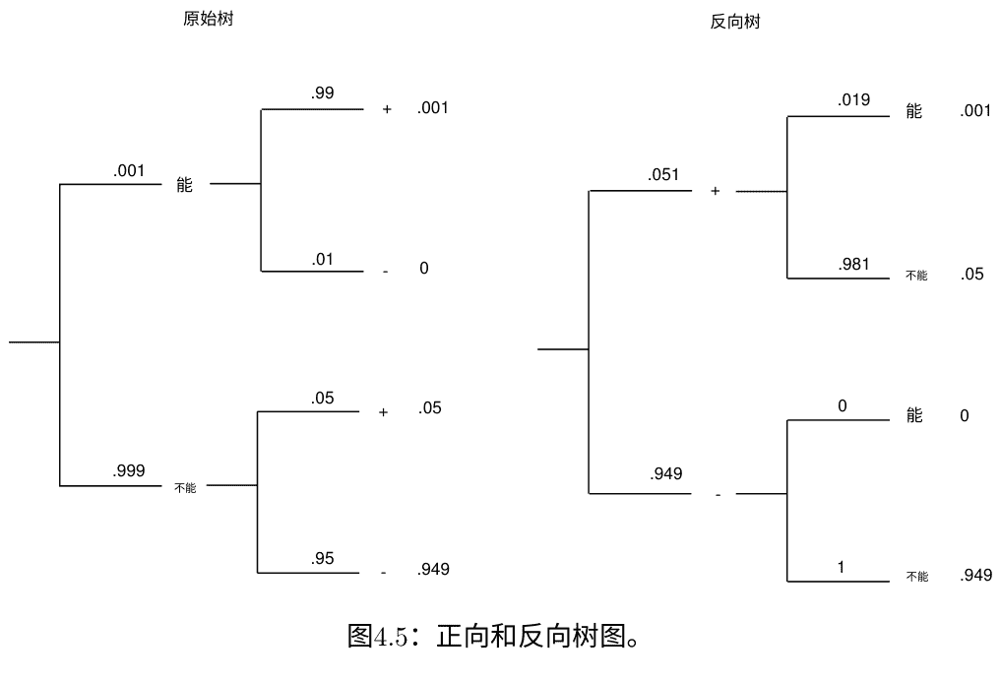
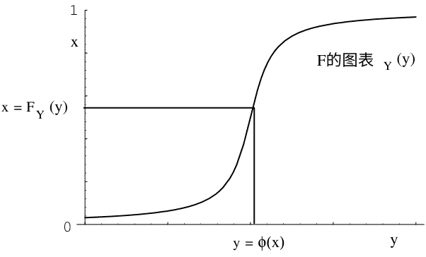
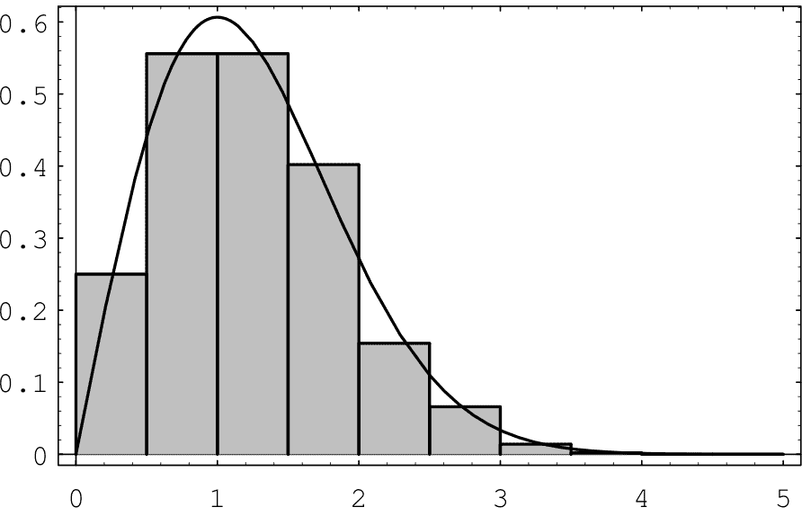
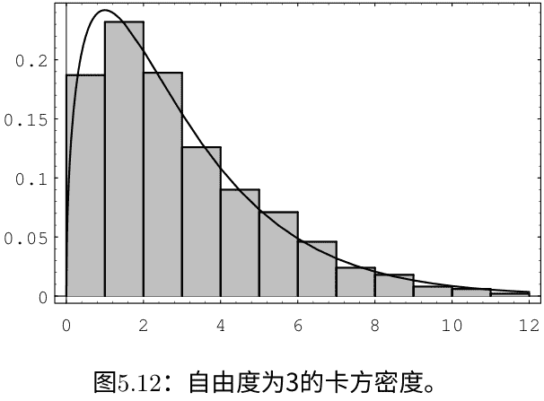
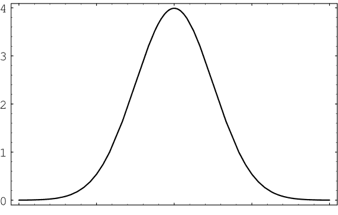
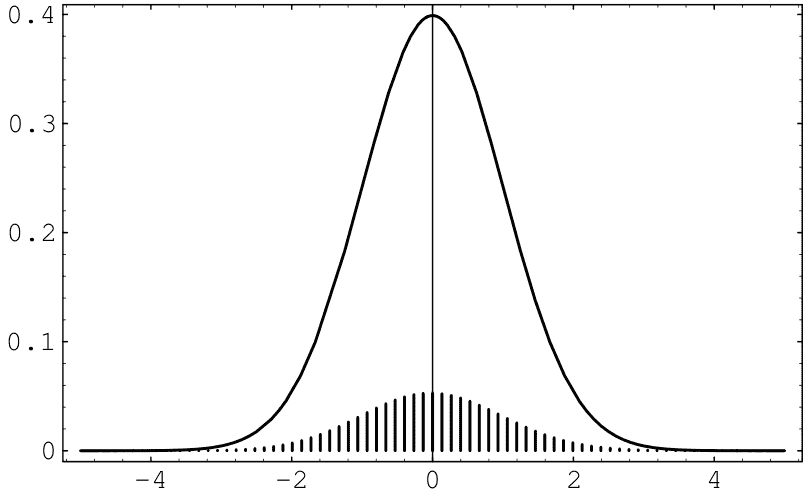
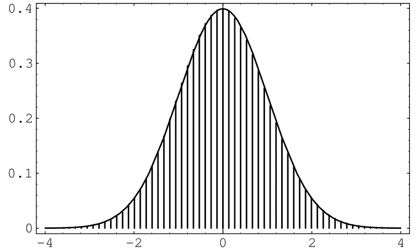
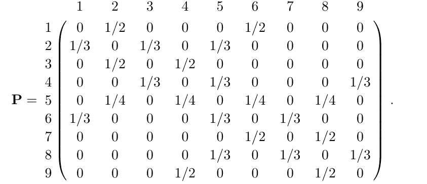
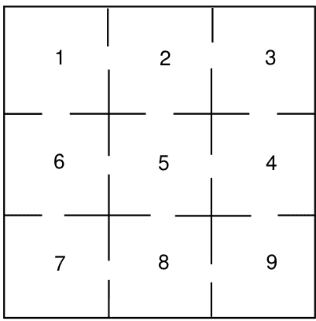

# 达特茅斯概率导论

查尔斯 · M · 格林斯泰德
斯沃斯莫尔学院

J · 劳里 · 斯内尔
达特茅斯学院

致我们的妻子和纪念里斯·T·普罗瑟

## 目录

- 1 离散概率分布 **1**
    - 1.1 离散概率模拟 1
    - 1.2 离散概率分布 18
- 2 连续概率密度 **41**
    - 2.1 连续概率模拟 41
    - 2.2 连续密度函数 55
- 3 组合数学 **75**
    - 3.1 排列 75
    - 3.2 组合 92
    - 3.3 扑克牌洗牌 120
- 4 条件概率 **133**
    - 4.1 离散条件概率 133
    - 4.2 连续条件概率 162
    - 4.3 悖论 175
- 5 分布和密度 **183**
    - 5.1 重要分布 183
    - 5.2 重要密度 205
- 6 期望值和方差 **225**
    - 6.1 期望值 225
    - 6.2 离散随机变量的方差 257
    - 6.3 连续随机变量 268
- 7 随机变量之和 **285**
    - 7.1 离散随机变量之和 285
    - 7.2 连续随机变量的和 291
- 8 大数定律 **305**
    - 8.1 离散随机变量 305
    - 8.2 连续随机变量 316
- 9 中心极限定理 **325**
    - 9.1 伯努利试验 325
    - 9.2 离散独立试验 340
    - 9.3 连续独立试验 356
- 10 生成函数 **365**
    - 10.1 离散分布 365
    - 10.2 分支过程 376
    - 10.3 连续密度 393
- 11 马尔可夫链 **405**
    - 11.1 引言 405
    - 11.2 吸收马尔可夫链 416
    - 11.3 遍历马尔可夫链 433
    - 11.4 基本极限定理 447
    - 11.5 平均首次通过时间 452
- 12 随机游走 **471**
    - 12.1 欧几里得空间中的随机游走 471
    - 12.2 赌徒破产 486
    - 12.3 弧正弦定律 493

## 前言

概率论始于17世纪的法国，当时两位伟大的法国数学家布莱兹·帕斯卡和皮埃尔·德·费马就两个概率问题进行了通信。像帕斯卡和费马解决的那些问题继续影响着早期研究者，如休谟、伯努利和德莫佛尔，在建立概率的数学理论方面做出贡献。如今，概率论是数学的一个成熟的分支，在从音乐到物理学的学术活动中都有应用，在从天气预报到预测新医疗治疗风险的日常经验中也有应用。

本文旨在为大二、大三和大四的数学、物理和社会科学、工程和计算机科学专业的学生提供一门概率论入门课程。它全面介绍了概率理论的思想和技巧，为对该主题有坚实理解的学生提供必要的知识。本教材可以用于各种不同长度、水平和重点的课程。

对于标准的一学期课程，包括离散和连续概率的内容，学生应先修两学期的微积分课程，包括多重积分的介绍。为了涵盖第11章的马尔可夫链内容，需要一些矩阵理论的知识。

本教材也可以用于离散概率课程。本教材的内容安排使离散和连续概率的讨论以分离但并行的方式呈现。这种组织方式消除了对概率的过于严格或正式的观点，并在离散讨论中提供了一些强大的教学价值，有时可以激发更抽象的连续概率讨论。对于离散概率课程，学生应先修一学期的微积分课程。

在使用计算材料和示例的过程中，不需要或假设有很少的计算背景，即可获得全部的好处。文本中使用的所有程序都是用TrueBASIC、Maple和Mathematica编写的。

本书可以在 http://www.dartmouth.edu/~chance 上找到，并且是Chance项目的一部分，该项目致力于为初级概率和统计课程提供教材。计算机程序、奇数题的解答和当前勘误也可以在该网站上找到。教师可以通过写信给作者之一（jlsnell@dartmouth.edu 和 cgrinst1@swarthmore.edu）获取所有解答。我们打算将与本书相关的内容放在该网站上，并邀请读者提交他们的贡献。

### 特点

**严谨程度和重点：** 概率是一门非常直观和实用的数学领域。我们尽量避免通过呈现过多的形式化数学来破坏其美感。相反，我们试图以一种稍微悠闲的风格来发展关键思想，提供各种有趣的概率应用，并展示一些非直观的例子，使概率成为一个生动的主题。

**练习：** 教材中有600多个练习题，提供了大量机会来练习技能和深入理解概念。在练习集中，有一些例行练习可以使用计算机进行，也有一些理论性练习可以提高对基本概念的理解。更难的练习题用星号标注。所有练习题的解答手册都提供给教师。

**历史评论：** 概率论导论是一个与该学科的创始人的基本思想密切相关的学科。因此，教材中有很多历史评论，特别是与离散概率的发展有关的评论。

**计算机程序的教学应用：** 概率论对依赖于机会的实验进行预测。因此，它非常适合使用计算机作为数学工具来模拟和分析机会实验。

在文本中，计算机以多种方式被利用。首先，它提供了一个实验室，可以模拟随机实验，让学生对这些实验的多样性有所了解。计算机在概率中的应用已经在威廉·费勒的《概率论导论及其应用》第二版（纽约：Wiley, 1950）中得到了很好的阐述。在前言中，费勒谈到了他对抛硬币中波动的处理：“结果是如此令人惊讶，与常识相去甚远，以至于即使是经验丰富的同事们也怀疑硬币是否真的按照理论预测的那样行为。” 因此，模拟实验的记录也被包括在内。除了为学生提供实验室，计算机还是理解概率论基本结果的有力的工具。例如，将标准化二项分布近似为正态曲线的图形说明，比许多对这一基本结果的形式证明更具有说服力，这就是中心极限定理的一个更有力的演示。

最后，计算机使学生能够解决那些不适合使用封闭式公式的问题，比如排队等待时间。事实上，引入计算机改变了我们看待许多概率问题的方式。例如，能够计算高达1000次试验的精确二项式概率改变了我们对正态分布和泊松近似的看法。

## 第一版致谢

今天写概率教材的任何人都应该感谢威廉·费勒，他教会我们如何让概率成为一个生动的学科。如果你发现一个你真的喜欢的例子、应用或练习，那很可能它源自费勒的经典著作《概率论及其应用导论》。

这本书起初是与达特茅斯学院的约翰·凯门尼教授共同授课的结果。我要感谢凯门尼教授，他让我相信在概率研究中使用计算机既有用又有趣。他一直慷慨地与我分享他在概率和计算方面的想法。同样令人印象深刻的是约翰·芬恩在使计算成为教材的一个组成部分以及编写程序方面的帮助，这样学生不仅可以轻松使用这些程序，而且还可以理解和修改它们以进一步探索问题。教材中的一些程序是与约翰·凯门尼和托马斯·库尔茨在斯隆基金会项目以及与约翰·芬恩在凯克基金会项目中合作开发的。我对这两个基金会的支持表示感谢。

我对许多其他同事、学生和朋友的宝贵意见和建议表示感谢。一些名字突出的人包括：埃里克和吉姆·鲍姆加特纳、汤姆·比克尔、鲍勃·贝克、埃德·布朗、克里斯汀·伯恩利、理查德·克劳厄尔、大卫·格里菲斯、约翰·兰珀蒂、贝弗利·尼克森、里斯·普罗瑟、凯西·史密斯和克里斯·索恩。

以下个人很友好地审查了手稿的各个版本。他们的鼓励、批评和建议非常有帮助。

- 罗恩·巴恩斯 休斯顿大学市区分校
- 托马斯·费舍尔 德克萨斯农工大学
- 理查德·格罗内维尔 爱荷华州立大学
- 詹姆斯·库尔布斯 威斯康星大学麦迪逊分校
- 格雷格·劳勒 杜克大学
- 西德尼·雷斯尼克 科罗拉多州立大学
- 马尔科姆·谢尔曼 纽约州立大学奥尔巴尼分校
- 奥拉夫·斯塔克尔伯格 肯特州立大学
- 穆拉德·塔库 波士顿大学
- 亚伯拉罕·温德尔 北卡罗来纳大学

此外，我特别感谢詹姆斯·库尔布斯、西德尼·雷斯尼克和他们的学生，在他们的课程中使用手稿并与我分享他们的经验和宝贵的建议。

达特茅斯学院数学文字处理器PREPPY的多功能性，由詹姆斯·鲍姆加特纳教授编写，使得修订工作变得更加容易，但也使得出色的打字员玛丽·斯拉格的工作变得更具挑战性。她的高标准和始终愿意尝试下一个更困难的任务使一切成为可能。

最后，我必须感谢随机之家的所有帮助过这个项目的人。在这些人中，首先是我的编辑韦恩·尤哈斯，他在手稿的编写过程中给予了持续的鼓励和承诺，非常有帮助。整个制作团队提供了高效和专业的支持：项目经理玛格丽特·皮内特；制作经理迈克尔·温斯坦；以及编辑、设计和制作公司的凯特·布拉德福。

## 第二版致谢

在这本书的两个版本之间，对 William Feller 的债务并没有减少。他关于概率的书可能在这个领域里保持经典多年。

修订本的过程始于两位现任合著者与 Reese Prosser 和 John Finn 的一些高层讨论。正是在这些讨论中，第一位合著者才意识到“负版税”这个概念，这要归功于 Prosser 教授。我们对许多人在这项工作中的帮助表示感谢。首先，我们要感谢 Mark Kernighan 在第一版中提供的近40页单行间隔的评论。这些评论中有很多引人入胜的地方，而且它们提供了一个学生的视角来看这本书。第二版中的大部分重大改变都源于这些笔记。

我们还要感谢侯福兴，在排版和图表方面提供了大量的帮助。她在面对许多困难时始终保持着不断的好心情，无论是大事（“我们需要将整本书从 Lamstex 改为 Latex”）还是小事（“你能稍微把这个下标往下移动一点吗？”），都表现得非常出色。

我们还要感谢李纳夫，他将整本书的第一版打字输入到计算机中。在这个过程中，李纠正了第一版中的大部分排版错误，使我们的工作更加容易。

卡尔·克诺布和杰西卡·斯克拉负责在 Mathematica 和 Maple 中实现计算机程序，我们感谢他们的努力。我们还要感谢杰西卡为练习题的解答手册所做的工作，这是在王刚为第一版做的工作基础上建立起来的。

汤姆·谢曼斯基和达纳·威廉姆斯提供了很多 TeX 技术支持。他们的耐心和乐于助人，甚至编写复杂的 TeX 宏，都非常受到赞赏。

以下人员在他们的概率课程中使用了第二版的各种版本，并提供了宝贵的评论和批评。

- Marty Arkowitz 达特茅斯学院
- Aimee Johnson 斯沃斯莫尔学院
- 比尔·彼得森 中伯利学院
- 丹·洛克莫尔 达特茅斯学院
- 朱舜辉 达特茅斯学院

Reese Prosser 和 John Finn 在整个项目中提供了很多道义支持和友情。毫无疑问，这是整个项目的一个亮点。努力的一部分是教授普罗瑟给蒙特卡洛的一个赌场打电话，试图了解轮盘赌中“监狱”的规则。

Peter Doyle 激励我们将这本书作为一个更大项目的一部分放在网络上，其他人也可以贡献。他还花了很多时间实际上将这本书放在网络上。

最后，我们感谢 Sergei Gelfand 和 美国数学学会对我们的书的兴趣，对其制作的帮助，以及他们愿意让我们将这本书放在网络上。

## 第一章 离散概率分布

### 1.1 离散概率模拟

#### 概率

在本章中，我们首先考虑具有有限可能结果的随机实验 $\omega_1, \omega_2, \dots, \omega_n$。例如，我们掷骰子，可能的结果是 1、2、3、4、5、6，对应于朝上的一面。我们抛硬币，可能的结果是 H（正面）和 T（反面）。

能够引用实验结果经常是有用的。例如，我们可能想要写出四次掷骰子的结果之和。为了做到这一点，我们可以让 $X_i, i = 1, 2, 3, 4$ 表示四次掷骰子的结果值，然后我们可以写出表达式：

$$X_1 + X_2 + X_3 + X_4$$

对于四次掷骰子的总和。$X_i$ 被称为随机变量。随机变量只是一个表达式，其值是特定实验的结果。就像数学中其他类型的变量一样，随机变量可以取不同的值。

设 $X$ 为表示一次掷骰子的随机变量。我们将为这个实验的可能结果分配概率。我们通过为每个结果 $\omega_j$ 分配一个非负数 $m(\omega_j)$ 来实现这一点。

$$m(\omega_1) + m(\omega_2) + \dots + m(\omega_6) = 1。$$

函数 $m(\omega_j)$ 被称为随机变量 $X$ 的分布函数。对于掷骰子的情况，我们将每个结果分配相等的概率或概率 $1/6$。通过这种概率分配，可以写成：

$$P(X \le 4) = \frac{2}{3}$$

表示掷骰子的结果不超过 4 的概率是 2/3。

让 $Y$ 表示抛硬币的随机变量。在这种情况下，有两种可能的结果，我们可以标记为 H 和 T。除非我们有理由怀疑硬币一面出现的次数比另一面多，否则自然地将概率 1/2 分配给这两个结果。

在上述两个实验中，每个结果都被分配相等的概率。在这一般情况下肯定不是这样的。例如，如果一种药物被发现在使用时有效的概率为 30%，我们可能会分配概率 0.3 表示下一次使用该药物有效，概率 0.7 表示无效。这个例子说明了直观的频率概念。也就是说，如果我们有一个概率 $p$ 表示实验会产生结果 $A$，那么如果我们重复这个实验很多次，我们应该期望 $A$ 发生的次数大约是 $p$ 的比例。为了验证这样的直观想法，我们将发现通过实验来解决一些问题会很有帮助。例如，我们可以抛一枚硬币很多次，看看正面出现的比例是否约为 1/2。

我们也可以在计算机上模拟这个实验。

#### 模拟

我们希望能够进行与给定概率集对应的实验；例如，$m(\omega_1) = 1/2$，$m(\omega_2) = 1/3$ 以及 $m(\omega_3) = 1/6$。在这种情况下，可以用一个六面骰子的三个面标记为 $\omega_1$，两个面标记为 $\omega_2$，一个面标记为 $\omega_3$。

在一般情况下，我们假设 $m(\omega_1), m(\omega_2), \dots, m(\omega_n)$ 都是有理数，最小公分母为 $n_0$。如果 $n > 2$，我们可以想象一个截面为正规 $n$ 边形的长圆柱形骰子。如果 $m(\omega_j) = n_j/n_0$，那么我们可以用 $\omega_j$ 标记长圆柱体的 $n_j$ 个长面，如果其中一个端面出现，我们可以再次掷骰子。如果 $n=2$，可以使用一枚硬币进行实验。

我们将特别关注在大量次数中重复进行一个随机实验。虽然圆柱形骰子可以方便地进行少量重复实验，但进行大量实验将会很困难。由于现代计算机可以在很短的时间内完成大量操作，因此自然而然地转向计算机来完成这个任务。

#### 随机数

我们首先需要找到一个模拟掷骰子的计算机方法。这可以通过计算机上的随机数生成器来实现。根据特定的软件包，计算机可以生成 0 到 1 之间的实数，或者在给定的连续整数集合中生成整数。在第一种情况下，实数是按照使得该数落在单位区间的任意子区间的概率等于子区间长度的方式选择的。在第二种情况下，每个整数被选择的概率相同。

| | | | |
|---|---|---|---|
| .203309 | .762057 | .151121 | .623868 |
| .932052 | .415178 | .716719 | .967412 |
| .069664 | .670982 | .352320 | .049723 |
| .750216 | .784810 | .089734 | .966730 |
| .946708 | .380365 | .027381 | .900794 |

表 1.1: 程序的样本输出随机数

设 $X$ 为具有分布函数 $m(\omega)$ 的随机变量，其中 $\omega$ 属于集合 $\{\omega_1, \omega_2, \omega_3\}$，且 $m(\omega_1) = 1/2$，$m(\omega_2) = 1/3$，以及 $m(\omega_3) = 1/6$。如果我们的计算机软件可以返回集合 $\{1, 2, \dots, 6\}$ 中的随机整数，那么我们只需要要求它返回这样的数，并将 1、2 和 3 对应于 $\omega_1$，将 4 和 5 对应于 $\omega_2$，将 6 对应于 $\omega_3$。如果我们的计算机软件返回一个在区间 $(0, 1)$ 中的随机实数 $r$，则表达式

$$ \lfloor 6r \rfloor + 1 $$

将是一个介于 1 和 6 之间的随机整数。（符号 $\lfloor x \rfloor$ 表示不超过 $x$ 的最大整数，并读作“$x$ 的底部”。）

计算机上生成随机实数的方法在本节的历史讨论中有所描述。下面的示例给出了程序 **RandomNumbers** 的样本输出。

## 示例1.1 (随机数生成)
程序 **RandomNumbers** 在区间 $[0, 1]$ 中生成 $n$ 个随机实数，其中 $n$ 由用户选择。当我们以 $n = 20$ 运行该程序时，得到的数据如表 1.1 所示。

## 示例1.2 (抛硬币)
正如我们所指出的，我们的直觉认为抛一次硬币得到正面的概率是 1/2。为了让计算机抛硬币，我们可以要求它在区间 $[0, 1]$ 中选择一个随机实数，并测试看看这个数是否小于 1/2。如果是，我们称之为正面；如果不是，我们称之为反面。另一种方法是要求计算机从集合 $\{0, 1\}$ 中选择一个随机整数。程序 **CoinTosses** 执行抛硬币实验 $n$ 次。运行该程序，$n = 20$，结果如下：

```
THTTTHTTTTHTTTTTHHTT.
```

请注意，在 20 次投掷中，我们得到了 5 个正面和 15 个反面。让我们投掷一枚硬币 $n$ 次，其中 $n$ 远大于 20，并看看我们是否能够得到接近我们直觉猜测的 1/2 的正面比例。程序 **CoinTosses** 跟踪正面的数量。当我们以 $n = 1000$ 运行此程序时，我们得到了 494 个正面。当我们以 $n = 10000$ 运行它时，我们得到了 5039 个正面。

我们注意到，当我们投掷硬币 10000 次时，正面的比例接近于投掷硬币时获得正面的“真实值” 0.5。这个实验的数学模型称为伯努利试验（见第 3 章）。我们将在以后学习的大数定律（见第 8 章）将会表明，在伯努利试验模型中，正面的比例应该接近于 0.5，与我们对概率频率解释的直觉理解一致。

当然，我们的程序可以很容易地修改来模拟硬币，其中正面的概率为 $p$，其中 $p$ 是一个介于 0 和 1 之间的实数。 □

在抛硬币的情况下，我们已经知道事件发生的概率在每次实验中。模拟的真正力量来自于在事先不知道概率的情况下估计概率的能力。这种方法已经被用于最近发现的使得赌场的二十一点游戏对玩家有利的策略。我们在一个简单的情况下说明这个想法，我们可以计算真实概率并看到模拟的效果如何。

## 示例1.3 (掷骰子)
我们考虑一个在概率的历史发展中起重要作用的骰子游戏。著名的帕斯卡和费马之间的信件，许多人认为这是概率研究的开始，是由法国贵族和赌徒 Chevalier de Méré 的求助引发的。据说 de Méré 一直在打赌，在四次掷骰子中，至少会出现一个六。他一直赢，为了吸引更多人参与，他改变了游戏规则，打赌在 24 次掷两个骰子的情况下，会出现一对六。据称 de Méré 在 24 次中输了，并认为需要 25 次才能使游戏有利。这是一个大丑闻，数学是错误的。

我们将尝试通过模拟他的各种赌注来验证德·梅尔的正确性。程序 **DeMere1** 模拟了大量的实验，在每次实验中，看看骰子在四次投放中是否出现六。当我们运行这个程序进行 1000 次玩耍时，六在前四次投掷中出现的概率为 48.6%。当我们运行它进行 10,000 次玩耍时，这种情况发生的概率为 51.98%。

我们注意到第二次运行的结果表明，德·梅尔认为他的赌注是有利的；然而，如果我们基于第一次运行来得出结论，我们会认为他是错误的。通过模拟得到准确的结果需要大量的实验。 □

程序 **DeMere2** 模拟了德·梅尔的第二个赌注，即一对六在 $n$ 次掷骰子中出现的概率。前面的模拟表明，我们需要模拟多少次试验才能期望在我们的近似中达到一定的准确度是很重要的。我们将在后面看到，在这些类型的实验中，一个粗略的经验法则则是，至少有 95% 的时间，误差不超过试验次数的倒数的平方根。幸运的是，对于这个骰子游戏，计算准确的概率将是很容易的。我们将在下一节中展示，对于第一次赌注，德·梅尔获胜的概率为 $1 - (5/6)^4 = 0.518$。

可以这样理解这个计算：第一次投掷没有出现 6 的概率是 $(5/6)$。前两次投掷都没有出现 6 的概率是 $(5/6)^2$。按照同样的推理，前四次投掷都没有出现 6 的概率是 $(5/6)^4$。因此，前四次投掷至少出现一次 6 的概率是 $1 - (5/6)^4$。同样地，对于第二次投注，进行 24 次投掷，德·梅尔赢的概率是 $1 - (35/36)^{24} = 0.491$，进行 25 次投掷的概率是 $1 - (35/36)^{25} = 0.506$。

使用上述经验法则，需要投掷 27,000 次才能有足够准确度来确定这些概率是否在 0.5 的两侧。有趣的是，我们可以思考一个赌徒是否能够从赌博经验中准确地检测到这样的概率。一些关于概率历史的作者认为，德·梅雷实际上只是对这些问题感兴趣，因为它们是有趣的概率问题。

## 示例1.4 (正面或反面)
对于我们的下一个例子，我们考虑一个难以获得精确答案但通过模拟可以轻松得出定性结果的问题。彼得和保罗玩一个叫做“正面或反面”的游戏。在这个游戏中，一个公平的硬币被投掷了一系列次数，我们选择 40 次。每次出现正面，彼得从保罗那里赢得 1 便士，每次出现反面，彼得输给保罗 1 便士。例如，如果 40 次投掷的结果是：

```
THTHHHHT THTHHT THHTTT THHHT HHTH HHHTHHT TTHH.
```

彼得的赢钱可以用图 1.1 表示。彼得在这个特定的游戏中赢了 6 个便士。自然而然地会问他赢得 $j$ 个便士的概率；这里 $j$ 可以是从 -40 到 40 的任意偶数。合理的猜测是具有最高概率的 $j$ 的值是 $j=0$，因为当正面和反面的数量相等时，这种情况发生。类似地，我们猜测具有最低概率的 $j$ 的值是 $j=\pm 40$。

关于这个游戏的第二个有趣的问题是：在 40 次投掷中，彼得将多少次处于领先地位？观察他的赢钱图（图 1.1），我们可以看到当他的赢钱为正时，彼得处于领先地位，但是如果我们希望所有投掷都对领先次数有贡献，那么当他的赢钱为 0 时，我们必须做一些约定。我们采用的约定是，当彼得的赢钱为 0 时，如果他在前一次投掷中领先，他就处于领先地位，如果他在前一次投掷中落后，他就不处于领先地位。按照这个约定，我们的例子中彼得有 34 次处于领先地位。同样，我们的直觉可能会认为处于领先地位的最可能次数是 40 的一半，即 20 次，而最不可能的次数是 40 或 0 的极端情况。

通过大量模拟游戏并跟踪彼得最终赢得的次数和彼得最终领先的次数，很容易解决这个问题。然后，通过所有游戏的比例来估计相应的概率。程序 **HTSimulation** 执行这个模拟。请注意，当游戏中的投掷次数为偶数时，只有偶数次才有可能处于领先地位。我们已经模拟了这个游戏 10000 次。结果显示在图 1.2 和 1.3 中。这些图形被称为尖峰图，是使用程序 **Spikegraph** 生成的。垂直线或尖峰在水平轴上的位置 $x$ 的高度等于 $x$ 的结果比例。我们对彼得最终赢得的直觉是正确的，但对彼得领先次数的直觉完全错误。模拟表明，领先次数最少的是 20 次，最可能是 0 次或 40 次。这确实是正确的，通过进行大量投掷的正反面游戏并观察彼得的赢得图表，可以得出这个解释。在图 1.4 中，我们展示了 1000 次投掷的游戏模拟结果，并在图 1.5 中展示了 10000 次投掷的结果。

在第二个例子中，彼得大部分时间都领先。然而，有一个非常有趣的事实，如果游戏继续进行足够长的时间，彼得的赢利将会持续回到 0，但是在这种情况发生之间会有非常长的时间间隔。这些以及相关的结果将在第 12 章中讨论。 □

到目前为止，我们所有的例子中，我们模拟了等可能的结果。接下来，我们将举一个不等可能结果的例子。

## 示例1.5 (赛马)
有四匹马 (橡子 Acorn、巴尔基 Balky、栗子 Chestnut 和多比 Dolby) 已经比赛了很多次。据估计，橡子赢得 30% 的时间，巴尔基赢得 40% 的时间，栗子赢得 20% 的时间，多比赢得 10% 的时间。

我们可以让计算机按照以下方式进行一场比赛：选择一个随机数 $x$。如果 $x < 0.3$，则我们说橡子赢了。如果 $0.3 \le x < 0.7$，则巴尔基赢了。如果 $0.7 \le x < 0.9$，那么 Chestnut 赢。最后，如果 $0.9 \le x$，那么 Dolby 赢。

程序 **HorseRace** 使用这种方法来模拟 $n$ 次比赛 (races) 的结果。运行这个程序，当 $n=10$ 时，我们发现 Acorn 40% 的时间赢得比赛，Balky 20% 的时间赢得比赛，Chestnut 10% 的时间赢得比赛，Dolby 30% 的时间赢得比赛。需要更多的比赛次数才能更好地与过去的经验相一致。因此，我们运行程序模拟了 1000 次比赛。尽管经过这么多比赛后非常疲惫，但它们的表现与我们对它们能力的估计非常一致：Acorn 29.8% 的时间赢得比赛，Balky 39.4% 的时间赢得比赛，Chestnut 19.5% 的时间赢得比赛，Dolby 11.3% 的时间赢得比赛。

该程序 **GeneralSimulation** 使用这种方法来模拟具有已知概率的有限结果发生的任意实验的重复。

## 历史背景

任何一直玩同一种概率游戏的人实际上都在进行一种模拟，从这个意义上说，模拟的过程已经进行了几个世纪。正如我们所提到的，概率的许多早期问题很可能是由赌徒的经验所引发的。

对于任何试图理解概率论的人来说，通过抛硬币、掷骰子等简单实验是很自然的。自然主义者布丰抛了 4040 次硬币，结果得到 2048 次正面和 1992 次反面。他还通过在刻有线条的表面上抛掷针来估计数值 $\pi$，并记录针穿过线条的次数（见第 2.1 节）。英国生物学家 W. F. R. Weldon$^1$ 记录了 26,306 次掷 12 个骰子的结果，瑞士科学家 Rudolf Wolf$^2$ 记录了不使用计算机进行的 100,000 次掷单个骰子的结果。这样的实验非常耗时，并且可能无法准确地代表所研究的随机现象。

例如，对于 Weldon 和 Wolf 的骰子实验，进一步分析记录的数据显示出骰子存在怀疑的偏倚。统计学家 Karl Pearson 分析了某些轮盘桌上的大量结果，并提出轮盘存在偏倚。他在 1894 年写道：

> 显然，由于赌场不能为概率统计的准备提供重要的实验室，它没有科学的理由。科学家们不能容忍他们最精细的理论被这种无耻的方式忽视！法国政府必须被科学界的权威力量敦促关闭赌场；当然，将赌场的剩余资源交给法国科学院用于设立一个正统概率实验室将是一个优雅的举动；特别是该研究的新分支，即将在不久的将来占据人们思想很大一部分的将概率理论应用于生物进化问题。$^3$

然而，这些早期实验只是提供了一些线索，并在概率和统计学中带来了重要的发现。它们引导皮尔逊提出了卡方检验，在测试观察数据是否符合给定的概率分布方面非常重要。

到了 20 世纪初，人们意识到需要一种更好的方法来生成随机数。1927 年，L. H. C. Tippett 发表了一份从人口普查报告中随机选择的 41,600 个数字的列表。1955 年，兰德公司印刷了一张由电子噪声生成的 1,000,000 个随机数的表格。高速计算机的出现提高了在计算机上直接生成随机数的可能性。20 世纪 40 年代末，约翰·冯·诺伊曼建议按照以下方式进行：假设您想要一个四位数的随机序列。选择任意一个四位数，比如 6235，作为起始数。将这个数平方得到 38,875,225。对于第二个数，选择这个平方数的中间四位数（即 8752）。以此类推，用 8752 开始进行相同的过程得到第三个数。

更现代的方法涉及模运算的概念。如果 $a$ 是一个整数，$m$ 是一个正整数，那么 $a \pmod m$ 表示当 $a$ 被 $m$ 除时的余数。例如，$10 \pmod 4 = 2$，$8 \pmod 2 = 0$。要生成一个随机序列 $X_0, X_1, X_2, \dots$ 选择一个起始数字 $X_0$，然后通过公式从 $X_n$ 得到数字 $X_{n+1}$：

$$ X_{n+1} = (aX_n + c) \pmod m $$

其中 $a, c$ 和 $m$ 是精心选择的常数。序列 $X_0, X_1, X_2, \dots$ 然后是一个介于 0 和 $m-1$ 之间的整数序列。为了得到一个在 $[0, 1]$ 范围内的实数序列，我们将每个 $X_j$ 除以 $m$。得到的序列由形如 $j/m$ 的有理数组成，其中 $0 \le j \le m-1$。由于 $m$ 通常是一个非常大的整数，我们将序列中的数字视为随机的实数在 $[0, 1]$ 范围内。

对于冯·诺伊曼的平方方法和模算术技术，数列实际上完全由第一个数字确定。因此，这些数列实际上并没有真正的随机性。然而，它们产生的数字在行为上非常符合随机实验的理论预测。为了获得不同实验的不同数列，初始数字 $X_0$ 由其他可能涉及例如一天中的时间的过程选择。$^4$ 在第二次世界大战期间，洛斯阿拉莫斯科学实验室的物理学家们需要知道中子在各种材料中的传播距离，以便进行屏蔽。这个问题超出了理论计算的范围。

丹尼尔·麦克拉肯在《科学美国人》上写道：物理学家们已经掌握了大部分必要的数据：他们知道给定速度的中子在给定物质中行进一定距离之前与原子核碰撞的平均距离，中子被吸收而不是被原子核反弹的概率，中子在给定碰撞等等。$^5$ 约翰·冯·诺伊曼和斯坦尼斯拉夫·乌拉姆建议通过在计算机上模拟实验来解决这个问题。由于他们的工作是秘密的，因此有必要给它起一个代号。冯·诺伊曼选择了“蒙特卡罗”这个名字。

## 蒙特卡罗方法

从那时起，这种模拟方法被称为蒙特卡罗方法。威廉·费勒在他的书《概率论及其应用导论》中指出了使用计算机模拟来说明概率基本概念的可能性。在讨论“正反面”游戏中领先次数的问题时，费勒写道：

> 关于抛硬币的波动结果表明，关于大数定律的普遍信念是错误的。这些结果如此令人惊讶，与常识相去甚远，以至于即使是经验丰富的同事们也怀疑硬币是否真的会像理论预测的那样行为不端。因此，包括了一次模拟实验的记录。$^6$

费勒提供了一张图，显示了 10,000 次正反面游戏的结果，类似于图 1.5 中的结果。

练习 10 中描述的马丁格尔赌博系统有着悠久而有趣的历史。Russell Barnhart 向作者指出，这种系统的使用可以追溯到至少 1754 年，当时卡萨诺瓦在他的回忆录《我的生活史》中写道：

> 她 [卡萨诺瓦的情妇] 让我答应去赌场 [威尼斯的里多托] 拿钱与她合作玩。我去了那里，拿到了我找到的所有金子，并根据被称为马丁格尔的系统坚定地加倍我的赌注，我在剩下的狂欢节期间每天赢三四次。我从未输过第六张牌。如果我输了，我将没有资金，这笔资金总共有两千个泽基尼。$^7$

即使轮盘上没有零，所以游戏是完全公平的，马丁格尔系统，或者其他任何系统，都不能使游戏变成有利的游戏。公平游戏仍然公平，不公平游戏在赌博系统下仍然不公平，这个想法已经被数学家利用来获得概率研究中的重要结果。我们将在第 6 章介绍马丁格尔的一般概念。

马丁格尔这个词本身也有一个有趣的历史。这个词的起源是模糊的。牛津英语词典的最新版本给出了关于概率论在 17 世纪初的使用及其可能的起源，他提到了拉伯雷的《第一册，第 20 章》中的引用：

> 一切都按计划进行，唯一的问题是加尔冈图亚怀疑他们是否能立即找到适合老人腿的裤子；他还怀疑演说家穿什么样的裤子最合适——马丁格尔式的，座位上有一个可拉起的吊桥，方便上厕所；水手式的，对肾脏更舒适；瑞士式的，对腹部更保暖；或者鳕鱼尾式的，对腰部更凉爽。$^8$

多米尼克·卢辛奇指出了“martingale”一词的早期出现。根据法语词典《Le Petit Robert》，这个词来自普罗旺斯语的“martegalo”，意思是“来自马尔蒂格”。马尔蒂格是位于马赛西部的一个城镇。词典举了“chausses à la martingale”（意思是马尔蒂格风格的马裤）的例子，日期是 1491 年。在现代使用中，“martingale”有几个不同的意思，都与压制有关，除了赌博用途之外。例如，它是马具上的一个皮带，用于压住马的头部，也是帆船装备的一部分，用于压住船头。

练习 9 中描述的 Labouchere 系统以亨利·杜·普雷·拉布谢尔（1831-1912）命名，他是一位英国记者和议会成员。拉布谢尔将该系统归功于康多塞。康多塞（1743-1794）是法国革命时期的政治领导人，他对将概率论应用于经济和政治非常感兴趣。例如，他计算了一个陪审团使用多数投票时做出正确决定的概率，如果每个陪审员做出正确决定的概率相同。他的著作提供了丰富的关于如何将概率应用于人类事务的思想。$^9$

## 练习

- 1. 修改程序 **CoinTosses** 来投掷硬币 $n$ 次，并在每投掷 100 次后打印出正面朝上的比例减去 1/2。随着 $n$ 的增加，这些数字是否趋近于 0？再次修改程序，每 100 次打印出以下两个数值：正面朝上的比例减去 1/2，以及正面朝上的数量减去投掷次数的一半。随着 $n$ 的增加，这些数字是否趋近于 0？
- 2. 修改程序 **CoinTosses**，使其投掷硬币 $n$ 次并记录正面朝上的比例是否在 0.4 到 0.6 之间。让程序重复进行这个实验 100 次。大约需要多大的 $n$ 才能使得正面朝上的比例在 0.4 到 0.6 之间的次数约为 100 次中的 95 次？

3 在17世纪初，伽利略被要求解释这样一个事实，即尽管 1 到 6 的整数三元组的和为 9 的数量与和为 10 的数量相同，但是当掷三个骰子时，9 似乎比 10 出现的次数少——这是赌徒的经验所说的。

- (a) 编写一个程序，模拟大量掷三个骰子的情况，并记录和为 9 的比例和和为 10 的比例。
- (b) 你能从你的模拟中得出结论说赌徒是正确的吗？

4 在壁球中，只有在一个球员发球并赢得回合时才会得分，一个球员只要保持领先就可以继续发球。第一个得到 21 分的球员赢得比赛。假设你先发球，并且在你发球时赢得回合的概率为 0.6，在对手发球时赢得回合的概率为 0.5。通过模拟估计你赢得比赛的概率。

5 考虑在投掷三个骰子的 $n$ 次投掷中至少有一次出现三个六的赌注。计算当投掷三个骰子 $n$ 次时至少出现一次三个六的概率 $f(n)$。确定当投掷三个骰子 $n$ 次时至少出现一次三个六的有利赌注所需的最小值 $n$。

> (DeMoivre 会说它应该约为 $216 \log 2 = 149.7$，所以他的答案是 150——请参见练习 1.2.17。你同意他的观点吗？)

6 在拉斯维加斯，轮盘有 38 个编号为 0、00、1、2、...、36 的槽。编号为 0 和 00 的槽是绿色的，剩下的 36 个槽中一半是红色的，一半是黑色的。荷官旋转轮盘并投掷象牙球。如果你押注 1 美元在红色上，如果球停在红色槽上，你赢得 1 美元，否则你输掉 1 美元。编写一个程序来计算一个玩家在押注红色上进行 1000 次后的总赢利。

7 轮盘的另一种押注方式是押注一个特定的数字（比如 17）会出现。如果球停在你押注的数字上，你将得到你的 1 美元加上 35 美元。否则，你将失去你的 1 美元。编写一个程序，在拉斯维加斯进行 500 次轮盘游戏时，首先每次押注红色（参见练习 6），然后进行第二次访问拉斯维加斯时，每次押注数字 17，来绘制你的赢利情况。你在这两种情况下的赢利图表中看到了什么不同之处？

8 一个敏锐的学生注意到，在我们模拟抛硬币游戏的过程中（见例 1.4），玩家始终处于领先的次数比玩家总赢钱为 0 的次数非常接近。通过列举两次和四次抛掷的所有情况来计算这些概率，并判断你是否认为这些概率实际上是相同的。

9 轮盘赌的拉布什尔系统的玩法如下。写下一个数字列表，通常是 1、2、3、4。在第一个和最后一个数字上下注，即 $1 + 4 = 5$ 红色。如果你赢了，从你的列表中删除第一个和最后一个数字。如果你输了，将你最后下注的金额添加到列表的末尾。然后使用新的列表，并下注第一个和最后一个数字的总和（如果只有一个数字，则下注该金额）。继续直到你的列表变为空。证明，如果发生这种情况，你会赢得你原始列表的总和，$1+2+3+4=10$。模拟这个系统并看看你是否总是停止下来，因此总是赢。如果是这样，为什么这不是一个绝对可靠的赌博系统？

10 另一个著名的赌博系统是马丁格尔加倍系统。假设你在轮盘赌中押注红色。每次赢了，下一次押注 1 美元。每次输了，把上一次的押注加倍。假设你使用这个系统，直到赢得至少 5 美元或者输掉超过 100 美元。编写一个程序来模拟这个过程，并进行多次游戏，看看结果如何。在他的书《新来者》中，W. M. Thackeray 提到：“你还没有玩过吗？不要这样做；最重要的是要避免使用马丁格尔加倍系统。”$^{10}$ 这是个好建议吗？

11 修改程序 HTSimulation，使其跟踪彼得在每场 40 次抛硬币游戏中的最大赢利。让你的程序打印出总赢利取值为 $0, 2, 4, \dots, 40$ 的比例。计算两次和四次投掷游戏的相应准确概率。

12 在即将到来的美国总统选举中，一位民意调查员计划通过随机抽取 1000 名选民并宣布在他的样本中获得最多选票的候选人将成为胜利者。假设 48% 的选民计划投票给共和党候选人， 52% 计划投票给民主党候选人。为了对民意调查员的计划有一些合理的想法，编写一个程序通过模拟来进行预测。重复模拟 100 次，看看民意调查员的预测有多少次会成为真实。重复实验，现在假设 49% 的人口计划投票给共和党候选人；首先使用 1000 个样本，然后使用 3000 个样本。（盖洛普民意调查使用约 3000 个样本。）（这个想法在第 9 章第 9.1 节中进一步讨论。）

13 心理学家特弗斯基和他的同事们$^{11}$说大约五分之四的人会选择 (b) 回答以下问题：

某个城镇有两家医院。在较大的医院，每天大约有 45 个婴儿出生，在较小的医院，每天有 15 个婴儿出生。尽管男孩的整体比例约为 50%，但在任何一天，任何一家医院的实际比例可能高于或低于 50%。在一年结束时，哪家医院将有更多的天数，在这些天数中，超过 60% 的婴儿是男孩？

- (a) 大医院
- (b) 小医院
- (c) 两者都不是 - 天数大约相同。

假设一个婴儿是男孩的概率为 0.5（实际估计更接近 0.513）。通过模拟，决定这个问题的正确答案。你能想出为什么这么多人都错了吗？

$^{10}$ W. M. Thackeray, *The Newcomes* (伦敦：Bradbury and Evans, 1854-55年)。
$^{11}$ 参见 K. McKean，“决策，决策”，*Discover*, 1985年6月，第 22-31 页。Kevin McKean, *Discover Magazine*, © 1987 Family Media, Inc. 获得许可再版。这篇文章报道了特弗斯基等人在《不确定性下的判断：启发式和偏见》（剑桥：剑桥大学出版社，1982年）的工作。

14 你被提供了以下游戏。一个公平的硬币将被投掷，直到第一次出现正面。如果这发生在第 $j$ 次投掷上，你将获得 $2^j$ 美元。你肯定会赢得至少 2 美元，所以你应该愿意付费参加这个游戏 - 但是要付多少呢？很少有人会支付超过 10 美元来玩这个游戏。看看你能否通过模拟来决定一个合理的金额，如果你被允许玩很多次这个游戏，你愿意支付每局多少。你愿意支付每局游戏的金额是否取决于你被允许玩的次数？

15 特弗斯基和他的同事$^{12}$研究了费城 76 人队在 1980-1981 赛季的 48 场篮球比赛记录，以查看球员是否有时候状态火热，每个投篮都能进，而有时候状态低迷，几乎无法击中篮板。

> 球员们估计，他们在命中后比错过后更有可能投中一球，概率大约高出 25%。

事实上，相反的情况是真实的——76人队在错失得分后比在命中得分后更有可能得分。特弗斯基报告称，热手和冷手的次数与纯粹随机效应所预期的大致相同。假设一个球员投篮的成功率是五五开，并且每场比赛投篮 20 次，通过模拟估计球员在连续命中 5 次或更多次的比赛中所占的比例。

16 通过模拟估计，如果所有人都生孩子直到生出一个男孩，那么一个家庭中平均会有多少个孩子。如果所有人都生孩子直到至少有一个男孩和至少有一个女孩，那么一个家庭中平均会有多少个孩子。在 100,000 个家庭中，你预计在第二种方案下会比第一种方案多找到多少个孩子？（假设男孩和女孩的概率相等。）

17 数学家们在咖啡馆、公交车上或公园里散步时常常会得到一些最好的想法。 在 20 世纪初，著名数学家乔治·波利亚住在苏黎世附近的一家酒店里。他喜欢在森林里散步并思考数学问题。波利亚描述了以下事件：

图 1.6: 随机行走。
- a. 一维随机行走。
- b. 二维随机行走。
- c. 三维随机行走。

> 在旅馆里，还住着一些学生，我通常和他们一起吃饭，建立了友好关系。某一天，其中一个学生期待着他未婚妻的到来，我知道这一点，但我没有预料到他和他的未婚妻也会去森林散步，然后我突然在那里遇到了他们。然后，我在同一天早上多次遇到了他们，我不记得有多少次，但肯定太多了，我感到尴尬：看起来好像我在窥探，但我向你保证，这不是事实。$^{13}$

这让他开始思考随机行走者是否注定会相遇。

波利亚考虑了一维、二维和三维的随机行走者。在一维中，他设想行走者在一条非常长的街道上。在每个交叉口，行走者会抛一枚公平的硬币来决定下一步的方向（见图 1.6a）。在二维中，行走者在一个街道网格上行走，在每个交叉口，他有四个可能的方向选择，概率相等（见图 1.6b）。在三维中（我们更好地称之为随机攀登者），行走者在一个三维网格上移动，在每个交叉口，现在有六个不同的方向可以选择，每个方向的概率相等（见图 1.6c）。

读者可以参考第 12.1 节，其中讨论了这个问题及相关问题。

- (a) 编写一个程序，在一维空间中模拟随机行走，起点为 0。让你的程序打印出返回起点的时间间隔的长度。通过这个模拟，看看你能否猜出以下问题的答案：行走者是否总会最终返回起点，还是可能永远漂离起点？
- (b) 两个在二维空间中经过 $n$ 步后相遇的行走者的路径可以被视为一个从 (0,0) 开始并在 $2n$ 步后返回到 (0,0) 的单一路径。这意味着在二维空间中，两个随机行走者相遇的概率与一个单独行走者返回起点的概率相同。因此，两个行走者是否一定会相遇的问题与一个单独行走者是否一定会返回起点的问题是相同的。编写一个程序，在二维空间中模拟随机行走，并查看是否认为行走者一定会返回到 (0,0)。如果是这样，波利亚肯定会在公园里继续遇见他的朋友。也许你现在已经猜到了这个问题的答案：一个随机行走者在一维或二维空间中是否一定会返回起点？波利亚回答了这个问题。他在一维、二维和三维空间中解决了这个问题。他得出了一个令人惊奇的结论：在一维和二维空间中，答案是是的，在三维空间中，答案是否的。
- (c) 编写一个程序，在三维空间中模拟随机行走，并根据 (a) 和 (b) 的结果，看看你是否能猜测波利亚的结论。

### 1.2 离散概率分布

在这本书中，我们将从概率的角度研究许多不同的实验。随着理论的发展和例子的分析，我们将了解这项研究涉及的内容。然而，整体的想法可以描述和说明如下：对于我们考虑的每个实验，都会有一个与之相关的随机变量，它代表了任何特定实验的结果。可能的结果集称为样本空间。在本节的第一部分中，我们将考虑实验只有有限个可能结果的情况，即样本空间是有限的。然后我们将推广到样本空间既可以是有限的，也可以是可数无限的情况。这引导我们到以下定义。

### 随机变量和样本空间

**定义 1.1** 假设我们有一个结果取决于机会的实验。我们用大写的罗马字母，如 $X$，表示实验的结果，称为随机变量。实验的样本空间是所有可能结果的集合。如果样本空间是有限的或可数无限的，那么随机变量被称为离散的。

我们通常用大写的希腊字母 $\Omega$ 表示样本空间。如上所述，在实验和数学理论之间的对应关系中，样本空间 $\Omega$ 对应于实验的可能结果集合。

现在我们做两个附加定义。这些是样本空间定义的附属定义，用于明确一些与样本空间相关的常用术语。首先，我们将样本空间的元素定义为结果。其次，样本空间的每个子集被定义为一个事件。通常，我们用小写字母表示结果，用大写字母表示事件。

**例 1.6** 一次掷骰子。我们用 $X$ 表示这个实验的结果。那么这个实验的样本空间是一个有 6 个元素的集合
$$\Omega = \{1, 2, 3, 4, 5, 6\} ,$$
其中每个结果 $i$，对于 $i=1, \dots, 6$，对应于骰子上的点数。事件
$$E = \{2, 4, 6\}$$
表示掷骰子的结果是一个偶数。事件 $E$ 也可以描述为 $X$ 是偶数。除非有理由相信骰子被偏置，否则自然的假设是每个结果是等可能的。采用这个约定意味着我们给每个六个结果分配概率为 1/6，即 $m(i) = 1/6$，对于 $1 \le i \le 6$。

### 分布函数

接下来我们描述概率的分配。这些定义是受上面的例子启发的，在该例子中，我们为样本空间的每个结果分配了一个非负数，使得分配的数之和等于 1。

**定义 1.2** 设 $X$ 是一个随机变量，表示某个实验结果的值，并假设该实验只有有限个可能的结果。设 $\Omega$ 是实验的样本空间（即 $X$ 的所有可能值的集合，或者等价地说，实验的所有可能结果的集合）。对于 $X$ 的一个分布函数 $m$，它是一个定义域为 $\Omega$ 的实值函数，满足以下条件：
1. $m(\omega) \ge 0$, 对于所有的 $\omega \in \Omega$, 以及
2. $\sum_{\omega \in \Omega} m(\omega) = 1$.

对于 $\Omega$ 的任何子集 $E$，我们定义 $E$ 的概率为给定的数 $P(E)$，表示为
$$P(E) = \sum_{\omega \in E} m(\omega) .$$

**例 1.7** 考虑一个实验，抛两次硬币。让 $X$ 是与这个实验对应的随机变量。我们注意到有几种记录这个实验结果的方式。例如，我们可以按照它们发生的顺序记录两次抛硬币的结果。在这种情况下，我们有 $\Omega = \{HH, HT, TH, TT\}$。我们也可以通过简单地记录出现的正面数量来记录结果。在这种情况下，我们有 $\Omega = \{0, 1, 2\}$。最后，我们可以记录两个结果，不考虑它们发生的顺序。在这种情况下，我们有 $\Omega = \{HH, HT, TT\}$。

我们暂时使用上面给出的第一个样本空间。我们假设这四个结果是等可能的，并通过定义分布函数 $m(\omega)$ 来描述
$$m(\text{HH}) = m(\text{HT}) = m(\text{TH}) = m(\text{TT}) = \frac{1}{4} .$$
设 $E = \{\text{HH, HT, TH}\}$ 为至少出现一次正面的事件。那么, $E$ 的概率可以如下计算:
$$ \begin{aligned} P(E) &= m(\text{HH}) + m(\text{HT}) + m(\text{TH}) \\ &= \frac{1}{4} + \frac{1}{4} + \frac{1}{4} = \frac{3}{4} . \end{aligned} $$
同样地, 如果 $F = \{\text{HH, HT}\}$ 是第一次投掷出现正面的事件, 那么我们有
$$ \begin{aligned} P(F) &= m(\text{HH}) + m(\text{HT}) \\ &= \frac{1}{4} + \frac{1}{4} = \frac{1}{2} . \end{aligned} \quad \square $$

**例 1.8** (例 1.6 的延续) 掷骰子的实验的样本空间是由 6 个元素组成的集合 $\Omega = \{1, 2, 3, 4, 5, 6\}$。我们假设骰子是公平的, 并选择了由以下分布函数定义的概率分布
$$ m(i) = \frac{1}{6}, \quad \text{对于 } i=1, \dots, 6. $$
如果 $E$ 是掷骰子结果为偶数的事件, 则 $E = \{2, 4, 6\}$ 并且
$$ \begin{aligned} P(E) &= m(2) + m(4) + m(6) \\ &= \frac{1}{6} + \frac{1}{6} + \frac{1}{6} = \frac{1}{2} . \end{aligned} \quad \square $$
注意, 根据上述定义, 对于每个 $\omega \in \Omega$,
$$ P(\{\omega\}) = m(\omega) . $$
也就是说, 由单个结果 $\omega$ 组成的基本事件 $\{\omega\}$ 的概率等于分布函数分配给结果 $\omega$ 的值 $m(\omega)$。

**例 1.9** 三个人, A、B 和 C, 竞选同一个职位, 我们假设只有一个人获胜。样本空间可以取为 3 元素集合 $\Omega = \{\text{A, B, C}\}$, 其中每个元素对应于候选人获胜的结果。假设 A 和 B 获胜的机会相同, 但 C 只有 A 或 B 的 1/2 机会。然后我们分配
$$ m(\text{A}) = m(\text{B}) = 2m(\text{C}) . $$
由于
$$ m(\text{A}) + m(\text{B}) + m(\text{C}) = 1 , $$
我们可以看到
$$2m(\text{C}) + 2m(\text{C}) + m(\text{C}) = 1 ,$$
这意味着 $5m(\text{C}) = 1$。因此，
$$m(\text{A}) = \frac{2}{5}, \quad m(\text{B}) = \frac{2}{5}, \quad m(\text{C}) = \frac{1}{5} .$$
设 $E$ 为 A 或 C 获胜的事件。则 $E=\{A,C\}$, 并且
$$P(E) = m(\text{A}) + m(\text{C}) = \frac{2}{5} + \frac{1}{5} = \frac{3}{5} .$$

在许多情况下，事件可以通过使用集合论的标准构造来描述其他事件。我们将简要回顾这些构造的定义。读者可以参考图 1.7 中的维恩图来说明这些构造。

设 $A$ 和 $B$ 是两个集合。那么 $A$ 和 $B$ 的并集是集合
$$A \cup B = \{x \mid x \in A \text{ 或者 } x \in B\}。$$
$A$ 和 $B$ 的交集是集合
$$A \cap B = \{x \mid x \in A \text{ 且 } x \in B\}。$$
$A$ 和 $B$ 的差集是集合
$$A - B = \{x \mid x \in A \text{ 且 } x \notin B\}。$$
如果 $A$ 是 $B$ 的子集，即 $A$ 中的每个元素也是 $B$ 中的元素。最后，$A$ 的补集是集合
$$\tilde{A} = \{x \mid x \in \Omega \text{ 且 } x \notin A\}。$$

这些构造的重要性在于通常情况下，用英语描述的复杂事件可以使用这些构造分解为更简单的事件。例如，如果 $A$ 是“明天下雪并且后天下雨”的事件，$B$ 是“明天下雪”的事件，$C$ 是“两天后下雨”的事件，那么 $A$ 是事件 $B$ 和 $C$ 的交集。同样，如果 $D$ 是“明天下雪或者后天下雨”的事件，那么 $D = B \cup C$。（需要注意的是，这里必须小心，因为有时候英语中的“or”表示只有两个选择中的一个会发生。根据上下文，意思通常是清楚的。在本书中，我们总是使用“or”一词的包容性意义，即 $A$ 或 $B$ 表示两个事件中至少有一个为真。）事件 $\tilde{B}$ 是“明天不会下雪”的事件。最后，如果 $E$ 是“明天下雪但后天下不下雨”的事件，那么 $E = B - C$。

## 性质

**定理 1.1** 由样本空间 $\Omega$ 上的分布函数分配给事件的概率满足以下性质：

- 1. 对于每个 $E \subset \Omega$，有 $P(E) \geq 0$。
- 2. $P(\Omega) = 1$。
- 3. 如果 $E \subset F \subset \Omega$，那么 $P(E) \leq P(F)$。
- 4. 如果 $A$ 和 $B$ 是 $\Omega$ 的不相交子集，则 $P(A \cup B) = P(A) + P(B)$。
- 5. 对于每个 $A \subset \Omega$，有 $P(\tilde{A}) = 1 - P(A)$。

**证明**。对于任何事件 $E$，概率 $P(E)$ 由分布 $m$ 决定：
$$P(E) = \sum_{\omega \in E} m(\omega) ,$$
对于每个 $E \subset \Omega$。由于函数 $m$ 是非负的，所以 $P(E)$ 也是非负的。因此，性质 1 成立。

通过以下方程证明性质 2：
$$P(\Omega) = \sum_{\omega \in \Omega} m(\omega) = 1 .$$

假设 $E \subset F \subset \Omega$。那么属于 $E$ 的每个元素 $\omega$ 也属于 $F$。因此，
$$\sum_{\omega \in E} m(\omega) \leq \sum_{\omega \in F} m(\omega) ,$$
因为左边求和中的每一项都在右边求和中，而且两个求和中的所有项都是非负的。这意味着
$$P(E) \leq P(F) ,$$
性质 3 得到证明。

接下来假设 $A$ 和 $B$ 是 $\Omega$ 的不相交子集。那么属于 $A \cup B$ 的每个元素 $\omega$ 要么属于 $A$ 而不属于 $B$，要么属于 $B$ 而不属于 $A$。由此可得
$$P(A \cup B) = \sum_{\omega \in A \cup B} m(\omega) = \sum_{\omega \in A} m(\omega) + \sum_{\omega \in B} m(\omega) = P(A) + P(B),$$
并且证明了性质 4。

最后，为了证明性质 5，考虑不相交的并集
$$\Omega = A \cup \tilde{A}.$$
由于 $P(\Omega) = 1$，不相交可加性（性质 4）意味着
$$1 = P(A) + P(\tilde{A}),$$
因此 $P(\tilde{A}) = 1 - P(A)$。 □

重要的是要意识到定理 1.1 中的性质 4 可以扩展到超过两个集合。一般有限可加性由以下定理给出。

**定理 1.2** 如果 $A_1, \dots, A_n$ 是 $\Omega$ 的两两不相交的子集（即，没有两个 $A_i$ 有共同的元素），那么
$$P(A_1 \cup \dots \cup A_n) = \sum_{i=1}^n P(A_i) .$$

**证明**。设 $\omega$ 是并集 $A_1 \cup \dots \cup A_n$ 中的任意元素。那么在定理的等式中，$\omega$ 在等式的两边都恰好出现一次。 □

我们经常使用上述定理的以下推论。

**定理 1.3** 设 $A_1, \dots, A_n$ 是两两不相交的事件，且 $\Omega = A_1 \cup \dots \cup A_n$，设 $E$ 是任意事件。那么
$$P(E) = \sum_{i=1}^n P(E \cap A_i) .$$

**证明**。集合 $E \cap A_1, \dots, E \cap A_n$ 是两两不相交的，它们的并集是集合 $E$。结论由定理 1.2 得出。 □

**推论 1.1** 对于任意两个事件 $A$ 和 $B$，
$$P(A) = P(A \cap B) + P(A \cap \tilde{B}).$$

属性 4 可以以另一种方式推广。假设 $A$ 和 $B$ 是 $\Omega$ 的子集，它们不一定是不相交的。那么：

**定理 1.4** 如果 $A$ 和 $B$ 是 $\Omega$ 的子集，则
$$P(A \cup B) = P(A) + P(B) - P(A \cap B). \quad (1.1)$$

**证明**。方程式 1.1 的左边是 $A$ 或 $B$ 中 $\omega$ 的和 $m(\omega)$。我们必须证明方程式 1.1 的右边也是 $A$ 或 $B$ 中 $\omega$ 的和 $m(\omega)$。如果 $\omega$ 恰好在这两个集合中的一个中，那么它只会在方程式 1.1 的右边的三个项中被计算一次。如果它同时在 $A$ 和 $B$ 中，那么它会从 $P(A)$ 和 $P(B)$ 的计算中被加两次，并且从 $P(A \cap B)$ 的计算中被减去一次。因此，它在右边被计算一次。当然，如果 $A \cap B = \emptyset$，那么方程式 1.1 简化为性质 4。（方程式 1.1 也可以推广；参见定理 3.8。） □

### 树状图

**例子 1.10** 让我们用三次抛硬币的结果来说明事件概率的性质。当我们有一个分阶段进行的实验时，通常会发现用树状图来表示结果很方便。

树上的一条路径对应于实验的一个可能结果。对于抛三次硬币的情况，我们有八条路径 $\omega_1, \omega_2, \dots, \omega_8$，并且假设每个结果等可能，我们给每条路径分配相等的权重，即 1/8。设 $E$ 为“至少出现一次正面”的事件。那么 $\tilde{E}$ 是“没有出现正面”的事件。这个事件只发生在一个结果上，即 $\omega_8 = \text{TTT}$。因此， $\tilde{E} = \{\text{TTT}\}$，并且我们有
$$P(\tilde{E}) = P(\{\text{TTT}\}) = m(\text{TTT}) = \frac{1}{8}.$$

根据定理 1.1 的性质 5，
$$P(E) = 1 - P(\tilde{E}) = 1 - \frac{1}{8} = \frac{7}{8}.$$

请注意，我们通常发现计算一个事件不发生的概率比计算它发生的概率更容易。然后我们使用性质 5 来得到所需的概率。

设 $A$ 为“第一次结果是正面”的事件，$B$ 为“第二次结果是反面”的事件。从树状图中可以看出，
$$P(A) = P(B) = \frac{1}{2}.$$

使用定理 1.4，我们得到
$$\begin{aligned} P(A \cup B) &= P(A) + P(B) - P(A \cap B) \\ &= \frac{1}{2} + \frac{1}{2} - \frac{1}{4} = \frac{3}{4}. \end{aligned}$$

由于 $A \cup B$ 是一个包含 6 个元素的集合，
$$A \cup B = \{HHH, HHT, HTH, HTT, TTH, TTT\},$$
我们可以通过直接列举得到相同的结果。 □

在我们的抛硬币示例和掷骰子示例中，我们为实验的每个可能结果分配了相等的概率。对应于这种分配概率的方法，我们有以下定义。

## 均匀分布

**定义 1.3** 包含 $n$ 个元素的样本空间 $\Omega$ 上的均匀分布是由函数 $m$ 定义的
$$m(\omega) = \frac{1}{n}$$
对于每个 $\omega \in \Omega$。 □

重要的是要意识到，在分析实验以描述其可能结果时，没有单一正确的样本空间选择。对于在示例 1.2 中两次抛硬币的实验，我们选择了 4 个元素的集合 $\Omega = \{HH, HT, TH, TT\}$ 作为样本空间，并分配了均匀分布函数。这些选择当然在直觉上是自然的。另一方面，对于某些目的来说，考虑 3 个元素的样本空间 $\Omega = \{0, 1, 2\}$ 可能更有用，其中 0 是结果“没有正面朝上的硬币”， 1 是结果“正好有一个正面朝上的硬币”， 2 是结果“两个正面朝上的硬币”。在 $\Omega$ 上定义的分布函数 $\bar{m}$ 由以下方程定义
$$\bar{m}(0) = \frac{1}{4}, \quad \bar{m}(1) = \frac{1}{2}, \quad \bar{m}(2) = \frac{1}{4}$$
对应于原始样本空间 $\Omega$ 上的均匀概率密度。请注意，完全可以选择不同的分布函数。例如，我们可以考虑在 $\Omega$ 上的均匀分布函数，它是由以下函数 $\bar{q}$ 定义的
$$\bar{q}(0) = \bar{q}(1) = \bar{q}(2) = \frac{1}{3} .$$
虽然 $\bar{q}$ 是一个完全合适的分布函数，但它与抛硬币的观测数据不一致。

**例子 1.11** 考虑一个掷一对骰子的实验。我们将样本空间 $\Omega$ 定义为所有有序对 $(i, j)$ 的集合，其中 $1 \le i \le 6$ 且 $1 \le j \le 6$。因此，
$$\Omega = \{(i, j) : 1 \le i, j \le 6\} .$$
(至少还有另一种“合理”的样本空间选择，即介于 1 和 6 之间的所有无序整数对的集合。关于为什么我们不使用这个集合的讨论，请参见示例 3.14。) 为了确定 $\Omega$ 的大小，我们注意到有六种选择 $i$，对于每个 $i$ 的选择，有六种选择 $j$，共有 36 种不同的结果。让我们假设骰子没有被控制。在数学术语中，这意味着我们假设 36 个结果中的每一个都是等可能的，或者等价地，我们通过设置均匀分布函数在 $\Omega$ 上采用均匀分布：
$$m((i, j)) = \frac{1}{36}, \quad 1 \le i, j \le 6 .$$

在掷两个骰子的情况下，得到和为 7 的概率是多少？或者得到和为 11 的概率是多少？第一个事件，用 $E$ 表示，是一个子集
$$E = \{(1, 6), (6, 1), (2, 5), (5, 2), (3, 4), (4, 3)\} .$$
和为 11 的事件是一个子集 $F$，表示为
$$F = \{(5, 6), (6, 5)\} .$$
因此，
$$P(E) = \sum_{\omega \in E} m(\omega) = 6 \cdot \frac{1}{36} = \frac{1}{6} ,$$
$$P(F) = \sum_{\omega \in F} m(\omega) = 2 \cdot \frac{1}{36} = \frac{1}{18} .$$

得到既不是蛇眼（双一）也不是双六的概率是多少？得到这两个结果中的任意一个的事件是集合
$$E = \{(1, 1), (6, 6)\} .$$
因此，得到既不是这两个结果的概率由以下给出
$$P(\tilde{E}) = 1 - P(E) = 1 - \frac{2}{36} = \frac{17}{18} .$$

在上述抛硬币和掷骰子的实验中，我们为每个结果分配了相等的概率。也就是说，在每个例子中，我们选择了均匀分布函数。如果硬币是公平的，骰子没有被偏置，那么这些是自然的选择。然而，选择哪个分布函数来描述一个实验并不是基本概率数学理论的一部分。后者只有在样本空间和分布函数已经被定义的情况下才开始。

## 确定概率

在实践中，考虑确定概率分布的方式非常重要。一种方式是通过对称性。对于抛硬币的情况，我们看不到硬币的两面之间有任何物理差异，这应该影响到一面或另一面出现的机会。同样，对于普通的骰子，任何两面之间没有本质差异，因此根据对称性，我们为任何可能的结果分配相同的概率。一般来说，对称性的考虑经常暗示均匀分布函数。

在这里必须小心使用。我们不应该总是假设，仅仅因为我们不知道任何理由表明一个结果比另一个更有可能，就适合分配相等的概率。例如，考虑猜测新生儿性别的实验。观察到新生儿中男孩的比例约为 0.513。因此，更适合分配一个分布函数，将概率 0.513 分配给男孩的结果，将概率 0.487 分配给女孩的结果，而不是将概率 1/2 分配给每个结果。这是一个使用统计观察来确定概率的例子。请注意，这些概率可能会随着新的研究而改变，并且可能因国家而异。基因工程甚至可能使个体影响这个概率，针对某个特定情况。

## 赔率

如果考虑的实验可以在类似情况下重复多次，那么概率的统计估计是可行的。然而，假设在一个足球赛季开始时，你想要给达特茅斯击败哈佛的事件分配一个概率。你确实没有与今年的足球队有关的数据。然而，你可以通过看你愿意下什么样的赌注来确定自己的个人概率。

例如，假设你愿意下一美元的赌注，以 2 比 1 的赔率赌达特茅斯大学会赢。这意味着如果达特茅斯大学输了，你愿意支付 2 美元，以换取如果达特茅斯大学赢了得到的 1 美元回报。这意味着你认为达特茅斯大学获胜的适当概率是 2/3。

让我们更仔细地看一下赔率和概率之间的关系。假设我们以 $r$ 比 1 的赔率在事件 $E$ 发生时下注。这意味着我们认为事件 $E$ 发生的可能性是事件 $\tilde{E}$ 发生的可能性的 $r$ 倍。一般来说，$r$ 比 $s$ 的赔率将被视为 $r/s$ 比 1 的意思，即在陈述赔率时，两个数字之间的比率是唯一重要的数量。

现在，如果事件 $E$ 发生的可能性是事件 $\tilde{E}$ 发生的可能性的 $r/s$ 倍，那么事件 $E$ 发生的概率必须是 $r/(r+s)$，因为我们有
$$P(E) = \frac{r}{s} P(\tilde{E})$$
和
$$P(E) + P(\tilde{E}) = 1 .$$
一般来说，事件 $E$ 发生的赔率为 $r$ 比 $s$，等价于以下表述
$$P(E) = \frac{r/s}{(r/s) + 1} = \frac{r}{r+s} .$$
如果我们令 $P(E) = p$，那么上述方程可以很容易地解出 $r/s$ 与 $p$ 的关系，我们得到 $r/s = p/(1-p)$。我们将上述讨论总结如下：

> **定义 1.4** 如果 $P(E) = p$，那么事件 $E$ 发生的赔率为 $r : s$ ($r \text{ to } s$)，其中 $r/s = p/(1-p)$。如果给定 $r$ 和 $s$，那么可以使用方程 $p = r/(r+s)$ 来求得 $p$。 □

**例子 1.12** (例子 1.9 的延续) 在例子 1.9 中，我们给候选人 C 赢得比赛的事件分配了概率 1/5。因此，C 获胜的赔率为 1/5 : 4/5。这些赔率也可以写成 1:4，2:8 等等。如果我们在 C 赢得比赛时获得 4 美元，在 C 输掉比赛时支付 1 美元，那么 C 赢的赌注是公平的。 □

### 无限样本空间

如果一个样本空间有无限多个点，则分布函数的定义方式取决于样本空间是否可数。如果元素可以被计数，即可以与正整数一一对应，那么样本空间是可数无限的。否则，无限样本空间需要一般情况下的新概念（见第 2 章），但可数无限空间则不需要。

如果 $\Omega = \{\omega_1, \omega_2, \omega_3, \dots\}$ 是可数无限样本空间，则分布函数的定义与定义 1.2 完全相同，只是现在求和必须是一个收敛无限和。定理 1.1 仍然成立，其扩展定理定理 1.2 和 1.4 也是如此。在可数无限样本空间上，我们不能像有限样本空间那样定义一个均匀分布函数（如定义 1.3 所示）。在练习 20 中，你被要求解释为什么这是不可能的。

**例子 1.13** 一枚硬币被投掷，直到出现第一次正面朝上。让实验的结果 $\omega$ 表示第一次出现正面朝上的次数。那么我们实验的可能结果是 $\Omega = \{1, 2, 3, \dots\}$。

请注意，即使硬币每次都可能出现反面，我们没有考虑这种可能性。我们马上会解释为什么。第一次投掷正面朝上的概率是 1/2。第一次投掷反面朝上，第二次投掷正面朝上的概率是 1/4。连续两次投掷反面朝上，然后一次投掷正面朝上的概率是 1/8，依此类推。这表明分配概率函数为：
$m(n) = 1/2^n$ 对于 $n = 1, 2, 3, \dots$。要看到这是一个分配概率函数，我们必须证明
$$\sum_{\omega} m(\omega) = \frac{1}{2} + \frac{1}{4} + \frac{1}{8} + \dots = 1 .$$
这是真的，根据几何级数求和公式，
$$1 + r + r^2 + r^3 + \dots = \frac{1}{1-r},$$
或者
$$r + r^2 + r^3 + r^4 + \dots = \frac{r}{1-r}, \quad (1.2)$$
对于 $-1 < r < 1$。

当 $r=1/2$ 时，我们可以确定硬币最终会出现正面的概率为 1。每次都出现反面的可能结果必须被赋予概率 0，因此我们从可能结果的样本空间中省略了它。

设 $E$ 为首次出现正面的次数为偶数的事件。那么
$$E = \{2, 4, 6, 8, \dots\},$$
并且
$$P(E) = \frac{1}{4} + \frac{1}{16} + \frac{1}{64} + \dots .$$
将 $r = 1/4$ 代入方程 1.2 中可以看到
$$P(E) = \frac{1/4}{1-1/4} = \frac{1}{3} .$$
因此，第一次出现正面的概率在投掷偶数次后为 1/3，在投掷奇数次后为 2/3。 □

## 历史背景

科学史上一个有趣的问题是：为什么概率直到 16 世纪才得到发展？我们知道，在 16 世纪，赌博和游戏中的问题使人们开始思考概率。但是，赌博和游戏几乎和文明本身一样古老。在古埃及（公元前约 3500 年）有一种叫做“猎犬和豺狼”的游戏。在这个游戏中，猎犬和豺狼的移动是基于用动物骨头制成的四面骰子的结果。各种材料制成的六面骰子可以追溯到公元前 16 世纪。赌博在古希腊和罗马广泛流行。事实上，在罗马帝国中，有时不得不制定反赌博法律。

那么，为什么直到 16 世纪才开始计算概率呢？

对于这个晚期发展的原因，有几种解释被提出。其中一个解释是，相关的数学没有被发展出来，也不容易发展。古代的数学符号使得数值计算变得复杂，我们熟悉的代数符号直到 16 世纪才被发展出来。然而，正如我们将看到的，许多用于计算概率的组合思想在 16 世纪之前就已经被讨论过了。由于那个时代的许多偶然事件与与宗教事务相关的彩票有关，有人认为可能存在宗教上的障碍，不利于对概率和赌博的研究。另一个观点是，需要更强的动力，比如商业的发展。然而，这些解释都不完全令人满意，人们仍然想知道为什么概率研究花了这么长时间才被认真研究。

关于这个问题的有趣讨论可以在 Hacking 的书中找到。¹⁴ 第一个系统地计算概率的人是 Gerolamo Cardano（1501-1576），他在他的书 *Liber de Ludo Aleae* 中进行了计算。这本书由 Gould 翻译自拉丁语，并出现在 Ore 的书 *Cardano: The Gambling Scholar* 中。¹⁵ Ore 提供了关于这位多才多艺的学者生活的引人入胜的讨论，包括他在许多不同领域的兴趣，包括医学、占星术和数学。你还会在那里找到关于 Cardano 与 Tartaglia 在解三次方程问题上的著名争论的详细描述。

在他关于概率的书中，卡尔达诺只处理了我们所称为均匀分布函数的特殊情况。这种限制只针对等可能的结果，持续了很长一段时间。在这种情况下，卡尔达诺意识到事件发生的概率是有利结果数与总结果数的比率。

卡尔达诺的许多例子涉及掷骰子。在这里，他意识到两次掷骰子的结果应该是 36 个有序对 $(i, j)$，而不是 21 个无序对。这是一个微妙的问题，对于后来的其他概率写作者仍然存在问题。例如，在 18 世纪，著名的法国数学家达朗贝尔，在几本关于概率的著作中声称，当硬币被抛两次时，出现正面的次数将会可以是0、1或2，因此我们应该给这三种可能的结果分配相等的概率。$^{16}$ Cardano为他的骰子问题选择了正确的样本空间，并计算了各种事件的正确概率。

Cardano的数学工作中穿插着很多对潜在赌徒的建议，这些建议以短段落的形式出现，例如：“谁应该玩以及何时玩”，“为什么亚里士多德谴责赌博”，“那些精通数学的人也玩得好吗”等等。在一个名为“赌博的基本原则”的段落中，Cardano写道：

> 赌博中最基本的原则就是平等的条件，例如对手、旁观者、金钱、环境、骰子盒和骰子本身。只要你偏离了这种平等，如果对手占优势，你就是个傻瓜；如果自己占优势，你就是不公正的。$^{17}$

Cardano犯了错误，如果他后来意识到了，他也没有回头去改正他的错误。例如，对于一个有利的事件，在四次中有三次是有利的，Cardano给出了正确的赔率 $3:1$。但是后来他通过将这些数字平方（即 $9:1$）来确定概率，以使这个事件连续发生两次。后来，通过考虑概率为 $1:1$ 的情况，他意识到这是不正确的，并得出了正确的结论：当有 $f$ 个有利的结果时，连续两次有利的结果的概率为 $f^2 : n^2$（或赔率为 $f^2 : n^2 - f^2$）。Ore 指出，这等同于意识到如果一个事件在一个实验中发生的概率是 $p$，那么它发生两次的概率是 $p^2$。

Cardano继续推导出对于三次成功的公式应该是 $p^3$，对于四次成功的公式应该是 $p^4$，从而清楚地表明他理解了在这样的实验中，成功发生的概率是 $p^n$。这将从我们在4.1节中介绍的独立性概念中得出。Cardano的工作是对概率法则的第一次尝试，但它并不是引发系统研究这一主题的火花。

这来自帕斯卡和费马之间一系列著名的信件。这个通信是帕斯卡向费马请教他被 Chevalier de Méré 给出的问题而发起的，Chevalier de Méré 是一位著名的作家，是路易十四宫廷的重要人物，也是一个热衷于赌博的人。

第一个问题是关于骰子的问题。据说他曾经打赌在四次掷骰子中至少会出现一个六，并且赢得太多，所以他接着打赌在掷两个骰子的24次中会出现一对六。一个骰子出现六的概率是 $1/6$，根据独立实验的乘法法则，掷两个骰子出现两个六的概率是 $(1/6)(1/6) = 1/36$。Ore$^{18}$声称当时的赌博规则建议，对于一个概率为 $1/6$ 的事件，四次重复足够了，而对于一个概率是六倍不可能的事件，$6 \cdot 4 = 24$ 次重复就足以构成一个有利的赌注。帕斯卡通过精确计算表明，投掷25次骰子才能获得一个有利的赌注，以获得一对六点。

第二个问题要困难得多：这是一个古老的问题，涉及到在比赛完成之前由于某种原因中断时如何公平分配赌注。这个问题现在被称为“分配赌注问题”（Problem of Points）。这个问题在数学教材中一直是一个标准问题；它出现在 Fra Luca Paccioli 的书 *Summa de Arithmetica, Geometria, Proportioni et Proportionalità* (1494年威尼斯印制)$^{19}$ 中：

> 一支球队打球，需要总共60分才能赢得比赛，每局计分10分。赌注是10个杜卡特。由于某种事件，他们无法完成比赛，一方得到50分，另一方得到20分。有人想知道奖金的份额归属于每一方。在这种情况下，我发现意见各不相同，但我认为它们的论证都不足够，但我将陈述真相并给出正确的方法。

一些合理的解决方案，例如根据每个玩家赢得的比赛比例来分配赌注，已经被提出，但在帕斯卡-费马通信时还没有找到正确的解决方案。这些信件主要涉及帕斯卡和费马解决这个问题的尝试。布莱斯·帕斯卡（1623-1662）是一个天才儿童，十六岁时发表了他关于圆锥曲线的论文，十八岁时发明了一台计算机。在这些信件的时候，他已经通过对大气压力的实验证明了自己在当代物理学家中的地位。皮埃尔·德·费马（1601-1665）是图卢兹的一位学识渊博的法学家，业余时间研究数学。有人称他为“业余王子”和有史以来最伟大的纯数学家之一。

这些信件是由 Maxine Merrington 翻译的，出现在 Florence David 关于概率的历史记载《游戏、神和赌博》中。在1654年7月29日星期三的一封信中，帕斯卡写信给费马：

> 先生，
> 
> 和你一样，我也同样不耐烦，虽然我又病倒在床上，但我还是忍不住告诉你，昨晚我收到了卡尔卡维先生关于点问题的信件，我对此非常钦佩。我没有时间详细写信，但简单来说，你已经完美地解决了点问题，一个是用骰子，另一个是用完美公正的游戏集合；我对此非常满意，因为我毫不怀疑自己错了，现在和你完全一致……
> 
> 你的方法非常可靠，这也是我在研究中首先想到的方法；但是由于组合的工作量太大，我找到了一条捷径，实际上是另一种更加更快更整洁，我想在这里简单地告诉你：从现在开始，我想向你敞开心扉，如果可以的话，因为我对我们的协议感到非常高兴。我看到在图卢兹和巴黎，真理是一样的。
> 
> 在这里，或多或少，是我用来展示每个游戏的公平价值的方法，例如，当两个对手在三场比赛中玩，每个人都下注32枚金币。
> 
> 假设第一个人赢了两次，另一个人赢了一次；现在他们再玩一场游戏，在这场游戏中，条件是，如果第一个人赢了，他将赢得所有的赌注，也就是64枚金币；如果另一个人赢了，那么他们每个人都赢了两场比赛，因此，如果他们想停止玩游戏，他们必须各自拿回自己的赌注，也就是32枚金币。
> 
> 然后考虑，先生，如果第一个人赢了，他得到64个皮斯托勒；如果他输了，他得到32个。因此，如果他们不想冒险玩最后一局，而是想分开而不玩，第一个人必须说：“我肯定会得到32个皮斯托勒，即使我输了，我仍然会得到它们；但是关于另外的32个，也许我会得到它们，也许你会得到它们，机会是平等的。那么我们将这32个皮斯托勒平分，给我一半，以及我确定的32个。”然后他将有48个皮斯托勒，而另外一个人将有16个。...

帕斯卡的论证产生了用于计算在任何中断点上应支付给玩家A金额的表格。表格中的每个条目都是上方和右方数字的平均值。这个事实，加上比赛结束时已知的值，确定了表格中的所有值。如果玩家A赢得了第一局，然后他需要赢两场比赛，而B需要赢三场比赛；所以，如果比赛取消，A应该得到44个皮斯托尔。

费马提出解决方案的信件已经丢失；但幸运的是，帕斯卡在一封日期为1654年8月24日星期一的信中描述了费马的方法。帕斯卡的信中写道：$^{21}$

> 当有两名选手时，这是你的步骤：如果两名选手在进行多场比赛时处于第一名需要两场比赛，第二名需要三场比赛的位置，那么为了公平分配赌注，你需要知道比赛将在多少场中被决定。
> 
> 很容易计算出这将在四场比赛中发生，从中可以得出结论，有必要看到两名选手之间可以如何安排四场比赛，以及第一名选手赢得多少组合，第二名选手赢得多少组合，并按照这个比例分配赌注。如果我之前不知道这个，我会发现很难理解；事实上，你已经以这个想法解释过了。

费马意识到游戏可能结束的方式数量可能不是等可能的。例如，如果A还需要两场比赛，而B还需要三场比赛才能赢，A赢得比赛的两种可能方式是WLW和LWW。这两个序列发生的机会不相同。为了避免这个困难，费马扩展了比赛，添加了虚构的比赛，这样所有比赛可能进行的方式都有相同的长度，即四场比赛。他足够聪明，意识到这个扩展不会改变胜利者，并且现在他可以简单地计算每个玩家有利的序列数量，因为他使它们都变得等可能。如果我们列出四场比赛可能进行的所有方式，我们得到以下16种可能的比赛结果：

| | | | |
| :--- | :--- | :--- | :--- |
| **WWWW** | **WLWW** | **LWWW** | **LLWW** |
| **WWWL** | **WLWL** | **LWWL** | LLWL |
| **WWLW** | **WLLW** | **LWLW** | LLLW |
| **WWLL** | WLLL | LWLL | LLLL |

（注：加粗项表示A在至少两次胜利的情况下获胜的情况）。

在至少有两次胜利的情况下（加粗的11种情况），A获胜；在其他情况下（B至少赢得三次），B获胜。由于在16种可能的情况中，A在11种情况下获胜，费马认为A获胜的概率是 11/16。如果赌注是64枚金币，根据帕斯卡的结果，A应该获得44枚金币。帕斯卡和费马开发了更系统的方法来计算类似问题的有利结果的数量，这将是我们的核心问题之一。这些计数方法属于组合数学的范畴，这是第3章的主题。

我们可以看到这两位数学家对点问题的解决方法有着非常不同的方式。帕斯卡的方法是开发一种算法并使用它来计算公平分割。这种方法在计算机上很容易实现，并且很容易推广。另一方面，费马的方法是将问题转化为一个等价的问题，他可以使用计数或组合方法来解决。

我们将在第三章中看到，实际上，费马使用了后来被称为帕斯卡三角形的东西！在我们今天的概率研究中，我们将发现算法方法和组合方法同样重要，就像300年前概率开始时一样。

## 练习

- **1** 设 $\Omega = \{a, b, c\}$ 为一个样本空间。设 $m(a) = 1/2, m(b) = 1/3$ 以及 $m(c) = 1/6$。找出 $\Omega$ 的所有八个子集的概率。
- **2** 为以下实验给出可能的样本空间 $\Omega$:
    - (a) 一次选举决定两位候选人A和B。
    - (b) 投掷一枚双面硬币。
    - (c) 一个学生被问及她的生日是哪个月和星期几。
    - (d) 从一个有十个学生的班级中随机选择一个学生。
    - (e) 你在这门课程中得到一个成绩。
- **3** 在练习2中的哪种情况下，分配均匀分布函数是合理的？
- **4** 用文字描述以下子集所指定的事件 $\Omega = \{HHH, HHT, HTH, HTT, THH, THT, TTH, TTT\}$（见例1.6）：
    - (a) $E = \{HHH, HHT, HTH, HTT\}$.
    - (b) $E = \{HHH, TTT\}$.
    - (c) $E = \{HHT, HTH, THH\}$.
    - (d) $E = \{HHT, HTH, HTT, THH, THT, TTH, TTT\}$.
- **5** 练习4中描述的事件的概率是多少？
- **6** 一个骰子被加重，以使得每个面朝上的概率与该面上的点数成比例。（例如，六点的概率是两点的三倍。）在一次投掷中得到偶数的概率是多少？
- **7** 设 $A$ 和 $B$ 是事件，使得 $P(A \cap B) = 1/4, P(\tilde{A}) = 1/3$, 且 $P(B) = 1/2$。那么 $P(A \cup B)$ 是多少？
- **8** 一个学生必须选择艺术、地质学或心理学作为选修课。她选择艺术或心理学的可能性相等，选择地质学的可能性是选择艺术或心理学的两倍。她选择艺术、地质学和心理学的概率分别是多少？
- **9** 一个学生必须从艺术、法语和数学中选择两门选修课。他选择艺术的概率是 5/8，选择法语的概率是 5/8，同时选择艺术和法语的概率是 1/4。他选择数学的概率是多少？他选择艺术或法语的概率是多少？
- **10** 要让一项法案提交给美国总统，它必须通过众议院和参议院。假设这两个机构中提交的法案中，有 60% 通过众议院，80% 通过参议院，90% 通过其中一个机构。计算下一项提交给这两个机构的法案被提交给总统的概率。
- **11** 一个人应该给以下事件赔率多少？
    - (a) 从一副 52 张牌的牌组中随机选择一张牌是一张 A。
    - (b) 投掷硬币两次时，两次都会出现正面。
    - (c) 投掷两个骰子时，会出现两个六点。
- **12** 你以 3:1 的赔率打赌你的朋友史密斯会当选你们城市的市长。你给史密斯获胜的事件分配了什么概率？
- **13** 在一场赛马中，浪漫（Romance）获胜的赔率为 2:3，而下坡（Downhill）获胜的赔率为 1:2。对于浪漫或下坡获胜的事件，应该给出什么赔率？
- **14** 设 $X$ 为具有分布函数 $m_X(x)$ 的随机变量，其定义为：
    $m_X(-1) = 1/5, \quad m_X(0) = 1/5, \quad m_X(1) = 2/5, \quad m_X(2) = 1/5$.
    - (a) 设 $Y$ 为由方程 $Y = X + 3$ 定义的随机变量。求 $Y$ 的分布函数 $m_Y(y)$。
    - (b) 设 $Z$ 为由方程 $Z = X^2$ 定义的随机变量。求 $Z$ 的分布函数 $m_Z(z)$。
- **\*15** 约翰和玛丽正在上数学课。这门课只有三个成绩：A、B 和 C。约翰得到 B 的概率是 0.3。玛丽得到 B 的概率是 0.4。既没有人得到 A，但至少有一个人得到 B 的概率是 0.1。至少有一个人得到 B 但没有人得到 C 的概率是多少？
- **16** 在一场激烈的战斗中，不少于 70% 的士兵失去了一只眼睛，不少于 75% 的士兵失去了一只耳朵，不少于 80% 的士兵失去了一只手，而且不少于 85% 的人失去了一条腿。同时失去一只耳朵、一只眼睛、一只手和一条腿的人的最小可能百分比是多少？
- **\*17** 假设在一次单独的实验中，“成功”的概率是 $1/n$。让 $m$ 表示需要进行的实验次数，以使至少发生一次成功成为一个有利的赌注（参见练习1.1.5）。
    - (a) 证明在 $m$ 次试验中没有成功的概率是 $(1 - 1/n)^m$。
    - (b) (de Moivre) 证明如果 $m = n \log 2$，那么 $\lim_{n \to \infty} (1 - \frac{1}{n})^m = \frac{1}{2}$。
      提示：$\lim_{n \to \infty} (1 - \frac{1}{n})^n = e^{-1}$。因此，对于较大的 $n$，我们应选择 $m$ 约为 $n \log 2$。
    - (c) 如果 de Moivre 使用他的近似方法，他是否会得出正确答案来解决 de Méré 的两个赌注问题？
- **18** 
    - (a) 对于事件 $A_1, \dots, A_n$, 证明 $P(A_1 \cup \dots \cup A_n) \le P(A_1) + \dots + P(A_n)$。
    - (b) 对于事件 $A$ 和 $B$, 证明 $P(A \cap B) \ge P(A) + P(B) - 1$。
- **19** 如果 $A, B$ 和 $C$ 是任意三个事件, 证明：
    $P(A \cup B \cup C) = P(A) + P(B) + P(C) - P(A \cap B) - P(B \cap C) - P(C \cap A) + P(A \cap B \cap C)$.
- **20** 解释为什么在可数无限样本空间上不可能定义一个均匀分布函数（见定义1.3）。提示：假设对于所有的 $\omega$, 有 $m(\omega) = a$, 其中 $0 \le a \le 1$。函数 $m(\omega)$ 是否具有分布函数的所有属性？
- **21** 在例子1.13中, 找出硬币第一次正面朝上出现在第十次、第十一次或第十二次投掷的概率。
- **22** 掷骰子直到第一次出现六。我们将看到，这发生在第 $n$ 次掷骰子上的概率是 $(5/6)^{n-1} \cdot (1/6)$。利用这个事实，描述掷骰子直到第一次出现六的实验的适当无限样本空间和分布函数。验证对于你的分布函数 $\sum_{\omega} m(\omega) = 1$。
- **23** 令 $\Omega$ 为样本空间 $\Omega = \{0, 1, 2, \dots\}$, 并通过以下方式定义分布函数 $m(j) = (1 - r)^j r$, 对于某个固定的 $r, 0 < r < 1$, 以及 $j = 0, 1, 2, \dots$。证明这是 $\Omega$ 的一个分布函数。
- **24** 我们的日历有一个 400 年的周期。B.H.布朗注意到在一个周期的 4800 个月中, 每个星期的第 13 天出现的次数如下：
  星期日 687，星期一 685，星期二 685，星期三 687，星期四 684，星期五 688，星期六 684。
  从这个中他推断出, 第十三天更有可能是星期五而不是其他任何一天。请解释他的意思。
- **25** 特弗斯基（Tversky）和卡尼曼（Kahneman）$^{23}$要求一组被试者执行以下任务。告诉他们：
  > 琳达今年 31 岁, 单身, 直言不讳, 非常聪明。她在大学主修哲学。作为一名学生, 她对种族歧视和其他社会问题非常关注, 并参与了反核示威活动。
  然后被试者被要求对各种可能性进行排名, 例如：
    - (1) 琳达活跃于女权运动。
    - (2) 琳达是一名银行出纳员。
    - (3) 琳达是一名银行出纳员并且活跃于女权运动。
  特弗斯基和卡尼曼发现, 在被试者中有 85% 到 90% 的人认为 (1) 最有可能, 但是认为 (3) 比 (2) 更有可能。是吗？他们称这种现象为“连词谬误”（conjunction fallacy）, 并指出它似乎不受先前的概率或统计培训的影响。这个现象是一个谬论吗? 如果是, 为什么?
- **26** 从一副 52 张牌的牌组中连续抽取两张牌。找出第二张牌的排名比第一张牌高的概率。提示：证明 $1 = P(\text{高}) + P(\text{低}) + P(\text{相同})$，并利用 $P(\text{高}) = P(\text{低})$ 的事实。
- **27** 生命表是一列列出给定数量出生的人预计活到某个年龄的表格。在附录C中，我们给出了基于10万次出生的生命表，涵盖从0到85岁的年龄，包括女性和男性。展示如何从这张表格中估计一个在1981年出生的人活到年龄 $x$ 的概率 $m(x)$。编写一个程序来绘制男性和女性的 $m(x)$，并对两种情况的差异进行评论。
- **\*28** 这是一个尝试，以解决我们无法选择“随机整数”的问题。
    - (a) 直观上，一个“随机选择”的正整数是3的倍数的概率是多少？
    - (b) 让 $P_3(N)$ 表示在1到 $N$ 之间随机选择的整数是3的倍数的概率（由于样本空间是有限的，这是一个合法的概率）。证明极限 $P_3 = \lim_{N \to \infty} P_3(N)$ 存在且等于 1/3。这正式化了问题 (a) 中的直觉，并为我们赋予了一种将“概率”分配给正整数的无限子集的事件的方法。
    - (c) 如果 $A$ 是任意一组正整数，让 $A(N)$ 表示小于或等于 $N$ 的 $A$ 的元素个数。然后将 $A$ 的“概率”定义为 $P(A) = \lim_{N \to \infty} A(N)/N$，只要这个极限存在。证明这个定义会将任何有限集合的概率分配为0，并将所有正整数的集合的概率分配为1。这意味着这里给出的概率定义不是一个完全令人满意的定义。
    - (d) 让 $A$ 为所有位数为奇数的正整数集合。证明 $P(A)$ 不存在。这表明在上述概率定义下，并不是所有集合都有概率。
- **29** (来自 Sholander$^{24}$) 在一个标准的四叶草交叉口中，有四个匝道可以右转，而在这四个匝道内，又有四个匝道可以左转。你的车从南边驶向交叉口。在每个存在方向选择的点上，安装了一个机制，使得车辆以固定的概率 $r$ 向右转。

- (a) 如果 $r=1/2$，你从立交桥出来的机会是多少？
- (b) 找到使你从立交桥向西出发机会最大化的 $r$ 的值。

**30** (来自 Benkoski [25]) 考虑一个“纯粹”的三叶草立交桥，其中没有右转匝道，只有两条相交的直线公路，带有左转的三叶草形状。（因此，在这样的立交桥中右转，必须进行三次左转。）与前面的问题一样，你的车从南方驶向立交桥。使你从立交桥向东出发机会最大化的 $r$ 的值是多少？

**31** (来自 vos Savant [26]) Marilyn vos Savant 专栏的一位读者提出了以下问题：

> 我爸爸在收音机上听到这个故事。在杜克大学，有两个学生整个学期都得到了化学课的 A。但是在期末考试前的晚上，他们在另一个州参加派对，直到考试结束才回到杜克。他们向教授解释说他们的轮胎爆了，然后问能否补考。教授同意了，写了一张试卷，然后把两个学生送到不同的房间去考试。试卷的第一道问题（在纸的一面上）值 5 分，他们轻松地回答了。然后他们翻过试卷，发现第二个问题，值 95 分：“是哪个轮胎爆了？”两个学生都会给出相同的答案的概率是多少？我爸爸和我认为是 1/16。对吗？

- (a) 答案是 1/16 吗？
- (b) 下面的问题是向一群学生提出的。“今天我开车去学校，我的一个轮胎爆了。你认为是哪个轮胎？”回答如下：右前轮，58%；左前轮，11%；右后轮，18%；左后轮，13%。假设这个分布在一般人群中成立，并假设两个考试者是从一般人群中随机选择的。他们对第二个问题给出相同答案的概率是多少？

## 第2章 连续概率密度

### 2.1 连续概率模拟

在本节中，我们将展示如何使用计算机模拟进行具有整个连续可能结果的实验。

#### 概率

**例2.1** 我们首先构造一个旋转器，它由一个单位周长的圆和一个指针组成。我们在圆上选择一个点，并将其标记为 0，然后用逆时针方向从 0 到该点的距离 $x$ 标记圆上的每个其他点。实验包括旋转指针并记录指针尖端的标记。

我们用随机变量 $X$ 表示这个结果的值。样本空间显然是区间 $[0,1)$。我们希望构建一个概率模型，使得每个结果出现的可能性相等。

如果我们像第 1 章那样对有限个可能结果的实验进行处理，那么我们必须给每个结果分配概率 0，因为否则，所有可能结果的概率之和将不等于 1。（事实上，对无穷多个实数求和是一个棘手的问题；特别地，为了使这样的和有意义，最多只能有可数多个和项不等于 0。）然而，如果所有分配的概率都是 0，那么和就是 0，而不是应该是 1。在下一节中，我们将展示如何在这种情况下来构建一个概率模型。目前，我们将假设可以构建这样的模型。我们还将假设在这个模型中，如果 $E$ 是圆的一段弧，且 $E$ 的长度为 $p$，则模型将为 $E$ 分配概率 $p$。这意味着如果旋转指针，它最终指向 $E$ 中的一个点的概率等于 $p$，这显然是一个合理的期望。

在计算机上模拟这个实验是一件容易的事情。许多计算机软件包都有一个返回在区间 $[0, 1]$ 内的随机实数的函数。实际上，返回的值总是一个有理数，并且这些值是由一个算法确定的，所以这些值的序列并不是真正的随机的。然而，由这些算法产生的序列的行为很像理论上的随机序列，所以我们可以在实验的模拟中使用这样的序列。偶尔，我们需要引用这样的函数。我们将称这个函数为 $rnd$。

#### 蒙特卡洛过程和面积

有时候，估计那些难以或者不可能精确计算的数量是有用的。在其中一些情况下，涉及到机会的一个被称为蒙特卡洛过程的过程可以用来提供这样的估计。

**例2.2** 在这个例子中，我们展示了如何使用模拟来估计平面图形的面积。假设我们编程计算机来提供一对 $(x, y)$ 数字，每个数字都是独立地随机选择在区间 $[0, 1]$ 内。

然后我们可以将这对 $(x, y)$ 解释为从单位正方形中随机选择的点的坐标。事件是单位正方形的子集。我们对例 2.1 的经验表明，这个点落在面积相等的子集中的可能性是相等的。

由于正方形的总面积为 1，点落在单位正方形的特定子集 $E$ 的概率应该等于其面积。因此，我们可以通过估计从该正方形中随机选择的点落在子集中的概率来估计该子集的面积。

我们可以使用这种方法来估计单位正方形中曲线 $y = x^2$ 下区域 $E$ 的面积。我们随机选择大量的点 $(x, y)$ 并记录其中有多少比例落在区域 $E = \{(x, y) : y \le x^2\}$ 中。

程序 `MonteCarlo` 将为我们执行这个实验。运行这个程序进行 10,000 次实验可以得到一个估计值为 0.325。通过这些实验，我们估计面积约为 1/3。当然，对于这个简单区域，我们可以通过微积分找到精确的面积。实际上，区域 $E$ 的面积 $= \int_{0}^{1} x^{2} dx = 1/3$。

我们在第 1 章中已经提到，当我们模拟这种类型的实验来估计概率时，我们可以预期答案的误差最多为 $1/\sqrt{n}$ 至少 95% 的时间。对于 10,000 次实验，我们可以期望精度为 0.01，而我们的模拟确实达到了这个精度。这个相同的论证适用于单位正方形的任何区域 $E$。例如，假设 $E$ 是以 $(1/2, 1/2)$ 为中心，半径为 1/2 的圆。那么我们的随机点 $(x, y)$ 在圆内的概率等于圆的面积，即：

$$P(E) = \pi\left(\frac{1}{2}\right)^{2} = \frac{\pi}{4}$$

如果我们不知道 $\pi$ 的值，我们可以通过多次进行这个实验来估计它的值！上面的例子并不是估计 $\pi$ 值的唯一方法，还有其他的机会实验方法。这是另一种方法，由布丰（Buffon）发现 [1]。

> [1] G. L. Buffon, in “Essai d’Arithmétique Morale,” *Oeuvres Complètes de Buffon avec Supplements*, tome iv, ed. Duménil (Paris, 1836).

### 布丰的针

**例2.3** 假设我们拿一张卡桌，在顶部表面上画一组相距为一个单位的平行线。然后我们随机在这个表面上放下一根长度为单位的普通针，并观察针是否横跨其中一条线。我们可以通过坐标来描述这个实验的可能结果，如下所示：设 $d$ 为针中心到最近线的距离。接下来，设 $L$ 为针确定的线，并定义 $\theta$ 为线 $L$ 与一组平行线的锐角。

（读者应当对这个样本空间的描述保持警惕。我们试图将一组线段进行坐标化。要了解为什么在选择坐标时必须小心，请参见例 2.6。）根据这个描述，我们有 $0 \le d \le 1/2$，且 $0 \le \theta \le \pi/2$。此外，我们可以看到，如果三角形的斜边小于针的一半长度，则针横跨最近的线：

$$\frac{d}{\sin \theta} < \frac{1}{2}$$

现在我们假设当针掉落时，随机选择 $(\theta, d)$ 对从矩形 $0 \le \theta \le \pi/2, 0 \le d \le 1/2$ 中产生。我们观察针是否横跨最近的线（即 $d \le (1/2) \sin \theta$）。这个事件 $E$ 的概率是矩形内部位于 $E$ 的面积的比例。

现在矩形的面积是 $\pi/4$，而 $E$ 的面积是：

$$\text{面积} = \int_{0}^{\pi/2} \frac{1}{2} \sin \theta \, d\theta = \frac{1}{2}$$

因此，我们得到：

$$P(E) = \frac{1/2}{\pi/4} = \frac{2}{\pi}$$

程序 `BuffonsNeedle` 模拟了这个实验。我们对 $\pi$ 的最终估计值为 3.139。虽然这个值与 $\pi$ 的真实值相差 0.003，但我们没有理由期望如此高的准确性。这是因为我们的模拟估计了 $P(E)$。虽然我们可以预计这个估计值的误差最多为 0.01，但是当我们使用它来计算 $\pi = 2/P(E)$ 时，$P(E)$ 中的小误差会被放大。Perlman 和 Wichura 在他们的文章“Sharpening Buffon’s Needle” [2] 中表明，我们可以预期在 95% 的时间内，误差不会超过 $5/\sqrt{n}$，其中 $n$ 是掉落的针的数量。因此，对于 10,000 根针，我们应该预期误差不会超过 0.05，这在这里是成立的。我们可以看到需要大量的实验才能得到一个合理的 $\pi$ 估计。

**例2.4** 假设我们在 $[0,1]$ 中随机选择两个实数并将它们相加。让 $X$ 是和。$X$ 是如何分布的？为了帮助理解这个问题的答案，我们可以使用程序 `AreaBarGraph`。该程序生成一个柱状图，其特点是在每个区间上，柱子的面积而不是高度等于相应区间中发生的结果的比例。我们已经进行了 1000 次实验；数据显示在图中。看起来这个函数定义为：

$$f(x) = \begin{cases} x, & \text{如果 } 0 \le x \le 1 \\ 2-x, & \text{如果 } 1 < x \le 2 \end{cases}$$

非常好地适应了数据。在下一节中，我们将看到这个函数是“正确”的函数。这意味着如果 $a$ 和 $b$ 是 0 和 2 之间的任意两个实数，并且 $a \le b$，则我们可以使用这个函数来计算 $a \le X \le b$ 的概率。为了理解这个计算可能如何进行，我们再次考虑柱状图。由于条形图的构造方式，对应于区间 $[a,b]$ 的条形的面积之和近似表示 $X$ 在 $a \le X \le b$ 的概率。但是这些条的面积之和也近似表示积分：

$$\int_{a}^{b} f(x) dx$$

这表明对于一个可能结果连续的实验，如果我们找到一个具有上述特性的函数，那么我们将能够用它来计算概率。在下一节中，我们将展示如何确定函数 $f(x)$。

**例2.5** 假设我们在 $[0,1]$ 中选择 100 个随机数，并将其和表示为 $X$。那么 $X$ 的分布是怎样的？我们进行了 10,000 次实验。在这种情况下，很难确定哪种函数适合这些条。事实证明，能够胜任这项工作的函数类型被称为正态密度函数。这种类型的函数有时被称为“钟形”曲线。它是概率学中最重要的函数之一，将在第 5.2 节中正式定义。

### 贝特朗悖论

**例2.6** 圆的弦是一个线段，其两个端点都在圆上。假设在一个单位圆中随机画一条弦。它的长度超过 $\sqrt{3}$ 的概率是多少？

我们的答案将取决于我们对于“随机”的理解，而这又将取决于我们选择的坐标。样本空间 $\Omega$ 是圆中所有可能的弦的集合。为了找到这些弦的坐标，我们首先引入一个矩形坐标系，原点位于圆的中心。我们注意到圆的弦垂直于包含弦中点的径线。我们可以通过给出以下信息来描述每条弦：

- 1. 中点 $M$ 的直角坐标 $(x, y)$；或
- 2. 中点 $M$ 的极坐标 $(r, \theta)$；或
- 3. 端点 $A$ 和 $B$ 的极坐标 $(1, \alpha)$ 和 $(1, \beta)$。

在每种情况下，我们将随机选择这些坐标。我们可以通过计算机模拟轻松估计这个概率：

- 1. 为了模拟这种情况，我们从 $[-1,1]$ 中随机选择 $x$ 和 $y$ 的值。然后我们检查是否 $x^2 + y^2 \le 1$。如果不是，则点 $M = (x, y)$ 在圆外，不能成为任何弦的中点，我们忽略它。否则，$M$ 在圆内，是唯一弦的中点，其长度 $L$ 由公式给出：$L = 2 \sqrt{1 - (x^2 + y^2)}$。
- 2. 为了模拟这种情况，我们考虑到圆的任何旋转都不会改变弦的长度，所以我们可以预先假设弦是水平的。然后我们从 $[0,1]$ 中随机选择一个值 $r$，并通过公式计算以中点 $(r, \pi/2)$ 为中心的弦的长度：$L = 2 \sqrt{1 - r^2}$。
- 3. 为了模拟这种情况，我们假设一个端点 $B$ 位于 $(1,0)$（即 $\beta = 0$）。然后我们从 $[0, 2\pi]$ 中随机选择一个值 $\alpha$，并使用余弦定理计算得到的弦的长度：$L = \sqrt{2 - 2 \cos \alpha}$。

程序 `BertrandParadox` 执行这个模拟。有趣的是观察到这些比例在三种情况下不相同；它们取决于我们选择的坐标。这个现象最早是由 Bertrand 观察到的，现在被称为贝特朗悖论（Bertrand's Paradox）[3]。实际上，这并不是一个悖论；它只是不同坐标选择会导致不同的概率分配的反映。哪种分配是“正确的”取决于人们对模型的应用或解释的想法。

Jaynes [4] 已经证明满足不依赖于圆在桌面上位置要求的唯一分配是 (2)。从这个意义上讲，分配 (2) 是自然的，或者说是“正确”的。

如果我们注意到 $\sqrt{3}$ 是一个内接等边三角形的边长，那么真实的概率如下：

- 1. $L > \sqrt{3}$ 如果 $(x, y)$ 在半径为 1/2 的圆内，则概率为 $p = \frac{\pi(1/2)^2}{\pi(1)^2} = 1/4$。
- 2. $L > \sqrt{3}$ 如果 $|r| < 1/2$，则概率为 $\frac{1/2 - (-1/2)}{1 - (-1)} = 1/2$。
- 3. $L > \sqrt{3}$ 如果 $2\pi/3 < \alpha < 4\pi/3$，则概率为 $\frac{4\pi/3 - 2\pi/3}{2\pi - 0} = 1/3$。

我们看到我们的模拟与这些理论值非常吻合。

## 历史背景

G. L. Buffon (1707–1788) 是 18 世纪的一位自然科学家，他将概率应用于他的许多研究中。他的工作可以在他的巨著 44 卷的 *Histoire Naturelle* 及其补充中找到 [5]。

| 实验者 | 针的长度 | 投掷次数 | 交叉次数 | $\pi$ 的估计值 |
| :--- | :--- | :--- | :--- | :--- |
| Wolf, 1850 | 0.8 | 5000 | 2532 | 3.1596 |
| Smith, 1855 | 0.6 | 3204 | 1218.5 | 3.1553 |
| De Morgan, c.1860 | 1.0 | 600 | 382.5 | 3.137 |
| Fox, 1864 | 0.75 | 1030 | 489 | 3.1595 |
| Lazzerini, 1901 | 0.83 | 3408 | 1808 | 3.1415929 |
| Reina, 1925 | 0.5419 | 2520 | 869 | 3.1795 |

**表2.1: Buffon 针实验估计 $\pi$。**

他提供了一些死亡率表，并用它们计算了每个年龄组的预期剩余寿命。布丰想要展示并不是所有的概率计算都仅依赖于代数，而是有些依赖于几何计算。其中一个问题就是他著名的“针问题”。在他最初的阐述中，布丰描述了一个游戏，两个赌徒在一块宽木板的地板上放下一条法式面包，押注这条面包是否会跨越地板上的裂缝。布丰问道：面包的长度 $L$ 相对于地板宽度 $W$ 应该是多少，才能使得游戏公平。他找到了正确的答案 ($L = (\pi/4) W$)。

文献中包含了一些实际进行的实验的描述，这些实验是用来估计 $\pi$ 的。N. T. Gridgeman [8] 讨论了表 2.1 中所示的实验。他观察到，1 万次投掷最多只能确定 $\pi$ 的小数点后一位。Gridgeman 指出，Lazzerini 的估计结果与一个著名的近似值 $\pi \approx 355/113 = 3.1415929$ 相符，这个近似值是由五世纪的中国数学家祖冲之发现的。Gridgeman 评论说，作者可能采用了巧妙的停止策略来得到一个好的答案。

---
[2] Perlman and Wichura, “Sharpening Buffon’s Needle,” 1975.
[3] J. Bertrand, *Calcul des Probabilités* (巴黎: Gauthier-Villars, 1889 年)。
[4] E. T. Jaynes, “The Well-Posed Problem,” 1983.
[5] G. L. Buffon, *Histoire Naturelle*, 44 vols. (1749–1803).
[8] N. T. Gridgeman, “Geometric Probability and the Number $\pi$”, Scripta Mathematica, vol. 25, no. 3, (1960), pp. 183–195.

由于针在3408次投掷中穿过线1808次，Lazzarini推断出针的长度必须是5/6。他根据Buffon的公式计算出这个结果，假设 $\pi = 355/113$：

$$L = \frac{\pi P(E)}{2} = \frac{1}{2} \left( \frac{355}{113} \right) \left( \frac{1808}{3408} \right) = \frac{5}{6} \approx 0.8333.$$

即使经过仔细计划，一个人也必须非常幸运才能停下来如此巧妙。

第二位作者喜欢将他对概率论的兴趣追溯到1933年的芝加哥世界博览会，他观察到一个机械装置投掷针并显示不断变化的 $\pi$ 值的估计。（第一位作者喜欢将他对概率论的兴趣追溯到第二位作者。）

## 练习

- 1. 在旋转问题中（参见示例2.1），将单位圆周分为长度为1/2、1/3和1/6的三个弧。编写一个程序，模拟旋转实验1000次，并打印出落在这三个弧中的结果的比例。现在绘制一个条形图，其条的宽度分别为1/2、1/3和1/6，面积等于相应的模拟比例。证明这些条的高度几乎相同。

- 2. 与练习1相同，但将单位圆周分为长度为1/3、1/4、1/5、1/6和1/20的五个弧。

- 3. 修改程序 MonteCarlo，通过随机选择1000个点来估计以(1/2, 1/2)为中心、半径为1/2的圆在单位正方形内的面积。将你的结果与真实值 $\pi/4$ 进行比较。使用你的结果来估计 $\pi$ 的值。你的估计有多准确？

- 4. 通过随机选择10,000个点，修改蒙特卡洛程序以估计单位正方形内 $y = \sin(\pi x)$ 图像下的面积。现在计算这个面积的真实值，并利用结果估计 $\pi$ 的值。你的估计有多准确？

- 5. 通过与练习4相同的方式，修改蒙特卡洛程序以估计单位正方形内 $y = 1/(x+1)$ 图像下的面积。计算这个面积的真实值，并利用模拟结果估计 $\log 2$ 的值。你的估计有多准确？

- 6. 为了模拟布丰针问题，我们独立地随机选择距离 $d$ 和角度 $\theta$，其中 $0 \le d \le 1/2, 0 \le \theta \le \pi/2$，并检查是否满足 $d \le (1/2)\sin \theta$。通过大量重复这个过程，我们将 $\pi$ 估计为 $2/a$，其中 $a$ 是满足 $d \le (1/2)\sin \theta$ 的次数的比例。编写一个程序来估计 $\pi$ 的值。对于每个实验次数为100、1000和10000次，运行你的程序多次。随着实验次数的增加，对 $\pi$ 的实验近似的准确性是否提高？

- 7. 对于布丰针问题，拉普拉斯考虑了一个水平和垂直直线间隔为一个单位的网格。他证明了一个长度为 $L \le 1$ 的针穿过至少一条线的概率为
$$p = \frac{4L - L^2}{\pi} .$$
为了模拟这个实验，我们随机选择一个角度 $\theta$ 在 0 到 $\pi/2$ 之间，并独立地选择两个数 $d_1$ 和 $d_2$ 在 0 到 $1/2$ 之间。（这两个数表示针中心距离最近的水平线和垂直线的距离。）如果满足 $d_1 \le (L/2) \sin \theta$ 或 $d_2 \le (L/2) \cos \theta$，则针穿过一条线。我们重复这个过程很多次，并估计 $\pi$ 的值为
$$\bar{\pi} = \frac{4L - L^2}{a} ,$$
其中 $a$ 是针穿过至少一条线的次数比例。编写一个程序来通过这种方法估计 $\pi$，运行你的程序进行 100 次、1000 次和 10000 次实验，并将结果与布冯方法（在练习 6 中描述）进行比较。（取 $L=1$。）

- 8. 一根长度 $L$ 远大于 1 的长针被放在一个水平和垂直线间距为 1 的网格上。我们将会看到（在练习 6.3.28 中）穿过的平均线数 $a$ 大约是
$$a = \frac{4L}{\pi} .$$
为了通过模拟估计 $\pi$，随机选择一个角度 $\theta$ 在 0 到 $\pi/2$ 之间，并计算 $L \sin \theta + L \cos \theta$（取整后即为穿过的线数）。重复这个过程多次并估计 $\pi$ 通过
$$\bar{\pi} = \frac{4L}{a} ,$$
其中 $a$ 是每次实验穿过的平均线数。编写一个程序来模拟这个实验，并运行你的程序进行 100 次、1000 次和 10000 次实验。将你的结果与 Laplace 或 Buffon 的方法进行比较，实验次数相同。（使用 $L=100$。）

以下练习涉及到不是所有结果都是等可能的实验。我们将会在下一节详细讨论这样的实验，但我们邀请你在这里探索一些简单的情况。

- 9. 大量的等待时间问题具有指数分布的结果。我们将会在第 5.2 节中看到，这样的结果通过计算 $(-1/\lambda) \log(\text{rnd})$ 来模拟，其中 $\lambda > 0$。对于以这种方式产生的等待时间，平均等待时间是 $1/\lambda$。例如，在高速公路上通过的汽车，或者从放射性源中排放的粒子之间的时间，都是通过一系列随机数模拟的，每个随机数都是通过计算 $(-1/\lambda) \log(\text{rnd})$ 来选择的，其中 $1/\lambda$ 是汽车或排放之间的平均时间。编写一个程序，模拟汽车之间的时间，当汽车之间的平均时间为30秒时。让你的程序将时间间隔从0到120分成24个子间隔，并计算出一个面积条形图。在同一对坐标轴上，绘制函数 $f(x) = (1/30)e^{-(1/30)x}$。这个函数是否很好地适应了条形图？

- 10. 在练习9中，分布是“随机选择的”。在这个问题中，我们将再次考虑一个结果不等可能的实验。我们将确定一个函数 $f(x)$，用于确定某些事件的概率。设 $T$ 为平面上的直角三角形，顶点为点 $(0,0)$，$(1,0)$ 和 $(0,1)$。实验包括在 $T$ 内随机选择一个点，并记录该点的 $x$ 坐标。因此，样本空间是集合 $[0,1]$，但结果似乎不是等可能的。我们可以通过要求计算机返回 $[0,1]$ 中的两个随机数，并在它们的和小于1时记录第一个数来模拟这个实验。编写这个程序并运行10000次试验。然后将结果制作成条形图，将区间 $[0,1]$ 分成10个区间。将条形图与函数 $f(x) = 2 - 2x$ 进行比较。现在证明存在一个常数 $c$，使得 $T$ 在 $x$ 坐标值为 $x$ 的高度是 $c$ 乘以 $f(x)$，对于每个 $x$ 在 $[0,1]$ 中。最后，证明 $\int_0^1 f(x) dx = 1$。如何使用函数 $f(x)$ 来确定结果在 0.2 和 0.5 之间的概率？

- 11. 这是另一种随机选择单位半径圆上的弦的方法。想象一下，我们有一张边长为100的卡牌桌。我们将坐标轴放在桌子上，使得桌子的每一边都与其中一个轴平行，并且桌子的中心是原点。现在，我们将一个单位半径的圆放在桌子上，使得圆的中心是原点。现在，在正方形中随机选择一个点 $(x_0, y_0)$，并在区间 $(-\pi/2, \pi/2)$ 中随机选择一个角度 $\theta$。令 $m = \tan \theta$。那么通过点 $(x_0, y_0)$ 且斜率为 $m$ 的直线的方程是 $y = y_0 + m(x - x_0)$，并且这条线与圆心（即原点）的距离是
$$d = \left| \frac{y_0 - mx_0}{\sqrt{m^2+1}} \right| .$$
我们可以使用这个距离公式来检查这条线是否与圆相交（即 $d < 1$）。如果是的话，我们将考虑所得到的弦为一个随机弦。这描述了在一个画有圆的桌子上随机放置一根长吸管的实验。编写一个程序模拟这个实验10000次，并估计弦的长度大于 $\sqrt{3}$ 的概率。你的估计结果与例2.6的结果相比如何？

### 2.2 连续密度函数

在前一节中，我们已经看到如何模拟具有整个连续可能结果的实验，并在思考这类实验时积累了一些经验。现在我们将转向将概率分配给这类实验中的结果和事件的一般问题。在这里，我们将限制我们的注意力于那些样本空间可以被选择为线、平面或其他欧几里得空间的适当子集的实验。我们从一些简单的例子开始。

### 旋转器

例2.7 在例2.1中描述的旋转器实验中，可能结果的集合是 $[0,1)$。我们希望构建一个概率模型，使得每个结果发生的概率相等。我们看到在这样的模型中，需要为每个结果分配概率0。这绝对不意味着每个事件的概率都必须为零。相反，如果我们让随机变量 $X$ 表示结果，则概率 $P(0 \le X \le 1)$ 旋转器头部停在圆圈的某个位置的概率应该等于1。此外，它停在圆圈的上半部分的概率应该与停在下半部分的概率相同，因此
$$P\left(0 \le X < \frac{1}{2}\right) = P\left(\frac{1}{2} \le X < 1\right) = \frac{1}{2}.$$
更一般地，在我们的模型中，我们希望满足方程
$$P(c \le X < d) = d - c$$
对于每个选择的 $c$ 和 $d$ 都成立。

如果我们令 $E = [c, d]$，那么我们可以将上述公式写成以下形式
$$P(E) = \int_E f(x) \, dx ,$$
其中 $f(x)$ 是取值为1的常数函数。这应该让读者想起离散情况下事件的概率的相应公式：
$$P(E) = \sum_{\omega \in E} m(\omega) .$$

不同之处在于，在连续情况下，被积分的量 $f(x)$ 不是结果 $x$ 的概率。（然而，如果使用无穷小，可以将 $f(x) dx$ 视为结果 $x$ 的概率。）

在连续情况下，我们将使用以下约定。如果结果集是一组实数，则将单个结果称为小写罗马字母，如 $x$。如果结果集是 $R^2$ 的子集，则将单个结果表示为 $(x, y)$。无论哪种情况，使用 $\omega$ 来指代单个结果可能更方便，就像第1章中一样。

图2.11显示了旋转器旋转1000次的结果。函数 $f(x)$ 也在图中显示。读者会注意到，在给定区间下 $f(x)$ 的面积和上方的面积大致相等，这个面积大致等于落在该区间内的结果的比例。函数 $f(x)$ 被称为随机变量 $X$ 的密度函数。面积在 $f(x)$ 下方对应于概率是密度函数的定义特性。密度函数的精确定义将很快给出。 $\square$

### 飞镖

例2.8 飞镖游戏是将飞镖投向一个单位半径的圆形靶。假设我们投掷一次飞镖，观察它落在哪里。

为了描述这个实验的可能结果，自然地将样本空间定义为靶中所有点的集合 $\Omega$。方便起见，我们用相对于以靶中心为原点的坐标系描述这些点，因此每对 $(x, y)$ 坐标，其中 $x^2+y^2 \le 1$，描述了实验的一个可能结果。那么 $\Omega = \{(x, y) : x^2 + y^2 \le 1\}$ 是欧几里得平面的一个子集，事件 $E = \{(x, y) : y > 0\}$ 对应于飞镖落在靶的上半部分的陈述。除非有理由相信其他情况，自然会假设坐标是随机选择的。（在使用计算机进行此操作时，每个坐标都是均匀选择的，从区间 $[-1, 1]$ 中选择。如果结果点不在单位圆内，则不计数。）

然后，前面示例中使用的论证表明，任何基本事件（由单个结果组成）的概率必须为零，并且暗示着飞镖落在目标的任何子集 $E$ 中的事件的概率应该由目标面积的比例决定。因此，
$$P(E) = \frac{\text{区域 } E \text{ 的面积}}{\text{目标的面积}} = \frac{\text{区域 } E \text{ 的面积}}{\pi} .$$
这可以写成
$$P(E) = \int_E f(x, y) \, dx dy ,$$
其中 $f(x, y)$ 是常数函数，值为 $1/\pi$。特别地，如果 $E = \{ (x, y) : x^2 + y^2 \le a^2 \}$ 是飞镖落在距离中心小于 $a$ 的范围内的事件，则
$$P(E) = \frac{\pi a^2}{\pi} = a^2 .$$
例如，飞镖落在距离中心 1/2 以内的概率是 1/4。 $\square$

例2.9 在上述飞镖游戏中，假设我们观察的不是飞镖落点，而是它离靶心的距离。

在这种情况内，我们将样本空间取为所有以靶心为中心的圆的集合 $\Omega$。为了方便起见，我们用半径来描述这些圆，使得每个圆都可以通过其半径 $r, 0 \le r \le 1$ 来标识。通过这种方式，我们可以将 $\Omega$ 看作是实数线上的子集 $[0, 1]$。

我们应该给事件 $E$ 分配什么样的概率？如果 $E = \{ r : 0 \le r \le a \}$，即飞镖落在距离中心不超过距离 $a$ 的范围内，那么事件 $E$ 发生，根据我们的假设，我们可以得到该事件的概率 $P([0, a]) = a^2$。更一般地，如果 $E = \{ r : a \le r \le b \}$，根据我们的基本假设，
$$\begin{aligned} P(E) = P([a, b]) &= P([0, b]) - P([0, a]) \\ &= b^2 - a^2 \\ &= (b - a)(b + a) \\ &= 2(b - a) \frac{(b + a)}{2} . \end{aligned}$$
因此，$P(E) = 2(\text{区间 } E \text{ 的长度})(\text{区间 } E \text{ 的中点})$。

从这里我们可以看出，分配给区间 $E$ 的概率不仅取决于其长度，还取决于其中点（即不仅取决于长度，还取决于位置）。粗略地说，在这个实验中，形如 $E = [a, b]$ 的事件如果靠近目标的边缘则更有可能发生，如果靠近中心则更不可能发生。

我们可以通过计算机模拟这个过程。我们将目标区域分成十个等厚度的同心圆区域。计算机程序 Darts 投掷了 $n$ 个飞镖，并记录了每个同心圆区域中的总数占比。程序 Areabargraph 然后绘制了一个条形图，其中第 $i$ 条的面积等于总数中落在第 $i$ 个区域的比例。运行 1000 次飞镖的程序结果如图 2.12 所示。

请注意，这里条形图的高度并不都相等，而是随着 $r$ 线性增长。事实上，线性函数 $y = 2r$ 似乎很好地拟合了我们的条形图。这表明，飞镖落在距离中心点 $a$ 的距离内的概率应该由函数 $y = 2r$ 在 0 到 $a$ 之间的面积给出。这个面积是 $a^2$，与我们之前分配给这个事件的概率一致。 $\square$

### 样本空间坐标

这些例子表明，对于这种连续实验，我们应该通过适当函数下的面积来分配落在给定区间内的结果的概率。

更一般地，我们假设可以引入适当的坐标到样本空间 $\Omega$ 中，以便我们可以将 $\Omega$ 视为 $\mathbf{R}^n$ 的子集。我们称这样的样本空间为连续样本空间。我们让 $X$ 成为代表实验结果的随机变量。这样的随机变量被称为连续随机变量。然后我们定义 $X$ 的密度函数如下。

### 连续随机变量的密度函数

定义 2.1 设 $X$ 为连续实值随机变量。$X$ 的密度函数是一个满足以下条件的实值函数 $f$：
$$P(a \leq X \leq b) = \int_a^b f(x) dx$$
对于所有的 $a, b \in \mathbf{R}$。 $\square$

我们注意到，并不是所有连续实值随机变量都具有密度函数。然而，在本书中，我们只考虑存在密度函数的连续随机变量。关于密度函数 $f(x)$，如果 $E$ 是 $\mathbf{R}$ 的子集，则 $P(X \in E) = \int_E f(x) dx$。这里的符号假设 $E$ 是 $\mathbf{R}$ 的子集，使得积分有意义。

例2.10（例2.7的延续）在旋转实验中，我们选择区间 $0 \leq x < 1$ 作为我们的结果集，密度函数为
$$f(x) = \begin{cases} 1, & \text{如果 } 0 \leq x < 1, \\ 0, & \text{否则。} \end{cases}$$
如果 $E$ 是指旋转器头部落在圆的上半部分的事件，则 $E = \{x : 0 \leq x \leq 1/2\}$，因此
$$P(E) = \int_0^{1/2} 1 dx = \frac{1}{2} .$$
更一般地，如果 $E$ 是头部落在区间 $[a, b]$ 的事件，则 $P(E) = \int_a^b 1 dx = b - a$。 $\square$

例2.11（例2.8续）在第一次飞镖游戏实验中，我们选择单位半径的圆盘作为样本空间，并选择密度函数为
$$f(x, y) = \begin{cases} 1/\pi, & \text{如果 } x^2 + y^2 \leq 1 \\ 0, & \text{否则。} \end{cases}$$
飞镖落在子集 $E$ 内的概率由
$$P(E) = \iint_E \frac{1}{\pi} dx dy = \frac{1}{\pi} \cdot (\text{区域 } E \text{ 的面积}) . \square$$

在这两个例子中，密度函数是恒定的，不依赖于特定的结果。然而，通常实验中的坐标是随机选择的，可以用恒定的密度函数来描述，就像在第1.2节中一样，我们称这样的密度函数为均匀的或等概率的。然而，并非所有的实验都属于这种类型。

例2.12（例2.9的延续）在第二次飞镖游戏实验中，我们选择实数线上的单位区间作为样本空间，选择函数作为密度函数：
$$f(r) = \begin{cases} 2r, & \text{如果 } 0 < r < 1, \\ 0, & \text{否则。} \end{cases}$$
那么飞镖落在距离中心 $r$ ($a \le r \le b$) 的概率由以下公式给出：
$$P([a, b]) = \int_a^b 2r \, dr = b^2 - a^2 .$$
同样地，由于当 $r$ 接近0时密度很小，而当 $r$ 接近1时密度很大，我们可以看到在这个实验中，飞镖更有可能落在边缘附近而不是中心附近。根据例2.9的条形图，条的高度近似于密度函数，而条的面积近似于子区间的概率（见图2.12）。

在这个例子中，我们看到，与离散样本空间的情况不同，密度函数的值 $f(x)$ 对于结果 $x$ 的概率来说不是 $x$ 发生的概率（我们已经知道这个概率总是0），而且一般来说 $f(x)$ 也不是一个概率。在这个例子中，如果 $r=3/4$，那么 $f(3/4) = 3/2$，由于大于1，它显然不能是一个概率。

然而，密度函数 $f$ 包含了关于实验的所有概率信息，因为所有事件的概率都可以从中推导出来。特别地，实验结果落在区间 $[a, b]$ 的概率由密度函数在区间 $[a, b]$ 下的图形面积给出。

因此，在这里概率和面积之间存在着密切的联系。我们在制作条形图时就是根据这种密切联系进行的选择；每个条形的选择是为了使其面积而不是高度代表发生的相对频率，并且估计了结果落在相关区间的概率。用微积分的语言来说，我们可以说形如 $[x, x + dx]$ 的事件发生的概率，其中 $dx$ 很小，近似地由以下公式给出：
$$P([x, x + dx]) \approx f(x)dx ,$$
也就是说，通过 $f$ 的图形下的矩形的面积。请注意，当 $dx \rightarrow 0$ 时，这个概率 $\rightarrow 0$，所以单个点的概率 $P(\{x\})$ 再次为0，就像例子2.7中一样。

通过密度函数的图形，我们可以立即知道实验中哪些事件更有可能发生。粗略地说，我们可以说密度较大的地方事件更有可能发生，而密度较小的地方事件更不可能发生。

在例子2.4中，密度函数在1处最大。因此，给定两个区间 $[0, a]$ 和 $[1, 1+a]$，其中 $a$ 是一个小的正实数，我们可以看到 $X$ 更有可能取第二个区间的值而不是第一个。

## 连续随机变量的累积分布函数

我们已经看到，在考虑连续随机变量时，密度函数是很有用的。还有另一种函数，与这些密度函数密切相关，也非常重要。这些函数被称为累积分布函数。

**定义2.2** 让 $X$ 是一个连续实值随机变量。那么 $X$ 的累积分布函数由以下方程定义：

$$F_X(x) = P(X \le x) .$$

如果 $X$ 是一个具有密度函数的连续实值随机变量，那么它也有一个累积分布函数，下面的定理展示了这两个函数之间非常好的关系。

**定理2.1** 让 $X$ 是一个具有密度函数 $f(x)$ 的连续实值随机变量。那么由以下函数定义

$$F(x) = \int_{-\infty}^x f(t) dt$$

是 $X$ 的累积分布函数。此外，我们有

$$\frac{d}{dx} F(x) = f(x) .$$

**证明.** 根据定义，

$$F(x) = P(X \le x) .$$

设 $E = (-\infty, x]$。那么

$$P(X \le x) = P(X \in E) ,$$

这等于

$$\int_{-\infty}^x f(t) dt .$$

将定理陈述中的第一个方程应用到微积分基本定理中得到第二个陈述。

在许多实验中，相关随机变量的密度函数很容易写出。然而，累积分布函数往往比密度函数更容易获得。（当然，一旦我们有了累积分布函数，根据上述定理，密度函数可以很容易地通过微分获得。）现在我们给出一些展示这种现象的例子。

### 例 2.13
从 $[0,1]$ 中随机选择一个实数，并对该数进行平方。让 $X$ 表示结果。求 $X$ 的累积分布函数是什么？求 $X$ 的密度是多少？

我们首先让 $U$ 表示选择的实数。然后 $X = U^2$。如果 $0 \le x \le 1$，那么我们有

$$\begin{aligned} F_X(x) &= P(X \le x) \\ &= P(U^2 \le x) \\ &= P(U \le \sqrt{x}) \\ &= \sqrt{x} . \end{aligned}$$

很明显，$X$ 始终取值在 0 和 1 之间，因此 $X$ 的累积分布函数为

$$F_X(x) = \begin{cases} 0, & \text{如果 } x \le 0, \\ \sqrt{x}, & \text{如果 } 0 \le x \le 1, \\ 1, & \text{如果 } x \ge 1. \end{cases}$$

从这个我们可以很容易地计算出 $X$ 的密度函数是

$$f_X(x) = \begin{cases} 0, & \text{如果 } x \le 0, \\ 1/(2\sqrt{x}), & \text{如果 } 0 \le x \le 1, \\ 0, & \text{如果 } x > 1. \end{cases}$$

注意 $F_X(x)$ 是连续的，但 $f_X(x)$ 不是。（见图 2.13。） $\square$

当提到一个连续随机变量 $X$（比如均匀密度函数），习惯上说 “$X$ 在区间 $[a, b]$ 上均匀分布。” 习惯上还称 $X$ 的累积分布函数为 $X$ 的分布函数。因此，在概率论中，“分布”一词被用于几个不同的方式。（回想一下，在讨论离散随机变量时，它也有一个含义。）当提到连续随机变量 $X$ 的累积分布函数时，我们总是使用 “累积” 作为修饰词，除非使用其他修饰词，如 “正态” 或 “指数”，使其清楚。由于短语 “在区间 $[a, b]$ 上均匀分布” 在英语中不可接受，我们将不得不使用 “均匀分布” 代替。

### 例 2.14
在例 2.4 中，我们考虑了一个随机变量，定义为从 $[0, 1]$ 均匀选择的两个随机实数的和。让随机变量 $X$ 和 $Y$ 表示选择的两个实数。定义 $Z = X + Y$。我们现在将推导出 $Z$ 的累积分布函数和密度函数的表达式。

在这里，我们将样本空间 $\Omega$ 取为具有均匀密度的 $\mathbf{R}^2$ 中的单位正方形。一个点 $\omega \in \Omega$ 由随机选择的一对 $(x, y)$ 数字组成。然后，$0 \le Z \le 2$。让 $E_z$ 表示 $Z \le z$ 的事件。在图 2.14 中，我们展示了集合 $E_z$。对于任意介于 0 和 1 之间的 $z$，事件 $E_z$ 看起来非常类似于图中的阴影集合。对于 $1 < z \le 2$，集合 $E_z$ 看起来像是从右上角移除了一个三角形的单位正方形。现在我们可以计算 $z$ 的概率分布函数 $F_Z$；它由以下给出：

$$F_Z(z) = P(Z \le z) = E_z \text{ 的面积}$$

$$= \begin{cases} 0, & \text{如果 } z < 0, \\ (1/2)z^2, & \text{如果 } 0 \le z \le 1, \\ 1 - (1/2)(2-z)^2, & \text{如果 } 1 \le z \le 2, \\ 1, & \text{如果 } 2 < z. \end{cases}$$

通过对该函数进行微分得到密度函数：

$$f_Z(z) = \begin{cases} 0, & \text{如果 } z < 0, \\ z, & \text{如果 } 0 \le z \le 1, \\ 2-z, & \text{如果 } 1 \le z \le 2, \\ 0, & \text{如果 } 2 < z. \end{cases}$$

读者可以参考图 2.15 中这些函数的图形。 $\square$

### 例 2.15
在例 2.8 中描述的飞镖游戏中，飞镖距离靶心的距离的分布是什么？它的密度是多少？

在这里，和之前一样，我们的样本空间 $\Omega$ 是二维平面上的单位圆盘，坐标为 $(X, Y)$。令 $Z = \sqrt{X^2 + Y^2}$ 表示距离靶心的距离。令 $E$ 为事件 $\{Z \le z\}$。那么 $Z$ 的分布函数 $F_Z$（见图 2.16）为

$$F_Z(z) = P(Z \le z) = \frac{\text{事件 } E \text{ 的面积}}{\text{靶心的面积}} .$$

因此，我们可以轻松计算出

$$F_Z(z) = \begin{cases} 0, & \text{如果 } z \le 0, \\ z^2, & \text{如果 } 0 \le z \le 1, \\ 1, & \text{如果 } z > 1. \end{cases}$$

密度函数 $f_Z(z)$ 再次由 $F_Z(z)$ 的导数给出：

$$f_Z(z) = \begin{cases} 0, & \text{如果 } z \le 0, \\ 2z, & \text{如果 } 0 \le z \le 1, \\ 0, & \text{如果 } z > 1. \end{cases}$$

读者可以参考图 2.17 中这些函数的图形。

我们可以通过模拟来验证这个结果，具体步骤如下：我们从 $[0, 1]$ 的均匀分布中随机选择 $X$ 和 $Y$ 的值，计算 $Z = \sqrt{X^2+Y^2}$，检查是否 $0 \le Z \le 1$，并将结果呈现在条形图中（见图 2.18）。 $\square$

### 例 2.16
假设洛克霍恩夫妇同意在汉诺威酒店下午 5 点到 6 点之间见面。假设每个人到达的时间在下午 5 点到 6 点之间随机选择，概率均匀分布。第一个到达的人等待另一个人的时间长度的分布函数是什么？密度函数是什么？

在这里，我们可以将单位正方形表示为样本空间，$(X, Y)$ 表示洛克霍恩夫妇的到达时间（在下午 5 点后）。$Z = |X - Y|$。然后我们有 $F_X(x) = x$ 和 $F_Y(y) = y$。此外（见图 2.19），

$$F_Z(z) = P(Z \le z) = P(|X - Y| \le z) = E \text{ 的面积} .$$

因此，我们有

$$F_Z(z) = \begin{cases} 0, & \text{如果 } z \le 0, \\ 1 - (1-z)^2, & \text{如果 } 0 \le z \le 1, \\ 1, & \text{如果 } z > 1. \end{cases}$$

密度函数 $f_Z(z)$ 再次通过微分得到：

$$f_Z(z) = \begin{cases} 0, & \text{如果 } z \le 0, \\ 2(1-z), & \text{如果 } 0 \le z \le 1, \\ 0, & \text{如果 } z > 1. \end{cases}$$

### 例 2.17
有许多情况下，我们观察到一系列“随机”发生的事件。例如，我们可能观察到放射性同位素的发射，或者汽车在公路上通过一个里程碑，或者灯泡烧坏。在这种情况下，我们可以定义一个随机变量 $X$ 来表示连续发生之间的时间。显然，$X$ 是一个连续随机变量，其取值范围为非负实数。通常情况下，我们可以使用指数密度函数来对 $X$ 进行建模。该密度函数由以下公式给出：

$$f(t) = \begin{cases} \lambda e^{-\lambda t}, & \text{如果 } t \ge 0, \\ 0, & \text{如果 } t < 0. \end{cases}$$

数 $\lambda$ 是一个非负实数，表示 $X$ 的平均值的倒数。（这将在第 6 章中展示。）因此，如果平均时间间隔为 30 分钟，则 $\lambda = 1/30$。具有 $\lambda = 1/30$ 的这个密度函数的图形显示在图 2.20 中。从图中可以看出，即使平均值为 30，$X$ 也偶尔会取得更大的值。

假设我们买了一台包含 Warp 9 硬盘的计算机。销售员说，这种类型的硬盘故障之间的平均时间为 30 个月。通常假设故障之间的时间长度按指数密度函数分布。我们将假设该模型适用于此处，其中 $\lambda = 1/30$。

现在假设我们已经使用计算机运行了 15 个月。我们假设原始硬盘仍在运行。我们想知道硬盘还能继续运行多久。可以合理地预期，硬盘平均还能再运行 15 个月。（人们也可能猜测它将运行超过 15 个月，因为它已经运行了 15 个月意味着我们没有买到次品。）我们需要等待的时间是一个新的随机变量，我们将其称为 $Y$。显然，$Y = X - 15$。我们可以编写一个计算机程序来生成一系列模拟的 $Y$ 值。为此，我们首先生成一系列 $X$ 值，并丢弃那些小于或等于 15 的值（这些值对应于硬盘在 15 个月之前停止运行的情况）。要模拟 $X$ 的值，我们计算表达式的值：

$$(-\frac{1}{\lambda}) \log(\text{随机数}) ,$$

其中随机数表示 0 到 1 之间的随机实数。（这个表达式在第 4.3 章中将会展示其产生指数密度。）图 2.21 展示了 10,000 个模拟 $Y$ 值的面积柱状图。

在这次模拟中，$Y$ 的平均值为 29.74，比起之前猜测的 15 个月更接近原始的平均寿命 30 个月。此外，$Y$ 的分布与 $X$ 的分布非常接近。事实上，$X$ 和 $Y$ 具有相同的分布。这个性质被称为无记忆性质，因为我们等待事件发生的时间不取决于我们已经等待了多长时间。具有这个性质的唯一连续密度函数是指数密度函数。

## 概率的分配

实践中的一个基本问题是：在描述任何给定实验时，我们应该如何选择概率密度函数？答案在很大程度上取决于我们对实验的可用信息的数量和种类。在某些情况下，我们可以看出结果是等可能的。在某些情况下，我们可以看出实验类似于已知密度描述的另一个实验。

在某些情况下，我们可以多次运行实验，并根据观察到的结果分布来合理猜测密度，就像我们在第 1 章中所做的那样。一般来说，为给定的实验选择正确的密度函数是实验者面临的一个核心问题，并不总是容易解决的（见例 2.6）。我们在这里不会详细讨论这个问题，而是假设每个研究实验的正确密度已经知道。

> 引入适当的坐标来描述连续样本空间，并引入适当的密度来描述其概率，并不总是那么明显，正如我们最后的例子所示。

## 无限树

### 例 2.18
考虑一个实验，其中一个公平的硬币被反复抛掷，不停止。我们已经在例 1.6 中看到，对于抛掷 $n$ 次硬币，自然样本空间是一个具有 $n$ 个阶段的二叉树。根据这个证据，我们预计对于反复抛掷硬币的情况，自然样本空间是一个具有无限阶段的二叉树，如图 2.22 所示。

令人惊讶的是，尽管 $n$ 阶显然是一个有限的样本空间，但无限树可以被描述为一个连续的样本空间。为了看到这是如何发生的，让我们约定无限抛硬币实验的典型结果可以用形如 $\omega = \{H, H, T, H, T, T, H \dots\}$ 的序列来描述。如果我们用 1 表示 H，用 0 表示 T，那么 $\omega = \{1, 1, 0, 1, 0, 0, 1 \dots\}$。这样，每个结果都可以用一串 0 和 1 的序列来描述。

现在假设我们将这串 0 和 1 的序列看作某个介于 0 和 1 之间的实数 $x = .1101001 \dots$ 的二进制展开。（二进制展开类似于十进制展开，但基于 2 而不是 10。）那么每个结果都可以用 $x$ 的一个值来描述，这样 $x$ 就成为样本空间的一个坐标，取值范围在 0 和 1 之间。（我们注意到，两个不同的序列可能对应于相同的实数；例如，序列 {T, H, H, H, H, H...} 和 {H, T, T, T, T, T...} 都对应于实数 1/2。我们在这里不关心这个明显的问题。）

对于这个样本空间的事件，应该分配什么概率？例如，考虑事件 $E$，它包含所有第一次抛硬币结果为正面，第二次为反面的结果。每个这样的结果都具有形式 $.10****\dots$，其中 $*$ 可以是 0 或 1。现在，如果 $x$ 是我们的实数坐标，那么每个这样的结果的 $x$ 的值必须介于 $1/2 = .10000 \dots$ 和 $3/4 = .11000 \dots$ 之间。而且，每个介于 1/2 和 3/4 之间的 $x$ 值都有一个二进制展开形式 $.10****\dots$。这意味着，当且仅当 $1/2 \le x < 3/4$ 时，$\omega \in E$。通过这种方式，我们可以用区间 $[1/2, 3/4)$ 来描述 $E$。更一般地，每个由前 $n$ 次结果确定的结果组成的事件都可以用形如 $[k/2^n, (k+1)/2^n)$ 的二进制区间来描述。

我们已经在第 1.2 节中看到，在涉及 $n$ 次抛硬币的实验中，任何一个结果的概率必须是 $1/2^n$。由此可见，在无限次抛硬币实验中，任何由前 $n$ 次结果确定的结果组成的事件的概率也必须是 $1/2^n$。但是 $1/2^n$ 恰好是描述 $E$ 的 $x$ 值区间的长度！因此，我们可以看到，就像旋转实验一样，事件 $E$ 的概率取决于单位区间中有多少部分位于 $E$ 中。

再次考虑以下陈述：当抛掷一个公平的硬币时，出现正面的概率为 $1/2$。我们提出这个陈述的一种解释是，如果我们无限次地抛掷硬币，正面的比例将趋近于 $1/2$。也就是说，在我们与二进制序列的对应中，我们期望得到一个比例趋近于 $1/2$ 的二进制序列。使得这个陈述成立的二进制序列事件 $E$ 是所有可能的二进制序列的一个真子集。例如，它不包含序列 $011011011\dots$。事件 $E$ 实际上是二进制序列的一个非常复杂的子集，但它的概率可以通过有限树测度给出的具有有限结果的事件的概率极限来确定。

当以这种方式计算事件 $E$ 的概率时，其值为 1。这个显著的结果被称为大数定律（或平均定律），并且是我们概率频率概念的一个正当理由。我们将在第 8 章证明这个定理的一个弱形式。

## 练习

- 1. 假设你从区间 $[2, 10]$ 中随机选择一个实数 $X$。
    - (a) 找到密度函数 $f(x)$ 和事件 $E$ 的概率，其中 $E$ 是区间 $[a, b]$ 在 $[2, 10]$ 中的子区间。
    - (b) 根据 (a)，找到 $P(X > 5)$，$P(5 < X < 7)$ 和 $P(X^2 - 12X + 35 > 0)$ 的概率。

- 2. 假设你从区间 $[2, 10]$ 中选择一个实数 $X$，其密度函数的形式为 $f(x) = Cx$，其中 $C$ 是一个常数。
    - (a) 找到 $C$。
    - (b) 找到 $P(E)$，其中 $E = [a, b]$ 是 $[2, 10]$ 的子区间。
    - (c) 找到 $P(X > 5)$，$P(X < 7)$，以及 $P(X^2 - 12X + 35 > 0)$。

- 3. 与练习 2 相同，但假设 $f(x) = \frac{C}{x}$。

- 4. 假设你在一个半径为 10 英寸的圆形靶上投掷飞镖。假设你命中了靶子，并且结果的坐标是随机选择的，找到飞镖落下的概率：
    - (a) 在中心附近 2 英寸内。
    - (b) 在边缘附近 2 英寸内。
    - (c) 在靶子的第一象限内。
    - (d) 在靶子的第一象限内且在边缘附近 2 英寸内。

- 5. 假设你正在观察一个以指数密度描述的放射性源，它以一定速率发射粒子：$f(t) = \lambda e^{-\lambda t}$，其中 $\lambda = 1$。所以在接下来的 $T$ 秒内，找到一个粒子（不一定是第一个）出现的概率：
    - (a) 在接下来的一秒内。
    - (b) 在接下来的 1 到 3 秒内。
    - (c) 在 3 到 4 秒后。
    - (d) 在 4 秒后。

6 假设一个新的灯泡在 $t$ 小时后烧坏，其中 $t$ 是从 $[0, \infty)$ 中选择的，具有指数密度
$$f(t) = \lambda e^{-\lambda t} .$$
在这个背景下，$\lambda$ 通常被称为灯泡的故障率。

- (a) 假设 $\lambda = 0.01$，找出灯泡在 $T$ 小时之前不熄灭的概率。这个概率通常被称为灯泡的可靠性。
- (b) 灯泡的可靠性等于 1/2 时，$T$ 等于多少？

7 从区间 $[0,1]$ 中均匀分布地随机选择一个数 $B$。找出以下概率：

- (a) $1/3 < B < 2/3$。
- (b) $|B - 1/2| \le 1/4$。
- (c) $B < 1/4$ 或 $1 - B < 1/4$。
- (d) $3B^2 < B$。

8 从区间 $[0,1]$ 中独立地随机选择两个数 $B$ 和 $C$。注意，点 $(B,C)$ 在单位正方形中是随机选择的。找出以下概率：

- (a) $B + C < 1/2$。
- (b) $BC < 1/2$。
- (c) $|B - C| < 1/2$。
- (d) $\max \{ B, C \} < 1/2$。
- (e) $\min \{ B, C \} < 1/2$。
- (f) $B < 1/2$ 且 $1 - C < 1/2$。
- (g) 条件 (c) 和 (f) 都成立。
- (h) $B^2 + C^2 \le 1/2$。
- (i) $(B - 1/2)^2 + (C - 1/2)^2 < 1/4$。

9 假设我们有一系列事件的发生。我们假设事件之间的时间 $X$ 服从参数为 $\lambda = 1/10$ 的指数分布，因此平均每 10 分钟发生一次事件（见例 2.17）。你在时间 100 遇到这个系统，并等待下一次事件的发生。就平均而言，你需要等待多长时间，你可以提出一个猜想。编写一个程序来验证你的猜想是否正确。

10 如习题 9 中所假设的，我们有一系列事件的发生，但现在假设事件之间的时间 $X$ 均匀分布在 5 到 15 之间。和之前一样，你在时间 100 遇到这个系统，并等待下一次事件的发生。就平均而言，你需要等待多长时间，你可以提出一个猜想。编写一个程序来验证你的猜想是否正确。

11 对于习题 9 和 10 中的例子，如果事件之间的平均时间是 10 分钟，至少看起来你不应该平均等待超过 10 分钟。然而，即使这也不是真的。为了理解原因，考虑以下关于事件之间时间的假设。

假设事件之间的时间以概率 0.9 为 3 分钟，以概率 0.1 为 73 分钟。通过模拟证明平均事件之间的时间为 10 分钟，如果你在时间 100 遇到这个系统，你的平均等待时间将超过 10 分钟。

12 拿一根长度为单位的棍子，随机地将其分成三段，选择断点。（假设断点同时选择。）三段能够组成三角形的概率是多少？提示：任意两段长度之和必须大于第三段的长度，所以每段长度必须小于 1/2。现在使用练习 8(g)。

13 拿一根长度为单位的棍子，随机地将其分成两段，选择断点。现在随机地将两段中较长的一段再次断开。三段能够组成三角形的概率是多少？

14 从区间 $[-1,1]$ 中均匀分布地独立选择两个数 $B$ 和 $C$，并考虑二次方程
$$x^2 + Bx + C = 0$$
找到这个方程的根的概率：

- (a) 都是实数。
- (b) 都是正数。

提示：(a) 需要满足 $B^2 - 4C \ge 0$，(b) 需要满足 $B^2 - 4C \ge 0, B \le 0, C \ge 0$。

15 在坦布里奇世界博览会上，一个抛硬币的游戏如下。硬币被抛到一个棋盘上。管理层保留所有的硬币，但是对于每个完全落在棋盘一个方格内的硬币，管理层支付一美元。假设每个方格的边长是一个硬币直径的两倍，并且结果由随机选择的坐标描述。这是一个公平的游戏吗？

16 在一个单位周长的圆上随机选择三个点。这些点作为顶点定义的三角形有三个锐角的概率是多少？提示：如果且仅当三个点都在同一个半圆内时，其中一个角是钝角。将周长视为区间 $[0,1]$。在 0 点选择一个点，其他两个点在 $B$ 和 $C$ 处。

17 编写一个程序，在区间 $[2,10]$ 中随机选择一个数 $X$，重复 1000 次，并记录满足 $X > 5$ 的结果的比例，满足 $5 < X < 7$ 的结果的比例，以及满足 $x^2 - 12x + 35 > 0$ 的结果的比例。这些结果与练习 1 相比如何？

18 编写一个程序，在一个边长为 20 英寸的正方形内随机选择一个点 $(X, Y)$，重复这个过程 10000 次，并记录落在距离中心 19 英寸以内的结果的比例；其中，落在距离中心 8 到 10 英寸之间的结果的比例；以及落在正方形的第一象限内的结果的比例。这些结果与练习 4 的结果相比如何？

19 编写一个程序模拟练习 7 中描述的问题（参见练习 17）。模拟结果与练习 7 的结果相比如何？

20 编写一个程序来模拟练习 12 中描述的问题。

21 编写一个程序来模拟练习 16 中描述的问题。

22 编写一个程序来进行以下实验。抛掷一枚硬币 100 次，并记录出现的正面次数。然后重复这个实验 1000 次。让你的程序绘制一个柱状图，显示 1000 次实验中正面次数为 $n$ 的比例，其中 $n$ 在区间 $[35, 65]$ 内。这个柱状图看起来是否可以用正态曲线拟合？

23 编写一个程序，在 0 和 1 之间随机选择一个数，并计算其负对数。重复这个过程很多次，并绘制一个柱状图，显示结果落在 $[0, 10]$ 区间内每个长度为 0.1 的区间的次数。在这个柱状图上绘制密度函数 $f(x) = e^{-x}$ 的图形。这个密度函数与你的图形拟合得如何？

## 第三章 组合数学

### 3.1 排列

概率论中的许多问题要求我们计算特定事件发生的方式数量。为此，我们研究排列和组合的主题。在本节中，我们考虑排列，在下一节中考虑组合。

在讨论排列之前，介绍一种通用的计数技术是有用的，它能够解决各种计数问题，包括计算 $n$ 个对象的可能排列数的问题。

### 计数问题

考虑一个在几个阶段进行的实验，每个阶段的结果数量 $m$ 与之前阶段的结果无关。对于不同的阶段，数量 $m$ 可能不同。我们想要计算整个实验可以进行的方式数量。

**例 3.1** 你在 Emile 餐厅吃饭，服务员告诉我：(a) 开胃菜有两种选择：汤或果汁；(b) 主菜有三种选择：肉、鱼或蔬菜；(c) 甜点有两种选择：冰淇淋或蛋糕。你的完整餐点有多少种可能选择？

我们通过树状图来说明可能的餐点。你的菜单在三个阶段决定，每个阶段的可能选择数量不取决于前一阶段的选择：第一阶段有两个选择，第二阶段有三个选择，第三阶段有两个选择。从树状图中我们可以看出，总的选择数量是每个阶段选择数量的乘积。在这个例子中，我们有 $2 \cdot 3 \cdot 2 = 12$ 种可能的菜单。我们的菜单例子是下面这种常见计数技术的例子。

### 一种计数技术

一个任务需要按照一系列的 $r$ 个阶段进行。第一阶段有 $n_1$ 种进行方式；对于每种方式，第二阶段有 $n_2$ 种进行方式；对于每种方式，第三阶段有 $n_3$ 种进行方式，以此类推。那么完成整个任务的总方式数由乘积 $N = n_1 \cdot n_2 \cdot \dots \cdot n_r$ 给出。

### 树状图

在研究分阶段进行的实验的概率事件时，使用树状图通常是很有用的，我们可以在每个阶段给出每个结果的概率。例如，假设 Emile 餐厅的老板观察到，80% 的顾客选择汤作为开胃菜，20% 的顾客选择果汁。在选择汤的人中，50% 选择肉，30% 选择鱼，20% 选择蔬菜。在选择果汁作为开胃菜的人中，30% 选择肉，40% 选择鱼，30% 选择蔬菜。

我们可以使用这个信息来估计前两个阶段的概率。我们选择样本空间为所有可能路径 $\omega = \omega_1, \omega_2, \dots, \omega_6$ 通过树状图。我们应该如何分配概率分布？例如，我们应该给顾客选择汤然后选择肉的概率是多少？如果有 10 个顾客中的 8 个选择汤，然后其中一半选择肉，那么有 $8/10 \cdot 1/2 = 4/10$ 的顾客选择汤然后选择肉。这表明我们应该选择每条路径上的概率分布为路径上每个阶段的概率的乘积。这导致了样本点 $\omega$ 的概率分布（注意 $m(\omega_1) + \dots + m(\omega_6) = 1$）。例如，从这个结果我们可以看出，选择汤然后选择肉的概率是 0.4。顾客选择肉的概率是 $m(\omega_1) + m(\omega_4) = 0.46$。

当我们在第 4 章讨论条件概率的概念时，我们将更详细地讲解这些度量。现在我们回到更多的计数问题。

**例 3.2** 我们可以证明在俄亥俄州哥伦布市至少有两个人有相同的三个字母缩写。假设每个人有三个字母缩写，一个人的第一个字母有 26 种可能性，第二个字母有 26 种，第三个字母也有 26 种。因此，有 $26^3 = 17,576$ 种可能的字母缩写组合。这个数字比哥伦布市的居民数量要小，因此至少有两个人有相同的三个字母缩写。

接下来我们考虑著名的生日问题，通常用来展示在概率中不能总是信任直觉。

### 生日问题

**例 3.3** 一个房间里需要多少人才能使得赌注成功的概率大于 1/2，即房间里有两个人生日相同的概率大于 1/2？

由于有 365 个可能的生日，很容易猜测我们需要大约这个数量的一半，即 183 个。事实上，一个成功的赌注只需要 23 个人。为了证明这一点，我们计算在一个有 $r$ 个人的房间里没有生日重复的概率 $p_r$，如果这个概率小于一半，我们就是一个成功的赌注。

| 人数 | 所有生日都不同的概率 |
| :--- | :--- |
| 20 | .5885616 |
| 21 | .5563117 |
| 22 | .5243047 |
| 23 | .4927028 |
| 24 | .4616557 |
| 25 | .4313003 |

**表 3.1: 生日问题**

假设每个人有 365 个可能的生日（我们忽略闰年）。将人按照从 1 到 $r$ 的顺序排列。对于一个样本点 $\omega$，我们选择一个可能的长度为 $r$ 的生日序列，每个生日都从 365 个可能的日期中选择。对于序列的第一个元素，有 365 种可能性，对于每个选择，第二个元素有 365 种可能性，依此类推，共有 $365^r$ 种可能的生日序列。我们必须找出这些序列中没有重复生日的数量。对于这样的序列，我们可以在 365 天中选择任意一天作为第一个元素，然后在剩下的 364 天中选择任意一天作为第二个元素，363 天作为第三个元素，以此类推，直到我们做出 $r$ 个选择。对于第 $r$ 个选择，有 $365-r+1$ 种可能性。因此，没有重复的序列的总数是
$$365 \cdot 364 \cdot 363 \cdot \dots \cdot (365 - r + 1) .$$
因此，假设每个序列的可能性相等，
$$p_r = \frac{365 \cdot 364 \cdot \dots \cdot (365 - r + 1)}{365^r} .$$
我们用符号 $(n)_r$（读作 “$n$ down $r$” 或 “$n$ lower $r$”）表示乘积 $(n)(n-1)\dots(n-r+1)$。因此，
$$p_r = \frac{(365)_r}{365^r} .$$
程序进行这个计算并打印出概率 $p_r$ 对于 $r=20$ 到 25。正如我们上面所断言的，当我们从 22 个人移动到 23 个人时，没有重复的概率从大于一半变为小于一半。

| 人数 | 概率 |
| :--- | :--- |
| 10 | .8830518 |
| 20 | .5885616 |
| 30 | .2936838 |
| 40 | .1087682 |
| 50 | .0296264 |
| 60 | .0058773 |
| 70 | .0008404 |
| 80 | .0000857 |
| 90 | .0000062 |
| 100 | 0.0000003 |

**表 3.2: 生日问题（续）**

我们可以看到，在 40 个人的房间里，重复的可能性已经非常高，而在 100 个人的房间里，重复的可能性是压倒性的。我们假设生日在任何特定的一天上都有相等的可能性。统计证据表明这并不是真的。然而，直观上很明显（但不容易证明），生日分布不均会使得重复的可能性更大。

### 排列

**定义 3.1** 设 $A$ 为任意有限集合。$A$ 的一个排列是一个一对一的映射将 $A$ 映射到自身。

为了指定一个特定的排列，我们列出 $A$ 的元素，并在它们下面显示每个元素被一对一映射发送到的位置。例如，如果 $A = \{a, b, c\}$，一个可能的排列 $\sigma$ 是
$$\sigma = \begin{pmatrix} a & b & c \\ b & c & a \end{pmatrix}.$$
通过排列 $\sigma$，$a$ 被发送到 $b$，$b$ 被发送到 $c$，$c$ 被发送到 $a$。映射是一对一的条件意味着 $A$ 的任意两个元素通过映射不会被发送到相同的元素。

我们可以将集合的元素按照某种顺序排列并重新命名为 $1, 2, \dots, n$。然后，集合 $A$ 的一个典型排列可以写成
$$\sigma = \begin{pmatrix} 1 & 2 & 3 & 4 \\ 2 & 1 & 4 & 3 \end{pmatrix},$$
表示 $a_1$ 到 $a_2$, $a_2$ 到 $a_1$, $a_3$ 到 $a_4$, $a_4$ 到 $a_3$ 的映射关系。

如果我们总是选择顶行为 $1234\dots$，那么为了确定排列，我们只需要给出底行。当这样做时，排列通常被称为 $n$ 个对象的重新排列。例如，集合 $A = \{1, 2, 3\}$ 的所有可能排列有：$123, 132, 213, 231, 312, 321$。

| $n$ | $n!$ |
| :--- | :--- |
| 0 | 1 |
| 1 | 1 |
| 2 | 2 |
| 3 | 6 |
| 4 | 24 |
| 5 | 120 |
| 6 | 720 |
| 7 | 5040 |
| 8 | 40320 |
| 9 | 362880 |
| 10 | 3628800 |

**表 3.3: 阶乘函数的值**

计算 $n$ 个物体的可能排列数。根据我们的一般计数原理，有 $n$ 种方法来分配第一个元素，对于每个元素，我们有 $n-1$ 种方法来分配第二个物体，$n-2$ 种方法来分配第三个物体，以此类推。

**定理 3.1** 集合 $A$ 的排列总数为其元素个数 $n$ 的阶乘 $n \cdot (n - 1) \cdot (n - 2) \cdot \dots \cdot 1$。 $\square$

**定义 3.2** 设 $A$ 是一个有 $n$ 个元素的集合，$k$ 是一个介于 0 和 $n$ 之间的整数。那么 $A$ 的 $k$ 排列是 $A$ 的大小为 $k$ 的有序列表。 $\square$

**定理 3.2** 集合 $A$ 的 $k$ 排列总数由 $n \cdot (n - 1) \cdot (n - 2) \cdot \dots \cdot (n - k + 1)$ 给出。 $\square$

### 阶乘

定理 3.1 中给出的数被称为阶乘，用符号 $n!$ 表示。为了使某些公式更简单，定义了 $0!$ 为 1。这个函数的前几个值在表 3.3 中显示。读者会注意到这个函数增长非常迅速。当 $n$ 很大时，我们需要对它的大小有一些估计。我们将使用一种称为斯特林公式（Stirling's Formula）的结果。

**定义 3.3** 设 $a_n$ 和 $b_n$ 是两个数列。如果 $a_n$ 渐近地等于 $b_n$，我们写作 $a_n \sim b_n$，即：
$$\lim_{n \to \infty} \frac{a_n}{b_n} = 1 .$$

**例 3.4** 如果 $a_n = n + \sqrt{n}$ 和 $b_n = n$，则由于 $a_n/b_n = 1 + 1/\sqrt{n}$，当 $n$ 趋于无穷大时，这个比值趋于 1，我们有 $a_n \sim b_n$。 $\square$

**定理 3.3 (斯特林公式)** 阶乘数列 $n!$ 渐近地等于
$$n^n e^{-n} \sqrt{2\pi n} .$$
$\square$

| $n$ | $n!$ | 近似值 | 比值 |
| :--- | :--- | :--- | :--- |
| 1 | 1 | .922 | 1.084 |
| 2 | 2 | 1.919 | 1.042 |
| 3 | 6 | 5.836 | 1.028 |
| 4 | 24 | 23.506 | 1.021 |
| 5 | 120 | 118.019 | 1.016 |
| 6 | 720 | 710.078 | 1.013 |
| 7 | 5040 | 4980.396 | 1.011 |
| 8 | 40320 | 39902.395 | 1.010 |
| 9 | 362880 | 359536.873 | 1.009 |
| 10 | 3628800 | 3598696.619 | 1.008 |

**表 3.4: 斯特林逼近阶乘函数**

请注意，尽管这两个数的比值趋近于 1，但精确值和近似值之间的差异正在增加。事实上，随着 $n$ 趋于无穷大，这个差异将趋于无穷大，即使比值趋于 1。

### 生成随机排列

现在我们考虑生成介于 1 和 $n$ 之间的随机排列的问题。考虑以下实验。我们从一个标有 1 到 $n$ 的牌组开始。我们从牌组中随机选择一张牌，记录其标签，并将牌放在一边。我们重复这个过程，直到所有的 $n$ 张牌都被选择完毕。很明显，从 1 到 $n$ 的每个整数排列都可能作为一个序列出现。

| 固定点的数量 | 排列的分数 (n = 10) | 排列的分数 (n = 20) | 排列的分数 (n = 30) |
| :--- | :--- | :--- | :--- |
| 0 | .362 | .370 | .358 |
| 1 | .368 | .396 | .358 |
| 2 | .202 | .164 | .192 |
| 3 | .052 | .060 | .070 |
| 4 | .012 | .008 | .020 |
| 5 | .004 | .002 | .002 |
| 平均固定点的数量 | .996 | .948 | 1.042 |

表3.5: 固定点分布。

在这个实验中，标签的排列是等可能发生的。在我们的计算算法实现中，上述过程被称为 **RandomPermutation**。

## 固定点

从给定有限集的所有排列中随机选择一个排列，与之相关的性质有很多有趣的问题。例如，由于排列是集合到自身的一对一映射，有多少点被映射到自身是一个有趣的问题。我们称这样的点为映射的固定点。

设 $p_k(n)$ 为集合 $\{1, 2, \dots, n\}$ 的随机排列中恰好有 $k$ 个固定点的概率。我们将尝试使用模拟来了解这些概率。程序 **FixedPoints** 使用过程 **RandomPermutation** 生成随机排列并计算固定点的数量。程序打印出有 $k$ 个固定点的比例以及平均固定点的数量。该程序对于 $n=10, 20$ 和 $30$ 的 500 次模拟的结果如表 3.5 所示。请注意，我们对概率的估计似乎并不非常依赖于排列中元素的数量，这是一个相当令人惊讶的事实。例如，当 $n=10, 20$ 或 $30$ 时，没有固定点的概率估计在 0.35 和 0.37 之间。我们将在后面看到（参见示例 3.12），对于 $n \ge 10$，精确概率 $p_n(0)$ 在小数点后六位的精度等于 $1/e \approx .367879$。因此，在 $n=10$ 之后，集合 $\{1, 2, \dots, n\}$ 的随机排列没有固定点的概率不依赖于 $n$。这些模拟还表明，平均固定点的数量接近于 1。可以证明（参见示例 6.8），对于所有的 $n$，平均值恰好等于 1。

更多风景如画的固定点问题版本是：你按作者的字母顺序将书籍排列在书架上，它们以随机方式返回到书架上；恰好有 $k$ 本书以正确的位置结束的概率是多少？（图书馆问题）在一家餐厅里，帽子被检查并且它们被彻底搅乱；没有人拿回自己的帽子的概率是多少？（帽子寄存问题）在本节的历史备注中，我们给出了解决帽子寄存问题的一种方法。另一种方法在示例 3.12 中给出。

| 日期 | 雪量（英寸） |
| :--- | :--- |
| 1974 | 75 |
| 1975 | 88 |
| 1976 | 72 |
| 1977 | 110 |
| 1978 | 85 |
| 1979 | 30 |
| 1980 | 55 |
| 1981 | 86 |
| 1982 | 51 |
| 1983 | 64 |

表3.6: 汉诺威的降雪量。

| 年份 | 1 | 2 | 3 | 4 | 5 | 6 | 7 | 8 | 9 | 10 |
| :--- | :--- | :--- | :--- | :--- | :--- | :--- | :--- | :--- | :--- | :--- |
| 排名 | 6 | 9 | 5 | 10 | 7 | 1 | 3 | 8 | 2 | 4 |

表3.7: 总降雪量排名。

## 记录

这是另一个涉及排列的有趣概率问题。估计从 1974 年到 1983 年的十年间，新罕布什尔州汉诺威的测量降雪量（以英寸为单位）如表 3.6 所示。假设我们从 1974 年开始记录。那么我们第一年的降雪量可以被视为从这一年开始的记录降雪量。1975 年创下了新的记录；下一个记录是在 1977 年创下的，在此年之后没有创下新的记录。因此，在这十年期间，共创下了三个记录：1974 年、1975 年和 1977 年。我们要问的问题是：在这样一个十年期间，我们应该期望创下多少个记录？我们可以按照以下排列计算记录的数量：我们将年份从 1 到 10 编号。实际的降雪量并不重要，但它们的相对大小是重要的。因此，我们可以通过将测量降雪量的数字更改为 1 到 10 的数字来进行替换，将最小的数字替换为 1，次小的数字替换为 2，依此类推。（我们假设没有并列的情况。）对于我们的示例，我们得到了表 3.7 中显示的数据。这给我们一个从 1 到 10 的数字的排列，从这个排列中，我们可以读取出记录；它们分别在第 1、2 和 4 年。因此，我们可以如下定义排列的记录：

> **定义 3.4** 让 $\sigma$ 是集合 $\{1, 2, \dots, n\}$ 的一个排列。那么 $i$ 是 $\sigma$ 的一个记录，如果要么 $i = 1$，要么对于每个 $j = 1, \dots, i - 1$，都有 $\sigma(j) < \sigma(i)$。 □

现在，如果我们认为在一个时期内所有降雪量的排名是等可能的（且不允许并列），我们可以通过模拟来估计在 $n$ 年中有 $k$ 个记录的概率，以及记录的平均数。

我们编写了一个名为 **Records** 的程序，用于计算随机选择的排列中的记录数。我们已经运行了这个程序，对于情况 $n = 10, 20, 30$。对于 $n = 10$，平均记录数为 2.968，对于 $n = 20$，平均记录数为 3.656，对于 $n = 30$，平均记录数为 3.960。我们现在看到平均数增加得很慢。我们将在后面看到（参见示例 6.11），平均数约为 $\log_e n$。由于 $\log 10 \approx 2.3,\ \log 20 \approx 3,\ \log 30 \approx 3.4$，这与我们的模拟结果一致。

正如前面所述，我们将能够得到关于上述类型问题的确切结果的公式。然而，问题中的微小变化会使这变得不可能。模拟的力量在于问题的微小变化并不会使模拟变得更加困难。（有关帽子检查问题的有趣变体，请参见练习 20。）

### 排列列表

解决问题的另一种方法是计算机简单地列出所有可能的排列并计算具有所需属性的比例，这种方法对问题的微小变化不敏感。程序 **AllPermutations** 生成了一个包含所有 $n!$ 个排列的列表。当我们尝试运行这个程序时，我们会遇到计算机使用的限制。$n$ 的排列数量增长得非常快，即使列出 20 个对象的所有排列也是不切实际的。

### 历史背景

我们的基本计数原理表明，如果你可以以 $r$ 种方式完成一件事，并且对于每种方式，你可以以 $s$ 种方式完成另一件事，那么你可以以 $rs$ 种方式完成这对事情。这是一个不言自明的结果，你可能会认为它在数学中出现得非常早。N. L. Biggs 提出我们可以追溯这个原理的一个例子如下：首先，他提到了一个至少可以追溯到 1730 年的流行童谣：

> 当我去圣艾夫斯时，
> 我遇到了一个有七个妻子的男人，
> 每个妻子有七个袋子，
> 每个袋子里有七只猫，
> 每只猫有七只小猫。
> 小猫、猫、袋子和妻子，
> 有多少人去圣艾夫斯？

（只有当你不够聪明以至于没有意识到你应该回答一个，因为只有叙述者去圣艾夫斯；其他人都朝着另一个方向去！）

他还提供了一个问题，出现在大约公元前 1650 年的最古老的数学手稿上，大致翻译为：

| 项目 | 数量 |
| :--- | :--- |
| 房子 | 7 |
| 猫 | 49 |
| 老鼠 | 343 |
| 小麦 | 2401 |
| 赫卡特 | 16807 |
| **总计** | **19607** |

有人提出了以下解释：有七座房子，每座房子有七只猫；每只猫杀死七只老鼠；每只老鼠本来会吃掉七个小麦头，每个小麦头会产生七个赫卡特的谷物。根据这个解释，这个表格回答了猫的行动节省了多少赫卡特的问题。不清楚为什么表格的作者想要把这些数字加在一起。¹

阶乘的最早应用之一出现在欧几里得证明存在无限多个素数的证明中。欧几里得认为在 $n$ 和 $n! + 1$ 之间必定存在一个素数，原因如下：$n!$ 和 $n! + 1$ 不能有公因数。要么 $n! + 1$ 是素数，要么它有一个真因数。在后一种情况下，这个因数不能整除 $n!$，因此必须在 $n$ 和 $n! + 1$ 之间。如果这个因数不是素数，那么它有一个因数，根据同样的论证，这个因数必须比 $n$ 大。通过这种方式，我们最终得到一个比 $n$ 大的素数，这对所有的 $n$ 都成立。

关于排列数量的 “$n!$” 规则似乎最早出现在印度。早在公元前 300 年就已经发现了一些例子，到了十一世纪，这个通用公式在印度和阿拉伯国家似乎已经广为人知。

这个检查问题是在蒙蒙特早期写的一本概率书中发现的，该书首次印刷于 1708 年。² 它以一个叫做 *Treize* 的游戏的形式出现。在蒙蒙特考虑的这个游戏的简化版本中，人们翻开编号为 1 到 13 的卡片，依次喊出 1、2、...。当检查卡片时，喊出 13。蒙蒙特问的是，翻开的卡片中没有与喊出的数字相符的卡片的概率是多少。

这个概率与随机排列的 13 个元素没有固定点的概率相同。蒙蒙特通过递归关系解决了这个问题：设 $w_n$ 是没有固定点的 $n$ 个元素的排列数（这样的排列被称为错位排列）。那么 $w_1 = 0$，$w_2 = 1$。

现在假设 $n \ge 3$，并选择一个 1 到 $n$ 之间的整数的错位排列。让 $k$ 是这个错位排列中的第一个位置的整数。根据错位排列的定义，我们有 $k \neq 1$。关于 1 在错位排列中的位置，有两种有趣的可能性：要么 1 在第 $k$ 个位置，要么在其他地方。在第一种情况下，剩下的 $(n-2)$ 个整数可以以 $w_{n-2}$ 种方式排列，而不会产生任何固定点。在第二种情况下，我们考虑整数集合 $\{1, 2, \dots, k-1, k+1, \dots, n\}$。这个集合中的数字必须占据位置 $\{2, 3, \dots, n\}$，以便除了 1 之外的数字都不是固定的，并且还有，使得 1 不在位置 $k$。实现这种排列的方式数量就是 $w_{n-1}$。由于 $k$ 有 $n-1$ 个可能的值，我们可以看到

$$w_n = (n-1)w_{n-1} + (n-1)w_{n-2}$$

对于 $n \ge 3$。从上一个方程可以猜测，序列 $\{w_n\}$ 增长得像序列 $\{n!\}$ 一样。事实上，通过归纳法可以很容易证明

$$w_n = n w_{n-1} + (-1)^n .$$

然后 $p_i = w_i/i!$ 满足

$$p_i - p_{i-1} = \frac{(-1)^i}{i!} .$$

如果我们从 $i=2$ 加到 $n$，并且利用 $p_1=0$ 这个事实，我们得到

$$p_n = \frac{1}{2!} - \frac{1}{3!} + \dots + \frac{(-1)^n}{n!} .$$

这与 $e^x$ 的展开式的前 $n+1$ 项相符，对于 $x = -1$，因此对于大的 $n$，近似为 $e^{-1} \approx .368$。大卫指出这可能是概率中指数函数的首次使用。³ 我们将在下一节中看到另一种推导 de Montmort 的结果的方法，这种方法被称为包含-排除方法。

最近，在 Marilyn vos Savant 的专栏中出现了一个相关问题。⁴ Charles Price 写信询问他玩某种形式的纸牌游戏（有时被称为“挫折纸牌”）的经验。在这个特定的游戏中，一副牌被洗牌，然后一张一张地发出。当牌被发出时，玩家从 1 数到 13，然后再从 1 开始。（因此，每个数字被计数四次。）如果正在计数的数字与翻开的牌的等级相符，则玩家输掉游戏。Price 发现他很少赢，想知道他应该多久才能赢。Vos Savant 指出，预期的匹配次数是 4，所以赢得游戏应该很困难。

找到获胜的机会比 de Montmort 解决的问题更困难，因为当整副牌都经过时，可能发生不同的匹配模式。例如，匹配可能发生在两张相同等级的牌上，比如两个 A，或者在两个不同等级的牌上，比如 2 和 3。这个问题的讨论可以在 Riordan 的书中找到。⁵ 在这本书中，它显示出当 $n \to \infty$ 时，没有匹配的概率趋近于 $1/e^4$。

原始的 Treize 游戏比挫折纸牌更难分析。Treize 游戏的玩法如下：一个人被选为庄家，其他人是玩家。除了庄家之外的每个玩家都下注。庄家洗牌并一次翻开一张牌，大声喊出 “Ace, two, three, ..., king,” 就像挫败纸牌游戏一样。如果庄家在翻开 13 张牌后没有找到匹配的牌，他会支付玩家与他们下注金额相等的金额，并将发牌权转给其他人。如果庄家找到了匹配的牌，他会收取玩家的下注金额；玩家会重新下注，然后庄家继续翻牌，喊出 “Ace, two, three, ....” 如果庄家的牌用完了，他会重新洗牌并继续上次的计数。庄家会一直继续翻牌，直到连续翻开 13 张没有匹配的牌，然后选择一个新的庄家。

此时的问题是庄家可以从每个玩家那里赢得多少钱。德蒙莫尔发现，如果每个玩家下注 1 个单位，那么庄家将从每个玩家那里赢得大约 0.801 个单位。彼得·多伊尔计算出了庄家可以预期赢得的确切金额。答案是：

2651607215601021858222760791273418278464212048213609144671537196208993152311343541724554334912870541440299239251607694113500080775917818512013821768766535631738528745558593672546320094774037273955728074593843427478766496507606399053826118938814351354736631601700494550720176427882830660117107953633142734382477922709835281753299035988581413688367655833113244761533107206274741697193018066491526987040843839142179079069549760362852821159014031620212060154912692088082491332555388269205542783081036857188612087582488006809786404381185828348775425609555506628789271230482699760170011623359279330829753364219350507454026892568319388782130144270519791882 / 33036929133582592220117220713156071114975101149831063364072138969878007996472047088253033875258922365813230156280056211434272906256589744339716571945412290800708628984130608756130281899116735786362375606718498649135353553622197448890223267101158801016285931351979294387223277033339696779797069933475802423676949873661605184031477561560393380257070970711959696412682424550133198797470546935178093837505934888586986723648469505398886862858260990558627100131815062113440705698321474022185156770667208094586589378459432799868706334161812988630496327287254818458879353024498003224255864467410481477209341080613506135038569730489712130639370451559533731591.

这是 .803 保留 3 位小数。关于找到这个答案的算法的描述可以在他的网页上找到。⁶ 在 Doyle 等人的文章中可以找到这个问题和其他问题的讨论。⁷ 生日问题似乎没有很悠久的历史。这类问题首先由冯·米塞斯讨论。⁸ 它在 1950 年代由费勒的书推广开来。⁹ W. Feller, 《概率论及其应用导论》, 卷 1, 第 3 版 (纽约)。

斯特林提出了他的公式

$$n! \sim \sqrt{2\pi n} \left(\frac{n}{e}\right)^n$$

在他的著作《微分法》（1730 年出版）中使用了这个近似值。¹⁰ 这个近似值被德莫佛在建立他著名的中心极限定理时使用，我们将在第 9 章中学习。德莫佛本人也独立地建立了这个近似值，但没有确定常数 $\pi$。在建立了这个近似值 $\frac{2B}{\sqrt{n}}$ 对于二项分布的中间项后，德莫佛通过一个无限级数确定了常数 $B$，他写道：

> ...我的尊敬和博学的朋友詹姆斯·斯特林在我之后也对这个问题进行了研究，他发现量 $B$ 表示了半径为 1 的圆的周长的平方根，因此如果将该周长称为 $c$，则中间项与所有项之和的比由 $2/\sqrt{nc}$ 表示。...¹¹

---
⁶ P. Doyle, “Montmort 的十三问题的解决方案”, http://math.ucsd.edu/~doyle/。
⁷ P. Doyle, C. Grinstead 和 J. Snell, “挫折纸牌”, UMAP Journal, 第 16 卷, 第 2 期 (1995 年), 第 137-145 页。
⁸ R. von Mises, “关于分配和占用概率”, 萨斯坦布尔大学科学学院评论, 新系列, 第 4 卷 (1938-39 年), 第 145-163 页。
⁹ W. Feller, 《概率论及其应用导论》, 卷 1, 第 3 版 (纽约)。

## 练习

- 1. 有四个人要排成一排拍照。有多少种方式可以完成这个任务？
- 2. 一家汽车制造商有四种车身颜色和三种内饰颜色可供选择。他能产生多少种不同的颜色组合？
- 3. 在数字计算机中，一个位是整数 {0, 1}，一个字是由 32 个位组成的字符串。有多少种不同的字可能性？
- 4. 美国总统中至少有 2 位在同一天去世的概率是多少？如果你打赌这种情况发生了，你会赢吗？
- 5. 有三条不同的路线连接 A 市和 B 市。从 A 到 B 再返回 A 可以有多少种方式？如果希望在返回时选择不同的路线，有多少种方式？
- 6. 在安排人们围坐在圆桌上时，我们考虑的是他们相对于彼此的座位，而不是任何一个人的实际位置。证明可以用 $(n-1)!$ 种方式将 $n$ 个人围坐在圆桌上。

**7** 五个人上了一个停在五层楼的电梯。假设每个人去任何一层楼的概率相等，求他们不全在不同楼层下电梯（即至少有两人在同一层下）的概率。

**8** 一个有限集合 $\Omega$ 有 $n$ 个元素。证明如果我们将空集和 $\Omega$ 计算为子集，$\Omega$ 有 $2^n$ 个子集。

**9** 一个更精细的不等式用于近似 $n!$ 给出：
$$\sqrt{2\pi n}\left(\frac{n}{e}\right)^n e^{1/(12n+1)} < n! < \sqrt{2\pi n}\left(\frac{n}{e}\right)^n e^{1/(12n)}$$
编写一个计算机程序来说明这个不等式对于 $n=1$ 到 9 的成立情况。

**10** 一副普通的牌被洗牌，然后发出 13 张牌。最后一张发出的牌是 A 的概率是多少？

**11** 申请计算机主任的人数是 $n$。申请人由三人搜索委员会的每个成员独立面试并排名从 1 到 $n$。如果一个候选人被至少两个面试官排名第一，他或她将被聘用。如果委员会成员真的没有能力判断候选人，只是随机排名候选人，那么候选人被接受的概率是多少？特别是，比较三个候选人和十个候选人情况下的这个概率。

**12** 一个交响乐团的曲目中有 30 首海顿交响曲，15 首现代作品和 9 首贝多芬交响曲。它的演出节目总是由一首海顿交响曲，一首现代作品，最后是一首贝多芬交响曲组成。
- (a) 它可以演奏多少种不同的节目？
- (b) 如果这三首曲目可以以任意顺序演奏，那么有多少种不同的节目？
- (c) 如果同一类别的曲目可以演奏多首，并且可以以任意顺序演奏，那么有多少种不同的三首曲目节目？

**13** 某个州的车牌上显示三个数字和三个字母。有多少种不同的车牌可能性？
- (a) 如果数字必须出现在字母之前？
- (b) 如果字母和数字的位置没有限制？

**14** 计算机中心的门上有一个锁，锁上有五个编号为 1 到 5 的按钮。打开锁的数字组合是一个由五个数字组成的序列，并且每周重置一次。
- (a) 如果每个按钮必须使用一次，有多少种组合可能性？
- (b) 假设锁还可以有需要同时按下两个按钮，然后再一个一个按下其他三个按钮的组合。这样可以有多少种额外的组合？

**15** 一个计算中心有 3 个处理器，接收 $n$ 个作业，作业被随机分配给处理器，使得所有 $3^n$ 个可能的分配方式都是等可能的。计算只有一个处理器没有作业的概率。

**16** 假设在宾夕法尼亚州费城，至少有两个人有相同的首字母，假设没有人超过四个首字母。

**17** 找到一个公式，计算在一组 $n$ 个人中，至少有两个人生日在同一年同一个月的概率（假设每个月的生日概率相等）。

**18** 考虑在一组 $n$ 个人中，有多个生日巧合的概率问题。这包括，例如，三个人生日相同，或者两对人生日相同，或者更大的巧合。展示如何计算这个概率，并编写一个计算机程序来执行这个计算。使用你的程序找到使得有多个生日巧合成为一个有利赌注的最小人数。

**19** 假设在 Zorg 星球上一年有 $n$ 天，并且那里的生物在一年中的任何一天孵化的可能性都是相等的。我们想要估计最少需要多少个生物体 $d$，使得至少有两个生物体生日相同的概率超过 $1/2$。
- (a) 在例子 3.3 中，已经证明在一组 $d$ 个生物体中，没有两个生物体生日相同的概率是
$$\frac{(n)_d}{n^d},$$
其中 $(n)_d = (n)(n-1)\cdots(n-d+1)$。因此，我们希望将其设置为 $1/2$ 并解出 $d$。
- (b) 利用斯特林公式证明
$$\frac{(n)_d}{n^d} \sim \left( 1 + \frac{d}{n-d} \right)^{n-d+1/2} e^{-d}$$
- (c) 现在取右边表达式的对数，并利用对于小的 $x$ 值，我们有 $\log(1+x) \sim x - \frac{x^2}{2}$。（我们隐含地使用了 $d$ 比 $n$ 的数量级小的事实。我们在部分 (d) 中也将使用这个事实。）
- (d) 将在部分 (c) 中找到的表达式设为 $-\log(2)$，并解出 $d$ 作为 $n$ 的函数，从而证明
$$d \sim \sqrt{2(\log 2) n}$$
提示：如果在部分 (b) 中使用了所有三个加数，则得到一个关于 $d$ 的三次方程。如果将三个项中最小的项舍去，则得到一个关于 $d$ 的二次方程。
- (e) 使用计算机计算不同值的 $n$ 的精确值。将这些值与使用部分 (d) 的答案得到的近似值进行比较。

**20** 在一个数学会议上，十个参与者被随机安排在一个圆桌周围用餐。使用模拟，估计午餐和晚餐时没有两个邻座坐在一起的概率。当参与者数量 $n$ 很大时，你能做出一个明智的猜测吗？

**21** 修改程序 AllPermutations 以计算具有恰好 $j$ 个固定点的 $n$ 个对象的排列数，其中 $j = 0, 1, 2, \dots, n$。运行你的程序，使 $n=2$ 到 6。对于具有 0 个固定点和恰好 1 个固定点的数量之间的关系，你能做出一个猜测吗？正确猜测的证明可以在威尔夫（Wilf）的著作中找到。

**22** 温普利·迪普尔先生是伦敦最负盛名的钟表制造商之一，他惊慌失措地来找福尔摩斯，因为他发现有人在制造和销售他最畅销的手表的劣质赝品。迄今为止发现的 16 个赝品上都有编号，所有编号都在 1 到 56 之间，最大的编号为 56，迪普尔急于知道伪造者的工作范围。所有在场的人都同意，似乎合理假设迄今为止制造的赝品的编号是连续的，从 1 开始，直到总数为止。
> “振作起来，迪普尔，”华生博士说。“如果我是你的话，我不会过于担心；最大似然原则估计总数为使得找到的一系列数字的概率最高的数值，建议我们猜测总数为 56。因此，你的伪造者并不是一个大规模的行动，我们将在你受到重大影响之前将他们安全地关押起来。”
>
> “废话，华生，别再提你的花哨原则了，”福尔摩斯反驳道。“任何人都能看出来，当然不止 56 只手表——我们能够发现的最高编号手表的概率微乎其微。一个更好的猜测是两倍的 56。”

- (a) 证明华生是正确的，最大似然原则给出的估计值是 56。
- (b) 编写一个计算机程序，比较福尔摩斯和华生的猜测策略，方法如下：固定一个总数 $N$，并在 1 到 $N$ 之间随机选择 16 个整数。让 $m$ 表示其中最大的数。那么华生对 $N$ 的猜测是 $m$，而福尔摩斯的猜测是 $2m$。看看哪个更接近 $N$。重复这个实验（仍然固定 $N$）一百次或更多次，并确定每次哪个更接近。哪个策略似乎更好？

**23** 芭芭拉·史密斯正在面试秘书候选人。当她面试候选人时，她可以确定候选人的相对排名，但无法确定真实排名。因此，如果有六个候选人，他们的真实排名是 6、1、4、2、3、5（其中 1 是最好的），那么在她面试了前三个候选人之后，她会将他们排名为 3、1、2。当她面试每个候选人时，她必须接受或拒绝候选人。如果她在面试后不接受候选人，那么候选人就会失去机会。她想制定一种策略，决定何时停止并接受一个候选人，以最大化获得最佳候选人的概率。假设有 $N$ 个候选人，他们以随机的排名顺序到达。
- (a) 如果芭芭拉面试所有候选人，她得到最佳候选人的概率是多少？如果她选择第一个候选人呢？
- (b) 假设芭芭拉决定先面试前一半的候选人，然后继续面试直到找到比之前任何候选人都更好的候选人。证明她最终得到最佳候选人的概率超过 25%。

**24** 对于练习 23 中描述的任务，可以证明最佳策略是跳过前 $k-1$ 个候选人，其中 $k$ 是满足条件的最小整数：
$$\frac{1}{k} + \frac{1}{k+1} + \dots + \frac{1}{n-1} \le 1.$$
使用这种策略，得到最佳候选人的概率约为 $1/e \approx .368$。编写一个程序来模拟芭芭拉·史密斯的面试，如果她使用这种最优策略，使用 $n=10$，看看能否验证成功的概率约为 $1/e$。

### 3.2 组合

在掌握了排列之后，我们现在考虑组合。设 $U$ 为一个具有 $n$ 个元素的集合；我们想要计算集合 $U$ 中恰好有 $j$ 个元素的不同子集的数量。空集和集合 $U$ 被认为是 $U$ 的子集。空集通常用 $\phi$ 表示。

例 3.5 设 $U = \{a, b, c\}$。集合 $U$ 的子集为：
$$\phi, \{a\}, \{b\}, \{c\}, \{a, b\}, \{a, c\}, \{b, c\}, \{a, b, c\}.$$

### 二项式系数

从一个具有 $n$ 个元素的集合中选择具有 $j$ 个元素的不同子集的数量用 $\binom{n}{j}$ 表示，读作“$n$ 选择 $j$”。这个数字被称为二项式系数。这个术语来自于代数的一个应用，将在本节后面讨论。

在上面的例子中，有一个没有元素的子集，三个具有 1 个元素的子集，三个具有 2 个元素的子集，以及一个具有 3 个元素的子集。共 $2^3=8$ 个子集。（我们已经知道一个具有 $n$ 个元素的集合有 $2^n$ 个子集；参见练习 3.1.8。）由此可得：
$$\binom{3}{0} + \binom{3}{1} + \binom{3}{2} + \binom{3}{3} = 2^3 = 8 ,$$
$$\binom{n}{0} = \binom{n}{n} = 1 .$$

假设 $n > 0$。由于选择一个没有元素的集合只有一种方式，选择一个具有 $n$ 个元素的集合也只有一种方式，剩下的值由以下递推关系确定：

### 定理 3.4 对于整数 $n$ 和 $j$，其中 $0 < j < n$，二项式系数满足：
$$\binom{n}{j} = \binom{n-1}{j} + \binom{n-1}{j-1} . \qquad (3.1)$$

**证明**. 我们希望选择一个 $j$ 元素的子集。从 $U$ 中选择一个元素 $u$。首先假设我们不希望 $u$ 在子集中。那么我们必须从剩余 $n-1$ 个元素的集合中选择 $j$ 个元素；这可以通过 $\binom{n-1}{j}$ 种方式完成。另一方面，假设我们希望 $u$ 在子集中。那么我们必须从 $U$ 的剩余 $n-1$ 个元素中选择其他 $j-1$ 个元素；这可以通过 $\binom{n-1}{j-1}$ 种方式完成。由于 $u$ 要么在我们的子集中，要么不在，我们选择 $j$ 个元素的方式的数量是包含 $u$ 和不包含 $u$ 的 $j$ 元素子集数量之和——这就是方程 3.1 所述。 □

二项式系数 $\binom{n}{j}$ 如果 $j < 0$ 或者 $j > n$，则定义为 0。根据这个定义，定理 3.4 中对 $j$ 的限制是不必要的。

### 帕斯卡三角形

关系 3.1 以及我们所知道的 $\binom{n}{0} = \binom{n}{n} = 1$，完全确定了这些数字 $\binom{n}{j}$。我们可以使用这些关系来确定帕斯卡三角形，它以矩阵形式展示了所有这些数字（见图 3.3）。

这个三角形的第 $n$ 行有以下条目：$\binom{n}{0}, \binom{n}{1}, \dots, \binom{n}{n}$。我们知道这些数字中的第一个和最后一个是 1。剩下的数字由递推关系方程 3.1 确定，即条目 $\binom{n}{j} = \binom{n-1}{j-1} + \binom{n-1}{j}$。在帕斯卡三角形的第 $n$ 行中，它是上一行中位于其正上方和左上方的两项之和。例如，$\binom{5}{2} = 6 + 4 = 10$。

这个构建帕斯卡三角形的算法可以用来编写一个计算二项式系数的计算机程序。在练习 4 中要求你这样做。

虽然帕斯卡三角形提供了一种递归构造二项式系数的方法，但也可以给出一个公式。

**定理 3.5** 二项式系数由以下公式给出：
$$\binom{n}{j} = \frac{(n)_j}{j!} \qquad (3.2)$$

**证明**。一个大小为 $j$ 的集合的每个子集都可以以 $j!$ 种方式排序。这些排序中的每一个都是一个 $n$ 元集合的 $j$-排列。$j$-排列的数量为 $(n)_j$，所以大小为 $j$ 的子集数为：
$$\frac{(n)_j}{j!}$$
证明完成。 □

上述公式可以改写为以下形式：
$$\binom{n}{j} = \frac{n!}{j!(n - j)!}$$
这立即表明：
$$\binom{n}{j} = \binom{n}{n - j}$$
在计算中使用方程 3.2 计算 $\binom{n}{j}$ 时，如果在计算中交替进行乘法和除法，那么计算中的所有中间值都是整数。此外，这些中间值都不会超过最终值。

关于方程 3.2 还应该指出的另一点是，如果用它来定义二项式系数，则不再需要要求 $n$ 是正整数。在这个定义下，变量 $j$ 仍然必须是非负整数。当将二项式定理推广到一般指数时，这个想法很有用。（非负整数指数的二项式定理如下所示，见定理 3.7。）

### 扑克牌手

例 3.6 扑克牌玩家有时会想知道为什么“四条”会打败“葫芦”。一手扑克牌是从一副 52 张牌中随机选择的 5 个元素的子集。

如果一手牌有四张相同点数的牌，那么它就是“四条”，例如四个六或四个国王。如果一手牌有三张相同点数的牌和另外两张相同点数的牌，那么它就是“葫芦”（Full House），例如三个二和两个皇后。让我们看看哪一手牌更有可能出现。

有多少手牌是“四条”？有 13 种方法可以确定四张牌的点数。对于每种点数，第五张牌有 48 种可能性。因此，“四条”的手牌数量是 $13 \cdot 48 = 624$。由于总共可能的手牌数量是 $\binom{52}{5} = 2,598,960$，一手四条的概率是 $624/2,598,960 \approx .00024$。

现在考虑一手“葫芦”的情况。有 13 种选择可以确定出现三次的点数；对于每种点数，有 $\binom{4}{3} = 4$ 种方式选择三张特定的牌。在选择了这三张牌之后，出现两次的点数有 12 种可能性；对于每种点数，有 $\binom{4}{2} = 6$ 种方式选择一对特定的牌。因此，“葫芦”的数量是 $13 \cdot 4 \cdot 12 \cdot 6 = 3,744$，获得“葫芦”的概率是 $3,744/2,598,960 \approx .0014$。因此，虽然这两种类型的手牌都不太可能出现，但你获得“葫芦”的概率是获得“四条”的六倍。 □

### 伯努利试验

我们对二项式系数的主要应用将出现在研究一种重要的随机过程，称为伯努利试验。

**定义 3.5** 伯努利试验过程是一系列的 $n$ 次机会实验，使得：
- 1. 每个实验有两种可能的结果，我们可以称之为“成功”和“失败”。
- 2. 每个实验中成功的概率 $p$ 对于每个实验都是相同的，并且这个概率不受任何先前结果的影响。失败的概率 $q$ 由 $q = 1 - p$ 给出。

**例子 3.7** 以下是伯努利试验过程：
- 1. 抛硬币十次。两种可能的结果是正面和反面。任何一次抛硬币正面的概率是 1/2。
- 2. 通过随机选择的方式向 1,000 个人进行民意调查，询问他们是否支持某项法案，两种结果是赞成和反对。成功的概率 $p$ 表示整个人口中支持该法案的比例。
- 3. 一个赌徒在拉斯维加斯的轮盘赌上进行一系列 1 美元的赌注，每次都在黑色上下注。这里，成功是赢得 1 美元，失败是输掉 1 美元。由于在美国的轮盘赌中，如果球停在 38 个位置中的 18 个位置上，赌徒就赢了，否则就输了，所以赢的概率是 $p = 18/38 \approx .474$。

为了分析伯努利试验过程，我们选择二叉树作为样本空间，并为该树中的路径分配概率分布。例如，假设我们有三次伯努利试验。可能的结果在树状图中表示。我们定义随机变量 $X$ 表示过程的结果，即有序的 S 和 F 的三元组。树的分支上分配的概率表示每个单独试验的概率。让第 $i$ 次试验的结果用随机变量 $X_i$ 表示。由于我们假设任何一个试验的结果不会影响其他试验的结果，在树的每个层级上分配相同的概率。整个实验的结果 $\omega$ 将通过树的路径表示。例如，$\omega_3$ 表示结果 SFS。根据概率的乘法规则，我们将概率 $pqp$ 分配给结果 $\omega_3$。更一般地，我们通过定义路径 $\omega$ 的分布函数 $m(\omega)$ 为沿着路径 $\omega$ 的分支概率的乘积。这意味着所涉及的试验是独立的。

### 二项式概率

我们将特别关注在 $n$ 个伯努利试验中恰好有 $j$ 个成功的概率。我们用 $b(n, p, j)$ 来表示这个概率。让我们从我们的树状图中计算出特定值 $b(3, p, 2)$。我们可以看到有三条路径恰好有两个成功和一个失败，分别是 SSF、SFS 和 FSS。这些路径的概率都是相同的，为 $p^2q$。因此 $b(3, p, 2) = 3p^2q$。考虑所有可能的成功次数，我们有：

- $b(3, p, 0) = q^3$
- $b(3, p, 1) = 3pq^2$
- $b(3, p, 2) = 3p^2q$
- $b(3, p, 3) = p^3$

我们可以以相同的方式进行 $n$ 次实验的树构建，并确定 $n$ 个伯努利试验的一般情况下的 $b(n, p, j)$。

**定理 3.6** 给定 $n$ 次伯努利试验，每次实验成功的概率为 $p$，成功 $j$ 次的概率是：
$$b(n, p, j) = \binom{n}{j} p^j q^{n-j}$$
其中 $q = 1 - p$。

**证明**。我们按照上述描述构建一个树。我们想要找到所有具有恰好 $j$ 次成功和 $n - j$ 次失败的路径的概率之和。每条这样的路径被赋予一个概率 $p^j q^{n-j}$。有多少这样的路径？为了指定一条路径，我们必须从 $n$ 个可能的试验位置中选择一个大小为 $j$ 的子集作为成功，剩下的 $n - j$ 个位置是失败。我们可以通过 $\binom{n}{j}$ 种方法来选择。因此概率的总和是：
$$b(n, p, j) = \binom{n}{j} p^j q^{n-j} 。 \quad \square$$

**例 3.8** 抛一枚公平的硬币六次。恰好有三个正面朝上的概率是多少？答案是：
$$b(6, .5, 3) = \binom{6}{3} \left(\frac{1}{2}\right)^3 \left(\frac{1}{2}\right)^3 = 20 \cdot \frac{1}{64} = .3125 。 \quad \square$$

**例 3.9** 掷一颗骰子四次。恰好得到一个 6 的概率是多少？我们将其视为伯努利试验，成功 = “掷出 6”，失败 = “掷出非 6 的数字”。那么 $p=1/6$，四次试验中恰好有一个成功的概率是：
$$b(4, 1/6, 1) = \binom{4}{1} \left(\frac{1}{6}\right)^1 \left(\frac{5}{6}\right)^3 \approx .386 。 \quad \square$$

使用计算机计算二项式概率，可以将函数 $choose(n, k)$ 乘以 $p^k q^{n-k}$。程序 **Binomial Probabilities** 打印出二项式概率 $b(n, p, k)$ 在 $k_{min}$ 和 $k_{max}$ 之间的值，以及这些概率的总和。我们运行了这个程序，设 $n=100, p=1/2, k_{min}=45, k_{max}=55$。结果显示，虽然在 100 次抛硬币中恰好有 50 次正面朝上的概率（约 0.08）是所有可能结果中最可能的，但这本身并不是一个非常高的概率。

| $k$ | $b(n, p, k)$ |
| :--- | :--- |
| 45 | .0485 |
| 46 | .0580 |
| 47 | .0666 |
| 48 | .0735 |
| 49 | .0780 |
| 50 | .0796 |
| 51 | .0780 |
| 52 | .0735 |
| 53 | .0666 |
| 54 | .0580 |
| 55 | .0485 |

表3.8: 二项式概率，当 $n=100, p=1/2$ 时。

## 二项分布

**定义3.6** 设 $n$ 为正整数，$p$ 为 0 到 1 之间的实数。设 $B$ 为具有参数 $n$ 和 $p$ 的伯努利试验过程中成功次数的随机变量。则 $B$ 的分布 $b(n, p, k)$ 称为二项分布。 $\square$

通过绘制不同 $n$ 和 $p$ 值的二项分布图（见图3.5），我们可以更好地了解二项分布。此图中的绘图是使用程序 BinomialPlot 生成的。

我们已经运行了该程序，其中 $p=.5$ 和 $p=.3$。请注意，即使对于 $p=.3$，图形也非常对称。我们将在第 9 章中对此进行解释。我们还注意到，最高的概率出现在 $np$ 的值附近，但随着 $n$ 的增加，这些最高概率变得越来越小。我们将在第 6 章中看到，$np$ 是二项分布 $b(n, p, k)$ 的均值或期望值。

下面的例子很好地展示了二项分布的方式，当 $p=1/2$ 时。

**例子3.10** 一个高尔顿板（Galton board）是一个板，从顶部的滑槽中放下大量的 BB 弹，然后在下降到板底部的过程中被一些针脚偏转。每个槽的最终位置是由一系列随机偏转到左侧或右侧的结果。我们编写了一个名为 GaltonBoard 的程序来模拟这个实验。

我们已经运行了 20 行针脚和 10,000 次投射的情况下的程序。我们在图 3.6 中展示了这个模拟的结果。请注意，如果每次弹珠被偏转到左侧时写入 0，每次被偏转到右侧时写入 1，那么弹珠的路径可以用长度为 $n$ 的 0 和 1 的序列来描述，就像 $n$ 次抛硬币一样。

图3.6 所示的分布是经验分布的一个例子，在实验序列的过程中得出。正如预期的那样，这个经验分布与相应的二项分布相似，参数为 $n=20$ 和 $p=1/2$。 □

图3.5: 二项分布。

## 假设检验

**例子3.11** 假设普通阿司匹林对头痛的疗效为 60%，一家药企声称其添加了特殊成分的新阿司匹林更有效。我们可以通过以下方式测试这个声明：我们将其称为备择假设，而其否定，即添加剂没有明显效果，称为零假设。因此，零假设是 $p=.6$，备择假设是 $p>.6$，其中 $p$ 是新阿司匹林有效的概率。

我们给头痛的人 $n$ 颗阿司匹林。我们想要找到一个数字 $m$，称为实验的临界值，如果至少有 $m$ 个人被治愈，我们拒绝零假设，否则我们接受它。我们应该如何确定这个临界值？

首先注意我们可以犯两种错误。第一种，在统计学中常称为类型 I 错误，就是事实上零假设为真时拒绝它。第二种，称为类型 II 错误，就是在事实上零假设为假时接受它。为了确定这两种错误的概率，我们引入一个函数 $\alpha(p)$，定义为拒绝零假设的概率，在这个概率下假设零假设为真。在当前情况下，我们有

$$\alpha(p) = \sum_{k=m}^{n} b(n, p, k) .$$

请注意 $\alpha(.6)$ 是类型 I 错误的概率，因为这是对于无效添加剂而言成功次数较多的概率。因此，对于给定的 $n$，我们希望选择适当的 $m$，使得 $\alpha(.6)$ 很小，以减少类型 I 错误的可能性。但是，当 $m$ 增加到超过最有可能的值 $np = .6n$ 时，$\alpha(.6)$ 作为二项分布的上尾逼近于 0。因此，增加 $m$ 会使类型 I 错误的可能性降低。

现在假设添加剂确实有效，因此 $p$ 明显大于 0.6；假设 $p = .8$。（这个备选值 $p$ 是任意选择的；以下计算依赖于这个选择。）那么选择远低于 $np = .8n$ 的 $m$ 将增加 $\alpha(.8)$，因为现在 $\alpha(.8)$ 几乎是二项分布的下尾。

实际上，如果我们将 $\beta(.8) = 1 - \alpha(.8)$，那么 $\beta(.8)$ 给出了第二类错误的概率，因此减小 $m$ 会使第二类错误的概率变小。

制造商希望防止第二类错误，因为如果发生这种错误，那么测试结果并不表明新药物更好，而实际上它确实更好。如果选择的备选值 $p$ 接近零假设中给定的 $p$ 值（在这种情况下 $p = .6$），那么对于给定的测试人群，$\beta$ 的值将增加。因此，如果制造商的统计学家选择一个接近零假设的值作为备选值 $p$，那么拒绝零假设将是一项昂贵的提议（即测试人群将需要很大），以获得一个小的 $\beta$ 值。

那么，对于给定的测试人群 $n$，我们希望选择一个 $m$ 的值，如果可能的话，使得这两个概率都很小。如果我们犯了类型 I 错误，我们最终会以高价购买很多普通的阿司匹林；类型 II 错误意味着我们错过了一种优质药物的便宜价。假设我们希望我们的临界值 $m$ 使得这两种不良情况的概率都小于 5%。

我们编写一个名为 **PowerCurve** 的程序，用于绘制当 $n=100$ 和选定的 $m$ 值时，函数 $\alpha(p)$ 的图像，其中 $p$ 的取值范围为 .4 到 1。结果如图 3.7 所示。我们在图中包含一个由虚线框起来的区域，从 .6 到 .8，底部和顶部分别在高度 .05 和 .95。那么，如果临界值 $m$ 满足我们的要求，$\alpha$ 的图像将从底部进入该区域，并从顶部离开（为什么？——哪个是类型 I 错误，哪个是类型 II 错误的标准？）。随着 $m$ 的增加，$\alpha$ 的图像向右移动。一些实验表明，$m = 69$ 是防止类型 I 错误的最小值，而 $m = 73$ 是防止类型 II 错误的最大值。因此，我们可以在 69 和 73 之间选择我们的临界值。如果我们更加注重避免类型 I 错误，我们会倾向于选择 73，如果我们认为类型 II 错误更糟糕，我们会倾向于选择 69。当然，药品公司可能不会满意有高达 5% 的错误几率。他们可能坚持要求错误几率为 1%。为了达到这个目标，我们需要增加试验的次数 $n$（参见练习 28）。

## 二项式展开

接下来，我们提醒读者二项式系数在代数中的应用。这是二项式展开，我们从中得到二项式系数的定义。

**定理3.7 (二项式定理)** ： 数量 $(a+b)^n$ 可以表示为

$$(a+b)^n = \sum_{j=0}^{n} \binom{n}{j} a^j b^{n-j} .$$

**证明**。为了验证这个展开式的正确性，写成

$$(a+b)^n = (a+b)(a+b) \dots (a+b) .$$

当我们将其展开时，我们将得到一系列项，每个项都是从 $n$ 个因子中选择 $a$ 或 $b$ 的结果。当我们选择 $j$ 个 $a$ 和 $(n-j)$ 个 $b$ 时，我们得到一个形如 $a^j b^{n-j}$ 的项。要确定这样的项，我们需要指定从中选择 $a$ 的 $n$ 个因子中的 $j$ 个。这可以通过 $\binom{n}{j}$ 种方法实现。因此，将这些项相加会得到一个项 $\binom{n}{j} a^j b^{n-j}$。 $\square$

例如，我们有

$$\begin{aligned} (a+b)^0 &= 1 \\ (a+b)^1 &= a+b \\ (a+b)^2 &= a^2 + 2ab + b^2 \\ (a+b)^3 &= a^3 + 3a^2b + 3ab^2 + b^3 . \end{aligned}$$

我们可以看到，连续幂的系数确实构成了帕斯卡三角形。

**推论3.1** 帕斯卡三角形的第 $n$ 行元素之和为 2 的 $n$ 次方。如果帕斯卡三角形的第 $n$ 行元素交替相加，和为 0。

**证明**。推论中的第一个陈述是基于以下事实

$$2^n = (1 + 1)^n = \binom{n}{0} + \binom{n}{1} + \binom{n}{2} + \dots + \binom{n}{n},$$

第二个陈述是基于以下事实

$$0 = (1 - 1)^n = \binom{n}{0} - \binom{n}{1} + \binom{n}{2} - \dots + (-1)^n \binom{n}{n} .$$

推论的第一个陈述告诉我们，一个包含 $n$ 个元素的集合的子集数量是 $2^n$。我们将在这个应用中使用二项式定理的第二个陈述。

我们已经看到，当 $A$ 和 $B$ 是任意两个事件（参见 1.2 节）时，

$$P(A \cup B) = P(A) + P(B) - P(A \cap B).$$

现在我们将这个定理扩展到一个更一般的版本，这将使我们能够找到至少发生一个事件的概率。

### 包含-排除原理

**定理 3.8** 设 $P$ 是样本空间 $\Omega$ 上的概率分布，$\{A_1, A_2, \dots, A_n\}$ 是一个有限事件集合。那么

$$P(A_1 \cup A_2 \cup \dots \cup A_n) = \sum_{i=1}^n P(A_i) - \sum_{1 \le i < j \le n} P(A_i \cap A_j) + \sum_{1 \le i < j < k \le n} P(A_i \cap A_j \cap A_k) - \dots. \quad (3.3)$$ 

也就是说，要计算至少发生一个事件 $A_i$ 的概率，首先将每个事件的概率相加，然后减去所有可能的两两交集的概率，再加上所有三个事件交集的概率，以此类推。

**证明**。如果结果 $\omega$ 至少在事件 $A_i$ 中发生，它的概率会被方程式 3.3 的左边加一次。我们必须证明它也会被方程式 3.3 的右边加一次。假设 $\omega$ 在恰好 $k$ 个集合中。那么它的概率会在第一项中加上 $k$ 次，在第二项中减去 $\binom{k}{2}$ 次，在第三项中加上 $\binom{k}{3}$ 次，以此类推。因此，它被加上的总次数是

$$\binom{k}{1} - \binom{k}{2} + \binom{k}{3} - \dots - (-1)^{k-1} \binom{k}{k} .$$

但是

$$0 = (1 - 1)^k = \sum_{j=0}^k \binom{k}{j} (-1)^j = \binom{k}{0} - \sum_{j=1}^k \binom{k}{j} (-1)^{j-1} .$$

因此，

$$1 = \binom{k}{0} = \sum_{j=1}^{k} \binom{k}{j} (-1)^{j-1} .$$

如果结果 $\omega$ 不在任何事件 $A_i$ 中，那么它在方程式的任一边都不被计算。 $\square$

### 帽子检查问题

**例子3.12** 我们回到在第 3.1 节中讨论的帽子检查问题，即找到随机排列中至少包含一个固定点的概率。回想一下，排列是一个集合 $A = \{a_1, a_2, \dots, a_n\}$ 到自身的一对一映射。设 $A_i$ 是第 $i$ 个元素 $a_i$ 保持不变的事件。如果我们要求 $a_i$ 固定不动，那么剩下的 $n-1$ 个元素的映射提供了 $(n-1)$ 个对象的任意排列。由于有 $(n-1)!$ 这么多排列，$P(A_i) = (n-1)!/n! = 1/n$。由于有 $n$ 个方式来选择 $a_i$，方程 3.3 的第一项为 1。

同样地，要使得特定的一对 $(a_i, a_j)$ 固定不动，我们可以选择剩下的 $n-2$ 个元素的任意排列；有 $(n-2)!$ 这么多选择，因此

$$P(A_i \cap A_j) = \frac{(n-2)!}{n!} = \frac{1}{n(n-1)} .$$

方程 3.3 右侧具有这种形式的项的数量是

$$\binom{n}{2} = \frac{n(n-1)}{2!} .$$

因此，方程 3.3 的第二项是

$$-\frac{n(n-1)}{2!} \cdot \frac{1}{n(n-1)} = -\frac{1}{2!} .$$

同样，对于任何特定的三个事件 $A_i, A_j, A_k$,

$$P(A_i \cap A_j \cap A_k) = \frac{(n-3)!}{n!} = \frac{1}{n(n-1)(n-2)} ,$$

并且这样的项的数量是 $\binom{n}{3} = \frac{n(n-1)(n-2)}{3!}$，使得方程 3.3 的第三项等于 $1/3!$。继续这样进行，我们得到

$$P (\text{至少一个固定点}) = 1 - \frac{1}{2!} + \frac{1}{3!} - \dots (-1)^{n-1} \frac{1}{n!}$$

和

$$P (\text{没有固定点}) = \frac{1}{2!} - \frac{1}{3!} + \dots (-1)^n \frac{1}{n!} 。$$

| $n$ | 没有人得到自己的帽子的概率 |
| :--- | :--- | 
| 3 | .333333 | 
| 4 | .375 | 
| 5 | .366667 | 
| 6 | .368056 | 
| 7 | .367857 | 
| 8 | .367882 | 
| 9 | .367879 | 
| 10 | .367879 | 

表3.9: 帽子检查问题。

从微积分中我们学到

$$e^x = 1 + x + \frac{1}{2!}x^2 + \frac{1}{3!}x^3 + \dots + \frac{1}{n!}x^n + \dots$$

因此，如果 $x = -1$，我们有

$$e^{-1} = \frac{1}{2!} - \frac{1}{3!} + \dots + \frac{(-1)^n}{n!} + \dots = .3678794\dots$$

因此，没有固定点的概率，即没有人得到自己的帽子回来的概率，等于表达式 $e^{-1}$ 的前 $n$ 项之和。这个级数收敛非常快。计算 $n=3$ 到 10 的部分和给出了表 3.9 中的数据。在 $n=9$ 之后，概率在六个有效数字上基本相同。有趣的是，当 $n$ 增加时，没有固定点的概率交替增加和减少。最后，我们注意到我们的精确结果与我们在前一节中报告的模拟结果非常吻合。 $\square$

### 选择一个样本空间

我们现在已经掌握了一些工具，可以准确描述样本空间，并为这些样本空间分配概率函数。然而，在某些情况下，描述和分配过程有些随意。当然，希望描述样本空间并随后分配概率函数会产生一个准确预测实际进行实验时会发生什么的模型。正如下面的例子所示，有些情况下，“合理”的样本空间描述并不会产生与数据相符的模型。

在费勒（Feller）的书中$^{14}$，给出了一对描述某些类型的基本粒子（如光子和质子）排列的模型。实验证明，某些类型的基本粒子表现出的行为，其中一个模型准确描述了概率，称为“玻色-爱因斯坦统计”；而其他类型的基本粒子可以使用“费米-狄拉克统计”。

费勒说：
> 我们在这里有一个关于通过先验论证选择或证明概率模型的不可能性的有益例子。事实上，没有纯粹的推理能够告诉我们光子和质子不会遵守相同的概率定律。

现在我们给出一些描述和分配过程的例子。

**例子3.13** 在氢原子的量子力学模型中，可以使用各种参数来分类原子的能级。在三重自旋态 ($S = 1$) 和轨道角动量 1 ($L = 1$) 的情况下，总角动量 ($J$) 有三种可能性：0、1 或 2。（不假设读者知道这些意味着什么；事实上，如果读者对量子力学一无所知，这个例子更具说明性。）我们希望为 $J$ 的三种可能性分配概率。读者无疑会抗拒将 1/3 的概率分配给每个结果。她现在应该问自己为什么要抗拒这种分配。答案可能是因为她对氢原子的行为没有任何“直觉”（即经验）。事实上，在这个例子中，概率 1/9，3/9 和 5/9 由理论分配。理论给出这些分配是因为这些频率在实验中被观察到，并进一步发展了理论参数以允许预测这些频率。

**例子3.14** 假设两个硬币各自翻一次。有几种“合理”的方法来描述样本空间。一种方法是计算结果中正面的数量；在这种情况下，样本空间可以写成 $\{0, 1, 2\}$。样本空间的另一种描述是所有 $H$ 和 $T$ 的有序对的集合，即 $\{(H, H), (H, T), (T, H), (T, T)\}$。这些描述都是准确的，但很容易看出，如果分配一个恒定的概率函数，最多只能有一个描述能够准确地模拟现实。与前面的例子不同，在这种情况下，读者可能会说第二种描述（每个结果被分配概率 1/4）是“正确”的描述。这种信念是基于经验的；没有证据表明这是现实运作的唯一方式。读者还可以参考练习 26，了解这个过程的另一个例子。

## 历史背景

二项式系数有着悠久而丰富多彩的历史，最终导致了帕斯卡的《算术三角形论》$^{15}$。在一本书中，帕斯卡发展了这些数的许多重要性质。这段历史在 A. W. F. Edwards 的书《帕斯卡的算术三角形》中有详细介绍$^{16}$。帕斯卡以表 3.10 中所示的形式编写了他的三角形。

| | | | | | | | | | |
|:---|:---|:---|:---|:---|:---|:---|:---|:---|:---|
| 1 | 1 | 1 | 1 | 1 | 1 | 1 | 1 | 1 | 1 |
| 1 | 2 | 3 | 4 | 5 | 6 | 7 | 8 | 9 | |
| 1 | 3 | 6 | 10 | 15 | 21 | 28 | 36 | | |
| 1 | 4 | 10 | 20 | 35 | 56 | 84 | | | |
| 1 | 5 | 15 | 35 | 70 | 126 | | | | |
| 1 | 6 | 21 | 56 | 126 | | | | | |
| 1 | 7 | 28 | 84 | | | | | | |
| 1 | 8 | 36 | | | | | | | |
| 1 | 9 | | | | | | | | |
| 1 | | | | | | | | | |

表3.10: 帕斯卡三角形。

| | | | | | | | | | |
|:---|:---|:---|:---|:---|:---|:---|:---|:---|:---|
| 自然数 | 1 | 2 | 3 | 4 | 5 | 6 | 7 | 8 | 9 |
| 三角数 | 1 | 3 | 6 | 10 | 15 | 21 | 28 | 36 | 45 |
| 四面体数 | 1 | 4 | 10 | 20 | 35 | 56 | 84 | 120 | 165 |

表3.11: 形象数。

Edwards 追溯了二项式系数出现的三种不同方式。他将它们称为形象数（figurate numbers）、组合数和二项式数。它们都是指同一件事情（我们称之为二项式系数），但直到 16 世纪才意识到它们是相同的。

形象数可以追溯到公元前 540 年左右的毕达哥拉斯对数字模式的兴趣。例如，在图 3.8 中显示的三角形模式。这些数字序列 1, 3, 6, 10, ... 是由每个三角形中点的数量得到的，被称为三角形数。从三角形中可以清楚地看出，第 $n$ 个三角形数简单地是前 $n$ 个整数的和。四面体数是三角形数的累加和，由希腊数学家 Theon 和 Nicomachus 在公元前二世纪初获得。例如，四面体数 10 在图 3.9 中有几何表示。前三种形象数可以以表格形式表示，如表 3.11 所示。

在东方，印度数学家开始在组合问题中遇到二项式系数。巴斯卡拉（Bhaskara）在他的《利拉瓦蒂》（Lilavati）中给出了一个计算规则。

---
$^{14}$ W. Feller, 《概率论及其应用导论》卷1, 第3版 (纽约: 约翰·威利和儿子, 1968年), 第41页。
$^{15}$ B. 帕斯卡, 《算术三角形论》（巴黎：德普雷兹，1665年）。
$^{16}$ A. W. F. Edwards, 《帕斯卡的算术三角形》（伦敦：格里芬，1987年）。

图3.8: 毕达哥拉斯三角形图案。

图3.9: 四面体数10的几何表示。

| | | | | | |
|---|---|---|---|---|---|
| 11 | | | | | |
| 12 | 22 | | | | |
| 13 | 23 | 33 | | | |
| 14 | 24 | 34 | 44 | | |
| 15 | 25 | 35 | 45 | 55 | |
| 16 | 26 | 36 | 46 | 56 | 66 |

表3.12: 掷两个骰子的结果。

使用1、2、3、4、5或6种可能成分的药物制剂的数量。$^{17}$他的规则等同于我们的公式

$$ \binom{n}{r} = \frac{(n)_r}{r!} $$

二项式数作为$(a+b)^n$的系数出现在中国数学家的作品中，大约在1100年左右。有关这个时期的参考资料提到“解锁二项式系数的制表系统”。朱世杰在一本写于1303年左右的书中给出了直到八次方的系数三角形（见图3.10）。$^{18}$ 朱的书的原始手稿已经丢失，但副本保存了下来。爱德华兹指出，朱的三角形的这个副本中有一个错误。你能找到吗？（提示：两个应该相等的数字不相等。）其他副本没有显示这个错误。

帕斯卡三角形在西方的首次出现似乎来自于塔尔塔利亚（Tartaglia）计算掷骰子可能出现的方式的计算。对于一个骰子，答案显然是6。对于两个骰子，可能性可以如表3.12所示。

以这种方式展示它们暗示了掷两个骰子的第六个三角形数 $1+2+3+4+5+6=21$。塔尔塔利亚“1523年的大斋节第一天，在维罗纳，整夜思考这个问题后”，意识到图形表的扩展给出了掷骰子的答案。$^{20}$ 这个问题是塔尔塔利亚从观察人们通过一本《命运之书》来自己占卜星座时产生的，其中包括记录三个骰子面上的数字的过程。三个骰子可能出现的56种方式在每一页上都有列出。

书中的数字写法并没有暗示与图形数字的联系，但与我们用于两个骰子的计数方法相似。塔尔塔利亚的表格直到1556年才被公开发表。$^{19}$

德国数学家Stifel于1554年出版了一个二项式系数表。$^{21}$ 帕斯卡的三角形也出现在Cardano的1570年的 *Opus novum* 中。$^{22}$

Cardano对于从 $n$ 个物体中选择 $r$ 个的方法很感兴趣。因此，在帕斯卡的工作时期，他的三角形已经出现在了图形数、组合数和二项式数的研究中，而且这三者是相同的，这一点可能已经得到了相当的理解。

帕斯卡对于二项式数的兴趣来自于他与费马的信件，涉及到一个被称为“点问题”的问题。这个问题以及帕斯卡和费马之间的通信在第1章中已经讨论过。读者会记得，这个问题可以描述如下：两个玩家A和B正在进行一系列的比赛，第一个赢得 $n$ 场比赛的玩家赢得整个比赛。我们希望找到在A已经赢得 $a$ 场比赛且B已经赢得 $b$ 场比赛时，A赢得整个比赛的概率。（参见练习4.1.40-4.1.42。）帕斯卡通过反向归纳解决了这个问题，这与我们今天编写计算机程序解决问题的方式非常相似。他提到了费马的组合方法，其步骤如下：如果A还需要赢得 $c$ 场比赛，而B还需要赢得 $d$ 场比赛，我们要求玩家继续比赛直到他们完成 $c + d - 1$ 场游戏。在这个扩展系列中获胜者将与原始系列中的获胜者相同。A在扩展系列中获胜的概率，因此也是在原始系列中获胜的概率为：

$$\sum_{r=c}^{c+d-1} \frac{1}{2^{c+d-1}} \binom{c+d-1}{r}.$$

即使在帕斯卡的信中，他似乎也理解了这个公式。

假设第一个赢得 $n$ 场比赛的选手赢得比赛，并且假设每个选手都下注了 $x$。帕斯卡研究了赢得特定比赛的价值。他指的是在考虑中的特定比赛的获胜者的预期收益的增加。他证明了第一场比赛的价值是

$$\frac{1 \cdot 3 \cdot 5 \cdot \dots \cdot (2n-1)}{2 \cdot 4 \cdot 6 \cdot \dots \cdot (2n)}x.$$

他对此的证明似乎使用了费马公式和上述奇数乘积与偶数乘积之比等于硬币投掷 $2n$ 次正好出现 $n$ 个正面的概率的事实。（参见练习39。）

帕斯卡向费马展示了表3.13中的表格。他陈述道：

> “你会发现，一如既往，第一个游戏的价值等于第二个游戏的价值，这可以通过组合很容易证明。同样地，你会发现第一行的数字总是递增的；第二行的数字也是如此；第三行的数字也是如此。但第四行的数字是递减的，第五行以此类推。这看起来很奇怪。”$^{23}$

学生可以使用计算机和帕斯卡的反向迭代方法进一步探究这个问题，计算系列中任意一点的预期回报。

图3.10: 朱世杰的三角形。[引自J. Needham, 《中国科学与文明》, 第3卷 (纽约: 剑桥大学出版社, 1959年), 第135页。经许可再版。]

| | | 如果每个人都拿了256个 | | | | | |
| :--- | :--- | :--- | :--- | :--- | :--- | :--- | :--- |
| 从我的对手那里拿了256个位置，对于 | | 6 | 5 | 4 | 3 | 2 | |
| | 第一场比赛 | 63 | 70 | 80 | 96 | 128 | 256个 |
| | 第二场比赛 | 63 | 70 | 80 | 96 | 128个 | |
| | 第三场比赛 | 56 | 60 | 64 | 64 | | |
| | 第四场比赛 | 42 | 40 | 32 | | | |
| | 第五场比赛 | 24 | 16 | | | | |
| | 第六场比赛 | 8 | | | | | |

表3.13: 帕斯卡对点问题的解决方案。

在他的论文中，帕斯卡给出了费马组合公式的正式证明，以及许多其他二项式数的基本性质的证明。他的许多证明都涉及归纳法，并代表了这种方法的一些最早的应用。

他的书将帕斯卡三角形中已知的所有不同方面汇集在一起，正如爱德华兹所说：“帕斯卡三角形应该以帕斯卡的名字命名，这是毫无争议的。”$^{24}$

对二项分布的第一次严肃研究是由詹姆斯·伯努利（James Bernoulli）在他的《猜想的艺术》（Ars Conjectandi）中进行的，该书于1713年出版。$^{25}$我们将在第8章的历史注释中回顾这项工作。

$^{17}$同前，第27页。
$^{18}$J. Needham, 《中国科学与文明》第3卷（纽约：剑桥大学出版社，1959年），第135页。
$^{19}$N. Tartaglia, 《数字与度量的通论》(Vinegia, 1556年)。
$^{20}$引自Edwards, 前述，第37页。
$^{21}$M. Stifel, 《完全算术》(Norimburgae, 1544年)。
$^{22}$G. Cardano, Opus Novum de Proportionibus Numerorum (巴塞尔, 1570年)。
$^{23}$引自Edwards，前述，第54页。
$^{24}$同前，第89页。
$^{25}$J. Bernoulli, 《猜想的艺术》(巴塞尔: Thurnisiorum, 1713年)。
$^{26}$W. Feller, 《概率论及其应用导论》, 第1卷, 第3版 (纽约: John Wiley & Sons, 1968年), 第106页。

## 练习

- 1 计算以下内容：
    (a) $\binom{6}{3}$
    (b) $b(5, .2, .4)$
    (c) $\binom{7}{2}$
    (d) $\binom{26}{20}$
    (e) $b(4, .2, .3)$
    (f) $\binom{6}{2}$
    (g) $\binom{10}{9}$
    (h) $b(8, .3, .5)$
- 2 从十个人中选择五个人组成委员会有多少种方式？
- 3 在一个有九个元素的集合中，有多少个包含七个元素的子集？
- 4 使用方程式3.1编写一个计算帕斯卡三角形的程序，并将结果放入一个矩阵中。
    - 让你的程序打印 $n=10$ 时的三角形。
- 5 使用程序 BinomialProbabilities 计算在100次抛硬币中，正面朝上的次数在35到65之间、40到60之间和45到55之间的概率。
- 6 查尔斯声称他能在75%的时间里区分啤酒和艾尔。鲁思打赌他不能，并且实际上只是猜测。为了解决这个问题，下了一个赌注：查尔斯将得到十个小杯子，每个杯子里都装满了啤酒或艾尔，选择是通过抛硬币来决定的。如果他答对了七个或更多，他赢了赌注。如果他具备他所声称的能力，找出查尔斯赢得赌注的概率。如果查尔斯在猜测，找出鲁思赢得赌注的概率。
- 7 证明
    $$b(n, p, j) = \frac{p}{q}\left(\frac{n-j+1}{j}\right)b(n, p, j-1),$$
    对于 $j \ge 1$。利用这个事实来确定使得 $b(n, p, j)$ 取得最大值的 $j$ 的值或值。
    提示：考虑随着 $j$ 的增加，连续的比率。
- 8 一个骰子被投掷30次。一个6出现恰好5次的概率是多少？一个6最有可能出现的次数是多少？
- 9 找到整数 $n$ 和 $r$ 使得以下方程成立：
    $$\binom{13}{5} + 2\binom{13}{6} + \binom{13}{7} = \binom{n}{r}.$$
- 10 在一次十道判断题的考试中，猜测的情况下，学生得到70%或更高分数的概率是多少？回答同样的问题，如果考试有30道题，和如果考试有50道题。
- 11 一家餐厅提供苹果派和蓝莓派，并且每种派的数量相等。每天有十个顾客要求派。他们以相等的概率选择两种派之一。店主应该提供多少个每种派的数量，以便概率约为0.95，每个顾客都得到自己选择的派？
- + 12 扑克牌手是从一副52张牌中随机选择的5张牌的组合。找出一个事件的概率：
    (a) 同花大顺 (同一花色的十、杰克、女王、国王和Ace) 的概率。
    (b) 同花顺 (同一花色的五张连续牌，但不是同花大顺) 的概率。
    (c) 四条 (四张相同点数的牌) 的概率。
    (d) 葫芦 (一个三条和一对，点数相同) 的概率。
    (e) 同花 (五张同一花色的牌，但不是顺子) 的概率。
    (f) 顺子 (五张连续的牌，花色不全相同) 的概率。(注意，在顺子中，Ace可以作为最大或最小的牌。)
- 13 如果一个集合有 $2n$ 个元素，证明它 $n$ 个元素的子集比任何其他元素数量的子集都要多。
- 14 令 $b(2n, .5, n)$ 表示在 $2n$ 次抛硬币中正好出现 $n$ 个正面的概率。使用斯特林公式（定理3.3），证明 $b(2n, .5, n) \sim 1/\sqrt{\pi n}$。使用程序 BinomialProbabilities 来比较这个值与 $n=10$ 到 $25$ 的精确值。
- 15 一位棒球运动员史密斯的击球率为 .300，在一场典型比赛中上场击球三次。假设史密斯在比赛中的击中可以被视为一个伯努利试验过程，成功的概率为 .3。找出史密斯获得 0、1、2 和 3 个击中的概率。
- 16 Siwash 大学橄榄球队在一个赛季中进行了八场比赛，赢了三场，输了三场，平局两场。证明这种情况发生的方式有
    $$\binom{8}{3} \binom{5}{3} = \frac{8!}{3! 3! 2!}.$$
- 17 使用第 16 题的技巧，证明将 $n$ 个不同的物体放入三个盒子中，第一个盒子中有 $a$ 个，第二个盒子中有 $b$ 个，第三个盒子中有 $c$ 个的方式有 $n! / (a! b! c!)$ 种。
- 18 鲍姆加特纳、普罗瑟和克罗维尔正在给一场微积分考试打分。有一个包含十个部分的判断题。鲍姆加特纳注意到一个学生只有十个题中的两个正确，并说：“这个学生甚至不够聪明去抛硬币来确定他的答案。”“不太清楚，”普罗瑟说。“如果有 340 个学生，我打赌如果他们都抛硬币来确定他们的答案，至少会有一场考试只有两个或更少的正确答案。”克罗维尔说：“我同意普罗瑟的观点。事实上，我打赌如果每个人都只是猜测，我们应该期望至少有一场考试没有一个答案是正确的。”在所有这些问题中，谁是正确的？
- + 19 一手杜松子酒（Gin Rummy）由一副 52 张牌中的 10 张组成。找出一手牌的概率：
    (a) 所有 10 张牌都是同一花色。
    (b) 恰好有 4 张牌是一种花色，另外两种花色各有 3 张。
    (c) 一种 4, 3, 2, 1 的花色分布。
- + 20 从一副普通的牌中发出一手六张牌。找出概率：
    (a) 所有六张牌都是红心。
    (b) 有三张 A，两张 K 和一张 Q。
    (c) 有三张一种花色的牌和三张另一种花色的牌。
- 21 一位女士希望用最多两种颜色（从红色、黄色和蓝色中选）给她的一只手指甲上色。她可以用多少种方式做到这一点？
- 22 六个无法区分的字母可以放在三个邮箱中的多少种方式？
    提示：一种表示方法是使用一个序列 |LL|L|LLL| 其中 | 表示邮箱的分隔符，L 表示字母。任何可能的方式都可以这样描述。请注意，我们需要在两端放置两个分隔符，剩下的两个分隔符和六个 L 可以以任何顺序放置。
- 23 使用练习 22 中的提示方法，证明 $r$ 个不可区分的物体可以放入 $n$ 个盒子中的不同方式有
    $$\binom{n - 1 + r}{n - 1} = \binom{n + r - 1}{n - 1}$$
    种。
- 24 旅行社估计当20名游客去一个有十家酒店的度假胜地时，他们会像旅行社将20个不可区分的物体放入十个可区分的盒子中一样分配自己。假设这个模型是正确的，找到第一批20名游客到达时没有酒店空置的概率。
- 25 一部电梯可以搭载六名乘客并停在十个楼层。我们可以为乘客下车的方式分配两种不同的等概率测度：(a) 我们认为乘客是可区分的，或者 (b) 我们认为他们是不可区分的（参见练习 23）。对于每种情况，计算所有乘客在不同楼层下车的概率。
- 26 你正在和普罗瑟玩正反面的游戏，但你怀疑他的硬币是不公平的。冯·诺伊曼建议你按照以下步骤进行：抛掷普罗瑟的硬币两次。如果结果是 HT，则称为胜利；如果是 TH，则称为失败。如果是 TT 或 HH，则忽略结果，并再次抛掷普罗瑟的硬币两次。继续进行，直到获得 HT 或 TH，并在一次游戏中称为胜利或失败。对每次游戏重复此过程。假设普罗瑟的硬币正面朝上的概率为 $p$。
    (a) 找出普罗瑟的硬币抛掷两次时 HT、TH、HH、TT 的概率。
    (b) 利用第 (a) 部分，证明任何一次游戏中获胜的概率都是 1/2，无论 $p$ 是多少。
- 27 约翰声称他具有超感知能力，可以判断一张背面朝上的卡片上的两个符号中的哪一个（见例 3.11）。为了测试他的能力，他被要求在一系列试验中进行这个判断。假设零假设是他只是猜测，所以他每次猜对的概率是 1/2，备择假设是他可以超过一半的时间正确命名符号。设计一个测试，使得如果约翰可以 75% 的时间正确命名符号，则第一类错误的概率小于 0.05，第二类错误的概率也小于 0.05。
- 28 在例子 3.11 中，假设备择假设是 $p = .8$，并且希望每种错误类型的概率都小于 0.01。使用程序 PowerCurve 来确定能够实现这一目标的 $n$ 和 $m$ 的值。选择尽可能小的 $n$。
- 29 假设一种药物的有效性具有未知的概率 $p_0$。为了估计 $p$，将该药物给予 $n$ 名患者。发现对 $m$ 名患者有效。最大似然估计方法用于估计 $p$，它指出我们应该选择使得实验结果概率最大的 $p$ 值。假设实验可以被视为具有成功概率 $p$ 的伯努利试验过程，证明最大似然估计的 $p$ 是成功次数比例 $m/n$。
- 30 回想一下，在世界大赛中，第一个赢得四场比赛的球队获胜。这个系列赛最多进行七场比赛。假设红袜队和大都会队正在进行系列赛。假设大都会队以概率 $p$ 赢得每场比赛。费马观察到，即使系列赛可能不会进行七场比赛，大都会队赢得系列赛的概率与他们在被迫进行七场比赛的系列赛中赢得四场或更多比赛的概率相同，无论谁赢得了单场比赛。
    (a) 使用程序 PowerCurve 在例子 3.11 中找到大都会队赢得系列赛的概率，分 $p = .5, p = .6, p = .7$ 三种情况。
    (b) 假设大都会队每场比赛的获胜概率为 0.6。使用程序 PowerCurve 找到一个值 $n$，使得如果系列赛进行超过半数比赛后，大都会队有 95% 的概率赢得系列赛。选择尽可能小的 $n$。
- 31 飞机上的四台发动机在一次飞行中的正常工作概率为 0.99，并且发动机之间是独立工作的。假设只要飞机上至少有两台发动机正常工作，就可以安全着陆。发动机能够保证安全着陆的概率是多少？
- 32 一个小男孩在下山的路上迷路了。搜救队的领队估计他下山的东侧的概率为 $p$，下山的西侧的概率为 $1-p$。他的搜救队有 $n$ 个人，每个人都会独立搜索，如果男孩在被搜索的那一侧，每个成员都有概率 $u$ 找到男孩。确定他应该如何将这 $n$个人分成两组，分别搜索山的两侧，以便他有最高的找到男孩的概率。这与 $u$ 有什么关系？
- * 33 从总共 $2n$ 个红球和 $2n$ 个蓝球中随机选择 $2n$ 个球。找到一个组合表达式，表示选择的球在颜色上被平均分配的概率。使用斯特林公式估计这个概率。使用二项概率比较精确值和斯特林近似值，当 $n=20$ 时。
- 34 假设每次购买一盒 Wheaties，你会得到一张纽约洋基队球员的图片。在一段时间内，你购买了 $m \geq n$ 盒 Wheaties。
    (a) 使用定理 3.8 证明你获得所有 $n$ 张图片的概率是
    $$1 - \binom{n}{1}\left(\frac{n-1}{n}\right)^m + \binom{n}{2}\left(\frac{n-2}{n}\right)^m - \dots + (-1)^{n-1}\binom{n}{n-1}\left(\frac{1}{n}\right)^m$$
    提示：让 $E_k$ 表示你没有得到第 $k$ 个球员的图片的事件。
    (b) 编写一个计算这个概率的计算机程序。使用这个程序对于给定的 $n$，找到使得概率 $\geq 0.5$ 的最小值 $m$，使得获得所有 $n$ 张图片。考虑 $n=50$、100 和 150，并展示 $m \approx n \log n + n \log 2$ 是所需盒子数量的一个很好的估计。
- * 35 证明以下二项式恒等式
    $$\binom{2n}{n} = \sum_{j=0}^n \binom{n}{j}^2$$
    提示：考虑一个装有 $n$ 个红球和 $n$ 个蓝球的罐子。证明等式的每一边都等于从罐子中选择 $n$ 个球的方法数。
- 36 设 $j$ 和 $n$ 为正整数，其中 $j \leq n$。一个实验包括随机选择一个和不超过 $n$ 的正整数 $j$-元组。
    (a) 找到样本空间的大小。提示：考虑将不可区分的球放在一排中。在相邻的两个球之间放置 $j$ 个标记，同一对球之间不放置两个标记。（我们还允许在球排的末尾放置一个标记。）证明可能的标记位置集合与我们试图计数大小为 $j$ 的元组集合之间存在一一对应关系。
    (b) 计算选择的 $j$-元组中至少包含一个 1 的概率。
- 37 设 ($n \pmod m$) 表示整数 ($n$) 除以整数 ($m$) 的余数。编写一个计算数字的计算机程序 $\binom{i}{j} \pmod m$，其中 $\binom{i}{j}$ 是一个二项式系数，($m$) 是一个整数。你可以通过使用生成二项式系数的递归关系来完成这个任务，完成所有的使用基本函数 $\text{mod}(n, m)$ 进行算术运算。尝试编写程序，尽可能制作一个大表格。运行程序，对于情况 $m=2$ 到 7。你看到任何模式吗？特别是对于情况 $m=2$ 和 $n$ 为 2 的幂，验证 $(n-1)$ 行中的所有条目都为 1。（相应的二项式数是奇数。）使用你的图片解释为什么这是真的。

- 38 卢卡斯$^{27}$证明了与练习 37 相关的以下一般结果。如果 $p$ 是任何素数，则 $\binom{n}{j} \pmod p$ 可以如下找到：将 $n$ 和 $j$ 在基数 $p$ 中展开，其中 $n = s_0 + s_1p + s_2p^2 + \dots + s_kp^k, \quad j = r_0 + r_1p + r_2p^2 + \dots + r_kp^k$。（这里选择足够大的 $k$ 来表示在基数 $p$ 中从 0 到 $n$ 的所有数字。）让 $s = (s_0, s_1, s_2, \dots, s_k)$ 和 $r = (r_0, r_1, r_2, \dots, r_k)$。然后 
$$\binom{n}{j} \pmod p = \prod_{i=0}^k \binom{s_i}{r_i} \pmod p .$$

例如，如果 $p = 7, n = 12, 且 j = 9, 则$
$$12 = 5 \cdot 7^0 + 1 \cdot 7^1,$$
$$9 = 2 \cdot 7^0 + 1 \cdot 7^1,$$
以便
$$s = (5, 1),$$
$$r = (2, 1),$$
并且这个结果说明
$$\binom{12}{9} \pmod p = \binom{5}{2} \binom{1}{1} \pmod 7 .$$
由于 $\binom{12}{9} = 220 \equiv 3 \pmod 7$，并且 $\binom{5}{2} = 10 \equiv 3 \pmod 7$，我们可以看到这个例子的结果是正确的。
证明这个结果意味着，对于 $p=2$，你在练习 37 中的三角形的第 ($p^k-1$) 行没有零。

- 39 证明在 $2n$ 次抛硬币中恰好出现 $n$ 个正面的概率等于从 1 到 $2n-1$ 的奇数的乘积除以从 1 到 $2n$ 的偶数的乘积。

- 40 设 $n$ 为正整数，并假设 $j$ 是不超过 $n/2$ 的正整数。证明在定理 3.5 中，如果交替进行乘法和除法运算，则计算过程中的所有中间值都是整数。同时证明这些中间值都不超过最终值。

### 3.3 扑克牌洗牌

本节的大部分内容基于 Brad Mann 的一篇文章，$^{28}$ 这是对 David Bayer 和 Persi Diaconis 的一篇文章的阐述。$^{29}$

### 洗牌

给定一副牌，我们需要洗牌多少次才能使其“随机”？

当然，答案取决于所使用的洗牌方法以及我们对“随机”的定义。我们将通过考虑一种标准的洗牌模型来研究这个问题。

我们从一副有 $n$ 张牌的牌组开始，我们假设这些牌按照从 1 到 $n$ 的顺序标记。洗牌包括将牌组切成两堆并交错放置。例如，如果 $n=6$，初始顺序为 (1, 2, 3, 4, 5, 6)，切割可能发生在第 2 张牌和第 3 张牌之间。这样就得到了两堆牌，分别是 (1, 2) 和 (3, 4, 5, 6)。它们被交错放置以形成新的牌组顺序。例如，这两堆牌可能形成了顺序 (1, 3, 4, 2, 5, 6)。为了讨论这样的洗牌，我们需要为所有可能的洗牌分配一个概率分布。有几种合理的方法可以做到这一点。我们将给出几种不同的分配策略，并证明它们是等价的。（这并不意味着这种分配是唯一合理的。）

首先，我们将二项概率分布 $b(n, 1/2, k)$ 分配给切割发生在第 $k$ 张牌之后的事件。接下来，我们假设在给定切割的情况下，所有可能的交错放置都是等可能的。因此，为了完成概率分配，我们需要确定两堆牌，分别有 $k$ 张和 $n-k$ 张牌，可能的交错放置数量。

我们首先将第二堆牌按顺序排列，每两张相邻的牌之间有空格，并在开头和结尾处留有空格（这样共有 $n-k+1$ 个空格）。我们从这些空格中选择 $k$ 个，并将第一堆牌放入这些空格中。这可以通过
$$\binom{n}{k}$$
种方式完成。因此，给定交错的概率应为
$$\frac{1}{\binom{n}{k}}$$
接下来，我们注意到，如果新的排序不是恒等排序，则它是一个唯一的切割交错对的结果。如果新的排序是恒等排序，则它是任意一个 $n+1$ 个切割交错对的结果。

我们将一个排序中的升序子序列称为上升序列。例如，在排序 (2, 3, 5, 1, 4, 7, 6) 中，有 4 个上升序列；它们是 (1)，(2, 3, 4)，(5, 6) 和 (7)。很容易看出，如果一个排序是通过洗牌应用于初始排序的结果，那么它最多有两个上升序列。（如果排序有两个上升序列，那么这些上升序列对应于切割产生的两个堆；如果排序有一个上升序列，那么它就是初始排序。）因此，通过将洗牌应用于初始排序获得的排序的样本空间自然地描述为最多有两个上升序列的所有排序的集合。

现在很容易给这个样本空间分配一个概率分布。每个具有两个上升序列的排序都被赋予一个值
$$\frac{b(n, 1/2, k)}{\binom{n}{k}} = \frac{1}{2^n},$$
并且恒等排序被赋予一个值
$$\frac{n+1}{2^n}.$$

还有一种观点可以看待洗牌。我们可以想象将一副牌分成两堆，与之前一样，具有相同的概率分配，即二项分布。一旦我们有了两堆牌，我们逐个从两堆的底部取牌，并将它们放在一堆上。如果在这个过程中两堆中分别有 $k_1$ 和 $k_2$ 张牌，那么我们假设下一张牌来自给定堆的概率与当前堆的大小成比例。这意味着我们从第一堆中取下一张牌的概率等于
$$\frac{k_1}{k_1+k_2},$$
而第二堆对应的概率是
$$\frac{k_2}{k_1+k_2}.$$
我们将展示这个过程将均匀概率分配给两堆可能的交错排列。

例如，假设一个交错排列是通过以某种顺序从两堆中选择卡片而产生的。这个结果发生的概率是过程中每个点的概率的乘积，因为每个点的卡片选择被假设为与之前的选择独立。这个乘积的每个因子的形式为 $\frac{k_i}{k_1+k_2}$，其中 $i=1$ 或 2，每个因子的分母等于剩余待选择的卡片数。因此，概率的分母只是 $n!$。当从一堆中选择一张有 $i$ 张卡片的卡片时，概率中的对应因子是 $i$，而这个堆中的卡片数量减少了 1。因此，分子可以看作是 $k!(n-k)!$，因为两个堆中的所有卡片最终都被选择了。因此，这个过程分配了概率
$$\frac{1}{\binom{n}{k}}$$
对于每种可能的交错方式。

现在我们转向一个问题，即当我们洗牌 $s$ 次时会发生什么。很明显，如果我们从初始顺序开始，我们得到的顺序最多有 $2^s$ 个上升序列，因为洗牌每次只能从初始顺序的每个上升序列中得到最多两个上升序列。事实上，很容易看出每个这样的顺序都是 $s$ 次洗牌的结果。问题变成了，通过将 $s$ 次洗牌应用于初始顺序，有多少种方式可以得到一个有 $r$ 个上升序列的顺序？为了回答这个问题，我们转向了一个 $a$-洗牌的概念。

### $a$-洗牌

有几种方式可以将一个洗牌可视化。一种方式是想象一个有双手的生物，给它一副牌来洗牌。这个生物自然地将牌堆分成 $a$ 堆，然后将它们洗在一起。因此，普通的洗牌是一个 2-洗牌。与普通的 2-洗牌一样，我们允许一些堆中没有牌。另一种将一个洗牌可视化的方式是思考它的逆过程，称为一个反洗牌（unshuffle）。这个想法在下一个定理的证明中描述。

> 我们现在将展示一个洗牌后跟着一个洗牌等同于一个洗牌。这意味着，特别地，连续的洗牌等同于一个 $2^s$-洗牌。这个等价关系由以下定理精确描述。

**定理 3.9** 设 $a$ 和 $b$ 是两个正整数。设 $S_{a,b}$ 为所有有序对的集合，其中第一个元素是一个 $a$-洗牌，第二个元素是一个 $b$-洗牌。设 $S_{ab}$ 为所有 $ab$-洗牌的集合。那么 $S_{a,b}$ 和 $S_{ab}$ 之间存在一一对应关系，并具有以下性质。假设 $(T_1, T_2)$ 对应于 $T_3$。如果将 $T_1$ 应用于初始排序，并将 $T_2$ 应用于结果排序，则最终排序与将 $T_3$ 应用于初始排序所得到的排序相同。

**证明：** 描述所需对应关系的最简单方法是通过反洗牌（unshuffle）的概念。一个 $a$-反洗牌从一副牌开始。逐个从牌堆顶部取出牌，并以相等的概率将其放置在 0 到 $a-1$ 之间的任意一个堆栈的底部。在分发完所有牌之后，我们通过将堆栈 $i$ 放在堆栈 $i+1$ 的顶部来将堆栈合并成一个堆栈，其中 $0 \le i \le a-1$。很容易看出，如果从一副牌开始，有且只有一种方法可以切割牌堆，以获得由 $a$-反洗牌生成的 $a$ 个堆栈，并且使用这些 $a$ 个堆栈，有且只有一种方法可以交错它们以获得牌组在反洗牌之前的顺序。

因此，这个 $a$-反洗牌对应于一个唯一的 $a$-洗牌，而这个 $a$-洗牌是原始 $a$-反洗牌的逆过程。

如果我们对一副牌应用一个 $ab$-反洗牌 $U_3$，我们将得到一组 $ab$-堆，然后按顺序将它们合并成一个堆。我们用有序的整数对 $(i, j)$ 来标记这些堆，其中第一个坐标在 0 到 $a-1$ 之间，第二个坐标在 0 到 $b-1$ 之间。然后我们用其堆的标签来标记每张牌。可能的标签数为 $ab$ 个，如所需。利用这种标记，我们可以描述如何找到一个 $b$-反洗牌和一个 $a$-反洗牌，这样如果按照这个顺序将这两个反洗牌应用于牌组，我们将得到与 $ab$-反洗牌得到的相同的一组 $ab$-堆。

为了获得 $b$-反洗牌 $U_2$，我们将牌组分成 $b$ 堆，第 $i$ 堆包含所有第二个坐标为 $i$ 的牌，其中 $0 \le i \le b-1$。然后将这些堆合并成一堆。第 $a$-反洗牌 $U_1$ 的过程相同，只是使用标签的第一个坐标。然后将得到的 $a$ 堆合并成一堆。

上述描述表明最终位于顶部的牌都是标记为 (0,0) 的牌。接着是标记为 (0,1), (0,2), ..., (0, $b-1$), (1,0), (1,1), ..., ($a-1, b-1$)。此外，具有相同标记的任意一对牌的相对顺序永远不会改变。但这与一个标记为 (0,0), (0,1), ... 的牌的 $ab$-反洗牌完全相同。

证明完成。 $\square$

在图 3.11 中，我们展示了一个有 10 张牌的 2-反洗牌的标签。有 4 张标签为 0 的牌和 6 张标签为 1 的牌，所以如果进行 2-反洗牌，第一堆将有 4 张牌，第二堆将有 6 张牌。当进行这个反洗牌时，牌组最终会回到初始顺序。

在图 3.12 中，我们展示了相同牌组的 4-反洗牌的标签（因为使用了四个标签）。这个图也可以看作是上面证明中描述的一对 2-反洗牌的例子。第一个 2-反洗牌将使用标签的第二个坐标来确定堆。在这种情况下，两堆包含的牌的值为
$$ \{5, 1, 6, 2, 7\} \text{ 和 } \{8, 9, 3, 4, 10\} $$
在进行了这个 2 次洗牌之后，牌组的顺序如图 3.11 所示。如果我们想要对牌组进行 4 次洗牌，使用所示的标签，我们按字典顺序对牌进行排序，得到四个堆栈：
$$ \{1, 2\}, \{3, 4\}, \{5, 6, 7\}, \text{ 和 } \{8, 9, 10\} $$
当这些堆栈合并时，我们再次得到牌组的初始顺序。上述定理的要点是，两种排序过程始终导致相同的初始顺序。

图3.11: 2次洗牌之前。
图3.12: 4次洗牌之前。

**定理 3.10** 如果 $D$ 是通过将单位排序应用于一个 $a$-洗牌，然后应用一个 $b$-洗牌得到的任意排序，则通过这对操作分配给 $D$ 的概率与通过将单位排序应用于一个 $ab$-洗牌得到的概率相同。

**证明：** 将 $a$-洗牌的样本空间称为 $S_a$。如果我们用从 0 到 $a-1$ 的整数标记堆栈，则每个切割-交错对（即洗牌）对应于一个确切的由 $n$ 位 $a$ 进制数字表示的分配。因此，切割-交错对的数量等于 $a^n$。当然，并非所有这些对都会导致不同的排序。导致给定排序的对数将在后面讨论。对于我们的目的来说，指出切割-交错对决定了概率分配就足够了。

前面的定理表明，在 $S_{a,b}$ 和 $S_{ab}$ 之间存在一一对应关系。此外，对应的元素在应用于恒等排序时给出相同的顺序。给定任意排序 $D$，令 $m_1$ 为 $S_{a,b}$ 中在应用于恒等排序时得到 $D$ 的元素数量。令 $m_2$ 为 $S_{ab}$ 中在应用于恒等排序时得到 $D$ 的元素数量。前面的定理暗示 $m_1 = m_2$。因此，两个集合都分配概率
$$\frac{m_1}{(ab)^n}$$
给 $D$。证明完成。 $\square$

### 与生日问题的联系

还有一个关于连续洗牌给卡片标签的观点可以提出。假设我们对一副 $N$ 张牌的牌组进行 2-洗牌，直到牌上的标签都不同。很容易看出这个过程产生每个排列的概率相同，即这是一个随机过程。要看到这一点，注意如果标签在第 $S$ 次 2-洗牌时变得不同，那么可以将这个 2-洗牌序列看作一个 $2^s$-洗牌，其中由洗牌确定的堆栈中最多只有一张牌。如果每个堆栈中最多只有一张牌，那么对于牌组中的任意两张牌，第一张牌的标签比第二张牌的标签更低或更高的可能性是相等的。因此，每种可能的排序结果在这个 $2^s$-洗牌中是等可能的。

设 $T$ 为计算直到所有标签都不同的 2-洗牌次数的随机变量。可以将 $T$ 看作衡量在洗牌过程中达到随机性所需的时间。由于洗牌和反洗牌是互逆过程，$T$ 也衡量了达到随机性所需的洗牌次数。假设我们有一副 $n$ 张牌，并且我们要求 $P(T \le s)$。这等于 $1 - P(T > s)$。但是 $T > s$ 当且仅当在 $s$ 次 2-洗牌后，并非所有标签都不同。这就是生日问题；我们要求至少两个人有相同的生日的概率，给定我们有 $n$ 个人和 $2^s$ 个可能的生日。使用我们从示例 3.3 中的公式，我们发现
$$P(T > s) = 1 - \frac{\binom{2^s}{n} n!}{2^{sn}} . \quad\quad (3.4)$$

在第 6 章中，我们将定义随机变量的平均值。利用这个思想和上述方程，可以计算随机变量 $T$ 的平均值（参见练习 6.1.41）。例如，如果 $n=52$，则 $T$ 的平均值约为 11.7。这意味着平均需要约 12 次洗牌才能使过程被认为是随机的。

### 切割交错对和排序

正如在定理 3.10 的证明中所指出的，不是所有的切割交错对都会导致不同的排序。然而，有一个简单的公式可以给出导致给定排序的这种对的数量。

**定理 3.11** 如果一个长度为 $n$ 的排序有 $r$ 个上升序列，则在恒等排序的 $a$-洗牌下导致该排序的切割交错对的数量是
$$\binom{n+a-r}{n}$$

**证明：** 为了理解这个命题为什么成立，我们需要计算在 $a$-洗牌中可以执行切割的方式数量，这些方式将导致具有 $r$ 个上升序列的给定排序。我们可以忽略交错，因为一旦进行了切割，最多只有一个交错会导致给定的排序。由于给定的排序有 $r$ 个上升序列，切割中的 $r-1$ 个分割点是确定的。剩下的 $(a-1)-(r-1) = a-r$ 个分割点可以放在任何位置。放置这些剩余分割点的位置数量是 $n+1$（即连续的牌对之间的空格数，包括牌组的开头和结尾位置）。这些位置的选择允许重复，因此进行这些选择的方式数量是
$$\binom{(n+1) + (a-r) - 1}{a-r} = \binom{n+a-r}{n} .$$

特别是，这意味着如果 $D$ 是通过对恒等排序应用一个 $a$-洗牌得到的排序，且 $D$ 有 $r$ 个上升序列，则此过程分配给 $D$ 的概率为
$$\frac{\binom{n+a-r}{n}}{a^n} .$$
证明完成。 $\square$

上述定理表明，在 $a$-洗牌下，对于一个排序所分配的概率的基本信息只是排序中上升序列的数量。因此，如果我们确定包含恰好 $r$ 个上升序列的排序的数量 $A(n, r)$，那么我们将确定该随机变量的分布函数。

具有 $\{1, 2, \dots, n\}$ 的排列中具有 $r$ 个上升序列的数量被记为 $A(n, r)$，并称为欧拉数（Eulerian numbers）。以下定理给出了一种递归计算方法。

**定理 3.12** 设 $a$ 和 $n$ 为正整数。那么
$$a^n = \sum_{r=1}^a \binom{n+a-r}{n} A(n, r). \quad (3.5)$$
因此，
$$A(n, a) = a^n - \sum_{r=1}^{a-1} \binom{n+a-r}{n} A(n, r).$$
此外，$A(n, 1) = 1$。

**证明：** 第二个等式可以用来计算欧拉数的值，并且可以直接从等式 3.5 推导出来。最后一个等式是因为 $\{1, 2, \dots, n\}$ 的唯一 1 个上升序列的排列是恒等排列。我们需要证明等式 3.5。我们将计算一副有 $n$ 张牌的所有可能的 $a$-洗牌切割-交错对的总数。首先，我们知道有 $a^n$ 种这样的对。另一方面，对于每种具有 $r$ 个上升序列的排列方式（共有 $A(n, r)$ 种），定理 3.11 说明有恰好 $\binom{n+a-r}{n}$ 种切割交错对导致该排序。将这些相加即得到 $a^n$。这完成了证明。 $\square$

## 随机排序和随机过程

现在我们转向本节开始时提出的第二个问题：什么是“随机”排序？将某个给定的排序视为随机或非随机是有些误导的。如果我们想从所有排序的集合 $\{1, 2, \dots, n\}$ 中选择一个随机排序，我们的意思是希望每个排序都以相同的概率被选择，即任何排序都和其他任何排序一样“随机”。

“随机”这个词实际上应该用来描述一个过程。如果一个过程从一组（有限）对象中产生一个对象，并且每个对象都以相同的概率被该过程产生，那么我们将该过程称为随机过程。在当前的情况下，对象是排序，而产生这些对象的过程是洗牌过程。很容易看出，没有一个 $a$-shuffle 是真正的随机过程，因为如果 $T_1$ 和 $T_2$ 是两个具有不同数量上升序列的排序，则它们是通过应用于恒等排序的 $a$-shuffle 以不同的概率产生的。

## 变异距离

与其要求一系列洗牌产生一个随机过程，我们将定义一个度量来描述给定过程与随机过程之间的差距。设 $X$ 是一个产生 $\{1, 2, \dots, n\}$ 排序的过程。定义 $f_X(\pi)$ 为 $X$ 产生排序 $\pi$ 的概率。（因此，$X$ 可以被看作具有分布函数 $f$ 的随机变量。）设 $\Omega_n$ 为 $\{1, 2, \dots, n\}$ 的所有排序的集合。最后，对于所有 $\pi \in \Omega_n$，设 $u(\pi) = 1/|\Omega_n|$。函数 $u$ 是一个产生排序并且是随机的过程的分布函数。对于每个 $\pi \in \Omega_n$，数量

$$ |f_X(\pi) - u(\pi)| $$

是 $X$ 产生 $\pi$ 的实际概率和期望概率之间的差异。如果我们对所有排序 $\pi$ 进行求和，并将这个和称为 $S$，我们可以看到只有当 $X$ 是随机的时候 $S=0$，否则 $S$ 是正数。很容易证明 $S$ 的最大值是 2，因此我们将这个和乘以 1/2，使其值落在区间 [0,1] 内。因此，我们得到以下和式作为两个过程之间的变异距离的公式：

$$ \| f_X - u \| = \frac{1}{2} \sum_{\pi \in \Omega_n} |f_X(\pi) - u(\pi)|. $$

现在我们将这个想法应用到洗牌的情况。我们将 $X$ 定义为对初始排序进行连续洗牌的过程。我们知道也可以将 $X$ 看作是一个 $2^s$ 次洗牌。我们还知道 $f_X$ 在所有具有 $r$ 个上升序列的排序集合上是常数，其中 $r$ 是任意正整数。最后，我们知道在具有 $r$ 个上升序列的排序中 $f_X$ 的值，以及这样的排序有多少个。因此，在这个特定情况下，我们有

$$ \| f_X - u \| = \frac{1}{2} \sum_{r=1}^{n} A(n, r) \left| \binom{2^s + n - r}{n} / 2^{ns} - \frac{1}{n!} \right|. $$

由于这个求和式只有 $n$ 个加数，对于中等大小的 $n$ 值来说，计算起来很容易。对于 $n=52$，我们得到了表 3.14 中给出的数值列表。为了帮助理解这些数据，它们以图形形式显示在图 3.13 中。程序 **VariationList** 生成了同时显示在表 3.14 和图 3.13 中的数据。可以看到，直到发生 5 次洗牌，$X$ 的输出都与随机差距很大，非常远离随机。经过 5 次洗牌后，与随机过程的距离每次几乎减半。

| Riffle Shuffles | 变化距离 |
| :--- | :--- |
| 1 | 1.0000000000 |
| 2 | 1.0000000000 |
| 3 | 1.0000000000 |
| 4 | 0.9999995334 |
| 5 | 0.9237329294 |
| 6 | 0.6135495966 |
| 7 | 0.3340609995 |
| 8 | 0.1671586419 |
| 9 | 0.0854201934 |
| 10 | 0.0429455489 |
| 11 | 0.0215023760 |
| 12 | 0.0107548935 |
| 13 | 0.0053779101 |
| 14 | 0.0026890130 |

表 3.14：与随机过程的距离。

给定分布函数 $f_X(\pi)$ 和 $u(\pi)$ 如上所示，还有另一种观察变异距离 $\| f_X - u \|$ 的方法。给定任何事件 $T$（它是一个 $S_n$ 的子集），我们可以计算它在过程 $X$ 和均匀过程下的概率。例如，我们可以想象 $T$ 表示一个 7 人扑克游戏中第一个玩家被发到同花顺（同一花色的五张连续牌）的所有排列的集合。有趣的是考虑在一定数量的洗牌后，这个事件的概率与所有排列均等的情况下的概率有多大差异。这种差异可以被看作是描述过程 $X$ 相对于随机过程在事件 $T$ 上的接近程度。

现在考虑事件 $T$，使得这两个概率之间的差的绝对值尽可能大。可以证明，这个绝对值是过程 $X$ 和均匀过程之间的变异距离。（读者被要求在练习 4 中证明这个事实。）

我们刚刚看到，对于一副 52 张牌的牌组，7 次洗牌过程和随机过程之间的变异距离约为 0.334。有趣的是，找到一个事件 $T$，使得这两个过程产生 $T$ 的概率之间的差接近 0.334。具有这种特性的事件可以用称为新时代纸牌（New Age Solitaire）的游戏来描述。

### 新时代纸牌

这个游戏是由彼得·多伊尔发明的。它使用标准的 52 张牌组进行游戏。我们将牌面朝上，一次一张地放在弃牌堆上。如果遇到一张 A，比如红心 A，我们用它来开始一个红心堆。每个花色的堆必须按顺序从 A 到 K 建立起来，只能使用后续发牌的牌。一旦我们发完所有的牌，我们就拿起弃牌堆继续。我们定义阴花色为红心和梅花，阳花色为方块和黑桃。游戏在两个阴花色堆或两个阳花色堆都完成时结束。很明显，如果牌组的顺序是由随机过程产生的，那么阴花色堆先完成的概率恰好是 1/2。

现在假设我们买了一副新的牌，打开包装，洗牌了 7 次。如果尝试一下，你会发现阴花色大约有 75% 的胜率。这比如果牌组是真正随机顺序时多出 25%。这个偏差与上面得到的理论最大值 33.4% 相当接近。

为什么阴派经常赢？在一副全新的扑克牌中，花色的顺序从上到下依次为：红心的 A 到 K，梅花的 A 到 K，方块的 K 到 A，黑桃的 K 到 A。请注意，如果牌没有被洗牌，那么阴派的牌堆会在第一轮结束之前完成，甚至还没有看到任何阳派的牌。如果我们继续玩游戏，直到阳派的牌堆完成，那么需要进行 13 轮才能完成整副牌。因此，可以看出在一副新牌中，阴派的顺序是最有利的，而阳派的顺序是最不利的。在进行 7 次洗牌后，阴派相对于阳派的优势在一定程度上得到保留。

## 练习

1. 给定任何排序 $\sigma$ of $\{1, 2, \dots, n\}$，我们可以定义 $\sigma^{-1}$，即 $\sigma$ 的逆序，其中第 $i$ 个元素是 $i$ 在 $\sigma$ 中的位置。（如果将这些排序看作排列，那么 $\sigma^{-1}$ 就是 $\sigma$ 的逆序。）在一个排序中，如果左边的位置被一个较大的数占据，则发生了一个下降。方便起见，我们可以说每个排序在最后一个位置之后有一个下降。在上面的例子中，$\sigma^{-1}$ 有四个下降。它们发生在第二、第四、第六和第七个位置之后。证明一个排序中上升序列的数量等于 $\sigma^{-1}$ 中下降的数量。

2. 证明如果我们从 $\{1, 2, \dots, n\}$ 的初始顺序开始，那么进行一次 $a$ 次洗牌得到恰好有 $r$ 个递增序列的顺序的概率等于
   $$\frac{\binom{n+a-r}{n}}{a^n} \quad \text{对于 } 1 \le r \le a, \text{ 记作 } A(n, r)。$$

3. 设 $D$ 是一副有 $n$ 张牌的牌组。我们已经看到 $D$ 有 $a$ 个洗牌方式。在定理 3.9 的证明中给出了 $D$ 的 $a$ 个洗牌的编码方式。现在我们将给出与不洗牌编码相对应的 $D$ 的 $a$ 个洗牌编码方式。设 $S$ 是所有由整数组成的 $n$ 元组的集合，每个元素的取值范围在 0 到 $a-1$ 之间。设 $M=(m_1, m_2, \dots, m_n)$ 是 $S$ 的任意一个元素。设 $n_i$ 是 $M$ 中 $i$ 的个数，其中 $0 \le i \le a-1$。假设我们从递增顺序的牌组开始（即，牌的编号从 1 到 $n$）。我们用 0 标记前 $n_0$ 张牌，用 1 标记接下来的 $n_1$ 张牌，以此类推。那么与 $M$ 对应的 $a$ 洗牌是将标记为 $i$ 的牌放置在 $M$ 中标记为 $i$ 的位置上的洗牌。具有相同标记的牌按照它们的编号按递增顺序放置在这些位置上。例如，如果 $n=6$ 且 $a=3$，设 $M=(1, 0, 2, 2, 0, 2)$。然后 $n_0=2, n_1=1$ 和 $n_2=3$。所以我们用 0 标记卡片 1 和 2，用 1 标记卡片 3，用 2 标记卡片 4、5 和 6。然后卡片 1 和 2 被放置在位置 2 和 5，卡片 3 被放置在位置 1，卡片 4、5 和 6 被放置在位置 3、4 和 6，结果是 (3, 1, 4, 5, 2, 6)。
   - (a) 使用这种编码，证明在一个 $a$ 次洗牌中，第一张卡片（即卡片编号 1）移动到第 $i$ 个位置的概率由以下表达式给出：
     $$\frac{(a-1)^{i-1}a^{n-i} + (a-2)^{i-1}(a-1)^{n-i} + \dots + 1^{i-1}2^{n-i}}{a^n}。$$
   - (b) 给出一个准确的估计，即在三次洗牌中，第一张牌最终出现在前 26 个位置的概率。使用计算机，准确估计在七次洗牌后发生相同事件的概率。

4. 让 $X$ 表示产生 $S_n$ 元素的特定过程，让 $U$ 表示均匀过程。让这些过程的分布函数分别表示为 $f_X$ 和 $u$。证明变异距离 $\| f_X - u \|$ 等于
   $$\max_{T \subset S_n} \sum_{\pi \in T} (f_X(\pi) - u(\pi)).$$
   提示：按照差异的递减顺序写出 $S_n$ 中的排列 $f_X(\pi) - u(\pi)$。

5. 考虑文本中描述的过程，其中一个 $n$ 张牌的牌组被重复标记并进行 2 次洗牌，按照定理 3.9 的证明中所描述的方式进行。（参见图 3.10 和 3.13。）该过程将继续，直到所有标记都不同。证明该过程直到至少进行了 $\lceil \log_2(n) \rceil$ 次洗牌才会终止。

## 第4章 条件概率

### 4.1 离散条件概率

#### 条件概率

在本节中，我们提出并回答以下问题。假设我们给样本空间分配了一个分布函数，然后得知事件 $E$ 已发生。我们应该如何改变剩余事件的概率？我们将称事件 $F$ 在事件 $E$ 发生的条件下的概率为 $F$ 的条件概率，并用 $P(F|E)$ 表示。

**例 4.1** 一个实验是掷一次骰子。设 $X$ 为结果。设事件 $F$ 为 $\{X = 6\}$，事件 $E$ 为 $\{X > 4\}$。我们给出分布函数 $m(\omega) = 1/6$，其中 $\omega = 1, 2, \dots, 6$。因此，$P(F) = 1/6$。现在假设骰子被掷出，并告诉我们事件 $E$ 已经发生。这样只剩下两种可能的结果：5 和 6。在没有其他信息的情况下，我们仍然认为这些结果是等可能的，因此 $F$ 的概率变为 1/2，即 $P(F|E) = 1/2$。 $\square$

**例 4.2** 在人口生命表（见附录 C）中，可以发现在 10 万名女性中，89.835% 的人可以活到 60 岁，而 57.062% 的人可以活到 80 岁。假设一个女人已经 60 岁了，她活到 80 岁的概率是多少？

这是一个条件概率的例子。在这种情况下，原始样本空间可以被看作是一组 10 万名女性。事件 $E$ 和 $F$ 是样本空间的子集，包括所有至少活到 60 岁和至少活到 80 岁的女性。我们将 $E$ 视为新的样本空间，并注意到 $F$ 是 $E$ 的子集。因此，$E$ 的大小为 89,835，$F$ 的大小为 57,062。所以，所求的概率等于 $57,062/89,835 = 0.6352$。因此，一个 60 岁的女人活到 80 岁的概率为 63.52%。 $\square$

**例 4.3** 考虑我们在第 1.2 节中的投票例子：有三个候选人 A、B 和 C 竞选职位。我们决定 A 和 B 有相等的获胜机会，而 C 只有 A 的 1/2 的获胜机会。设 $A$ 为事件“A 获胜”，$B$ 为事件“B 获胜”，$C$ 为事件“C 获胜”。因此，我们分配的概率为 $P(A) = 2/5, P(B) = 2/5, P(C) = 1/5$。

假设选举之前，$A$ 退出了竞选。与例 4.1 中一样，将新的概率分配给事件 $B$ 和 $C$ 是合理的，这些概率与原始概率成比例。因此，我们有 $P(B|A) = 2/3, P(C|A) = 1/3$。重要的是要注意，每当我们对现实事件分配概率时，只有在考虑到所有相关信息时，所得到的分布才有用。在这个例子中，我们可能知道大多数支持 $A$ 的选民如果 $A$ 不再参选，将会投票给 $C$。这显然会使 $C$ 获胜的概率大于上面分配的 1/3 的值。 $\square$

在这些例子中，我们分配了一个分布函数，然后得到了新的信息，确定了一个新的样本空间，由仍然可能发生的结果组成，并导致我们为这个空间分配了一个新的分布函数。

我们希望正式地描述这些例子中进行的过程。让 $\Omega = \{\omega_1, \omega_2, \dots, \omega_r\}$ 是具有分布函数 $m(\omega_j)$ 的原始样本空间。假设我们得知事件 $E$ 发生了。我们希望为 $\Omega$ 分配一个新的分布函数 $m(\omega_j|E)$，以反映这个事实。显然，如果样本点 $\omega_j$ 不在 $E$ 中，我们希望 $m(\omega_j|E) = 0$。此外，在没有相反信息的情况下，合理的假设是，在我们得知 $E$ 发生之前，$E$ 中的 $\omega_k$ 的概率应该具有相同的相对大小。

为此，我们需要
$$m(\omega_k|E) = cm(\omega_k)$$
对于所有 $\omega_k$ 在 $E$ 中，其中 $c$ 是某个正常数。但我们还必须满足
$$\sum_E m(\omega_k|E) = c \sum_E m(\omega_k) = 1 .$$
因此，
$$c = \frac{1}{\sum_E m(\omega_k)} = \frac{1}{P(E)} .$$
(注意，这要求我们假设 $P(E) > 0$。) 因此，我们将定义
$$m(\omega_k|E) = \frac{m(\omega_k)}{P(E)}$$
我们将称这个新分布为给定 $E$ 的条件分布。对于一般事件 $F$，这给出
$$P(F|E) = \sum_{F \cap E} m(\omega_k|E) = \sum_{F \cap E} \frac{m(\omega_k)}{P(E)} = \frac{P(F \cap E)}{P(E)} .$$
我们称 $P(F|E)$ 为在事件 $E$ 发生的条件下事件 $F$ 发生的条件概率，并使用公式计算它：
$$P(F|E) = \frac{P(F \cap E)}{P(E)} .$$

**例 4.4**（例子 4.1 续）让我们回到掷骰子的例子。回想一下，$F$ 是事件 $X=6$，$E$ 是事件 $X > 4$。注意 $E \cap F$ 是事件 $F$。因此，上述公式给出
$$P(F|E) = \frac{P(F \cap E)}{P(E)} = \frac{1/6}{1/3} = \frac{1}{2},$$
与之进行的计算一致。 $\square$

**例 4.5** 我们有两个罐子，I 和 II。罐子 I 里有 2 个黑球和 3 个白球。罐子 II 里有 1 个黑球和 1 个白球。随机抽取一个罐子，并从中随机选择一个球。我们可以将这个实验的样本空间表示为树中的路径。分配给路径的概率如树图所示。

设 $B$ 为“抽到黑球”的事件，$I$ 为“选择罐子 I”的事件。那么图中一个分支上显示的分支权重 2/5 现在可以解释为条件概率 $P(B|I)$。假设我想计算 $P(I|B)$。使用公式，我们得到
$$P(I|B) = \frac{P(I \cap B)}{P(B)} = \frac{P(I \cap B)}{P(B \cap I) + P(B \cap II)} = \frac{1/5}{1/5 + 1/4} = \frac{4}{9}.$$
$\square$

### 贝叶斯概率

我们的原始树测量给出了在选择的瓮中抽取给定颜色的球的概率。我们刚刚计算了给定球的颜色的情况下选择了特定瓮的逆概率。这种逆概率被称为贝叶斯概率，并可以通过我们将在后面发展的公式来获得。贝叶斯概率也可以通过以相反顺序进行的两阶段实验的树测量来获得。

反向树中的路径与正向树中的路径一一对应，因为它们对应于实验的个别结果，所以它们被分配相同的概率。从正向树中，我们发现黑球的概率为
$$\frac{1}{2} \cdot \frac{2}{5} + \frac{1}{2} \cdot \frac{1}{2} = \frac{9}{20}.$$
第二层分支的概率通过简单的除法来计算。例如，如果 $x$ 是分配给第二层顶部分支的概率，我们必须有
$$\frac{9}{20} \cdot x = \frac{1}{5}$$
或者 $x = 4/9$。因此，$P(I|B) = 4/9$，与我们之前的计算一致。然后，反向树显示了所有的逆向或贝叶斯概率。

**例 4.6** 我们现在考虑一个被称为蒙提霍尔问题（Monty Hall Problem）的问题。这个问题长期以来一直是一个受欢迎的问题，由克雷格·惠特克（Craig Whitaker）致信玛丽莲·沃斯·萨凡特（Marilyn vos Savant）并在《派对杂志》（Parade Magazine）的专栏中讨论。

假设你参加蒙蒂霍尔的“让我们来做个交易！”你面前有三扇门，其中一扇门后面是一辆汽车，其他两扇门后面是山羊。你选择了一扇门，比如说是 1 号门，蒙蒂打开了另一扇门，比如说是 3 号门，里面是一只山羊。蒙蒂对你说：“你想换成 2 号门吗？”如果你换门，对你有利吗？

玛丽莲给出了一个解答，得出结论你应该换门，如果你换门，获胜的概率是 2/3。一些愤怒的读者，其中一些自称拥有数学博士学位，说是荒谬的，因为在蒙蒂排除一扇门之后，只剩下两扇可能的门，它们应该仍然有相同的概率 1/2，所以换门没有任何优势。玛丽莲坚持她的解答，并鼓励她的读者模拟这个游戏，并从中得出自己的结论。我们也鼓励读者这样做（参见练习 11）。

其他读者抱怨玛丽莲没有完整地描述问题。特别是在游戏进行过程中做出某些决策的方式没有具体说明。问题的这一方面将在第 4.3 节中讨论。我们假设汽车是通过掷一个三面骰子来放在门后的，每个选择的概率都相等。蒙蒂知道汽车在哪里，并且总是打开一扇后面只有山羊的门。最后，我们假设如果蒙蒂有选择的机会（即参赛者选择了有汽车的门），他以 1/2 的概率选择每扇门。玛丽莲显然希望读者假设游戏是按照这种方式进行的。

与大多数明显的悖论一样，通过仔细分析可以解决这个问题。我们首先描述一个更简单、相关的问题。我们说一个参赛者使用“坚持”策略，如果他选择了一扇门，并且如果有机会换到另一扇门，他拒绝这样做（即他坚持原来的选择）。同样地，如果参赛者选择一扇门，并且如果有机会换到另一扇门，他接受这个提议，我们称之为“换门”策略。现在假设一个参赛者事先决定采用“坚持”策略。在这种情况下，他的唯一行动就是选择一扇门。他赢得汽车的概率是多少？同样的问题也可以用于“换门”策略。

使用“坚持”策略，参赛者以 1/3 的概率赢得汽车，因为他选择的门后面有汽车的概率是 1/3。另一方面，如果参赛者采用“换门”策略，那么只要他最初选择的门后面没有汽车，他就会赢得汽车，这种情况发生的概率是 2/3。

这个非常简单的分析虽然正确，但并没有完全解决克雷格提出的问题。克雷格要求计算在你选择了门 1 并且蒙蒂选择了门 3 的情况下，如果你换门，你赢的条件概率。为了解决这个问题，我们在获取这些信息之前先设置问题，然后计算在这些信息给定的情况下的条件概率。这是一个分为几个阶段进行的过程：汽车被放在一扇门后面，参赛者选择一扇门，最后蒙蒂打开一扇门。因此，使用树测度来分析这个问题是很自然的。在这里，我们额外假设如果蒙蒂有选择的话...如果有多扇门（即参赛者选择了有汽车的门），那么他以1/2的概率选择每扇门。我们所做的假设确定了分支概率，而这些概率又确定了树测度。图4.3显示了得到的树和树测度。我们可以通过做出某些假设（例如：“不失一般性，我们假设参赛者总是选择门1”）来减小树的大小。出于清晰起见，我们选择不做任何这样的假设。

现在给定的信息是，参赛者选择了门1，蒙蒂选择了门3，这意味着树上只有两条可能的路径（见图4.4）。其中一条路径上，汽车在门1后面，另一条路径上，汽车在门2后面。汽车在门2后面的路径比汽车在门1后面的路径可能性高两倍。因此，条件概率是汽车在门2后面的概率为2/3，汽车在门1后面的概率为1/3。所以如果你换门，你有2/3的机会赢得汽车，就像玛丽莲所说的那样。

此时，读者可能会认为上面的两个问题是相同的，因为它们有相同的答案。请回忆一下，在原始问题中我们假设如果参赛者选择了有汽车的门，那么蒙蒂带有两个选择的门，他以1/2的概率选择每一个门。

现在假设相反的情况，在他有选择的情况下，他以3/4的概率选择编号较大的门。在“换门”与“不换门”问题中，“换门”策略的获胜概率仍然是2/3。然而，在原始问题中，如果参赛者换门，他以4/7的概率获胜。读者可以通过注意到树中仍然存在与之前相同的两条路径来验证这一点。如果参赛者换门，通向获胜的路径的概率为1/3，而通向失败的路径的概率为1/4。

## 独立事件

经常发生的情况是，某个事件 $E$ 发生的知识对于另一个事件 $F$ 发生的概率没有影响，即 $P(F|E)=P(F)$。在这种情况下，人们会期望方程 $P(E|F)=P(E)$ 也成立。实际上（参见练习1），每个方程都蕴含着另一个方程。如果这些方程成立，我们可以说 $F$ 是 $E$ 的独立事件。例如，你不会期望硬币第一次抛掷的结果会改变你对第二次抛掷可能结果的概率分配，也就是说，你不会期望第二次抛掷依赖于第一次抛掷。这个想法在下面的独立事件定义中得到了形式化。

**定义 4.1** 设 $E$ 和 $F$ 为两个事件。如果：
1. 两个事件都有正概率且 $P(E|F) = P(E)$ 且 $P(F|E) = P(F)$；
2. 或者至少一个事件的概率为0。 $\square$

如上所述，如果 $P(E)$ 和 $P(F)$ 都是正数，则上述每个方程都可以推导出另一个方程，因此要判断两个事件是否独立，只需要检查其中一个方程（参见练习1）。以下定理提供了另一种检查独立性的方法。

## 定理 4.1
两个事件 $E$ 和 $F$ 是独立的，当且仅当：
$$P(E \cap F) = P(E)P(F) .$$

**证明：** 如果任一事件的概率为0，则这两个事件是独立的，并且上述等式成立，因此定理在这种情况下成立。因此，在接下来的讨论中，我们可以假设这两个事件都有正概率。假设 $E$ 和 $F$ 是独立的。那么 $P(E|F) = P(E)$，因此：
$$P(E \cap F) = P(E|F)P(F) = P(E)P(F) .$$

接下来假设 $P(E \cap F) = P(E)P(F)$。那么：
$$P(E|F) = \frac{P(E \cap F)}{P(F)} = P(E) .$$
另外，
$$P(F|E) = \frac{P(F \cap E)}{P(E)} = P(F) .$$
因此，$E$ 和 $F$ 是独立的。 $\square$

**例 4.7** 假设我们有一枚硬币，正面朝上的概率为 $p$，反面朝上的概率为 $q$。现在假设这枚硬币被抛掷两次。使用频率解释概率，合理地将结果 $(H, H)$ 的概率赋值为 $p^2$，将结果 $(H, T)$ 的概率赋值为 $pq$，依此类推。设 $E$ 为第一次抛掷出现正面的事件，$F$ 为第二次抛掷出现反面的事件。我们现在将检验以上概率赋值下，这两个事件是否独立，正如我们所预期的那样。最后，$P(E \cap F) = pq$，所以 $P(E \cap F) = P(E)P(F)$。 $\square$

**例 4.8** 通常情况下，当两个事件相互独立时，直观上往往是清楚的，但并非总是如此。在例4.7中，设 $A$ 为“第一次抛掷币为正面”的事件，$B$ 为“两次结果相同”的事件。那么
$$ P(B|A) = \frac{P(B \cap A)}{P(A)} = \frac{P\{HH\}}{P\{HH, HT\}} = \frac{1/4}{1/2} = \frac{1}{2} = P(B) $$
因此，$A$ 和 $B$ 是独立的，但结果并不那么明显。 $\square$

**例 4.9** 最后，让我们举一个不独立的事件的例子。在例4.7中，设 $I$ 为“第一次抛硬币为正面”的事件，$J$ 为“两次抛硬币都为正面”的事件。那么 $P(I) = 1/2$，$P(J) = 1/4$。事件 $I \cap J$ 是“两次抛硬币都为正面”的事件，其概率为1/4。因此，$I$ 和 $J$ 不是独立的，因为 $P(I)P(J) = 1/8 \neq P(I \cap J)$。 $\square$

我们可以将独立性的概念扩展到任意有限事件集合 $A_1, A_2, \dots, A_n$。

**定义 4.2** 事件集合 $\{A_1, A_2, \dots, A_n\}$ 被称为互相独立的，如果对于这些事件的任意子集 $\{A_i, A_j, \dots, A_m\}$，我们有
$$P(A_i \cap A_j \cap \dots \cap A_m) = P(A_i)P(A_j) \dots P(A_m),$$
或者等价地，对于任意序列 $\bar{A}_1, \bar{A}_2, \dots, \bar{A}_n$ 其中 $\bar{A}_j$ 为 $A_j$ 或 $A_j^c$，
$$P(\bar{A}_1 \cap \bar{A}_2 \cap \dots \cap \bar{A}_n) = P(\bar{A}_1)P(\bar{A}_2) \dots P(\bar{A}_n)。$$
(对于 $n=3$ 的情况的等价性证明，请参见练习33。) $\square$

使用这个术语，事实上，伯努利试验过程的任何可能结果序列 $(S, S, F, F, S, \dots, S)$ 都形成一系列互相独立的事件。自然而然地会问：如果一组事件的所有配对都是独立的，那么整个集合是否互相独立？答案不一定是，练习7给出了一个例子。

重要的是要注意这个陈述 $P(A_1 \cap A_2 \cap \dots \cap A_n) = P(A_1)P(A_2) \dots P(A_n)$ 并不意味着事件 $A_1, A_2, \dots, A_n$ 是互相独立的（见练习8）。

## 联合分布函数和随机变量的独立性

经常情况下，当进行一个实验时，会研究与结果相关的多个不同数量。

**例 4.10** 假设我们抛掷一枚硬币三次。与这个实验对应的基本随机变量 $\bar{X}$ 有八种可能的结果，即由H和T组成的有序三元组。我们还可以定义随机变量 $X_i$ ($i=1, 2, 3$)，它表示第 $i$ 次抛掷的结果。如果硬币是公平的，那么我们应该给每个可能的结果分配概率1/8。因此，$X_1, X_2$ 和 $X_3$ 的分布函数是相同的；在每种情况下，它们都由 $m(H) = m(T) = 1/2$ 定义。 $\square$

如果我们有几个随机变量 $X_1, X_2, \dots, X_n$ 对应于给定的实验，那么我们可以考虑联合随机变量 $X = (X_1, X_2, \dots, X_n)$，通过将实验的结果 $\omega$ 写成一个 $n$ 元组，对应于随机变量 $X_1, X_2, \dots, X_n$ 的相应结果。因此，如果随机变量 $X_i$ 的可能结果集合为 $R_i$，则联合随机变量 $X$ 的可能结果集合是 $R_1, R_2, \dots, R_n$ 的笛卡尔积，即所有 $X_i$ 的可能结果的 $n$ 元组的集合。

**例 4.11 (例 4.10 继续)** 在上面的抛硬币的例子中，让 $X_i$ 表示第 $i$ 次抛硬币的结果。那么联合随机变量 $X = (X_1, X_2, X_3)$ 有八个可能的结果。

假设我们现在定义 $Y_i$ 为前 $i$ 次投掷中出现的正面次数。那么 $Y_i$ 的可能结果为 $\{0, 1, \dots, i\}$，因此乍一看，联合随机变量 $Y = (Y_1, Y_2, Y_3)$ 的可能结果集应该是
$$\{(a_1, a_2, a_3) : 0 \le a_1 \le 1, 0 \le a_2 \le 2, 0 \le a_3 \le 3\}$$
然而，结果 $(1, 0, 1)$ 是不可能发生的，因为我们必须满足 $a_1 \le a_2 \le a_3$。解决这个问题的方法是将结果 $(1, 0, 1)$ 的概率定义为 0。此外，我们必须有 $a_{i+1} - a_i \le 1$，对于 $i = 1, 2$。

现在我们来说明对于联合随机变量 $\bar{X}$ 和 $\bar{Y}$，各种结果的概率分配。在第一种情况下，每个八个结果应该被分配概率 1/8，因为我们假设有一个公平的硬币。在第二种情况下，由于 $Y_i$ 有 $i+1$ 个可能的结果，可能结果的集合大小为 24。这 24 个结果中只有八个实际上会发生，即满足 $a_1 \le a_2 \le a_3$ 的结果。这些结果中的每一个都对应于随机变量 $\bar{X}$ 的一个结果，因此将概率 1/8 分配给每个结果是自然的。我们将其他 16 个结果的概率设为 0。在每种情况下，概率函数被称为联合分布函数。我们将以上思想总结为一个定义。

**定义 4.3** 设 $X_1, X_2, \dots, X_n$ 是与实验相关的随机变量。假设 $X_i$ 的样本空间（即可能的结果集）是集合 $R_i$。那么联合随机变量 $X = (X_1, X_2, \dots, X_n)$ 被定义为其结果由有序的结果元组组成，其中第 $i$ 个坐标位于集合 $R_i$ 中。随机变量 $X$ 的样本空间 $\Omega$ 是 $R_i$ 的笛卡尔积：
$$\Omega = R_1 \times R_2 \times \dots \times R_n$$
联合分布函数 $\bar{X}$ 是给出 $\bar{X}$ 的每个结果的概率的函数。

**例 4.12 (例 4.10 继续)** 现在我们考虑上面例子中的概率分配。对于随机变量 $\bar{X}$，任何结果 $(a_1, a_2, a_3)$ 的概率就是概率 $P(X_i = a_i)$ 的乘积。

| | 不吸烟 | 吸烟 | 总计 |
| :--- | :---: | :---: | :---: |
| **非癌症** | 40 | 10 | 50 |
| **癌症** | 7 | 3 | 10 |
| **总计** | 47 | 13 | 60 |

**表 4.1：吸烟和癌症**

| | | **S** | |
| :--- | :--- | :---: | :---: |
| | | 0 | 1 |
| **C** | 0 | 40/60 | 10/60 |
| | 1 | 7/60 | 3/60 |

**表 4.2：联合分布**

然而，对于 $\bar{Y}$，分配给结果 $(1, 1, 0)$ 的概率不是概率 $P(Y_1 = 1), P(Y_2 = 1)$ 和 $P(Y_3 = 0)$ 的乘积。这两种情况的区别在于，如果 $i \neq j$，则 $X_i$ 的值不会影响 $X_j$ 的值，而 $Y_i$ 和 $Y_j$ 的值会相互影响。例如，如果 $Y_1 = 1$，则 $Y_2$ 不能等于 0。这引出了下一个定义。 $\square$

**定义 4.4** 随机变量 $X_1, X_2, \dots, X_n$ 互相独立，如果
$$P(X_1 = r_1, X_2 = r_2, \dots, X_n = r_n) = P(X_1 = r_1)P(X_2 = r_2) \dots P(X_n = r_n)$$
对于任意选择的 $r_1, r_2, \dots, r_n$。因此，如果 $X_1, X_2, \dots, X_n$ 是相互独立的，那么随机变量的联合分布函数 $\bar{X} = (X_1, X_2, \dots, X_n)$ 就是各个分布函数的乘积。当两个随机变量相互独立时，我们简称它们为独立的。 $\square$

**例 4.13** 在一个由 60 个人组成的群体中，吸烟和患癌症的人数如表 4.1 所示。让 $\Omega$ 表示这 60 个人的样本空间。从这个群体中随机选择一个人。令 $C(\omega) = 1$ 表示这个人有癌症，0 表示没有；$S(\omega) = 1$ 表示这个人吸烟，0 表示不吸烟。那么 $\{C, S\}$ 的联合分布如表 4.2 所示。例如 $P(C=0, S=0) = 40/60, P(C=0, S=1) = 10/60$ 等等。各个随机变量的分布称为边缘分布。

$C$ 和 $S$ 的边缘分布是：
$$p_C = \begin{pmatrix} 0 & 1 \\ 50/60 & 10/60 \end{pmatrix}, \quad p_S = \begin{pmatrix} 0 & 1 \\ 47/60 & 13/60 \end{pmatrix}.$$
随机变量 $S$ 和 $C$ 不是独立的，因为：
$$P(C=1, S=1) = \frac{3}{60} = .05$$
$$P(C=1)P(S=1) = \frac{10}{60} \cdot \frac{13}{60} \approx .036$$
注意，我们也可以从以下事实看出：
$$P(C=1|S=1) = \frac{3}{13} \approx .23$$
$$P(C=1) = \frac{1}{6} \approx .167$$

## 独立试验过程

通过考虑特殊类别的随机变量来进行随机变量的研究。我们将研究的一类是独立试验。

**定义 4.5** 一系列相互独立且具有相同分布的随机变量 $X_1, X_2, \dots, X_n$ 被称为独立试验序列或独立试验过程。

独立试验过程自然地出现在以下方式中。我们有一个样本空间 $R = \{r_1, r_2, \dots, r_s\}$ 和一个分布函数
$$m_X = \begin{pmatrix} r_1 & r_2 & \cdots & r_s \\ p_1 & p_2 & \cdots & p_s \end{pmatrix}.$$
我们重复这个实验 $n$ 次。为了描述这个总实验，我们选择样本空间为
$$\Omega = R \times R \times \cdots \times R,$$
包含所有可能的序列 $\omega = (\omega_1, \omega_2, \dots, \omega_n)$，其中每个 $\omega_j$ 的值都从 $R$ 中选择。我们分配一个分布函数作为乘积分布
$$m(\omega) = m(\omega_1) \cdot \dots \cdot m(\omega_n),$$
然后我们让 $X_j$ 表示结果 $(r_1, r_2, \dots, r_n)$ 的第 $j$ 个坐标。随机变量 $X_1, \dots, X_n$ 构成一个独立的试验过程。

**例 4.14** 一个实验是将骰子掷三次。让 $X_i$ 表示第 $i$ 次掷骰子的结果，其中 $i=1, 2, 3$。共同的分布函数是
$$m_i = \begin{pmatrix} 1 & 2 & 3 & 4 & 5 & 6 \\ 1/6 & 1/6 & 1/6 & 1/6 & 1/6 & 1/6 \end{pmatrix}.$$
如果 $\omega=(1, 3, 6)$, 则 $X_1(\omega)=1, X_2(\omega)=3, X_3(\omega)=6$，表示第一次掷骰子结果为1，第二次为3，第三次为6。对于任何样本点分配的概率是
$$m(\omega) = \frac{1}{6} \cdot \frac{1}{6} \cdot \frac{1}{6} = \frac{1}{216} . \quad \square$$

**例 4.15** 考虑一个伯努利试验过程，每次实验成功的概率为 $p$。如果 $X_j(\omega) = 1$ 表示第 $j$ 个结果是成功的，如果是失败则为 $X_j(\omega) = 0$。那么 $X_1, X_2, \dots, X_n$ 是一个独立的试验过程。每个 $X_j$ 都有相同的分布函数
$$m_j = \begin{pmatrix} 0 & 1 \\ q & p \end{pmatrix},$$
其中 $q = 1 - p$。如果 $S_n = X_1 + X_2 + \dots + X_n$，那么
$$P(S_n = j) = \binom{n}{j} p^j q^{n-j},$$
而 $S_n$ 的分布是二项分布 $b(n, p, j)$。 $\square$

## 贝叶斯公式

在我们的例子中，我们考虑了以下形式的条件概率：给定一个两阶段实验的第二阶段的结果，找到第一阶段的结果的概率。我们已经提到这些概率被称为贝叶斯概率。

现在我们回到计算更一般的贝叶斯概率。假设我们有一组事件 $H_1, H_2, \dots, H_m$，它们两两不相交，并且样本空间 $\Omega$ 满足方程
$$\Omega = H_1 \cup H_2 \cup \dots \cup H_m .$$
我们称这些事件为假设。我们还有一个事件 $E$，它给我们一些关于哪个假设是正确的信息。我们称这个事件为证据。

在我们收到证据之前，我们有一组先验概率 $P(H_1), P(H_2), \dots, P(H_m)$ 表示假设。如果我们知道正确的假设，我们就知道证据的概率。也就是说，我们知道所有的 $P(E | H_i)$。我们想要找到给定证据的假设的概率。也就是说，我们想要找到条件概率 $P(H_i | E)$。这些概率被称为后验概率。

为了找到这些概率，我们将它们写成以下形式：
$$P(H_i | E) = \frac{P(H_i \cap E)}{P(E)} . \quad (4.1)$$

| 疾病 | 患该疾病的人数 | 结果 ++ | 结果 +- | 结果 -+ | 结果 -- |
| :--- | :--- | :--- | :--- | :--- | :--- |
| $d_1$ | 3215 | 2110 | 301 | 704 | 100 |
| $d_2$ | 2125 | 396 | 132 | 1187 | 410 |
| $d_3$ | 4660 | 510 | 3568 | 73 | 509 |
| 总计 | 10000 | | | | |

表4.3: 疾病数据。

我们可以通过给定的信息计算分子：

$$P(H_i \cap E) = P(H_i)P(E|H_i) \qquad (4.2)$$

由于事件 $H_1, H_2, \dots, H_m$ 中只有一个会发生，我们可以将事件 $E$ 的概率写成：

$$P(E) = P(H_1 \cap E) + P(H_2 \cap E) + \dots + P(H_m \cap E) .$$

使用方程 4.2，上述表达式可以等于：

$$P(H_1)P(E|H_1) + P(H_2)P(E|H_2) + \dots + P(H_m)P(E|H_m) \qquad (4.3)$$

使用 (4.1), (4.2), 和 (4.3) 得到贝叶斯公式：

$$P(H_i|E) = \frac{P(H_i)P(E|H_i)}{\sum_{k=1}^m P(H_k)P(E|H_k)} .$$

虽然这是一个非常著名的公式，但我们很少使用它。如果假设的数量很小，我们可以很容易地进行简单的树状计算，就像我们在例子中所做的那样。如果假设的数量很大，那么我们应该使用计算机。

贝叶斯概率在医学诊断中特别适用。一位医生急于知道患者可能患有哪种疾病。她收集某些测试结果的证据。通过统计研究，医生可以在测试之前找到各种疾病的先验概率，以及给定特定疾病的特定测试结果的概率。医生想知道的是，在测试结果给定的情况下，特定疾病的后验概率。

**例子 4.16** 一位医生正在尝试确定患者是否患有三种疾病 $d_1$、$d_2$ 或 $d_3$。将进行两次测试，每次测试结果为阳性(+)或阴性(-)。有四种可能的测试模式 ++, +-, -+ 和 --。国家记录表明，在这三种疾病的 10,000 人中，疾病和测试结果的分布如表 4.3 所示。根据这些数据，我们可以估计每种疾病的先验概率，并给定特定疾病的特定测试结果的概率。例如，疾病 $d_1$ 的先验概率可以估计为 $3215/10,000 = .3215$。给定疾病 $d_1$ 的测试结果 +- 的概率可以估计为 $301/3215 = .094$。

| | $d_1$ | $d_2$ | $d_3$ |
| :--- | :---: | :---: | :---: |
| + + | .700 | .131 | .169 |
| + - | .075 | .033 | .892 |
| - + | .358 | .604 | .038 |
| - - | .098 | .403 | .499 |

表4.4: 后验概率。

我们现在可以使用贝叶斯公式计算各种后验概率。计算机程序“贝叶斯”计算这些后验概率。这个例子的结果显示在表 4.4 中。

从结果中我们可以看出，当测试结果为 ++ 时，疾病 $d_1$ 的概率明显高于其他两种疾病。当结果为 +- 时，这对于疾病 $d_3$ 也是成立的。当结果为 -+ 时，这对于疾病 $d_2$ 也是成立的。请注意，这些陈述可能是通过观察数据猜测出来的。如果结果为 --，最有可能的原因是疾病 $d_3$，但患者患上疾病 $d_2$ 的概率只稍微小一些。如果在这种情况下观察数据，我们可以看出很难猜测出疾病 $d_2$ 和 $d_3$ 中哪种更有可能。 □

我们的最后一个例子表明，在先验概率很小的情况下，人们必须小心。

**例 4.17** 一位医生给一个患者进行了一项特定癌症的测试。在测试结果出来之前，医生唯一的依据是每 1000 个女性中有 1 个患有这种癌症。经验表明，在癌症存在的 99% 的情况下，测试结果是阳性；在癌症不存在的 95% 的情况下，测试结果是阴性。如果测试结果是阳性，医生应该给癌症存在的事件分配什么概率？这个问题的另一种形式是询问假阳性和癌症的相对频率。

我们已知先验概率 $P(\text{cancer}) = .001$ 和 $P(\text{not cancer}) = .999$。我们还知道 $P(+|\text{cancer}) = .99$, $P(-|\text{cancer}) = .01$, $P(+|\text{not cancer}) = .05$, 和 $P(-|\text{not cancer}) = .95$。使用这些数据得到了图 4.5 所示的结果。我们现在看到，给定阳性测试的情况下，患癌症的概率仅从 .001 增加到 .019。虽然这几乎是一个二十倍的增加，但患者患癌症的概率仍然很小。换句话说，在阳性结果中，98.1% 是假阳性，1.9% 是癌症。当一个二年级医生群体被问到这个问题时，超过一半的学生错误地猜测概率大于 0.5。 □

## 历史背景

条件概率在正式定义之前就被使用了。帕斯卡和费马考虑了分赌注问题（points problem）：假设 A 队赢了 $m$ 场比赛，B 队赢了 $n$ 场比赛，那么 A 队赢得系列赛的概率是多少？（见练习题 40-42）这显然是一个条件概率问题。在他的书中，惠更斯提出了一系列问题，其中之一是：



三个赌徒 A、B 和 C 共有 12 个球，其中 4 个是白球，8 个是黑球。他们按照以下规则进行游戏：抽球者被蒙住眼睛，A 先抽，然后是 B，然后是 C，第一个抽到白球的人获胜。他们的胜率比是多少？²

从他的回答可以清楚地看出，惠更斯的意思是每次抽球后都放回去。然而，阿姆斯特丹市长约翰·哈德（Johann Hudde）认为他的意思是不放回抽样，并与惠更斯就他们答案的差异进行了通信。黑金（Hacking）指出：“双方都无法理解对方在做什么。”³

到了棣莫弗（de Moivre）的书《机会的教义》时，这些区别已经被很好地理解了。棣莫弗将独立和依赖定义如下：

> 当两个事件之间没有联系，一个事件的发生既不促进也不阻碍另一个事件的发生时，它们是独立的。

> 当两个事件之间有联系，一个事件的发生会改变另一个事件发生的概率时，它们是依赖的。⁴

棣莫弗使用有放回和无放回的抽样来说明两个独立事件同时发生的概率是它们概率的乘积，对于依赖事件则是：

> 两个相关事件发生的概率是其中一个事件发生的概率乘以另一个事件在第一个事件发生时发生的概率；同样的规则也适用于任意数量的事件。⁵

我们称之为贝叶斯公式的公式和计算给定证据的假设概率的想法，起源于托马斯·贝叶斯的一篇著名论文。贝叶斯是伦敦附近坦布里奇韦尔斯的一名被任命的牧师。他的数学兴趣使他于 1742 年当选为皇家学会会员，但他的任何成果都没有在他有生之年发表。他的名声建立在他的作品《论机会学中的一个问题的解决方法》上，该作品于他去世三年后的 1763 年出版。⁶ 贝叶斯回顾了一些基本概率概念，然后考虑了一种需要使用条件概率的新型逆概率问题。

伯努利在他所研究的过程中（我们现在称之为伯努利试验），已经证明了他著名的大数定律（我们将会在第 8 章中学习）。这个定理保证了实验者，如果他知道成功的概率 $p$，他可以预测成功的比例会随着实验次数的增加逐渐接近这个值。伯努利自己意识到，在大多数有趣的情况下，你不知道 $p$ 的值，并且将他的定理视为通过实验来确定 $p$ 的重要一步。

为了进一步研究这个问题，贝叶斯假设成功的概率 $p$ 本身是由一个随机实验决定的。事实上，他假设这个实验是这样的，$p$ 的值在 0 和 1 之间的任何值都是等可能的。在不知道这个值的情况下，我们进行了 $n$ 次实验，并观察到 $m$ 次成功。贝叶斯提出了一个问题，即找到未知概率 $p$ 在 $a$ 和 $b$ 之间的条件概率。他得到了答案：

$$P(a \le p < b | m \text{次成功在} n \text{次试验中}) = \frac{\int_{a}^{b} x^m (1-x)^{n-m} dx}{\int_{0}^{1} x^m (1-x)^{n-m} dx}$$

我们将 在下一节中看到如何得到这个结果。贝叶斯显然想要表明，给定越来越多的实验的结果，条件分布函数会集中在真实值 $p$ 周围。因此，贝叶斯试图解决一个逆问题。计算这些积分对于精确解来说太困难了，除了 $m$ 和 $n$ 的小值，所以贝叶斯尝试了近似方法。他的方法并不是很令人满意，有人认为这使他不愿意发表他的结果。

然而，他的论文是拉普拉斯、高斯和其他伟大数学家解决问题的一系列重要研究中的第一篇。他们从测量误差的角度研究了天文学中的这个问题。如果一个天文学家知道一个距离的真实值和随机性质，由于测量设备的误差，他能够预测测量的概率性质。然而，事实上，他面临的是逆问题，即了解随机误差的性质和测量值，并希望对未知真值进行推断。

正如 Maistrov 所指出的，我们所称为贝叶斯公式的公式在他的论文中并未出现。拉普拉斯在研究这些逆问题时将其命名为贝叶斯分析，计算逆概率是统计学的基础，并导致了一个重要的统计学分支，确保了贝叶斯因他的简短论文而永垂不朽。

## 练习

- 1. 假设 $E$ 和 $F$ 是两个具有正概率的事件。证明如果 $P(E|F)=P(E)$，那么 $P(F|E)=P(F)$。
- 2. 一枚硬币被抛掷三次。在恰好出现两个正面的情况下，发生的概率是多少，假设：
    - (a) 第一次结果是正面？
    - (b) 第一次结果是反面？
    - (c) 前两次结果都是正面？
    - (d) 前两次结果都是反面？
    - (e) 第一次结果是正面，第三次结果是正面？
- 3. 一颗骰子被抛掷两次。在两次掷骰子的结果之和大于 7 的情况下，发生的概率是多少，假设：
    - (a) 第一次结果是 4？
    - (b) 第一次结果大于 3？
    - (c) 第一次结果是 1？
    - (d) 第一次结果小于 5？
- 4. 从一副牌中随机抽取一张牌。发生的概率是多少，假设：
    - (a) 它是红心，假设它是红色？
    - (b) 它大于 10，假设它是红心？（将 J, Q, K, A 解释为 11, 12, 13, 14。）
    - (c) 它是 J，假设它是红色？
- 5. 一个硬币被抛掷三次。考虑以下事件：
    - $A$：第一次抛掷为正面。
    - $B$：第二次抛掷为反面。
    - $C$：第三次抛掷为正面。
    - $D$：三次抛掷结果相同（HHH 或 TTT）。
    - $E$：正面出现一次。
    - (a) 以下哪对事件是独立的？
        (1) $A, B$ (2) $A, D$ (3) $A, E$ (4) $D, E$
    - (b) 以下哪个三个事件是独立的？
        (1) $A, B, C$ (2) $A, B, D$ (3) $C, D, E$
- 6. 从一副有编号为 2、4、6、8 和 10 的五张牌中，随机抽取一张牌并放回。这样做三次。在三次抽取的数字之和为 12 的情况下，抽到编号为 2 的牌恰好两次的概率是多少？
- 7. 一枚硬币被抛掷两次。考虑以下事件：
    - $A$：第一次抛掷为正面。
    - $B$：第二次抛掷为正面。
    - $C$：两次抛掷结果相同。
    - (a) 证明 $A$、$B$、$C$ 两两独立但不独立。
    - (b) 证明 $C$ 与 $A$ 和 $B$ 独立，但与 $A \cap B$ 不独立。
- 8. 设 $\Omega = \{a, b, c, d, e, f\}$。假设 $m(a) = m(b) = 1/8$，$m(c) = m(d) = m(e) = m(f) = 3/16$。设 $A$、$B$ 和 $C$ 为事件 $A = \{d, e, a\}$，$B = \{c, e, a\}$，$C = \{c, d, a\}$。证明 $P(A \cap B \cap C) = P(A)P(B)P(C)$，但这些事件中没有两个是独立的。
- 9. 一个有两个孩子的家庭：
    - (a) 假设至少有一个男孩的情况下，两个孩子都是男孩的概率是多少？
    - (b) 假设第一个孩子是男孩的情况下，两个孩子都是男孩的概率是多少？
- 10. 在例子 4.2 中，我们使用了寿命表（见附录 C）来计算条件概率。表中的数字 93,753 对应于 40 岁的男性，意味着在 1950 年出生的所有男性中，有 93.753% 在 1990 年仍然存活。使用这个作为今年出生的男性存活到 40 岁的概率的估计合理吗？
- 11. 模拟蒙提霍尔问题。在编写程序时，请仔细说明您所做的任何假设。您认为自己正在模拟哪个版本的问题？
- 12. 在例子 4.17 中，为了使得一个正面测试的情况下，癌症的后验概率为 0.5，先验概率必须有多大？
- 13. 从桥牌中抽取两张牌。第二张抽取的牌是红色的概率是多少？
- 14. 如果 $P(\tilde{B}) = 1/4$ 并且 $P(A|B) = 1/2$, 那么 $P(A \cap B)$ 是多少?
- 15. (a) 如果你的桥牌搭档至少有一张 A, 那么她恰好有两张 A 的概率是多少?
    - (b) 如果你的桥牌搭档有黑桃 A, 那么她恰好有两张 A 的概率是多少?
- 16. 证明对于任意三个事件 $A, B, C$, 每个事件都有正概率, 并且满足 $P(A \cap B) > 0$,
    $$P(A \cap B \cap C) = P(A)P(B|A)P(C|A \cap B) .$$
- 17. 证明如果 $A$ 和 $B$ 是独立的, 那么它们也是独立的：
    - (a) $A$ 和 $\tilde{B}$.
    - (b) $\tilde{A}$ 和 $\tilde{B}$.
- 18. 一位医生假设患者患有三种疾病之一 $d_1, d_2$, 或 $d_3$。在进行任何测试之前, 他假设每种疾病的概率相等。他进行了一项测试, 如果患者患有疾病 $d_1$, 测试结果为阳性的概率为 0.8, 如果患有疾病 $d_2$, 测试结果为阳性的概率为 0.6, 如果患有疾病 $d_3$, 测试结果为阳性的概率为 0.4。在测试结果为阳性的情况下, 医生现在应该给这三种可能的疾病分配什么概率?
- 19. 在一手扑克牌中, 约翰有一手非常强的牌, 并下注 5 美元。玛丽有更好的牌的概率是 0.04。如果玛丽有更好的牌, 她会有 0.9 的概率加注, 但如果她的牌更差, 她只会有一 0.1 的概率加注。如果玛丽加注了, 她有更好的牌的概率是多少?
- 20. 传染的波利亚瓮模型如下: 我们从一个瓮开始, 里面有一个白球和一个黑球。
    - 每秒钟我们随机选择一个球从瓮中取出, 并替换该球并添加一个相同颜色的球。编写一个程序来模拟这个模型, 并看看在大量抽取之后, 你能否对瓮中白球的比例做出任何预测。长期来看, 是否有一种倾向使得瓮中的球大部分是同一颜色?
- 21. 我们希望找到桥牌发牌时每个玩家都得到一张 A 的概率。一个学生这样论证：
    - 第一张 A 去哪里都无所谓。
    - 第二张 A 必须给其他三个玩家之一, 这发生的概率是 3/4。然后下一张 A 必须给其中两个玩家之一, 这发生的概率是 1/2, 最后一张 A 必须给没有 A 的玩家。
    - 这发生的概率是 1/4。所有这些事件发生的概率是 $(3/4)(1/2)(1/4) = 3/32$。
    - 这个论证正确吗?
- 22. 一枚硬币在 65 枚硬币的集合中有两个正面。其余的硬币是公平的。如果从一堆硬币中随机选择一枚并投掷, 连续 6 次出现正面, 那么它是两面硬币的概率是多少?
- 23. 你有两个罐子和五十个球。一半的球是白色的，一半是黑色的。你被要求在罐子里分配球，对罐子中的任一类型的数量没有限制。如果随机选择一个罐子并随机抽取一个球，为了最大化获得白球的概率，你应该如何分配球？请解释你的答案。
- 24. 抛一枚公平的硬币 $n$ 次。证明在 $n$ 次试验中总共出现 $k$ 次正面的条件下，第一次投掷是正面的条件概率是 $k/n$ ($k > 0$)。
- 25. (约翰逊) 一枚硬币正面的概率为 $p$，抛掷 $n$ 次。设 $E$ 为事件“第一次投掷得到正面”，$F_k$ 为事件“恰好出现 $k$ 次正面”。对于哪些 $(n, k)$ 对，$E$ 和 $F_k$ 是独立的？
- 26. 假设 $A$ 和 $B$ 是事件，满足 $P(A|B) = P(B|A)$ 和 $P(A \cup B) = 1$ 以及 $P(A \cap B) > 0$。证明 $P(A) > 1/2$。
- 27. (Chung) 在伦敦，一半的日子会下雨。天气预报员正确的概率为 2/3，即在她预测下雨的情况下，实际下雨的概率和在她预测不下雨的情况下，实际不下雨的概率都等于 2/3。当天天气预报预测有雨时，皮克威克先生会带上他的雨伞。当天天气预报预测没有雨时，他有 1/3 的概率会带上雨伞。找出：
    - (a) 在下雨的情况下，皮克威克没有雨伞的概率。
    - (b) 在不下雨的情况下，他带伞的概率。
- 28. 概率论被用于一起著名的法庭案件：*People v. Collins*。在这个案件中，一个老年人在洛杉矶郊区被抢劫了钱包。目击者称，从现场逃跑的一对夫妇被描述为一个黑人男子，留着胡子和小胡子，和一个金发女孩，扎着马尾辫。目击者说他们开着一辆部分黄色的轿车逃走。马尔科姆和珍妮特·柯林斯被逮捕。他是黑人，被逮捕时虽然刮得干净，但有留胡子和小胡子的证据。她是金发的，通常把头发扎成马尾辫。他们开着一辆部分黄色的林肯车。控方传唤了一位数学教授作为证人，他提出，根据目击者所描述的特征，保守估计的概率如表 4.5 所示。

| 特征 | 概率 |
| :--- | :--- |
| 留着胡子的男人 | 1/4 |
| 金发女孩 | 1/3 |
| 扎着马尾辫的女孩 | 1/10 |
| 留着胡子的黑人 | 1/10 |
| 一对跨种族夫妇在一辆车里 | 1/1000 |
| 部分黄色的车 | 1/10 |

表4.5：柯林斯案件的概率。

然后控方辩称，随机选择的一对夫妇满足所有这些特征的概率是这些概率的乘积，即 1/12,000,000，非常小。他声称这是超出合理怀疑的证据，证明被告有罪。陪审团同意并判处二级抢劫罪的有罪判决。如果你是柯林斯夫妇的律师，你会如何反驳上述论点？（这个案件的上诉在练习 5.1.34 中讨论。）

- 29. 一个学生正在申请哈佛大学和达特茅斯学院。他估计自己被达特茅斯学院录取的概率为 0.5，被哈佛大学录取的概率为 0.3。他进一步估计被两所学校同时录取的概率为 0.2。如果他被哈佛大学录取，那么他被达特茅斯学院录取的概率是多少？“被哈佛大学录取”这个事件是否与“被达特茅斯学院录取”这个事件独立？
- 30. Luxco 是一家批发灯泡制造商，有两个工厂。A 工厂每批次销售 1000 个普通灯泡和 2000 个柔光灯泡。随机抽样显示，平均每批次大约有 2 个次品普通灯泡和 11 个次品柔光灯泡。B 工厂的批次大小相反，每批次有 2000 个普通灯泡和 1000 个柔光灯泡，每批次倾向于有 5 个次品普通灯泡和 6 个次品柔光灯泡。
    - A 工厂的经理声称：“显然我们是更好的生产者；我们的不良灯泡率为 0.2% 和 0.55%，而 B 的为 0.25% 和 0.6%。我们在常规灯泡和柔光灯泡方面都比他们好了千分之五。”
    - B 的经理反驳道：“相反，我们每批 3000 个灯泡中只有 11 个坏灯泡，而 A 的每批 3000 个灯泡中有 13 个。所以我们的 0.37% 的坏灯泡率击败了他们的 0.43%。”谁是对的？
- 31. 使用附录 C 中给出的 1981 年寿命表，找出 1981 年 60 岁男性活到 80 岁的概率。找出女性的相同概率。
- 32. (a) 暴风雪来了，海伦正试图从伍德斯托克开车去通布里奇，它们像图 4.6 中的顶部图表所示相连。这里 $p$ 和 $q$ 是两条道路可通行的概率。海伦能从伍德斯托克到通布里奇的概率是多少？
    - (b) 现在假设伍德斯托克和坦布里奇像图 4.6 中的中间图那样连接起来。现在从 W 到 T 的概率是多少？请注意，如果我们将道路看作是系统的组成部分，则在 (a) 和 (b) 中我们计算了一个串联和并联的系统的可靠性。

(c) 现在假设 $W$ 和 $T$ 像图 4.6 中的底部图那样连接起来。找出 Helen 从 $W$ 到 $T$ 的概率。提示：如果从 $C$ 到 $D$ 的道路无法通行，则它实际上不存在；如果它可以通行，则需要使用部分 (b) 两次。

- **33** 让 $A_1$, $A_2$ 和 $A_3$ 为事件，让 $B_i$ 表示 $A_i$ 或其补集 $\tilde{A}_i$。那么对于三元组 ($B_1$, $B_2$, $B_3$) 有八种可能的选择。证明当且仅当事件 $A_1, A_2, A_3$ 相互独立时

$$P(B_1 \cap B_2 \cap B_3) = P(B_1)P(B_2)P(B_3),$$

对于所有八种可能的选择的三元组 ($B_1$, $B_2$, $B_3$) 。

- **34** 四个女人，A, B, C 和 D，检查她们的帽子，帽子以随机方式归还。让 $\Omega$ 是 A, B, C, D 的所有可能排列的集合。如果第 $j$ 个女人拿回自己的帽子，则 $X_j = 1$，否则为 0。那么 $X_j$ 的分布是什么？这些 $X_i$ 是否相互独立？

- **35** 一个盒子里有从 1 到 10 的数字。随机抽取一个数字。设 $X_1$ 为抽取的数字。将这个数字放回，然后将十个数字混合。再次抽取一个数字 $X_2$。找出 $X_1$ 和 $X_2$ 的分布。$X_1$ 和 $X_2$ 是否独立？如果第一个数字在第二个数字被抽取之前没有放回，回答相同的问题。

| X \ Y | -1 | 0 | 1 | 2 |
| :--- | :--- | :--- | :--- | :--- |
| -1 | 0 | 1/36 | 1/6 | 1/12 |
| 0 | 1/18 | 0 | 1/18 | 0 |
| 1 | 0 | 1/36 | 1/6 | 1/12 |
| 2 | 1/12 | 0 | 1/12 | 1/6 |

表4.6: 联合分布。

- **36** 掷两次骰子。设 $X_1$ 和 $X_2$ 表示结果。定义 $X = \min(X_1, X_2)$。找出 $X$ 的分布。

- **37** 已知 $P(X = a) = r, P(\max(X, Y) = a) = s$, 且 $P(\min(X, Y) = a) = t$，证明可以用 $r$，$s$ 和 $t$ 来确定 $u = P(Y = a)$。

- **38** 一个公平的硬币被抛掷三次。设 $X$ 为前两次抛掷中出现的正面的次数，$Y$ 为第三次抛掷中出现的正面的次数。给出其分布：
    - (a) 随机变量 $X$ 和 $Y$ 的分布。
    - (b) 随机变量 $Z = X + Y$ 的分布。
    - (c) 随机变量 $W = X - Y$ 的分布。

- **39** 假设随机变量 $X$ 和 $Y$ 具有给定的联合分布（见表4.6）。
    - (a) 计算 $P(X \ge 1 \text{ 且 } Y \le 0)$。
    - (b) 在 $X = 2$ 的条件下，计算 $Y \le 0$ 的条件概率。
    - (c) 随机变量 $X$ 和 $Y$ 是否独立？
    - (d) 计算 $Z = XY$ 的分布。

- **40** 在第 3.2 节的历史背景中讨论的“点问题”中，两个玩家 A 和 B 在一场比赛中进行一系列的得分，其中玩家 A 以概率 $p$ 赢得每个得分，玩家 B 以概率 $q = 1 - p$ 赢得每个得分。第一个获得 $N$ 个得分的玩家获胜。假设 $N = 3$。设 $X$ 为一个随机变量，如果玩家 A 赢得比赛，则取值为 1，否则为 0。设 $Y$ 为一个随机变量，取值为比赛中进行的得分数。当 $p = 1/2$ 时，计算 $X$ 和 $Y$ 的分布。在这种情况下，$X$ 和 $Y$ 是否独立？回答相同的问题，对于 $p = 2/3$ 的情况。

- **41** 帕斯卡和费马之间的信件，通常被认为是概率论的起源，主要涉及到练习 40 中描述的点问题。帕斯卡和费马考虑了一个公平分配赌注的问题，如果游戏在第一个玩家赢得 $r$ 局和第二个玩家赢得 $s$ 局时被取消，其中 $r < N$ 且 $s < N$。设 $P(r, s)$ 为玩家 A 已经赢得 $r$ 个点且玩家 B 已经赢得 $s$ 个点的情况下，玩家 A 赢得游戏的概率。那么：
    - (a) 如果 $r < N$, 则 $P(r, N) = 0$;
    - (b) 如果 $s < N$, 则 $P(N, s) = 1$;
    - (c) $P(r, s) = pP(r + 1, s) + qP(r, s + 1)$ 如果 $r < N$ 且 $s < N$;

    而 (a), (b), 和 (c) 确定了对于 $r \le N$ 且 $s \le N$ 的 $P(r, s)$。帕斯卡利用这些事实逆向工作来找到 $P(r, s)$：他首先得到 $P(N - 1, j)$ 对于 $j = N - 1, N - 2, \dots, 0$；然后，从这些值中，他得到 $P(N - 2, j)$ 对于 $j = N - 1, N - 2, \dots, 0$ 并且，继续向后，得到所有的值 $P(r, s)$。编写一个程序来计算给定 $N, r, s$ 和 $p$ 的 $P(r, s)$。警告：遵循帕斯卡的方法，你可以运行 $N = 100$；使用递归你将无法运行 $N = 20$。

- **42** 费马解决了点问题（见练习 40），方法如下：他意识到问题之所以困难，是因为比赛可能进行的方式不是等可能的。例如，当第一位选手还需要两场比赛，而第二位选手还需要三场比赛时，第一位选手可能的比赛序列有 WLW 和 LWLW 两种。这些序列不是等可能的。为了避免这个困难，费马延长了比赛时间，增加了虚构的比赛，使得比赛进行的场次达到最大值（在这种情况下是四场）。他得到了等可能的结果，并使用了帕斯卡三角形来计算 $P(r, s)$。证明这导致了 $P(r, s)$ 的一个公式，即使在 $p = 1/2$ 的情况也是如此。

- **43** 洋基队正在与道奇队进行世界大赛。洋基队以 0.6 的概率赢得每场比赛。洋基队赢得系列赛的概率是多少？（系列赛由首先赢得四场比赛的队伍获胜。）

- **44** C. L. 安德森使用费马的点问题的论证证明了由 J. G. 金斯顿提出的以下结果。你正在玩点游戏（参见练习 40），但是在每个点上，当你发球时，你以概率 $p$ 获胜，当对手发球时，你以概率 $q$ 获胜。你将首先发球，但你可以选择以下两种发球方式之一：对于第一种方式，你交替发球（网球），对于第二种方式，发球者继续发球，直到失分，然后另一位选手发球（壁球）。首先获得 $N$ 个点的选手获胜游戏。问题是要证明在任何一种方式下，获胜游戏的概率是相同的。
    - (a) 证明在任何一种方式下，你最多发球 $N$ 次，你的对手最多发球 $N - 1$ 次。
    - (b) 将点数扩展到 $2N - 1$，这样你发球 $N$ 次，对手发球 $N - 1$ 次。例如，你发球任何额外的点数，使得总共发球 $N$ 次，然后你的对手发球任何额外的点数，使他总共发球 $N - 1$ 次。在扩展的比赛中，赢得最多点数的人是胜者。证明这些额外的点数并没有改变胜者。
    - (c) 证明 (a) 和 (b) 证明在任何一种规则下，你赢得比赛的概率是相同的。

- **45** 在前面的问题中，假设 $p = 1 - \bar{p}$。
    - (a) 证明在任何一种发球规则下，如果且仅如果 $p > 0.5$，第一位选手会比第二位选手更经常获胜。
    - (b) 在排球比赛中，只有在发球时才能赢得一分。因此，任何个体的“比赛”要么以发球队获得一分结束，要么以发球权转移到另一队结束。首先达到 $N$ 分的队伍赢得比赛。（我们在这里忽略了比赛结束时获胜队伍必须领先至少两分的额外限制。）假设每个队伍在发球时获胜的概率相同，即 $p = 1 - q$。证明在这种情况下，只要 $p > 0$，先发球的队伍将赢得超过一半的比赛。（如果 $p = 0$，那么比赛永远不会结束。）提示：定义 $p'$ 为下一个发球队获胜的概率，假设它正在发球。如果我们写作 $q = 1 - p$，则可以证明
    $$p' = \frac{p}{1 - q^2} .$$
    如果现在以稍微不同的方式考虑这个游戏，可以看到在前面的问题中可以使用第二个服务约定，用 $p'$ 替换 $p$。

- **46** 一副牌中有 52 张牌，一手扑克牌由 5 张牌组成。设 $X$ 和 $Y$ 分别为一手扑克牌中的 A 和 K 的数量。找出 $X$ 和 $Y$ 的联合分布。

- **47** 设 $X_1$ 和 $X_2$ 为独立的随机变量，设 $Y_1 = \phi_1(X_1)$ 和 $Y_2 = \phi_2(X_2)$。
    - (a) 证明
    $$P(Y_1 = r, Y_2 = s) = \sum_{\phi_1(a)=r, \phi_2(b)=s} P(X_1 = a, X_2 = b) .$$
    - (b) 使用 (a)，证明 $P(Y_1 = r, Y_2 = s) = P(Y_1 = r)P(Y_2 = s)$，从而 $Y_1$ 和 $Y_2$ 是独立的。

- **48** 设 $\Omega$ 是一个实验的样本空间。设 $E$ 是一个事件，满足 $P(E) > 0$ 并定义 $m_E(\omega)$ 为 $m(\omega | E)$。证明 $m_E(\omega)$ 是 $E$ 上的分布函数，即 $m_E(\omega) \ge 0$ 并且 $\sum_{\omega \in E} m_E(\omega) = 1$。函数 $m_E$ 被称为给定 $E$ 的条件分布。

- **49** 你有两个装有两个有偏倚的硬币的罐子。罐子 I 中的硬币以概率 $p_1$ 为正面朝上，罐子 II 中的硬币以概率 $p_2$ 为正面朝上，且 $p_1 \neq p_2$。你可以选择 (a) 随机选择一个罐子并投掷其中的两个硬币，或者 (b) 从每个罐子中选择一个硬币并投掷这两个硬币。如果两个硬币都是正面朝上，你将赢得奖品。证明选择 (a) 会更好。

- **50** 证明如果 $A_1, A_2, \dots, A_n$ 是定义在样本空间 $\Omega$ 上的独立事件，并且对于所有的 $j$, 有 $0 < P(A_j) < 1$, 则 $\Omega$ 必须至少有 $2^n$ 个点。

- **51** 证明如果 $P(A|C) \ge P(B|C)$ 且 $P(A|\tilde{C}) \ge P(B|\tilde{C})$，那么 $P(A) \ge P(B)$。

- **52** 一枚硬币在其中一个盒子里。它在第 $i$ 个盒子里的概率是 $p_i$。如果你在第 $i$ 个盒子里搜索并且它在那里面，你以概率 $a_i$ 找到它。证明当你在第 $i$ 个盒子里搜索并且没有找到时，硬币在第 $j$ 个盒子里的概率 $p$ 是
$$p = \begin{cases} p_j / (1 - a_i p_i), & \text{如果 } j \neq i, \\ (1 - a_i) p_i / (1 - a_i p_i), & \text{如果 } j = i。 \end{cases}$$

- **53** 乔治·沃尔福德提出了以下关于琳达问题的变体。注册员携带着约翰和玛丽的注册卡片，不小心把它们掉进了水 puddle 里。当他捡起它们时，他无法读出名字，但在第一张卡片上他能看出数学 23 和政府 35，在第二张卡片上他只能看出数学 23。他问你是否可以帮他决定哪张卡片属于玛丽。你知道玛丽喜欢政府但不喜欢数学。你对约翰一无所知，假设他只是一个典型的达特茅斯学生。从这些你可以估计：
    - $P(\text{玛丽选政府 35}) = 0.5$,
    - $P(\text{玛丽选数学 23}) = 0.1$,
    - $P(\text{约翰选政府 35}) = 0.3$,
    - $P(\text{约翰选数学 23}) = 0.2$.
    假设他们选择课程是独立事件。证明显示数学 23 和政府 35 的卡片更有可能是玛丽的，而不是约翰的。在琳达问题中提到的连词谬误是假设事件“玛丽选数学 23 和政府 35”比事件“玛丽选数学 23”更有可能发生。为什么我们在这里没有犯这个谬误？

- **54** 一副扑克牌可以被描述为一个笛卡尔积：
$$\text{牌组} = \text{花色} \times \text{等级}，$$
其中花色 = {♣, ♢, ♡, ♠} 和等级 = {2, 3, ..., 10, J, Q, K, A}。这意味着每张牌可以被看作是一个有序对，如 (♢, 2)。通过花色事件，我们指的是任何仅用花色描述的包含在牌组中的事件 $A$。例如，如果 $A$ 是“花色是红色”，那么 $A = \{♢, ♡\} \times \text{Rank}$。同样，一个等级事件是以等级描述的任何事件。
    - (a) 证明如果 $A$ 是任何花色事件，$B$ 是任何等级事件，则 $A$ 和 $B$ 是独立的。
    - (b) 丢弃黑桃 A。证明现在没有非平凡（即既不是空集也不是整个空间）的花色事件 $A$ 与任何非平凡的等级事件 $B$ 是独立的。提示：这里的独立性归结为 $c/51 = (a/51) \cdot (b/51)$，其中 $a, b, c$ 分别是 $A, B$ 和 $A \cap B$ 的大小。由此可知，51 必须整除 $ab$，因此 3 必须整除其中一个，$17$ 整除另一个。但是花色和等级事件的可能大小排除了这种情况。
    - (c) 证明在 (b) 中的牌组仍然有一对非平凡独立事件 $A, B$。提示：找到大小分别为 3 和 17 的两个事件 $A$ 和 $B$，它们只有一个交点。
    - (d) 在一副完整的牌组中添加一张小丑。证明现在没有一对非平凡独立事件 $A, B$。提示：参考 (b) 中的提示；53 是质数。

以下问题是 Stanley Gudder 提出的。他说如果 $P(B|A) > P(B)$，则事件 $A$ 吸引事件 $B$，如果 $P(B|A) < P(B)$，则事件 $A$ 排斥事件 $B$。

- **55** 设 $R_i$ 是扑克游戏中第 $i$ 个玩家有皇家同花顺的事件。证明一副皇家同花顺（一种花色的 A、K、Q、J、10）吸引另一副皇家同花顺，即 $P(R_2|R_1) > P(R_2)$。证明一副皇家同花顺排斥满堂红。

- **56** 证明 $A$ 吸引 $B$ 当且仅当 $B$ 吸引 $A$。因此我们可以说，如果 $A$ 吸引 $B$，那么 $A$ 和 $B$ 是相互吸引的。

- **57** 证明当且仅当 $A$ 和 $B$ 是独立的时候，$A$ 既不吸引也不排斥 $B$。

- **58** 证明当且仅当 $A$ 和 $B$ 互相吸引时，$P(B|A) > P(B|\tilde{A})$。

- **59** 证明如果 $A$ 吸引 $B$，那么 $A$ 排斥 $\tilde{B}$。

- **60** 证明如果 $A$ 既吸引 $B$ 和 $C$，且 $A$ 排斥 $B \cap C$，那么 $A$ 吸引 $B \cup C$。是否存在这样的例子，$A$ 既吸引 $B$ 和 $C$，且排斥 $B \cup C$？

- **61** 证明如果 $B_1, B_2, \dots, B_n$ 互不相交且完全穷尽，且如果 $A$ 吸引一些 $B_i$，那么 $A$ 必定排斥一些 $B_j$。

- **62** (a) 假设你正在你的桌子里找一封很久以前的信。你的桌子有八个抽屉，你估计它在任何一个抽屉里的概率是 10% (所以有 20% 的机会它根本不在桌子里)。现在假设你开始有系统地搜索你的桌子，一个抽屉一个抽屉地。此外，假设你在前 $i$ 个抽屉中没有找到这封信，其中 $0 \le i \le 7$。让 $p_i$ 表示信件在下一个抽屉中被找到的概率，让 $q_i$ 表示信件在后续某个抽屉中被找到的概率 ($p_i$ 和 $q_i$ 都是条件概率，因为它们基于信件不在前 $i$ 个抽屉中的假设)。证明 $p_i$ 增加而 $q_i$ 减少。
    (b) 以下数据出现在《华尔街日报》的一篇文章中。对于年龄为 20、30、40、50 和 60 岁的女性，在接下来的十年内患癌症的概率分别为 0.5%、1.2%、3.2%、6.4% 和 10.8%。在相同年龄段，美国女性最终患癌症的概率分别为 39.6%、39.5%、39.1%、37.5% 和 34.2%。你认为问题 (a) 是否对这些数据给出了解释？

- **63** 这里有两个蒙蒂霍尔问题的变体：
    (a) 假设除了蒙蒂忘记提前找出哪扇门后面有汽车之外，其他都一样。在“秀必须继续”的精神下，他猜测要打开两扇门中的哪一扇，并且幸运地打开了一扇后面站着山羊的门。现在，参赛者应该换门吗？
    (b) 你长时间观察节目，发现汽车在门 A 后面的概率为 45%，在门 B 后面的概率为 40%，在门 C 后面的概率为 15%。假设其他关于节目的一切都是相同的。再次选择门 A。蒙蒂打开一扇有山羊的门，并提议让你换门。你应该换吗？假设你事先知道蒙蒂会给你一个换门的机会。你一开始应该选择门 A 吗？

### 4.2 连续条件概率

在样本空间连续的情况下，我们将按照前一节的相同程序进行。因此，例如，如果 $X$ 是一个具有密度函数 $f(x)$ 的连续随机变量，并且如果 $E$ 是一个具有正概率的事件，我们通过以下公式定义条件密度函数：

$$f(x|E) = \begin{cases} f(x)/P(E), & \text{if } x \in E, \\ 0, & \text{如果 } x \notin E. \end{cases}$$

那么对于任何事件 $F$，我们有

$$P(F|E) = \int_F f(x|E) dx .$$

表达式 $P(F|E)$ 被称为给定 $E$ 的条件概率。就像在前一节中一样，很容易得到这个概率的另一种表达式：

$$P(F|E) = \int_F f(x|E) dx = \int_{E \cap F} \frac{f(x)}{P(E)} dx = \frac{P(E \cap F)}{P(E)} .$$

我们可以将条件密度函数视为除了在 $E$ 上为 0 之外，在 $E$ 上归一化为 1。注意，如果原始密度是一个均匀分布，对应于所有等大小事件等可能性的实验，那么条件密度也将是相同的。

**例子 4.18** 在旋转实验中（参见例子 2.1），假设我们知道旋转器停在圆的上半部分，$0 \le x \le 1/2$。那么 $1/6 \le x \le 1/3$ 的概率是多少？

这里 $E = [0, 1/2]$，$F = [1/6, 1/3]$，且 $F \cap E = F$。因此

$$\begin{aligned} P(F|E) &= \frac{P(F \cap E)}{P(E)} \\ &= \frac{1/6}{1/2} \\ &= \frac{1}{3} , \end{aligned}$$

这是合理的，因为 $F$ 是 $E$ 的 1/3 大小。这里的条件密度函数给出如下：$$f(x|E) = \begin{cases} 2, & \text{if } 0 \le x < 1/2, \\ 0, & \text{if } 1/2 \le x < 1. \end{cases}$$

因此，条件密度函数仅在$[0, 1/2]$上非零，并且是均匀的。 $\square$

### 例 4.19
在飞镖游戏中（参见例 2.8），假设我们知道飞镖落在目标的上半部分。它距离中心小于 1/2 的概率是多少？

这里 $E = \{(x, y) : y \ge 0\}$，而 $F = \{(x, y) : x^2 + y^2 < (1/2)^2\}$。因此，

$$P(F|E) = \frac{P(F \cap E)}{P(E)} = \frac{(1/\pi)[(1/2)(\pi/4)]}{(1/\pi)(\pi/2)} = 1/4.$$

同样，$F \cap E$的大小是$E$大小的 1/4。条件密度函数是

$$f((x, y)|E) = \begin{cases} f(x, y)/P(E) = 2/\pi, & \text{if } (x, y) \in E, \\ 0, & \text{如果 } (x, y) \notin E. \end{cases} \square$$

### 例 4.20
我们回到指数密度函数（参见例 2.17）。我们假设我们正在观察一块钚-239。我们的实验包括等待发射，然后启动一个时钟，并记录时间长度 $X$ 直到下一次发射。经验表明 $X$ 具有指数密度函数，其参数 $\lambda$ 取决于钚块的大小。

假设我们进行这个实验时，我们注意到时钟显示 $r$ 秒，并且仍在运行。在接下来的 $s$ 秒内没有发射的概率是多少？

设 $G(t)$ 为在时间 $t$ 之后发射下一个粒子的概率。那么

$$G(t) = \int_t^\infty \lambda e^{-\lambda x} dx = -e^{-\lambda x} \bigg|_t^\infty = e^{-\lambda t}.$$

设 $E$ 为事件“在时间 $r$ 之后发射下一个粒子”，$F$ 为事件“在时间 $r+s$ 之后发射下一个粒子”。那么

$$P(F|E) = \frac{P(F \cap E)}{P(E)} = \frac{G(r+s)}{G(r)} = \frac{e^{-\lambda(r+s)}}{e^{-\lambda r}} = e^{-\lambda s}.$$

这告诉我们一个相当令人惊讶的事实，即在 $r$ 秒内没有发射粒子的情况下，我们需要等待 $s$ 秒发射的概率与时间 $r$ 无关。这个性质（称为无记忆性，no memory property）在例 2.17 中引入。在尝试建模各种现象时，这个性质有助于确定指数密度是否合适。

指数密度函数具有无记忆性意味着合理地假设，如果在某个随机时间遇到一块放射性同位素的团块，那么直到下一次发射的时间量将具有与发射之间时间相同的指数密度。一个众所周知的例子，被称为“公交车悖论”，将发射替换为公交车。这个明显的悖论源于以下两个事实：1) 如果你知道平均每 30 分钟有一辆公交车经过，那么如果你在随机时间来到公交车站，你只需要等待平均 15 分钟就能等到一辆公交车；2) 由于公交车的到达时间是由指数密度模拟的，所以无论你何时到达，你都需要等待平均 30 分钟才能等到一辆公交车。读者现在可以看到，在练习 2.2.9、2.2.10 和 2.2.11 中，我们要求在对到达间隔时间的分布进行各种假设的条件下进行模拟。如果对这个分布做出合理的假设，比如练习 2.2.10 中的假设，那么平均等待时间将更接近平均到达间隔时间的一半。

$\square$

## 独立事件

如果 $E$ 和 $F$ 是连续样本空间中具有正概率的两个事件，那么与离散样本空间的情况类似，我们定义 $E$ 和 $F$ 为独立事件，如果 $P(E|F) = P(E)$ 且 $P(F|E) = P(F)$。与之前一样，上述方程式中的每一个都暗示着另一个，因此要判断两个事件是否独立，只需要检查其中一个方程式即可。同样，如果 $E$ 和 $F$ 是独立事件，那么 $P(E \cap F) = P(E)P(F)$。

### 例 4.21（例 4.18 的延续）
在飞镖游戏中（参见例 4.18），设 $E$ 为飞镖落在靶子上的上半部分 ($y \ge 0$) 的事件，$F$ 为飞镖落在靶子的右半部分 ($x \ge 0$) 的事件。那么 $P(E \cap F)$ 就是飞镖落在靶子第一象限的概率，且

$$
\begin{aligned}
P(E \cap F) &= \frac{1}{\pi} \int_{E \cap F} 1 \, dx dy \\
&= \text{面积 } (E \cap F) / \pi \\
&= (\text{面积 } E / \pi) \cdot (\text{面积 } F / \pi) \\
&= \left( \frac{1}{\pi} \int_E 1 \, dx dy \right) \left( \frac{1}{\pi} \int_F 1 \, dx dy \right) \\
&= P(E)P(F)
\end{aligned}
$$

这样 $E$ 和 $F$ 是独立的。这个方法的关键是事件 $E$ 和 $F$ 通过限制不同的坐标来描述。下面将更加精确地阐述这个想法。

$\square$

## 联合密度和累积分布函数

与离散随机变量类似，我们可以为多维连续随机变量定义联合密度函数和累积分布函数。

### 定义 4.6
设 $X_1, X_2, \dots, X_n$ 是与实验相关的连续随机变量，令 $\bar{X} = (X_1, X_2, \dots, X_n)$。那么 $\bar{X}$ 的联合累积分布函数定义为

$$F(x_1, x_2, \dots, x_n) = P(X_1 \le x_1, X_2 \le x_2, \dots, X_n \le x_n).$$

$X$ 的联合密度函数满足以下方程：

$$F(x_1, x_2, \dots, x_n) = \int_{-\infty}^{x_1} \int_{-\infty}^{x_2} \dots \int_{-\infty}^{x_n} f(t_1, t_2, \dots, t_n) dt_n dt_{n-1} \dots dt_1.$$

$\square$

很容易证明，在上述符号表示中，

$$f(x_1, x_2, \dots, x_n) = \frac{\partial^n F(x_1, x_2, \dots, x_n)}{\partial x_1 \partial x_2 \dots \partial x_n}. \quad (4.4)$$ 

## 独立随机变量

与离散随机变量一样，我们可以定义连续随机变量的互相独立性。

### 定义 4.7
让 $X_1, X_2, \dots, X_n$ 是具有累积分布函数 $F_1(x), F_2(x), \dots, F_n(x)$ 的连续随机变量。如果对于任意选择的 $x_1, x_2, \dots, x_n$，满足

$$F(x_1, x_2, \dots, x_n) = F_1(x_1) F_2(x_2) \dots F_n(x_n)$$

则这些随机变量是互相独立的。因此，如果 $X_1, X_2, \dots, X_n$ 是相互独立的，则随机变量 $\bar{X} = (X_1, X_2, \dots, X_n)$ 的联合累积分布函数就是各个累积分布函数的乘积。当两个随机变量相互独立时，我们简称它们为“独立”。

$\square$

使用方程式 4.4，可以很容易地证明对于相互独立的连续随机变量，以下定理成立。

### 定理 4.2
设 $X_1, X_2, \dots, X_n$ 是具有密度函数 $f_1(x), f_2(x), \dots, f_n(x)$ 的连续随机变量。当且仅当对于任意选择的 $x_1, x_2, \dots, x_n$，有

$$f(x_1, x_2, \dots, x_n) = f_1(x_1) f_2(x_2) \dots f_n(x_n)$$

这些随机变量是互相独立的。

$\square$

让我们看一些例子。

### 例 4.22
在这个例子中，我们定义了三个随机变量 $X_1, X_2$ 和 $X_3$。我们将证明 $X_1$ 和 $X_2$ 是独立的，而 $X_1$ 和 $X_3$ 不是独立的。从单位正方形中随机选择一个点 $\omega = (\omega_1, \omega_2)$。找到联合分布 $F_{12}(r_1, r_2)$ 和 $F_{23}(r_2, r_3)$。

我们已经看到（见例 2.13）

$$F_1(r_1) = P(-\infty < X_1 \le r_1) = \sqrt{r_1}, \quad \text{如果 } 0 \le r_1 \le 1.$$

同样地，$F_2(r_2) = \sqrt{r_2}$。现在我们有（见图 4.7）

$$
\begin{aligned} 
F_{12} (r_1, r_2) &= P(X_1 \le r_1 \text{ 和 } X_2 \le r_2) \\
&= P(\omega_1 \le \sqrt{r_1} \text{ 和 } \omega_2 \le \sqrt{r_2}) \\
&= \text{面积}(E_1) \\
&= \sqrt{r_1} \sqrt{r_2} \\
&= F_1(r_1) F_2(r_2). 
\end{aligned}
$$

在这种情况下 $F_{12}(r_1, r_2) = F_1(r_1) F_2(r_2)$，所以 $X_1$ 和 $X_2$ 是独立的。另一方面，如果 $r_1 = 1/4$ 和 $r_3 = 1$，则（见图 4.8）

$$F_{13}(1/4, 1) = P(X_1 \le 1/4, X_3 \le 1) = P(\omega_1 \le 1/2, \omega_1 + \omega_2 \le 1) = \text{面积} (E_2) = \frac{1}{2} - \frac{1}{8} = \frac{3}{8}.$$

现在回想起

$$F_3(r_3) = \begin{cases} 0, & \text{如果 } r_3 < 0, \\ (1/2)r_3^2, & \text{如果 } 0 \le r_3 \le 1, \\ 1 - (1/2)(2 - r_3)^2, & \text{if } 1 \le r_3 \le 2, \\ 1, & \text{如果 } 2 < r_3, \end{cases}$$

(见例 2.14)，我们有 $F_1(1/4)F_3(1) = (1/2)(1/2) = 1/4$。因此，$X_1$ 和 $X_3$ 不是独立的随机变量。类似的计算表明 $X_2$ 和 $X_3$ 也不具有独立性。 $\square$

虽然我们在这里不证明它，但以下定理是一个有用的定理。该陈述对于相互独立的离散随机变量也成立。证明可以在 Rényi 中找到。$^{17}$

### 定理 4.3
设 $X_1, X_2, \dots, X_n$ 是相互独立的连续随机变量，且 $\phi_1(x), \phi_2(x), \dots, \phi_n(x)$ 是连续函数，则 $\phi_1(X_1), \phi_2(X_2), \dots, \phi_n(X_n)$ 是相互独立的。 $\square$

## 独立试验

利用独立性的概念，我们现在可以对连续样本空间提出独立试验的概念 (见定义 4.5)。

### 定义 4.8
一个序列 $X_1, X_2, \dots, X_n$ 是相互独立且具有相同密度的随机变量 $X_i$ 的一组随机变量，称为独立试验过程。 $\square$

与离散随机变量的情况类似，这些独立试验过程在描述由单个随机变量重复进行的实验的情况下自然而然地出现。

## 贝塔密度

接下来，我们考虑一个同时具有离散和连续坐标的样本空间的一个例子。对于这个例子，我们需要一个新的密度函数，称为贝塔密度。这个密度函数有两个参数 $\alpha, \beta$，并且定义如下：

$$B(\alpha, \beta, x) = \begin{cases} (1/B(\alpha, \beta))x^{\alpha-1}(1-x)^{\beta-1}, & \text{if } 0 \le x \le 1, \\ 0, & \text{否则.} \end{cases}$$

这里 $\alpha$ 和 $\beta$ 是任意正数，beta 函数 $B(\alpha, \beta)$ 由以下公式给出，即 0 和 1 之间的图形下的面积：

$$B(\alpha, \beta) = \int_{0}^{1} x^{\alpha-1}(1-x)^{\beta-1} dx .$$

请注意，当 $\alpha = \beta = 1$ 时，beta 密度为均匀密度。当 $\alpha$ 和 $\beta$ 大于 1 时，密度呈钟形，但当它们小于 1 时，呈 U 形，如图 4.9 中的示例所示。

我们只需要对于整数值的 $\alpha$ 和 $\beta$ 的 beta 函数的值，此时

$$B(\alpha, \beta) = \frac{(\alpha-1)!(\beta-1)!}{(\alpha+\beta-1)!} .$$

### 例 4.23
在医学问题中，通常假设一种药物在每次使用时都是有效的，并且每个试验是独立的。实际上，你是在抛掷一个有偏倚的硬币，正面的概率是 $x$。在进一步的实验之前，你不知道 $x$ 的值，但过去的经验可能会提供一些关于其可能值的信息。自然而然地，我们可以通过绘制密度函数来表示这些信息，以确定 $x$ 的分布。因此，我们将 $x$ 视为一个连续随机变量，它的取值介于 0 和 1 之间。如果你没有任何知识，你会绘制均匀分布的密度函数。

如果过去的经验表明 $x$ 很可能接近 2/3，你会绘制一个以 2/3 为最大值，反映你对 2/3 估计的不确定性的分布。然后，你会希望找到一个合理地拟合你的草图的密度函数。贝塔分布提供了一类可以适应大多数你可能绘制的草图的密度函数。例如，对于 $\alpha > 1$ 和 $\beta > 1$，它呈钟形曲线，参数 $\alpha$ 和 $\beta$ 确定了它的峰值和扩展程度。

假设实验者选择了一个贝塔分布来描述他在实验之前对 $x$ 的知识状态。然后他给药物给 $n$ 个受试者，并记录成功的次数 $i$。$i$ 是一个离散随机变量，因此我们可以通过引用有序对 $(x, i)$ 来方便地描述这个实验的可能结果集。

我们用 $m(i|x)$ 表示在给定 $x$ 的值的情况下观察到 $i$ 次成功的概率。根据我们的假设，$m(i|x)$ 是具有成功概率为 $x$ 的二项分布：

$$m(i|x) = b(n, x, i) = \binom{n}{i} x^i(1-x)^j,$$

其中 $j=n-i$。

如果 $x$ 是从 $[0,1]$ 中以贝塔密度 $B(\alpha, \beta, x)$ 随机选择的，则对于有序对 $(x, i)$ 的结果的密度函数为

$$
\begin{aligned} 
f(x, i) &= m(i|x) B(\alpha, \beta, x) \\
&= \binom{n}{i} x^i(1-x)^j \frac{1}{B(\alpha, \beta)} x^{\alpha-1}(1-x)^{\beta-1} \\
&= \binom{n}{i} \frac{1}{B(\alpha, \beta)} x^{\alpha+i-1}(1-x)^{\beta+j-1} . 
\end{aligned}
$$

现在让 $m(i)$ 表示我们在不知道变量 $x$ 的情况下观察到 $i$ 次成功的概率。那么

$$
\begin{aligned} 
m(i) &= \int_0^1 m(i|x) B(\alpha, \beta, x) dx \\
&= \binom{n}{i} \frac{1}{B(\alpha, \beta)} \int_0^1 x^{\alpha+i-1}(1-x)^{\beta+j-1} dx \\
&= \binom{n}{i} \frac{B(\alpha+i, \beta+j)}{B(\alpha, \beta)} . 
\end{aligned}
$$

因此，给定观察到 $i$ 次成功的情况下，关于 $x$ 的值的条件概率密度 $f(x|i)$ 是

$$f(x|i) = \frac{f(x, i)}{m(i)} = \frac{x^{\alpha+i-1}(1-x)^{\beta+j-1}}{B(\alpha+i, \beta+j)}, \quad (4.5)$$

也就是说，$f(x|i)$ 是另一个贝塔分布。这意味着，如果在 $n$ 个试验中观察到 $i$ 次成功和 $j$ 次失败，那么药物有效的概率的新分布仍然是一个贝塔分布，但参数为 $\alpha+i$ 和 $\beta+j$。

现在我们假设在实验之前，我们选择了具有参数 $\alpha$ 和 $\beta$ 的贝塔分布，并且在实验中我们获得了 $i$ 次成功和 $j$ 次失败。我们刚刚看到，在这种情况下，对于 $x$ 的新密度是具有参数 $\alpha+i$ 和 $\beta+j$ 的贝塔密度。

现在我们希望计算下一个受试者药物有效的概率。对于任意一个介于 0 和 1 之间的实数 $t$，$x$ 取值为 $t$ 的概率由方程 4.5 中的表达式给出。给定 $x$ 取值为 $t$，下一个受试者药物有效的概率就是 $t$。因此，要得到下一个受试者药物有效的概率，我们需要对方程 4.5 中的表达式和 $t$ 的乘积在所有可能的 $t$ 值上进行积分。我们得到：

$$
\begin{aligned} 
& \frac{1}{B(\alpha+i, \beta+j)} \int_0^1 t \cdot t^{\alpha+i-1}(1-t)^{\beta+j-1} dt \\
&= \frac{B(\alpha+i+1, \beta+j)}{B(\alpha+i, \beta+j)} \\
&= \frac{(\alpha+i)! (\beta+j-1)!}{(\alpha+\beta+i+j)!} \cdot \frac{(\alpha+\beta+i+j-1)!}{(\alpha+i-1)! (\beta+j-1)!} \\
&= \frac{\alpha+i}{\alpha+\beta+n} 
\end{aligned}
$$

如果 $n$ 很大，那么我们对实验后成功的概率的估计值大致等于实验中观察到的成功比例，这是一个合理的结论。 $\square$

下一个例子是另一个未知真实概率必须基于实验数据估计的例子。

### 例 4.24（两臂赌博机问题）
你在一个赌场面前，面对两台老虎机。每台机器要么支付 1 美元，要么不支付。第一台机器支付 1 美元的概率是 $x$，第二台机器支付 1 美元的概率是 $y$。我们假设 $x$ 和 $y$ 是独立选择的随机数，取值范围为 $[0,1]$，对你来说是未知的。你被允许进行一系列的十次游戏，每次选择其中一台机器。为了最大化你赢的次数，你应该如何选择？

一个听起来合理的策略是在每个阶段计算每台机器支付的概率，并选择概率较高的机器。设 $win(i)$，对于 $i=1$ 或 2，表示你在第 $i$ 台机器上赢的次数。同样，设 $lose(i)$ 表示你在第 $i$ 台机器上输的次数。然后，根据示例 4.23，如果你选择第 $i$ 台机器，你赢的概率 $p(i)$ 为| 机器 | 结果 |
| :--- | :--- |
| 1 | W |
| 1 | L |
| 2 | L |
| 1 | L |
| 1 | W |
| 1 | L |
| 1 | L |
| 1 | L |
| 2 | W |
| 2 | L |

选择第 $i$ 台机器的概率为

$$p(i) = \frac{\text{win}(i) + 1}{\text{win}(i) + \text{lose}(i) + 2}$$

因此，如果 $p(1) > p(2)$，你会选择机器1，否则你会选择机器2。我们编写了一个名为 `TwoArm` 的程序来模拟这个实验。在程序中，用户指定了 $x$ 和 $y$ 的初始值（但这些对实验者来说是未知的）。程序在每个阶段计算 $x$ 和 $y$ 的两个条件密度，给定前几次试验的结果，然后计算 $p(i)$，对于 $i = 1, 2$。然后它选择下一次游戏中获胜概率最高的机器。程序打印每次游戏选择的机器和这次游戏的结果。它还绘制了 $x$（实线）和 $y$（虚线）的新密度，只显示当前密度。我们已经运行了一个 $x = .6$ 和 $y = .7$ 的案例进行了十次游戏。结果如图4.10所示。

程序的运行显示了这种策略的弱点。我们在两台机器中获胜的初始概率为0.7。我们从较差的机器开始，我们的结果总是有大于0.6的获胜概率，所以我们继续玩这台机器，即使另一台机器更好。如果我们在第一次玩的时候输了，我们会换台机器。

我们对于 $y$ 的最终密度与我们的初始密度相同，即均匀密度。我们对于 $x$ 的最终密度是不同的，并反映了对 $x$ 更准确的了解。计算机在这种策略下表现得相当不错，在十次试验中赢了七次，但十次试验不足以判断这是否是一种长期有效的策略。

另一种流行的策略是“玩赢家”策略。顾名思义，对于这种策略，我们在赢的时候选择同一台机器，在输的时候换台机器。程序 `TwoArm` 也会模拟这种策略。在图4.11中，我们展示了使用玩赢家策略和两台机器的真实概率分别为0.6和0.7时运行该程序的结果。经过十次玩之后，我们对于未知的获胜概率的密度表明第二台机器确实是两台机器中更好的一台。我们再次在十次试验中赢了七次。

| 机器 | 结果 |
| :--- | :--- |
| 1 | W |
| 1 | W |
| 1 | L |
| 2 | L |
| 1 | W |
| 1 | W |
| 1 | L |
| 2 | L |
| 1 | L |
| 2 | W |

在最大化平均赢利方面，我们模拟的两种策略都不是最佳的。这个最佳策略非常复杂，但通过玩家胜出的策略可以合理近似。这个例子的变种在药物临床试验问题中起到了重要作用，实验者面临类似的情况。 □

## 练习

- 1. 在区间 $[0,1]$ 中以均匀分布的方式随机选择一个点 $x$。求出当 $x > 1/2$ 时的概率，已知：
    - (a) $x > 1/4$。
    - (b) $x < 3/4$。
    - (c) $|x - 1/2| < 1/4$。
    - (d) $x^2 - x + 2/9 < 0$。

- 2. 放射性物质以密度函数描述的速率发射 $\alpha$ 粒子：$f(t) = .1e^{-.1t}$。给定一个粒子在前 10 秒内发射的概率，求解：
    - (a) 在第一秒内没有粒子发射。
    - (b) 在前 5 秒内没有粒子发射。
    - (c) 在前 3 秒内有粒子发射。
    - (d) 在前 20 秒内有粒子发射。

- 3. Acme 超级灯泡的使用寿命由密度函数描述 $f(t) = .01e^{-.01t}$，其中时间 $t$ 以小时为单位。
    - (a) 找出这个灯泡的故障率(参见练习2.2.6)。
    - (b) 在20小时后，找出这个灯泡的可靠性。
    - (c) 假设它持续20小时，求解灯泡再持续20小时的概率。
    - (d) 给定灯泡持续40小时，找出在第41小时灯泡烧坏的概率。

- 4. 假设你向一个半径为10英寸的圆形靶子扔飞镖。假设飞镖落在靶子的上半部分，找出以下概率：
    - (a) 飞镖落在靶子的右半部分的概率。
    - (b) 飞镖距离中心小于5英寸的概率。
    - (c) 飞镖距离中心大于5英寸的概率。
    - (d) 飞镖落在点(0, 5)附近5英寸范围内的概率。

- 5. 假设你从区间 $[0,1]$ 中独立随机选择两个数 $x$ 和 $y$。给定它们的和落在区间 $[0,1]$ 中，找出以下概率：
    - (a) $|x - y| < 1$ 的概率。
    - (b) $xy < 1/2$ 的概率。
    - (c) $\max\{x, y\} < 1/2$。
    - (d) $x^2 + y^2 < 1/4$。
    - (e) $x > y$。

- 6. 找出以下实验的条件密度函数：
    - (a) 在区间 $[0,1]$ 中随机选择一个数 $x$，给定 $x > 1/4$。
    - (b) 在区间 $[0,\infty)$ 中以指数密度 $e^{-t}$ 随机选择一个数 $t$，给定 $1 < t < 10$。
    - (c) 在半径为10英寸的圆形靶上投掷飞镖，给定飞镖落在靶的上半部分。
    - (d) 在区间 $[0,1]$ 中随机选择两个数 $x$ 和 $y$，给定 $x > y$。

- 7. 从区间 $[0,1]$ 中随机选择 $x$ 和 $y$。证明事件 $x > 1/3$ 和 $y > 2/3$ 是独立事件。

- 8. 从区间 $[0,1]$ 中随机选择 $x$ 和 $y$。以下事件中哪些是独立的？
    - (a) $x > 1/3$。
    - (b) $y > 2/3$。
    - (c) $x > y$。
    - (d) $x + y < 1$。

- 9. 假设 $X$ 和 $Y$ 是连续随机变量，具有密度函数 $f_X(x)$ 和 $f_Y(y)$。让 $f(x, y)$ 表示 $(X, Y)$ 的联合密度函数。证明：
    $$\int_{-\infty}^{\infty} f(x, y) dy = f_X(x)$$
    和
    $$\int_{-\infty}^{\infty} f(x, y) dx = f_Y(y)$$

- 10. 在练习2.2.12中，你证明了以下结论：如果你拿一根单位长度的棍子并将其分成三段，随机选择断点（即从 $[0, 1]$ 中独立均匀地选择两个实数），那么三段形成三角形的概率为1/4。现在考虑一个类似的实验：先随机断开棍子，然后随机断开较长的那一段。证明这两个实验实际上是不同的，如下所示：
    - (a) 编写一个程序，模拟1000次试验的两种情况，打印出每次试验的成功比例，并重复这个过程十次。让你的程序在单位正方形中随机选择 $(x, y)$，并在每种情况下使用 $x$ 和 $y$ 来找到两个断点。对于每个实验，如果 $(x, y)$ 成功，则将其绘制出来。
    - (b) 证明在第二个实验中，理论上的成功概率实际上是 $2 \log 2 - 1$。

- 11. 一枚硬币具有未知的偏倚 $p$，假设其在0和1之间均匀分布。这枚硬币被投掷了 $n$ 次，正面朝上出现了 $j$ 次，反面朝上出现了 $k$ 次。我们已经知道下一次正面朝上的概率是 $\frac{j+1}{n+2}$。证明这与练习4.1.20中的 Polya 球罐模型中下一个球是黑色的概率相同。利用这个结果解释为什么在 Polya 球罐模型中，黑球的比例不会趋近于0或1，而是趋近于区间 $[0,1]$ 上的均匀分布。

- 12. 以前使用一种药物的经验表明，药物有效的概率 $p$ 是一个具有参数 $\alpha=2$ 和 $\beta=3$ 的 beta 密度的随机量。这种药物在十个受试者身上使用，发现有四个患者成功。我们现在应该给概率 $p$ 分配什么密度？下一次使用这种药物成功的概率是多少？

- 13. 编写一个程序，让你可以比较“玩赢家”和“玩最佳机器”两种策略在两臂赌博机问题（例4.24）中的表现。通过选择0到1之间的一对随机数来确定每台机器的初始支付概率。让你的程序进行20次游戏，并记录两种策略的胜利次数。最后，让你的程序重复进行1000次游戏，并计算每20次游戏的平均获胜次数。哪种策略似乎是最好的？用100替换20，重复这些模拟。你对上面的问题的答案有变化吗？

- 14. 考虑例4.24中的两臂赌博机问题。布鲁斯·巴恩斯提出了以下策略，这是对最佳机器游戏策略的变种。玩的机器中获胜概率最大的机器会被玩除非满足以下两个条件：(a) 获胜概率之间的差异小于0.08，以及 (b) 在更频繁玩的机器上玩的次数与在较少玩的机器上玩的次数的比率大于1.4。如果满足上述两个条件，则会玩获胜概率较小的机器。编写一个程序来模拟这个策略。让你的程序从单位区间 $[0,1]$ 中随机选择初始支付概率，进行20次游戏，并记录获胜次数。重复这个实验1000次，并得到每20次游戏的平均获胜次数。实施第二个策略，例如，玩最佳机器或者你自己选择的策略，并比较这个第二个策略与布鲁斯的平均获胜次数。

### 4.3 悖论

本节大部分内容基于 Snell 和 Vanderbei 的一篇文章。在处理涉及条件概率的问题时，必须非常小心。读者会记得在蒙蒂霍尔问题（例4.6）中，如果参赛者选择了有汽车的门，蒙蒂可以选择打开哪扇门。我们假设在这种情况下，他会以1/2的概率选择每扇门。然后我们注意到，如果改变了这个假设，原问题的答案也会改变。在本节中，我们将研究同样现象的其他例子。

### 例 4.25
考虑一个有两个孩子的家庭。已知其中一个孩子是男孩，两个孩子都是男孩的概率是多少？

解决这个问题的一种方法是说另一个孩子同样可能是男孩或女孩，所以两个孩子都是男孩的概率是1/2。“教科书”解法是绘制树状图，然后根据给定条件删除路径，只保留与给定条件一致的路径。结果显示在图4.12中。我们可以看到，给定一个男孩的家庭中有两个男孩的概率不是1/2，而是1/3。 □

这个问题和其他类似的问题在 Bar-Hillel 和 Falk 中有讨论。这些作者强调，这类条件概率的答案可能会根据所给信息的实际获取方式而改变。例如，他们展示了以下情景的正确答案是1/2。

### 例 4.26
史密斯先生是两个孩子的父亲。我们在街上遇到他和一个年轻男孩一起散步，他自豪地介绍这个男孩是他的儿子。那么史密斯先生的另一个孩子也是男孩的概率是多少？

通常情况下，我们需要做一些额外的假设。例如，我们假设如果史密斯先生有一个男孩和一个女孩，他选择任何一个陪同他散步的可能性是相等的。在图4.13中，我们展示了这个问题的树状分析，我们可以看到1/2确实是正确的答案。 □

### 例 4.27
很难想出合理的情景来得出经典的1/3的答案。Stephen Geller 在向 Marilyn vos Savant 提出这个问题时做了一次尝试。Geller 的问题如下：一个店主说她有两只新的小比格犬要给你看，但她不知道它们都是公的、都是母的还是一公一母。你告诉她你只想要一只公的，然后她给正在给它们洗澡的人打电话。“至少有一只是公的吗？”她问道。“是的，”她带着微笑告诉你。另一个是公性的概率是多少？

读者被要求决定给出1/3的答案的模型是否合理。

在前面的例子中，明显的悖论可以通过明确陈述所使用的模型和所做的假设来轻松解决。现在我们转向一些不那么容易解决的悖论的例子。

### 例 4.28
两个信封里分别装有一定金额的钱。一个信封给了阿里，另一个给了巴巴，他们被告知其中一个信封里的钱是另一个的两倍。然而，他们都不知道谁拥有更多的钱。在任何人打开信封之前，阿里被问到是否愿意与巴巴交换信封。她的推理如下：假设我信封里的金额是 $x$。如果我交换，我有1/2的概率得到 $x/2$，有1/2的概率得到 $2x$。如果我有机会多次玩这个游戏，并且每次都交换，平均来说，我会得到

$$\frac{1}{2} \frac{x}{2} + \frac{1}{2} 2x = \frac{5}{4} x$$

这比我不交换时的平均收益要高。

当然，巴巴也面临同样的机会，并以同样的方式推理出他也想交换。所以他们交换了，每个人都认为自己的净资产增加了25%。由于两人都还没有打开信封，这个过程可以重复进行，所以他们再次交换。现在他们回到了最初的信封，但他们却认为他们的财富增加了两次25%。根据这种推理，他们可以相信通过反复交换信封，他们可以变得非常富有。显然，上述推理有问题，但是问题出在哪里呢？

制造悖论的一个技巧是使它们比必要的更加复杂，以进一步困惑我们。正如约翰·芬恩所建议的，在这个悖论中，我们可以从一个更简单的问题开始。假设阿里和巴巴知道我要给他们一个带有5美元或10美元的信封，并且我要抛硬币来决定给阿里哪个，然后给巴巴另一个。然后阿里可以争辩说巴巴有 $2x$ 的概率为1/2，以及 $x/2$ 的概率为1/2。这使得阿里得出了与之前相同的结论。但现在很明显这是荒谬的，因为如果阿里有包含5美元的信封，巴巴不可能拥有其中一半，即2.50美元，因为那甚至都不是一个选择。同样，如果阿里有10美元，巴巴不可能有两倍的金额，即20美元。实际上，在这个更简单的问题中，可能的结果由图4.14中的树状图给出。从图中可以看出，通过交换，两人都不会变得更好。

在上面的例子中，阿里的推理是错误的，因为他推断如果他的信封中的金额是 $x$，那么他的信封包含较小金额的概率是1/2，她的信封中包含较大金额的概率也是1/2。事实上，这些条件概率取决于放入信封中的金额的分布。

为了明确起见，让 $X$ 表示正整数值的随机变量，它代表信封中较小的金额。假设，此外，我们已经给出了 $X$ 的分布，即对于每个正整数 $x$，我们已经给出了它的值：$p_x = P(X = x)$。（在芬恩的例子中，$p_5=1$，对于其他所有的 $n$, $p_n=0$。） 然后很容易计算出给定信封包含 $x$ 美元的条件概率。两个可能的样本点是 $(x, x/2)$ 和 $(x, 2x)$。如果 $x$ 是奇数，那么第一个样本点的概率为0，因为 $x/2$ 不是整数，所以所需的条件概率是 $x$ 是较小的金额的概率为1。

如果 $x$ 是偶数，则两个样本点的概率分别为 $p_{x/2}$ 和 $p_x$，因此 $x$ 是较小金额的条件概率为

$$\frac{p_x}{p_{x/2} + p_x}$$

这不一定等于1/2。Steven Brams 和 D. Marc Kilgour 研究了这个问题，对于不同的分布，是否应该交换信封，如果目标是最大化长期平均收益。设 $x$ 为信封中的金额。他们证明了对于任何 $X$ 的分布，至少存在一个值 $x$ 使得你应该交换。他们给出了一个分布的例子，其中只有一个值 $x$ 使得你应该交换。也许最有趣的情况是一个分布，在这种情况下你应该始终交换。

### 例 4.29
假设我们面前有两个信封，其中一个信封中的金额是另一个的两倍（金额都是正整数）。我们被给予一个信封，并被问及是否想要交换。

如上所述，我们将 $X$ 表示为信封中较小的金额，并且让 $p_x = P(X = x)$。现在我们可以计算长期平均收益，如果我们换的话。假设发生了两个样本点中的一个，它是点 $(x, x/2)$ 的概率是 $\frac{p_{x/2}}{p_{x/2} + p_x}$，而它是点 $(x, 2x)$ 的概率是 $\frac{p_x}{p_{x/2} + p_x}$。因此，如果我们换，我们的长期平均收益是

$$\frac{p_{x/2}}{p_{x/2} + p_x} \frac{x}{2} + \frac{p_x}{p_{x/2} + p_x} 2x$$

如果这大于 $x$，那么从长远来看，我们应该换。代数运算表明，上述表达式大于 $x$ 当且仅当

$$\frac{p_{x/2}}{p_{x/2} + p_x} < \frac{2}{3} \quad (4.6)$$

有趣的是考虑是否存在一个分布，使得不等式 4.6 对于所有偶数值的 $x$ 都成立。Brams 和 Kilgour 给出了以下例子。我们定义 $p_x$ 如下：

$$p_x = \begin{cases} \frac{1}{3} \left(\frac{2}{3}\right)^{k-1}, & \text{如果 } x = 2^k \\ 0, & \text{否则} \end{cases}$$

容易计算对于所有相关的 $x$ 值，我们有 $\frac{p_{x/2}}{p_{x/2} + p_x} = \frac{3}{5}$，这意味着不等式 4.6 始终成立。 □

到目前为止，我们已经能够通过明确陈述假设和准确陈述使用的模型来解决悖论。我们通过描述一个我们无法解决的悖论来结束本节。

### 例 4.30
假设我们面前有两个信封，并且我们被告知信封中分别包含 $X$ 和 $Y$ 美元，其中 $X$ 和 $Y$ 是不同的正整数。我们随机选择一个信封，并打开它，揭示 $X$。是否可能以大于 $1/2$ 的概率确定 $X$ 是否是两个金额中较小的一个？

即使我们对 $X$ 和 $Y$ 的联合分布没有任何了解，令人惊讶的答案是肯定的！下面是如何做到的：抛一枚公平的硬币，直到第一次出现正面为止。令 $Z$ 表示所需的抛掷次数加上 $1/2$。如果 $Z > X$，则我们说 $X$ 是两个金额中较小的一个，如果 $Z < X$，则我们说 $X$ 是两个金额中较大的一个。

首先，如果 $Z$ 位于 $X$ 和 $Y$ 之间，则我们肯定是正确的。由于 $X$ 和 $Y$ 不相等，$Z$ 以正概率位于它们之间。其次，如果 $Z$ 不在 $X$ 和 $Y$ 之间，则 $Z$ 要么大于 $X$ 和 $Y$，要么小于 $X$ 和 $Y$。无论哪种情况，$X$ 是两个金额中较小的一个的概率为 $1/2$，根据对称性考虑（记住，我们是随机选择信封的）。因此，我们正确的概率大于 $1/2$。 □

## 练习

- 1. 伯特兰提供了最早的条件概率悖论之一。它被称为盒子悖论。一个柜子有三个抽屉。在第一个抽屉里有两个金球，在第二个抽屉里有两个银球，在第三个抽屉里有一个金球和一个银球。随机选择一个抽屉，并从抽屉中的两个球中随机选择一个球。假设抽到了一个金球，那么选择的是两个金球的抽屉的概率是多少？

- 2. 下面的问题被称为“两个A”的问题。这个问题可以追溯到1936年，被归功于英国数学家 J.H.C. Whitehead。这个问题也被数学谜题大师马丁·加德纳提交给玛丽莲·沃斯·萨凡特，他评论说这是他最喜欢的问题之一。
    已经发了一手桥牌，即每个玩家发了十三张牌。假设你的搭档至少有一张A，那么他至少有两张A的概率是多少？假设你的搭档有红桃A，那么他至少有两张A的概率是多少？针对一种桥牌版本回答此问题，其中只有八张牌，即四个A和四个K，每个玩家发两张牌。

- 3. 在前面的练习中，自然会问“我们如何得到给定手牌有一张A的信息？”Gridgeman 考虑了两种不同的获取信息的方式。（再次假设牌组由八张牌组成。）
    - (a) 假设手牌的持有者被要求“在你的手牌中说出一张A”，并回答“红桃A”。那么他有第二张A的概率是多少？

(b) 假设手中的人被问到更直接的问题“你有红心A吗？”并且回答是。那么他有第二个A的概率是多少？

4. 使用示例4.29中引入的符号表示法，证明在Brams和Kilgour的示例中，如果 $x$ 是2的正幂，则

$$\frac{p_{x/2}}{p_{x/2} + p_x} = \frac{3}{5} .$$

5. 使用示例4.29中引入的符号表示法，令

$$p_x = \begin{cases} \frac{2}{3} \left( \frac{1}{3} \right)^k, & \text{如果 } x = 2^k, \\ 0, & \text{否则。} \end{cases}$$

证明存在唯一的 $x$ 值，如果你的信封中包含 $x$，则你应该换。

*6. (仅适用于桥牌玩家。来自Sutherland.$^{25}$) 假设我们是桥牌中的宣告者，我们手中有某一花色的K, 9, 8, 7和2，而虚拟牌手有相同花色的A, 10, 5和4。假设我们想以最大化该花色没有输牌的概率来打这个花色。我们先从2出牌到A，然后我们注意到Q在我们左边。然后我们从虚拟牌手出10，我们右手边的对手打出6（在第一轮打出3之后）。我们应该进行飞牌还是打落？

## 第5章 重要的分布和密度

### 5.1 重要分布

在本章中，我们描述了在实验分析中最常见的离散概率分布和连续概率密度。我们还将展示如何在计算机上模拟这些分布和密度。

### 离散均匀分布

在第1章中，我们看到在许多情况下，我们假设实验的所有结果都是等可能的。如果 $X$ 是表示这种类型实验结果的随机变量，则我们说 $X$ 服从均匀分布。如果样本空间 $S$ 的大小为 $n$，其中 $0 < n < \infty$，则分布函数 $m(\omega)$ 对于所有 $\omega \in S$ 定义为 $1/n$。与本章讨论的所有离散概率分布一样，这个实验可以使用程序 `GeneralSimulation` 在计算机上模拟。然而，在这种情况下，可以使用更快的算法。（该算法在第1章中已经描述过，我们在这里为了完整性重复描述。）该表达式

$$1 + \lfloor n(rnd) \rfloor$$

以概率 $1/n$（符号 $\lfloor x \rfloor$ 表示不超过 $x$ 的最大整数）取值于 1 到 $n$ 之间的每个整数。因此，如果实验的可能结果被标记为 $\omega_1, \omega_2, \dots, \omega_n$，则我们使用上述表达式来表示实验结果的下标。

如果样本空间是可数无穷集合，例如正整数集合，则不可能有一个在该集合上均匀的实验（见练习3）。如果样本空间是一个具有正有限长度的不可数集合，例如区间 $[0,1]$，则我们使用连续密度函数（见第5.2节）。

### 二项分布

具有参数 $n, p$ 和 $k$ 的二项分布在第3章中定义。它是随机变量的分布，当抛掷硬币 $n$ 次时，计算出现的正面的次数，假设在任何一次抛掷中，正面出现的概率是 $p$。分布函数由以下公式给出

$$b(n, p, k) = \binom{n}{k} p^k q^{n-k},$$

其中 $q = 1 - p$。

模拟二项随机变量 $X$ 的一种简单方法是计算 $n$ 个独立的 0-1 随机变量的和，每个随机变量以概率 $p$ 取值 1。这种方法需要调用随机数生成器 $n$ 次才能获得一个随机变量的值。当 $n$ 相对较大（至少 30）时，中心极限定理（见第 9 章）表明二项分布可以很好地近似对应的正态密度函数（在第 5.2 节中定义），其参数为 $\mu = np$ 和 $\sigma = \sqrt{npq}$。因此，在这种情况下，我们可以计算具有这些参数的正态随机变量 $Y$ 的一个值，如果 $-1/2 \le Y < n+1/2$，我们可以使用该值

$$\lfloor Y + 1/2 \rfloor$$

表示随机变量 $X$。如果 $Y < -1/2$ 或 $Y > n+1/2$，我们拒绝 $Y$ 并计算另一个值。我们将在下一节中看到如何快速模拟正态随机变量。

### 几何分布

考虑一个伯努利试验过程，持续进行无限次试验；例如，一个硬币被投掷无限次序列。我们在第 2.2 节中展示了如何为无限树分配概率分布。因此，我们可以确定与实验相关的任何随机变量 $X$ 的分布，只要可以用有限次试验的概率 $P(X = a)$ 来计算。例如，设 $T$ 为直到第一次成功的试验次数，那么

$$P(T=1) = p,$$
$$P(T=2) = qp,$$
$$P(T=3) = q^2 p,$$

一般来说，

$$P(T=n) = q^{n-1} p .$$

为了证明这是一个分布，我们必须证明

$$p + qp + q^2 p + \cdots = 1 .$$

左边的表达式只是一个首项为 $p$ 和公比为 $q$ 的几何级数，所以它的和是

$$\frac{p}{1 - q}$$

等于1。

在图5.1中，我们使用程序 `几何-绘图` 绘制了这个分布的情况，其中 $p = .5$ 和 $p = .2$。我们可以看到，随着 $p$ 的减小，我们更有可能得到较大的 $T$ 值，这是可以预期的。在这两种情况下，$T$ 的最有可能的值是1。这总是成立的，因为对于任何 $j \ge 1$：

$$\frac{P(T = j + 1)}{P(T = j)} = q < 1 .$$

一般来说，如果 $0 < p < 1$，并且 $q = 1 - p$，那么我们说随机变量 $T$ 具有几何分布，如果

$$P(T = j) = q^{j-1}p ,$$

对于 $j = 1, 2, 3, \dots$ .

要模拟参数为 $p$ 的几何分布，我们可以简单地计算一个在 $[0,1]$ 范围内的随机数序列，当一个条目不超过 $p$ 时停止。然而，对于较小的 $p$ 值，这是耗时的（平均需要 $1/p$ 步）。现在我们描述一种不依赖于 $p$ 大小的运行时间的方法。定义 $Y$ 为满足不等式的最小整数

$$1 - q^Y \ge rnd . \tag{5.1}$$

然后我们有

$$\begin{aligned} P(Y = j) &= P(1 - q^j \ge rnd > 1 - q^{j-1}) \\ &= q^{j-1} - q^j \\ &= q^{j-1}(1 - q) \\ &= q^{j-1}p . \end{aligned}$$

因此，$Y$ 服从几何分布，参数为 $p$。要生成 $Y$，我们只需要解方程5.1得到 $Y$。我们得到

$$Y = \left\lceil \frac{\log(1 - rnd)}{\log q} \right\rceil ,$$

其中符号 $\lceil x \rceil$ 表示大于或等于 $x$ 的最小整数。由于 $\log(1 - rnd)$ 和 $\log(rnd)$ 具有相同的分布，$Y$ 也可以通过以下方程生成

$$Y = \left\lceil \frac{\log rnd}{\log q} \right\rceil .$$

**例5.1** 几何分布在队列或等待行列理论中起着重要作用。例如，假设有一行顾客在柜台等待服务。通常假设，在每个小时单位内，柜台要么没有新顾客到达，要么有一个新顾客到达。顾客到达的概率为 $p$，没有顾客到达的概率为 $q = 1 - p$。那么下一次到达的时间 $T$ 服从几何分布。自然而然地，我们想知道在接下来的 $k$ 个时间单位内没有顾客到达的概率，即 $P(T > k)$。这可以通过以下公式计算

$$\begin{aligned} P(T > k) &= \sum_{j=k+1}^{\infty} q^{j-1}p = q^k(p + qp + q^2p + \cdots) \\ &= q^k . \end{aligned}$$

这个概率也可以通过注意到我们在连续的 $k$ 个时间单位中要求没有成功（即到达），其中任意一个时间单位中成功的概率是 $p$ 来找到。因此，概率只是 $q^k$，因为任意两个时间单位中的到达是独立事件。

通常假设为服务一个客户所需的时间长度也服从几何分布，但 $p$ 的值不同。这意味着服务时间具有一个相当特殊的性质。为了看到这一点，让我们计算条件概率

$$P(T > r + s \mid T > r) = \frac{P(T > r + s)}{P(T > r)} = \frac{q^{r+s}}{q^r} = q^s .$$

因此，顾客服务所需的时间单位更长的概率与顾客已经接受服务的时间长度无关。由于这种解释，这个特性被称为“无记忆”特性，并且指数分布也遵守这个特性。（幸运的是，没有太多的服务站具有这个特性。） $\square$

### 负二项分布

假设我们有一枚硬币，当抛掷时出现正面的概率为 $p$。我们固定一个正整数 $k$，然后抛掷硬币直到出现第 $k$ 个正面。我们用 $X$ 表示抛掷的次数。当 $k=1$ 时，$X$ 服从几何分布。对于一般的 $k$，我们说 $X$ 服从负二项分布。现在我们计算 $X$ 的概率分布。如果 $X = x$，则在前 $x-1$ 次抛掷中恰好有 $k-1$ 个正面，且在第 $x$ 次抛掷中出现正面。有

$$\binom{x-1}{k-1}$$

长度为 $x$ 的序列具有这些属性，并且每个序列被赋予相同的概率，即

$$p^k q^{x-k}.$$

因此，如果我们定义

$$u(x, k, p) = P(X = x),$$

那么

$$u(x, k, p) = \binom{x-1}{k-1} p^k q^{x-k}.$$

我们可以通过模拟抛硬币来在计算机上模拟这个过程。下面的算法通常要快得多。我们注意到 $X$ 可以被理解为具有参数为 $p$ 的几何分布实验的 $k$ 个结果的总和。因此，我们可以使用以下求和来生成 $X$：

$$\sum_{j=1}^{k} \left\lceil \frac{\log rnd_j}{\log q} \right\rceil.$$

**例5.2** 一个公平的硬币被抛掷，直到出现第二次正面。抛掷次数的分布是 $u(x, 2, p)$。因此，通过在上述公式中令 $k=2$，我们可以找到获得两个正面所需的 $x$ 次抛掷的概率。我们得到

$$u(x, 2, 1/2) = \binom{x-1}{1} \frac{1}{2^x},$$

对于 $x = 2, 3, \dots$

在图5.2中，我们给出了 $k=2$ 和 $p=.25$ 的分布图。注意分布是相当不对称的，有一个长尾巴，反映了 $x$ 可能有很大的值。

### 泊松分布

泊松分布在许多情况下出现。可以说它是三个最重要的离散概率分布之一（另外两个是均匀分布和二项分布）。泊松分布可以看作是由二项分布或指数密度产生的。我们将在下一节中解释它与后者的关系。

假设我们有这样一种情况，某种事件在一段时间内以随机方式发生。例如，我们感兴趣的事件可能是大城市警察局接到的电话呼叫。我们希望对这种情况进行建模，以便我们可以考虑在5分钟时间间隔内发生超过10个电话呼叫的概率。在我们的例子中，下午6点到7点之间的电话呼叫肯定比上午4点到5点之间的电话呼叫多，这个事实肯定会影响上述概率。因此，为了能够计算这样的概率，我们必须假设平均速率，即每分钟平均发生的事件数，是一个常数。我们将这个速率表示为 $\lambda$。（因此，在给定的5分钟时间间隔内，我们预计会发生约5$\lambda$个事件。）这意味着如果我们将我们的模型应用于上述两个时间段，我们将简单地使用两个不同的速率，从而得到给定事件的两个不同概率。

我们的下一个假设是两个不重叠的时间间隔中事件的发生次数是独立的。在我们的例子中，这意味着在同一天的 5:00 到 5:15 P.M. 之间有 $j$ 个电话，6:00 到 6:15 P.M. 之间有 $k$ 个电话的事件是独立的。

我们可以使用二项分布来模拟这种情况。我们假设给定的时间间隔被分成 $n$ 个等长的子间隔。如果子间隔足够短，我们可以假设在一个子间隔中发生两个或更多事件的概率与最多发生一个事件的概率相比可以忽略不计。因此，在每个子间隔中，我们假设要么没有事件发生，要么只有一个事件发生。这意味着子间隔的序列可以被看作是伯努利试验的序列，成功对应于子间隔中的事件发生。

为了确定 $p$ 的适当值，即在给定的子区间内发生事件的概率，我们可以按照以下推理。平均而言，在长度为 $t$ 的时间间隔内有 $\lambda t$ 次事件发生。如果将这个时间间隔分成 $n$ 个子区间，那么根据伯努利试验的解释，我们预期应该有 $np$ 次事件发生。因此，我们希望 $\lambda t = np$，所以

$$p = \frac{\lambda t}{n}.$$

现在我们希望考虑随机变量 $X$，它计算在给定时间间隔内事件的数量。我们想要计算 $X$ 的分布。为了方便计算，我们假设时间间隔的长度为1；对于任意长度的时间间隔 $t$，请参考练习11。我们知道

$$P(X=0) = b(n, p, 0) = (1-p)^n = \left(1-\frac{\lambda}{n}\right)^n.$$

对于大的 $n$，这个近似为 $e^{-\lambda}$。很容易计算出对于任意固定的 $k$，我们有

$$\frac{b(n, p, k)}{b(n, p, k-1)} = \frac{\lambda - (k-1)p}{kq}$$

对于大的 $n$（因此小的 $p$），这个近似为 $\lambda/k$。因此，我们有

$$P(X=1) \approx \lambda e^{-\lambda},$$

一般来说，

$$P(X=k) \approx \frac{\lambda^k}{k!} e^{-\lambda}. \quad (5.2)$$

上述分布是泊松分布。我们需要检查方程式5.2中给出的分布是否真的是一个分布，即其值是否非负且总和为1。（参见练习12。）

当参数 $n$ 和 $p$ 分别较大和较小时，泊松分布被用作二项分布的近似（参见示例5.3和5.4）。然而，在参数 $n$ 和 $p$ 不容易解释或测量的情况下，泊松分布也会出现（参见示例5.5）。

**例 5.3** 一个排版员平均每1000个字会犯一个错误。假设他正在排版一本每页100个字的书。令 $S_{100}$ 为他在一页上犯的错误的数量。那么 $S_{100}$ 的精确概率分布可以通过将 $S_{100}$ 视为100次伯努利试验的结果来获得，其中 $p=1/1000$。$S_{100}$ 的期望值是 $\lambda = 100(1/1000) = .1$。$S_{100}=j$ 的精确概率是 $b(100, 1/1000, j)$，而泊松近似是

$$\frac{e^{-.1}(.1)^j}{j!}.$$

在表5.1中，我们给出了不同值的 $n$ 和 $p$ 的精确值，这些值是通过二项分布和泊松近似计算得到的。 $\square$

| $j$ | 泊松分布 $\lambda = .1$ | 二项分布 $n = 100, p = .001$ | 泊松分布 $\lambda = 1$ | 二项分布 $n = 100, p = .01$ | 泊松分布 $\lambda = 10$ | 二项分布 $n = 1000, p = .01$ |
| :--- | :--- | :--- | :--- | :--- | :--- | :--- |
| 0 | .9048 | .9048 | .3679 | .3660 | .0000 | .0000 |
| 1 | .0905 | .0905 | .3679 | .3697 | .0005 | .0004 |
| 2 | .0045 | .0045 | .1839 | .1849 | .0023 | .0022 |
| 3 | .0002 | .0002 | .0613 | .0610 | .0076 | .0074 |
| 4 | .0000 | .0000 | .0153 | .0149 | .0189 | .0186 |
| 5 | | | .0031 | .0029 | .0378 | .0374 |
| 6 | | | .0005 | .0005 | .0631 | .0627 |
| 7 | | | .0001 | .0001 | .0901 | .0900 |
| 8 | | | .0000 | .0000 | .1126 | .1128 |
| 9 | | | | | .1251 | .1256 |
| 10 | | | | | .1251 | .1257 |
| 11 | | | | | .1137 | .1143 |
| 12 | | | | | .0948 | .0952 |
| 13 | | | | | .0729 | .0731 |
| 14 | | | | | .0521 | .0520 |
| 15 | | | | | .0347 | .0345 |
| 16 | | | | | .0217 | .0215 |
| 17 | | | | | .0128 | .0126 |
| 18 | | | | | .0071 | .0069 |
| 19 | | | | | .0037 | .0036 |
| 20 | | | | | .0019 | .0018 |
| 21 | | | | | .0009 | .0009 |
| 22 | | | | | .0004 | .0004 |
| 23 | | | | | .0002 | .0002 |
| 24 | | | | | .0001 | .0001 |
| 25 | | | | | .0000 | .0000 |

表5.1: 泊松分布对二项分布的近似。

**例 5.4** 在他的书中，费勒讨论了第二次世界大战期间伦敦南部飞弹袭击的统计数据。

假设你住在一个由10个街区乘10个街区组成的区域，总区域被分成100个小方块。如果总面积被400枚炸弹袭击，你住的方块不被击中的可能性有多大？

我们假设一颗特定的炸弹以1/100的概率击中你的方块。由于有400枚炸弹，我们可以将你的方块接收到的击中数视为一个伯努利试验过程中的成功次数，其中 $n = 400$, $p = 1/100$。因此，我们可以使用参数 $\lambda = 400 \cdot 1/100 = 4$ 的泊松分布来近似计算你的方块接收到 $j$ 次击中的概率。这个概率是 $p(j) = e^{-4} \cdot 4^j / j!$。接收到恰好 $j$ 次击中的方块的预期数量为 $100 \cdot p(j)$。编写一个名为 **LondonBombs** 的程序来模拟这种情况，并将接收到 $j$ 次击中的方块的预期数量与观察到的数量进行比较。在练习26中，你将被要求将实际观测数据与泊松分布预测进行比较。

在图5.3中，我们展示了模拟的命中情况，以及一个尖峰图显示观察到的和预测到的频率。观察到的频率以方块表示，预测到的频率以点表示。

如果读者不愿意考虑飞行炸弹，可以考虑一个涉及饼干和葡萄干的类似情况。我们假设我们已经准备了足够制作500个饼干的面团。我们在面团中加入了600颗葡萄干，并彻底搅拌。从一个角度来看，我们有500个饼干，在将饼干放在桌子上的网格上后，我们向饼干投掷了600颗葡萄干。（见练习22）

**例 5.5** 假设在一定量 $A$ 的血液中，平均每个人有40个白细胞。设 $X$ 为随机变量，表示从一个随机个体的随机样本中的白细胞数。我们可以将 $X$ 视为具有二项分布，其中身体中的每个白细胞代表一次试验。如果样本中出现了某个白细胞，则对应于该白细胞的试验是成功的。然后，应将 $p$ 视为 $A$ 与个体体内总血液量的比值，$n$ 为个体中的白细胞数。当然，在实践中，这两个参数都很难准确测量，但假设白细胞数为40是容易测量的。但对于平均人来说，我们有 $40 = np$，因此我们可以将 $X$ 视为服从参数 $\lambda = 40$ 的泊松分布。在这种情况下，使用泊松分布来建模比使用二项分布更容易。

为了在计算机上模拟泊松随机变量，一个好的方法是利用泊松分布和指数密度之间的关系。这种关系和由此产生的模拟算法将在下一节中描述。

图5.3: 飞弹命中。

## 超几何分布

假设我们有一组 $N$ 个球，其中 $k$ 个是红色的，$N - k$ 个是蓝色的。我们在不放回的情况下选择其中的 $n$ 个球，并定义 $X$ 为我们样本中红色球的数量。$X$ 的分布被称为超几何分布。

我们注意到这个分布取决于三个参数，即 $N$、$k$ 和 $n$。对于这个分布似乎没有标准的符号表示法；我们将使用符号 $h(N, k, n, x)$ 来表示 $P(X = x)$。从大小为 $N$ 的总体中选择大小为 $n$ 的不同样本的数量为：

$$\binom{N}{n}$$

选择恰好有 $x$ 个红球的样本数量是通过从大小为 $k$ 的红球集合中选择 $x$ 个红球的方式数和从大小为 $N - k$ 的蓝球集合中选择 $n - x$ 个蓝球的方式数相乘得到的。因此，我们有：

$$h(N, k, n, x) = \frac{\binom{k}{x} \binom{N - k}{n - x}}{\binom{N}{n}}$$

这个分布可以推广到存在两种以上对象的情况。（参见练习 40。）

如果我们让 $N$ 和 $k$ 趋向于 $\infty$，并且使 $k/N$ 的比率保持不变，那么超几何分布趋向于具有参数 $n$ 和 $p = k/N$ 的二项分布。这是合理的，因为如果 $N$ 和 $k$ 远大于 $n$，那么我们选择带或不带替换的样本不应该对概率产生很大影响，而选择替换的实验会产生一个二项分布的随机变量（参见练习 44）。

关于这个分布的一个例子可以在练习 36 和 37 中找到。现在我们给出另一个涉及超几何分布的例子。它说明了一种叫做费舍尔精确检验（Fisher's Exact Test）的统计检验。

**例子 5.6** 经常有兴趣考虑两个特征，比如眼睛颜色和头发颜色，并且问是否存在这两个特征之间的关联。如果对于一个给定的人，知道其中一个特征的值可以预测另一个特征的值，那么这两个特征就是相关的。关联越强，预测就越准确。如果两个特征之间没有关联，那么我们说这两个特征是独立的。在这个例子中，我们将使用性别和政党作为特征，并且假设只有两种可能的性别，女性和男性，以及只有两个可能的政党，民主党和共和党。

假设我们已经收集了关于这些特征的数据。为了测试这两个特征之间是否存在关联，我们首先假设这两个特征之间没有关联。这会产生一个“预期”数据集，在这个数据集中，知道一个特征的值对预测另一个特征的值没有帮助。我们收集的数据集通常与这个预期数据集不同。如果它们之间差异很大，那么我们倾向于拒绝特征独立的假设。

| | 民主党 | 共和党 | 总计 |
| :--- | :--- | :--- | :--- |
| **女性** | 24 | 4 | 28 |
| **男性** | 8 | 14 | 22 |
| **总计** | 32 | 18 | 50 |

表5.2: 观察数据。

| | 民主党 | 共和党 | 总计 |
| :--- | :--- | :--- | :--- |
| **女性** | $s_{11}$ | $s_{12}$ | $t_{11}$ |
| **男性** | $s_{21}$ | $s_{22}$ | $t_{12}$ |
| **总计** | $t_{21}$ | $t_{22}$ | $n$ |

表5.3: 一般数据表。

为了确定“相当多”是什么意思，我们决定哪些可能的数据集与我们的预期数据集至少有相同的差异，然后我们计算在特征独立性假设下发生任何这些数据集的概率。如果这个概率很小，那么我们收集的数据集与预期数据集之间的差异不太可能完全是由于偶然原因造成的。

假设我们已经收集了表5.2中显示的数据。行和列的总和被称为边际总和，或边际。在接下来的内容中，我们将用 $t_{11}$ 和 $t_{12}$ 表示行总和，用 $t_{21}$ 和 $t_{22}$ 表示列总和。表中的第 $i, j$ 个条目将用 $s_{ij}$ 表示。最后，数据集的大小将用 $n$ 表示。因此，一般的数据表将如表5.3所示。

我们现在解释将用于构建“预期”数据集的模型。在这个模型中，我们假设这两个特征是独立的。然后我们将 $t_{21}$ 个黄球和 $t_{22}$ 个绿球，对应于民主党和共和党的边际，放入一个罐子中。我们从罐子中不放回地抽取 $t_{11}$ 个球，并称这些球为女性。罐子中剩下的 $t_{12}$ 个球被称为男性。在考虑的具体情况下，根据这个模型得到实际数据的概率由超几何分布给出：

$$P(X = 24) = \frac{\binom{32}{24} \binom{18}{4}}{\binom{50}{28}}$$

我们现在准备构建预期的数据集。如果我们从50个球中选择28个，我们应该期望在我们的样本中看到与罐子中相同比例的黄色球。因此，我们应该期望在我们的样本中看到大约 $28 \times (32/50) = 17.92 \approx 18$ 个黄色球。（见练习36。）其他预期值的计算方式完全相同。因此，预期的数据集显示在表5.4中。我们注意到 $s_{11}$ 的值决定了表中的其他三个值，因为边际都是固定的。因此，在考虑可能出现在这个模型中的各种数据集时，只需要考虑 $s_{11}$ 的各种可能值即可。在手头的具体情况下，抽取恰好 $a$ 个黄球的概率，即 $s_{11} = a$ 的概率是：

$$\frac{\binom{32}{a} \binom{18}{28-a}}{\binom{50}{28}} \qquad (5.3)$$

| | 民主党 | 共和党 | 总计 |
| :--- | :---: | :---: | :---: |
| **女性** | 18 | 10 | 28 |
| **男性** | 14 | 8 | 22 |
| **总计** | 32 | 18 | 50 |

表5.4: 预期数据。

我们现在可以决定我们的实际数据是否与预期数据集有显著差异，这种差异超过了仅仅归因于偶然的范围。我们注意到预期的女性民主党员人数为18人，但我们的数据中实际人数为24人。与预期数据集相比，更极端的差异（即女性民主党员人数更多）对应于 $a$ 分别为 25、26、27 或 28 人。因此，为了得到所需的概率，我们将式(5.3)从 $a = 24$ 加到 $a = 28$。我们得到一个值为 .000395。由于该概率极小，我们应该拒绝两个特征独立的假设。 $\square$

最后，我们转向如何模拟超几何随机变量 $X$ 的问题。让我们假设 $X$ 的参数为 $N$、$k$ 和 $n$。我们想象我们有一组从1到 $N$ 标记的 $N$ 个球。我们规定前 $k$ 个球是红色的，其余的是蓝色的。假设我们已经选择了 $m$ 个球，并且其中 $j$ 个是红色的。那么剩下 $k-j$ 个红色球和 $N-m$ 个球。因此，我们下一次选择是红色的概率为：

$$\frac{k - j}{N - m}$$

所以在这个阶段，我们在 $[0,1]$ 范围内选择一个随机数，只有当随机数不超过上述表达式时，我们记录选择了一个红色球。然后我们更新 $m$ 和 $j$ 的值，并继续直到选择了 $n$ 个球为止。

## 本福特分布

我们下一个例子是关于数据中首位数字（leading digits）的分布研究。事实证明，许多“现实生活”中出现的数据集具有以下特性：数据的第一个数字在集合 $\{1, 2, \dots, 9\}$ 上不是均匀分布的。

相反，数字 1 最有可能出现，并且在数字集合上呈单调递减分布。本福特分布（Benford's Law）在许多情况下都适用于这样的数据。关于这种分布的出现已经提出了许多解释。可能最令人信服的解释是，这种分布是在尺度变换下不变的唯一分布。如果将某些数据集视为某种“自然出现”的情况，那么分布应该不受选择哪些单位来表示数据的影响，即分布应该在尺度变换下保持不变。

图5.4: 克林顿总统的纳税申报表中的主导数字。

西奥多·希尔（Theodore Hill）² 给出了本福特分布的一般描述，当考虑一个数据集中整数的前 $d$ 位时。我们将限制我们的注意力在第一位数字上。在这种情况下，本福特分布的分布函数为：

$$f(\kappa) = \log_{10}(\kappa + 1) - \log_{10}(\kappa) = \log_{10}(1 + 1/\kappa),$$

对于 $1 \le \kappa \le 9$。

马克·尼格里尼（Mark Nigrini）³ 提倡使用本福特分布作为测试可疑财务记录的手段，例如簿记记录、支票和纳税申报表。他的想法是，如果有人在这些情况下“虚构”数字，那么产生的数字往往会相对均匀分布，而如果使用实际数字，主导数字大致会遵循本福特分布。作为一个例子，尼格里尼分析了克林顿总统 13 年的纳税申报表。在图 5.4 中，本福特分布的值显示为方块，总统的纳税申报数据显示为圆圈。从这个例子中可以看出，本福特分布非常适合这些数据。

> 这个分布是由天文学家西蒙·纽科姆（Simon Newcomb）发现的，他在论文中陈述道：“任何使用对数表的人都会注意到，十个数字的出现频率并不相等，而且前几页的磨损比后面的要快得多。第一个显著数字通常是 1，而其他数字的频率逐渐减少，直到 9。”⁴

- ² T. P. Hill, “显著数字现象”，《美国数学月刊》，第102卷，第4期（1995年4月），页码322-327。
- ³ M. Nigrini，“检测表格数据中的偏差和不规则性”，工作论文。
- ⁴ S. Newcomb，“关于自然数中不同数字使用频率的注释”，《美国数学杂志》，第4卷（1881年），页码39-40。

## 练习

1. 对于以下哪个随机变量分配均匀分布是合适的？
   - (a) 让 $X$ 表示一次掷骰子的结果。
   - (b) 让 $X$ 表示抛三次硬币得到的正面次数。
   - (c) 一个轮盘有38种可能的结果：0、00和1到36。让 $X$ 表示旋转轮盘时的结果。
   - (d) 让 $X$ 表示随机选择的一个人的生日。
   - (e) 让 $X$ 表示投掷硬币直到第一次出现正面的次数。

2. 让 $n$ 是一个正整数。让 $S$ 是 1 到 $n$ 之间的整数集合。考虑以下过程：我们随机从 $S$ 中移除一个数字并将其写下。我们重复这个过程直到 $S$ 为空。结果是 1 到 $n$ 之间整数的一个排列。让 $X$ 表示这个排列。$X$ 是否服从均匀分布？

3. 设 $X$ 是一个可以取可数多个值的随机变量。证明 $X$ 不能服从均匀分布。

4. 假设我们所在的大学有 3000 名学生。我们希望从学生群体中选择一个大小为 100 的子集。设 $X$ 表示使用以下可能策略选择的子集。对于哪些策略，将均匀分布分配给 $X$ 是合适的？如果合适，我们应该给每个结果分配什么概率？
   - (a) 选择进入食堂吃午餐的前 100 名学生。
   - (b) 请注册员按照他们的社会安全号码对学生进行排序，然后从结果列表中选择前 100 名。
   - (c) 请注册员提供一组卡片，每张卡片上只包含一个学生的姓名，并且每个学生只出现在一张卡片上。将卡片从三楼窗户扔出去，然后拾取你找到的前 100 张卡片。

5. 在与前面的练习中条件相同的情况下，你能描述一个过程吗，如果使用它，每个可能的结果都具有相同的概率？你能描述一个不依赖于计算机或计算器的过程吗？

6. 设 $X_1, X_2, \dots, X_n$ 是互相独立的随机变量，每个变量均匀分布在 1 到 $k$ 之间的整数上。设 $Y$ 表示 $X_i$ 的最小值。找出 $Y$ 的分布。

7. 掷骰子直到第一次出现六的时间为 $T$。
   - (a) $T$ 的概率分布是什么？
   - (b) 找出 $P(T > 3)$。
   - (c) 找出 $P(T > 6 | T > 3)$。

8. 如果一枚硬币连续抛掷多次，如果在前两次抛掷中没有出现正面朝上，那么第一次出现正面朝上将在第五次抛掷之后的概率是多少？

9. 一个渔猎部门的工作人员被分配了一个任务，估计一个相对较小的湖泊中鳟鱼的数量。她的做法如下：她捕捉了 100 条鳟鱼，给每一条鱼打上标签，然后放回湖中。一个月后，她又捕捉了 100 条鳟鱼，并注意到其中有 10 条带有标签。
   - (a) 不进行任何复杂的计算，给出对湖中鳟鱼数量的粗略估计。
   - (b) 让 $N$ 表示湖中鳟鱼的数量。找出一个关于 $N$ 的表达式，表示工作人员第二次捕捉到的 100 条鳟鱼中有 10 条带有标签的概率。
   - (c) 找出使得部分 (b) 中的表达式最大化的 $N$ 的值。这个值被称为未知数量 $N$ 的最大似然估计。提示：考虑相邻 $N$ 值表达式之间的比率。

10. 美国的人口普查是试图统计全国的人口。不可避免地，很多人没有被统计在内。美国人口普查局提出了一种估计未被统计人数的方法：在给定的地区，让 $N$ 表示实际居住在那里的人数。假设第一轮人口普查统计了该地区的 $n_1$ 人口。现在，在该地区进行了另一次独立的统计，统计了 $n_2$ 人口。此外，有 $n_{12}$ 人在两次统计中都被计算在内。
    - (a) 给定 $N$，$n_1$ 和 $n_2$，让 $X$ 表示两次统计中都被计算的人数。计算 $X = k$ 的概率，其中 $k$ 是介于 0 和 $n_2$ 之间的固定正整数。
    - (b) 现在假设 $X = n_{12}$。找出使得问题 (a) 中表达式最大化的 $N$ 的值。

11. 假设 $X$ 是一个表示一分钟内警察局来电数量的随机变量，服从参数为 $\lambda$ 的泊松分布。现在假设 $Y$ 是一个表示长度为 $t$ 的时间间隔内来电数量的随机变量。证明 $Y$ 的分布为：
    $$P(Y = k) = e^{-\lambda t} \frac{(\lambda t)^k}{k!}$$
    即，$Y$ 服从参数为 $\lambda t$ 的泊松分布。提示：假设火星人观察警察局，且火星的时间单位与地球分钟一致。

12. 证明方程 5.2 中给出的泊松分布的所有可能值之和为 1。

13. 已经为实验结果分配了参数 $\lambda = 0.3$ 的泊松分布。设 $X$ 为结果。找到 $P(X=0), P(X=1)$ 和 $P(X>1)$。

14. 平均而言，每 1000 人中只有 1 人具有特定的罕见血型。
    - (a) 在一个有 10,000 人的城市中，没有人具有这种血型的概率是多少？
    - (b) 需要测试多少人才能使得至少有一个人具有这种血型的概率大于 1/2？

15. 编写一个程序，输入 $n, p, j$，输出 $b(n, p, j)$ 的精确值和对该值的泊松近似。

16. 假设在每一秒钟内，某交换机有概率为 0.01 接到电话。使用泊松近似估计操作员在 5 分钟休息期间错过至多一个电话的概率。

17. 在扑克牌手中获得皇家同花顺的概率为 $p = 1/649,740$。为了使得在 $n$ 手牌中没有皇家同花顺的概率小于 $1/e$，$n$ 必须有多大？

18. 一个面包师傅将 600 颗葡萄干和 400 颗巧克力豆混合到面团中，然后制作 500 个饼干。
    - (a) 随机挑选一个饼干没有葡萄干的概率是多少？
    - (b) 随机挑选一个饼干恰好有两颗巧克力豆的概率是多少？
    - (c) 随机选择一个饼干至少有两个成分（葡萄干或巧克力豆）的概率是多少？

19. 在一次桥牌发牌中，四手牌中有一手全是红心的概率约为 $6.3 \times 10^{-12}$。在一个拥有大约 50,000 名桥牌玩家的城市中，如果有人打电话给概率专家声称被发到一手全是红心的牌，专家应该怀疑这是恶作剧吗？

20. 一位广告商在一个有 2000 个街区的城市中投放了 10,000 张传单。假设每张传单落在每个街区的概率相等。某个特定街区不会收到传单的概率是多少？

21. 在一个有 80 名学生的班级中，教授每节课随机选择 1 名学生进行回答。一个学期有 32 节课。
    - (a) 写出一个公式，计算一个给定学生在整个学期中被点名 $j$ 次的准确概率。
    - (b) 使用泊松近似估计一个给定学生被点名超过两次的概率。

22. 假设在制作葡萄干饼干时，我们将 600 颗葡萄干放入面团，制作 500 个饼干。使用泊松逼近（$\lambda = 600/500 = 1.2$），确定一个给定饼干至少有五颗葡萄干的概率。

23. 对于参数为 $\lambda = m$ 的泊松分布，证明最有可能的结果是整数值 $k$，满足 $m-1 \le k \le m$。在什么条件下会有两个最有可能的值？

24. 约翰·凯门尼（John Kemeny）担任系主任时，平均每天收到十封信。如果他在某工作日没有收到邮件，他想知道这是否是假日。假设每天收到的信件数量服从泊松分布，计算在十年（约 3000 个工作日）内至少有一天没有邮件的概率。

25. Reese Prosser 从不在停车计时器上投钱。假设他被抓到的概率是 0.05。第一次违规免费，第二次收 2 美元，随后的违规每次 5 美元。估算他不付费停车 100 次的预期成本。

| 死亡人数 ($x$) | 在给定年份中，有 $x$ 个死亡的单位数量 |
| :--- | :--- |
| 0 | 144 |
| 1 | 91 |
| 2 | 32 |
| 3 | 11 |
| 4 | 2 |

表5.5: 骡子踢死人数据。

26. Feller 讨论了伦敦南部地区飞弹袭击的统计数据。该区域被分为 576 个小区域，共有 537 次袭击。其中 229 个区域未被袭，211 个区域被袭 1 次，93 个区域被袭 2 次，35 个区域被袭 3 次，7 个区域被袭 4 次，1 个区域被袭 5 次或更多。使用泊松近似计算并比较预期数量与观察结果。

27. 假设核电厂每年发生重大事故的概率为 0.001。如果一个国家有 100 个核电厂，估计在给定的一年内至少发生一次事故的概率。

28. 一家航空公司发现预订乘客中有 4% 不会出现。如果他们在只有 98 个座位的飞机上售出 100 张票，找出所有到场乘客都能有座位的概率。

29. 国王怀疑货币大师，他在每盒 500 个硬币中放入 1 个假币。如果国王从 500 个盒子中随机各抽 1 个硬币测试，他发现至少一个假币的概率是多少？如果从 250 个盒子中各抽 2 个硬币呢？

30. (来自 Kemeny⁶) 证明如果你在轮盘赌上对号码 17 进行 100 次赌注，你将有超过 1/2 的概率赢得比输的多。你的预期赢利是多少？

31. 在对泊松分布的最早研究之一中，von Bortkiewicz⁷ 考虑了普鲁士军团中因骡子踢而死亡的频率。数据见表 5.5。请对这些数据拟合一个泊松分布，并判断其适用性。

**32** 通常假设在单位时间内到达交叉口的汽车交通服从参数为 $m$ 的泊松分布。假设从北方到达交叉口的汽车数 $X$ 服从参数为 $\lambda = m$ 的泊松分布，而从西方到达的汽车数 $Y$ 服从参数为 $\lambda = \bar{m}$ 的泊松分布。如果 $X$ 和 $Y$ 是独立的，证明在单位时间内到达交叉口的总汽车数 $X + Y$ 服从参数为 $\lambda = m + \bar{m}$ 的泊松分布。

**33** 沿着 Magnolia 街行驶的汽车到达一个岔路口，必须选择继续行驶的 Willow 街或 Main 街。假设在单位时间内到达岔路口的汽车数服从参数为 $\lambda = 4$ 的泊松分布。到达岔路口的汽车以 3/4 的概率选择 Main 街，以 1/4 的概率选择 Willow 街。设 $X$ 为在给定的单位时间内经过 Joe's 理发店的 Main 街上的汽车数的随机变量。那么 $X$ 的分布是什么？

**34** 在“人民诉柯林斯案”（见练习 4.1.28）的上诉中，辩护律师提出了以下观点：例如，洛杉矶地区有 500 万对夫妇，随机选择一对夫妇符合证人描述的概率为 1/12,000,000。那么，在至少有一对夫妇符合描述的情况下，存在两对这样的夫妇的概率并不小。找出这个概率。（加利福尼亚最高法院推翻了最初的有罪判决。）

**35** 一批制造的黄铜转角扣有 $S$ 个物品，其中 $D$ 个有缺陷。不重复地抽取一个样本，样本中有 $s$ 个物品。设 $X$ 是一个随机变量，表示样本中有缺陷的物品的数量。设 $p(d) = P(X = d)$。

(a) 证明 
$$p(d) = \frac{\binom{D}{d} \binom{S-D}{s-d}}{\binom{S}{s}}$$
因此，$X$ 是超几何分布。

(b) 证明以下恒等式，即欧拉公式：
$$\sum_{d=0}^{\min(D,s)} \binom{D}{d} \binom{S-D}{s-d} = \binom{S}{s}$$

**36** 一个装有 1000 个转接螺纹的箱子中有一个未知数量 $D$ 的有缺陷物品。一个样本中有 100 个转接螺纹，其中有 2 个有缺陷。$D$ 的最大似然估计是使得观察到的样本中有缺陷的数量具有最高概率的缺陷数量。猜测这个数字 $D$，然后编写一个计算机程序来验证你的猜测。

**37** 在 Isle Royale（一个位于苏必利尔湖的国家公园）上有一些未知数量的驼鹿。为了估计驼鹿的数量，捕获了 50 只驼鹿并进行了标记。六个月后，捕捉了 200 只驼鹿，并发现其中有 8 只是被标记过的。根据这些数据估计 Isle Royale 上的驼鹿数量，然后通过计算机程序验证你的猜测（参见练习 36）。

**38** 一个制造的批次有 20 个物品，其中 5 个有缺陷。随机抽取 5 个物品进行检查。计算样本中恰好有一个缺陷物品的概率。

(a) 如果采样是有放回的。
(b) 如果采样是无放回的。

**39** 假设 $N$ 和 $k$ 趋向于 $\infty$，且 $k/N$ 保持不变。证明
$$h(N, k, n, x) \to b(n, k/N, x)$$

**40** 一副桥牌有 52 张牌，每个花色有 13 张：黑桃、红心、方块和梅花。从洗过的牌中发出一手 13 张牌。计算手中有：

(a) 一种花色分布为 4, 4, 3, 2（例如，四个黑桃，四个红心，三个方块，两个梅花）的概率。
(b) 一种花色分布为 5, 3, 3, 2 的概率。

**41** 编写一个计算机算法，模拟具有参数 $N, k$ 和 $n$ 的超几何随机变量。

**42** 你面前有四个不同的骰子。第一个骰子上有两个面标有 0，另外四个面标有 4。第二个骰子的每个面都是 3。第三个骰子上有四个面标有 2，另外两个面标有 6。第四个骰子上有三个面标有 1，另外三个面标有 5。你允许你的朋友选择任意一个骰子。然后你从剩下的三个中选择一个，然后你们各自掷骰子。出现最大数字的人赢得一美元。证明你可以选择你的骰子，以便无论你的朋友选择哪个骰子，你都有 2/3 的概率获胜。（参见 Tenney 和 Foster。$^8$）

**43** 某个班级的学生按照头发颜色和眼睛颜色进行分类。使用的约定是：棕色和黑色头发被认为是深色，红色和金色头发被认为是浅色；黑色和棕色眼睛被认为是深色，蓝色和绿色眼睛被认为是浅色。他们收集了表 5.6 中显示的数据。这些特征是否独立？（参见示例 5.6。）

| | 深色眼睛 | 浅色眼睛 | 总计 |
| :--- | :---: | :---: | :---: |
| **深色头发** | 28 | 15 | 43 |
| **浅色头发** | 9 | 23 | 32 |
| **总计** | 37 | 38 | 75 |

表 5.6: 观察数据。

**44** 假设在超几何分布中，我们让 $N$ 和 $k$ 趋向于 $\infty$ 的方式是使 $k/N$ 的比值趋近于介于 0 和 1 之间的实数 $p$。证明超几何分布趋向于具有参数 $n$ 和 $p$ 的二项分布。

**45** (a) 计算前 100 个 2 的幂的前导数字，并查看这些数据与 Benford 分布的拟合程度。
(b) 将部分 (a) 中的数据集中每个数字乘以 3，并将前导数字的分布与 Benford 分布进行比较。

**46** 在 Powerball 彩票中，参赛者选择 1 到 45 之间的 5 个不同整数，并且另外选择一个来自相同范围的奖金整数（奖金整数可以等于前五个选择的整数之一）。一些参赛者自己选择号码，而其他人则让计算机选择号码。表 5.7 中显示的数据是 1996 年 5 月 3 日某个州参赛者选择的号码。数据的尖峰图在图 5.5 中显示。

这个问题的目标是检验选择的号码是否均匀分布。为了做到这一点，计算在例子 5.6 中给出的随机变量 $\chi^2$ 的值 $v$。在当前情况下，这个随机变量有 44 个自由度。可以在 $\chi^2$ 表中找到值 $v_0 = 59.43$，它表示一个具有以下特性的数字：$\chi^2$ 分布的随机变量只有 5% 的时间会超过 $v_0$。你计算得到的 $v$ 的值是否超过 $v_0$？如果是这样，你应该拒绝参赛者选择号码均匀分布的假设。

| 整数 | 选择 | 整数 | 选择 | 整数 | 选择 |
| :--- | :--- | :--- | :--- | :--- | :--- |
| 1 | 2646 | 2 | 2934 | 3 | 3352 |
| 4 | 3000 | 5 | 3357 | 6 | 2892 |
| 7 | 3657 | 8 | 3025 | 9 | 3362 |
| 10 | 2985 | 11 | 3138 | 12 | 3043 |
| 13 | 2690 | 14 | 2423 | 15 | 2556 |
| 16 | 2456 | 17 | 2479 | 18 | 2276 |
| 19 | 2304 | 20 | 1971 | 21 | 2543 |
| 22 | 2678 | 23 | 2729 | 24 | 2414 |
| 25 | 2616 | 26 | 2426 | 27 | 2381 |
| 28 | 2059 | 29 | 2039 | 30 | 2298 |
| 31 | 2081 | 32 | 1508 | 33 | 1887 |
| 34 | 1463 | 35 | 1594 | 36 | 1354 |
| 37 | 1049 | 38 | 1165 | 39 | 1248 |
| 40 | 1493 | 41 | 1322 | 42 | 1423 |
| 43 | 1207 | 44 | 1259 | 45 | 1224 |

表 5.7: Powerball 彩票选手选择的数字。

### 5.2 重要密度

在本节中，我们将介绍一些重要的概率密度函数，并给出一些使用示例。我们还将考虑如何使用计算机模拟给定的密度。

### 连续均匀密度

最简单的密度函数对应于随机变量 $U$，其值表示从区间 $[a, b]$ 中随机选择一个实数的实验结果。
$$f(\omega) = \begin{cases} 1/(b-a), & \text{if } a \le \omega \le b \\ 0, & \text{否则。} \end{cases}$$
在计算机上模拟这个密度很容易。我们只需计算表达式：
$$(b-a)rnd + a$$

### 指数和伽玛密度

指数密度函数的定义如下：
$$f(x) = \begin{cases} \lambda e^{-\lambda x}, & \text{如果 } 0 \le x < \infty \\ 0, & \text{否则。} \end{cases}$$
这里 $\lambda$ 是任意正常数，取决于实验。读者在例子 2.17 中已经见过这个密度函数。在图 5.6 中，我们展示了几个不同 $\lambda$ 值下的指数密度函数的图像。指数密度函数经常用于描述涉及以下问题的实验：多久才会发生某件事情？例如，指数密度函数经常用于研究放射源中粒子发射之间的时间间隔。

指数密度函数的累积分布函数很容易计算。设 $T$ 为参数为 $\lambda$ 的指数分布随机变量。如果 $x \ge 0$，则有
$$
\begin{aligned}
F(x) &= P(T \le x) \\
&= \int_0^x \lambda e^{-\lambda t} dt \\
&= 1 - e^{-\lambda x} .
\end{aligned}
$$

指数密度和几何分布都具有一种被称为“无记忆性”的特性。这个属性在例子 5.1 中被介绍；它表示
$$ P(T > r + s | T > r) = P(T > s) . $$
通过计算方程两边，可以证明指数密度满足这个等式。右边就是
$$ 1 - F(s) = e^{-\lambda s} , $$
而左边是
$$ \frac{P(T > r + s)}{P(T > r)} = \frac{1 - F(r + s)}{1 - F(r)} = \frac{e^{-\lambda(r+s)}}{e^{-\lambda r}} = e^{-\lambda s} . $$

指数密度和泊松分布之间有一个非常重要的关系。我们首先定义 $X_1, X_2, \dots$ 为具有参数 $\lambda$ 的独立指数分布随机变量的序列。我们可以将 $X_i$ 看作是由放射源发射的粒子的第 $i$ 次和 $(i+1)$ 次发射之间的时间间隔。（正如我们将在第 6 章中看到的，我们可以将参数 $\lambda$ 看作是发射之间平均时间长度的倒数。这个参数是在这种实验中可能被测量的一个量。）

我们现在考虑一个长度为 $t$ 的时间间隔，并且我们让 $Y$ 表示在这个时间间隔内发生的发射次数的随机变量。我们想要计算 $Y$ 的分布函数（显然，$Y$ 是一个离散随机变量）。如果我们让 $S_n$ 表示和 $X_1 + X_2 + \dots + X_n$，那么很容易看出
$$ P(Y=n) = P(S_n \le t \text{ 且 } S_{n+1} > t) . $$
由于事件 $S_{n+1} \le t$ 是事件 $S_n \le t$ 的子集，上述概率可以看作是
$$ P(S_n \le t) - P(S_{n+1} \le t) . \eqno(5.4) $$
我们将在第 7 章中证明 $S_n$ 的密度由以下公式给出：
$$ g_n(x) = \begin{cases} \frac{\lambda(\lambda x)^{n-1}}{(n-1)!}e^{-\lambda x}, & \text{if } x > 0 \\ 0, & \text{否则。} \end{cases} $$
这个密度函数是一个具有参数 $\lambda$ 和 $n$ 的伽马密度的例子。一般的伽马密度允许 $n$ 为任意正实数。我们将不讨论这个一般的密度函数。

通过对 $n$ 进行归纳，很容易证明随机变量 $S_n$ 的累积分布函数为：
$$ G_n(x) = \begin{cases} 1 - e^{-\lambda x} \left( 1 + \frac{\lambda x}{1!} + \dots + \frac{(\lambda x)^{n-1}}{(n-1)!} \right), & \text{if } x > 0 \\ 0, & \text{否则。} \end{cases} $$
使用这个表达式，计算 (5.4) 中的量很容易；我们得到
$$ e^{-\lambda t} \frac{(\lambda t)^n}{n!} , $$
读者会认识到这是一个参数为 $\lambda t$ 的泊松分布随机变量取值为 $n$ 的概率。

上述关系将使我们能够模拟泊松分布，一旦我们找到了模拟指数密度的方法。下面的随机变量可以完成这个任务：
$$ Y = -\frac{1}{\lambda} \log(rnd) \eqno(5.5) $$
使用推论 5.2（下面），可以推导出上述表达式（见练习 3）。我们暂时满足于一个简短的计算，这应该能够使读者相信随机变量 $Y$ 具有所需的性质。我们有
$$P(Y \leq y) = P\left(-\frac{1}{\lambda} \log(rnd) \leq y\right) = P(\log(rnd) \geq -\lambda y) = P(rnd \geq e^{-\lambda y}) = 1 - e^{-\lambda y}$$
这个最后的表达式可以看作是具有参数 $\lambda$ 的指数分布随机变量的累积分布函数。

要模拟参数为 $\lambda$ 的泊松随机变量 $W$，我们只需生成具有相同参数的指数分布随机变量的一系列值，并跟踪这些值的子总和 $S_k$。当子总和首次超过 $\lambda$ 时，我们停止生成这个序列。假设我们发现
$$S_n \le \lambda < S_{n+1}$$
那么 $n$ 的值将作为 $W$ 的模拟返回。

**例 5.7 (队列)** 假设顾客以随机时间到达一个只有一个服务员的服务站，并假设如果没有人在他前面，每个顾客都会立即得到服务，否则他必须等待他的轮到。每个顾客应该期望等待多长时间？（我们将顾客的等待时间定义为他到达和开始接受服务之间的时间长度。）

让我们假设连续顾客之间的到达时间由随机变量 $X_1, X_2, \dots$ 给出，$X_n$ 彼此独立且具有相同的指数累积分布函数
$$F_X(t) = 1 - e^{-\lambda t}$$
同样，让我们假设连续顾客的服务时间由随机变量 $Y_1, Y_2, \dots$ 给出，$Y_n$ 彼此独立且具有另一个指数累积分布函数
$$F_Y(t) = 1 - e^{-\mu t}$$
参数 $\lambda$ 和 $\mu$ 分别表示顾客到达之间的平均时间的倒数和顾客的平均服务时间。

因此，例如，$\lambda$ 的值越大，顾客到达之间的平均时间越小。我们可以猜测顾客在队列中等待的时间长度取决于平均到达时间和平均服务时间的相对大小。通过模拟很容易验证这个猜想。程序 **Queue** 模拟了这个排队过程。设 $N(t)$ 为时间 $t$ 时队列中的顾客数量。然后我们将 $N(t)$ 作为 $t$ 的函数绘制，对于不同的参数 $\lambda$ 和 $\mu$ (见图 5.7)。

我们注意到当 $\lambda < \mu$ 时，$1/\lambda > 1/\mu$，因此平均到达时间大于平均服务时间，即平均而言，顾客的服务速度比新顾客到达速度更快。因此，在这种情况下，可以合理地期望 $N(t)$ 保持较小。然而，如果 $\lambda > \mu$，则顾客到达速度比服务速度更快，正如预期的那样，$N(t)$ 似乎无限增长。

现在我们可以问：一个顾客在队列中等待服务的时间有多长？为了研究这个问题，我们让 $W_i$ 表示第 $i$ 个顾客在系统中等待的时间（包括排队和接受服务的时间）。然后我们可以用程序 `Queue` 将这些数据以条形图的形式呈现出来，以便对 $W_i$ 的分布有一些了解（参见图 5.8）。（这里 $\lambda = 1, \mu = 1.1$。）

我们可以看到这些等待时间呈指数分布。当 $\lambda < \mu$ 时，这总是成立的。这个事实的证明过程太复杂，在这里无法给出，但我们可以通过模拟不同的 $\lambda$ 和 $\mu$ 的选择来验证它。 □

## 随机变量的函数

在继续列举重要密度函数之前，我们暂停一下，考虑一下其他随机变量的函数。我们将证明一个通用定理，使我们能够推导出类似于方程 5.5 的表达式。

**定理 5.1** 设 $X$ 是一个连续随机变量，并且假设 $\phi(x)$ 在 $X$ 的取值范围上是严格增加的函数。定义 $Y = \phi(X)$。假设 $X$ 和 $Y$ 分别具有累积分布函数 $F_X$ 和 $F_Y$。那么这些函数之间有以下关系：
$$F_Y(y) = F_X(\phi^{-1}(y))$$
如果 $\phi(x)$ 在 $X$ 的取值范围上是严格递减的，则：
$$F_Y(y) = 1 - F_X(\phi^{-1}(y))$$

**证明：** 由于 $\phi$ 是一个在 $X$ 的取值范围上严格增加的函数，事件 $(X \le \phi^{-1}(y))$ 和 $(\phi(X) \le y)$ 是相等的。因此，我们有
$$F_Y(y) = P(Y \le y) = P(\phi(X) \le y) = P(X \le \phi^{-1}(y)) = F_X(\phi^{-1}(y))$$
如果 $\phi(x)$ 在 $X$ 的范围上严格递减，那么我们有
$$F_Y(y) = P(Y \le y) = P(\phi(X) \le y) = P(X \ge \phi^{-1}(y)) = 1 - P(X < \phi^{-1}(y)) = 1 - F_X(\phi^{-1}(y))$$
证明完成。 □

**推论 5.1** 设 $X$ 是一个连续随机变量，并且假设 $\phi(x)$ 是 $X$ 的范围上的严格递增函数。定义 $Y = \phi(X)$。假设 $X$ 和 $Y$ 的密度函数分别为 $f_X$ 和 $f_Y$。那么这些函数之间存在以下关系：
$$f_Y(y) = f_X(\phi^{-1}(y)) \frac{d}{dy} \phi^{-1}(y)$$
如果 $\phi(x)$ 在 $X$ 的范围内严格递减，那么：
$$f_Y(y) = -f_X(\phi^{-1}(y)) \frac{d}{dy} \phi^{-1}(y)$$

证明。这个结果可以通过使用链式法则从定理 5.1 得出。 □

如果函数 $\phi$ 既不严格递增也不严格递减，那么情况会更加复杂，但可以用相同的方法处理。例如，假设 $Y = X^2$，那么 $\phi(x) = x^2$，并且

$$\begin{aligned} F_Y(y) &= P(Y \le y) \\ &= P(-\sqrt{y} \le X \le +\sqrt{y}) \\ &= P(X \le +\sqrt{y}) - P(X \le -\sqrt{y}) \\ &= F_X(\sqrt{y}) - F_X(-\sqrt{y}). \end{aligned}$$

此外，

$$\begin{aligned} f_Y(y) &= \frac{d}{dy} F_Y(y) \\ &= \frac{d}{dy} (F_X(\sqrt{y}) - F_X(-\sqrt{y})) \\ &= \left( f_X(\sqrt{y}) + f_X(-\sqrt{y}) \right) \frac{1}{2\sqrt{y}}. \end{aligned}$$

我们可以看到，为了以 $F_X$ 的形式来表示 $F_Y$ 当 $Y = \phi(X)$ 时，我们必须以 $P(X \le x)$ 的形式来表示 $P(Y \le y)$，而这个过程通常取决于 $\phi$ 的结构。

## 模拟

定理 5.1 告诉我们，如何在计算机上模拟具有预定累积分布函数 $F$ 的随机变量 $Y$ 等等。我们假设对于那些满足 $0 < F(y) < 1$ 的 $y$ 值，$F(y)$ 是严格递增的。为此，让 $U$ 是一个在 $[0,1]$ 上均匀分布的随机变量。然后 $U$ 的累积分布函数 $F_U(u) = u$。现在，如果 $F$ 是 $Y$ 的预定累积分布函数，那么为了用 $U$ 来表示 $Y$，我们首先解方程

$$F(y) = u$$

得到 $y$ 关于 $u$ 的表达式。我们得到 $y = F^{-1}(u)$。注意，由于 $F$ 是一个递增函数，这个方程始终有唯一解（见图 5.9）。然后我们设 $Z = F^{-1}(U)$，根据定理 5.1，我们得到

$$F_Z(y) = F_U(F(y)) = F(y),$$

因此，$Z$ 和 $Y$ 具有相同的累积分布函数。总结，我们有以下结果。


图 5.9：将均匀分布 $F_U$ 转换为预定分布 $F_Y$。

**推论 5.2** 如果 $F(y)$ 是一个给定的累积分布函数，在 $0 < F(y) < 1$ 时严格递增，且 $U$ 是一个在 $[0,1]$ 上均匀分布的随机变量，则
$$Y = F^{-1}(U)$$ 
具有累积分布 $F(y)$。 □

因此，要模拟具有给定累积分布 $F$ 的随机变量，我们只需要设置 $Y = F^{-1}(\text{rnd})$。

## 正态分布

现在我们来到最重要的密度函数，正态密度函数。我们在第三章中已经看到，二项分布函数是钟形的，即使对于中等大小的 $n$ 值也是如此。我们回忆起具有参数 $n$ 和 $p$ 的二项分布随机变量可以被认为是以 $n$ 个相互独立的 0-1 随机变量的和。概率论中一个非常重要的定理，称为中心极限定理，它表明在非常一般的条件下，如果我们对大量相互独立的随机变量求和，那么和的分布可以被一个特定的连续密度函数，即正态密度函数，近似地表示。这个定理将在第 9 章中讨论。

具有参数 $\mu$ 和 $\sigma$ 的正态密度函数定义如下：

$$f_X(x) = \frac{1}{\sqrt{2\pi}\sigma} e^{-(x-\mu)^2/2\sigma^2} .$$

参数 $\mu$ 代表密度的“中心”（在第 6 章中，我们将展示它是密度的平均值或期望值）。参数 $\sigma$ 是密度的“扩展”程度的度量，因此被假定为正数。（在第 6 章中，我们将展示 $\sigma$ 是密度的标准差。）

我们注意到，上述函数是一个密度并不是显而易见的。在实数线上的积分等于 1。累积分布函数由公式

$$F_X(x) = \int_{-\infty}^x \frac{1}{\sqrt{2\pi}\sigma} e^{-(u-\mu)^2/2\sigma^2} du。$$

在图 5.10 中，我们还包括了正态密度的绘图，分别为 $\mu=0$ 和 $\sigma=1$，以及 $\mu=0$ 和 $\sigma=2$ 的情况进行比较。

不能用简单函数来表示 $F_X$。这导致了几个问题。首先，必须使用数值积分来计算 $F_X$ 的值。存在包含该函数值的广泛表格（见附录 A）。其次，我们不能用闭式形式来表示 $F_X^{-1}$，因此不能使用推论 5.2 来帮助我们模拟正态随机变量。因此，已经开发出了特殊的方法来模拟正态分布。其中一种方法依赖于以下事实：如果 $U$ 和 $V$ 是独立的随机变量，其均匀密度函数在 $[0,1]$ 上，则随机变量

$$X = \sqrt{-2 \log U} \cos 2\pi V$$
和
$$Y = \sqrt{-2 \log U} \sin 2\pi V$$

是独立的，并且具有参数为 $\mu=0$ 和 $\sigma=1$ 的正态密度函数。（这一点并不明显，我们在这里不证明。参见 Box 和 Muller$^9$）。设 $Z$ 为具有参数 $\mu=0$ 和 $\sigma=1$ 的正态随机变量。具有这些参数的正态随机变量被称为标准正态随机变量。一个重要且有用的事实是，如果我们将 $X = \sigma Z + \mu$，那么 $X$ 是具有参数 $\mu$ 和 $\sigma$ 的正态随机变量。为了证明这一点，我们将使用定理 5.1。我们有 $\phi(z) = \sigma z + \mu$, $\phi^{-1}(x) = (x - \mu)/\sigma$, 和

$$F_X(x) = F_Z \left( \frac{x-\mu}{\sigma} \right),$$

$$f_X(x) = f_Z\left(\frac{x-\mu}{\sigma}\right) \cdot \frac{1}{\sigma} = \frac{1}{\sqrt{2\pi}\sigma} e^{-(x-\mu)^2/2\sigma^2}$$

读者会注意到，最后一个表达式是具有参数 $\mu$ 和 $\sigma$ 的密度函数，正如所述。

我们已经看到，可以模拟标准正态随机变量 $Z$。如果我们想要模拟具有参数 $\mu$ 和 $\sigma$ 的正态随机变量 $X$，那么我们只需要使用方程 $X = \sigma Z + \mu$ 来转换 $Z$ 的模拟值。

假设我们想要计算具有参数 $\mu$ 和 $\sigma$ 的正态随机变量 $X$ 的累积分布函数的值。我们可以将这个计算简化为关于标准正态随机变量 $Z$ 的计算，如下所示：

$$F_X(x) = P(X \le x) = P\left(Z \le \frac{x-\mu}{\sigma}\right) = F_Z\left(\frac{x-\mu}{\sigma}\right)$$

这个最后的表达式可以在标准正态随机变量的累积分布函数值表中找到。因此，我们看到制作具有任意 $\mu$ 和 $\sigma$ 的正态分布函数表是不必要的。

将正态随机变量转换为标准正态随机变量的过程称为标准化。如果 $X$ 具有参数 $\mu$ 和 $\sigma$ 的正态分布，且

$$Z = \frac{X - \mu}{\sigma},$$

那么 $Z$ 被称为 $X$ 的标准化版本。

下面的例子展示了我们如何使用正态随机变量 $X$ 的标准化版本来计算与 $X$ 相关的具体概率。

**例子 5.8** 假设 $X$ 是一个具有参数 $\mu = 10$ 和 $\sigma = 3$ 的正态分布随机变量。找出 $X$ 在 4 和 16 之间的概率。

为了解决这个问题，我们注意到 $Z = (X - 10)/3$ 是 $X$ 的标准化版本。所以，我们有

$$\begin{aligned} P(4 \le X \le 16) &= P(X \le 16) - P(X \le 4) \\ &= F_X(16) - F_X(4) \\ &= F_Z\left(\frac{16 - 10}{3}\right) - F_Z\left(\frac{4 - 10}{3}\right) \\ &= F_Z(2) - F_Z(-2). \end{aligned}$$


图 5.11: 1000 次投掷中的飞镖距离分布。

这个最后的表达式可以通过使用标准正态分布函数的表格值来计算（见 12.3）；当我们使用这个表格时，我们发现 $F_Z(2) = .9772$ 和 $F_Z(-2) = .0228$。 因此，答案是 .9544。

在第 6 章中，我们将看到参数 $\mu$ 是随机变量 $X$ 的平均值或期望值。参数 $\sigma$ 是随机变量的扩展度量，并称为标准差。因此，这个例子中提出的问题是一个典型的类型，即随机变量在其平均值的两个标准差范围内的概率是多少。

## 麦克斯韦和瑞利密度

**例子 5.9** 假设我们在一个大桌子上放下一个飞镖，我们将其视为 $xy$ 平面，并假设飞镖点的 $x$ 和 $y$ 坐标是独立的，并且具有参数 $\mu = 0$ 和 $\sigma = 1$ 的正态分布。点到原点的距离是如何分布的？

当假设在物理学中，一个运动的粒子在 $R^n$ 的速度分量是相互独立和正态分布的，并且希望找到粒子速度的密度时，就会出现这个问题。在 $n = 3$ 的情况下，密度被称为麦克斯韦密度。在 $n = 2$ 的情况下（即上述飞镖靶实验），密度被称为瑞利密度。我们可以通过从正态分布中独立选择一对坐标 $(x, y)$，每个坐标的 $\mu = 0$ 和 $\sigma = 1$ 在 $(-\infty, \infty)$ 上，计算距离 $r = \sqrt{x^2 + y^2}$ 到原点的距离，重复这个过程很多次，然后用条形图呈现结果。结果如图 5.11 所示。

我们还绘制了理论密度
$$f(r) = re^{-r^2/2}$$
这将在第 7 章中推导出来；参见例 7.7。 □

## 卡方密度

我们回到了在例 5.6 中讨论的特征独立性问题。经常情况下，我们有两个特征，每个特征都有几个不同的值。正如在例子中所看到的，即使在每个特征有两个值的情况下，也需要进行很多计算。我们现在给出另一种测试特征独立性的方法，这种方法需要更少的计算。

**例 5.10** 假设我们有表 5.8 中关于微积分课程中学生的成绩和性别的数据。在这种情况下，我们可以使用与例 5.6 中相同类型的模型。我们想象我们有一个有 319 个球的罐子，有两种颜色，蓝色和红色，分别对应女性和男性。我们现在从罐子中无放回地抽取 93 个球，这些球对应于 A 等级。然后我们继续抽取 123 个球，对应于 B 等级。当我们完成时，我们有四组球，每个球都属于其中一组。

预期的数据集可以通过与示例 5.6 中完全相同的方式确定。如果我们这样做，我们将得到表 5.9 中显示的预期值。

| 成绩 | 女性 | 男性 | 合计 |
| :--- | :---: | :---: | :---: |
| A | 37 | 56 | 93 |
| B | 63 | 60 | 123 |
| C | 47 | 43 | 90 |
| C以下 | 5 | 8 | 13 |
| **合计** | 152 | 167 | 319 |
表 5.8: 微积分课程数据。

| 成绩 | 女性 | 男性 | 合计 |
| :--- | :---: | :---: | :---: |
| A | 44.3 | 48.7 | 93 |
| B | 58.6 | 64.4 | 123 |
| C | 42.9 | 47.1 | 90 |
| C以下 | 6.2 | 6.8 | 13 |
| **合计** | 152 | 167 | 319 |
表 5.9: 预期数据。

即使特征是独立的，我们仍然期望在两个表格中相应方框中的数字之间看到一些差异。然而，如果差异很大，那么我们可能怀疑这两个特征不是独立的。在示例 5.6 中，我们使用各种可能数据集的概率分布来计算找到一个数据集的概率，该数据集与预期数据集的差异至少与实际数据集的差异一样大。我们可以在这种情况下做同样的事情，但计算量非常大。

相反，我们将描述一个单一的数字，它能很好地衡量给定数据集与期望数据集之间的差距。为了量化这两组数字之间的差异，我们可以对应数字的差的平方求和。纠正量级差异的一种方法是将各个差的平方除以该箱子的预期数量。因此，如果我们用 $O_i$（表示观察值）标记第一个表中的八个箱子中的值，并用 $E_i$（表示预期值）标记第二个表中的八个箱子中的值，那么下面的表达式可能是一个合理的衡量观察数据与预期数据之间差距的方法：

$$\chi^2 = \sum_i \frac{(O_i - E_i)^2}{E_i}$$

这个表达式是一个随机变量，通常用符号 $\chi^2$ 表示，发音为“卡方”。之所以这样称呼，是因为在两个特征独立的假设下，可以计算出这个随机变量的密度，并且近似等于一个称为卡方密度的密度。我们选择不给出这个密度的显式表达式，因为它涉及到我们还没有讨论过的伽玛函数。事实上，卡方密度是一般伽玛密度的特例。

在应用卡方密度时，使用这个密度的值表，就像正态密度的情况一样。卡方密度有一个参数 $n$，称为自由度的数量。通常可以从手头的问题中很容易确定出自由度的数量 $n$。例如，如果我们正在检查两个特征的独立性，而这两个特征分别具有 $a$ 和 $b$ 个值，那么随机变量 $\chi^2$ 的自由度数量是 $(a-1)(b-1)$。因此，在这个例子中，自由度的数量是 3。

我们回顾一下，在这个例子中，我们试图测试性别和成绩这两个特征是否独立。如果我们假设这些特征是独立的，那么上面给出的球和盒模型可以让我们模拟实验的方法。使用计算机，我们进行了 1000 次实验，对于每一次实验，我们计算了一个随机变量 $\chi^2$ 的值。结果显示在图 5.12 中，与自由度为 3 的卡方密度函数一起。


图 5.12: 自由度为 3 的卡方密度。

正如我们上面所述，如果随机变量 $\chi^2$ 的值很大，那么我们可能不相信这两个特征是独立的。但是，什么样的值才算大呢？上述数据的随机变量的实际值为 4.13。在图 5.12 中，可以看出，值为 4.13 的值比这个随机变量的大多数取值都要大。通常，统计学家会计算随机变量 $\chi^2$ 的值 $v$。然后，通过查找卡方密度值表，确定一个值 $v_0$，该值只有 5% 的时间超过。如果 $v \ge v_0$，统计学家会拒绝两个特征独立的假设。在当前情况下，$v_0 = 7.815$，所以我们不会拒绝两个特征独立的假设。 □

## 柯西密度

下面的例子来自费勒。$^{10}$

**例子 5.11** 假设一个镜子安装在垂直轴上，并且可以自由地绕着该轴旋转。镜子的轴距离一面无限长的直墙 1 英尺。光脉冲照射到镜子上，反射光线击中墙壁。设 $\phi$ 为反射光线与垂直于墙壁且通过镜子轴的直线之间的角度。我们假设 $\phi$ 在 $-\pi/2$ 和 $\pi/2$ 之间均匀分布。设 $X$ 表示反射光线击中墙壁上离镜子轴最近的点与镜子轴上的点之间的距离。现在我们确定 $X$ 的密度。设 $B$ 为一个固定的正数。那么 $X \ge B$ 当且仅当 $\tan(\phi) \ge B$，这发生的概率是 $\pi/2 - \arctan(B)$ 除以总角度区间 $\pi$。这发生的概率为

$$\frac{\pi/2 - \arctan(B)}{\pi}$$

因此，对于正数 $B$，随机变量 $X$ 的累积分布函数为

$$F(B) = 1 - \frac{\pi/2 - \arctan(B)}{\pi}.$$

因此，对于正数 $B$ 的密度函数为

$$f(B) = \frac{1}{\pi(1 + B^2)}.$$

由于物理情况关于 $\phi=0$ 对称，很容易看出上述密度函数对于负值的 $B$ 也是正确的。

大数定律，我们将在第 8 章讨论，它指出在许多情况下，如果我们取随机变量的独立值的平均值，那么随着值的数量增加，平均值会趋近于一个特定的数。事实证明，如果使用柯西分布的随机变量进行这样的操作，平均值不会趋近于任何特定的数字。 □

## 练习

- 1 从均匀分布的单位区间 [0,1] 中选择一个数字 $U$。找出随机变量的累积分布和密度：
    (a) $Y = U + 2$.
    (b) $Y = U^3$.
- 2 从均匀分布的区间 [0,1] 中选择一个数字 $U$。找出随机变量的累积分布和密度：
    (a) $Y = 1/(U + 1)$.
    (b) $Y = \log(U + 1)$.
- 3 使用推论 5.2 推导出方程 5.5 中给出的随机变量的表达式。提示：随机变量 $1-\text{rnd}$ 和 $\text{rnd}$ 具有相同的分布。
- 4 假设我们知道一个随机变量 $Y$ 作为均匀随机变量 $U$ 的函数：$Y = \phi(U)$，并且假设我们已经计算了累积分布函数 $F_Y(y)$ 和密度函数 $f_Y(y)$。我们如何检查我们的答案是否正确？一个简单的模拟可以提供答案：制作一个 $Y = \phi(\text{rnd})$ 的条形图，并将结果与 $f_Y(y)$ 的图形进行比较。这些图形应该看起来相似。通过这种方法检查你对练习 1 和 2 的答案。
- 5 从均匀分布的区间 [0,1] 中选择一个数字 $U$。找出随机变量的累积分布和密度：
    (a) $Y = |U - 1/2|$.
    (b) $Y = (U - 1/2)^2$.

- 6 按照练习4中描述的方法，通过模拟检查练习5的结果。

- 7 解释一下如何生成一个累积分布函数为：
$$F(x) = \begin{cases} 0, & \text{如果 } x < 0, \\ x^2, & \text{如果 } 0 \le x \le 1, \\ 1, & \text{如果 } x > 1. \end{cases}$$

- 8 编写一个程序，生成一个由1000个随机结果组成的样本，每个结果都是从练习7中给出的分布中选择的。绘制一个条形图，比较这个经验密度与练习7中给出的累积分布的密度。

- 9 让 $U, V$ 是从区间 $[0,1]$ 中独立选择的随机数，具有均匀分布。找出每个变量的累积分布和密度：
    - (a) $Y = U + V$.
    - (b) $Y = |U - V|$.

- 10 让 $U, V$ 是从区间 $[0,1]$ 中独立选择的随机数。找出随机变量的累积分布和密度：
    - (a) $Y = \max(U, V)$.
    - (b) $Y = \min(U, V)$.

- 11 编写一个程序来模拟练习9和10的随机变量，并绘制结果的条形图。将得到的经验密度与练习9和10中找到的密度进行比较。

- 12 在区间 $[0,1]$ 中随机选择一个数 $U$。找出概率：
    - (a) $R = U^2 < 1/4$。
    - (b) $S = U(1 - U) < 1/4$。
    - (c) $T = U/(1 - U) < 1/4$。

- 13 在练习12中，找出随机变量 $R, S$ 和 $T$ 的累积分布函数 $F$ 和密度函数 $f$。

- 14 单位正方形中的点 $P$ 具有在区间 $[0,1]$ 中随机选择的坐标 $X$ 和 $Y$。让 $D$ 是从 $P$ 到最近边缘的距离，$E$ 是到最近角落的距离。概率是多少：
    - (a) $D < 1/4$?
    - (b) $E < 1/4$?

- 15 在练习14中，找到随机变量 $D$ 的累积分布 $F$ 和密度 $f$。

- 16 设 $X$ 为具有密度函数的随机变量：
$$f_X(x) = \begin{cases} cx(1-x), & \text{if } 0 < x < 1, \\ 0, & \text{否则。} \end{cases}$$
    - (a) $c$ 的值是多少？
    - (b) 随机变量 $X$ 的累积分布函数是什么？
    - (c) $X < 1/4$ 的概率是多少？

- 17 设 $X$ 为具有累积分布函数的随机变量：
$$F(x) = \begin{cases} 0, & \text{如果 } x < 0, \\ \sin^2(\pi x/2), & \text{if } 0 \le x \le 1, \\ 1, & \text{如果 } 1 < x \end{cases}$$
    - (a) 随机变量 $X$ 的密度函数是什么？
    - (b) $X < 1/4$ 的概率是多少？

- 18 设 $X$ 为具有累积分布函数 $F_X$ 的随机变量，设 $Y = X + b, Z = aX, W = aX + b$，其中 $a$ 和 $b$ 是任意常数。找到累积分布函数 $F_Y, F_Z,$ 和 $F_W$。提示：情况 $a > 0, a = 0,$ 和 $a < 0$ 需要不同的论证。

- 19 设 $X$ 是一个具有密度函数 $f_X$ 的随机变量，令 $Y = X + b, Z = aX,$ 和 $W = aX + b$，其中 $a \neq 0$。找到密度函数 $f_Y, f_Z,$ 和 $f_W$。（见练习18。）

- 20 设 $X$ 是一个均匀分布在 $[c, d]$ 上的随机变量，令 $Y = aX + b$。对于什么选择的 $a$ 和 $b$，$Y$ 在 $[0, 1]$ 上是均匀分布的？

- 21 设 $X$ 是一个在 $X$ 的范围上严格递增的随机变量累积分布函数 $F$。令 $Y = F(X)$。证明 $Y$ 在区间 $[0, 1]$ 上均匀分布。（公式 $X = F^{-1}(Y)$ 然后告诉我们如何从均匀随机变量 $Y$ 构造 $X$。）

- 22 设 $X$ 为具有累积分布函数 $F$ 的随机变量。中位数 $m$ 是使得 $F(m) = 1/2$ 的值。那么 $X < m$ 的概率为 $1/2$，$X > m$ 的概率也为 $1/2$。如果 $X$ 是：
    - (a) 在区间 $[a, b]$ 上均匀分布。
    - (b) 具有参数 $\mu$ 和 $\sigma$ 的正态分布。
    - (c) 具有参数 $\lambda$ 的指数分布。

- 23 设 $X$ 为具有密度函数 $f_X$ 的随机变量。随机变量 $X$ 的均值 $\mu = \int_{-\infty}^{\infty} x f_X(x) \, dx$，那么 $\mu$ 给出了 $X$ 的平均值（见第6.3节）。如果 $X$ 是均匀分布、正态分布或指数分布，根据练习22找到 $\mu$。

| 考试成绩 | 等级成绩 |
| :--- | :--- |
| $\mu + \sigma < x$ | A |
| $\mu < x < \mu + \sigma$ | B |
| $\mu - \sigma < x < \mu$ | C |
| $\mu - 2\sigma < x < \mu - \sigma$ | D |
| $x < \mu - 2\sigma$ | F |

### 表5.10：曲线上的分级。

- 24 设 $X$ 为具有密度函数 $f_X$ 的随机变量。$X$ 的众数是使 $f(M)$ 最大的值 $M_0$。接近 $M$ 的 $X$ 值最有可能发生。如果 $X$ 服从正态分布或指数分布，如练习22中所示，找到 $M_0$。如果 $X$ 服从均匀分布会发生什么？

- 25 设 $X$ 为具有参数 $\mu = 70, \sigma = 10$ 的正态分布随机变量。估计：
    - (a) $P(X > 50)$。
    - (b) $P(X < 60)$。
    - (c) $P(X > 90)$。
    - (d) $P(60 < X < 80)$。

- 26 Bridies' Bearing Works制造的轴承轴的直径服从参数为 $\mu = 1, \sigma = .002$ 的正态分布。买方的规格要求这些直径为 $1.000 \pm .003$ 厘米。制造商的轴承中有多少比例可能被拒绝？如果制造商改进她的质量控制，她可以减小 $\sigma$ 的值。什么 $\sigma$ 的值可以确保不超过1%的轴承可能被拒绝？

- 27 Podunk大学的期末考试构造成绩近似正态分布，参数为 $\mu$ 和 $\sigma$。教师根据表5.10分配成绩等级（这是“曲线分级”的过程）。班级中有多少比例获得A、B、C、D、F等级？

- 28 (罗斯) 一位专家证人在争议的亲子诉讼中作证，怀孕到分娩的时间（以天为单位）近似服从正态分布，参数为 $\mu = 270, \sigma = 10$。被告能够证明他在孩子出生前的290到240天期间不在国内。被告在孩子受孕时在国内的概率是多少？

- 29 假设修理一辆汽车所需的时间（以小时为单位）是一个参数为 $\lambda = 1/2$ 的指数分布随机变量。修理时间超过4小时的概率是多少？如果修理时间超过4小时，超过8小时的概率是多少？

- 30 假设汽车的使用年限服从参数为 $\mu = 1/4$ 的指数分布。如果普罗瑟今天买了一辆二手车，那么它在4年后仍然能够运行的概率是多少？

- 31 设 $U$ 是在 $[0, 1]$ 上均匀分布的随机变量。方程 $x^2 + 4Ux + 1 = 0$ 有两个不同的实根 $x_1$ 和 $x_2$ 的概率是多少？

- 32 编写一个程序来模拟以下概率密度函数的随机变量，并制作适当的柱状图，将精确的概率密度函数与柱状图进行比较。
    - (a) $f_X(x) = e^{-x}$ on $[0, \infty)$ (但只在 $[0, 10]$ 上进行)。
    - (b) $f_X(x) = 2x$ on $[0, 1]$。
    - (c) $f_X(x) = 3x^2$ on $[0, 1]$。
    - (d) $f_X(x) = 4|x - 1/2|$ on $[0, 1]$。

- 33 假设我们正在观察一个过程，其事件之间的时间服从指数分布，参数 $\lambda = 1/30$（即，事件之间的平均时间为30分钟）。假设该过程在某个时间开始，我们在3小时后开始观察该过程。编写一个程序来模拟这个过程。让 $T$ 表示我们开始观察后等待事件发生的时间长度。让你的程序跟踪 $T$。$T$ 的平均值的估计是多少？

- 34 琼斯安装了两个新的灯泡：一个60瓦的灯泡和一个100瓦的灯泡。据称，60瓦灯泡的寿命服从指数分布，平均寿命为200小时 ($\lambda = 1/200$)。100瓦灯泡也服从指数分布，但平均寿命只有100小时 ($\lambda = 1/100$)。
琼斯想知道100瓦的灯泡比60瓦的灯泡寿命更长的概率是多少。
如果 $X$ 和 $Y$ 是两个独立的随机变量，其指数密度函数分别为 $f(x) = \lambda e^{-\lambda x}$ 和 $g(x) = \mu e^{-\mu x}$，那么 $X$ 小于 $Y$ 的概率为
$$P(X < Y) = \int_0^\infty f(x)(1 - G(x)) \, dx,$$
其中 $G(x)$ 是 $g(x)$ 的累积分布函数。解释为什么是这样的。用这个结果来证明
$$P(X < Y) = \frac{\lambda}{\lambda + \mu}$$
并回答琼斯的问题。

- 35 考虑例5.7中的简单排队过程。假设你观察队列的大小。如果队列中有 $j$ 个人，下一次队列大小变化时，它要么减少到 $j-1$，要么增加到 $j+1$。使用练习34的结果，证明队列大小减少到 $j-1$ 的概率为 $\mu/(\mu+\lambda)$，增加到 $j+1$ 的概率为 $\lambda/(\mu+\lambda)$。当队列大小为0时，它只能增加到1。编写一个模拟队列大小的程序。利用这个模拟来帮助提出一个关于 $\mu$ 和 $\lambda$ 的条件的猜想，以确保队列会有空闲时间。

- 36 设 $X$ 是具有参数 $\lambda$ 的指数密度的随机变量。求随机变量 $Y = rX$ 的密度，其中 $r$ 是一个正实数。

- 37 设 $X$ 是具有正态密度的随机变量，并考虑随机变量 $Y = e^X$。则 $Y$ 具有对数正态密度。求 $Y$ 的密度。

- 38 设 $X_1$ 和 $X_2$ 是独立的随机变量，并且对于 $i=1,2$，设 $Y_i = \phi_i(X_i)$，其中 $\phi_i$ 在 $X_i$ 的范围上严格递增。证明 $Y_1$ 和 $Y_2$ 是独立的。注意，即使没有 $\phi_i$ 的严格递增假设，相同的结果仍然成立，但证明更加困难。

## 第6章 期望值和方差

### 6.1 离散随机变量的期望值

当一个大量的数字被收集起来，比如人口普查，我们通常对个别数字不感兴趣，而是对某些描述性的数量感兴趣，比如平均值或中位数。一般来说，对于数值型随机变量的概率分布也是如此。在本节和下一节中，我们将讨论两个这样的描述性数量：期望值和方差。

这两个数量仅适用于数值型随机变量，因此在这些部分中，我们假设所有随机变量都具有数值。为了对我们的定义给出一些直观的理由，我们考虑以下游戏。

### 平均值

掷骰子。如果出现奇数，我们赢得与该数字相等的金额；如果出现偶数，我们失去与该数字相等的金额。例如，如果出现2，我们失去2，如果出现3，我们赢得3。我们想要决定这是否是一个合理的游戏。我们首先尝试模拟。程序 Die 执行这个模拟。

程序打印每个结果发生的频率和相对频率。它还计算平均收益。我们已经运行了程序两次。结果显示在表6.1中。

在第一次运行中，我们玩了100次游戏。在这次运行中，我们的平均收益是 -.57。看起来这个游戏是不利的，我们想知道有多不利。为了更好地了解，我们玩了1万次游戏。在这种情况下，我们的平均收益是 -.4949。

我们注意到每个可能结果的相对频率与该结果的概率1/6非常接近。这符合我们对概率的频率解释。它还暗示着对于非常大的玩法次数，我们的平均收益应该是：
$$\mu = 1\left(\frac{1}{6}\right) - 2\left(\frac{1}{6}\right) + 3\left(\frac{1}{6}\right) - 4\left(\frac{1}{6}\right) + 5\left(\frac{1}{6}\right) - 6\left(\frac{1}{6}\right) = \frac{9}{6} - \frac{12}{6} = -\frac{3}{6} = -.5 .$$

这与我们进行1万次游戏的平均收益非常吻合。我们注意到，我们选择的平均收益值是通过将可能的结果乘以概率并将结果相加得到的。这表明了实验的预期结果的以下定义。

### 期望值

**定义6.1** 设 $X$ 为一个具有样本空间 $\Omega$ 和分布函数 $m(x)$ 的数值型离散随机变量。期望值 $E(X)$ 的定义为：
$$E(X) = \sum_{x \in \Omega} x m(x),$$
前提是这个求和绝对收敛。我们经常将期望值称为平均值，并用 $\mu$ 来表示 $E(X)$。如果上述求和不绝对收敛，则我们说 $X$ 没有期望值。 □

| 获胜 | n = 100 频率 | n = 100 相对频率 | n = 10000 频率 | n = 10000 相对频率 |
| :--- | :--- | :--- | :--- | :--- |
| 1 | 17 | .17 | 1681 | .1681 |
| -2 | 17 | .17 | 1678 | .1678 |
| 3 | 16 | .16 | 1626 | .1626 |
| -4 | 18 | .18 | 1696 | .1696 |
| 5 | 16 | .16 | 1686 | .1686 |
| -6 | 16 | .16 | 1633 | .1633 |

表6.1: 骰子游戏的频率。

**例子 6.1** 让一个实验是抛一枚公平的硬币三次。让 $X$ 表示出现的正面的次数。那么 $X$ 的可能值是 0, 1, 2 和 3。相应的概率是 1/8, 3/8, 3/8, 和 1/8。因此，$X$ 的期望值等于：
$$0\left(\frac{1}{8}\right) + 1\left(\frac{3}{8}\right) + 2\left(\frac{3}{8}\right) + 3\left(\frac{1}{8}\right) = \frac{3}{2} .$$
在本节中，我们将看到一种更快的计算这个期望值的方法，基于 $X$ 可以被写成更简单的随机变量的和。 □

**例子 6.2** 假设我们抛一枚公平的硬币直到首次出现正面，并且让 $X$ 表示投掷的次数。那么 $X$ 的可能值是 1, 2, ..., 并且 $X$ 的分布函数由下式定义：
$$m(i) = \frac{1}{2^i} .$$
（这只是参数为 1/2 的几何分布。）因此，我们有：
$$\begin{aligned} E(X) &= \sum_{i=1}^{\infty} i \frac{1}{2^i} \\ &= \sum_{i=1}^{\infty} \frac{1}{2^i} + \sum_{i=2}^{\infty} \frac{1}{2^i} + \dots \\ &= 1 + \frac{1}{2} + \frac{1}{2^2} + \dots \\ &= 2. \end{aligned}$$

**例 6.3** （例 6.2 的延续）假设我们抛一枚硬币直到出现正面，如果抛掷次数等于 $n$，则我们会得到 $2^n$ 美元的报酬。支付的期望值是多少？
我们用 $Y$ 表示支付金额。那么，$P(Y = 2^n) = \frac{1}{2^n}$，对于 $n \ge 1$。因此，
$$E(Y) = \sum_{n=1}^{\infty} 2^n \frac{1}{2^n},$$
这是一个发散的求和。因此，$Y$ 没有期望值。这个例子被称为圣彼得堡悖论。上述求和是无穷的事实表明，一个玩家应该愿意为了玩这个游戏而支付任意固定金额。请读者考虑他或她愿意为这个特权支付多少。读者的答案很可能不会超过 10 美元；这就是悖论所在。

在概率的早期历史中，各种数学家提出了解决这个悖论的方法。一个想法（由 G. Cramer 提出）是假设世界上的钱是有限的。因此，他假设存在某个固定值 $M$，如果投掷的次数 $n$ 使得 $2^n > M$，则支付金额为 $M$ 美元。读者被要求在练习 20 中证明支付的期望值现在是有限的。

丹尼尔·伯努利和克拉默还考虑了另一种赋予支付价值的方式。他们的想法是支付的价值是支付的某个函数；这样的函数现在被称为效用函数。合理的效用函数的例子可能包括平方根函数或对数函数。在这两种情况下，$2^n$ 美元的价值小于 $2^n$ 的线性增长值。可以很容易地证明，在这两种情况下，支付的期望效用是有限的（参见练习 20）。

**例子 6.4** 让 $T$ 是伯努利试验过程中第一次成功的时间。然后我们将样本空间 $\Omega$ 定义为整数 $1, 2, \dots$ 并分配几何分布 $m(j) = P(T = j) = q^{j-1}p$。因此，
$$\begin{aligned} E(T) &= 1 \cdot p + 2qp + 3q^2p + \cdots \\ &= p(1 + 2q + 3q^2 + \cdots). \end{aligned}$$
现在如果 $|x| < 1$，那么 $1 + x + x^2 + x^3 + \cdots = \frac{1}{1 - x}$。对这个公式进行微分，我们得到 $1 + 2x + 3x^2 + \cdots = \frac{1}{(1 - x)^2}$，所以
$$E(T) = \frac{p}{(1 - q)^2} = \frac{p}{p^2} = \frac{1}{p}.$$
特别地，我们可以看到，如果我们抛掷一枚公平的硬币一系列次数，直到第一次出现正面的期望时间是 $1/(1/2) = 2$。如果我们连续掷骰子一系列次数，直到第一次出现六的期望次数是 $1/(1/6) = 6$。 □

### 期望值的解释

在统计学中，人们经常关注一组数据的平均值。下面的例子表明平均值和期望值的概念非常密切相关。

**例子 6.5** Swarthmore 篮球队的女队员的身高，以英寸为单位，分别为 5' 9", 5' 9", 5' 6", 5' 8", 5' 11", 5' 5", 5' 7", 5' 6", 5' 6", 5' 7", 5' 10" 和 6' 0"。统计学家会按照以下方式计算平均身高（以英寸为单位）：
$$\frac{69 + 69 + 66 + 68 + 71 + 65 + 67 + 66 + 66 + 67 + 70 + 72}{12} = 67.9.$$
人们还可以将这个数字解释为随机变量的期望值。为了理解这一点，假设一个实验是随机选择一个女性，并且 $X$ 表示她的身高。那么 $X$ 的期望值等于 67.9。 □

当然，就像概率的频率解释一样，将期望值解释为平均结果需要进一步的证明。我们知道，对于任何有限的实验，结果的平均值是不可预测的。然而，如果我们重复进行实验很多次，平均值通常会接近 $E(X)$。我们首先需要发展一些关于期望值的性质。利用这些性质以及方差的概念的性质。

| X | Y |
| :---: | :---: |
| HHH | 1 |
| HHT | 2 |
| HTH | 3 |
| HTT | 2 |
| THH | 2 |
| THT | 3 |
| TTH | 2 |
| TTT | 1 |

**表6.2: 抛硬币三次**

在下一节中将介绍的内容，我们将能够从数学上证明大数定律。这个定理将证明我们对概率的频率概念，以及期望值作为大量实验中预期平均值的解释。

### 随机变量的函数的期望

假设 $X$ 是一个离散随机变量，样本空间为 $\Omega$，$\phi(x)$ 是一个定义在 $\Omega$ 上的实值函数。那么 $\phi(X)$ 是一个实值随机变量。确定 $\phi(X)$ 的期望值的一种方法是先确定该随机变量的分布函数，然后使用期望值的定义。然而，有一种更好的计算 $\phi(X)$ 的期望值的方法，下面的例子将加以证明。

**例子6.6** 假设一枚硬币被抛掷9次，结果为：
`HHHTTTTHT`
前三个正面朝上的硬币被称为一次“连续出现”（run）。在这个序列中还有三次连续出现，即接下来的四个反面朝上，接下来的一个正面朝上，和接下来的一个反面朝上。我们不认为前两次抛掷构成了一次连续出现，因为第三次抛掷的结果与前两次相同。

现在假设一个实验是将一枚公平的硬币抛掷三次。找出连续出现的期望次数。思考与这个实验相关的两个随机变量 $X$ 和 $Y$。我们用 $X$ 表示实验进行时产生的正面和反面的序列，用 $Y$ 表示结果 $X$ 中连续出现的次数。表6.2显示了 $X$ 的可能结果和相应的 $Y$ 的值。

为了根据定义计算期望，我们首先需要找到 $Y$ 的分布函数 $m(y)$，即将具有相同 $Y$ 值的 $X$ 值分组并加上它们的概率。在这种情况下，我们计算得到 $Y$ 的分布函数为：$m(1) = 1/4$，$m(2) = 1/2$，和 $m(3) = 1/4$。很容易计算得到 $E(Y) = 2$。

现在假设我们没有将具有相同 $Y$ 值的 $X$ 值分组，而是对于每个 $X$ 值 $x$，我们将 $x$ 的概率和相应的 $Y$ 值相乘，并将结果相加。我们得到：
$$1\left(\frac{1}{8}\right) + 2\left(\frac{1}{8}\right) + 3\left(\frac{1}{8}\right) + 2\left(\frac{1}{8}\right) + 2\left(\frac{1}{8}\right) + 3\left(\frac{1}{8}\right) + 2\left(\frac{1}{8}\right) + 1\left(\frac{1}{8}\right) = 2.$$

这说明了以下一般原则：如果 $X$ 和 $Y$ 是两个随机变量，并且 $Y$ 可以表示为 $X$ 的函数，则可以使用 $X$ 的分布函数计算 $Y$ 的期望值。

## 定理 6.1
如果 $X$ 是一个具有样本空间 $\Omega$ 和分布函数 $m(x)$ 的离散随机变量，并且如果 $\phi: \Omega \to \mathbb{R}$ 是一个函数，那么
$$E(\phi(X)) = \sum_{x \in \Omega} \phi(x)m(x),$$
只要级数绝对收敛。

这个定理的证明很简单，只涉及到将具有相同 $Y$ 值的 $X$ 值进行分组，就像例子 6.6 中一样。

## 两个随机变量的和

概率论中的许多重要结果涉及随机变量的和。我们首先考虑如何将两个随机变量相加。

**例子 6.7** 我们抛一枚硬币，如果硬币正面朝上，则 $X$ 的值为 1，如果硬币反面朝上，则 $X$ 的值为 0。然后，我们掷一颗骰子，让 $Y$ 表示出现的点数。$X + Y$ 的意义是什么，它的分布是什么？在这种情况下，这个问题很容易回答，正如我们在第 4 章中所做的那样，通过考虑联合随机变量 $Z = (X, Y)$，其结果是形如 $(x, y)$ 的有序对，其中 $x \in \{0, 1\}, y \in \{1, 2, \dots, 6\}$。实验的描述使得合理地假设 $X$ 和 $Y$ 是独立的，因此 $Z$ 的分布函数是均匀的，每个结果分配 1/12。现在很容易找到 $X + Y$ 的结果集及其分布函数。

在例子 6.1 中，随机变量 $X$ 表示抛掷三次公平硬币时出现的正面次数。我们自然会将 $X$ 看作是随机变量 $X_1, X_2, X_3$ 的和，其中 $X_i$ 定义为如果第 $i$ 次抛掷出现正面则为 1，反面则为 0。计算 $X_i$ 的期望值非常简单。事实证明，$X$ 的期望值可以通过简单地将 $X_i$ 的期望值相加得到。这个事实在以下定理中被陈述。

## 定理 6.2
设 $X$ 和 $Y$ 是具有有限期望值的随机变量。那么
$$E(X+Y) = E(X) + E(Y),$$
并且如果 $c$ 是任意常数，那么
$$E(cX) = cE(X).$$

**证明：** 令 $X$ 和 $Y$ 的样本空间分别为 $\Omega_X$ 和 $\Omega_Y$，并假设 $\Omega_X = \{x_1, x_2, \dots\}$ 和 $\Omega_Y = \{y_1, y_2, \dots\}$。那么我们可以将随机变量 $X+Y$ 视为将函数 $\phi(x, y) = x+y$ 应用于联合随机变量 $(X, Y)$ 的结果。根据定理 6.1，我们有：
$$\begin{aligned} E(X+Y) &= \sum_j \sum_k (x_j + y_k) P(X=x_j, Y=y_k) \\ &= \sum_j \sum_k x_j P(X=x_j, Y=y_k) + \sum_j \sum_k y_k P(X=x_j, Y=y_k) \\ &= \sum_j x_j P(X=x_j) + \sum_k y_k P(Y=y_k) \end{aligned}$$
最后一个等式是因为 $\sum_k P(X=x_j, Y=y_k) = P(X=x_j)$ 和 $\sum_j P(X=x_j, Y=y_k) = P(Y=y_k)$。
因此，$E(X+Y) = E(X) + E(Y)$。

如果 $c$ 是任意常数：
$$\begin{aligned} E(cX) &= \sum_j cx_j P(X=x_j) \\ &= c \sum_j x_j P(X=x_j) \\ &= cE(X) \end{aligned}$$
$\square$

通过数学归纳法可以很容易地证明，任意有限个随机变量的和的期望值是各个随机变量的期望值之和。

需要注意的是，在定理 6.2 及其推广中，并不需要假设和的各个部分相互独立。期望值的加法性质，无论和的各个部分是否相互独立，有时被称为“概率的第一基本奥秘”。

**例子 6.8** 设 $Y$ 为集合 $\{a, b, c\}$ 的随机排列中固定点（fixed point）的数量。为了计算 $Y$ 的期望值，有助于考虑与这个实验相关的基本随机变量，即表示随机排列的随机变量 $X$。随机变量 $X$ 有六种可能的结果，我们给每个结果分配概率 1/6（见表 6.3）。

| X | Y |
| :---: | :---: |
| a b c | 3 |
| a c b | 1 |
| b a c | 1 |
| b c a | 0 |
| c a b | 0 |
| c b a | 1 |

**表6.3: 固定点的数量**

然后我们可以使用定理 6.1 计算 $E(Y)$ 如下：
$$3\left(\frac{1}{6}\right) + 1\left(\frac{1}{6}\right) + 1\left(\frac{1}{6}\right) + 0\left(\frac{1}{6}\right) + 0\left(\frac{1}{6}\right) + 1\left(\frac{1}{6}\right) = 1.$$

我们现在给出一种非常快速的方法来计算随机排列集合 $\{1, 2, 3, \dots, n\}$ 中固定点的平均数量。让 $Z$ 表示随机排列。对于每个 $i$（$1 \le i \le n$），如果 $Z$ 固定了 $i$（即第 $i$ 个位置仍是 $i$），则令 $X_i$ 等于 1，否则为 0。因此，如果我们让 $F$ 表示 $Z$ 中的固定点数量，则 $F = X_1 + X_2 + \dots + X_n$。

根据定理 6.2 意味着：
$$E(F) = E(X_1) + E(X_2) + \dots + E(X_n).$$
但很容易看出对于每个 $i$，$E(X_i) = 1/n$，所以：
$$E(F) = 1.$$

这种计算期望值的方法经常非常有用。只要所讨论的随机变量可以写成更简单的随机变量之和，就可以应用这种方法。再次强调，这些加项之间不必互相独立。

### 伯努利试验

**定理 6.3** 设 $S_n$ 为进行了 $n$ 次伯努利试验中成功的次数，每次试验成功的概率为 $p$。那么成功的期望次数为 $np$。也就是说：
$$E(S_n) = np.$$

**证明：** 设 $X_j$ 为一个随机变量，如果第 $j$ 次结果是成功，则取值为 1，如果是失败，则取值为 0。那么对于每个 $X_j$：
$$E(X_j) = 0 \cdot (1 - p) + 1 \cdot p = p.$$
由于 $S_n = X_1 + X_2 + \dots + X_n$，而和的期望值是期望值的和，我们有：
$$E(S_n) = E(X_1) + E(X_2) + \dots + E(X_n) = np.$$
$\square$

### 泊松分布

回想一下，参数为 $\lambda$ 的泊松分布是通过参数为 $n$ 和 $p$ 的二项分布在 $np = \lambda$ 且 $n \to \infty$ 时取极限得到的。由于对于每个 $n$，相应的二项分布的期望值为 $\lambda$，因此合理猜测参数为 $\lambda$ 的泊松分布的期望值也等于 $\lambda$。事实上，这是正确的，读者可以尝试证明这一点（参见练习 21）。

### 独立性

如果 $X$ 和 $Y$ 是两个随机变量，一般来说 $E(X \cdot Y) = E(X)E(Y)$ 不成立。然而，如果 $X$ 和 $Y$ 是独立的，这个等式成立。

**定理 6.4** 如果 $X$ 和 $Y$ 是独立的随机变量，则
$$E(X \cdot Y) = E(X)E(Y).$$

**证明：** 假设 $\Omega_X = \{x_1, x_2, \dots\}$ 和 $\Omega_Y = \{y_1, y_2, \dots\}$ 分别是 $X$ 和 $Y$ 的样本空间。使用定理 6.1，我们有：
$$E(X \cdot Y) = \sum_{j} \sum_{k} x_{j} y_{k} P(X = x_{j}, Y = y_{k}).$$
如果 $X$ 和 $Y$ 是独立的，则 $P(X = x_{j}, Y = y_{k}) = P(X = x_{j}) P(Y = y_{k})$。因此：
$$\begin{aligned} E(X \cdot Y) &= \sum_{j} \sum_{k} x_{j} y_{k} P(X = x_{j}) P(Y = y_{k}) \\ &= \left( \sum_{j} x_{j} P(X = x_{j}) \right) \left( \sum_{k} y_{k} P(Y = y_{k}) \right) \\ &= E(X) E(Y). \end{aligned}$$
$\square$

**例子 6.9** 一枚硬币被抛掷两次。如果第 $i$ 次抛掷是正面朝上，则 $X_i = 1$，否则为 0。我们知道 $X_1$ 和 $X_2$ 是独立的。它们的期望值都为 1/2。因此，$E(X_1 \cdot X_2) = E(X_1) E(X_2) = (1/2)(1/2) = 1/4$。 $\square$

**例子 6.10** 考虑抛掷一次硬币。我们定义随机变量 $X$ 为正面朝上时为 1，反面朝上时为 0，然后设置 $Y = 1 - X$。那么 $E(X) = E(Y) = 1/2$。但是对于任何结果，$X \cdot Y = 0$。因此，$E(X \cdot Y) = 0 \neq E(X) E(Y)$。 $\square$

## 记录

**例子 6.11** 我们开始记录每年的降雪量，并想找出接下来 $n$ 年中将发生的“记录”的期望数量。第一年必然是一条记录。如果第二年的降雪量大于第一年，则第二年将成为一条记录。根据对称性，这个概率是 1/2。

更一般地，令 $X_j$ 为 1（如果第 $j$ 年是一条记录），否则为 0。要找到 $E(X_j)$，我们只需要找到第 $j$ 年产生记录的概率。由于前 $j$ 年的最高降雪量在任何一年出现的概率是等可能的，因此第 $j$ 年成为记录的概率是 $1/j$。

因此，如果 $S_n$ 是前 $n$ 年中观察到的记录总数：
$$E(S_n) = 1 + \frac{1}{2} + \frac{1}{3} + \dots + \frac{1}{n}.$$
这是著名的发散调和级数。当 $n \to \infty$ 时，容易证明 $E(S_n) \sim \log n$。对于 $E(S_n)$ 更准确的近似公式为：
$$\log n + \gamma + \frac{1}{2n},$$
其中 $\gamma$ 表示欧拉常数，约等于 0.5772。

因此，在十年内预期的记录数约为 2.9298；准确值是调和级数的前十项之和，即 2.9290。

## 赌博

**例子 6.12** 在掷骰子赌博（Craps）中，玩家下注并掷一对骰子。如果两个数字的和是 7 或 11，玩家赢；如果是 2、3 或 12，玩家输。如果结果是其他数字（如 $r$），那么 $r$ 成为玩家的“点数”（point），玩家继续掷骰子直到出现 $r$ 或 7。如果先出现 $r$，他赢；如果先出现 7，他输。

我们运行了 1000 次游戏模拟，玩家每次下注 1 美元，平均赢利为 $-0.006$ 美元。掷骰子游戏似乎只是稍微不利。让我们计算单次游戏的预期赢利。我们构建了一个两阶段的树状图（如图 6.1 所示）。

第一阶段表示第一次掷骰子的可能总和。第二阶段表示如果游戏没有在第一次掷骰子时结束的后续结果。根据路径概率，我们可以找到玩家赢得 1 美元的概率为 244/495，输的概率为 251/495。因此，如果 $X$ 是他在一美元赌注下的赢利：
$$E(X) = 1\left(\frac{244}{495}\right) + (-1)\left(\frac{251}{495}\right) = -\frac{7}{495} \approx -0.0141.$$
这个游戏是不利的，但只是稍微不利。玩 $n$ 次的玩家预期收益为 $-n(0.0141)$。赌场由于进行的局数极多，即便每局平均收益很小，仍能获得丰厚利润。

## 轮盘赌

**例 6.13** 在拉斯维加斯，一个轮盘赌盘有 38 个槽位（0, 00, 1, 2, ..., 36）。0 和 00 是绿色的，其余 36 个槽位中一半红、一半黑。如果你在红色上下注 1 美元，球停在红色你赢 1 美元，否则输 1 美元。

设 $X$ 为赢利随机变量，其分布为：
$$m_X = \begin{pmatrix} -1 & 1 \\ 20/38 & 18/38 \end{pmatrix},$$
计算得 $E(X) = -2/38 \approx -0.0526$。

现在考虑蒙特卡罗（Monte Carlo）的轮盘赌，这里只有一个 0。如果你押注红色结果出现 0，赌场可能提供以下选择：
- (a) 你拿回赌注的一半。
- (b) 赌注被“关押”（$P_1$）。下一轮若出红，返还赌注（不赢钱）；若出黑或 0，输掉赌注。
- (c) 赌注被关押在 $P_1$。下一轮若出红，返还赌注；若出黑，输掉；若再出 0，则进入“双倍监狱”（$P_2$）。在 $P_2$ 中若出红，移回 $P_1$；若出黑或 0，则输掉。

有趣的是比较这三种选择下 1 法郎赌注的预期盈利。假设你选择替代方案 (c)。这种情况的计算说明了早期法国概率学家解决此类问题的方法。

假设你下注红色且结果出现 0。让 $x$ 为你最终输掉赌注的概率。从图 6.3 的树状图逻辑可以得出：
$$x = \frac{18}{37} + \frac{1}{37} P (\text{失去赌注} | \text{处于} P_2).$$
另外：
$$P (\text{失去赌注} | \text{处于} P_2) = \frac{19}{37} + \frac{18}{37}x.$$
联立方程：
$$x = \frac{18}{37} + \frac{1}{37} \left( \frac{19}{37} + \frac{18}{37}x \right).$$
解得 $x = 685/1351$。因此，从起始状态 $S$ 开始，你输掉赌注的总概率等于：
$$\frac{18}{37} + \frac{1}{37}x = \frac{25003}{49987}.$$
你在第一轮直接赢（出红）的概率为 18/37。因此，你的预期收益为：
$$1 \cdot \frac{18}{37} - 1 \cdot \frac{25003}{49987} = - \frac{685}{49987} \approx -0.0137.$$

有趣的是，更浪漫的选择 (c) 比选择 (a) 更不利 (见练习37)。

如果你在数字17上下注1美元，那么你的赢利分布函数 $X$ 为

$$P_X = \begin{pmatrix} -1 & 35 \\ 36/37 & 1/37 \end{pmatrix},$$

而且预期的赢利为

$$-1 \cdot \frac{36}{37} + 35 \cdot \frac{1}{37} = -\frac{1}{37} \approx -0.027.$$

因此，在蒙特卡洛，不同的赌注有不同的预期值。在拉斯维加斯，几乎所有的赌注的预期值都是 $-2/38 = -0.0526$ (见练习4和5)。

## 条件期望

**定义 6.2** 如果 $F$ 是任何事件，$X$ 是一个具有样本空间 $\Omega = \{x_1, x_2, \dots \}$ 的随机变量，则给定 $F$ 的条件期望被定义为

$$E(X|F) = \sum_j x_j P(X = x_j | F).$$

条件期望通常以下列定理提供的形式使用。

**定理 6.5** 如果 $X$ 是一个具有样本空间 $\Omega$ 的随机变量。如果 $F_1, F_2, \dots, F_r$ 是满足 $F_i \cap F_j = \emptyset$ (对于 $i \neq j$) 和 $\Omega = \cup_j F_j$ 的事件，则

$$E(X) = \sum_j E(X|F_j) P(F_j).$$

证明。我们有

$$\begin{aligned} \sum_{j} E(X | F_j) P(F_j) &= \sum_{j} \sum_{k} x_k P(X = x_k | F_j) P(F_j) \\ &= \sum_{j} \sum_{k} x_k P(X = x_k \text{ and } F_j \text{ occurs}) \\ &= \sum_{k} \sum_{j} x_k P(X = x_k \text{ and } F_j \text{ occurs}) \\ &= \sum_{k} x_k P(X = x_k) \\ &= E(X). \end{aligned}$$

$\square$

**例子 6.14** (例子 6.12 继续) 让 $T$ 是掷骰子的次数。我们可以将一次掷骰子看作是一个两阶段的过程。第一阶段是一次掷两个骰子。如果这次掷骰子的结果是 2、3、7、11 或 12，则游戏结束。否则，玩家的点数确定，第二阶段开始。

第二阶段由一系列的掷骰子组成，当玩家的点数或者掷出 7 时，结束。我们使用随机变量 $X$ 和 $S$ 记录这个两阶段实验的结果，其中 $X$ 表示第一次掷骰子的结果，$S$ 表示第二阶段实验的掷骰子次数 (当然，$S$ 有时候等于 0)。注意 $T = S + 1$。根据定理 6.5

$$E(T) = \sum_{j=2}^{12} E(T|X = j)P(X = j).$$

如果 $j=7, 11$ 或者 $2, 3, 12$，那么 $E(T|X = j)=1$。如果 $j=4, 5, 6, 8, 9$ 或者 $10$，我们可以使用例子 6.4 来计算 $S$ 的期望值。在这些情况下，我们继续掷骰子直到掷出 $j$ 或者 7。因此，$S$ 服从几何分布，参数为 $p$，这取决于 $j$。例如，如果 $j=4$，$p$ 的值为 $3/36 + 6/36 = 1/4$。因此，在这种情况下，额外掷骰子的期望次数为 $1/p = 4$，所以 $E(T|X = 4) = 1 + 4 = 5$。对于其他可能的 $j$ 值进行相应的计算，并使用定理 6.5 得到

$$\begin{aligned} E(T) &= 1\left(\frac{12}{36}\right) + \left(1 + \frac{36}{3 + 6}\right)\left(\frac{3}{36}\right) + \left(1 + \frac{36}{4 + 6}\right)\left(\frac{4}{36}\right) \\ &+ \left(1 + \frac{36}{5 + 6}\right)\left(\frac{5}{36}\right) + \left(1 + \frac{36}{5 + 6}\right)\left(\frac{5}{36}\right) \\ &+ \left(1 + \frac{36}{4 + 6}\right)\left(\frac{4}{36}\right) + \left(1 + \frac{36}{3 + 6}\right)\left(\frac{3}{36}\right) \\ &= \frac{557}{165} \approx 3.375 \ldots \end{aligned}$$

$\square$

## 鞅

我们可以通过使用条件期望的概念，将公平的概念扩展到玩家连续进行的游戏序列中。

**例子 6.15** 让 $S_1, S_2, \dots, S_n$ 是彼得在玩正反面游戏中累积的财富（参见例子 1.4）。然后

$$E(S_n|S_{n-1} = a, \dots, S_1 = r) = \frac{1}{2}(a+1) + \frac{1}{2}(a-1) = a .$$

我们注意到彼得在下一次游戏后的预期财富等于他目前的财富。当这种情况发生时，我们说游戏是公平的。公平的游戏也被称为鞅（Martingale）。如果硬币有偏差，并且正面出现的概率为 $p$，反面出现的概率为 $q = 1 - p$，那么

$$E(S_n|S_{n-1} = a, \dots, S_1 = r) = p(a+1) + q(a-1) = a + p - q .$$

因此，如果 $p < q$，这个游戏是不利的，如果 $p > q$，它是有利的。

如果你在赌场里，你会看到玩家采用复杂的游戏系统来尝试使不利的游戏变得有利。这样的系统有两个，分别是马丁格尔加倍系统和更保守的拉布什尔系统，在练习 1.1.9 和 1.1.10 中有描述。不幸的是，这样的系统并不能将一个公平的游戏变成有利的游戏。

即便如此，对于赌博游戏和其他游戏（如股票市场），开发游戏系统是许多人的最爱消遣。我们用一个简单的例子来结束本节对这样一个系统的说明。

### 股票价格

**例子 6.16** 假设一只股票每天以 $1/2$ 的概率增加或减少 1 美元价值。然后我们可以将这个简化模型与我们熟悉的正反面游戏相对应。我们假设买家艾斯先生采取以下策略。他在第一天以价格 $V$ 购买股票。然后他等待股票价格增加一美元至 $V+1$ 并出售。然后他继续观察股票，直到价格回落至 $V$。他再次购买并等待价格上涨至 $V+1$ 并出售。因此，他在股票上持有一段增加 1 美元的时间间隔。在每个这样的时间间隔内，他获得 1 美元的利润。

然而，我们假设他只能在有限的交易日内这样做。因此，如果在他持有股票的最后一个区间内，股票没有回到 $V+1$，他就会输掉。这是他唯一可能输掉的方式。在图中，Ace 先生在由虚线表示的天数内持有股票。

我们编写了一个名为 StockSystem 的程序，用于模拟 Ace 先生在一个 $n$ 天的期间内使用他的系统时的财富。如果一个人运行这个程序很多次，比如 $n=20$，运行多次后发现他的预期收益非常接近于 0，但是在 20 天后他领先的概率明显大于 1/2。对于小值的 $n$，可以计算出赢钱的准确分布。当 $n=20$ 时，该分布显示，使用这个分布，很容易计算出他的赢钱的期望值恰好为 0。这是另一个事实的例子，即公平的游戏（一种赌博）在相当一般的玩法系统下仍然是公平的。

尽管他的赢钱的期望值为 0，但是在 20 天后， Ace 先生领先的概率约为 0.610。因此，如果我们的简单随机模型是正确的，他将能够告诉他的朋友，他的系统比仅仅购买股票并持有股票的人有更大的领先机会。已经进行了许多研究来确定股票市场的随机性。

## 历史背景

通过大数定律来支持概率的频率解释，我们发现将期望值的定义解释为实验重复大量次数的平均结果是自然的。在正式定义之前，人们就已经使用了期望值的概念；当使用时，它被认为不是一个平均值，而是一个赌博的适当值。例如，回顾第 1 章历史注释部分，第 1.2 节，帕斯卡在比赛结束之前取消的一个三场比赛系列的价值计算方法。

帕斯卡最早观察到，如果每个玩家只有一场比赛要赢，那么 64 个皮斯托尔的赌注应该平均分配。然后他考虑了一个玩家赢了两场比赛，另一个玩家赢了一场比赛的情况。

> 要分开而不进行这场比赛，第一个人必须说：“我肯定会得到 32 个皮斯托尔，即使我输了，我仍然会得到它们；但是对于另外 32 个皮斯托尔，也许我会得到它们，也许你会得到它们，机会是平等的。那么我们将这 32 个皮斯托尔平分，并给我一半，以及我确定的 32 个皮斯托尔。”然后他将有 48 个皮斯托尔，另外一个人将有 16 个。

请注意，帕斯卡将问题简化为一个对称赌注，每个玩家都获得相同的金额，并认为在这种情况下赌注应该平均分配。

对期望值的第一个系统研究出现在惠更斯（Huygens）的书中。像帕斯卡一样，惠更斯通过假设对于某些对称情况，答案是显而易观的，并利用这一点推导出一般情况下的期望值。他分步进行。他的第一个命题是：

> **命题 I**。如果我期望得到 $a$ 或 $b$，两者的概率相等，那么我的期望值就是 $(a + b)/2$，也就是 $a$ 和 $b$ 的和的一半。

惠更斯通过以下方式证明了这一点：假设两个玩家 A 和 B 玩一个游戏，在这个游戏中，每个玩家都以 $(a + b)/2$ 的赌注进行，赢得总赌注的机会相等。那么对于每个玩家来说，这个游戏的价值就是 $(a + b)/2$。现在，根据对称性，如果我们增加这样一个条件，即游戏的赢家必须向输家支付一个金额 $b$ 作为安慰奖，这个价值不会改变。对于玩家 A 来说，值仍然是 $(a + b)/2$。但是他的可能结果是什么呢？如果他赢了，他得到总赌注 $a+b$，并且必须支付给 B 一个金额 $b$，最终他得到 $a$。如果他输了，他从玩家 B 那里得到一个金额 $b$。因此，玩家 A 以相等的机会赢得 $a$ 或 $b$，对他来说的价值是 $(a+b)/2$。

惠更斯用一个例子来说明这个证明。如果你被提供一个游戏，在这个游戏中你有赢得 2 或 8 的平等机会，期望值是 5，因为这个游戏等同于每个玩家押注 5 并同意支付给输家 3 的游戏，显然这个游戏的价值是 5。

> **命题 II**。如果我期望一个 $a$，另一个 $b$，或另一个 $c$，这三个事件发生的可能性相等，那么我的期望值是 $(a + b + c)/3$。

他在这里的论证类似。三个玩家 A、B 和 C，每个人都下注 $(a + b + c)/3$。在一场游戏中，他们赢得的机会相等。对于玩家 A 来说，这场游戏的价值显然是他下注的金额。此外，如果 A 与 B 达成协议，如果其中一个赢了，他向另一个人支付一个安慰奖；类似地 A 与 C 也达成协议。通过对称性推理，这证明了命题 II。更一般地说，这种推理表明如果有 $n$ 个结果 $a_1, a_2, \dots, a_n$，所有以相同概率发生的情况下，期望值为 $\frac{\sum a_i}{n}$。

在他的第三个命题中，惠更斯考虑了你赢得 $a$ 或 $b$ 的情况，但是概率不相等。他假设赢得 $a$ 的机会为 $p$ 次，赢得 $b$ 的机会为 $q$ 次。然后他证明了期望值为

$$E = \frac{p}{p+q} \cdot a + \frac{q}{p+q} \cdot b .$$

惠更斯根据对称赌局的已知期望值，而不是将期望值定义为加权平均值。尽管这需要相当聪明的操作，惠更斯根据我们现代对期望值的定义得出了与之相符的值，这种方法的一个优点是，在一些情况下可以为期望值提供合理的解释，例如，在考虑一些无法重复进行的实验时。

在他的书中，惠更斯使用类似于我们在蒙特卡洛计算轮盘赌期望值时使用的技术来计算游戏的期望值。例如，他的命题 XIV 是：

> **命题 XIV**。如果我和另一个人轮流掷两个骰子，根据以下条件，如果我掷出 7，我赢，如果他掷出 6，他赢，允许他先掷：找出我的获胜概率与他的比例。

为了解决这个问题，惠更斯假设 $x$ 是他的对手先掷时他（惠更斯）赢的机会，$y$ 是他先掷时他赢的机会。在第一次掷骰子时，他的对手有 5 种可能中赢得游戏（掷出 6 的情况）。因此：
$$x = \frac{31}{36} y$$
但是当惠更斯掷骰子时，他有 6 种可能赢得游戏（掷出 7 的情况），在其他 30 种情况下，轮到对手掷，他又回到了机会是 $x$ 的地方。因此：
$$y = \frac{6}{36} + \frac{30}{36} x$$
从这两个方程中，惠更斯发现 $x = 31/61$。

早期对期望值的另一个应用出现在帕斯卡的论证中，以证明一个理性的人应该相信上帝的存在。帕斯卡说我们必须做一个赌注，相信或不相信。让 $p$ 表示上帝不存在的概率。这个游戏的回报如表 6.4 所示。这里 $-u$ 表示你因为相信上帝的存在而放弃一些世俗的享乐所付出的代价。如果你不相信，而上帝是存在的，你将损失 $x$。如果你相信且上帝存在，你将获得 $v$。

| | 上帝不存在 ($p$) | 上帝存在 ($1-p$) |
| :--- | :---: | :---: |
| **相信** | $-u$ | $v$ |
| **不相信** | $0$ | $-x$ |

表 6.4: 回报。

要确定哪种策略是最好的，你应该比较这两个期望值并选择其中较大的一个。帕斯卡假设 $v$ 的值是无限的，所以无论你给上帝存在的概率分配多少，相信的策略都是最好的。这个例子被一些人认为是决策理论的起点。

期望值的另一个早期应用是确定年金的价格。统计学的研究起源于伦敦各教区从 1603 年开始保存的死亡账单。根据这些数据，约翰·格朗特（John Graunt）估计了伦敦的人口，并提供了第一批死亡数据，如表 6.5 所示。

| 年龄 | 幸存者 |
| :---: | :---: |
| 0 | 100 |
| 6 | 64 |
| 16 | 40 |
| 26 | 25 |
| 36 | 16 |
| 46 | 10 |
| 56 | 6 |
| 66 | 3 |
| 76 | 1 |

表 6.5: 格朗特的死亡数据。

格朗特显然是通过假设在 6 岁后，存活下来的概率约为 $5/8$ 来构建这个表格的。例如，64 个人中有 $5/8$（即 40 人）活到 16 岁，依此类推。后来哈雷（Halley）提供的表格更加现实。

终身年金的适当价格是买方的随机寿命对终端年金的期望值。因此，惠更斯引入期望值的工作和格朗特、哈雷确定死亡率表的工作导致了一种更加合理的定价年金的方法。

尽管期望值在科学的每个分支中都起着作用，但它在赌场中仍然很重要。1962 年，爱德华·索普的书《击败庄家》提供了一种玩二十一点的策略，可以确保玩家获得正期望的胜利。

## 练习

- 1. 从一副由 2 到 10 编号的牌中随机抽取一张牌。如果牌上的数字是奇数，玩家赢 1 美元；如果是偶数，玩家输 1 美元。他的赢钱的期望值是多少？
- 2. 从一副扑克牌中随机抽取一张牌。如果是红色的，玩家赢 1 美元；如果是黑色的，玩家输 2 美元。找出这个游戏的期望值。
- 3. 一个班级里有 20 名学生：3 名身高 5 英尺 6 英寸，5 名身高 5 英尺 8 英寸，4 名身高 5 英尺 10 英寸，4 名身高 6 英尺，4 名身高 6 英尺 2 英寸。随机选择一个学生。这个学生的身高期望是多少？
- 4. 在拉斯维加斯的轮盘赌桌上，有一个 0 和一个 00，然后是 1 到 36 的数字。当玩家在一个数字上下注 1 美元时，如果球停在这个数字上，他将获得 36 美元的回报（净赢 35 美元）；否则失去 1 美元。计算其赢钱的期望值。
- 5. 在拉斯维加斯的第二个版本的轮盘赌中，玩家可以下注红色或黑色。如果玩家在黑色上下注 1 美元，球停在黑色数字上，他再赢得 1 美元。如果球停在红色、0 或 00 上，他失去 1 美元。计算预期赢利。
- 6. 一个骰子被掷两次。让 $X$ 表示两个数字的和，$Y$ 表示两个数字的差（第一次减去第二次）。证明 $E(XY) = E(X)E(Y)$。$X$ 和 $Y$ 是否独立？

7. 证明，如果 $X$ 和 $Y$ 是只取两个值的随机变量，且 $E(XY) = E(X)E(Y)$，那么 $X$ 和 $Y$ 是独立的。

8. 一个皇室家庭生孩子，直到生了一个男孩或者生了三个孩子为止，以先到者为准。假设每个孩子是男孩的概率为 1/2。计算这个皇室家庭中男孩的期望数量和女孩的期望数量。

9. 如果掷骰子的第一次结果既不是“自然数”（7或11）也不是“蛇眼”（2），玩家可以下注与原始下注相同的额外赌注，以在七点出现之前取得胜利。如果他的点数是四或十，他将以 2:1 的赔率得到回报；如果是五或九，他将以 3:2 的赔率得到回报；如果是六或八，他将以 6:5 的赔率得到回报。如果玩家有机会时进行这个额外的赌注，计算他的预期盈利。

10. 在例子 6.16 中，假设 Mr. Ace 决定购买股票并持有，直到股票上涨 1 美元，然后卖出并不再购买。修改程序 StockSystem 以在二十天期间找到他在这个系统下的利润分布。找到预期利润和他获胜的概率。

11. 1980 年 9 月 26 日，《纽约时报》报道说，一个神秘的陌生人走进了一家拉斯维加斯赌场，在掷骰子的桌子上押注了 77.7 万美元的“不过线”赌注，并赢得了超过 150 万美元。在“不过线”赌注中，下注者实际上是与庄家下注。唯一的例外是如果掷骰者在第一次掷骰中掷出 12 点。在这种情况下，掷骰者输了，而“不过线”下注者只能拿回下注的钱（平局）而不是赢钱。证明“不过线”下注比掷骰者的下注对玩家更有利。

12. 回想一下，在倍投法中（参见练习 1.1.10），玩家在每次输掉赌注后会加倍下注。假设你在一个没有 0 的公平赌场上玩轮盘赌，并且每次都押注红色。每次你都有 1/2 的概率赢得比赛。假设你带着 100 美元进入赌场，从 1 美元的赌注开始，并采用倍投系统。你在赢得一次赌注后停止，或者在黑色连续出现六次的不太可能事件中输掉 63 美元，因为此时你无法进行所需的 64 美元赌注。在这种玩法下，你的预期收益是多少？

13. 你有 80 美元，并玩以下游戏。一个罐子里有两个白球和两个黑球。你一次接一次地抽出球，直到所有的球都被抽完为止，不放回。在每次抽取时，你押注你现有财富的一半，预测抽到一个白球。你的预期最终财富是多少？

14. 在帽子检查问题中（见示例 3.12），假设 $N$ 个人检查他们的帽子，并且帽子是随机交还的。令 $X_j = 1$，如果第 $j$ 个人得到他（或她）的帽子，否则为 0。第 $j$ 个人得到他或她的帽子的概率是多少？找到 $E(X_j)$ 和 $E(X_j \cdot X_k)$（对于 $j \neq k$）。$X_j$ 和 $X_k$ 是否独立？

15. 一个盒子里有两个金球和三个银球。你可以随机地连续从盒子中选择球。每次你抽到一个金球就赢 1 美元，每次你抽到一个银球就输 1 美元。抽取后，球不会被放回。证明，如果你在抽到赢 1 美元或者金球被抽完时停止，这是一个有利的游戏。

16. 杰罗拉莫·卡尔达诺在他的书《赌博学者》（写于 16 世纪初）中，考虑了以下嘉年华游戏。有六个骰子，每个骰子有五个空白面，第六个面上有一个 1 到 6 之间的数字，每个骰子上的数字都不同。六个骰子被投掷，玩家根据出现的数字总和赢得奖品。
    - (a) 像卡尔达诺一样，直接找到预期总数而不计算其分布。
    - (b) 大奖给予总数较大的人，而玩游戏只需支付适度费用。解释为什么可以这样做。

17. 设 $X$ 为在无限序列的伯努利试验中第一次失败发生的时间，成功的概率为 $p$。设 $p_k = P(X = k)$，其中 $k = 1, 2, \dots$。证明 $p_k = p^{k-1}q$，其中 $q = 1-p$。证明 $E(X) = 1/q$。投掷一枚硬币直到出现第一个反面，预期需要的次数是多少？

18. 六把相似的钥匙中只有一把可以打开某个门。如果你一个接一个地尝试这些钥匙，那么在成功之前你预计要尝试多少把钥匙？

19. 给出了一份多项选择考试。一个问题有四个可能的答案，而且只有一个答案是正确的。学生可以选择一个子集作为他的答案。如果他选择的子集包含正确的答案，学生得到三分；但他选择的子集中每多一个错误答案会扣一分。证明如果他随机猜测一个子集，他的期望得分是零。

20. 你被提供以下游戏：抛一枚公平的硬币，直到正面第一次出现（参见示例 6.3）。如果在第 1 次抛掷时出现，你会得到 $2^1$ 美元；如果在第 2 次抛掷时出现，你会得到 $2^2 = 4$ 美元；一般来说，如果在第 $n$ 次抛掷时出现正面，你会得到 $2^n$ 美元。
    - (a) 证明你赢钱的期望值不存在（即是一个发散的级数）。这是否意味着无论你支付多少钱玩这个游戏都是有利的？
    - (b) 假设只有在需要投掷十次或更多次才能得到第一个正面时，你才能获得 $2^{10}$ 美元。证明你对这个修改后的游戏的期望值是有限的，并找出它的值。
    - (c) 假设你每次玩原始游戏都要支付 10 美元。编写一个程序模拟 100 次游戏并查看你的表现。
    - (d) 现在假设 $n$ 美元的效用是 $\sqrt{n}$。写出对支付的期望效用的表达式，并证明这个表达式有一个有限值。估计这个值。对于效用函数为 $\log(n)$ 的情况，重复这个练习。

21. 设 $X$ 是一个参数为 $\lambda$ 的泊松分布随机变量。证明 $E(X) = \lambda$。提示：回想一下 $e^x = 1 + x + \frac{x^2}{2!} + \frac{x^3}{3!} + \dots$。

22. 回想一下，在练习 1.1.14 中，我们考虑了一个有两家医院的城镇。在大医院每天大约有 45 个婴儿出生，在小医院每天大约有 15 个婴儿出生。我们对猜测哪家医院平均来说有超过 60% 的男婴出生的天数更多感兴趣。对于每家医院，找出一年中有超过 60% 的男婴出生的天数的预期数量。

23. 一家保险公司为 1,000 名 50 岁的男性承保。该公司估计 50 岁男性在一年内死亡的概率为 0.01。估计该公司在一年内需要支付多少份索赔。

24. 使用附录 C 中 1981 年的寿命表，编写一个程序来计算 1 到 85 岁男性和女性的预期寿命。比较男性和女性的结果。评论一下是否应该为男性和女性分别定价人寿保险。

25. 一副 ESP 卡片由两种类型的 20 张卡组成：十个星星，十个圆圈（通常有五种类型）。这副牌被洗牌，然后一次翻开一张牌。你作为感应者，需要在每张牌翻开之前猜出上面的符号。假设你只是在猜牌。如果你在猜测后不能看到每张牌，那么你可以很容易地计算出预期的正确猜测次数，即 10 次。另一方面，如果你在猜测时有反馈信息，也就是说，在你猜测后可以看到每张牌，那么你可能期望得到更高的分数。这确实是事实，但计算正确的期望值不再容易。但是使用计算机模拟这个猜测是很容易的。
    - (a) 首先，进行至少 1,000 次没有信息的猜测模拟实验。估计正确答案的期望数量，并将结果与理论期望进行比较。
    - (b) 有信息的猜测的最佳策略是什么？
    - (c) 使用 (b) 中的策略进行有信息的猜测模拟实验。重复至少 1,000 次实验，并估计这种情况下的期望。
    - (d) 设 $S$ 为牌组中星星的数量，$C$ 为圆圈的数量。设 $h(S, C)$ 为使用最佳猜测策略时的期望收益。证明 $h(S, C)$ 满足递归关系：
      $$h(S, C) = \frac{S}{S+C}h(S-1, C) + \frac{C}{S+C}h(S, C-1) + \frac{\max(S, C)}{S+C}$$
      且 $h(0,0) = h(-1,0) = h(0, -1) = 0$。使用这个关系计算 $h(10,10)$，并将结果与 (c) 中的模拟结果进行比较。

## *26 ESP 问题的随机游走模型
考虑在练习 25 中描述的 ESP 问题。你再次根据信息进行猜测，使用最佳猜测策略：如果剩余的牌中星星更多，则猜测星星；如果圆圈更多，则猜测圆圈；如果星星和圆圈的数量相等，则抛硬币。假设 $S \ge C$，其中 $S$ 是星星的数量，$C$ 是圆圈的数量。我们可以将游戏结果绘制在图表上，水平轴表示步数，垂直轴表示翻开的星星数量和圆圈数量之间的差异。

- (a) 证明当随机游走在线 $L$（连接原点和终点的线）下方时，当图形上升时（星星出现），玩家猜对；当游走在线上方时，当图形下降时（圆圈出现），玩家猜对。由此确定主体至少有 $S$ 个正确的猜测。
- (b) 当游走在线 $L$ 上的点 $(x,x)$ 时，剩余的星星和圆圈数量相同，因此主体抛硬币。证明游走到达点 $(x, x)$ 的概率是：
  $$\frac{\binom{S}{x}\binom{C}{x}}{\binom{S+C}{2x}}$$
  提示：这涉及超几何分布。
- (c) 利用 (a) 和 (b) 的结果，证明在智能猜测下的正确猜测的期望数量为：
  $$S + \sum_{x=1}^{C} \frac{1}{2} \frac{\binom{S}{x}\binom{C}{x}}{\binom{S+C}{2x}}$$

27. 据说有一位名叫 B. Muriel Bristol 的医生拒绝了一杯茶，称她更喜欢先倒入牛奶的杯子。统计学家 R. A. Fisher 进行了一项测试，给予她八杯茶，其中四杯先加奶，四杯后加奶。
    - (a) 如果她只是随机猜测，且没有任何反馈，她的正确猜测期望数量是多少？
    - (b) 使用练习 26 的结果，找出如果她知道每次猜测的结果并使用最佳策略，预期的正确猜测次数。

28. 在一款电脑游戏中，电脑随机选择一个从 1 到 $n$ 的整数。玩家有 $k$ 次猜测机会。每次猜测后，电脑会回答“正确”、“太小”或“太大”。
    - (a) 证明如果 $n \le 2^k - 1$，则存在一种策略可以保证你在 $k$ 次尝试中猜中。
    - (b) 证明如果 $n > 2^k - 1$，则存在一种策略可以确保你识别出 $2^k - 1$ 个数字之一，并因此获得 $(2^k - 1)/n$ 的获胜概率。以 $n=9$ 和 $k=3$ 说明结果。

29. 在二十一点中，如果庄家展示的是一张 A 牌，玩家可以下“保险”注。如果你下了这个赌注，且庄家的第二张牌是十点牌（10、J、Q 或 K），你就会赢得两倍的保险注，否则输掉。证明，如果你只能看到庄家的 A 牌和你的两张非十点牌，保险注是不利的。但如果你同时玩两手牌且都没有十点牌，情况会有所变化。

30. 假设每买一盒 Wheaties 谷物，你会收到一张球员图片。令 $X_k$ 表示在获得 $k-1$ 张不同图片后，为了获得下一张新图片需要购买的额外盒数。
    - (a) 证明 $X_k$ 服从参数为 $p = (n - k + 1)/n$ 的几何分布。
    - (b) 模拟 26 名球员的收集过程。估计获得前 13 名球员和后 13 名球员所需的平均时间，并进行比较。
    - (c) 证明获得前半部分球员的预期时间是 $2n \sum_{j=n+1}^{2n} \frac{1}{j}$，获得后半部分是 $2n \sum_{j=1}^{n} \frac{1}{j}$。
    - (d) 使用 $1 + \frac{1}{2} + \dots + \frac{1}{n} \sim \log n + 0.5772 + \frac{1}{2n}$ 估计上述表达式。

31. (Feller) $N$ 个人接受血液检测。方法 (1)：每人单独测。方法 (2)：$k$ 人一组混合测。如果混合样本呈阳性，则这 $k$ 个人再分别测，总计 $k+1$ 次。假设每人呈阳性的概率 $p$ 独立。
    - (a) 计算 $k$ 人混合样本为阳性的概率。
    - (b) 在方法 (2) 下，测试次数 $X$ 的期望值是多少？
    - (c) 对于较小的 $p$，证明使期望测试次数最小化的 $k$ 约为 $1/\sqrt{p}$。

32. 编写一个程序，从 $[0,1]$ 中选择随机数直到和大于 1。重复实验以估计所需选择次数的期望值。

33. 离散模拟：从集合 $\{1/n, 2/n, \dots, n/n\}$ 中有放回地随机选择 $t_r$。令 $X$ 为使 $\sum_{i=1}^r t_i > 1$ 的最小 $r$。
    - (a) 证明 $P(X \ge j+1) = \binom{n}{j} (1/n)^j$。
    - (b) 证明 $E(X) = \sum_{j=0}^{n} P(X \ge j+1)$。
    - (c) 找出 $E(X)$ 的表达式，并观察 $n \to \infty$ 时的情况。

34. (巴纳赫的火柴盒) 两个口袋各装一盒火柴，初始各有 $N$ 根。每次随机选一个口袋取一根。直到发现某次选中的盒子已空。
    - (a) 令 $p_r$ 表示另一个口袋中包含 $r$ 根火柴的概率。用二项式分布表示 $p_r$。
    - (b) 编写程序计算 $N=100$ 时 $p_r$ 的分布。
    - (c) 证明 $(N-r)p_r = \frac{1}{2}(2N+1)p_{r+1} - \frac{1}{2}(r+1)p_{r+1}$。
    - (d) 证明 $E = \sum r p_r$ 的计算方法。
    - (f) 使用斯特林公式近似计算 $E$。

35. 一枚硬币被投掷直到第一次出现正面。若发生在第 $N$ 次且 $N$ 为奇数，你赢 $2^N/N$ 美元；若 $N$ 为偶数，你输 $2^N/N$ 美元。证明该实验的期望值取决于结果列出的顺序（交替调和级数的性质）。

36. 罐中有 $c$ 个黄球和 $d$ 个绿球。不放回地抽取 $k$ 个球，求抽到黄球数量的期望。提示：使用指示变量之和。

37. 参考示例 6.13 的蒙特卡洛轮盘赌选项：
    - (a) 计算选项 (a) 下的预期收益。
    - (b) 计算选项 (b) 下的预期收益。
    - (c) 比较三个选项。

38. (Pittel) $n_0$ 本电话簿堆叠。查询第 $i$ 本的概率为 $p_i$。用完后放回堆顶。令 $d_i$ 为其平均深度。证明若 $p_i \ge p_j$，则 $d_i \le d_j$。

39. (Propp) 在前题中，找出书籍处于特定排列位置的概率 $P$ 的公式。

40. (Shultz 和 Leonard) 生成随机数序列 $[0, 1)$ 直到不再单调递增。求序列期望长度。提示：$P(X > k) = 1/k!$。

41. 设 $T$ 为 $N$ 张牌进行 $s$ 次洗牌直到标签均不相同所需的次数。利用 $E(T) = \sum_{s=0}^{\infty} P(T > s)$ 进行计算。

---
$^{17}$ B. Pittel, Problem #1195, *Mathematics Magazine*, vol. 58, no. 3 (May 1985), pg. 183.
$^{18}$ J. Propp, 问题 #1159, 《数学杂志》, 第 57 卷, 第 1 期 (1984 年 2 月), 第 50 页。
$^{19}$ H. Shultz 和 B. Leonard, “数字 $e$ 的意外出现,” 《数学杂志》, 第 62 卷, 第 4 期 (1989 年 10 月), 第 269-271 页。

在练习33中证明的，证明

$$E(T) = \sum_{s=0}^{\infty} \left(1 - \binom{2^s}{n} \frac{n!}{2^{sn}}\right) .$$

证明对于 $n = 52$，这个表达式近似等于11.7。（正如第3章所述，这意味着平均而言，需要近似12次洗牌才能被认为是随机的。）

### 6.2 离散随机变量的方差

当结果不太可能偏离期望值时，期望值作为实验结果的预测的有用性增加。在本节中，我们将介绍一种称为方差的度量来衡量这种偏离。

### 方差

**定义 6.3** 设 $X$ 为一个数值型随机变量，其期望值为 $\mu = E(X)$。那么 $X$ 的方差，记作 $V(X)$，为

$$V(X) = E((X - \mu)^2) . \quad \square$$

注意，根据定理 6.1，$V(X)$ 可以表示为

$$V(X) = \sum_{x} (x - \mu)^2 m(x) , \tag{6.1}$$

其中 $m$ 是 $X$ 的分布函数。

### 标准差

$X$ 的标准差，记作 $D(X)$，为 $D(X) = \sqrt{V(X)}$。我们经常将 $\sigma$ 表示为 $D(X)$，将 $\sigma^2$ 表示为 $V(X)$。

**例 6.17** 考虑一次掷骰子。设 $X$ 为出现的数字。要计算 $V(X)$，我们首先需要计算 $X$ 的期望值。这是

$$\begin{aligned} \mu &= E(X) = 1\left(\frac{1}{6}\right) + 2\left(\frac{1}{6}\right) + 3\left(\frac{1}{6}\right) + 4\left(\frac{1}{6}\right) + 5\left(\frac{1}{6}\right) + 6\left(\frac{1}{6}\right) \\ &= \frac{7}{2} . \end{aligned}$$

为了找到 $X$ 的方差，我们构造新的随机变量 $(X - \mu)^2$ 并计算其期望。我们可以通过以下表格轻松完成这个过程。

| $x$ | $m(x)$ | $(x-7/2)^2$ |
| :--- | :--- | :--- |
| 1 | 1/6 | 25/4 |
| 2 | 1/6 | 9/4 |
| 3 | 1/6 | 1/4 |
| 4 | 1/6 | 1/4 |
| 5 | 1/6 | 9/4 |
| 6 | 1/6 | 25/4 |

**表 6.6: 方差计算**

从这个表格中，我们找到 $E((X - \mu)^2)$ 是

$$V(X) = \frac{1}{6} \left( \frac{25}{4} + \frac{9}{4} + \frac{1}{4} + \frac{1}{4} + \frac{9}{4} + \frac{25}{4} \right) = \frac{35}{12},$$

和标准差 $D(X) = \sqrt{35/12} \approx 1.707. \hfill \square$

### 方差的计算

接下来，我们证明一个定理，给出了计算方差的一个有用的替代形式。

**定理 6.6** 如果 $X$ 是任意随机变量，满足 $E(X) = \mu$，则
$$V(X) = E(X^2) - \mu^2 .$$

**证明**。我们有

$$\begin{aligned} V(X) &= E((X - \mu)^2) = E(X^2 - 2\mu X + \mu^2) \\ &= E(X^2) - 2\mu E(X) + \mu^2 = E(X^2) - \mu^2 . \end{aligned} \hfill \square$$

使用定理 6.6，我们可以通过首先计算掷骰子的结果的方差来计算

$$E(X^2) = 1\left(\frac{1}{6}\right) + 4\left(\frac{1}{6}\right) + 9\left(\frac{1}{6}\right) + 16\left(\frac{1}{6}\right) + 25\left(\frac{1}{6}\right) + 36\left(\frac{1}{6}\right) = \frac{91}{6},$$

和，

$$V(X) = E(X^2) - \mu^2 = \frac{91}{6} - \left(\frac{7}{2}\right)^2 = \frac{35}{12},$$

与从 $V(X)$ 的定义直接得到的值一致。

## 方差的性质

方差具有与期望值非常不同的性质。如果 $c$ 是任意常数，$E(cX) = cE(X)$ 和 $E(X+c) = E(X) + c$。这两个陈述意味着期望是一个线性函数。然而，方差不是线性的，如下一个定理所示。

**定理 6.7** 如果 $X$ 是任意随机变量，$c$ 是任意常数，那么

$$V(cX) = c^2 V(X)$$ 

和

$$V(X + c) = V(X).$$

**证明**。设 $\mu = E(X)$。那么 $E(cX) = c\mu$，且

$$\begin{aligned} V(cX) &= E((cX - c\mu)^2) = E(c^2(X - \mu)^2) \\ &= c^2 E((X - \mu)^2) = c^2 V(X). \end{aligned}$$

为了证明第二个命题，我们注意到，在计算 $V(X+c)$ 时，我们会在方程 6.1 中将 $x$ 替换为 $x+c$，将 $\mu$ 替换为 $\mu+c$。然后 $c$ 会相互抵消，留下 $V(X)$。 $\square$

现在我们转向方差的一些一般性质。回想一下，如果 $X$ 和 $Y$ 是任意两个随机变量，$E(X+Y) = E(X)+E(Y)$。对于方差的情况，这并不总是成立。例如，让 $X$ 是一个方差为 0 的随机变量，并定义 $Y = -X$。那么 $V(X) = V(Y)$，所以 $V(X) + V(Y) = 2V(X)$。但是 $X+Y$ 总是 0，因此方差为 0。因此 $V(X+Y) \neq V(X)+V(Y)$。

然而，在相互独立的随机变量的重要情况下，和的方差是各个方差的和。

**定理 6.8** 设 $X$ 和 $Y$ 是两个独立的随机变量。那么

$$V(X + Y) = V(X) + V(Y).$$

**证明**。设 $E(X) = a$ 和 $E(Y) = b$。那么

$$\begin{aligned} V(X + Y) &= E((X + Y)^2) - (a + b)^2 \\ &= E(X^2) + 2E(XY) + E(Y^2) - a^2 - 2ab - b^2. \end{aligned}$$

由于 $X$ 和 $Y$ 是独立的，$E(XY) = E(X)E(Y) = ab$。因此，

$$V(X + Y) = E(X^2) - a^2 + E(Y^2) - b^2 = V(X) + V(Y). \quad \square$$

通过数学归纳法，很容易扩展这个证明，证明任意数量的相互独立随机变量的方差是各个方差的总和。因此我们有以下定理。

**定理 6.9** 设 $X_1, X_2, \dots, X_n$ 是一个独立试验过程，其中 $E(X_j) = \mu$ 和 $V(X_j) = \sigma^2$。令

$$S_n = X_1 + X_2 + \dots + X_n$$

是总和，且

$$A_n = \frac{S_n}{n}$$

是平均值。那么

$$\begin{aligned} E(S_n) &= n\mu, \\ V(S_n) &= n\sigma^2, \\ \sigma(S_n) &= \sigma\sqrt{n}, \\ E(A_n) &= \mu, \\ V(A_n) &= \frac{\sigma^2}{n}, \\ \sigma(A_n) &= \frac{\sigma}{\sqrt{n}}. \end{aligned}$$

**证明**。由于所有随机变量 $X_j$ 都有相同的期望值，我们有

$$E(S_n) = E(X_1) + \dots + E(X_n) = n\mu, $$
$$V(S_n) = V(X_1) + \dots + V(X_n) = n\sigma^2, $$

并且

$$\sigma(S_n) = \sigma\sqrt{n}.$$

我们已经看到，如果我们将具有均值 $\mu$ 和方差 $\sigma^2$ 的随机变量 $X$ 乘以一个常数 $c$，那么新的随机变量的期望值为 $c\mu$，方差为 $c^2\sigma^2$。因此，

$$E(A_n) = E\left(\frac{S_n}{n}\right) = \frac{n\mu}{n} = \mu, $$

和

$$V(A_n) = V\left(\frac{S_n}{n}\right) = \frac{V(S_n)}{n^2} = \frac{n\sigma^2}{n^2} = \frac{\sigma^2}{n}.$$

最后，$A_n$ 的标准差为

$$\sigma(A_n) = \frac{\sigma}{\sqrt{n}}.$$

$\square$

上述定理中的最后一个方程表明，在独立试验过程中，如果个别的加数具有有限方差，则平均值的标准差随着 $n \to \infty$ 而趋于 0。由于标准差告诉我们分布围绕均值的扩散程度，我们可以看到对于大的 $n$ 值，$A_n$ 的值通常非常接近 $A_n$ 的均值，即 $\mu$。这个陈述在第 8 章中被精确地称为大数定律。例如，让 $X$ 表示一个公平骰子的投掷。在图 6.7 中，我们展示了与 $X$ 对应的随机变量 $A_n$ 的分布，其中 $n=10$ 和 $n=100$。

**例 6.18** 考虑投掷 $n$ 次骰子。我们已经看到，如果 $X_j$ 是第 $j$ 次投掷的结果，那么 $E(X_j) = 7/2, V(X_j) = 35/12$。因此，如果 $S_n$ 是所有结果的和，而 $A_n = S_n/n$ 是结果的平均值，我们有 $E(A_n) = 7/2, V(A_n) = (35/12)/n$。因此，随着 $n$ 的增加，平均值的期望值保持不变，但方差趋近于 0。如果方差是对平均值的期望偏离的度量，这意味着对于大的 $n$，我们可以期望平均值非常接近期望值。事实上，这是正确的，并且我们将在第 8 章中证明它。 $\square$

### 伯努利试验

接下来考虑一般的伯努利试验过程。通常情况下，如果第 $j$ 次结果是成功，则令 $X_j = 1$，如果是失败，则令 $X_j = 0$。如果成功的概率是 $p$，则失败的概率是 $q = 1 - p$，那么

$$E(X_j) = 0q + 1p = p,$$ 
$$E(X_j^2) = 0^2q + 1^2p = p,$$

和 
$$V(X_j) = E(X_j^2) - (E(X_j))^2 = p - p^2 = p(1-p) = pq.$$

因此，对于伯努利试验，如果 $S_n = X_1 + X_2 + \dots + X_n$ 表示成功的次数，则 $E(S_n) = np, V(S_n) = npq, D(S_n) = \sqrt{npq}$。如果 $A_n = S_n/n$ 表示平均成功次数，则 $E(A_n) = p, V(A_n) = pq/n, D(A_n) = \sqrt{pq/n}$。我们看到成功的预期比例保持为 $p$，方差趋近于 0。这表明概率的频率解释是正确的。我们将在第 8 章中更加精确地阐述这一点。

**例 6.19** 让 $T$ 表示伯努利试验过程中第一次成功之前的试验次数。那么 $T$ 服从几何分布。求 $T$ 的方差是多少？在例 4.15 中，我们看到

$$m_T = \begin{pmatrix} 1 & 2 & 3 & \cdots \\ p & qp & q^2p & \cdots \end{pmatrix}$$

在例 6.4 中，我们证明了

$$E(T) = 1/p$$

因此，

$$V(T) = E(T^2) - 1/p^2$$

，所以我们只需要找到

$$E(T^2) = 1^2p + 2^2qp + 3^2q^2p + \cdots = p(1 + 4q + 9q^2 + \cdots)$$

为了评估这个和，我们再次从几何级数开始：

$$1 + x + x^2 + \cdots = \frac{1}{1-x}$$

求导，我们得到

$$1 + 2x + 3x^2 + \cdots = \frac{1}{(1-x)^2}$$

乘以 $x$：

$$x + 2x^2 + 3x^3 + \cdots = \frac{x}{(1-x)^2}$$

再次求导得到

$$1 + 4x + 9x^2 + \cdots = \frac{1+x}{(1-x)^3}$$

因此，

$$E(T^2) = p \frac{1+q}{(1-q)^3} = \frac{1+q}{p^2}$$

和

$$V(T) = E(T^2) - (E(T))^2 = \frac{1+q}{p^2} - \frac{1}{p^2} = \frac{q}{p^2}$$

例如，直到第一个正面出现的硬币投掷次数的方差是 $(1/2)/(1/2)^2 = 2$。直到第一个六出现的骰子投掷次数的方差是 $(5/6)/(1/6)^2 = 30$。请注意，当 $p$ 减小时，方差迅速增加。这对应于几何分布在 $p$ 减小时的增大散布。

### 泊松分布

正如期望值的情况一样，我们很容易猜测参数为 $\lambda$ 的泊松分布的方差。我们回忆一下，参数为 $n$ 和 $p$ 的二项分布的方差等于 $npq$。我们还记得，如果 $n$ 趋向于 $\infty$ 且 $p$ 趋向于 $0$，以使它们的乘积保持在 $\lambda$ 的固定值上，那么泊松分布可以作为二项分布的极限得到。在这种情况下，$npq = \lambda q$ 趋近于 $\lambda$，因为 $q$ 趋向于 $1$。因此，对于参数为 $\lambda$ 的泊松分布，我们应该猜测它的方差是 $\lambda$。请读者在练习 29 中证明这一点。

## 练习

- 1. 从集合 $S=\{-1, 0, 1\}$ 中随机选择一个数字。设 $X$ 为所选数字。找出 $X$ 的期望值、方差和标准差。
- 2. 一个随机变量 $X$ 具有分布
$$p_X = \begin{pmatrix} 0 & 1 & 2 & 4 \\ 1/3 & 1/3 & 1/6 & 1/6 \end{pmatrix}.$$
找出 $X$ 的期望值、方差和标准差。
- 3. 你在拉斯维加斯押注一个数字17美元，你的朋友押注黑色1美元（参见练习1.1.6和1.1.7）。设 $X$ 为你的赢钱数，$Y$ 为她的赢钱数。比较 $E(X)$、$E(Y)$ 和 $V(X)$、$V(Y)$。这些计算结果告诉你关于你和你的朋友连续下注的赢钱性质的什么？
- 4. $X$ 是一个随机变量，$E(X) = 100$，$V(X) = 15$。找出
    (a) $E(X^2)$。
    (b) $E(3X + 10)$。
    (c) $E(-X)$。
    (d) $V(-X)$。
    (e) $D(-X)$。
- 5. 在某个制造过程中，（华氏）温度从 62° 不会变化超过 2°。事实上，温度是一个随机变量 $F$ 具有分布
$$P_F = \begin{pmatrix} 60 & 61 & 62 & 63 & 64 \\ 1/10 & 2/10 & 4/10 & 2/10 & 1/10 \end{pmatrix}.$$
    (a) 求 $E(F)$ 和 $V(F)$。
    (b) 定义 $T = F - 62$。求 $E(T)$ 和 $V(T)$，并将这些答案与第(a)部分中的答案进行比较。
    (c) 决定以摄氏度为单位报告温度读数，即 $C=(5/9)(F-32)$。现在读数的期望值和方差是多少？
- 6. 编写一个计算指定数据分布的均值和方差的计算机程序。使用该程序比较以下两个具有期望值为 0 的密度函数的方差：
$$p_X = \begin{pmatrix} -2 & -1 & 0 & 1 & 2 \\ 3/11 & 2/11 & 1/11 & 2/11 & 3/11 \end{pmatrix} ;$$
$$p_Y = \begin{pmatrix} -2 & -1 & 0 & 1 & 2 \\ 1/11 & 2/11 & 5/11 & 2/11 & 1/11 \end{pmatrix} .$$
- 7. 一枚硬币被抛掷三次。设 $X$ 为出现的正面的次数。求 $V(X)$ 和 $D(X)$。
- 8. 随机抽取 2400 人，问他们是否支持政府提出的发展新核电站的建议。如果全国 40% 的人支持这个提议，求样本中支持提议的人数 $S_{2400}$ 的期望值和标准差。
- 9. 一颗骰子被调整，使得每个面朝上的概率与该面上的数字成比例。掷骰子的结果为 $X$。求 $X$ 的 $V(X)$ 和 $D(X)$。
- 10. 证明关于标准差的以下事实：
    (a) $D(X + c) = D(X)$。
    (b) $D(cX) = |c|D(X)$。
- 11. 从整数 1、2、3、...、$n$ 中随机选择一个数字。设 $X$ 为选择的数字。证明 $E(X) = (n+1)/2, V(X) = (n-1)(n+1)/12$。提示：以下恒等式可能有助：
$$1^2 + 2^2 + \dots + n^2 = \frac{n(n+1)(2n+1)}{6} .$$
- 12. 设 $X$ 为随机变量，$\mu = E(X), \sigma^2 = V(X)$。与 $X$ 相关的标准化随机变量为 $X^* = (X-\mu)/\sigma$。证明这个标准化随机变量的期望值为 0，方差为 1。
- 13. 彼得和保罗玩正反面游戏（见例 1.4）。让 $W_n$ 表示彼得在 $n$ 局比赛后的赢钱数。证明 $E(W_n) = 0, V(W_n) = n$。
- 14. 找出在皇室家庭中，直到有一个男孩或者直到有三个孩子为止，男孩和女孩的数量的期望值和方差。
- 15. 假设 $n$ 个人的帽子被随机归还。如果第 $i$ 个人拿回自己的帽子，则 $X_i=1$, 否则为 0。令 $S_n = \sum_{i=1}^n X_i$。那么 $S_n$ 是拿回自己帽子的总人数。证明：
    (a) $E(X_i^2) = 1/n$。
    (b) $E(X_i \cdot X_j) = 1/n(n-1)$, 其中 $i \neq j$。
    (c) $E(S_n^2) = 2$ (利用 (a) 和 (b))。
    (d) $V(S_n) = 1$。
- 16. 设 $S_n$ 为独立试验中的成功次数。使用程序 BinomialProbabilities (第 3.2 节) 来计算给定的 $n$、$p$ 和 $j$ 的概率
$$P(-j\sqrt{npq} < S_n - np < j\sqrt{npq}).$$
    (a) 假设 $p = .5$，并计算 $j = 1, 2, 3$ 和 $n = 10, 30, 50$ 时的概率。对于 $p = .2$，做同样的计算。
    (b) 证明标准化随机变量 $S_n^* = (S_n - np)/\sqrt{npq}$ 的期望值为 0, 方差为 1。从 (a) 的结果可以得出什么关于标准化量 $S_n^*$ 的结论?
- 17. 让 $X$ 成为一个具有 $E(X) = \mu$ 和 $V(X) = \sigma^2$ 的随机实验的结果。当 $\mu$ 和 $\sigma^2$ 未知时, 统计学家通常通过重复实验 $n$ 次, 得到结果为 $x_1, x_2, \dots, x_n$, 并估计 $\mu$ 通过样本均值
$$\bar{x} = \frac{1}{n} \sum_{i=1}^n x_i,$$
而 $\sigma^2$ 通过样本方差
$$s^2 = \frac{1}{n} \sum_{i=1}^n (x_i - \bar{x})^2.$$
然后 $s$ 是样本标准差。这些公式应该让读者想起理论均值和方差的定义。（许多统计学家将样本方差的系数 $1/n$ 替换为 $1/(n-1)$ 来定义。如果使用这个替代定义, $s^2$ 的期望值等于 $\sigma^2$。参见练习 18, 部分 (d)。）
编写一个计算投掷骰子 $n$ 次并计算样本均值和样本方差的计算机程序。对于 $n = 10$ 和 $n = 1000$, 重复这个实验多次。样本均值和样本方差如何估计真实均值 7/2 和方差 35/12?
- 18. 证明, 对于样本均值 $\bar{x}$ 和样本方差 $s^2$, 如练习 17 中所定义,
    (a) $E(\bar{x}) = \mu$。

- (b) $E\left((\bar{x}-\mu)^2\right)=\sigma^2 / n$
- (c) $E\left(s^2\right)=\frac{n-1}{n} \sigma^2$。提示：对于 (c)，写成
$$
\begin{aligned}
\sum_{i=1}^n\left(x_i-\bar{x}\right)^2 & =\sum_{i=1}^n\left(\left(x_i-\mu\right)-(\bar{x}-\mu)\right)^2 \\
& =\sum_{i=1}^n\left(x_i-\mu\right)^2-2(\bar{x}-\mu) \sum_{i=1}^n\left(x_i-\mu\right)+n(\bar{x}-\mu)^2 \\
& =\sum_{i=1}^n\left(x_i-\mu\right)^2-n(\bar{x}-\mu)^2,
\end{aligned}
$$
并在必要时使用 (b) 部分对两边进行期望。
- (d) 证明，如果在练习 17 中，我们将系数 $1/n$ 替换为系数 $1/(n-1)$，则 $E(s^2)=\sigma^2$。（这说明为什么许多统计学家使用系数 $1/(n-1)$。数值 $s^2$ 用于估计未知量 $\sigma^2$。如果估计量的平均值等于被估计的量，则估计量被称为无偏的。因此，语句 $E(s^2)=\sigma^2$ 表明 $s^2$ 是 $\sigma^2$ 的一个无偏估计。）

- **19** 设 $X$ 是一个随机变量，取值为 $a_1, a_2, \dots, a_r$ 的概率为 $p_1, p_2, \dots, p_r$ 且 $E(X)=\mu$。定义 $X$ 的 spread 如下：
$$ \bar{\sigma}=\sum_{i=1}^r\left|a_i-\mu\right| p_i $$
这与标准差类似，是一种量化随机变量围绕其均值的离散程度的方法。回顾一下，互相独立的随机变量之和的方差等于各个方差的和。方差的平方与离散程度之间的对应关系类似于离散程度与标准差之间的对应关系。通过一个例子证明，两个独立随机变量之和的离散程度的平方不一定等于各个离散程度的平方之和。

- **20** 我们有两个测量两点之间距离的仪器。这两个仪器给出的测量结果是随机变量 $X_1$ 和 $X_2$，它们相互独立且具有期望值 $E(X_1)=E(X_2)=\mu$，其中 $\mu$ 是真实距离。根据对这些仪器的经验，我们知道方差 $\sigma_1^2$ 和 $\sigma_2^2$ 的值。这些方差不一定相等。通过两次测量，我们通过加权平均值 $\bar{\mu}=w X_1+(1-w) X_2$ 来估计 $\mu$。这里 $w$ 在 $[0,1]$ 范围内选择，以使得 $\bar{\mu}$ 的方差最小。
  - (a) $\bar{\mu}$ 的期望值是多少？
  - (b) 在 $[0,1]$ 范围内，如何选择 $w$ 以使 $\bar{\mu}$ 的方差最小？

- **21** 设 $X$ 为一个随机变量，满足 $E(X) = \mu$ 和 $V(X) = \sigma^2$。证明函数 $f(x)$ 的定义为
$$f(x) = \sum_{\omega}(X(\omega) - x)^2 p(\omega)$$
当 $x = \mu$ 时，函数 $f(x)$ 的最小值出现。

- **22** 设 $X$ 和 $Y$ 为定义在有限样本空间 $\Omega$ 上的两个随机变量。假设 $X, Y, X + Y,$ 和 $X - Y$ 都具有相同的分布。证明 $P(X = Y = 0) = 1$。

- **23** 如果 $X$ 和 $Y$ 是任意两个随机变量，则 $X$ 和 $Y$ 的协方差定义为 $\operatorname{Cov}(X, Y) = E((X - E(X))(Y - E(Y)))$。注意到 $\operatorname{Cov}(X, X) = V(X)$。证明，如果 $X$ 和 $Y$ 是独立的，则 $\operatorname{Cov}(X, Y) = 0$；并且通过一个例子证明，我们可以有 $\operatorname{Cov}(X, Y) = 0$ 但 $X$ 和 $Y$ 不独立。

- **24** 一位教授希望出一份包含 $n$ 个问题的真假考试。她假设她可以设计问题，使得学生以概率 $p_j$ 正确回答第 $j$ 个问题，并且各个问题的答案可以被视为独立实验。设 $S$ 为学生答对的问题数。教授希望选择 $p_j$，使得 $E(S) = 0.7n$，并且使得 $S$ 的方差尽可能大。证明，为了实现这一目标，她应该选择 $p_j = 0.7$，即所有问题的难度应该相同。

- **25** (Lamperti$^{20}$) 一个罐子里有 5000 个球，其中有一个未知数量的白球，其余都是红球，其中 $X$ 是一个在整数 $0, 1, 2, \dots, 5000$ 上有概率分布的随机变量。
  - (a) 假设我们知道 $E(X) = \mu$。证明这足以让我们计算从盒子中随机抽取的球是白色的概率。这个概率是多少？
  - (b) 我们从盒子中抽取一个球，检查它的颜色，放回去，然后再抽取一个。在什么条件下，如果有的话，两次抽取的结果是独立的；也就是说，是否 $P(\text{白色}, \text{白色}) = P(\text{白色})^2$？
  - (c) 假设 $X$ 的方差是 $\sigma^2$。在第 (b) 部分中抽取两个白球的概率是多少？

- **26** 对于一系列伯努利试验，让 $X_1$ 是第一个成功之前的试验次数。对于 $j \ge 2$，让 $X_j$ 是 $(j-1)$ 次成功之后到第 $j$ 次成功之前的试验次数。可以证明 $X_1, X_2, \dots$ 是一个独立试验过程。
  - (a) 对于 $X_j$，常见的分布、期望值和方差是什么？
  - (b) 设 $T_n$ 是直到第 $n$ 次成功的时间。找到 $E(T_n)$ 和 $V(T_n)$。
  - (c) 使用 (b) 的结果，找到投掷硬币直到第 $n$ 次出现正面的期望值和方差。

- **27** 参考练习 6.1.30，找到购买麦片盒数直到获得一半球员照片的方差，以及获得剩余一半球员照片所需的额外盒数的方差。

- **28** 在例子 5.3 中，假设所讨论的书有 1000 页。设 $X$ 为没有错误的页数。证明 $E(X)=905$ 和 $V(X)=86$。利用这些结果，证明出现无错误的页数超过 924 页或少于 866 页的概率为 $\le 0.05$。

- **29** 设 $X$ 服从参数为 $\lambda$ 的泊松分布。证明 $V(X) = \lambda$。

### 6.3 连续随机变量

在本节中，我们考虑连续随机变量的期望值和方差的性质。这些量的定义与离散随机变量的定义相同，并且具有相同的性质。

### 期望值

**定义 6.4** 设 $X$ 是一个实值随机变量，其密度函数为 $f(x)$。期望值 $\mu = E(X)$ 的定义如下：
$$\mu = E(X) = \int_{-\infty}^{+\infty} x f(x) dx,$$
只要积分
$$\int_{-\infty}^{+\infty} |x| f(x) dx$$
是有限的。 $\square$

读者应该将这个定义与第 6.1 节中离散随机变量的相应定义进行比较。直观上，我们可以解释 $E(X)$，就像我们在之前的章节中所做的那样，作为我们在进行大量独立实验并对 $X$ 的结果值进行平均时应该期望得到的值。我们可以总结 $E(X)$ 的性质如下（参见定理 6.2）。

**定理 6.10** 如果 $X$ 和 $Y$ 是实值随机变量，那么
$$
\begin{aligned}
E(X+Y) &= E(X)+E(Y), \\
E(cX) &= cE(X) .
\end{aligned}
$$
证明与定理 6.2 的证明非常相似，我们省略了它。 $\square$

更一般地，如果 $X_1, X_2, \ldots, X_n$ 是实值随机变量，而 $c_1, c_2, \ldots, c_n$ 是常数，那么
$$E(c_1 X_1 + c_2 X_2 + \cdots + c_n X_n) = c_1 E(X_1) + c_2 E(X_2) + \cdots + c_n E(X_n) .$$

**例子 6.20** 设 $X$ 在区间 $[0,1]$ 上均匀分布。那么
$$E(X) = \int_0^1 x \, dx = 1/2 .$$
由此可知，如果我们从 $[0,1]$ 中选择大量的随机数，并取平均值，那么我们可以期望这个平均值接近于期望值 $1/2$。 $\square$

**例子 6.21** 设 $Z=(x, y)$ 是从单位圆盘中均匀随机选择的点，就像例子 2.8 中的飞镖游戏一样，而 $X=(x^2+y^2)^{1/2}$ 是从 $Z$ 到圆盘中心的距离。可以很容易地证明 $X$ 的密度函数等于 $f(x)=2x$，所以根据期望值的定义，
$$
\begin{aligned}
E(X) &= \int_0^1 x f(x) \, dx \\
&= \int_0^1 x(2x) \, dx \\
&= \frac{2}{3} .
\end{aligned}
$$
$\square$

**例子 6.22** 在夫妻在旅馆相遇的例子（例子 2.16）中，每个人到达的时间在下午 5 点到 6 点之间均匀分布。正在考虑的随机变量 $Z$ 是第一个人等待第二个人到达的时间长度。已经证明 $f_Z(z)=2(1-z)$，对于 $0 \le z \le 1$。因此，
$$
\begin{aligned}
E(Z) &= \int_0^1 z f_Z(z) \, dz \\
&= \int_0^1 2z(1 - z) dz \\
&= [z^2 - \frac{2}{3}z^3]_0^1 \\
&= \frac{1}{3} .
\end{aligned}
$$
$\square$

### 随机变量的函数的期望

假设 $X$ 是一个实值随机变量，$\phi(x)$ 是一个从 $\mathbf{R}$ 到 $\mathbf{R}$ 的连续函数。以下定理是定理 6.1 的连续模拟。

**定理 6.11** 如果 $X$ 是一个实值随机变量，并且 $\phi: \mathbf{R} \to \mathbf{R}$ 是一个具有域 $[a, b]$ 的连续实值函数，则
$$E(\phi(X)) = \int_{-\infty}^{+\infty} \phi(x) f_X(x) dx ,$$
只要积分存在。 $\square$

关于这个定理的证明，请参见 Ross$^{21}$。

### 两个随机变量的乘积的期望

一般来说，$E(XY) = E(X)E(Y)$ 并不成立，因为乘积的积分不等于积分的乘积。但是如果 $X$ 和 $Y$ 是独立的，那么期望可以相乘。

**定理 6.12** 设 $X$ 和 $Y$ 是独立的有限期望的实值连续随机变量。那么我们有 $E(XY) = E(X)E(Y)$。

**证明：** 我们只证明 $X$ 和 $Y$ 的取值范围分别包含在区间 $[a, b]$ 和 $[c, d]$ 内的情况。设 $X$ 和 $Y$ 的密度函数分别为 $f_X(x)$ 和 $f_Y(y)$。由于 $X$ 和 $Y$ 是独立的，$X$ 和 $Y$ 的联合密度函数就是各自密度函数的乘积。因此
$$
\begin{aligned}
E(XY) &= \int_a^b \int_c^d xy f_X(x) f_Y(y) dy dx \\
&= \int_a^b x f_X(x) dx \int_c^d y f_Y(y) dy \\
&= E(X)E(Y) .
\end{aligned}
$$
一般情况下的证明涉及使用逼近 $X$ 和 $Y$ 的有界随机变量序列，比较技术性，因此我们将省略它。 $\square$

同样地，可以证明如果 $X_1, X_2, \dots, X_n$ 是互相独立的实值随机变量，那么
$$E(X_1 X_2 \dots X_n) = E(X_1) E(X_2) \dots E(X_n) .$$

**例子 6.23** 设 $Z = (X, Y)$ 是在单位正方形中随机选择的一个点。然后定理 4.3 暗示着 $A=X^2$ 和 $B=Y^2$ 是独立的。使用定理 6.11，$A$ 和 $B$ 的期望很容易计算：
$$E(A) = E(B) = \int_0^1 x^2 \, dx = \frac{1}{3} .$$
使用定理 6.12，$AB$ 的期望就是 $E(A)$ 和 $E(B)$ 的乘积，即 $1/9$。这个定理的有用性在于它相对于期望的定义更难计算 $E(AB)$。人们发现 $AB$ 的密度函数是 $f_{AB}(t) = \frac{-\log(t)}{4\sqrt{t}},$ 所以
$$E(AB) = \int_0^1 t f_{AB}(t) \, dt = \frac{1}{9} . \hfill \square$$

**例子 6.24** 再次让 $Z = (X, Y)$ 在单位正方形中随机选择一个点，让 $W = X + Y$。那么 $Y$ 和 $W$ 不是独立的，我们有
$$
\begin{aligned}
E(Y) &= \frac{1}{2}, \\
E(W) &= 1, \\
E(YW) &= E(X Y + Y^2) = E(X)E(Y) + \frac{1}{3} = \frac{7}{12} \neq E(Y)E(W).
\end{aligned}
$$
$\hfill \square$

现在我们转向方差。

### 方差

**定义 6.5** 让 $X$ 是一个具有密度函数 $f(x)$ 的实值随机变量。方差 $\sigma^2 = V(X)$ 的定义为
$$\sigma^2 = V(X) = E((X - \mu)^2) . \hfill \square$$

下一个结果很容易从定理 6.1 推导出来。还有另一种计算连续随机变量方差的方法，通常稍微容易一些。它在定理 6.15 中给出。

**定理 6.13** 如果 $X$ 是一个实值随机变量，满足 $E(X) = \mu$，那么
$$\sigma^2 = \int_{-\infty}^{\infty} (x - \mu)^2 f(x) dx .$$

下面三个定理列出的性质都可以用与离散随机变量相应定理相同的方式证明，这些定理在第 6.2 节中已经证明过。

**定理 6.14** 如果 $X$ 是定义在 $\Omega$ 上的实值随机变量，$c$ 是任意常数，那么（参见定理 6.7）
$$
\begin{aligned}
V(cX) &= c^2 V(X), \\
V(X+c) &= V(X).
\end{aligned}
$$

**定理 6.15** 如果 $X$ 是一个实值随机变量，其期望值为 $\mu$，则有（参见定理 6.6）
$$V(X) = E(X^2) - \mu^2 .$$

**定理 6.16** 如果 $X$ 和 $Y$ 是独立的实值随机变量在 $\Omega$ 上，则有（参见定理 6.8）
$$V(X + Y) = V(X) + V(Y) .$$

**例子 6.25** （续例子 6.20）如果 $X$ 在 $[0,1]$ 上均匀分布，则根据定理 6.15，我们有
$$V(X) = \int_{0}^{1} (x - \frac{1}{2})^2 dx = \frac{1}{12} .$$

**例子 6.26** 让 $X$ 是一个参数为 $\lambda$ 的指数分布随机变量。那么 $X$ 的密度函数是
$$f_X(x) = \lambda e^{-\lambda x} .$$
根据期望值的定义和分部积分，我们有
$$
\begin{aligned}
E(X) &= \int_0^\infty x f_X(x) dx \\
&= \lambda \int_0^\infty x e^{-\lambda x} dx \\
&= -xe^{-\lambda x} \bigg|_0^\infty + \int_0^\infty e^{-\lambda x} dx \\
&= 0 + \frac{e^{-\lambda x}}{-\lambda} \bigg|_0^\infty = \frac{1}{\lambda} .
\end{aligned}
$$
同样地，使用定理 6.11 和 6.15，我们有
$$
\begin{aligned}
V(X) &= \int_0^\infty x^2 f_X(x) dx - \frac{1}{\lambda^2} \\
&= \lambda \int_0^\infty x^2 e^{-\lambda x} dx - \frac{1}{\lambda^2} \\
&= -x^2 e^{-\lambda x} \bigg|_0^\infty + 2 \int_0^\infty x e^{-\lambda x} dx - \frac{1}{\lambda^2} \\
&= -x^2 e^{-\lambda x} \bigg|_0^\infty - \frac{2xe^{-\lambda x}}{\lambda} \bigg|_0^\infty - \frac{2}{\lambda^2} e^{-\lambda x} \bigg|_0^\infty - \frac{1}{\lambda^2} = \frac{2}{\lambda^2} - \frac{1}{\lambda^2} = \frac{1}{\lambda^2} .
\end{aligned}
$$
在这种情况下，如果 $\lambda > 0$，$E(X)$ 和 $V(X)$ 都是有限的。 $\square$

**例子 6.27** 让 $Z$ 是一个具有密度函数的标准正态随机变量
$$f_Z(x) = \frac{1}{\sqrt{2\pi}} e^{-x^2/2} .$$
由于这个密度函数关于 $y$ 轴对称，所以很容易证明
$$\int_{-\infty}^\infty x f_Z(x) dx$$
的值为 0。然而，读者应该记住，期望只有在积分是有限的情况下才被定义。由于
$$\int_{-\infty}^\infty |x| f_Z(x) dx = 2 \int_0^\infty x f_Z(x) dx ,$$
这很容易证明是有限的。因此，$Z$ 的期望值为 0。

要计算 $Z$ 的方差，我们首先应用定理 6.15:
$$V(Z) = \int_{-\infty}^{+\infty} x^2 f_Z(x) dx - \mu^2.$$
如果我们将 $x^2$ 写成 $x \cdot x$，并进行分部积分，我们得到
$$\frac{1}{\sqrt{2\pi}} (-xe^{-x^2/2}) \bigg|_{-\infty}^{+\infty} + \frac{1}{\sqrt{2\pi}} \int_{-\infty}^{+\infty} e^{-x^2/2} dx.$$
上面的第一项可以证明等于 0，因为当 $x \to \pm\infty$ 时，$e^{-x^2/2}$ 比 $x$ 增长得更快。第二项只是标准正态密度在其定义域上的积分，所以这个项的值为 1。因此，标准正态密度的方差等于 1。

现在让 $X$ 是一个（不一定是标准的）正态随机变量，其参数为 $\mu$ 和 $\sigma$。那么 $X$ 的密度函数是
$$f_X(x) = \frac{1}{\sqrt{2\pi}\sigma} e^{-(x-\mu)^2/2\sigma^2}.$$
我们可以写成 $X = \sigma Z + \mu$，其中 $Z$ 是一个标准正态随机变量。由于通过上面的计算可知，$E(Z)=0, V(Z)=1$，定理 6.10 和 6.14 暗示
$$E(X) = E(\sigma Z + \mu) = \mu, \quad V(X) = V(\sigma Z + \mu) = \sigma^2.$$

**例子 6.28** 让 $X$ 是一个具有柯西密度函数的连续随机变量
$$f_X(x) = \frac{a}{\pi} \frac{1}{a^2 + x^2}.$$
因此，$X$ 的期望值不存在，因为积分
$$\frac{a}{\pi} \int_{-\infty}^{+\infty} \frac{|x| dx}{a^2 + x^2}$$
发散。因此，$X$ 的方差也不存在。方差未定义的密度函数，如柯西密度函数，在许多重要方面与方差有限的密度函数表现出不同的行为。我们将在第 8.2 节中看到这种差异的一个例子。

## 独立试验

**推论 6.1** 如果 $X_1, X_2, \dots, X_n$ 是一个具有实值随机变量的独立试验过程，其中 $E(X_i) = \mu$ 和 $V(X_i) = \sigma^2$，如果

$$S_n = X_1 + X_2 + \dots + X_n, \quad A_n = \frac{S_n}{n},$$

那么

$$E(S_n) = n\mu, \quad E(A_n) = \mu, \quad V(S_n) = n\sigma^2, \quad V(A_n) = \frac{\sigma^2}{n}.$$

由此可知，如果我们设定

$$S_n^* = \frac{S_n - n\mu}{\sqrt{n\sigma^2}},$$

那么

$$E(S_n^*) = 0, \quad V(S_n^*) = 1.$$

我们称 $S_n^*$ 为 $S_n$ 的标准化版本（见第 6.2 节练习 12）。 □

## 队列

**例 6.29** 让我们再次考虑排队问题，即顾客在队列中等待服务的问题（见例 5.7）。我们再次假设顾客加入队列的方式是到达时间间隔是指数分布的随机变量 $X$，其密度函数为

$$f_X(t) = \lambda e^{-\lambda t}.$$

那么到达之间的平均时间期望值简单地为 $1/\lambda$（参见示例 6.26），正如示例 5.7 中所述。这个期望值的倒数 $\lambda$ 经常被称为到达率。排在第一位的个体的服务时间被定义为该人在离开之前在队列头部停留的时间。我们假设顾客的服务方式是服务时间是另一个指数分布的随机变量 $Y$，其密度函数为

$$f_Y(t) = \mu e^{-\mu t}.$$

那么服务时间的期望值是

$$E(Y) = \int_0^\infty t f_Y(t) \, dt = \frac{1}{\mu}.$$

这个期望值的倒数 $\mu$ 经常被称为服务率。

根据我们对排队的日常经验，我们预计如果服务速率大于到达速率，则平均队列大小将趋于稳定，但如果服务速率小于到达速率，则队列长度将无限增长（见图 5.7）。示例 5.7 中的模拟结果 tend to bear out our everyday experience（倾向于证实我们的日常经验）。如果我们将交通强度定义为到达速率和平均服务时间的乘积，我们可以更精确地得出这个结论：

$$\rho = (\text{到达速率}) \times (\text{平均服务时间}) = \frac{\lambda}{\mu} = \frac{1/\mu}{1/\lambda}$$

交通强度也是平均服务时间与到达间隔时间的比值。如果交通强度小于 1，则队列将表现得合理，但如果交通强度大于 1，则队列将无限增长。在临界情况下，即 $\rho = 1$，可以证明队列会变得很大，但总会有一些时间队列是空的$^{22}$。

在交通强度小于 1 的情况下，我们可以将队列的长度视为一个随机变量 $Z$，其期望值是有限的：
$$E(Z) = N$$
单个顾客在队列中等待的时间可以被视为一个随机变量 $W$，其期望值是有限的：
$$E(W) = T$$
然后我们可以推断，当顾客加入队列时，他期望在他前面有 $N$ 个人，在他离开队列时，他期望在他后面有 $\lambda T$ 个人。由于在平衡状态下，这两者应该相等，我们预计会发现
$$N = \lambda T$$
这个最后的关系被称为排队的 Little 定律$^{23}$。我们在这里不会证明它。在 Ross 的书中可以找到证明$^{24}$。请注意，在这种情况下，我们计算了所有顾客的等待时间，即使他们根本不需要等待。在我们在第 4.2 节的模拟中，我们没有考虑这些顾客。

如果我们知道预期的队列长度，那么我们可以使用 Little's 法则来获得预期的等待时间，因为 $T = N/\lambda$。

队列长度是一个具有离散分布的随机变量。我们可以通过模拟来估计这个分布，在顾客到达的时候记录队列长度。我们在图 6.8 中展示了这个模拟的结果（使用程序 Queue）。

我们注意到这个分布似乎是一个几何分布。在队列论的研究中，证明了在平衡状态下队列长度的分布确实是一个几何分布，其
$$s_j = (1 - \rho)\rho^j \quad \text{对于 } j = 0, 1, 2, \dots$$
如果 $\rho < 1$。具有这个分布的随机变量的期望值是
$$N = \frac{\rho}{(1 - \rho)}$$
（见例子 6.4）。因此根据 Little 的结果，期望等待时间是
$$T = \frac{\rho}{\lambda(1 - \rho)} = \frac{1}{\mu - \lambda},$$
其中 $\mu$ 是服务速率，$\lambda$ 是到达速率，$\rho$ 是流量强度。

在我们的模拟中，到达速率为 1，服务速率为 1.1。因此，流量强度为 $1/1.1 = 10/11$，期望队列大小为
$$\frac{10/11}{(1 - 10/11)} = 10 ,$$
期望等待时间为
$$\frac{1}{1.1 - 1} = 10 .$$
在我们的模拟中，平均队列大小为 8.19，平均等待时间为 7.37。在图 6.9 中，我们展示了等待时间的直方图。这个直方图表明等待时间的密度是指数分布，参数为 $\mu - \lambda$，这是正确的。 □

---
$^{22}$ L. Kleinrock, *Queueing Systems*, vol. 2 (纽约: John Wiley and Sons, 1975).  
$^{23}$ 同上，第 17 页。  
$^{24}$ S. M. Ross, *Applied Probability Models with Optimization Applications*, (旧金山: Holden-Day, 1970).

## 练习

- **1** 设 $X$ 为一个取值范围为 $[-1, 1]$ 的随机变量，$f_X(x)$ 为 $X$ 的密度函数。如果对于 $|x| < 1$，找到 $\mu(X)$ 和 $\sigma^2(X)$，则：
    - (a) $f_X(x) = 1/2$。
    - (b) $f_X(x) = |x|$。
    - (c) $f_X(x) = 1 - |x|$。
    - (d) $f_X(x) = (3/2)x^2$。

- **2** 设 $X$ 为一个取值范围为 $[-1, 1]$ 的随机变量，$f_X$ 为其密度函数。如果对于 $|x| > 1$，$f_X(x) = 0$，并且对于 $|x| < 1$，找到 $\mu(X)$ 和 $\sigma^2(X)$。
    - (a) $f_X(x) = (3/4)(1 - x^2)$。
    - (b) $f_X(x) = (\pi/4) \cos(\pi x/2)$。
    - (c) $f_X(x) = (x + 1)/2$。
    - (d) $f_X(x) = (3/8)(x + 1)^2$。

- **3** ACME 超级灯泡的寿命以小时为单位，是一个随机变量 $T$，其密度函数为 $f_T(t) = \lambda^2 t e^{-\lambda t}$，其中 $\lambda = .05$。这个灯泡的预期寿命是多少？它的方差是多少？

- **4** 设 $X$ 是一个取值范围为 $[-1, 1]$ 的随机变量，其密度函数为 $f_X(x) = ax + b$ 如果 $|x| < 1$。
    - (a) 证明如果 $\int_{-1}^{+1} f_X(x) dx = 1$，那么 $b = 1/2$。
    - (b) 证明如果 $f_X(x) \ge 0$，那么 $-1/2 \le a \le 1/2$。
    - (c) 证明 $\mu = (2/3)a$，并且 $-1/3 \le \mu \le 1/3$。
    - (d) 证明 $\sigma^2(X) = (2/3)b - (4/9)a^2 = 1/3 - (4/9)a^2$。

- **5** 设 $X$ 是一个取值范围为 $[-1, 1]$ 且密度函数为 $f_X(x) = ax^2 + bx + c$ 如果 $|x| < 1$，否则为 0。
    - (a) 证明 $2a/3 + 2c = 1$（参见练习 4）。
    - (b) 证明 $2b/3 = \mu(X)$。
    - (c) 证明 $2a/5 + 2c/3 = \sigma^2(X)$。
    - (d) 如果 $\mu(X) = 0, \sigma^2(X) = 1/15$，找出 $a, b$, 和 $c$，并绘制 $f_X$ 的图形。
    - (e) 如果 $\mu(X) = 0, \sigma^2(X) = 1/2$，找出 $a, b$, 和 $c$，并绘制 $f_X$ 的图形。

- **6** 设 $T$ 为一个取值范围为 $[0, \infty]$ 的随机变量，其密度函数为 $f_T$。如果对于 $t < 0, f_T(t) = 0$，并且对于 $t > 0$：
    - (a) $f_T(t) = 3e^{-3t}$，求 $\mu(T)$ 和 $\sigma^2(T)$。
    - (b) $f_T(t) = 9te^{-3t}$。
    - (c) $f_T(t) = 3/(1+t)^4$。

- **7** 设 $X$ 为具有密度函数 $f_X$ 的随机变量。使用基本微积分证明该函数 $\phi(a) = E((X - a)^2)$ 在 $a = \mu(X)$ 时取得最小值，并且在这种情况下 $\phi(a) = \sigma^2(X)$。

- **8** 设 $X$ 为具有均值 $\mu$ 和方差 $\sigma^2$ 的随机变量。求 $E(X)$ 的期望值（即 $\mu$）。

- **9** 设 $X, Y$ 和 $Z$ 是独立的随机变量，每个变量的均值为 $\mu$，方差为 $\sigma^2$。
    - (a) 求 $S = X + Y + Z$ 的期望值和方差。
    - (b) 求 $A = (1/3)(X + Y + Z)$ 的期望值和方差。
    - (c) 求 $S^2$ 和 $A^2$ 的期望值。

- **10** 设 $X$ 和 $Y$ 是独立的随机变量，其密度函数为均匀分布在 $[0, 1]$ 上。求：
    - (a) $E(|X - Y|)$。
    - (b) $E(\max(X, Y))$。
    - (c) $E(\min(X, Y))$。
    - (d) $E(X^2 + Y^2)$。
    - (e) $E((X + Y)^2)$。

- **11** Pilsdorff 啤酒公司在从 Hangtown 到 Dry Gulch 的 100 英里道路上运营一队卡车。这些卡车年代久远，有可能在道路上的任何地方出故障，出故障的概率相等。公司应该在哪里设立一个车库，以使得从典型故障到车库的期望距离最小？换句话说，如果 $X$ 是一个随机变量，表示故障的位置（以 Hangtown 为起点），$b$ 表示车库的位置，那么选择哪个 $b$ 可以使 $E(|X - b|)$ 最小？现在假设 $X$ 不是均匀分布在 $[0, 100]$ 上，而是具有密度函数 $f_X(x) = 2x/10,000$。那么选择哪个 $b$ 可以使 $E(|X - b|)$ 最小？

- **12** 找到 $E(X^Y)$，其中 $X$ 和 $Y$ 是独立的随机变量，它们在 $[0, 1]$ 上均匀分布。然后通过模拟验证你的答案。

- **13** 设 $X$ 是一个取非负值的随机变量，并且具有分布函数 $F(x)$。证明
$$E(X) = \int_{0}^{\infty} (1 - F(x))dx。$$
提示：通过分部积分进行积分。通过这种方法计算 $X$ 的期望值 $E(X)$，如果 $X$ 服从指数分布 $F(x) = 1 - e^{-\lambda x}$（对于 $x \ge 0$），否则 $F(x) = 0$。

- **14** 设 $X$ 是一个具有密度函数 $f_X(x)$ 的连续随机变量。证明如果 $\int_{-\infty}^{+\infty} x^2 f_X(x) dx < \infty$，那么 $\int_{-\infty}^{+\infty} |x| f_X(x) dx < \infty$。
提示：除了在区间 $[-1, 1]$ 上，第一个被积函数大于第二个被积函数。

- **15** 设 $X$ 为均匀分布在 $[0, 20]$ 上的随机变量。定义一个新的随机变量 $Y$ 为 $Y = [X]$（$[X]$ 表示不大于 $X$ 的最大整数）。求 $Y$ 的期望值。对于 $Z = [X + 0.5]$，计算 $E|X - Z|$。（比较 $E|X - Y|$ 和 $E|X - Z|$。注意，$Y$ 是将 $X$ 向下取整，而 $Z$ 是将 $X$ 四舍五入到最接近的整数。哪种四舍五入方法更好？为什么？）

- **16** 假设柴油发动机零件的寿命是一个随机变量 $X$，其密度函数为 $f_X$。当零件磨损时，会被具有相同密度的新零件替换。设 $N(t)$ 为在时间 $t$ 内使用的零件数量。我们想研究随机变量 $N(t)/t$。由于零件平均每 $E(X)$ 个时间单位被更换一次，我们预计在时间 $t$ 内使用大约 $t/E(X)$ 个零件。也就是说，我们预计
$$\lim_{t \to \infty} E\left(\frac{N(t)}{t}\right) = \frac{1}{E(X)} 。$$
这个结果是正确的，但是证明起来相当困难。编写一个程序，允许您指定密度 $f_X$ 和时间 $t$，并模拟这个实验以找到 $N(t)/t$。让您的程序重复实验 500 次，并为 $N(t)/t$ 的随机结果绘制条形图。根据这些数据，估计 $E(N(t)/t)$ 并将其与 $1/E(X)$ 进行比较。特别是，对于 $t=100$，使用以下两种密度进行比较：
    - (a) $f_X(t) = e^{-t}$.
    - (b) $f_X(t) = te^{-t}$.

- **17** 设 $X$ 和 $Y$ 是随机变量。协方差 $\text{cov}(X, Y)$ 的定义如下：
$$\text{cov}(X, Y) = E((X - \mu(X))(Y - \mu(Y))) .$$
    - (a) 证明 $\text{cov}(X, Y) = E(XY) - E(X)E(Y)$.
    - (b) 利用 (a)，证明 $\text{cov}(X, Y) = 0$，如果 $X$ 和 $Y$ 是独立的。（注意：逆命题不总是成立。）
    - (c) 证明 $V(X + Y) = V(X) + V(Y) + 2\text{cov}(X, Y)$.

- **18** 设 $X$ 和 $Y$ 是具有正方差的随机变量。$X$ 和 $Y$ 的相关性定义为
$$\rho(X, Y) = \frac{\text{cov}(X, Y)}{\sqrt{V(X)V(Y)}} .$$
    - (a) 利用练习 17(c)，证明 $0 \le V\left(\frac{X}{\sigma(X)} + \frac{Y}{\sigma(Y)}\right) = 2(1 + \rho(X, Y))$。
    - (b) 现在证明 $0 \le V\left(\frac{X}{\sigma(X)} - \frac{Y}{\sigma(Y)}\right) = 2(1 - \rho(X, Y))$。
    - (c) 使用 (a) 和 (b)，证明 $-1 \le \rho(X, Y) \le 1$。

- **19** 设 $X$ 和 $Y$ 是在 $[0, 1]$ 上具有均匀密度的独立随机变量。设 $Z = X + Y$ 和 $W = X - Y$。求：
    - (a) $\rho(X, Y)$。
    - (b) $\rho(X, Z)$。
    - (c) $\rho(Y, W)$。
    - (d) $\rho(Z, W)$。

- ***20** 在研究某些生理数据时，比如父亲和儿子的身高，通常自然地假设这些数据由具有正态密度的随机变量描述。然而，这些随机变量并不是独立的，而是相关的。例如，具有相关随机变量的二维标准正态密度的形式为
$$f_{X,Y}(x, y) = \frac{1}{2\pi \sqrt{1-\rho^2}} \cdot e^{-(x^2 - 2\rho xy + y^2)/2(1-\rho^2)}$$
    - (a) 证明 $X$ 和 $Y$ 都具有标准正态密度。
    - (b) 证明 $X$ 和 $Y$ 的相关性为 $\rho$。

- ***21** 对于相关的随机变量 $X$ 和 $Y$，自然而然地会问在给定 $Y$ 的情况下 $X$ 的期望值是多少。例如，高尔顿计算了在给定父亲身高的情况下儿子身高的期望值。他用这个结果来表明，高个子男性的儿子平均身高会较矮。同样，那些在一次考试中表现非常好的学生可以预期在下一次考试中表现较差，这被称为均值回归。
为了定义条件期望值，我们首先定义给定 $Y=y$ 的条件密度函数：
$$f_{X|Y}(x|y) = \frac{f_{X,Y}(x, y)}{f_Y(y)},$$
其中 $f_{X,Y}(x, y)$ 是 $X$ 和 $Y$ 的联合密度函数，$f_Y$ 是 $Y$ 的密度函数。那么给定 $Y$ 的条件下 $X$ 的条件期望值为
$$E(X|Y=y) = \int_a^b x f_{X|Y}(x|y) dx .$$
对于练习 20 中的正态密度，证明条件密度 $f_{X|Y}(x|y)$ 是具有均值 $\rho y$ 和方差 $1-\rho^2$ 的正态分布。由此可见，如果 $X$ 和 $Y$ 正相关 ($0 < \rho < 1$) 且 $y > E(Y)$，那么给定 $Y=y$ 时 $X$ 的期望值将小于 $y$（回归到均值）。

- **22** 从 $[0,1]$ 中随机选择一个点 $Y$。然后从区间 $[0, Y]$ 中选择第二个点 $X$。找出 $X$ 的密度。提示：计算 $f_{X|Y}$，然后使用
$$f_X(x) = \int_x^1 f_{X|Y}(x|y) f_Y(y) dy 。$$
你能否几何地推导出你的结果？

- ***23** 设 $X$ 和 $V$ 是两个标准正态随机变量。设 $\rho$ 是介于 -1 和 1 之间的实数。
    - (a) 设 $Y = \rho X + \sqrt{1-\rho^2} V$，证明 $E(Y)=0, V(Y)=1$。我们稍后将会看到两个独立的正态随机变量的和仍然是正态分布的。假设这个事实，证明了 $Y$ 是标准正态分布。

- (b) 使用练习17和18，证明 $X$ 和 $Y$ 的相关性是 $\rho$。

- (c) 在练习20中，给出了随机变量 $(X, Y)$ 的联合密度函数 $f_{X,Y}(x, y)$。现在假设我们想要知道在 $XY$ 平面上的点 $(x, y)$，使得 $f_{X,Y}(x, y) = C$，其中 $C$ 是某个常数。这些点的集合被称为等密度集。粗略地说，等密度集是一组点，其中的结果 $(X, Y)$ 等可能地落在其中。证明对于给定的 $C$，等密度点的集合是一个方程为
  $$x^2 - 2\rho xy + y^2 = D$$
  的曲线，其中 $D$ 是依赖于 $C$ 的常数。（这个曲线是一个椭圆。）

- (d) 可以使用参数方程绘制部分 (c) 中的椭圆：
  $$\begin{aligned} x &= \frac{r \cos \theta}{\sqrt{2(1-\rho)}} + \frac{r \sin \theta}{\sqrt{2(1+\rho)}}, \\ y &= \frac{r \cos \theta}{\sqrt{2(1-\rho)}} - \frac{r \sin \theta}{\sqrt{2(1+\rho)}}. \end{aligned}$$
  编写一个程序，绘制 1000 对 $(X, Y)$ 的图像，其中 $\rho = -1/2, 0, 1/2$。对于每个图像，让你的程序绘制上述参数曲线，其中 $r = 1, 2, 3$。

**\*24** 根据 Galton 的观察，我们假设父亲和儿子的身高是相关的正态随机变量。假设平均身高为 68 英寸，标准差为 2.7 英寸，相关系数为 0.5 (参见练习 20 和 21)。也就是说，假设父亲和儿子的身高分别为 $2.7X + 68$ 和 $2.7Y + 68$，其中 $X$ 和 $Y$ 是相关的标准化正态随机变量，相关系数为 0.5。

- (a) 父亲身高为 72 英寸的儿子的预期身高是多少？
- (b) 绘制 1000 对父子身高的散点图。提示：你可以选择标准化的配对，就像练习 23 中那样，然后绘制 $(2.7X + 68, 2.7Y + 68)$。

**\*25** 当我们有成对的数据 $(x_i, y_i)$，它们是依赖于成对的随机变量 $X, Y$ 的结果时，我们可以通过估计相关系数 $\rho$ 来估计它们的相关性：
$$\bar{r} = \frac{\sum_i (x_i - \bar{x})(y_i - \bar{y})}{(n-1)s_X s_Y},$$
其中 $\bar{x}$ 和 $\bar{y}$ 分别是 $X$ 和 $Y$ 的样本均值，$s_X$ 和 $s_Y$ 是 $X$ 和 $Y$ 的样本标准差 (参见练习 6.2.17)。编写一个程序来计算这样的相关数据的样本均值、方差和相关性。使用你的程序来计算附录 B 中给出的 Galton 身高数据的这些量。

根据练习 23 中定义的相等密度椭圆，绘制 $r=4$、6 和 8 的等密度椭圆，并在同一图表上打印出相应点上的数值。例如，在点 (70.5, 68.2) 处打印出 12，表示有 12 个案例中父母的身高为 70.5，孩子的身高为 68.2。看看高尔顿的数据是否与等密度椭圆一致。

**26** (来自 Hamming$^{25}$) 假设你站在一条直线河流的岸边。
- (a) 随机选择一个方向，使你保持在陆地上，并向该方向行走 1 公里。让 $P$ 表示你的位置。从 $P$ 到河流的预期距离是多少？
- (b) 现在假设你按照 (a) 部分的方式进行，但当你到达 $P$ 时，你随机选择一个方向 (从所有方向中选择) 并行走 1 公里。在第二次行走完成之前，你到达河流的概率是多少？

**27** (来自 Hamming$^{26}$) 游戏的规则如下：从 $[0,1]$ 中均匀地选择一个随机数 $X$。然后从 $[0,1]$ 中独立且均匀地选择一个随机数序列 $Y_1, Y_2, \dots$。游戏在第一次出现 $Y_i > X$ 时结束。然后你会得到 $(i-1)$ 美元。这个游戏的公平入场费是多少？

**28** 一根长度远大于 1 的长针落在一个水平和垂直线间距为 1 的网格上。证明穿过的线的平均数量大约为
$$a = \frac{4L}{\pi} .$$

---
$^{25}$R. W. Hamming, 科学家和工程师的概率艺术 (红木城: Addison-Wesley, 1991年), 第192页。  
$^{26}$同上, 第205页。

## 第七章 独立随机变量之和

### 7.1 离散随机变量之和

在本章中，我们将转向一个重要问题，即如何确定独立随机变量之和的分布，以个体成分的分布为基础。在本节中，我们只考虑离散随机变量的和，将连续随机变量的情况留给下一节。

我们只考虑取值为整数的随机变量。它们的分布函数在这些整数上定义。我们假设这些分布函数对于所有整数都定义，通过在未定义的地方定义为 0，这样会更方便。

#### 卷积

假设 $X$ 和 $Y$ 是两个独立的离散随机变量，其分布函数分别为 $m_1(x)$ 和 $m_2(x)$。令 $Z = X + Y$。我们想要确定 $Z$ 的分布函数 $m_3(x)$。为了做到这一点，只需要确定 $Z$ 取值为 $z$ 的概率，其中 $z$ 是任意整数。假设 $X=k$，其中 $k$ 是某个整数。那么 $Z=z$ 当且仅当 $Y=z-k$。因此，事件 $Z=z$ 是两两不相交事件的并集：
$$(X=k) \text{ 和 } (Y=z-k),$$
其中 $k$ 在整数范围内变化。由于这些事件是两两不相交的，我们有
$$P(Z=z) = \sum_{k=-\infty}^{\infty} P(X=k) \cdot P(Y=z-k) .$$
因此，我们已经找到了随机变量 $Z$ 的分布函数。这导致了以下定义。

**定义 7.1** 设 $X$ 和 $Y$ 是两个独立的整数值随机变量，其分布函数分别为 $m_1(x)$ 和 $m_2(x)$。那么 $m_1(x)$ 和 $m_2(x)$ 的卷积是分布函数 $m_3 = m_1 * m_2$，其定义为
$$m_3(j) = \sum_k m_1(k) \cdot m_2(j - k),$$
对于 $j = \dots$，函数 $m_3(x)$ 是随机变量 $Z = X + Y$ 的分布函数。 $\square$

很容易看出卷积运算是可交换的，并且很容易证明它也是可结合的。

现在让 $S_n = X_1 + X_2 + \dots + X_n$ 是独立随机变量的和，这些随机变量是具有相同分布函数 $m$ 的独立试验过程的一部分，该分布函数在整数上定义。那么 $S_1$ 的分布函数是 $m$。我们可以写成
$$S_n = S_{n-1} + X_n.$$
因此，由于我们知道 $X_n$ 的分布函数是 $m$，我们可以通过归纳法找到 $S_n$ 的分布函数。

**例 7.1** 投掷一次骰子两次。设 $X_1$ 和 $X_2$ 为结果，令 $S_2 = X_1 + X_2$ 为这些结果的和。那么 $X_1$ 和 $X_2$ 具有相同的分布函数：
$$m = \begin{pmatrix} 1 & 2 & 3 & 4 & 5 & 6 \\ 1/6 & 1/6 & 1/6 & 1/6 & 1/6 & 1/6 \end{pmatrix}.$$
则 $S_2$ 的分布函数是这个分布函数与自身的卷积。因此，
$$\begin{aligned} P(S_2 = 2) &= m(1)m(1) = \frac{1}{6} \cdot \frac{1}{6} = \frac{1}{36}, \\ P(S_2 = 3) &= m(1)m(2) + m(2)m(1) = \frac{1}{6} \cdot \frac{1}{6} + \frac{1}{6} \cdot \frac{1}{6} = \frac{2}{36}, \\ P(S_2 = 4) &= m(1)m(3) + m(2)m(2) + m(3)m(1) = \frac{1}{6} \cdot \frac{1}{6} + \frac{1}{6} \cdot \frac{1}{6} + \frac{1}{6} \cdot \frac{1}{6} = \frac{3}{36}. \end{aligned}$$
继续这样下去，我们会发现 $P(S_2 = 5) = 4/36$，$P(S_2 = 6) = 5/36$，$P(S_2 = 7) = 6/36$，$P(S_2 = 8) = 5/36$，$P(S_2 = 9) = 4/36$，$P(S_2 = 10) = 3/36$，$P(S_2 = 11) = 2/36$，和 $P(S_2 = 12) = 1/36$。

对于 $S_3$ 的分布将是 $S_2$ 的分布与 $X_3$ 的卷积。因此
$$\begin{aligned} P(S_3 = 3) &= P(S_2 = 2)P(X_3 = 1) = \frac{1}{36} \cdot \frac{1}{6} = \frac{1}{216}, \\ P(S_3 = 4) &= P(S_2 = 3)P(X_3 = 1) + P(S_2 = 2)P(X_3 = 2) = \frac{2}{36} \cdot \frac{1}{6} + \frac{1}{36} \cdot \frac{1}{6} = \frac{3}{216}, \end{aligned}$$
等等。

这显然是一项繁琐的工作，应该编写一个程序来进行这个计算。为了做到这一点，我们首先编写一个程序来形成两个密度函数 $p$ 和 $q$ 的卷积，并返回密度函数 $r$。然后我们可以编写一个程序来找到具有共同密度函数 $p$ 的 $S_n$ 的密度函数，至少在随机变量具有有限个可能值的情况下。

运行此程序以示例掷骰子 $n$ 次，次数为 $n = 10, 20, 30$ 结果显示在图 7.1 中的分布中。我们可以看到，与伯努利试验一样，分布呈钟形。我们将在第 9 章讨论一个非常通用的定理，称为中心极限定理，它将解释这个现象。 $\square$

**例 7.2** 评估桥牌手牌的一种著名方法是：将 A 赋予 4 的值，将 K 赋予 3 的值，将 Q 赋予 2 的值，将 J 赋予 1 的值。其他所有牌的值都为 0。手牌的点数然后是手牌中所有牌的值的总和。（实际上比这更复杂，考虑到花色中的空缺等等，但我们在这里考虑这种简化形式的点数计算。）如果一张牌随机发给一位玩家，那么这张牌的点数计数具有分布：
$$ p_X = \begin{pmatrix} 0 & 1 & 2 & 3 & 4 \\ 36/52 & 4/52 & 4/52 & 4/52 & 4/52 \end{pmatrix} . $$
让我们将 13 张牌的总手牌视为 13 个独立的试验，具有这个共同的分布。（再次说明，这并不完全正确，因为我们在这里假设总是从一副完整的牌中选择一张牌。）然后，通过使用单张牌的分布并选择 $n = 13$，可以从程序 NFoldConvolution 中找到手牌的点数计数 $C$ 的分布。点数为 13 或更高的玩家被称为有开局叫牌。具有开局叫牌的概率为
$$ P(C \ge 13) . $$
由于我们有 $C$ 的分布，计算这个概率很容易。通过这样做，我们发现
$$ P(C \ge 13) = .2845 , $$
因此，根据这个简化模型，大约四分之一的手牌应该是开局叫牌。关于这个问题的更现实的讨论可以在 Epstein 的《赌博与统计逻辑理论》中找到。 $\square$

(图 7.1: 掷骰子 $n$ 次时 $S_n$ 的密度分布。)

对于某些特殊分布，可以找到一个表达式来表示将分布与自身卷积 $n$ 次的结果。

两个二项分布的卷积，一个参数为 $m$ 和 $p$，另一个参数为 $n$ 和 $p$，是一个参数为 $(m+n)$ 和 $p$ 的二项分布。这个事实很容易从一个实验的考虑中得出，该实验首先抛掷一个硬币 $m$ 次，然后再抛掷 $n$ 次。

具有共同参数 $p$ 的 $k$ 个几何分布的卷积是一个负二项分布，参数为 $p$ 和 $k$。这可以通过考虑一个实验来看出，该实验一直抛掷硬币直到出现第 $k$ 个正面。

### 练习

1. **一个骰子被掷三次。找出结果之和的概率是**
   - (a) 大于 9。
   - (b) 奇数。
2. **给定交易日，股票价格按照分布变化**
   $$p_x = \begin{pmatrix} -1 & 0 & 1 & 2 \\ 1/4 & 1/2 & 1/8 & 1/8 \end{pmatrix}$$
   找出两个（独立的）交易日后股票价格变化的分布。
3. **设 $X_1$ 和 $X_2$ 是具有相同分布的独立随机变量**
   $$p_x = \begin{pmatrix} 0 & 1 & 2 \\ 1/8 & 3/8 & 1/2 \end{pmatrix}$$
   找出和 $X_1 + X_2$ 的分布。
4. **在某个游戏中，你在一次玩法中赢得金额 $X$，其分布为**
   $$p_x = \begin{pmatrix} 1 & 2 & 3 \\ 1/4 & 1/4 & 1/2 \end{pmatrix}$$
   使用程序 NFoldConvolution 找出十次（独立的）玩法后你的总赢利的分布。绘制该分布。
5. **考虑以下两个实验：第一个实验的结果 $X$ 取值为 0、1 和 2，概率相等；第二个实验的结果 $Y$ 取值为 3 的概率为 1/4，取值为 4 的概率为 3/4。找出**
   - (a) $Y + X$ 的分布。
   - (b) $Y - X$ 的分布。
6. **人们按照以下方案排队：每分钟要么没有人到达，要么有 1 个人到达。1 个人到达的概率是 $p$，没有人到达的概率是 $q=1-p$。令 $C_r$ 为前 $r$ 分钟到达的顾客数量。考虑一个伯努利试验过程，单位时间内有人到达为成功，没有人到达为失败。令 $T_r$ 为第 $r$ 次成功之前的失败次数。**
   - (a) $T_r$ 的分布是什么？
   - (b) $C_r$ 的分布是什么？
   - (c) 计算前 $r$ 分钟到达的顾客数量的均值和方差。
7. **(a) 投掷一颗骰子三次，结果分别为 $X_1, X_2$ 和 $X_3$。令 $Y_3$ 为所得值的最大值。证明**
   $$P(Y_3 \le j) = P(X_1 \le j)^3.$$
   使用这个来找到 $Y_3$ 的分布。$Y_3$ 是否有一个钟形分布？
   **(b) 现在让 $Y_n$ 是掷骰子 $n$ 次时的最大值。找到 $Y_n$ 的分布。对于大的 $n$ 值，这个分布是否钟形？**
8. **一个棒球运动员将参加世界大赛。根据他的赛季表现，你估计如果他在一场比赛中上场四次，他会得到的击球数有一个分布**
   $$p_X = \begin{pmatrix} 0 & 1 & 2 & 3 & 4 \\ .4 & .2 & .2 & .1 & .1 \end{pmatrix}.$$
   假设这位球员在系列赛的每场比赛中上场四次。
   - (a) 让 $X$ 表示他在一系列比赛中得到的击球数。使用程序 **NFoldConvolution**，找到每个可能的系列长度（四场比赛、五场比赛、六场比赛、七场比赛）的 $X$ 的分布。
   - (b) 使用在第 (a) 部分找到的一个分布，计算他在一个四场比赛系列中击球率超过 0.400 的概率。（击球率是击中次数除以上场次数。）
   - (c) 给定分布 $p_X$，他的长期击球率是多少？
9. **证明你不能以这样的方式掷两个骰子，使得从 2 到 12 的任何和的概率相同。（一定要考虑一个或多个面朝上的概率为零的情况。）**
10. **(Lévy$^2$) 假设 $n$ 是一个整数，不是质数。证明你可以找到两个非负整数的分布 $a$ 和 $b$，使得它们的卷积为在集合 $0, 1, 2, \dots, n-1$ 上的等概率分布。如果 $n$ 是质数，这是不可能的，但证明并不容易。（假设 $a$ 和 $b$ 都不集中在 0 上。）**
    
---
$^2$参见 M. Krasner 和 B. Ranulae 的论文 “Sur une Propriété des Polynômes de la Division du Cercle”；以及 J. Hadamard 在 C. R. Acad. Sci., vol. 204 (1937), pp. 397–399 中的以下注释。

11. **假设你正在玩掷骰子的游戏，这些骰子的加载方式如下：面二、三、四和五的概率都相同 $(1/6) + r$。面一和六的概率为 $(1/6) - 2r$，其中 $0 < r < .02$。编写一个计算机程序来计算使用这些骰子玩掷骰子游戏的概率，并使用你的程序找出哪些 $r$ 值使得掷骰子成为对玩家有利的游戏。**

### 7.2 连续随机变量的和

在本节中，我们考虑了在前一节中提出的问题的连续版本：独立连续随机变量的和如何分布？

#### 卷积

**定义 7.2** 设 $X$ 和 $Y$ 是两个具有密度函数 $f(x)$ 和 $g(y)$ 的连续随机变量。假设 $f(x)$ 和 $g(y)$ 对所有实数都有定义。那么 $f$ 和 $g$ 的卷积 $f * g$ 是由以下函数给出的：
$$(f * g)(z) = \int_{-\infty}^{+\infty} f(z-y)g(y) \, dy$$
这个定义类似于第 7.1 节中给出的两个分布函数的卷积的定义。因此，如果 $X$ 和 $Y$ 是独立的，那么它们的和的密度函数就是它们的卷积。这个事实在下面的定理中被陈述，并且它的证明作为一个练习留给读者（见练习 1）。

**定理 7.1** 设 $X$ 和 $Y$ 是两个独立的随机变量，其密度函数为 $f_X(x)$ 和 $f_Y(y)$，对于所有的 $x$。那么和 $Z = X + Y$ 是一个随机变量，其密度函数为 $f_Z(z)$，其中 $f_Z$ 是 $f_X$ 和 $f_Y$ 的卷积。 $\square$

为了更好地理解这个重要的结果，我们将看一些例子。

#### 两个独立均匀随机变量的和

**例子 7.3** 假设我们从区间 $[0,1]$ 中以均匀概率密度独立地选择两个数。它们的和的密度是多少？

设 $X$ 和 $Y$ 是描述我们的选择的随机变量，$Z = X + Y$ 是它们的和。那么我们有
$$f_X(x) = f_Y(x) = \begin{cases} 1 & \text{如果 } 0 \le x \le 1, \\ 0 & \text{否则;} \end{cases}$$
和的密度函数为
$$f_Z(z) = \int_{-\infty}^{+\infty} f_X(z-y)f_Y(y) \, dy .$$
由于 $f_Y(y) = 1$ 如果 $0 \le y \le 1$，否则为 0，这变成了
$$f_Z(z) = \int_0^1 f_X(z-y) \, dy .$$
现在，被积函数为 0，除非 $0 \le z-y \le 1$（即除非 $z-1 \le y \le z$），然后它等于 1。所以如果 $0 \le z \le 1$，我们有
$$f_Z(z) = \int_0^z dy = z ,$$
而如果 $1 < z \le 2$，我们有
$$f_Z(z) = \int_{z-1}^1 dy = 2-z ,$$
如果 $z < 0$ 或 $z > 2$，我们有 $f_Z(z) = 0$（见图 7.2）。因此，
$$f_Z(z) = \begin{cases} z, & \text{如果 } 0 \le z \le 1, \\ 2-z, & \text{如果 } 1 < z \le 2, \\ 0, & \text{否则。} \end{cases}$$
请注意，这个结果与例子 2.4 的结果一致。 $\square$

#### 两个独立指数随机变量的和

**例子 7.4** 假设我们从区间 $[0, \infty)$ 中随机选择两个数，并且它们具有参数为 $\lambda$ 的指数密度。它们的和的密度是多少？

让 $X, Y$ 和 $Z = X + Y$ 表示相关的随机变量，$f_X, f_Y$ 和 $f_Z$ 表示它们的密度。那么
$$f_X(x) = f_Y(x) = \begin{cases} \lambda e^{-\lambda x}, & \text{如果 } x \ge 0, \\ 0, & \text{否则; } \end{cases}$$

图7.2: 两个均匀密度的卷积。

图7.3: 两个参数为 $\lambda= 1$的指数密度的卷积。

所以，如果 $z > 0$，

$$
\begin{aligned} 
f_Z(z) &= \int_{-\infty}^{+\infty} f_X(z-y) f_Y(y) \, dy \\ 
&= \int_0^z \lambda e^{-\lambda(z-y)} \lambda e^{-\lambda y} \, dy \\ 
&= \int_0^z \lambda^2 e^{-\lambda z} \, dy \\ 
&= \lambda^2 z e^{-\lambda z}, 
\end{aligned}
$$

而如果 $z < 0$，$f_Z(z) = 0$ (见图7.3)。因此，

$$
f_Z(z) = \begin{cases} \lambda^2 z e^{-\lambda z}, & \text{如果 } z \ge 0, \\ 0, & \text{否则。} \end{cases}
$$

## 两个独立正态随机变量的和

例7.5 有趣而重要的事实是，具有均值 $\mu_1$ 和 $\mu_2$ 以及方差 $\sigma_1^2$ 和 $\sigma_2^2$ 的两个正态密度的卷积再次是一个正态密度，其均值为 $\mu_1 + \mu_2$，方差为 $\sigma_1^2 + \sigma_2^2$。我们将两个随机变量都是标准正态的特殊情况下证明这一点。一般情况可以用同样的方法完成，但计算会更复杂。另一种证明一般结果的方法见例10.17。

假设 $X$ 和 $Y$ 是两个独立的随机变量，每个都具有标准正态密度（参见示例5.8）。我们有

$$f_X(x) = f_Y(y) = \frac{1}{\sqrt{2\pi}} e^{-x^2/2},$$

所以

$$
\begin{aligned} 
f_Z(z) &= f_X * f_Y(z) \\ 
&= \frac{1}{2\pi} \int_{-\infty}^{+\infty} e^{-(z-y)^2/2} e^{-y^2/2} dy \\ 
&= \frac{1}{2\pi} e^{-z^2/4} \int_{-\infty}^{+\infty} e^{-(y-z/2)^2} dy \\ 
&= \frac{1}{2\pi} e^{-z^2/4} \sqrt{\pi} \left[ \frac{1}{\sqrt{\pi}} \int_{-\infty}^{\infty} e^{-(y-z/2)^2} dy \right] . 
\end{aligned}
$$

括号中的表达式等于1，因为它是具有 $\mu=z/2$ 和 $\sigma = 1/\sqrt{2}$ 的正态密度函数的积分。所以，我们有

$$f_Z(z) = \frac{1}{\sqrt{4\pi}} e^{-z^2/4} .$$

□

## 两个独立的柯西随机变量的和

例7.6 从区间 $(-\infty, +\infty)$ 中随机选择两个数，其柯西密度参数为 $a=1$ （参见例5.10）。然后

$$f_X(x) = f_Y(x) = \frac{1}{\pi(1+x^2)} ,$$

且 $Z = X + Y$ 具有密度函数

$$f_Z(z) = \frac{1}{\pi^2} \int_{-\infty}^{+\infty} \frac{1}{1+(z-y)^2} \frac{1}{1+y^2} dy .$$

这个积分需要一些努力，我们只给出结果（参见第10.3节，或Dwass³）：

$$f_Z(z) = \frac{2}{\pi(4 + z^2)}$$

现在，假设我们要求平均值的密度函数 $A = (1/2)(X + Y)$。那么 $A = (1/2)Z$。练习5.2.19表明，如果 $U$ 和 $V$ 是两个连续随机变量，其密度函数分别为 $f_U(x)$ 和 $f_V(x)$，且 $V = aU$，则 $f_V(x) = \left(\frac{1}{a}\right) f_U\left(\frac{x}{a}\right)$。

因此，我们有

$$f_A(z) = 2f_Z(2z) = \frac{1}{\pi(1 + z^2)} .$$

因此，两个具有柯西密度的随机变量的平均密度函数也是一个具有柯西密度的随机变量；这个显著的特性是柯西密度的特殊性。这个的一个结果是，如果某个测量过程中的误差具有柯西密度，并且你对多次测量进行平均，那么平均值不会比你的任何一个单独测量更准确！

## 瑞利密度

例7.7 假设 $X$ 和 $Y$ 是两个独立的标准正态随机变量。现在假设我们在 $xy$ 平面上找到一个点 $P$，其坐标为 $(X, Y)$ 并问：$P$ 到原点的距离的平方的密度是多少？

（我们已经在例5.9中模拟了这个问题。）在这里，用前面的符号，我们有

$$f_X(x) = f_Y(x) = \frac{1}{\sqrt{2\pi}} e^{-x^2/2} .$$

此外，如果 $X^2$ 表示 $X$ 的平方，则（见定理5.1和后面的讨论）

$$
\begin{aligned} 
f_{X^2}(r) &= \begin{cases} \frac{1}{2\sqrt{r}} (f_X(\sqrt{r}) + f_X(-\sqrt{r})) & \text{如果 } r > 0, \\ 0 & \text{否则。} \end{cases} \\ 
&= \begin{cases} \frac{1}{\sqrt{2\pi r}} e^{-r/2} & \text{如果 } r > 0, \\ 0 & \text{否则。} \end{cases} 
\end{aligned}
$$

> ³M. Dwass, “关于柯西分布的卷积”, 美国数学月刊, vol. 92, no. 1, (1985), pp. 55-57; 另见R. Nelson, 编辑的信件, ibid., p. 679。

这是一个具有 $\lambda = 1/2, \beta = 1/2$ 的伽玛密度（见例 7.4）。现在让 $R^2 = X^2 + Y^2$。然后

$$
\begin{aligned} 
f_{R^2}(r) &= \int_{-\infty}^{+\infty} f_{X^2}(r-s) f_{Y^2}(s) ds \\ 
&= \frac{1}{2\pi} \int_0^r e^{-(r-s)/2}(r-s)^{-1/2} e^{-s/2} s^{-1/2} ds, \\ 
&= \begin{cases} \frac{1}{2}e^{-r/2}, & \text{如果 } r \ge 0, \\ 0, & \text{否则。} \end{cases} 
\end{aligned}
$$

因此，$R^2$ 的伽玛密度函数为 $\lambda = 1/2, \beta = 1$。我们可以解释这个结果为：如果 $P$ 的坐标服从正态分布，则 $P$ 到目标中心的距离的平方的密度函数。

随机变量 $R$ 的密度函数可以从 $R^2$ 的密度函数中得到（见定理 5.1），我们得到

$$
f_R(r) = \begin{cases} \frac{1}{2}e^{-r^2/2} \cdot 2r = r e^{-r^2/2}, & \text{如果 } r \ge 0, \\ 0, & \text{否则。} \end{cases}
$$

物理学家会将其认作为瑞利密度。我们在这里得到的结果与我们在示例 5.9 中的模拟结果一致。

## 卡方密度

更一般地，同样的方法表明，具有均值为 0 和标准差为 1 的 $n$ 个独立正态分布随机变量的平方和具有参数为 $\lambda = 1/2$ 和 $\beta = n/2$ 的伽玛密度。这样的密度被称为自由度为 $n$ 的卡方密度。这个密度在第 4.3 章中被介绍。在示例 5.10 中，我们使用这个密度来检验两个特征是否独立。

卡方密度的另一个重要用途是将实验数据与理论离散分布进行比较，以确定数据是否支持理论模型。更具体地说，假设我们有一个具有有限结果集的实验。如果结果集是可数的，我们将其分成有限多个结果集。我们提出一个我们认为能很好地模拟实验的理论分布。我们通过多次重复实验来获得一些数据。现在我们希望检查理论分布与数据的拟合程度。

设 $X$ 为表示实验模型中的理论结果的随机变量，设 $m(x)$ 为 $X$ 的分布函数。类似于例 5.10 中所做的方式，我们计算表达式的值

$$V = \sum_x \frac{(o_x - n \cdot m(x))^2}{n \cdot m(x)},$$

其中求和遍历所有可能的结果 $x$，$n$ 是数据点的数量，而 $o_x$ 表示数据中观察到的类型为 $x$ 的结果数量。然后

| 结果 | 观察频率 |
| :--- | :--- |
| 1 | 15 |
| 2 | 8 |
| 3 | 7 |
| 4 | 5 |
| 5 | 7 |
| 6 | 18 |

表7.1: 观察数据。

对于中等或大的 $n$ 值，数量 $V$ 近似服从自由度为 $\nu - 1$ 的卡方分布，其中 $\nu$ 表示可能的结果数量。这个证明超出了本书的范围，但我们将在下一个例子中说明这个陈述的合理性。如果 $V$ 的值与相应的卡方密度函数相比非常大，那么我们倾向于拒绝该模型适用于手头的实验的假设。现在我们给出一个例子来说明这个过程。

例7.8 假设我们有一个骰子。我们希望测试假设骰子是公平的。因此，我们的理论分布是在1到6之间的整数上的均匀分布。因此，如果我们掷骰子 $n$ 次，每种结果的期望数据点数量为 $n/6$。因此，如果 $o_i$ 表示实际类型为 $i$ 的数据点数量，其中 $1 \le i \le 6$，则表达式

$$V = \sum_{i=1}^6 \frac{(o_i - n/6)^2}{n/6}$$

近似服从自由度为5的卡方分布。

现在假设我们实际掷骰子60次，并获得表7.1中的数据。如果我们计算这些数据的 $V$ 值，我们得到13.6。自由度为5的卡方密度函数的图形如图7.4所示。可以看出，如果骰子是公平的，很少会出现像13.6这样大的 $V$ 值，因此我们会拒绝骰子是公平的假设。（在使用这个检验时，统计学家会拒绝假设，如果数据给出的 $V$ 值大于假设为真时预期获得的值的95%。）

在图7.5中，我们展示了掷骰子60次的结果，然后计算 $V$，并重复这个实验1000次。执行这些计算的程序称为 DieTest。我们将自由度为5的卡方密度叠加在一起；可以看到数据值相当符合曲线，这支持了卡方密度是正确的说法。 □

到目前为止，我们已经研究了几个重要的特殊情况，其中卷积积分可以明确计算。一般来说，两个连续密度的卷积不能明确计算，我们必须使用数值方法。

幸运的是，这些方法被证明非常有效，至少对于有界密度来说是如此。

图7.4: 自由度为5的卡方密度。

图7.5: 掷一个公平的骰子。

## 独立试验

我们现在简要讨论具有相同密度函数的 $n$ 个独立随机变量之和的分布。如果 $X_1, X_2, \ldots, X_n$ 是这些随机变量，$S_n = X_1 + X_2 + \cdots + X_n$ 是它们的和，那么我们将有

$$f_{S_n}(x) = (f_{X_1} * f_{X_2} * \cdots * f_{X_n})(x),$$

其中右边是一个 $n$ 次卷积。在某些简单情况下，可以计算出这个密度的一般值。

例7.9 假设 $X_i$ 在区间[0,1]上均匀分布。那么

$$f_{X_i}(x) = \begin{cases} 1, & \text{if } 0 \le x \le 1, \\ 0, & \text{otherwise,} \end{cases}$$

和 $f_{S_n}(x)$ 的公式为⁴

$$f_{S_n}(x) = \begin{cases} \frac{1}{(n-1)!} \sum_{0 \le j \le x} (-1)^j \binom{n}{j} (x-j)^{n-1}, & \text{if } 0 < x < n, \\ 0, & \text{否则。} \end{cases}$$

密度 $f_{S_n}(x)$ 对于 $n = 2, 4, 6, 8, 10$ 在图7.6中显示。

如果 $X_i$ 服从均值为0, 方差为1的正态分布, 则 (参见例7.5)

$$f_{X_i}(x) = \frac{1}{\sqrt{2\pi}} e^{-x^2/2},$$

图7.7: 标准正态密度的卷积。

和

$$f_{S_n}(x) = \frac{1}{\sqrt{2\pi n}} e^{-x^2/2n} .$$

这里的密度 $f_{S_n}$ 对于 $n = 5, 10, 15, 20, 25$，在图7.7中显示。

如果 $X_i$ 都是指数分布的，均值为1/$\lambda$，则

$$f_{X_i}(x) = \lambda e^{-\lambda x} ,$$

和

$$f_{S_n}(x) = \frac{\lambda e^{-\lambda x}(\lambda x)^{n-1}}{(n-1)!} .$$

在这种情况下，密度 $f_{S_n}$ 对于 $n = 2, 4, 6, 8, 10$，在图7.8中显示。 $\Box$

## 练习

- 1. 设 $X$ 和 $Y$ 是独立的实值随机变量，其密度函数分别为 $f_X(x)$ 和 $f_Y(y)$。证明和 $X+Y$ 的密度函数是函数 $f_X(x)$ 和 $f_Y(y)$ 的卷积。提示：设 $\vec{X}$ 是联合随机变量 $(X, Y)$。那么 $\vec{X}$ 的联合密度函数是 $f_X(x)f_Y(y)$，因为 $X$ 和 $Y$ 是独立的。现在计算 $X+Y \le z$ 的概率，通过在平面上适当的区域上积分联合密度函数。这给出了 $Z$ 的累积分布函数。现在对 $z$ 对这个函数进行微分，得到 $Z$ 的密度函数。

- 2. 让 $X$ 和 $Y$ 是定义在空间 $\Omega$ 上的独立随机变量，其密度函数分别为 $f_X$ 和 $f_Y$。假设 $Z = X + Y$。如果要找到 $Z$ 的密度函数 $f_Z$，
    - (a) $f_X(x) = f_Y(x) = \begin{cases} 1/2, & \text{如果 } -1 \le x \le +1 \\ 0, & \text{否则。} \end{cases}$
    - (b) $f_X(x) = f_Y(x) = \begin{cases} 1/2, & \text{如果 } 3 \le x \le 5 \\ 0, & \text{否则。} \end{cases}$
    - (c) $f_X(x) = \begin{cases} 1/2, & \text{如果 } -1 \le x \le 1 \\ 0, & \text{否则。} \end{cases}$
      $f_Y(x) = \begin{cases} 1/2, & \text{如果 } 3 \le x \le 5, \\ 0, & \text{否则。} \end{cases}$
    - (d) 在每种情况下，你能说出关于集合 $E = \{z : f_Z(z) > 0\}$的什么吗?

- 3. 再假设 $Z = X + Y$。如果找到 $f_Z$，那么
    - (a) $f_X(x) = f_Y(x) = \begin{cases} x/2, & \text{if } 0 < x < 2, \\ 0, & \text{否则.} \end{cases}$
    - (b) $f_X(x) = f_Y(x) = \begin{cases} (1/2)(x-3), & \text{if } 3 < x < 5, \\ 0, & \text{否则.} \end{cases}$
    - (c) $f_X(x) = \begin{cases} 1/2, & \text{if } 0 < x < 2, \\ 0, & \text{否则,} \end{cases}$
      $f_Y(x) = \begin{cases} x/2, & \text{if } 0 < x < 2, \\ 0, & \text{否则。} \end{cases}$
    - (d) 在每种情况下，你能说出关于集合 $E = \{z : f_Z(z) > 0\}$ 的什么吗？

- 4. 让 $X$，$Y$ 和 $Z$ 是独立的随机变量
  $$f_X(x) = f_Y(x) = f_Z(x) = \begin{cases} 1, & \text{if } 0 < x < 1, \\ 0, & \text{otherwise.} \end{cases}$$
  假设 $W = X + Y + Z$。直接找到 $f_W$，并与示例7.9中的公式进行比较。提示：参考示例7.3。

- 5. 假设 $X$ 和 $Y$ 是独立的，且 $Z = X + Y$。如果
    - (a) $f_X(x) = \begin{cases} \lambda e^{-\lambda x}, & \text{如果 } x > 0, \\ 0, & \text{否则。} \end{cases}$
      $f_Y(x) = \begin{cases} \mu e^{-\mu x}, & \text{如果 } x > 0, \\ 0, & \text{否则。} \end{cases}$
    - (b) $f_X(x) = \begin{cases} \lambda e^{-\lambda x}, & \text{如果 } x > 0, \\ 0, & \text{否则。} \end{cases}$
      $f_Y(x) = \begin{cases} 1, & \text{如果 } 0 < x < 1, \\ 0, & \text{否则。} \end{cases}$

- 6. 再次假设 $Z = X + Y$。如果
  $$
  \begin{aligned} 
  f_X(x) &= \frac{1}{\sqrt{2\pi}\sigma_1} e^{-(x-\mu_1)^2/2\sigma_1^2} \\ 
  f_Y(x) &= \frac{1}{\sqrt{2\pi}\sigma_2} e^{-(x-\mu_2)^2/2\sigma_2^2} 
  \end{aligned}
  $$

- 7. 假设 $R^2 = X^2 + Y^2$。找到 $f_{R^2}$ 和 $f_R$，如果
  $$
  \begin{aligned} 
  f_X(x) &= \frac{1}{\sqrt{2\pi}\sigma} e^{-(x-\mu_1)^2/2\sigma^2} \\ 
  f_Y(x) &= \frac{1}{\sqrt{2\pi}\sigma} e^{-(x-\mu_2)^2/2\sigma^2} 
  \end{aligned}
  $$

- 8. 假设 $R^2 = X^2 + Y^2$。找到 $f_{R^2}$ 和 $f_R$，如果
  $$f_X(x) = f_Y(x) = \begin{cases} 1/2, & \text{if } -1 \le x \le 1, \\ 0, & \text{否则。} \end{cases}$$

- 9. 假设银行客户的服务时间服从指数分布，平均服务时间为2分钟。设 $X$ 为10个客户的总服务时间。估计 $X > 22$ 分钟的概率。

10 设 $X_1, X_2, \ldots, X_n$ 是独立随机变量，每个变量都服从均值为 $\mu$ 的指数分布。设 $Y$ 为 $X_i$ 的最小值。证明 $Y$ 的密度函数是指数分布，均值为 $\mu/n$。提示：使用累积分布函数。

11 一家公司购买了100个灯泡，每个灯泡的寿命服从均值为1000小时的指数分布。这些灯泡中第一个烧坏的预期时间是多少？（见练习10）

12 一个保险公司假设其每个房主保险的索赔间隔时间服从均值为 $\mu$ 的指数分布。它希望通过对多个保单的时间进行平均来估计 $\mu$，但由于索赔间隔时间约为30年，这并不实际。根据 Galambos 的建议，该公司将客户分为50人一组，并观察每组中第一次索赔的时间。证明这提供了一种实际估计 $\mu$ 值的方法。

13 粒子会发生碰撞，导致它们分裂成两部分，每一部分都是父粒子的一部分。假设这个分数在0和1之间均匀分布。通过多次分裂跟踪单个粒子，我们得到原始粒子的一部分 $Z_n = X_1 \cdot X_2 \cdot \ldots \cdot X_n$，其中每个 $X_j$ 在0和1之间均匀分布。证明随机变量 $Z_n$ 的密度函数为
$$f_n(z) = \frac{1}{(n-1)!}(-\log z)^{n-1}.$$
提示：证明 $Y_k = -\log X_k$ 呈指数分布。利用此结果找到 $S_n = Y_1 + Y_2 + \cdots + Y_n$ 的密度函数，从而得到 $Z_n = e^{-S_n}$ 的累积分布函数和密度函数。

14 假设 $X_1$ 和 $X_2$ 是独立的随机变量，每个都具有参数为 $\lambda$ 的指数密度。证明 $Z = X_1 - X_2$ 具有密度
$$f_Z(z) = \frac{1}{2}\lambda e^{-\lambda|z|}.$$

15 假设我们想要测试一枚硬币是否公平。我们抛硬币 $n$ 次，并记录硬币正面朝上的次数 $X_0$ 和反面朝上的次数 $X_1 = n - X_0$。现在我们设定
$$Z = \sum_{i=0}^{1} \frac{(X_i - n/2)^2}{n/2}.$$
对于一枚公平的硬币，$Z$ 大致上服从自由度为 $2-1=1$ 的卡方分布。首先通过计算机模拟验证一枚公平的硬币 ($p = 1/2$)，然后再验证一枚有偏的硬币 ($p = 1/3$)。

> 5J. Galambos, 概率论导论 (纽约: Marcel Dekker, 1984), 第159页。

16 通过计算机模拟验证你在练习2(a)中的答案：从均匀分布的区间 $[-1, 1]$ 中选择 $X$ 和 $Y$，并计算 $Z = X + Y$。重复这个实验500次，将结果记录在一个包含40个柱状条的 $[-2, 2]$ 区间的柱状图中。练习2(a)中计算得到的密度函数 $f_Z$ 是否描述了你的柱状图的形状？对于练习2(b)和练习2(c)，也尝试进行相同的验证。

17 通过计算机模拟验证你对练习3的答案。

18 通过计算机模拟验证你对练习4的答案。

19 函数 $f(x)$ 的支撑集被定义为集合
$$\{x : f(x) > 0\}.$$
假设 $X$ 和 $Y$ 是两个连续随机变量，其密度函数分别为 $f_X(x)$ 和 $f_Y(y)$，并且假设这些密度函数的支持区间分别为 $[a, b]$ 和 $[c, d]$。找出随机变量 $X + Y$ 的密度函数的支持区间。

20 设 $X_1, X_2, \dots, X_n$ 是一系列独立随机变量，它们都具有相同的密度函数 $f_X$，支持区间为 $[a, b]$（参见练习19）。设 $S_n = X_1 + X_2 + \dots + X_n$，其密度函数为 $f_{S_n}$。证明 $f_{S_n}$ 的支持区间为 $[na, nb]$。提示：将 $f_{S_n}$ 表示为 $f_{S_{n-1}} * f_X$。现在使用练习19通过归纳法证明所需的结果。

21 让 $X_1, X_2, \dots, X_n$ 是一系列相互独立的随机变量，都具有相同的密度函数 $f_X$。令 $A = S_n/n$ 为它们的平均值。如果
(a) $f_X(x) = \frac{1}{\sqrt{2\pi}}e^{-x^2/2}$ (正态密度)。
(b) $f_X(x) = e^{-x}$ (指数密度)。
提示：用 $f_{S_n}$。

## 第8章 大数定律

### 8.1 离散随机变量的大数定律

我们现在有能力证明我们的第一个基本概率定理。

我们已经看到，一种直观的方法来看待某个结果的概率是在长期重复实验时该结果发生的频率。我们还将概率从数学上定义为表示实验的随机变量的分布函数的值。大数定律是关于概率的数学模型的一个定理，它表明这个模型与概率的频率解释是一致的。这个定理有时被称为平均定律。要了解如果这个定理不成立会发生什么，请参阅 Robert M. Coates 的文章¹。

#### 切比雪夫不等式

为了讨论大数定律，我们首先需要一个重要的不等式，称为切比雪夫不等式。

**定理 8.1（切比雪夫不等式）** 设 $X$ 是一个离散随机变量，其期望值为 $\mu = E(X)$，$\epsilon > 0$ 是任意正实数。那么
$$P(|X - \mu| \ge \epsilon) \le \frac{V(X)}{\epsilon^2} .$$

证明。设 $m(x)$ 是 $X$ 的分布函数。那么，$X$ 与 $\mu$ 相差至少 $\epsilon$ 的概率为
$$P(|X - \mu| \ge \epsilon) = \sum_{|x-\mu| \ge \epsilon} m(x) .$$

我们知道
$$V(X) = \sum_{x} (x - \mu)^2 m(x) ,$$
而且这显然至少和
$$\sum_{|x-\mu| \ge \epsilon} (x - \mu)^2 m(x)$$
相等，因为所有的加数都是正的，并且我们限制了第二个求和的范围。但是最后一个求和至少是
$$\sum_{|x-\mu| \ge \epsilon} \epsilon^2 m(x) = \epsilon^2 \sum_{|x-\mu| \ge \epsilon} m(x) = \epsilon^2 P(|X - \mu| \ge \epsilon) .$$
所以，
$$P(|X - \mu| \ge \epsilon) \le \frac{V(X)}{\epsilon^2} .$$
注意，在上述定理中，$X$ 可以是任何离散随机变量，$\epsilon$ 可以是任何正数。

**例 8.1** 设 $X$ 是具有期望值 $E(X) = \mu$ 和方差 $V(X) = \sigma^2$ 的任意随机变量。那么，如果 $\epsilon = k\sigma$，切比雪夫不等式表明
$$P(|X - \mu| \ge k\sigma) \le \frac{\sigma^2}{k^2 \sigma^2} = \frac{1}{k^2} .$$
因此，对于任何随机变量，偏离均值超过 $k$ 个标准差的概率 $\le 1/k^2$。例如，如果 $k = 5$，$1/k^2 = .04$。切比雪夫不等式是最好的不等式，因为对于任何 $\epsilon > 0$，都可以举出一个随机变量的例子，使得切比雪夫不等式实际上成为等式。为了看到这一点，给定 $\epsilon > 0$，选择具有分布的 $X$：
$$p_X = \begin{pmatrix} -\epsilon & +\epsilon \\ 1/2 & 1/2 \end{pmatrix} .$$
然后 $E(X) = 0$，$V(X) = \epsilon^2$，以及
$$P(|X - \mu| \ge \epsilon) = \frac{V(X)}{\epsilon^2} = 1 .$$

我们现在准备好陈述和证明大数定律。

### 大数定律

**定理 8.2 (大数定律)** 设 $X_1, X_2, \dots, X_n$ 是一个独立的试验过程，具有有限的期望值 $\mu = E(X_j)$ 和有限的方差 $\sigma^2 = V(X_j)$。设 $S_n = X_1 + X_2 + \dots + X_n$。那么对于任意的 $\epsilon > 0$,
$$P\left(\left| \frac{S_n}{n} - \mu \right| \geq \epsilon \right) \to 0 \quad \text{当 } n \to \infty \text{ 时},$$
或者
$$P\left(\left| \frac{S_n}{n} - \mu \right| < \epsilon \right) \to 1 \quad \text{当 } n \to \infty \text{ 时}。$$

证明。由于 $X_1, X_2, \dots, X_n$ 是独立且具有相同的分布，我们可以应用定理 6.9。我们得到 $V(S_n) = n\sigma^2$, 和
$$V\left(\frac{S_n}{n}\right) = \frac{\sigma^2}{n} .$$
我们还知道
$$E\left(\frac{S_n}{n}\right) = \mu .$$
根据切比雪夫不等式，对于任意 $\epsilon > 0$,
$$P\left(\left| \frac{S_n}{n} - \mu \right| \geq \epsilon \right) \leq \frac{\sigma^2}{n\epsilon^2} .$$
因此，对于固定的 $\epsilon$,
$$P\left(\left| \frac{S_n}{n} - \mu \right| \geq \epsilon \right) \to 0 \quad \text{当 } n \to \infty,$$
或者等价地说，
$$P\left(\left| \frac{S_n}{n} - \mu \right| < \epsilon \right) \to 1 \quad \text{当 } n \to \infty。 \quad \square$$

注意，$S_n/n$ 是个体结果的平均值，人们通常将大数定律称为“平均定律”。令人惊讶的是，我们可以从一个几乎无法预测的随机实验开始，并通过取平均值来获得一个结果可以被高度确定的实验。正如我们所陈述的，大数定律通常被称为“弱大数定律”，以区别于练习 15 中描述的“强大数定律”。

考虑伯努利试验的重要特例，成功的概率为 $p$。如果第 $j$ 次结果是成功，则 $X_j = 1$，如果是失败，则 $X_j = 0$。那么，在 $n$ 次试验中成功的次数 $S_n = X_1 + X_2 + \cdots + X_n$，期望值 $\mu = E(X_1) = p$。大数定律表明，对于任意 $\epsilon > 0$
$$P\left(\left|\frac{S_n}{n}-p\right|<\epsilon\right) \to 1 \quad \text{当 } n \to \infty \text{ 时}。$$
上述陈述表明，在大量重复伯努利实验的情况下，我们可以预期事件发生的比例接近于 $p$。这表明我们的概率数学模型与我们的频率解释相符。

#### 抛硬币

让我们考虑抛硬币 $n$ 次的特殊情况，$S_n$ 表示出现正面的次数。那么随机变量 $S_n / n$ 表示正面出现的比例，取值介于 0 和 1 之间。大数定律预测，对于大的 $n$，这个随机变量的结果将接近于 1/2。

在图 8.1 中，我们绘制了随着 $n$ 增加的示例的分布。我们用顶部的点标记了在 0.45 和 0.55 之间的结果。我们看到随着 $n$ 的增加，分布越来越集中在 0.5 附近，并且越来越大的百分比的总面积包含在 (0.45, 0.55) 的区间内，这符合大数定律的预测。

#### 掷骰子

**例 8.2** 考虑掷骰子 $n$ 次。令 $X_j$ 为第 $j$ 次掷骰子的结果。那么 $S_n = X_1 + X_2 + \cdots + X_n$ 是前 $n$ 次掷骰子的总和。这是一个独立的试验过程，其中 $E(X_j) = 7/2$。因此，根据大数定律，对于任何 $\epsilon > 0$
$$P\left(\left|\frac{S_n}{n}-\frac{7}{2}\right| \ge \epsilon\right) \to 0 \quad \text{当 } n \to \infty \text{ 时}。$$
等价的陈述方式是，对于任意 $\epsilon > 0$,
$$P\left(\left|\frac{S_n}{n}-\frac{7}{2}\right|<\epsilon\right) \to 1 \quad \text{当 } n \to \infty。 \quad \square$$

#### 数值比较

需要强调的是，尽管切比雪夫不等式证明了大数定律，但它实际上是涉及概率的一个非常粗糙的不等式。然而，它的强大之处在于它对于任何随机变量都是成立的，并且它使我们能够证明一个非常强大的定理。在下面的例子中，我们将切比雪夫不等式给出的估计值与实际值进行比较。

图 8.1: 伯努利试验分布。

**例 8.3** 设 $X_1, X_2, \dots, X_n$ 是一个成功概率为 0.3, 失败概率为 0.7 的伯努利试验过程。设 $X_j=1$ 表示第 $j$ 个结果是成功，否则为 0。那么，$E(X_j)=.3, V(X_j)=(.3)(.7)=.21$。如果
$$A_n = \frac{S_n}{n} = \frac{X_1 + X_2 + \dots + X_n}{n}$$
是 $X_i$ 的平均值，则 $E(A_n)=.3, V(A_n)=V(S_n)/n^2 = .21/n$。

切比雪夫不等式指出，例如当 $\epsilon=.1$ 时：
$$P(|A_n - .3| \geq .1) \leq \frac{.21}{n(.1)^2} = \frac{21}{n} .$$
因此，如果 $n=100$，则
$$P(|A_{100} - .3| \geq .1) \leq .21 ,$$
或者如果 $n=1000$，则
$$P(|A_{1000} - .3| \geq .1) \leq .021 .$$
这些可以重写为：
$$P(.2 < A_{100} < .4) \geq .79 ,$$
$$P(.2 < A_{1000} < .4) \geq .979 .$$
这些值应与实际值进行比较，实际值保留到小数点后六位：
$$P(.2 < A_{100} < .4) \approx .962549$$
$$P(.2 < A_{1000} < .4) \approx 1 .$$
程序 **Law** 可以用来系统地进行上述计算。 $\square$

### 历史背景

大数定律由瑞士数学家詹姆斯·伯努利（James Bernoulli）在他的著作《猜测的艺术》（Ars Conjectandi）的第四部分中首次证明，该著作于 1713 年在他去世后出版²。正如第一次证明经常发生的情况一样，伯努利的证明比我们使用切比雪夫不等式的证明要困难得多。切比雪夫发展了他的不等式来证明大数定律的一般形式（见练习 $1^2$）。这个不等式本身在比纳伊姆（Bienaymé）的作品中早就出现了，并且在讨论其历史时，迈斯特罗夫（Maistrov）指出它长时间以来被称为比纳伊姆-切比雪夫不等式³。

在《猜测的艺术》中，伯努利详细讨论了他的定理的含义，并举了很多例子。在现代符号表示中，他有一个事件以概率 $p$ 发生，但他不知道 $p$。他想通过实验重复一定次数后事件发生的次数的比例 $\bar{p}$ 来估计 $p$。他详细讨论了通过这种方法估计一个装有未知数量白球和黑球的罐子中白球比例的问题。他会从罐子中抽取一系列的球，每次抽取后放回，并通过抽取到的白球的比例来估计罐子中白球的未知比例。他证明，通过选择足够大的 $n$，他可以获得任何所需的准确度和可靠性的估计。他还生动地讨论了他的定理在估计某种疾病的死亡概率、不同天气发生概率等方面的适用性。

在谈到做出判断所需的试验次数时，伯努利观察到“街头巷尾的人”相信“平均法则”。

> 此外，任何事件的判断都不能仅仅依靠一两次试验，而是需要大量的试验。有时候，最愚蠢的人——凭借某种本能自然而然地而不是通过任何先前的指导（这真是令人惊讶）——确信这种观察的次数越多，偏离目标的危险就越小。⁴

但他接着说他必须考虑另一种可能性。

> 在这里还必须考虑到更多的事情，也许直到现在没有人考虑过。必须探究的是，当观察次数增加后，是否增加了达到某个事件发生和不发生的真实比例的概率，以至于这个概率最终超过任何给定的确定度；或者问题是否有自己的渐近线——也就是说，是否存在某个确定度，永远无法超过。⁵

伯努利认识到这个定理的重要性，写道：

> 因此，这就是我现在提出并公之于众的问题，在我已经思考了二十年之后。它的新颖性和极大的实用性，加上它同样巨大的困难，可以超过这篇论文中的所有其他章节的重要性和价值。⁶

伯努利在他漫长的证明中总结道：

> 因此，最后似乎可以得出这样的结论：如果对所有事件的观察将持续到永远（因此最终的概率将趋于完全确定），那么世界上发生的一切都将以固定的比例和根据一个恒定的交替规律发生，以至于即使在最偶然和偶发的事件中，我们也将被迫认识到某种必然性和某种命运。我不知道柏拉图是否希望在他的学说中达到这一点，根据他预测的所有事物将在无数年过去后返回到原始状态的普遍回归。⁷

### 练习

- 1 一个公平的硬币被抛 100 次。预期的正面次数是 50，正面次数的标准差为 $(100 \cdot 1/2 \cdot 1/2)^{1/2}=5$。切比雪夫不等式告诉你，正面次数与预期次数 50 相差三个或更多标准差（即至少 15）的概率是多少？
- 2 编写一个程序，使用函数 binomial($n, p, x$) 计算在练习 1 中估计的精确概率。比较两个结果。
- 3 编写一个程序，抛 10000 次硬币。设 $S_n$ 为前 $n$ 次抛掷中正面的次数。让你的程序在每次抛掷后打印出 $S_n - n/2$。根据这个模拟，当你抛掷大量次数的硬币时，可以说你可以期望大约一半的时间出现正面吗？
- 4 在掷骰子的 1 美元赌注中，预期获胜为 $-.0141$。如果你在掷骰子桌上进行大量的 1 美元赌注，大数定律对你的赢利有什么说法？它能保证你的损失会很小吗？如果 $n$ 非常大，它能保证你会输吗？
- 5 设 $X$ 为一个随机变量，满足 $E(X)=0, V(X)=1$。什么整数 $k$ 能保证 $P(|X| \ge k) \le .01$？
- 6 设 $S_n$ 为进行 Bernoulli 试验的成功次数，每次试验成功的概率为 $p$。使用切比雪夫不等式证明，对于任意 $\epsilon > 0$
$$P\left(\left|\frac{S_n}{n}-p\right| \ge \epsilon\right) \le \frac{p(1-p)}{n\epsilon^2} .$$
- 7 如果 $0 < p < 1$，求 $p(1-p)$ 的最大可能值。利用这个结果和练习 6，证明估计值
$$P\left(\left|\frac{S_n}{n}-p\right| \ge \epsilon\right) \le \frac{1}{4n\epsilon^2}$$
对于任何 $p$ 都是有效的。

> ² J. 伯努利, 《猜测的艺术》第四章, 翻译. Bing Sung, 技术报告第2号, 哈佛大学统计系, 1966年。
> ³ L. E. 麦斯特罗夫, 《概率论: 历史方法》, 翻译和编辑 Samual Kotz, (纽约: 学术出版社, 1974年), 第202页。
> ⁷ 同前, 第65-66页。

8 一个公平的硬币被抛掷了很多次。大数定律是否保证，如果 $n$ 足够大，以概率 $>.99$，出现的正面朝上的次数与 $n/2$ 的偏差不会超过100？

9 在练习6.2.15中，你证明了对于帽子检查问题，得到自己帽子的人数 $S_n$ 的期望值 $E(S_n) = V(S_n) = 1$。使用切比雪夫不等式，证明对于任何 $n \geq 11$，有 $P(S_n \geq 11) \leq .01$。

10 设 $X$ 是一个取值为 0、1、2、... 的随机变量，并且有 $E(X) = V(X) = 1$。证明对于任何正整数 $k$，
$$P(X \geq k+1) \leq \frac{1}{k^2} .$$

11 我们有两个硬币：一个是公平的硬币，另一个是以 $3/4$ 的概率产生正面的硬币。随机选择其中一个硬币，并将其抛掷 $n$ 次。设 $S_n$ 为这些抛掷中出现的正面的次数。大数定律是否允许我们预测长期内正面的比例？在观察了大量抛掷后，我们能否确定选择了哪个硬币？需要多少次抛掷才能让我们有 95% 的确定性？

12 (切比雪夫$^8$) 假设 $X_1, X_2, \dots, X_n$ 是独立随机变量，可能具有不同的分布，设 $S_n$ 为它们的和。设 $m_k = E(X_k), \sigma_k^2 = V(X_k), M_n = m_1 + m_2 + \dots + m_n$。假设对于所有的 $k, \sigma_k^2 < R$。证明，对于任意的 $\epsilon > 0$，
$$P\left( \left| \frac{S_n}{n} - \frac{M_n}{n} \right| < \epsilon \right) \to 1$$
当 $n \to \infty$。

13 一个公平的硬币被重复投掷。在每次投掷之前，你可以决定是否要下注。你能描述一个有无限多个赌注的投注系统，使你在长期内能赢得超过一半的赌注吗？（请注意，我们不允许一个投注系统说要下注直到你赢了，然后停止。）编写一个实现这个投注系统的计算机程序。如上所述，你的程序必须在确定结果之前决定是否要下注特定的结果。
例如，你可以只选择在连续出现三个反面后的结果。看看你能否通过你的“系统”获得超过50%的正面。

*14 证明 Chebyshev 不等式的以下类比：
$$P(|X - E(X)| \geq \epsilon) \leq \frac{1}{\epsilon} E(|X - E(X)|) .$$

> $^8$P. L. Chebyshev, “On Mean Values,” J. Math. Pure. Appl., vol. 12 (1867), pp. 177–184.

*15 我们已经证明了一个定理，通常被称为“大数定律”。大多数人的直觉和我们的计算机模拟表明，如果我们连续抛掷一枚硬币，正面出现的比例将趋近于 1/2；也就是说，如果 $S_n$ 是在 $n$ 次抛掷中正面出现的次数，那么我们将有
$$A_n = \frac{S_n}{n} \to \frac{1}{2}$$
当 $n \to \infty$ 时。当然，我们无法确定这一点，因为我们无法无限次地抛掷硬币，而且如果我们可以，硬币可能每次都是正面。然而，在更高级的课程中证明的“大数定律”表明
$$P\left(\frac{S_n}{n} \to \frac{1}{2}\right) = 1.$$
描述一个样本空间 $\Omega$，使我们能够讨论事件
$$E = \left\{ \omega : \frac{S_n}{n} \to \frac{1}{2} \right\}.$$
我们能给这个空间分配概率测度吗？（见例2.18。）

*16 在这个练习中，我们将构造一个满足弱大数定律但不满足强大数定律的随机变量序列的例子。$X_i$ 的分布将取决于 $i$，否则两个定律都将被满足。（这个问题是由 David Maslen 向我们提出的。）
假设我们有一系列互相独立的事件 $A_1, A_2, \dots$。设 $a_i = P(A_i)$，并设 $r$ 为正整数。

- (a) 找出没有 $A_i$（其中 $i > r$）发生的概率的表达式。
- (b) 利用 $x - 1 \le e^{-x}$ 的事实来证明
$$P(\text{没有 } A_i \text{ 满足 } i > r) \le e^{-\sum_{i=r}^\infty a_i}$$
- (c) （第一个 Borel-Cantelli 引理）证明如果 $\sum_{i=1}^\infty a_i$ 发散，那么
$$P(\text{无限多个 } A_i \text{ 发生}) = 1。$$

现在，让 $X_i$ 成为一系列互相独立的随机变量使得对于每个正整数 $i \ge 2$，
$$P(X_i = i) = \frac{1}{2i \log i}, \quad P(X_i = -i) = \frac{1}{2i \log i}, \quad P(X_i = 0) = 1 - \frac{1}{i \log i}.$$
当 $i = 1$ 时，我们令 $X_i = 0$ 的概率为 1。通常情况下，我们令 $S_n = X_1 + \dots + X_n$。注意每个 $X_i$ 的均值为 0。

- (d) 求 $S_n$ 的方差。
- (e) 证明序列 $\langle X_i \rangle$ 满足大数定律，即证明对于任意 $\epsilon > 0$
$$P\left(\left|\frac{S_n}{n}\right| \ge \epsilon\right) \to 0,$$
当 $n$ 趋向无穷大时。

我们现在证明 $\{X_i\}$ 不满足大数定律。假设 $S_n/n \to 0$。那么因为
$$\frac{X_n}{n} = \frac{S_n}{n} - \frac{n-1}{n} \frac{S_{n-1}}{n-1},$$
我们知道 $X_n/n \to 0$。根据极限的定义，我们得出不等式 $|X_i| \ge \frac{1}{2}i$ 只能对有限个 $i$ 成立。

- (f) 设 $A_i$ 为事件 $|X_i| \ge \frac{1}{2}i$。求 $P(A_i)$。证明 $\sum_{i=1}^{\infty} P(A_i)$ 发散（使用积分测试）。
- (g) 证明 $A_i$ 对无穷多个 $i$ 发生。
- (h) 证明
$$P\left(\frac{S_n}{n} \to 0\right) = 0,$$
并且由此可知，大数定律对于序列 $\{X_i\}$ 不成立。

*17 让我们抛一枚有偏置的硬币，正面出现的概率为 $p$，并假设根据练习 15 中所描述的大数定律是有效的。那么，概率为 1，
$$\frac{S_n}{n} \to p$$
当 $n \to \infty$ 时。如果 $f(x)$ 在单位区间上是一个连续函数，那么我们也有
$$f\left(\frac{S_n}{n}\right) \to f(p)。$$
最后，我们可以希望
$$E\left(f\left(\frac{S_n}{n}\right)\right) \to E(f(p)) = f(p)。$$
证明，如果所有这些都是正确的，事实上它们是的，我们将证明任何单位区间上的连续函数都是多项式函数的极限。这是数学中一个重要定理——魏尔斯特拉斯逼近定理的一个概率证明的概述。

### 8.2 连续随机变量的大数定律

在前一节中，我们详细讨论了离散概率分布的大数定律。这个定律在连续概率分布中有一个自然的类比，我们在这里简要地考虑一下。

### 切比雪夫不等式

就像在离散情况下一样，我们从切比雪夫不等式开始讨论。

**定理 8.3 (切比雪夫不等式)** 设 $X$ 是一个连续随机变量，其密度函数为 $f(x)$。假设 $X$ 具有有限的期望值 $\mu = E(X)$ 和有限的方差 $\sigma^2 = V(X)$。那么对于任意正数 $\epsilon > 0$，我们有
$$P(|X - \mu| \geq \epsilon) \leq \frac{\sigma^2}{\epsilon^2}.$$
证明与离散情况下的证明完全类似，我们省略了它。 $\square$

请注意，如果 $\sigma^2 = V(X)$ 是无限的，那么这个定理没有任何意义。

**例 8.4** 设 $X$ 是任意连续随机变量，其期望值为 $\mu$，方差为 $\sigma^2$。那么，如果存在某个整数 $k$，使得 $\epsilon = k\sigma$，那么
$$P(|X - \mu| \geq k\sigma) \leq \frac{\sigma^2}{k^2\sigma^2} = \frac{1}{k^2},$$
与离散情况一样。 $\square$

### 大数定律

利用切比雪夫不等式，我们现在可以陈述并证明连续情况下的大数定律。

**定理 8.4 (大数定律)** 设 $X_1, X_2, \dots$ 是一个独立试验过程，具有连续密度函数 $f$，有限期望值 $\mu$ 和有限方差 $\sigma^2$。设 $S_n = X_1 + X_2 + \dots + X_n$ 为 $X_i$ 的和。那么对于任意实数 $\epsilon > 0$，我们有极限
$$\lim_{n \to \infty} P\left(\left|\frac{S_n}{n} - \mu\right| \geq \epsilon\right) = 0,$$
或者等价地，
$$\lim_{n \to \infty} P\left(\left|\frac{S_n}{n} - \mu\right| < \epsilon\right) = 1. \quad \square$$

请注意，如果 $\sigma^2$ 是无穷大的，则该定理不一定成立（见例8.8）。与离散情况类似，大数定律表明，独立试验的平均值在 $n \to \infty$ 时趋近于期望值，具体来说，对于给定的 $\epsilon > 0$，当 $n \to \infty$ 时，平均值与期望值之间差异超过 $\epsilon$ 的概率趋近于 0。

同样地，我们省略了证明，因为它与离散情况下的证明完全相同。

### 均匀分布情况

例 8.5 假设我们从区间 [0, 1] 中均匀分布地随机选择 $n$ 个数。那么如果 $X_i$ 描述第 $i$ 个选择，我们有
$$\begin{aligned} \mu &= E(X_i) = \int_0^1 x \, dx = \frac{1}{2}, \\ \sigma^2 &= V(X_i) = \int_0^1 x^2 \, dx - \mu^2 = \frac{1}{3} - \frac{1}{4} = \frac{1}{12}. \end{aligned}$$
因此，
$$\begin{aligned} E\left(\frac{S_n}{n}\right) &= \frac{1}{2}, \\ V\left(\frac{S_n}{n}\right) &= \frac{1}{12n}, \end{aligned}$$
且对于任何 $\epsilon > 0$，
$$P\left(\left|\frac{S_n}{n} - \frac{1}{2}\right| \ge \epsilon\right) \le \frac{1}{12n\epsilon^2}.$$
这意味着如果我们从 [0,1] 中随机选择 $n$ 个数字，那么差值 $|S_n/n - 1/2|$ 小于 $\epsilon$ 的概率大于 $1 - 1/(12n\epsilon^2)$。请注意，$\epsilon$ 扮演着我们愿意容忍的误差量的角色：如果我们选择 $\epsilon = 0.1$，那么差值 $|S_n/n - 1/2|$ 小于 0.1 的概率大于 $1 - 100/(12n)$。对于 $n = 100$，这个概率约为 0.92，但如果 $n = 1000$，这个概率大于 0.99，如果 $n = 10,000$，这个概率大于 0.999。

在图形上，密度函数 $A_n = S_n/n$ 由以下确定
$$f_{A_n}(x) = n f_{S_n}(nx).$$
我们在第 7.2 节中已经看到，我们可以计算均匀随机变量之和的密度函数 $f_{S_n}(x)$。在图 8.2 中，我们使用这个来绘制不同值的 $A_n$ 的密度函数。我们已经用阴影标出了 $A_n$ 位于 0.45 和 0.55 之间的区域。我们可以看到，随着 $n$ 的增加，阴影区域内的总面积在增加。大数定律告诉我们，通过选择足够大的 $n$，我们可以获得阴影区域内任意多的总面积（也参见图 8.1）。 $\square$

![图8.2: 大数定律的示例 —— 均匀情况。]

### 正态情况

例 8.6 假设我们随机选择 $n$ 个实数，使用均值为 0，方差为 1 的正态分布。那么
$$\begin{aligned} \mu &= E(X_i) = 0, \\ \sigma^2 &= V(X_i) = 1. \end{aligned}$$
因此，
$$\begin{aligned} E\left(\frac{S_n}{n}\right) &= 0, \\ V\left(\frac{S_n}{n}\right) &= \frac{1}{n}, \end{aligned}$$
对于任意 $\epsilon > 0$,
$$P\left(\left|\frac{S_n}{n} - 0\right| \ge \epsilon\right) \le \frac{1}{n\epsilon^2}.$$
在这种情况下，我们可以比较大数定律中 $P(|S_n/n - \mu| \ge \epsilon)$ 的切比雪夫估计与精确值，因为我们知道 $S_n/n$ 的密度函数（参见例 7.9）。表 8.1 中显示了比较结果，对于 $\epsilon = .1$。此表中的数据由程序 LawContinuous 生成。我们可以看到切比雪夫估计通常不是很准确。 $\square$

| $n$ | $P(|S_n/n| \ge .1)$ | 切比雪夫 |
| :--- | :--- | :--- |
| 100 | .31731 | 1.00000 |
| 200 | .15730 | .50000 |
| 300 | .08326 | .33333 |
| 400 | .04550 | .25000 |
| 500 | .02535 | .20000 |
| 600 | .01431 | .16667 |
| 700 | .00815 | .14286 |
| 800 | .00468 | .12500 |
| 900 | .00270 | .11111 |
| 1000 | .00157 | .10000 |

表 8.1: 切比雪夫估计。

## 蒙特卡洛方法

这是一个稍微有趣的例子。

例 8.7 设 $g(x)$ 是在 $x \in [0, 1]$ 上定义的连续函数，取值在 [0, 1] 内。在第 2.1 节中，我们展示了如何通过蒙特卡洛方法估计函数 $g(x)$ 下方区域的面积，即通过选择大量的随机值对 $x$ 和 $y$ 进行均匀分布，并观察落在函数下方区域的点 $P(x, y)$ 的比例（参见例 2.2）。这里有一种更好的估计同样面积的方法（参见图 8.3）。让我们从 [0, 1] 中随机选择大量独立的值 $X_n$，具有均匀密度，设 $Y_n = g(X_n)$，然后求 $Y_n$ 的平均值。那么这个平均值就是我们的估计值。要理解这一点，注意如果 $X_n$ 的密度函数是均匀的，
$$ \begin{aligned} \mu &= E(Y_n) = \int_0^1 g(x)f(x) dx \\ &= \int_0^1 g(x) dx \\ &= g(x) \text{ 的平均值}, \end{aligned} $$
方差为
$$ \sigma^2 = E((Y_n - \mu)^2) = \int_0^1 (g(x) - \mu)^2 dx < 1, $$
因为对于所有的 $x \in [0, 1]$，$g(x)$ 在 $[0, 1]$ 之间，所以 $\mu$ 在 $[0, 1]$ 之间，因此 $|g(x) - \mu| \le 1$。现在令 $A_n = (1/n)(Y_1 + Y_2 + \dots + Y_n)$。根据切比雪夫不等式，我们有
$$ P(|A_n - \mu| \ge \epsilon) \le \frac{\sigma^2}{n\epsilon^2} < \frac{1}{n\epsilon^2} . $$
这意味着要达到真实值 $\mu = \int_0^1 g(x) dx$ 的 $\epsilon$ 之内，至少以概率 $p$ 选择，我们应该选择 $n$ 使得 $1/(n\epsilon^2) \le 1 - p$（即，使得 $n \ge 1/(\epsilon^2(1 - p))$）。请注意，这种方法告诉我们要取多大的 $n$ 以获得所需的精度。 $\square$

大数定律要求原始概率密度的方差 $\sigma^2$ 是有限的：$\sigma^2 < \infty$。在不满足这一条件的情况下，大数定律也可能失效。下面是一个例子。

### 柯西情况

例 8.8 假设我们从 $(-\infty, +\infty)$ 中选择 $n$ 个数，其柯西密度参数为 $a=1$。我们知道对于柯西密度，期望值和方差是未定义的（参见例 6.28）。在这种情况下，密度函数为
$$A_n = \frac{S_n}{n}$$
由（参见例 7.6）给出
$$f_{A_n}(x) = \frac{1}{\pi(1+x^2)},$$
也就是说，对于所有的 $n$, $A_n$ 的密度函数是相同的。在这种情况下，随着 $n$ 的增加，密度函数不会发生任何变化，大数定律也不成立。 $\square$

### 练习

- 1. 设 $X$ 为具有均值 $\mu = 10$ 和方差 $\sigma^2 = 100/3$ 的连续随机变量。使用切比雪夫不等式，找到以下概率的上界。

1.
- (a) $P(|X - 10| \ge 2)$.
- (b) $P(|X - 10| \ge 5)$.
- (c) $P(|X - 10| \ge 9)$.
- (d) $P(|X - 10| \ge 20)$.

2. 设 $X$ 为在区间 $[0, 20]$ 上均匀分布的连续随机变量。
- (a) 求 $X$ 的均值和方差。
- (b) 计算 $P(|X - 10| \ge 2)$, $P(|X - 10| \ge 5)$, $P(|X - 10| \ge 9)$, 和 $P(|X - 10| \ge 20)$ 的确切值。你的答案与练习 1 的答案相比如何？在这种情况下，切比雪夫不等式有多好？

3. 设 $X$ 为练习 2 的随机变量。
- (a) 计算函数 $f(x) = P(|X - 10| \ge x)$。
- (b) 现在在同一坐标轴上绘制函数 $f(x)$，并绘制切比雪夫函数 $g(x) = 100/(3x^2)$。证明对于所有 $x > 0$，有 $f(x) \le g(x)$，但切比雪夫函数 $g(x)$ 不是 $f(x)$ 的一个很好的近似。

4. 设 $X$ 为一个连续随机变量，其取值在 $[0, \infty)$ 上呈指数分布，参数 $\lambda = 0.1$。
- (a) 求 $X$ 的均值和方差。
- (b) 使用切比雪夫不等式，找到以下概率的上界：$P(|X - 10| \ge 2)$, $P(|X - 10| \ge 5)$, $P(|X - 10| \ge 9)$, 以及 $P(|X - 10| \ge 20)$。
- (c) 精确计算这些概率，并与 (b) 中的上界进行比较。

5. 设 $X$ 为一个连续随机变量，其取值在 $(-\infty, +\infty)$ 上呈正态分布，均值 $\mu=0$，方差 $\sigma^2=1$。
- (a) 使用切比雪夫不等式，找到以下概率的上界：$P(|X| \ge 1)$, $P(|X| \ge 2)$, 以及 $P(|X| \ge 3)$。
- (b) 正态曲线在 $-1$ 和 $1$ 之间的面积为 $0.6827$，在 $-2$ 和 $2$ 之间的面积为 $0.9545$，在 $-3$ 和 $3$ 之间的面积为 $0.9973$（见附录 A 中的表格）。将 (a) 中的界限与这些精确值进行比较。在这种情况下，切比雪夫不等式有多好？

6. 如果 $X$ 服从正态分布，均值为 $\mu$，方差为 $\sigma^2$，使用切比雪夫不等式找到以下概率的上界。
- (a) $P(|X - \mu| \ge \sigma)$。
- (b) $P(|X - \mu| \ge 2\sigma)$。
- (c) $P(|X - \mu| \ge 3\sigma)$。
- (d) $P(|X - \mu| \ge 4\sigma)$。
现在使用程序 **NormalArea** 或附录 A 中的正态表找到精确值，并进行比较。

7. 如果 $X$ 是一个均值 $\mu \neq 0$ 和方差 $\sigma^2$ 的随机变量，定义 $X$ 相对于其均值的相对偏差 $D$ 为
$$D = \left| \frac{X - \mu}{\mu} \right| .$$
- (a) 证明 $P(D \ge \alpha) \le \sigma^2 / (\mu^2 \alpha^2)$。
- (b) 如果 $X$ 是练习 1 的随机变量，找到 $P(D \ge .2)$, $P(D \ge .5)$, $P(D \ge .9)$, 和 $P(D \ge 2)$ 的上界。

8. 设 $X$ 是一个连续随机变量，定义 $X$ 的标准化版本 $X^*$ 为：
$$X^* = \frac{X - \mu}{\sigma} .$$
- (a) 证明 $P(|X^*| \ge \alpha) \le 1/\alpha^2$。
- (b) 如果 $X$ 是练习 1 的随机变量，找到 $P(|X^*| \ge 2)$，$P(|X^*| \ge 5)$，和 $P(|X^*| \ge 9)$ 的界限。

9. 
- (a) 假设一个数字 $X$ 从 $[0, 20]$ 中随机选择，概率均匀分布。使用切比雪夫不等式，找到 $X$ 在 8 和 12 之间的概率的下界。
- (b) 现在假设从 $[0, 20]$ 中独立地选择 20 个实数，概率均匀分布。找到平均值在 8 和 12 之间的概率的下界。
- (c) 现在假设从 $[0, 20]$ 中独立地选择 100 个实数。找到平均值在 8 和 12 之间的概率的下界。

10. 一个学生在某个微积分期末考试上的得分是一个随机变量，取值范围为 $[0, 100]$，均值为 70，方差为 25。
- (a) 找到一个概率的下界，使得学生的分数在 65 到 75 之间。
- (b) 如果有 100 名学生参加了期末考试，找到一个概率的下界，使得班级平均分在 65 到 75 之间。

11. Pilsdorff 啤酒公司在从 Hangtown 到 Dry Gulch 的 100 英里路上运营一队卡车，并在中途维护一个车库。每辆卡车都有可能在距离 Hangtown $X$ 英里的地方发生故障，其中 $X$ 是一个在 $[0, 100]$ 范围内均匀分布的随机变量。
- (a) 找到一个概率的下界，使得 $P(|X - 50| \le 10)$。
- (b) 假设在一个糟糕的星期里，有 20 辆卡车发生故障。找到一个概率的下界，使得 $P(|A_{20} - 50| \le 10)$，其中 $A_{20}$ 是故障发生时距离 Hangtown 的平均距离。

12. 皮尔斯多夫啤酒公司的一股普通股在年度第 $n$ 个营业日的价格为 $Y_n$。Finn 观察到价格变化 $X_n = Y_{n+1} - Y_n$ 似乎是一个具有均值 $\mu=0$ 和方差 $\sigma^2=1/4$ 的随机变量。如果 $Y_1 = 30$，根据 $X_n$ 相互独立的假设，找到以下概率的下界：
- (a) $P(25 \le Y_2 \le 35)$.
- (b) $P(25 \le Y_{11} \le 35)$.
- (c) $P(25 \le Y_{101} \le 35)$.

13. 假设从 $[0, 20]$ 中独立地随机选择一百个数字 $X_1, X_2, \dots, X_{100}$。令 $S = X_1 + X_2 + \dots + X_{100}$ 为总和，$A = S/100$ 为平均值，$S^* = (S - 1000)/(10/\sqrt{3})$ 为标准化和。找到概率的下界：
- (a) $P(|S - 1000| \le 100)$.
- (b) $P(|A - 10| \le 1)$.
- (c) $P(|S^*| \le \sqrt{3})$.

14. 设 $X$ 是一个连续随机变量，服从正态分布，均值为 0，方差为 1。使用附录 A 中提供的正态表，或者程序 **NormalArea**，找到函数 $f(x) = P(|X| \ge x)$ 的值，当 $x$ 从 0 增加到 4.0，步长为 0.25。注意，对于 $x \ge 0$，表格给出的是 $NA(0, x) = P(0 \le X \le x)$，因此 $P(|X| \ge x) = 2(0.5 - NA(0, x))$。手动绘制 $f(x)$ 的图表，以及切比雪夫函数 $g(x) = 1/x^2$，并进行比较（参见练习 3）。

15. 重复练习 14，但这次均值为 10，方差为 3。注意附录 A 中的表格给出了标准正态变量的值。找到 $X$ 的标准化版本 $X^*$，像练习 14 中那样找到 $f^*(x) = P(|X^*| \ge x)$ 的值，然后重新调整这些值以获得 $f(x) = P(|X - 10| \ge x)$。绘制并比较这个函数与切比雪夫函数 $g(x) = 3/x^2$。

16. 设 $Z = X/Y$ 其中 $X$ 和 $Y$ 具有均值为 0 和标准差为 1 的正态密度。然后可以证明 $Z$ 具有柯西密度。
- (a) 编写一个程序，通过绘制 1000 个样本的条形图来说明这个结果，这些样本是通过形成两个标准正态结果的比率获得的。将你的条形图与柯西密度图进行比较。根据你使用的计算机语言的不同，你可能需要或者不需要告诉计算机如何模拟正态随机变量。一种方法在第 5.2 节中进行了描述。
- (b) 我们已经看到大数定律不适用于柯西密度（参见例 8.8）。模拟大量的柯西密度实验，并计算结果的平均值。这些平均值是否似乎趋近于一个极限？如果是这样，你能解释为什么吗？

17. **证明**，如果 $X \ge 0$，则 $P(X \ge a) \le E(X)/a$。

18. (Lamperti$^9$) 设 $X$ 为非负随机变量。如果你知道以下信息，你能给出 $P(X \ge a)$ 的最佳上界是多少？
- (a) $E(X) = 20$.
- (b) $E(X) = 20$ 且 $V(X) = 25$.
- (c) $E(X) = 20, V(X) = 25$，且 $X$ 关于其均值对称。

## 第 9 章 中心极限定理

### 9.1 伯努利试验的中心极限定理

概率论的第二个基本定理是中心极限定理。该定理表明，如果 $S_n$ 是 $n$ 个相互独立的随机变量的和，则 $S_n$ 的分布函数可以很好地近似为一种特定类型的连续函数，即正态密度函数，其公式为
$$f_{\mu,\sigma}(x) = \frac{1}{\sqrt{2\pi}\sigma} e^{-(x-\mu)^2/(2\sigma^2)},$$
正如我们在第 4.3 节中所见。在本节中，我们只处理 $\mu=0$ 和 $\sigma=1$ 的情况。我们将称这个特定的正态密度函数为标准正态密度，并用 $\phi(x)$ 表示：
$$\phi(x) = \frac{1}{\sqrt{2\pi}} e^{-x^2/2}.$$
该函数的图形如图 9.1 所示。可以证明任何正态密度函数下的面积都等于 1。

中心极限定理告诉我们，当我们有大量独立随机变量的总和时，会发生什么。在本节中，我们将讨论这个定理在伯努利试验中的应用，在第 9.2 节中，我们将考虑更一般的过程。我们将先在这些随机变量同分布的情况下讨论该定理，但在某些条件下，即使个体随机变量具有不同的分布，该定理也成立。

### 伯努利试验

考虑一个伯努利试验过程，每次试验成功的概率为 $p$。令 $X_i = 1$ 或 0，根据第 $i$ 个结果是成功还是失败，令 $S_n = X_1 + X_2 + \cdots + X_n$。那么 $S_n$ 是在 $n$ 次试验中成功的次数。我们知道 $S_n$ 的分布是二项分布概率 $b(n, p, j)$。在第 3.2 节中，我们绘制了这些分布，其中 $p = 0.3$ 和 $p = 0.5$，对于不同的 $n$ 值（见图 3.5）。


图 9.1: 标准正态密度。

我们注意到分布的最大值出现在期望值 $np$ 附近，这导致它们的峰值图向右偏移，且随着 $n$ 的增加而增加。此外，随着 $n$ 的增加，这些最大值逐渐接近 0，导致峰值图变平。

### 标准化求和

我们可以通过从 $S_n$ 中减去预期的成功次数 $np$ 来防止这些峰值图的漂移，得到新的随机变量 $S_n - np$。现在，分布的最大值总是接近于 0。

为了防止这些峰值图的扩散，我们可以通过将 $S_n - np$ 标准化为方差为 1，即除以其标准差 $\sqrt{npq}$（参见练习 6.2.12 和练习 6.2.16）。

> **定义 9.1** $S_n$ 的标准化和由下式给出：
> $$S^*_n = \frac{S_n - np}{\sqrt{npq}}$$
> $S^*_n$ 总是具有期望值 0 和方差 1。 □

假设我们在可能的 $S^*_n$ 值处绘制一个尖峰图：$x_0, x_1, \dots, x_n$，其中
$$x_j = \frac{j - np}{\sqrt{npq}} \qquad (9.1)$$
我们将 $x_j$ 的高度设置为分布值 $b(n, p, j)$。这个标准化尖峰图的一个例子（其中 $n = 270, p = 0.3$）在图 9.2 中显示。这个图形呈现出美丽的钟形曲线。我们希望将正态分布拟合到这个尖峰图中。显然，我们可以尝试使用标准正态分布，因为它与标准化尖峰图的中心相同。在这个图中，我们已经绘制了这个标准正态分布。读者会注意到一个麻烦的事情：尽管两个图形的形状相同，但高度却非常不同。


图 9.2: 归一化二项分布和标准正态分布。

如果我们希望两个图形相互拟合，我们必须修改其中一个；我们选择修改尖峰图。由于两个图形的形状看起来相当接近，我们将尝试在不改变其形状的情况下修改尖峰图。高度不同的原因是尖峰的高度之和等于 1，而标准正态分布下的面积等于 1。如果我们通过尖峰的顶部绘制连续的曲线，并计算该曲线下的面积，我们会发现，这个面积大约等于尖峰的高度之和乘以连续尖峰之间的距离，我们将其称为 $\epsilon$。由于尖峰的高度之和等于 1，该曲线下的面积大约为 $\epsilon$。因此，要使该曲线下的面积为 1，我们只需将尖峰的高度乘以 $1/\epsilon$。从方程 9.1 很容易看出：
$$\epsilon = \frac{1}{\sqrt{npq}}$$

在图 9.3 中，我们展示了标准化和 $S_n^*$ 的分布（其中 $n = 270, p = 0.3$），在修正高度后，以及标准正态密度。（此图是使用程序 **CLTBernoulliPlot** 生成的。）读者会注意到标准正态非常好地适配了修正高度后的尖峰图。事实上，中心极限定理的一个版本（见定理 9.1）表明，随着 $n$ 的增加，标准正态密度将越来越好地近似于具有 $n$ 个独立伯努利试验的高度修正后的尖峰图。


图 9.3: 修正后的尖峰图与标准正态密度。

让我们在 $x$ 轴上固定一个值 $x$，并令 $n$ 是一个固定的正整数。然后，使用方程 9.1，最接近 $x$ 的点 $x_j$ 的下标 $j$ 由以下公式给出：
$$j = \langle np + x\sqrt{npq} \rangle ,$$
其中 $\langle a \rangle$ 表示最接近 $a$ 的整数。因此，尖峰在 $x_j$ 上方的高度将是：
$$\sqrt{npq} \ b(n, p, j) = \sqrt{npq} \ b(n, p, \langle np + x\sqrt{npq} \rangle) .$$
对于大的 $n$，我们已经看到尖峰的高度非常接近于在 $x$ 处的正态密度的高度。这提示了以下定理。

**定理 9.1 (二项分布的中心极限定理)** 对于二项分布 $b(n, p, j)$，我们有：
$$\lim_{n \to \infty} \sqrt{npq} \ b(n, p, \langle np + x\sqrt{npq} \rangle) = \phi(x) .$$
其中 $\phi(x)$ 是标准正态密度。

这个定理的证明可以使用第 3.1 节中的斯特林逼近法进行。我们通过考虑 $x=0$ 的情况来说明这个证明方法。在这种情况下，定理表明：
$$\lim_{n \to \infty} \sqrt{npq} \ b(n, p, \langle np \rangle) = \frac{1}{\sqrt{2\pi}} \approx 0.3989\dots$$
为了简化计算，我们假设 $np$ 是一个整数，这样 $\langle np \rangle = np$。那么：
$$\sqrt{npq} \ b(n, p, np) = \sqrt{npq} \ p^{np} q^{nq} \frac{n!}{(np)! (nq)!} .$$
回想一下斯特林公式（见定理 3.3）表明：
$$n! \sim \sqrt{2\pi n} \ n^n e^{-n} \quad \text{当 } n \to \infty \text{ 时。}$$
利用这一点，我们有：
$$\sqrt{npq} b(n, p, np) \sim \frac{\sqrt{npq} p^{np} q^{nq} \sqrt{2\pi n} n^n e^{-n}}{\sqrt{2\pi np} \sqrt{2\pi nq} (np)^{np} (nq)^{nq} e^{-np} e^{-nq}},$$
这简化为 $1/\sqrt{2\pi}$。 □

### 逼近二项分布

我们可以使用定理 9.1 来找到二项分布函数的近似值。如果我们想要找到 $b(n, p, j)$ 的近似值，我们设定
$$j = np + x\sqrt{npq}$$
并解出 $x$，得到
$$x = \frac{j - np}{\sqrt{npq}}.$$
定理 9.1 则表示 $\sqrt{npq} b(n, p, j)$ 近似等于 $\phi(x)$，因此：
$$b(n, p, j) \approx \frac{\phi(x)}{\sqrt{npq}} = \frac{1}{\sqrt{npq}} \phi \left( \frac{j - np}{\sqrt{npq}} \right).$$

**例子 9.1** 让我们估计在 100 次抛硬币中恰好出现 55 次正面的概率。对于这种情况，$n = 100$, $p = 1/2$, $np = 50$，而 $\sqrt{npq} = \sqrt{25} = 5$。因此，$x_{55} = (55 - 50) / 5 = 1$，而
$$P(S_{100} = 55) \approx \frac{\phi(1)}{5} = \frac{1}{5} \left( \frac{1}{\sqrt{2\pi}} e^{-1/2} \right) \approx 0.0484.$$
精确到小数点后四位，实际值为 0.0485，因此近似值非常好。 □

程序 **CLTBernoulliLocal** 演示了任意选择 $n$、$p$ 和 $j$ 的近似值。我们已经运行了两个示例。第一个示例是在 100 次抛硬币中恰好出现 50 次正面的概率；估计值为 0.0798，而实际值精确到小数点后四位为 0.0796。第二个示例是在 36 次掷骰子中恰好出现八次六的概率；估计值为 0.1093，而实际值精确到小数点后四位为 0.1196。

随着 $n$ 趋向无穷大，各个二项概率趋于 0。在大多数应用中，我们对于特定结果发生的概率不感兴趣，而是对于结果落在给定区间的概率感兴趣，比如区间 $[a, b]$。为了找到这个概率，我们将在 $a$ 和 $b$ 之间的 $j$ 值的峰值图的高度相加。这相当于询问标准化和 $S_n$ 之间的概率，其中 $a^*$ 和 $b^*$ 是 $a$ 和 $b$ 的标准化值。但是随着 $n$ 趋向无穷大，这些区域的总和可以预期接近标准正态密度函数在 $a^*$ 和 $b^*$ 之间的面积。中心极限定理表明，确实会发生这种情况。

## 定理 9.2 (伯努利试验的中心极限定理)

设 $S_n$ 为进行 $n$ 次伯努利试验中成功的次数，成功的概率为 $p$，$a$ 和 $b$ 为两个固定的实数。那么

$$\lim_{n \to \infty} P\left(a \le \frac{S_n - np}{\sqrt{npq}} \le b\right) = \int_a^b \phi(x) dx .$$

这个定理可以通过将定理 9.1 中给出的对 $b(n, p, k)$ 的近似值相加来证明。它也是更一般的中心极限定理的特例（见第 10.3 节）。

我们从微积分中知道，这个方程右边的积分等于标准正态密度函数 $\phi(x)$ 在 $a$ 和 $b$ 之间的曲线下的面积。我们用 $NA(a, b)$ 表示这个面积。不幸的是，没有简单的方法来求解函数 $e^{-x^2/2}$ 的积分，所以我们必须使用数值积分表或者数值积分程序。（见图 9.4 中 $NA(0, z)$ 的值。附录 A 中还有更详细的表格。）

从标准正态密度的对称性可以清楚地看出，例如在 $-2$ 和 $3$ 之间的面积可以通过将 $0$ 到 $2$ 的面积（与 $-2$ 到 $0$ 的面积相同）与 $0$ 到 $3$ 的面积相加来从该表中找到。

### 二项式概率的近似

假设 $S_n$ 服从参数为 $n$ 和 $p$ 的二项分布。我们已经看到，上述定理展示了如何估计形式为

$$P(i \le S_n \le j) \eqno(9.2)$$

其中 $i$ 和 $j$ 是介于 $0$ 和 $n$ 之间的整数。正如我们所见，二项分布可以表示为一个尖峰图，尖峰位于 $0$ 和 $n$ 之间的整数处，而第 $k$ 个尖峰的高度由 $b(n, p, k)$ 给出。对于中等大小的 $n$ 值，如果我们将这个尖峰图标准化，并按照上述描述的方式改变其尖峰的高度，那么尖峰的高度之和可以近似为标准正态密度在 $i^*$ 和 $j^*$ 之间的面积。事实证明，标准正态密度下方的面积提供了稍微更准确的近似。

| z | NA(z) | z | NA(z) | z | NA(z) | z | NA(z) |
| :--- | :--- | :--- | :--- | :--- | :--- | :--- | :--- |
| .0 | .0000 | 1.0 | .3413 | 2.0 | .4772 | 3.0 | .4987 |
| .1 | .0398 | 1.1 | .3643 | 2.1 | .4821 | 3.1 | .4990 |
| .2 | .0793 | 1.2 | .3849 | 2.2 | .4861 | 3.2 | .4993 |
| .3 | .1179 | 1.3 | .4032 | 2.3 | .4893 | 3.3 | .4995 |
| .4 | .1554 | 1.4 | .4192 | 2.4 | .4918 | 3.4 | .4997 |
| .5 | .1915 | 1.5 | .4332 | 2.5 | .4938 | 3.5 | .4998 |
| .6 | .2257 | 1.6 | .4452 | 2.6 | .4953 | 3.6 | .4998 |
| .7 | .2580 | 1.7 | .4554 | 2.7 | .4965 | 3.7 | .4999 |
| .8 | .2881 | 1.8 | .4641 | 2.8 | .4974 | 3.8 | .4999 |
| .9 | .3159 | 1.9 | .4713 | 2.9 | .4981 | 3.9 | .5000 |

**图 9.4: NA(0, z) 值表，从 0 到 z 的正态面积。**

标准化值对应的标准化密度在 $(i - 1/2)$ 和 $(j + 1/2)$ 之间；这些值是

$$i^* = \frac{i - 1/2 - np}{\sqrt{npq}}$$

和

$$j^* = \frac{j + 1/2 - np}{\sqrt{npq}}.$$

因此，

$$P(i \le S_n \le j) \approx \text{NA}\left(\frac{i - \frac{1}{2} - np}{\sqrt{npq}}, \frac{j + \frac{1}{2} - np}{\sqrt{npq}}\right).$$

需要强调的是，使用中心极限定理得到的近似值仅仅是近似值，有时与实际值并不非常接近（参见练习 12）。

现在我们用一些例子来说明这个概念。

## 例子 9.2

一枚硬币被抛掷 100 次。估计正面的数量在 40 到 60 之间的概率（数学上的“之间”包括端点）。期望的正面数量是 $100 \cdot 1/2 = 50$，正面数量的标准差是 $\sqrt{100 \cdot \frac{1}{2} \cdot \frac{1}{2}} = 5$。

因此，由于 $n=100$ 相当大，我们有

$$\begin{aligned} P(40 \le S_n \le 60) &\approx P\left(\frac{39.5 - 50}{5} \le S_n^* \le \frac{60.5 - 50}{5}\right) \\ &= P(-2.1 \le S_n^* \le 2.1) \\ &\approx \text{NA}(-2.1, 2.1) \\ &= 2\text{NA}(0, 2.1) \\ &\approx .9642. \end{aligned}$$

实际值为 0.96480，保留五位小数。

请注意，在这种情况下，我们要求的结果不会偏离期望值超过两个标准差的概率。如果我们要求成功次数在 35 到 65 之间的概率，这将代表均值的三个标准差，并且使用我们的 $1/2$ 修正，我们的估计值将是标准正态曲线下 -3.1 到 3.1 之间的面积，即 $2\text{NA}(0, 3.1) = 0.9980$。在这种情况下，实际答案保留五位小数为 0.99821。

通过手工解决一些问题很重要，以理解从给定不等式到与标准化变量相关的不等式的转换。在此之后，可以使用一个进行此转换的计算机程序，包括 $1/2$ 修正。程序 $\text{CLTBernoulliGlobal}$ 是一个用于估计形式为 $P(a \le S_n \le b)$ 的概率的程序。

## 例子 9.3

达特茅斯学院希望招收 1050 名新生。这所学院不能容纳超过 1060 人。假设每个被录取的申请人接受录取的概率为 0.6，并且接受录取的过程可以通过伯努利试验建模。如果学院录取了 1700 个人，那么实际入学人数超过容量的概率是多少？

如果录取 1700 名学生，预计入学的学生人数为 $0.6 \cdot 1700 = 1020$。入学人数的标准差为 $\sqrt{1700 \cdot 0.6 \cdot 0.4} \approx 20.2$。因此，我们想要估计概率：

$$P(S_{1700} > 1060) = P(S_{1700} \ge 1061)$$
$$= P\left(S_{1700}^* \ge \frac{1060.5 - 1020}{20.2}\right)$$
$$\approx P(S_{1700}^* \ge 2.00) .$$

从表 9.4 中，我们估计这个概率为 $0.5 - 0.4772 = 0.0228$。因此，学院使用这种录取政策是相当安全的。 $\square$

## 统计学应用

在统计学领域中，有许多重要的问题可以通过使用独立试验过程的中心极限定理来回答。下面的例子是新闻中经常遇到的一个例子。中心极限定理在统计学中的另一个应用示例见第 9.2 节。

## 例子 9.4

经常可以看到进行了多项民意调查，以估计某个人群中支持一位候选人而不是另一位候选人的比例。（这个模型也适用于有多个候选人 $A$ 和 $B$ 以及两个选票提案的竞选。）显然，调查员不可能询问每个人的偏好。相反，他们会从人群中选择一个子集，称为样本，并询问样本中的每个人的偏好。设 $p$ 为人群中支持候选人 $A$ 的实际比例，设 $q = 1 - p$。如果我们从人群中选择一个大小为 $n$ 的样本，那么样本中的人的偏好可以用随机变量 $X_1, X_2, \dots, X_n$ 表示，其中 $X_i = 1$ 表示第 $i$ 个人支持候选人 $A$，$X_i = 0$ 表示第 $i$ 个人支持候选人 $B$。如果每个大小为 $n$ 的子集被以相同的概率选择，那么 $S_n$ 服从超几何分布。如果 $n$ 相对于人群的规模较小（在实践中通常是真实的），那么 $S_n$ 近似服从二项分布，参数为 $n$ 和 $p$。

民意调查员想要估计值 $p$。对于 $p$ 的估计由样本中支持候选人 $A$ 的人的比例 $\bar{p} = S_n/n$ 提供。中心极限定理表明随机变量 $\bar{p}$ 近似服从正态分布。（事实上，我们的中心极限定理版本表明随机变量的分布函数

$$S_n^* = \frac{S_n - np}{\sqrt{npq}}$$

由标准正态密度函数近似。）但是我们有

$$\bar{p} = \frac{S_n}{n} = \frac{S_n - np}{\sqrt{npq}} \sqrt{\frac{pq}{n}} + p \ ,$$

即，$\bar{p}$ 只是 $S_n^*$ 的线性函数。由于 $S_n^*$ 的分布近似于标准正态密度函数，随机变量 $\bar{p}$ 的分布也必须是钟形的。我们还知道如何用 $n$ 来表示 $\bar{p}$ 的均值和标准差。$\bar{p}$ 的均值就是 $p$，标准差是 $\sqrt{pq/n}$。

因此，很容易写出标准化版本的 $\bar{p}$；它是

$$\bar{p}^* = \frac{\bar{p} - p}{\sqrt{pq/n}} .$$

由于标准化版本的 $\bar{p}$ 的分布近似于标准正态密度，我们知道，例如，它的 95% 值将落在其均值的两个标准差内，$\bar{p}$ 也是如此。所以我们有

$$P\left(p - 2\sqrt{\frac{pq}{n}} < \bar{p} < p + 2\sqrt{\frac{pq}{n}}\right) \approx .954 .$$

现在民意调查员不知道 $p$ 或 $q$，但他可以使用 $\bar{p}$ 和 $\bar{q} = 1 - \bar{p}$ 代替它们而不会有太大的危险。考虑到这个想法，上述陈述等价于以下陈述：

$$P\left(\bar{p} - 2\sqrt{\frac{\bar{p}\bar{q}}{n}} < p < \bar{p} + 2\sqrt{\frac{\bar{p}\bar{q}}{n}}\right) \approx .954 .$$

得到的区间

$$\left(\bar{p} - \frac{2\sqrt{\bar{p}\bar{q}}}{\sqrt{n}}, \bar{p} + \frac{2\sqrt{\bar{p}\bar{q}}}{\sqrt{n}}\right)$$

被称为未知值 $p$ 的 95% 置信区间。这个名称是由以下事实提出的：如果我们使用这种方法来估计大量样本中的 $p$，我们应该期望在大约 95% 的样本中，真实值 $p$ 包含在从样本中获得的置信区间中。在练习 11 中，你被要求编写一个程序来证明这确实发生。

民意调查员对 $n$ 的值有控制权。因此，如果他想创建一个长度为 6% 的 95% 置信区间，则应选择一个 $n$ 的值，使得

$$\frac{2\sqrt{\bar{p}\bar{q}}}{\sqrt{n}} \leq .03 .$$

利用 $\bar{p}\bar{q} \leq 1/4$ 这个事实，无论 $\bar{p}$ 的值是多少，都很容易证明如果他选择一个 $n$ 的值，使得

$$\frac{1}{\sqrt{n}} \leq .03 ,$$

他会是安全的。这相当于选择 $n \geq 1111$。

因此，如果民意调查员选择将 $n$ 设为 1200，并使用他的样本计算 $\bar{p}$，则有 19 次中有 20 次（即 95% 的时间），他的置信区间（其长度为 6%）将包含真实值 $p$。这种类型的置信区间通常被报道为：此调查的误差范围为 3%。

实际上，大多数在报纸上报道的调查样本大小约为 1000。一个有些令人惊讶的事实是，人口规模对于获得给定误差范围下 $p$ 的 95% 置信区间所需的样本大小似乎没有影响。要看到这一点，注意到所需的 $n$ 仅取决于数字 .03，即误差范围。换句话说，无论人口规模是 10 万还是 1 亿，民意调查员只需要选择大约 1200 个样本即可获得相同的 $p$ 估计准确性。（我们在使用 $S_n$ 近似为二项分布的假设时确实使用了样本大小相对于人口规模较小的事实。）在图 9.5 中，我们展示了模拟投票过程的结果。人口规模为 10 万，对于该人口，$p=.54$。选择的样本大小为 1200。峰值图显示了 10000 个随机选择样本的 $\bar{p}$ 分布。对于这次模拟，程序记录了 $\bar{p}$ 在 .54 的 3% 范围内的样本数量。这个数字是 9648，接近使用的样本数量的 95%。

另一种理解置信区间概念的方法如图 9.6 所示。在这个图中，我们展示了 100 个置信区间，通过计算从相同总体中抽取的 100 个大小为 1200 的样本的 $\bar{p}$ 来获得。读者可以看到大多数这些置信区间（准确地说是 96 个）包含了真实值 $p$。

盖洛普民意调查在每次总统选举中（以及无数其他选举中）都使用了这些调查技术。表 9.1 显示了他们努力的结果。读者会注意到大多数对 $p$ 的近似值与实际值相差不超过 3%。这些调查的样本量通常约为 1500。（在表中，获胜候选人的预测和实际百分比都是指“主要”政党中的选票百分比。在大多数选举中，有两个主要政党，但在几次选举中，有三个。）

这种技术在医学界评估药物的有效性中也起着重要作用。例如，有时候希望知道有多少比例的患者会受益于新药。可以通过给予药物给患者的一个子集，并确定该样本中有多少比例的患者受益于药物来估计这个比例。

### 历史背景

伯努利试验的中心极限定理首次由亚伯拉罕·德·莫瓦尔（Abraham de Moivre）在他的书《机会学说》（The Doctrine of Chances）中证明，该书于 1718 年首次出版。

德·莫瓦尔因其新教背景在法国的 18 岁到 21 岁岁月中被监禁。他被释放后离开法国前往英国，在那里他担任贵族子弟的家庭教师。牛顿曾向德文郡伯爵赠送了一本《数学原理》。传说德·莫瓦尔在伯爵家任教时偶然发现了牛顿的作品，发现自己难以理解。据说他随后买了一本自己的副本。他将它分成不同的页面，一边走遍伦敦去上家教工作，一边逐页学习它。德·莫瓦尔经常光顾伦敦的咖啡馆，在那里他开始计算赌徒的赔率。他还在一个咖啡馆遇到了牛顿，他们成为了挚友。德·莫瓦尔将他的书献给了牛顿。《机会学说》提供了解决各种赌博问题的技巧。在这些赌博问题中，德·莫瓦尔谦虚地介绍了他对中心极限定理的证明，写道：

> 一种近似计算二项式 $(a + b)^n$ 展开式中项的方法，从中推导出一些实用规则来估计给予实验的信任程度。

德·莫瓦尔的证明使用了我们现在称之为斯特林公式的阶乘近似。德·莫瓦尔声称他在斯特林之前就已经得到了这个公式，但没有确定常数的精确值 $\sqrt{2\pi}$。虽然他说知道这个精确值并不是真的必要，但他承认知道它“给解决方案带来了一种奇特的优雅。”

德·莫瓦尔的完整证明和关于他生平的有趣讨论可以在 F. N. David 的书《游戏、神和赌博》中找到。

| 年份 | 获胜候选人 | 盖洛普最终选举预测 (调查) | 选举实际结果 | 偏差 |
| :--- | :--- | :--- | :--- | :--- |
| 1936 | 罗斯福 | 55.7% | 62.5% | 6.8% |
| 1940 | 罗斯福 | 52.0% | 55.0% | 3.0% |
| 1944 | 罗斯福 | 51.5% | 53.3% | 1.8% |
| 1948 | 杜鲁门 | 44.5% | 49.9% | 5.4% |
| 1952 | 艾森豪威尔 | 51.0% | 55.4% | 4.4% |
| 1956 | 艾森豪威尔 | 59.5% | 57.8% | 1.7% |
| 1960 | 肯尼迪 | 51.0% | 50.1% | 0.9% |
| 1964 | 约翰逊 | 64.0% | 61.3% | 2.7% |
| 1968 | 尼克松 | 43.0% | 43.5% | 0.5% |
| 1972 | 尼克松 | 62.0% | 61.8% | 0.2% |
| 1976 | 卡特 | 48.0% | 50.0% | 2.0% |
| 1980 | 里根 | 47.0% | 50.8% | 3.8% |
| 1984 | 里根 | 59.0% | 59.1% | 0.1% |
| 1988 | 布什 | 56.0% | 53.9% | 2.1% |
| 1992 | 克林顿 | 49.0% | 43.2% | 5.8% |
| 1996 | 克林顿 | 52.0% | 50.1% | 1.9% |

## 表 9.1: 盖洛普民意调查准确性记录

## 练习

- 1 令 $S_{100}$ 为 100 次抛硬币中出现正面的次数。使用中心极限定理进行估计：
  (a) $P(S_{100} \le 45)$.
  (b) $P(45 < S_{100} < 55)$.
  (c) $P(S_{100} > 63)$.
  (d) $P(S_{100} < 57)$.

- 2 令 $S_{200}$ 为 200 次抛硬币中出现正面的次数。估计：
  (a) $P(S_{200} = 100)$.
  (b) $P(S_{200} = 90)$.
  (c) $P(S_{200} = 80)$.

- 3 一份判断题考试有 48 道题目。June 回答问题正确的概率为 3/4。April 每道题都是猜测（概率为 1/2）。及格分数为 30 分或更多正确答案。比较 June 通过考试的概率与 April 通过考试的概率。

- 4 令 $S$ 为 1,000,000 次抛硬币中出现正面的次数。使用 (a) 切比雪夫不等式和 (b) 中心极限定理估计 $S$ 落在 499,500 和 500,500 之间的概率。使用相同的两种方法估计 $S$ 落在 499,000 和 501,000 之间的概率，以及 $S$ 落在 498,500 和 501,500 之间的概率。

- 5 一个新手被带到一个棒球俱乐部，假设他的击球率将达到 .300。（击球率是击中次数与上场次数的比率。）在第一年，他上场 300 次，他的击球率为 .267。假设他的上场可以被视为伯努利试验，成功的概率为 .3。这样低的击球率可以被认为是运气不好还是应该将他送回小联盟？对于这种情况中伯努利试验的假设进行评论。

- 6 从芝加哥同时出发去洛杉矶的 1000 名乘客中，有两列火车竞争客流量。假设乘客选择每列火车的概率相等。一列火车必须有多少个座位才能确保每位乘客有 .99 或更高的概率有座位？

- 7 假设，就像例子 9.3 中一样，达特茅斯大学录取了 1750 名学生（录取后接受率 0.6，容量 1060）。入学人数超过容量的概率是多少？

- 8 一个俱乐部只为会员提供晚餐。他们坐在 12 座位的桌子上。经理长时间观察发现，95% 的时间里有六到九桌会员满座，剩下的...时间上, 这些数字在这个范围上下等可能地落下。假设每个成员决定以给定的概率 $p$ 来参加, 并且这些决策是独立的。有多少成员? $p$ 是多少?

- 9 设 $S_n$ 为在每次伯努利试验中成功的次数, 成功概率为 0.8。设 $A_n = S_n/n$ 为平均成功次数。在每种情况下给出极限值, 并给出你的答案的理由。
    - (a) $\lim_{n \to \infty} P(A_n = 0.8)$。
    - (b) 当 $n$ 趋于无穷大时, $P(0.7n < S_n < 0.9n)$。
    - (c) 当 $n$ 趋于无穷大时, $P(S_n < 0.8n + 0.8\sqrt{n})$。
    - (d) 当 $n$ 趋于无穷大时, $P(0.79 < A_n < 0.81)$。

- 10 计算在 10,000 个随机数字中, 数字 3 出现不超过 931 次的概率。

- 11 编写一个计算机程序, 模拟进行 10,000 次伯努利试验, 每次试验成功的概率为 0.3。让程序根据成功的比例计算出成功概率的 95% 置信区间。重复实验 100 次, 看看真实值 0.3 在置信限内出现的次数。

- 12 一个平衡的硬币被抛掷 400 次。确定数字 $x$ such that the probability that the number of heads is between $200 - x$ and $200 + x$ is approximately 0.80。

- 13 即使调整正确, Spumoni 意大利面工厂的面条机也会产生约 5% 的次品面条。然后将面条装入每个箱子中, 每个箱子装有 1900 根面条。检查一个箱子, 发现其中有 115 根次品面条。如果机器调整正确, 找到至少这么多次品面条的概率是多少?

- 14 一家餐厅每天为 400 名顾客提供餐食。平均而言, 有 20% 的顾客点苹果派。
    - (a) 给出一段范围 (称为 95% 置信区间), 以便你可以 95% 确定实际数量将在此范围内。
    - (b) 餐厅平均需要多少顾客, 才能至少 95% 确定当天点派的顾客数量在 19% 至 21% 的范围内?

- 15 回想一下, 如果 $X$ 是一个随机变量, $X$ 的累积分布函数是由函数 $F(x)$ 定义的 $F(x) = P(X \le x)$。
    - (a) 让 $S_n$ 表示成功的次数, 在概率为 $p$ 的伯努利试验中进行 $n$ 次试验。编写一个程序来绘制 $S_n$ 的累积分布。
    - (b) 修改你在 (a) 中的程序，来绘制标准化随机变量的累积分布 $F_n^*(x)$。
      $$S_n^* = \frac{S_n - np}{\sqrt{npq}}$$
    - (c) 将 *normal distribution* $N(x)$ 定义为正态曲线上到值 $x$ 的面积。修改你在 (b) 中的程序，同时绘制正态分布，并将其与 $S_n^*$ 的累积分布进行比较。对于 $n=10, 50$ 和 $100$，进行此操作。

- 16 在例子 3.11 中，我们对测试一个新的阿司匹林的假设感兴趣，该阿司匹林的有效性为 80%，而标准阿司匹林的有效性为 60%。新的阿司匹林被给予 $n$ 个人。如果在 $m$ 个或更多的情况下有效，我们接受新药物有效 80% 的声明，否则我们拒绝该声明。使用中心极限定理，证明你可以选择试验次数 $n$ 和临界值 $m$，使得当假设为真时，拒绝假设的概率小于 0.01，当假设为假时接受假设的概率也小于 0.01。找到使得这个条件成立的最小值 $n_0$。

- 17 在民意调查中，假设未知比例 $p$ 的人支持一项新法律，比例 $1-p$ 的人反对它。取样 $n$ 人以获取他们的意见。样本中的比例 $\bar{p}$ 被视为 $p$ 的估计。使用中心极限定理，确定需要多大的样本才能确保估计值在 0.95 的概率下正确到小数点后两位。

- 18 某家报纸上的一项调查描述说，通过抽样造成的误差可以有 95% 的置信度不超过正负 3 个百分点。《纽约时报》在爱荷华州进行的一项调查称，“根据统计理论，在 20 次中有 19 次基于这样的样本得出的结果与对所有成年爱荷华州人进行访谈所得出的结果相差不超过 3 个百分点。”这两者都是解释置信区间概念的尝试。这两个陈述是否表达了相同的意思？如果不是，你认为哪个描述更准确？

### 9.2 离散独立试验的中心极限定理

我们已经在伯努利试验的情况下说明了中心极限定理，但是这个定理适用于更一般的概率过程。特别是，它适用于任何独立试验过程，其中各个试验具有有限方差。对于这样的过程，个别项的正态近似和中心极限定理都是有效的。

设 $S_n = X_1 + X_2 + \cdots + X_n$ 为具有相同分布函数 $m(x)$ 的独立离散随机变量的和，该随机变量定义在整数上，具有均值 $\mu$ 和方差 $\sigma^2$。我们在第 7.2 节中已经看到，这种独立和的分布形状类似于正态曲线，但最大值向右偏移，曲线变得扁平（见图 7.6）。我们可以像对伯努利试验一样防止这种情况发生。

### 标准化求和

考虑标准化的随机变量
$$S_n^* = \frac{S_n - n\mu}{\sqrt{n\sigma^2}}.$$
这将 $S_n$ 标准化为具有期望值 0 和方差 1。如果 $S_n = j$，则 $S_n^*$ 的值为 $x_j$，其中
$$x_j = \frac{j - n\mu}{\sqrt{n\sigma^2}}.$$

我们可以像伯努利试验一样构建一个尖峰图。每个尖峰都以某个 $x_j$ 为中心。相邻尖峰之间的距离是
$$b = \frac{1}{\sqrt{n\sigma^2}},$$
尖峰的高度是
$$h = \sqrt{n\sigma^2}P(S_n = j)。$$

伯努利试验的情况是特殊情况，其中如果第 $j$ 个结果是成功，则 $X_j = 1$，否则为 0；然后 $\mu = p$ 和 $\sigma^2 = pq$。

现在我们将用两个不同的离散分布来说明这个过程。第一个是由 $m$ 给出的分布，如下所示
$$m = \begin{pmatrix} 1 & 2 & 3 & 4 & 5 \\ 0.2 & 0.2 & 0.2 & 0.2 & 0.2 \end{pmatrix}.$$
在图 9.7 中，我们展示了这个分布在 $n=2$ 和 $n=10$ 的情况下的标准化和。即使对于 $n=2$，近似也非常快。

对于我们的第二个离散分布，我们选择
$$m = \begin{pmatrix} 1 & 2 & 3 & 4 & 5 \\ 0.4 & 0.3 & 0.1 & 0.1 & 0.1 \end{pmatrix}.$$
这个分布非常不对称，对于 $n=3$ 近似不太好，但是当 $n=10$ 时，我们再次有一个很好的近似（见图 9.8）。图 9.7 和 9.8 是由程序 CLTIndTrialsPlot 生成的。

### 近似定理

与伯努利试验的情况一样，这些图表表明了以下个别概率的近似定理。

**定理 9.3** 设 $X_1, X_2, \dots, X_n$ 是一个独立试验过程，令 $S_n = X_1 + X_2 + \dots + X_n$。假设 $X_j$ 可以取的所有值的差的最大公约数为 1。设 $E(X_j) = \mu$ 和 $V(X_j) = \sigma^2$。那么对于大的 $n$，有
$$P(S_n = j) \sim \frac{\phi(x_j)}{\sqrt{n\sigma^2}},$$
其中 $x_j = (j - n\mu) / \sqrt{n\sigma^2}$，而 $\phi(x)$ 是标准正态密度函数。 □

程序 **CLTIndTrialsLocal** 实现了这个近似。当我们运行这个程序进行 6 次掷骰子，并询问掷骰子的和等于 21 的概率时，我们得到一个实际值为 0.09285，正态近似值为 0.09537。如果我们运行这个程序进行 24 次掷骰子，并询问掷骰子的和等于 72 的概率时，我们得到一个实际值为 0.01724，正态近似值为 0.01705。这些结果表明正态近似是相当好的。

### 离散独立试验过程的中心极限定理

离散独立试验过程的中心极限定理如下。

**定理 9.4 (中心极限定理)** 设 $S_n = X_1 + X_2 + \dots + X_n$ 是具有相同分布的离散独立随机变量的和，其期望值为 $\mu$，方差为 $\sigma^2$。那么，对于 $a < b$,
$$\lim_{n \to \infty} P\left( a < \frac{S_n - n\mu}{\sqrt{n\sigma^2}} < b \right) = \frac{1}{\sqrt{2\pi}} \int_a^b e^{-x^2/2} dx .$$
我们将在第 10.3 节中给出定理 9.3 和定理 9.4 的证明。这里我们考虑几个例子。 □

### 例子

**例子 9.5** 一个骰子被投掷了 420 次。投掷结果的和在 1400 到 1550 之间的概率是多少？
和是一个随机变量 $S_{420} = X_1 + X_2 + \dots + X_{420}$，其中每个 $X_j$ 都有分布
$$m_X = \begin{pmatrix} 1 & 2 & 3 & 4 & 5 & 6 \\ 1/6 & 1/6 & 1/6 & 1/6 & 1/6 & 1/6 \end{pmatrix}$$
我们已经知道 $\mu = E(X) = 7/2, \sigma^2 = V(X) = 35/12$。因此，$E(S_{420}) = 420 \cdot 7/2 = 1470, \sigma^2(S_{420}) = 420 \cdot 35/12 = 1225, \sigma(S_{420}) = 35$。因此，
$$\begin{aligned} P(1400 \leq S_{420} \leq 1550) &\approx P\left( \frac{1399.5 - 1470}{35} \leq S_{420}^* \leq \frac{1550.5 - 1470}{35} \right) \\ &= P(-2.01 \leq S_{420}^* \leq 2.30) \\ &\approx NA(-2.01, 2.30) = 0.9670 . \end{aligned}$$
我们注意到程序 **CLTIndTrialsGlobal** 可以用来计算这些概率。 □

**例子 9.6** 一个学生的平均绩点是他在 30 门课程中的平均成绩。成绩是基于 100 分，并以整数形式记录。

假设，在每门课程中，教师在评分中犯错误的概率为 $k$，其中 $k = \pm 1, \pm 2, \pm 3, \pm 4, \pm 5$。没有错误的概率是 $1 - (137/30)p$。（参数 $p$ 表示教师评分的不准确性。）因此，每门课程对学生来说有两个成绩，即“正确”的成绩和记录的成绩。所以学生有两个平均成绩，即正确成绩的平均和记录成绩的平均。

我们希望估计给定学生这两个平均成绩相差小于 0.05 的概率。我们现在假设 $p = 1/20$。我们还假设总误差是由 30 个独立随机变量的和 $S_{30}$ 组成，每个变量都有分布
$$m_X : \begin{pmatrix} -5 & -4 & -3 & -2 & -1 & 0 & 1 & 2 & 3 & 4 & 5 \\ \frac{1}{100} & \frac{1}{80} & \frac{1}{60} & \frac{1}{40} & \frac{1}{20} & \frac{463}{600} & \frac{1}{20} & \frac{1}{40} & \frac{1}{60} & \frac{1}{80} & \frac{1}{100} \end{pmatrix} .$$
可以很容易地计算出 $E(X) = 0$ 和 $\sigma^2(X) = 1.5$。然后我们有
$$P\left(-0.05 \le \frac{S_{30}}{30} \le 0.05\right) = P(-1.5 \le S_{30} \le 1.5)$$
$$= P\left(\frac{-1.5}{\sqrt{30 \cdot 1.5}} \le S_{30}^* \le \frac{1.5}{\sqrt{30 \cdot 1.5}}\right)$$
$$= P(-0.224 \le S_{30}^* \le 0.224)$$
$$\approx \text{NA}(-0.224, 0.224) = 0.1772 .$$
这意味着一个给定学生的平均绩点准确到小数点后两位的概率只有 17.7%。（因此，例如，如果两个竞选校长的候选人的平均分别为 97.1 和 97.2，他们的正确平均分有相当大的可能性是相反的。）关于这个例子的进一步讨论，请参见 R. M. Kozelka 的文章。

## 更一般的中心极限定理

在定理 9.4 中，被求和的离散随机变量被假设为独立同分布的。事实证明，相同分布的假设可以大大削弱。在这个领域已经做了很多工作，J. W. Lindeberg 做出了重要贡献。Lindeberg 找到了一个关于序列 $\{X_n\}$ 的条件，保证了和 $S_n$ 的分布渐近地服从正态分布。Feller 证明了 Lindeberg 的条件也是必要的，也就是说，如果条件不成立，则和 $S_n$ 不服从渐近正态分布。关于 Lindeberg 定理的精确陈述，请参阅 Feller。比 Lindeberg 条件更强（但更容易陈述）的充分条件，也比定理 9.4 中的条件更弱，给出了以下定理。

**定理 9.5 (中心极限定理)** 设 $X_1, X_2, \dots, X_n, \dots$ 是一系列独立离散随机变量，并且 $S_n = X_1 + X_2 + \dots + X_n$。对于每个 $n$，用 $\mu_n$ 和 $\sigma_n^2$ 分别表示 $X_n$ 的均值和方差。定义 $S_n$ 的均值和方差分别为 $m_n$ 和 $s_n^2$，并假设 $s_n \to \infty$。如果存在常数 $A$，使得对于所有的 $n$，都有 $|X_n| \le A$，那么对于 $a < b$,
$$\lim_{n \to \infty} P \left( a < \frac{S_n - m_n}{s_n} < b \right) = \frac{1}{\sqrt{2\pi}} \int_a^b e^{-x^2/2} dx.$$
□

对于所有的 $n$，使得 $|X_n| \le A$ 的条件有时被描述为序列 $\{X_n\}$ 是均匀有界的。当 $s_n \to \infty$ 时，这个条件是必要的。

我们通过在区间 $[a, b]$ 上生成一系列随机分布来说明这个定理。然后，我们将这些分布进行卷积，以找到由这些分布控制的独立实验的总和的分布。最后，我们将总和的分布标准化，使其具有均值 0 和标准差 1，并将其与正态密度进行比较。程序 **CLTGeneral** 执行这个过程。

在图 9.9 中，我们展示了在 $[a, b] = [-2, 4]$ 和 $n = 1, 4, \text{and } 10$ 的情况下运行该程序的结果。我们可以看到我们的第一个随机分布非常不对称。当我们选择十次这样的实验的总和时，正态曲线有一个非常好的拟合。

上述定理本质上表明，任何可以被认为是由许多小独立部分组成的东西，都近似服从正态分布。这使我们来到了一个在 19 世纪关于遗传学中被问到的最重要的问题之一。

## 正态分布和遗传学

当我们观察一个给定人群中一性别成年人的身高分布时，我们不禁注意到这个分布看起来像正态分布。图 9.10 展示了这一点的一个例子。这个图显示了 21 岁到 74 岁之间 9593 名女性的身高分布。这些数据来自于健康和营养调查第一阶段 (HANES I)。对于这个调查，选择了美国平民人口的一个样本。该调查是在 1971 年至 1974 年之间进行的。

一个自然的问题是“这是怎么发生的？”。19 世纪的英国科学家弗朗西斯·高尔顿研究了这个问题，以及其他相关问题，并构建了在解释身高等遗传效应方面非常重要的概率模型。事实上，统计学中最重要的一个概念，即回归到平均值的概念，是高尔顿在试图理解这些遗传效应时发明的。

高尔顿面临着一个明显的矛盾。一方面，他知道正态分布出现在许多小的独立效应被求和的情况下。另一方面，他也知道许多数量属性，如身高，受到遗传因素的强烈影响：高个子父母往往有高个子的后代。因此，在这种情况下，似乎存在两个较大的影响，即父母。高尔顿当然意识到非遗传因素在确定一个人的身高方面起到了作用。然而，除非这些非遗传因素压倒遗传因素，从而推翻了遗传在确定身高方面的重要性的假设，否则似乎不可能使具有给定身高的父母的后代的身高呈正态分布。

可以用符号表示上述问题如下。假设我们选择两个特定的正实数 $x$ 和 $y$，然后找出所有一位父母中一个高度为 $x$ 单位，另一个高度为 $y$ 单位的配对。然后我们观察这些父母配对的所有后代。可以假设存在一个函数 $f(x, y)$，表示父母身高对后代身高的遗传效应。然后可以让 $W$ 表示非遗传因素对后代身高的影响。对于给定的身高集合 $\{x, y\}$，表示后代身高的随机变量为
$$H = f(x, y) + W$$
其中 $f$ 是一个确定性函数，即对于一对输入 $\{x, y\}$，它给出一个输出。如果我们假设 $f$ 的影响比 $W$ 的影响大，那么 $W$ 的方差就很小。但是由于 $f$ 是确定性的，$H$ 的方差等于 $W$ 的方差，所以 $H$ 的方差很小。然而，盖尔顿从他的数据中观察到，给定一对父母身高的后代身高的方差并不小。这似乎意味着遗传在确定一个个体的身高方面起到了很小的作用。在本节中，我们将描述盖尔顿是如何解决这个问题的。

现在我们将考虑为什么某些特征，如身高，近似服从正态分布的现代解释。为了做到这一点，我们需要引入遗传学领域的一些术语。一个生物体中与遗传物质传递给后代无直接关系的细胞被称为体细胞，其余细胞被称为生殖细胞。

给定物种的遗传信息被编码在一组物理实体中，称为染色体。每个细胞中的染色体是成对存在的。例如，人类每个体细胞中有23对染色体。性细胞中包含每对染色体的一个。在性繁殖中，来自每个父母的两个性细胞贡献其染色体，以创建后代的染色体组。

染色体包含许多亚单位，称为基因。基因由DNA分子组成，一个基因在其DNA中编码了导致蛋白质调控的信息。在当前背景下，我们将考虑那些包含对某种生理特征（如身高）有影响的信息的基因。染色体的配对导致了染色体上基因的配对。

在给定物种中，每个基因可以是几种形式之一。这些不同的形式被称为等位基因。应该将不同的等位基因视为对所讨论的生理特征可能产生不同效果的潜在因素。在一个有机体的给定基因对中，两个等位基因中的一个来自一个父亲，另一个来自另一个父亲。不考虑顺序的等位基因对的可能类型被称为基因型。

如果我们假设人类的身高主要受到一个特定基因的控制，那么我们面临着与加尔顿一样的困难。我们假设每个父母都有一对基因座，这对基因座在很大程度上控制他们的身高。由于每个父母都会向每个后代贡献一个基因座的等位基因，因此在这个基因位置上，后代有四种可能的等位基因对。我们假设这些等位基因对在很大程度上控制后代的身高，并且我们还假设遗传因素比非遗传因素更重要。由此可见，在后代中，我们应该看到身高分布中的几个模式，每个模式对应一对可能的等位基因。这个分布与观察到的身高分布不相符。

另一种解释观察到的同一性别后代身高呈正态分布的假设是多基因假设。根据这个假设，我们假设有许多基因影响一个人的身高。这些基因的影响程度可能不同。因此，我们可以用随机变量 $X_i$ 来表示每对基因座，其中随机变量的值是等位基因对对个体身高的影响。例如，如果每个父母在考虑的基因座上有两个不同的等位基因，那么后代在这个基因位置上有四种可能的等位基因对。现在，后代的身高是一个随机变量，可以表示为

$$H = X_1 + X_2 + \dots + X_n + W,$$

如果有 $n$ 个基因影响身高。（在这里，与之前一样，随机变量 $W$ 表示非遗传效应。）虽然 $n$ 是固定的，如果它相当大，那么定理 9.5 暗示着 $X_1 + X_2 + \dots + X_n$ 的和近似服从正态分布。

现在，如果我们假设 $X_i$ 的累积效应比 $W$ 大得多，那么 $H$ 近似服从正态分布。

一个性别成年人身高分布的另一个观察特征是一个种群中的方差似乎不会从一代到下一代增加或减少。这在 Galton 时代就已经知道了，他试图解释这一现象，从而引出了回归到平均值的概念。这个想法将在本节末尾的历史备注中进一步讨论。（我们只考虑一个性别的原因是人类身高明显与性别相关，而一般来说，如果我们有两个分别服从正态分布的种群，它们的并集不一定服从正态分布。）

使用多基因假设，很容易解释为什么方差应该从一代到下一代保持恒定。我们首先假设对于一个特定的基因位置，有 $k$ 个等位基因，我们用 $A_1, A_2, \dots, A_k$ 来表示。我们假设后代是通过随机交配产生的。这意味着对于任何一个后代，它来自前一代中任意一对父母的可能性是相等的。还有一种看待随机交配的方式可以使计算更容易。我们考虑所有父代中所有个体的所有生殖细胞中的所有等位基因（在给定的基因位置上）的集合 $S$。根据集合 $S$，通过随机交配我们指的是 $S$ 中的每一对等位基因在任何一个特定的后代中都有相等的可能性。（读者可能对这种看待随机交配的方式有异议，因为它允许来自同一父母的两个等位基因出现在一个后代中；但是如果父代种群的个体数量很大，那么是否允许这种事件发生并不会对概率产生很大影响。）

对于 $1 \le i \le k$，我们将 $p_i$ 表示父代群体中类型为 $A_i$ 的等位基因的比例。很明显，这与父代群体的生殖细胞中等位基因的比例相同，假设每个父代都产生大致相同数量的生殖细胞。考虑后代中等位基因的分布。由于每个生殖细胞被选择为任何特定后代的可能性相等，所以后代中等位基因的分布与父代中相同。

接下来我们考虑两代中基因型的分布。我们将证明以下事实：后代一代中基因型的分布仅取决于父代一代中等位基因的分布（特别地，它不依赖于父代一代中基因型的分布）。考虑可能的基因型；共有 $k(k+1)/2$ 个。根据我们的假设，基因型 $A_iA_i$ 的频率为 $p_i^2$，而基因型 $A_iA_j$（其中 $i \neq j$）的频率为 $2p_ip_j$。因此，基因型的频率仅取决于父代一代中等位基因的频率，正如所述。

这意味着如果我们从某一代开始，并且有一定的等位基因分布，那么在我们开始的那一代之后的所有代中，等位基因分布和基因型分布都将被固定。这个最后的陈述被称为哈代-温伯格定律。

我们可以描述这个定律对一个种群中某一性别成年人身高分布的影响。我们回忆一下，一个后代的身高由一个随机变量 $H$ 给出，其中

$$H = X_1 + X_2 + \dots + X_n + W,$$

与 $X_i$ 对应的是影响身高的基因，而随机变量 $W$ 表示非遗传效应。哈代-温伯格定律规定，对于每个 $X_i$，在后代一代中的分布与父代中的分布相同。因此，如果我们假设 $W$ 的分布在各代之间大致相同（或者假设其效应很小），那么 $H$ 的分布在各代之间也是相同的。（事实上，饮食效应是 $W$ 的一部分，很明显，在许多人类群体中，饮食在最近几代中发生了很大变化。这种变化被认为导致人类平均身高增长的原因之一。此外，$W$ 的效应相对于父母的遗传效应来说被认为是极其微小的。）

## 讨论

一般来说，中心极限定理比大数定律包含更多信息，因为它给出了关于 $S_n^*$ 的分布形状的详细信息；对于大的 $n$，形状与标准正态密度的形状大致相同。更具体地讲，中心极限定理表明，如果我们对 $S_n$ 的分布进行标准化和高度校正，那么当 $n$ 很大时，正态密度函数是对该分布的一个非常好的近似。因此，我们可以计算 $S_n$ 的近似分布，这为我们提供了一个强大的技术，用于生成关于独立随机变量之和的各种问题的答案，即使这些个体随机变量具有不同的分布。

## 历史背景

在19世纪中叶，比利时数学家奎特莱 $^7$ 经验地证明了正态分布在实际数据中的出现，并提供了一种将正态曲线拟合到给定数据集的方法。拉普拉斯 $^8$ 较早地证明了许多独立同分布随机变量的和近似正态分布。高尔顿知道人口中的某些物理特征似乎近似服从正态分布，但他并不认为拉普拉斯的结果是解释这种分布产生的好方法。我们引用一段出自 S. Stigler $^9$ 关于统计学历史的有趣书籍中的高尔顿的话：

> 首先，让我指出一个事实，Quetelet和所有追随他道路的作家都不可思议地忽视了这一点，这与我们今晚的工作有密切关系。尽管植物和动物的特征符合这个规律，但他们这样做原因尚未得到解释。这个定律的本质是差异应完全归因于各种组合中的一大批独立微小影响的集体行动...现在，遗传的过程...并不是微小的影响，而是非常重要的影响...结论是...遗传过程必须与偏差定律和它本身在某种意义上相符合。

盖尔顿发明了一种称为五点式（Quincunx）的装置（现在通常称为盖尔顿板），我们在示例 3.10 中使用它来展示如何物理上获得二项分布。当然，中心极限定理表明，对于参数 $n$ 的大值，二项分布近似为正态分布。盖尔顿使用五点式来解释遗传如何影响后代特征的分布。

我们像盖尔顿一样考虑，如果我们在五点式中某个中间高度中断正在下落的弹珠会发生什么。读者可以参考图 9.11。这个图是基于盖尔顿的笔记绘制的，上面是卡尔·皮尔逊的画像。在这个图中，弹珠在 $AB$ 线上被临时分隔成隔间。（线 $A'B'$ 形成了一个弹珠可以停留的平台。）如果 $AB$ 线离五点式的顶部不太近，那么在这条线上弹珠将近似服从正态分布。现在假设一个隔间被打开了，如图所示。从那个隔间中掉下来的弹珠将形成一个正态分布，落在五点式的底部。

如果现在所有的隔间都被打开，所有的子弹都会落下，产生与在线 $AB$ 上临时停止子弹时相同的分布。但是在线 $AB$ 上停止子弹，然后逐个释放隔间，就等同于将两个正态分布进行卷积。底部的正态分布，对应于在线 $AB$ 上的每个隔间，正在混合，其权重是每个隔间中的子弹数量。另一方面，已经知道，如果子弹没有受到阻碍，最终的分布近似为正态分布。因此，这个装置表明两个正态分布的卷积仍然是正态分布。

高尔顿还从另一个角度考虑了五点式。他将一组490颗甜豌豆种子按重量分成七组。他将每组的10颗种子分别给七个朋友，他们从这些种子中种植植物。高尔顿发现每组产生的种子重量呈正态分布。（甜豌豆通过自交繁殖，所以他不需要考虑不同组之间的相互作用。）此外，他发现后代的重量方差对于每个组来说是相同的。这种分组对应于五点式中在线 $AB$ 处的隔间。因此，甜豌豆的行为就像是受到正态分布的卷积控制一样。

他现在面临一个问题。我们在第7章和 Galton 都知道，两个正态分布的卷积产生一个方差比原始分布大的正态分布。但是他对甜豌豆种子的数据表明，后代种群的方差与父母种群的方差相同。他对这个问题的答案是假设了一个他称之为回归的机制，现在被称为回归到平均值。正如 Stigler 所说的：$^{11}$

> 七组后代的分布是正态的，但不是围绕着父母的体重。相反，它们在每种情况下都围绕着一个比平均种群体重更接近的值分布。此外，这种回归遵循“最简单的可能法则”，即线性。后代与种群平均值的平均偏差与父母的方向相同，但只有父母的三分之一那么大。平均后代回归到类型，并且增加的变异性恰好足以维持种群的变异性。

Galton 通过图 9.12 中的插图来说明回归现象。$^{12}$ 图的顶部显示了父母种群，斜线表示回归效应。图的底部显示了后代种群。

$^{11}$ 同上，第282页。  
$^{12}$ Karl Pearson, *The Life, Letters and Labours of Francis Galton*, vol. IIIA, (剑桥大学出版社1930年) 第9页。获得许可后重新印刷。

图 9.12: Galton 对回归现象的解释。

## 练习

- 1. 骰子被掷了24次。使用中心极限定理估计：
    - (a) 总和大于84的概率。
    - (b) 总和等于84的概率。
- 2. 一个随机行走者从 $x$ 轴的0点开始，每个时间单位以 1/2 的概率向右移动1步或向左移动1步。估计经过100步后，行走者距离起始位置超过10步的概率。
- 3. 一根绳子由100股组成。假设绳子的断裂强度是各个股的断裂强度之和。进一步假设这个和可以被视为一个独立试验过程的总和，每个试验的期望值为10磅，标准差为1。找出绳子能够承受重量的近似概率：
    - (a) 1000磅。
    - (b) 970磅。
- 4. 编写一个程序，计算1000个随机数字 0, 1, 2, 3, 4, 5, 6, 7, 8 或 9 的平均值。让程序测试平均值是否在期望值4.5的三个标准差范围内。修改程序，使其重复这个模拟1000次，并记录通过测试的次数。你的结果是否与中心极限定理一致？
- 5. 投掷一个骰子，直到骰子面值的总和首次达到700或更高。估计发生这种情况的概率：
    - (a) 需要超过210次投掷。
    - (b) 需要少于190次投掷。
    - (c) 需要180到210次投掷，包括两端。
- 6. 一家银行接受一卷一分硬币，并给客户50美分的信用，而不计算内容。假设一卷硬币有49个一分硬币的概率为30%，50个一分硬币的概率为60%，51个一分硬币的概率为10%。
    - (a) 计算银行在一卷典型硬币上损失的期望值 and 方差。
    - (b) 估计银行在100卷硬币中损失超过25美分的概率。
    - (c) 估计银行在100卷硬币中损失正好25美分的概率。
    - (d) 估计银行在100次投掷中损失任何金额的概率。
    - (e) 银行需要投掷多少次才能有99%的净损失的机会？
- 7. 当测量一个200英尺高的塔的高度时，测量仪器的误差为 $-2, -1, 0, 1$ 或 2 英尺，概率相等。
    - (a) 使用这个仪器一次，找出所得高度的期望值和方差。
    - (b) 估计在对这个塔进行18次独立测量时，测量平均值在199到201之间（包括199和201）的概率。
- 8. 例如 9.6 估计 $P(S_{30}=0)$。也就是说，估计错误抵消，学生的平均绩点是正确的概率。
- 9. 使用中心极限定理证明大数定律。
- 10. 彼得和保罗抛硬币10000次。简要描述以下定理对彼得的财富的影响。
    - (a) 大数定律。
    - (b) 中心极限定理。
- 11. 一位在拉斯维加斯的游客被某个赌博游戏所吸引，在这个游戏中，顾客每次下注1美元；如果赢了，顾客会得到2美元加上她的本金，而如果输了，她只会损失她的本金。拉斯维加斯的内部人士和概率论的研究者知道，在这个游戏中获胜的概率是 1/4。当游客因为饥饿而离开赌桌时，她已经玩了这个游戏240次。假设没有发生奇迹，这位游客离开赌场时损失了多少钱？她没有损失任何钱的概率是多少？
- 12. 我们已经看到，在蒙特卡洛的轮盘赌中（例子 6.13），在红色上下注1美元或在17上下注1美元相当于在这些分布之间进行选择：
    $$m_X = \begin{pmatrix} -1 & -1/2 & 1 \\ 18/37 & 1/37 & 18/37 \end{pmatrix}$$
    或者
    $$m_X = \begin{pmatrix} -1 & 35 \\ 36/37 & 1/37 \end{pmatrix}$$
    你计划选择其中一种方法，并使用所选择的方法进行100次1美元的下注。使用中心极限定理，估计这两个游戏中赢钱的概率。将你的估计与实际概率进行比较，根据精确计算，实际概率可以精确到小数点后三位，分别为0.437和0.509。
- 13. 在例子 9.6 中，找到使得第一个小数位正确的概率为 0.954 的最大值 $p$。
- 14. 有人认为例子 9.6 是不现实的，因为错误的概率太低。请自己估计一个（合理的）分布 $m(x)$，并确定一个学生的平均成绩在0.05范围内准确的概率。还要确定在0.5范围内准确的概率。
- 15. 找到一组均匀有界的离散独立随机变量序列 $\{X_n\}$，使得它们的和的方差在 $n \to \infty$ 时不趋于无穷大，并且它们的和不是渐近正态分布的。

### 9.3 连续独立试验的中心极限定理

我们在第 9.2 节中看到，具有均值 $\mu$ 和方差 $\sigma^2$ 的大量独立离散随机变量的和的分布函数趋向于具有均值 $n\mu$ 和方差 $n\sigma^2$ 的正态密度函数。这个结果的显著之处在于它适用于具有有限均值和方差的任何分布。我们将在本节中看到，对于具有共同密度函数的连续随机变量，相同的结果也成立。

让我们从一些例子开始，看看这样的结果是否可信。

### 标准化求和

**例子 9.7** 假设我们从区间 $[0,1]$ 中随机选择 $n$ 个数，且密度均匀。设 $X_1, X_2, \dots, X_n$ 表示这些选择，$S_n = X_1 + X_2 + \dots + X_n$ 表示它们的和。

我们在例子 7.9 中看到，$S_n$ 的密度函数趋向于呈现正态分布的形状，但是中心在 $n/2$ 处并且被拉平。为了比较不同 $n$ 值的这些密度函数的形状，我们按照前一节的方法进行：通过定义 $S_n$ 的标准化值

$$S^*_n = \frac{S_n - n\mu}{\sqrt{n}\sigma}。$$

然后我们可以看到对于所有的 $n$，我们有 $E(S^*_n) = 0$ 且 $V(S^*_n) = 1$。对于 $S^*_n$ 的密度函数只是 $S_n$ 的标准化版本（见图 9.13）。

**例子 9.8** 让我们做同样的事情，但现在从区间 $[0, +\infty)$ 中选择具有指数密度和参数 $\lambda$ 的数字。那么（参见例子 6.26）

$$\mu = E(X_i) = \frac{1}{\lambda}, \quad \sigma^2 = V(X_i) = \frac{1}{\lambda^2}.$$

在这里，我们知道 $S_n$ 的密度函数明确（参见第 7.2 节）。我们可以使用推论 5.1 来计算 $S_n^*$ 的密度函数。我们得到

$$f_{S_n}(x) = \frac{\lambda e^{-\lambda x}(\lambda x)^{n-1}}{(n-1)!}, \quad f_{S_n^*}(x) = \frac{\sqrt{n}}{\lambda} f_{S_n}\left(\frac{\sqrt{n}x+n}{\lambda}\right).$$

密度函数图像 $S_n^*$ 在图 9.14 中显示。这些例子使得对于大的 $n$，归一化随机变量 $S_n^*$ 的密度函数看起来非常像连续情况下均值为 0，方差为 1 的正态密度函数。中心极限定理使得这个陈述变得精确。

### 中心极限定理

**定理 9.6 (中心极限定理)** 设 $S_n = X_1 + X_2 + \dots + X_n$ 是具有公共密度函数 $p$ 的 $n$ 个独立连续随机变量的和，其期望值为 $\mu$，方差为 $\sigma^2$。设 $S_n^* = (S_n - n\mu)/\sqrt{n}\sigma$。那么我们有，对于所有的 $a < b$，

$$\lim_{n \to \infty} P(a < S_n^* < b) = \frac{1}{\sqrt{2\pi}} \int_a^b e^{-x^2/2} dx。$$

我们将在第 10.3 节给出该定理的证明。现在我们来看一些例子。

**例 9.9** 假设一个测量员想要使用经过三角测量的方法来测量已知距离，比如1英里。他知道由于测量仪器的可能运动、大气扭曲和人为误差，任何一次测量都可能有轻微误差。他计划进行多次测量并取平均值。他假设他的测量是独立的随机变量，具有均值 $\mu=1$ 和标准差 $\sigma=.0002$（因此，如果误差近似服从正态分布，那么他的测量结果在正确距离的1英尺范围内的概率约为 65%）。关于平均值，他能说些什么？

他可以说，如果 $N$ 很大，平均值 $S_N/N$ 的密度函数近似为正态分布，均值 $\mu=1$ 英里，标准差 $\sigma=.0002/\sqrt{N}$ 英里。

他应该进行多少次测量才能合理地确定他的平均值在真实值的 $\pm.0001$ 范围内？切比雪夫不等式说

$$P\left(\left|\frac{S_n}{n} - \mu\right| \geq .0001\right) \leq \frac{(.0002)^2}{N(10^{-8})} = \frac{4}{n},$$

所以我们必须有 $N \geq 80$，才能使得他的误差小于 .0001 的概率超过 .95。

我们已经注意到切比雪夫不等式中的估计并不总是准确的，这里就是一个例子。如果我们假设 $n$ 足够大，使得 $S_n$ 的密度近似为正态分布，那么我们有

$$P\left(\left|\frac{S_n}{n}-\mu\right|<.0001\right) = P\left(-.5\sqrt{n} < S_n^* < +.5\sqrt{n}\right)$$
$$\approx \frac{1}{\sqrt{2\pi}} \int_{-.5\sqrt{n}}^{+.5\sqrt{n}} e^{-x^2/2} dx ,$$

如果 $.5\sqrt{n} \ge 2$，那么最后的内容表达式大于 0.95。这意味着进行 16 次测量就足够得到相同的结果。第二个计算更加严格，但是它依赖于假设 $n=16$ 足够大，以便将正态密度作为对 $S_n^*$ 和 $S_n$ 的良好近似。中心极限定理并没有规定 $n$ 必须有多大。在大多数涉及独立随机变量之和的情况下，一个经验法则则是对于 $n \ge 30$，这个近似是很好的。在当前情况下，如果我们假设误差近似服从正态分布，那么即使对于 $n=16$，这个近似也可能是相当好的。

### 估计均值

**例子 9.10**（例子 9.9 的延续）现在假设我们的测量员在相同的仪器和条件下测量一个未知的距离。他进行了 36 次测量并求平均。他有多大把握他的测量结果在真实值的 $\pm 0.0002$ 范围内？

再次使用正态近似，我们得到

$$P\left(\left|\frac{S_n}{n}-\mu\right| < .0002\right) = P(|S_n^*| < .5\sqrt{n})$$
$$\approx \frac{2}{\sqrt{2\pi}} \int_{0}^{3} e^{-x^2/2} dx$$
$$\approx .997 .$$

这意味着测量员可以 99.7% 确定他的平均值在真实值的 $\pm 0.0002$ 范围内。为了提高他的信心，他可以进行更多的测量，或者要求更低的精度，或者改进他的测量质量（即减小方差 $\sigma^2$）。在每种情况下，中心极限定理提供了关于测量过程的信度的定量信息，前提是正态近似是有效的。

现在假设测量员不知道他的测量的均值或标准差，但假设它们是独立的。他应该如何进行？同样，他进行了几次已知距离的测量并取平均值。与之前一样，平均误差近似服从正态分布，但现在均值和方差未知。

## 样本均值

如果他知道误差分布的方差 $\sigma^2$ 为 0.0002，那么他可以通过取平均值或样本均值来估计均值 $\mu$，例如进行 36 次测量：

$$\bar{\mu} = \frac{x_1 + x_2 + \dots + x_n}{n},$$

其中 $n=36$。然后，与之前一样，$E(\bar{\mu}) = \mu$。此外，前面的论证表明

$$P(|\bar{\mu} - \mu| < .0002) \approx .997 .$$

区间 $(\bar{\mu} - .0002, \bar{\mu} + .0002)$ 被称为 $99.7\%$ 的置信区间 for $\mu$ (见 Example 9.4)。

## 样本方差

如果他不知道误差分布的方差 $\sigma^2$，则可以通过样本方差来估计 $\sigma^2$:

$$\bar{\sigma}^2 = \frac{(x_1 - \bar{\mu})^2 + (x_2 - \bar{\mu})^2 + \dots + (x_n - \bar{\mu})^2}{n},$$

其中 $n=36$。大数定律应用于随机变量 $(X_i - \bar{\mu})^2$，表明对于大的 $n$，样本方差 $\bar{\sigma}^2$ 接近方差 $\sigma^2$，因此测量员可以在上述论证中使用 $\bar{\sigma}^2$ 代替 $\sigma^2$。

经验表明，在大多数实际问题中，样本方差是方差的良好估计，并且可以用来确定样本均值的置信水平。这意味着我们可以依靠大数定律来估计方差，并依靠中心极限定理来估计均值。

我们可以在一些特殊情况下进行检验。假设我们知道误差分布是正态分布，具有未知均值 and 方差。然后我们可以取一个样本量为 $n$ 的测量值，计算样本均值 $\bar{\mu}$ 和样本方差 $\bar{\sigma}^2$，并形成

$$T_n^* = \frac{S_n - n\mu}{\sqrt{n}\bar{\sigma}},$$

其中 $n=36$。我们预计对于较大的 $n$，$T_n^*$ 将是 $S_n^*$ 的良好近似。

## $t$-密度

统计学家 W.S. 戈塞特（W.S. Gosset）$^{13}$ 已经证明，在这种情况下，$T_n^*$ 具有一个密度函数不是正态分布，而是一个 $t$-密度，具有 $n$ 自由度。（自由度的数量 $n$ 只是一个告诉我们使用哪个 $t$-密度的参数。）

在这种情况下，我们可以使用 $t$-密度来代替正态分布来确定 $\mu$ 的置信水平。随着 $n$ 的增加，$t$-密度逼近正态分布。事实上，即使对于 $n=8$，$t$-密度和正态分布几乎相同。

> $^{13}$W.S. 戈塞特在都柏林的吉尼斯啤酒厂工作时发现了我们现在称之为 $t$-分布的分布。他使用化名“学生”（Student）写作。这里讨论的结果首次出现在学生的文章“均值的可能误差”，《生物统计学杂志》，第 6 卷（1908 年），第 1-24 页。

### 练习

关于计算机问题的注释:

- (a) **模拟**: 回想一下（见推论 5.2），$X = F^{-1}(rnd)$ 将模拟具有密度 $f(x)$ 和分布 $F(x) = \int_{-\infty}^{x} f(t) dt$ 的随机变量。在 $f(x)$ 是具有均值 $\mu$ 和标准差 $\sigma$ 的正态密度函数的情况下，既不能以闭式形式表示 $F$ 也不能以闭式形式表示 $F^{-1}$ 时，使用：
  $$X = \sigma \sqrt{-2 \log(rnd)} \cos 2\pi(rnd) + \mu .$$
- (b) **条形图**: 你应该在你的图表中有大约 20 到 30 个等宽的条形（柱）。你可以通过选择范围 $[xmin, xmax]$ 和条形的数量来实现这一点（例如，$[\mu - 3\sigma, \mu + 3\sigma]$ 与 30 个条形在许多情况下都有效）。

1. 设 $X$ 为具有均值 $\mu(X)$ 和方差 $\sigma^2(X)$ 的连续随机变量，并且设 $X^* = (X - \mu)/\sigma$ 为其标准化版本。直接验证 $\mu(X^*) = 0, \sigma^2(X^*) = 1$。

2. 设 $\{X_k\}, 1 \le k \le n$, 为一系列独立随机变量，均值为 0，方差为 1，并且设 $S_n, S_n^*$ 和 $A_n$ 分别为它们的和、标准化和平均值。直接验证 $S_n^* = S_n/\sqrt{n} = \sqrt{n} A_n$。

3. 设 $\{X_k\}, 1 \le k \le n$, 为一系列随机变量，均值为 $\mu$，方差为 $\sigma^2, Y_k = X_k^*$ 为它们的标准化版本。设 $S_n$ 和 $T_n$ 为 $X_k$ 和 $Y_k$ 的和，$S_n^*$ 和 $T_n^*$ 为它们的标准化版本。证明 $S_n^* = T_n^* = T_n/\sqrt{n}$。

4. 假设我们独立地从区间 $[0, 20]$ 中随机选择 25 个数字（均匀分布）。写出近似它们和 $S_{25}$ 的正态密度函数，标准化和平均值 $A_{25}$ 的密度函数。

5. 编写一个程序，从区间 $[0, 20]$ 中独立地随机选择 25 个数字，计算它们的和 $S_{25}$，并重复这个实验 1000 次。为 $S_{25}$ 的密度制作一个条形图，并将其与练习 4 中的正态近似进行比较。拟合程度如何？现在对标准化和平均值 $A_{25}$ 进行相同的操作。

6. 一般来说，中心极限定理比切比雪夫不等式更好地估计了总和的平均值。为了看到这一点，让 $A_{25}$ 是在练习 5 中计算得到的平均值，$N$ 是 $A_{25}$ 的正态近似。修改练习 5 中的程序，提供一个函数表格 $F(x) = P(|A_{25} - 10| \ge x)$，表示 1000 次试验中 $|A_{25} - 10| \ge x$ 的比例。对于函数 $f(x) = P(|N - 10| \ge x)$ 做同样的操作。现在在同一坐标轴上绘制 $F(x)$、$f(x)$ 和切比雪夫函数 $g(x) = 4/(3x^2)$ 的图形。$f(x)$ 和 $g(x)$ 作为 $F(x)$ 的估计值相比如何？

7. 中心极限定理说独立随机变量的总和趋向于服从正态分布，无论个体变量的分布有多么疯狂。我们通过计算机模拟来测试这一点。从区间 $[0, 1]$ 中独立选择 25 个数字，其概率密度 $f(x)$ 如下所示，并计算它们的总和 $S_{25}$。重复这个实验 1000 次，并制作一个柱状图来展示结果。现在在同一张图上绘制密度 $\phi(x) = \text{normal}(x, \mu(S_{25}), \sigma(S_{25}))$。在每种情况下，正态密度函数与你的柱状图拟合得如何？
   - (a) $f(x) = 1$。
   - (b) $f(x) = 2x$。
   - (c) $f(x) = 3x^2$。
   - (d) $f(x) = 4|x - 1/2|$。
   - (e) $f(x) = 2 - 4|x - 1/2|$。

8. 重复练习 7 中描述的实验，但现在从 $[0, \infty)$ 中选择 25 个数字，使用 $f(x) = e^{-x}$。

9. 在 $S_n = X_1+X_2+\cdots+X_n$ 近似正态分布之前，$n$ 必须有多大？这个数字通常令人惊讶地小。让我们用计算机模拟来探索这个问题。从 $[0, 1]$ 中选择 $n$ 个数字，概率密度为 $f(x)$，其中 $n=3, 6, 12, 20$，并且 $f(x)$ 是练习 7 中的每个密度。计算它们的和 $S_n$，重复这个实验 1000 次，并制作柱状图。在获得一个好的拟合之前，$n$ 必须有多大？

10. 一位测量员正在测量一座高约 1000 英尺的悬崖的高度。他假设他的仪器已经校准好，并且他的测量误差是独立的，均值为 $\mu=0$，方差为 $\sigma^2=10$。他计划进行 $N$ 次测量，并计算平均值。使用 (a) 切比雪夫不等式和 (b) 正态近似，估计如果他希望 95% 确定他的平均值在真实值的 1 英尺范围内，$N$ 应该取多大。现在估计，如果他希望进行 10 次测量并具有相同的置信度，$\sigma^2$ 应该取什么值？

11. Pilsdorff 啤酒公司一股股票的价格在一年中的第 $n$ 天由 $Y_n$ 给出。观察到差值 $X_n = Y_{n+1} - Y_n$ 似乎是独立的随机变量，具有均值 $\mu=0$ 和方差 $\sigma^2=1/4$。如果 $Y_1=100$，估计 $Y_{365}$ 的概率为：
    - (a) $\ge 100$.
    - (b) $\ge 110$.
    - (c) $\ge 120$.

12. 通过计算机模拟来测试你的结论。首先选择 364 个具有密度 $f(x) = \text{normal}(x, 0, 1/4)$ 的数 $X_i$。现在形成总和 $Y_{365} = 100 + X_1 + X_2 + \cdots + X_{364}$，并重复这个实验 200 次。在 $[50, 150]$ 上制作一个柱状图显示结果，并叠加近似正态密度的图形。

13. 物理学家说，长管中的粒子在管内不断来回运动，每个粒子在任何给定时刻的速度 $V_k$（以厘米/秒为单位）服从正态分布，均值 $\mu=0$，方差 $\sigma^2=1$。假设管中有 $10^{20}$ 个粒子。
    - (a) 求粒子平均速度的均值和方差。
    - (b) 平均速度大于等于 $10^{-9}$ cm/sec 的概率是多少?

14. 一位天文学家对木星及其特定卫星之间的距离进行了 $n$ 次测量。测量结果服从正态分布，其均值为 $d$（真实距离），方差为 16。设 $A_n = \frac{X_1 + X_2 + \cdots + X_n}{n}$ 为这些测量的平均值。
    - (a) 证明 $P\left(A_n - \frac{8}{\sqrt{n}} \leq d \leq A_n + \frac{8}{\sqrt{n}}\right) \approx .95$。
    - (b) 进行了 9 次测量，平均值为 23.2 单位。计算未知距离 $d$ 的 $95\%$ 置信区间。
    - (c) 为什么不简单地说在 (b) 中的概率是 0.95，即 $d$ 的值在计算的置信区间内？
    - (d) 如果你想计算一个 99% 的置信区间，你会做出什么改变？

15. 为 Galton 的数据中给出的中间父母的身高绘制条形图，并将其与相应的正态曲线进行比较。

## 第 10 章 生成函数

### 10.1 用于离散分布的生成函数

到目前为止，我们只详细考虑了随机变量的两个最重要的属性，即均值和方差。均值和方差并不包含关于随机变量的密度函数的所有可用信息。首先，很容易举出具有相同均值和方差的不同分布函数的例子。

例如，假设 $X$ 和 $Y$ 是随机变量，具有分布：

| $x$ | 1 | 2 | 3 | 4 | 5 | 6 |
| :--- | :--- | :--- | :--- | :--- | :--- | :--- |
| $p_X(x)$ | 0 | 1/4 | 1/2 | 0 | 0 | 1/4 |
| $p_Y(x)$ | 1/4 | 0 | 0 | 1/2 | 1/4 | 0 |

在这些选择下，我们有 $E(X) = E(Y) = 7/2$ 和 $V(X) = V(Y) = 9/4$，然而，$p_X$ 和 $p_Y$ 是完全不同的密度函数。

这引出了一个问题：如果 $X$ 是一个取值范围为 $\{x_1, x_2, \dots\}$ 的随机变量，且已知其均值 $\mu = E(X)$ 和方差 $\sigma^2 = V(X)$，那么我们还需要知道什么来完全确定其分布 $p$ 呢？

### 矩

对于这个问题，至少在 $X$ 有有限取值范围的情况下，可以用 $X$ 的矩来给出一个很好的答案，矩是以下定义的数值：

$$
\begin{aligned}
\mu_k &= X \text{ 的第 } k \text{ 阶矩} \\
&= E(X^k) \\
&= \sum_{j=1}^{\infty}(x_j)^k p(x_j),
\end{aligned}
$$

前提是求和收敛。这里 $p(x_j) = P(X = x_j)$。均值 $\mu$ 和方差 $\sigma^2$ 可以表示为：

$$
\begin{aligned}
\mu &= \mu_1, \\
\sigma^2 &= \mu_2 - \mu_1^2.
\end{aligned}
$$

对于 $X$ 的所有矩的了解可以完全确定它的分布函数 $p$。

### 矩生成函数

为了看到这是如何发生的，我们引入一个新变量 $t$，并定义一个函数 $g(t)$ 如下：

$$
\begin{aligned}
g(t) &= E(e^{tX}) \\
&= \sum_{k=0}^{\infty} \frac{\mu_k t^k}{k!} \\
&= E\left(\sum_{k=0}^{\infty} \frac{X^k t^k}{k!}\right) \\
&= \sum_{j=1}^{\infty} e^{tx_j} p(x_j).
\end{aligned}
$$

我们将 $g(t)$ 称为 $X$ 的矩生成函数。如果我们对 $g(t)$ 进行 $n$ 次微分，然后将 $t$ 设为 $0$，我们得到 $\mu_n$：

$$
\begin{aligned}
\left.\frac{d^n}{dt^n} g(t)\right|_{t=0} &= g^{(n)}(0) \\
&= \mu_n .
\end{aligned}
$$

### 例子

**例子 10.1** 假设 $X$ 的取值范围为 $\{1, 2, 3, \ldots, n\}$，且对于 $1 \leq j \leq n, p_{X}(j)=1 / n$（均匀分布）。那么

$$g(t) = \sum_{j=1}^{n} \frac{1}{n} e^{tj} = \frac{1}{n}\left(e^{t}+e^{2t}+\cdots+e^{nt}\right) = \frac{e^{t}\left(e^{nt}-1\right)}{n\left(e^{t}-1\right)} .$$

很容易算出：
$$\mu_{1}=g^{\prime}(0)=\frac{1}{n}(1+2+3+\cdots+n)=\frac{n+1}{2},$$
$$\mu_{2}=g^{\prime \prime}(0)=\frac{1}{n}\left(1+4+9+\cdots+n^{2}\right)=\frac{(n+1)(2 n+1)}{6},$$
并且 $\mu=\frac{n+1}{2}$ 和 $\sigma^{2}=\frac{n^{2}-1}{12}$。

**例子 10.2** 现在假设 $X$ 的范围是 $\{0, 1, 2, \dots, n\}$ 并且 $p_X(j) = \binom{n}{j} p^j q^{n-j}$ (二项分布)。那么

$$g(t) = \sum_{j=0}^{n} e^{tj}\binom{n}{j} p^j q^{n-j} = \sum_{j=0}^{n}\binom{n}{j}(pe^t)^j q^{n-j} = (pe^t + q)^n .$$

注意：
$$\mu_1 = g'(0) = np(pe^t+q)^{n-1}e^t|_{t=0} = np,$$
$$\mu_2 = g''(0) = n(n-1)p^2 + np,$$
所以 $\mu = np$，且 $\sigma^2 = np(1-p)$。

**例子 10.3** 假设 $X$ 的范围 $\{1, 2, 3, \ldots\}$ 并且 $p_X(j) = q^{j-1}p$ (几何分布)。那么

$$g(t) = \sum_{j=1}^{\infty} e^{tj} q^{j-1} p = \frac{pe^t}{1-qe^t} .$$这里
$$
\mu_1 = g'(0) = \left. \frac{pe^t}{(1 - qe^t)^2} \right|_{t=0} = \frac{1}{p},
$$
$$
\mu_2 = g''(0) = \left. \frac{pe^t + pqe^{2t}}{(1 - qe^t)^3} \right|_{t=0} = \frac{1 + q}{p^2},
$$
$\mu = \mu_1 = 1/p$, 并且 $\sigma^2 = \mu_2 - \mu_1^2 = q/p^2$, 如同在例子 6.26 中计算的。 $\square$

**例子 10.4** 让 $X$ 的范围为 $\{0, 1, 2, 3, \dots\}$ 并且让 $p_X(j) = e^{-\lambda} \lambda^j / j!$ 对于所有的 $j$ (均值为 $\lambda$ 的泊松分布)。然后
$$
\begin{aligned}
g(t) &= \sum_{j=0}^{\infty} e^{tj} \frac{e^{-\lambda} \lambda^j}{j!} \\
&= e^{-\lambda} \sum_{j=0}^{\infty} \frac{(\lambda e^t)^j}{j!} \\
&= e^{-\lambda} e^{\lambda e^t} = e^{\lambda(e^t - 1)}.
\end{aligned}
$$
然后
$$
\mu_1 = g'(0) = \left. e^{\lambda(e^t-1)} \lambda e^t \right|_{t=0} = \lambda,
$$
$$
\mu_2 = g''(0) = \left. e^{\lambda(e^t-1)} (\lambda^2 e^{2t} + \lambda e^t) \right|_{t=0} = \lambda^2 + \lambda,
$$
$\mu = \mu_1 = \lambda$, 且 $\sigma^2 = \mu_2 - \mu_1^2 = \lambda$。

通过这种方式，泊松分布的方差比直接从定义中获得要容易（如在练习 6.2.29 中所做的那样）。 $\square$

## 矩问题

使用矩生成函数，我们现在可以证明，至少在有限范围内的离散随机变量的分布函数是由其矩完全确定的。

**定理 10.1** 设 $X$ 为具有有限范围 $\{x_1, x_2, \dots, x_n\}$ 的离散随机变量，分布函数为 $p$，矩生成函数为 $g$。那么 $g$ 由 $p$ 唯一确定，反之亦然。

**证明.** 我们知道 $p$ 确定 $g$, 因为
$$ g(t) = \sum_{j=1}^n e^{t x_j} p(x_j). $$
相反地，假设 $g(t)$ 已知。我们希望确定 $x_j$ 和 $p(x_j)$ 的值，其中 $1 \le j \le n$。我们假设，不失一般性地，$p(x_j) > 0$，对于 $1 \le j \le n$，并且 $x_1 < x_2 < \dots < x_n$。

我们注意到 $g(t)$ 对于所有 $t$ 都是可微的，因为它是有指数函数的有限线性组合。如果我们计算 $g'(t)/g(t)$，我们得到
$$\frac{x_1 p(x_1) e^{t x_1} + \dots + x_n p(x_n) e^{t x_n}}{p(x_1) e^{t x_1} + \dots + p(x_n) e^{t x_n}} .$$
将分子和分母都除以 $e^{tx_n}$，我们得到表达式
$$\frac{x_1 p(x_1) e^{t(x_1-x_n)} + \dots + x_n p(x_n)}{p(x_1) e^{t(x_1-x_n)} + \dots + p(x_n)} .$$
由于 $x_n$ 是 $x_j$ 中最大的，这个表达式趋近于 $x_n$ 当 $t$ 趋向于 $\infty$。所以我们已经证明了
$$x_n = \lim_{t \to \infty} \frac{g'(t)}{g(t)} .$$
要找到 $p(x_n)$，我们只需将 $g(t)$ 除以 $e^{tx_n}$ 并让 $t$ 趋向于 $\infty$。一旦确定了 $x_n$ 和 $p(x_n)$，我们可以从 $g(t)$ 中减去 $p(x_n) e^{tx_n}$，并重复上述过程得到，依次为 $x_{n-1}, \dots, x_1$ 和 $p(x_{n-1}), \dots, p(x_1)$。 $\square$

如果我们删除上述定理中的假设，即 $X$ 具有有限范围（have finite range），那么结论就不一定成立了。

## 普通生成函数

在特殊但重要的情况下，$x_j$ 都是非负整数，$x_j = j$，我们可以用更简单的方式证明这个定理。在这种情况下，我们有
$$g(t) = \sum_{j=0}^n e^{tj} p(j) ,$$
我们可以看到 $g(t)$ 是一个关于 $e^t$ 的多项式。如果我们将 $z = e^t$，并定义函数 $h$ 为
$$h(z) = \sum_{j=0}^n z^j p(j) ,$$
那么 $h(z)$ 是一个关于 $z$ 的多项式，包含与 $g(t)$ 相同的信息，实际上
$$h(z) = g(\log z) , \quad g(t) = h(e^t) .$$
函数 $h(z)$ 通常被称为 $X$ 的普通生成函数。注意 $h(1) = g(0) = 1, h'(1) = g'(0) = \mu_1$，以及 $h''(1) = g''(0) - g'(0) = \mu_2 - \mu_1$。由此可知，如果我们知道 $g(t)$，那么我们就知道 $h(z)$，如果我们知道 $h(z)$，那么我们可以通过泰勒公式找到 $p(j)$：
$$p(j) = \text{在 } h(z) \text{ 中 } z^j \text{ 的系数} = \frac{h^{(j)}(0)}{j!} .$$

例如，假设我们知道某个离散随机变量 $X$ 的矩由以下给出：
$$\mu_0 = 1, \quad \mu_k = \frac{1}{2} + \frac{2^k}{4}, \quad \text{对于 } k \ge 1.$$
那么随机变量 $X$ 的矩生成函数 $g$ 是
$$\begin{aligned} g(t) &= \sum_{k=0}^{\infty} \frac{\mu_k t^k}{k!} \\ &= 1 + \frac{1}{2} \sum_{k=1}^{\infty} \frac{t^k}{k!} + \frac{1}{4} \sum_{k=1}^{\infty} \frac{(2t)^k}{k!} \\ &= \frac{1}{4} + \frac{1}{2} e^t + \frac{1}{4} e^{2t} . \end{aligned}$$
这是一个关于 $z = e^t$ 的多项式，且
$$h(z) = \frac{1}{4} + \frac{1}{2} z + \frac{1}{4} z^2 .$$
因此，$X$ 必须具有范围 $\{0, 1, 2\}$，且 $p$ 必须具有值 $\{1/4, 1/2, 1/4\}$。

## 性质

矩生成函数 $g$ 和普通生成函数 $h$ 在随机变量的研究中有许多有用的性质。特别地，如果 $X$ 是任意离散随机变量且 $Y = X + a$，则
$$\begin{aligned} g_Y(t) &= E(e^{tY}) = E(e^{t(X+a)}) \\ &= e^{ta} E(e^{tX}) = e^{ta} g_X(t) , \end{aligned}$$
而如果 $Y = bX$，则
$$g_Y(t) = E(e^{tY}) = E(e^{tbX}) = g_X(bt) .$$
特别地，如果 $X^* = \frac{X - \mu}{\sigma}$，则（见练习 11）
$$g_{X^*}(t) = e^{-\mu t / \sigma} g_X \left( \frac{t}{\sigma} \right) .$$

如果 $X$ 和 $Y$ 是独立的随机变量，且 $Z = X + Y$ 是它们的和，则 $X$，$Y$ 和 $Z$ 的相关分布函数分别为 $p_X$，$p_Y$ 和 $p_Z$。我们在第 7 章中已经看到 $p_Z$ 是 $X$ 和 $Y$ 的卷积，而卷积涉及到相当复杂的计算。但对于生成函数，我们有以下简单关系：
$$g_Z(t) = g_X(t)g_Y(t) , \quad h_Z(z) = h_X(z)h_Y(z) ,$$
也就是说，$g_Z$ 就是 $g_X$ 和 $g_Y$ 的乘积，对于 $h_Z$ 也是一样的。

首先注意，如果 $X$ 和 $Y$ 是独立的，那么 $X$ 的指数函数和 $Y$ 的指数函数也是独立的（参见练习 5.2.38），因此
$$E(e^{tX}e^{tY}) = E(e^{tX})E(e^{tY}) .$$
由此可得
$$g_Z(t) = E(e^{tZ}) = E(e^{t(X+Y)}) = E(e^{tX})E(e^{tY}) = g_X(t)g_Y(t) ,$$
并且，将 $t$ 替换为 $\log z$，我们也得到 $h_Z(z) = h_X(z)h_Y(z)$。

**例子 10.5** 如果 $X$ 和 $Y$ 是独立的离散随机变量，范围为 $\{0, 1, 2, \dots, n\}$ 并且具有二项分布
$$p_X(j) = p_Y(j) = \binom{n}{j} p^j q^{n-j} ,$$
如果 $Z = X + Y$，那么我们知道（参见第 7.1 节），$Z$ 的范围是 $\{0, 1, 2, \dots, 2n\}$ 并且 $Z$ 具有二项分布
$$p_Z(j) = (p_X * p_Y)(j) = \binom{2n}{j} p^j q^{2n-j} .$$
在这里，我们可以通过使用生成函数轻松验证这个结果。我们知道
$$g_X(t) = g_Y(t) = \sum_{j=0}^n e^{tj} \binom{n}{j} p^j q^{n-j} = (p e^t + q)^n ,$$
并且 $h_X(z) = h_Y(z) = (p z + q)^n$。因此，我们有
$$g_Z(t) = g_X(t)g_Y(t) = (pe^t + q)^{2n} ,$$
或者，同样地，
$$h_Z(z) = h_X(z)h_Y(z) = (pz + q)^{2n} = \sum_{j=0}^{2n} \binom{2n}{j} (pz)^j q^{2n-j} ,$$
从中我们可以看出，$z^j$ 的系数就是 $p_Z(j) = \binom{2n}{j} p^j q^{2n-j}$。 $\square$

**例子 10.6** 如果 $X$ 和 $Y$ 是独立的离散随机变量，范围为非负整数 $\{0, 1, 2, 3, \dots\}$，并且具有几何分布函数 $p_X(j) = p_Y(j) = q^j p$，然后
$$g_X(t) = g_Y(t) = \frac{p}{1 - q e^t} .$$
如果 $Z = X + Y$，那么
$$g_Z(t) = g_X(t) g_Y(t) = \frac{p^2}{1 - 2 q e^t + q^2 e^{2t}} .$$
如果我们用 $z$ 代替 $e^t$，我们得到
$$h_Z(z) = \frac{p^2}{(1 - qz)^2} = p^2 \sum_{k=0}^{\infty} (k+1) q^k z^k ,$$
我们可以从这个展开式中读取出 $p_Z(j)$ 的值，即 $h_Z(z)$ 中 $z^j$ 的系数，即使在这种情况下 $h(z)$ 不是一个多项式。分布 $p_Z$ 是一个负二项分布（见第 5.1 节）。 $\square$

这里有一个更有趣的例子，展示了生成函数方法的强大和广泛应用的范围。

## 正面或反面

**例子 10.7** 在例子 1.4 中讨论的抛硬币游戏中，我们现在考虑问题“彼得何时首次领先？” 令 $X_k$ 描述游戏中第 $k$ 次试验的结果：
$$X_k = \begin{cases} +1, & \text{如果第 } k \text{ 次抛硬币为正面,} \\ -1, & \text{如果第 } k \text{ 次抛硬币为反面.} \end{cases}$$
那么 $X_k$ 是描述伯努利过程的独立随机变量。令 $S_0 = 0$, 对于 $n \ge 1$, 令 $S_n = X_1 + X_2 + \cdots + X_n$。那么 $S_n$ 描述了彼得在 $n$ 次试验后的财富，如果对于 $1 \le k < n$, 有 $S_k \le 0$, 并且 $S_n = 1$, 则彼得在 $n$ 次试验后首次领先。

现在这种情况可能发生在 $n=1$ 的情况下，此时 $S_1 = X_1 = 1$，或者在 $n > 1$ 的情况下，此时 $S_1 = X_1 = -1$。在后一种情况下，对于 $k = n-1, S_k = 0$, 可能对于其他的 $k$ 在 $1$ 和 $n$ 之间也是如此。让 $m$ 是最小的 $k$ 值；那么 $S_m = 0$, 且对于 $1 \le k < m, S_k < 0$。在这种情况下，彼得在第一次尝试中失败，然后在接下来的 $m-1$ 次尝试中恢复了初始位置，在接下来的 $n-m$ 次尝试中取得了领先地位。

让 $p$ 是硬币正面朝上的概率，令 $q = 1 - p$。让 $r_n$ 是彼得在 $n$ 次尝试后首次领先的概率。根据上面的讨论，我们可以看出如果 $n$ 是偶数，$r_n = 0$。
$$
\begin{aligned}
r_1 &= p \quad (\text{单次投掷中出现正面的概率}), \\
r_n &= q(r_1 r_{n-2} + r_3 r_{n-4} + \cdots + r_{n-2} r_1) , \quad \text{如果 } n > 1, n \text{ 是奇数。}
\end{aligned}
$$
现在让 $T$ 描述彼得取得领先所需的时间（即试验次数）。那么 $T$ 是一个随机变量，且 $P(T = n) = r_n$。我们引入 $T$ 的生成函数 $h_T(z)$：
$$h_T(z) = \sum_{n=0}^{\infty} r_n z^n .$$
然后，通过使用上述关系，我们可以验证关系：
$$h_T(z) = pz + qz(h_T(z))^2 .$$
如果我们对 $h_T(z)$ 解这个二次方程，我们得到
$$h_T(z) = \frac{1 \pm \sqrt{1 - 4pqz^2}}{2qz} = \frac{2pz}{1 \mp \sqrt{1 - 4pqz^2}} .$$
在这两个解中，我们选择一个在 $z=0$ 时有收敛幂级数的解（即在 $z=0$ 时有限）。因此我们选择
$$h_T(z) = \frac{1 - \sqrt{1 - 4pqz^2}}{2qz} = \frac{2pz}{1 + \sqrt{1 - 4pqz^2}} .$$
现在我们可以问：彼得有多大的概率会一直处于领先地位？这个概率由以下公式给出（参见练习 10）：
$$\begin{aligned} \sum_{n=0}^{\infty} r_n &= h_T(1) = \frac{1 - \sqrt{1 - 4pq}}{2q} \\ &= \frac{1 - |p - q|}{2q} \\ &= \begin{cases} p/q, & \text{如果 } p < q, \\ 1, & \text{如果 } p \ge q, \end{cases} \end{aligned}$$
所以如果 $p \ge q$，彼得最终肯定会处于领先地位。

需要多长时间？也就是说，$T$ 的期望值是多少？这个值由以下公式给出：
$$E(T) = h_T'(1) = \begin{cases} 1/(p - q), & \text{如果 } p > q, \\ \infty, & \text{如果 } p = q \end{cases}$$
这意味着如果 $p > q$，那么彼得可以期望在大约 $1/(p - q)$ 次试验中处于领先地位，但如果 $p = q$，他可能需要等很长时间。一个相关的问题，被称为赌徒破产问题，在练习 23 和第 12.2 节中进行了研究。 $\square$

## 练习

- 1. 找到以下离散概率分布的生成函数，包括普通生成函数 $h(z)$ 和矩生成函数 $g(t)$。
    - (a) 描述一个公平硬币的分布。
    - (b) 描述一个公平骰子的分布。
    - (c) 描述一个总是掷出 3 的骰子的分布。
    - (d) 在集合 $\{n, n + 1, n + 2, \dots, n + k\}$ 上的均匀分布。
    - (e) 在集合 $\{n, n + 1, n + 2, \dots, n + k\}$ 上的二项分布。
    - (f) 在集合 $\{0, 1, 2, \dots\}$ 上的几何分布，其中 $p(j) = 2/3^{j+1}$。
- 2. 对于练习 1 中的分布 (a) 到 (d)，直接从它们的定义计算第一和第二矩，$\mu_1$ 和 $\mu_2$，并验证 $h(1) = 1$，$h'(1) = \mu_1$，以及 $h''(1) = \mu_2 - \mu_1$。
- 3. 设 $p$ 为在 $\{0, 1, 2\}$ 上的概率分布，其矩为 $\mu_1 = 1, \mu_2 = 3/2$。
    - (a) 求其普通生成函数 $H(z)$。
    - (b) 利用 (a)，求其矩生成函数。
    - (c) 利用 (b)，求其前六个矩。
    - (d) 利用 (a)，求 $p_0$，$p_1$ 和 $p_2$。
- 4. 在练习 3 中，概率分布完全由其前两个矩确定。证明对于任何在 $\{0, 1, 2\}$ 上的概率分布，这总是成立。提示：给定 $\mu_1$ 和 $\mu_2$，按照练习 3 中的方法求得 $H(z)$，然后利用 $H(z)$ 求得 $p_0$。
- 5. 设 $p$ 和 $p'$ 为两个分布：

| $x$ | 1 | 2 | 3 | 4 | 5 |
| :--- | :--- | :--- | :--- | :--- | :--- |
| $p(x)$ | 1/3 | 0 | 0 | 2/3 | 0 |
| $p'(x)$ | 0 | 2/3 | 0 | 0 | 1/3 |

- (a) 证明 $p$ 和 $p'$ 具有相同的一阶和二阶矩，但不具有相同的三阶和四阶矩。
- (b) 找出 $p$ 和 $p'$ 的普通和矩生成函数。

- 6 设 $p$ 为概率分布
  $$p = \begin{pmatrix} 0 & 1 & 2 \\ 0 & 1/3 & 2/3 \end{pmatrix},$$
  令 $p_n = p * p * \dots * p$ 为 $p$ 与自身的 $n$ 次卷积。
  - (a) 通过直接计算（见定义 7.1）找出 $p_2$。
  - (b) 找出 $p$ 和 $p_2$ 的普通生成函数 $h(z)$ 和 $h_2(z)$，并验证 $h_2(z) = (h(z))^2$。
  - (c) 通过 $h(z)$ 找出 $h_n(z)$。
  - (d) 通过 $h_n(z)$ 找出 $p_n$ 的前两个矩，从而得到 $p_n$ 的均值和方差。验证 $p_n$ 的均值是 $p$ 的均值的 $n$ 倍。
  - (e) 通过 $h_n(z)$ 找出那些整数 $j$ 使得 $p_n(j) > 0$。

- 7 设 $X$ 为一个取值在 $\{0, 1, 2, \dots, n\}$ 的离散随机变量，并且具有矩母函数 $g(t)$。用 $g(t)$ 的形式找出以下生成函数：
  - (a) $-X$。
  - (b) $X + 1$。
  - (c) $3X$。
  - (d) $aX + b$。

- 8 设 $X_1, X_2, \dots, X_n$ 为一个独立试验过程，取值在 $\{0, 1\}$ 并且均值 $\mu = 1/3$。找出分布的普通和矩母函数：
  - 提示：首先明确 $X_1$ 的表达式。
  - (b) $S_2 = X_1 + X_2$。
  - (c) $S_n = X_1 + X_2 + \dots + X_n$。

- 9 设 $X$ 和 $Y$ 是取值为 $\{1, 2, 3, 4, 5, 6\}$ 的随机变量，其分布函数为 $p_X$ 和 $p_Y$，分别为
  $$\begin{aligned} p_X(j) &= a_j, \\ p_Y(j) &= b_j. \end{aligned}$$
  - (a) 求出这些分布的普通生成函数 $h_X(z)$ 和 $h_Y(z)$。
  - (b) 求出分布 $Z = X + Y$ 的普通生成函数 $h_Z(z)$。
  - (c) 证明 $h_Z(z)$ 永远不可能具有形式
    $$h_Z(z) = \frac{z^2 + z^3 + \dots + z^{12}}{11}.$$
    提示：$h_X$ 和 $h_Y$ 必须至少有一个非零根，但是给定形式的 $h_Z(z)$ 没有非零实根。

由此观察可知，没有办法使得两个骰子的投掷结果的和出现的概率对于所有的和都相等（即所有结果等可能）。

- 10 证明如果
  $$h(z) = \frac{1 - \sqrt{1 - 4pqz^2}}{2qz},$$
  那么
  $$h(1) = \begin{cases} p/q, & \text{如果 } p \le q, \\ 1, & \text{如果 } p \ge q, \end{cases}$$
  并且
  $$h'(1) = \begin{cases} 1/(p - q), & \text{如果 } p > q, \\ \infty, & \text{如果 } p = q \end{cases}$$

- 11 证明如果 $X$ 是一个具有均值 $\mu$ 和方差 $\sigma^2$ 的随机变量，且 $X^* = (X - \mu)/\sigma$ 是 $X$ 的标准化版本，则
  $$g_{X^*}(t) = e^{-\mu t/\sigma} g_X\left(\frac{t}{\sigma}\right).$$

### 10.2 分支过程

### 历史背景

在本节中，我们将应用生成函数理论来研究一个重要的概率过程，称为分支过程。

直到最近，人们认为分支过程理论起源于弗朗西斯·高尔顿在1873年的《教育时报》中提出的以下问题。¹

> 问题4001：一个大国，我们只关心成年男性，数量为 $N$，并且每个人都有不同的姓氏，殖民一个地区。他们的人口法则则是这样的，每一代中有 $a_0$ 百分比的成年男性没有男性子女活到成年；$a_1$ 有一个这样的男性子女；$a_2$ 有两个；依此类推，直到 $a_5$ 有五个。
>
> 找出 (1) 在 $r$ 代之后，有多少比例的姓氏将会灭绝； (2) 有多少例相同的姓氏将由 $m$ 人持有。

第一次尝试解决这个问题的是H.W. Watson牧师。由于代数上的错误，他错误地得出了一个家族名字总是以概率1消失的结论。然而，他用来解决这些问题的方法，至今仍然是获得正确解的基础。

Heyde和Seneta发现了Bienaymé（1845年）的一份早期通信，比Galton和Watson早28年。事实上，Bienaymé表明他知道Galton问题的正确解。Heyde和Seneta在他们的书《I.J. Bienaymé: Statistical Theory Anticipated》中，给出了以下来自Bienaymé的论文的翻译：

> 如果 ... 如果替代前一代的男性数量的平均值小于1，很容易意识到家庭因其成员的消失而灭绝。然而，进一步的分析表明，当这个平均值等于1时，家庭趋向于消失，尽管速度较慢 . . . .
>
> 分析还清楚地显示，如果平均比率大于1，随着时间的流逝，家族灭绝的概率不再降低到确定性。它只接近一个有限的极限，这个极限相对简单计算，并且具有奇异特征，即由方程的一个根给出（其中代数次数是无限的），当平均比率小于1时，这个根与问题无关。³

尽管Bienaymé没有给出这些结果的推理，但他表示他打算发表一篇关于这个问题的专题论文。这篇论文从未被写出来，或者至少从未被找到。在他的交流中，Bienaymé表示他受到了Galton遇到的同样的问题的启发。他的论文开头段落的翻译由Heyde和Seneta完成，内容如下：

> 对于人类数量的可能性进行了大量的考虑；最近还发表了一些关于贵族和中产阶级、名人家族等命运的非常奇特的观察。据称，这种命运将不可避免地导致所谓的封闭家族的消失。⁴

关于分支过程历史的更广泛讨论可以在David G. Kendall的两篇论文中找到。⁵

分支过程不仅用作人口增长的粗略模型，还用作某些物理过程（如化学和核链反应）的模型。

### 灭绝问题

现在我们转向Galton提出的第一个问题（即分支过程的灭绝概率问题）。我们从第0代开始，有1个雄性父亲。在第一代中，我们将有0、1、2、3个雄性后代，以此类推。

如果在第一代中有 $k$ 个后代，则在第二代中将有 $X_1 + X_2 + \dots + X_k$ 个后代，其中 $X_1, X_2$ 等是独立随机变量，每个都具有相同的分布 $p_0, p_1, p_2, \dots$。这个描述使我们能够构建一棵树和一个树度量，对于任意数量的世代。

### 例子

**例子10.8** 假设 $p_0 = 1/2, p_1 = 1/4, \text{和 } p_2 = 1/4$。然后，树度量的前两代如图10.1所示。

请注意，我们使用独立随机变量之和的理论来分配分支概率。例如，如果第一代有两个后代，第二代有两个后代的概率是
$$\begin{aligned} P(X_1+X_2=2) &= p_0 p_2+p_1 p_1+p_2 p_0 \\ &= \frac{1}{2} \cdot \frac{1}{4}+\frac{1}{4} \cdot \frac{1}{4}+\frac{1}{4} \cdot \frac{1}{2} = \frac{5}{16}. \end{aligned}$$

我们现在研究这个过程灭绝的概率（即，在某一代中没有后代的概率）。

设 $d_m$ 是该过程在第 $m$ 代灭绝的概率。当然，$d_0=0$。在我们的例子中，$d_1=1/2$，$d_2=1/2+1/8+1/16=11/16$（见图10.1）。请注意，我们必须将导致在第 $m$ 代灭绝的所有路径的概率相加。从定义可以清楚地看出 $0=d_0 \le d_1 \le d_2 \le \dots \le 1$。

因此，$d_m$ 收敛到一个极限值 $d$，$0 \le d \le 1$，而 $d$ 就是我们想要确定的概率。我们从在第一代中所有可能的结果中表达值 $d_m$ 开始。如果第一代有 $j$ 个后代，那么为了在第 $m$ 代灭绝，这些后代中的每一条线都必须在 $m-1$ 代中灭绝。由于它们独立进行，这个概率是 $(d_{m-1})^j$。因此
$$d_m = p_0 + p_1 d_{m-1} + p_2(d_{m-1})^2 + p_3(d_{m-1})^3 + \dots \tag{10.1}$$

设 $h(z)$ 是普通生成函数，表示概率分布为
$$h(z) = p_0 + p_1 z + p_2 z^2 + \dots$$
利用这个生成函数，我们可以将方程 10.1 改写为
$$d_m = h(d_{m-1}) \tag{10.2}$$

由于 $d_m \to d$，根据方程 10.2，我们可以看出我们要找的值 $d$ 满足方程
$$d = h(d) \tag{10.3}$$

这个方程的一个解总是 $d=1$，因为 $1 = p_0 + p_1 + p_2 + \dots$。这就是沃森犯错的地方。他假设 1 是方程 10.3 的唯一解。为了更仔细地研究这个问题，我们首先注意到方程 10.3 的解表示 $y=z$ 和图形 $y = h(z) = p_0 + p_1 z + p_2 z^2 + \dots$ 的交点。

因此我们需要研究 $y = h(z)$ 的图形。我们注意到 $h(0) = p_0$。另外，
$$h'(z) = p_1 + 2p_2 z + 3p_3 z^2 + \dots \tag{10.4}$$
和
$$h''(z) = 2p_2 + 3 \cdot 2p_3 z + 4 \cdot 3p_4 z^2 + \dots$$
从这里我们可以看出，对于 $z \ge 0$，$h'(z) \ge 0$ 并且 $h''(z) \ge 0$。因此对于非负的 $z$，$h(z)$ 是一个递增函数并且是凹向上的。因此图形 $y = h(z)$ 最多可以与 $y = z$ 这条线相交两次。由于我们知道它必须与 $y = z$ 这条线在 $(1,1)$ 处相交，所以我们知道只有三种可能性，如图 10.2 所示。

在情况 (a) 中，方程 $d = h(d)$ 有根 $\{d, 1\}$，其中 $0 \le d < 1$。在第二种情况 (b) 中，它只有一个根 $d = 1$。在情况 (c) 中，它有两个根 $\{1, d\}$，其中 $1 < d$。由于我们正在寻找一个解 $0 \le d \le 1$，我们可以看到在情况 (b) 和 (c) 中，我们唯一的解是 1。在这些情况下，我们可以得出结论，该过程以概率 1 终止。然而，在情况 (a) 中，我们存在疑虑。我们必须仔细研究这种情况。

从方程 10.4 我们可以看到
$$h'(1) = p_1 + 2p_2 + 3p_3 + \dots = m ,$$
其中 $m$ 是单个父母所产生的预期后代数量。在情况 (a) 中我们有 $h'(1) > 1$，在情况 (b) 中 $h'(1) = 1$，在情况 (c) 中 $h'(1) < 1$。因此我们的三种情况对应于 $m > 1$，$m = 1$ 和 $m < 1$。现在我们假设 $m > 1$。回顾一下，$d_0 = 0$，$d_1 = h(d_0) = p_0$，$d_2 = h(d_1)$，...我们可以几何地构造这些值，如图 10.3 所示。

我们可以从几何上看出，在图 10.3 中对于 $d_0, d_1, d_2$ 和 $d_3$ 的示意，点 $(d_i, h(d_i))$ 总是位于直线 $y = z$ 上方。因此，它们必定收敛于曲线 $y = z$ 和 $y = h(z)$ 的第一个交点（即根 $d < 1$）。这引导我们得出以下定理。

**定理10.2** 考虑一个具有生成函数 $h(z)$ 的分支过程，用于表示给定父母的后代数量。设 $d$ 为方程 $z = h(z)$ 的最小根。如果单个父母产生的平均后代数量 $m$ 不超过 1，则 $d = 1$，该过程以概率 1 灭绝。如果 $m > 1$，则 $d < 1$，该过程以概率 $d$ 灭绝。

我们经常想要知道分支过程在特定的一代中灭绝的概率，以及这些概率的极限。让 $d_n$ 为在第 $n$ 代中灭绝的概率。那么我们知道 $d_1 = p_0$。我们进一步知道 $d_n = h(d_{n-1})$，其中 $h(z)$ 是单个父母产生的后代数量的生成函数。这使得计算这些概率变得容易。

程序 Branch 计算 $d_n$ 的值。我们已经运行了这个程序，对于一个父母最多可以产生两个后代的情况，产生数量的概率分别为 $p_0 = .2, p_1 = .5$ 和 $p_2 = .3$。结果见表 10.1。

我们可以看到，在 12 代之后灭绝的概率约为 0.6。在下一个例子中，我们将看到最终灭绝的概率为 2/3，因此即使是 12 代也不足以给出准确的估计。

现在我们假设最多可以产生两个后代。然后
$$h(z) = p_0 + p_1z + p_2z^2 .$$
在这个简单的情况下，条件 $z = h(z)$ 给出了方程
$$d = p_0 + p_1d + p_2d^2 ,$$
这个方程满足 $d=1$ 和 $d = p_0/p_2$。因此，除了根 $d=1$，我们还有第二个根 $d = p_0/p_2$。单个父母产生的平均后代数 $m$ 是
$$m = p_1 + 2p_2 = 1 - p_0 - p_2 + 2p_2 = 1 - p_0 + p_2 .$$

因此，如果 $p_0 > p_2$，那么 $m < 1$，第二个根是 $>1$。如果 $p_0 = p_2$，那么我们有一个重根 $d=1$。如果 $p_0 < p_2$，那么 $m > 1$，第二个根 $d$ 小于 1，表示过程灭绝的概率。

### 灭绝的概率

| 世代 $n$ | 灭绝概率 $d_n$ |
| :--- | :--- |
| 1 | .2 |
| 2 | .312 |
| 3 | .385203 |
| 4 | .437116 |
| 5 | .475879 |
| 6 | .505878 |
| 7 | .529713 |
| 8 | .549035 |
| 9 | .564949 |
| 10 | .578225 |
| 11 | .589416 |
| 12 | .598931 |

表 10.1：灭绝的概率（$p_0=.2, p_1=.5, p_2=.3$）。

| 后代数 $j$ | 概率 $p_j$ |
| :--- | :--- |
| $p_0$ | .2092 |
| $p_1$ | .2584 |
| $p_2$ | .2360 |
| $p_3$ | .1593 |
| $p_4$ | .0828 |
| $p_5$ | .0357 |
| $p_6$ | .0133 |
| $p_7$ | .0042 |
| $p_8$ | .0011 |
| $p_9$ | .0002 |
| $p_{10}$ | .0000 |

表 10.2：女孩数量的分布。

**例子10.9** Keyfitz⁶ 编译和分析了日本女性家族血统的延续数据。他在 1960 年对 45-49 岁的日本妇女生育女孩数量的基本概率分布的估计见表 10.2。

一个家庭中预期的女孩数量为 1.837，因此灭绝的概率小于 1。如果我们运行程序 Branch，我们可以估计灭绝的概率实际上只有约 0.324。

### 后代的分布

到目前为止，我们只考虑了 Galton 提出的两个问题中的第一个问题，即灭绝的概率。现在我们考虑第二个问题，即第 $n$ 代的后代数量的分布。除非在非常特殊的情况下，否则分布的确切形式是未知的。然而，我们可以描述 $Z_n$ 的极限行为，当 $n \to \infty$ 时。

我们首先证明，分布 $Z_n$ 的生成函数 $h_n(z)$ 可以从任何分支过程的生成函数 $h(z)$ 中获得。

我们回忆起任何随机变量 $X$ 的生成函数在值 $z$ 处的值可以写作
$$h(z) = E(z^X) = p_0 + p_1 z + p_2 z^2 + \dots$$
也就是说，$h(z)$ 是一个实验的期望值，该实验的结果为 $z^j$，概率为 $p_j$。

设 $S_n = X_1 + X_2 + \dots + X_n$，其中每个 $X_j$ 都具有相同的整数值分布 $(p_j)$，其生成函数为 $k(z) = p_0 + p_1 z + p_2 z^2 + \dots$。设 $k_n(z)$ 为 $S_n$ 的生成函数。然后利用第 10.1 节讨论的普通生成函数的一个性质，我们有 $k_n(z) = (k(z))^n$，因为 $X_j$ 是独立的，并且都具有相同的分布。

现在考虑分支过程 $Z_n$。设 $h_n(z)$ 为 $Z_n$ 的生成函数。则
$$\begin{aligned} h_{n+1}(z) &= E(z^{Z_{n+1}}) \\ &= \sum_k E(z^{Z_{n+1}} | Z_n = k) P(Z_n = k) . \end{aligned}$$
其中 $X_k$ 是独立的随机变量，具有共同的生成函数 $h(z)$。因此
$$E(z^{Z_{n+1}} | Z_n = k) = E(z^{X_1 + X_2 + \dots + X_k}) = (h(z))^k ,$$
以及
$$h_{n+1}(z) = \sum_k (h(z))^k P(Z_n = k) .$$
但是
$$h_n(z) = \sum_k P(Z_n = k) z^k .$$
因此，
$$h_{n+1}(z) = h_n(h(z)) . \tag{10.5}$$

如果我们对方程 10.5 进行微分并使用链式法则，我们有
$$h'_{n+1}(z) = h'_n(h(z)) h'(z) .$$
令 $z=1$ 并使用 $h(1) = 1, h'(1) = m,$ 和 $h'_n(1) = m_n$（第 $n$ 代的平均子代数），我们有
$$m_{n+1} = m_n \cdot m .$$
因此，$m_2 = m \cdot m = m^2, m_3 = m^2 \cdot m = m^3,$ 并且一般来说
$$m_n = m^n .$$
因此，对于一个分支过程，当 $m > 1$ 时，后代的平均数量以指数速度 $m$ 增长。

## 例子

### 例子 10.10
对于例子 10.8 的分支过程，我们有

$$
\begin{aligned}
h(z) &= 1/2 + (1/4)z + (1/4)z^2 , \\
h_2(z) &= h(h(z)) = 1/2 + (1/4)[1/2 + (1/4)z + (1/4)z^2] + (1/4)[1/2 + (1/4)z + (1/4)z^2]^2 \\
&= 11/16 + (1/8)z + (9/64)z^2 + (1/32)z^3 + (1/64)z^4 .
\end{aligned}
$$

第二代后代数量的概率与从树测度直接获得的概率一致（见图 1）。

□

显然，即使在最多两个后代的简单情况下，我们也不能轻易地通过这种方法计算 $h_n(z)$。然而，有一种特殊情况可以做到这一点。

### 例子 10.11
假设概率 $p_1, p_2, \dots$ 形成一个几何级数：$p_k = bc^{k-1}, k=1, 2, \dots$，其中 $0 < b \le 1-c$ 且 $0 < c < 1$。那么我们有

$$
\begin{aligned}
p_0 &= 1 - p_1 - p_2 - \dots \\
&= 1 - b - bc - bc^2 - \dots \\
&= 1 - \frac{b}{1-c} .
\end{aligned}
$$

该分布的生成函数 $h(z)$ 是

$$
\begin{aligned}
h(z) &= p_0 + p_1 z + p_2 z^2 + \dots \\
&= 1 - \frac{b}{1-c} + bz + bcz^2 + bc^2 z^3 + \dots \\
&= 1 - \frac{b}{1-c} + \frac{bz}{1-cz} .
\end{aligned}
$$

由此我们得到

$$h'(z) = \frac{b(1-cz) - bz(-c)}{(1-cz)^2} = \frac{b}{(1-cz)^2}$$

和

$$m = h'(1) = \frac{b}{(1-c)^2} .$$

我们知道，如果 $m \le 1$ 过程将会终止且 $d=1$。要找到当 $m > 1$ 时的概率 $d$，我们必须找到方程 $z = h(z)$ 的一个根 $d < 1$，或者

$$z = 1 - \frac{b}{1-c} + \frac{bz}{1-cz} .$$

这导致了一个二次方程。我们知道 $z=1$ 是一个解。另一个解是

$$d = \frac{1-b-c}{c(1-c)} .$$

很容易验证当 $m > 1$ 时，$d < 1$。

在这种情况下，可以找到 $Z_n$ 的分布。首先找到生成函数 $h_n(z)$。当 $m \neq 1$ 时的结果是：

$$h_n(z) = 1 - m^n \left[ \frac{1-d}{m^n - d} \right] + \frac{m^n \left[ \frac{1-d}{m^n - d} \right]^2 z}{1 - \left[ \frac{m^n-1}{m^n-d} \right] z} .$$

各个 $z$ 的系数给出了 $Z_n$ 的分布：

$$P(Z_n = 0) = 1 - m^n \frac{1-d}{m^n - d} = \frac{d(m^n-1)}{m^n-d}$$

和

$$P(Z_n = j) = m^n \left( \frac{1-d}{m^n - d} \right)^2 \cdot \left( \frac{m^n-1}{m^n-d} \right)^{j-1},$$

对于 $j \ge 1$。 

□

### 例子 10.12
让我们重新审视 Keyfitz 数据，看看是否可以合理地将例子 10.11 中考虑的分布用作该人口的模型。我们需要从数据中估计参数 $b$ 和 $c$，用于公式 $p_k = bc^{k-1}$。请记住

$$m = \frac{b}{(1-c)^2} \quad (10.6)$$

以及过程消失的概率 $d$ 是

$$d = \frac{1-b-c}{c(1-c)} . \quad (10.7)$$

解方程 10.6 和 10.7 得到 $b$ 和 $c$ 的值

$$c = \frac{m-1}{m-d} \quad \text{和} \quad b = m \left( \frac{1-d}{m-d} \right)^2 .$$

我们将使用在 Keyfitz 示例中找到的 $m$ 的值 $1.837$ 和 $d$ 的值 $0.324$。使用这些值，我们得到 $b=0.3666$ 和 $c=0.5533$。请注意，$(1-c)^2 < b < 1-c$，符合要求。在表 10.3 中，我们将几何分布计算的概率 $p_0$ 到 $p_{10}$ 与经验值进行比较。

| $p_j$ | 数据 | 几何模型 |
| :--- | :--- | :--- |
| 0 | .2092 | .1816 |
| 1 | .2584 | .3666 |
| 2 | .2360 | .2028 |
| 3 | .1593 | .1122 |
| 4 | .0828 | .0621 |
| 5 | .0357 | .0344 |
| 6 | .0133 | .0190 |
| 7 | .0042 | .0105 |
| 8 | .0011 | .0058 |
| 9 | .0002 | .0032 |
| 10 | .0000 | .0018 |

表 10.3：观察值和期望频率的比较。

几何模型倾向于支持更大的后代数量，但对于此类研究，修改后的几何分布可能是合适的。

回想一下，如果 $S_n = X_1 + X_2 + \cdots + X_n$ 是具有相同分布的独立随机变量的和，则大数定律表明 $S_n/n$ 收敛于一个常数，即 $E(X_1)$。自然而然地会问是否存在类似的分支过程的极限定理。

考虑一个分支过程，其中 $Z_n$ 表示经过 $n$ 代之后的后代数量。我们已经看到 $Z_n$ 的期望值是 $m^n$。因此，我们可以通过考虑如下随机变量来使 $Z_n$ 的期望值为 1：

$$W_n = \frac{Z_n}{m^n} .$$

在分支过程理论中证明了这个随机变量 $W_n$ 将在 $n$ 趋于无穷大时趋于一个极限。然而，与大数定律的情况不同，分支过程的随机变量 $W_n$ 的极限值本身就是一个随机变量。

虽然我们无法在这里证明这个定理，但我们可以通过模拟来说明它。这需要一点小心。当一个分支过程存活下来时，后代的数量很可能变得非常大。如果在给定的一代中有 1000 个后代，下一代的后代是 1000 个机会事件的结果，模拟这 1000 个实验需要一段时间。然而，由于最终结果是 1000 个独立实验的总和，我们可以使用中心极限定理，将这 1000 个实验替换为具有适当均值和方差的正态密度的单个实验。程序 **BranchingSimulation** 执行这个过程。

我们已经对 Keyfitz 示例运行了这个程序，进行了 10 次模拟，并在图 10.4 中绘制了结果。每个母亲的预期女性后代数量为 1.837，因此我们正在绘制随机变量 $W_n = Z_n/(1.837)^n$ 的结果。

图 10.4：对 Keyfitz 示例进行 $Z_n/m^n$ 的模拟。

模拟结果显示，对于其中的三个，该过程最终消失，这与我们在该示例中找到的值 $d = 0.324$ 是一致的。对于其他七个模拟，$W_n$ 的值趋向于一个不同的极限值，每个模拟都不同。

□

### 例子 10.13
我们现在更仔细地研究随机变量 $Z_n$ 在 $m > 1$ 的情况下（参见例子 10.11）。固定一个值 $t > 0$；令 $[tm^n]$ 表示 $tm^n$ 的整数部分。那么

$$
\begin{aligned}
P(Z_n = [tm^n]) &= m^n\left(\frac{1-d}{m^n-d}\right)^2\left(\frac{m^n-1}{m^n-d}\right)^{[tm^n]-1} \\
&= \frac{1}{m^n}\left(\frac{1-d}{1-d/m^n}\right)^2\left(\frac{1-1/m^n}{1-d/m^n}\right)^{tm^n+a} ,
\end{aligned}
$$

其中 $|a| \le 2$。因此，当 $n \to \infty$ 时，

$$m^n P(Z_n = [tm^n]) \to (1-d)^2 \frac{e^{-t}}{e^{-td}} = (1-d)^2 e^{-t(1-d)} .$$

对于 $t = 0$，

$$P(Z_n = 0) \to d .$$

我们可以将这个结果与整数值独立随机变量的和的中心极限定理进行比较（见定理 9.3），该定理指出，如果 $t$ 是一个整数，$u = (t - n\mu) / \sqrt{\sigma^2n}$，那么当 $n \to \infty$ 时，

$$\sqrt{\sigma^2n} P(S_n = u\sqrt{\sigma^2n} + \mu n) \to \frac{1}{\sqrt{2\pi}} e^{-u^2/2} .$$

我们可以看到这些陈述的形式非常相似。可以证明对于一般的分支过程，存在一个极限定理，即在适当的假设下，当 $n \to \infty$ 时，

$$m^n P(Z_n = [tm^n]) \to k(t),$$

对于 $t > 0$，以及

$$P(Z_n = 0) \to d .$$

然而，与独立随机变量和的中心极限定理不同的是，函数 $k(t)$ 将取决于决定过程的基本分布。只有很少几个类似我们所考虑的例子的形式是已知的。

## 连锁信问题

### 例子 10.14
一个有趣的分支过程例子是由 Frederik Huizinga 提出的。1978 年，一封名为“黄金圈”的连锁信，据信起源于加利福尼亚，传到了纽约的剧院区。这个连锁信要求参与者花 100 美元购买一封包含 12 个名字的信。买家将 50 美元给予购买信件的人，然后将 50 美元发送给名字在名单顶部的人。买家然后在每封信件在再次出售之前划掉名单顶部的名字，并在底部添加自己的名字。

首先，让我们假设买家只能将信件卖给一个人。如果你购买了这封信，你会想要计算你的预期收益。（我们在这里忽略了通过邮件传递连锁信件是一种联邦犯罪，并伴有一定的明显的处罚。）假设每个参与者都有一个卖信件的概率 $p$。那么，你将以概率 $p$ 获得 50 美元，并且如果这封信被卖给 12 个人，你将再获得 50 美元，因为这样你的名字将升至名单顶部。这种情况发生的概率是 $p^{12}$，因此你的预期收益是 $-100 + 50p + 50p^{12}$。因此，在这种情况下，连锁信件是一种非常不利的游戏。

更合理的做法是允许每个参与者复制名单，并尝试将信件卖给至少另外两个人。这样，你将有机会在这些销售中收回你的 100 美元，并且如果任何一封信被卖出 12 次，你将获得每个案例 50 美元的奖金。我们可以将这看作是一个有 12 代的分支过程。第一代的成员是你卖出的信件。第二代由第一代成员卖出的信件组成，以此类推。

让我们假设每个人卖信件给 0、1 或 2 个其他人的概率分别为 $p_0$、$p_1$ 和 $p_2$。令 $Z_1$、$Z_2$ 等为这个分支过程的前 12 代中的信件数量。那么你的预期收益是 $50(E(Z_1) + E(Z_{12})) = 50m + 50m^{12}$，其中 $m = p_1 + 2p_2$ 是你卖出的信件的预期数量。因此，为了有利，我们只需要 $50m + 50m^{12} > 100$，或者

$$m + m^{12} > 2 .$$

但只有当 $m > 1$ 时，这个不等式才成立。我们已经看到，只有当 $p_2 > p_0$ 时，这个不等式才成立。例如，假设 $p_0 = 0.2, p_1 = 0.5, p_2 = 0.3$。那么 $m = 1.1$，这个链条将是一个有利的游戏。你的预期利润将是

$$50(1.1 + 1.1^{12}) - 100 \approx 112 .$$

你从第 12 代至少收到一笔付款的概率是 $1 - d_{12}$。我们从程序 **Branch** 中发现，$d_{12} = 0.599$。因此，$1 - d_{12} = 0.401$ 是你收到一些奖金的概率。如果每个人都成功销售两封信，你从这个链条中最多可以收到 $50(2 + 2^{12}) = 204,900$。当然，你不能总是指望这么幸运。（这种情况发生的概率是多少？）

为了模拟这个游戏，我们只需要模拟一个 12 代的分支过程。使用我们程序 **BranchingSimulation** 的稍微修改版本，我们进行了二十次这样的模拟，结果如表 10.4 所示。请注意，我们在一些运行中非常幸运，但我们只赢了不到一半的时间。在 20 次实验中，有 12 次过程在第 12 代中消失，与我们使用程序 **Branch** 计算的概率 $d_{12} = 0.599$ 非常吻合。

让我们修改关于我们的连锁信的假设，让买家将信件卖给尽可能多的人，而不是最多两个人。实际上，我们假设一个人有很多 $N$ 个熟人，而说服他们中的任何一个人购买信件的概率很小 $p$。那么她卖出的信件数量的分布将是一个均值为 $m = Np$ 的二项分布。由于 $N$ 很大而 $p$ 很小，我们可以假设一个人将信件卖给 $j$ 个人的概率 $p_j$ 由泊松分布给出：

$$p_j = \frac{e^{-m} m^j}{j!} .$$

| $Z_1$ | $Z_2$ | $Z_3$ | $Z_4$ | $Z_5$ | $Z_6$ | $Z_7$ | $Z_8$ | $Z_9$ | $Z_{10}$ | $Z_{11}$ | $Z_{12}$ | 利润 |
| :--- | :--- | :--- | :--- | :--- | :--- | :--- | :--- | :--- | :--- | :--- | :--- | :--- |
| 1 | 0 | 0 | 0 | 0 | 0 | 0 | 0 | 0 | 0 | 0 | 0 | -50 |
| 1 | 1 | 2 | 3 | 2 | 3 | 2 | 1 | 2 | 3 | 3 | 6 | 250 |
| 0 | 0 | 0 | 0 | 0 | 0 | 0 | 0 | 0 | 0 | 0 | 0 | -100 |
| 2 | 4 | 4 | 2 | 3 | 4 | 4 | 3 | 2 | 2 | 1 | 1 | 50 |
| 1 | 2 | 3 | 5 | 4 | 3 | 3 | 3 | 5 | 8 | 6 | 6 | 250 |
| 0 | 0 | 0 | 0 | 0 | 0 | 0 | 0 | 0 | 0 | 0 | 0 | -100 |
| 2 | 3 | 2 | 2 | 2 | 1 | 2 | 3 | 3 | 3 | 4 | 6 | 300 |
| 1 | 2 | 1 | 1 | 1 | 1 | 2 | 1 | 0 | 0 | 0 | 0 | -50 |
| 0 | 0 | 0 | 0 | 0 | 0 | 0 | 0 | 0 | 0 | 0 | 0 | -100 |
| 1 | 0 | 0 | 0 | 0 | 0 | 0 | 0 | 0 | 0 | 0 | 0 | -50 |
| 2 | 3 | 2 | 3 | 3 | 3 | 5 | 9 | 12 | 12 | 13 | 15 | 750 |
| 1 | 1 | 1 | 0 | 0 | 0 | 0 | 0 | 0 | 0 | 0 | 0 | -50 |
| 1 | 2 | 2 | 3 | 3 | 0 | 0 | 0 | 0 | 0 | 0 | 0 | -50 |
| 1 | 1 | 1 | 1 | 2 | 2 | 3 | 4 | 4 | 6 | 4 | 5 | 200 |
| 1 | 1 | 0 | 0 | 0 | 0 | 0 | 0 | 0 | 0 | 0 | 0 | -50 |
| 1 | 0 | 0 | 0 | 0 | 0 | 0 | 0 | 0 | 0 | 0 | 0 | -50 |
| 1 | 0 | 0 | 0 | 0 | 0 | 0 | 0 | 0 | 0 | 0 | 0 | -50 |
| 1 | 1 | 2 | 3 | 3 | 4 | 2 | 3 | 3 | 3 | 3 | 2 | 50 |
| 1 | 2 | 4 | 6 | 6 | 9 | 10 | 13 | 16 | 17 | 15 | 18 | 850 |
| 1 | 0 | 0 | 0 | 0 | 0 | 0 | 0 | 0 | 0 | 0 | 0 | -50 |

表 10.4: 连锁信的模拟 (有限分布情况)

泊松分布的生成函数是

$$
\begin{aligned}
h(z) &= \sum_{j=0}^{\infty} \frac{e^{-m} m^j z^j}{j!} \\
&= e^{-m} \sum_{j=0}^{\infty} \frac{(m z)^j}{j!} \\
&= e^{-m} e^{m z} = e^{m(z-1)} .
\end{aligned}
$$

一个人传递的信件的预期数量是 $m$，为了有利，我们必须有 $m > 1$。让我们再次假设 $m = 1.1$。然后我们可以再次找到从 **Branch** 获得奖金的概率为 $1 - d_{12}$。结果是 $0.232$。尽管预期的盈利是相同的，但方差在这种情况下更大，买家有更好的机会获得相当大的利润。我们再次使用均值为 1.1 的泊松分布进行了 20 次模拟。结果如表 10.5 所示。

| $Z_1$ | $Z_2$ | $Z_3$ | $Z_4$ | $Z_5$ | $Z_6$ | $Z_7$ | $Z_8$ | $Z_9$ | $Z_{10}$ | $Z_{11}$ | $Z_{12}$ | 利润 |
| :--- | :--- | :--- | :--- | :--- | :--- | :--- | :--- | :--- | :--- | :--- | :--- | :--- |
| 1 | 2 | 6 | 7 | 7 | 8 | 11 | 9 | 7 | 6 | 6 | 5 | 200 |
| 1 | 0 | 0 | 0 | 0 | 0 | 0 | 0 | 0 | 0 | 0 | 0 | -50 |
| 1 | 0 | 0 | 0 | 0 | 0 | 0 | 0 | 0 | 0 | 0 | 0 | -50 |
| 1 | 1 | 1 | 0 | 0 | 0 | 0 | 0 | 0 | 0 | 0 | 0 | -50 |
| 0 | 0 | 0 | 0 | 0 | 0 | 0 | 0 | 0 | 0 | 0 | 0 | -100 |
| 1 | 1 | 1 | 1 | 1 | 1 | 2 | 4 | 9 | 7 | 9 | 7 | 300 |
| 2 | 3 | 3 | 4 | 2 | 0 | 0 | 0 | 0 | 0 | 0 | 0 | 0 |
| 1 | 0 | 0 | 0 | 0 | 0 | 0 | 0 | 0 | 0 | 0 | 0 | -50 |
| 2 | 1 | 0 | 0 | 0 | 0 | 0 | 0 | 0 | 0 | 0 | 0 | 0 |
| 3 | 3 | 4 | 7 | 11 | 17 | 14 | 11 | 11 | 10 | 16 | 25 | 1300 |
| 0 | 0 | 0 | 0 | 0 | 0 | 0 | 0 | 0 | 0 | 0 | 0 | -100 |
| 1 | 2 | 2 | 1 | 1 | 3 | 1 | 0 | 0 | 0 | 0 | 0 | -50 |
| 0 | 0 | 0 | 0 | 0 | 0 | 0 | 0 | 0 | 0 | 0 | 0 | -100 |
| 2 | 3 | 1 | 0 | 0 | 0 | 0 | 0 | 0 | 0 | 0 | 0 | 0 |
| 3 | 1 | 0 | 0 | 0 | 0 | 0 | 0 | 0 | 0 | 0 | 0 | 50 |
| 1 | 0 | 0 | 0 | 0 | 0 | 0 | 0 | 0 | 0 | 0 | 0 | -50 |
| 3 | 4 | 4 | 7 | 10 | 11 | 9 | 11 | 12 | 14 | 13 | 10 | 550 |
| 1 | 3 | 3 | 4 | 9 | 5 | 7 | 9 | 8 | 8 | 6 | 3 | 100 |
| 1 | 0 | 4 | 6 | 6 | 9 | 10 | 13 | 0 | 0 | 0 | 0 | -50 |
| 1 | 0 | 0 | 0 | 0 | 0 | 0 | 0 | 0 | 0 | 0 | 0 | -50 |

表 10.5: 链信模拟 (泊松情况)

我们注意到，和之前一样，我们在不到一半的时间里赚钱，但我们也有一次大的利润。在这 20 个案例中，只有 6 个我们获得了任何利润。这与我们计算的概率 0.232 相当吻合。 

□

## 练习

- 1 设 $Z_1, Z_2, \dots, Z_n$ 描述了一个分支过程，其中每个父代都有概率 $p_j$ 产生 $j$ 个子代。找到过程最终消失的概率 $d$，如果：
    - (a) $p_0 = 1/2, p_1 = 1/4$, and $p_2 = 1/4$.
    - (b) $p_0 = 1/3, p_1 = 1/3$, and $p_2 = 1/3$.
    - (c) $p_0 = 1/3, p_1 = 0$, and $p_2 = 2/3$.
    - (d) $p_j = 1/2^{j+1}$, for $j = 0, 1, 2, \dots$.
    - (e) $p_j = (1/3)(2/3)^j$, for $j = 0, 1, 2, \dots$.
    - (f) $p_j = e^{-2} 2^j / j!$, for $j = 0, 1, 2, \dots$ (数值估计 $d$)。

- 2 设 $Z_1, Z_2, \dots, Z_n$ 描述一个分支过程，其中每个父代有 $j$ 个后代的概率为 $p_j$。找到过程消亡的概率 $d$，如果：
    - (a) $p_0 = 1/2, p_1 = p_2 = 0$, and $p_3 = 1/2$.
    - (b) $p_0 = p_1 = p_2 = p_3 = 1/4$.
    - (c) $p_0 = t, p_1 = 1 - 2t, p_2 = 0$, and $p_3 = t$，其中 $t \le 1/2$。

- 3 在连锁信问题中（见例子 10.14），如果你的预期利润分布如下，请计算预期利润：
    - (a) $p_0 = 1/2, p_1 = 0$, and $p_2 = 1/2$.
    - (b) $p_0 = 1/6, p_1 = 1/2$, and $p_2 = 1/3$.
    - 证明如果 $p_0 > 1/2$，你不能指望获利。

- 4 设 $S_N = X_1 + X_2 + \dots + X_N$，其中 $X_i$ 是具有相同分布的独立随机变量，其生成函数为 $f(z)$。假设 $N$ 是一个与所有 $X_j$ 独立且具有生成函数 $g(z)$ 的整数值随机变量。证明 $S_N$ 的生成函数为 $h(z) = g(f(z))$。提示：利用以下事实：
$$h(z) = E(z^{S_N}) = \sum_k E(z^{S_N} | N = k) P(N = k).$$

- 5 我们已经看到，如果单个父母的后代的生成函数为 $f(z)$，那么经过两代后的后代数量的生成函数为 $h(z) = f(f(z))$。解释这是如何从练习 4 的结果推导出来的。

- 6 考虑一个排队过程，每分钟以概率 $p$ 或 $q = 1 - p$ 的方式到达 1 个或 0 个顾客（$p$ 被称为到达率）。当顾客开始服务时，她在下一分钟内完成服务的概率为 $r$（$r$ 被称为服务率）。因此，当顾客开始接受服务时，她以概率 $(1 - r)^{j-1}r$ 在第 $j$ 分钟内完成服务，其中 $j = 1, 2, 3, \dots$。
    - (a) 找到一个生成函数 $f(z)$，用于表示一分钟内到达的顾客数量，以及一个生成函数 $g(z)$，用于表示一旦顾客开始服务，她在服务中花费的时间长度。
    - (b) 通过将正在接受服务的顾客的后代视为在她接受服务期间到达的顾客，考虑一个顾客分支过程。使用练习 4，证明我们的顾客分支过程的生成函数为 $h(z) = g(f(z))$。
    - (c) 如果我们从第一个顾客到达开始分支过程，那么分支过程消亡的时间长度将是服务器的繁忙期。找到一个以到达率和服务率为条件的条件，确保服务器最终会有一个不忙的时间。

- 7 设 $N$ 为分支过程中预期的总后代数。设 $m$ 为单个父母的平均后代数。证明：
$$N = 1 + \left( \sum p_k \cdot k \right) N = 1 + mN$$
因此，如果 $m < 1$，且在这种情况下 $N$ 是有限的，那么 $N = 1 / (1 - m)$。

- 8 考虑一个分支过程，父母的后代数为 $j$ 的概率为 $1/2^{j+1}$，其中 $j = 0, 1, 2, \dots$。
    - (a) 使用示例 10.11 的结果，证明在第 $n$ 代中有 $j$ 个后代的概率是：
$$p_j^{(n)} = \begin{cases} \frac{1}{n(n+1)} \left(\frac{n}{n+1}\right)^j, & \text{if } j \ge 1 \\ \frac{n}{n+1}, & \text{if } j = 0 \end{cases}$$
    - (b) 证明该过程在第 $n$ 代恰好灭绝的概率是 $1/n(n+1)$。
    - (c) 证明即使 $d = 1$，期望寿命（寿命的期望值）仍然是无穷大的。

### 10.3 连续密度的生成函数

在前一节中，我们介绍了离散随机变量的矩和矩生成函数的概念。对于连续随机变量，这些概念有自然的类比，只要在涉及收敛的论证中注意一些细节。

### 矩

如果 $X$ 是定义在概率空间 $\Omega$ 上的连续随机变量，具有密度函数 $f_X$，则我们通过以下公式定义 $X$ 的第 $n$ 个矩：
$$\mu_n = E(X^n) = \int_{-\infty}^{+\infty} x^n f_X(x) \, dx ,$$
只要积分
$$\int_{-\infty}^{+\infty} |x|^n f_X(x) \, dx$$
是有限的。然后，就像在离散情况下一样，我们可以看到 $\mu_0 = 1, \mu_1 = \mu,$ 并且 $\mu_2 - \mu_1^2 = \sigma^2$。

### 矩生成函数

现在我们通过公式来定义 $X$ 的矩生成函数 $g(t)$：
$$\begin{aligned} g(t) &= \sum_{k=0}^{\infty} \frac{\mu_k t^k}{k!} = \sum_{k=0}^{\infty} \frac{E(X^k) t^k}{k!} \\ &= E(e^{tX}) = \int_{-\infty}^{+\infty} e^{tx} f_X(x) \, dx , \end{aligned}$$
只要这个级数收敛。然后，和以前一样，我们有 $\mu_n = g^{(n)}(0)$。

### 例子

**例子 10.15** 设 $X$ 是一个取值范围为 $[0,1]$ 且密度函数为 $f_X(x) = 1$ 的连续随机变量（均匀密度）。那么
$$\mu_n = \int_0^1 x^n \, dx = \frac{1}{n+1} ,$$
和
$$\begin{aligned} g(t) &= \sum_{k=0}^{\infty} \frac{t^k}{(k+1)!} \\ &= \frac{e^t - 1}{t} . \end{aligned}$$
在这里，该级数对于所有 $t$ 收敛。或者，我们有
$$\begin{aligned} g(t) &= \int_{-\infty}^{+\infty} e^{tx} f_X(x) \, dx \\ &= \int_0^1 e^{tx} \, dx = \frac{e^t - 1}{t} . \end{aligned}$$
然后（根据 L'Hôpital 法则）：
$$\begin{aligned} \mu_0 &= g(0) = \lim_{t \to 0} \frac{e^t - 1}{t} = 1 , \\ \mu_1 &= g'(0) = \lim_{t \to 0} \frac{t e^t - e^t + 1}{t^2} = \frac{1}{2} , \\ \mu_2 &= g''(0) = \lim_{t \to 0} \frac{t^2 e^t - 2 t e^t + 2 e^t - 2}{t^3} = \frac{1}{3} . \end{aligned}$$
特别地，我们验证 $\mu = g'(0) = 1/2$ 和
$$\sigma^2 = g''(0) - (g'(0))^2 = \frac{1}{3} - \frac{1}{4} = \frac{1}{12}$$
与之前一样（见例子 6.25）。 $\square$

**例子 10.16** 设 $X$ 的范围为 $[0, \infty)$，密度函数为 $f_X(x) = \lambda e^{-\lambda x}$（参数为 $\lambda$ 的指数密度函数）。在这种情况下
$$\begin{aligned} \mu_n &= \int_0^\infty x^n \lambda e^{-\lambda x} dx = \lambda(-1)^n \frac{d^n}{d\lambda^n} \int_0^\infty e^{-\lambda x} dx \\ &= \lambda(-1)^n \frac{d^n}{d\lambda^n} \left[ \frac{1}{\lambda} \right] = \frac{n!}{\lambda^n} , \end{aligned}$$
和
$$\begin{aligned} g(t) &= \sum_{k=0}^\infty \frac{\mu_k t^k}{k!} \\ &= \sum_{k=0}^\infty \left[ \frac{t}{\lambda} \right]^k = \frac{\lambda}{\lambda - t} . \end{aligned}$$
在这里，级数仅在 $|t| < \lambda$ 时收敛。或者，我们有
$$\begin{aligned} g(t) &= \int_0^\infty e^{tx} \lambda e^{-\lambda x} dx \\ &= \left. \frac{\lambda e^{(t-\lambda)x}}{t - \lambda} \right|_0^\infty = \frac{\lambda}{\lambda - t} . \end{aligned}$$
现在我们可以直接验证
$$\mu_n = g^{(n)}(0) = \left. \frac{\lambda n!}{(\lambda - t)^{n+1}} \right|_{t=0} = \frac{n!}{\lambda^n} . \square$$

**例子 10.17** 设 $X$ 的范围为 $(-\infty, +\infty)$ 且密度函数为
$$f_X(x) = \frac{1}{\sqrt{2\pi}} e^{-x^2/2}$$
（标准正态密度）。在这种情况下，我们有
$$\begin{aligned} \mu_n &= \frac{1}{\sqrt{2\pi}} \int_{-\infty}^{+\infty} x^n e^{-x^2/2} dx \\ &= \begin{cases} \frac{(2m)!}{2^m m!}, & \text{if } n = 2m, \\ 0, & \text{if } n = 2m + 1. \end{cases} \end{aligned}$$
（这些矩可以通过分部积分递归计算得到，以显示 $\mu_n = (n-1)\mu_{n-2}$，并观察到 $\mu_0 = 1$ 和 $\mu_1 = 0$。）因此，
$$g(t) = \sum_{n=0}^{\infty} \frac{\mu_n t^n}{n!} = \sum_{m=0}^{\infty} \frac{t^{2m}}{2^m m!} = e^{t^2 / 2} .$$
该级数对于所有的 $t$ 值都收敛。再次我们可以验证 $g^{(n)}(0) = \mu_n$。

设 $X$ 是具有参数 $\mu$ 和 $\sigma$ 的正态随机变量。很容易证明 $X$ 的矩生成函数为
$$e^{t\mu + (\sigma^2 / 2)t^2} .$$
现在假设 $X$ 和 $Y$ 是两个独立的正态随机变量，其参数分别为 $\mu_1, \sigma_1$ 和 $\mu_2, \sigma_2$。那么，$X$ 和 $Y$ 的矩生成函数的乘积为
$$e^{t(\mu_1 + \mu_2) + ((\sigma_1^2 + \sigma_2^2) / 2)t^2} .$$
这是一个具有均值 $\mu_1 + \mu_2$ 和方差 $\sigma_1^2 + \sigma_2^2$ 的正态随机变量的矩生成函数。因此，两个独立正态随机变量的和再次是正态分布的。（这在例子 7.5 中对于两个加数都是标准正态分布的特殊情况已经被证明。）

一般来说，定义 $g(t)$ 的级数不会对所有的 $t$ 收敛。但在重要的特殊情况下，如 $X$ 是有界的（即 $X$ 的取值范围包含在一个有限区间内），我们可以证明该级数对所有的 $t$ 收敛。

### 定理 10.3 
假设 $X$ 是一个连续随机变量，其取值范围包含在区间 $[-M, M]$ 内。那么级数
$$g(t) = \sum_{k=0}^{\infty} \frac{\mu_k t^k}{k!}$$
对于所有的 $t$ 都收敛到一个无限可微的函数 $g(t)$，且 $g^{(n)}(0) = \mu_n$。

证明：我们有 $\mu_k = \int_{-M}^{+M} x^k f_X(x) dx$，所以
$$|\mu_k| \le \int_{-M}^{+M} |x|^k f_X(x) dx \le M^k \int_{-M}^{+M} f_X(x) dx = M^k .$$
因此，对于所有的 $N$，我们有
$$\sum_{k=0}^{N}\left|\frac{\mu_{k} t^{k}}{k !}\right| \leq \sum_{k=0}^{N} \frac{(M|t|)^{k}}{k !} \leq e^{M|t|},$$
这表明幂级数对于所有的 $t$ 都收敛。我们知道收敛幂级数的和总是可微的。 □

### 矩问题

### 定理 10.4 
如果 $X$ 是有界的随机变量，则矩生成函数 $g_{X}(t)$ 唯一确定密度函数 $f_{X}(x)$。

证明概要：我们知道
$$g_{X}(t) = \int_{-\infty}^{+\infty} e^{t x} f(x) dx .$$
如果我们用 $i \tau$ 替换 $t$，其中 $\tau$ 是实数，$i=\sqrt{-1}$，则级数对于所有的 $\tau$ 收敛，我们可以定义函数
$$k_{X}(\tau)=g_{X}(i \tau)=\int_{-\infty}^{+\infty} e^{i \tau x} f_{X}(x) dx .$$
函数 $k_{X}(\tau)$ 被称为 $X$ 的特征函数。这个方程表明 $k_{X}$ 是 $f_{X}$ 的傅里叶变换。已知傅里叶变换有一个逆变换，由公式给出：
$$f_{X}(x)=\frac{1}{2 \pi} \int_{-\infty}^{+\infty} e^{-i \tau x} k_{X}(\tau) d \tau,$$
在我们的假设下，特征函数 $k_{X}$ 以及矩生成函数 $g_{X}$ 唯一地确定了密度函数 $f_{X}$。 □

### 中心极限定理证明的概要

在上述结果的基础上，我们现在可以对有界连续随机变量的中心极限定理进行一个证明概述（见定理 9.6）。为此，设 $X$ 是一个具有密度函数 $f_{X}$，均值 $\mu=0$ 和方差 $\sigma^{2}=1$，以及矩生成函数 $g(t)$ 的连续随机变量。

设 $X_1, X_2, \dots, X_n$ 是一个独立试验过程，每个 $X_i$ 具有密度 $f_X$。设 $S_n = X_1 + X_2 + \dots + X_n$，以及 $S_n^* = (S_n - n\mu) / \sqrt{n\sigma^2} = S_n / \sqrt{n}$。然后，每个 $X_i$ 都有矩生成函数 $g(t)$，而且由于 $X_i$ 是独立的，所以 $S_n$ 有矩生成函数 $g_n(t) = (g(t))^n$，而标准化和 $S_n^*$ 有矩生成函数
$$g_n^*(t) = \left( g \left( \frac{t}{\sqrt{n}} \right) \right)^n .$$
我们现在证明，当 $n \to \infty$ 时，$g_n^*(t) \to e^{t^2/2}$，其中 $e^{t^2/2}$ 是正态密度函数 $f(x) = (1/\sqrt{2\pi}) e^{-x^2/2}$ 的矩生成函数（见例子 10.17）。

为了证明这一点，我们设 $u(t) = \log g(t)$，以及 $u_n^*(t) = \log g_n^*(t) = n \log g(t/\sqrt{n})$。即：
$$u_n^*(t) = \frac{u \left( \frac{t}{\sqrt{n}} \right)}{1/n} ,$$
并证明 $u^*_n(t) \to t^2/2$ 当 $n \to \infty$。首先我们注意到 $u(0) = \log g(0) = 0$，$u'(0) = \frac{g'(0)}{g(0)} = \mu_1 = 0$，且
$$u''(0) = \frac{g''(0)g(0) - (g'(0))^2}{(g(0))^2} = \mu_2 - \mu_1^2 = \sigma^2 = 1 .$$
现在通过两次使用 L'Hôpital 法则，我们得到：
$$\lim_{n \to \infty} u^*_n(t) = \lim_{s \to \infty} \frac{u(t/\sqrt{s})}{s^{-1}} = \lim_{s \to \infty} \frac{u'(t/\sqrt{s}) \cdot t \cdot (-\frac{1}{2}s^{-3/2})}{-s^{-2}} = \lim_{s \to \infty} u'' \left( \frac{t}{\sqrt{s}} \right) \frac{t^2}{2} = \sigma^2 \frac{t^2}{2} = \frac{t^2}{2} .$$
为了完成证明，我们必须说明如果 $g_n^*(t) \to e^{t^2/2}$，那么随机变量 $S_n^*$ 的分布函数 $F_n^*(x)$ 必定收敛到正态变量 $N$ 的分布函数 $F_N(x)$；也就是说，
$$F_n^*(a) = P(S_n^* \le a) \to \frac{1}{\sqrt{2\pi}} \int_{-\infty}^a e^{-x^2/2} dx ,$$
并且随机变量 $S_n^*$ 的密度函数 $f_n^*(x)$ 必定收敛到正态变量 $N$ 的密度函数：
$$f_n^*(x) \to \frac{1}{\sqrt{2\pi}} e^{-x^2/2} .$$当 $n \to \infty$。

由于在我们的假设下，密度函数和分布函数 $S_n^*$ 是唯一确定的，这些结论显然是合理的，但是它们的证明涉及到特征函数和傅里叶变换的详细研究，我们在这里不会尝试证明。

同样地，我们可以证明有界离散随机变量的中心极限定理（见定理 9.4）。设 $X$ 是一个离散随机变量，其密度函数为 $p(j)$，均值 $\mu = 0$，方差 $\sigma^2 = 1$，矩生成函数 $g(t)$，并且设 $X_1, X_2, \ldots$ 是一个独立试验过程，其共同密度函数为 $p$。设 $S_n = X_1 + X_2 + \cdots + X_n$ 和 $S_n^* = S_n / \sqrt{n}$，其密度函数为 $p_n$ 和 $p_n^*$，矩生成函数为 $g_n(t)$ 和 $g_n^*(t) = \left( g \left( \frac{t}{\sqrt{n}} \right) \right)^n$。

然后我们有
$$g_n^*(t) \to e^{t^2/2},$$
就像在连续情况下一样，这意味着分布函数 $F_n^*(x)$ 收敛到正态分布；也就是说，
$$F_n^*(a) = P(S_n^* \le a) \to \frac{1}{\sqrt{2\pi}} \int_{-\infty}^a e^{-x^2/2} dx ,$$
当 $n \to \infty$。

然而，关于分布函数 $p_n^*$ 的相应陈述需要额外的小心（见定理 9.3）。问题是因为分布 $p(x)$ 并不对所有的 $x$ 都有定义，而只对整数 $x$ 有定义。由此可见，分布 $p_n^*(x)$ 仅对形如 $j/\sqrt{n}$ 的 $x$ 有定义，而这些值会随着 $n$ 的变化而改变。

然而，我们可以通过引入函数 $\bar{p}(x)$ 来修正这个问题，该函数的定义如下：
$$\bar{p}(x) = \begin{cases} p(j), & \text{if } j - 1/2 \le x < j + 1/2 \\ 0, & \text{否则.} \end{cases}$$
那么 $\bar{p}(x)$ 对于所有的 $x$ 都有定义，$\bar{p}(j) = p(j)$，而 $\bar{p}(x)$ 的图形是分布 $p(j)$ 的阶梯函数（见第 9.1 节的图 3）。

同样地，我们引入与分布 $p_n$ 和 $p_n^*$ 相关的阶梯函数 $\bar{p}_n(x)$ 和 $\bar{p}_n^*(x)$，以及它们的矩生成函数 $\bar{g}_n(t)$ 和 $\bar{g}_n^*(t)$。

如果我们能够证明 $\bar{g}_n^*(t) \to e^{t^2/2}$，那么我们可以得出结论 $\bar{p}_n^*(x) \to \frac{1}{\sqrt{2\pi}} e^{-x^2/2}$。当 $n \to \infty$ 时，根据图 9.3 强烈暗示的结论是
$$\begin{aligned} \bar{g}(t) &= \int_{-\infty}^{+\infty} e^{tx} \bar{p}(x) dx \\ &= \sum_{j=-N}^{+N} \int_{j-1/2}^{j+1/2} e^{tx} p(j) dx \\ &= \sum_{j=-N}^{+N} p(j) e^{t j} \frac{e^{t / 2}-e^{-t / 2}}{t} \\ &= g(t) \frac{\sinh (t / 2)}{t / 2}, \end{aligned}$$
我们将其表示为 $\sinh (t / 2) = \frac{e^{t / 2}-e^{-t / 2}}{2}$。

同样地，我们发现
$$\begin{aligned} \bar{g}_{n}(t) &= g_{n}(t) \frac{\sinh (t / 2)}{t / 2}, \\ \bar{g}_{n}^{*}(t) &= g_{n}^{*}(t) \frac{\sinh (t / 2 \sqrt{n})}{t / 2 \sqrt{n}} . \end{aligned}$$

现在，当 $n \to \infty$ 时，我们知道 $g_{n}^{*}(t) \to e^{t^{2} / 2}$，并且，根据 L'Hôpital 法则，
$$\lim_{n \to \infty} \frac{\sinh (t / 2 \sqrt{n})}{t / 2 \sqrt{n}} = 1 .$$
由此可得 $\bar{g}_{n}^{*}(t) \to e^{t^{2} / 2}$，因此 $\bar{p}_{n}^{*}(x) \to \frac{1}{\sqrt{2 \pi}} e^{-x^{2} / 2}$。

当 $n \to \infty$ 时。细心的读者会注意到，在对定理 9.3 的证明的概述中，我们从未使用过所有 $X_{i}$ 可以取值的差的最大公约数为 1 的假设。这是一个我们选择忽略的技术细节。完整的证明可以在 Gnedenko 和 Kolmogorov 的著作中找到。$^{10}$

## 柯西密度

连续密度的特征函数是一个有用的工具，即使在矩序列不收敛的情况下，甚至在矩本身不是有限的情况下也是如此。以柯西密度为例，参数为 $a=1$ (见例子 5.10)：
$$f(x) = \frac{1}{\pi(1+x^{2})} .$$

如果 $X$ 和 $Y$ 是独立的随机变量，其密度为柯西密度 $f(x)$，那么平均值 $Z=(X+Y) / 2$ 也具有柯西密度 $f(x)$，即 $f_{Z}(x)=f(x)$。

这很难直接检查，但可以通过使用特征函数来轻松检查。首先注意
$$\mu_2 = E(X^2) = \int_{-\infty}^{+\infty} \frac{x^2}{\pi(1+x^2)} dx = \infty$$
因此 $\mu_2$ 是无限的。然而，我们可以通过公式来定义特征函数 $k_X(\tau)$：
$$k_X(\tau) = \int_{-\infty}^{+\infty} e^{i\tau x} \frac{1}{\pi(1+x^2)} dx .$$
这个积分可以通过留数方法轻松计算，得到 $k_X(\tau) = k_Y(\tau) = e^{-|\tau|}$。

因此，
$$k_{X+Y}(\tau) = (e^{-|\tau|})^2 = e^{-2|\tau|},$$
并且由于 $k_Z(\tau) = k_{X+Y}(\tau/2)$，我们有
$$k_Z(\tau) = e^{-2|\tau/2|} = e^{-|\tau|}.$$
这表明 $k_Z = k_X = k_Y$，并导致 $f_Z = f_X = f_Y$ 的结论。

由此可得，如果 $X_1, X_2, \dots, X_n$ 是具有相同柯西密度的独立试验过程，且如果 $A_n = \frac{X_1 + X_2 + \dots + X_n}{n}$ 是 $X_i$ 的平均值，则 $A_n$ 具有与 $X_i$ 相同的密度。这意味着大数定律在这个过程中不成立；平均值 $A_n$ 的分布与个别项的分布完全相同。我们对大数定律的证明在这种情况中失败，因为 $X_i$ 的方差不是有限的。

---
$^{10}$B. V. Gnedenko 和 A. N. Kolmogorov, 独立随机变量和的极限分布 (Reading: Addison-Wesley, 1968), p. 233.

## 练习

- 1 设 $X$ 是一个取值在 $[0, 2]$ 之间的连续随机变量，密度为 $f_X$。如果
    - (a) $f_X(x) = 1/2$，则找出 $X$ 的矩生成函数 $g(t)$。
    - (b) $f_X(x) = (1/2)x$。
    - (c) $f_X(x) = 1 - (1/2)x$。
    - (d) $f_X(x) = |1 - x|$。
    - (e) $f_X(x) = (3/8)x^2$。
    提示：使用积分定义，就像例子 10.15 和 10.16 中那样。

- 2 对于练习 1 中的每个密度函数，计算第一和第二矩，$\mu_1$ 和 $\mu_2$，直接从它们的定义中计算，并验证 $g(0) = 1, g'(0) = \mu_1$，以及 $g''(0) = \mu_2$。

- 3 设 $X$ 为一个取值在 $[0, \infty)$ 范围内的连续随机变量，其密度函数为 $f_X$。如果
    - (a) $f_X(x) = 2e^{-2x}$.
    - (b) $f_X(x) = e^{-2x} + (1/2)e^{-x}$.
    - (c) $f_X(x) = 4xe^{-2x}$.
    - (d) $f_X(x) = \lambda(\lambda x)^{n-1} e^{-\lambda x} / (n-1)!$.

- 4 对于练习 3 中的每个密度函数，计算第一和第二阶矩，$\mu_1$ 和 $\mu_2$，直接从它们的定义中计算，并验证 $g(0) = 1, g'(0) = \mu_1,$ 以及 $g''(0) = \mu_2$。

- 5 对于练习 1 中的每个随机变量 $X$，找到特征函数 $k_X(\tau)$。

- 6 设 $X$ 为一个连续随机变量，其特征函数 $k_X(\tau)$ 是 $k_X(\tau) = e^{-|\tau|}, \quad -\infty < \tau < +\infty$。直接证明 $X$ 的密度函数 $f_X$ 是 $f_X(x) = \frac{1}{\pi(1+x^2)}$。

- 7 设 $X$ 是一个取值在 $[0, 1]$ 之间的连续随机变量，具有均匀密度函数 $f_X(x) \equiv 1$，矩生成函数 $g(t) = (e^t - 1)/t$。用 $g(t)$ 表示矩生成函数，找出：
    - (a) $-X$ 的矩生成函数。
    - (b) $1+X$ 的矩生成函数。
    - (c) $3X$ 的矩生成函数。
    - (d) $aX+b$ 的矩生成函数。

- 8 设 $X_1, X_2, \dots, X_n$ 是一个独立试验过程，具有均匀密度。找出以下随机变量的矩生成函数：
    - (a) $X_1$。
    - (b) $S_2 = X_1 + X_2$。
    - (c) $S_n = X_1 + X_2 + \dots + X_n$。
    - (d) $A_n = S_n / n$。
    - (e) $S_n^* = (S_n - n\mu) / \sqrt{n\sigma^2}$。

- 9 设 $X_1, X_2, \dots, X_n$ 是一个具有均值为 1 和方差为 2 的独立试验过程的正态密度。求：
    - (a) $X_1$ 的矩生成函数。
    - (b) $S_2 = X_1 + X_2$ 的矩生成函数。
    - (c) $S_n = X_1 + X_2 + \dots + X_n$ 的矩生成函数。
    - (d) $A_n = S_n/n$ 的矩生成函数。
    - (e) $S_n^* = (S_n - n\mu)/\sqrt{n\sigma^2}$ 的矩生成函数。

- 10 设 $X_1, X_2, \dots, X_n$ 是一个具有密度 $f(x) = \frac{1}{2} e^{-|x|}, \quad -\infty < x < +\infty$ 的过程。
    - (a) 求 $f(x)$ 的均值和方差。
    - (b) 求 $X_1, S_n, A_n$ 和 $S_n^*$ 的矩生成函数。
    - (c) 当 $n \to \infty$ 时，$S_n$ 的矩生成函数趋向于什么？
    - (d) 当 $n \to \infty$ 时，$A_n$ 的矩生成函数趋向于什么？

## 第11章 马尔可夫链

### 11.1 引言

我们对概率的大部分研究都涉及独立试验过程。这些过程是经典概率论和统计学的基础。我们已经讨论了这些过程的两个主要定理：大数定律和中心极限定理。

我们已经看到，当一系列的随机实验形成一个独立试验过程时，每个实验的可能结果都是相同的，并且以相同的概率发生。此外，对于前面实验的结果的了解不会影响我们对下一个实验结果的预测。对于单个实验结果的分布足以构建一棵树和一棵树的度量，通过使用这棵树的度量，我们可以回答关于这些实验的任何概率问题。

现代概率论研究的是那些先前结果的知识会影响对未来实验的预测的随机过程。原则上，当我们观察一系列的随机实验时，过去的所有结果都可能影响我们对下一个实验的预测。例如，在预测学生在一门课程的一系列考试中的成绩时，应该是这种情况。但是，允许这种广泛性会使得证明一般结果变得非常困难。

1907年，A.A.马尔可夫开始研究一种新型机会过程。在这个过程中，一个给定实验的结果可以影响下一个实验的结果。这种类型的过程被称为马尔可夫链。

### 马尔可夫链的规定

我们描述一个马尔可夫链如下：我们有一组状态，$S = \{s_1, s_2, \dots, s_r\}$。该过程从这些状态中的一个开始，并连续从一个状态移动到另一个状态。每次移动被称为步骤。如果链当前处于状态 $s_i$，则它在下一步移动到状态 $s_j$ 的概率由 $p_{ij}$ 表示，这个概率不依赖于链在当前之前的状态。

概率 $p_{ij}$ 被称为转移概率。该过程可以保持在当前状态，并且这发生的概率为 $p_{ii}$。一个初始概率分布，定义在 $S$ 上，指定了起始状态。通常通过指定一个特定的状态作为起始状态来完成这个过程。

R. A. Howard 为我们提供了一个关于马尔可夫链的生动描述，就像一只青蛙跳跃在一片睡莲叶上。青蛙从一个叶子跳到另一个叶子，具有相应的转移概率。

**例子 11.1** 根据 Kemeny、Snell 和 Thompson 的说法，奥兹国拥有许多好事，但天气不好。他们从不连续两天都是好天气。如果他们有一个好天气的一天，下一天天下雪或下雨的可能性一样大。如果下雪或下雨，下一天有一半的可能性是相同的。如果从下雪或下雨转变，只有一半的时间是变成好天气。根据这些信息，我们构建了一个马尔可夫链。

我们将天气类型 R（雨）、N（好）和 S（雪）作为状态。根据上述信息，我们确定了转移概率。这些最方便地表示为一个方阵。

### 转移矩阵

矩阵 $\mathbf{P}$ 中第一行的条目在示例 11.1 中表示在下雨天后各种天气的概率。类似地，第二行和第三行的条目分别表示在晴天和雪天后各种天气的概率。这样的方阵被称为转移概率矩阵或转移矩阵。

我们考虑确定的问题，即给定链在今天处于状态 $i$，两天后它将处于状态 $j$ 的概率。我们用概率 $p_{ij}^{(2)}$ 来表示这个概率。在例子 11.1 中，我们可以看到，如果今天下雨，那么两天后下雪的事件是以下三个事件的不相交并集：1) 明天下雨并且两天后下雪，2) 明天天气好并且两天后下雪，3) 明天下雪并且两天后下雪。第一个事件的概率是明天下雨的条件概率乘以两天后下雪的条件概率。

使用转移矩阵 $\mathbf{P}$，我们可以将这个乘积写成 $p_{11}p_{13}$。另外两个事件也有概率，可以写成 $\mathbf{P}$ 的条目的乘积。因此，我们有
$$p_{13}^{(2)} = p_{11}p_{13} + p_{12}p_{23} + p_{13}p_{33}。$$
这个方程应该让读者想起两个向量的点积；我们正在将 $\mathbf{P}$ 的第一行与 $\mathbf{P}$ 的第三列进行点积。这正是在获得 $\mathbf{P}$ 与自身的乘积的 $(1,3)$ 项时所做的。一般来说，如果一个马尔可夫链有 $r$ 个状态，那么
$$p_{ij}^{(2)} = \sum_{k=1}^r p_{ik}p_{kj} 。$$

通过使用上述观察和归纳法，可以很容易地证明以下一般定理。

**定理 11.1** 设 $\mathbf{P}$ 为马尔可夫链的转移矩阵。矩阵 $\mathbf{P}^n$ 的第 $ij$ 个元素 $p_{ij}^{(n)}$ 表示马尔可夫链从状态 $i$ 开始，在 $n$ 步后到达状态 $j$ 的概率。

证明。此定理的证明留作练习（练习 17）。 $\square$

**例子 11.2** (例子 11.1 的延续) 再次考虑奥兹国的天气。我们知道转移矩阵的幂次给出了随着过程演变的有趣信息。我们对大量步骤后链的状态特别感兴趣。程序 **MatrixPowers** 计算 $\mathbf{P}$ 的幂次。

我们已经运行了程序 **MatrixPowers** 来计算奥兹国例子中从 1 到 6 的连续幂次。结果显示在表 11.1 中。我们注意到，经过六天后，我们的天气预测与今天的天气无关，精确到小数点后三位。无论链的起始位置在哪里，三种天气类型 R、N 和 S 的概率分别为 0.4、0.2 和 0.4。这是一种称为正则马尔可夫链的马尔可夫链的例子。对于这种类型的链，长期预测与起始状态无关。并非所有的链都是正则的，但这是一个我们将在后面详细研究的重要类别的链。 $\square$

现在我们考虑马尔可夫链的长期行为，当它从一个由状态集上的概率分布选择的状态开始时，我们将其称为概率向量。一个具有 $r$ 个分量的概率向量是一个行向量，其元素非负且总和为 1。如果 $\mathbf{u}$ 是表示马尔可夫链初始状态的概率向量，那么我们认为 $\mathbf{u}$ 的第 $i$ 个分量表示链以状态 $s_i$ 开始的概率。

表 11.1: 奥兹国转移矩阵的幂

| 幂次 | 矩阵内容 |
| :--- | :--- |
| $\mathbf{P}^1$ | $\begin{pmatrix} .500 & .250 & .250 \\ .500 & .000 & .500 \\ .250 & .250 & .500 \end{pmatrix}$ |
| $\mathbf{P}^2$ | $\begin{pmatrix} .438 & .188 & .375 \\ .375 & .250 & .375 \\ .375 & .188 & .438 \end{pmatrix}$ |
| $\mathbf{P}^3$ | $\begin{pmatrix} .406 & .203 & .391 \\ .406 & .188 & .406 \\ .391 & .203 & .406 \end{pmatrix}$ |
| $\mathbf{P}^4$ | $\begin{pmatrix} .402 & .199 & .398 \\ .398 & .203 & .398 \\ .398 & .199 & .402 \end{pmatrix}$ |
| $\mathbf{P}^5$ | $\begin{pmatrix} .400 & .200 & .399 \\ .400 & .199 & .400 \\ .399 & .200 & .400 \end{pmatrix}$ |
| $\mathbf{P}^6$ | $\begin{pmatrix} .400 & .200 & .400 \\ .400 & .200 & .400 \\ .400 & .200 & .400 \end{pmatrix}$ |

定理 11.2 设 $\mathbf{P}$ 为马尔可夫链的转移矩阵，$\mathbf{u}$ 为表示初始分布的概率向量。那么，在经过 $n$ 步后，链处于状态 $s_i$ 的概率是向量 $\mathbf{u}^{(n)} = \mathbf{u}\mathbf{P}^n$ 中的第 $i$ 个元素。

### 证明
这个定理的证明留作练习（练习 18）。

我们注意到，如果我们想要研究链在假设它从某个特定状态 $s_i$ 开始的行为，我们只需选择 $\mathbf{u}$ 为概率向量，其中第 $i$ 个元素等于 1，其他元素都等于 0。

### 例子 11.3
在奥兹国的例子（例子 11.1）中，让初始概率向量 $\mathbf{u}$ 等于 $(1/3, 1/3, 1/3)$。然后，我们可以使用定理 11.2 和我们之前计算的 $\mathbf{P}^3$ 来计算三天后状态的分布。我们得到

$$\begin{aligned} \mathbf{u}^{(3)} = \mathbf{u}\mathbf{P}^3 &= (1/3, 1/3, 1/3) \begin{pmatrix} .406 & .203 & .391 \\ .406 & .188 & .406 \\ .391 & .203 & .406 \end{pmatrix} \\ &= (.401, .198, .401) . \end{aligned}$$

## 例子

以下是本章节中用于练习的马尔可夫链示例。

### 例子 11.4
美国总统告诉 A 个人他或她在下次选举中是否打算参选。然后 A 将这个消息传递给 B，B 再传递给 C，以此类推，总是传递给新的人。我们假设一个人在传递给下一个人时，有一个概率 $a$ 会将答案从“是”改为“否”，有一个概率 $b$ 会将答案从“否”改为“是”。我们选择消息“是”或“否”作为状态。然后转移矩阵为

$$\mathbf{P} = \begin{matrix} & \text{是} & \text{否} \\ \text{是} \\ \text{否} \end{matrix} \begin{pmatrix} 1-a & a \\ b & 1-b \end{pmatrix} .$$

初始状态表示总统的选择。

### 例子 11.5
每次一匹马参加三匹马的比赛时，他有 1/2 的概率获胜，1/4 的概率获得第二名，1/4 的概率获得第三名，与任何先前比赛的结果无关。我们有一个独立的试验过程，但它也可以从马尔可夫链理论的角度来考虑。转移矩阵是

$$\mathbf{P} = \begin{matrix} & \text{W} & \text{P} & \text{S} \\ \text{W} \\ \text{P} \\ \text{S} \end{matrix} \begin{pmatrix} .5 & .25 & .25 \\ .5 & .25 & .25 \\ .5 & .25 & .25 \end{pmatrix}$$

### 例子 11.6
在黑暗时代，哈佛、达特茅斯和耶鲁只招收男生。假设在那个时候，哈佛男生的儿子中有 80% 去哈佛，其余的去耶鲁；耶鲁男生的儿子中有 40% 去耶鲁，其余平均分配给哈佛和达特茅斯；达特茅斯男生的儿子中有 70% 去达特茅斯，20% 去哈佛，10% 去耶鲁。我们构建了一个转移矩阵的马尔可夫链

$$\mathbf{P} = \begin{matrix} & \text{H} & \text{Y} & \text{D} \\ \text{H} \\ \text{Y} \\ \text{D} \end{matrix} \begin{pmatrix} .8 & .2 & 0 \\ .3 & .4 & .3 \\ .2 & .1 & .7 \end{pmatrix}$$

### 例子 11.7
通过假设哈佛大学的儿子总是去哈佛大学来修改例子 11.6。转移矩阵现在是

$$\mathbf{P} = \begin{matrix} & \text{H} & \text{Y} & \text{D} \\ \text{H} \\ \text{Y} \\ \text{D} \end{matrix} \begin{pmatrix} 1 & 0 & 0 \\ .3 & .4 & .3 \\ .2 & .1 & .7 \end{pmatrix}$$

### 例子 11.8（Ehrenfest 模型）
以下是一个特殊情况的模型，称为 Ehrenfest 模型，用于解释气体的扩散。一般模型将在第 11.5 节详细讨论。我们有两个瓮，总共有四个球。每一步，随机选择四个球中的一个，并将其从一个瓮移动到另一个瓮。我们选择作为状态的是第一个瓮中的球的数量。然后转移矩阵为

$$\mathbf{P} = \begin{matrix} & 0 & 1 & 2 & 3 & 4 \\ 0 \\ 1 \\ 2 \\ 3 \\ 4 \end{matrix} \begin{pmatrix} 0 & 1 & 0 & 0 & 0 \\ 1/4 & 0 & 3/4 & 0 & 0 \\ 0 & 1/2 & 0 & 1/2 & 0 \\ 0 & 0 & 3/4 & 0 & 1/4 \\ 0 & 0 & 0 & 1 & 0 \end{pmatrix}$$

> P. and T. Ehrenfest, “Über zwei bekannte Einwände gegen das Boltzmannsche H-Theorem,” *Physikalische Zeitschrift*, vol. 8 (1907), pp. 311-314.

### 例子 11.9（基因模型）
动物特征的最简单遗传类型发生在一个特征由一对基因控制的情况下，每个基因可以是两种类型，比如 G 和 g。一个个体可以有 GG 的组合或者 Gg（在遗传上与 gG 相同）或者 gg。很多时候，GG 和 Gg 类型在外观上是无法区分的，这时我们说 G 基因支配 g 基因。如果一个个体有 GG 基因，就被称为显性；如果一个个体有 gg 基因，就被称为隐性；如果一个个体有 Gg 混合基因，就被称为杂合。

在两个动物的交配中，后代从每个父母那里继承一对基因，遗传学的基本假设是这些基因是随机选择的，彼此独立的。这个假设决定了每种后代类型出现的概率。两个纯显性父母的后代必须是显性的，两个隐性父母的后代必须是隐性的，一个显性和一个隐性父母的后代必须是杂合的。

在一个显性和杂合动物的交配中，每个后代必须从前者获得一个 G 基因，并且从后者获得 G 或 g 的机会相等。因此，获得显性或杂合后代的概率相等。同样，在一个隐性和杂合的交配中，获得隐性或杂合的机会是相等的。在两个杂合子的交配中，后代从每个父母那里获得 G 或 g 的机会是相等的。因此，GG 的概率为 1/4，Gg 的概率为 1/2，gg 的概率为 1/4。

考虑一个持续交配的过程。我们从一个已知遗传特征的个体开始，与一个杂合个体交配。我们假设至少有一个后代。随机选择一个后代与一个杂合个体交配，并通过多代重复这个过程。连续几代中选择的后代的遗传类型可以用马尔可夫链表示。状态是显性、杂合和隐性，分别用 GG、Gg 和 gg 表示。转移概率是

$$\mathbf{P} = \begin{matrix} & \text{GG} & \text{Gg} & \text{gg} \\ \text{GG} & .5 & .5 & 0 \\ \text{Gg} & .25 & .5 & .25 \\ \text{gg} & 0 & .5 & .5 \end{matrix}$$

### 例子 11.10
将例子 11.9 修改如下：不再将随机的后代与杂合个体交配，而是与一个显性个体交配。转移矩阵为

$$\mathbf{P} = \begin{matrix} & \text{GG} & \text{Gg} & \text{gg} \\ \text{GG} & 1 & 0 & 0 \\ \text{Gg} & .5 & .5 & 0 \\ \text{gg} & 0 & 1 & 0 \end{matrix}$$

### 例子 11.11
我们从一对异性动物开始，交配它们，选择两个异性后代进行交配，依此类推。为了简化例子，我们假设所考虑的特征与性别无关。在这里，一个状态由一对动物确定。因此，我们过程的状态将是：$s_1 = (GG, GG)$，$s_2 = (GG, Gg)$，$s_3 = (GG, gg)$，$s_4 = (Gg, Gg)$，$s_5 = (Gg, gg)$，以及 $s_6 = (gg, gg)$。

我们以状态 $s_2$ 的转移概率计算为例进行说明。当过程处于这个状态时，一个父母有 GG 基因，另一个有 Gg 基因。因此，显性后代的概率为 1/2。然后，转移到 $s_1$（选择两个显性基因）的概率为 1/4，转移到 $s_2$ 的概率为 1/2，转移到 $s_4$ 的概率为 1/4。其他状态的处理方式相同。该链的转移矩阵如下：

| | GG,GG | GG,Gg | GG,gg | Gg,Gg | Gg,gg | gg,gg |
| :--- | :---: | :---: | :---: | :---: | :---: | :---: |
| GG,GG | 1.000 | .000 | .000 | .000 | .000 | .000 |
| GG,Gg | .250 | .500 | .000 | .250 | .000 | .000 |
| GG,gg | .000 | .000 | .000 | 1.000 | .000 | .000 |
| Gg,Gg | .062 | .250 | .125 | .250 | .250 | .062 |
| Gg,gg | .000 | .000 | .000 | .250 | .500 | .250 |
| gg,gg | .000 | .000 | .000 | .000 | .000 | 1.000 |

### 例子 11.12（跳石模型）
我们的最后一个例子是遗传学研究中使用的另一个例子。它被称为跳石模型。在这个模型中，我们有一个 $n$ 行乘以 $n$ 列的方格阵列，每个方格最初可以是 $k$种不同的颜色之一。每一步，随机选择一个方格。然后，该方格随机选择其八个邻居之一，并采用邻居的颜色。

为了避免边界问题，我们假设如果一个方格 $S$ 位于左边界，但不在角落上，它与同一行的右边界上的方格 $T$ 相邻，方格 $S$ 还与上方和下方的方格相邻。对于位于上边界和下边界上的方格，也做出类似的假设。左上角的方格与三个明显的邻居相邻，即它下方的方格、右方的方格和右下方的方格。它还有其他五个邻居，分别是：其他三个角落方格、右上角方格下方的方格和左下角方格右方的方格。其他三个角落方格也以类似的方式有八个邻居。（如果想象将阵列变成一个圆柱体，通过将顶部和底部边缘粘合在一起，然后将圆柱体变成一个甜甜圈，通过将两个圆形边界粘合在一起，这些邻接关系就容易理解得多。）在这些邻接关系下，阵列中的每个方格与恰好八个其他方格相邻。

这个马尔可夫链中的一个状态是每个方格的颜色描述。对于这个马尔可夫链，状态的数量是 $k^{n^2}$，即使是一个很小的方格阵列也是巨大的。这是一个易于模拟但难以通过转移矩阵分析的马尔可夫链的例子。程序 SteppingStone 模拟了这个链。我们从一个随机的初始配置开始，有两种颜色，$n = 20$，并展示了在一段时间后的结果。

这是一个吸收性马尔可夫链的例子。这种类型的链将在第 11.2 节中学习。该节证明的一个定理应用于当前的例子，意味着以概率 1，石头最终都会变成相同的颜色。通过观察程序运行，你可以看到领土的建立和一场战斗的发展，以确定哪种颜色能够存活下来。在任何时候，特定颜色获胜的概率等于该颜色在数组中的比例。你被要求在练习 11.2.32 中证明这一点。

> S. Sawyer, “种群遗传学中迁移的跳石模型的结果”，《概率杂志》, 卷 4 (1979年), pp. 699-728。

## 练习

- 1. 在奥兹国下雨了。确定未来三天的天气情况和一个树测度。找到 $\mathbf{w}^{(1)}, \mathbf{w}^{(2)}$ 和 $\mathbf{w}^{(3)}$ 并与从 $\mathbf{P}, \mathbf{P}^2$ 和 $\mathbf{P}^3$ 获得的结果进行比较。
- 2. 在例子 11.4 中，令 $a=0$ 和 $b=1/2$。找到 $\mathbf{P}, \mathbf{P}^2$ 和 $\mathbf{P}^3$。$\mathbf{P}^n$ 会是什么？当 $n$ 趋向于无穷大时，$\mathbf{P}^n$ 会发生什么？解释这个结果。
- 3. 在例子 11.5 中，找到 $\mathbf{P}, \mathbf{P}^2$ 和 $\mathbf{P}^3$。$\mathbf{P}^n$ 是多少？
- 4. 在例子 11.6 中，找到一个来自哈佛大学的男人的孙子上哈佛大学的概率。
- 5. 在例子 11.7 中，找到一个来自哈佛大学的男人的孙子上哈佛大学的概率。
- 6. 在例子 11.9 中，假设我们从一个杂交品种开始。找到 $\mathbf{u}^{(1)}, \mathbf{u}^{(2)}$ 和 $\mathbf{u}^{(3)}$。$\mathbf{u}^{(n)}$ 会是什么？
- 7. 找到矩阵 $\mathbf{P}^2, \mathbf{P}^3, \mathbf{P}^4$ 和 $\mathbf{P}^n$ 来表示由转移矩阵确定的马尔可夫链：
  $$\mathbf{P} = \begin{pmatrix} 1 & 0 \\ 0 & 1 \end{pmatrix}$$
  对于转移矩阵做同样的事情：
  $$\mathbf{P} = \begin{pmatrix} 0 & 1 \\ 1 & 0 \end{pmatrix}$$
  解释每个过程中发生的情况。
- 8. 某个计算机只使用数字 0 和 1。假设它通过几个阶段传输其中一个数字。然而，在每个阶段，进入该阶段的数字被改变的概率为 $p$，不改变的概率为 $q=1-p$。通过将数字 0 和 1 作为状态，形成一个马尔可夫链来表示传输过程。

### 转移概率矩阵是什么？

- 9. 对于练习 8 中的马尔可夫链，绘制一棵树并分配一棵树度量，假设过程从状态 0 开始，并经过两个传输阶段。在经过两个阶段后，机器产生数字 0（即正确的数字）的概率是多少？机器从未改变数字 0 的概率是多少？现在让 $p=.1$。使用程序 MatrixPowers 计算转移矩阵的 100 次幂。解释这个矩阵的元素。然后使用 $p=.2$ 重复这个过程。为什么 100 次幂看起来是相同的？
- 10. 修改程序 MatrixPowers，使其打印出平均值 $\mathbf{A}_n = \frac{1}{n} \sum_{k=1}^{n} \mathbf{P}^k$。在奥兹国的例子上尝试你的程序，并比较 $\mathbf{A}_n$ 和 $\mathbf{P}^n$。
- 11. 假设一个人的职业可以分为专业人士、熟练劳动者和非熟练劳动者。假设专业人士的儿子中，80% 是专业人士，10% 是熟练劳动者，10% 是非熟练劳动者。对于熟练劳动者的儿子，60% 是熟练劳动者，20% 是专业人士，20% 是非熟练劳动者。最后，对于非熟练劳动者的儿子，50% 是非熟练劳动者，25% 分别属于其他两个类别。假设每个人至少有一个儿子，并通过跟随给定家庭的一个随机选择的儿子的职业来建立一个马尔可夫链。建立转移概率矩阵，并找出一个随机选择的非熟练劳动者的孙子是专业人士的概率。
- 12. 在练习 11 中，我们假设每个男人都有一个儿子。现在假设一个男人至少有一个儿子的概率是 0.8。构建一个具有四个状态的马尔可夫链。如果一个男人有一个儿子，那么这个儿子成为某个职业的概率与练习 11 中相同。如果没有儿子，过程将转移到代表男性血脉断绝的第四个状态。找出转移概率矩阵，并计算一个随机选择的非熟练劳动者的孙子是专业人士的概率。
- 13. 编写一个程序来计算在给定 $\mathbf{u}$ 和 $\mathbf{P}$ 的情况下的 $\mathbf{u}^{(n)}$。使用这个程序计算在奥兹国的例子中，$\mathbf{u}=(0,1,0)$ 和 $\mathbf{u}=(1/3, 1/3, 1/3)$ 的情况下的 $\mathbf{u}^{(10)}$。
- 14. 使用程序 MatrixPowers，找到示例 11.9 和 11.10 中的 $\mathbf{P}^1$ 到 $\mathbf{P}^6$。看看你能否预测这些示例中每个状态的长期概率。
- 15. 编写一个程序，在给定初始状态和转移矩阵 $\mathbf{P}$ 后，模拟马尔可夫链在 $n$ 步后的结果。保留此程序以供以后使用。
- 16. 修改练习 15 的程序，以便在 $n$ 步中跟踪每个状态的比例。对于示例 11.1 和示例 11.8，运行修改后的程序以测试不同的初始状态。如果 $n$ 很大，初始状态是否会影响在每个状态中花费的时间比例？
- 17. 证明定理 11.1。
- 18. 证明定理 11.2。
- 19. 考虑以下过程。我们有两枚硬币，其中一枚是公平的，另一枚硬币的两面都是正面。我们把这两枚硬币交给我们的朋友，她随机选择其中一枚（每枚硬币的概率都是 1/2）。在接下来的过程中，她只使用她选择的那枚硬币。现在她开始抛掷硬币多次，并报告结果。我们认为这个过程仅由她向我们报告的内容组成。
  (a) 假设她在第 $n$ 次抛掷中报告出现正面，那么在第 $(n+1)$ 次抛掷中出现正面的概率是多少？
  (b) 将这个过程视为具有两个状态，正面和反面。通过计算与问题 (a) 类似的其他三个转移概率，为这个过程编写一个“转移矩阵”。
  (c) 现在假设这个过程在第 $(n-1)$ 次和第 $n$ 次抛掷中都处于“正面”状态。求在第 $(n+1)$ 次抛掷中出现正面的概率。
  (d) 这个过程是马尔可夫链吗？

### 11.2 吸收马尔可夫链

马尔可夫链的主题最好通过考虑特殊类型的马尔可夫链来研究。我们将要研究的第一种类型被称为吸收马尔可夫链。

定义 11.1 马尔可夫链的状态 $i$ 被称为吸收状态，如果不可能离开它（即 $p_{ii}=1$）。如果一个马尔可夫链至少有一个吸收状态，并且从每个状态都可以到达一个吸收状态（不一定是一步到达），那么它是吸收的。 $\square$

定义 11.2 在吸收马尔可夫链中，一个不是吸收状态的状态被称为瞬态（或暂态）。 $\square$

## 醉汉的行走

例子 11.13 一个人沿着帕克大道的四个街区走（见图 11.3）。如果他在 1、2 或 3 号角，那么他向左或向右走的概率相等。他继续走直到到达 4 号角，那里是一个酒吧，或者到达 0 号角，那里是他的家。如果他到达家或者酒吧，他就会留在那里。

我们构建了一个具有状态 0、1、2、3 和 4 的马尔可夫链。状态 0 和 4 是吸收态。转移矩阵 $\mathbf{P}$ 为：

| | 0 | 1 | 2 | 3 | 4 |
| :--- | :--- | :--- | :--- | :--- | :--- |
| **0** | 1 | 0 | 0 | 0 | 0 |
| **1** | 1/2 | 0 | 1/2 | 0 | 0 |
| **2** | 0 | 1/2 | 0 | 1/2 | 0 |
| **3** | 0 | 0 | 1/2 | 0 | 1/2 |
| **4** | 0 | 0 | 0 | 0 | 1 |

状态 1、2 和 3 是瞬态，从这些状态中可以到达吸收态 0 和 4。因此，该链是一个吸收链。当一个过程到达吸收态时，我们将称其为被吸收。 $\square$

关于这样的链，最明显的问题是：过程最终到达吸收态的概率是多少？其他有趣的问题包括：
- (a) 过程最终进入给定的吸收态的概率是多少？
- (b) 平均需要多长时间才能被吸收？
- (c) 平均情况下，过程会在每个瞬态中出现多少次？

所有这些问题的答案一般取决于过程起始的状态以及转移概率。

## 标准形式

考虑一个任意的吸收马尔可夫链。重新编号状态，使得瞬态先出现。如果有 $r$ 个吸收状态和 $t$ 个瞬态，转移矩阵将具有以下标准形式：

$$\mathbf{P} = \begin{pmatrix} \mathbf{Q} & \mathbf{R} \\ \mathbf{0} & \mathbf{I} \end{pmatrix}$$

这里 $\mathbf{I}$ 是一个 $r \times r$ 单位矩阵， $\mathbf{0}$ 是一个 $r \times t$ 零矩阵， $\mathbf{R}$ 是一个非零 $t \times r$ 矩阵， $\mathbf{Q}$ 是一个 $t \times t$ 矩阵。前 $t$ 个状态是瞬态的，最后 $r$ 个状态是吸收的。

在第 11.1 节中，我们看到矩阵 $\mathbf{P}^n$ 的元素 $p_{ij}^{(n)}$ 是在链在状态 $s_i$ 开始时，在 $n$ 步之后处于状态 $s_j$ 的概率。标准矩阵代数证明 $\mathbf{P}^n$ 的形式为：

$$\mathbf{P}^n = \begin{pmatrix} \mathbf{Q}^n & * \\ \mathbf{0} & \mathbf{I} \end{pmatrix}$$

其中星号 $*$ 代表右上角的 $t \times r$ 矩阵（这个子矩阵可以用 $\mathbf{Q}$ 和 $\mathbf{R}$ 表示，但是该表达式很复杂，目前不需要）。 $\mathbf{P}^n$ 的形式表明， $\mathbf{Q}^n$ 的每个元素给出了在每个可能的瞬态起始状态下，在 $n$ 步之后仍处于每个瞬态的概率。对于我们的第一个定理，我们证明了在 $n$ 步之后处于瞬态的概率趋近于零。因此， $\mathbf{Q}^n$ 的每个元素在 $n$ 趋近于无穷大时必须趋近于零（即 $\mathbf{Q}^n \to \mathbf{0}$）。

### 吸收概率

定理 11.3 在一个吸收马尔可夫链中，过程被吸收的概率为 1 （即 $\mathbf{Q}^n$ 在 $n$ 趋近于无穷大时趋近于零）。

证明：从每个非吸收状态 $s_j$ 可以到达一个吸收状态。设 $m_j$ 是从 $s_j$ 开始到达吸收状态所需的最小步数。设 $p_j$ 是从 $s_j$ 开始，在 $m_j$ 步内不会到达吸收状态的概率。那么 $p_j < 1$。设 $m$ 是 $m_j$ 中的最大值，设 $p$ 是 $p_j$ 中的最大值。在 $m$ 步内不被吸收的概率小于等于 $p$，在 $2m$ 步内不被吸收的概率小于等于 $p^2$，以此类推。由于 $p < 1$，这些概率趋近于 0。由于在 $n$ 步内不被吸收的概率是单调递减的，这些概率也趋近于 0，因此当 $n \to \infty$ 时， $\mathbf{Q}^n \to \mathbf{0}$。 $\square$

## 基本矩阵

定理 11.4 对于一个吸收马尔可夫链，矩阵 $\mathbf{I} - \mathbf{Q}$ 有一个逆矩阵。矩阵 $\mathbf{N} = (\mathbf{I} - \mathbf{Q})^{-1}$ 的 $ij$ 项是给定链条以状态 $s_i$ 开始，处于状态 $s_j$ 的期望次数。如果 $i = j$，则包含初始状态。

证明：令 $(\mathbf{I} - \mathbf{Q})\mathbf{x} = 0$，即 $\mathbf{x} = \mathbf{Qx}$。迭代可得 $\mathbf{x} = \mathbf{Q}^n\mathbf{x}$。由于 $\mathbf{Q}^n \to \mathbf{0}$，我们有 $\mathbf{Q}^n\mathbf{x} \to 0$，所以 $\mathbf{x} = 0$。因此， $(\mathbf{I} - \mathbf{Q})^{-1}$ 存在。接下来注意到：
$$(\mathbf{I} - \mathbf{Q})(\mathbf{I} + \mathbf{Q} + \mathbf{Q}^2 + \dots + \mathbf{Q}^n) = \mathbf{I} - \mathbf{Q}^{n+1}$$
将两边都乘以 $\mathbf{N}$ 得到：
$$\mathbf{I} + \mathbf{Q} + \mathbf{Q}^2 + \dots + \mathbf{Q}^n = \mathbf{N}(\mathbf{I} - \mathbf{Q}^{n+1})$$
让 $n$ 趋向无穷大，我们有：
$$\mathbf{N} = \mathbf{I} + \mathbf{Q} + \mathbf{Q}^2 + \dots$$
让 $s_i$ 和 $s_j$ 是两个瞬态。让 $X^{(k)}$ 是一个随机变量，如果链在第 $k$ 步后处于状态 $s_j$，则等于 1，否则等于 0。我们有 $P(X^{(k)} = 1) = q_{ij}^{(k)}$，且 $P(X^{(k)} = 0) = 1 - q_{ij}^{(k)}$，其中 $q_{ij}^{(k)}$ 是 $\mathbf{Q}^k$ 的第 $ij$ 个元素。这些方程对于 $k = 0$ 成立，因为 $\mathbf{Q}^0 = \mathbf{I}$。由于 $X^{(k)}$ 是一个 0-1 随机变量，$E(X^{(k)}) = q_{ij}^{(k)}$。

在前 $n$ 步中，给定起始于状态 $s_i$，链处于状态 $s_j$ 的期望次数是：
$$E(X^{(0)} + X^{(1)} + \dots + X^{(n)}) = q_{ij}^{(0)} + q_{ij}^{(1)} + \dots + q_{ij}^{(n)}$$
让 $n$ 趋向无穷大，我们有：
$$E(X^{(0)} + X^{(1)} + \dots) = q_{ij}^{(0)} + q_{ij}^{(1)} + \dots = n_{ij}$$ $\square$

定义 11.3 对于一个吸收马尔可夫链 $\mathbf{P}$，矩阵 $\mathbf{N} = (\mathbf{I} - \mathbf{Q})^{-1}$ 被称为 $\mathbf{P}$ 的基本矩阵。矩阵 $\mathbf{N}$ 的元素 $n_{ij}$ 给出了当过程从瞬态 $i$ 开始时，在瞬态 $j$ 中预期的停留次数。

例子 11.14 (例子 11.13 的延续) 在醉汉的行走例子中，规范形式的转移矩阵为：

| | 1 | 2 | 3 | 0 | 4 |
| :--- | :--- | :--- | :--- | :--- | :--- |
| **1** | 0 | 1/2 | 0 | 1/2 | 0 |
| **2** | 1/2 | 0 | 1/2 | 0 | 0 |
| **3** | 0 | 1/2 | 0 | 0 | 1/2 |
| **0** | 0 | 0 | 0 | 1 | 0 |
| **4** | 0 | 0 | 0 | 0 | 1 |

从中可以看出矩阵 $\mathbf{Q}$ 为：
$$\mathbf{Q} = \begin{pmatrix} 0 & 1/2 & 0 \\ 1/2 & 0 & 1/2 \\ 0 & 1/2 & 0 \end{pmatrix}$$
且
$$\mathbf{I} - \mathbf{Q} = \begin{pmatrix} 1 & -1/2 & 0 \\ -1/2 & 1 & -1/2 \\ 0 & -1/2 & 1 \end{pmatrix}$$
计算 $(\mathbf{I} - \mathbf{Q})^{-1}$，我们得到基本矩阵 $\mathbf{N}$：

| | 1 | 2 | 3 |
| :--- | :--- | :--- | :--- |
| **1** | 3/2 | 1 | 1/2 |
| **2** | 1 | 2 | 1 |
| **3** | 1/2 | 1 | 3/2 |

从 $\mathbf{N}$ 的中间行可以看出，如果我们从状态 2 开始，那么在被吸收之前，在状态 1、2 和 3 中的预期次数分别为 1、2 和 1。

## 吸收时间

现在我们考虑这个问题：假设链从状态 $s_i$ 开始，那么在链条被吸收之前的预期步数是多少？ 答案在下一个定理中给出。

定理 11.5 设 $t_i$ 为链条从状态 $s_i$ 开始被吸收之前的预期步数，设 $\mathbf{t}$ 为列向量，其第 $i$ 项为 $t_i$。那么
$$\mathbf{t} = \mathbf{Nc}$$
其中 $\mathbf{c}$ 是一个所有项都为 1 的列向量。

证明：如果我们将 $\mathbf{N}$ 的第 $i$ 行的所有项相加，我们将得到对于给定的起始状态 $s_i$，在任何瞬态状态停留的预期总次数，也就是被吸收之前所需的预期时间。因此，$t_i$ 是 $\mathbf{N}$ 的第 $i$ 行所有项的和。用矩阵形式表示即为 $\mathbf{t} = \mathbf{Nc}$。 $\square$

## 吸收概率

定理 11.6 设 $b_{ij}$ 为吸收链在瞬态 $s_i$ 开始时被吸收到吸收状态 $s_j$ 的概率。设 $\mathbf{B}$ 为矩阵，其元素为 $b_{ij}$。则 $\mathbf{B}$ 是一个 $t \times r$ 的矩阵，并且
$$\mathbf{B} = \mathbf{NR}$$
其中 $\mathbf{N}$ 是基本矩阵， $\mathbf{R}$ 是规范形式中的子矩阵。

证明：我们有
$$\begin{aligned} \mathbf{B}_{ij} &= \sum_n \sum_k q_{ik}^{(n)} r_{kj} \\ &= \sum_k \left( \sum_n q_{ik}^{(n)} \right) r_{kj} \\ &= \sum_k n_{ik} r_{kj} \\ &= (\mathbf{NR})_{ij} \end{aligned}$$
证明完成。 $\square$

例子 11.15 (例子 11.14 的延续) 在醉汉的行走例子中，我们发现：
$$\mathbf{N} = \begin{pmatrix} 3/2 & 1 & 1/2 \\ 1 & 2 & 1 \\ 1/2 & 1 & 3/2 \end{pmatrix}$$
因此，
$$\mathbf{t} = \mathbf{Nc} = \begin{pmatrix} 3/2 & 1 & 1/2 \\ 1 & 2 & 1 \\ 1/2 & 1 & 3/2 \end{pmatrix} \begin{pmatrix} 1 \\ 1 \\ 1 \end{pmatrix} = \begin{pmatrix} 3 \\ 4 \\ 3 \end{pmatrix}$$
这意味着从状态 1、2 和 3 开始，吸收所需的平均时间分别为 3、4 和 3 步。

从规范形式开始，
$$\mathbf{R} = \begin{matrix} & 0 & 4 \\ 1 & 1/2 & 0 \\ 2 & 0 & 0 \\ 3 & 0 & 1/2 \end{matrix}$$
因此，
$$\mathbf{B} = \mathbf{NR} = \begin{pmatrix} 3/2 & 1 & 1/2 \\ 1 & 2 & 1 \\ 1/2 & 1 & 3/2 \end{pmatrix} \cdot \begin{pmatrix} 1/2 & 0 \\ 0 & 0 \\ 0 & 1/2 \end{pmatrix} = \begin{matrix} & 0 & 4 \\ 1 & 3/4 & 1/4 \\ 2 & 1/2 & 1/2 \\ 3 & 1/4 & 3/4 \end{matrix}$$
这里的第一行告诉我们，从状态 1 开始，有 3/4 的概率吸收到状态 0（家），有 1/4 的概率吸收到状态 4（酒吧）。 $\square$

## 计算

我们能够以矩阵形式获得这三个描述性数量，这使得编写计算机程序非常容易。程序 `AbsorbingChain` 计算吸收马尔可夫链的基本描述性数量。

我们运行了例子 11.13 中的醉汉行走，但使用了 5 个街区（状态 1-4 为瞬态，0 和 5 为吸收态）。结果如下：

**矩阵 Q:**
| | 1 | 2 | 3 | 4 |
| :--- | :--- | :--- | :--- | :--- |
| **1** | .00 | .50 | .00 | .00 |
| **2** | .50 | .00 | .50 | .00 |
| **3** | .00 | .50 | .00 | .50 |
| **4** | .00 | .00 | .50 | .00 |

**矩阵 R:**
| | 0 | 5 |
| :--- | :--- | :--- |
| **1** | .50 | .00 |
| **2** | .00 | .00 |
| **3** | .00 | .00 |
| **4** | .00 | .50 |

**基本矩阵 N:**
| | 1 | 2 | 3 | 4 |
| :--- | :--- | :--- | :--- | :--- |
| **1** | 1.60 | 1.20 | .80 | .40 |
| **2** | 1.20 | 2.40 | 1.60 | .80 |
| **3** | .80 | 1.60 | 2.40 | 1.20 |
| **4** | .40 | .80 | 1.20 | 1.60 |

**吸收时间向量 t:**
| | |
| :--- | :--- |
| **1** | 4.00 |
| **2** | 6.00 |
| **3** | 6.00 |
| **4** | 4.00 |

**吸收概率矩阵 B:**
| | 0 | 5 |
| :--- | :--- | :--- |
| **1** | .80 | .20 |
| **2** | .60 | .40 |
| **3** | .40 | .60 |
| **4** | .20 | .80 |

请注意，从起点开始，在到达家之前到达酒吧的概率是起点距离家的距离的比例，即 $x/5$（见练习 24）。

## 练习

- 1 在例子 11.4 中，对于什么值的 $a$ 和 $b$ 我们得到一个吸收马尔可夫链？
- 2 证明例子 11.7 是一个吸收马尔可夫链。
- 3 遗传学例子（例子 11.9、11.10 和 11.11）中哪些是吸收的？
- 4 找到例子 11.10 的基本矩阵 $\mathbf{N}$。
- 5 对于例子 11.11，验证以下矩阵是 $\mathbf{I} - \mathbf{Q}$ 的逆矩阵，因此是基本矩阵 $\mathbf{N}$。
$$\mathbf{N} = \begin{pmatrix} 8/3 & 1/6 & 4/3 & 2/3 \\ 4/3 & 4/3 & 8/3 & 4/3 \\ 4/3 & 1/3 & 8/3 & 4/3 \\ 2/3 & 1/6 & 4/3 & 8/3 \end{pmatrix}$$
找到 $\mathbf{Nc}$ 和 $\mathbf{NR}$，并解释结果。
- 6 在奥兹国的例子（例子 11.1）中，通过使 R 成为一个吸收状态来改变转移矩阵。这给出了：
$$\mathbf{P} = \begin{array}{r@{\quad}ccc} & R & N & S \\ R & 1 & 0 & 0 \\ N & 1/2 & 0 & 1/2 \\ S & 1/4 & 1/4 & 1/2 \end{array}$$

找到基本矩阵 $N$，以及 $N_c$ 和 $N_R$。解释结果。

- 7 在示例 11.8 中，将状态 0 和 4 变为吸收状态。找到基本矩阵 $N$，以及结果吸收链的 $N_c$ 和 $N_R$。解释结果。

- 8 在本节的示例 11.13（醉汉的行走）中，假设向右走的概率为 2/3，向左走的概率为 1/3。找到 $N, N_c$, 和 $N_R$。将这些结果与示例 11.15 进行比较。

- 9 一个过程在整数 1、2、3、4 和 5 上移动。它从 1 开始，在每一步中，移动到比当前位置更大的整数，以相等的概率移动到剩余的较大整数中的每一个。第五个状态是一个吸收状态。找到达到第五个状态的预期步数。

- 10 使用练习 9 的结果，对于在该练习中移动的过程，除了现在在整数 1 到 $n$ 上移动外，对基本矩阵的形式提出一个猜想。测试你对几个不同的 $n$ 值的猜想。你能猜测出达到状态 $n$ 所需的步骤的预期数量吗？对于较大的 $n$, 你能估计出来吗？（参见练习 11 以确定这个预期步数的方法。）

- 11 让 $b_k$ 表示从 $n-k$ 到达 $n$ 所需的预期步数，在练习 9 中描述的过程中。
    - (a) 定义 $b_0 = 0$。证明对于 $k > 0$, 我们有
    $$b_k = 1 + \frac{1}{k} (b_{k-1} + b_{k-2} + \dots + b_0) .$$
    - (b) 让 $f(x) = b_0 + b_1 x + b_2 x^2 + \dots$。使用 (a) 部分的递归，证明 $f(x)$ 满足微分方程
    $$(1 - x)^2 y' - (1 - x) y - 1 = 0 .$$
    - (c) 证明 (b) 部分的微分方程的一般解为
    $$y = \frac{-\log(1 - x)}{1 - x} + \frac{c}{1 - x} ,$$
    其中 $c$ 是一个常数。
    - (d) 使用 (c) 部分证明
    $$b_k = 1 + \frac{1}{2} + \frac{1}{3} + \dots + \frac{1}{k} .$$

- 12 三辆坦克进行三方对决。坦克 A 有 1/2 的概率摧毁它开火的坦克，坦克 B 有 1/3 的概率摧毁它开火的坦克，坦克 C 有 1/6 的概率摧毁它开火的坦克。坦克一起开火，每个坦克都对尚未被摧毁的最强对手开火。通过将坦克集合的子集作为状态形成马尔可夫链。找到 $N, N_c$, 和 $N_R$, 并解释你的结果。提示：将 ABC、AC、BC、A、B、C 和 none 作为状态，表示在状态 ABC 开始时可能存活的坦克。你可以忽略 AB, 因为无法从 ABC 到达该状态。

- 13 史密斯被关在监狱里，他有 1 美元；如果他有 8 美元，他可以保释出狱。一名警卫同意与他进行一系列赌博。如果史密斯下注 $A$ 美元，他以 0.4 的概率赢得 $A$ 美元，以 0.6 的概率输掉 $A$ 美元。在失去所有钱之前，他赢得 8 美元的概率是多少，如果：
    - (a) 他每次下注 1 美元 (胆小策略)。
    - (b) 他每次下注都尽可能多但不超过使他的财富达到 8 美元 (大胆策略)。
    - (c) 哪种策略给史密斯更好的逃离监狱的机会?

- 14 在练习 13 的情况下，考虑这样一种策略：对于 $i < 4$, 史密斯下注 $\min(i, 4-i)$；对于 $i \ge 4$, 他按照大胆策略下注，其中 $i$ 是他当前的财富。找出使用这种策略他逃离监狱的概率。这个概率与使用大胆策略得到的概率相比如何？

- 15 考虑到达平分局 (deuce) 时的网球比赛。如果一名选手赢得下一个分数，他就获得优势。在下一个分数上，他要么赢得比赛，要么比赛回到平分局 (deuce)。假设对于任何一个分数，选手 A 获胜的概率为 0.6, 选手 B 获胜的概率为 0.4。
    - (a) 将其设置为马尔可夫链，状态 1: A 获胜；2: B 获胜；3: A 优势；4: 平分局；5: B 优势。
    - (b) 找到吸收概率。
    - (c) 在平分局时，找到游戏的预期持续时间和 B 获胜的概率。

### 遗传学应用：色盲遗传

练习 16 和 17 涉及色盲的遗传，这是一种性连锁特征。有一对基因 g 和 G，前者倾向于产生色盲，后者正常视力。G 基因是显性的。但是男性只有一个基因，如果是 g, 他就是色盲。男性继承母亲的两个基因之一，而女性从每个父母那里继承一个基因。因此，男性可以是 G 型或 g 型，而女性可以是 GG 型、Gg 型或 gg 型。我们将通过构建马尔可夫链来研究类似于示例 11.11 的近亲繁殖过程。

- 16 列出链的状态。提示：有六个。计算转移概率。找到基本矩阵 $N, N_c$ 和 $N_R$。

- 17 证明在例子 11.11 和刚才给出的例子中, 吸收具有特定类型基因的状态的概率等于起始状态中该类型基因的比例。证明这可以通过以下事实来解释：在马尔可夫链的状态中, 你的财富是具有特定类型基因的数量, 这个游戏是公平的。$^5$

### 综合练习

- 18 假设一个在北新英格兰某个四年制医学院的学生, 每年有概率 $q$ 不及格, 概率 $r$ 重读一年, 概率 $p$ 进入下一年 (在第四年, 进入下一年意味着毕业)。
    - (a) 形成一个转移矩阵, 将状态设为 F、1、2、3、4 和 G, 其中 F 代表不及格, G 代表毕业, 其他状态代表学年。
    - (b) 对于 $q = .1, r = .2$ 和 $p = .7$ 的情况, 找出一个初学者在第二年的预期时间。这个学生在医学院应该预计多长时间?
    - (c) 找出这个初学者毕业的概率。

- 19 (E. Brown$^6$) 玛丽和约翰正在玩以下游戏：他们有一副标有数字 1、2 和 3 的三张牌和一个标有数字 1、2 和 3 的旋转器。游戏开始时, 将牌发给庄家一张, 另一个人两张。游戏中的一次移动是旋转旋转器。拿到旋转器上出现的数字对应的牌的人将该牌交给另一个人。当有人拥有所有的牌时, 游戏结束。
    - (a) 为这个吸收马尔可夫链建立转移矩阵, 其中状态对应玛丽拥有的卡片数量。
    - (b) 找到基本矩阵。
    - (c) 平均而言, 游戏会持续多少步?
    - (d) 如果玛丽发牌, 约翰赢得游戏的概率是多少?

- 20 假设一个实验有 $m$ 个可能的结果。证明在出现 $k$ 个连续结果之前的独立试验的期望次数是 $(m^k - 1) / (m - 1)$。提示: 构建一个吸收马尔可夫链, 状态为 1、2、...、$k$, 状态 $i$ 表示当前连续序列的长度。直到连续序列 $k$ 出现的期望时间比从状态 1 开始的链吸收时间多 1。已经发现, 在 $\pi$ 的小数展开中, 从第 24,658,601 位开始, 有九个 7 连续出现。如果数字是随机产生的, 你的结果会对找到这样一个连续序列所需的期望位数有什么说法?

- 21 (罗伯茨$^7$) 一个城市被分为 3 个区域 1、2 和 3。据估计，每天从这三个区域排出的污染物数量分别为 $u_1, u_2$ 和 $u_3$。污染物从区域 $i$ 流向区域 $j$ 的比例为 $q_{ij}$。从区域 $i$ 流向大气中逃逸的比例为 $q_i = 1 - \sum_j q_{ij} > 0$。令 $w_i^{(n)}$ 表示经过 $n$ 天后区域 $i$ 中的污染物数量。
    - (a) 证明 $\mathbf{w}^{(n)} = \mathbf{u} + \mathbf{uQ} + \dots + \mathbf{uQ}^{n-1}$。
    - (b) 证明 $\mathbf{w}^{(n)} \to \mathbf{w}$，并说明如何从 $\mathbf{u}$ 计算 $\mathbf{w}$。
    - (c) 政府希望通过规定 $\mathbf{w}$ 来限制污染水平。展示如何确定导致规定限制值 $\mathbf{w}$ 的污染水平 $\mathbf{u}$。

- 22 在列奥蒂夫经济模型中，有$^8$ 个行业 $1, 2, \dots, n$。 第 $i$ 个行业需要从公司 $j$ 购买价值为 $0 \le q_{ij} \le 1$ 的商品（以美元计算）来生产价值为 1 美元的商品。 行业对外的需求，以美元计算，由向量 $\mathbf{d} = (d_1, d_2, \dots, d_n)$ 给出。令矩阵 $\mathbf{Q}$ 的元素为 $q_{ij}$。
    - (a) 证明如果行业生产的总量由向量 $\mathbf{x} = (x_1, x_2, \dots, x_n)$ 给出，则行业为满足其内部需求所需的每种商品的数量由向量 $\mathbf{xQ}$ 给出。
    - (b) 证明为了满足外部需求和内部需求，工业必须生产总量由向量 $\mathbf{x} = (x_1, x_2, \dots, x_n)$ 表示，该向量满足方程 $\mathbf{x} = \mathbf{xQ} + \mathbf{d}$。
    - (c) 证明如果 $\mathbf{Q}$ 是一个吸收马尔可夫链的 $\mathbf{Q}$-矩阵，那么可以满足任何外部需求 $\mathbf{d}$。
    - (d) 假设 $\mathbf{Q}$ 的行和小于或等于 1。给出这个条件的经济解释。通过将工业作为状态，将转移概率作为 $q_{ij}$，形成一个马尔可夫链。添加一个吸收状态 0。定义 $q_{i0} = 1 - \sum_j q_{ij}$。证明如果每个公司要么盈利，要么最终依赖于盈利的公司，那么这个链将是吸收的。
    - (e) 将 $\mathbf{xc}$ 定义为国民生产总值。用需求向量 $\mathbf{d}$ 和给定的预期吸收时间向量 $\mathbf{t}$ 来找出国民生产总值的表达式。

## 赌徒的破产与马尔可夫链

- 23 一个赌徒玩一个游戏，在每次玩的时候，他以概率 $p$ 赢得一美元，以概率 $q = 1 - p$ 输掉一美元。赌徒的破产问题是在状态 $x$ 开始，在失去一切之前赢得金额 $T$ 的概率 $w_x$ 的问题。证明这个问题可以被视为一个有吸收状态 0 和 $T$ 的马尔可夫链。假设一个赌徒每次赢的概率是 $p = .48$。另外假设赌徒从 50 美元开始，并且 $T=100$ 美元。模拟这个游戏 100 次，看看赌徒破产的频率。这个估计值是 $w_{50}$。

### 24 证明练习 23 的解 $w_x$ 满足以下条件：
- (a) $w_x = pw_{x+1} + qw_{x-1}$ 对于 $x = 1, 2, \dots, T-1$.
- (b) $w_0 = 0$.
- (c) $w_T = 1$.
证明这些条件确定了 $w_x$。证明, 如果 $p = q = 1/2$, 那么 $w_x = x/T$ 满足 (a), (b), 和 (c), 因此是解。如果 $p \neq q$, 证明
$$w_x = \frac{(q/p)^x - 1}{(q/p)^T - 1}$$
满足这些条件, 因此给出了赌徒获胜的概率。

### 25 编写一个程序来计算给定值的练习 24 的概率 $w_x, p$ 和 $T$。研究在银行与赌徒相比有更多的钱的情况下, 赌徒破产的概率, 例如当概率略微不利时, 比如 $p = .49$。

### *26 我们考虑了两个醉汉行走的例子, 对应于 $n=4$ 和 $n=5$ 个街区 (见例子 11.13) 。验证在这两个例子中, 从 $x$ 开始到吸收所需的平均时间等于 $x(n-x)$。看看你能否证明这个一般性的结论。
提示: 证明如果 $f(x)$ 是吸收所需的平均时间, 则 $f(0) = f(n) = 0$, 并且对于 $0 < x < n$:
$$f(x) = (1/2)f(x - 1) + (1/2)f(x + 1) + 1$$
证明如果 $f_1(x)$ 和 $f_2(x)$ 是两个解, 则它们的差 $g(x)$ 是方程 $g(x) = (1/2)g(x - 1) + (1/2)g(x + 1)$ 的解。此外, $g(0) = g(n) = 0$。证明在点 $i$ 处, 其中 $1 \leq i \leq n-1, g(x)$ 不可能有严格的最大值或最小值。利用这一点证明 $g(i) = 0$ 对于所有的 $i$。这表明最多只有一个解。然后验证函数 $f(x) = x(n-x)$ 是一个解。

- 27 考虑一个具有状态空间 $S$ 的吸收马尔可夫链。设 $f$ 是定义在 $S$ 上的一个函数，满足调和条件 $\mathbf{f} = \mathbf{P} \mathbf{f}$。调和条件意味着这个游戏在某种意义上是公平的，即在一步之后，你的预期财富与之前相同。
    - (a) 证明对于调和函数 $f$，$\mathbf{f} = \mathbf{P}^n \mathbf{f}$ 对于所有的 $n$ 都成立。
    - (b) 利用 (a) 证明对于调和函数 $f$，$\mathbf{f} = \mathbf{P}^\infty \mathbf{f}$，其中
    $$\mathbf{P}^\infty = \lim_{n \to \infty} \mathbf{P}^n = \left( \begin{array}{c|c} \mathbf{0} & \mathbf{B} \\ \hline \mathbf{0} & \mathbf{I} \end{array} \right) .$$
    - (c) 利用 (b) 证明当你从一个瞬时状态 $i$ 开始时，你的最终预期财富 $\sum_k b_{ik} f(k)$ 等于你的起始财富 $f(i)$。换句话说，有限状态空间上的公平游戏保持公平到最后。（一般而言，公平游戏被称为鞅。在无限状态空间上的公平游戏在允许无限次玩的情况下不一定保持公平。例如，考虑抛硬币游戏，让彼得从 1 便士开始玩，直到他有 2 便士，彼得肯定会最终获胜。）

- 28 一枚硬币被重复抛掷。我们对于找到特定模式（比如 $B = HTH$）首次出现的预期抛掷次数感兴趣。设 $T^B$ 为首次获得模式 $B$ 的时间。$Li^9$ 给出了确定 $E(T^B)$ 的方法。
    假设在每次抛掷硬币之前，一个赌徒进来，支付 1 美元参与游戏，并押注模式 $B = HTH$。如果出现 H，他赢得 2 美元并把这个金额押注在下一次结果为 T 上。如果他赢了，他赢得 4 美元并把这个金额押注在下一次出现 H 上。如果他赢了，他赢得 8 美元并且模式出现。如果他在任何时候输了，他就没有任何赢利。
    设 $A$ 和 $B$ 是两个模式。设 $AB$ 是赌徒们在模式 $A$ 出现并押注 $B$ 将出现时赢得的金额。
    - 例如，若 $A = HT, B = HTH$，则 $AB = 2 + 4 = 6$。
    - 若 $A = B = HTH$，则 $AB = BB = 8 + 2 = 10$。
    赌场收入的预期金额应该等于它支付的预期金额，即 $E(T^B) = BB$。对于 $B = HTH$，$E(T^B) = 10$；对于 $B = HHH$，$BB = 8 + 4 + 2 = 14$。
    使用相关的马尔可夫链，证明预期达到模式 HTH 和 HHH 的时间 $E(T^B) = 10$ 和 $E(T^B) = 14$ 是正确的。状态转移矩阵如下：

| | HTH | HT | H | $\emptyset$ |
| :--- | :--- | :--- | :--- | :--- |
| **HTH** | 1 | 0 | 0 | 0 |
| **HT** | 0.5 | 0 | 0 | 0.5 |
| **H** | 0 | 0.5 | 0.5 | 0 |
| **$\emptyset$** | 0 | 0 | 0.5 | 0.5 |

- 29 我们可以使用练习 28 中给出的赌博解释来找到从模式 $A$ 开始到达模式 $B$ 所需的预期抛掷次数 $E_A(T^B) = BB - AB$。
    例如，假设从模式 $A = HT$ 开始，试图得到模式 $B = HTH$。由于 $AB = 4, BB = 10$，所以 $E_A(T^B) = 10 - 4 = 6$。验证这个赌博解释是否对你在练习 28 中做过的所有起始状态都得出了正确的答案。

### 30 Guibas 和 Odlyzko 提出的计算首次达到某个模式（比如 HTH）预期时间的方法。
设 $f(n)$ 为长度为 $n$ 的序列中不包含模式 HTH 的数量。设 $f_p(n)$ 为在 $n$ 次投掷后首次出现该模式的序列数量。得到等式：
$$P(T > n) = 2P(T = n + 1) + 8P(T = n + 3) .$$
证明如果将这个等式对所有的 $n$ 求和，你会得到
$$\sum_{n=0}^{\infty} P(T > n) = 2 + 8 = 10 .$$
并得出结论 $E(T) = 10$。这种证明方法避免了使用鞅系统定理。

---
$^{5,6,7,8,9,10}$ 参考文献见原书脚注。

31 在例子 11.11 中，将 $f(i)$ 定义为状态 $i$ 中的 G 基因的比例。证明 $f$ 是一个调和函数（参见练习 27）。为什么这表明被吸收在状态 (GG, GG) 的概率等于起始状态中 G 基因的比例？（参见练习 17。）

32 证明步石模型（例子 11.12）是一个吸收马尔可夫链。假设你正在玩一个由红色和绿色方块组成的游戏，在任何时候，你的财富都等于红色方块的比例。给出一个证据，证明这是一个公平的游戏，即每一步之后你的预期盈利与之前一样。提示：证明对于每一个可能的结果，你的财富减少一单位的概率存在另一个完全相同概率的结果，其中财富增加一单位。

利用这个事实和练习 27 的结果，证明某个特定颜色获胜的概率等于最初具有该颜色的方块的比例。

33 考虑一个在整数 $0, 1, \dots, N$ 上移动的随机行走者，以概率 $p$ 向右移动一步，以概率 $q = 1 - p$ 向左移动一步。如果行走者达到 $0$ 或 $N$ 则停在那里。（这是练习 23 的赌徒破产问题。）

- 如果 $p = q$，证明函数 $f(i) = i$ 是一个调和函数（见练习 27）。
- 如果 $p \neq q$，证明 $f(i) = (q/p)^i$ 是一个调和函数。
- 使用这个和练习 27 的结果来证明，从状态 $i$ 开始，被吸收在状态 $N$ 的概率 $b_{iN}$ 是：
$$b_{iN} = \begin{cases} \frac{i}{N}, & \text{如果 } p = q \\ \frac{(q/p)^i - 1}{(q/p)^N - 1}, & \text{如果 } p \neq q \end{cases}$$
对于这些结果的另一种推导，请参见练习 24。

34 完成以下关于定理 11.6 的备用证明。让 $s_i$ 是一个瞬态状态，$s_j$ 是一个吸收状态。如果我们根据第一步的可能结果计算 $b_{ij}$，那么我们有方程：
$$b_{ij} = p_{ij} + \sum_{k} p_{ik} b_{kj} ,$$
其中求和是在所有瞬态状态 $s_k$ 上进行的。将其写成矩阵形式，并从这个方程推导出以下陈述：
$$\mathbf{B} = \mathbf{NR} .$$

35 在蒙特卡洛轮盘赌中（见例子 6.6），在选项 (c) 下，有六个状态（$S, W, L, E, P_1,$ 和 $P_2$）。读者可以参考图 6.2，其中包含了这个选项的树形图。为这个选项构建一个马尔可夫链，并使用程序 AbsorbingChain 来计算你在红色上下注 1 法郎时赢、输或打平的概率。利用这些概率，计算这个赌注的预期盈利。关于马尔可夫链应用于轮盘赌的更一般讨论，请参考 H. Sagan 在例子 6.13 中提到的文章。

36 接下来我们考虑一个叫做 Penney-ante 的游戏，由其发明者 W. Penney 命名。¹¹ 有两个玩家；第一个玩家选择一个由 H 和 T 组成的模式 A，然后第二个玩家在知道第一个玩家的选择后选择一个不同的模式 B。我们假设两个模式都不是对方模式的子模式。

一枚硬币被投掷多次，第一个出现的模式的玩家将成为赢家。为了分析这个游戏，我们需要找到模式 A 在模式 B 之前出现的概率 $p_A$，以及模式 B 在模式 A 之前出现的概率 $p_B = 1 - p_A$。为了确定这些概率，我们使用练习 28 和 29 的结果。在这里，你被要求证明，第一次达到模式 B 的预期时间是 $E(T^B) = BB$。而且，从模式 A 开始，达到模式 B 的预期时间是 $E_A(T^B) = BB - AB$。

- (a) 证明第一个玩家获胜的几率由约翰·康威的公式¹² 给出：
$$\frac{p_A}{p_B} = \frac{BB - BA}{AA - AB}$$
提示：解释为什么 $E(T^B) = E(T^{A\text{或}B}) + p_A E_A(T^B)$，因此 $BB = E(T^{A\text{或}B}) + p_A(BB - AB)$。交换 A 和 B，找到一个涉及 $p_B$ 的类似方程。最后，注意到 $p_A + p_B = 1$，使用这些方程来解出 $p_A$ 和 $p_B$。

- (b) 假设两个玩家选择相同长度为 $k$ 的模式。证明，如果 $k=2$，这是一个公平的游戏，但是，如果 $k=3$，无论第一个玩家选择什么，第二个玩家都有优势。（已经证明，对于 $k \ge 3$，如果第一个玩家选择 $a_1, a_2, \dots, a_k$, 那么第二个玩家的最佳策略是 $b, a_1, \dots, a_{k-1}$, 其中 $b$ 是 H 或 T 中更好的选择。¹³）

¹¹ W. Penney, “问题: Penney-Ante”, 《娱乐数学杂志》, 第 2 卷 (1969 年), 第 241 页。
¹² M. Gardner, “数学游戏”, 《科学美国人》, 第 10 卷 (1974 年), 第 120-125 页。
¹³ Guibas 和 Odlyzko, 前文所述。

### 11.3 遍历马尔可夫链

我们将详细研究第二种重要的马尔可夫链类型，即遍历马尔可夫链，定义如下。

**定义 11.4** 如果可以从每个状态到达每个状态（不一定是一步），则称马尔可夫链为**遍历链**。 $\square$

在许多书籍中，遍历马尔可夫链被称为不可约链。

**定义 11.5** 如果转移矩阵的某个幂只有正元素，则称马尔可夫链为**正则链**。 $\square$

换句话说，对于一些 $n$，可以在恰好 $n$ 步骤中从任何状态转移到任何状态。从这个定义可以清楚地看出，每个正则链都是遍历的。另一方面，遍历链不一定是正则的，如下面的例子所示。

**例 11.16** 假设马尔可夫链的转移矩阵定义为
$$\mathbf{P} = \begin{pmatrix} 0 & 1 \\ 1 & 0 \end{pmatrix}$$
很明显，可以从任何状态移动到任何状态，因此该链是遍历的。然而，如果 $n$ 是奇数，则无法在 $n$ 步骤中从状态 1 移动到状态 1；如果 $n$ 是偶数，则无法在 $n$ 步骤中从状态 1 移动到状态 2，因此该链不是正则的。 $\square$

Ehrenfest 瓮模型提供了一个更有趣的遍历、非正则的马尔可夫链的例子。

**例子 11.17** 回顾埃伦费斯特球模型（例子 11.8）。这个例子的转移矩阵为
$$\mathbf{P} = \begin{pmatrix} 0 & 1 & 0 & 0 & 0 \\ 1/4 & 0 & 3/4 & 0 & 0 \\ 0 & 1/2 & 0 & 1/2 & 0 \\ 0 & 0 & 3/4 & 0 & 1/4 \\ 0 & 0 & 0 & 1 & 0 \end{pmatrix}$$
在这个例子中，如果我们从状态 0 开始，经过任意偶数步，会处于状态 0、2 或 4；经过任意奇数步，会处于状态 1 或 3。因此这个链是遍历的但不是正则的。 $\square$

### 正则马尔可夫链

任何没有零元素的转移矩阵都确定了一个正则马尔可夫链。然而，正则马尔可夫链的转移矩阵可能有零元素。第 11.1 节中奥兹国的例子的转移矩阵为 $p_{NN}=0$，但是第二次幂 $\mathbf{P}^2$ 没有零元素，所以这是一个正则马尔可夫链。

非正则马尔可夫链的一个例子是吸收链。例如，让
$$\mathbf{P} = \begin{pmatrix} 1 & 0 \\ 1/2 & 1/2 \end{pmatrix}$$
是一个马尔可夫链的转移矩阵。那么 $\mathbf{P}$ 的所有幂都会在右上角有一个 0。

我们现在将讨论与正则链相关的两个重要定理。

**定理 11.7** 设 $\mathbf{P}$ 为正则链的转移矩阵。那么，当 $n \to \infty$ 时，幂 $\mathbf{P}^n$ 趋近于一个极限矩阵 $\mathbf{W}$，其所有行都是相同的向量 $\mathbf{w}$。向量 $\mathbf{w}$ 是一个严格正的概率向量（即，所有分量都是正的，并且它们的和为一）。 $\square$

在下一节中，我们将给出这个基本定理的两个证明。我们在这里给出第一个证明的基本思想。

我们想要证明一个正则转移矩阵的幂 $\mathbf{P}^n$ 趋近于一个所有行都相同的矩阵。这等价于证明 $\mathbf{P}^n$ 收敛于一个具有恒定列的矩阵。现在， $\mathbf{P}^n$ 的第 $j$ 列是 $\mathbf{P}^n \mathbf{y}$，其中 $\mathbf{y}$ 是一个列向量，其第 $j$ 个分量为 1，其他分量为 0。因此，我们只需要证明对于任意的列向量 $\mathbf{y}$，当 $n$ 趋近于无穷大时， $\mathbf{P}^n \mathbf{y}$ 趋近于一个常数向量。

由于 $\mathbf{P}$ 的每一行都是一个概率向量， $\mathbf{P}\mathbf{y}$ 用其分量的加权平均值替换了 $\mathbf{y}$。以下是一个示例：
$$\begin{pmatrix} 1/2 & 1/4 & 1/4 \\ 1/3 & 1/3 & 1/3 \\ 1/2 & 1/2 & 0 \end{pmatrix} \begin{pmatrix} 1 \\ 2 \\ 3 \end{pmatrix} = \begin{pmatrix} 1/2 \cdot 1 + 1/4 \cdot 2 + 1/4 \cdot 3 \\ 1/3 \cdot 1 + 1/3 \cdot 2 + 1/3 \cdot 3 \\ 1/2 \cdot 1 + 1/2 \cdot 2 + 0 \cdot 3 \end{pmatrix} = \begin{pmatrix} 7/4 \\ 2 \\ 3/2 \end{pmatrix}$$

平均过程的结果是使 $\mathbf{P}\mathbf{y}$ 的分量比 $\mathbf{y}$ 更相似。特别地，最大的分量减少了（从 3 减少到 2），最小的分量增加了（从 1 增加到 3/2）。我们的证明将表明，当我们进行更多的平均操作以获得 $\mathbf{P}^n\mathbf{y}$ 时，最大和最小分量之间的差异将趋近于 0，即当 $n \to \infty$ 时。这意味着 $\mathbf{P}^n\mathbf{y}$ 趋向于一个常数向量。

对于 $\mathbf{P}^n$ 的 $ij$ 项 $p_{ij}^{(n)}$，它是从状态 $s_i$ 开始经过 $n$ 步骤后处于状态 $s_j$ 的概率。如果我们用 $\mathbf{w}$ 表示 $\mathbf{W}$ 的公共行，则定理 11.7 表明，在长期运行中，处于状态 $s_j$ 的概率近似为 $w_j$，即 $\mathbf{w}$ 的第 $j$ 个分量，并且与起始状态无关。

**例子 11.18** 回顾一下，在第 11.1 节中的奥兹国例子中，转移矩阵 $\mathbf{P}$ 的六次方，保留三位小数为：
$$\mathbf{P}^6 = \begin{pmatrix} .4 & .2 & .4 \\ .4 & .2 & .4 \\ .4 & .2 & .4 \end{pmatrix}$$
因此，根据精度，一个雨天后六天下雨的概率与一个晴天后六天下雨的概率相同，或者一个雪天后六天下雨的概率相同。定理 11.7 预测，在大的 $n$ 下， $\mathbf{P}^n$ 的行趋近于一个公共向量。有趣的是，在我们的例子中这么快就发生了。 $\square$

**定理 11.8** 设 $\mathbf{P}$ 是一个正则转移矩阵，设 $\mathbf{W} = \lim_{n \to \infty} \mathbf{P}^n$，设 $\mathbf{w}$ 是 $\mathbf{W}$ 的公共行，设 $\mathbf{c}$ 是所有分量都为 1 的列向量。那么：
- (a) $\mathbf{wP} = \mathbf{w}$, 并且任何行向量 $\mathbf{v}$ 满足 $\mathbf{vP} = \mathbf{v}$ 都是 $\mathbf{w}$ 的常数倍。
- (b) $\mathbf{Pc} = \mathbf{c}$, 并且任何列向量 $\mathbf{x}$ 满足 $\mathbf{Px} = \mathbf{x}$ 都是 $\mathbf{c}$ 的倍数。

**证明：** 为了证明部分 (a)，我们注意到根据定理 11.7, $\mathbf{P}^n \to \mathbf{W}$。因此， $\mathbf{P}^{n+1} = \mathbf{P}^n \cdot \mathbf{P} \to \mathbf{WP}$。但是 $\mathbf{P}^{n+1} \to \mathbf{W}$, 所以 $\mathbf{W} = \mathbf{WP}$, 且 $\mathbf{w} = \mathbf{wP}$。

设 $\mathbf{v}$ 是满足 $\mathbf{vP} = \mathbf{v}$ 的任意向量。那么 $\mathbf{v} = \mathbf{vP}^n$，并且取极限得到 $\mathbf{v} = \mathbf{vW}$。设 $r$ 是 $\mathbf{v}$ 的分量之和。很容易验证 $\mathbf{vW} = r\mathbf{w}$。因此， $\mathbf{v} = r\mathbf{w}$。

为了证明部分 (b)，假设 $\mathbf{x} = \mathbf{Px}$。然后 $\mathbf{x} = \mathbf{P}^n\mathbf{x}$, 再次取极限得到 $\mathbf{x} = \mathbf{Wx}$。由于 $\mathbf{W}$ 的所有行都相同， $\mathbf{Wx}$ 的分量都相等，所以 $\mathbf{x}$ 是 $\mathbf{c}$ 的倍数。 $\square$

注意，定理 11.8 的一个直接推论是只有一个概率向量 $\mathbf{v}$ 满足 $\mathbf{vP} = \mathbf{v}$。

### 固定向量

**定义 11.6** 一个满足 $\mathbf{wP} = \mathbf{w}$ 的行向量 $\mathbf{w}$ 被称为 $\mathbf{P}$ 的**固定行向量**。类似地，一个满足 $\mathbf{Px} = \mathbf{x}$ 的列向量 $\mathbf{x}$ 被称为 $\mathbf{P}$ 的**固定列向量**。 $\square$

因此，$\mathbf{W}$ 的公共行是唯一的向量 $\mathbf{w}$，它既是 $\mathbf{P}$ 的固定行向量又是概率向量。定理 11.8 表明，任何 $\mathbf{P}$ 的固定行向量都是 $\mathbf{w}$ 的倍数，任何 $\mathbf{P}$ 的固定列向量都是常向量。

人们还可以用特征值和特征向量来陈述定义 11.6。一个固定的行向量是与矩阵 $\mathbf{P}$ 对应的特征值 1 的左特征向量。类似的陈述也可以用于固定的列向量。我们现在将给出几种计算正则马尔可夫链的固定行向量 $\mathbf{w}$ 的方法。

**例子 11.19** 根据定理 11.7，我们可以从以下事实中找到绿野仙踪例子的极限向量 $\mathbf{w}$：
$$w_1 + w_2 + w_3 = 1$$
并且
$$(w_1 \quad w_2 \quad w_3) \begin{pmatrix} 1/2 & 1/4 & 1/4 \\ 1/2 & 0 & 1/2 \\ 1/4 & 1/4 & 1/2 \end{pmatrix} = (w_1 \quad w_2 \quad w_3) .$$
这些关系导出了以下三个未知数的四个方程：
$$\begin{aligned} w_1 + w_2 + w_3 &= 1, \\ (1/2)w_1 + (1/2)w_2 + (1/4)w_3 &= w_1, \\ (1/4)w_1 + (1/4)w_3 &= w_2, \\ (1/4)w_1 + (1/2)w_2 + (1/2)w_3 &= w_3. \end{aligned}$$
我们的定理保证这些方程有唯一解。解方程组得到：
$$\mathbf{w} = (.4 \quad .2 \quad .4),$$
与从 $\mathbf{P}^6$ 中给出的预测一致。 $\square$

为了计算固定向量，我们可以假设特定状态的值（比如状态 1）为 1，然后从 $\mathbf{wP} = \mathbf{w}$ 中使用除一个以外的所有线性方程。这组方程将有唯一解，我们可以通过将其每个条目除以它们的和来得到 $\mathbf{w}$ 的概率向量。

**例子 11.20** （例子 11.19 继续）我们设 $w_1 = 1$，然后解关于 $\mathbf{wP} = \mathbf{w}$ 的前两个线性方程：
$$\begin{aligned} (1/2) + (1/2)w_2 + (1/4)w_3 &= 1, \\ (1/4) + (1/4)w_3 &= w_2. \end{aligned}$$
解得 $(w_1 \quad w_2 \quad w_3) = (1 \quad 1/2 \quad 1)$。将这个向量除以分量的和（即 $2.5$），得到最终答案：
$$\mathbf{w} = (.4 \quad .2 \quad .4) .$$
这种方法可以很容易地在计算机上编程运行。 $\square$

如上所述，我们还可以将固定的行向量 $\mathbf{w}$ 视为转移矩阵 $\mathbf{P}$ 的左特征向量。因此，如果我们用 $\mathbf{I}$ 表示单位矩阵，则 $\mathbf{w}$ 满足矩阵方程：
$$\mathbf{w} \mathbf{P} = \mathbf{w} \mathbf{I} ,$$
或者等价地，
$$\mathbf{w}(\mathbf{P} - \mathbf{I}) = \mathbf{0} .$$
因此，$\mathbf{w}$ 在矩阵 $\mathbf{P} - \mathbf{I}$ 的左零空间中。此外，定理 11.8 说明这个左零空间的维度为 1。某些计算机编程语言可以找到矩阵的零空间。在这种语言中，可以通过计算左零空间，然后将向量归一化，使其分量之和为 1，来找到矩阵 $\mathbf{P}$ 的固定行概率向量。

程序 `FixedVector` 使用上述方法之一计算正则马尔可夫链的固定行概率向量。

到目前为止，我们一直假设我们从一个特定的状态开始。下面的定理将定理 11.7 推广到起始状态本身由概率向量确定的情况。

**定理 11.9** 设 $\mathbf{P}$ 为一个正则链的转移矩阵， $\mathbf{v}$ 为任意概率向量。那么
$$\lim_{n \rightarrow \infty} \mathbf{v} \mathbf{P}^{n} = \mathbf{w} ,$$
其中 $\mathbf{w}$ 是 $\mathbf{P}$ 的唯一固定概率向量。

**证明：** 根据定理 11.7, $\lim_{n \rightarrow \infty} \mathbf{P}^{n} = \mathbf{W}$。因此，
$$\lim_{n \rightarrow \infty} \mathbf{v} \mathbf{P}^{n} = \mathbf{v} \mathbf{W} .$$
但是 $\mathbf{v}$ 中的元素之和为 1，且 $\mathbf{W}$ 的每一行都等于 $\mathbf{w}$。从这些陈述中，很容易验证 $\mathbf{v} \mathbf{W} = \mathbf{w}$。 $\square$

如果我们以 $\mathbf{v}$ 给出的初始概率开始一个马尔可夫链，那么在 $n$ 步之后，概率向量 $\mathbf{v} \mathbf{P}^{n}$ 给出了各个状态的概率。定理 11.9 则证明了即使在这种更一般的过程中，处于状态 $j$ 的概率趋近于 $w_{j}$。

# 平衡

我们还得到了 $\mathbf{w}$ 的一个新解释。假设我们的初始向量以概率 $w_i$ 选择状态 $i$ 作为初始状态，对于所有的 $i$。那么在 $n$ 步之后，处于各个状态的概率由 $\mathbf{wP}^n = \mathbf{w}$ 给出，并且在所有步骤中都是相同的。这种起始方法提供了一个被称为“稳定”的过程。由于 $\mathbf{w}$ 是唯一满足 $\mathbf{wP} = \mathbf{w}$ 的概率向量，这表明我们必须有一个完全符合描述的初始概率向量才能获得一个稳定的过程。

关于正则马尔可夫链的许多有趣结果仅取决于链具有唯一的正概率向量。这个性质对于所有遍历马尔可夫链都成立。

**定理 11.10** 对于一个遍历马尔可夫链，存在一个唯一的概率向量 $\mathbf{w}$，使得 $\mathbf{wP} = \mathbf{w}$ 且 $\mathbf{w}$ 严格为正。任何满足 $\mathbf{vP} = \mathbf{v}$ 的行向量都是 $\mathbf{w}$ 的倍数。任何满足 $\mathbf{Px} = \mathbf{x}$ 的列向量都是一个常向量。

**证明**：这个定理说明了对于遍历链，定理 11.8 是成立的。这个结果很容易从以下事实得出，即如果 $\mathbf{P}$ 是一个遍历转移矩阵，那么 $\bar{\mathbf{P}} = (1/2)\mathbf{I} + (1/2)\mathbf{P}$ 是一个具有相同固定向量的正则转移矩阵（见练习题 25-28）。 $\square$

对于遍历链，固定概率向量的解释稍有不同。下面的两个定理，我们在这里不予证明，为这个固定向量提供了一种解释。

**定理 11.11** 设 $\mathbf{P}$ 为遍历链的转移矩阵。设 $\mathbf{A}_n$ 为定义的矩阵
$$\mathbf{A}_n = \frac{\mathbf{I} + \mathbf{P} + \mathbf{P}^2 + \cdots + \mathbf{P}^n}{n + 1} .$$
则 $\mathbf{A}_n \to \mathbf{W}$，其中 $\mathbf{W}$ 是一个所有行都等于唯一固定概率向量 $\mathbf{w}$ 的矩阵。 $\square$

如果 $\mathbf{P}$ 是遍历链的转移矩阵，则定理 11.8 表明 $\mathbf{P}$ 只有一个固定行概率向量。因此，我们可以使用解决常规链的相同技术来求解这个固定向量。特别地，程序 FixedVector 适用于遍历链。

为了解释定理 11.11，让我们假设我们有一个遍历链，它从状态 $s_i$ 开始。如果第 $m$ 步到达状态 $s_j$，则令 $X^{(m)} = 1$，否则为 0。那么，在前 $n$ 步中，状态 $s_j$ 的平均停留次数为
$$H^{(n)} = \frac{X^{(0)} + X^{(1)} + X^{(2)} + \cdots + X^{(n)}}{n + 1} .$$
但是 $X^{(m)}$ 以概率 $p_{ij}^{(m)}$ 取值为 1，否则为 0。因此，$E(X^{(m)}) = p_{ij}^{(m)}$。其中 $\mathbf{A}_n$ 的 $ij$ 项给出了 $H^{(n)}$ 的期望值，即如果链在状态 $s_i$ 开始，则在前 $n$ 步中状态 $s_j$ 的期望比例。

即，如果链在状态 $s_i$ 开始，则在前 $n$ 步中状态 $s_j$ 的期望比例为 $A_n$ 的 $ij$ 项。

如果我们将处于状态 $s_j$ 视为成功，而其他状态为失败，我们可以问是否存在类似于独立试验的大数定律的定理。答案是肯定的，并且由以下定理给出。

**定理 11.12 (遍历马尔可夫链的大数定律)** 让 $H_j^{(n)}$ 表示在 $n$ 步中，遍历链处于状态 $s_j$ 的比例。那么对于任意 $\epsilon > 0$，有
$$P(|H_j^{(n)} - w_j| > \epsilon) \to 0 ,$$
与起始状态 $s_i$ 无关。 $\square$

我们观察到每个正则马尔可夫链也是遍历链。因此，定理 11.11 和 11.12 也适用于正则链。例如，这给出了绿野仙踪例子中固定向量 $\mathbf{w} = (.4, .2, .4)$ 的新解释。定理 11.11 预测，在长期运行中，绿野仙踪中下雨的概率为 40%，天气晴朗的概率为 20%，下雪的概率为 40%。

## 模拟

我们通过编写一个程序来模拟马尔可夫链的行为，来说明定理 11.12。`SimulateChain` 是这样一个程序。

**例子 11.21** 在奥兹国，一年有 525 天。我们使用程序 `SimulateChain` 模拟了奥兹国一年的天气情况。结果显示在表 11.2 中。

```
SSRNRNSSSSSNRSNSSRNRNSSSNRRNNSSNRRSSSNRSSNRRRRRNSSSSSRRRSNSNRRRRSRSNSRNSRRNRRNSSNRNRSSRSRNSSSNRRSSNRSNRRNSSSSNSSNSRRNSSNSSNRSRRNRRSRNRRRNSSSNRNSNRNRSSSSSRNRSSSNNSSSNSSSNSRNRNRRRRRSRRSSSNRRSSSSSRRRNRRSSSSRRNRRRSRRRRRSSNRRRRRNSSRSSSNNRNNRRRRNRNRSSNRRNSRRSRNRRRSSSRNRRRNSNSSSSRRRRSRNRSSRRRRSSSRNRRNRRRSRSNSSSRRRRRNSNRNSNRRNRRRRRSSSNRSSRSRNSSSSNSRNSNSSSNRSRRNRRRRRNRNSSSSNSRNRNRRSNRRNSRSSSRNRRSSNSRRRRNRSNRRNSSSSSNRSSSSSSNRNSRRRNNSSSRRNSSRRSSRRNRRNRSNRNRRRRRRRNSNRRRRRNSRRSSSSNSNS
```

| 状态 | 时间 | 分数 |
| :--- | :--- | :--- |
| R | 217 | .413 |
| N | 109 | .208 |
| S | 199 | .379 |

表 11.2: 奥兹国的天气。

我们注意到模拟结果在每个状态的比例上与定理 11.7 所预测的长期结果 .4、.2 和 .4 相差不大。为了获得更好的结果，我们需要将我们的链模拟更长的时间。我们这样做了 10000 天，而不打印出每天的天气。结果如表 11.3 所示。我们可以看到结果现在与理论值 .4、.2 和 .4 非常接近。

| 状态 | 时间 | 分数 |
| :--- | :--- | :--- |
| R | 4010 | .401 |
| N | 1902 | .19 |
| S | 4088 | .409 |

表 11.3: 奥兹国观察和预测频率的比较。

## 遍历链的例子

如果转移矩阵很大，计算固定向量 $\mathbf{w}$ 可能很困难。有时候根据纯直觉猜测固定向量是有用的。这里有一个简单的例子来说明这种情况。

**例子 11.22** 一只白老鼠被放入图 11.4 的迷宫中。有九个隔间，隔间之间有连接。老鼠随机移动穿过隔间。也就是说，如果有 $k$ 种方法离开一个隔间，它会等概率地选择每一种方法。我们可以用给定的转移矩阵表示老鼠的移动过程，这是一个马尔可夫链过程。



从奇数状态只能转移到偶数状态，从偶数状态只能转移到奇数状态，可以看出这个链不是正则的。因此，从状态 $i$ 开始，这个过程将交替处于偶数状态和奇数状态。因此，矩阵 $\mathbf{P}$ 的奇次幂在第一行的奇数位置上将为 0。另一方面，从迷宫的布局可以看出，可以从每个状态到达其他每个状态，因此这个链是遍历的。


图 11.4: 迷宫问题。

要找到这个矩阵的固定概率向量，我们需要解九个未知数的十个方程。然而，从长远来看，每个区间所花费的时间应该与进入每个区间的次数成比例，这似乎是合理的。因此，我们尝试向量，其中第 $j$ 个分量是进入第 $j$ 个区间的次数：
$$\mathbf{x} = ( 2 \quad 3 \quad 2 \quad 3 \quad 4 \quad 3 \quad 2 \quad 3 \quad 2 )。$$
很容易检查这个向量确实是一个固定向量，因此唯一的概率向量是将该向量归一化为和为 1：
$$\mathbf{w} = ( \frac{1}{12} \quad \frac{1}{8} \quad \frac{1}{12} \quad \frac{1}{8} \quad \frac{1}{6} \quad \frac{1}{8} \quad \frac{1}{12} \quad \frac{1}{8} \quad \frac{1}{12} )。 \hfill \square$$

**例子 11.23**（例子 11.8 的延续）我们回顾一下 Ehrenfest 的鸟笼模型，其转移矩阵如下：

| | 0 | 1 | 2 | 3 | 4 |
| :--- | :--- | :--- | :--- | :--- | :--- |
| **0** | .000 | 1.000 | .000 | .000 | .000 |
| **1** | .250 | .000 | .750 | .000 | .000 |
| **2** | .000 | .500 | .000 | .500 | .000 |
| **3** | .000 | .000 | .750 | .000 | .250 |
| **4** | .000 | .000 | .000 | 1.000 | .000 |

如果我们运行这个链的程序 FixedVector，我们会得到向量：
$$\mathbf{w} = ( .0625, .2500, .3750, .2500, .0625 )$$
根据定理 11.12，我们可以将这些值解释为长期运行过程中处于每个状态的比例。例如，比例在状态 0 中的次数为 0.0625，在状态 1 中的次数比例为 0.2500（状态 2 为 0.375）。敏锐的读者会注意到这些数字是二项分布 1/16、4/16、6/16、4/16、1/16。我们也可以猜测这个答案：如果我们考虑一个特定的球，它只是在两个瓮之间随机来回移动。这表明平衡状态应该就像我们随机分配四个球到两个瓮中一样。如果我们这样做，恰好有 $j$ 个球在一个瓮中的概率将由二项分布 $b(n, p, j)$ 给出，其中 $n=4, p=1/2$。 $\square$

# 练习

1. 以下哪些矩阵是正则马尔可夫链的转移矩阵？
   - (a) $\mathbf{P} = \begin{pmatrix} .5 & .5 \\ .5 & .5 \end{pmatrix}$.
   - (b) $\mathbf{P} = \begin{pmatrix} .5 & .5 \\ 1 & 0 \end{pmatrix}$.
   - (c) $\mathbf{P} = \begin{pmatrix} 1/3 & 0 & 2/3 \\ 0 & 1 & 0 \\ 0 & 1/5 & 4/5 \end{pmatrix}$.
   - (d) $\mathbf{P} = \begin{pmatrix} 0 & 1 \\ 1 & 0 \end{pmatrix}$.
   - (e) $\mathbf{P} = \begin{pmatrix} 1/2 & 1/2 & 0 \\ 0 & 1/2 & 1/2 \\ 1/3 & 1/3 & 1/3 \end{pmatrix}$.

2. 考虑具有转移矩阵的马尔可夫链 $\mathbf{P} = \begin{pmatrix} 1/2 & 1/3 & 1/6 \\ 3/4 & 0 & 1/4 \\ 0 & 1 & 0 \end{pmatrix}.$
   - (a) 证明这是一个正则马尔可夫链。
   - (b) 过程从状态 1 开始；找出经过两步后处于状态 3 的概率。
   - (c) 找出极限概率向量 $\mathbf{w}$。

3. 考虑具有一般 $2 \times 2$ 转移矩阵的马尔可夫链 $\mathbf{P} = \begin{pmatrix} 1-a & a \\ b & 1-b \end{pmatrix}.$
   - (a) 在什么条件下 $\mathbf{P}$ 是吸收的？
   - (b) 在什么条件下 $\mathbf{P}$ 是遍历但不是正则的？
   - (c) 在什么条件下 $\mathbf{P}$ 是正则的？

4. 找出练习 3 中具有遍历性的矩阵的固定概率向量 $\mathbf{w}$。

5. 对于以下常规矩阵，找到固定的概率向量 $\mathbf{w}$。
   - (a) $\mathbf{P} = \begin{pmatrix} .75 & .25 \\ .5 & .5 \end{pmatrix}$.
   - (b) $\mathbf{P} = \begin{pmatrix} .9 & .1 \\ .1 & .9 \end{pmatrix}$.
   - (c) $\mathbf{P} = \begin{pmatrix} 3/4 & 1/4 & 0 \\ 0 & 2/3 & 1/3 \\ 1/4 & 1/4 & 1/2 \end{pmatrix}$.

6. 考虑具有过渡矩阵的马尔可夫链，在练习 3 中，$a = b = 1$。证明这个链是遍历的，但不是常规的。找到固定的概率向量并解释它。证明 $\mathbf{P}^n$ 并不趋于极限，但是 $\mathbf{A}_n = \frac{\mathbf{I} + \mathbf{P} + \mathbf{P}^2 + \cdots + \mathbf{P}^n}{n+1}$ 趋于极限。

7. 考虑具有过渡矩阵的马尔可夫链，在练习 3 中，$a = 0$ 和 $b = 1/2$。直接计算唯一的固定概率向量，并使用你的结果证明该链不是遍历的。

8. 证明矩阵 $\mathbf{P} = \begin{pmatrix} 1 & 0 & 0 \\ 1/4 & 1/2 & 1/4 \\ 0 & 0 & 1 \end{pmatrix}$ 有多个固定概率向量。找到当 $n \to \infty$ 时 $\mathbf{P}^n$ 趋近的矩阵，并验证它不是所有行都相同的矩阵。

9. 证明，如果一个 $3 \times 3$ 的过渡矩阵具有其 column sums（列和）为 1 的属性，则 $(1/3, 1/3, 1/3)$ 是一个固定概率向量。对于 $n \times n$ 过渡矩阵，陈述类似的结果。解释这些结果对于遍历链的意义。

10. 例 11.10 中的马尔可夫链是遍历的吗？

11. 例 11.11 中的马尔可夫链是遍历的吗？

12. 考虑例 11.13（醉汉的行走）。假设如果行走者到达状态 0，他会转身返回到下一步的状态 1，类似地，如果他到达 4，他会在下一步返回到状态 3。这个新链是遍历的吗？它是正则的吗？

13. 对于例 11.4，当 $\mathbf{P}$ 是遍历的时候，被告知总统会参选的人的比例是多少？解释这个比例与起始状态无关的事实。

14. 将独立试验过程视为一个马尔可夫链，其状态是个体试验的可能结果。它的固定概率向量是什么？这个链总是正则的吗？用例 11.5 来说明这一点。

15. 证明例 11.8 是一个遍历的链，但不是一个正则的链。证明它的固定概率向量 $\mathbf{w}$ 是一个二项分布。

16. 证明例子 11.9 是正则的，并找到极限向量。

17. 重复投掷一个公平的骰子。让 $S_n$ 表示通过第 $n$ 次投掷的结果的总和。证明 $S_n$ 的前 $n$ 个值中能被 7 整除的比例存在极限值，并计算该极限值。
    提示：所需的极限是适当的七状态马尔可夫链的平衡概率向量。

18. 让 $\mathbf{P}$ 是一个正则马尔可夫链的转移矩阵。假设有 $r$ 个状态，并且让 $N(r)$ 是最小的整数 $n$，使得 $\mathbf{P}$ 是正则的当且仅当 $\mathbf{P}^{N(r)}$ 没有零元素。找到 $N(r)$ 的有限上界。看看你能否确定 $N(3)$ 的确切值。

*19. 定义 $f(r)$ 为最小的整数 $n$，使得对于所有具有 $r$ 个状态的正则马尔可夫链，转移矩阵的第 $n$ 次幂的所有元素都是正的。已经证明，$^{14}$ $f(r) = r^2 - 2r + 2$。
   - (a) 将一个 $r$ 状态的马尔可夫链的转移矩阵定义如下：对于状态 $s_i$，其中 $i = 1, 2, \dots, r-2, \mathbf{P}(i, i+1) = 1, \mathbf{P}(r-1, r) = \mathbf{P}(r-1, 1) = 1/2$, 且 $\mathbf{P}(r, 1) = 1$。证明这是一个正则马尔可夫链。
   - (b) 对于 $r = 3$，验证第五次幂是第一个没有零的幂。
   - (c) 证明对于一般的 $r$，使得 $\mathbf{P}^n$ 的所有元素都为正的最小 $n = f(r)$。

20. 一个容量为 $n$ 的离散时间排队系统由正在服务的人和等待服务的人组成。每秒观察队列长度为 $x_c$。如果 $0 < x < n$，则以概率 $p$ 增加队列大小，独立地以概率 $r$ 减少队列大小，因为正在服务的人完成服务。如果 $x = 0$，只有可能发生到达（以概率 $p$）。如果 $x = n$，到达将在不等待服务的情况下离开，因此只有可能发生正在服务的人的离开（以概率 $r$）。形成一个由队列中的顾客数量给出的马尔可夫链。修改程序 FixedVector，以便您可以输入 $n$、$p$ 和 $r$，并且程序将构建转移矩阵并计算固定向量。数量 $s = p/r$ 被称为交通强度。根据不同的固定向量描述差异，当 $s < 1$，$s = 1$ 或 $s > 1$ 时。

21. 编写一个计算机程序来模拟练习 20 中的队列。让你的程序跟踪队列长度为 $j$ 的时间比例，其中 $j = 0, 1, \dots, n$ 和平均队列长度。证明队列长度的行为在交通强度 $s < 1$，$s = 1$ 或 $s > 1$ 时非常不同。

22. 在练习 20 的排队问题中，让 $S$ 为顾客所需的总服务时间，$T$ 为顾客到达之间的时间。
   - (a) 证明 $P(S = j) = (1 - r)^{j-1}r$ 和 $P(T = j) = (1 - p)^{j-1}p$，对于 $j > 0$。
   - (b) 证明 $E(S) = 1/r$ 和 $E(T) = 1/p$。
   - (c) 用这些期望值解释条件 $s < 1, s = 1$ 和 $s > 1$ 的含义。

23. 在练习 20 中，服务时间 $S$ 服从几何分布，其期望值为 $E(S) = 1/r$。假设服务时间是一个常数 $t$ 秒。修改练习 21 的计算机程序，使其模拟一个常数时间的服务分布。当两种分布具有相同的期望服务时间（即，取 $t = 1/r$）时，比较两种分布的平均队列长度。哪种分布平均导致更长的队列？

24. 某个实验被认为是由一个两状态马尔可夫链描述的，其中转移矩阵为 $\mathbf{P}$：
$$\mathbf{P} = \begin{pmatrix} .5 & .5 \\ p & 1 - p \end{pmatrix}$$
参数 $p$ 是未知的。当实验被多次执行时，链以状态一结束的概率约为 20%，以状态二结束的概率约为 80%。计算一个合理的估计值来估计未知参数 $p$，并解释你是如何找到它的。

25. 证明，在一个 $r$ 状态的遍历链中，可以在最多 $r - 1$ 步内从任意状态到达任意其他状态。

26. 设 $\mathbf{P}$ 为一个 $r$ 状态的遍历链的转移矩阵。证明，如果对角元素 $p_{ii}$ 是正的，则该链是正则的。

27. 证明，如果 $\mathbf{P}$ 是一个遍历链的转移矩阵，则 $(1/2)(\mathbf{I} + \mathbf{P})$ 是一个正则链的转移矩阵。提示：使用练习 26。

28. 证明 $\mathbf{P}$ 和 $(1/2)(\mathbf{I} + \mathbf{P})$ 有相同的固定向量。

29. 在他的书中 $Wahrscheinlichkeitsrechnung\ und\ Statistik$，$^{15}$ A. Engle 提出了一个算法，用于找到转移概率为有理数的遍历马尔可夫链的固定向量。这是他的算法：对于...

> $^{15}$ A. Engle, *Wahrscheinlichkeitsrechnung und Statistik*, vol. 2 (Stuttgart: Klett Verlag, 1976)。

| 1 | 2 | 3 |
| :--- | :--- | :--- |
| (4 | 2 | 4) |
| (5 | 2 | 3) |
| (8 | 2 | 4) |
| (7 | 3 | 4) |
| (8 | 4 | 4) |
| (8 | 3 | 5) |
| (8 | 4 | 8) |
| (10 | 4 | 6) |
| (12 | 4 | 8) |
| (12 | 5 | 7) |
| (12 | 6 | 8) |
| (13 | 5 | 8) |
| (16 | 6 | 8) |
| (15 | 6 | 9) |
| (16 | 6 | 12) |
| (17 | 7 | 10) |
| (20 | 8 | 12) |
| (20 | 8 | 12) |

表 11.4: 筹码的分布。

对于每个状态 $i$, 让 $a_i$ 是 $i$ 行非零元素的分母的最小公倍数。Engle 用移动筹码的方式描述了他的算法——实际上，对于小例子，他建议以这种方式实现算法。首先，在每个状态上放置 $a_i$ 个筹码，对于所有的 $i$。然后，在每个状态上重新分配 $a_i$ 个筹码，将 $a_i p_{ij}$ 发送到状态 $j$。在此重新分配后，状态 $i$ 上的筹码数量不一定是 $a_i$ 的倍数。对于每个状态 $i$, 添加足够的筹码，使得状态 $i$ 上的筹码数量达到 $a_i$ 的倍数。然后以相同的方式重新分配筹码。

这个过程最终会达到一个状态，在重新分配之后，每个状态的筹码数量与重新分配之前相同。在这一点上，我们找到了一个固定的向量。这里是一个例子：

$$ \mathbf{P} = \begin{pmatrix} & 1 & 2 & 3 \\ 1 & 1/2 & 1/4 & 1/4 \\ 2 & 1/2 & 0 & 1/2 \\ 3 & 1/2 & 1/4 & 1/4 \end{pmatrix} . $$

我们从一个 $\mathbf{a}=(4, 2, 4)$ 开始。连续重新分配后的筹码如表 11.4 所示。我们发现 $\mathbf{a}=(20, 8, 12)$ 是一个固定向量。

- (a) 编写一个计算机程序来实现这个算法。
- (b) 证明这个算法会停止。提示：让 $\mathbf{b}$ 成为一个具有整数分量的向量，它是 $\mathbf{P}$ 的一个固定向量，并且每个坐标都小于或等于起始向量 $\mathbf{a}$ 的每个分量都小于或等于 $\mathbf{b}$ 的相应分量。证明在迭代过程中，向量的分量始终是递增的，并且始终小于或等于 $\mathbf{b}$ 的相应分量。

30 (科夫曼，卡杜塔和谢普$^{16}$) 一个计算中心将信息保存在长度为单位的磁带上。每个时间单位都会有一个请求来占用一单位的磁带。当请求到达时，使用第一个空闲单位。此外，在每一秒钟内，每个被占用的单位以概率 $p$ 被释放。模拟这个过程，从一个空白的磁带开始。估计给定 $p$ 值时占用的平均单位数。如果 $p$ 很小，你能选择足够长的磁带，以便新的作业被拒绝的概率很小吗（即所有单位都被占满）？构建一个马尔可夫链，状态为占用的单位数。修改程序 FixedVector 以计算固定向量。使用这个来通过模拟来验证你的猜想。

*31 (定理 11.8 的备用证明) 设 $\mathbf{P}$ 为一个遍历的马尔可夫链的转移矩阵。设 $\mathbf{x}$ 为任意满足 $\mathbf{P}\mathbf{x} = \mathbf{x}$ 的列向量。设 $M$ 为 $\mathbf{x}$ 的分量的最大值。假设 $x_i = M$。证明如果 $p_{ij} > 0$，则 $x_j = M$。利用这个证明 $\mathbf{x}$ 必须是一个常向量。

32 设 $\mathbf{P}$ 为一个遍历马尔可夫链的转移矩阵。设 $\mathbf{w}$ 为一个固定的概率向量（即 $\mathbf{w}$ 是一个行向量，满足 $\mathbf{w}\mathbf{P} = \mathbf{w}$）。证明如果 $w_i = 0$ 且 $p_{ji} > 0$，则 $w_j = 0$。利用这个结果证明遍历链的固定概率向量不能有任何 0 元素。

33 找到一个既不吸收也不遍历的马尔可夫链。

## 11.4 对于正则链的基本极限定理

对于正则马尔可夫链，基本极限定理表明如果 $\mathbf{P}$ 是一个正则转移矩阵，则

$$\lim_{n \to \infty} \mathbf{P}^n = \mathbf{W},$$

其中 $\mathbf{W}$ 是一个矩阵，每一行都等于唯一的固定概率行向量 $\mathbf{w}$ 对于 $\mathbf{P}$。在本节中，我们将给出两个非常不同的证明该定理的方法。

我们的第一个证明是通过证明对于任何列向量 $\mathbf{y}$，$\mathbf{P}^n\mathbf{y}$ 趋向于一个常数向量。正如第 11.3 节所示，这将表明 $\mathbf{P}^n$ 收敛到一个具有常数列的矩阵，或者等价地说，收敛到一个所有行都相同的矩阵。

以下引理表明，如果一个 $r \times r$ 的转移矩阵没有零元素，并且 $\mathbf{y}$ 是任意的具有 $r$ 个元素的列向量，那么向量 $\mathbf{P}\mathbf{y}$ 的元素比向量 $\mathbf{y}$ 中的元素“更接近”。

> $^{16}$E. G. Coffman, J. T. Kaduta, and L. A. Shepp, “On the Asymptotic Optimality of First-Storage Allocation,” *IEEE Trans. Software Engineering*, vol. II (1985), pp. 235-239.

**引理 11.1** 设 $\mathbf{P}$ 是一个没有零元素的 $r \times r$ 的转移矩阵。设矩阵中的最小元素为 $d$。设向量 $\mathbf{y}$ 是一个具有 $r$ 个分量的列向量，其中最大的分量为 $M_0$，最小的分量为 $m_0$。设 $M_1$ 和 $m_1$ 分别为向量 $\mathbf{P}\mathbf{y}$ 的最大和最小分量。那么

$$M_1 - m_1 \leq (1 - 2d)(M_0 - m_0) .$$

**证明**。在 Theorem 11.7 后面的讨论中，注意到向量 $\mathbf{P}\mathbf{y}$ 中的每个条目都是 $\mathbf{y}$ 中条目的加权平均。在当前情况下，可以获得的最大加权平均值是，除了一个条目以外，$\mathbf{y}$ 的所有条目都具有值 $M_0$，而这个最小条目则具有值 $m_0$，并且这个最小条目的权重是最小可能的权重，即 $d$。在这种情况下，加权平均值将等于

$$dm_0 + (1 - d)M_0$$

同样，最小可能的加权平均值等于

$$dM_0 + (1 - d)m_0$$

因此，

$$\begin{aligned} M_1 - m_1 &\leq (d m_0 + (1 - d) M_0) - (d M_0 + (1 - d) m_0) \\ &= (1 - 2d)(M_0 - m_0) . \end{aligned}$$

这完成了引理的证明。 $\square$

现在我们转向对正则马尔可夫链的基本极限定理的证明。

**定理 11.13（正则链的基本极限定理）** 如果 $\mathbf{P}$ 是正则马尔可夫链的转移矩阵，则

$$\lim_{n \to \infty} \mathbf{P}^n = \mathbf{W} ,$$

其中 $\mathbf{W}$ 是一个所有行都相等的矩阵。此外，$\mathbf{W}$ 中的所有元素都严格为正。

**证明**。我们证明这个定理对于 $\mathbf{P}$ 没有 0 元素的特殊情况。对于一般情况的扩展在练习 5 中给出。设 $\mathbf{y}$ 是任意的 $r$ 分量列向量，其中 $r$ 是链的状态数。我们假设 $r > 1$，否则定理是平凡的。设 $M_n$ 和 $m_n$ 分别为向量 $\mathbf{P}^n\mathbf{y}$ 的最大和最小分量。向量 $\mathbf{P}^n\mathbf{y}$ 是通过左乘矩阵 $\mathbf{P}$ 得到的向量 $\mathbf{P}^{n-1}\mathbf{y}$。因此，$\mathbf{P}^n\mathbf{y}$ 的每个分量都是 $\mathbf{P}^{n-1}\mathbf{y}$ 的分量的平均值。因此

$$M_0 \geq M_1 \geq M_2 \geq \cdots$$

和

$$m_0 \leq m_1 \leq m_2 \leq \cdots .$$

每个序列都是单调且有界的：

$$m_0 \leq m_n \leq M_n \leq M_0 .$$

因此，这些序列中的每一个都将在 $n$ 趋于无穷大时有一个极限。

设 $M$ 为 $M_n$ 的极限，$m$ 为 $m_n$ 的极限。我们知道 $m \leq M$。我们将证明 $M - m = 0$。如果 $M_n - m_n$ 趋于 0，那么就是这种情况。设 $d$ 为 $\mathbf{P}$ 的最小元素。由于 $\mathbf{P}$ 的所有元素都严格为正，所以我们有 $d > 0$。根据我们的引理

$$M_n - m_n \leq (1 - 2d)(M_{n-1} - m_{n-1}) .$$

从这里我们可以看到

$$M_n - m_n \leq (1 - 2d)^n(M_0 - m_0) .$$

由于 $r \geq 2$，我们必须有 $d \leq 1/2$，所以 $0 \leq 1 - 2d < 1$，因此差值 $M_n - m_n$ 趋近于 0，当 $n$ 趋近于无穷大时。由于 $\mathbf{P}^n\mathbf{y}$ 的每个分量都介于 $m_n$ 和 $M_n$ 之间，每个分量必须趋近于相同的数 $u = M = m$。这表明

$$\lim_{n \to \infty} \mathbf{P}^n\mathbf{y} = \mathbf{u} ,$$

其中 $\mathbf{u}$ 是一个列向量，其所有分量都等于 $u$。

现在让 $\mathbf{y}$ 成为一个向量，其中第 $j$ 分量等于 1，而其他分量都等于 0。那么 $\mathbf{P}^n\mathbf{y}$ 是 $\mathbf{P}^n$ 的第 $j$ 列。对于每个 $j$ 都这样做，证明了 $\mathbf{P}^n$ 的列趋近于常数列向量。也就是说，$\mathbf{P}^n$ 的行趋近于一个公共行向量 $\mathbf{w}$，或者，

$$\lim_{n \to \infty} \mathbf{P}^n = \mathbf{W} .$$

剩下的是要证明 $\mathbf{W}$ 中的所有条目都是严格正数。与之前一样，让 $\mathbf{y}$ 成为向量，其中第 $j$ 分量等于 1，其他分量都等于 0。那么 $\mathbf{P}\mathbf{y}$ 就是 $\mathbf{P}$ 的第 $j$ 列，而这一列的所有条目都是严格正数。向量 $\mathbf{P}\mathbf{y}$ 的最小分量被定义为 $m_1$，因此 $m_1 > 0$。由于 $m_1 \leq m$，我们有 $m > 0$。最后注意到，$m$ 的这个值正是 $\mathbf{w}$ 的第 $j$ 个分量，因此 $\mathbf{w}$ 的所有分量都是严格正数。 $\square$

### Doeblin 的证明

我们现在给出一个非常不同的证明，证明了正则马尔可夫链的基本极限定理的主要部分。这个证明最初是由 Doeblin 给出的，他是一位在二战中丧生的年轻杰出数学家。

> $^{17}$W. Doeblin, “Exposé de la Théorie des Chaînes Simple Constantes de Markov à un Nombre Fini d'Etats,” *Rev. Math. de l'Union Interbalkanique*, vol. 2 (1937), pp. 77–105.

**定理 11.14** 设 $\mathbf{P}$ 为具有固定向量 $\mathbf{w}$ 的正则马尔可夫链的转移矩阵。那么对于任意初始概率向量 $\mathbf{u}$，当 $n \to \infty$ 时，$\mathbf{u} \mathbf{P}^n \to \mathbf{w}$。

**证明**。设 $X_0, X_1, \dots$ 为具有转移矩阵 $\mathbf{P}$ 的马尔可夫链。以初始状态 $s_i$ 开始的马尔可夫链为 $Y_0, Y_1, \dots$。以初始概率 $\mathbf{w}$ 开始的马尔可夫链的转移概率为 $\mathbf{P}$。这两个过程 $X$ 和 $Y$ 是相互独立运行的。

我们还考虑了第三个马尔可夫链 $\mathbf{P}^*$，它同时观察 $X$ 和 $Y$ 过程。对于 $\mathbf{P}^*$，状态为 $(s_i, s_j)$。转移概率如下所示：

$$\mathbf{P}^* [(i, j), (k, l)] = \mathbf{P}(i, k) \cdot \mathbf{P}(j, l) .$$

由于 $\mathbf{P}$ 是正则的，存在一个 $N$ 使得对于所有的 $i$ 和 $j$，$\mathbf{P}^N(i, j) > 0$。因此，对于 $\mathbf{P}^*$ 链，从任意状态 $(s_i, s_j)$ 到任意其他状态 $(s_k, s_l)$ 最多需要 $N$ 步。也就是说，$\mathbf{P}^*$ 也是一个正则马尔可夫链。

我们知道正则马尔可夫链会在有限时间内到达任何状态。设 $T$ 为链 $\mathbf{P}^*$ 第一次处于形式为 $(s_k, s_k)$ 的状态的时间。换句话说，$T$ 是 $X$ 和 $Y$ 过程处于相同状态的第一次时间。那么我们已经证明了

$$P[T > n] \to 0 \text{ 当 } n \to \infty .$$

如果我们观察 $X$ 和 $Y$ 在第一次处于相同状态之后的行为，我们不会预测它们的长期行为有任何差异。由于无论我们如何开始这两个过程，这种情况都会发生，因此长期行为应该不依赖于起始状态。我们现在证明这是正确的。

我们首先注意到，如果 $n \ge T$，则由于 $X$ 和 $Y$ 在时间 $T$ 都处于相同的状态，

$$P(X_n = j \mid n \ge T) = P(Y_n = j \mid n \ge T) .$$

如果我们将这个方程的两边都乘以 $P(n \ge T)$，我们得到

$$P(X_n = j, n \ge T) = P(Y_n = j, n \ge T) . \qquad (11.1)$$ 

我们知道对于所有的 $n$,

$$P(Y_n = j) = w_j .$$

但是

$$P(Y_n = j) = P(Y_n = j, n \ge T) + P(Y_n = j, n < T) ,$$

这个方程式右边的第二个求和项在 $n$ 趋向于 $\infty$ 时趋近于 0，因为 $P(n < T)$ 在 $n$ 趋向于 $\infty$ 时趋近于 0。所以，

$$P(Y_n = j, n \ge T) \to w_j ,$$

当 $n$ 趋向于 $\infty$ 时。从方程式 11.1 中，我们可以看到

$$P(X_n = j, n \ge T) \to w_j ,$$

当 $n$ 趋向于 $\infty$ 时。但是通过类似上面使用的推理，最后一个表达式与 $P(X_n = j)$ 之间的差异在 $n$ 趋向于 $\infty$ 时趋近于 0。因此，

$$P(X_n = j) \to w_j ,$$

当 $n$ 趋向于 $\infty$ 时。证明完成。 □

在上述证明中，我们对 $X_n$ 的分布趋近于固定分布 $\mathbf{w}$ 没有提及任何速率。事实上，可以证明为$^{18}$

$$\sum_{j=1}^r |P(X_n = j) - w_j| \le 2P(T > n) .$$

这个不等式的左边可以看作是马尔可夫链在经过 $n$ 步后，从状态 $s_i$ 开始的分布与极限分布 $\mathbf{w}$ 之间的距离。

### 练习

1. 定义 $\mathbf{P}$ 和 $\mathbf{y}$ 为
   $$\mathbf{P} = \begin{pmatrix} .5 & .5 \\ .25 & .75 \end{pmatrix}, \quad \mathbf{y} = \begin{pmatrix} 1 \\ 0 \end{pmatrix} .$$
   计算 $\mathbf{P}\mathbf{y}$, $\mathbf{P}^2\mathbf{y}$ 和 $\mathbf{P}^4\mathbf{y}$，并证明结果趋近于一个常数向量。这个向量是什么？

2. 假设 $\mathbf{P}$ 是一个正则的 $r \times r$ 转移矩阵，$\mathbf{y}$ 是任意的 $r$ 分量列向量。证明 $\mathbf{P}^n\mathbf{y}$ 的极限常数向量的值为 $\mathbf{w}\mathbf{y}$，其中 $\mathbf{w}$ 是 $\mathbf{P}$ 的固定概率向量。

3. 
   $$\mathbf{P} = \begin{pmatrix} 1 & 0 & 0 \\ .25 & 0 & .75 \\ 0 & 0 & 1 \end{pmatrix}$$
   是一个马尔可夫链的转移矩阵。找到两个线性无关的 $\mathbf{P}$ 的固定向量。这是否表明该马尔可夫链不是正则的？

4. 描述练习 3 中给定链的所有固定列向量的集合。

5. 只有在 $\mathbf{P}$ 没有零项的情况下，才证明了 $\mathbf{P}^n \rightarrow \mathbf{W}$ 的定理。填写以下对 $\mathbf{P}$ 是正则情况的扩展的细节。由于 $\mathbf{P}$ 是正则的，对于某个 $N$, $\mathbf{P}^N$ 没有零项。因此，给定的证明表明 $M_{nN} - m_{nN}$ 当 $n$ 趋于无穷大时趋于 0。然而，差值 $M_n - m_n$ 永远不会增加。（为什么？）因此，如果我们知道通过查看每 $N$ 步获得的差异趋于 0，那么整个序列也必须趋于 0。

6. 设 $\mathbf{P}$ 为一个正则转移矩阵，$\mathbf{W}$ 为 $\mathbf{P}$ 的唯一非零固定概率向量。证明 $\mathbf{W}$ 的每个元素都不为 0。

7. 这是一个可以用来愚弄朋友的技巧。洗一副牌并逐张发出。将每张面牌计为十。请你的朋友看一下前十张牌中的一张；如果这张牌是六，她要看六张牌后面的那张牌；如果这张牌是三，她要看三张牌后面的那张牌，依此类推。最终她会到达一个点，需要看一张在后面出现的第 $x$ 张牌，但是剩下的牌不足 $x$ 张。然后你告诉她她最后看的那张牌，即使你不知道她的起始点。你告诉她你是通过观察她来做到这一点，而她无法掩饰她看牌的时间。实际上，你只需按照相同的步骤进行，即使你的起始点与她不同，最有可能性最终到达相同的点。为什么呢？

8. 编写一个程序来玩练习7中的游戏。

9. (由Peter Doyle建议) 在定理11.14的证明中，我们假设存在一个固定的向量 $\mathbf{w}$。为了避免这个假设，加强耦合论证，以展示（不假设存在一个稳态分布 $\mathbf{w}$）对于适当的常数 $C$ 和 $r < 1$，$\alpha P^n$ 和 $\beta P^n$ 之间的距离最多为 $Cr^n$，对于任意的起始分布 $\alpha$ 和 $\beta$。将此应用于 $\beta = \alpha P$ 的情况，得出结论 $\alpha P^n$ 是一个Cauchy序列，并且其极限是一个矩阵 $\mathbf{W}$，其行都等于一个概率向量 $\mathbf{w}$，满足 $\mathbf{w}P = \mathbf{w}$。注意 $\alpha P^n$ 和 $\mathbf{w}$ 之间的距离最多为 $Cr^n$，因此在摆脱关于存在一个固定向量的假设的同时，我们证明了收敛到平衡的速度是指数级的。

### 11.5 遍历链的平均首次通过时间

在本节中，我们考虑了对遍历链感兴趣的两个密切相关的描述性数量：返回到一个状态的平均时间和从一个状态到另一个状态的平均时间。

设 $\mathbf{P}$ 为具有状态 $1, 2, \dots, r$ 的遍历链的转移矩阵。设 $\mathbf{w} = (w_1, w_2, \dots, w_r)$ 为唯一的概率向量，使得 $\mathbf{wP} = \mathbf{w}$。因此，根据马尔可夫链的大数定律，在长期运行中，过程将在状态 $j$ 中花费一部分时间 $w_j$。因此，如果我们从任何状态开始，链最终将达到状态 $j$；实际上，它将无限次地处于状态 $j$。

另一种看待这个问题的方法是：构造一个新的马尔可夫链，使状态 $j$ 成为一个吸收状态，即定义 $P_{jj} = 1$。如果我们从除 $j$ 以外的任何状态开始，这个新过程将与原始链完全相同，直到第一次到达状态 $j$ 为止。由于原始链是一个遍历链，从任何其他状态都可以到达 $j$。因此，新链是一个具有单个吸收状态的吸收链，最终将到达该状态。因此，如果我们从状态 $i$ 开始原始链，我们最终将到达状态 $j$。设 $\mathbf{N}$ 为新链的基本矩阵。矩阵 $\mathbf{N}$ 的条目给出了吸收之前每个状态的预期次数。根据原始链的情况，这些量给出了在达到状态 $s_j$ 之前每个状态的预期次数。向量 $\mathbf{Nc}$ 的第 $i$ 个分量给出了在新链中吸收之前的预期步数，从状态 $s_i$ 开始。

### 平均首次通过时间

**定义11.7** 如果一个遍历的马尔可夫链从状态 $s_i$ 开始，到达状态 $s_j$ 的预期步数被称为从 $s_i$ 到 $s_j$ 的平均首次通过时间 $m_{ij}$。按照惯例 $m_{ii}=0$。 $\square$

**例子11.24** 让我们回到迷宫的例子（例子11.22）。我们将通过将状态5设为吸收状态，将这个遍历链变成一个吸收链。例如，我们可以假设食物放在迷宫的中心，一旦老鼠找到食物，它就会停下来享用（见图11.5）。规范形式的新转移矩阵为

| | 1 | 2 | 3 | 4 | 6 | 7 | 8 | 9 | 5 |
| :--- | :--- | :--- | :--- | :--- | :--- | :--- | :--- | :--- | :--- |
| **1** | 0 | 1/2 | 0 | 0 | 1/2 | 0 | 0 | 0 | 0 |
| **2** | 1/3 | 0 | 1/3 | 0 | 0 | 0 | 0 | 0 | 1/3 |
| **3** | 0 | 1/2 | 0 | 1/2 | 0 | 0 | 0 | 0 | 0 |
| **4** | 0 | 0 | 1/3 | 0 | 0 | 1/3 | 0 | 1/3 | 1/3 |
| **6** | 1/3 | 0 | 0 | 0 | 0 | 0 | 0 | 0 | 1/3 |
| **7** | 0 | 0 | 0 | 0 | 1/2 | 0 | 1/2 | 0 | 0 |
| **8** | 0 | 0 | 0 | 0 | 0 | 1/3 | 0 | 1/3 | 1/3 |
| **9** | 0 | 0 | 0 | 1/2 | 0 | 0 | 1/2 | 0 | 0 |
| **5** | 0 | 0 | 0 | 0 | 0 | 0 | 0 | 0 | 1 |

如果我们计算基本矩阵 $\mathbf{N}$，我们得到

$$\mathbf{N} = \frac{1}{8} \begin{pmatrix} 14 & 9 & 4 & 3 & 9 & 4 & 3 & 2 \\ 6 & 14 & 6 & 4 & 4 & 2 & 2 & 2 \\ 4 & 9 & 14 & 9 & 3 & 2 & 3 & 4 \\ 2 & 4 & 6 & 14 & 2 & 2 & 4 & 6 \\ 6 & 4 & 2 & 2 & 14 & 6 & 4 & 2 \\ 4 & 3 & 2 & 3 & 9 & 14 & 9 & 4 \\ 2 & 2 & 2 & 4 & 4 & 6 & 14 & 6 \\ 2 & 3 & 4 & 9 & 3 & 4 & 9 & 14 \end{pmatrix} .$$

不同起始状态的吸收所需的平均时间由向量 $\mathbf{Nc}$ 给出，其中

$$\mathbf{Nc} = \begin{pmatrix} 6 \\ 5 \\ 6 \\ 5 \\ 5 \\ 6 \\ 5 \\ 6 \end{pmatrix} .$$

我们可以看到，从第 1 个隔间开始，平均需要六步才能到达食物。从对称性来看，我们应该在状态 3、7 或 9 开始时得到相同的答案。显然，从这些状态开始，比从 2、4、6 或 8 开始多走一步。从 $\mathbf{N}$ 得到的一些结果并不那么明显。例如，我们注意到无论我们从哪个状态开始，期望的起始状态次数都是 $14/8$。

### 平均重现时间

与平均首次通过时间密切相关的数量是平均重现时间，定义如下。假设我们从状态 $s_i$ 开始，考虑在第一次返回 $s_i$ 之前的时间长度。很明显，我们必须返回，因为我们要么在第一步停留在 $s_i$，要么去到其他状态 $s_j$，而从任何其他状态 $s_j$，我们最终会到达 $s_i$，因为该链是遍历的。

**定义 11.8** 如果一个遍历的马尔可夫链从状态 $s_i$ 开始，返回到 $s_i$ 的期望步数是 $s_i$ 的平均重现时间。它用 $r_i$ 表示。

我们需要发展一些关于平均首次通过时间的基本性质。考虑从 $s_i$ 到 $s_j$ 的平均首次通过时间；假设 $i \neq j$。这可以计算如下：给定第一步的结果，取所需的平均步数的期望值，乘以该结果发生的概率，并相加。如果第一步是到 $s_j$，所需的平均步数为 1；如果是到其他状态 $s_k$，所需的步骤数期望值为 $m_{kj}$ 加上 1，表示已经进行的步骤。因此，

$$m_{ij} = p_{ij} \cdot 1 + \sum_{k \neq j} p_{ik}(m_{kj} + 1),$$

或者，由于 $\sum_k p_{ik} = 1$,

$$m_{ij} = 1 + \sum_{k \neq j} p_{ik}m_{kj} . \qquad (11.2)$$ 

同样，在起始状态 $s_i$，至少需要一步才能返回。考虑所有可能的第一步，我们得到

$$\begin{aligned} r_i &= \sum_k p_{ik}(m_{ki} + 1) \qquad (11.3) \\ &= 1 + \sum_k p_{ik}m_{ki} . \qquad (11.4) \end{aligned}$$

### 平均首次通过矩阵和平均再现矩阵

现在让我们定义两个矩阵 $\mathbf{M}$ 和 $\mathbf{D}$。矩阵 $\mathbf{M}$ 的第 $ij$ 个元素 $m_{ij}$ 是从 $s_i$ 到 $s_j$ 的平均首次通过时间，对角线元素为 0。矩阵 $\mathbf{M}$ 被称为平均首次通过矩阵。矩阵 $\mathbf{D}$ 是除对角线元素 $d_{ii} = r_i$ 外，所有元素都为 0 的矩阵。矩阵 $\mathbf{D}$ 被称为平均再现矩阵。设 $\mathbf{C}$ 是一个 $r \times r$ 的矩阵，所有元素都为 1。使用方程 11.2 的情况 $i \neq j$ 和方程 11.4 的情况 $i = j$，我们得到矩阵方程：

$$\mathbf{M} = \mathbf{PM} + \mathbf{C} - \mathbf{D} . \qquad (11.5)$$ 

或

$$(\mathbf{I} - \mathbf{P})\mathbf{M} = \mathbf{C} - \mathbf{D} . \qquad (11.6)$$ 

方程 11.6 中 $m_{ii} = 0$ 意味着方程 11.2 和 11.4。我们现在可以证明我们的第一个基本定理。

**定理 11.15** 对于一个遍历的马尔可夫链，状态 $s_i$ 的平均重现时间为 $r_i = 1/w_i$，其中 $w_i$ 是转移矩阵的固定概率向量的第 $i$ 个分量。

**证明。** 将方程 11.6 两边乘以 $\mathbf{w}$ 并利用 $\mathbf{w}(\mathbf{I} - \mathbf{P}) = \mathbf{0}$ 得到

$$\mathbf{wC} - \mathbf{wD} = \mathbf{0} .$$

这里 $\mathbf{wC}$ 是一个所有元素为 1 的行向量，$\mathbf{wD}$ 是一个第 $i$ 个分量为 $w_i r_i$ 的行向量。因此

$$(1, 1, \dots, 1) = (w_1 r_1, w_2 r_2, \dots, w_n r_n)$$ 

并且

$$r_i = 1/w_i ,$$ 

证毕。 $\square$

**推论 11.1** 对于一个遍历的马尔可夫链，固定概率向量 $\mathbf{w}$ 的分量是严格正的。

**证明。** 我们知道 $r_i$ 的值是有限的，所以 $w_i = 1/r_i$ 不能为0。 □

**例子 11.25** 在例子 11.22 中，我们找到了迷宫例子的固定概率向量为

$$\mathbf{w} = \left( \frac{1}{12}, \frac{1}{8}, \frac{1}{12}, \frac{1}{8}, \frac{1}{6}, \frac{1}{8}, \frac{1}{12}, \frac{1}{8}, \frac{1}{12} \right).$$

因此，平均重现时间由这些概率的倒数给出。也就是说，

$$\mathbf{r} = ( 12, 8, 12, 8, 6, 8, 12, 8, 12 ).$$

□

回到奥兹国，我们发现奥兹国的天气可以用一个马尔可夫链来表示，其中的状态有雨天、晴天和雪天。在第11.3节中，我们发现极限向量为 $\mathbf{w} = (2/5, 1/5, 2/5)$。由此可见，雨天之间的平均天数为 $5/2$，晴天之间的平均天数为 $5$，雪天之间的平均天数为 $5/2$。

### 基本矩阵

我们将为遍历链开发一个基本矩阵，它在吸收链中起到与基本矩阵 $\mathbf{N} = (\mathbf{I} - \mathbf{Q})^{-1}$ 相似的作用。与吸收链一样，基本矩阵可以用于计算涉及遍历链的一些有趣的数量。利用这个矩阵，我们将给出一种计算遍历链的平均首次通过时间的方法，这种方法比上述方法更容易使用。此外，我们将陈述（但不证明）马尔可夫链的中心极限定理，该定理的陈述使用了基本矩阵。

我们首先考虑 $\mathbf{P}$ 是一个正则马尔可夫链的转移矩阵的情况。由于没有吸收态，我们可能会尝试使用 $\mathbf{Z} = (\mathbf{I} - \mathbf{P})^{-1}$ 作为基本矩阵。但是 $\mathbf{I} - \mathbf{P}$ 没有逆矩阵。为了看到这一点，回忆一下矩阵 $\mathbf{R}$ 有逆矩阵当且仅当 $\mathbf{Rx} = \mathbf{0}$ 蕴含 $\mathbf{x} = \mathbf{0}$。

但是由于 $\mathbf{Pc} = \mathbf{c}$，我们有 $(\mathbf{I} - \mathbf{P})\mathbf{c} = \mathbf{0}$，所以 $\mathbf{I} - \mathbf{P}$ 没有逆矩阵。

我们回忆一下，如果我们有一个吸收马尔可夫链，并且 $\mathbf{Q}$ 是转移矩阵限制在瞬态状态集合上的矩阵，则基本矩阵 $\mathbf{N}$ 可以写成

$$\mathbf{N} = \mathbf{I} + \mathbf{Q} + \mathbf{Q}^2 + \cdots.$$

这个幂级数收敛的原因是 $\mathbf{Q}^n \to 0$，所以这个级数的行为类似于一个收敛的几何级数。

这个想法可能会促使人们尝试找到一种类似的正则链的级数。由于我们知道 $\mathbf{P}^n \to \mathbf{W}$，我们可以考虑这个级数：

$$\mathbf{I} + (\mathbf{P} - \mathbf{W}) + (\mathbf{P}^2 - \mathbf{W}) + \cdots. \quad (11.7)$$

我们现在利用 $\mathbf{P}$ 和 $\mathbf{W}$ 的特殊性质来重写这个级数。特殊性质是：1) $\mathbf{PW} = \mathbf{W}$, 2) $\mathbf{W}^k = \mathbf{W}$ 对于所有正整数 $k$。利用这些事实，我们可以看到

$$\begin{aligned} (\mathbf{P} - \mathbf{W})^n &= \sum_{i=0}^n (-1)^i \binom{n}{i} \mathbf{P}^{n-i} \mathbf{W}^i \\ &= \mathbf{P}^n + \sum_{i=1}^n (-1)^i \binom{n}{i} \mathbf{W}^i \\ &= \mathbf{P}^n + \sum_{i=1}^n (-1)^i \binom{n}{i} \mathbf{W} \\ &= \mathbf{P}^n + \left( \sum_{i=1}^n (-1)^i \binom{n}{i} \right) \mathbf{W}. \end{aligned}$$

如果我们展开表达式 $(1-1)^n$，利用二项式定理，我们得到上面括号中的表达式，只是多了一个额外的项（等于 1）。由于 $(1-1)^n=0$，我们可以看到上面的表达式等于 -1。所以我们有 $(\mathbf{P} - \mathbf{W})^n = \mathbf{P}^n - \mathbf{W}$，对于所有 $n \ge 1$。

我们现在可以将 11.7 中的级数重写为

$$\mathbf{I} + (\mathbf{P} - \mathbf{W}) + (\mathbf{P} - \mathbf{W})^2 + \cdots .$$

由于这个级数中的第 $n$ 个项等于 $\mathbf{P}^n - \mathbf{W}$，当 $n$ 趋向于无穷大时，第 $n$ 个项趋向于 0。这足以证明这个级数收敛，并且求和为矩阵 $\mathbf{I} - (\mathbf{P} - \mathbf{W})$ 的逆。我们称这个矩阵为与该链相关的基本矩阵，并用 $\mathbf{Z}$ 表示。

在链是遍历的但不是正则的情况下，不成立 $\mathbf{P}^n \to \mathbf{W}$ 当 $n \to \infty$。然而，矩阵 $\mathbf{I} - \mathbf{P} + \mathbf{W}$ 仍然有一个逆矩阵，我们将在下面证明。

### 命题 11.1

设 $\mathbf{P}$ 是遍历链的转移矩阵，$\mathbf{W}$ 是 $\mathbf{P}$ 的所有行都是固定概率行向量的矩阵。那么矩阵

$$\mathbf{I} - \mathbf{P} + \mathbf{W}$$

有一个逆元。

**证明。** 设 $\mathbf{x}$ 为一个列向量，使得

$$(\mathbf{I} - \mathbf{P} + \mathbf{W})\mathbf{x} = \mathbf{0}.$$

为了证明命题，只需证明 $\mathbf{x}$ 必须是零向量。将这个方程乘以 $\mathbf{w}$ 并利用 $\mathbf{w}(\mathbf{I} - \mathbf{P}) = \mathbf{0}$ 和 $\mathbf{wW} = \mathbf{w}$，我们得到

$$\mathbf{w}(\mathbf{I} - \mathbf{P} + \mathbf{W})\mathbf{x} = \mathbf{wx} = \mathbf{0}.$$

因此，

$$ (\mathbf{I} - \mathbf{P})\mathbf{x} = \mathbf{0} . $$

但这意味着 $\mathbf{x} = \mathbf{P}\mathbf{x}$ 是 $\mathbf{P}$ 的一个固定列向量。根据定理11.10，只有当 $\mathbf{x}$ 是一个常向量时才会发生这种情况。由于 $\mathbf{w}\mathbf{x} = 0$，并且 $\mathbf{w}$ 具有严格正的分量，我们可以看出 $\mathbf{x} = \mathbf{0}$。这完成了证明。 $\square$

与常规情况一样，我们将矩阵 $(\mathbf{I} - \mathbf{P} + \mathbf{W})^{-1}$ 称为具有转移矩阵 $\mathbf{P}$ 的遍历链的基本矩阵，并使用 $\mathbf{Z}$ 来表示。

**例子11.26** 让 $\mathbf{P}$ 是奥兹国的天气转移矩阵。那么

$$ \begin{aligned} \mathbf{I} - \mathbf{P} + \mathbf{W} &= \begin{pmatrix} 1 & 0 & 0 \\ 0 & 1 & 0 \\ 0 & 0 & 1 \end{pmatrix} - \begin{pmatrix} 1/2 & 1/4 & 1/4 \\ 1/2 & 0 & 1/2 \\ 1/4 & 1/4 & 1/2 \end{pmatrix} + \begin{pmatrix} 2/5 & 1/5 & 2/5 \\ 2/5 & 1/5 & 2/5 \\ 2/5 & 1/5 & 2/5 \end{pmatrix} \\ &= \begin{pmatrix} 9/10 & -1/20 & 3/20 \\ -1/10 & 6/5 & -1/10 \\ 3/20 & -1/20 & 9/10 \end{pmatrix}, \end{aligned} $$

所以

$$ \mathbf{Z} = (\mathbf{I} - \mathbf{P} + \mathbf{W})^{-1} = \begin{pmatrix} 86/75 & 1/25 & -14/75 \\ 2/25 & 21/25 & 2/25 \\ -14/75 & 1/25 & 86/75 \end{pmatrix}. \square $$

### 使用基本矩阵计算平均首次通过矩阵

我们将展示如何从遍历马尔可夫链的基本矩阵 $\mathbf{Z}$ 中获得平均首次通过矩阵 $\mathbf{M}$。在陈述定理之前，我们需要一些关于 $\mathbf{Z}$ 的引理。

**引理 11.2** 让 $\mathbf{Z} = (\mathbf{I} - \mathbf{P} + \mathbf{W})^{-1}$，让 $\mathbf{c}$ 是一个全为 1 的列向量。那么

$$ \begin{aligned} \mathbf{Z}\mathbf{c} &= \mathbf{c}, \\ \mathbf{w}\mathbf{Z} &= \mathbf{w}, \end{aligned} $$

和

$$ \mathbf{Z}(\mathbf{I} - \mathbf{P}) = \mathbf{I} - \mathbf{W} . $$

**证明。** 由于 $\mathbf{P}\mathbf{c} = \mathbf{c}$ 和 $\mathbf{W}\mathbf{c} = \mathbf{c}$，

$$ \mathbf{c} = (\mathbf{I} - \mathbf{P} + \mathbf{W})\mathbf{c} . $$

如果我们在等式的左边乘以 $\mathbf{Z}$，我们得到

$$ \mathbf{Z}\mathbf{c} = \mathbf{c} . $$

同样地，由于 $\mathbf{wP} = \mathbf{w}$ 和 $\mathbf{wW} = \mathbf{w}$，

$$\mathbf{w} = \mathbf{w}(\mathbf{I} - \mathbf{P} + \mathbf{W}) \text{.}$$

如果我们在等式的右边乘以 $\mathbf{Z}$，我们得到

$$\mathbf{wZ} = \mathbf{w} \text{.}$$

最后，我们有

$$\begin{aligned} (\mathbf{I} - \mathbf{P} + \mathbf{W})(\mathbf{I} - \mathbf{W}) &= \mathbf{I} - \mathbf{W} - \mathbf{P} + \mathbf{PW} + \mathbf{W} - \mathbf{W}^2 \\ &= \mathbf{I} - \mathbf{P} \text{.} \end{aligned}$$

在等式的左边乘以 $\mathbf{Z}$，我们得到

$$\mathbf{I} - \mathbf{W} = \mathbf{Z}(\mathbf{I} - \mathbf{P}) \text{.}$$

证明完成。 □

下面的定理展示了如何从基本矩阵中得到平均首次通过时间。

## 定理 11.16
对于一个遍历链，平均首次通过矩阵 $\mathbf{M}$ 由基本矩阵 $\mathbf{Z}$ 和固定行概率向量 $\mathbf{w}$ 确定。

$$m_{ij} = \frac{z_{jj} - z_{ij}}{w_j} \text{.}$$

**证明**。我们在方程 11.6 中证明了

$$(\mathbf{I} - \mathbf{P})\mathbf{M} = \mathbf{C} - \mathbf{D} \text{.}$$

因此，

$$\mathbf{Z}(\mathbf{I} - \mathbf{P})\mathbf{M} = \mathbf{ZC} - \mathbf{ZD} \text{,}$$

并且根据引理 11.2，

$$(\mathbf{I} - \mathbf{W})\mathbf{M} = \mathbf{ZC} - \mathbf{ZD} \text{.}$$

由于 $\mathbf{WC} = \mathbf{C}$，再次使用引理 11.2，我们有

$$\mathbf{M} - \mathbf{WM} = \mathbf{C} - \mathbf{ZD}$$

或者

$$\mathbf{M} = \mathbf{C} - \mathbf{ZD} + \mathbf{WM} \text{.}$$

从这个过程中，我们可以看到

$$m_{ij} = c_{ij} - z_{ij} d_{jj} + (\mathbf{wM})_j \text{.}$$

由于 $c_{ij} = 1$ 且 $d_{jj} = 1/w_j = r_j$，得到

$$m_{ij} = 1 - z_{ij}r_j + (\mathbf{wM})_j \text{.} \quad (11.8)$$ 

但是 $m_{jj} = 0$，所以

$$0 = 1 - z_{jj}r_j + (\mathbf{wM})_j \text{,}$$

或者

$$(\mathbf{wM})_j = z_{jj}r_j - 1 . \tag{11.9}$$

从方程 11.8 和 11.9 中，我们有

$$m_{ij} = (z_{jj} - z_{ij}) \cdot r_j .$$

由于 $r_j = 1/w_j$，

$$m_{ij} = \frac{z_{jj} - z_{ij}}{w_j} . \quad \square$$

## 例子 11.27 (续例子 11.26)
在奥兹国的例子中，我们发现

$$\mathbf{Z} = (\mathbf{I} - \mathbf{P} + \mathbf{W})^{-1} = \begin{pmatrix} 86/75 & 1/25 & -14/75 \\ 2/25 & 21/25 & 2/25 \\ -14/75 & 1/25 & 86/75 \end{pmatrix} .$$

我们还看到 $\mathbf{w} = (2/5, 1/5, 2/5)$。所以，例如，

$$\begin{aligned} m_{12} &= \frac{z_{22} - z_{12}}{w_2} \\ &= \frac{21/25 - 1/25}{1/5} \\ &= 4 , \end{aligned}$$

根据定理 11.16 进行计算，得到 $\mathbf{M}$ 的其他条目

$$\mathbf{M} = \begin{pmatrix} 0 & 4 & 10/3 \\ 8/3 & 0 & 8/3 \\ 10/3 & 4 & 0 \end{pmatrix} . \quad \square$$

## 计算
程序 ErgodicChain 计算基本矩阵、固定向量、平均循环矩阵 $\mathbf{D}$ 和平均首次通过矩阵 $\mathbf{M}$。我们已经运行了 Ehrenfest 瓮模型（例子 11.8）的程序。我们得到：

$$\mathbf{P} = \begin{matrix} & \begin{matrix} 0 & 1 & 2 & 3 & 4 \end{matrix} \\ \begin{matrix} 0 \\ 1 \\ 2 \\ 3 \\ 4 \end{matrix} & \begin{pmatrix} .0000 & 1.0000 & .0000 & .0000 & .0000 \\ .2500 & .0000 & .7500 & .0000 & .0000 \\ .0000 & .5000 & .0000 & .5000 & .0000 \\ .0000 & .0000 & .7500 & .0000 & .2500 \\ .0000 & .0000 & .0000 & 1.0000 & .0000 \end{pmatrix} \end{matrix} ;$$

$$\mathbf{w} = \begin{matrix} & \begin{matrix} 0 & 1 & 2 & 3 & 4 \end{matrix} \\ & \begin{pmatrix} .0625 & .2500 & .3750 & .2500 & .0625 \end{pmatrix} \end{matrix} ;$$

$$\mathbf{r} = \begin{pmatrix} 0 & 1 & 2 & 3 & 4 \\ 16.0000 & 4.0000 & 2.6667 & 4.0000 & 16.0000 \end{pmatrix};$$

$$\mathbf{M} = \begin{matrix} & 0 & 1 & 2 & 3 & 4 \\ 0 & .0000 & 1.0000 & 2.6667 & 6.3333 & 21.3333 \\ 1 & 15.0000 & .0000 & 1.6667 & 5.3333 & 20.3333 \\ 2 & 18.6667 & 3.6667 & .0000 & 3.6667 & 18.6667 \\ 3 & 20.3333 & 5.3333 & 1.6667 & .0000 & 15.0000 \\ 4 & 21.3333 & 6.3333 & 2.6667 & 1.0000 & .0000 \end{matrix} .$$

从平均首次通过矩阵中，我们可以看出从瓮 1 中的 0 个球到瓮 1 中的 2 个球需要 2.6667 步，而从瓮 1 中的 2 个球到瓮 1 中的 0 个球需要 18.6667 步。这反映了模型具有中心趋势。当然，物理学家对于大量分子或球的情况感兴趣，因此我们应该考虑这个例子中的 $n$ 非常大，以至于我们甚至无法用计算机计算。

## 埃伦费斯特模型
**例子 11.28 (续例子 11.23)** 让我们考虑 $2n$ 个球的埃伦费斯特模型 (参见例子 11.8) 用于气体扩散的一般情况。每秒钟，随机选择其中一个 $2n$ 个球，并将其从所在的瓮中移动到另一个瓮中。如果第一个瓮中有 $i$ 个球，则以概率 $i/2n$ 我们从中取出一个球并放入第二个瓮中，以概率 $(2n-i)/2n$ 我们从第二个瓮中取出一个球并放入第一个瓮中。每秒钟，我们让第一个瓮中的球的数量 $i$ 成为系统的状态。然后从状态 $i$ 我们只能转移到状态 $i-1$ 和 $i+1$，转移概率由以下给出

$$ p_{ij} = \begin{cases} \frac{i}{2n}, & \text{如果 } j = i-1, \\ 1 - \frac{i}{2n}, & \text{如果 } j = i+1, \\ 0, & \text{否则。} \end{cases} $$

这定义了一个遍历的、非正则的马尔可夫链的转移矩阵 (见练习 15)。在这里，物理学家对于所占据的状态的长期预测感兴趣。在例子 11.23 中，我们给出了一个直观的理由，期望 $\mathbf{w}$ 是参数为 $2n$ 和 $1/2$ 的二项分布。很容易检查这是正确的。所以，

$$ w_i = \frac{\binom{2n}{i}}{2^{2n}} . $$

因此，状态 $i$ 的平均再现时间是

$$ r_i = \frac{2^{2n}}{\binom{2n}{i}} . $$

特别考虑中心项 $i=n$。我们已经看到这个项近似为 $1/\sqrt{\pi n}$。因此，我们可以用 $\sqrt{\pi n}$ 来近似 $r_n$。

这个模型被用来解释物理系统中的可逆性概念。假设我们让系统运行直到达到平衡。此时，制作了一部电影，展示系统的进展。然后将电影展示给你，并要求你判断电影是以正向还是反向播放。

似乎总是有一种趋势朝着球的平均比例移动，所以正确的时间顺序应该是从 $i$ 到 $i-1$ 的过渡最多（如果 $i > n$），或者从 $i$ 到 $i+1$ 的过渡最多（如果 $i < n$）。

在图 11.6 中，我们展示了模拟 Ehrenfest 瓮模型的结果，对于 $n=50$ 和 1000 个时间单位，使用程序 EhrenfestUrn。顶部图表显示了这些结果按照发生的顺序绘制，底部图表显示了相同的结果，但时间被颠倒。没有明显的差异。我们注意到，如果我们没有从平衡状态开始，这两个图通常会看起来很不同。 □

## 可逆性
如果 Ehrenfest 模型从平衡状态开始，那么这个过程没有明显的时间方向。这是因为这个过程具有一种被称为可逆性的属性。定义 $X_n$ 为第 $n$ 步左边瓶子中的球的数量。对于一般的遍历链，我们可以计算逆转换概率：

$$\begin{aligned} P(X_{n-1} = j | X_n = i) &= \frac{P(X_{n-1} = j, X_n = i)}{P(X_n = i)} \\ &= \frac{P(X_{n-1} = j) P(X_n = i | X_{n-1} = j)}{P(X_n = i)} \\ &= \frac{P(X_{n-1} = j) p_{ji}}{P(X_n = i)}. \end{aligned}$$

一般来说，这将取决于 $n$，因为 $P(X_n = j)$ 和 $P(X_{n-1} = j)$ 会随着 $n$ 的变化而改变。然而，如果我们从向量 $\mathbf{w}$ 开始或者等到达到平衡状态，情况就不同了。然后我们可以定义

$$p^*_{ij} = \frac{w_j p_{ji}}{w_i}$$

作为过程的时间反转的转移矩阵。让我们计算 Ehrenfest 模型中反向链的一个典型转移概率 $\mathbf{P}^* = \{p^*_{ij}\}$。例如，

$$\begin{aligned} p^*_{i,i-1} &= \frac{w_{i-1} p_{i-1,i}}{w_i} = \frac{\binom{2n}{i-1}}{\binom{2n}{i}} \times \frac{2n - (i - 1)}{2n} \\ &= \frac{(2n)!}{(i-1)! (2n - i + 1)!} \times \frac{i! (2n - i)!}{(2n)!} \times \frac{2n - i + 1}{2n} \\ &= \frac{i}{2n} = p_{i,i-1}. \end{aligned}$$

对于其他转移概率的类似计算表明 $\mathbf{P}^* = \mathbf{P}$。当这种情况发生时，该过程被称为可逆的。显然，如果对于每一对状态 $s_i$ 和 $s_j$，$w_i p_{ij} = w_j p_{ji}$，则一个遍历链是可逆的。特别地，对于 Ehrenfest 模型，这意味着 $w_i p_{i,i-1} = w_{i-1} p_{i-1,i}$。因此，在平衡状态下，对 $(i, i-1)$ 和 $(i-1, i)$ 的出现频率应该相同。虽然许多应用中出现的马尔可夫链是可逆的，但这是一个非常强的条件。在练习 12 中，你被要求找到一个不可逆的马尔可夫链的例子。

## 马尔可夫链的中心极限定理
假设我们有一个遍历的马尔可夫链，其状态为 $s_1, s_2, \dots, s_k$。自然而然地，我们考虑随机变量 $S_j^{(n)}$ 的分布，它表示链在前 $n$ 步中处于状态 $s_j$ 的次数。固定概率行向量 $\mathbf{w}$ 的第 $j$ 个分量 $w_j$ 是链在长期运行中处于状态 $s_j$ 的比例。因此，合理地猜测随机变量 $S_j^{(n)}$ 的期望值在 $n \to \infty$ 时渐近地趋近于 $nw_j$，并且很容易证明这一点（见练习 23）。

自然地，我们还想知道随机变量 $S_j^{(n)}$ 是否存在极限分布。答案是肯定的，实际上，这个极限分布就是正态分布。与独立试验的情况类似，我们必须对这些随机变量进行归一化处理。因此，我们必须从 $S_j^{(n)}$ 中减去其期望值，然后除以其标准差。在这两种情况下，我们将使用这些量的渐近值，而不是实际值。因此，在第一种情况下，我们将使用值 $nw_j$。对于第二种情况，不太清楚应该使用什么值。结果发现，这个量

$$\sigma_j^2 = 2w_j z_{jj} - w_j - w_j^2 \qquad (11.10)$$

表示渐近方差。有了这些思想，我们可以陈述以下定理。

### 定理 11.17（马尔可夫链的中心极限定理）
对于一个遍历链，对于任意实数 $r < s$，我们有

$$P\left(r < \frac{S_j^{(n)} - nw_j}{\sqrt{n \sigma_j^2}} < s\right) \to \frac{1}{\sqrt{2\pi}} \int_r^s e^{-x^2/2} dx ,$$

当 $n \to \infty$ 时，对于任意选择的起始状态，其中 $\sigma_j^2$ 是在方程 11.10 中定义的量。 $\square$

## 历史背景
马尔可夫链由安德烈·安德烈耶维奇·马尔可夫（1856年-1922年）引入，并以他的名字命名。他是一个才华横溢的本科生，在圣彼得堡大学的本科论文中获得了金牌。除了一位积极的研究数学家和教师外，他还积极参与俄罗斯的自由主义运动，参与了 20 世纪初的政治活动。1913年，当政府庆祝罗曼诺夫王朝建立 300 周年时，马尔可夫组织了一个庆祝活动，庆祝伯努利发现大数定律 200 周年。马尔可夫将马尔可夫链的发展视为独立随机变量序列的自然延伸。在他 1906 年的一篇论文中，他证明了对于具有正转移概率和数值状态的马尔可夫链，结果的平均值收敛于极限分布的期望值（固定向量）。在后来的一篇论文中，他证明了这些链的中心极限定理。在谈到马尔可夫时，A.P.尤什克维奇评论道：

> 马尔可夫从概率论的内在需求出发，他从未写过关于它们在物理科学中的应用。

对他来说，链的唯一真实例子是文学文本，其中两个状态表示元音和辅音。$^{19}$ 在 1913 年写的一篇论文中，马尔可夫选择了普希金的《叶甫盖尼·奥涅金》中的一段包含 20,000 个字母的序列，以查看这个序列是否可以近似地被认为是一个简单的链。他得到了转移矩阵为：$^{20}$

| | 元音 | 辅音 |
| :--- | :--- | :--- |
| **元音** | .128 | .872 |
| **辅音** | .663 | .337 |

这个链的固定向量是 (.432, .568)，表示我们应该预期小说中大约有 43.2% 的元音和 56.8% 的辅音，实际统计结果证实了这一点。

克劳德·香农在他的书《通信的数学理论》中考虑了这个想法的一个有趣扩展$^{21}$，他在其中发展了信息论概念“熵”。香农考虑了一系列马尔可夫链对英语散文的近似。他首先通过状态为字母的链，然后通过状态为单词的链来实现这一点。例如，对于单词的情况，他首先呈现了一个模拟，其中单词是独立选择的，但具有适当的频率：

> 代表和迅速是一个好的能力或者来可以不同的自然在这里他在来的时候的专家灰色来提供线索的信息已经这些。

然后他注意到当单词选择为马尔可夫链时，与普通英语文本的相似性增加，此时他获得：

> 对于英语作家的正面攻击，这一点的性质因此是另一种方法是为字母提供时间谁曾经告诉问题是出乎意料的。

通过打开一本书并选择第一个单词来进行类似于上一个的模拟，假设它是 *the*。然后读书直到再次出现单词 *the* 并选择此后的单词，结果是 *head*。然后继续阅读书籍，直到再次出现单词 *head* 并选择下一个单词 *and*，以此类推。

马尔可夫链的早期应用的其他例子出现在 1889 年 Galton 对家族姓氏存活问题的研究中，以及 1907 年由 P. 和 T. Ehrenfest 提出的扩散模型。1912 年，庞加莱讨论了以排列群为定义的遍历马尔可夫链的洗牌问题。布朗运动，即随机游走的连续时间版本，由 L. Bachelier 在 1900-1901 年的股票市场研究中引入，以及 A. Einstein 和 M. Smoluchowsky 在 1905-1907 年的物理过程研究中引入。

有限马尔可夫链的最早系统研究之一是由 M. Fréchet 进行的。$^{22}$ 我们所使用的马尔可夫链的两个基本矩阵的处理方法是由 Kemeny 和 Snell 开发的$^{23}$，以避免使用这些作者认为过于复杂的特征值。基本矩阵 $\mathbf{N}$ 在 J. L. Doob 和其他人研究马尔可夫过程和经典势论之间的关系时也出现了。对于遍历链，基本矩阵 $\mathbf{Z}$ 首次出现在 Fréchet 的工作中，他用它来找到马尔可夫链的中心极限定理的极限方差。

---
$^{19}$ 见《科学传记词典》，C. C. Gillespie 编辑（纽约：斯克里布纳公司，1970年），第124-130页。
$^{20}$ A. A. Markov，“用于描述尤金·奥涅金文本的统计分析示例，说明试验的关联性”，《圣彼得堡帝国科学院学报》，第6系列，第7卷（1913年），第153-162页。
$^{21}$ C. E. Shannon 和 W. Weaver，《通信的数学理论》（厄巴纳：伊利诺伊大学出版社，1964年）。
$^{22}$ M. Fréchet, “Théorie des événements en chaîne dans le cas d’un nombre fini d’états possible,” in *Recherches théoriques Modernes sur le calcul des probabilités*, vol. 2 (Paris, 1938).
$^{23}$ J. G. Kemeny 和 J. L. Snell, 《有限马尔可夫链》。

## 练习
- 1 考虑具有转移矩阵的马尔可夫链
$$\mathbf{P} = \begin{pmatrix} 1/2 & 1/2 \\ 1/4 & 3/4 \end{pmatrix}$$
找到这个链的基本矩阵 $\mathbf{Z}$。使用 $\mathbf{Z}$ 计算平均首次通过矩阵。

- 2 对常春藤联盟橄榄球队实力的研究表明，如果一所学校一年有强队，那么下一年有强队或平均水平的可能性相等；如果它有平均水平的队伍，一半的时间是平均水平，如果它改变了，变得强队和弱队的可能性相等；如果它是弱队，有 2/3 的概率保持弱队，1/3 的概率变为平均水平。
  - (a) 一所学校有一支强队。平均而言，再过多久它才会有一支强队？
  - (b) 一所学校有一支弱队；校友们平均要等多久才能有一支强队？

- 3 考虑例子 11.4，其中 $a=.5, b=.75$。假设校长说他或她会参选。找出在第一次答案传递错误之前预期的时间长度。

- 4 找出例子 11.4 中每个状态的平均重现时间，其中 $a=.5, b=.75$。对于一般的 $a$ 和 $b$，做同样的计算。

- 5 一个骰子被重复投掷。通过本节的结果，证明给定数字之间的平均出现时间为 6。

-   6 对于奥兹国的例子（例子11.1），将雨变成一个吸收状态，并找到基本矩阵 $\mathbf{N}$。根据这个链的结果，解释原始链的含义。

-   7 一只老鼠在图11.7所示的迷宫中奔跑。在每一步中，它通过随机选择一个房间的出口离开当前房间。
    -   (a) 给出这个马尔可夫链的转移矩阵 $\mathbf{P}$。
    -   (b) 证明它是一个遍历链，但不是一个正则链。
    -   (c) 找到固定向量。
    -   (d) 找到从房间1开始，第一次到达房间5之前的预期步数。

-   8 修改程序 ErgodicChain，以便您可以计算练习11.3.20中排队示例的基本数量。解释状态0的平均重现时间。

-   9 考虑一个周长为 $n$ 的圆上的随机行走。行走者以概率 $p$ 顺时针迈出一步，以概率 $q = 1 - p$ 逆时针迈出一步。修改程序 ErgodicChain，使其能够输入 $n$ 和 $p$ 并计算该链的基本量。
    -   (a) 对于哪些 $n$ 的值，该链是正则的？遍历的？
    -   (b) 极限向量 $\mathbf{w}$ 是什么？
    -   (c) 找到 $n = 5$ 和 $p = .5$ 的平均首次通过矩阵。验证 $m_{ij} = d(n - d)$，其中 $d$ 是从 $i$ 到 $j$ 的顺时针距离。

-   10 两个玩家玩硬币游戏，他们总共有5个硬币。如果任何时候一个玩家拥有所有的硬币，为了继续游戏，他会把一个硬币还给另一个玩家。证明这个游戏可以被形式化为一个遍历链。使用程序 ErgodicChain 研究这个链。

-   11 计算奥兹国的反向转移矩阵（例题11.1）。这个链是可逆的吗？

-   12 给出一个不可逆的三状态遍历马尔可夫链的例子。

-   13 设 $\mathbf{P}$ 为一个遍历马尔可夫链的转移矩阵，$\mathbf{P}^*$ 为反向转移矩阵。证明它们具有相同的固定概率向量 $\mathbf{w}$。

-   14 如果 $\mathbf{P}$ 是一个可逆的马尔可夫链，那么从状态 $i$ 到状态 $j$ 的平均时间是否等于从状态 $j$ 到状态 $i$ 的平均时间？提示：尝试奥兹国的例子（例题11.1）。

-   15 证明任何具有对称转移矩阵（即，$p_{ij} = p_{ji}$）的遍历马尔可夫链是可逆的。

-   16 (Crowell$^{24}$) 设 $\mathbf{P}$ 为一个遍历马尔可夫链的转移矩阵。证明
    $$(\mathbf{I} + \mathbf{P} + \dots + \mathbf{P}^{n-1})(\mathbf{I} - \mathbf{P} + \mathbf{W}) = \mathbf{I} - \mathbf{P}^n + n\mathbf{W},$$
    并由此证明
    $$\frac{\mathbf{I} + \mathbf{P} + \dots + \mathbf{P}^{n-1}}{n} \to \mathbf{W},$$
    当 $n \to \infty$。

-   17 一个遍历马尔可夫链在平衡状态下开始（即，具有初始概率向量 $\mathbf{w}$）。下一次出现状态 $i$ 的平均时间是 $\bar{m}_i = 1/w_i$。通过使用 $\mathbf{w}\mathbf{Z} = \mathbf{w}$ 和 $m_{ki} = (z_{ii} - z_{ki})/w_i$ 的事实，证明 $\bar{m}_i = z_{ii}/w_i$。

-   18 查理的地方进行了一个永久的掷骰子游戏。琼斯已经进行了100次游戏的一个晚上进入了查理的地方。他计划玩到下一次掷出蛇眼（一对一）的时候。琼斯想知道他会玩多少次。一方面，他意识到蛇眼之间的平均时间是36，所以他应该玩大约18次，因为他同样有可能在蛇眼出现的两次之间的中点之一进入。另一方面，骰子没有记忆，所以无论之前的结果如何，他似乎都必须再玩36次。你相信琼斯的哪一个论点，如果有的话？

    使用练习17的结果，计算达到蛇眼的期望值，在平衡状态下，看看这是否解决了表面上的悖论。如果你还有疑问，可以模拟实验来决定哪个论点是正确的。你能给出一个直观的论证来解释这个结果吗？

-   19 证明对于一个遍历马尔可夫链（见定理11.16），
    $$\sum_j m_{ij}w_j = \sum_j z_{jj} - 1 = K.$$
    上面的第二个表达式表明，数字 $K$ 与 $i$ 无关。数字 $K$ 被称为 Kemeny 的常数（Kemeny's constant）。给出一个直观合理的理由，使得上述求和与 $i$ 无关，有人将获得奖励。（另见练习24。）

-   20 考虑以下游戏：给定一个具有转移矩阵 $\mathbf{P}$、固定概率向量 $\mathbf{w}$ 和支付函数 $\mathbf{f}$ 的常规马尔可夫链，该函数为每个状态 $i$ 分配一个可能为正或负的金额 $f_i$。假设 $\mathbf{wf} = 0$。当你处于状态时，你观察这个马尔可夫链的演变，并且每次你会收到一个金额 $f_{i_t}$。证明在 $n$ 步之后，你预期的获胜可以用一个列向量 $\mathbf{g}^{(n)}$ 表示，其中
    $$\mathbf{g}^{(n)} = (\mathbf{I} + \mathbf{P} + \mathbf{P}^2 + \dots + \mathbf{P}^n) \mathbf{f}。$$
    证明当 $n \to \infty$ 时，$\mathbf{g}^{(n)} \to \mathbf{g}$，其中 $\mathbf{g} = \mathbf{Zf}$。

-   21 一个高度简化的“大富翁”游戏在一个有四个方格的棋盘上进行，如图11.8所示。你从起点开始。你掷骰子并顺时针移动棋盘上与骰子点数相等的方格数。你根据所落在的方格上的金额进行收取或支付。然后，你再次掷骰子并从上次位置按照相同的方式继续移动。利用练习20的结果，估计在长期玩这个版本的“大富翁”游戏中你应该期望赢得的金额。

-   22 证明如果 $\mathbf{P}$ 是一个正则马尔可夫链的转移矩阵，而 $\mathbf{W}$ 是与 $\mathbf{P}$ 对应的固定概率向量的矩阵，那么 $\mathbf{PW} = \mathbf{W}$，且对于所有正整数 $k$，$\mathbf{W}^k = \mathbf{W}$。

-   23 假设一个遍历性马尔可夫链有状态 $s_1, s_2, \dots, s_{k_0}$。让 $S_j^{(n)}$ 表示链在前 $n$ 步中处于状态 $s_j$ 的次数。让 $\mathbf{w}$ 表示该链的固定概率向量。证明，无论起始状态如何，$S_j^{(n)}$ 的期望值除以 $n$，在 $n$ 趋向无穷大时趋近于 $w_j$。提示：如果链起始于状态 $s_i$，则 $S_j^{(n)}$ 的期望值由以下表达式给出
    $$\sum_{h=0}^n p_{ij}^{(h)}。$$

-   **24** 在1983年秋天，与 Snell 一起在明尼哈哈大道上散步时，Peter Doyle$^{25}$ 提出了对 Kemeny's constant（见练习19）恒定性的以下解释。根据固定向量 $\mathbf{w}$ 选择目标状态。从状态 $i$ 开始，等待第一次出现目标状态的时间 $T$。设 $K_i$ 为 $T$ 的期望值。观察到
    $$K_i + w_i \cdot 1/w_i = \sum_j P_{ij} K_j + 1 ,$$
    因此
    $$K_i = \sum_j P_{ij} K_j .$$
    根据最大原理，$K_i$ 是一个常数。Peter 应该获得奖励吗？

## 第12章 随机游走

### 12.1 欧几里得空间中的随机游走

在过去的几章中，我们研究了随机变量的和，目标是描述和的分布和密度函数。在本章中，我们将从不同的角度来看待离散随机变量的和。我们将关注与部分和序列相关的性质，例如该序列的符号变化次数，序列中等于0的项的数量以及序列中最大项的期望大小。

我们从以下定义开始。

**定义12.1** 设 $\{X_k\}_{k=1}^\infty$ 为一系列独立同分布的离散随机变量。对于每个正整数 $n$，我们将 $S_n$ 表示为和 $X_1 + X_2 + \dots + X_n$。序列 $\{S_n\}_{n=1}^\infty$ 被称为随机游走。如果 $X_k$ 的共同取值范围为 $\mathbf{R}^m$，则我们称 $\{S_n\}$ 为 $\mathbf{R}^m$ 中的随机游走。

我们将 $X_k$ 的序列视为独立实验的结果。由于 $X_k$ 是独立的，任何特定（有限）序列的概率可以通过将每个 $X_k$ 在序列中取特定值的概率相乘来获得。当然，这些个别概率由 $X_k$ 的共同分布给出。我们通常对涉及相关序列 $S_n$ 的事件的概率感兴趣。这些事件可以用 $X_k$ 来描述，因此可以使用上述思想计算它们的概率。

有几种方式可以可视化随机游走。可以想象一个粒子在时间 $n=0$ 时位于原点 $\mathbf{R}^m$ 中。总和 $S_n$ 表示粒子在 $n$ 秒结束时的位置。因此，在时间间隔 $[n-1, n]$ 内，粒子从位置 $S_{n-1}$ 移动（或跳跃）到 $S_n$。表示这种运动的向量就是 $S_n - S_{n-1}$，等于 $X_n$。这意味着在随机游走中，跳跃是独立且相同分布的。

例如，如果 $m=1$，则可以想象一个在实数线上从原点开始的粒子，在每秒结束时向右或向左跳跃一单位，概率由给定的分布确定。如果 $m=2$，则可以将过程想象为发生在一个街道形成方形城市街区的城市中。一个人从一个角落（即两条街道的交叉口）开始，根据 $X_k$ 的分布选择四个可能的方向之一前进。如果 $m=3$，则可以想象自己在一个攀爬架上，可以自由地沿着六个方向移动（左、右、前、后、上、下）。再次，这些移动的概率由 $X_k$ 的分布给出。

随机游走的另一个模型（主要用于范围为 $\mathbf{R}^1$ 的情况下）是一个涉及两个人的游戏，由一系列独立、相同分布的移动组成。总和 $S_n$ 表示第一个人的得分，假设第二个人的得分为 $-S_n$。例如，两个人可以抛硬币，匹配或不匹配分别表示第一个玩家的 $+1$ 或 $-1$。或者，也许只有一个硬币被抛掷，正面或反面分别表示第一个玩家的 $+1$ 或 $-1$。

### 实数线上的随机游走

我们首先考虑最简单的非平凡情况，即在 $\mathbf{R}^1$ 中的随机游走，其中随机变量 $X_n$ 的公共分布函数为
$$f_X(x) = \begin{cases} 1/2, & \text{if } x = \pm 1, \\ 0, & \text{否则。} \end{cases}$$
这种情况对应于抛掷公平硬币，在前 $n$ 次抛掷中，$S_n$ 表示正面朝上的次数减去反面朝上的次数。我们注意到，在这种情况下，长度为 $n$ 的所有路径具有相同的概率，即 $2^{-n}$。

有时候，将随机游走表示为平面上的多边形线段或路径是有益的，其中水平轴表示时间，垂直轴表示 $S_n$ 的值。给定一个部分和序列 $\{S_n\}$，我们首先绘制点 $(n, S_n)$，然后对于每个 $k < n$，我们用一条直线段连接 $(k, S_k)$ 和 $(k+1, S_{k+1})$。路径的长度就是路径上起点和终点的时间值之差。读者可以参考图 12.1。这个图和它所展示的过程与第 1 章中两个人玩正反面的例子完全相同。

### 回报和首次回报

我们说在时间 $n$，如果 $S_n=0$，那么发生了一个均衡，或者说回到原点。我们注意到这只能发生在 $n$ 是一个偶数的情况下。要计算在时间 $2m$ 发生均衡的概率，我们只需要计算从原点开始并以原点结束的长度为 $2m$ 的路径的数量。这样的路径数量显然是
$$\binom{2m}{m}$$
由于每条路径的概率是 $2^{-2m}$，我们得到以下定理。

#### 定理12.1 
在时间 $2m$ 返回原点的概率为
$$u_{2m} = \binom{2m}{m} 2^{-2m}$$
在奇数时间返回原点的概率为 0。 □

如果 $m > 0$，且对于所有 $k < m$ 都有 $S_{2k} \neq 0$，则随机游走在时间 $2m$ 时被称为首次返回原点。在图12.1中，首次返回发生在时间 2。我们定义 $f_{2m}$ 为这个事件的概率。（我们也定义 $f_0 = 0$。）可以将表达式 $f_{2m} 2^{2m}$ 看作是长度为 $2m$ 的路径数，连接点 $(0,0)$ 和 $(2m,0)$，除了端点外不触碰水平轴。

利用这个思想，很容易证明以下定理。

#### 定理12.2 
对于 $n \ge 1$，概率 $\{u_{2k}\}$ 和 $\{f_{2k}\}$ 之间有以下关系
$$u_{2n} = f_0 u_{2n} + f_2 u_{2n-2} + \dots + f_{2n} u_0$$

证明：有 $u_{2n} 2^{2n}$ 条长度为 $2n$ 且端点为 $(0,0)$ 和 $(2n, 0)$ 的路径。这些路径的集合可以根据第一次返回原点的时间进行划分。在这个集合中，如果一条路径在时间 $2k$ 第一次返回原点，则它由从 $(0,0)$ 到 $(2k,0)$ 的初始段组成（在这个段中没有内部点在水平轴上），以及由 $(2k,0)$ 到 $(2n,0)$ 的终止段组成（在这个段中没有进一步的限制）。因此，集合中在时间 $2k$ 第一次返回原点的路径数由以下给出：
$$f_{2k} 2^{2k} u_{2n-2k} 2^{2n-2k} = f_{2k} u_{2n-2k} 2^{2n}$$
如果我们对 $k$ 求和，我们得到方程：
$$u_{2n} 2^{2n} = f_0 u_{2n} 2^{2n} + f_2 u_{2n-2} 2^{2n} + \dots + f_{2n} u_0 2^{2n}$$
将这个方程的两边除以 $2^{2n}$，证明完成。 □

上述定理右侧的表达式应该让读者想起了两个分布的卷积的定义中出现的一个求和。两个序列的卷积以类似的方式定义。上述定理表明序列 $\{u_{2n}\}$ 是它自身和序列 $\{f_{2n}\}$ 的卷积。

因此，如果我们用普通生成函数表示这些序列，那么我们可以使用上述关系来确定值 $f_{2n}$。

#### 定理12.3 
对于 $m \ge 1$，第一次返回原点的概率在时间 $2m$ 给出
$$f_{2m} = \frac{u_{2m}}{2m - 1} = \frac{\binom{2m}{m}}{(2m - 1)2^{2m}}。$$

证明：我们首先定义生成函数
$$U(x) = \sum_{m=0}^{\infty} u_{2m} x^m$$
和
$$F(x) = \sum_{m=0}^{\infty} f_{2m} x^m。$$
定理12.2表明
$$U(x) = 1 + U(x)F(x)。 \quad (12.1)$$
（右侧的1的存在是因为 $u_0$ 被定义为1，但定理12.2只适用于 $m \ge 1$。）我们注意到在区间 $(-1, 1)$ 上，两个生成函数都收敛，因为所有系数的绝对值都不超过1。因此，我们可以解上述方程得到 $F(x)$，得到
$$F(x) = \frac{U(x) - 1}{U(x)}。$$
现在，如果我们能找到函数 $U(x)$ 的闭式表达式，我们也将有一个 $F(x)$ 的闭式表达式。根据定理12.1，我们有
$$U(x) = \sum_{m=0}^{\infty} \binom{2m}{m} 2^{-2m} x^m。$$
在 Wilf 的著作中，我们发现
$$\frac{1}{\sqrt{1 - 4x}} = \sum_{m=0}^{\infty} \binom{2m}{m} x^m。$$
读者被要求在练习1中证明这个陈述。如果我们在最后一个方程中用 $x/4$ 替换 $x$，我们可以看到
$$U(x) = \frac{1}{\sqrt{1 - x}}。$$

因此，我们有
$$
\begin{aligned}
F(x) & = \frac{U(x) - 1}{U(x)} \\
& = \frac{(1 - x)^{-1/2} - 1}{(1 - x)^{-1/2}} \\
& = 1 - (1 - x)^{1/2} .
\end{aligned}
$$
虽然可以使用二项式定理计算 $f_{2m}$ 的值，但更容易注意到 $F'(x) = U(x)/2$，因此可以通过积分 $U(x)$ 的级数来找到系数 $f_{2m}$。对于 $m \ge 1$，我们得到
$$
\begin{aligned}
f_{2m} & = \frac{u_{2m-2}}{2m} \\
& = \frac{\binom{2m-2}{m-1}}{m 2^{2m-1}} \\
& = \frac{\binom{2m}{m}}{(2m - 1) 2^{2m}} \\
& = \frac{u_{2m}}{2m - 1}
\end{aligned}
$$
因为
$$\binom{2m-2}{m-1} = \frac{m}{2(2m - 1)} \binom{2m}{m} .$$
这完成了定理的证明。 $\square$

### 最终返回的概率

在对称随机行走过程中，在 $\mathbf{R}^m$ 中，粒子最终返回原点的概率是多少？我们首先在 $m=1$ 的情况下研究这个问题，然后再考虑一般情况。下面两个例子的结果是由 Pólya 得出的。$^2$

**例12.1（在 $\mathbf{R}^1$ 中的最终返回）** 必须谨慎对待最终返回的概念，因为样本空间似乎是所有无限长度行走的集合，而这个集合是不可数的。为了避免困难，我们将定义 $w_n$ 为第一次返回发生的时间不晚于 $n$ 的概率。因此，$w_n$ 涉及长度为 $n$ 的所有行走的样本空间，这是一个有限集。根据 $w_n$，合理地定义粒子最终返回原点的概率为 $w_* = \lim_{n \to \infty} w_n$。

这个极限显然存在且最大为一，因为序列 $\{w_n\}_{n=1}^{\infty}$ 是一个递增序列，且所有项都最大为一。

> $^2$G. Pólya, “Über eine Aufgabe der Wahrscheinlichkeitsrechnung betreffend die Irrfahrt im Strassennetz,” Math. Ann., vol. 84 (1921), pp. 149-160.

从概率的角度来看，我们可以看到
$$w_{2n} = \sum_{i=1}^{n} f_{2i} .$$
因此，
$$w_* = \sum_{i=1}^{\infty} f_{2i} .$$
在定理 12.3 的证明中，引入了生成函数
$$F(x) = \sum_{m=0}^{\infty} f_{2m} x^m$$
。在那里指出这个级数在 $x \in (-1,1)$ 收敛。事实上，通过使用练习 4 和以下事实，可以证明这个级数在 $x = \pm 1$ 也收敛：
$$f_{2m} = \frac{u_{2m}}{2m - 1} .$$
（这个事实在定理 12.3 的证明中被证明。）由于我们还知道
$$F(x) = 1 - (1 - x)^{1/2},$$
我们可以看到
$$w_* = F(1) = 1 .$$
因此，以概率为 1，粒子返回原点。可以通过使用练习 2 中的结果来获得 $w_* = 1$ 的另一种证明。 $\square$

**例子 12.2（在 $\mathbf{R}^m$ 中的最终返回）**
现在我们将注意力转向在多维空间中进行的随机游走的情况。我们定义 $f_{2n}^{(m)}$ 为在 $\mathbf{R}^m$ 中第一次返回原点发生在时间 $2n$ 的概率。类似地定义了数量 $u_{2n}^{(m)}$。因此，$f_{2n}^{(1)}$ 和 $u_{2n}^{(1)}$ 等于 $f_{2n}$ 和 $u_{2n}$。此外，如果我们定义 $u_0^{(m)} = 1$ 和 $f_0^{(m)} = 0$，那么可以模仿定理 12.2 的证明，并证明对于所有 $m \ge 1$，
$$u_{2n}^{(m)} = f_0^{(m)}u_{2n}^{(m)} + f_2^{(m)}u_{2n-2}^{(m)} + \dots + f_{2n}^{(m)}u_0^{(m)} . \qquad (12.2)$$
我们通过定义来继续推广以前的工作
$$U^{(m)}(x) = \sum_{n=0}^{\infty} u_{2n}^{(m)} x^n$$
和
$$F^{(m)}(x) = \sum_{n=0}^{\infty} f_{2n}^{(m)} x^n .$$
然后，通过使用方程 12.2，我们可以看到
$$U^{(m)}(x) = 1 + U^{(m)}(x)F^{(m)}(x) ,$$
与之前一样。这些函数在区间 $(-1,1)$ 中总是收敛的，因为它们的所有系数的绝对值都不超过 1。实际上，由于
$$w_*^{(m)} = \sum_{n=0}^{\infty} f_{2n}^{(m)} \le 1$$
对于所有 $m$，$F^{(m)}(x)$ 的级数在 $x=1$ 处也收敛，并且 $F^{(m)}(x)$ 在 $x=1$ 处是左连续的，即
$$\lim_{x \uparrow 1} F^{(m)}(x) = F^{(m)}(1) .$$
因此，我们有
$$w_*^{(m)} = \lim_{x \uparrow 1} F^{(m)}(x) = \lim_{x \uparrow 1} \frac{U^{(m)}(x) - 1}{U^{(m)}(x)} , \quad (12.3)$$
因此，要确定 $w_*^{(m)}$，只需确定 $\lim_{x \uparrow 1} U^{(m)}(x)$。我们将 $u^{(m)}$ 表示为这个极限。

我们声称
$$u^{(m)} = \sum_{n=0}^{\infty} u_{2n}^{(m)} .$$
（这个论断是合理的；它说的是要找出函数 $U^{(m)}(x)$ 在 $x=1$ 的情况，只需将 $x=1$ 代入 $U^{(m)}(x)$ 的幂级数中。）为了证明这个论断，我们注意到系数 $u_{2n}^{(m)}$ 是非负的，所以 $U^{(m)}(x)$ 在区间 $[0,1]$ 上单调递增。因此，对于每个 $K$，我们有
$$\sum_{n=0}^{K} u_{2n}^{(m)} \le \lim_{x \uparrow 1} U^{(m)}(x) = u^{(m)} \le \sum_{n=0}^{\infty} u_{2n}^{(m)} .$$
通过让 $K \to \infty$，我们可以看到
$$u^{(m)} = \sum_{n=0}^{\infty} u_{2n}^{(m)} .$$
这证实了这个论断。

从方程 12.3 中，我们可以看出如果 $u^{(m)} < \infty$，那么最终返回的概率是
$$\frac{u^{(m)} - 1}{u^{(m)}} ,$$
如果 $u^{(m)} = \infty$，则最终返回的概率为 1。

为了完成这个例子，我们必须估计总和 $\sum_{n=0}^{\infty} u_{2n}^{(m)}$。在练习 12 中，读者被要求证明
$$u_{2n}^{(2)} = \frac{1}{4^{2n}} \binom{2n}{n}^2.$$
使用斯特林公式，很容易证明（见练习 13）
$$\binom{2n}{n} \sim \frac{2^{2n}}{\sqrt{\pi n}},$$
所以
$$u_{2n}^{(2)} \sim \frac{1}{\pi n}.$$
由此可轻松得出 $\sum_{n=0}^{\infty} u_{2n}^{(2)}$ 发散，所以 $w_{*}^{(2)} = 1$，即在 $\mathbf{R}^2$ 中，最终返回的概率为 1。

当 $m=3$ 时，练习 12 表明
$$u_{2n}^{(3)} = \frac{1}{2^{2n}} \binom{2n}{n} \sum_{j,k} \left( \frac{1}{3^n} \frac{n!}{j!k!(n-j-k)!} \right)^2.$$
让 $M$ 表示最大值
$$\frac{1}{3^n} \frac{n!}{j!k!(n-j-k)!},$$
对于所有非负的 $j$ 和 $k$，且 $j+k \leq n$。使用斯特林公式很容易证明 $M \sim \frac{c}{n}$ 对于某个常数 $c$。因此，我们有
$$u_{2n}^{(3)} \leq \frac{1}{2^{2n}} \binom{2n}{n} M \sum_{j,k} \left( \frac{1}{3^n} \frac{n!}{j!k!(n-j-k)!} \right).$$
使用练习 14，可以证明右边的表达式最多为 $\frac{c'}{n^{3/2}}$，其中 $c'$ 是一个常数。因此，$\sum_{n=0}^{\infty} u_{2n}^{(3)}$ 收敛，所以 $w_{*}^{(3)}$ 严格小于 1。这意味着在 $\mathbf{R}^3$ 中，回到原点的概率严格小于 1（实际上约为 0.34）。

可以总结这些结果，即在超过两个维度中不要喝醉。 $\square$

## 期望的等式次数

现在我们给出另一个使用生成函数的例子，以找到一个序列中的一般公式，其中该序列与递归关系相关。练习 9 给出了另一个例子。

**例子 12.3（预期的等值数）**
在这个例子中，我们将推导出一个随机行走中等值数的预期公式，行走长度为 $2m$。就像定理 12.3 的证明一样，这个方法有四个主要部分。首先，找到一个递归，将未知序列的第 $m$ 个项与同一序列中的早期项和其他（已知）序列的项相关联。其次，使用递归来推导涉及未知序列和一个或多个已知序列的生成函数的函数方程。第三，解出未知生成函数的函数方程。最后，使用二项式定理、积分或微分等方法，找到未知生成函数的第 $m$ 个系数的公式。

我们首先定义 $g_{2m}$ 为长度为 $2m$ 的所有随机行走中的等化次数。（对于每个随机行走，我们忽略时间 0 的等化。）我们定义 $g_0 = 0$。由于长度为 $2m$ 的行走数等于 $2^{2m}$，所有这些随机行走中的等化次数的期望值为 $g_{2m}/2^{2m}$。接下来，我们定义生成函数 $G(x)$:
$$G(x) = \sum_{k=0}^{\infty} g_{2k}x^k。$$
现在我们需要找到一个递归关系，将序列 $\{g_{2k}\}$ 与已知序列 $\{f_{2k}\}$ 和 $\{u_{2k}\}$ 联系起来。我们将 $m$ 视为一个固定的正整数，将长度为 $2m$ 的所有路径视为不相交的并集：
$$E_2 \cup E_4 \cup \cdots \cup E_{2m} \cup H ,$$
其中 $E_{2k}$ 是长度为 $2m$ 且第一个等化时间为 $2k$ 的所有路径的集合，而 $H$ 是长度为 $2m$ 且没有等化的所有路径的集合。很容易证明（见练习 3）
$$|E_{2k}| = f_{2k}2^{2m} .$$
我们声称，在属于集合 $E_{2k}$ 的所有路径中，等化的数量等于
$$|E_{2k}| + 2^{2k}f_{2k}g_{2m-2k} . \quad \quad (12.4)$$
在 $E_{2k}$ 中的每条路径在时间 $2k$ 处有一个等化，因此这样的等化总数就是 $|E_{2k}|$。这是式子 12.4 中的第一项。在 $E_{2k}$ 中，有 $2^{2k}f_{2k}$ 个长度为 $2k$ 的不同初始段。这些初始段中的每一个都可以通过添加所有长度为 $2m-2k$ 的可能路径来扩充为长度为 $2m$ 的路径，方式有 $2^{2m-2k}$ 种。通过将所有这些路径添加到任意一个初始段中获得的等化数量为 $g_{2m-2k}$。

这给出了方程 12.4 中的第二个求和项。由于 $k$ 可以从 1 到 $m$ 取值，我们得到递归关系
$$g_{2m} = \sum_{k=1}^{m} (|E_{2k}| + 2^{2k} f_{2k} g_{2m-2k}) . \quad (12.5)$$
上述典型项中的第二个求和项应该让读者想起卷积。事实上，如果我们将生成函数 $G(x)$ 乘以生成函数
$$F(4x) = \sum_{k=0}^{\infty} 2^{2k} f_{2k} x^k,$$
则 $x^m$ 的系数等于 $\sum_{k=0}^{m} 2^{2k} f_{2k} g_{2m-2k}$。因此，乘积 $G(x)F(4x)$ 是我们正在寻找的函数方程的一部分。方程 12.5 中典型项第一个求和项导致了求和 $2^{2m} \sum_{k=1}^{m} f_{2k}$。从练习 2 中，我们可以看到这个和就是 $(1-u_{2m})2^{2m}$。因此，我们需要创建一个生成函数，其第 $m$ 个系数就是这个项；这个生成函数是
$$\sum_{m=0}^{\infty} (1 - u_{2m}) 2^{2m} x^m = \sum_{m=0}^{\infty} 2^{2m} x^m - \sum_{m=0}^{\infty} u_{2m} 2^{2m} x^m .$$
第一个和就是 $(1-4x)^{-1}$，第二个和是 $U(4x)$。所以，我们一直在寻找的函数方程是
$$G(x) = F(4x)G(x) + \frac{1}{1-4x} - U(4x) .$$
如果我们解这个递归方程得到 $G(x)$ 并简化，我们得到
$$G(x) = \frac{1}{(1-4x)^{3/2}} - \frac{1}{(1-4x)} . \quad (12.6)$$
我们现在需要找到关于 $x^m$ 系数的公式。方程 12.6 中的第一项是 $(1/2)U'(4x)$，所以这个函数中 $x^m$ 的系数是 $u_{2m+2} 2^{2m+1} (m+1)$。方程 12.6 中的第二项是一个公比为 $4x$ 的等比级数的和，所以 $x^m$ 的系数是 $2^{2m}$。因此，我们得到
$$\begin{aligned} g_{2m} &= u_{2m+2}2^{2m+1}(m+1) - 2^{2m} \\ &= \frac{1}{2} \binom{2m+2}{m+1} (m+1) - 2^{2m} . \end{aligned}$$
我们回忆一下，商 $g_{2m}/2^{2m}$ 是长度为 $2m$ 的所有路径中预期的等值数。使用练习 4，很容易证明
$$\frac{g_{2m}}{2^{2m}} \sim \sqrt{\frac{2}{\pi}} \sqrt{2m} .$$
特别地，这意味着长度为 $4m$ 的所有路径中的平均等值数不是长度为 $2m$ 的所有路径中平均等值数的两倍。为了使平均等值数翻倍，必须将随机行走的长度增加四倍。 $\square$

有趣的是，如果我们定义 $M_n = \max_{0 \le k \le n} S_k$，那么我们有 $E(M_n) \sim \sqrt{\frac{2}{\pi}} \sqrt{n}$。这意味着预期的等式数量和预期的最大值对于长度为 $n$ 的随机行走，当 $n \to \infty$ 时渐近地相等。（实际上，可以证明这两个期望值对于所有正整数 $n$ 最多相差 $1/2$。参见练习 9。）

## 练习

- 1. 使用二项式定理，证明
$$\frac{1}{\sqrt{1-4x}} = \sum_{m=0}^\infty \binom{2m}{m} x^m .$$
这个幂级数的收敛区间是什么？

- 2. (a) 证明对于 $m \ge 1$, $f_{2m} = u_{2m-2} - u_{2m}$。
(b) 利用 (a) 部分，找到一个闭合形式的表达式 $\sum_{i=1}^m f_{2i}$。
(c) 利用 (b) 部分，证明 $\sum_{m=1}^\infty f_{2m} = 1$。（也可以从 $F(x) = 1 - (1 - x)^{1/2}$ 的事实推导出这个结论。）
(d) 使用 (a) 和 (b) 的结果，证明在前 $2m$ 个结果中没有平局的概率等于在时间 $2m$ 发生平局的概率。

- 3. 使用示例 12.3 的符号表示，证明 $|E_{2k}| = f_{2k} 2^{2m}$。

- 4. 使用斯特林公式，证明 $u_{2m} \sim \frac{1}{\sqrt{\pi m}}$。

- 5. 如果 $S_{2k-1}$ 和 $S_{2k+1}$ 的符号相反，则随机行走中在时间 $2k$ 发生引领变化。
(a) 给出一个严格的论证，证明在长度为 $2m$ 的所有行走中，在时间 $2k$ 发生平局的行走的一半会在时间 $2k$ 发生引领变化。
(b) 推导出所有长度为 $2m$ 的行走中的总换手次数等于 $\frac{1}{2}(g_{2m} - u_{2m})$。
(c) 找到长度为 $2m$ 的随机行走中平均换手次数的渐近表达式。

- 6. (a) 证明长度为 $2m$ 的随机行走在时间 $2k$ 处最后返回原点的概率，其中 $0 \le k \le m$，等于
$$\left( \frac{\binom{2k}{k}}{2^{2k}} \right) \left( \frac{\binom{2m-2k}{m-k}}{2^{2m-2k}} \right) = u_{2k}u_{2m-2k} .$$
(b) 使用 (a) 部分，证明如果 $m$ 是奇数，长度为 $2m$ 的行走中最后 $m$ 个结果没有平衡的概率等于 $1/2$，无论 $m$ 的值是多少。

- 7. 证明长度为 $2m$ 的行走中没有平衡的概率等于 $u_{2m}$。

- 8.* 证明 $P(S_1 \ge 0, S_2 \ge 0, \dots, S_{2m} \ge 0) = u_{2m}$。
提示：首先解释为什么 $P(S_1 > 0, S_2 > 0, \dots, S_{2m} > 0) = \frac{1}{2} P(S_1 \neq 0, \dots, S_{2m} \neq 0)$。然后使用练习 7。

- 9.* 在费勒（Feller）中，有以下定理：设 $M_n$ 为随机变量，给出 $S_k$ 的最大值，其中 $1 \le k \le n$。定义 $p_{n,r} = \binom{n}{\frac{n+r}{2}} 2^{-n}$。如果 $r \ge 0$，则
$$P(M_n = r) = \begin{cases} p_{n,r}, & \text{如果 } r \equiv n \pmod 2 \\ p_{n,r+1}, & \text{如果 } r \not\equiv n \pmod 2 \end{cases}$$
(a) 使用这个定理，证明
$$E(M_{2m}) = \frac{1}{2^{2m}} \sum_{k=1}^m (4k-1) \binom{2m}{m+k},$$
如果 $n = 2m+1$，那么
$$E(M_{2m+1}) = \frac{1}{2^{2m+1}} \sum_{k=0}^m (4k+1) \binom{2m+1}{m+k+1}。$$
(b) 对于 $m \ge 1$，定义 $r_m = \sum_{k=1}^m k \binom{2m}{m+k}$ 和 $s_m = \sum_{k=1}^m k \binom{2m+1}{m+k+1}$。证明 $s_m = 2r_m - \frac{1}{2} \left( 2^{2m} - \binom{2m}{m} \right)$ 和 $r_m = 2s_{m-1} + \frac{1}{2}2^{2m-1}$ (对于 $m \ge 2$)。
(c) 定义生成函数 $R(x) = \sum_{k=1}^{\infty} r_k x^k$ 和 $S(x) = \sum_{k=1}^{\infty} s_k x^k$。证明 $S(x) = 2R(x) - \frac{1}{2}\left(\frac{1}{1-4x}\right) + \frac{1}{2}\sqrt{1-4x}$ 和 $R(x) = 2xS(x) + x\left(\frac{1}{1-4x}\right)$。
(d) 证明 $R(x) = \frac{x}{(1-4x)^{3/2}}$ 和 $S(x) = \frac{1}{2}\left(\frac{1}{(1-4x)^{3/2}}\right) - \frac{1}{2}\left(\frac{1}{1-4x}\right)$。
(e) 证明 $r_m = m \binom{2m-1}{m-1}$ 和 $s_m = \frac{1}{2}(m+1) \binom{2m+1}{m} - \frac{1}{2}(2^{2m})$。
(f) 证明 $E(M_{2m}) = \frac{m}{2^{2m-1}} \binom{2m}{m} + \frac{1}{2^{2m+1}} \binom{2m}{m} - \frac{1}{2}$ 和 $E(M_{2m+1}) = \frac{m+1}{2^{2m+1}} \binom{2m+2}{m+1} - \frac{1}{2}$。

## *10 (来自K. Levasseur$^4$)

一个父亲和他的孩子玩以下游戏。一副$2n$张牌，$n$张红色和$n$张黑色，被洗牌。牌一次翻开一张。在翻开每张牌之前，父亲和孩子猜测它是红色还是黑色。谁猜对的次数更多就赢得游戏。

假设孩子以相同的概率猜测每种颜色，所以她平均会得到$n$分。父亲会记录已经翻开的每种颜色的牌的数量。如果剩下的黑色牌比红色牌多，那么父亲会猜黑色，而如果剩下的每种颜色的牌数量相等，那么父亲会以$1/2$的概率猜测每种颜色。父亲预计会猜对的次数是多少？

提示：每个$\binom{2n}{n}$红牌和黑牌的可能排序对应着长度为$2n$的随机行走，在时间$2n$回到原点。证明在每对连续的等式之间，父亲会比错误多一次。解释为什么这意味着父亲的平均正确猜测次数比 $n$ 多一半的平均等式次数。现在，定义随机变量 $X_i$ 为1，如果在时间$2i$存在等式，否则为0。那么，在所有相关路径中，我们有

$$E(X_i) = P(X_i = 1) = \frac{\binom{2n-2i}{n-i} \binom{2i}{i}}{\binom{2n}{n}}.$$

因此，等式的期望次数等于

$$E\left(\sum_{i=1}^n X_i\right) = \frac{1}{\binom{2n}{n}} \sum_{i=1}^n \binom{2n-2i}{n-i} \binom{2i}{i}.$$

现在可以使用生成函数来找到这个和的值。值得注意的是，在这样的游戏中，一个比上面提出的问题更有趣的问题是父亲赢得游戏的概率是多少？对于这个问题，由 D. Zagier 回答。他证明了获胜的概率是渐近的（对于大的 $n$），等于数量

$$\frac{1}{2} + \frac{1}{2\sqrt{2}}.$$

## *11 证明

$$u_{2n}^{(2)} = \frac{1}{4^{2n}} \sum_{k=0}^n \frac{(2n)!}{k!k!(n-k)!(n-k)!},$$

和

$$u_{2n}^{(3)} = \frac{1}{6^{2n}} \sum_{j,k} \frac{(2n)!}{j!j!k!k!(n-j-k)!(n-j-k)!},$$

其中最后的求和范围是所有非负 $j$ 和 $k$，满足 $j+k \le n$。同时证明这个最后的表达式可以重写为

$$\frac{1}{2^{2n}} \binom{2n}{n}\sum_{j,k}\left(\frac{1}{3^n}\frac{n!}{j!k!(n-j-k)!}\right)^2。$$

> $^4$K. Levasseur，“如何打败你的孩子”，《数学杂志》第61卷，第5期(1988年12月)，301-305页。
> $^5$D. Zagier，“你应该多久打你的孩子一次？” 《数学杂志》第63卷，第2期(1990年4月)，89-92页。

## *12 证明如果 $n \ge 0$，则

$$\sum_{k=0}^n \binom{n}{k}^2 = \binom{2n}{n}。$$

提示：将和写成 $\sum_{k=0}^n \binom{n}{k} \binom{n}{n-k}$ 并解释为什么这是乘积 $(1+x)^n(1+x)^n$ 中的一个系数的原因。

利用这个结论和练习11，证明

$$u_{2n}^{(2)} = \frac{1}{4^{2n}} \binom{2n}{n} \sum_{k=0}^n \binom{n}{k}^2 = \frac{1}{4^{2n}} \binom{2n}{n}^2。$$

## *13 使用斯特林公式证明

$$\binom{2n}{n} \sim \frac{2^{2n}}{\sqrt{\pi n}}。$$

## *14 证明

$$\sum_{j,k} \left( \frac{1}{3^n} \frac{n!}{j! k! (n-j-k)!} \right) = 1，$$

其中求和范围为所有非负 $j$ 和 $k$，使得 $j+k \le n$。
提示：计算将 $n$ 个标记的球放入 3 个标记的盒子中的方法数。

## *15 利用例子12.2中证明的随机游走结果，解释为什么在 $\mathbf{R}^n$ 中的最终返回概率严格小于1，对于所有 $n \ge 3$。
提示：考虑在 $\mathbf{R}^n$ 中的随机游走，并忽略除了粒子位置的前三个坐标之外的所有内容。

### 12.2 赌徒破产

上一节中，我们研究了 $\mathbf{R}^1$ 中最简单的对称随机游走。在本节中，我们去掉了随机游走对称的假设。相反，我们假设 $p$ 和 $q$ 是非负实数，且 $p+q=1$，并且随机游走的跳跃具有相同的分布函数：

$$f_X(x) = \begin{cases} p, & \text{如果 } x=1, \\ q, & \text{如果 } x=-1。 \end{cases}$$

可以将随机游走想象为一系列抛掷加权硬币的结果，其中正面出现的概率为 $p$，反面出现的概率为 $q$。对于这种情况的另一种表述是赌徒与对手（有时被认为是另一个人，有时被称为“庄家”）进行一系列游戏，在每个游戏中，赌徒有概率 $p$ 获胜。

### 赌徒的毁灭问题

上述这种类型的随机游走的表述导致了一个被称为“赌徒破产问题”的问题。这个问题在练习23中引入，但我们将再次给出问题的描述。一个赌徒从一个大小为 $s$ 的“赌注”开始。她玩到她的资本达到值 $M$ 或值 $0$ 为止。用马尔可夫链的语言来说，这两个值对应于吸收态。我们对每个这两个结果发生的概率感兴趣。

人们还可以假设赌徒正在与一个“无限富有”的对手玩。在这种情况下，我们可以说只有一个吸收状态，即当赌徒的赌注为 $0$ 时。在这种假设下，我们可以询问赌徒最终破产的概率。

我们首先定义 $q_k$ 为赌徒的赌注在达到 $0$ 之前（即破产之前），达到 $M$ 的概率，假设初始赌注为 $k$。我们注意到 $q_0 = 1, \quad q_M = 0$。在 $q_k$ 之间的基本关系如下：

$$q_k = p q_{k+1} + q q_{k-1},$$

其中 $1 \leq k \leq M-1$。这是因为如果她的赌注等于 $k$，她玩一局游戏后，她的赌注以概率 $p$ 变为 $k+1$，以概率 $q$ 变为 $k-1$。在第一种情况下，最终破产的概率是 $q_{k+1}$，在第二种情况下，它是 $q_{k-1}$。我们注意到由于 $p+q=1$，我们可以将上述方程写成

$$p(q_{k+1} - q_k) = q(q_k - q_{k-1}),$$

或者

$$q_{k+1} - q_k = \frac{q}{p}(q_k - q_{k-1}).$$

从这个方程中，很容易看出

$$q_{k+1} - q_k = \left(\frac{q}{p}\right)^k (q_1 - q_0). \eqno(12.7)$$

现在我们使用望远镜求和得到一个方程，其中唯一的未知数是 $q_1$：

$$\begin{aligned} -1 &= q_M - q_0 \\ &= \sum_{k=0}^{M-1} (q_{k+1} - q_k), \end{aligned}$$

所以

$$-1 = \sum_{k=0}^{M-1} \left( \frac{q}{p} \right)^k (q_1 - q_0) = (q_1 - q_0) \sum_{k=0}^{M-1} \left( \frac{q}{p} \right)^k .$$

如果 $p \neq q$，那么上述表达式等于

$$(q_1 - q_0) \frac{(q/p)^M - 1}{(q/p) - 1} ,$$

而如果 $p = q = 1/2$，那么我们得到方程

$$-1 = (q_1 - q_0) M .$$

暂时我们假设 $p \neq q$。那么我们有

$$q_1 - q_0 = - \frac{(q/p) - 1}{(q/p)^M - 1} .$$

现在，对于任意的 $z$ 满足 $1 \le z \le M$，我们有

$$q_z - q_0 = \sum_{k=0}^{z-1} (q_{k+1} - q_k) = (q_1 - q_0) \sum_{k=0}^{z-1} \left( \frac{q}{p} \right)^k = -(q_1 - q_0) \frac{(q/p)^z - 1}{(q/p) - 1} = - \frac{(q/p)^z - 1}{(q/p)^M - 1} .$$

因此，

$$q_z = 1 - \frac{(q/p)^z - 1}{(q/p)^M - 1} = \frac{(q/p)^M - (q/p)^z}{(q/p)^M - 1} .$$

最后，如果 $p = q = 1/2$，很容易证明（见练习10）

$$q_z = \frac{M - z}{M} .$$

我们注意到，如果 $z = 0$，这两个公式都成立。

我们定义，对于 $0 \le z \le M$，数量 $p_z$ 表示赌徒的赌注在未曾达到 0 的情况下达到 $M$ 的概率。由于游戏可能持续无限期，对于所有的 $z$，$p_z + q_z = 1$ 并不明显。然而，可以使用与上述相同的方法来证明如果 $p \neq q$，那么

$$p_z = \frac{(q/p)^z - 1}{(q/p)^M - 1},$$

如果 $p = q = 1/2$，那么

$$p_z = \frac{z}{M}.$$

因此，对于所有的 $z$，有 $p_z + q_z = 1$，所以游戏以概率1结束。

### 无限富有的对手

现在我们转向一个问题，即如果赌徒与一个无限富有的对手玩游戏，找到最终破产的概率。这个概率可以通过让 $M$ 趋向于 $\infty$ 来获得，在上面计算 $q_z$ 的表达式中。如果 $q < p$，那么这个表达式趋近于 $(q/p)^z$，如果 $q > p$，则趋近于1。在 $p = q = 1/2$ 的情况下，我们回忆起 $q_z = 1 - z/M$。因此，如果 $M \rightarrow \infty$，我们可以看到最终破产的概率趋近于1。

### 历史背景

1711年，德莫伊夫在他的书《De Mensura Sortis》中给出了一个巧妙的推导，计算了破产的概率。以下是他论证的描述，摘自David。$^6$使用的符号如下：我们假设有两个玩家A and B，他们赢得一场比赛的概率分别为 $p$ 和 $q$。玩家们分别从 $a$ 和 $b$ 个计数器开始。

> 假设每个玩家在他面前有一堆计数器，并且按照以下方式给计数器分配名义值。A的底部计数器被赋予名义值 $q/p$；下一个计数器被赋予名义值 $(q/p)^2$，依此类推，直到他的顶部计数器，其名义值为 $(q/p)^a$。B的顶部计数器被赋予名义值 $(q/p)^{a+1}$，依此类推，直到他的底部计数器，其名义值为 $(q/p)^{a+b}$。
>
> 每场比赛结束后，失败者的顶部计数器被转移到胜者的堆顶，并且总是顶部计数器被下注用于下一场比赛。然后，根据名义价值，B的赌注总是A的 $q/p$ 倍，因此在每场比赛中，每个玩家的名义期望值都为零。这一点在整个游戏过程中始终成立；因此，A赢得B的所有计数器的机会乘以他如果这样做得的名义收益必须等于B的机会乘以B的名义收益。因此，
>
> $$P_a \left( \left(\frac{q}{p}\right)^{a+1} + \dots + \left(\frac{q}{p}\right)^{a+b} \right) = P_b \left( \left(\frac{q}{p}\right) + \dots + \left(\frac{q}{p}\right)^a \right). \quad (12.8)$$

利用这个方程，再加上以下事实 $P_a + P_b = 1$，可以很容易地证明 $P_a = \frac{(q/p)^a - 1}{(q/p)^{a+b} - 1}$，如果 $p \neq q$，并且 $P_a = \frac{a}{a+b}$，如果 $p = q = 1/2$。

从现代概率论的角度来看，德莫伊夫改变计数器的值，使一个不公平的游戏变成一个公平的游戏，这被称为鞅（Martingale）。通过新的值，玩家A（也就是他计数器的名义值之和）在每次游戏后的预期财富等于他在游戏之前的财富（对于玩家B也是如此）。（对于一个更简单的鞅论证，请参见练习9。）德莫伊夫随后使用了这样一个事实，即当游戏结束时，它仍然是公平的，因此方程式12.8必须成立。这个事实需要证明，也是鞅领域的核心定理之一。

### 练习

- 1 在赌徒破产问题中，假设赌徒的初始赌注为1美元，并假设她在任何一场游戏中成功的概率为 $p$。让 $T$ 是直到达到0的游戏次数（赌徒破产）。证明 $T$ 的生成函数为
  $$h(z) = \frac{1 - \sqrt{1 - 4pqz^2}}{2pz} ,$$
  并且
  $$h(1) = \begin{cases} q/p, & \text{如果 } q \leq p, \\ 1, & \text{如果 } q \geq p, \end{cases}$$
  以及
  $$h'(1) = \begin{cases} 1/(q - p), & \text{如果 } q > p, \\ \infty, & \text{如果 } q = p. \end{cases}$$
  根据时间 $T$ 达到0来解释你的结果。（参见例题10.7。）

- 2 证明 $\sqrt{1 - x}$ 的泰勒级数展开式为
  $$\sqrt{1 - x} = \sum_{n=0}^{\infty} \binom{1/2}{n} (-x)^n ,$$
  其中二项式系数 $\binom{1/2}{n}$ 为
  $$\binom{1/2}{n} = \frac{(1/2)(1/2 - 1) \cdots (1/2 - n + 1)}{n!} .$$
  利用这个结果和练习1的结果，证明赌徒在第 $n$ 步破产的概率为
  $$p_T(n) = \begin{cases} \frac{(-1)^{k-1}}{2p} \binom{1/2}{k} (4pq)^k, & \text{如果 } n = 2k-1, \\ 0, & \text{如果 } n = 2k. \end{cases}$$

- 3 对于赌徒破产问题，假设赌徒开始时有 $k$ 美元。让 $T_k$ 是第一次达到0的时间。
  (a) 证明生成函数 $h_k(t)$ 是从1开始破产的时间 $T$ 的生成函数的 $k$ 次幂。提示：令 $T_k = U_1 + U_2 + \cdots + U_k$，其中 $U_j$ 是从 $j$ 开始的步行到达 $j-1$ 的时间。
  (b) 找到 $h_k(1)$ 和 $h'_k(1)$ 并解释你的结果。

- 4 (接下来的三个问题来自费勒$^7$) 如同文本中所假设的，假设 $M$ 是一个固定的正整数。
  (a) 证明如果一个赌徒开始时的赌注为0（并且允许有负数的金额），那么她的赌注在返回到0之前达到 $M$ 的概率等于 $p(1 - q_1)$。
  (b) 证明如果赌徒开始时的赌注为 $M$，那么她的赌注在返回到 $M$ 之前达到0的概率等于 $qq_{M-1}$。

- 5 假设一个赌徒开始时的赌注为0美元。
  (a) 证明她的赌注在返回到0之前从未达到 $M$ 的概率等于 $1 - p(1 - q_1)$。
  (b) 证明在她的赌注达到值 $M$ 恰好 $k$ 次之前返回到0的概率等于 $p(1 - q_1)(1 - qq_{M-1})^{k-1}(qq_{M-1})$。提示：使用练习4。

- 6 在文中已经证明，如果 $q < p$，那么一个赌徒从0美元开始，有一定的概率永远不会回到原点。因此，我们现在假设 $q \ge p$。使用练习5，证明如果一个赌徒从0美元开始，那么在返回到0之前，她的赌注等于 $M$ 的期望次数为 $(p/q)^M$，如果 $q > p$，并且为1，如果 $q = p$。（我们引用费勒的话：“这个结果的真正惊人之处最好用公平游戏的语言来表达。直到累积的正面和反面的数量首次相等，才会投掷一个完美的硬币。赌徒会因为累积的正面数量超过累积的反面数量 $m$ 而获得一便士。‘公平入场费’等于1，与 $m$ 无关。”）

- 7 在练习6的游戏中，令 $p = q = 1/2$ 和 $M = 10$。在赌徒的赌注返回到0之前，赌徒的赌注等于 $M$ 至少20次的概率是多少？

- 8 编写一个计算机程序，模拟练习6中 $p = q = 1/2$ 和 $M = 10$ 的情况下的游戏。

- 9 在德莫伊夫的游戏描述中，我们可以修改玩家A的财富定义，使得游戏仍然是一个鞅（并且计算更简单）。我们通过以与德莫伊夫相同的方式给计数器分配名义值来实现这一点，但每个玩家的当前财富被定义为下一场比赛下注的计数器的值。因此，如果玩家A有 $a$ 个计数器，那么他的当前财富是 $(q/p)^a$（即使 $a=0$，我们也规定这是真实的）。证明在这个定义下，玩家A在一次游戏后的预期财富等于游戏前的财富，即使 $p \neq q$。然后，像德莫伊夫一样，写一个方程来表达玩家A的预期最终财富等于他的初始财富。利用这个方程来计算玩家A破产的概率。

- 10 在赌徒破产问题中假设 $p = q = 1/2$。
  (a) 使用方程式 12.7，结合 $q_0 = 1$ 和 $q_M = 0$，证明对于 $0 \le z \le M$:
  $$q_z = \frac{M - z}{M}$$
  (b) 在方程式 12.8 中，让 $p \to 1/2$ (并且由于 $q = 1 - p$, $q$ 也趋近于 $1/2$)。证明在极限中，
  $$q_z = \frac{M - z}{M}$$
  提示：用 $1 - p$ 替换 $q$，并使用洛必达法则。

- 11 在美国的赌场里，轮盘上的数字是1到36之间的整数，还有0和00。非零数字的一半是红色的，另一半是黑色的，0和00是绿色的。在这个游戏中，一个常见的赌注是在红色上下注一美元。如果出现红色数字，下注者会拿回她的一美元，并且再得到一美元。如果出现黑色或绿色数字，她会失去她的一美元。
  (a) 假设有人从40美元开始赌红色，直到他的财富达到50或者0。求她财富达到50美元的概率。
  (b) 为了有95%的机会赢得10美元而不破产，她需要从多少钱开始？
  (c) 有一次有人听到一位赌场老板说：“如果我们把轮盘上的0和00去掉，我们仍然能赚很多钱，因为人们会继续进来玩，直到他们输光所有的钱。”你认为这样的赌场能继续经营下去吗？

### 12.3 弧正弦定律

在练习 12.1.6 中，确定了对称随机游走的最后均衡时间的分布。如果我们用 $\alpha_{2k,2m}$ 表示长度为 $2m$ 的随机游走在时间 $2k$ 时最后均衡的概率，那么我们有

$$\alpha_{2k, 2m} = u_{2k} u_{2m-2k} .$$

我们将展示如何用一个简单的函数来近似 $\alpha$ 的分布。我们回忆一下

$$u_{2k} \sim \frac{1}{\sqrt{\pi k}} .$$

因此，当 $k$ 和 $m$ 趋向于 $\infty$ 时，我们有

$$\alpha_{2k, 2m} \sim \frac{1}{\pi \sqrt{k(m - k)}} .$$

最后一个表达式可以写成

$$\frac{1}{\pi m \sqrt{(k/m)(1 - k/m)}} .$$

因此，如果我们定义

$$f(x) = \frac{1}{\pi \sqrt{x(1 - x)}} ,$$

对于 $0 < x < 1$，那么我们有

$$\alpha_{2k, 2m} \approx \frac{1}{m} f\left(\frac{k}{m}\right) .$$

使用 $\approx$ 符号的原因是我们不再要求 $k$ 变得很大。这意味着我们可以用区间 $[0, 1]$ 上的连续密度 $f(x)$ 来替代离散的 $\alpha_{2k,2m}$ 分布，并得到一个很好的近似。特别地，如果 $x$ 是一个固定的实数，介于 0 和 1 之间，那么我们有

$$\sum_{k < xm} \alpha_{2k, 2m} \approx \int_0^x f(t) \, dt .$$

事实证明 $f(x)$ 有一个漂亮的反导数，所以我们可以写成

$$\sum_{k < xm} \alpha_{2k, 2m} \approx \frac{2}{\pi} \arcsin \sqrt{x} .$$

从这个函数的图表中可以看出，它在 $x = 1/2$ 处有一个最小值，并且关于该点对称。正如练习中所指出的，这意味着一半长度为 $2m$ 的行走在时间 $m$ 后没有平衡，这可能是一个不容易猜到的事实。

事实证明，弧正弦密度在解决许多其他与直线上的随机行走有关的问题时出现。回顾一下，在第 12.1 节中，随机游走可以被看作是连接 $(0,0)$ 和 $(m, S_m)$ 的多边形线段。在这种解释下，我们定义 $b_{2k,2m}$ 为长度为 $2m$ 的随机游走中恰好有 $2k$ 个多边形线段在 $t$ 轴上方的概率。

概率 $b_{2k,2m}$ 经常被解释为一个双人游戏。（读者会记得例子 1.4 中的正反面游戏。）在时间 $n$，如果随机游走在 $t$ 轴上方，或者在时间 $n$ 时在 $t$ 轴上但在时间 $n-1$ 时在 $t$ 轴上方，那么玩家 A 被认为处于领先地位。（在时间 0，两个玩家都不处于领先地位。）可以问的问题是，在一场长度为 $2m$ 的游戏中，玩家 A 处于领先地位的次数最有可能是多少。大多数人会说这个问题的答案是 $m$。然而，以下定理表明 $m$ 是玩家 A 处于领先地位最不可能的次数，而处于领先地位的最有可能的次数是 0 或 $2m$。

**定理 12.4** 如果彼得和保罗玩一场长度为 $2m$ 的正反面游戏，彼得处于领先地位恰好 $2k$ 次的概率等于 $\alpha_{2k,2m}$。

**证明。** 为了证明这个定理，我们需要展示

$$b_{2k,2m} = \alpha_{2k,2m} . \eqno(12.9)$$

练习 12.1.7 表明 $b_{2m,2m} = u_{2m}$ 和 $b_{0,2m} = u_{2m}$，所以我们只需要证明方程 12.9 对于 $1 \le k \le m-1$ 成立。我们可以通过计算长度为 $2m$ 的路径中恰好有 $2k$ 个线段在 $t$ 轴上方的数量来得到涉及 $b$ 和 $f$（在第 12.1 节中定义）的递归关系，其中 $1 \le k \le m-1$。

为了计算这组路径，我们假设第一次返回发生在时间 $2j$，其中 $1 \le j \le m-1$。有两种情况需要考虑。要么在前面 $2j$ 个结果中，路径在 $t$ 轴上方，要么在 $t$ 轴下方。在第一种情况下，路径在 $t=2j$ 和 $t=2m$ 之间必须恰好有 $(2k - 2j)$ 个线段在 $t$ 轴上方。在第二种情况下，路径在 $t=2j$ 和 $t=2m$ 之间必须恰好有 $2k$ 个线段在 $t$ 轴上方。

我们现在来计算上述各种类型路径的数量。长度为 $2j$ 的路径数量，其所有线段都位于 $t$ 轴上方，并且在时间 $2j$ 首次返回原点的数量等于 $(1/2) 2^{2j} f_{2j}$。长度为 $2j$ 的路径数量，其所有线段都位于 $t$ 轴下方，并且在时间 $2j$ 首次返回原点的数量也等于这个值。长度为 $(2m - 2j)$ 的路径数量，其中有恰好 $(2k - 2j)$ 个线段位于 $t$ 轴上方的数量为 $b_{2k-2j,2m-2j}$。最后，长度为 $(2m - 2j)$ 的路径数量，其中有恰好 $2k$ 个线段位于 $t$ 轴上方的数量为 $b_{2k,2m-2j}$。因此，我们有

$$b_{2k,2m} = \frac{1}{2} \sum_{j=1}^{k} f_{2j} b_{2k-2j,2m-2j} + \frac{1}{2} \sum_{j=1}^{m-k} f_{2j} b_{2k,2m-2j} .$$

我们现在假设方程 12.9 对于 $m < n$ 成立。然后我们有

$$\begin{aligned} b_{2k, 2n} &= \frac{1}{2} \sum_{j=1}^{k} f_{2j} \alpha_{2k-2j, 2n-2j} + \frac{1}{2} \sum_{j=1}^{n-k} f_{2j} \alpha_{2k, 2n-2j} \\ &= \frac{1}{2} \sum_{j=1}^{k} f_{2j} u_{2k-2j} u_{2n-2k} + \frac{1}{2} \sum_{j=1}^{n-k} f_{2j} u_{2k} u_{2n-2j-2k} \\ &= \frac{1}{2} u_{2n-2k} \sum_{j=1}^{k} f_{2j} u_{2k-2j} + \frac{1}{2} u_{2k} \sum_{j=1}^{n-k} f_{2j} u_{2n-2j-2k} \\ &= \frac{1}{2} u_{2n-2k} u_{2k} + \frac{1}{2} u_{2k} u_{2n-2k}, \end{aligned}$$

其中最后一个等式来自定理 12.2。因此，我们有

$$b_{2k,2n} = \alpha_{2k,2n} ,$$

这完成了证明。 $\square$

我们通过模拟 10,000 次抛硬币游戏来说明上述定理，每次游戏包含 40 次抛硬币。彼得处于领先的次数的分布如图 12.2 所示，同时还给出了反正弦密度。

我们通过陈述另外两个结果来结束本节，其中反正弦密度出现。这些结果的证明可以在费勒的著作中找到。$^8$

**定理 12.5** 设 $J$ 是一个给定随机游走长度为 $2m$ 的随机变量，它给出最小下标 $j$ 使得 $S_j = S_{2m}$。（根据奇偶性考虑，这样的下标 $j$ 必须是偶数。）设 $\gamma_{2k,2m}$ 是 $J=2k$ 的概率。那么我们有 $\gamma_{2k,2m} = \alpha_{2k,2m}$。 $\square$

$^8$W. Feller, op. cit., pp. 93–94.

下一个定理表明，反正弦密度适用于广泛的情况。连续分布函数 $F(x)$ 如果 $F(x) = 1 - F(-x)$，则称为对称的。（如果 $X$ 是具有对称分布函数的连续随机变量，则对于任何实数 $x$，我们有 $P(X \le x) = P(X \ge -x)$。）我们想象我们有一个长度为 $n$ 的随机行走，在其中每个部分的分布为 $F(x)$，其中 $F$ 是连续且对称的。这样一次行走的第一个最大值的下标是唯一的下标 $k$，使得

$$S_k > S_0, \dots, S_k > S_{k-1}, S_k \ge S_{k+1}, \dots, S_k \ge S_n \ .$$

我们定义随机变量 $K_n$ 为第一个最大值的下标。我们现在可以陈述关于随机变量 $K_n$ 的以下定理。

**定理 12.6** 设 $F$ 为对称连续分布函数， $\alpha$ 为一个固定的实数，且严格位于 0 和 1 之间。那么当 $n \rightarrow \infty$ 时，我们有

$$P(K_n < n\alpha) \rightarrow \frac{2}{\pi} \arcsin \sqrt{\alpha} \ . \qquad \square$$

对称随机行走的一个版本的这个定理也可以在费勒的著作中找到。

### 练习

- 1 对于长度为 $2m$ 的随机行走，定义 $\epsilon_k$ 等于 1，如果 $S_k > 0$，或者如果 $S_{k-1} = 1$ 且 $S_k = 0$。在其他情况下，定义 $\epsilon_k$ 等于 -1。因此，$\epsilon_k$ 给出了随机行走在时间区间 $[k-1, k]$ 上所在的 $t$ 轴的一侧。对于序列 $\{\epsilon_k\}$ 的“大数定律”，对于任意 $\delta > 0$，我们有
  $$P\left(-\delta < \frac{\epsilon_1 + \epsilon_2 + \dots + \epsilon_n}{n} < \delta \right) \rightarrow 1$$
  当 $n \rightarrow \infty$ 时。尽管 $\epsilon$ 不是独立的，但上述论断似乎是合理的。使用定理 12.4，证明如果 $-1 \le x \le 1$，那么
  $$\lim_{n \rightarrow \infty} P \left( \frac{\epsilon_1 + \epsilon_2 + \dots + \epsilon_n}{n} < x \right) = \frac{2}{\pi} \arcsin \sqrt{\frac{1+x}{2}} \ .$$
- 2 给定一个长度为 $m$ 的随机行走 $W$，其和项为 $\{X_1, X_2, \dots, X_m\}$，定义反向随机行走为具有和项的游走 $W^*$ $\{X_m, X_{m-1}, \dots, X_1\}$。
  (a) 证明 $k$th 部分和 $S_k^*$ 满足方程 $S_k^* = S_m - S_{m-k}$，其中 $S_k$ 是随机游走的第 $k$ 个部分和。
  (b) 解释随机游走图和其反转之间的几何关系。（一般来说，并不是通过在垂直线上反射得到另一个图形。）
  (c) 使用 (a) 和 (b) 部分证明定理 12.5。

## Appendix A
## Normal distribution table

NA (0,d) = 阴影区域的面积

| | .00 | .01 | .02 | .03 | .04 | .05 | .06 | .07 | .08 | .09 |
|:---|:---|:---|:---|:---|:---|:---|:---|:---|:---|:---|
| 0.0 | .0000 | .0040 | .0080 | .0120 | .0160 | .0199 | .0239 | .0279 | .0319 | .0359 |
| 0.1 | .0398 | .0438 | .0478 | .0517 | .0557 | .0596 | .0636 | .0675 | .0714 | .0753 |
| 0.2 | .0793 | .0832 | .0871 | .0910 | .0948 | .0987 | .1026 | .1064 | .1103 | .1141 |
| 0.3 | .1179 | .1217 | .1255 | .1293 | .1331 | .1368 | .1406 | .1443 | .1480 | .1517 |
| 0.4 | .1554 | .1591 | .1628 | .1664 | .1700 | .1736 | .1772 | .1808 | .1844 | .1879 |
| 0.5 | .1915 | .1950 | .1985 | .2019 | .2054 | .2088 | .2123 | .2157 | .2190 | .2224 |
| 0.6 | .2257 | .2291 | .2324 | .2357 | .2389 | .2422 | .2454 | .2486 | .2517 | .2549 |
| 0.7 | .2580 | .2611 | .2642 | .2673 | .2704 | .2734 | .2764 | .2794 | .2823 | .2852 |
| 0.8 | .2881 | .2910 | .2939 | .2967 | .2995 | .3023 | .3051 | .3078 | .3106 | .3133 |
| 0.9 | .3159 | .3186 | .3212 | .3238 | .3264 | .3289 | .3315 | .3340 | .3365 | .3389 |
| 1.0 | .3413 | .3438 | .3461 | .3485 | .3508 | .3531 | .3554 | .3577 | .3599 | .3621 |
| 1.1 | .3643 | .3665 | .3686 | .3708 | .3729 | .3749 | .3770 | .3790 | .3810 | .3830 |
| 1.2 | .3849 | .3869 | .3888 | .3907 | .3925 | .3944 | .3962 | .3980 | .3997 | .4015 |
| 1.3 | .4032 | .4049 | .4066 | .4082 | .4099 | .4115 | .4131 | .4147 | .4162 | .4177 |
| 1.4 | .4192 | .4207 | .4222 | .4236 | .4251 | .4265 | .4279 | .4292 | .4306 | .4319 |
| 1.5 | .4332 | .4345 | .4357 | .4370 | .4382 | .4394 | .4406 | .4418 | .4429 | .4441 |
| 1.6 | .4452 | .4463 | .4474 | .4484 | .4495 | .4505 | .4515 | .4525 | .4535 | .4545 |
| 1.7 | .4554 | .4564 | .4573 | .4582 | .4591 | .4599 | .4608 | .4616 | .4625 | .4633 |
| 1.8 | .4641 | .4649 | .4656 | .4664 | .4671 | .4678 | .4686 | .4693 | .4699 | .4706 |
| 1.9 | .4713 | .4719 | .4726 | .4732 | .4738 | .4744 | .4750 | .4756 | .4761 | .4767 |
| 2.0 | .4772 | .4778 | .4783 | .4788 | .4793 | .4798 | .4803 | .4808 | .4812 | .4817 |
| 2.1 | .4821 | .4826 | .4830 | .4834 | .4838 | .4842 | .4846 | .4850 | .4854 | .4857 |
| 2.2 | .4861 | .4864 | .4868 | .4871 | .4875 | .4878 | .4881 | .4884 | .4887 | .4890 |
| 2.3 | .4893 | .4896 | .4898 | .4901 | .4904 | .4906 | .4909 | .4911 | .4913 | .4916 |
| 2.4 | .4918 | .4920 | .4922 | .4925 | .4927 | .4929 | .4931 | .4932 | .4934 | .4936 |
| 2.5 | .4938 | .4940 | .4941 | .4943 | .4945 | .4946 | .4948 | .4949 | .4951 | .4952 |
| 2.6 | .4953 | .4955 | .4956 | .4957 | .4959 | .4960 | .4961 | .4962 | .4963 | .4964 |
| 2.7 | .4965 | .4966 | .4967 | .4968 | .4969 | .4970 | .4971 | .4972 | .4973 | .4974 |
| 2.8 | .4974 | .4975 | .4976 | .4977 | .4977 | .4978 | .4979 | .4979 | .4980 | .4981 |
| 2.9 | .4981 | .4982 | .4982 | .4983 | .4984 | .4984 | .4985 | .4985 | .4986 | .4986 |
| 3.0 | .4987 | .4987 | .4987 | .4988 | .4988 | .4989 | .4989 | .4989 | .4990 | .4990 |
| 3.1 | .4990 | .4991 | .4991 | .4991 | .4992 | .4992 | .4992 | .4992 | .4993 | .4993 |
| 3.2 | .4993 | .4993 | .4994 | .4994 | .4994 | .4994 | .4994 | .4995 | .4995 | .4995 |
| 3.3 | .4995 | .4995 | .4995 | .4996 | .4996 | .4996 | .4996 | .4996 | .4996 | .4997 |
| 3.4 | .4997 | .4997 | .4997 | .4997 | .4997 | .4997 | .4997 | .4997 | .4997 | .4998 |
| 3.5 | .4998 | .4998 | .4998 | .4998 | .4998 | .4998 | .4998 | .4998 | .4998 | .4998 |
| 3.6 | .4998 | .4998 | .4999 | .4999 | .4999 | .4999 | .4999 | .4999 | .4999 | .4999 |
| 3.7 | .4999 | .4999 | .4999 | .4999 | .4999 | .4999 | .4999 | .4999 | .4999 | .4999 |
| 3.8 | .4999 | .4999 | .4999 | .4999 | .4999 | .4999 | .4999 | .4999 | .4999 | .4999 |
| 3.9 | .5000 | .5000 | .5000 | .5000 | .5000 | .5000 | .5000 | .5000 | .5000 | .5000 |

## Appendix B

### 各种身材的205个中位数父母所生的成年子女的数量。
(所有女性身高都乘以1.08)

| 父母的身高 (英寸) | 以上 | 72.2 | 71.2 | 70.2 | 69.2 | 68.2 | 67.2 | 66.2 | 65.2 | 64.2 | 63.2 | 62.2 | 61.2 | 以下 | 总计 | 成年人 | 中位数父母 |
| :--- | :--- | :--- | :--- | :--- | :--- | :--- | :--- | :--- | :--- | :--- | :--- | :--- | :--- | :--- | :--- | :--- | :--- |
| 以上 | .. | .. | .. | .. | .. | .. | .. | .. | .. | .. | .. | .. | 1 | 3 | 4 | 5 | .. |
| 72.5 | .. | .. | .. | .. | .. | 1 | 2 | 1 | .. | 1 | 2 | 7 | 4 | .. | 19 | 6 | 72.2 |
| 71.5 | .. | .. | .. | .. | .. | 1 | 3 | 5 | 10 | 4 | 9 | 2 | 2 | 7 | 43 | 11 | 69.9 |
| 70.5 | .. | 1 | .. | .. | 1 | 1 | 3 | 12 | 18 | 14 | 7 | 4 | 3 | 3 | 68 | 22 | 69.5 |
| 69.5 | .. | .. | .. | 1 | 16 | 4 | 17 | 27 | 20 | 33 | 25 | 20 | 11 | 4 | 183 | 41 | 68.9 |
| 68.5 | .. | 1 | .. | 7 | 11 | 16 | 25 | 31 | 34 | 48 | 21 | 18 | 4 | 3 | 219 | 49 | 68.2 |
| 67.5 | .. | .. | 3 | 5 | 14 | 15 | 36 | 38 | 28 | 38 | 19 | 11 | 4 | .. | 211 | 33 | 67.6 |
| 66.5 | .. | .. | 3 | 3 | 5 | 2 | 17 | 17 | 14 | 13 | 4 | .. | .. | .. | 78 | 20 | 67.2 |
| 65.5 | .. | 1 | .. | 9 | 5 | 7 | 11 | 11 | 7 | 7 | 5 | 2 | 1 | .. | 66 | 12 | 66.7 |
| 64.5 | .. | 1 | 1 | 4 | 4 | 1 | 5 | 5 | .. | 2 | .. | .. | .. | .. | 23 | 5 | 65.8 |
| 以下 | .. | .. | .. | 2 | 4 | 1 | 2 | 2 | 1 | 1 | .. | .. | .. | .. | 14 | 1 | .. |
| 总计 | .. | 5 | 7 | 32 | 59 | 48 | 117 | 138 | 120 | 167 | 99 | 64 | 41 | 17 | 928 | 205 | .. |
| ..中位数 | .. | .. | .. | 66.3 | 67.8 | 67.9 | 67.7 | 67.9 | 68.3 | 68.5 | 69.0 | 69.0 | 70.0 | .. | .. | .. | .. |

为什么标题是62.2、63.2等，而不是62.5、63.5等，是因为观察结果在62和63之间不均匀分布，经过仔细考虑，我得出结论，所采用的标题是62.2、63.2、64.2等，因为对整数英寸有很强的偏好。

最满足条件的这个不等式在中间父母的情况下并不明显。来源：F. Galton，“回归到世袭天赋中的平庸”，出自《人类学研究所杂志》 vol.15 (1885), p.248. 英国和爱尔兰皇家人类学研究所，遗传身高的平庸。

## Appendix C

### Life Table

Number of Survivors at Single Years of Age, out of 100,000 Born Alive, by Race and Sex: United States, 1990.
所有种族，按性别和年龄划分：1990年美国，每100,000名活产婴儿中的存活人数。

| 年龄 | 所有种族 | 男性 | 女性 |
| :--- | :--- | :--- | :--- |
| 0 | 100000 | 100000 | 100000 |
| 1 | 99073 | 98969 | 99183 |
| 2 | 99008 | 98894 | 99128 |
| 3 | 98959 | 98840 | 99085 |
| 4 | 98921 | 98799 | 99051 |
| 5 | 98890 | 98765 | 99023 |
| 6 | 98863 | 98735 | 99000 |
| 7 | 98839 | 98707 | 98980 |
| 8 | 98817 | 98680 | 98962 |
| 9 | 98797 | 98657 | 98946 |
| 10 | 98780 | 98638 | 98931 |
| 11 | 98765 | 98623 | 98917 |
| 12 | 98750 | 98608 | 98902 |
| 13 | 98730 | 98586 | 98884 |
| 14 | 98699 | 98547 | 98862 |
| 15 | 98653 | 98485 | 98833 |
| 16 | 98590 | 98397 | 98797 |
| 17 | 98512 | 98285 | 98753 |
| 18 | 98421 | 98154 | 98704 |
| 19 | 98323 | 98011 | 98654 |
| 20 | 98223 | 97863 | 98604 |
| 21 | 98120 | 97710 | 98555 |
| 22 | 98015 | 97551 | 98506 |
| 23 | 97907 | 97388 | 98456 |
| 24 | 97797 | 97221 | 98405 |
| 25 | 97684 | 97052 | 98351 |
| 26 | 97569 | 96881 | 98294 |
| 27 | 97452 | 96707 | 98235 |
| 28 | 97332 | 96530 | 98173 |
| 29 | 97207 | 96348 | 98107 |
| 30 | 97077 | 96159 | 98038 |
| 31 | 96941 | 95962 | 97965 |
| 32 | 96800 | 95785 | 97887 |
| 33 | 96652 | 95545 | 97804 |
| 34 | 96497 | 95322 | 97717 |
| 35 | 96334 | 95089 | 97624 |
| 36 | 96161 | 94843 | 97525 |
| 37 | 95978 | 94585 | 97419 |
| 38 | 95787 | 94316 | 97306 |
| 39 | 95588 | 94038 | 97187 |
| 40 | 95382 | 93753 | 97061 |
| 41 | 95168 | 93460 | 96926 |
| 42 | 94944 | 93157 | 96782 |
| 43 | 94707 | 92840 | 96626 |
| 44 | 94453 | 92505 | 96455 |
| 45 | 94179 | 92147 | 96266 |
| 46 | 93882 | 91764 | 96057 |
| 47 | 93560 | 91352 | 95827 |
| 48 | 93211 | 90908 | 95573 |
| 49 | 92832 | 90429 | 95294 |
| 50 | 92420 | 89912 | 94987 |
| 51 | 91971 | 89352 | 94650 |
| 52 | 91483 | 88745 | 94281 |
| 53 | 90950 | 88084 | 93877 |
| 54 | 90369 | 87363 | 93436 |
| 55 | 89735 | 86576 | 92955 |
| 56 | 89045 | 85719 | 92432 |
| 57 | 88296 | 84788 | 91864 |
| 58 | 87482 | 83777 | 91246 |
| 59 | 86596 | 82678 | 90571 |
| 60 | 85634 | 81485 | 89835 |
| 61 | 84590 | 80194 | 89033 |
| 62 | 83462 | 78803 | 88162 |
| 63 | 82252 | 77314 | 87223 |
| 64 | 80961 | 75729 | 86216 |
| 65 | 79590 | 74051 | 85141 |
| 66 | 78139 | 72280 | 83995 |
| 67 | 76603 | 70414 | 82772 |
| 68 | 74975 | 68445 | 81465 |
| 69 | 73244 | 66364 | 80064 |
| 70 | 71404 | 64164 | 78562 |
| 71 | 69453 | 61847 | 76953 |
| 72 | 67392 | 59419 | 75234 |
| 73 | 65221 | 56885 | 73400 |
| 74 | 62942 | 54249 | 71499 |
| 75 | 60557 | 51519 | 69376 |
| 76 | 58069 | 48704 | 67178 |
| 77 | 55482 | 45816 | 64851 |
| 78 | 52799 | 42867 | 62391 |
| 79 | 50026 | 39872 | 59796 |
| 80 | 47168 | 36848 | 57062 |
| 81 | 44232 | 33811 | 54186 |
| 82 | 41227 | 30782 | 51167 |
| 83 | 38161 | 27782 | 48002 |
| 84 | 35046 | 24834 | 44690 |
| 85 | 31892 | 21962 | 41230 |

## 索引

- $\pi$ 的估计, 43-46
- $n$ 的阶乘, 80
- 吸收马尔可夫链, 416
- 吸收状态, 416
- AbsorbingChain (程序), 421
- 吸收概率, 420
- Ace, 先生, 241
- Ali, 178
- 等位基因, 348
- AllPermutations (程序), 84
- ANDERSON, C. L., 157
- 年金, 246
  - 寿命, 247
  - 终端, 247
- 反正弦定律, 493
- 面积的估计, 42
- Areabargraph (程序), 46
- 渐近相等, 81
- 巴巴, 178
- 婴儿, 14, 250
- Banach 的 Matchbox, 255
- BAR-HILLEL, M., 176
- BARNES, B., 175
- BARNHART, R., 11
- BAYER, D., 120
- 贝叶斯 (程序), 147
- 贝叶斯概率, 136
- 贝叶斯公式, 146
- BAYES, T., 149
- 胡子, 153
- 钟形, 47
- 本福特分布, 195
- BENKOSKI, S., 40
- 伯努利试验过程, 96
- BERNOULLI, D., 227
- BERNOULLI, J., 113, 149, 310–312
- Bertrand's paradox, 47–50
- BERTRAND, J., 49, 181
- BertrandsParadox (program), 49
- beta density, 168
- BIENAYMÉ, I., 310, 377
- BIGGS, N. L., 85
- binary expansion, 69
- binomial coefficient, 93
- binomial distribution, 99, 184
  - approximating a, 329
- Binomial Theorem, 103
- BinomialPlot (program), 99
- BinomialProbabilities (program), 98
- Birthday (program), 78
- birthday problem, 77
- blackjack, 247, 253
- blood test, 254
- Bose-Einstein statistics, 107
- Box paradox, 181
- BOX, G. E. P., 213
- boxcars, 27
- BRAMS, S., 179, 182
- Branch (program), 381
- branching process, 376
  - customer, 393
- BranchingSimulation (program), 386
- bridge, 181, 182, 199, 203, 287
- BROWN, B. H., 38
- BROWN, E., 425
- Buffon's needle, 44–46, 51–53
- BUFFON, G. L., 9, 44, 50–51
- BuffonsNeedle (program), 45
- bus paradox, 164
- 日历, 38
- 癌症, 147
- 吸收马尔可夫链的规范形式, 416
- 汽车, 137
- CARDANO, G., 30-31, 110, 249
- 高速公路上的汽车, 66
- CASANOVA, G., 11
- 柯西密度, 218, 400
- 细胞, 347
- 中心极限定理, 325
  - 对于伯努利试验, 330
  - 对于二项分布, 328
  - 对于连续独立试验过程, 357
  - 对于离散独立随机变量, 345
  - 对于离散独立试验过程, 343
  - 对于马尔可夫链, 464
  - 证明, 397
- 连锁信件, 388
- 特征函数, 397
- 切比雪夫不等式, 305, 316
- 切比雪夫, P.L., 313
- 卡方密度, 216, 296
- 芝加哥世界博览会, 52
- 随机弦, 47, 54
- 染色体, 348
- 朱, S.-C., 110
- 钟, K.L., 153
- 黄金圈, 388
- 克林顿, 比尔, 196
- 三叶草交叉, 39
- CLTBernoulliGlobal, 332
- CLTBernoulliLocal (程序), 329
- CLTBernoulliPlot (程序), 327
- CLTGeneral (程序), 345
- CLTIndTrialsLocal (程序), 342
- CLTIndTrialsPlot (程序), 341
- COATES, R.M., 305
- CoinTosses (程序), 3
- Collins, People v., 153, 202
- 色盲, 424
- 条件密度, 162
- 条件分布, 1
- 条件期望, 239
- 条件概率, 133
- 康多塞, 勒马基斯德, 12
- 置信区间, 334, 360
- 连词谬误, 38
- 连续体, 41
- 卷积, 286, 291
  - 二项分布的卷积, 289
  - 柯西密度的卷积, 294
  - 指数密度的卷积, 292, 300
  - 几何分布的卷积, 289
  - 正态密度的卷积, 294
  - 标准正态密度的卷积, 299
  - 均匀密度的卷积, 292, 299
- 康威, J., 432
- 克拉默, G., 227
- 掷骰子, 235, 240, 468
- 掷骰子 (程序), 235
- 克罗森, C., 161
- 克罗维尔, R., 468
- 累积分布函数, 61
  - 联合, 165
- 顾客分支过程, 393
- 切割, 120
- 达特茅斯, 27
- 飞镖, 56, 57, 59, 60, 64, 71, 163, 164
- 飞镖 (程序), 58
- 大卫, F.N., 32, 86, 337, 489
- 德梅尔, 骑士, 4, 31, 37
- 德莫夫, A., 37, 88, 148, 336, 489
- 德蒙特, P.R., 85
- 自由度, 217
- 德梅尔1 (程序), 4
- 德梅尔2 (程序), 4
- 密度函数, 56, 59
  - 贝塔, 168
  - 柯西, 218, 400
  - 卡方, 216, 296
  - 条件, 162
  - 指数, 53, 66, 163, 205
  - 伽玛, 207
  - 联合, 165
  - 对数正态, 224
  - 麦克斯韦, 215
  - 正态分布, 212
  - 瑞利分布, 215, 295
  - t分布, 360
  - 均匀分布, 60, 205
- 错排, 85
- DIACONIS, P., 120, 251
- 骰子 (程序), 225
- 骰子测试 (程序), 297
- 分布函数, 1, 19
  - 性质, 22
  - Benford, 195
  - 二项分布, 99, 184
  - 几何分布, 184
  - 超几何分布, 193
  - 联合分布, 142
  - 边缘分布, 143
  - 负二项分布, 186
  - 泊松分布, 187
  - 均匀分布, 183
- DNA, 348
- DOEBLIN, W., 449
- DOYLE, P. G., 87, 452, 470
- 醉汉的行走示例, 416, 419-421, 423, 427, 443
- Dry Gulch, 280
- EDWARDS, A. W. F., 108
- 埃及, 30
- Ehrenfest 模型, 410, 433, 441, 460, 461
- EHRENFEST, P., 410
- EHRENFEST, T., 410
- EhrenfestUrn (程序), 462
- EISENBERG, B., 160
- 电梯, 89, 116
- Emile's 餐厅, 75
- ENGLE, A., 445
- 信封, 179, 180
- EPSTEIN, R., 287
- 均衡化, 472
  - 期望数量, 479
- 遍历马尔可夫链, 433
- ESP, 250, 251
- 欧几里得, 85
- 欧拉公式, 202
- 欧拉数, 127
- 事件, 18
  - 吸引力, 160
  - 独立, 139, 164
  - 排斥力, 160
- 上帝的存在, 245
- 期望值, 226, 268
- 指数密度, 53, 66, 163, 205
- 灭绝问题, 378
- 阶乘, 80
- 公平游戏, 241
- FALK, R., 161, 176
- 秋季, 131
- 谬误, 38
- FELLER, W., 11, 106, 107, 191, 201, 218, 254, 344
- FERMAT, P., 4, 32-35, 112-113, 156
- 费米-狄拉克统计, 107
- 图形数, 108
- 财务记录
  - 可疑, 196
- 有限可加性属性, 23
- FINN, J., 178
- 概率第一个基本谜团, 232
- 随机行走的第一个最大值, 496
- 返回原点的第一次, 473
- 费舍尔精确检验, 193
- FISHER, R. A., 252
- 固定列向量, 435
- 固定点, 82
- 固定行向量, 435
- FixedPoints (程序), 82
- FixedVector (程序), 437
- 飞行炸弹, 191, 201
- 傅里叶变换, 397
- FRECHET, M., 466
- 概率的频率概念, 70
- 挫折纸牌, 86
- 正则马尔可夫链的基本极限定理, 448
- 基本矩阵, 419
  - 对于正则马尔可夫链, 457

## 索引

- 对于一个遍历马尔可夫链, 458
- GALAMBOS, J., 303
- GALILEO, G., 13
- Gallup Poll, 14, 335
- Galton board, 99, 351
- GALTON, F., 282, 345, 350, 376
- GaltonBoard (program), 99
- Gambler's Ruin, 426, 486, 487
- gambling systems, 241
- gamma density, 207
- GARDNER, M., 181
- gas diffusion
    - Ehrenfest模型, 410, 433, 441, 460, 461
- GELLER, S., 176
- GeneralSimulation (program), 9
- generating function
    - for continuous density, 393
    - moment, 366, 394
    - ordinary, 369
- genes, 348, 411
- genetics, 345
- genotypes, 348
- geometric distribution, 184
- geometric series, 29
- GHOSH, B. K., 160
- goat, 137
- GONSHOR, H., 425
- GOSSET, W. S., 360
- grade point average, 343
- GRAHAM, R., 251
- GRANBERG, D., 161
- GRAUNT, J., 246
- Greece, 30
- GRIDGEMAN, N. T., 51, 181
- GRINSTEAD, C. M., 87
- GUDDER, S., 160
- HACKING, I., 30, 148
- HAMMING, R. W., 284
- HANES data, 345
- Hangtown, 280
- Hanover Inn, 65
- hard drive, Warp 9, 66
- Hardy-Weinberg Law, 349
- harmonic function, 428
- Harvard, 27
- hat check problem, 82, 85, 105
- heights
    - distribution of, 345
- helium, 107
- HEYDE, C., 377
- HILL, T., 196
- Holmes, Sherlock, 91
- HorseRace (program), 6
- hospital, 14, 250
- HOWARD, R. A., 406
- HTSimulation (program), 6
- HUDDE, J., 148
- HUIZINGA, F., 388
- HUYGENS, C., 147, 243-245
- hypergeometric distribution, 193
- hypotheses, 145
- hypothesis testing, 101
- 包含-排除原理, 104
- 事件的独立性, 139, 164
    - 互斥, 141
- 随机变量的独立性
    - 互斥, 143, 165
    - 变量的独立性, 143, 165
- 独立试验过程, 144, 168
- 到达时间, 平均值, 208
- 交错, 120
- 不可约马尔可夫链, 433
- Isle Royale, 202
- JAYNES, E. T., 49
- JOHNSONBOUGH, R., 153
- 联合累积分布
    - 函数, 165
- 联合密度函数, 165
- 联合分布函数, 142
- 联合随机变量, 142
- KAHNEMAN, D., 38
- Kemeny的常数, 469, 470
- KEMENY, J. G., 200, 406, 466
- KENDALL, D. G., 377
- KEYFITZ, N., 382
- KILGOUR, D. M., 179, 182
- KINGSTON, J. G., 157
- KONOLD, C., 161
- KOZELKA, R. M., 344
- Labouchere投注系统, 12, 13
- LABOUCHERE, H. du P., 12
- LAMPERTI, J., 267, 324
- LAPLACE, P. S., 51, 53, 350
- 最后回到原点, 482
- 法律 (程序), 310
- 平均法则, 70
- 大数定律, 307, 316
    - 对于遍历马尔可夫链, 439
    - 强大的, 70
- 连续法则 (程序), 318
- 领先变化, 482
- LEONARD, B., 256
- LEONTIEF, W. W., 426
- LEVASSEUR, K., 485
- 图书馆问题, 82
- 寿命表, 39
- 灯泡, 66, 72, 172
- 琳达问题, 38
- LINDEBERG, J. W., 344
- LIPSON, A., 161
- 队列的小定律, 276
- Lockhorn先生和夫人, 65
- 对数正态密度, 224
- 彩票
    - Powerball, 204
- LUCAS, E., 119
- LUSINCHI, D., 12
- MAISTROV, L., 150, 310
- MANN, B., 120
- 误差边界, 335
- 边际分布函数, 143
- 马尔可夫链, 405
    - 吸收态, 416
    - 遍历态, 433
    - 不可约态, 433
    - 正则态, 433
    - 中心极限定理, 464
    - 正则马尔可夫链极限定理, 448
- MARKOV, A. A., 464
- 鞅, 241, 242, 428
    - 词源, 11
    - 鞅投注系统, 11, 14, 248
- 基本矩阵, 419
- MatrixPowers (程序), 407
- 最大似然估计, 198, 202
- 最大似然原理, 91, 117
- 麦克斯韦密度, 215
- 迷宫, 440, 453
- McCRACKEN, D., 10
- 均值, 226
- 平均首次通过矩阵, 455
- 平均首次通过时间, 453
- 平均重现矩阵, 455
- 平均重现时间, 454
- 无记忆性质, 68, 164, 206
- 牛奶, 252
- 模运算, 10
- 矩生成函数, 366, 394
- 矩问题, 368, 397
- 矩, 365, 393
- 大富翁, 469
- 蒙特卡洛 (程序), 42
- 蒙蒂霍尔问题, 136, 161
- 驼鹿, 202
- 死亡率表, 246
- 骡子踢, 201
- 穆勒, M. E., 213
- 多基因假设, 348
- 胡子, 153
- 互相独立的事件, 141
- 互相独立的随机变量, 143
- 负二项分布, 186
- 纽约时报, 340
- 纽约洋基队, 118, 253
- 新时代纸牌, 130
- NEWCOMB, S., 196
- NFoldConvolution (program), 287
- NIGRINI, M., 196
- 正态密度, 47, 212
- NormalArea (program), 322
- 童谣, 84
- 赔率, 27
- 排序, 随机, 127
- 普通生成函数, 369
- ORE, O., 30, 31
- 结果, 18
- 奥兹, 仙境, 406, 439
- PÓLYA, G., 15, 17, 475
- Pascal's 三角形, 94, 103, 108
- PASCAL, B., 4, 32-35, 107, 112-113, 156, 242, 245
- 父权诉讼, 222
- PEARSON, K., 9, 351
- PENNEY, W., 432
- People v. Collins, 153, 202
- PERLMAN, M. D., 45
- 排列, 79
    - 固定点, 82
- 费城76人队, 15
- 光子, 106
- Pickwick, 先生, 153
- Pilsdorff 啤酒公司, 280
- PITTEL, B., 256
- 点数, 287
- 泊松分布近似二项分布, 189
- 泊松分布, 187
    - 方差, 263
- 扑克, 95
- 民意调查, 333
- Polya 球模型, 152, 174
- 马尾辫, 153
- 后验概率, 145
- Powerball 彩票, 204
- PowerCurve (程序), 102
- 总统选举, 335
- PRICE, C., 86
- 先验概率, 145
- 概率
    - 贝叶斯, 136
    - 条件, 133
    - 频率概念, 2
    - 事件的概率, 19
    - 转移, 406
    - 向量, 407
- 点问题, 32, 112, 147, 156
- 随机过程, 128
- PROPP, J., 256
- PROSSER, R., 200
- 质子, 106
- 二次方程, 根, 73
- 量子力学, 107
- QUETELET, A., 350
- 队列 (程序) , 208
- 队列, 186, 208, 275
- 五点式, 351
- RÉNYI, A., 167
- RABELAIS, F., 12
- 壁球, 157
- 放射性同位素, 66, 71
- RAND公司, 10
- 随机整数, 39
- 随机数生成器, 2
- 随机排序, 127
- 随机过程, 128
- 随机变量, 1, 18
    - 连续, 58
    - 离散, 18
    - 随机变量的函数, 210
    - 联合, 142
    - 独立性, 143
    - 互相独立, 143
- 随机行走, 471
    - 在 $n$ 维度, 17
- RandomNumbers (程序) , 3
- RandomPermutation (程序) , 82
- 等级事件, 160
- 壁球, 13
- 大鼠, 440, 453
- Rayleigh密度, 215, 295
- 记录, 83, 234
- 记录 (程序), 84
- 均值回归, 282, 345, 352
- 正常马尔可夫链, 433
- 系统可靠性, 154
- 受限选择原则, 182
- 返回原点, 472
    - 第一个, 473
    - 最后一个, 482
    - 最终的概率, 475
- 可逆性, 463
- 回归, 352
- 洗牌, 120
- RIORDAN, J., 86
- 递增序列, 120
- rnd, 42
- ROBERTS, F., 426
- 罗马, 30
- ROSS, S., 270, 276
- 轮盘, 13, 237, 432
- 运行, 229
- SAGAN, H., 237
- 样本, 333
- 样本均值, 265
- 样本空间, 18
    - 连续的, 58
    - 可数无限的, 28
    - 无限的, 28
- 样本标准差, 265
- 样本方差, 265
- SAWYER, S., 412
- SCHULTZ, H., 255
- SENETA, E., 377, 444
- 平均服务时间, 208
- SHANNON, C. E., 465
- SHOLANDER, M., 39
- 洗牌, 120
- SHULTZ, H., 256
- 模拟链 (程序), 439
- 模拟随机变量, 211
- 蛇眼, 27
- SNELL, J. L., 87, 175, 406, 466
- 汉诺威的降雪量, 83
- 尖峰图, 6
- 尖峰图 (程序), 6
- 旋转器, 41, 55, 59, 162
- 传播, 266
- 圣艾夫斯, 84
- 圣彼得堡悖论, 227
- 标准差, 257
- 标准正态随机变量, 213
- 标准化随机变量, 264
- 标准化和, 326
- 状态
    - 吸收性, 416
    - 马尔可夫链的状态, 405
    - 瞬态, 416
- 统计学
    - 中心极限定理的应用, 333
- 跳石, 412
- 跳石 (程序), 413
- 单位长度的棍子, 73
- STIFEL, M., 11
- STIGLER, S., 350
- 斯特林公式, 8
- STIRLING, J., 88
- StirlingApproximations (程序), 81
- 股票价格, 241
- 股票系统 (程序), 241
- 大数定律, 70, 314
- 花色事件, 160
- SUTHERLAND, E., 182
- t-密度, 360
- TARTAGLIA, N., 110
- 税收回报, 196
- 茶, 252
- 电话簿, 256
- 网球, 157, 424
- 四面体数, 108
- THACKERAY, W. M., 14
- THOMPSON, G. L., 406
- THORP, E., 247, 253
- 吸收时间, 419
- TIPPETT, L. H. C., 10
- 特征, 独立性, 216
- 瞬态状态, 416
- 转移矩阵, 406
- 转移概率, 406
- 树形图, 24, 76
    - 无限二进制, 69
- Treize, 85
- 三角形
    - 锐角, 73
- 三角数, 108
- 鳟鱼, 198
- 判断题考试, 267
- 坦布里奇, 154
- TVERSKY, A., 14, 38
- 两个A的问题, 181
- 两臂赌博机, 170
- TwoArm (程序) , 171
- 类型1错误, 101
- 类型2错误, 101
- 排版工, 189
- ULAM, S., 11
- 无偏估计, 266
- 均匀密度, 205
- 均匀密度函数, 60
- 均匀分布, 25, 183
- 均匀随机变量
    - 两个连续变量的和, 63
- 洗牌, 122
- USPENSKY, J. B., 299
- 效用函数, 227
- VANDERBEI, R., 175
- 方差, 257, 271
    - 计算方差, 258
- 变异距离, 128
- VariationList (程序), 128
- 排球, 158
- von BORTKIEWICZ, L., 201
- von MISES, R., 87
- von NEUMANN, J., 10, 11
- vos SAVANT, M., 40, 86, 136, 176, 181
- 华尔街日报, 161
- 假冒手表, 91
- WATSON, H. W., 377
- WEAVER, W., 465
- Weierstrass逼近定理, 315
- WELDON, W. F. R., 9
- Wheaties, 118, 253
- WHITAKER, C., 136
- WHITEHEAD, J. H. C., 181
- WICHURA, M. J., 45
- WILF, H. S., 91, 474
- WOLF, R., 9
- WOLFORD, G., 159
- Woodstock, 154
- 杨, 130
- 阴, 130
- ZAGIER, D., 485
- Zorg, 行星, 90