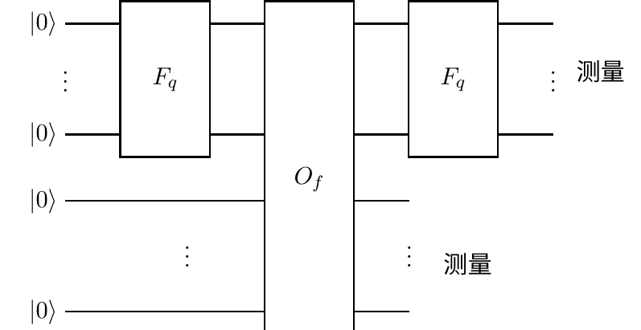
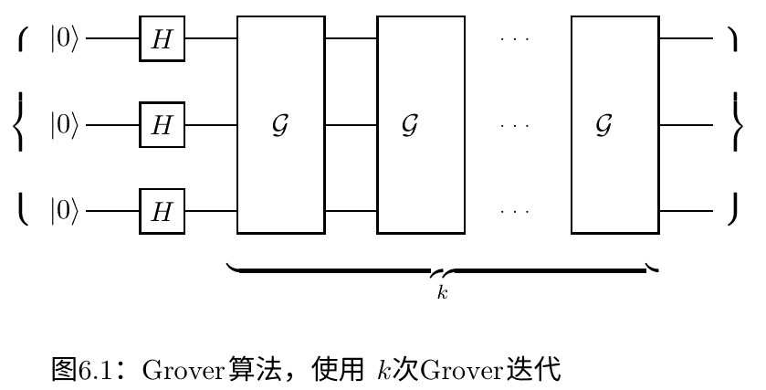

# 阿姆斯特丹量子计算讲义

Ronald de Wolf

## 前言

这些讲义是在我在阿姆斯特丹大学的“量子计算”课程期间形成的小块，并在此后编译成一篇文章。每个章节在 2×45 分钟的讲座中讲解，还有额外的 45 分钟的讲座用于练习和作业。课程的前半部分（第 1-7 章）涵盖了量子算法，后半部分涵盖了量子复杂性（第 8-9 章），涉及到 Alice 和 Bob 的内容（第 10-13 章），以及纠错（第 14 章）。关于物理实现和总体展望的第 15 次讲座更加简略，我没有为它编写讲义。

这些章节也可以作为一个理论计算机科学家对量子计算和信息领域的一般介绍。虽然我努力使文本自包含和一致，但仍可能有些粗糙；我希望继续完善和补充。欢迎提供评论和建设性的批评，可以发送至 rdewolf@cwi.nl。

那些想要阅读更多内容的人：请参阅 Nielsen 和 Chuang 的书 [72]。

### 归属和致谢

第 1 章的大部分材料来自我的博士论文第 1 章 [87]，并增加了一些内容：Simon 的下界，傅里叶变换，Grover 的几何解释。第 7 章是为这些笔记新写的，受 Santha 的调查 [78] 的启发。第 8 章和第 9 章也大部分是新的。第 8 章的第 3 节和第 10 章的大部分内容（经过许多修改）来自我与 Andy Drucker 的“量子证明”调查论文 [36]。第 11 章和第 12 章部分内容来自我与 Harry Buhrman、Richard Cleve 和 Serge Massar 的非局域性调查 [22]。第 13 章和第 14 章是新的。感谢 Giannicola Scarpa 对一些章节的有用的评论。

- **2013年1月**：更新和纠正了本课程 2013 年 2 月至 3 月版本的一些内容，并为每章节包括了练习题。感谢 Harry Buhrman, Florian Speelman, Jeroen Zuiddam 在早期版本中发现了一些错别字。
- **2013年4月**：进行了更多的更新、澄清和修正；将一些材料从第 2 章移动到第 1 章；修改和添加了一些练习题。感谢 Jouke Witteveen 提供的一些有用的评论。
- **2014年4月**：修复和澄清了更多的内容。感谢 Maarten Wegewijs 在第 4 章中发现了一个错别字。
- **2015年3月**：更新了一些小细节。
- **2015年7月**：更新和纠正了一些小细节，增加了更多的练习题。感谢 Srinivasan Arunachalam, Carla Groenland 和 Koen Groenland 的评论。
- **2016年5月**：进行了一些修正，感谢 Ralph Bottesch 的评论。

Ronald de Wolf  
2016年5月，阿姆斯特丹

## 目录

| 章节 | 标题 | 页码 |
| :--- | :--- | :--- |
| **1** | **量子计算** | **1** |
| 1.1 | 引言 | 1 |
| 1.2 | 量子力学 | 2 |
| 1.2.1 | 叠加态 | 2 |
| 1.2.2 | 测量 | 3 |
| 1.2.3 | 酉演化 | 4 |
| 1.3 | 量子存储 | 4 |
| 1.4 | 基本门 | 6 |
| 1.5 | 示例：量子隐形传态 | 7 |
| **2** | **电路模型和 Deutsch-Jozsa** | **9** |
| 2.1 | 量子计算 | 9 |
| 2.1.1 | 经典电路 | 9 |
| 2.1.2 | 量子电路 | 10 |
| 2.2 | 不同基本门集合的普适性 | 11 |
| 2.3 | 量子并行性 | 11 |
| 2.4 | 早期算法 | 11 |
| 2.4.1 | Deutsch-Jozsa | 12 |
| 2.4.2 | Bernstein-Vazirani | 14 |
| **3** | **Simon算法** | **16** |
| 3.1 | 问题 | 16 |
| 3.2 | 量子算法 | 16 |
| 3.3 | Simon 问题的经典算法 | 17 |
| 3.3.1 | 上界 | 17 |
| 3.3.2 | 下界 | 18 |
| **4** | **傅里叶变换** | **21** |
| 4.1 | 经典离散傅里叶变换 | 21 |
| 4.2 | 快速傅里叶变换 | 22 |
| 4.3 | 应用：多项式相乘 | 22 |
| 4.4 | 量子傅里叶变换 | 23 |
| 4.5 | 一个高效的量子电路 | 24 |
| 4.6 | 应用：相位估计 | 25 |
| **5** | **Shor 的因式分解算法** | **28** |
| 5.1 | 因式分解 | 28 |
| 5.2 | 从因式分解到周期查找的归约 | 28 |
| 5.3 | Shor 的周期查找算法 | 30 |
| 5.4 | 连分数 | 32 |
| **6** | **Grover 的搜索算法** | **35** |
| 6.1 | 问题 | 35 |
| 6.2 | Grover 的算法 | 35 |
| 6.3 | 幅度放大 | 38 |
| 6.4 | 应用：可满足性 | 38 |
| **7** | **量子行走算法** | **41** |
| 7.1 | 经典随机行走 | 41 |
| 7.2 | 量子行走 | 42 |
| 7.3 | 应用 | 44 |
| 7.3.1 | Grover 搜索 | 45 |
| 7.3.2 | 碰撞问题 | 45 |
| 7.3.3 | 在图中找到一个三角形 | 46 |
| **8** | **量子查询下界** | **49** |
| 8.1 | 引言 | 49 |
| 8.2 | 多项式方法 | 50 |
| 8.3 | 量子对手方法 | 52 |
| **9** | **量子复杂性理论** | **56** |
| 9.1 | 大多数函数需要指数多的门 | 56 |
| 9.2 | 经典和量子复杂性类 | 57 |
| 9.3 | 在多项式空间中经典模拟量子计算机 | 58 |
| **10** | **量子编码，具有非量子应用** | **61** |
| 10.1 | 混合态和一般测量 | 61 |
| 10.2 | 量子编码及其限制 | 62 |
| 10.3 | 本地可解码代码的下界 | 64 |
| **11** | **量子通信复杂性** | **67** |
| 11.1 | 经典通信复杂性 | 67 |
| 11.2 | 量子问题 | 68 |
| 11.3 | 示例 1: 分布式 Deutsch-Jozsa | 69 |
| 11.4 | 示例 2: 交集问题 | 70 |
| 11.5 | 示例 3: 向量子空间问题 | 71 |
| 11.6 | 示例 4: 量子指纹 | 71 |
| **12** | **纠缠和非局域性** | **75** |
| 12.1 | 量子非局域性 | 75 |
| 12.2 | CHSH: Clauser-Horne-Shimony-Holt | 77 |
| 12.3 | 魔方游戏 | 78 |
| 12.4 | 分布式 Deutsch-Jozsa 的非局域版本 | 80 |
| **13** | **量子密码学** | **83** |
| 13.1 | 量子密钥分发 | 83 |
| 13.2 | 降维密度矩阵和 Schmidt 分解 | 85 |
| 13.3 | 完美比特承诺的不可能性 | 86 |
| 13.4 | 更多的量子密码学 | 87 |
| **14** | **错误纠正和容错** | **90** |
| 14.1 | 引言 | 90 |
| 14.2 | 经典错误纠正 | 90 |
| 14.3 | 量子错误 | 91 |
| 14.4 | 量子纠错码 | 92 |
| 14.5 | 容错量子计算 | 94 |
| 14.6 | 串联码和阈值定理 | 95 |
| **A** | **一些有用的线性代数** | **97** |
| A.1 | 一些术语和符号 | 97 |
| A.2 | 酉矩阵 | 98 |
| A.3 | 对角化和奇异值 | 98 |
| A.4 | 迹 | 99 |
| A.5 | 张量积 | 100 |
| A.6 | 秩 | 100 |
| A.7 | 狄拉克符号 | 101 |
| **B** | **其他有用的数学** | **102** |

## 第1章 量子计算

### 1.1 引言

今天的计算机——无论是在理论上（图灵机）还是在实践中（个人电脑）——都是基于经典物理学的。然而，现代量子物理告诉我们，世界的行为非常不同。一个量子系统可以同时处于许多不同的状态，并且在其演化过程中可以展现出干涉效应。此外，空间上分离的量子系统可能与彼此纠缠，并且由于这个原因，操作可能具有“非局部”效应。

量子计算是研究基于量子力学原理的计算机的计算能力和其他属性的领域。一个重要目标是找到比解决相同问题的任何经典算法快得多的量子算法。该领域始于20世纪80年代初，由 Yuri Manin [65]（和 [66] 的附录），Richard Feynman [41, 42] 和 Paul Benioff [14] 提出了关于模拟量子计算机的建议，并在1985年 David Deutsch 定义了通用量子图灵机 [33] 时达到了更稳固的基础。接下来的几年只见到了很少的活动，尤其是 Deutsch 和 Jozsa [35] 以及 Simon [82] 开发了第一个算法，以及 Bernstein 和 Vazirani [18] 开发了量子复杂性理论。然而，1994年 Peter Shor 非常令人惊讶地发现了整数因子分解和离散对数问题的高效量子算法后，对该领域的兴趣大大增加 [81]。由于当前大部分经典密码学都基于这两个问题的计算难度假设，实际构建和使用量子计算机将使我们能够破解大多数当前的经典密码系统，尤其是 RSA 系统 [76, 77]。（相比之下，由 Bennett 和 Brassard [17] 提出的量子密码学形式即使对于量子计算机也是不可破解的。）

让我们提到研究量子计算的三个不同动机，从实际到更加哲学性的：

- 1. 使当前的经典计算机如此强大和廉价的微型化过程已经达到了量子效应发生的微观水平。芯片制造商倾向于竭尽全力抑制这些量子效应，但也可以尝试充分利用它们。
- 2. 利用量子效应可以极大地加速某些计算（有时呈指数级增长），甚至可以实现一些经典计算机无法实现的事情。本课程的主要目的是详细解释这些内容（算法、密码学等）。
- 3. 最后，我们可以将理论计算机科学的主要目标定义为“研究自然允许的最强大的计算设备的能力和限制”。由于我们当前对自然的理解是量子力学的，理论计算机科学应该研究量子计算机的能力，而不是经典计算机。

在限制自己于理论之前，让我们谈谈实践：量子计算机到底能够建造到什么程度？目前来看，现在还为时过早。第一个小型 的2比特量子计算机建于1997年，而2001年一台5比特的量子计算机成功地分解了数字15 [85]。从那时起，关于许多不同技术的实验进展一直稳步但缓慢。实现量子计算的实际问题似乎非常困难。噪声和退相干的问题在理论上在一定程度上已经通过发现量子纠错码和容错计算来解决（参见这些笔记中的第14章或 [72, 第10章]），但这些问题在实践中并没有完全解决。另一方面，我们应该意识到量子计算的物理实现领域仍处于起步阶段，而经典计算也不得不面对和解决许多困难的技术问题——有趣的是，这些问题往往与量子计算机现在面临的问题相同（例如，降噪和纠错）。

此外，实现完整量子计算机所面临的困难可能看起来令人望而却步，但涉及量子通信的一些更有限的事物已经在某种程度上取得了成功，例如通过纠缠和经典通信发送量子比特的过程（即传送），而且量子密码学现在甚至已经在商业上可用。即使量子计算的理论从未实现为真正的物理计算机，量子力学计算机仍然是一个极其有趣的想法，将在实际快速计算以外的其他领域取得成果。在物理学方面，它可能提高我们对量子力学的理解。新兴的纠缠理论已经在某种程度上做到了这一点。

在计算机科学方面，量子计算理论推广和丰富了经典复杂性理论，并可能有助于解决其中的一些问题。

### 1.2 量子力学

在这里，我们对量子力学进行了简要和抽象的介绍。简而言之：量子态是经典态的叠加，我们可以对其进行测量或者施加幺正操作。关于所需的线性代数和狄拉克符号，我们参考附录A。

#### 1.2.1 叠加态

考虑一些可以处于 $N$ 个互斥的经典状态的物理系统。将这些状态称为 $|1\rangle, |2\rangle, \dots, |N\rangle$。粗略地说，通过“经典”状态，我们指的是如果我们观察系统，可以找到系统的状态。一个纯量子态（通常只称为态）$|\phi\rangle$ 是经典状态的叠加，写作：

$$|\phi\rangle = \alpha_1|1\rangle + \alpha_2|2\rangle + \dots + \alpha_N|N\rangle$$

这里 $\alpha_i$ 是一个复数，称为 $|i\rangle$ 在 $|\phi\rangle$ 中的振幅（有关复数的简要说明，请参见附录B）。直观地说，处于量子态 $|\phi\rangle$ 的系统同时处于所有经典状态，处于状态 $|1\rangle$ 的振幅为 $\alpha_1$，处于状态 $|2\rangle$ 的振幅为 $\alpha_2$，等等。从数学上讲，状态 $|1\rangle, \dots, |N\rangle$ 构成了 $N$ 维希尔伯特空间的一个正交归一基（即一个配备了内积的 $N$ 维向量空间），并且一个量子态 $|\phi\rangle$ 是这个空间中的一个向量。

#### 1.2.2 测量

我们可以对量子态进行两种操作：测量或者让其在没有测量的情况下进行幺正演化。我们先来讨论测量。

**在计算基下的测量**

假设我们测量状态 $|\phi\rangle$。我们无法“看到”一个叠加本身，只能看到经典态。因此，如果我们测量状态 $|\phi\rangle$，我们将只会看到一个经典态 $|j\rangle$。我们将会看到哪个具体的 $|j\rangle$ 呢？这是事先无法确定的；我们唯一能说的是，我们将以概率 $|\alpha_j|^2$ 看到状态 $|j\rangle$，这个概率是对应振幅 $\alpha_j$ 的模的平方 ($|a + ib| = \sqrt{a^2 + b^2}$)。因此观测量子态会在经典态上引起一个概率分布，这个分布由振幅的模的平方决定。这意味着 $\sum_{j=1}^{N} |\alpha_j|^2 = 1$，所以振幅向量的（欧几里得）范数为 1。如果我们测量 $|\phi\rangle$ 并且看到经典态 $|j\rangle$ 作为结果，那么 $|\phi\rangle$ 本身已经“消失”，剩下的只有 $|j\rangle$。换句话说，观测 $|\phi\rangle$ 会将量子叠加态 $|\phi\rangle$ “坍缩”到我们看到的经典态 $|j\rangle$ 上，所有可能包含在振幅 $\alpha_i$ 中的“信息”都消失了。

**投影测量**

除了上述的“计算（或标准）基下的测量”，还有一种更一般的测量方式。在课程中，这将只会被少量使用。这样的投影测量由投影算子 $P_1, \dots, P_m (m \le N)$ 描述，它们的总和为单位算子。这些投影算子是两两正交的，也就是说，如果 $i \neq j$，那么 $P_i P_j = 0$。投影算子 $P_j$ 在总希尔伯特空间 $V$ 的某个子空间 $V_j$ 上进行投影，每个状态 $|\phi\rangle \in V$ 都可以唯一地分解为 $|\phi\rangle = \sum_{j=1}^{m} |\phi_j\rangle$，其中 $|\phi_j\rangle = P_j |\phi\rangle \in V_j$。由于投影算子是正交的，子空间 $V_j$ 也是正交的，状态 $|\phi_j\rangle$ 也是正交的。当我们将这个测量应用于纯态 $|\phi\rangle$ 时，我们将以概率 $\| |\phi_j\rangle \|^2 = \text{Tr}(P_j |\phi\rangle \langle \phi |)$ 得到结果 $j$，并且状态将“坍缩”为新的状态 $|\phi_j\rangle / \| |\phi_j\rangle \| = P_j |\phi\rangle / \| P_j |\phi\rangle \|$。

例如，标准基下的测量是特定的投影测量，其中 $m=N$ 且 $P_j = |j\rangle \langle j|$。也就是说， $P_j$ 投影到标准基态 $|j\rangle$，相应的子空间 $V_j$ 是由 $|j\rangle$ 张成的空间。考虑状态 $|\phi\rangle = \sum_{j=1}^{N} \alpha_j |j\rangle$。注意到 $P_j |\phi\rangle = \alpha_j |j\rangle$，因此对 $|\phi\rangle$ 应用我们的测量将以概率 $\| \alpha_j |j\rangle \|^2 = |\alpha_j|^2$ 得到结果 $j$。在这种情况下，状态坍缩为 $\alpha_j |j\rangle / \| \alpha_j |j\rangle \| = \frac{\alpha_j}{|\alpha_j|} |j\rangle$。范数因子 $\frac{\alpha_j}{|\alpha_j|}$ 可以忽略，因为它没有物理意义，所以我们得到了状态 $|j\rangle$，就像我们之前看到的那样。

作为另一个例子，一个区分 $|j\rangle$ 和 $j \le N/2$ 的测量对应于两个投影算子 $P_1 = \sum_{j \le N/2} |j\rangle \langle j|$ 和 $P_2 = \sum_{j > N/2} |j\rangle \langle j|$。将这个测量应用到状态 $|\phi\rangle = \frac{1}{\sqrt{3}} |1\rangle + \sqrt{\frac{2}{3}} |N\rangle$：
- 以概率 $\|P_1|\phi\rangle\|^2 = 1/3$ 得到结果 1，此时状态会坍缩为 $|1\rangle$。
- 以概率 $\|P_2|\phi\rangle\|^2 = 2/3$ 得到结果 2，此时状态会坍缩为 $|N\rangle$。

#### 1.2.3 幺正演化

我们可以对 $|\phi\rangle$ 进行一些操作，而不是测量它，即改变状态为某个 $|\psi\rangle = \beta_1|1\rangle + \beta_2|2\rangle + \cdots + \beta_N|N\rangle$。

量子力学只允许对量子态进行线性操作。这意味着：如果我们将状态 $|\phi\rangle$ 视为一个 $N$ 维向量 $(\alpha_1, \dots, \alpha_N)^T$，那么应用一个将 $|\phi\rangle$ 变为 $|\psi\rangle$ 的操作对应于将 $|\phi\rangle$ 与一个 $N \times N$ 复数矩阵 $U$ 相乘：

$$U \begin{pmatrix} \alpha_1 \\ \vdots \\ \alpha_N \end{pmatrix} = \begin{pmatrix} \beta_1 \\ \vdots \\ \beta_N \end{pmatrix}$$

请注意，根据线性性质，我们有 $|\psi\rangle = U|\phi\rangle = U(\sum_i \alpha_i |i\rangle) = \sum_i \alpha_i U|i\rangle$。因为测量 $|\psi\rangle$ 也应该给出一个概率分布，我们有以下约束条件 $\sum_{j=1}^N |\beta_j|^2 = 1$。这意味着操作 $U$ 必须保持向量的范数，因此必须是一个幺正变换。如果一个矩阵 $U$ 的逆矩阵 $U^{-1}$ 等于其共轭转置 $U^*$, 则该矩阵 $U$ 是幺正的。这等价于说 $U$ 总是将范数为 1 的向量映射为范数为 1 的向量。因为幺正变换总是有逆变换，所以任何（非测量）的量子态操作必须是可逆的：通过应用 $U^{-1}$ 我们总是可以“撤销” $U$ 的作用，并且在这个过程中不会丢失任何信息。另一方面，测量显然是不可逆的，因为我们无法从观察到的经典状态 $|j\rangle$ 重构 $|\phi\rangle$。

### 1.3 量子存储

在经典计算中，信息的单位是一个比特，可以是 0 或 1。在量子计算中，这个单位是一个量子比特（qubit），它是 0 和 1 的叠加。考虑一个有 2 个基态的系统，称之为 $|0\rangle$ 和 $|1\rangle$。我们将这些基态与向量 $\begin{pmatrix} 1 \\ 0 \end{pmatrix}$ 和 $\begin{pmatrix} 0 \\ 1 \end{pmatrix}$ 相对应。一个单比特可以处于任何叠加态：

$$\alpha_0|0\rangle + \alpha_1|1\rangle, \ |\alpha_0|^2 + |\alpha_1|^2 = 1$$

因此，一个单比特“存在于”向量空间 $\mathbb{C}^2$。类似地，我们可以考虑由多个比特系统的张量积空间。例如，一个 2 比特系统有 4 个基态：$|0\rangle \otimes |0\rangle, \ |0\rangle \otimes |1\rangle, \ |1\rangle \otimes |0\rangle, \ |1\rangle \otimes |1\rangle$。这里，例如 $|1\rangle \otimes |0\rangle$ 表示第一个比特处于其基态 $|1\rangle$，第二个比特处于其基态 $|0\rangle$。我们经常将其缩写为 $|1\rangle|0\rangle, |1,0\rangle, \text{或者甚至} |10\rangle$。

更一般地，一个由 $n$ 量子比特组成的寄存器有 $2^n$ 个基态，每个基态的形式为 $|b_1\rangle \otimes |b_2\rangle \otimes \dots \otimes |b_n\rangle$。我们可以简写为 $|b_1 b_2 \dots b_n\rangle$。我们经常将 $0 \dots 0$ 简写为 $0_n$。由于长度为 $n$ 的比特串可以看作是 0 到 $2^n-1$ 之间的数字，我们也可以写成：基态可以表示为数字 $|0\rangle, |1\rangle, |2\rangle, \ldots, |2^n - 1\rangle$。一个由 $n$ 量子比特组成的量子寄存器可以处于任何叠加态：

$$\alpha_0|0\rangle + \alpha_1|1\rangle + \cdots + \alpha_{2^n-1}|2^n - 1\rangle, \sum_{j=0}^{2^n-1} |\alpha_j|^2 = 1$$

如果我们在标准基下测量，我们以概率 $|\alpha_j|^2$ 获得 $n$ 位状态 $|j\rangle$。

仅测量状态的第一个量子位将对应于投影测量，其中包含两个投影算符 $P_0 = |0\rangle\langle 0| \otimes I_{2^{n-1}}$ 和 $P_1 = |1\rangle\langle 1| \otimes I_{2^{n-1}}$。例如，将此测量应用于状态：
$$\frac{1}{\sqrt{3}}|0\rangle|\phi\rangle + \sqrt{\frac{2}{3}}|1\rangle|\psi\rangle$$
以 1/3 的概率得到结果 0（然后状态变为 $|0\rangle|\phi\rangle$），以 2/3 的概率得到结果 1（然后状态变为 $|1\rangle|\psi\rangle$）。类似地，用标准基测量一个 $(n+m)$-量子比特状态的前 $n$ 个比特，对应于投影测量，共有 $2^n$ 个投影算符 $P_i = |i\rangle\langle i| \otimes I_{2^m}$，其中 $i \in \{0,1\}^n$。

值得一提的一个重要特性是纠缠，它指的是不同量子比特之间的量子相关性。例如，考虑一个处于以下状态的 2 比特寄存器：

$$\frac{1}{\sqrt{2}}|00\rangle + \frac{1}{\sqrt{2}}|11\rangle$$

这种 2 比特态有时被称为 EPR 对，以纪念爱因斯坦、波多尔斯基和罗森 [39]，他们首次研究了这种态及其看似矛盾的性质。最初，两个比特都没有确定的经典值 $|0\rangle$ 或 $|1\rangle$。然而，如果我们测量第一个比特并观察到，比如，一个 $|0\rangle$，那么整个态就会坍缩为 $|00\rangle$。因此，观察第一个比特立即也确定了第二个未观察到的比特的经典值。由于构成寄存器的两个比特可能相距很远，这个例子说明了量子系统可能展现出的一些非局部效应。一般来说，一个二分态 $|\phi\rangle$ 如果不能被写成张量积的形式 $|\phi_A\rangle \otimes |\phi_B\rangle$，其中 $|\phi_A\rangle$ 在第一个空间中，$|\phi_B\rangle$ 在第二个空间中，那么它被称为纠缠态。

在这一点上，与经典概率分布进行比较可能会有所帮助。假设我们有两个概率空间 $A$ 和 $B$，第一个有 $2^n$ 个可能的结果，第二个有 $2^m$ 个可能的结果。第一个空间上的分布可以用 $2^n$ 个数字来描述，第二个空间上的分布可以用 $2^m$ 个数字来描述。因此，联合空间上的乘积分布可以用 $2^n + 2^m$ 个数字来描述。然而，联合空间上的任意（非乘积）分布需要 $2^{n+m}$ 个实数。类似地，一个 $n$ 量子比特状态 $|\phi_A\rangle$ 可以用 $2^n$ 个复参数描述，一个 $m$ 量子比特状态 $|\phi_B\rangle$ 可以用 $2^m$ 个数字描述，它们的张量积 $|\phi_A\rangle \otimes |\phi_B\rangle$ 可以用 $2^n + 2^m$ 个数字描述。然而，在联合空间中，任意（可能纠缠的）状态需要 $2^{n+m}$ 个数字来描述。我们可以看到，描述量子态所需的参数数量与描述概率分布所需的参数数量规模相同。还要注意两个随机变量 $A$ 和 $B$ 的统计独立性 $^1$ 与乘积态的非纠缠 $|\phi_A\rangle \otimes |\phi_B\rangle$ 之间的类比。然而，尽管概率和振幅之间存在相似之处，量子态比分布更强大，因为振幅可能具有负部分，这可能导致干涉效应。只有当我们对振幅进行平方时，它们才变成概率。量子计算的艺术就是利用这些特殊属性进行有趣的计算目的。

---
$^1$ 两个随机变量 $A$ 和 $B$ 是独立的，如果它们的联合概率分布可以写成 $A$ 和 $B$ 的个别分布的乘积：对于所有可能的值 $a, b$, 有 $\Pr[A=a \wedge B=b] = \Pr[A=a] \cdot \Pr[B=b]$。

### 1.4 基本门

作用于少量量子比特（例如，最多3个）的酉矩阵通常被称为门，类似于经典逻辑门如AND、OR和NOT；下一章将更详细介绍。两个简单但重要的1比特门是位翻转门 $X$（将比特取反，即交换 $|0\rangle$ 和 $|1\rangle$）和相位翻转门 $Z$（在 $|1\rangle$ 前面加上 $-$）。表示为2x2的酉矩阵，它们分别是

$$X = \begin{pmatrix} 0 & 1 \\ 1 & 0 \end{pmatrix}, Z = \begin{pmatrix} 1 & 0 \\ 0 & -1 \end{pmatrix}$$

另一个重要的1比特门是相位门 $R_\phi$，它仅仅旋转了 $|1\rangle$-态的相位角 $\phi$:

$$R_\phi|0\rangle = |0\rangle$$ 
$$R_\phi|1\rangle = e^{i\phi}|1\rangle$$

这对应于酉矩阵

$$R_\phi = \begin{pmatrix} 1 & 0 \\ 0 & e^{i\phi} \end{pmatrix}$$

注意 $Z$ 是这个的特殊情况：$Z = R_\pi$，因为 $e^{i\pi} = -1$。

可能最重要的1比特门是哈达玛变换（Hadamard transform），由以下方式指定：

$$H|0\rangle = \frac{1}{\sqrt{2}}|0\rangle + \frac{1}{\sqrt{2}}|1\rangle$$ 
$$H|1\rangle = \frac{1}{\sqrt{2}}|0\rangle - \frac{1}{\sqrt{2}}|1\rangle$$

作为酉矩阵，它的表示为

$$H = \frac{1}{\sqrt{2}} \begin{pmatrix} 1 & 1 \\ 1 & -1 \end{pmatrix}$$

如果我们将 $H$ 应用于初始状态 $|0\rangle$，然后进行测量，我们有相等的概率观察到 $|0\rangle$ 或 $|1\rangle$。类似地，将 $H$ 应用于 $|1\rangle$ 并观察会得到相等的概率 $|0\rangle$ 或 $|1\rangle$。然而，如果我们将 $H$ 应用于叠加态 $\frac{1}{\sqrt{2}}|0\rangle + \frac{1}{\sqrt{2}}|1\rangle$，那么我们会得到 $|0\rangle$：正负振幅 $|1\rangle$ 相互抵消！（注意这也意味着 $H$ 是它自己的逆）这种效应被称为干涉，类似于光或声波之间的干涉图案。

一个例子是两量子比特门的控制非门CNOT。如果第一个比特为1，则它会对其输入的第二个比特取反；如果第一个比特为0，则不做任何操作：

$$\text{CNOT}|0\rangle|b\rangle = |0\rangle|b\rangle$$ 
$$\text{CNOT}|1\rangle|b\rangle = |1\rangle|1-b\rangle$$

以矩阵形式表示，这是

$$\text{CNOT} = \begin{pmatrix} 1 & 0 & 0 & 0 \\ 0 & 1 & 0 & 0 \\ 0 & 0 & 0 & 1 \\ 0 & 0 & 1 & 0 \end{pmatrix}$$

## 1.5 示例: 量子隐形传态

在下一章中，我们将更详细地讨论如何使用和组合这些基本门，但作为一个例子，我们在这里已经解释了传送 [15]。假设有两个方，爱丽丝和鲍勃。爱丽丝有一个量子比特 $\alpha_0|0\rangle+\alpha_1|1\rangle$ 她想通过一个经典信道将其发送给鲍勃。没有其他资源的话，这是不可能的，但爱丽丝还与鲍勃共享一个EPR对

$$\frac{1}{\sqrt{2}}(|00\rangle+|11\rangle)$$ 

（假设爱丽丝持有第一个量子比特，鲍勃持有第二个）。最初，他们的联合状态是

$$(\alpha_0|0\rangle+\alpha_1|1\rangle) \otimes \frac{1}{\sqrt{2}}(|00\rangle+|11\rangle)$$

前两个量子比特属于爱丽丝，第三个量子比特属于鲍勃。爱丽丝对她的两个量子比特执行CNOT操作，然后对她的第一个量子比特进行Hadamard变换。他们的联合状态现在可以写成

$$\begin{aligned} \frac{1}{2} &|00\rangle(\alpha_0|0\rangle+\alpha_1|1\rangle) + \\ \frac{1}{2} &|01\rangle(\alpha_0|1\rangle+\alpha_1|0\rangle) + \\ \frac{1}{2} &|10\rangle(\alpha_0|0\rangle-\alpha_1|1\rangle) + \\ &\underbrace{\frac{1}{2}|11\rangle(\alpha_0|1\rangle-\alpha_1|0\rangle)}_{\text{爱丽丝}} \underbrace{\quad}_{\text{鲍勃}} \end{aligned}$$

然后，爱丽丝在计算基础上测量她的两个量子比特，并将结果（2个随机经典比特）通过经典信道发送给鲍勃。现在鲍勃知道他必须对他的量子比特进行哪种变换才能恢复量子比特 $\alpha_0|0\rangle+\alpha_1|1\rangle$。例如，如果爱丽丝发送了 $11$，那么鲍勃知道他的量子位是 $\alpha_0|1\rangle-\alpha_1|0\rangle$。一个比特翻转 ($X$) 后跟一个相位翻转 ($Z$) 将给他爱丽丝的原始量子位 $\alpha_0|0\rangle+\alpha_1|1\rangle$。事实上，如果爱丽丝的量子位与其他量子位纠缠在一起，那么传送会保持这种纠缠：鲍勃随后接收到一个与爱丽丝原始量子位以相同方式纠缠的量子位。

请注意，爱丽丝一侧的量子比特已经被销毁：传送是将一个量子比特从A传输到B，而不是复制它。实际上，复制一个未知的量子比特是不可能的 [88]，请参考练习1。

### 练习题

- 1. 证明量子不克隆定理：不存在一个2比特的酉矩阵 $U$，使得 $|\phi\rangle|0\rangle \mapsto |\phi\rangle|\phi\rangle$ 对于每一个量子比特 $|\phi\rangle$ 成立。提示：考虑当 $|\phi\rangle=|0\rangle$ 时 $U$ 的作用，当 $|\phi\rangle=|1\rangle$ 时，以及当 $|\phi\rangle$ 是这两者的叠加态时。
- 2. 证明酉矩阵不能“删除”信息：不存在一个一比特的酉矩阵 $U$，使得对于每一个一比特的态 $|\phi\rangle$，有 $|\phi\rangle \mapsto |0\rangle$。
- 3. 计算将 $|0\rangle \otimes |1\rangle$ 的两个量子比特都应用哈达玛变换的结果（第一种方式使用向量的张量积，第二种方式使用矩阵的张量积），并证明这两个结果是相等的：
$$H|0\rangle \otimes H|1\rangle = (H \otimes H)(|0\rangle \otimes |1\rangle)$$
- 4. 证明一个位翻转操作，在哈达玛变换之前和之后，等于一个相位翻转操作：$HXH = Z$。
- 5. 证明一个EPR对 $\frac{1}{\sqrt{2}}(|00\rangle + |11\rangle)$ 是一个纠缠态，即它不能被写成两个独立量子比特的张量积。
- 6. 矩阵 $A$ 是内积保持的，如果内积 $\langle Av|Aw \rangle$ 等于内积 $\langle v|w \rangle$，对于所有的向量 $v, w$。如果 $A$ 是保范的，那么 $\|Av\| = \|v\|$ 对于所有的向量 $v$ 成立。如果 $A$ 是幺正的，那么 $A^*A = AA^* = I$。在下面的内容中，为了简单起见，您可以假设向量和矩阵的元素是实数。
    - (a) 证明 $A$ 是保范的，当且仅当 $A$ 是内积保持的。
    - (b) 证明 $A$ 是内积保持的，当且仅当 $A^*A = AA^* = I$。
    - (c) 结论是，如果 $A$ 是保范的，则 $A$ 是幺正的。
    - 奖励：用复数向量空间代替实数向量空间证明相同结论。
- 7. 假设爱丽丝和鲍勃没有纠缠。如果爱丽丝将一个量子比特发送给鲍勃，那么这最多可以给鲍勃提供一位关于爱丽丝的信息。然而，如果他们共享一个EPR对，他们可以通过发送一个量子比特通过信道传输两个经典比特；这被称为超密编码 [16]。这个练习将展示这是如何工作的。
    - (a) 他们从一个共享的EPR对 $\frac{1}{\sqrt{2}}(|00\rangle + |11\rangle)$ 开始。爱丽丝有经典比特 $a$ 和 $b$。假设如果 $a=1$，她对她的EPR对的一半进行 $X$ 操作，然后如果 $b=1$ 则进行 $Z$ 操作（如果 $ab=11$，则两者都执行；如果 $ab=00$，则两者都不执行）。写出结果的2比特状态。
    - (b) 假设爱丽丝将她的一半状态发送给鲍勃，现在他有两个量子比特。证明鲍勃可以从他的状态中确定 $a$ 和 $b$ 的值。用 Hadamard 门和 CNOT 门将鲍勃的操作写成一个量子电路。

*注：第7题提到的结论实际上是 Holevo 定理的一个特例。更多关于这个内容可以在第10章中找到。*

# 第2章 电路模型和Deutsch-Jozsa算法

### 2.1 量子计算

下面我们解释量子计算机如何对其量子比特寄存器应用计算步骤。有两种模型可以描述这个过程：量子图灵机 [33, 18] 和量子电路模型 [34, 89]。这些模型是等价的，即它们可以在多项式时间内相互模拟，假设电路是适当“均匀”的。我们只在这里解释电路模型，这是研究人员中更受欢迎的模型。

#### 2.1.1 经典电路

在经典复杂性理论中，布尔电路是一个有AND、OR和NOT门的有向无环图。它有 $n$ 个输入节点，其中包含 $n$ 个输入比特 ($n \ge 0$)。内部节点是AND、OR和NOT门，并且有一个或多个指定的输出节点。初始输入比特根据电路被输入到门中，最终输出节点会得到某个值。如果输出节点对于每个输入 $x \in \{0, 1\}^n$ 都得到正确的值 $f(x)$，我们说电路计算了某个布尔函数 $f: \{0, 1\}^n \to \{0, 1\}^m$。

电路族是一个电路的集合 $\mathcal{C} = \{C_n\}$，每个输入大小 $n$ 对应一个电路。每个电路都有一个输出位。这样的电路族可以识别或决定一个语言 $L \subseteq \{0, 1\}^* = \cup_{n \ge 0} \{0, 1\}^n$，如果对于每个 $n$ 和每个输入 $x \in \{0, 1\}^n$，电路 $C_n$ 在 $x \in L$ 时输出1，在其他情况下输出0。这样的电路族是一致多项式的（uniformly polynomial），如果存在一个确定性图灵机，以 $n$ 作为输入并输出 $C_n$ 的描述，并且使用对数空间。这意味着运行时间对于 $n$ 是多项式级的。已知一致多项式电路族与多项式时间确定性图灵机的能力相等：一个语言 $L$ 可以由一致多项式电路族决定当且仅当 $L \in \mathbf{P}$ [73, 定理 11.5]。

同样地，我们可以考虑随机电路。除了输入位，这些电路还接收一些随机位（“硬币翻转”）作为输入。如果随机电路对于每个输入 $x$，成功输出正确答案 $f(x)$ 的概率至少为 2/3，则该随机电路计算函数 $f$。随机电路与随机图灵机的能力相等：一个语言 $L$ 可以由一个均匀的多项式随机电路家族决定，当且仅当 $L \in \text{BPP}$。其中 BPP（“有界错误概率多项式时间”）是一类可以被随机图灵机以至少 2/3 的成功概率高效识别的语言。

#### 2.1.2 量子电路

量子电路（也称为量子网络或量子门阵列）推广了经典电路家族的思想，用基本的量子门代替了 AND、OR 和 NOT 门。量子门是对少量（通常为 1、2 或 3 个）量子比特进行的幺正变换。在上一章中，我们已经看到了许多例子：比特翻转门 $X$，相位翻转门 $Z$，哈达玛门 $H$。我们已经看到的主要的两比特门是控制非门（CNOT）。

通过添加另一个控制寄存器，我们得到了三比特的托菲利（Toffoli）门，也称为控制控制非门（CCNOT）。如果前两个比特都为 1，则该门会对其输入的第三个比特取反。托菲利门很重要，因为它对于经典可逆计算是完备的：任何经典计算都可以通过一系列托菲利电路来实现。这很容易理解：使用具有固定值的辅助线，托菲利可以实现与门（将第三个输入线固定为 0）和非门（将第一和第二个输入线固定为 1）。已知与门和非门足以实现任何经典布尔电路。

在数学上，这样的基本门可以通过取张量积（如果门并行应用到寄存器的不同部分）和普通乘积（如果门按顺序应用）来组合。我们已经在前一章中看到了这样一个由基本门组成的简单电路的例子，即实现传送。

例如，如果我们将 Hadamard 门 $H$ 应用到一个由 $n$ 个零组成的寄存器的每个位上，我们就会得到 $\frac{1}{\sqrt{2^n}} \sum_{j \in \{0,1\}^n} |j\rangle$，这是所有 $n$ 位字符串的等权叠加。更一般地，如果我们将 $H^{\otimes n}$ 应用到一个初始状态 $|i\rangle$，其中 $i \in \{0, 1\}^n$，我们就会得到

$$H^{\otimes n}|i\rangle = \frac{1}{\sqrt{2^n}} \sum_{j \in \{0,1\}^n} (-1)^{i \cdot j} |j\rangle \quad (2.1)$$

其中 $i \cdot j = \sum_{k=1}^n i_k j_k \pmod 2$ 表示 $i, j$ 的内积。例如：
$$H^{\otimes 2}|01\rangle = \frac{1}{\sqrt{2}}(|0\rangle + |1\rangle) \otimes \frac{1}{\sqrt{2}}(|0\rangle - |1\rangle) = \frac{1}{2} \sum_{j \in \{0,1\}^2} (-1)^{01 \cdot j} |j\rangle$$

$n$ 次哈达玛变换在后面解释的所有量子算法中非常有用。

与经典情况一样，量子电路是一个有限的有向无环图，包含输入节点、门和输出节点。有 $n$ 个节点包含输入，此外我们可能还有一些初始为 $|0\rangle$ 的辅助输入节点（工作空间）。量子电路的内部节点是作用于状态的最多 2 个量子比特的量子门。电路中的门将初始状态向量转化为最终状态。我们测量最终态的一些专用输出位，以获得一个答案。

类比于经典类 BPP，我们将定义 BQP（“有界误差量子多项式时间”）为能够通过量子电路族以多项式增长的输入长度高效计算，并且成功概率至少为 2/3 的语言类。

### 2.2 不同基本门集合的普适性

我们应该允许哪一组基本门？有几个合理的选择：

- (1) 所有的1量子比特操作和2量子比特的CNOT门是通用的，这意味着任何其他酉变换都可以由这些门构建。通常会限制模型，只允许使用一小组有限的1量子比特门，从而可以高效近似地构建所有其他的门。
- (2) 由CNOT、Hadamard和相位门 $R_{\pi/4}$ 组成的集合在近似意义上是通用的。Solovay-Kitaev定理表明，这种近似是相当高效的：我们可以使用来自该集合的 $polylog(1/\varepsilon)$ 个门来近似任意1或2量子比特上的门，其中 $\varepsilon$ 是误差。
- (3) 由Hadamard和Toffoli (CCNOT) 组成的集合在近似意义上对于所有只有实数元素的酉门是通用的。

### 2.3 量子并行性

我们可以用于构建量子算法的一种独特的量子力学效应是量子并行性。假设我们有一个经典算法，可以计算某个函数 $f: \{0, 1\}^n \to \{0, 1\}^m$。然后我们可以构建一个量子电路 $U$ (仅由Toffoli门组成)，它将 $|x\rangle|0\rangle \to |x\rangle|f(x)\rangle$ 对于每个 $x \in \{0, 1\}^n$。现在假设我们将 $U$ 应用于所有输入 $x$ 的叠加态（使用Hadamard变换很容易构建）：

我们只应用了一次 $U$，但最终的叠加态包含了所有 $2^n$ 个输入值 $x$ 的 $f(x)$！然而，单独这并不是非常有用的，因为观察最终的叠加态只会随机给出一个 $|x\rangle|f(x)\rangle$，而其他所有信息都会丢失。

量子并行性需要与干涉和纠缠效应相结合，才能得到比经典更好的结果。

### 2.4 早期算法

到目前为止，量子算法的两个主要成功是1994年的Shor因子分解算法 [81] 和 1996 年的 Grover 搜索算法 [47]。在本节中，我们将描述一些在 Shor 和 Grover 之前的早期量子算法。

几乎所有的量子算法都以某种形式或其他形式使用查询。我们将在这里解释这个模型。起初可能看起来有些牵强，但最终会顺利地引导到 Shor 和 Grover 算法。然而，我们应该强调查询复杂性模型与上述标准模型不同，因为输入现在被视为“黑盒”。这意味着我们在下面描述的指数级量子-经典分离（如 Simon 的分离）本身并不能在标准模型中产生指数数量量子-经典分离。

为了解释查询设置，考虑一个 $N$ 位输入 $x = (x_1, \dots, x_N) \in \{0, 1\}^N$。通常我们会有 $N = 2^n$，这样我们可以使用一个 $n$ 位索引 $i$ 来访问位 $x_i$。我们可以将输入看作是一个 $N$ 位的内存，我们可以在任意选择的位置访问它（随机访问内存）。内存访问是通过所谓的“黑盒”进行的，该黑盒能够根据输入 $i$ 输出位 $x_i$。作为一个量子操作，这将是对 $n+1$ 个量子比特的以下酉映射：

$$O_x : |i, 0\rangle \to |i, x_i\rangle.$$

状态的前 $n$ 个量子比特被称为地址比特（或地址寄存器），而第 $(n+1)$ 个量子比特被称为目标比特。由于这个操作必须是酉的，我们还必须指定如果目标比特的初始值为 1 会发生什么。因此，我们实际上让 $O_x$ 成为以下酉变换：

$$O_x : |i, b\rangle \to |i, b \oplus x_i\rangle,$$

这里 $i \in \{0, 1\}^n, b \in \{0, 1\}$，且 $\oplus$ 表示异或（模 2 加法）。在矩阵表示中，$O_x$ 现在是一个置换矩阵，因此是酉的。还要注意，量子计算机可以对各种 $i$ 的叠加态应用 $O_x$，这是经典计算机无法做到的。这个黑盒的一个应用被称为查询，并且在这些笔记的前半部分中，我们将经常计算所需的查询次数来计算 $x$ 的某个函数。

给定能够进行上述类型查询的能力，我们还可以通过将目标位设置为状态 $|-\rangle = \frac{1}{\sqrt{2}}(|0\rangle - |1\rangle) = H|1\rangle$ 来进行形式为 $|i\rangle \to (-1)^{x_i}|i\rangle$ 的查询：

$$O_x (|i\rangle |-\rangle) = |i\rangle \frac{1}{\sqrt{2}}(|x_i\rangle - |1 - x_i\rangle) = (-1)^{x_i}|i\rangle |-\rangle.$$

这种 $\pm$ 类型的查询将输出变量放在状态的相位中：如果 $x_i$ 为 1，则在基态 $|i\rangle$ 的相位中得到 $-1$；如果 $x_i = 0$，则 $|i\rangle$ 不受影响。这种“相位-Oracle”有时比标准类型的查询更方便。我们有时用 $O_{x,\pm}$ 来表示相应的 $N$-qubit 酉变换。

#### 2.4.1 Deutsch-Jozsa

**Deutsch-Jozsa 问题 [35]：**
对于 $N = 2^n$，我们给定 $x \in \{0, 1\}^N$ 使得：
- (1) 所有 $x_i$ 具有相同的值（“constant”）；
- (2) $N/2$ 的 $x_i$ 是 0，另外 $N/2$ 的 $x_i$ 是 1（“balanced”）。

目标是找出 $x$ 是 constant 还是 balanced。

Deutsch 和 Jozsa 的算法如下。我们从 $n$-qubit 零状态 $|0^n\rangle$ 开始，对每个 qubit 应用 Hadamard 变换，应用一个查询（以其 $\pm$ 形式），再对每个 qubit 应用另一个 Hadamard 变换，然后测量最终状态。作为一个酉变换，该算法会执行如下操作：

我们已经在图 2.1 中绘制了相应的量子电路（其中时间从左到右进行）。

让我们跟随这些操作来观察状态。最初我们有状态 $|0^n\rangle$。根据第 10 页的方程 2.1，经过第一次 Hadamard 变换后，我们得到了所有 $i$ 的均匀叠加态：

$$\frac{1}{\sqrt{2^n}} \sum_{i \in \{0,1\}^n} |i\rangle$$

$O_{\pm}$ 查询将其转化为：

$$\frac{1}{\sqrt{2^n}} \sum_{i \in \{0,1\}^n} (-1)^{x_i} |i\rangle$$

应用第二批 Hadamard 变换（同样根据方程 2.1）得到最终的叠加态：

$$\frac{1}{2^n} \sum_{i \in \{0,1\}^n} (-1)^{x_i} \sum_{j \in \{0,1\}^n} (-1)^{i \cdot j} |j\rangle$$

其中 $i \cdot j = \sum_{k=1}^n i_k j_k \pmod 2$。由于对于所有 $i \in \{0,1\}^n$，$i \cdot 0^n = 0$，我们可以看到最终叠加态 $|0^n\rangle$ 的振幅为：

$$\frac{1}{2^n} \sum_{i \in \{0,1\}^n} (-1)^{x_i} = \left\{ \begin{aligned} & 1 & \text{如果对于所有的 } i, x_i = 0; \\ & -1 & \text{如果对于所有的 } i, x_i = 1; \\ & 0 & \text{如果 } x \text{ 是平衡的.} \end{aligned} \right.$$

因此，如果 $x$ 是常数，最终的观测结果必将得到 $|0^n\rangle$；如果 $x$ 是平衡的，则观测结果必然得到其他状态（测量得到 $|0^n\rangle$ 的概率为 0）。因此，Deutsch-Jozsa 问题可以通过仅使用 1 个量子查询和 $O(n)$ 次其他操作来确定性地解决（Deutsch 和 Jozsa 的原始解决方案使用了 2 个查询，1 个查询的解决方案来自 [31]）。

相反，很容易看出任何经典确定性算法至少需要 $N/2+1$ 个查询：如果只进行了 $N/2$ 个查询并且看到的都是 0，则正确的输出仍然无法确定。然而，如果我们允许小的错误概率，经典算法可以有效地解决这个问题：只需在两个随机位置查询 $x$，如果这些位相同，则输出“常数”，如果它们不同，则输出“平衡”。如果 $x$ 是常数，则该算法以概率 1 输出正确答案；如果 $x$ 是平衡的，则该算法以概率 1/2 输出正确答案。因此，只有在不考虑错误概率的情况下，这个问题的量子-经典分离才成立。

#### 2.4.2 Bernstein-Vazirani

**Bernstein-Vazirani 问题 [18]：**
对于 $N=2^n$，我们给定 $x \in \{0, 1\}^N$，其具有某个未知的 $a \in \{0, 1\}^n$ 使得 $x_i := (i \cdot a) \pmod 2$。目标是找到 $a$。

Bernstein-Vazirani 算法与 Deutsch-Jozsa 算法完全相同，但现在最终观测神奇地得到 $a$。由于 $(-1)^{x_i} = (-1)^{(i \cdot a) \pmod 2} = (-1)^{i \cdot a}$，我们可以写出查询后得到的状态为：

$$\frac{1}{\sqrt{2^n}} \sum_{i \in \{0, 1\}^n} (-1)^{x_i} |i\rangle = \frac{1}{\sqrt{2^n}} \sum_{i \in \{0, 1\}^n} (-1)^{i \cdot a} |i\rangle .$$

对每个量子比特应用 Hadamard 变换将使其变为基态 $|a\rangle$，从而解决了使用 1 个查询和 $O(n)$ 次其他操作的问题。相比之下，任何经典算法（即使是具有小错误概率的随机算法）出于信息理论的原因都需要 $n$ 个查询：最终答案由 $n$ 个比特组成，而一个经典查询最多只能提供 1 个比特的信息。

Bernstein 和 Vazirani 还定义了这个问题的递归版本，可以通过量子算法在 $\text{poly}(n)$ 步内精确解决，但任何经典随机算法都需要 $n^{\Omega(\log n)}$ 步。

### 练习题

- 1. 控制非门操作 $CNOT$ 是否厄米？确定 $CNOT^{-1}$。
- 2. 证明每个具有实数元素的一比特酉门可以写成旋转矩阵的形式，可能在前后加上 $Z$ 门。换句话说，证明对于每个 $2 \times 2$ 的实数酉门 $U$，存在符号 $s_1, s_2, s_3 \in \{1, -1\}$ 和角度 $\theta \in [0, 2\pi)$ 使得
  $$U = s_1 \begin{pmatrix} 1 & 0 \\ 0 & s_2 \end{pmatrix} \begin{pmatrix} \cos(\theta) & -\sin(\theta) \\ \sin(\theta) & \cos(\theta) \end{pmatrix} \begin{pmatrix} 1 & 0 \\ 0 & s_3 \end{pmatrix}$$
- 3. 使用两个 Hadamard 门和一个控制-Z (CZ) 门（将 $|11\rangle \mapsto -|11\rangle$ 并在其他基态上保持不变）构建一个 CNOT。
- 4. SWAP 门交换两个量子比特：它将基态 $|a, b\rangle$ 映射到 $|b, a\rangle$。使用几个 CNOT 门实现一个 SWAP 门。
- 5. 假设存在 1 比特的酉矩阵 $U$，我们希望以控制方式实现它，即我们希望实现一个映射 $|c\rangle |b\rangle \mapsto |c\rangle U^c |b\rangle$ 对于所有 $c, b \in \{0, 1\}$。假设存在 1 比特的酉矩阵 $A, B$ 和 $C$，使得 $ABC = I$ 且 $AXBXC = U$ (其中 $X$ 是 NOT 门)。给出一个作用于两个量子比特的电路，使用 CNOT 门和（非控制的）$A, B$ 和 $C$ 门来实现一个控制-$U$ 门。
- 6. 在量子电路中，可以通过使用一个辅助量子比特将测量推迟到计算结束，从而避免进行任何中间测量。展示一下如何做到这一点。
  提示：不要测量量子比特，而是应用一个 CNOT 门将其“复制”到一个新的 $|0\rangle$-比特上，然后将其保持不变，直到计算结束。分析会发生什么。
- 7. (a) 给出一个电路，将 $|0^n, b\rangle$ 映射为 $|0^n, 1-b\rangle$，其中 $b \in \{0, 1\}$，并且将 $|i, b\rangle$ 映射为 $|i, b\rangle$，只要 $i \in \{0, 1\}^n \setminus \{0^n\}$。你可以使用讲义中提到的所有基本门（包括 Toffoli 门），以及初始为 $|0\rangle$ 的辅助量子比特，并且在计算结束时应将其恢复为 $|0\rangle$。
  (b) 假设我们可以进行以下类型的查询 $|i, b\rangle \mapsto |i, b \oplus x_i\rangle$ 以输入 $x \in \{0, 1\}^N$，其中 $N = 2^n$。设 $x'$ 是输入 $x$ 的第一位取反（例如，如果 $x=0110$，则 $x'=1110$）。给出一个实现对 $x'$ 的查询的电路。你的电路可以使用一个对 $x$ 的查询。
  (c) 给出一个实现对输入 $x''$ 的查询的电路，该输入是通过将其第一位设置为 0 从 $x$ 获得的。你的电路可以使用一个对 $x$ 的查询。
- 8. 在第 2.4 节中，我们展示了一种类型为 $|i, b\rangle \mapsto |i, b \oplus x_i\rangle$ 的查询可以用来实现相位查询 $|i\rangle \mapsto (-1)^{x_i}|i\rangle$。反之是否可能：可以使用相位查询来实现第一种类型的查询吗（可能使用一些辅助量子比特和其他门）？如果可以，请展示如何；如果不行，请解释原因。
- 9. 给出一个随机化的经典算法（即在操作过程中可以抛硬币），只需对 $x$ 进行两次查询，并且在每个可能的输入上至少以 2/3 的成功概率解决 Deutsch-Jozsa 问题。
- 10. 假设我们的 $N$ 位输入 $x$ 满足以下条件：要么 (1) $x$ 的前 $N/2$ 位都是 0，后 $N/2$ 位都是 1；要么 (2) $x$ 的前半部分 1 的个数加上后半部分 0 的个数等于 $N/2$。修改 Deutsch-Jozsa 算法以有效区分这两种情况 (1) 和 (2)。
- 11. 对于输入 $x \in \{0, 1\}^N$ 的奇偶查询，对应的 $(N+1)$-量子比特酉映射 $Q_x: |y, b\rangle \mapsto |y, b \oplus (x \cdot y)\rangle$，其中 $x \cdot y = \sum_{i=0}^{N-1} x_i y_i \pmod 2$。对于任何固定函数 $f: \{0, 1\}^N \to \{0, 1\}$，给出一个只使用一个这样的查询（即一个 $Q_x$ 的应用）和任意多个基本门的量子算法来计算 $f(x)$。

## 第三章 Simon 的算法

Deutsch-Jozsa 问题展示了量子计算在最佳确定性经典算法上的指数级改进；Bernstein-Vazirani 问题展示了在最佳随机化经典算法上的多项式级改进（其错误概率 $\le 1/3$）。在本章中，我们将结合这两个特性：我们将看到一个问题，在这个问题中，量子计算机比有界错误随机化算法在效率上指数级更高。

### 3.1 问题

令 $N = 2^n$，并且 $[N] = \{0, \dots, N-1\}$，我们可以将其与 $\{0, 1\}^n$ 等同。令 $j \oplus s$ 为通过按位加法得到的 $n$ 位字符串，其中 $j$ 和 $s$ 是 $n$ 位字符串，模 2。

**Simon 的问题 [82]：**
对于 $N = 2^n$，我们给定 $x = (x_0, \dots, x_{N-1})$，其中 $x_i \in \{0, 1\}^n$，并且存在某个未知的非零 $s \in \{0, 1\}^n$，使得 $x_i = x_j$ 当且仅当 $i = j \oplus s$。目标是找到 $s$。

请注意，将 $x$ 视为从 $\{0, 1\}^n$ 到 $\{0, 1\}^n$ 的函数时，它是一个 2 对 1 的函数，其中 2 对 1 性由未知的掩码 $s$ 决定。这里对输入的查询与之前稍有不同：输入 $x = (x_0, \dots, x_{N-1})$ 现在具有变量 $x_i$，它们本身是 $n$ 位字符串，并且一个查询完全给出这样的字符串 ($|i, 0^n\rangle \mapsto |i, x_i\rangle$)。然而，我们也可以将这个问题视为具有 $n2^n$ 个二进制变量，我们可以逐个查询。由于我们可以仅使用 $n$ 个二进制查询来模拟一个 $x_i$ 查询（只需查询 $x_i$ 的所有 $n$ 位），这种替代视图不会对查询数量产生太大影响。

### 3.2 量子算法

Simon 的算法开始与 Deutsch-Jozsa 非常相似：从 2 个 $n$-qubit 寄存器的状态 $|0^n\rangle |0^n\rangle$ 开始，并对第一个寄存器应用 Hadamard 变换，得到：

$$\frac{1}{\sqrt{2^n}} \sum_{i \in \{0,1\}^n} |i\rangle |0^n\rangle.$$

此时，第二个寄存器仍然保持零。查询将其转换为：

$$\frac{1}{\sqrt{2^n}} \sum_{i \in \{0,1\}^n} |i\rangle |x_i\rangle.$$

现在算法测量第二个寄存器（实际上这个测量并不是必要的，但它有助于分析）。测量结果将是某个值 $x_i$，第一个寄存器将坍缩为具有该 $x_i$ 值的两个索引的叠加态：

$$\frac{1}{\sqrt{2}} (|i\rangle + |i \oplus s\rangle) |x_i\rangle.$$

现在我们将忽略第二个寄存器，并对第一个寄存器应用 Hadamard 变换。使用方程 2.1 和 $(i \oplus s) \cdot j = (i \cdot j) \oplus (s \cdot j)$ 的事实，我们可以将结果状态写为：

$$\frac{1}{\sqrt{2^{n+1}}} \left( \sum_{j \in \{0,1\}^n} (-1)^{i \cdot j} |j\rangle + \sum_{j \in \{0,1\}^n} (-1)^{(i \oplus s) \cdot j} |j\rangle \right) = \frac{1}{\sqrt{2^{n+1}}} \left( \sum_{j \in \{0,1\}^n} (-1)^{i \cdot j} (1 + (-1)^{s \cdot j}) |j\rangle \right).$$

注意，当且仅当 $s \cdot j = 0 \pmod 2$ 时，$|j\rangle$ 具有非零振幅。测量状态会从集合 $\{j \mid s \cdot j = 0 \pmod 2\}$ 中随机选择一个元素。因此，我们得到一个线性方程，可以提供关于 $s$ 的信息。我们重复这个算法，直到获得 $n-1$ 个独立的线性方程。这些方程的解将是 $0^n$ 和正确的 $s$，我们可以通过经典算法（模 2 的高斯消元法）高效地计算出来。这可以通过一个大约为 $O(n^3)$ 的经典电路来实现。

请注意，如果你在某个时刻生成的 $j$ 的集合的维度为 $k$（其中 $k < n-1$），那么算法下一次运行产生的 $j$ 与之前的 $j$ 线性无关的概率为 $(2^{n-1} - 2^k)/2^{n-1} \ge 1/2$。因此，预期运行算法 $O(n)$ 次就足以找到 $n-1$ 个线性无关的集合。Simon 算法使用预期的 $O(n)$ 次查询和多项式数量的其他操作来找到 $s$。

### 3.3 Simon 问题的经典算法

#### 3.3.1 上界

让我们首先概述一个经典的随机化算法，使用 $O(\sqrt{2^n})$ 次查询来解决 Simon 的问题，该算法基于所谓的“生日悖论”。我们的算法将随机选择 $T$ 个不同的查询 $i_1, \dots, i_T$，其中 $T$ 稍后确定。如果这些查询中存在冲突（即 $x_{i_k} = x_{i_\ell}$ 对于一些 $k \neq \ell$），那么我们就完成了，因为我们知道 $i_k = i_\ell \oplus s$，等价于 $s = i_k \oplus i_\ell$。我们应该选择多大的 $T$，以便我们可能会看到碰撞？有 $\binom{T}{2} = \frac{1}{2}T(T-1) \approx T^2/2$ 对可能的索引，由于索引是随机选择的，一个固定的对形成碰撞的概率是 $1/(2^n - 1)$。因此，根据期望的线性性质，我们的序列中预期的碰撞数量大约是 $T^2/2^{n+1}$。如果我们选择 $T = \sqrt{2^{n+1}}$，我们预计会有碰撞发生。

大约在我们的序列中有1个碰撞，这足够好以找到 $s$。当然，预期值为1的碰撞并不意味着我们将以很高的概率至少有一个碰撞，但稍微复杂的计算也能证明后者的陈述是正确的。

#### 3.3.2 下界

Simon [82] 证明了任何经典随机算法在高概率下找到 $s$ 需要进行 $\Omega(\sqrt{2^n})$ 次查询，因此上述经典算法基本上是最优的。这是量子算法和经典有界错误算法之间的第一个经过证明的指数级分离（让我们再次强调，这并不证明在通常的电路模型中存在指数级分离，因为我们在这里计算的是查询次数而不是普通操作）。Simon 的算法启发了 Shor 的因式分解算法，我们将在第5章中描述。

我们将证明 Simon 问题的决策版本的经典下界：

> **给定**：输入 $x = (x_0, \dots, x_{N-1})$，其中 $N = 2^n$ 且 $x_i \in \{0, 1\}^n$
> **承诺**：$\exists s \in \{0, 1\}^n$ 使得：$x_i = x_j \iff (i = j \text{ 或 } i = j \oplus s)$
> **任务**：决定 $s = 0^n$

考虑输入分布 $\mu$ 的定义如下：以 1/2 的概率，$x$ 是 $\{0, 1\}^n$ 的一个随机排列，这对应于情况 $s=0^n$；以 1/2 的概率，我们随机选择一个非零字符串 $s$，并对于每对 $(i, i \oplus s)$，我们随机选择一个唯一的值 $x_i = x_{i \oplus s}$。

如果存在一个在这个输入分布 $\mu$ 下成功概率为 $p$ 的随机化 $T$ 次查询算法，那么也存在一个在 $\mu$ 下成功概率为 $p$ 的确定性 $T$ 次查询算法（因为随机化算法的行为是一些确定性算法的平均值）。现在考虑一个在 $\mu$ 下误差 $\le 1/3$，对 $x$ 进行 $T$ 次查询的确定性算法。我们想要证明 $T = \Omega(\sqrt{2^n})$。

首先考虑情况 $s=0^n$。我们可以假设算法从不查询相同的点两次。然后 $T$ 次查询的结果是 $T$ 个不同的 $n$ 位字符串，每个字符串序列都是等可能的。

现在考虑情况 $s \neq 0^n$。假设算法查询索引 $i_1, \dots, i_T$（这个序列取决于 $x$）并获得输出 $x_{i_1}, \dots, x_{i_T}$。如果查询序列 $i_1, \dots, i_T$ 出现冲突（即对于某些 $k \neq \ell$，$x_{i_k} = x_{i_\ell}$），则称为“好”。如果算法的查询序列是好的，那么我们可以找到 $s$，因为 $i_k \oplus i_\ell = s$。另一方面，如果序列是“坏”的（即没有冲突），那么所有 $T$ 个不同的结果序列都是等可能的——就像在 $s=0^n$ 的情况下一样！我们现在将证明对于小的 $T$，坏情况的概率非常接近于 1。如果 $i_1, \dots, i_{k-1}$ 是坏的，那么我们已经排除了 $\binom{k-1}{2}$ 个可能的 $s$ 值，而其他所有 $s$ 的可能性仍然是相等的。下一个查询 $i_k$ 使序列变好的概率，等价于集合 $S = \{i_k \oplus i_j \mid j < k\}$ 恰好包含字符串 $s$ 的概率。但是 $S$ 只有 $k-1$ 个成员，而对于 $s$ 还有 $2^n - 1 - \binom{k-1}{2}$ 种可能性。这意味着在查询 $i_k$ 之后，序列仍然是坏的概率非常接近于 1。

在公式中：
$$
\begin{aligned}
\operatorname{Pr}\left[i_1, \ldots, i_T \text { 是坏的 }\right] &= \prod_{k=2}^T \operatorname{Pr}\left[i_1, \ldots, i_k \text { 是坏的 } \mid i_1, \ldots, i_{k-1} \text { 是坏的 }\right] \\
&= \prod_{k=2}^T\left(1-\frac{k-1}{2^n-1-\binom{k-1}{2}}\right) \\
&\geq 1-\sum_{k=2}^T \frac{k-1}{2^n-1-\binom{k-1}{2}} .
\end{aligned}
$$

这里我们使用了这样一个事实：如果 $a, b \geq 0$，那么 $(1-a)(1-b) \geq 1-(a+b)$。请注意，$\sum_{k=2}^T (k-1) = T(T-1) / 2 \approx T^2 / 2$，以及只要 $k \ll \sqrt{2^n}$，就有 $2^n-1-\binom{k-1}{2} \approx 2^n$。因此，我们可以用 $1-T^2 / 2^{n+1}$ 近似最后一个公式。如果 $T \ll \sqrt{2^n}$，那么几乎以 1 的概率（概率取决于分布 $\mu$），算法的查询序列是坏的。如果它得到了坏的序列，它无法区分 $s=0^n$ 的情况和 $s \neq 0^n$ 的情况，因为这两种情况都会导致 $T$ 个不同的 $n$ 位字符串组成的均匀随机序列。这表明 $T$ 必须是 $\Omega(\sqrt{2^n})$，为了使算法能够以高概率获得良好的查询序列。

### 练习题

- 1. 假设我们在以下输入 $x$ 上运行 Simon 算法（其中 $N=8$，因此 $n=3$）：
  $$
  \begin{aligned}
  x_{000} &= x_{111} = 000 \\
  x_{001} &= x_{110} = 001 \\
  x_{010} &= x_{101} = 010 \\
  x_{011} &= x_{100} = 011
  \end{aligned}
  $$
  注意 $x$ 是 2 对 1 的，对于所有 $i \in \{0, 1\}^3, x_i = x_{i \oplus 111}$，因此 $s=111$。
  (a) 给出 Simon 算法的初始状态。
  (b) 给出在前 3 个量子比特上进行第一次 Hadamard 变换后的状态。
  (c) 给出应用 Oracle 后的状态。
  (d) 给出测量第二个寄存器后的状态（假设测量结果为 $|001\rangle$）。
  (e) 使用 $H^{\otimes n}|i\rangle=\frac{1}{\sqrt{2^n}} \sum_{j \in\{0,1\}^n}(-1)^{i \cdot j}|j\rangle$，给出最终 Hadamard 变换后的状态。
  (f) 为什么对最终状态的前 3 个量子比特进行测量可以得到关于 $s$ 的信息？
  (g) 假设算法的第一次运行给出 $j=011$，第二次运行给出 $j=101$。证明在假设 $s \neq 000$ 的情况下，这两次算法运行已经确定了 $s$。

- 2. 考虑 Simon 问题的以下推广：输入为 $x=\left(x_1, \ldots, x_N\right)$，其中 $N=2^n$ 且 $x_i \in\{0,1\}^n$，具有以下性质：存在某个未知的子空间 $V \subseteq\{0,1\}^n$，使得 $x_i=x_j$ 当且仅当存在一个 $v \in V$ 使得 $i=j \oplus v$。Simon 问题的通常定义对应于子空间 $V$ 的维度最多为 1 的情况。证明 Simon 算法的一次运行产生一个与整个子空间正交的 $j \in\{0,1\}^n$（即对于每个 $v \in V, j \cdot v=0 \bmod 2$）。

- 3. (a) 假设 $x$ 是一个 $N$ 位字符串。如果我们对每个量子比特应用 Hadamard 变换，在 $n$ 量子比特状态 $\frac{1}{\sqrt{2^N}} \sum_{y \in \{0,1\}^N} (-1)^{x \cdot y} |y\rangle$ 上会发生什么？
  (b) 给出一个使用 $T$ 次查询的量子算法，用于 $N$ 位字符串 $x$，并获得对于每个包含最多 $T$ 个 1 的 $y \in \{0, 1\}^N$（即对于每个汉明重量 $\le T$ 的 $y$）的 $(-1)^{x \cdot y}$。你可以在高层次上进行论证，不需要详细写出电路。
  (c) 给出一个以高概率输出 $x$ 的量子算法，最多使用 $N/2 + 2\sqrt{N}$ 次查询。提示：使用部分 (a) 的子程序近似状态，并观察将近似状态应用 Hadamard 操作会发生什么。利用 $\frac{1}{2^N} \sum_{w=0}^{N/2 + 2\sqrt{N}} \binom{N}{w}$ 几乎等于 1。这个结果由 van Dam [32] 得出。
  (d) 论证经典算法至少需要 $N-1$ 次查询才能高概率输出正确的 $x$。

## 第4章 傅里叶变换

### 4.1 经典离散傅里叶变换

傅里叶变换在经典计算中以许多不同的版本出现，在信号处理、数据压缩和复杂性理论等领域都有应用。

对于我们的目的，傅里叶变换将是一个 $N \times N$ 的酉矩阵，所有元素的大小相同。对于 $N = 2$，它就是我们熟悉的 Hadamard 变换：
$$F_2 = H = \frac{1}{\sqrt{2}} \begin{pmatrix} 1 & 1 \\ 1 & -1 \end{pmatrix}$$

在三维空间中做类似的事情是不可能的，因为我们不能在 $\{+1, -1\}^3$ 中找到三个正交向量。然而，使用复数可以让我们为任意的 $N$ 定义傅里叶变换。令 $\omega_N = e^{2\pi i/N}$ 为一个 $N$ 次单位根（“单位根”意味着 $\omega_N^N = 1$）。矩阵的行将由 $j \in \{0, \dots, N-1\}$ 索引，列将由 $k \in \{0, \dots, N-1\}$ 索引。定义矩阵 $F_N$ 的 $(j, k)$ 元素为 $\frac{1}{\sqrt{N}} \omega_N^{jk}$。
$$F_N = \frac{1}{\sqrt{N}} \begin{pmatrix} & \vdots & \\ \dots & \omega_N^{jk} & \dots \\ & \vdots & \end{pmatrix}$$

请注意 $F_N$ 是一个酉矩阵，因为每列的范数为 1，并且任意两列（比如那些由 $k$ 和 $k'$ 索引的列）是正交的：
$$\sum_{j=0}^{N-1} \frac{1}{\sqrt{N}} (\omega_N^{jk})^* \frac{1}{\sqrt{N}} \omega_N^{jk'} = \frac{1}{N} \sum_{j=0}^{N-1} \omega_N^{j(k'-k)} = \begin{cases} 1 & \text{如果 } k = k' \\ 0 & \text{否则} \end{cases}$$

由于 $F_N$ 是对称的，其逆矩阵 $F_N^{-1} = F_N^*$ 只是在指数项上有负号的差别。对于向量 $v \in \mathbb{C}^N$，向量 $\hat{v} = F_N v$ 被称为 $v$ 的傅里叶变换。通过矩阵-向量乘法，其元素由 $\hat{v}_j$ 给出：
$$\hat{v}_j = \frac{1}{\sqrt{N}} \sum_{k=0}^{N-1} \omega_N^{jk} v_k$$

> **注1**：傅里叶分析的文献通常讨论的是函数的傅里叶变换，而不是向量的傅里叶变换，但在有限域上，这只是符号上的变体：向量 $v \in \mathbb{R}^N$ 也可以被视为一个函数 $v : \{0, \dots, N-1\} \rightarrow \mathbb{R}$，定义为 $v(i) = v_i$。此外，在经典文献中，人们有时将“傅里叶变换”一词用于我们所称的逆傅里叶变换。

### 4.2 快速傅里叶变换

计算 $v \in \mathbb{R}^N$ 的傅里叶变换 $\hat{v} = F_N v$ 的朴素方法是通过矩阵-向量乘法。这将需要每个元素 $O(N)$ 步（加法和乘法），计算整个向量 $\hat{v}$ 需要 $O(N^2)$ 步。然而，有一种更高效的方法。这个算法被称为快速傅里叶变换（FFT，由 Cooley 和 Tukey 于 1965 年提出），只需要 $O(N \log N)$ 步。这种 $N^2$ 步和近线性 $N \log N$ 之间的差异在 $N$ 很大时非常重要，也是傅里叶变换被如此广泛使用的主要原因。

我们将假设 $N = 2^n$。FFT 的关键是将 $\hat{v}_j$ 的条目重写如下：
$$
\begin{aligned}
\hat{v}_j &= \frac{1}{\sqrt{N}} \sum_{k=0}^{N-1} \omega_N^{jk} v_k \\
&= \frac{1}{\sqrt{N}} \left( \sum_{k \text{ 为偶数}} \omega_N^{jk} v_k + \omega_N^j \sum_{k \text{ 为奇数}} \omega_N^{j(k-1)} v_k \right) \\
&= \frac{1}{\sqrt{2}} \left( \frac{1}{\sqrt{N/2}} \sum_{k \text{ 为偶数}} \omega_{N/2}^{jk/2} v_k + \omega_N^j \frac{1}{\sqrt{N/2}} \sum_{k \text{ 为奇数}} \omega_{N/2}^{j(k-1)/2} v_k \right)
\end{aligned}
$$

请注意，我们已经将 $N$ 维傅里叶变换的条目重写为两个 $N/2$ 维傅里叶变换的形式，一个是 $v$ 的偶数编号条目，另一个是 $v$ 的奇数编号条目。

这表明了一种递归过程：首先分别计算偶数索引向量的 $N/2$ 维傅里叶变换 $\hat{v}_{\text{even}}$ 和奇数索引向量的傅里叶变换 $\hat{v}_{\text{odd}}$，然后计算 $N$ 个条目：
$$\hat{v}_j = \frac{1}{\sqrt{2}}(\hat{v}_{\text{even}, j} + \omega_N^j \hat{v}_{\text{odd}, j}).$$

如果我们定义 $\hat{v}_{\text{even}, j+N/2} = \hat{v}_{\text{even}, j}$（对于 $\hat{v}_{\text{odd}}$ 也是如此），那么一切都能解决。实现 $F_N$ 的时间 $T(N)$ 可以递归地写为 $T(N) = 2T(N/2) + O(N)$，该递归的时间复杂度为 $T(N) = O(N \log N)$。同样，我们还有一个同样高效的算法来计算逆傅里叶变换 $F_N^{-1} = F_N^*$。

### 4.3 应用：多项式相乘

假设我们有两个实值多项式 $p$ 和 $q$，每个的次数最多为 $d$：
$$p(x) = \sum_{j=0}^d a_j x^j \quad \text{和} \quad q(x) = \sum_{k=0}^d b_k x^k$$

我们想要计算这两个多项式的乘积：
$$(p \cdot q)(x) = \left( \sum_{j=0}^{d} a_j x^j \right) \left( \sum_{k=0}^{d} b_k x^k \right) = \sum_{\ell=0}^{2d} \underbrace{\left( \sum_{j=0}^{\ell} a_j b_{\ell-j} \right)}_{c_\ell} x^\ell,$$
其中我们隐含地设置 $a_j = b_j = 0$（对于 $j > d$）。显然，每个系数 $c_\ell$ 需要 $O(d)$ 步计算，暗示计算所有系数需要 $O(d^2)$ 步。然而，使用快速傅里叶变换，我们可以在 $O(d \log d)$ 步内完成。

两个向量 $a, b \in \mathbb{R}^N$ 的卷积是一个向量 $a * b \in \mathbb{R}^N$，其第 $\ell$ 个元素定义为 $(a * b)_\ell = \sum_{j=0}^{\ell} a_j b_{\ell-j}$。让我们设 $N = 2d + 1$（$p \cdot q$ 的系数数量）并通过添加零使 $a$ 和 $b$ 成为 $N$ 维向量。那么 $p \cdot q$ 的系数 $c_\ell$ 正好对应于卷积的结果。

向量 $a$ 和 $b$ 的卷积的傅里叶变换是其各自傅里叶变换的逐点乘积。这暗示了一个算法：将 FFT 应用于 $a$ 和 $b$ 获得 $\hat{a}$ 和 $\hat{b}$，将这两个向量逐个元素相乘，再应用逆 FFT 即可获得系数向量 $c$。由于 FFT 及其逆变换需要 $O(N \log N)$ 步，该算法总共需要 $O(d \log d)$ 步。

请注意，如果两个数字以十进制表示，我们可以将其数字解释为多项式的系数。它们的乘积就是在 $x=10$ 处计算的乘积多项式的值。这表明我们可以使用上述过程在 $O(d \log d)$ 步内乘以两个数字。仔细实施这个想法可以使一个 $d$ 位数乘以一个 $d$ 位数的乘法在 $O(d \log d \log \log d)$ 个基本操作中完成。这被称为 Schönhage-Strassen 算法，它是 Shor 算法的一个组成部分。

### 4.4 量子傅里叶变换

由于 $F_N$ 是一个 $N \times N$ 酉矩阵，我们可以将其解释为一个量子操作，将一个 $N$ 维振幅向量映射到另一个 $N$ 维振幅向量。这被称为量子傅里叶变换 (QFT)。在 $N = 2^n$ 的情况下，这将是一个 $n$ 量子比特酉变换。请注意，这个量子操作与经典傅里叶变换有所不同：在经典情况下，我们给定一个向量 $v$ 并计算 $\hat{v} = F_N v$；在量子情况下，我们处理的是量子态，它们是作为叠加态振幅存在的向量，我们无法直接读取所有振幅。

我们将在下面看到，QFT 可以通过使用 $O(n^2)$ 个基本门的量子电路来实现。这比 FFT（需要 $O(N \log N) = O(2^n n)$ 步）要快指数倍，但它实现了不同的功能：计算 QFT 不会给我们提供傅里叶变换的条目，而只会给出结果状态的振幅。

### 4.5 一个高效的量子电路

在这里，我们将描述 $n$ 比特 QFT 的高效电路。我们允许使用的基本门是 Hadamard 门和控制-$R_s$ 门，其中

$$R_s = \begin{pmatrix} 1 & 0 \\ 0 & e^{2\pi i/2^s} \end{pmatrix}.$$

注意 $R_1 = Z = \begin{pmatrix} 1 & 0 \\ 0 & -1 \end{pmatrix}, R_2 = \begin{pmatrix} 1 & 0 \\ 0 & i \end{pmatrix}$。对于大的 $s$，$e^{2\pi i/2^s}$ 接近于 1，因此 $R_s$ 门接近于恒等门 $I$。我们可以使用 Hadamard 门和控制-$R_{1/2/3}$ 门来实现 $R_s$ 门，但为了简单起见，我们将把每个 $R_s$ 门视为一个基本门。

由于 QFT 是线性的，只要我们的电路在基态 $|k\rangle$ 上正确实现它即可，即它应该映射

$$|k\rangle \mapsto F_N |k\rangle = \frac{1}{\sqrt{N}} \sum_{j=0}^{N-1} \omega_N^{jk} |j\rangle.$$

高效地完成这一点的关键是重写 $F_N |k\rangle$，结果证明它是一个乘积态（因此 $F_N$ 在应用于基态 $|k\rangle$ 时不会引入纠缠）。令 $|k\rangle = |k_1 \dots k_n\rangle$，其中 $k_1$ 是最高位。请注意，对于整数 $j = j_1 \dots j_n$，我们可以写成 $j/2^n = \sum_{\ell=1}^n j_\ell 2^{-\ell}$。例如，二进制数 $0.101$ 是 $1 \cdot 2^{-1} + 0 \cdot 2^{-2} + 1 \cdot 2^{-3} = 5/8$。我们有以下等式序列：

$$\begin{aligned} F_N |k\rangle &= \frac{1}{\sqrt{N}} \sum_{j=0}^{N-1} e^{2\pi i jk/2^n} |j\rangle \\ &= \frac{1}{\sqrt{N}} \sum_{j=0}^{N-1} e^{2\pi i (\sum_{\ell=1}^n j_\ell 2^{-\ell}) k} |j_1 \dots j_n\rangle \\ &= \frac{1}{\sqrt{N}} \sum_{j=0}^{N-1} \prod_{\ell=1}^n e^{2\pi i j_\ell k/2^\ell} |j_1 \dots j_n\rangle \\ &= \bigotimes_{\ell=1}^n \frac{1}{\sqrt{2}} (|0\rangle + e^{2\pi i k/2^\ell} |1\rangle). \end{aligned}$$

注意，$e^{2\pi i k/2^\ell} = e^{2\pi i 0.k_{n-\ell+1} \dots k_n}$：对于这个值，$k$ 的前 $n-\ell$ 位不重要。

作为一个例子，对于 $n=3$，我们有 3 量子比特的乘积态

$$F_8 |k_1 k_2 k_3\rangle = \frac{1}{\sqrt{2}} (|0\rangle + e^{2\pi i 0.k_3} |1\rangle) \otimes \frac{1}{\sqrt{2}} (|0\rangle + e^{2\pi i 0.k_2 k_3} |1\rangle) \otimes \frac{1}{\sqrt{2}} (|0\rangle + e^{2\pi i 0.k_1 k_2 k_3} |1\rangle).$$

这个例子说明了电路应该是什么样子的。要准备所需状态的第一个量子比特 $F_8 |k_1 k_2 k_3\rangle$，只需对 $|k_3\rangle$ 应用 Hadamard 门，得到状态 $\frac{1}{\sqrt{2}}(|0\rangle + (-1)^{k_3}|1\rangle)$ 并观察到为了准备所需状态的第二个量子比特，对 $|k_2\rangle$ 应用一个哈达玛门，得到 $\frac{1}{\sqrt{2}}(|0\rangle + e^{2\pi i 0.k_2}|1\rangle)$，然后在 $k_3$ 之前（在我们对 $|k_3\rangle$ 应用哈达玛门之前）应用 $R_2$。这将 $|1\rangle$ 乘以一个相位 $e^{2\pi i 0.0k_3}$，产生正确的量子比特 $\frac{1}{\sqrt{2}}(|0\rangle + e^{2\pi i 0.k_2 k_3}|1\rangle)$。

最后，为了准备所需状态的第三个量子比特，我们对 $|k_1\rangle$ 应用一个哈达玛门，对 $|k_2\rangle$ 进行条件应用 $R_2$，对 $|k_3\rangle$ 进行条件应用 $R_3$。这将产生正确的量子比特 $\frac{1}{\sqrt{2}}(|0\rangle + e^{2\pi i 0.k_1 k_2 k_3}|1\rangle)$。我们现在已经产生了所需状态的三个量子比特 $F_8|k_1 k_2 k_3\rangle$，但是顺序错误：第一个比特应该是第三个，反之亦然。所以最后一步就是交换比特 1 和比特 3。图 4.1 展示了当 $n=3$ 时的电路。这里的黑色圆圈表示每个受控-$R_s$ 操作的控制比特，电路末尾的操作将比特 1 和比特 3 交换。

一般情况类似：从 $\ell=1$ 开始，我们对 $|k_\ell\rangle$ 应用 Hadamard 门，然后在后面的比特 $k_{\ell+1}$ 的值条件下“旋转”所需的额外相位。然后在最后进行一些交换门，将比特按正确顺序排列。$^2$

（此处对应原文档图 4.1：3 比特量子傅里叶变换电路）

由于电路涉及到 $n$ 个量子比特，并且每个比特最多应用 $n$ 个门，整个电路最多使用 $n^2$ 个门。实际上，其中许多门是相位门 $R_s$，其中 $s \gg \log n$，它们非常接近单位门，因此几乎没有什么作用。我们实际上可以省略这些门，每个比特只保留 $O(\log n)$ 个门，整体上只使用 $O(n \log n)$ 个门。直观上，这些省略引起的整体误差将很小（练习 4 要求您精确计算）。最后，注意通过反转电路（即颠倒门的顺序并取每个门的伴随 $U^*$）我们可以得到一个同样高效的逆傅里叶变换电路 $F_N^{-1} = F_N^*$。

### 4.6 应用：相位估计

假设我们可以应用一个酉 $U$，并且给定一个特征向量 $|\psi\rangle$ 对于 $U$ ($U|\psi\rangle = \lambda|\psi\rangle$)，我们想要近似相应的特征值 $\lambda$。由于 $U$ 是酉的，$\lambda$ 必须具有幅度为 1，因此我们可以将其写为 $\lambda = e^{2\pi i \phi}$，其中 $\phi$ 是某个实数 $\phi \in [0, 1)$；唯一重要的是这个相位 $\phi$。为简单起见，假设我们知道 $\phi = 0.\phi_1 \dots \phi_n$ 可以用 $n$ 位精度来表示。那么这就是相位估计的算法：

- 1. 从 $|0^n\rangle|\psi\rangle$ 开始。
- 2. 对于 $N = 2^n$，将 $H^{\otimes n}$ 应用于前 $n$ 个量子比特，得到 $\frac{1}{\sqrt{2^n}} \sum_{k=0}^{N-1} |k\rangle|\psi\rangle$。
- 3. 将映射应用于 $|k\rangle|\psi\rangle \rightarrow |k\rangle U^k|\psi\rangle = e^{2\pi i\phi k}|k\rangle|\psi\rangle$。换句话说，对第二个寄存器应用 $U$ 的次数由第一个寄存器给出。
- 4. 对第一个 $n$ 量子比特应用逆傅里叶变换并测量结果。

请注意，在第 3 步之后，第一个 $n$ 量子比特处于状态 $\frac{1}{\sqrt{N}} \sum_{k=0}^{N-1} e^{2\pi i\phi k}|k\rangle = F_N |2^n \phi\rangle$，因此逆傅里叶变换将给出 $|2^n \phi\rangle = |\phi_1 \dots \phi_n\rangle$，以概率 1 得到结果。

如果 $\phi$ 不能精确地用 $n$ 位表示，可以证明这个过程仍然（以很高的概率）给出 $\phi$ 的一个很好的 $n$ 位近似值。我们将省略计算过程。

$^2$ 我们可以使用 CNOT 门实现 SWAP 门（练习 2.4）；CNOT 门可以由 Hadamard 门和控制-$R_1$（即控制-$Z$）门构建，这些门在我们允许的基本门集合中。

### 练习题

- 1. 对于 $\omega = e^{2\pi i/3}$ 和 $F_3 = \frac{1}{\sqrt{3}} \begin{pmatrix} 1 & 1 & 1 \\ 1 & \omega & \omega^2 \\ 1 & \omega^2 & \omega \end{pmatrix}$，计算 $F_3 \begin{pmatrix} 0 \\ 1 \\ 0 \end{pmatrix}$ 和 $F_3 \begin{pmatrix} 1 \\ \omega^2 \\ \omega \end{pmatrix}$。
- 2. 证明向量卷积的傅里叶系数是向量 $a$ 和 $b$ 的傅里叶系数的乘积。换句话说，证明对于每个 $a, b \in \mathbb{R}^N$ 和每个 $\ell \in \{0, \dots, N-1\}$，我们有 $(F_N(a * b))_\ell = (F_N a)_\ell (F_N b)_\ell$。这里卷积向量 $a * b$ 的项为 $(a * b)_\ell = \frac{1}{\sqrt{N}} \sum_{j=0}^{N-1} a_j b_{\ell - j \text{mod} N}$。
- 3. 两个状态 $|\phi\rangle = \sum_i \alpha_i |i\rangle$ 和 $|\psi\rangle = \sum_i \beta_i |i\rangle$ 之间的欧几里得距离被定义为 $\||\phi\rangle - |\psi\rangle\| = \sqrt{\sum_i |\alpha_i - \beta_i|^2}$。假设状态是单位向量，具有实数振幅。假设距离很小：$\||\phi\rangle - |\psi\rangle\| = \epsilon$。证明两个状态的测量结果的概率也很接近：$\sum_i |\alpha_i^2 - \beta_i^2| \le 2\epsilon$。
  提示：使用 $|\alpha_i^2 - \beta_i^2| = |\alpha_i - \beta_i| \cdot |\alpha_i + \beta_i|$ 和柯西-施瓦茨不等式。
- 4. 矩阵 $A$ 的算子范数定义为 $\|A\| = \max_{v: \|v\|=1} \|Av\|$。两个矩阵 $A$ 和 $B$ 之间的距离定义为 $\|A - B\|$。
  (a) $2 \times 2$ 单位矩阵和相位门 $\begin{pmatrix} 1 & 0 \\ 0 & e^{i\phi} \end{pmatrix}$ 之间的距离是多少？
  (b) 假设我们有一个由 $n$ 个量子比特的幺正门 $U = U_T U_{T-1} \dots U_1$ 的乘积。假设我们从这个序列中删除第 $j$ 个门：$U' = U_T U_{T-1} \dots U_{j+1} U_{j-1} \dots U_1$。证明 $\|U' - U\| = \|I - U_j\|$。
  (c) 假设我们还删除了第 $k$ 个酉矩阵：$U'' = U_T \dots U_{j+1} U_{j-1} \dots U_{k+1} U_{k-1} \dots U_1$。提示: 使用三角不等式。
  (d) 给出一个包含 $O(n \log n)$ 个基本门的量子电路，其与傅里叶变换 $F_{2^n}$ 的距离小于 $1/n$。提示: 在 $F_{2^n}$ 的 $O(n^2)$ 门电路中，删除所有角度 $\phi < 1/n^3$ 的相位门。
- 5. 假设 $a \in \mathbb{R}^N$ 是一个向量，它在以下意义上是 $r$ 周期性的：存在一个整数 $r$，使得当 $\ell$ 是 $r$ 的整数倍时，$a_\ell = 1$，否则 $a_\ell = 0$。计算这个向量的傅里叶变换 $F_N a$，即写出向量 $F_N a$ 的条目的公式。假设 $r$ 整除 $N$ 且 $r \ll N$，向量 $F_N a$ 中具有最大幅值的条目是什么？

## 第 5 章 Shor 的因式分解算法

### 5.1 因式分解

到目前为止，最重要的量子算法可能是 Shor 的因式分解算法 [81]。它可以在大约 $(\log N)^2$ 步内找到一个合数 $N$ 的因子，这在输入长度 $\log N$ 的多项式时间内完成。另一方面，目前没有已知的经典（确定性或随机化）算法可以在多项式时间内分解 $N$。已知的最好的经典随机化算法的运行时间大约为

$$2^{(\log N)^\alpha},$$

其中 $\alpha = 1/3$ 是启发式上界 [61]，而 $\alpha = 1/2$ 是严格上界 [62]。
事实上，现代密码学的很大一部分是基于这样的猜想：没有快速的经典因式分解算法存在 [77]。如果 Shor 算法能够在物理上实现，所有这些密码学（例如 RSA）都将被破解。从复杂性类的角度来看：因式分解（或者说与之等价的决策问题）可以被证明属于 **BQP**，但尚不清楚是否属于 **BPP**。如果事实上因式分解不属于 **BPP**，那么量子计算机将是“强”Church-Turing 论题第一个反例，该论题声称所有“合理”的计算模型在多项式上是等价的。

Shor 还提出了一个类似的算法来解决离散对数问题。随后，他的算法被推广用于解决所谓的 Abelian 隐藏子群问题 [55, 31, 68]。我们在这里不讨论这些问题，并限制在解释量子因子分解算法上。

### 5.2 从因式分解到周期查找的归约

Shor 的关键观察是，对于周期发现问题存在一个高效的量子算法，并且可以将因子分解归约到这个问题上，也就是说，对于周期发现的高效率算法意味着对于因子分解的高效率算法。

我们首先解释这个归约。假设我们想要找到复合数 $N > 1$ 的因子。随机选择一个整数 $x \in \{2, \dots, N - 1\}$，它与 $N$ 互质（如果不与 $N$ 互质，则 $x$ 和 $N$ 的最大公约数是 $N$ 的一个因子，所以我们已经完成了）。现在考虑这个序列：

$$1 = x^0 \pmod N, x^1 \pmod N, x^2 \pmod N, \dots$$

这个序列在一段时间后会循环：存在一个最小的 $0 < r \le N$，使得 $x^r \equiv 1 \pmod N$。这个 $r$ 被称为序列的周期。假设 $N$ 是奇数，可以证明概率 $\ge 1/2$，$r$ 是偶数且 $x^{r/2} + 1$ 和 $x^{r/2} - 1$ 不是 $N$ 的倍数。$^1$ 在这种情况下我们有：

$$x^r \equiv 1 \pmod N \iff (x^{r/2})^2 \equiv 1 \pmod N \iff (x^{r/2} + 1)(x^{r/2} - 1) \equiv 0 \pmod N$$

这意味着 $(x^{r/2} + 1)(x^{r/2} - 1) = kN$ 对于某个 $k$。

请注意 $k > 0$，因为两者都满足条件 $x^{r/2} + 1 > 0$ 和 $x^{r/2} - 1 > 0$ ($x > 1$)。因此，$x^{r/2} + 1$ 或 $x^{r/2} - 1$ 将与 $N$ 有一个公因数。由于 $x^{r/2} + 1$ 和 $x^{r/2} - 1$ 都不是 $N$ 的倍数，所以这个公因数将小于 $N$，并且实际上这两个数将与 $N$ 有一个非平凡的公因数。因此，如果我们有 $r$，那么我们可以计算 $\gcd(x^{r/2} + 1, N)$ 和 $\gcd(x^{r/2} - 1, N)$，这两个数都将是 $N$ 的非平凡因子。如果我们不幸地选择了一个不会产生因子的 $x$（我们可以高效地检测到），但尝试几个不同的随机 $x$ 会有很高的概率找到一个因子。

因此，因子分解问题可以简化为找到模指数函数给出的周期 $r$ 的问题。一般来说，周期查找问题可以表述如下：

### 周期查找问题：
我们给定一个函数 $f : \mathbb{N} \to [N]$，该函数具有以下性质：存在某个未知的 $r \in [N]$，使得 $f(a) = f(b)$ 当且仅当 $a \equiv b \pmod r$。目标是找到 $r$。

我们将在下面展示如何高效地解决这个问题，使用 $O(\log \log N)$ 次函数评估和 $O(\log \log N)$ 次量子傅里叶变换。对 $f$ 的评估可以看作是先前算法中的查询应用的类比。甚至更一般的周期查找问题也可以用 Shor 算法解决，只需很少的 $f$ 评估次数，而任何经典的有限误差算法需要评估函数 $\Omega(N^{1/3} / \sqrt{\log N})$ 次才能找到周期 [28]。

算法需要多少步骤（基本门）？对于一个 $N$，我们可以在 $O((\log N)^2 \log \log N \log \log \log N)$ 步骤中计算 $f(a) = x^a \pmod N$：通过重复平方计算 $x^2 \pmod N, x^4 \pmod N, x^8 \pmod N, \dots$ 并适当地乘以此这些数，得到 $x^a \pmod N$。$^3$

$^1$ 这是一个给熟悉基本数论的人的证明。设 $N = p_1^{e_1} \dots p_k^{e_k}$ 是其分解为奇数质数（指数 $e_i$ 是正整数）。根据中国剩余定理，选择一个均匀随机的 $x \pmod N$ 等价于独立地选择所有 $i \in \{1, \dots, k\}$ 的均匀随机数 $x_i \pmod{p_i^{e_i}}$。设 $r$ 为序列 $(x^a \pmod N)_a$ 的周期，$r_i$ 为序列 $(x_i^a \pmod{p_i^{e_i}})_a$ 的周期。很容易看出 $r_i$ 整除 $r$，因此如果 $r$ 是奇数，则所有 $r_i$ 必须是奇数。$r_i$ 是奇数的概率为 $1/2$，因为模 $p_i^{e_i}$ 的数群是循环的，所以其中一半是平方数。因此，$r$ 是奇数的概率最多为 $1/2^k$。在条件 $r$ 为偶数的情况下，$x^{r/2} \equiv -1 \pmod N$ 的概率最多为 $1/2^k$。因此，$r$ 为奇数或 $x^{r/2} \equiv \pm 1 \pmod N$ 的概率最多为 $2/2^k \le 1/2$。

$^2$ 两个整数 $a$ 和 $b$ 的最大公约数是能够同时整除 $a$ 和 $b$ 的最大正整数。如果 $\gcd(a, b) = 1$，则 $a$ 和 $b$ 被称为互质。最大公约数可以通过欧几里得算法高效地计算。

$^3$ 使用 Schönhage-Strassen 算法进行快速乘法 [58]，参见练习 1。我们还可以使用 Fürer [45] 的最新改进，该改进消除了大部分 $\log \log N$ 因子。

此外，正如前一章所解释的，量子傅里叶变换可以使用 $O((\log N)^2)$ 步实现。因此，Shor算法使用预期数量的步骤（大约是 $(\log N)^2(\log \log N)^2 \log \log \log N$），可以找到 $N$ 的一个因子，这个数量与输入长度的平方关系略有差距。

## 5.3 Shor的周期查找算法

现在我们将展示Shor算法如何找到函数 $f$ 的周期 $r$，给定一个“黑盒”映射 $|a\rangle |0^n\rangle \to |a\rangle |f(a)\rangle$。我们总是可以高效地选择一些 $q = 2^{\ell}$，使得 $N^2 < q \le 2N^2$。然后我们可以使用 $O((\log N)^2)$ 个门来实现傅里叶变换 $F_q$。记 $O_f$ 为将 $|a\rangle |0^n\rangle$ 映射为 $|a\rangle |f(a)\rangle$ 的算符，其中第一个寄存器由 $\ell$ 个量子比特组成，第二个寄存器由 $n = \lceil \log N \rceil$ 个量子比特组成。

图5.1: Shor的周期查找算法

图5.1展示了Shor的周期查找算法。$^4$从 $|0^\ell\rangle |0^n\rangle$ 开始。对第一个寄存器应用QFT（或仅使用 $\ell$ 个 Hadamard门）来构建均匀叠加态：

$$\frac{1}{\sqrt{q}} \sum_{a=0}^{q-1} |a\rangle |0^n\rangle .$$

第二个寄存器仍然由零组成。现在使用“黑盒”在量子并行中计算 $f(a)$：

$$\frac{1}{\sqrt{q}} \sum_{a=0}^{q-1} |a\rangle |f(a)\rangle .$$

观察第二个寄存器会得到某个值 $f(s)$，其中 $s < r$。设 $m$ 为 $\{0, \dots, q-1\}$ 中映射到观察值 $f(s)$ 的元素数量。由于 $f(a) = f(s)$ 当且仅当 $a \equiv s \pmod r$，形如 $a = jr + s$ ($0 \le j < m$) 的 $a$ 正好是 $f(a) = f(s)$ 的情况。因此，第一个寄存器会坍缩成 $|s\rangle, |r+s\rangle, |2r+s\rangle, \dots, |(m-1)r+s\rangle$ 的叠加态，第二个寄存器也会坍缩到经典状态 $|f(s)\rangle$。现在我们可以忽略第二个寄存器，在第一个寄存器中有：

$$\frac{1}{\sqrt{m}} \sum_{j=0}^{m-1} |jr+s\rangle$$

再次应用QFT得到：

$$\frac{1}{\sqrt{m}} \sum_{j=0}^{m-1} \frac{1}{\sqrt{q}} \sum_{b=0}^{q-1} e^{2\pi i \frac{(jr+s)b}{q}} |b\rangle = \frac{1}{\sqrt{mq}} \sum_{b=0}^{q-1} e^{2\pi i \frac{sb}{q}} \left( \sum_{j=0}^{m-1} e^{2\pi i \frac{jrb}{q}} \right) |b\rangle$$

我们想要看到哪些 $|b\rangle$ 具有较大的平方振幅——如果我们现在测量，那些就是我们可能看到的 $b$。使用 $\sum_{j=0}^{m-1} z^j = (1-z^m) / (1-z)$ 计算：

$$\sum_{j=0}^{m-1} e^{2\pi i \frac{jrb}{q}} = \sum_{j=0}^{m-1} \left( e^{2\pi i \frac{rb}{q}} \right)^j = \begin{cases} m & \text{如果 } e^{2\pi i \frac{rb}{q}} = 1 \\ \frac{1-e^{2\pi i \frac{mrb}{q}}}{1-e^{2\pi i \frac{rb}{q}}} & \text{如果 } e^{2\pi i \frac{rb}{q}} \neq 1 \end{cases} \quad (5.1)$$

**简单情况：$r$ 整除 $q$。**
让我们先做一个简单的情况。假设 $r$ 整除 $q$，因此整个周期“适合”整数次在域 $\{0, \dots, q-1\}$ 的 $f$ 中，且 $m = q/r$。对于方程 (5.1) 的第一种情况，注意到 $e^{2\pi irb/q} = 1$ 当且仅当 $rb/q$ 是整数，当且仅当 $b$ 是 $q/r$ 的倍数。这样的 $b$ 将具有平方振幅等于 $(m/\sqrt{mq})^2 = m/q = 1/r$。由于恰好有 $r$ 个这样的 $b$，它们共同具有全部振幅。因此，我们得到一个只有 $b$ 是 $q/r$ 的整数倍时具有非零振幅的叠加态。观察这个最终叠加态会得到一些随机的倍数 $b=cq/r$，其中 $c$ 是一个随机数，满足 $0 \le c < r$。因此，我们得到一个 $b$ 使得：

$$\frac{b}{q} = \frac{c}{r},$$

其中 $b$ 和 $q$ 是已知的，而 $c$ 和 $r$ 是未知的。存在 $\phi(r) \in \Omega(r/\log\log r)$ 个小于 $r$ 且与 $r$ 互质的数（见[48, 定理328]），因此 $c$ 与 $r$ 互质的概率为 $\Omega(1/\log\log r)$。因此，预期的重复次数为 $O(\log\log N)$ 次，就足以得到一个 $b=cq/r$，其中 $c$ 与 $r$ 互质。$^5$一旦我们有了这样的 $b$，我们可以通过将 $b/q$ 写成最简形式来获得分母 $r$。

**困难情况：$r$ 不能整除 $q$。**
因为我们的 $q$ 是2的幂，所以 $r$ 不整除 $q$ 的可能性实际上是相当大的。然而，相同的算法仍然有很高的概率产生一个接近 $q/r$ 倍数的 $b$。注意，$q/r$ 不再是整数，而 $m = \lfloor q/r \rfloor$ 或 $\lceil q/r \rceil$。所有计算，包括方程 (5.1)，仍然有效。使用 $|1-e^{i\theta}| = 2 |\sin(\theta/2)|$，我们可以重写方程 (5.1) 的第二种情况的绝对值为：

$$\frac{|1-e^{2\pi i \frac{mrb}{q}}|}{|1-e^{2\pi i \frac{rb}{q}}|} = \frac{|\sin(\pi mrb/q)|}{|\sin(\pi rb/q)|}.$$

右侧是两个正弦函数的比值，其中分子由于额外的 $m$ 因子而振荡得比分母快得多。注意分母在 $b$ 接近整数倍的 $q/r$ 时接近于0（使得比值变大）。对于大多数的 $b$，分子不会接近于0。因此，粗略地说，如果 $b$ 远离 $q/r$ 的整数倍，比值将会很小，而对于大多数接近 $q/r$ 整数倍的 $b$，比值将会很大。精确计算后，可以证明测量结果很有可能得到一个 $b$，使得：

$$\left|\frac{b}{q}-\frac{c}{r}\right| \leq \frac{1}{2 q} .$$

与简单情况一样，我们已知 $b$ 和 $q$，而 $c$ 和 $r$ 是未知的。两个不同的分数，每个的分母 $\leq N$，必须至少相差 $1/N^2 > 1/q$（见脚注6）。因此 $c/r$ 是唯一一个分母 $\leq N$ 且与 $b/q$ 的距离 $\leq 1/2q$ 的分数。将称为“连分数展开”的经典方法应用于 $b/q$，可以高效地得到分母 $\leq N$ 且最接近 $b/q$ 的分数（见下一节）。这个分数必须是 $c/r$。同样，很有可能 $c$ 和 $r$ 是互质的，这种情况下将 $c/r$ 写成最简形式可以得到 $r$。

> $^4$注意基本结构（傅里叶，$f$-评估，傅里叶）与Simon算法的基本结构（哈达玛，查询，哈达玛）的相似之处。
> $^5$找到周期的所需 $f$-评估次数实际上可以从 $O(\log\log N)$ 减少到 $O(1)$。
> $^6$考虑两个分数 $z=x/y$ 和 $z'=x'/y'$ 其中 $y, y' \leq N$。如果 $z \neq z'$ 那么 $|xy' - x'y| \geq 1$，因此 $|z - z'| = |(xy' - x'y)/yy'| \geq 1/N^2$。

### 5.4 连分数

让 $[a_0, a_1, a_2, \dots]$（有限或无限）表示：

$$a_0+\frac{1}{a_1+\frac{1}{a_2+\dots}}$$

这被称为连分数（Continued Fraction, CF）。这些 $a_i$ 被称为部分商。我们假设这些是正自然数（[48, p.131] 将这样的 CF 称为“简单”）。$[a_0, \dots, a_n]$ 是分数的第 $n$ 个收敛值。[48, 定理 149 和 157] 提供了一种简单的方法来计算收敛值的分子和分母：

如果
$$p_0=a_0, \quad p_1=a_1 a_0+1, \quad p_n=a_n p_{n-1}+p_{n-2}$$
$$q_0=1, \quad q_1=a_1, \quad q_n=a_n q_{n-1}+q_{n-2}$$
那么 $[a_0, \dots, a_n] = \frac{p_n}{q_n}$。此外，这个分数是最简形式的。

注意 $q_n$ 至少以指数形式增长 ($q_n \geq 2q_{n-2}$)。给定一个实数 $x$，以下算法给出了 $x$ 的连分数展开 [48, p.135]：

$$a_0:=\lfloor x\rfloor, \quad x_1:=1 /(x-a_0)$$
$$a_1:=\lfloor x_1\rfloor, \quad x_2:=1 /(x_1-a_1)$$
$$a_2:=\lfloor x_2\rfloor, \quad x_3:=1 /(x_2-a_2)$$
$$\dots$$

非正式地，我们只需将数字的整数部分作为部分商，并继续使用数字小数部分的倒数。CF的收敛近似 $x$ 如下 [48, 定理164和171]：

如果 $x=[a_0, a_1, \dots]$，那么 $\left|x-\frac{p_n}{q_n}\right|<\frac{1}{q_n^2}$ 。

回想一下 $q_n$ 随着 $n$ 指数增长，所以这种收敛速度非常快。此外，$p_n/q_n$ 提供了所有分母 $\le q_n$ 的分数中最好的近似值 [48, 定理181]：

如果 $n > 1, \quad q \le q_n, \quad p/q \neq p_n/q_n$，则 $\left| x - \frac{p_n}{q_n} \right| < \left| x - \frac{p}{q} \right|$。

### 练习题

- 1. 这个练习是关于模指数的高效经典实现。
    (a) 给定 $n$ 位数的数字 $x$ 和 $N$ (其中 $n = \lceil \log_2 N \rceil$), 计算整个序列 $x^{2^0} \text{mod } N, x^{2^1} \text{mod } N, x^{2^2} \text{mod } N, \dots, x^{2^{n-1}} \text{mod } N$, 使用 $O(n^2 \log(n) \log \log(n))$ 步骤。提示: Schönhage-Strassen 算法计算两个 $n$ 位整数模 $N$ 的乘积，在 $O(n \log(n) \log \log(n))$ 步骤中完成。
    (b) 假设 $n$ 位数的数字 $a$ 可以用二进制表示为 $a = a_{n-1} \dots a_1 a_0$。将 $x^a \text{mod } N$ 表示为部分 (a) 计算的数的乘积。
    (c) 证明你可以在 $O(n^2 \log(n) \log \log(n))$ 步骤中计算 $f(a) = x^a \text{mod } N$。

- 2. 使用 Shor 算法，在 $q=128$ 个元素上进行 Fourier 变换，找到函数 $f(a) = 7^a \text{mod } 10$ 的周期。写下算法的所有中间叠加态。你可以假设你很幸运，也就是说算法的第一次运行就已经给出了一个 $b = cq/r$ 其中 $c$ 与 $r$ 互质。

- 3. 这个练习解释了 RSA 加密。假设 Alice 想要允许其他人给她发送加密消息，以便只有她能够解密。她相信分解一个 $n$ 位数的效率不高（高效 = 在 $n$ 的多项式时间内）。因此，她特别不相信量子计算。

    爱丽丝选择两个大的随机素数 $p$ 和 $q$，并计算它们的乘积 $N = p \cdot q$（一个典型的大小是 $N$ 等于 1024 位，这对应于 $p$ 和 $q$ 大约是 512 位）。她计算所谓的欧拉 $\phi$ 函数: $\phi(N) = (p-1)(q-1)$; 她还选择一个加密指数 $e$，它与 $\phi(N)$ 没有任何非平凡因子（即，$e$ 和 $\phi(N)$ 互质）。群论保证存在一个有效计算的解密指数 $d$，使得 $de \equiv 1 \pmod{\phi(N)}$。公钥包括 $e$ 和 $N$，而秘钥包括 $d$ 和 $N$。

    任何数 $m \in \{1, \dots, N-1\}$，只要与 $N$ 互质，都可以用作消息。有 $\phi(N)$ 个这样的 $m$，这些数在模 $N$ 下形成一个乘法群。比特数 $n = \lceil \log_2 N \rceil$ 是 $N$ 的最大长度。加密函数定义为 $C(m) = m^e \text{mod } N$，解密函数为 $D(c) = c^d \text{mod } N$。

    (a) 提供一个随机算法，通过该算法，艾丽斯可以高效地生成秘密和公开密钥。提示：素数定理暗示了在 1 和 $N$ 之间大约有 $N/\ln N$ 个素数；同时，有一种高效的算法可以测试给定的数是否为素数。明确说明你的素数 $p$ 和 $q$ 将有多少比特。
    (b) 证明 Bob 可以有效地计算编码 $C(m)$ 的消息 $m$，他知道公钥但不知道私钥。提示：见练习 1。
    (c) 证明 $D(C(m)) = m$ 对于所有可能的消息。提示：所有可能消息的集合形成一个大小为 $\phi(N)$ 的群。欧拉定理说，在任何群 $G$ 中，我们有 $a^{|G|} = 1$ 对于所有 $a \in G$。
    (d) 证明 Alice 可以有效且正确地解密她从 Bob 那里收到的加密 $C(m)$。
    (e) 证明如果 Charlie 能够分解 $N$，那么他可以有效地解密 Bob 的消息。

## 第六章 Grover的搜索算法

在Shor之后，第二重要的量子算法是Grover的量子搜索算法，来自1996年[47]。虽然它没有提供指数级的加速，但它比Shor的算法更广泛适用。

### 6.1 问题

搜索问题：对于 $N=2^n$，我们给定一个任意的 $x \in \{0, 1\}^N$。目标是找到一个 $i$，使得 $x_i = 1$（如果没有这样的 $i$，则输出'无解'）。

这个问题可以看作是搜索一个 $N$ 个槽位的无序数据库的简化版本。经典上，一个随机化算法需要 $\Theta(N)$ 次查询来解决搜索问题。Grover的算法在 $O(\sqrt{N})$ 次查询和 $O(\sqrt{N} \log N)$ 个其他门操作中解决了这个问题。

### 6.2 Grover的算法

记 $O_{x,\pm}|i\rangle = (-1)^{x_i}|i\rangle$ 为输入 $x$ 的 $\pm$ 型oracle，$R$ 为将 $-1$ 放在所有除 $|0^n\rangle$ 之外的基态前面的酉变换（即 $R = 2|0^n\rangle\langle 0^n| - I$）。$^1$ Grover迭代是 $\mathcal{G} = H^{\otimes n} R H^{\otimes n} O_{x,\pm}$。注意，1个Grover迭代进行1次查询。

Grover算法从 $|0^n\rangle$ 的 $n$ 位状态开始，对每个比特应用Hadamard变换，得到均匀叠加态 $|U\rangle = \frac{1}{\sqrt{N}} \sum_i |i\rangle$。将 $\mathcal{G}$ 应用于该状态 $k$ 次（其中 $k$ 稍后选择），然后测量最终态。直观地说，在每次迭代中，一些振幅从 $x_i=0$ 的索引移动到 $x_i=1$ 的索引。当几乎所有振幅都在解上时，算法停止，此时对最终状态进行测量可能会得到一个解的索引。图6.1说明了这一点。

为了分析这个问题，定义以下“好”和“坏”状态：
$|G\rangle = \frac{1}{\sqrt{t}} \sum_{i:x_i=1} |i\rangle$ 和 $|B\rangle = \frac{1}{\sqrt{N-t}} \sum_{i:x_i=0} |i\rangle$。

> $^1$ 这个 $R$ 与输入 $x$ 无关，并且可以使用 $O(n)$ 个基本门实现（见练习1）。

然后，所有索引的均匀状态可以写成：
$$|U\rangle = \frac{1}{\sqrt{N}} \sum_{i=0}^{N-1} |i\rangle = \sin(\theta)|G\rangle + \cos(\theta)|B\rangle, \text{ 其中 } \theta = \arcsin(\sqrt{t/N}).$$

Grover迭代 $\mathcal{G}$ 实际上是两个反射的乘积$^2$（在由 $|G\rangle$ 和 $|B\rangle$ 张成的2维空间中）：$O_{x, \pm}$ 是关于 $|B\rangle$ 的反射。
$$H^{\otimes n} R H^{\otimes n} = H^{\otimes n}(2|0^n\rangle\langle 0^n| - I) H^{\otimes n} = 2|U\rangle\langle U| - I$$
是一个关于 $|U\rangle$ 的反射。这里是格罗弗算法的重新表述，假设我们知道解的比例是 $\varepsilon = t/N$：

- 1. 设置起始状态 $|U\rangle = H^{\otimes n}|0\rangle$
- 2. 重复以下步骤 $k = O(1/\sqrt{\varepsilon})$ 次:
    (a) 通过 $|B\rangle$ 进行反射 (即应用 $O_{x, \pm}$)
    (b) 通过 $|U\rangle$ 进行反射 (即应用 $H^{\otimes n} R H^{\otimes n}$)
- 3. 测量第一个寄存器并检查结果 $i$ 是否是一个解

**几何论证：**
有一个相当简单的几何论证可以解释算法的工作原理。分析是在由 $|B\rangle$ 和 $|G\rangle$ 张成的二维实平面中进行的。我们从
$$|U\rangle = \sin(\theta)|G\rangle + \cos(\theta)|B\rangle$$
开始。两个反射 (a) 和 (b) 将角度从 $\theta$ 增加到 $3\theta$，将我们移向好的状态，如图6.2所示。

接下来的两个反射 (a) 和 (b) 将角度再增加 $2\theta$，以此类推。更一般地说，经过 $k$ 次 (a) 和 (b) 的应用后，我们的状态变为 $\sin((2k+1)\theta)|G\rangle + \cos((2k+1)\theta)|B\rangle$。

> $^2$通过子空间的反射 $V$ 是一个么正算符 $A$，使得对于所有向量 $v \in V$，有 $Av = v$，并且对于所有正交于 $V$ 的向量 $w$，有 $Aw = -w$。在一次Grover迭代中使用的两个反射中，子空间 $V$ 将是一维的，分别对应于 $|B\rangle$ 和 $|U\rangle$。

图6.2: Grover的第一次迭代:(左) 从 $|U\rangle$ 开始,(中) 通过 $|B\rangle$ 进行反射得到 $O_{x,\pm}|U\rangle$,(右) 通过 $|U\rangle$ 进行反射得到 $\mathcal{G}|U\rangle$

如果我们现在测量, 看到一个解的概率是 $P_k = \sin((2k+1)\theta)^2$。我们希望 $P_k$ 尽可能接近 1。请注意, 如果我们可以选择 $\tilde{k} = \pi / 4\theta - 1/2$, 那么 $(2\tilde{k} + 1)\theta = \pi/2$, 因此 $P_{\tilde{k}} = \sin(\pi/2)^2 = 1$。一个满足这个条件的例子是如果 $t = N/4$, 那么 $\theta = \pi/6$, 而 $\tilde{k} = 1$。

不幸的是 $\tilde{k} = \pi/4\theta - 1/2$ 通常不是一个整数, 我们只能进行整数次的 Grover 迭代。然而, 如果我们选择 $k$ 为最接近 $\tilde{k}$ 的整数, 那么我们的最终状态仍然接近 $|G\rangle$ 并且失败概率仍然很小 (假设 $t \ll N$):

$$
\begin{aligned}
1 - P_k &= \cos((2k + 1)\theta)^2 = \cos((2\tilde{k} + 1)\theta + 2(k - \tilde{k})\theta)^2 \\
&= \cos(\pi/2 + 2(k - \tilde{k})\theta)^2 = \sin(2(k - \tilde{k})\theta)^2 \le \sin(\theta)^2 = \frac{t}{N},
\end{aligned}
$$

我们使用 $|k - \tilde{k}| \le 1/2$。由于 $\arcsin(\theta) \ge \theta$, 查询次数为 $k \le \pi/4\theta \le \frac{\pi}{4}\sqrt{\frac{N}{t}}$。

代数论证: 对于那些不喜欢几何的人, 这里有一个替代 (但等效) 的代数论证。让 $a_k$ 表示 $k$ 次 Grover 迭代后 $t$ 的 1 位索引的振幅, $b_k$ 表示 $k$ 次 Grover 迭代后 $t$ 的 0 位索引的振幅。最初, 对于均匀叠加态 $|U\rangle$, 我们有 $a_0 = b_0 = 1/\sqrt{N}$。

使用这个 $H^{\otimes n} R H^{\otimes n} = [2/N] - I$, 其中 $[2/N]$ 是 $N \times N$ 矩阵, 其中所有的元素都是 $2/N$, 我们得到以下递归关系:

$$
\begin{aligned}
a_{k+1} &= \frac{N-2t}{N}a_k + \frac{2(N-t)}{N}b_k \\
b_{k+1} &= \frac{-2t}{N}a_k + \frac{N-2t}{N}b_k
\end{aligned}
$$

以下公式由 Boyer 等人提供 [19], 提供了 $a_k$ 和 $b_k$ 的闭式表达式 (可以通过将它们代入递归关系进行验证)。与之前一样, 令 $\theta = \arcsin(\sqrt{t/N})$, 定义:

$$
\begin{aligned}
a_k &= \frac{1}{\sqrt{t}}\sin((2k+1)\theta) \\
b_k &= \frac{1}{\sqrt{N-t}}\cos((2k+1)\theta)
\end{aligned}
$$

因此, 在 $k$ 次迭代后, 成功概率 (1 位的振幅平方和) 与几何分析中的相同:
$$P_k = t \cdot a_k^2 = (\sin((2k+1)\theta))^2.$$

现在我们有一个有界误差的量子搜索算法，查询次数为 $O(\sqrt{N/t})$，假设我们知道 $t$。实际上，如果我们知道 $t$，那么算法可以调整到恰好进入良好状态。粗略地说，你可以稍微减小角度 $\theta$，使得 $\tilde{k} = \pi/4\theta - 1/2$ 成为整数。我们将跳过细节。

如果我们不知道 $t$，那么就有一个问题：我们不知道要使用哪个 $k$，所以我们不知道何时停止进行 Grover 迭代。请注意，如果 $k$ 变得太大，成功概率 $P_k = (\sin((2k+1)\theta))^2$ 会再次下降！然而，根据 [19] 的稍微复杂的算法（基本上是对 $k$ 进行系统不同的猜测运行上述算法），显示出预期次数为 $O(\sqrt{N/t})$ 查询仍然足够找到一个解决方案，如果有 $t$ 个解。如果没有解决方案 ($t=0$)，我们可以通过检查算法输出的 $i$ 来轻松检测到。

### 6.3 幅度放大

适用于 Grover 算法的分析实际上更加普遍适用（我们会在下一章中还会再次看到它）。让 $\chi: \mathbb{Z} \to \{0, 1\}$ 是任何布尔函数；满足 $\chi(z)=1$ 的输入 $z \in \mathbb{Z}$ 被称为解决方案。假设我们有一个检查 $z$ 是否是解决方案的算法。这可以被写成一个幺正 $O_\chi$，它将 $|z\rangle$ 映射到 $(-1)^{\chi(z)}|z\rangle$。假设我们还有一些（量子或经典）算法 $\mathcal{A}$，它不使用中间测量，并且在应用于起始状态 $|0\rangle$ 时有概率 $p$ 找到一个解决方案。经典上，我们需要重复 $\mathcal{A}$ 大约 $1/p$ 次才能找到一个解决方案。下面的幅度放大算法只需要运行 $\mathcal{A}$ $O(1/\sqrt{p})$ 次：

- 1. 设置初始状态 $|U\rangle = \mathcal{A}|0\rangle$
- 2. 重复以下步骤 $O(1/\sqrt{p})$ 次：
    - (a) 通过 $|B\rangle$ 反射（即应用 $O_\chi$）
    - (b) 通过 $|U\rangle$ 反射（即应用 $\mathcal{A}R\mathcal{A}^*$）
- 3. 测量第一个寄存器并检查结果顶点 $x$ 是否被标记

定义 $\theta = \arcsin(\sqrt{p})$ 和好状态 $|G\rangle$ 和坏状态 $|B\rangle$，类似于对 Grover 算法的早期几何论证，相同的推理表明幅度放大确实以很高的概率找到一个解决方案。这样，我们可以加速一大类经典启发式算法：任何具有一定概率找到解决方案的算法都可以被放大到接近 1 的成功概率（前提是我们可以高效地检查解决方案，即实现 $O_\chi$）。

请注意，Hadamard 变换 $H^{\otimes n}$ 可以被视为一个具有成功概率 $p = t/N$ 的算法，用于大小为 $N$ 的搜索问题，其中包含 $t$ 个解，因为 $H^{\otimes n}|0^n\rangle$ 是均匀的叠加态。因此，Grover 算法是幅度放大的特殊情况，其中 $O_\chi = O_x$ 和 $\mathcal{A} = H^{\otimes n}$。

### 6.4 应用：可满足性

Grover 算法有许多应用：基本上任何具有一些搜索组件的经典算法都可以使用 Grover 算法作为子程序来改进。这包括许多基本的计算机应用，如寻找最短路径和最小生成树，各种其他图算法等。

我们还可以使用它来加速计算 NP-完全问题，尽管只是二次加速，而不是指数级加速。以一个例子来说明，考虑可满足性问题：我们给定一个布尔公式 $\phi(i_1, \dots, i_n)$，想知道它是否有一个满足的赋值，即一组位的设置 $i_1, \dots, i_n$ 使得 $\phi(i_1, \dots, i_n) = 1$。经典的暴力搜索所有 $2^n$ 个可能的赋值大约需要 $2^n$ 的时间。

为了更快地找到一个满意的赋值，通过将 $N = 2^n$ 位输入定义为 Grover 算法的 $x_i = \phi(i)$，其中 $i \in \{0, 1\}^n$。对于给定的 $i = i_1 \dots i_n$ 在多项式时间内计算 $\phi(i)$ 是很容易的。我们可以将这个计算写成一个可逆电路 (只使用 Toffoli 门)，对应于一个将 $|i, 0, 0\rangle \mapsto |i, \phi(i), w_i\rangle$ 的幺正 $U_\phi$。其中第三个寄存器保存计算可能需要的一些经典工作空间。为了应用 Grover 算法，我们需要一个 oracle 将答案放在相位中，并且不留下工作空间 (因为这会破坏干涉效应)。将 $O_x$ 定义为先应用 $U_\phi$，然后在第二个寄存器上应用 $Z$ 门，然后再次应用 $U_\phi^{-1}$ 来“清理”工作空间。这符合 Grover 算法的形式：$O_{x, \pm} |i\rangle = (-1)^{x_i} |i\rangle$。现在我们可以运行 Grover 算法，并且如果存在满足的赋值，则以很高的概率找到一个，使用的基本操作数为 $\sqrt{2^n}$ 次方乘以一些多项式因子。

### 练习题

- 1. 给出一个使用 $O(n)$ 个基本门实现 $R$ 的电路。你可以使用 Toffoli 门、CNOT 门和任意单量子比特幺正门，以及起始和结束状态为 $|0\rangle$ 的辅助量子比特。
- 2. (a) 假设 $n=2$, 且 $x = x_{00}x_{01}x_{10}x_{11} = 0001$。给出 Grover 算法在 $k=1$ 次查询时的初始、中间和最终叠加态。成功概率是多少?
   (b) 给出上述 $x$ 在 $k=2$ 次迭代后的最终叠加态。现在的成功概率是多少?
- 3. 证明如果解的数量为 $t = N/4$, 那么 Grover 算法在只进行一次查询后总是能确定地找到一个解。如果 $t = N/4$, 经典算法需要多少次查询才能确定地找到一个解? 如果经典算法允许错误概率为 $1/10$, 需要多少次查询?
- 4. 让 $x = x_0 \dots x_{N-1}$ 是一系列不同的整数, 其中 $N = 2^n$。我们可以像平常一样查询它们, 即我们可以应用酉 $O_x : |i, 0\rangle \mapsto |i, x_i\rangle$, 以及它的逆。$x$ 的最小值被定义为 $\min\{x_i \mid i \in \{0, \dots, N-1\}\}$。给出一个量子算法, 使用最多 $O(\sqrt{N} \log N)$ 查询输入。
   提示: 从一个随机的 $i$ 开始, 重复使用 Grover 算法找到一个索引 $j$, 使得 $x_j < m$ 并更新 $m = x_j$。继续这个过程, 直到找不到比 $m$ 更小的元素, 并分析这个算法的查询次数。你可以在高层次上讨论这个算法 (例如, “使用 Grover 搜索一个 $j$, 使得...” 是可以的), 不需要写出完整的电路。
   奖励：给出一个使用 $O(\sqrt{N})$ 查询的量子算法。这个结果来自 [38]。
- 5. 让 $x = x_0 \dots x_{N-1}$，其中 $N = 2^n$，$x_i \in \{0,1\}^n$，是我们可以按照通常的方式查询的输入。我们承诺这个输入是 2 对 1 的：对于每个 $i$，都存在一个唯一的 $j$ 使得 $x_i = x_j$。这样的 $(i, j)$ 对被称为碰撞 (collision)。
    - (a) 假设 $S$ 是从 $\{0, \dots, N-1\}$ 中随机选择的一个包含 $s$ 个元素的集合。$S$ 中存在碰撞的概率是多少？
    - (b) 给出一个经典随机算法，使用 $O(\sqrt{N})$ 找到一个碰撞（概率 $\geq 2/3$）。提示：如果 $s \approx \sqrt{N}$，上述概率是多少？
    - (c) 给出一个量子算法，使用 $O(N^{1/3})$ 找到一个碰撞（概率 $\geq 2/3$）。提示：选择一个大小为 $s = N^{1/3}$ 的集合 $S$，并经典地查询其所有元素。首先检查 $S$ 是否包含碰撞。如果是，则完成。如果不是，则使用 Grover 算法找到一个 $j \notin S$ 与 $i \in S$ 碰撞。此算法由 [2] 提出。
- 6. 假设我们有一个包含 $N = 2^n$ 个二进制槽的数据库，其中包含 $t$ 个解（1）和 $N-t$ 个零。你可以假设你知道数字 $t$。
    - (a) 证明我们可以使用 Grover 算法找到所有 $t$ 个位置，预期查询次数为 $O(t \sqrt{N})$。你可以在高层次上进行讨论，不需要绘制实际的量子电路。
    - (b) 证明这可以改进为预期查询数量 $O(\sqrt{tN})$。提示：回想一下，如果有 $i$ 个解，Grover 算法使用预期查询数量 $O(\sqrt{N/i})$ 找到一个解。
- 7. 考虑一个无向图 $G = (V, E)$，其中顶点集 $V = \{1, \dots, n\}$ 和边集 $E$。我们说 $G$ 是连通的，如果对于每一对顶点 $i, j \in V$，图中存在一条路径连接 $i$ 和 $j$。图 $G$ 的邻接矩阵 $M$ 是一个 $n \times n$ 布尔矩阵，其中 $M_{ij} = 1$ 当且仅当 $(i, j) \in E$（注意 $M$ 是对称矩阵，因为 $G$ 是无向的）。假设我们可以通过查询边 $(i, j)$ 是否存在的形式给出输入图形的幺正算符：
$$O_M : |i, j, b\rangle \mapsto |i, j, b \oplus M_{ij}\rangle$$
    - (a) 假设 $G$ 是连通的。假设我们有一组已知在图中的边 $A$（即 $A \subseteq E$；你可以把 $A$ 看作是经典给定的，不需要查询它）。令 $G_A = (V, A)$ 是只由这些边构成的子图，并假设 $G_A$ 不连通，因此它由 $c > 1$ 个连通分量组成。如果一条边 $(i, j) \in E$ “好”，那么它连接了两个不同的连通分量。给出一个量子算法，使用 $O(n/\sqrt{c-1})$ 次查询 $M$ 来找到一条好边的期望次数。
    - (b) 给出一个量子算法，使用最多 $O(n^{3/2})$ 次查询 $M$ 并以至少 $2/3$ 的成功概率判断 $G$ 是否连通。这个结果由 [37] 给出。
    - (c) 证明判断 $G$ 是否连通的经典算法需要对 $M$ 进行 $\Omega(n^2)$ 次查询。

$^3$ Simon 算法的 2 对 1 输入是一个非常特殊的情况，其中 $x_i = x_j$ 当且仅当 $i = j \oplus s$，对于固定的未知 $s \in \{0, 1\}^n$。

## 第7章 量子行走算法

### 7.1 经典随机行走

考虑一个具有 $N$ 个顶点的无向图 $G$。假设至少有 $\varepsilon$ 的顶点被标记为“marked”，我们想要找到一个标记的顶点。一种方法是使用随机行走：

- 从图中的某个特定顶点 $y$ 开始。
- 重复以下步骤多次：检查 $y$ 是否被标记，如果没有，则随机选择一个邻居并将 $y$ 设置为该邻居。

这个算法可能看起来很平庸，但它有一定的优势。例如，它只需要空间 $O(\log N)$，因为你只需要跟踪当前顶点 $y$，可能还需要一个计数器来记录你已经走了多少步。$^1$ 这样的算法可以例如使用 $O(\log N)$ 空间来确定是否存在从特定顶点 $y$ 到特定顶点 $x$ 的路径。

我们从 $y$ 开始走，只标记 $x$；可以证明，如果在 $G$ 中存在一条从 $y$ 到 $x$ 的路径，则我们可以在多项式时间内到达 $x$。

让我们限制注意力在没有自环的 $d$-正则图上，这样每个顶点都有 $d$ 个邻居。同时假设图是连通的。这样的图上的随机行走对应于一个 $N \times N$ 对称矩阵 $P$，其中如果 $(x, y)$ 是 $G$ 中的一条边，则 $P_{x,y}=1/d$，否则 $P_{x,y}=0$。

如果 $v \in \mathbb{R}^N$ 是一个在 $y$ 位置上为 1，其他位置为 0 的向量，则 $Pv$ 是一个向量，其 $x$ 位置的值为 $(Pv)_x=1/d$，如果 $(x, y)$ 是一条边，否则 $(Pv)_x=0$。换句话说，$Pv$ 是 $y$ 的邻居上的均匀概率分布，这是从 $y$ 开始进行一步随机行走所得到的结果。更一般地，如果 $v$ 是顶点上的概率分布，则 $Pv$ 是进行一步随机行走后的新概率分布，$P^k v$ 是进行 $k$ 步后的概率分布。

假设我们从一些概率分布向量 $v$（可能集中在一个顶点 $y$ 上）开始。然后 $P^k v$ 将收敛到所有顶点上的均匀分布，收敛速度由 $P$ 的最大和第二大特征值之间的差异决定。可以如下所示：设 $\lambda_1 \ge \lambda_2 \ge \dots \ge \lambda_N$ 为 $P$ 的特征值，按大小排序，$v_1, \dots, v_N$ 为相应的正交特征向量。首先，最大特征值为 $\lambda_1=1$，对应的特征向量为 $v_1 = u = (1/N)$，即所有顶点上的均匀分布。其次，所有其他特征值 $\lambda_i$ 将在 $(-1, 1)$ 之间，并且对应的归一化特征向量 $v_i$ 将与 $u$ 正交（因此 $v_i$ 的所有元素之和为 0）。让 $\delta$ 是 $\lambda_1 = 1$ 和 $\max_{i \ge 2} |\lambda_i|$ 之间的差异（这个 $\delta$ 被称为“谱间隙”）。然后对于所有的 $i \ge 2$，有 $|\lambda_i| \le 1 - \delta$。现在将初始分布 $v$ 分解为 $v = \sum_i \alpha_i v_i$。由于 $v$ 的所有元素之和为 1，而 $v_1$ 的所有元素之和也为 1，而每个其他特征向量 $v_i$ 的元素之和为 0，因此 $\alpha_1 = 1$。现在让我们看看如果我们从 $v$ 开始，应用随机行走进行 $k$ 步会发生什么：

$$P^k v = P^k \left( \sum_i \alpha_i v_i \right) = \sum_i \alpha_i \lambda_i^k v_i = u + \sum_{i \ge 2} \alpha_i \lambda_i^k v_i.$$

考虑 $P^k v$ 和 $u$ 之间差的平方范数：

$$\| P^k v - u \|^2 = \left\| \sum_{i \ge 2} \alpha_i \lambda_i^k v_i \right\|^2 = \sum_{i \ge 2} \alpha_i^2 |\lambda_i|^{2k} \le \|v\|^2 (1 - \delta)^{2k}.$$

由于 $v$ 是一个概率分布，我们有 $\|v\|^2 \le 1$。选择 $k = \ln(1/\eta)/\delta$ 我们得到 $\| P^k v - u \| \le \eta$。特别地，如果 $\delta$ 不太小，那么无论我们从哪个分布 $v$ 开始，随机行走都会快速收敛到均匀分布 $u$。$^2$ 一旦我们接近均匀分布，我们有大约 $\varepsilon$ 的概率命中一个标记的顶点。当然，如果图以隐式方式给出，那么随机选择一个顶点可能并不总是可行的选择。

假设设置初始状态 $v$ 的成本为 $S$，执行一步随机行走成本为 $U$，检查给定顶点是否标记的成本为 $C$。“成本”目前未定义，但通常它将计算对某些输入的查询次数或基本操作的数量。

考虑一个经典搜索算法，从 $v$ 开始，然后重复以下步骤，直到找到一个标记的顶点：检查当前顶点是否标记，如果没有，则运行大约 $1/\delta$ 步的随机行走以接近均匀分布。在此过程找到标记项之前的预期成本，忽略常数因子，大致为:

$$S + \frac{1}{\varepsilon} \left( C + \frac{1}{\delta} U \right). \quad (7.1)$$

### 7.2 量子行走

我们将现在将经典随机行走算法（在公式（7.1）之前）修改为一个量子算法，其中保持分布的矩阵 $P$ 被改变为保持范数的矩阵 $W(P)$（即，一个酉矩阵）。我们的介绍主要基于 Santha 的调查论文 [78]，我们参考该论文以获取更多细节和参考文献。虽然经典随机行走的基态是我们所在的当前顶点，但量子行走的基态有两个寄存器，第一个对应于当前顶点，第二个对应于上一个顶点。等效地，量子行走的基态对应于图的边。

我们的量子行走搜索算法实际上与 Grover 的算法非常类似。如果 $x$ 是一个标记的顶点，我们将称基态 $|x\rangle|y\rangle$ 为“好”，否则为“坏”。定义 $|p_x\rangle = \sum_y \sqrt{P_{xy}} |y\rangle$ 是 $x$ 的邻居的叠加态。至于 Grover，

---
$^1$ 在这里，我们假设任何一个顶点的邻居都可以高效地计算，所以你实际上不需要将整个图保存在内存中。对于我们在这里考虑的所有图形都是正确的。
$^2$ 通过 Cauchy-Schwarz 可以从中推导出总变差收敛，选择 $\eta \ll 1/ \sqrt{N}$。

将“好”和“坏”状态定义为好和坏基态的叠加态：

$$|G\rangle = \frac{1}{\sqrt{|M|}} \sum_{x \in M} |x\rangle|p_x\rangle \text{ 和 } |B\rangle = \frac{1}{\sqrt{N - |M|}} \sum_{x \in \bar{M}} |x\rangle|p_x\rangle,$$

其中 $M$ 表示标记顶点的集合。请注意，$|G\rangle$ 只是所有边 $(x, y)$ 的均匀叠加，其中第一个坐标被标记，而 $|B\rangle$ 只是所有边 $(x, y)$ 的均匀叠加，其中第一个坐标未被标记。

如果 $\varepsilon = |M|/N$ 且 $\theta := \arcsin(\sqrt{\varepsilon})$，则所有边的均匀态可以写成

$$|U\rangle = \frac{1}{\sqrt{N}} \sum_{x} |x\rangle|p_x\rangle = \sin(\theta)|G\rangle + \cos(\theta)|B\rangle。$$

以下是搜索标记顶点的算法，假设有 $\varepsilon$ 分数的顶点被标记$^3$：

1. 设置起始状态 $|U\rangle$
2. 重复以下操作 $O(1/\sqrt{\varepsilon})$ 次：
   (a) 通过 $|B\rangle$ 进行反射
   (b) 通过 $|U\rangle$ 进行反射
3. 测量第一个寄存器并检查结果顶点 $x$ 是否被标记

我们将在一会儿解释如何实现 (a) 和 (b)。假设我们知道如何做到这一点，这个算法找到一个标记的顶点的证明与 Grover 算法相同。我们从 $|U\rangle = \sin(\theta)|G\rangle + \cos(\theta)|B\rangle$ 开始。两个反射 (a) 和 (b) 将角度从 $\theta$ 增加到 $3\theta$，我们将移向好的状态（与 Grover 算法一样，可以绘制一个带有轴 $|B\rangle$ 和 $|G\rangle$ 的二维图来看这一点）。更一般地，经过 $k$ 次 (a) 和 (b) 的应用后，我们的状态变为

$$\sin((2k+1)\theta)|G\rangle + \cos((2k+1)\theta)|B\rangle.$$

选择 $k \approx \frac{\pi}{4\theta} = O(1/\sqrt{\varepsilon})$，我们将有 $\sin((2k+1)\theta) \approx 1$，此时测量可能会得到一个标记的顶点 $x$。

**(a) 通过 $|B\rangle$ 反射。** 通过 $|B\rangle$ 反射相对简单：我们只需要“识别”第一个寄存器是否包含一个标记的 $x$，并在是的情况下放置一个 $-1$ 相位。

**(b) 通过 $|U\rangle$ 反射。** 这就是量子行走的作用。设 $\mathcal{A}$ 为子空间 $\text{span}\{|x\rangle|p_x\rangle\}$，$\mathcal{B}$ 为 $\text{span}\{|p_y\rangle|y\rangle\}$。设 $\text{ref}(\mathcal{A})$ 表示通过 $\mathcal{A}$ 反射的酉算子（即，对于所有向量 $v \in \mathcal{A}$，$\text{ref}(\mathcal{A})v = v$，对于所有与 $\mathcal{A}$ 正交的向量 $w$，$\text{ref}(\mathcal{A})w = -w$），类似地定义 $\text{ref}(\mathcal{B})$。定义 $W(P) = \text{ref}(\mathcal{B})\text{ref}(\mathcal{A})$ 为这两个反射的乘积。这是量子行走的幺正模拟，可以称为“量子行走的一步”。这有点难以快速获得良好的直觉，我们在这里不会尝试。

为了通过 $|U\rangle$ 进行反射，我们想要构造一个幺正矩阵 $R(P)$，它将 $|U\rangle$ 映射到 $|U\rangle$，并且将 $|\psi\rangle$ 映射到 $-|\psi\rangle$ 对于所有正交于 $|U\rangle$ 的 $|\psi\rangle$（并且在 $W(P)$ 的特征向量的张成空间中）。我们将通过对 $W(P)$ 进行相位估计来实现这一点（见第 4.6 节）。$W(P)$ 的特征值可以与 $P$ 的特征值相关联，如下所示。设 $\lambda_1 = \cos(\theta_1), \lambda_2 = \cos(\theta_2), \dots$ 是 $P$ 的特征值。结果表明 $W(P)$ 的特征值的形式为 $e^{\pm 2i\theta_j}$。$W(P)$ 有一个特征值为 1 的特征向量，即 $|U\rangle$，对应于 $\theta_1 = 0$。$P$ 的谱间隙为 $\delta$，因此 $W(P)$ 的所有其他特征向量对应于特征值 $e^{\pm 2i\theta_j}$，其中 $|\theta_j| \ge \sqrt{\delta}$（因为 $1 - \delta \ge |\lambda_j| = |\cos(\theta_j)| \ge 1 - \theta_j^2/2$）。

该过程 $R(P)$ 将添加第二个辅助寄存器（初始为 $|0\rangle$）并进行精确的相位估计以检测唯一的特征值 1（对应相位 0）的特征向量 $|U\rangle$。这需要 $O(1/\sqrt{\delta})$ 次应用 $W(P)$。让我们对某个特征向量 $|w\rangle$ 进行分析，$|w\rangle$ 是 $W(P)$ 的特征向量，其对应的特征值为 $e^{\pm 2i\theta_j}$。为简单起见，假设相位估计（在辅助第二个寄存器中）给出一个估计值 $\tilde{\theta}_j$，其精度 $\epsilon \le \sqrt{\delta}/2$。$^4$ 因为非零 $|\theta_j|$ 至少为 $\sqrt{\delta}$，将它们近似为 $\sqrt{\delta}/2$ 足够好，可以确定正确的值 $\theta_j$ 本身是否为 0。如果 $\tilde{\theta}_j \neq 0$，则 $R(P)$ 在状态前面加上负号。最后，它反转相位估计，将辅助第二寄存器设置回 $|0\rangle$。

在公式中，$R(P)$ 映射：
$$|w\rangle|0\rangle \xrightarrow{PE} |w\rangle|\tilde{\theta}_j\rangle \to (-1)^{[\tilde{\theta}_j \neq 0]} |w\rangle|\tilde{\theta}_j\rangle \xrightarrow{PE^{-1}} (-1)^{1-[\tilde{\theta}_j=0]} |w\rangle|0\rangle.$$

这样做达到了期望的效果：$R(P)$ 将 $|U\rangle$ 映射为 $|U\rangle$，并将 $|\psi\rangle$ 映射为 $-|\psi\rangle$ 对于所有与 $|U\rangle$ 正交的 $|\psi\rangle$。

现在我们知道如何实现算法，让我们来看看它的复杂度。考虑以下设置、更新和检查成本：

- **设置成本 $S$**：构建 $|U\rangle$ 的成本。
- **更新成本 $U$**：实现以下两个映射及其逆的成本：
  (1) $|x\rangle|0\rangle$ 映射为 $|x\rangle|p_x\rangle$
  (2) $|0\rangle|y\rangle$ 映射为 $|p_y\rangle|y\rangle$
- **检查成本 $C$**：单量子映射的成本 $|x\rangle|y\rangle \to m_x|x\rangle|y\rangle$，其中 $m_x = -1$ 如果 $x$ 被标记，否则 $m_x = 1$。

注意，$\text{ref}(\mathcal{A})$ 可以通过应用 (1) 的逆来实现，在第二个寄存器不是 $|0\rangle$ 时加上负号，并应用 (1)。我们可以使用 (2) 类似地实现 $\text{ref}(\mathcal{B})$。由于 $R(P)$ 需要 $O(1/\sqrt{\delta})$ 次应用 $W(P) = \text{ref}(\mathcal{B})\text{ref}(\mathcal{A})$，算法的第 (b) 部分的成本为 $O(U/\sqrt{\delta})$。算法的第 (a) 部分的成本为 $C$。忽略常数因子，算法的总成本则为

$$S + \frac{1}{\sqrt{\varepsilon}}\left(C + \frac{1}{\sqrt{\delta}}U\right). \eqno(7.2)$$

将此与经典方程 (7.1) 的成本进行比较：量子搜索同时对 $\varepsilon$ 和 $\delta$ 进行平方根运算。

### 7.3 应用

有许多有趣的量子行走算法可以击败最好的经典算法。我们在这里给出三个例子。更多内容可以在 [78] 中找到。

> $^3$与 Grover 算法类似，如果我们不知道 $\varepsilon$，那么我们只需以指数递减的猜测运行算法对于 $\varepsilon \in \{1/2, 1/4, 1/8, \dots\}$。如果最后我们仍然没有找到标记的项，我们将得出可能不存在的结论。
> $^4$相位估计实际上会有一些错误概率（$\tilde{\theta}_j$ 可能是一个小但非零的错误估计），但我们将跳过处理此问题所需的技术细节。

#### 7.3.1 Grover 搜索

让我们首先推导出一种用于搜索的量子算法。假设我们有一个 $N$ 位的字符串 $x$，其权重为 $t$，且我们知道 $t/N \ge \varepsilon$。考虑完全图 $G$ 上的 $N$ 个顶点。那么随机游走在 $G$ 上的矩阵 $P$ 对角线上为 0，其非对角线元素都等于 $1/(N-1)$。

这可以写成 $P = \frac{1}{N-1}J - \frac{1}{N-1}I$，其中 $J$ 是全 1 矩阵，$I$ 是单位矩阵。很容易看出 $\lambda_1 = (N-1)/(N-1) = 1$（对应于均匀向量），而其他的特征值都是 $-1/(N-1)$。因此，在这里 $\delta$ 非常大：$\delta = 1 - |-1/(N-1)| \approx 1$。我们将标记一个顶点 $i$ 当且仅当 $x_i = 1$。然后，通过查询次数来衡量成本，对 $G$ 进行量子行走将具有 $S = U = 0$ 和 $C = 1$。将其代入方程 (7.2)，它可以在时间 $O(1/\sqrt{\varepsilon})$ 内找到一个标记的顶点。最坏情况是 $\varepsilon = 1/N$，在这种情况下我们将使用 $O(\sqrt{N})$ 查询。毫不奇怪，我们实际上重新推导了 Grover 算法。

#### 7.3.2 碰撞问题

考虑以下碰撞问题：
- **输入**：$x = x_0, \dots, x_{n-1}$，其中每个 $x_i$ 是一个整数。$^5$
- **目标**：找到不同的 $i$ 和 $j$，使得 $x_i = x_j$，如果存在；否则输出“所有元素都不同”。

这个问题的决策版本（判断是否存在至少一个碰撞）也被称为元素不同性（Element Distinctness）。

考虑一个图，其顶点对应于集合 $R \subseteq \{0, \dots, n-1\}$，其中包含 $r$ 个元素。顶点的总数为 $N = \binom{n}{r}$。如果这两个集合恰好有两个元素不同，则在 $R$ 和 $R'$ 之间放置一条边；换句话说，你可以通过从 $R$ 中删除一个元素 $i$ 并用一个新元素 $j$ 替换它来从 $R$ 转移到 $R'$。得到的图 $J(n, r)$ 被称为约翰逊图（Johnson Graph）。它是 $r(n-r)$-正则的，因为每个 $R$ 有 $r(n-r)$ 个不同的邻居 $R'$。它的谱间隙已知为 $\delta = n/(r(n-r))$；我们不会在这里证明。对于每个集合 $R$，我们还跟踪相应的 $x$ 值序列，$x_R = (x_i)_{i \in R}$。因此，一个顶点的完整“名称”是配对 $(R, x_R)$。

如果一个顶点包含碰撞，即相应的集合 $R$ 包含不同的 $i, j$ 使得 $x_i = x_j$，我们将其称为标记的顶点。在最坏的情况下，只有一个碰撞对 $i, j$（更多的碰撞只会使问题变得更容易）。在随机选择的一个 $r$ 元集合 $R$ 中，$i$ 和 $j$ 都存在的概率为 $\varepsilon = \frac{r}{n} \cdot \frac{r-1}{n-1}$。因此，标记顶点的比例大约为 $\varepsilon \approx (r/n)^2$。

我们现在将确定设置、检查和更新的成本。设置成本（以查询为单位）为 $S = r$：我们必须查询 $R$ 的所有 $r$ 个元素以获得 $x_R$ 并创建叠加态。检查给定的顶点 $R, x_R$ 是否包含碰撞不需要任何查询，因为我们已经有了 $x_R$，因此 $C = 0$。要确定更新成本，注意将 $|R, x_R\rangle|0\rangle$ 的第二个寄存器映射到所有邻居 $|R', x_{R'}\rangle$ 的叠加态需要查询（对于所有邻居 $R'$ 的叠加态）新加入 $R'$ 的元素 $j$ 的值 $x_j$。因此 $U = O(1)$。将其代入方程 (7.2) 中，用于碰撞查找的量子行走算法的成本为

$$S + \frac{1}{\sqrt{\varepsilon}} \left( C + \frac{1}{\sqrt{\delta}} U \right) = O(r + \frac{n}{r} \cdot \sqrt{\frac{r(n-r)}{n}} \cdot 1) = O(r + n/\sqrt{r}).$$

如果我们设置 $r = n^{2/3}$，那么结果是 $O(n^{2/3})$。这个 $O(n^{2/3})$ 结果是碰撞问题的最优查询复杂度 [2]。通过一些涉及高效数据结构的更多工作，时间复杂度（即基本量子门的总数）可以降低到 $n^{2/3}(\log n)^{O(1)}$ [7]。

> $^5$假设所有的 $x_i \le n^2$ 以避免使用太多空间来存储这些数字。

#### 7.3.3 在图中找到一个三角形

考虑以下三角形查找问题：
- **输入**：图 $H$ 的邻接矩阵，有 $n$ 个顶点。
- **目标**：如果存在，则找到形成一个三角形的顶点 $u, v, w$（即图中存在边 $(u,v), (v,w), (w,u)$）。

我们假设我们可以查询 $H$ 的邻接矩阵的条目，这告诉我们 $(u, v)$ 是否是一条边。这个 Oracle 中有 $\binom{n}{2}$ 位，每个位对应 $H$ 的潜在边。很容易看出，经典算法在能够以很高的概率确定一个图是否包含三角形之前，需要 $\Omega(n^2)$ 次查询。例如，考虑一个由两个包含 $n/2$ 个顶点的集合构成的二分图，使得任意两个来自不同集合的顶点之间都有一条边相连。这样的是无三角形的，但添加任何一条内部边都会创建一个三角形。经典算法将不得不单独查询所有这些边。

让我们尝试一种量子行走的方法。再次考虑 Johnson 图 $J(n, r)$。每个顶点将对应一个集合 $R \subseteq \{0, \dots, n-1\}$，包含 $r$ 个顶点，并带有查询 $R$ 内部所有 $\binom{r}{2}$ 条边的结果。如果集合 $R$ 中包含三角形的一条边，则称其对应的顶点为标记的顶点。如果图中至少存在一个三角形，则标记的顶点的比例至少为 $\varepsilon \approx (r/n)^2$。

设置成本将为 $S = \binom{r}{2}$。更新成本将为 $U = r-1$，因为如果我们从 $R$ 中删除一个顶点 $i$ 并添加一个新的顶点 $j$，则必须查询 $j$ 与 $R \setminus \{i\}$ 中其他 $r-1$ 个顶点之间的边。

获得检查成本 $C$ 的良好上界需要一些工作——即 Grover 搜索加上另一个量子行走！假设我们给定了一个包含 $r$ 个顶点的集合 $R$。我们如何判断 $R$ 是否包含一条三角形的边？如果我们能够高效地确定给定的 $u$ 和 $R$ 是否包含顶点 $v, w$，使得 $u, v, w$ 在 $H$ 中形成一个三角形，则我们可以将其与对 $H$ 的所有可能顶点 $u$ 进行的 Grover 搜索相结合。

给定 $u$ 和 $R$，让我们设计一个基于另一个量子行走的子程序，这次在 Johnson 图 $J(r, r^{2/3})$ 上进行。这个 Johnson 图的每个顶点对应于一个子集 $R' \subseteq R$，其中 $r' = r^{2/3}$ 个顶点。它的谱间隙为 $\delta' \approx 1/r^{2/3}$。如果 $R'$ 中包含顶点 $v, w$ 使得 $u, v, w$ 形成一个三角形，则我们将标记 $R'$。在 $J(r, r^{2/3})$ 中标记的顶点 $R'$ 的比例至少为 $\varepsilon' \approx (r'/r)^2 = 1/r^{2/3}$。对于这个子程序，设置成本为 $O(r^{2/3})$，更新成本为 $O(1)$，检查成本为 0。代入方程 (7.2)，我们可以使用 $O(r^{2/3})$ 个查询来确定一个固定的 $u$ 是否与 $R$ 中的两个顶点形成一个三角形。让我们忽略后一个子程序的小错误概率，将其与对所有 $n$ 个顶点 $u$ 的 Grover 搜索相结合，以获得检查成本 $C = O(\sqrt{n} \cdot r^{2/3})$。

将这些 $S, U$ 和 $C$ 代入方程 (7.2)，量子行走算法的总成本为：

$$S + \frac{1}{\sqrt{\varepsilon}} \left( C + \frac{1}{\sqrt{\delta}} U \right) = O \left( r^2 + \frac{n}{r} (\sqrt{n} r^{2/3} + \sqrt{\frac{r \cdot n}{n}} \cdot r) \right) = O \left( r^2 + \frac{n^{1.5}}{r^{1/3}} + n \sqrt{r} \right).$$

如果我们设置 $r = n^{3/5}$ [64]，则这是 $O(n^{13/10})$。指数 13/10 可以稍微改进 [13, 60, 52]，目前最佳指数是 5/4 [59]。三角形查找的最佳量子查询复杂度仍然是一个未解决的问题。

最佳下界仅为 $n_0$。此问题的最佳量子时间复杂度仍然是一个悬而未决的问题。

### 练习题

- 1. 设 $P$ 为一个 $d$ 维子空间 $V \subseteq \mathbb{R}^n$ 的投影算子，该子空间由正交向量 $v_1, \dots, v_d$ 张成。这意味着对于所有 $v \in V$，有 $Pv = v$，对于所有与 $V$ 正交的 $w$，有 $Pw = 0$。
    - (a) 证明 $P$ 可以用狄拉克符号表示为 $P = \sum_{i=1}^d |v_i\rangle \langle v_i|$。
    - (b) 证明 $R = 2P - I$ 是关于 $P$ 对应的子空间的反射，即对于子空间中的所有 $v$，有 $Rv = v$，对于与子空间正交的所有 $w$，有 $Rw = -w$。
- 2. 设 $A$、$B$ 和 $C$ 是具有实数元素的 $n \times n$ 矩阵。我们想要判断是否 $AB = C$。当然，你可以将 $A$ 和 $B$ 相乘，并将结果与 $C$ 进行比较，但矩阵乘法是昂贵的（目前最好的算法的时间复杂度约为 $O(n^{2.38})$）。
    - (a) 给出一个经典随机算法，用于验证 $AB = C$（成功概率至少为 $2/3$），使用 $O(n^2)$ 步骤，利用矩阵-向量乘法可以在 $O(n^2)$ 步骤内完成的事实。提示：选择一个均匀随机的向量 $v \in \{0, 1\}^n$，计算 $ABv$ 和 $Cv$，并检查这两个向量是否相同。这个结果是由 Freivalds 得出的。
    - (b) 证明如果我们可以查询矩阵的条目（即，将 $i, j, 0 \to i, j, A_{i,j}$ 以及类似的 $B$ 和 $C$ 的 oracle），那么任何具有小错误概率的经典算法至少需要 $n^2$ 次查询才能检测到 $AB$ 和 $C$ 之间的差异。提示：考虑 $A = I$ 的情况。
    - (c) 给出一个量子行走算法，使用 $O(n^{5/3})$ 次查询矩阵条目来验证 $AB = C$（成功概率至少为 $2/3$）。提示：修改碰撞查找算法：在 Johnson 图 $J(n, r)$ 上使用随机行走，其中每个顶点对应于一个集合 $R \subseteq [n]$，并且如果存在 $i, j \in R$ 使得 $(AB)_{i,j} \neq C_{i,j}$，则标记该顶点。这个结果是由 Buhrman 和 Špalek [25] 得出的。
- 3. 一个 3-SAT 实例 $\phi$ over $n$ 布尔变量 $x_1, \dots, x_n$ 是一个由多个子句组成的 AND 公式，每个子句由 3 个变量或它们的否定组成。例如，$\phi(x_1, \dots, x_4) = (x_1 \vee x_2 \vee x_3) \wedge (x_2 \vee x_3 \vee x_4)$ 是一个具有 2 个子句的 3-SAT 公式。满足的赋值是一组变量的设置，使得 $\phi(x_1, \dots, x_n) = 1$（即，TRUE）。一般来说，找到这样一个公式的满足赋值是 NP 难问题。蛮力法将尝试所有可能的真值赋值，但是通过经典随机游走可以做得更好。

考虑 Schöning [79] 的以下简单算法，它是对所有 $N = 2^n$ 真值赋值的随机游走：
- 从均匀随机选择的 $x \in \{0, 1\}^n$ 开始。
- 重复以下步骤最多 $3n$ 次：如果 $\phi(x) = 1$，则停止，否则找到最左边的假子句，随机选择其中一个变量并翻转其值。

可以证明，如果 $\phi$ 是可满足的，该算法至少有 $(3/4)^n$ 的概率找到一个满足的赋值。你可以假设这一点无需证明。

- (a) 使用上述内容给出一个经典算法，在时间复杂度为 $(4/3)^n \cdot p(n)$ 的情况下以高概率找到一个满足的赋值（这里不需要使用本章的 $C, U, S$ 框架；答案要简单得多）。
- (b) 给出一个量子算法，在时间复杂度为 $\sqrt{(4/3)^n \cdot p(n)}$ 的情况下找到满足赋值。提示：将 $3n$ 步随机游走算法视为具有额外输入 $r \in \{0, 1\}^n \times \{1, 2, 3\}^{3n}$ 的确定性算法，其中前 $n$ 位确定 $x$，最后 $3n$ 个条目确定在随机游走的 $3n$ 步中将翻转最左边错误子句的哪个变量。在所有这样的 $r$ 上使用 Grover 搜索（这里不需要编写完整的电路）。

## 第8章 量子查询下界

### 8.1 引言

到目前为止，在本课程中我们所见过的高乎所有算法都是在查询模型中工作的。这里的目标是计算给定输入 $x \in \{0, 1\}^N$ 上的某个函数 $f : \{0, 1\}^N \to \{0, 1\}$。查询模型的区别特征是对 $x$ 的访问方式：$x$ 不是明确给出的，而是存储在随机访问内存中，我们每次查询这个内存都要付出单位成本。非正式地说，查询是请求并接收输入的第 $i$ 个元素 $x_i$。

形式上，我们将查询单元建模为以下的 2 寄存器量子操作 $O_x$，其中第一个寄存器是 $N$ 维的，第二个是 2 维的（注1：如果输入 $x$ 由非二进制项 $x_i$ 组成，那么可以通过查询每个 $x_i$ 的个别位来模拟这些项）：

$$O_x : |i, b\rangle \mapsto |i, b \oplus x_i\rangle$$

特别地，$|i, 0\rangle \mapsto |i, x_i\rangle$。这只是说明了 $O_x$ 在基态上的作用，但通过线性性质可以确定完整的酉变换。请注意，量子算法可以将 $O_x$ 应用于叠加态的基态，从而同时访问多个输入位 $x_i$。

一个 $T$ 查询的量子算法从一个固定状态开始，比如全 0 态 $|0 \dots 0\rangle$，然后交替应用固定的酉变换 $U_0, U_1, \dots, U_T$ 和查询操作。算法的固定酉变换可以作用于一个工作寄存器，除了 $O_x$ 作用的两个寄存器之外。在这种情况下，我们隐式地将 $O_x$ 与额外寄存器上的单位操作进行张量乘积，使其映射为：

$$O_x : |i, b, w\rangle \mapsto |i, b \oplus x_i, w\rangle$$

因此，算法的最终状态可以写成以下矩阵-向量乘积：

$$U_T O_x U_{T-1} O_x \dots O_x U_1 O_x U_0 |0 \dots 0\rangle$$

这个状态仅通过 $T$ 查询依赖于输入 $x$。算法的输出通过对最终状态进行测量获得。例如，如果输出是布尔值，算法可以只在计算基础上测量最终状态，并输出结果的第一位。

某些函数 $f$ 的查询复杂度是为了对于 $f$ 的每个输入 $x$（在允许一定错误概率的情况下，例如最多 1/3）输出正确值 $f(x)$ 所需的最小查询次数。请注意，我们只计算查询的数量来衡量算法的复杂性，而中间的固定酉变换被视为无成本。在许多情况下，量子查询算法的整体计算时间（以总基本门数量为衡量）并不比查询复杂性大得多。这使得将后者作为前者的代理进行分析成为合理的。

这是几乎所有我们见过的量子算法的模型：Deutsch-Jozsa、Simon、Grover 和各种随机行走算法。甚至是 Shor 算法的量子核心——周期查找算法也只需要少量查询。

### 8.2 多项式方法

从量子查询算法到多项式。一个 $N$ 元多线性多项式 $p$ 是一个函数 $p: \{0, 1\}^N \to \mathbb{C}$，可以写成：

$$p(x_1, \dots, x_N) = \sum_{S \subseteq [N]} a_S \prod_{i \in S} x_i,$$

对于一些复数 $a_S$。多项式 $p$ 的次数是 $\deg(p) = \max\{|S| : a_S \neq 0\}$。容易证明每个函数 $f : \{0, 1\}^N \to \mathbb{C}$ 都有唯一的多项式表示；$\deg(f)$ 定义为该多项式的次数。例如，2 位 AND 函数是 $p(x_1, x_2) = x_1x_2$，2 位奇偶函数是 $p(x_1, x_2) = x_1 + x_2 - 2x_1x_2$。这两个多项式的次数都是 2。

有时，多项式的低阶足以近似函数。例如，对于所有输入，$p(x_1, x_2) = \frac{2}{3}(x_1 + x_2) - \frac{1}{3}$ 可以近似表示 2 位 AND 函数，误差不超过 1/3，使用的是 1 阶多项式。

$T$ 查询算法的一个非常有用的特性是，它们的最终状态的振幅是 $x$ 的 $T$ 阶 $N$ 元多项式。更准确地说：考虑一个作用在 $m$ 量子比特空间上的 $T$ 查询算法，输入为 $x \in \{0, 1\}^N$。那么它的最终状态可以写成：

$$\sum_{z \in \{0, 1\}^m} \alpha_z(x) |z\rangle,$$

其中每个 $\alpha_z$ 都是一个关于 $x$ 的多线性多项式，最高阶不超过 $T$。

**证明**：证明通过对 $T$ 进行归纳来完成。基本情况（$T=0$）显然成立：算法的状态 $U_0|0 \dots 0\rangle$ 与 $x$ 无关，因此其振幅是常数。

对于归纳步骤，假设我们已经完成了 $T$ 次查询。那么根据归纳假设，$U_T$ 之后的状态可以写成

$$\sum_{z \in \{0, 1\}^m} \alpha_z(x) |z\rangle,$$

其中每个 $\alpha_z$ 是一个关于 $x$ 的多线性多项式，其次数最多为 $T$。每个基态 $|z\rangle = |i, b, w\rangle$ 由 3 个寄存器组成：查询的两个寄存器 $|i, b\rangle$ 和包含基态的工作空间寄存器 $|w\rangle$。算法现在进行另一个查询 $O_x$，然后进行一个酉变换 $U_{T+1}$。如果 $x_i=1$，则查询会交换基态 $|i, 0, w\rangle$ 和 $|i, 1, w\rangle$，如果 $x_i=0$，则不对这些基态进行任何操作。这会改变振幅如下：

$$\begin{aligned} \alpha_{i, 0, w}(x)|i, 0, w\rangle + \alpha_{i, 1, w}(x)|i, 1, w\rangle \mapsto &((1 - x_i)\alpha_{i, 0, w}(x) + x_i\alpha_{i, 1, w}(x))|i, 0, w\rangle \\ &+ (x_i\alpha_{i, 0, w}(x) + (1 - x_i)\alpha_{i, 1, w}(x))|i, 1, w\rangle. \end{aligned}$$

现在新的振幅形式为 $(1-x_i)\alpha_{i,0,w}(x)+x_i\alpha_{i,1,w}(x)$ 或 $x_i\alpha_{i,0,w}(x)+(1-x_i)\alpha_{i,1,w}(x)$。新的振幅仍然是多项式的形式，其中的变量为 $x_1,\dots,x_N$。它们的次数最多比旧的振幅的次数多 1，所以最多为 $T+1$。最后，由于 $U_{T+1}$ 是一个与 $x$ 无关的线性映射，它不会进一步增加振幅的次数（$U_{T+1}$ 之后的振幅是 $U_{T+1}$ 之前振幅的线性组合）。这完成了归纳步骤。请注意，这种构造可能引入高于 1 的次数，例如，形式为 $x_i^2$ 的项。

然而，我们的输入 $x_i$ 是 0/1 值，所以对于所有整数 $k \geq 1$，我们有 $x_i^k = x_i$。因此，我们可以将高次数降低为 1，使多项式成为多线性而不增加次数。 □

假设我们的算法作用于一个 $m$ 量子比特状态。如果我们测量最终状态的第一个量子比特，并输出结果位，则输出 1 的概率为：

$$p(x) = \sum_{z \in \{0, 1\}^{m-1}} |\alpha_z(x)|^2,$$

这是一个最多具有 $2T$ 次的实值多项式。注意，如果算法计算出的 $f$ 的误差 $\leq 1/3$，则 $p$ 是 $f$ 的一个近似多项式：如果 $f(x) = 0$，则 $p(x) \in [0, 1/3]$；如果 $f(x) = 1$，则 $p(x) \in [2/3, 1]$。这提供了一种下界方法来计算 $f$ 所需的最小查询次数：如果可以证明每个近似 $f$ 的多项式的次数至少为 $d$，则每个计算 $f$ 的量子算法的误差 $\leq 1/3$ 必须至少使用 $d/2$ 次查询。

**多项式方法的应用**：对于我们的例子，我们将限制注意力于对称函数（注2：人们还可以使用多项式方法来处理非对称函数，例如证明一般碰撞查找问题的紧密下界为 $\Omega(N^{2/3})$ 查询；这与前面的量子行走算法相匹配。然而，该下界证明要复杂得多，我们在这里不给出）。这些函数的函数值 $f(x)$ 仅取决于输入 $x$ 中的汉明重量（1 的个数），例如 $N$ 位 OR、$N$ 位 AND、奇偶校验、多数等。假设我们有一个多项式 $p(x_1, \dots, x_N)$，它以误差 $\leq 1/3$ 近似 $f$。那么很容易看出，一个对所有排列 $\pi \in S_N$ 输入位 $x_1, \dots, x_N$ 求平均的多项式：

$$q(x) = \frac{1}{N!} \sum_{\pi \in S_N} p(\pi(x)),$$

仍然近似 $f$。事实证明，我们可以定义一个与 $q$ 具有相同次数的单变量多项式 $r(z)$，使得 $q(x) = r(|x|)$（注3：要理解为什么会这样，注意到对于每个 $i$ 次的所有对称化多项式中的 $i$ 次单项式 $q$ 都有相同的系数 $a_i$。此外，在输入为 $x \in \{0, 1\}^N$ 的汉明重量 $z$ 的情况下，确切地有 $\binom{z}{i}$ 个度为 $i$ 的单项式为 1，其他的都是 0。因此 $q(x) = \sum_{i=0}^d a_i \binom{|x|}{i}$。因为 $\binom{z}{i} = z(z - 1) \dots (z - i + 1)/i!$ 是一个关于 $z$ 的一元多项式，它的次数是 $i$，我们可以定义 $r(z) = \sum_{i=0}^d a_i \binom{z}{i}$）。这个 $r$ 在所有实数上都有定义，并且我们对整数点 $\{0, \dots, N\}$ 的行为有一些了解。因此，我们只需要下界单变量多项式的次数，使其具有适当的行为。

对于一个重要的例子，考虑 $N$ 位 OR 函数。Grover 算法可以找到一个 $i$ 使得 $x_i = 1$（如果存在这样的 $i$），因此可以计算 OR 函数并且错误率 $\leq 1/3$ 使用 $O(\sqrt{N})$ 查询。根据上述推理，任何计算 OR 函数并且错误率 $\leq 1/3$ 的 $T$ 查询量子算法都会引出一个满足条件的单变量多项式 $r$：

$$r(0) \in [0, 1/3], \text{ 对于所有整数 } t \in \{1, \dots, N\}, \quad r(t) \in [2/3, 1]$$

这个多项式 $r(x)$ 在 $x=0$ 和 $x=1$ 之间“跳跃”（即它的导数 $r'(x) \ge 1/3$ 对于某个 $x \in [0,1]$），而在区间 $\{1, \dots, N\}$ 上保持相对恒定。根据近似理论的一个经典定理（由 Ehlich 和 Zeller 以及 Rivlin 和 Cheney 独立证明），这样的多项式必须具有次数 $d \ge \Omega(\sqrt{N})$。因此 $T \ge \Omega(\sqrt{N})$ 也是如此。因此，格罗弗算法在查询数量方面是最优的（最多相差一个常数因子）。

关于 OR 的精确算法呢？我们能否调整格罗弗算法，以便总是以概率 1（如果存在解）找到解，使用 $O(\sqrt{N})$ 次查询？事实证明这并不是情况：对于 OR 的一个 $T$ 次查询的精确算法会导致一个次数 $\le 2T$ 的多项式 $r$，满足：

$$r(0) = 0, \text{ 并且对于所有整数 } t \in \{1, \dots, N\}, \text{ 有 } r(t) = 1$$

很容易看出，这样的多项式需要至少 $N$ 次的次数：观察到 $r(x) - 1$ 是一个至少有 $N$ 个根的非常数多项式（注4：一个“根”是一个 $x$，使得 $r(x) = 0$。从代数学中一个众所周知的事实是，每个次数为 $d$ 的非常数多项式在任何域上至多有 $d$ 个根）。因此 $2T \ge N$，即 $T \ge N/2$。因此，格罗弗算法不能在不失去平方根加速的情况下变得精确！

使用多项式方法，实际上可以证明对于每个对称函数 $f$，该函数定义在所有 $2^N$ 输入上，量子算法不能提供超过二次速度提升的能力超过经典算法。更一般地，对于每个函数 $f$（对称或非对称）在所有输入上定义的函数（注5：请注意，这不包括输入必须满足某个承诺的函数，例如 Deutsch-Jozsa 和 Simon 的问题），量子算法不能提供超过 6 次方速度提升超过经典算法 [11]。

### 8.3 量子对手方法

多项式方法的优点也是其缺点：它适用于更强大（且不太具有物理意义）的计算模型，其中我们允许对状态空间进行任意线性变换，而不仅仅是幺正变换。因此，它并不总是为量子查询算法提供最强的下界。

Ambainis [5, 6] 提供了量子下界的另一种方法，即量子对手（Quantum Adversary）。这种方法关键地利用了幺正性，在某些情况下可以得到比多项式方法更好的下界 [6]。我们将在这里介绍一个非常简单的对手方法版本。更强大的版本可以在 [51, 50] 中找到；后者实际上为每个布尔函数提供了最优的下界 [75]！请记住，量子查询算法是一个序列：

$$U_T O_x U_{T-1} O_x \dots O_x U_1 O_x U_0,$$

应用于固定的初始状态 $|0 \dots 0\rangle$，其中基本的“查询转换” $O_x$ 取决于输入 $x$，并且 $U_0, U_1, \dots, U_T$ 是不依赖于 $x$ 的任意幺正矩阵。考虑我们的量子态在所有可能的 $x$ 选择下的演化；形式上，我们用 $|\psi_{xt}\rangle$ 表示在时间 $t$（即，在第 $t$ 次应用 $O_x$ 之后）在输入 $x$ 下的状态。特别地，对于所有的 $x$，有 $|\psi_{x0}\rangle = |0 \dots 0\rangle$（且对于每个 $x, y$，有 $\langle \psi_{x0} | \psi_{y0} \rangle = 1$）。现在，如果算法在每个输入上以 2/3 的成功概率计算布尔函数 $f$，那么最终的测量必须接受每个 $x \in f^{-1}(0)$。以 $\leq 1/3$ 的概率接受每个 $x \in f^{-1}(0)$，以 $\geq 2/3$ 的概率接受每个 $y \in f^{-1}(1)$。很容易验证这意味着 $|\langle\psi_{x,T} | \psi_{y,T}\rangle| \leq \frac{\sqrt{8}}{3}$。这表明我们找到一个难以区分的 $R \subseteq f^{-1}(0) \times f^{-1}(1)$ 的 $(x, y)$ 对，并考虑进展量

$$S_t = \sum_{(x,y) \in R} |\langle \psi_x^t | \psi_y^t \rangle|$$

作为 $t$ 的函数。根据我们的观察，最初我们有 $S_0 = |R|$，最后我们必须有 $S_T \leq \frac{\sqrt{8}}{3} |R|$，而且重要的是，进展量在每次应用一个酉矩阵 $U_t$ 时不受影响，因为每个 $U_t$ 都独立于输入，并且酉变换保持内积。

如果我们能确定进展量在每一步的变化 $|S_{t+1} - S_t|$ 的上界 $\Delta$，我们可以得出查询次数至少为 $T \geq \frac{(1 - \sqrt{8}/3)|R|}{\Delta}$。Ambainis 证明了以下事实：假设

- (i) 对于 $R$ 中出现的每个 $x \in f^{-1}(0)$，在 $R$ 中的每对 $(x, y)$ 中至少出现 $m_0$ 次。
- (ii) 每个 $y \in f^{-1}(1)$ 在 $R$ 中出现至少 $m_1$ 次，以成对的形式 $(x, y)$ 出现在 $R$ 中；
- (iii) 对于每个 $x \in f^{-1}(0)$ 和 $i \in [N]$，最多有 $\ell_0$ 个输入 $y \in f^{-1}(1)$ 满足条件 $(x, y) \in R$ 并且 $x_i \neq y_i$；
- (iv) 对于每个 $y \in f^{-1}(1)$ 和 $i \in [N]$，最多有 $\ell_1$ 个输入 $x \in f^{-1}(0)$ 满足条件 $(x, y) \in R$ 并且 $x_i \neq y_i$。

那么对于所有 $t \geq 0$，$|S_{t+1} - S_t| \leq \sqrt{\frac{\ell_0}{m_0} \cdot \frac{\ell_1}{m_1}} \cdot |R|$，因此

$$T = \Omega\left( \sqrt{\frac{m_0}{\ell_0} \cdot \frac{m_1}{\ell_1}} \right). \eqno(8.1)$$

直观上，条件 (i) - (iv) 意味着 $|S_{t+1} - S_t|$ 相对于 $|R|$ 很小，通过限制任何查询的“区分能力”来界定。应用这种技术的艺术在于精心选择关系 $R$，以最大化这个数量，即使 $m_0$ 和/或 $m_1$ 变大，同时保持 $\ell_0$ 和 $\ell_1$ 较小。

注意，对于 $N$ 位 OR 函数，这种方法很容易给出最优的 $\Omega(\sqrt{N})$ 下界，如下所示。选择 $R = \{(x, y) : x = 0^N, y \text{ 的汉明重量为 } 1\}$。然后 $m_0 = N$，而 $m_1 = \ell_0 = \ell_1 = 1$。将其代入方程 (8.1) 得到正确的界限。

让我们给出另一个应用，一个更难以使用多项式证明的下界。假设 $f : \{0, 1\}^N \to \{0, 1\}$ 是一个 2 级 AND-OR 树，其中 $N = k^2$ 个输入位：$f$ 是 $k$ 个 OR 的 AND，每个 OR 都有自己的 $k$ 个输入位。通过仔细进行 2 级 Grover 搜索（搜索一个子树，其值为 $0^k$），可以构建一个计算 $f$ 的量子算法，其错误概率很小且使用 $O(\sqrt{k} \cdot \sqrt{k}) = O(\sqrt{N})$ 次查询。长期以来，给出匹配的下界一直是一个未解决的问题，直到 2013 年才得到证明。相比之下，对手方法（Adversary Method）很容易给出量子查询复杂度的最优下界：选择关系 $R$ 如下所示：

- $R$ 由那些对 $(x, y)$ 组成的对组成；
- $x$ 有一个输入为 $0^k$ 的子树，而其他 $k - 1$ 个子树各有一个汉明重量为 1 的 $k$ 位输入（注意此时 $f(x) = 0$）；
- $y$ 是通过将 $x$ 中那个 $0^k$ 子树的一个位从 0 改为 1 得到的（注意此时 $f(y) = 1$）。

那么 $m_0 = m_1 = k$ 和 $\ell_0 = \ell_1 = 1$，我们得到了一个下界为 $\Omega \left( \sqrt{\frac{m_0 m_1}{\ell_0 \ell_1}} \right) = \Omega(k) = \Omega(\sqrt{N})$。

### 练习题

1. 考虑一个 2 位输入 $x = x_0 x_1$，带有一个 oracle $O_x : |i\rangle \mapsto (-1)^{x_i}|i\rangle$。写出以下 1 查询量子算法的最终状态：$H O_x H|0\rangle$。给出一个二次多项式 $p(x_0, x_1)$ 等于该算法在输入 $x$ 上输出 1 的概率。这个算法计算什么函数？

2. 考虑多项式 $p(x_1, x_2) = 0.3 + 0.4x_1 + 0.5x_2$，它近似表示了 2 位 OR 函数。写下对称化的多项式 $q(x_1, x_2) = \frac{1}{2}(p(x_1, x_2) + p(x_2, x_1))$。给出一个单变量多项式 $r$，使得对于所有 $x \in \{0, 1\}^2$，都有 $q(x) = r(|x|)$。

3. 设 $f$ 为 $N$ 位奇偶函数（Parity），如果输入 $x \in \{0, 1\}^N$ 的汉明重量为奇数，则 $f(x) = 1$，如果输入的汉明重量为偶数（假设 $N$ 为偶数），则 $f(x) = 0$。
    (a) 给出一个量子算法，使用 $N/2$ 次查询，在每个输入 $x$ 上以概率 1 计算奇偶校验。提示：思考练习 1。
    (b) 证明这是最优的，即使对于错误概率 $\leq 1/3$ 的量子算法也是如此。提示：证明由算法引起的对称近似多项式 $r$ 的次数至少为 $N$。

4. 假设我们有一个 $T$ 查询的量子算法，可以在所有输入 $x \in \{0, 1\}^N$ 上以概率 1 计算 $N$ 位 AND 函数。在第 8.2 节中，我们证明了这样一个算法的 $T \geq N/2$ 的下界（我们证明了 OR 函数，但同样的论证适用于 AND 函数）。将这个下界改进为 $T \geq N$。

5. 考虑以下 3 位函数 $f : \{0, 1\}^3 \to \{0, 1\}$: $f(x_1, x_2, x_3) = 1$ 如果 $x_1 = x_2 = x_3$，否则 $f(x_1, x_2, x_3) = 0$。
    (a) 一个经典确定性算法需要多少次查询来计算 $f$？请解释你的答案。
    (b) 给出一个使用 2 次查询且成功概率为 1 的量子算法来计算 $f$。
    (c) 证明 2 次查询是最优的：没有量子算法可以只使用 1 次查询来计算 $f$ 并且成功概率为 1。提示：使用上一个练习的结果，其中 $N=2$。

6. 令 $f$ 为 $N$ 位多数函数（Majority），如果其输入 $x \in \{0, 1\}^N$ 的汉明重量大于 $N/2$，则为 1，否则为 0（假设 $N$ 为偶数）。
    (a) 证明 $deg(f) \geq N/2$。这对于计算多数函数的精确量子算法的查询复杂度意味着什么？
    (b) 使用对手方法证明计算多数函数的每个有界误差量子算法需要 $\Omega(N)$ 次查询。提示：在定义关系 $R$ 时，考虑到这个算法最困难的任务是区分重量为 $N/2$ 的输入和重量为 $N/2+1$ 的输入。

7. 考虑排序问题：有 $N$ 个数字 $a_1, \dots, a_N$，我们想要对它们进行排序。我们只能通过比较来访问这些数字。比较类似于一个黑盒查询：它以两个索引 $i, j$ 作为输入，并输出 $a_i < a_j$ 与否。排序算法的输出应该是按递增顺序排列的 $N$ 个索引的列表。已知对于经典计算机，排序需要 $N \log_2(N) + O(N)$ 次比较是必要且充分的。证明量子算法在排序中至少需要 $\Omega(N)$ 次比较，即使允许错误概率 $\leq 1/3$。提示：展示如何使用排序来解决多数问题，然后使用前一个练习的下界得到对排序的 $\Omega(N)$ 下界。（实际上已知排序在量子计算机上需要 $\Omega(N \log N)$ 次比较，但你不需要证明这一点。）

8. 考虑一个全定义的布尔函数 $f : \{0, 1\}^N \to \{0, 1\}$。给定一个输入 $x \in \{0, 1\}^N$ 和子集 $B \subseteq [N]$ 的变量索引，让 $x^B$ 表示从 $x$ 获得的 $N$ 位输入，通过翻转所有索引 $i \in B$ 的位 $x_i$ 得到。在输入 $x$ 处，布尔函数 $f$ 的块敏感度 $bs(f, x)$ 是指存在不相交集合 $B_1, \dots, B_k$ 满足 $f(x) \neq f(x^{B_i})$ 对于所有 $i \in [k]$ 成立的最大整数 $k$。布尔函数 $f$ 的块敏感度 $bs(f)$ 是 $\max_x bs(f, x)$。
    (a) 证明 $f$ 的有界错误量子查询复杂度是 $\Omega(\sqrt{bs(f)})$。提示：将 $bs(f)$ 位的 OR 函数（限制输入为 0 或 1）约化为 $f$ 并调用我们已知的 OR 的下界。
    (b) 已知对于每个全定义的布尔函数 $f$，存在一个经典确定性算法，使用 $O(bs(f)^3)$ 次查询来计算它。从这个结果和 (a) 部分可以得出什么关于总函数的确定性和量子查询复杂度之间的关系？

## 第 9 章 量子复杂性理论

### 9.1 大多数函数需要指数多的门

正如我们所见，量子计算机似乎在因式分解等问题上提供了巨大的加速，对于各种与搜索相关的问题提供了平方根加速。它们能够以某种程度加速几乎所有问题吗？在这里，我们将展示这并非如此：事实证明，对于大多数计算问题，量子计算机并没有显著优于经典计算机。

考虑通过量子电路计算布尔函数 $f: \{0,1\}^n \to \{0,1\}$ 的问题。理想情况下，大多数这样的函数都可以通过高效的量子电路计算（即使用最多 $poly(n)$ 个基本门）。相反，我们将通过一个简单的计数论证来展示几乎所有这样的函数 $f$ 的电路复杂度几乎为 $2^n$。这是一个著名的计数论证的变体，最初由香农（Shannon）提出用于经典布尔电路。

让我们固定一些有限的基本门集合，例如 Shor 基础 $\{H, P_{\pi/8}, \text{CNOT}\}$ 或 $\{H, \text{Toffoli}\}$。假设这个集合有 $k$ 种类型的门，最大扇入扇出为 3。让我们尝试计算最多有 $C$ 个基本门的不同电路的数量。为了简单起见，我们将包括初始量子比特（输入比特以及工作空间比特，初始为 $|0\rangle$）作为 $(k+1)$ 类型中的一种。首先，我们需要为 $C$ 个位置中的每一个选择基本门类型；这可以通过 $(k+1)^C$ 种方式完成。现在，每个门最多有 3 个入射线和 3 个出射线。对于它的 3 个出射线中的每一个，我们可以为下一层的门选择一个入射线；这可以以最多 $(3C)^3$ 种方式完成。因此，最多有 $C$ 个基本门的电路的总数不超过 $(k+1)^C (3C)^{3C} = C^{O(C)}$。在这里，我们显然计数过多，但这没关系，因为我们想要得到电路数量的上界。

我们将说一个特定的电路计算一个布尔函数 $f: \{0,1\}^n \to \{0,1\}$，如果对于每一个输入 $x \in \{0,1\}^n$，对最终状态的第一个量子比特进行测量（通过将电路应用于初始状态 $|x, 0\rangle$）得到值 $f(x)$ 的概率至少为 $2/3$。我们的每个 $C^{O(C)}$ 个电路最多可以计算一个 $f$（实际上其中一些电路根本不计算任何函数）。因此，使用 $C$ 个门，我们最多可以计算 $C^{O(C)}$ 个不同的布尔函数 $f: \{0,1\}^n \to \{0,1\}$。因此，即使我们只想能够计算所有 $2^{2^n}$ 个布尔函数的 1%，我们也需要：

$$C^{O(C)} \geq \frac{1}{100} 2^{2^n}, \text{这意味着 } C \geq \Omega(2^n / n) 。$$

因此，在量子计算机上只有很少的计算问题可以高效地解决。下面我们将尝试使用复杂性理论的工具对它们进行分类。

### 9.2 经典和量子复杂性类

“复杂性类”是一组决策问题（也称为“语言”），它们在某种意义上具有相似的复杂性，例如可以在多项式时间或多项式空间内解决的问题。首先，让我们提到一些主要的经典复杂性类：

- **P.** 这个类包括可以在多项式时间内由经典确定性计算机解决的问题。
- **BPP.** 这些问题可以在多项式时间内由经典随机计算机解决（且在每个输入上的错误概率 $\leq 1/3$）。
- **NP.** 如果某个证明者给出一个多项式长度的“证明”，则可以在多项式时间内验证“是”实例的问题。这个类中的一些问题是 NP-完全的，这意味着任何其他 NP 中的问题都可以在多项式时间内归约到它。因此，NP-完全问题是 NP 中最难的问题。一个例子是可满足性问题（SAT）。
- **PSPACE.** 可以由经典确定性计算机在多项式空间内解决的问题。

我们可以考虑所有这些类的量子模拟，这是由 Bernstein 和 Vazirani [18] 开始的一项事业：

- **EQP.** 可以通过量子计算机在多项式时间内精确解决的问题类。这个类取决于允许的基本门集合。
- **BQP.** 可以通过量子计算机在多项式时间内解决的问题（并且在每个输入上的错误概率 $\leq 1/3$）。这个类是“可以通过量子计算机高效解决”的正式化。
- **QMA.** (“量子 Merlin-Arthur”) 当一些证明者给出一个多项式长度的“量子证人”时，可以有效地验证“是”实例的问题（允许每个输入的错误概率 $\leq 1/3$）。这是 NP 的一个更强大且更有趣的量子版本。
- **QPSPACE.** 可以通过多项式空间使用量子计算机解决的问题。这与经典 PSPACE 相同。

在上述所有情况中，错误概率 1/3 可以有效地降低到更小的常数 $\varepsilon$：只需运行计算 $k = O(\log(1/\varepsilon))$ 次，并取 $k$ 个不同运行结果的多数。

我们在“多项式时间[或空间]量子算法”一词中应该小心。我们的计算模型是量子电路，我们需要为每个新的输入长度提供一个单独的量子电路。因此，时间复杂度为 $p(n)$ 的量子算法对应于一个量子电路族 $\{C_n\}$，其中 $C_n$ 是用于长度为 $n$ 的输入的电路；它应该最多有 $p(n)$ 个基本门。$^1$

我们在下一节中将证明 BQP $\subseteq$ PSPACE。我们有 BPP $\subseteq$ BQP，因为一个 BPP 机器在固定输入长度 $n$ 上可以被写成一个多项式大小的可逆电路（例如由 Toffoli 门组成），它从包含一些硬币翻转的状态开始。量子计算机可以使用 Hadamard 变换生成这些硬币翻转，然后运行可逆电路，并测量最终的答案位。人们相信 BQP 包含一些不属于 BPP 的问题，例如分解大整数：由于 Shor 算法，这个问题属于 BQP，而一般认为它不属于 BPP。因此，我们有以下包含关系的序列：

$$\text{P} \subseteq \text{BPP} \subseteq \text{BQP} \subseteq \text{PSPACE}.$$

普遍认为 P = BPP，而其他包含关系被认为是严格的。注意，一个 BQP 严格大于 BPP 的证明（例如证明经典计算机不能高效地解决因式分解问题）将意味着 P $\neq$ PSPACE，这解决了自 20 世纪 60 年代以来计算机科学中的一个主要开放问题。因此，这样的证明——如果存在的话——可能非常困难。

那么 BQP 和 NP 之间的关系如何？普遍认为 NP-完全问题可能不在 BQP 中。主要的证据是对 Grover 搜索的下界：对于一个 $N$ 变量公式的所有可能赋值进行量子暴力搜索只能实现平方根加速，而不能更多。当然，这不是一个证明，因为可能存在巧妙的非暴力方法来解决可满足性问题。在 BQP 中可能还存在不在 NP 中的问题，因此 BQP 和 NP 可能是不可比较的。

### 9.3 在多项式空间中经典模拟量子计算机

当理查德·费曼（Richard Feynman）首次提出量子计算机 [41] 时，他通过以下论述：

> “对于具有 R 个粒子的大系统的完整描述由一个函数 $q(x_1, x_2, \dots, x_R, t)$ 给出，我们称之为找到粒子的振幅 $x_1, \dots, x_R$ [RdW: 将 $x_i$ 视为一个量子比特]，因此，由于它具有太多的变量，它无法用一个与 R 或 N 成比例的普通计算机模拟。” [...]
> 
> “一个量子系统能够被一个经典的（概率性的，我假设）通用计算机模拟吗？换句话说，是否存在一台计算机能够给出与量子系统相同的概率。如果你将计算机视为迄今为止我所描述的经典类型的计算机，并且没有任何规则上的变化，没有任何戏法，答案当然是不！”

---
$^1$ 为了避免将大量难以计算的信息引入到这个定义中（例如，$C_n$ 可能包含关于图灵机是否停机的信息），我们要求这个电路族能够被有效地描述：应该有一个经典图灵机，在输入 $n$ 和 $j$ 时，能在多项式时间内输出 $C_n$ 的第 $j$ 个基本门的信息，包括其类型及输入输出线。

当然，设计一个量子计算机来模拟量子物理是一个非常聪明的建议，但主要动机并不完全准确。事实证明，为了经典模拟一个量子系统，并不需要跟踪状态中的所有（指数级多个）振幅。

在这里，我们将展示它实际上可以在空间方面以高效的方式进行模拟 [18]，尽管不一定在时间方面。

考虑一个电路，其中 $T = \text{poly}(n)$ 门作用于 $S$ 量子比特。为了简单起见，假设所有门要么是 1 比特的哈达玛门，要么是 3 比特的托菲利门（如前所述，这两个门足以进行通用量子计算），并且算法的经典输出（0 或 1）由最终状态的第一个比特的测量确定。不失一般性地，$S \leq 3T$，因为 $T$ 个托菲利门不会影响超过 $3T$ 比特。让 $U_j$ 是将第 $j$ 个门应用于其（1 或 3）比特，并将恒等门应用于所有其他比特的矩阵。该矩阵的条目具有简单的形式（$0, 1/\sqrt{2}$ 或 $-1/\sqrt{2}$ 表示 Hadamard 门；0 或 1 表示 Toffoli 门）并且容易计算。让 $|i_0\rangle = |x\rangle |0^{S-n}\rangle$ 作为起始状态，其中 $x \in \{0, 1\}^n$ 是经典输入，第二个寄存器包含算法使用的工作空间量子比特。最终状态将是

$$|\psi_x\rangle = U_T U_{T-1} \cdots U_2 U_1 |i_0\rangle.$$

在这个最终状态中，基态 $|i_T\rangle$ 的振幅为

$$\langle i_T | \psi_x \rangle = \langle i_T | U_T U_{T-1} U_{T-2} \cdots U_2 U_1 |i_0 \rangle.$$

插入一个单位矩阵 $I = \sum_{i \in \{0,1\}^S} |i\rangle \langle i|$ 在门之间，我们可以将其重写为

$$\begin{aligned} \langle i_T | \psi_x \rangle &= \langle i_T | U_T \left( \sum_{i_{T-1}} |i_{T-1}\rangle \langle i_{T-1}| \right) U_{T-1} \left( \sum_{i_{T-2}} |i_{T-2}\rangle \langle i_{T-2}| \right) \cdots U_2 \left( \sum_{i_1} |i_1\rangle \langle i_1| \right) U_1 |i_0\rangle \\ &= \sum_{i_{T-1}, \dots, i_1} \prod_{j=1}^T \langle i_j | U_j | i_{j-1} \rangle. \end{aligned}$$

数 $\langle i_j | U_j | i_{j-1} \rangle$ 只是矩阵 $U_j$ 的一个条目，因此很容易计算。然后 $\prod_{j=1}^T \langle i_j | U_j | i_{j-1} \rangle$ 也很容易计算，在多项式空间（和多项式时间）内。如果 $\ell$ 个门是哈达玛门，那么每个这样的数要么是 0，要么是 $\pm 1/\sqrt{2^\ell}$。

将 $\prod_{j=1}^T \langle i_j | U_j | i_{j-1} \rangle$ 相加，对于所有的 $i_{T-1}, \dots, i_1$，重复使用空间也很容易在多项式空间内完成。因此，振幅 $\langle i_T | \psi_x \rangle$ 可以使用多项式空间精确计算。我们假设 **BQP** 机器的答案是通过测量最终状态的第一个量子比特获得的。然后它的接受概率是以 1 开头的所有基态振幅的平方和：$\sum_{i_T: (i_T)_1=1} |\langle i_T | \psi_x \rangle|^2$。由于我们可以在多项式空间中计算每个 $\langle i_T | \psi_x \rangle$，所以在经典输入 $x$ 上，一个 **BQP** 电路的接受概率可以在多项式空间中计算。由此得出 $\mathbf{BQP} \subseteq \mathbf{PSPACE}$。

### 练习题

- 1. 下面的问题是因子分解问题的决策版本：
  给定正整数 $N$ 和 $k$，判断 $N$ 是否有一个素因子 $p \in \{k, \dots, N-1\}$。
  证明如果你可以有效地解决这个决策问题（即，在输入长度 $n = \lceil \log N \rceil$ 的多项式时间内），那么你也可以有效地找到 $N$ 的素因子。提示：使用二进制搜索，使用不同的 $k$ 选择运行算法，以“放大”最大的质因数。

- 2. (a) 令 $U$ 为一个 $S$ 量子比特的酉变换，它对第 $k$ 个量子比特应用 Hadamard 门，对其他 $S - 1$ 个量子比特应用恒等门。展示一种高效的方法来计算矩阵元 $U_{i,j} = \langle i| U |j\rangle$（注意：尽管 $U$ 是 $2 \times 2$ 矩阵的张量积，但它仍然是一个 $2^S \times 2^S$ 矩阵，因此完全计算 $U$ 并不高效）。
  (b) 令 $U$ 为一个 $S$ 量子比特的酉变换，它对第 $k$ 和第 $\ell$ 个量子比特应用 CNOT 门，对其他 $S - 2$ 个量子比特应用恒等门。展示一种高效的方法来计算矩阵元 $U_{i,j} = \langle i| U |j\rangle$。

- 3. 考虑一个电路 $C$，其中 $T = \text{poly}(n)$ 个基本门（只有 Hadamard 门和 Toffoli 门）作用于 $S = \text{poly}(n)$ 个量子比特。假设这个电路计算函数 $f : \{0, 1\}^n \to \{0, 1\}$，并且具有有界错误概率：对于每个 $x \in \{0, 1\}^n$，当我们从基态 $|x, 0^{S-n}\rangle$ 开始，运行电路并测量第一个量子比特时，结果等于 $f(x)$ 的概率至少为 $2/3$。
  (a) 考虑以下量子算法：从基态 $|x, 0^{S-n}\rangle$ 开始，运行上述电路 $C$ 但不进行最终测量，然后对第一个量子比特应用 $Z$ 门，并反转电路 $C$。用 $|\psi_x\rangle$ 表示最终的状态。证明如果 $f(x) = 0$，则 $|x, 0^{S-n}\rangle$ 在 $|\psi_x\rangle$ 中的振幅在区间 $[1/3, 1]$ 内，而如果 $f(x) = 1$，则 $|x, 0^{S-n}\rangle$ 在 $|\psi_x\rangle$ 中的振幅在区间 $[-1, -1/3]$ 内。
  (b) **PP** 是可以通经典随机多项式时间计算机以大于 $1/2$ 的成功概率解决的计算决策问题的类（然而，成功概率可能指数接近 $1/2$，即 **PP** 是 **BPP** 而没有“B”表示有界误差）。证明 $\mathbf{BQP} \subseteq \mathbf{PP}$。
  提示：使用(a)部分。分析最终状态 $|\psi_x\rangle$ 中 $|x, 0^{S-n}\rangle$ 的振幅，使用第 9.3 节中 $\mathbf{BQP} \subseteq \mathbf{PSPACE}$ 的证明思路。请注意，与该证明相反，您不能在此练习中使用超过多项式时间。

## 第10章 量子编码，带有一个非量子应用

### 10.1 混合态和一般测量

到目前为止，我们将状态限制为所谓的纯态：振幅的单位向量。在经典世界中，我们经常对系统的状态存在不确定性，这可以通过将状态视为在基态集合上具有某种概率分布的随机变量来表示。类似地，我们可以将混合量子态定义为纯态的概率分布（或“混合”）。

虽然纯态被写成向量形式，但最方便的是将混合态写成密度矩阵。纯态 $|\phi\rangle$ 对应于密度矩阵 $|\phi\rangle\langle\phi|$，它是向量 $|\phi\rangle$ 的外积。例如，纯态 $|\phi\rangle = \alpha|0\rangle + \beta|1\rangle$ 对应于密度矩阵

$$|\phi\rangle\langle\phi| = \begin{pmatrix} |\alpha|^2 & \alpha\beta^* \\ \alpha^*\beta & |\beta|^2 \end{pmatrix}.$$

一个混合态，它处于纯态 $|\phi_1\rangle, \dots, |\phi_m\rangle$ 具有概率 $p_1, \dots, p_m$，分别对应于密度矩阵 $\rho = \sum_{i=1}^m p_i |\phi_i\rangle\langle\phi_i|$。密度矩阵的集合正好是迹为 1 的半正定矩阵集合。一个混合态是纯态当且仅当它的秩为 1。

对纯态 $|\phi\rangle$ 应用一个酉变换 $U$ 得到纯态 $U|\phi\rangle$。用秩-1 的密度矩阵来表示，这对应于映射

$$|\phi\rangle\langle\phi| \to U|\phi\rangle\langle\phi|U^*.$$

通过线性性，这实际上告诉我们一个酉矩阵如何作用于任意混合态：$\rho \to U \rho U^*$。

测量呢？具有 $k$ 个结果的投影测量对应于 $k$ 个正交投影算符 $P_1, \dots, P_k$ 满足 $\sum_{i=1}^k P_i = I$（即，它们一起构成整个空间）。

> 注1：注意，将概率 $p_i$ 应用于向量 $|\phi_i\rangle$（而不是矩阵 $|\phi_i\rangle\langle\phi_i|$）在一般情况下是没有意义的，因为 $\sum_{i=1}^m p_i |\phi_i\rangle$ 不一定是单位向量。
> 注2：一个（正交）投影算符 $P$ 是一个厄米矩阵（即，$P = P^*$）满足 $P^2 = P$。等价地，它的特征值都是 0 或 1。它投影到特征向量构成的特征空间，这些特征向量具有特征值 1。两个投影算符 $P$ 和 $P'$ 正交，如果 $PP' = 0$。

当将此测量应用于混合态 $\rho$ 时，观察到结果 $i$ 的概率由 $p_i = \text{Tr}(P_i \rho)$ 给出。如果我们观察到结果 $i$，则状态会坍缩为 $P_i \rho P_i / p_i$（通过除以 $p_i$ 对状态进行重新归一化，使其迹为 1）。这可能看起来很奇怪，但让我们在这个框架中恢复我们熟悉的计算基础上的测量。

假设我们测量一个状态 $|\phi\rangle = \sum_{j=1}^d \alpha_j |j\rangle$ 使用 $d$ 个投影算符 $P_i = |i\rangle \langle i|$（注意 $\sum_i P_i$ 是 $d$ 维空间上的单位算符）。观察到结果 $i$ 的概率由 $p_i = \text{Tr}(P_i |\phi\rangle \langle \phi|) = |\langle i | \phi \rangle|^2 = |\alpha_i|^2$ 给出。如果我们观察到结果 $i$，则状态会坍缩为 $P_i |\phi\rangle \langle \phi| P_i / p_i = \alpha_i |i\rangle \langle i | \alpha_i^* / p_i = |i\rangle \langle i|$。这正是我们在课程中一直使用的计算基础上的测量。类似地，对于一个两个寄存器状态的第一个寄存器的测量对应于投影算符 $P_i = |i\rangle \langle i| \otimes I$，其中 $i$ 遍历第一个寄存器的所有基态。

如果我们只关心最终的概率分布对于 $k$ 结果的影响，而不关心结果状态的话，我们可以做的最一般的事情就是所谓的正算子值测量 (POVM)。这由 $k$ 个正半定矩阵 $E_1, \dots, E_k$ 来指定。当测量一个状态 $\rho$ 时，结果为 $i$ 的概率由 $\text{Tr}(E_i \rho)$ 给出（描述测量后的状态需要更多信息，这里不详细讨论）。投影测量是 POVM 的特殊情况，其中测量元素 $E_i$ 是投影算子。

### 10.2 量子编码及其限制

量子信息理论研究了从经典信息理论中熟悉的概念（如 Shannon 熵、互信息、信道容量等）的量子推广。在这里，我们将讨论一些量子信息理论的结果，它们都具有相同的特点：低维量子态（即少量量子比特）不能包含太多可访问的信息。

#### 霍利沃定理

所有这类结果中最重要的是霍利沃定理，它于 1973 年 [49] 提出，比量子计算领域早了几十年。它的准确技术陈述是关于量子互信息的量子推广，但以下由 Cleve 等人 [30] 推导出的关于两个通信方的结论对我们的目的足够了。

**定理 1 (霍利沃，CDNT)：** 如果爱丽丝想通过量子信道（即通过交换量子系统）向鲍勃发送 $n$ 个比特的信息，并且他们没有共享纠缠态，那么他们至少需要交换 $n$ 个量子比特。如果他们共享无限的先前纠缠态，那么爱丽丝至少需要向鲍勃发送 $n/2$ 个量子比特，无论鲍勃向爱丽丝发送多少个量子比特。

这个定理在这里略有不准确的陈述，但直觉非常清晰：定理的第一部分表明，如果我们将某个经典随机变量 $X$ 编码为一个 $m$ 比特的量子态（通过编码映射 $x \to \rho_x$），则对量子态的测量不能提供超过 $m$ 比特关于 $X$ 的信息。更准确地说：经典互信息 $X$ 和经典测量结果 $M$ 在 $m$ 比特系统上的互信息最多为 $m$。如果我们将经典信息编码在一个 $m$ 比特的经典系统而不是一个 $m$ 比特的量子系统中，这将是一个平凡的陈述，但霍利沃定理的证明非常复杂。因此我们可以看到，一个 $m$ 量子比特状态，尽管“包含”了 $2^m$ 个复数振幅，但在存储信息的目的上并不比 $m$ 个经典比特更好。

#### 低维编码

在这里，我们提供了 Holevo 定理的“穷人版”，由 Nayak [69, 定理 2.4.2] 给出，它有一个简单的证明，并且在应用中经常足够。假设我们有一个经典随机变量 $X$，均匀分布在 $[N] = \{1, \dots, N\}$。让 $x \to \rho_x$ 是 $[N]$ 的某种编码，其中 $\rho_x$ 是一个在 $d$ 维空间中的混合态。让 $E_1, \dots, E_N$ 是用于解码的 POVM 算符；它们总和为 $d$ 维单位算符。那么在 $X = x$ 的情况下，正确解码的概率为

$$p_x = \text{Tr}(E_x \rho_x) \le \text{Tr}(E_x).$$

这些成功概率的总和最多为

$$\sum_{x=1}^N p_x \le \sum_{x=1}^N \text{Tr}(E_x) = \text{Tr} \left( \sum_{x=1}^N E_x \right) = \text{Tr}(I) = d. \quad (10.1)$$

换句话说，如果我们将 $N$ 个经典值之一编码为 $d$ 维量子态，则解码编码的经典值的任何测量的平均成功概率最多为 $d/N$（在我们可以编码的所有 $N$ 值上均匀平均）。例如，如果我们将 $n$ 个比特编码为 $m$ 个量子比特，则 $N=2^n$，$d=2^m$，解码的平均成功概率最多为 $2^m/2^n$。

#### 随机访问码

前两个结果处理了我们将经典随机变量 $X$ 编码到某个量子系统中，并希望通过适当的测量来恢复原始值 $X$ 的情况。然而，假设 $X = X_1 \dots X_n$ 是一个均匀分布的 $n$ 位字符串，由映射 $x \to \rho_x$ 编码。如果我们也能够以某个概率 $p > 1/2$ 从中解码出单个位 $X_i$，那就足够了。

更准确地说，对于每个 $i \in [n]$，应存在一个测量 $\{M_i, I - M_i\}$ 使我们能够恢复 $x_i$：对于每个 $x \in \{0, 1\}^n$，如果 $x_i=1$，则应满足 $\text{Tr}(M_i \rho_x) \ge p$，如果 $x_i=0$，则应满足 $\text{Tr}(M_i \rho_x) \le 1 - p$。满足此条件的编码称为量子随机访问码，因为它允许我们选择要访问的 $X$ 的哪一位。请注意，用于恢复 $x_i$ 的测量可能会改变状态 $\rho_x$，因此通常我们可能无法解码超过一个位的 $x$。（此外，由于无克隆定理的原因，我们无法复制 $\rho_x$）。

一种编码方式可以使我们以很高的成功概率恢复一个 $n$ 位字符串，需要大约 $n$ 个量子比特，由 Holevo 证明。随机访问码只能恢复其中的每一个 $n$ 位。它们可以更短吗？在小规模情况下，它们可以：例如，可以将两个经典比特编码为一个量子比特，以这样的方式，可以从该量子比特中以 85% 的成功概率恢复这两个比特（见练习2）。然而，Nayak [69] 证明了渐近量子随机访问码不能比经典码短得多。

**定理 2 (Nayak)：** 设 $x \to \rho_x$ 是一种将 $n$ 位字符串编码为 $m$ 量子比特状态的量子随机访问码，对于每个 $i \in [n]$，我们可以从 $\rho_x$ 中以成功概率 $p$ 解码 $x_i$ (在均匀选择 $x$ 和测量随机性的情况下进行平均）。然后，$m \ge (1-H(p))n$，其中 $H(p) = -p \log p - (1-p) \log(1-p)$ 是二进制熵函数。

证明的直觉相当简单：由于量子态允许我们以概率 $p_i$ 预测比特 $X_i$，它将“不确定性”从 1 比特减少到 $H(p_i)$ 比特。因此，它至少包含 $1 - H(p_i)$ 比特关于 $X_i$ 的信息。由于所有的 $X_i$ 都是独立的，因此该态至少包含 $\sum (1 - H(p_i))$ 比特关于 $X$ 的总信息量。

### 10.3 本地可解码代码的下界

在这里，我们将量子信息理论应用于一个经典问题。纠错码的发展是 20 世纪下半叶科学的成功故事之一。这些码非常实用，并广泛用于保护存储在磁盘上的信息、在通信信道上的通信等。从理论的角度来看，存在一些码在多个不同方面几乎是最优的：它们具有恒定的速率，可以抵抗恒定的噪声率，并且具有线性时间的编码和解码过程。

普通纠错码的一个缺点是我们无法高效地解码编码信息的小部分。如果我们想要学习编码消息的第一个比特位，通常仍然需要解码整个编码字符串。这在某些情况下是相关的，例如我们已经对一个非常大的字符串进行了编码（比如一本书的图书馆或一个大型数据库），但我们只对恢复其中的一小部分感兴趣。将数据分成小块并分别对每个块进行编码是行不通的：小块将能够高效解码，但不能纠错，因为微小的噪声可能会完全破坏一个块的编码。然而，存在一些纠错码，可以在本地解码，也就是说我们可以高效地恢复编码字符串的单个比特位。

**定义 1** $C: \{0, 1\}^n \to \{0, 1\}^N$ 是一个 $(q, \delta, \epsilon)$-局部可译码 ($LDC$)，如果存在一个经典的随机解码算法 $A$，使得：

- 1. $A$ 对一个 $N$ 位字符串 $y$ 最多进行 $q$ 次查询。
- 2. 对于所有的 $x$ 和 $i$，以及所有的 $y \in \{0, 1\}^N$，满足汉明距离 $d(C(x), y) \le \delta N$ 时，我们有 $\text{Pr}[A^y(i) = x_i] \ge 1/2 + \epsilon$。

记号 $A^y(i)$ 反映了解码器 $A$ 具有两种不同类型的输入。一方面，解码器可以访问（可能损坏的）码字 $y$，并从中读取最多 $q$ 位。另一方面，解码器完全知道需要恢复的位的索引 $i$。

关于 LDC 的主要问题是编码长度 $N$ 和查询次数 $q$（这是解码时间的代理）之间的权衡。这种权衡仍然不太理解。唯一我们知道答案的情况是 $q = 2$ 次查询（当 $N$ 足够大时，不存在 1 次查询的 LDC [53]）。对于 $q = 2$，存在 Hadamard 码：给定 $x \in \{0, 1\}^n$，定义长度为 $N = 2^n$ 的码字，通过写下位 $x \cdot z \pmod 2$，对于所有 $z \in \{0, 1\}^n$。

使用以下 2 个查询解码 $x_i$：随机选择 $z \in \{0,1\}^n$，并查询（可能损坏的）码字的索引 $z$ 和 $z \oplus e_i$，其中后者表示通过翻转 $z$ 的第 $i$ 位得到的字符串。每个查询的索引都是均匀分布的。因此，对于每个查询，返回的位被损坏的概率最多为 $\delta$。通过联合概率不等式，至少有 $1 - 2\delta$ 的概率，两个查询都返回未损坏的值。将这两个位相加取模 2，得到正确的答案：

$$C(x)_z \oplus C(x)_{z \oplus e_i} = (x \cdot z) \oplus (x \cdot (z \oplus e_i)) = x \cdot e_i = x_i.$$

因此，Hadamard 码是指数长度的 $(2, \delta, 1/2 - 2\delta)$-LDC。

关于 LDC 长度的唯一超多项式下界是对于 2 个查询的情况：在那里，需要指数级码长度，因此 Hadamard 码基本上是最优的。这是通过一个量子论证来展示的 [54]——尽管结果是一个纯粹的经典结果，关于经典码和经典解码器。展示这个论证的最简单的方法是假设以下事实，它陈述了解码器的一种“正常形式”。

**事实 1 (Katz & Trevisan [53] + 民间传说)** 对于每个 $(q, \delta, \epsilon)$-LDC $C : \{0, 1\}^n \rightarrow \{0, 1\}^N$，以及对于每个 $i \in [n]$，存在一个集合 $\mathcal{M}_i$ 的 $\Omega(\delta \epsilon N/q^2)$ 个不相交的元组，每个元组最多包含 $q$ 个索引 $[N]$，并且对于每个元组 $t \in \mathcal{M}_i$，存在一个位 $a_{i, t}$，满足以下条件：

$$\Pr_{x \in \{0, 1\}^n} \left[ x_i = a_{i, t} \oplus \sum_{j \in t} C(x)_j \right] \ge 1/2 + \Omega(\epsilon/2^q), \tag{10.2}$$

其中概率是在 $x$ 上均匀取的。因此，要从 $C(x)$ 解码出 $x_i$，解码器只需从 $\mathcal{M}_i$ 中查询一个随机选择的元组 $t$ 的索引，输出这些 $q$ 位的和和 $a_{i, t}$。

注意，上述 Hadamard 码的解码器已经是这种形式，其中 $\mathcal{M}_i = \{(z, z \oplus e_i)\}$。我们省略事实 1 的证明。它使用纯经典思想，不难。

现在假设 $C : \{0, 1\}^n \rightarrow \{0, 1\}^N$ 是一个 $(2, \delta, \epsilon)$-LDC。我们想要证明编码长度 $N$ 必须在 $n$ 中呈指数增长。我们的策略是证明以下 $N$ 维量子编码实际上是一个用于 $x$ 的量子随机访问码（成功概率为 $p > 1/2$）：

$$x \rightarrow |\phi_x\rangle = \frac{1}{\sqrt{N}} \sum_{j=1}^N (-1)^{C(x)_j} |j\rangle.$$

定理 2 则意味着该状态的量子比特数量（即 $\lceil \log N \rceil$）至少为 $(1 - H(p))n = \Omega(n)$，我们就完成了。

假设我们想从 $|\phi_x\rangle$ 中恢复 $x_i$。我们将通过以下两个测量步骤来实现。我们将事实 1 中的每个 $\mathcal{M}_i$ 转换为一个测量：对于每对 $(j, k) \in \mathcal{M}_i$，形成投影算符 $P_{jk} = |j\rangle\langle j| + |k\rangle\langle k|$，并且让 $P_{rest} = I - \sum_{t \in \mathcal{M}_i} \sum_{j \in t} |j\rangle\langle j|$ 是剩余索引上的投影算子。这些 $|\mathcal{M}_i| + 1$ 个投影算子相加得到 $N$ 维单位矩阵，因此它们构成一个有效的投影测量。将其应用于 $|\phi_x\rangle$，以概率 $\|P_{jk} |\phi_x\rangle\|^2 = 2/N$ 得到结果 $(j, k) \in \mathcal{M}_i$。在 $\mathcal{M}_i$ 中有 $|\mathcal{M}_i| = \Omega(\delta \epsilon N)$ 个不同的 $(j, k)$ 对，因此观察到这些之一作为测量结果的概率是 $|\mathcal{M}_i| \cdot 2/N = \Omega(\delta \epsilon)$。剩余的概率为 $r = 1 - \Omega(\delta \epsilon)$，我们将得到“剩余”作为测量结果。在最后一种情况下，我们从测量中没有得到任何有用的信息，所以我们将只输出一个公平的硬币翻转作为我们对 $x_i$ 的猜测（此时输出等于 $x_i$ 的概率恰好为 1/2）。如果我们得到了一个 $(j, k)$ 作为测量结果，状态就会坍缩到以下有用的叠加态：

$$\frac{1}{\sqrt{2}} \left( (-1)^{C(x)_j} |j\rangle + (-1)^{C(x)_k} |k\rangle \right) = \frac{(-1)^{C(x)_j}}{\sqrt{2}} \left( |j\rangle + (-1)^{C(x)_j \oplus C(x)_k} |k\rangle \right)$$

我们知道 $j$ 和 $k$ 是什么，因为它是对 $|\phi_x\rangle$ 进行测量的结果。在基 $\frac{1}{\sqrt{2}}(|j\rangle \pm |k\rangle)$ 中进行 2 结果测量——现在，对于 $(|j\rangle \pm |k\rangle)$，我们可以得到值 $C(x)_j \oplus C(x)_k$ 的概率为 1。根据公式 (10.2)，如果我们将位 $a_{i,(j,k)}$ 添加到其中，我们将以至少 $1/2 + \Omega(\epsilon)$ 的概率得到 $x_i$。在所有 $x$ 上，恢复 $x_i$ 的成功概率的平均值为

$$p \ge \frac{1}{2}r + \left( \frac{1}{2} + \Omega(\epsilon) \right)(1 - r) = \frac{1}{2} + \Omega(\delta \epsilon^2).$$

因此，我们构建了一个随机访问码，将 $n$ 位编码为 $\log N$ 量子比特，并且具有至少 $p$ 的成功概率。应用定理 2，并使用 $1 - H(1/2 + \eta) = \Theta(\eta^2)$（其中 $\eta \in [0, 1/2]$），我们得到以下结果：

## 定理 3 
如果 $C: \{0,1\}^n \to \{0,1\}^N$ 是一个 $(2, \delta, \epsilon)$-局部可译码，则 $N \ge 2^{\Omega(\delta^2 \epsilon^4 n)}$。

### 练习题

- 1. (a) 给出与 $|0\rangle$ 和 $|1\rangle$ 的 50-50 混合对应的密度矩阵。
- (b) 给出与 $|+\rangle = \frac{1}{\sqrt{2}}(|0\rangle + |1\rangle)$ 和 $|-\rangle = \frac{1}{\sqrt{2}}(|0\rangle - |1\rangle)$ 的 50-50 混合对应的密度矩阵。
- 2. (a) 给出一个将 2 个经典比特编码为 1 个量子比特的量子随机访问码，使得每个经典比特都可以从量子编码中成功恢复，且成功概率 $p \ge 0.85$。提示：只需使用具有实振幅的纯态作为编码即可。尽量将 4 个编码 $|\phi_{00}\rangle, |\phi_{01}\rangle, |\phi_{10}\rangle, |\phi_{11}\rangle$ 在二维实平面上尽可能均匀地“展开”。
- (b) 给出一个关于随机访问代码的最大成功概率 $p$ 的良好上界（作为 $n$ 的函数），其中将 $n$ 个经典位编码为 1 个量子位。
- 3. 隐形传态是将任意未知量子位从 Alice 传送到 Bob，使用 1 个 EPR 对和 2 个经典位的通信（见第 1.5 节）。证明这 2 个位的通信是必要的，即你不能只使用 1 个 EPR 对和 1 个经典位的通信来传送任意未知量子位。提示：利用这样一个事实，即无论 Alice 和 Bob 分享多少纠缠，1 个经典位的通信只能发送 1 个位的信息。结合这个事实和超密编码。
- 4. 考虑 Hadamard 编码 $C$，将 $n = 2$ 位 $x_1x_2$ 编码为一个 $N = 4$ 位的码字。
- (a) 给出 4 位码字 $C(11)$。
- (b) 当我们将第 10.3 节的 LDC 下界证明应用于 $C$ 时，会产生哪些量子随机访问码的状态 $|\phi_x\rangle$？
- (c) 在该证明中，用于恢复 $x_2$ 的测量是什么？

## 第 11 章 量子通信复杂性

通信复杂性在理论计算机科学领域得到了广泛研究，并与看似无关的领域有着深刻的联系，如 VLSI 设计、电路下界、分支程序的下界、数据结构的大小以及逻辑证明系统的长度下界等等。

### 11.1 经典通信复杂性

首先，我们概述经典通信复杂性的设置。Alice 和 Bob 想要计算某个函数 $f: \mathcal{D} \rightarrow \{0,1\}$，其中 $\mathcal{D} \subseteq X \times Y$。Alice 收到输入 $x \in X$，Bob 收到输入 $y \in Y$，其中 $(x, y) \in \mathcal{D}$。典型情况如图 11.1 所示，其中 $X=Y=\{0,1\}^{n}$，因此 Alice 和 Bob 都收到一个长度为 $n$ 的比特串。由于 $f(x, y)$ 的值通常取决于 $x$ 和 $y$，因此 Alice 和 Bob 之间需要进行一定的通信才能计算 $f(x, y)$。我们对他们所需的最小通信量感兴趣。

通信协议是一种分布式算法，首先 Alice 进行一些个体计算，然后向 Bob 发送一条消息（一个或多个位），然后 Bob 进行一些计算并向 Alice 发送一条消息，依此类推。每个消息称为一轮。经过一轮或多轮后，协议终止，其中一方（假设是 Bob）输出一些值，该值应为 $f(x, y)$。协议的成本是在最坏情况下通信的总位数。

> 如果域 $\mathcal{D}$ 等于 $X \times Y$，则 $f$ 被称为总函数，否则被称为部分函数或承诺函数。

对于所有 $(x, y) \in \mathcal{D}$，一个确定性协议总是必须输出正确的值 $f(x, y)$。在一个有界错误的协议中，Alice 和 Bob 可以翻转硬币，协议必须以概率 $\ge 2/3$ 输出正确的值 $f(x, y)$ 对于所有 $(x, y) \in \mathcal{D}$。我们可以允许 Alice 和 Bob 分别抛硬币（本地随机性，或者“私有硬币”）或者共同抛硬币（共享随机性，或者“公共硬币”）。公共硬币可以模拟私有硬币，并且可能更加强大。然而，Newman 定理 [70] 表明，与具有私有硬币的协议相比，拥有公共硬币最多可以节省 $O(\log n)$ 比特的通信量。

为了说明随机性的威力，让我们给出一个简单而高效的有界错误协议，用于相等性问题（Equality），其中 Alice 的目标是确定她的输入是否与 Bob 的输入相同：$f(x, y) = 1$ 如果 $x = y$，否则 $f(x, y) = 0$。Alice 和 Bob 共同抛掷一个随机字符串 $r \in \{0, 1\}^n$。Alice 将位 $a = x \cdot r$ 发送给 Bob（其中 $\cdot$ 是模 2 的内积）。Bob 计算 $b = y \cdot r$ 并将其与 $a$ 进行比较。如果 $x = y$，那么 $a = b$，但如果 $x \neq y$，那么 $a = b$ 的概率为 $1/2$。通过重复几次，Alice 和 Bob 可以使用 $O(1)$ 的通信量（但需要 $O(n)$ 次公共硬币翻转）来决定相等性，且错误率很低。该协议使用公共硬币，但请注意，Newman 定理暗示存在一个使用私有硬币的 $O(\log n)$ 位协议。

### 11.2 量子问题

现在，如果我们给 Alice 和 Bob 一台量子计算机，并允许他们发送量子比特和/或利用协议开始时共享的 EPR 对，会发生什么？

从形式上讲，我们可以将量子协议建模如下。总状态由 3 部分组成：Alice 的私有空间，通道和 Bob 的私有空间。起始状态为 $|x\rangle|0\rangle|y\rangle$：Alice 获得 $x$，通道初始化为 0，Bob 获得 $y$。现在，Alice 对她的空间和通道应用一个酉变换。这对应于她的私有计算以及将消息放在通道上（该消息的长度是受 Alice 操作影响的通道量子比特的数量）。然后 Bob 对他的空间和通道应用一个酉变换，依此类推。在协议结束时，Alice 或 Bob 进行测量以确定协议的输出。这个模型是由 Yao [89] 引入的。

在第二个模型中，由 Cleve 和 Buhrman [29] 引入，Alice 和 Bob 在协议开始时共享无限数量的 EPR 对，但他们通过一个经典信道进行通信：在整个协议过程中，信道必须处于经典状态。我们只计算通信量，不计算使用的 EPR 对数量。这种类型的协议可以通过使用隐形传态来模拟第一种类型的协议，只需增加 2 倍的开销：使用隐形传态，各方可以使用一个 EPR 对和两个经典比特的通信来发送一个量子比特。因此，量子比特协议也可以立即产生使用纠缠和经典信道的协议。注意一个 EPR 对可以模拟公共硬币抛掷：如果 Alice 和 Bob 分别测量他们各自的一半量子比特，他们会得到相同的随机比特。

第三种变体结合了其他两种的优点：在这种情况下，Alice 和 Bob 从一开始就拥有无限数量的 EPR 对，并且他们被允许通信量子比特。事实上，这种第三种类型的通信复杂性与第二种类型等效，只是增加了 2 倍的开销，同样是通过隐形传态实现的。

在继续研究这个模型之前，我们首先要面对一个重要的问题：这里有什么可以获得的吗？乍一看，以下论点似乎排除了任何重要的收益。假设在经典世界中，为了计算 $f$，需要通信 $k$ 位。由于 Holevo 定理表明 $k$ 量子比特不能包含比 $k$ 经典位更多的信息，因此量子通信复杂度应该大致为 $k$ 量子比特（也许 $k/2$ 考虑到超密编码，但不会更少）。令人惊讶的是，这个结论是错误的，量子通信有时可以比经典通信复杂度低得多。基于信息论的 Holevo 的论证在这里失效，因为 Alice 和 Bob 不需要传递关于其完整输入的全部信息；他们只对计算值 $f(x, y)$ 感兴趣，这只是 1 位信息。下面我们将介绍迄今为止发现的四个主要的量子与经典通信复杂度之间的差异的例子。

### 11.3 示例 1：分布式 Deutsch-Jozsa

Buhrman、Cleve 和 Wigderson [24] 展示了量子和经典通信复杂度之间的第一个令人印象深刻的差距。他们的协议是已知量子查询算法（如 Deutsch-Jozsa 和 Grover 算法）的分布式版本。第一个问题是相等问题的承诺版本（Promised Equality）。假设输入的 $n$ 位二进制串 $x$ 和 $y$ 受以下限制：

**分布式 Deutsch-Jozsa**：要么 $x = y$，要么 $x$ 和 $y$ 在恰好 $n/2$ 个位置上不同。

请注意，只有当 $n$ 是偶数时，这个承诺才有意义。实际上，假设 $n$ 是 2 的幂将很方便。这是一个简单的量子协议，只使用 $\log n$ 个量子比特来解决这个问题：

- 1. Alice 准备一个 $\log n$ 量子比特的态 $\frac{1}{\sqrt{n}} \sum_{i=1}^n (-1)^{x_i} |i\rangle$ 并发送给 Bob。
- 2. Bob 对这个态应用酉变换 $|i\rangle \mapsto (-1)^{y_i} |i\rangle$，接着对每个量子比特应用 Hadamard 变换（这里将 $i$ 视为 $\log n$ 位的字符串），最后测量得到的 $\log n$ 量子比特态。
- 3. 如果测量结果是 $|0^{\log n}\rangle$，Bob 输出 1，否则输出 0。

这个协议只传输了 $\log n$ 量子比特，但为什么它有效呢？注意，在测量之前，Bob 拥有的态是：

$$H^{\otimes \log n} \left( \frac{1}{\sqrt{n}} \sum_{i=1}^n (-1)^{x_i+y_i} |i\rangle \right)$$

考虑基态 $|0^{\log n}\rangle$ 的振幅，它是 $\frac{1}{n} \sum_{i=1}^n (-1)^{x_i+y_i}$。如果 $x=y$，该振幅为 1；如果 $x$ 和 $y$ 在 $n/2$ 位上不同，则振幅为 0（正负抵消）。因此，Bob 总是能给出正确答案。

那么，对于这个问题，有没有高效的经典协议（没有纠缠）呢？证明通信复杂性的下界通常需要非常技术性的组合分析。Buhrman、Cleve 和 Wigderson 使用了 [44] 中的一个深度组合结果来证明这个问题的每个经典无误差协议都需要发送至少 $0.007n$ 位。

这个 $\log n$ 量子比特对比 $0.007n$ 位的例子是量子与经典通信复杂性之间的第一个指数级差距。然而，请注意，如果我们转移到有界误差（Bounded-error）的设置，允许协议具有小的错误概率，这个差异就会消失。我们可以使用前述的随机相等协议：Alice 只需向 Bob 发送一些 $(i, x_i)$ 对，Bob 进行比较。在有界误差设置中，只需要 $O(\log n)$ 个经典比特的通信就足够了。

### 11.4 示例 2: 交集问题

现在考虑交集函数（Intersection），如果至少有一个 $i$ 使得 $x_i = y_i = 1$，则函数值为 1。Buhrman、Cleve 和 Wigderson [24] 还提出了一种基于 Grover 搜索算法的高效量子协议。目标是找到某个 $i$ 使得 $x_i = y_i = 1$。我们希望在字符串 $z = x \wedge y$（按位与）上进行搜索。

想法是让 Alice 运行 Grover 算法。她可以自己应用 $H$ 和 $R_s$，但需要 Bob 的帮助来实现 $O_z$。每当 Alice 想要将 $O_z$ 应用于状态 $|\phi\rangle = \sum_{i=1}^n \alpha_i |i\rangle$ 时：

- 她在额外的量子比特上标记自己的 $x_i$，并将状态 $\sum_{i=1}^n \alpha_i |i\rangle |x_i\rangle$ 发送给 Bob。
- Bob 应用酉变换 $|i\rangle |x_i\rangle \mapsto (-1)^{x_i \wedge y_i} |i\rangle |x_i\rangle$ 然后发送回 Alice。
- Alice 将最后一个量子比特设回 $|0\rangle$（利用她对 $x$ 的了解），现在她拥有了 $O_z |\phi\rangle$。

每次模拟 $O_z$ 需要 2 条长度为 $\log(n)+1$ 的消息。Alice 和 Bob 运行 Grover 算法需要 $O(\sqrt{n})$ 次迭代，总通信量为 $O(\sqrt{n} \log n)$ 位。后来，Aaronson 和 Ambainis [1] 提出了一种更复杂的协议，将通信量优化到 $O(\sqrt{n})$ 位。

关于下界，这是一个众所周知的经典通信复杂性结果：交集问题的经典有界误差协议需要大约 $n$ 位通信。因此，对于这个问题，我们有一个二次（Quadratic）量子-经典分离。Razborov [74] 后来证明，任何有界误差的交集量子协议确实需要约 $\sqrt{n}$ 量子比特的通信量。

*注：这有时被称为约会安排问题（Dating problem）：将 $x$ 和 $y$ 视为 Alice 和 Bob 的日程表，1 表示空闲，目标是找到一个共同空闲的时间段。*

## 11.5 示例3：向量子空间问题

注意最后两节的例子之间的对比。对于分布式Deutsch-Jozsa问题，我们得到了一个指数级的量子-经典分离，但这个分离只在我们要求经典协议无误差的情况下成立。另一方面，对于不相交性函数，差距只有二次，但即使允许经典协议有一定的错误概率，差距仍然存在。

这里有一个函数，其中量子-经典分离具有以下两个特点：即使允许后者出现一些错误，量子协议的效果也比经典协议好得多：Alice接收到一个单位向量 $v \in \mathbb{R}^m$。

- Bob接收到两个 $m$ 维投影算子 $P_0$ 和 $P_1$，使得 $P_0 + P_1 = I$。
- 承诺：要么 $P_0v = v$，要么 $P_1v = v$。
- 问题：这两者中的哪一个？

如上所述，这是一个连续输入的问题，但可以通过将每个实数近似为 $O(\log m)$ 位来自然地离散化。Alice和Bob的输入现在是 $O(m^2 \log m)$ 位长。对于这个问题，有一个简单而高效的1轮量子协议：Alice将 $v$ 视为一个 $\log m$-qubit状态并将其发送给Bob；Bob使用算子 $P_0$ 和 $P_1$ 进行测量，并输出结果。这只需要 $\log m = O(\log n)$ 个qubits的通信。

该协议的效率来自于一个事实，即一个 $m$ 维单位向量可以被“压缩”或“表示”为一个对数 $m$ 量子比特状态。类似的压缩对于经典比特来说是不可能的，这表明任何经典协议都必须以更多或更少直接发送向量 $v$，并且因此需要大量的通信。事实证明这是正确的，但证明非常困难 [56]。它表明任何有界误差的协议都需要发送 $\Omega(m^{1/3})$ 位。

## 11.6 示例4：量子指纹

前一节的例子要么是对于承诺问题的指数量子改进（Deutsch-Jozsa和向量子空间中的问题），要么是对于总问题的多项式改进（不相交）。我们现在将在一个受限制的环境中，即同时消息传递（SMP）模型中，为相等测试的总问题提供指数级的改进。Alice和Bob分别接收一个 $n$ 位输入 $x$ 和 $y$。他们没有任何共享资源，如共享随机性或纠缠态，但他们有本地随机性。他们不直接与对方通信，而是将一条单一的消息发送给第三方，称为裁判。裁判在收到来自Alice的消息 $m_A$ 和来自Bob的消息 $m_B$ 后，应输出值 $f(x, y)$。

目标是通过最少的通信量从Alice和Bob到仲裁者计算 $f(x, y)$。

我们将看到，在等式问题中，使用量子比特而不是经典比特可以节省指数级的通信量。经典上，在SMP模型中，有界误差通信复杂性的等式问题一直是开放的，直到Newman和Szegedy [71]展示了 $\Omega(\sqrt{n})$ 比特的下界。这是紧密的，因为Ambainis [4]构造了一个有界误差协议，其中消息长度为 $O(\sqrt{n})$ 比特（参见练习4）。

相比之下，在量子设置中，这个问题可以用很少的通信量来解决：只需要 $O(\log n)$ 量子比特就足够了 [23]。

量子技巧是将每个 $x \in \{0, 1\}^n$ 与一个称为 $|\phi_x\rangle$ 的短量子态关联起来，称为量子指纹。就像物理指纹一样，这个想法是量子指纹是一个不包含关于对象的很多信息的小对象 $x$，但足够用于测试指纹对象是否等于其他指纹对象。

让我们考虑一个纠错码 $C: \{0,1\}^n \rightarrow \{0,1\}^N$。存在这样的编码，其中 $N = O(n)$，任意两个码字 $C(x)$ 和 $C(y)$ 的汉明距离接近 $N/2$，即 $d(C(x), C(y)) \in [0.49N, 0.51N]$（例如，随机线性码可以工作）。将量子指纹定义为 $x$ 如下：

$$|\phi_x\rangle = \frac{1}{\sqrt{N}} \sum_{j=1}^{N} (-1)^{C(x)_j} |j\rangle$$

这是一个单位向量在一个 $N$ 维空间中，所以它只对应于 $\lceil \log N \rceil = \log(n) + O(1)$ 量子比特。对于不同的 $x$ 和 $y$，相应的指纹将具有较小的内积：

$$\langle \phi_x | \phi_y \rangle = \frac{1}{N} \sum_{j=1}^{N} (-1)^{C(x)_j + C(y)_j} = \frac{N - 2d(C(x), C(y))}{N} \in [-0.02, 0.02]$$

![图11.2：用于相等问题的量子指纹协议]

量子协议非常简单（见图11.2）：爱丽丝和鲍勃分别向裁判发送量子指纹 $x$ 和 $y$。现在裁判必须确定 $x = y$（对应于 $\langle \phi_x | \phi_y \rangle = 1$）还是 $x \neq y$（对应于 $\langle \phi_x | \phi_y \rangle \in [-0.02, 0.02]$）。下面的测试（图11.3），有时被称为 SWAP-test，可以以较小的错误概率完成这个任务。

![图11.3：量子电路用于测试是否 $|\phi_x\rangle = |\phi_y\rangle$ 或 $|\langle \phi_x | \phi_y \rangle|$ 很小]

该电路首先对初始为 $|0\rangle$ 的量子比特应用Hadamard变换，然后在第一个量子比特的值为 $|1\rangle$ 的条件下，交换其他两个寄存器，然后再对第一个量子比特应用另一个Hadamard变换并测量它。这里的SWAP是交换两个寄存器的操作：$|\phi_x\rangle|\phi_y\rangle \rightarrow |\phi_y\rangle|\phi_x\rangle$。裁判从Alice处接收 $|\phi_x\rangle$，并从Bob处接收 $|\phi_y\rangle$，并对这两个状态进行测试。简单的计算揭示了测量结果以概率 $1 - (1 - |\langle\phi_x|\phi_y\rangle|^2) / 2$ 为1。因此，如果 $|\phi_x\rangle = |\phi_y\rangle$，那么观察到1的概率为0，但是如果 $|\langle\phi_x|\phi_y\rangle|$ 接近于0，那么观察到1的概率接近于 $1/2$。通过多次使用单个指纹进行此过程，可以使错误概率无限接近于0。

### 练习题

- 1. 证明具有一个消息（从爱丽丝到鲍勃）的经典确定性协议需要发送 $n$ 位来解决相等性问题。提示：如果爱丽丝对不同的输入 $x$ 和 $x'$ 发送相同的消息，则鲍勃不知道在输入 $y=x$ 时应该输出什么。
- 2. (a) 证明如果 $|\phi\rangle$ 和 $|\psi\rangle$ 是非正交态（即 $\langle\phi|\psi\rangle \neq 0$），则不存在完美区分这两个态的两结果投影测量，即对 $|\phi\rangle$ 应用该测量总是得到与对 $|\psi\rangle$ 应用相同测量不同的结果。提示：如果 $P$ 是一个投影算符，则不能同时满足 $P|\phi\rangle = |\phi\rangle$ 和 $P|\psi\rangle = 0$。
- (b) 证明只有一个消息的量子协议（从Alice到Bob），需要发送至少 $n$ 个量子比特来解决相等性问题（在 $n$ 位输入上）并且在每个输入上的成功概率为1。
- (c) 证明只有一个消息的量子协议（从Alice到Bob），需要发送至少 $\log(n)$ 个量子比特来解决分布式Deutsch-Jozsa问题并且在每个输入上的成功概率为1。提示：观察到在Alice的可能 $n$ 位输入中，有Hadamard编码编码的 $\log(n)$ 比特（参见第10.3节）；每对不同的Hadamard编码都在汉明距离上恰好为 $n/2$。使用(a)部分来证明Alice需要为这些 $n$ 个输入发送两两正交的状态，因此她的消息空间的维度至少为 $n$。
- 3. 考虑一轮量子通信复杂度。Alice获得输入 $x \in \{0, 1\}^n$，Bob获得输入 $y \in \{0, 1\}^n$，他们想要计算他们输入的某个布尔函数 $f(x, y)$。假设通信矩阵的所有行都不同，即对于所有的 $x$ 和 $x'$，存在一个 $y$ 使得 $f(x, y) \neq f(x', y)$。他们只被允许一轮通信：Alice向Bob发送一个量子消息，然后Bob必须能够以概率1给出正确答案。证明Alice需要向Bob发送 $n$ 个量子比特。你可以假设Alice的消息是纯态（这是没有损失一般性的）。
提示：利用2个非正交态无法完美区分（前一个练习），以及一组两两正交的 $2^n$ 维向量必须具有 $2^n$ 维的事实。
- 4. 考虑一个纠错码 $C: \{0, 1\}^n \rightarrow \{0, 1\}^N$，其中 $N = O(n)$，$N$ 是一个方阵，且任意两个不同的码字在汉明距离上都在 $[0.49N, 0.51N]$ 范围内。
  - (a) 将码字 $C(x)$ 视为一个 $\sqrt{N} \times \sqrt{N}$ 矩阵。证明如果你随机选择一行并随机选择一列，那么它们相交的唯一索引 $i$ 在 $i \in \{1, \dots, N\}$ 上均匀分布。
  - (b) 给出一个经典有界错误SMP协议，用于相等性问题，其中Alice和Bob各向裁判发送 $O(\sqrt{n})$ 比特。提示：让Alice发送 $C(x)$ 的一个随机行（带有行索引），让Bob发送 $C(y)$ 的一个随机列（带有列索引）。
- 5. 假设爱丽丝和鲍勃各自有 $n$ 位议程，并且他们知道在正好25%的时间段里他们都有空。给出一个量子协议，以概率1找到这样一个时间段，只使用 $O(\log n)$ 个量子比特的通信。
- 6. 通信复杂度中的内积问题是函数 $f : \{0,1\}^n \times \{0,1\}^n \rightarrow \{0,1\}$ 定义为 $f(x, y) = \sum_{i=1}^n x_i y_i \bmod 2$。假设存在一个量子协议 $P$，用 $q$ 个量子比特的通信（可能使用爱丽丝和鲍勃之间的多个消息）并计算内积函数的成功概率为1。该协议不假设在开始时存在任何共享纠缠态。
  - (a) 给出一个使用2量子比特通信并实现 $2n$-量子比特映射 $|x\rangle_A|y\rangle_B \rightarrow (-1)^{x \cdot y}|x\rangle_A|y\rangle_B$ 的量子协议。
  - (b) 给出一个量子协议，Alice使用 $2q$ 量子比特通信将 $x$ 传输给Bob。提示：在Bob拥有多个 $|y\rangle$ 的叠加态的初始状态上运行(a)协议。
  - (c) 从(b)和Holevo定理推导出 $q$ 的下界。
- 7. 考虑通信复杂度中的以下问题。Alice的输入有两部分：一个单位向量 $v \in \mathbb{R}^m$ 和两个正交投影算符 $P_0$ 和 $P_1$。Bob的输入是一个 $m \times m$ 幺正矩阵 $U$。他们保证向量 $Uv$ 要么位于对应于 $P_0$ 的子空间中（即 $P_0 U v = Uv$），要么位于对应于 $P_1$ 的子空间中（即 $P_1 U v = Uv$），Alice和Bob的问题是要确定这两种情况中的哪一种。
  - (a) 给出一个量子协议，使用两个消息的 $O(\log m)$ 量子比特（一个从Alice到Bob的消息，一个从Bob到Alice的消息）以成功概率1解决这个问题。
  - (b) 证明存在一个常数 $c > 0$，使得经典协议需要发送 $\Omega(m^c)$ 比特的通信来解决这个问题，即使允许发送多个消息，错误概率 $\leq 1/3$。提示：你可以从本章提到的通信下界之一推导出这个结论。
- 8. 考虑以下通信复杂度问题，称为“隐藏匹配问题”。Alice的输入是某个 $x \in \{0,1\}^n$。Bob的输入是一个匹配 $M$，即 $\{1, \dots, n\}$ 的一个由 $n/2$ 个不相交对组成的划分（假设 $n$ 是2的幂）。他们的目标是Bob输出一个对 $(i, j) \in M$，以及由该对索引的两个位的奇偶性 $x_i \oplus x_j$。证明他们可以使用只有来自Alice到Bob的 $\log n$ 量子比特的消息以成功概率1解决这个问题。
提示：匹配 $M$ 引发了鲍勃可以对接收到的消息进行的投影测量。

## 第12章 纠缠与非局域性

### 12.1 量子非局域性

纠缠态是那些不能被写成分离态的张量积的态。最著名的一个是EPR对：
$$\frac{1}{\sqrt{2}}(|00\rangle + |11\rangle)$$

假设爱丽丝拥有这对量子比特的第一个比特，鲍勃拥有第二个比特。如果爱丽丝在计算基上测量她的比特并得到结果 $b \in \{0, 1\}$，则状态会坍缩为 $|bb\rangle$。类似地，如果爱丽丝在其他基上测量她的比特，这将导致联合态（包括鲍勃的比特）坍缩为依赖于她的测量基以及其结果的某个态。不知何故，爱丽丝的行动似乎会立即影响到鲍勃的那一边——即使这两个量子比特相隔数光年！这对爱因斯坦来说是个大麻烦，因为他的相对论理论规定信息和因果关系不能超过光速传播。爱因斯坦称这种纠缠的效应为“鬼魅般的远程作用”（德语中称为“spukhafte Fernwirkungen”），并将其视为量子力学的一个基本问题 [39]。在他看来，量子力学应该被某种“局域现实主义”物理理论所取代，该理论仍然具有与量子力学相同的预测能力。这里的“局域”意味着信息和因果关系是局域的，不会超过光速，而“现实主义”意味着物理系统具有明确、明确定义的属性。

请注意，上述实验中，爱丽丝测量她所拥有的EPR对的一半实际上并没有违反局部性：没有信息从爱丽丝传递给鲍勃。从鲍勃的角度来看，爱丽丝测量和她没有测量的情况没有任何区别（事实上，可以证明纠缠不能替代通信）。对于这个实验，爱丽丝和鲍勃之间的共享硬币翻转是一个本地现实主义的物理模型，其观测结果与在计算基础上测量EPR对的量子比特具有完全相同的结果：在结果上有 50-50 的分布 $|00\rangle$ 和 $|11\rangle$。这个共享硬币翻转模型是本地的，因为爱丽丝和鲍勃之间没有信息传递，而且它是现实主义的，因为硬币翻转有一个确定的结果。

在给定这个例子的情况下，人们可能希望（并且爱因斯坦也期望）任何来自纠缠态的行为都可以被某种本地现实主义物理模型所取代。令人惊讶的是，在 20 世纪 60 年代，约翰·贝尔 [12] 设计了基于纠缠的实验，其行为无法由任何本地现实主义理论复制。换句话说，我们可以让爱丽丝和鲍勃对纠缠态进行某些测量，而由量子力学预测的他们输出的分布无法从任何本地现实主义理论中获得。这种现象被称为“量子非局域性”。当然，量子力学对于相关性的预测可能是错误的。然而，在 20 世纪 80 年代初，阿斯佩克特（Aspect）和其他人 [9] 实际上进行了这样的实验，并且结果与量子力学的预测一致（除了由于不完美的光子源、测量设备等技术“漏洞”外，这些实验推翻了对自然界完全局部实在解释的希望）。请注意，这样的实验并不能证明量子力学，但它们推翻了任何本地现实主义物理理论（虽然名为非局部性，但它否定的是局部性和实在性的结合）。

这些实验实现了在局部现实模型中无法实现的相关性，它们是 20 世纪物理学中最深刻和最哲学的结果之一：常识中的局部现实模型很可能是错误的！自从贝尔的开创性工作以来，量子非局域性的概念已经得到了广泛研究。

在接下来的章节中，我们将回顾一些有趣的例子。这些例子的双方设置如图 12.1 所示：Alice 接收输入 $x$，Bob 接收输入 $y$，他们分别产生输出 $a$ 和 $b$，这些输出必须以某种方式相关联。他们不被允许进行通信。在经典情况下，他们被允许共享一个随机变量。物理学家会称之为“局部隐藏变量”。在量子模型中，Alice 和 Bob 被允许共享纠缠态，例如 EPR 对。目标是展示纠缠策略可以做到局部现实策略无法做到的事情。

![图 12.1: 涉及两个参与方的非局部性场景]

### 12.2 CHSH: Clauser-Horne-Shimony-Holt

在CHSH游戏 [27] 中，Alice和Bob接收输入位 $x$ 和 $y$，他们的目标是分别输出位 $a$ 和 $b$，使得
$$a \oplus b = x \wedge y \quad (12.1)$$
（‘$\wedge$’是逻辑与运算；‘$\oplus$’是奇偶校验，即模2加法）或者，如果不行的话，尽可能满足这个条件。

首先考虑经典的确定性策略的情况。对于这些情况，爱丽丝的输出位仅取决于她的输入位 $x$，鲍勃也是如此。令 $a_0, a_1$ 为爱丽丝在输入 $x=0, 1$ 时输出的位，令 $b_0, b_1$ 分别为鲍勃在输入 $y=0, 1$ 时的输出。条件 (12.1) 变为：
$$\begin{aligned} a_0 \oplus b_0 &= 0, \\ a_0 \oplus b_1 &= 0, \\ a_1 \oplus b_0 &= 0, \\ a_1 \oplus b_1 &= 1. \end{aligned} \quad (12.2)$$
不可能同时满足这四个方程，因为将它们模2相加得到 $0=1$。因此，完美满足条件 (12.1) 是不可能的。没有概率策略可以在每个可能的输入上具有超过 $3/4$ 的成功概率（这样的陈述被称为贝尔不等式，这个特定的不等式被称为CHSH不等式）。

现在考虑相同的问题，但爱丽丝和鲍勃被提供了一个初始化为纠缠态的共享双量子比特系统：
$$\frac{1}{\sqrt{2}}(|00\rangle - |11\rangle)$$
这种状态可以很容易地从一个EPR对中获得。现在各方可以产生满足条件 (12.1) 的输出，概率为 $\cos(\pi/8)^2 \approx 0.85$，具体如下：回想旋转算子 $R(\theta) = \begin{pmatrix} \cos \theta & -\sin \theta \\ \sin \theta & \cos \theta \end{pmatrix}$。如果 $x=0$，爱丽丝应用 $R(-\pi/16)$；如果 $x=1$，她应用 $R(3\pi/16)$。然后她在计算基上测量并输出 $a$。鲍勃的过程相同，但取决于 $y$。可以计算出，如果旋转角度分别为 $\theta_A, \theta_B$，状态变为：
$$\frac{1}{\sqrt{2}} \left( \cos(\theta_A + \theta_B)(|00\rangle - |11\rangle) + \sin(\theta_A + \theta_B)(|01\rangle + |10\rangle) \right)$$
测量之后，$a \oplus b = 0$ 的概率是 $\cos(\theta_A + \theta_B)^2$。注意如果 $x \wedge y = 0$ 则 $\theta_A + \theta_B = \pm\pi/8$，而如果 $x \wedge y = 1$，则 $\theta_A + \theta_B = 3\pi/8$。因此，条件 12.1 以概率 $\cos(\pi/8)^2$ 满足，这表明量子纠缠使得爱丽丝和鲍勃赢得比最佳经典情况更高的概率。

策略可以实现的最佳结果。Tsirelson [26] 证明了 $\cos(\pi/8)^2$ 是量子策略在 CHSH 问题上能够达到的最佳结果，即使它们被允许使用比一个 EPR 对更多的纠缠态（见本章最后一个练习）。

## 12.3 魔方游戏

是否存在一个游戏，在量子协议总是成功的情况下，而最佳经典成功概率的下界是 1？一个特别优雅的例子是下面的魔方游戏 [8]。考虑将一个 $3 \times 3$ 矩阵的条目标记为位，使得每行的奇偶性都是偶数，而每列的奇偶性都是奇数。这显然是不可能的：如果每行的奇偶性都是偶数，则 9 个位的和对 2 取模为 0，但如果每列的奇偶性都是奇数，则 9 个位的和对 2 取模为 1。

两个矩阵如下，每个都满足六个约束条件中的五个。对于第一个矩阵，所有行的奇偶性都是偶数，但只有前两列的奇偶性是奇数。对于第二个矩阵，前两行的奇偶性是偶数，而所有列的奇偶性都是奇数。

考虑一个游戏，爱丽丝收到输入 $x \in \{1, 2, 3\}$（指定一行的编号），鲍勃收到输入 $y \in \{1, 2, 3\}$（指定一列的编号）。他们的目标是分别产生 3 位输出，爱丽丝的输出为 $a_1a_2a_3$，鲍勃的输出为 $b_1b_2b_3$，满足以下条件：

- 1. 他们满足行/列奇偶性约束条件： $a_1 \oplus a_2 \oplus a_3 = 0, \quad b_1 \oplus b_2 \oplus b_3 = 1$。
- 2. 它们在行与列相交的地方是一致的： $a_y = b_x$。

和往常一样，一旦游戏开始，爱丽丝和鲍勃就不能交流，所以爱丽丝不知道 $y$，鲍勃不知道 $x$。我们将展示最佳的经典策略的成功概率为 8/9，而存在一个量子策略总是成功的。

一个确定性策略的例子是成功概率为 8/9（当输入 $xy$ 均匀分布时），爱丽丝根据上面第一个矩阵的行来玩，鲍勃根据上面第二个矩阵的列来玩。这在所有情况下都成功，除非 $x = y = 3$。要看到为什么这是最优的，注意对于任何其他经典策略，都可以将其表示为上述两个矩阵，但具有不同的条目。爱丽丝根据第一个矩阵的行来玩，鲍勃根据第二个矩阵的列来玩。我们可以假设爱丽丝的矩阵的所有行都具有偶校验；如果她输出具有奇校验的行，则无论鲍勃的输出如何，他们立即失败。类似地，我们可以假设鲍勃的矩阵的所有列都具有奇校验。[^5] 考虑这样一对矩阵，当它们不同的时候，玩家在每个条目上都失败。必须存在这样的条目，否则可能会有一个矩阵，其中所有行都是偶数，所有列都是奇数。因此，当输入 $xy$ 均匀地选择自 $\{1, 2, 3\} \times \{1, 2, 3\}$ 时，任何经典策略的成功概率最多为 8/9。

我们现在给出这个游戏的量子策略。设 $I, X, Y, Z$ 是 $2 \times 2$ 的 Pauli 矩阵：

$$I = \begin{pmatrix} 1 & 0 \\ 0 & 1 \end{pmatrix}, X = \begin{pmatrix} 0 & 1 \\ 1 & 0 \end{pmatrix}, Y = \begin{pmatrix} 0 & -i \\ i & 0 \end{pmatrix}, \text{ 和 } Z = \begin{pmatrix} 1 & 0 \\ 0 & -1 \end{pmatrix}. \quad (12.3)$$

每个都是一个可观察量，其特征值在 $\{+1, -1\}$ 之间。也就是说，每个都可以写成 $P_+ - P_-$ 其中 $P_+$ 和 $P_-$ 是正交投影算子，它们的和为单位算子，因此定义了一个具有 $+1$ 和 $-1$ 两个结果的二元测量。[^6] 例如，$Z = |0\rangle\langle0| - |1\rangle\langle1|$，对应于在计算基上的测量（其中 $|b\rangle$ 对应于结果 $(-1)^b$）。而 $X = |+\rangle\langle+| - |-\rangle\langle-|$，对应于在 Hadamard 基上的测量。Pauli 矩阵是自反的，它们反对易（例如，$XY = -YX$），且 $X = iZY$，$Y = iXZ$，以及 $Z = iYX$。考虑下表，其中每个条目是两个 Pauli 的张量积：

| | | |
| :---: | :---: | :---: |
| $X \otimes X$ | $Y \otimes Z$ | $Z \otimes Y$ |
| $Y \otimes Y$ | $Z \otimes X$ | $X \otimes Z$ |
| $Z \otimes Z$ | $X \otimes Y$ | $Y \otimes X$ |

因为 $(P_+ - P_-) \otimes (Q_+ - Q_-) = (P_+ \otimes Q_+ + P_- \otimes Q_-) - (P_+ \otimes Q_- + P_- \otimes Q_+)$，每个这样的乘积都是一个可观察量。因此，每个 Pauli 矩阵的乘积对应于在一个双量子比特空间上的测量，其结果为 $+1$ 和 $-1$。

注意，每行的可观察量都是可交换的，它们的乘积是 $I \otimes I$，而每列的可观察量也都是可交换的，它们的乘积是 $-I \otimes I$。这意味着对于任意的双量子比特态，沿任意一行进行三次测量会得到三个 $\{+1, -1\}$ 值的比特，其乘积为 $+1$。此外，沿任意一列进行三次测量会得到三个 $\{+1, -1\}$ 值的比特，其乘积为 $-1$。

我们现在可以描述量子协议。它使用两对纠缠的量子比特，每个比特处于初始状态 $\frac{1}{\sqrt{2}}(|01\rangle - |10\rangle)$（同样，这些状态可以通过局部操作从 EPR 对获得）。爱丽丝在输入 $x$ 时，应用三个对应于上表中第 $x$ 行的可观察量的两比特测量。对于每个测量，如果结果是 $+1$，则输出 0，如果结果是 $-1$，则输出 1。

类似地，鲍勃在输入 $y$ 时，应用对应于列 $y$ 的可观察量，并将 $\pm 1$ 结果转换为比特。

我们已经确定爱丽丝和鲍勃的输出比特满足所需的奇偶约束。剩下的是要证明爱丽丝和鲍勃的输出比特在行与列相交的点上是一致的。对于那个测量，爱丽丝和鲍勃是根据上表中的相同可观测量进行测量的。因为每行和每列中的所有可观察量都是可交换的，我们可以假设它们相交的地方是第一个应用的可观察量。这些比特是通过爱丽丝和鲍勃分别测量 $\frac{1}{\sqrt{2}}(|01\rangle - |10\rangle)(|01\rangle - |10\rangle)$ 与表中的条目 $(x, y)$ 相关的可观察量获得的。为了证明他们的测量在所有的 $xy$ 情况下都是一致的，我们考虑形式为个体纠缠对的个体 Pauli 测量 $\frac{1}{\sqrt{2}}(|01\rangle - |10\rangle)$。令 $a'$ 和 $b'$ 表示第一次测量的结果（以比特表示），令 $a''$ 和 $b''$ 表示第二次测量的结果。由于与两个可观察量的张量积相关的测量在操作上等效于测量每个单独的可观察量并取结果的乘积，我们有 $a_y = a' \oplus a''$ 和 $b_x = b' \oplus b''$。

这是一个直观的验证：如果对 $\frac{1}{\sqrt{2}}(|01\rangle - |10\rangle)$ 的每个量子比特应用相同的测量 $\{I, X, Y, Z\}$，则结果将是不同的：$a' \oplus b' = 1$，且 $a'' \oplus b'' = 1$。现在我们有 $a_y = b_x$，因为：

$$a_y \oplus b_x = (a' \oplus a'') \oplus (b' \oplus b'') = (a' \oplus b') \oplus (a'' \oplus b'') = 1 \oplus 1 = 0. \quad (12.4)$$

### 12.4 分布式 Deutsch-Jozsa 的非局域版本

前两个例子中使用了少量的纠缠：CHSH 使用了一个 EPR 对，魔方使用了两个 EPR 对。在这两种情况下，我们可以证明经典协议至少需要一些通信才能达到与基于纠缠的协议相同的效果。现在我们将给出一个由参数 $n$ 确定的非局域性游戏，爱丽丝和鲍勃的量子策略使用 $\log n$ 个 EPR 对 [20]。优势在于我们可以证明这个游戏的经典协议需要大量的经典通信，而不仅仅是一些非零的通信量。

**非局域 DJ 问题**：爱丽丝和鲍勃接收到 $n$ 位输入 $x$ 和 $y$，满足 DJ 承诺：要么 $x=y$，要么 $x$ 和 $y$ 在 $n/2$ 个位置上不同。任务是让爱丽丝和鲍勃提供输出 $a, b \in \{0, 1\}^{\log n}$，如果 $x=y$，则 $a=b$，如果 $x$ 和 $y$ 在 $n/2$ 个位置上不同，则 $a \neq b$。他们通过以下方式实现这一点：

- 1. 爱丽丝和鲍勃共享 $\log n$ 个 EPR 对，即最大纠缠态 $\frac{1}{\sqrt{n}} \sum_{i=0}^{n-1} |i\rangle |i\rangle$。[^7]
- 2. 他们都局部应用条件相位来获得：$\frac{1}{\sqrt{n}} \sum_{i=0}^{n-1} (-1)^{x_i} |i\rangle (-1)^{y_i} |i\rangle$。
- 3. 他们都应用了哈达玛变换，得到：
  $$\frac{1}{n\sqrt{n}} \sum_{i=0}^{n-1} (-1)^{x_i+y_i} \sum_{a \in \{0, 1\}^{\log n}} (-1)^{i \cdot a} |a\rangle \sum_{b \in \{0, 1\}^{\log n}} (-1)^{i \cdot b} |b\rangle = \frac{1}{n\sqrt{n}} \sum_{a, b \in \{0, 1\}^{\log n}} \left( \sum_{i=0}^{n-1} (-1)^{x_i+y_i + i \cdot (a \oplus b)} \right) |a\rangle |b\rangle$$
- 4. 他们在计算基础上进行测量，并分别输出结果 $a$ 和 $b$。

对于每个 $a$，爱丽丝和鲍勃获得相同结果 $a$ 的概率为：
$$\left| \frac{1}{n\sqrt{n}} \sum_{i=0}^{n-1} (-1)^{x_i+y_i} \right|^2,$$
如果 $x = y$，则概率为 $1/n$，否则为 0。这通过先前的纠缠完美地解决了问题。

经典协议怎么样？假设存在一个经典协议，使用 $C$ 比特的通信。如果他们运行这个协议，然后爱丽丝用额外的 $\log n$ 比特将她的输出 $a$ 传递给鲍勃，他可以解决分布式 Deutsch-Jozsa 问题，因为他可以检查 $a=b$ 或 $a \neq b$。但我们知道解决分布式 Deutsch-Jozsa 问题至少需要 $0.007n$ 比特的通信。因此 $C + \log n \ge 0.007n$，所以 $C \ge 0.007n - \log n$。因此，如果爱丽丝和鲍勃共享 $\log n$ 个 EPR 对，我们就有一个可以完美解决的非局域性问题，而在经典情况下，不仅需要一些通信，而且实际上需要大量的通信。

### 练习题

- 1. 假设爱丽丝和鲍勃共享一个 EPR 对 $\frac{1}{\sqrt{2}}(|00\rangle + |11\rangle)$。
    - (a) 让 $U$ 是一个具有实数元素的酉矩阵。证明以下两个状态是相同的：
        - (1) 如果爱丽丝将 $U$ 应用于她的 EPR 对的量子比特，则得到的状态；
        - (2) 如果鲍勃将转置矩阵 $U^T$ 应用于他的 EPR 对的量子比特，则得到的状态。
    - (b) 如果爱丽丝和鲍勃都将 Hadamard 变换应用于他们的量子比特，你会得到什么状态的 EPR 对？提示：你可以写出这个过程，但你也可以几乎立即得到答案，从 (a) 部分和 $H^T = H^{-1}$ 的事实中。
- 2. 给出一个使用共享随机性的经典策略，使得爱丽丝和鲍勃在每个可能的输入 $x, y$（注意量化的顺序：相同的策略必须适用于每个 $x, y$）下以至少 3/4 的概率赢得 CHSH 游戏。提示：对于每个固定的输入 $x, y$，存在一种经典策略，只在该输入上给出错误输出，并在所有其他可能的输入上给出正确输出。使用共享的随机性来随机选择其中一种确定性策略。
- 3. “默明的游戏”如下所示。考虑三个相隔空间的玩家：爱丽丝，鲍勃和查理。爱丽丝接收输入位 $x$，鲍勃接收输入位 $y$，查理接收输入位 $z$。输入满足 $x \oplus y \oplus z = 0$ 的承诺。玩家的目标是输出位 $a, b, c$，使得 $a \oplus b \oplus c = \text{OR}(x, y, z)$。换句话说，如果 $x = y = z = 0$，则输出应该求和为 0 (mod 2)，如果 $x + y + z = 2$，则输出应该求和为 1 (mod 2)。
    - (a) 证明每个经典确定性策略都会在至少 4 个允许的输入中失败。
    - (b) 证明每个经典随机策略在四个允许的输入的均匀分布下的成功概率最多为 3/4。
    - (c) 假设玩家们共享以下纠缠的 3 比特量子态：
        $$\frac{1}{2}(|000\rangle - |011\rangle - |101\rangle - |110\rangle).$$
        假设每个玩家都这样做：如果他/她的输入比特为 1，则对他/她的量子比特应用 $H$，否则不做任何操作。描述得到的 3 比特叠加态。
    - (d) 利用 (c)，给出一个在每个可能的输入上以概率 1 赢得上述游戏的量子策略。
- 4. 这个问题考察了 CHSH 问题的最佳量子协议的表现（导致了所谓的“Tsirelson 界” [26]）。考虑一个协议，其中爱丽丝和鲍勃共享一个 $2k$ 比特的态 $|\psi\rangle = |\psi\rangle_{AB}$，其中爱丽丝有 $k$ 个比特，鲍勃有 $k$ 个比特（态可以是任意的，不一定由 EPR 对组成）。爱丽丝有两个可能的 $\pm 1$ 值可测量[^8] $A_0$ 和 $A_1$，鲍勃有两个可能的 $\pm 1$ 值可测量 $B_0$ 和 $B_1$。这些可观测量都作用在 $k$ 比特上。在输入 $x \in \{0, 1\}$ 和 $y \in \{0, 1\}$ 的情况下，爱丽丝分别用 $A_x$ 测量她的一半 $|\psi\rangle$，并输出结果的符号 $a \in \{+1, -1\}$，鲍勃用 $B_y$ 测量他的一半 $|\psi\rangle$，并输出结果的符号 $b$。注意，我们现在将输出比特视为符号而不是 0/1。然而，获胜条件是相同的：输入比特的 AND 应等于输出比特的奇偶性（XOR）。因此，如果 $(-1)^{xy} = ab$，爱丽丝和鲍勃赢得游戏。
    - (a) 证明输入 $x, y$ 的期望值为 $\langle\psi| A_x \otimes B_y |\psi\rangle$ （与 $\text{Tr}[(A_x \otimes B_y)|\psi\rangle\langle\psi|]$ 相同）。
    - (b) 证明协议的获胜概率（对所有 4 个输入对 $x, y$ 求平均）为 $\frac{1}{2} + \frac{1}{8}\langle\psi| C |\psi\rangle$。
    - (c) 证明 $C^2 = 4I + (A_0 A_1 - A_1 A_0) \otimes (B_1 B_0 - B_0 B_1)$，其中 $I$ 是 $2^k$ 量子比特单位矩阵。提示：使用 $A_x^2$ 和 $B_y^2$ 作为 $k$ 量子比特单位矩阵。
    - (d) 证明 $\langle\psi|C|\psi\rangle \leq \sqrt{8}$。提示：你可以使用 $(\langle\psi|C|\psi\rangle)^2 \leq \langle\psi|C^2|\psi\rangle$ 和 $\langle\psi| D \otimes E |\psi\rangle \leq \langle\psi| D \otimes I |\psi\rangle \cdot \langle\psi| I \otimes E |\psi\rangle$ 对于厄米矩阵 $D$ 和 $E$（这些不等式来自于柯西-施瓦茨不等式，但你不需要证明）。
    - (e) 你能得出关于 CHSH 的所有可能的量子协议的最佳获胜概率的结论吗？提示：$\cos(\pi/8)^2 = \frac{1}{2} + \frac{1}{\sqrt{8}}$。

[^5]: 事实上，这个游戏可以简化，使得爱丽丝和鲍勃每个人只输出两个比特，因为奇偶约束决定了第三个比特。

[^6]: 更一般地，具有投影算符 $P_1, \dots, P_k$ 和相关结果 $\lambda_1, \dots, \lambda_k$ 的投影测量可以写成一个矩阵 $M = \sum_{i=1}^k \lambda_i P_i$，这被称为一个可观察量。这是一种简洁的写法将投影测量写成一个矩阵，并且具有一个额外的优势，即可以轻松计算结果的期望值：如果我们测量一个纯态 $|\psi\rangle$，结果 $\lambda_i$ 的概率是 $\| P_i |\psi\rangle \|^2 = \text{Tr}(P_i |\psi\rangle\langle\psi|)$，因此结果的期望值是 $\sum_{i=1}^k \lambda_i \text{Tr}(P_i |\psi\rangle\langle\psi|) = \text{Tr}(M |\psi\rangle\langle\psi|)$。如果我们测量一个混合态 $\rho = \sum_j p_j |\psi_j\rangle\langle\psi_j|$，结果的期望值为 $\sum_j p_j \text{Tr}(M |\psi_j\rangle\langle\psi_j|) = \text{Tr}(M\rho)$。

[^7]: 注意 $k$ EPR 对 $\left(\frac{1}{\sqrt{2}}(|00\rangle + |11\rangle)\right)^{\otimes k}$ 也可以写成 $\frac{1}{\sqrt{2^k}} \sum_{i \in \{0, 1\}^k} |i\rangle |i\rangle$，如果我们重新排序量子比特，将爱丽丝的 $k$ 量子比特放在左边，鲍勃的放在右边。尽管这两种写法严格来说对应于两个不同的幅度向量，但它们仍然表示相同的双分体物理状态，我们通常将它们视为相等。

[^8]: 记住，一个 $\pm 1$ 值的可观测量 $A$ 可以写成 $A = P - Q$，其中 $P$ 和 $Q$ 是两个正交子空间上的投影算子，满足 $P + Q = I$。这对应于由投影算子 $P$ 和 $Q$ 指定的两结果测量，分别具有 +1 和 -1 的结果。

## 第13章 量子密码学

### 13.1 量子密钥分发

密码学的最基本任务之一是允许爱丽丝（Alice）通过公共信道向鲍勃（Bob，她信任的人）发送消息，而不允许第三方伊芙（Eve，即“窃听者”）从窃听信道中获取有关 $M$ 的任何信息。假设爱丽丝想要向鲍勃发送消息 $M \in \{0, 1\}^n$。这里的目标不是最小通信，而是保密。通常通过公钥密码学（如RSA）来实现。然而，这样的方案只是在计算上安全，而不是在信息理论上安全：所有关于私钥的信息都可以从公钥计算出来，只是看起来需要很长时间来计算——当然，假设因子分解这样的问题在经典上是困难的，并且没有人构建量子计算机...

相比之下，以下的“一次性密码本”方案在信息论上是安全的。如果爱丽丝和鲍勃共享一个秘密密钥 $K \in \{0, 1\}^n$，那么爱丽丝可以通过信道发送 $C = M \oplus K$。通过将收到的内容与 $K$ 相加，鲍勃可以得知 $M$。另一方面，如果伊芙对 $K$ 一无所知，则她无法从窃听经过信道的消息 $M \oplus K$ 中获取关于 $M$ 的任何信息。

我们如何使爱丽丝和鲍勃共享一个秘密密钥？在经典世界中这是不可能的，但是通过量子通信可以实现！

下面我们将描述 Bennett 和 Brassard [17] 的著名 BB84 量子密钥分发协议。考虑两种可能的基础：基础 0 是计算基 $\{|0\rangle, |1\rangle\}$，基础 1 是哈达玛基 $\{|+\rangle, |-\rangle\}$。我们将使用量子力学的主要性质，即如果一个比特 $b$ 被编码在一个未知的基础上，那么伊芙无法在不干扰状态的情况下获取关于 $b$ 的信息，而这种干扰可以被爱丽丝和鲍勃检测到。[^1]

1. 爱丽丝选择 $n$ 个随机比特 $a_1, \dots, a_n$ 和 $n$ 个随机基 $b_1, \dots, b_n$。她通过公共量子信道将比特 $a_i$ 以基 $b_i$ 的方式发送给鲍勃。例如，如果 $a_i = 0$ 且 $b_i = 1$，则她发送的第 $i$ 个量子比特处于状态 $|+\rangle$。
2. 鲍勃随机选择基 $b'_1, \dots, b'_n$ 并在这些基上测量他收到的量子比特，得到比特 $a'_1, \dots, a'_n$。
3. 鲍勃将所有 $b'_i$ 发送给爱丽丝，而爱丽丝将所有 $b_i$ 发送给鲍勃。请注意，在大约 $n/2$ 的 $i$ 中，爱丽丝和鲍勃使用相同的基 $b_i = b'_i$。对于这些 $i$，鲍勃应该有 $a'_i = a_i$（如果没有噪声，且伊芙没有干扰信道上的第 $i$ 个量子位）。爱丽丝和鲍勃都知道这对于哪些 $i$ 成立。让我们将这大约 $n/2$ 个位置称为“共享字符串”。
4. 爱丽丝在共享字符串中随机选择 $n/4$ 个位置，并将这些位置以及这些位置上的值 $a_i$ 发送给鲍勃。然后鲍勃检查这些位置上的比特是否相同。如果错误的比例大于某个数 $p$，则他们怀疑有人在干扰信道，并中止操作。[^2]
5. 如果测试通过，则丢弃 $n/4$ 个测试位，并在他们的共享字符串中剩下大约 $n/4$ 位。这被称为“原始密钥”。现在他们对原始密钥进行一些经典后处理：“信息协调”以确保他们最终得到完全相同的共享字符串，并进行“隐私放大”以确保伊芙对该共享字符串的信息几乎为零。[^3]

通信在第 1 步中是 $n$ 个量子比特，第 2 步中是 $n$ 个比特，第 3 步中是 $O(n)$ 比特，第 4 步中是 $O(n)$ 比特，并且在第 5 步中也是比特。因此，所需的通信量与爱丽丝和鲍勃最终获得的共享密钥的长度成线性关系。

正式证明这个协议（以高概率）产生对伊芙信息几乎为零的共享密钥是相当困难的。事实上，在 BB84 最终被证明安全之前，花费了超过 12 年的时间。它能够工作的主要原因是，在通过公共信道传输时，伊芙还不知道它们是以哪种基 $b_i$ 编码的（她将在第 3 步中通过窃听经典通信来学习 $b_i$，但在那时，这个信息对她来说已经没有多大用处了）。她可以尝试通过某种测量来获取关于 $a_i$ 的尽可能多的信息，但是存在着信息与干扰之间的权衡：伊芙通过测量量子比特来了解 $a_i$ 的信息越多，她干扰状态的可能性就越大，爱丽丝和鲍勃在第 4 步中就越有可能检测到她的存在。

我们不在这里详细讨论证明细节，只是说明信息干扰的权衡对于伊芙在协议的第 1 步中攻击编码每个比特的量子比特的情况。[^4] 在图 13.1 中，我们给出了一个 BB84 量子比特的四种可能状态。如果爱丽丝想发送 $a_i=0$，那么她通过信道发送 $|0\rangle$ 和 $|+\rangle$ 的均匀混合；如果爱丽丝想发送 $a_i=1$，她发送 $|1\rangle$ 和 $|-\rangle$ 的均匀混合。假设伊芙试图从信道上的量子比特中学习 $a_i$。她这样做的最佳方法是测量与状态 $\cos(\pi/8)|0\rangle + \sin(\pi/8)|1\rangle$ 和 $-\sin(\pi/8)|0\rangle + \cos(\pi/8)|1\rangle$ 相对应的正交基。请注意，第一个状态在 0 的两种编码之间，第二个状态在 1 的两种编码之间。这将以概率 $\cos^2(\pi/8) \approx 0.85$ 区分它们（请记住第 10 章练习 2 中的 2 对 1 量子随机访问码）。然而，这个测量将至少改变量子比特状态 $\pi/8$ 的角度，所以如果鲍勃现在用与爱丽丝相同的基测量接收到的量子比特，他的恢复错误值 $a_i$ 的概率至少为 $\sin^2(\pi/8) \approx 0.15$（如果鲍勃测量的基与爱丽丝不同，则结果将被丢弃）。如果这个 $i$ 是协议第 4 步中爱丽丝和鲍勃使用的测试比特之一（这发生的概率为 1/2），那么他们将检测到一个错误。伊芙当然可以尝试一种较少干扰的测量来降低被检测到的概率，但这样的测量也会有较低的概率告诉她 $a_i$。

[^1]: 事实上，量子密钥分发更应该被称为“量子窃听者检测”。BB84 协议有一些更多的假设需要明确说明：我们假设在步骤 3-5 中使用的经典信道是“认证”的，这意味着爱丽丝和鲍勃知道他们在互相通信，而伊芙可以监听但不能更改经典信道上传输的比特（与协议第 1 步发送的量子比特相反，伊芙可以以任何方式操纵）。
[^2]: 例如，可以将数字 $p$ 设置为量子信道在没有窃听者的情况下可能具有的自然误差率。
[^3]: 例如，可以通过一种称为“剩余哈希引理”的方法来实现。
[^4]: 如果伊芙在步骤 1 的所有量子比特上进行了一个 $n$-qubit 测量，那么更复杂的情况可以通过一种称为“量子 De Finetti 定理”的方法简化为单比特测量的情况，但我们不会在这里详细介绍。

### 13.2 约化密度矩阵和 Schmidt 分解

假设爱丽丝和鲍勃共享一些纯态 $|\phi\rangle$。如果这个态是纠缠的，它不能被写成一个分离的纯态 $|\phi_A\rangle \otimes |\phi_B\rangle$ 的张量积形式。然而，有一种方法可以将爱丽丝的局部态描述为一个混合态，通过对鲍勃的部分进行偏迹（partial trace）。形式上，如果 $A \otimes B$ 是一个乘积矩阵，则 $\text{Tr}_B(A \otimes B) = A \cdot \text{Tr}(B)$。通过线性地将这个操作扩展到不是乘积形式的矩阵上，操作 $\text{Tr}_B$ 在所有混合态上都是良定义的（注意，$\text{Tr}_B$ 移除了鲍勃的部分态，只留下了爱丽丝的部分态）。如果 $\rho_{AB}$ 是一些双分体态（混合态或纯态，纠缠的或非纠缠的），那么 $\rho_A = \text{Tr}_B(\rho_{AB})$ 就是爱丽丝的约化密度矩阵。这描述了她所拥有的所有信息。例如，对于一个 EPR 对 $|\phi\rangle = \frac{1}{\sqrt{2}}(|00\rangle + |11\rangle)$，相应的密度矩阵是

$$\begin{aligned} \rho_{AB} &= \frac{1}{2}(|00\rangle\langle00| + |00\rangle\langle11| + |11\rangle\langle00| + |11\rangle\langle11|) \\ &= \frac{1}{2}(|0\rangle\langle0| \otimes |0\rangle\langle0| + |0\rangle\langle1| \otimes |0\rangle\langle1| + |1\rangle\langle0| \otimes |1\rangle\langle0| + |1\rangle\langle1| \otimes |1\rangle\langle1|), \end{aligned}$$

而且由于 $\text{Tr}(|a\rangle\langle b|) = 1$ 如果 $a = b$ 并且 $\text{Tr}(|a\rangle\langle b|) = 0$ 如果 $|a\rangle$ 和 $|b\rangle$ 是正交的，我们有

$$\rho_A = \text{Tr}_B(\rho_{AB}) = \frac{1}{2}(|0\rangle\langle0| + |1\rangle\langle1|).$$

换句话说，爱丽丝的局部状态与随机抛硬币相同！类似地，我们可以通过追踪爱丽丝的空间部分来计算鲍勃的局部状态：$\rho_B = \text{Tr}_A(\rho_{AB})$。

Schmidt 分解是一种非常有用的方法，用于描述双分体纯态，并允许我们轻松计算爱丽丝和鲍勃的局部密度矩阵。它表明：对于每个双分体态 $|\phi\rangle$，存在一个正交基 $|a_1\rangle, \dots, |a_d\rangle$ 用于爱丽丝的空间，一个正交基 $|b_1\rangle, \dots, |b_d\rangle$ 用于鲍勃的空间，和非负实数 $\lambda_1, \dots, \lambda_d$（其平方和为 1），使得

$$|\phi\rangle = \sum_{i=1}^d \lambda_i |a_i\rangle |b_i\rangle \tag{13.1}$$

非零 $\lambda_i$ 的数量被称为状态的 Schmidt 秩。例如，一个 EPR 对的 Schmidt 系数为 $\lambda_1 = \lambda_2 = 1/\sqrt{2}$，因此它的 Schmidt 秩为 2。

Schmidt 分解的存在性如下所示。设 $\rho_A = \text{Tr}_B(|\phi\rangle \langle\phi|)$ 是爱丽丝的局部密度矩阵。这是厄米的（Hermitian），所以它有一个谱分解 $\rho_A = \sum_i \mu_i |a_i\rangle \langle a_i|$，具有正交的特征向量 $|a_i\rangle$ 和非负实数特征值 $\mu_i$。注意 $\sum_i \mu_i = \text{Tr}(\rho_A) = 1$。由于 $\{|a_i\rangle\}$ 形成一个正交归一集，我们可以将其扩展为爱丽丝的 $d$ 维空间的正交归一基（添加额外的正交归一 $|a_i\rangle$ 且其 $\mu_i = 0$）。因此存在 $c_{ij}$ 使得

$$|\phi\rangle = \sum_{i,j=1}^d \sqrt{\mu_i} c_{ij} |a_i\rangle |j\rangle$$

其中 $|j\rangle$ 是鲍勃空间的计算基态。定义 $\lambda_i = \sqrt{\mu_i}$ 和 $|b_i\rangle = \sum_j c_{ij} |j\rangle$，这给出了方程 (13.1) 的分解 $|\phi\rangle$。我们只需证明 $\{|b_i\rangle\}$ 是一个正交归一集，证明如下：方程 (13.1) 的密度矩阵版本为

$$|\phi\rangle \langle\phi| = \sum_{i,j=1}^d \lambda_i \lambda_j |a_i\rangle \langle a_j| \otimes |b_i\rangle \langle b_j|$$

我们知道，如果我们从 $|\phi\rangle \langle\phi|$ 中追踪掉 $B$ 部分，那么我们应该得到 $\rho_A = \sum_i \lambda_i^2 |a_i\rangle \langle a_i|$，这只有当 $\langle b_j | b_i \rangle = \text{Tr}(|b_i\rangle \langle b_j|) = \delta_{ij}$ 时才会发生。因此， $|b_i\rangle$ 形成一个正交归一集。注意从方程 (13.1) 可以很容易地得出鲍勃的局部密度矩阵为 $\rho_B = \sum_i \lambda_i^2 |b_i\rangle \langle b_i|$。

### 13.3 完美比特承诺的不可能性

密钥分发只是密码学家希望解决的众多任务之一。另一个重要的原语是比特承诺。在这种情况下，没有窃听者，但是爱丽丝和鲍勃彼此不信任。假设爱丽丝有一个比特 $b$，她暂时不想向鲍勃透露 $b$ 的值，尽管她希望以某种方式说服鲍勃她已经对 $b$ 做出了决定，并且不会在以后改变其值。比特承诺的协议分为两个阶段：

1. **“承诺”阶段**：爱丽丝给鲍勃一个状态，这个状态应该承诺她对 $b$ 的值做出了决定（但不告诉鲍勃 $b$ 的值）。
2. **“揭示”阶段**：爱丽丝将 $b$ 发送给鲍勃，并可能发送其他一些信息，以使他能够检查这确实是爱丽丝之前承诺的相同值 $b$。

- 如果爱丽丝不能改变主意，也就是说她不能让鲍勃“打开” $1-b$，那么一个协议就是**绑定的**（binding）。
- 如果鲍勃在“揭示”阶段之前不能获取关于 $b$ 的任何信息，那么一个协议就是**隐藏的**（hiding）。[^5]

> 一个很好的比喻是，在提交阶段，爱丽丝将 $b$ 锁在一个保险箱里，然后将其发送给鲍勃。这样她就对 $b$ 的值做出了承诺，因为保险箱不再在她手中。在揭示阶段，她将保险箱的钥匙发送给鲍勃，鲍勃可以打开保险箱并了解 $b$ 的值。

对于比特承诺来说，一个好的协议将成为许多其他密码学应用的有益基础。例如，它将允许爱丽丝和鲍勃（他们仍然不信任对方）共同翻转一个公平的硬币。也许他们正在离婚，并且需要决定谁来保留他们共同的汽车。爱丽丝不能自己翻转硬币，因为鲍勃不相信她能够诚实地做到这一点，反之亦然。相反，爱丽丝会选择一个随机的比特 $b$ 并对其进行承诺。然后鲍勃会选择一个随机的比特 $c$ 并将其发送给爱丽丝。然后爱丽丝揭示 $b$，硬币翻转的结果定义为 $b \oplus c$。只要两个当事人中至少有一个遵循这个协议，结果就会是一个公平的硬币翻转。

在经典世界中，完美的硬币翻转（因此也是完美的比特承诺）被认为是不可能的。在 BB84 之后，有一些希望在量子世界中实现完美的比特承诺，并且有一些看似安全的量子协议提出了这一点。不幸的是，事实证明没有既完美绑定又完美隐藏的比特承诺的量子协议。

为了证明完美比特承诺协议是不可能的，考虑如果爱丽丝想要承诺比特值 $b$，且他们两个都诚实地遵循协议，那么爱丽丝和鲍勃将拥有的联合纯态 $|\phi_b\rangle$。[^6] 如果协议是完美隐藏的，那么鲍勃一侧的约化密度矩阵应该与 $b$ 无关，即 $\text{Tr}_A(|\phi_0\rangle\langle\phi_0|) = \text{Tr}_A(|\phi_1\rangle\langle\phi_1|)$。我们在前一节中构造的 Schmidt 分解方式意味着存在 $|\phi_0\rangle$ 和 $|\phi_1\rangle$ 的 Schmidt 分解，其中具有相同的 $\lambda_i$ 和相同的 $|b_i\rangle$：存在正交基 $\{|a_i\rangle\}$ 和 $\{|a_i'\rangle\}$，使得：

$$|\phi_0\rangle = \sum_i \lambda_i |a_i\rangle |b_i\rangle, \quad |\phi_1\rangle = \sum_i \lambda_i |a_i'\rangle |b_i\rangle$$

现在，爱丽丝可以通过在她的部分状态上应用映射 $|a_i\rangle \to |a_i'\rangle$，从 $|\phi_0\rangle$ 切换到 $|\phi_1\rangle$。爱丽丝的映射是酉的（unitary），因为它将一个正交基转换为另一个正交基。但是，这意味着该协议不具有绑定性：在“承诺”阶段结束后，爱丽丝仍然可以自由地改变她对 $b$ 值的看法！因此，如果一个量子比特承诺协议是完全隐藏的，那么它根本不具有绑定性。

[^5]: 脚注 5 文本缺失。
[^6]: 假设状态是纯态而不是混合态并不损失一般性。

### 13.4 更多的量子密码学

量子密码学现在已经成为量子信息和计算领域的一个相当大的子集。在这里，我们只是简要提及了量子密码学中的一些其他主题：

- 在量子世界中，可以几乎完美地实现一种称为“弱硬币翻转”的原始操作，而在经典世界中则无法实现。
- 在对一组 $k$ 个参与方中的不诚实参与方的比例做出假设的情况下，可以实现安全的多方量子计算。这允许参与方计算他们的 $k$ 个输入的任何函数，而不会向参与方 $i$ 透露比 $i$ 的输入加上函数值更多的信息。
- 实际上，可以做到几乎完美的比特承诺、硬币翻转等，前提是不诚实方具有有限量子存储，即它不能将大量量子态保持一致较长时间。在当前量子技术的状态下，这是一个非常合理的假设。
- 在无设备依赖（device-independent）的密码学中，爱丽丝和鲍勃希望在不信任自己设备的情况下解决密码学任务。这里的想法是利用贝尔不等式的违背（如 CHSH 不等式）来证明纠缠的存在，并利用这种纠缠进行密码学活动。
- 实验上，实现量子密钥分发比一般的量子计算要容易得多，因为你基本上只需要在计算基或哈达玛基上准备量子比特（通常是光子）并进行测量。目前已经可以商业购买量子密钥分发设备。

### 练习题

1. 在这里，我们将更详细地考虑在测量四个 BB84 态之一的量子比特时的信息干扰权衡（每个状态的概率为 25%）。
    (a) 假设伊芙在由 $\cos(\theta)|0\rangle + \sin(\theta)|1\rangle$ 和 $-\sin(\theta)|0\rangle + \cos(\theta)|1\rangle$ 定义的正交基上测量量子比特，其中 $\theta \in [0, \pi/4]$。对于四个可能的 BB84 态中的每一个，给出结果为 0 和结果为 1 的概率（因此答案由 8 个数字组成，每个数字都是 $\theta$ 的函数）。
    (b) 作为 $\theta$ 的函数，伊芙的测量结果等于编码比特 $a_i$ 的平均概率是多少？
    (c) 如果伊芙的结果是编码比特 $a_i$，状态改变的平均绝对角度是多少？再次，答案应该是 $\theta$ 的一个函数。

2. (a) 状态 $\frac{1}{2}(|00\rangle + |01\rangle + |10\rangle + |11\rangle)$ 的 Schmidt 秩是多少？
    (b) 假设爱丽丝和鲍勃共享 $k$ 个 EPR 对，他们的联合状态的 Schmidt 秩是多少？
    (c) 证明一个纯态 $|\phi\rangle$ 是纠缠的，当且仅当它的 Schmidt 秩大于 1。

3. 证明爱丽丝不能通过对她所在的部分进行酉操作来向鲍勃传递信息。提示：证明对爱丽丝所在的状态进行酉操作不会改变鲍勃的局部密度矩阵 $\rho_B$。

4. 假设爱丽丝使用一次性密码本方案发送两个 $n$ 位消息 $M_1$ and $M_2$，重复使用相同的 $n$ 位密钥 $K$。证明夏娃现在可以通过窃听经典信道来获取关于 $M_1$ 和 $M_2$ 的一些信息。

## 第14章 错误纠正和容错

### 14.1 引言

当 Shor 算法在 1994 年刚刚出现时，大多数人（尤其是物理学家）对实际构建量子计算机的前景持怀疑态度。在他们看来，当操作小型量子系统时，无法避免错误的发生，而这些错误会很快淹没计算过程，使其与经典计算一样无用。然而，在随后的几年中，量子纠错和容错计算的理论得到了发展。粗略地说，这表明如果每个操作的错误率可以降低到相当小的程度（比如 1%），那么在一些合理的假设下，我们实际上可以进行几乎完美的量子计算，时间可以任意长。

下面我们给出了一个简洁而有些粗略的介绍，解释了这个重要但复杂的领域的主要思想。更多细节请参阅 Daniel Gottesman 的调查报告 [46]。

### 14.2 经典错误纠正

在经典计算的早期，错误无处不在：内存错误，通过信道发送的位错误，错误应用的指令等。现在的硬件更加可靠，但我们也有更好的“软件解决方案”来处理错误，特别是纠错码。这些编码将一串数据编码成一个更大的字符串（“编码字”），添加了很多冗余，以便在编码字上的少量错误不会减少对编码数据的信息。

最简单的例子当然是重复码。如果我们想要保护一个位 $b$，我们可以将其重复三次：
$b \rightarrow bbb$。

如果我们想要从（可能损坏的）3 位编码字中解码出编码位 $b$，我们只需取 3 位中的多数值。

考虑一个非常简单的噪声模型：每个位翻转的概率是独立的，为 $p$。然后在应用编码之前，$b$ 被翻转的概率为 $p$。但是如果我们应用重复编码，三个位的大多数值与 $b$ 不同的概率是 2 个或 3 个位翻转的概率，即 $3p^2(1-p) + p^3 < 3p^2$。因此错误率已经从 $p$ 降低到小于 $3p^2$。如果初始错误率 $p_0$ 小于 $1/3$，则新的错误率 $p_1 < 3p^2_0 < p_0$，我们取得了进展：编码位的错误率比之前更小。如果我们希望它更小，我们可以将编码与自身连接起来，即将编码中的每个位重复三次，这样编码长度变为 9。这将给出错误率 $p_2 = 3p^2_1(1-p_1) + p^3_1 < 3p^2_1 < 27p^4_0$，进一步改进。正如我们所看到的，只要初始错误率 $p$ 最多为 $1/3$，我们可以将错误率降低到任意想要的程度：$k$ 级连接将一个“逻辑位”编码为 $3^k$ 个“物理位”，但每个逻辑位的错误率已经降低到 $\frac{1}{3}(3p_0)^{2^k}$。这是一件非常好的事情：如果初始错误率低于 $1/3$ 的阈值，那么 $k$ 级连接将指数增加位数（以 $k$ 为底），但错误率以双指数速度减小！

通常，选择一个小的 $k$ 就可以将错误率降到可以忽略的水平。例如，假设我们想要保护一些多项式（在某个 $n$ 中）位数的位，持续一些多项式个时间步长，并且我们的物理错误率是一些固定的 $p_0 < 1/3$。选择 $k = 2 \log \log n$ 的级联级别已经足够了，因为此时 $p_k \leq \frac{1}{3}(3p_0)^{2^k} \sim 2^{-(\log n)^2} = n^{-\log n}$ 比任何多项式都更快趋近于 0。通过选择 $k$，每个逻辑位将被编码为 $3^k = (\log n)^{2 \log_2(3)}$ 个物理位，因此我们只增加了位数的对数多项式因子。

### 14.3 量子错误

对于量子计算机而言，纠错的需求远远大于经典计算机，因为“量子硬件”比经典硬件更加脆弱。不幸的是，在量子世界中，纠错也更加困难，原因有几个：

- 在量子世界中，一般无法像经典解决方案那样简单地重复一个状态，这是由于无克隆定理的限制。
- 经典世界基本上只有位翻转错误，而量子世界是连续的，因此可能出现无限多种不同的错误。
- 测试状态是否正确的测量会导致状态坍缩，从而丢失信息。

根据采用的具体错误模型，可以解决所有这些问题。我们将考虑以下简单的错误模型。考虑具有 $S$ 个量子比特和 $T$ 个时间步的量子电路；在每个时间步中，可以并行地对不相交的量子比特集应用多个门。在每个时间步之后，每个量子比特独立于其他量子比特，以概率 $p$ 受到某个单位纠错误差的影响。请注意，我们假设门本身的操作是完美的；这只是一个方便的技术假设，因为在其输出量子比特上存在错误的完美门与有缺陷的门是相同的。

让我们研究一下我们可能在一个量子比特上得到的什么样的（幺正）错误。考虑四个 Pauli 矩阵：

$$I = \begin{pmatrix} 1 & 0 \\ 0 & 1 \end{pmatrix}, X = \begin{pmatrix} 0 & 1 \\ 1 & 0 \end{pmatrix}, Y = \begin{pmatrix} 0 & -i \\ i & 0 \end{pmatrix}, Z = \begin{pmatrix} 1 & 0 \\ 0 & -1 \end{pmatrix}$$

这些可以解释为可能的错误：$I$ 对应于无错误，$X$ 是位翻转错误，$Z$ 是相位翻转错误，$Y = iXZ$ 是相位翻转错误后跟位翻转错误（以及全局相位 $i$，这并不重要）。这四个矩阵构成了所有可能的 $2 \times 2$ 矩阵的空间，因此每个可能的量子比特上的错误操作 $E$ 都是这 4 个 Pauli 矩阵的线性组合。

更一般地，每个 $2^k \times 2^k$ 矩阵可以唯一地写成矩阵的线性组合，其中每个矩阵都是 $k$ 个 Pauli 矩阵的张量积。

例如，考虑将一个小相位 $\phi$ 放在 $|1\rangle$ 上的错误：
$$E = \begin{pmatrix} 1 & 0 \\ 0 & e^{i\phi} \end{pmatrix} = e^{i\phi/2} \cos(\phi/2)I - ie^{i\phi/2} \sin(\phi/2)Z$$

注意，对于小的 $\phi$，这个线性组合中大部分的权重都在 $I$ 上，这对应于 $E$ 接近 $I$ 的事实。在这种情况下，两个系数的平方模之和为 1。

这不是巧合：无论何时我们将一个酉矩阵写成 Pauli 矩阵的线性组合，系数的平方和将为 1（参见练习 1）。

所有一比特错误都是 $I, X, Y, Z$ 的线性组合，再加上量子力学的线性性质，这意味着如果我们可以纠正位翻转错误、相位翻转错误以及它们的乘积，那么我们可以纠正一个比特上的所有可能的酉错误[^2]。因此，通常，量子纠错码被设计用于纠正位翻转和相位翻转错误（它们的乘积通常也是可纠正的），而所有其他可能的错误可以在不进行进一步工作的情况下处理。我们的噪声模型没有明确考虑不是单个比特上错误的多比特错误的情况。然而，即便是在同时作用于 $k$ 比特上的这种联合错误，仍然可以写成 $k$ 个 Pauli 矩阵乘积的线性组合。因此，在这里也适用主要观察：如果我们只能纠正单个比特上的位翻转和相位翻转错误，那么我们可以纠正所有可能的错误！

[^2]: 我们甚至可以纠正电路中量子比特之间的非么正误差，这些误差是由于与环境的非期望相互作用引起的，但我们不会在这里讨论这些错误。

### 14.4 量子纠错码

量子纠错码将“逻辑量子比特”编码为更多的“物理量子比特”，以这样的方式来纠正其中一些量子比特上的错误。第一个且最简单的是 Peter Shor 的 9 比特码 [80]，它将 1 个逻辑量子比特编码为 9 个物理量子比特，并且可以纠正其中任意一个物理量子比特上的错误。以下是两个逻辑基态的码字：

$$|\overline{0}\rangle = \frac{1}{\sqrt{8}}(|000\rangle + |111\rangle)(|000\rangle + |111\rangle)(|000\rangle + |111\rangle)$$
$$|\overline{1}\rangle = \frac{1}{\sqrt{8}}(|000\rangle - |111\rangle)(|000\rangle - |111\rangle)(|000\rangle - |111\rangle)$$

这两个量子码字 $|\overline{0}\rangle$ 和 $|\overline{1}\rangle$ 构成了一个 2 维空间 $\{\alpha|\overline{0}\rangle + \beta|\overline{1}\rangle\}$。这个 2 维子空间是整个 $2^9$ 维空间中的“码空间”。假设这 9 个量子比特中的一个发生错误。我们希望有一个过程将结果状态映射回码空间。根据线性性质，如果我们可以对基态 $|\overline{0}\rangle$ 和 $|\overline{1}\rangle$ 进行这样的映射，就足够了。首先考虑位翻转和相位翻转错误。

**检测位翻转错误：** 如果在前 3 个量子比特中发生位翻转错误，我们可以通过观察哪个位置的比特是少数位来确定其位置。我们可以对每个三个 3 比特块执行此操作。因此，存在一个幺正操作，将一个数字写入 4 个辅助量子比特（初始时都为 $|0\rangle$），该数字为 $e_b \in \{0, 1, \dots, 9\}$。这里的 $e_b = 0$ 表示未检测到位翻转错误，而 $e_b \in \{1, \dots, 9\}$ 表示在第 $e_b$ 个量子比特上检测到位翻转错误。请注意，如果发生多个位翻转错误，我们不指定应该发生什么。

**检测相位翻转错误：** 为了检测相位翻转错误，我们可以考虑每个三个块的相对相位 $|000\rangle \pm |111\rangle$，并且如果它们不完全相同，就在另外两个辅助量子比特上（初始时 $|0\rangle$）写下一个数字 $e_p \in \{0, 1, 2, 3\}$。这里 $e_p = 0$ 表示没有检测到相位翻转错误，而 $e_p \in \{1, 2, 3\}$ 表示在第 $e_p$ 个块中检测到了相位翻转错误[^3]。

上述两个步骤共同构成一个作用在 $9+4+2=15$ 个量子比特上的幺正变换 $U$（即一个电路），并在辅助量子比特中“写下”了 $e_b$ 和 $e_p$。例如，假设我们有状态 $|\overline{0}\rangle$。如果 $X_i$ 表示第 $i$ 个量子比特上的位翻转错误，$Z_j$ 表示第 $j$ 个量子比特上的相位翻转错误（设 $j'$ 为量子比特 $j$ 所在的块的编号）。那么在这些错误之后，我们的状态变为 $X_i Z_j |\overline{0}\rangle$。在添加了新的辅助量子比特 $|0^4\rangle |0^2\rangle$ 之后，$U$ 映射：
$$X_i Z_j |\bar{0}\rangle |0^4\rangle |0^2\rangle \mapsto X_i Z_j |\bar{0}\rangle |i\rangle |j'\rangle$$

一起，$e_b=i$ 和 $e_p=j'$ 形成了“错误综合征”；这告诉我们错误发生的位置。现在，错误纠正过程可以在计算基础上测量这个综合征，并根据经典结果 $e_b$ 和 $e_p$ 采取纠正措施：对量子比特 $e_b$ 应用一个 $X$（如果 $e_b=0$，则不应用 $X$），并对第 $e_p$ 个块中的一个量子比特应用一个 $Z$（如果 $e_p=0$，则不应用 $Z$）。当第 $i$ 个量子比特发生 $Y$ 错误时，对应的情况是 $i$ 所在的块即为 $j'$；我们的过程在这种情况下仍然有效。因此，我们可以完美地纠正 9 个码字量子比特中的一个 Pauli 错误。

正如我们之前所讨论的，纠正 Pauli 错误的能力足以纠正所有可能的错误。让我们更详细地看看这是如何工作的。例如，考虑一些 9 比特的幺正错误 $E$。假设它可以分解为 Pauli 的 9 比特乘积的线性组合，每个乘积最多有一个位翻转错误和一个相位翻转错误：
$$E = \sum_{i,j} \alpha_{ij} X_i Z_j$$

假设这个错误发生在 $|\overline{0}\rangle$ 上：
$$E|\bar{0}\rangle = \sum_{i,j} \alpha_{ij} X_i Z_j |\bar{0}\rangle$$

如果我们现在添加辅助比特 $|0^4\rangle |0^2\rangle$ 并应用上述幺正 $U$，则我们进入错误综合征的叠加态：
$$U(E \otimes I^{\otimes 6})|\bar{0}\rangle |0^4\rangle |0^2\rangle = \sum_{i,j} \alpha_{ij} X_i Z_j |\bar{0}\rangle |i\rangle |j'\rangle$$

测量辅助比特现在以概率性地给出一个综合症 $|i\rangle |j'\rangle$，并且将状态坍缩为：
$$X_i Z_j |\bar{0}\rangle |i\rangle |j'\rangle$$

从某种意义上说，综合症的测量将连续的可能错误“离散化”为有限的 Pauli 错误集合。一旦综合症被测量出来，我们可以对前 9 个量子比特应用纠正的 $X$ 和/或 $Z$ 来撤销与我们测量结果相对应的具体错误。

现在我们可以纠正一个量子比特上的错误。然而，为了实现这一点，我们大大增加了可能发生错误的位置数量：量子比特的数量从 1 增加到了 9（如果我们还计算辅助比特的话，甚至增加到了 15），我们需要一定数量的时间步骤来计算和测量综合症，并纠正检测到的错误。因此，只有当错误率 $p$ 非常小，较大编码系统上发生 2 个或更多错误的概率小于未编码量子比特上发生 1 个错误的概率时，这个过程才对我们有所帮助。在下面讨论阈值定理时，我们将回到这个问题。还要注意，每次应用纠正过程都需要一个新的、新鲜的 6 比特辅助比特，初始化为 $|0^4\rangle |0^2\rangle$。在一次运行错误纠正过程之后，这些辅助比特将包含测量的错误综合症，我们可以直接丢弃它们。从某种意义上说，错误纠正就像一个冰箱：冰箱将热量从系统中抽出并排放到环境中，而错误纠正将噪音从系统中抽出并以丢弃辅助比特的形式排放到环境中。

上述的 9 比特量子纠错码只是一个例子。存在更好的纠错码，并且已经进行了大量的工作来同时优化不同的参数：我们希望将大量逻辑比特编码成稍微多一点的物理比特，同时能够纠正尽可能多的错误。编码一个逻辑比特并保护它免受一个错误的最短码有五个物理比特。还有渐进好的量子纠错码，可以将 $k$ 个逻辑比特编码成 $O(k)$ 个物理比特，并且可以纠正物理比特中的常数比例的错误（而不仅是一个比特的错误）。

[^3]: 注意，我们并不知道 9 个量子比特中哪一个发生了相位翻转错误（与比特翻转的情况相反），但这没关系：我们仍然可以纠正它。

### 14.5 容错量子计算

在量子纠错中编码一个量子态以保护它免受噪声是好的，但这不够：我们还需要能够对编码后的比特进行操作（Hadamard、CNOT 等）。一种方法是解码逻辑比特，对它们进行操作，然后重新编码。然而，这样做是灾难的前兆：如果在解码和后续编码之间发生错误，我们就没有保护了。因此，我们需要能够在编码后对逻辑比特进行操作。此外，我们还需要进行常规的纠错阶段的操作，即测量综合症并进行纠正。这些操作也可能引入错误[^4]。有一个 7 比特码（由 Andrew Steane 提出），经常使用它是因为它具有良好的特性：逻辑比特上的 Hadamard 对应于物理比特上的 $H^{\otimes 7}$，两个逻辑比特之间的 CNOT 对应于在两个物理比特块的 7 对之间应用 CNOT（即在一个块的第一个比特和另一个块的第一个比特之间应用 CNOT，等等）。将 $|b\rangle \to e^{ib\pi/4}|b\rangle$ 的门添加到其中就足以实现通用量子计算；不幸的是，实现这个门的容错性需要更多的工作，我们在这里不会详细介绍。

在设计容错计算方案时，确保错误不会过快传播非常重要。例如，考虑一个 CNOT 门：如果它的控制位错误，那么在执行 CNOT 门后，目标位也会出错。关键是以一种方式控制这种情况，使得常规的错误修正阶段不会被错误淹没。此外，我们需要能够容错地准备状态，并在计算基础上测量逻辑量子位。我们不会详细介绍容错量子计算的（许多）进一步细节（参见 [46]）。

[^4]: 这就像是在开放的海上坐在一个漏水的船里，一直用一个漏水的桶舀水，以防止船被水淹没。这是可行的，但并不容易。

### 14.6 连接码和阈值定理

在第 14.2 节的末尾描述的将代码与自身连接的想法也适用于量子代码。假设我们有一些代码，将一个量子比特编码为 $C$ 比特，可以纠正其 $C$ 比特中的一个错误，并在每个纠错阶段使用 $D$ 个时间步骤（每个时间步骤可能涉及多个并行的基本门）。现在我们不仅有 1 个，而是 $CD$ 个可能发生错误的位置！假设每比特每时间步骤的错误率为 $p$，代码在特定逻辑比特在特定时间上失败的概率（即，在其 $CD$ 个位置上有多于 1 个物理错误）为 $p' = \sum_{i=2}^{CD} \binom{CD}{i} p^i$。如果 $p$ 是一个足够小的常数，则这个求和由 $i=2$ 的项主导，我们有 $p' \approx (CD)^2 p^2$。因此，如果初始错误率 $p$ 低于某个神奇的常数 $\approx 1/CD$，则每个纠错级别都会降低错误率。

更一般地，假设我们将此代码 $k$ 次与自身连接。然后每个“逻辑量子比特”都被编码为 $C^k$ 量子比特，但每个逻辑量子比特的错误率被降低到 $O((CDp)^{2^k})$。假设我们希望能够在逻辑量子比特上没有任何错误的情况下“存活” $T = \text{poly}(n)$ 时间步长；这是我们在有故障的量子硬件上运行高效量子算法所需要的。然后，如果我们将错误率降低到 $\ll 1/T$，则 $k = O(\log \log T)$ 级的连接足够。这些层的纠错增加了量子比特的数量和计算时间，其因子是指数级的，但仍然只有多对数的开销，因为 $2^{O(\log \log T)} = (\log T)^{O(1)}$。

上述草图（在精确实施时）给出了我们著名的“阈值定理” [3, 57]：如果量子硬件的初始错误率可以降低到某个神奇的常数以下（称为“容错阈值”），那么我们可以使用诸如量子纠错码和容错计算等软件解决方案，确保我们可以长时间进行量子计算而不会出现严重错误。已经进行了大量研究，以找到此容错阈值的最佳值。我们的基本量子纠错码越高效（即，$C$ 和 $D$ 越小），阈值的值就越高。目前对阈值的最佳严格估计约为 0.1%，但有数值证据表明，即使是几个百分点也是可以容忍的。这实际上是量子计算领域最重要的结果之一，也是本章开头提到的怀疑者的主要答案：只要实验者能够以几个百分点的误差在可扩展的方式内实施基本操作，那么我们应该能够构建大规模的量子计算机[^5]。目前似乎没有根本原因阻止我们这样做；然而，这是一个极其困难的工程问题。

[^5]: 这当然是在假设我们对每个物理量子比特的简单模型中，独立噪声不会太远；如果噪声可以以狡猾的方式相关，则保护变得更加困难（尽管通常仍然可能）。

### 练习题

1. 设 $E$ 为任意的 1 比特幺正矩阵。我们知道它可以写成
   $$E = \alpha_0 I + \alpha_1 X + \alpha_2 Y + \alpha_3 Z,$$
   其中 $\alpha_i$ 为一些复系数。证明 $\sum_{i=0}^3 |\alpha_i|^2 = 1$。提示：用两种方法计算迹 $\text{Tr}(E^* E)$，并利用当 $A$ 和 $B$ 是不同的 Pauli 算符时，$\text{Tr}(AB) = 0$，当 $A$ 和 $B$ 是相同的 Pauli 算符时，$\text{Tr}(AB) = \text{Tr}(I) = 2$。

2. (a) 将 1 比特哈达玛变换 $H$ 表示为四个 Pauli 矩阵的线性组合。
   (b) 假设在 $\alpha|0\rangle + \beta|1\rangle$ 的第一个比特上发生了 $H$ 错误，使用 9 比特编码。给出纠错程序中纠正此错误的各个步骤。

3. 给出 Shor 的 9 比特编码的量子电路，即将 $|00^8\rangle \rightarrow |\overline{0}\rangle$ 和 $|11^8\rangle \rightarrow |\overline{1}\rangle$ 的电路。解释为什么这个电路有效。

4. (1.5分) Shor 的 9 比特编码可以纠正一个比特翻转和/或一个相位翻转。下面我们给出一个 4 比特编码，可以检测比特翻转和/或相位翻转。这意味着在检测过程之后，我们要么恢复到原始未损坏的状态，要么知道发生了一个错误（尽管我们不知道是哪一个）。逻辑 0 和 1 的编码为：
   $$|\overline{0}\rangle = \frac{1}{2}(|00\rangle + |11\rangle) \otimes (|00\rangle + |11\rangle)$$
   $$|\overline{1}\rangle = \frac{1}{2}(|00\rangle - |11\rangle) \otimes (|00\rangle - |11\rangle)$$

   (a) 给出一个程序（可以是电路或足够详细的伪代码），用于检测 $\alpha|0\rangle + \beta|1\rangle$ 的 4 个量子比特之一的比特翻转错误。
   (b) 给出一个程序（可以是电路或足够详细的伪代码），用于检测 $\alpha|0\rangle + \beta|1\rangle$ 的 4 个量子比特之一的相位翻转错误。
   (c) 这是否意味着我们现在可以检测到任何 4 个量子比特中的一个上的幺正 1 比特错误？解释你的答案。

5. 证明不能有一个将一个逻辑量子比特编码为 $2k$ 物理比特并能够纠正多达 $k$ 个物理比特错误的量子编码。提示：通过证明矛盾。给定一个未知的量子比特 $\alpha|0\rangle + \beta|1\rangle$，使用这个编码进行编码。将 $2k$ 量子比特分成两组每组 $k$ 量子比特，并使用每组来获得未知量子比特的副本。然后调用无克隆定理。

6. 假设我们有一个密度矩阵为 $\rho = \alpha_I I + \alpha_X X + \alpha_Y Y + \alpha_Z Z$ 的量子比特，其中 $\alpha_I, \alpha_X, \alpha_Y, \alpha_Z$ 是实系数，$I, X, Y, Z$ 是 Pauli 矩阵。
   (a) 证明 $\alpha_I = 1/2$。
   (b) 去极化噪声（强度为 $p \in [0,1]$）对量子比特的作用如下：以概率 $1-p$ 什么都不发生，以概率 $p$ 将量子比特替换为一个量子比特的“完全混合态”，其密度矩阵为 $I/2$。证明上述量子比特上的去极化噪声不会改变系数 $\alpha_I$，但会将 $\alpha_X, \alpha_Y, \alpha_Z$ 各自缩小 $1-p$ 倍。

## 附录 A 一些有用的线性代数

在本附录中，我们概述了一些有用的线性代数内容，其中大部分将在这些讲义的其他地方使用。

### A.1 一些术语和符号

我们使用 $V = \mathbb{C}^d$ 来表示维度为 $d$ 的复数向量空间，即由所有 $d$ 个复数列向量组成的集合。我们假设读者熟悉矩阵加法和乘法的基本规则。向量集合 $v_1, \dots, v_m \in V$ 是线性无关的，如果唯一的方式是 $\sum_{i=1}^m a_i v_i$ 等于零向量 0，那么必须有 $a_1 = \dots = a_m = 0$。向量空间 $V$ 的一组基是一组向量 $v_1, \dots, v_d$，使得每个向量 $v \in V$ 都可以写成这些向量的线性组合 $v = \sum_{i=1}^d a_i v_i$。可以证明基是线性无关的。

我们用 $A_{ij}$ 表示矩阵 $A$ 的 $(i, j)$ 元素，用 $A^T$ 表示其转置，其中 $A^T_{ij} = A_{ji}$。我们用 $I_d$ 表示 $d \times d$ 的单位矩阵，其对角线上为 1，其他位置为 0；通常在上下文中清楚时省略下标 $d$。如果 $A$ 是方阵，并且存在一个矩阵 $B$ 使得 $AB = BA = I$，则我们用 $A^{-1}$ 表示这个 $B$，它被称为 $A$ 的逆矩阵（如果存在的话是唯一的）。如果 $A$ 是一个矩阵（不一定是方阵），则 $A^*$ 表示其共轭转置：通过转置 $A$ 并取所有元素的复共轭得到的矩阵。注意，$(AB)^* = B^* A^*$。物理学家经常用 $A^\dagger$ 代替 $A^*$。

对于向量 $v, w$，我们使用 $\langle v|w \rangle$ 表示它们的内积。向量空间 $V$ 与这个内积的组合被称为希尔伯特空间。如果两个向量 $v, w$ 正交，则 $\langle v|w \rangle = 0$。内积引出了一个向量范数 $\|v\| = \sqrt{\langle v|v \rangle}$，进而引出了向量 $v$ 和 $w$ 之间的距离 $\|v - w\|$。注意距离和内积之间的密切关系：
$$\|v - w\|^2 = \langle v - w | v - w \rangle = \|v\|^2 + \|w\|^2 - \langle v|w \rangle - \langle w|v \rangle$$
特别地，对于单位向量 $v$ 和 $w$，它们的内积的实部等于 $1 - \frac{1}{2} \|v - w\|^2$。因此，彼此接近的单位向量的内积接近于 1，反之亦然。Cauchy-Schwarz 不等式给出 $|\langle v|w \rangle| \le \|v\| \cdot \|w\|$。

如果所有向量两两正交，即 $\langle v_i | v_j \rangle = 0$ 当且仅当 $i \neq j$，则称一个向量集合 $\{v_i\}$ 为正交集。如果向量都具有单位范数，则该集合称为标准正交集。向量 $v$ 和 $w$ 的外积是矩阵 $v w^*$。在下文中，我们将限制研究方阵，除非明确说明。如果存在某个非零向量 $v$（称为特征向量），使得 $Av = \lambda v$，则复数 $\lambda$ 是方阵 $A$ 的特征值。

### A.2 酉矩阵

如果矩阵 $A^{-1} = A^*$，那么矩阵 $A$ 是酉矩阵（么正矩阵）。以下条件等价：
1. 矩阵 $A$ 是酉矩阵。
2. 矩阵 $A$ 保持内积不变：$\langle Av | Aw \rangle = \langle v | w \rangle$，对于所有的 $v, w$。
3. 矩阵 $A$ 保持范数不变：$\|Av\| = \|v\|$，对于所有的 $v$。
4. 如果 $\|v\| = 1$，则 $\|Av\| = 1$。

(1) 蕴含 (2)，因为如果矩阵 $A$ 是酉矩阵，则 $A^*A = I$，因此 $\langle Av | Aw \rangle = v^* A^* Aw = \langle v | w \rangle$。(2) 蕴含 (1) 如下：如果矩阵 $A$ 不是酉矩阵，则 $A^*A \neq I$，因此存在一个 $w$ 使得 $A^*Aw \neq w$，并因此存在一个 $v$ 使得 $\langle v | w \rangle \neq \langle v | A^*Aw \rangle = \langle Av | Aw \rangle$，与 (2) 矛盾。显然 (2) 蕴含 (3)。此外，很容易通过以下等式证明 (3) 蕴含 (2)：
$$\|v+w\|^2 = \|v\|^2 + \|w\|^2 + \langle v|w \rangle + \langle w|v \rangle$$
(3) 和 (4) 的等价性是显然的。请注意，根据 (4)，酉矩阵的特征值的绝对值为 1。

### A.3 对角化和奇异值

如果存在可逆矩阵 $S$ 使得 $A = SBS^{-1}$，则矩阵 $A$ 和 $B$ 是相似的。请注意，如果 $Av = \lambda v$，则 $BS^{-1}v = \lambda S^{-1}v$，因此相似矩阵具有相同的特征值。舒尔引理（Schur's Lemma）指出，每个矩阵 $A$ 都可以相似于一个上三角矩阵：$A = U^{-1}TU$，其中 $U$ 是酉矩阵，$T$ 是上三角矩阵。由于相似矩阵具有相同的特征值，而上三角矩阵的特征值恰好是其对角线上的元素，所以 $A$ 的特征值构成了 $T$ 的对角线。

如果除对角线外 $D_{ij} = 0$，那么矩阵 $D$ 是对角矩阵。假设 $S$ 是满足 $AS = SD$ 的矩阵。假设 $v_i$ 是 $S$ 的第 $i$ 列，$\lambda_i$ 是对角线上的第 $i$ 个元素，那么：
$$\underbrace{\begin{pmatrix} \vdots & & \vdots \\ Av_1 & \dots & Av_d \\ \vdots & & \vdots \end{pmatrix}}_{AS} = \underbrace{\begin{pmatrix} \vdots & & \vdots \\ \lambda_1 v_1 & \dots & \lambda_d v_d \\ \vdots & & \vdots \end{pmatrix}}_{SD}$$
我们可以看到 $v_i$ 是 $A$ 的特征向量，对应的特征值是 $\lambda_i$。反之，如果 $v_1, \dots, v_d$ 是 $A$ 的特征向量，对应的特征值是 $\lambda_1, \dots, \lambda_d$，那么我们有 $AS = SD$，其中 $S$ 的列是 $v_i$，$D$ 是由 $\lambda_i$ 组成的对角矩阵。如果矩阵 $A$ 可以相似于某个对角矩阵 $D$（即 $A = SDS^{-1}$），我们称其为可对角化矩阵。这个 $D$ 的对角线上有 $A$ 的特征值 $\lambda_i$。注意，矩阵 $A$ 可对角化当且仅当它有一个线性无关的特征向量组。这些特征向量将形成 $S$ 的列，给出 $AS = SD$，线性独立性确保矩阵 $S$ 有逆矩阵，从而给出 $A = SDS^{-1}$。

矩阵 $A$ 是可酉对角化的，当且仅当它可以通过酉矩阵 $U$ 对角化：$A = UDU^{-1}$。根据相同的论证，矩阵 $A$ 将可酉对角化当且仅当它有一组正交的特征向量。

矩阵 $A$ 是正规矩阵，如果它与其共轭转置满足 $A^*A = AA^*$。例如，酉矩阵是正规的。如果矩阵 $A$ 是正规的，并且存在某个上三角矩阵 $T$ 使得 $A = U^{-1}TU$，则 $TT^* = UAA^*U^{-1} = UA^*AU^{-1} = T^*T$。由于 $T$ 是上三角且正规的，这意味着 $T$ 是对角矩阵。这表明正规矩阵是可酉对角化的。反过来，如果矩阵 $A$ 可以对角化为 $U^{-1}DU$，则 $AA^* = U^{-1}DD^*U = U^{-1}D^*DU = A^*A$，因此 $A$ 是正规的。因此，矩阵正规当且仅当它可酉对角化。如果矩阵 $A$ 不是正规的，它仍然可以通过非酉矩阵 $S$ 对角化，例如：$\begin{pmatrix} 1 & 1 \\ 0 & 2 \end{pmatrix}$。

如果 $A = UDU^{-1}$，那么 $A^* = UD^*U^{-1}$，所以 $A^*$ 的特征值是 $A$ 的特征值的复共轭。

一类重要的正规（因此可被酉对角化）矩阵是 Hermitian 矩阵（厄米矩阵），满足 $A = A^*$。Hermitian 矩阵的特征值是实数。如果所有特征值都是正数（或非负数），则称 Hermitian 矩阵为正定矩阵（或半正定矩阵）。如果所有特征值都是 0 或 1，则 $A$ 被称为投影矩阵，这等价于要求 $A^2 = A$。并非所有矩阵都可对角化，例如 $A = \begin{pmatrix} 0 & 1 \\ 0 & 0 \end{pmatrix}$。

然而，每个矩阵 $A$ 都有奇异值分解。矩阵 $A^*A$ 具有与 $A$ 相同的特征向量，并且其特征值是 $A$ 的特征值的绝对值的平方。由于 $A^*A$ 是厄米矩阵且是半正定的，我们有 $A^*A = VDV^{-1}$，其中 $V$ 是某个酉矩阵，$D$ 是非负实对角矩阵。$\Sigma = \sqrt{D}$ 的元素被称为矩阵 $A$ 的奇异值。每个矩阵 $A$ 都有奇异值分解 $A = U\Sigma V^* $，其中 $U, V$ 是酉矩阵。这意味着矩阵 $A$ 可以写成 $A = \sum_i \sigma_i u_i v_i^*$，其中 $u_i$ 是 $U$ 的列向量，$v_i$ 是 $V$ 的列向量。

### A.4 迹

矩阵 $A$ 的迹是其对角线元素的和：$\text{Tr}(A) = \sum_i A_{ii}$。一些重要且易于验证的 $\text{Tr}(A)$ 属性如下：
- $\text{Tr}(A + B) = \text{Tr}(A) + \text{Tr}(B)$
- $\text{Tr}(AB) = \text{Tr}(BA)$
- $\text{Tr}(A)$ 是 $A$ 的特征值之和（由 $\text{Tr}(A) = \text{Tr}(UTU^{-1}) = \text{Tr}(U^{-1}UT) = \text{Tr}(T) = \sum_i \lambda_i$ 得出）

### A.5 张量积

如果 $A=(A_{ij})$ 是一个 $m \times n$ 矩阵，$B$ 是一个 $m' \times n'$ 矩阵，则它们的张量积或 Kronecker 积是一个 $mm' \times nn'$ 矩阵：
$$A \otimes B = \begin{pmatrix} A_{11}B & \cdots & A_{1n}B \\ A_{21}B & \cdots & A_{2n}B \\ \vdots & \ddots & \vdots \\ A_{m1}B & \cdots & A_{mn}B \end{pmatrix}.$$

张量积的以下性质很容易验证：
- $c(A \otimes B) = (cA) \otimes B = A \otimes (cB)$ 对于所有标量 $c$
- $(A \otimes B)^* = A^* \otimes B^*$ (类似地，逆和转置也是如此)
- $A \otimes (B+C) = (A \otimes B) + (A \otimes C)$
- $A \otimes (B \otimes C) = (A \otimes B) \otimes C$
- $(A \otimes B)(C \otimes D) = (AC) \otimes (BD)$

不同的向量空间也可以使用张量积进行组合。如果 $V$ 和 $V'$ 是维度为 $d$ 和 $d'$ 的向量空间，分别具有基 $\{v_1, \dots, v_d\}$ 和 $\{v'_1, \dots, v'_{d'}\}$，那么它们的张量积空间是由 $\{v_i \otimes v'_j \mid 1 \le i \le d, 1 \le j \le d'\}$ 张成的 $d \cdot d'$ 维空间 $W = V \otimes V'$。将线性操作 $A$ 应用于 $V$ 和 $B$ 应用于 $V'$ 相当于将张量积 $A \otimes B$ 应用于张量积空间 $W$。

### A.6 秩

矩阵 $A$（在域 $\mathbb{F}$ 上）的秩是最大线性无关行集合的大小。除非另有说明，我们将 $\mathbb{F}$ 取为复数域。如果矩阵 $A$ 的秩等于其维度，则称其具有满秩。以下属性都很容易证明：
- $\text{rank}(A) = \text{rank}(A^*)$
- $\text{rank}(A)$ 等于 $A$ 的非零特征值的数量（计入重数）
- $\text{rank}(A+B) \le \text{rank}(A) + \text{rank}(B)$
- $\text{rank}(AB) \le \min \{\text{rank}(A), \text{rank}(B)\}$
- $\text{rank}(A \otimes B) = \text{rank}(A) \cdot \text{rank}(B)$
- 如果 $A$ 具有满秩，则 $A$ 具有逆矩阵

### A.7 狄拉克符号

物理学家经常使用 Dirac 符号来表示线性代数，我们也遵循这个习惯来表示量子态。在这种符号表示中，我们将 $|v\rangle$ 表示为向量 $v$，$\langle v|$ 表示为共轭转置 $v^*$。第一个被称为 ket，第二个被称为 bra。请注意：
- $\langle v|w\rangle$ 是内积。
- 如果 $A$ 是可对角化的，那么 $A = \sum_i \lambda_i |v_i\rangle\langle v_i|$，其中 $\{v_i\}$ 是特征向量集合。
- $|v\rangle\langle v| \otimes |w\rangle\langle w| = (|v\rangle \otimes |w\rangle)(\langle v| \otimes \langle w|)$。

## 附录B

### 其他有用的数学

在讲义的某些部分，我们收集了各种恒等式和其他有用的数学事实。

- **柯西-施瓦茨不等式**：
  $$\sum_{i=1}^n a_i b_i \le \sqrt{\sum_{i=1}^n a_i^2} \sqrt{\sum_{i=1}^n b_i^2}.$$
  等价地，用向量的内积和范数来表示：$|\langle a, b \rangle| \le \|a\| \cdot \|b\|$。
  证明如下：对于每个实数 $\lambda$，我们有 $0 \le \langle a - \lambda b, a - \lambda b \rangle = \|a\|^2 + \lambda^2 \|b\|^2 - 2\lambda \langle a, b \rangle$。现在设 $\lambda = \|a\|/\|b\|$ 并重新排列。

- **复数**：复数 $c$ 的形式为 $c = a + bi$，其中 $a, b \in \mathbb{R}$，$i$ 是虚数单位，满足 $i^2 = -1$。这样的 $c$ 也可以写成 $c = re^{i\phi}$，其中 $r = |c| = \sqrt{a^2 + b^2}$ 是 $c$ 的大小，$\phi \in [0, 2\pi)$ 是 $c$ 与正水平轴的夹角（将其视为平面上的点 $(a, b)$）。注意，大小为 1 的复数位于该平面上的单位圆上。我们还可以将其写为 $e^{i\phi} = \cos(\phi) + i \sin(\phi)$。复共轭 $c^*$ 为 $a - ib$，等价于 $c^* = re^{-i\phi}$。

- **等比数列求和**：
  $$\sum_{j=0}^{m-1} z^j = \begin{cases} m & \text{如果 } z=1 \\ \frac{1-z^m}{1-z} & \text{如果 } z \neq 1 \end{cases}$$
  当 $z=1$ 时，情况显而易见；当 $z \neq 1$ 时，观察到 $(1-z)(\sum_{j=0}^{m-1} z^j) = \sum_{j=0}^{m-1} z^j - \sum_{j=1}^m z^j$。例如，如果 $z=e^{2\pi ir/N}$ 是一个单位根，其中 $r \in \{1, \dots, N-1\}$ 是一个整数，那么 $\sum_{j=0}^{N-1} z^j = \frac{1-e^{2\pi ir}}{1-e^{2\pi ir/N}}$。

- **三角恒等式**：上述比率可以使用恒等式 $|1-e^{i\theta}| = 2|\sin(\theta/2)|$ 重新写成；这个恒等式可以通过在复平面上从原点绘制数字 1 和 $e^{i\theta}$ 作为向量，并将它们的角度 $\theta$ 分成两半来看出。一些其他有用的三角恒等式：$\cos(\theta)^2 + \sin(\theta)^2 = 1, \sin(2\theta) = 2\sin(\theta)\cos(\theta)$。

- **指数不等式**：$1+x \le e^x$ 对于所有实数 $x$（包括正数和负数）均成立。

- **乘积不等式**：如果 $\epsilon_j \in [0, 1]$, 那么 $1 - \sum_{j=1}^k \epsilon_j \leq \prod_{j=1}^k (1 - \epsilon_j) \leq e^{-\sum_{j=1}^k \epsilon_j}$。
  上界来自前面的项。下界通过归纳很容易得到，利用了 $(1 - \epsilon_1)(1 - \epsilon_2) = 1 - \epsilon_1 - \epsilon_2 + \epsilon_1 \epsilon_2 \geq 1 - \epsilon_1 - \epsilon_2$ 的事实。

- **渐近符号**：当我们不关心常数因子时，我们经常使用大O符号：$T(n) = O(f(n))$ 意味着存在常数 $c, d \geq 0$，对于所有整数 $n$，我们有 $T(n) \leq cf(n) + d$。
  同样地，大Omega符号用于下界：$T(n) = \Omega(f(n))$ 意味着存在常数 $c, d \geq 0$，使得对于所有的 $n$，有 $T(n) \geq cf(n) - d$。

## 参考文献

- [1] S. Aaronson and A. Ambainis. 量子搜索空间区域. 计算理论, 1(1):47-79, 2005. FOCS'03的早期版本. quant-ph/0303041.
- [2] S. Aaronson and Y. Shi. 碰撞和元素不同性的量子下界问题. ACM期刊, 51(4):595-605, 2004.
- [3] D. Aharonov and M. Ben-Or. 具有恒定误差的容错量子计算. 在第29届ACM STOC会议论文集, 页码176-188, 1997. quant-ph/9611025.
- [4] A. Ambainis. 在3台计算机模型中的通信复杂性。Algorithmica, 16(3): 298-301, 1996年。
- [5] A. Ambainis. 通过量子论证的量子下界。计算机和系统科学, 64(4): 750-767, 2002年。STOC'00中的早期版本。quant-ph/0002066。
- [6] A. Ambainis. 多项式度与量子查询复杂性。在第44届IEEE FOCS会议论文集中, 页码230-239, 2003年。quant-ph/0305028。
- [7] A. Ambainis. 用于元素不同性的量子行走算法。在第45届IEEE FOCS会议论文集中, 页码22-31, 2004年。quant-ph/0311001。
- [8] P. K. Aravind. 一个涉及两个观察者和没有概率或不等式的贝尔定理简单演示。quant-ph/0206070, 2002年。
- [9] A. Aspect, Ph. Grangier, and G. Roger. 通过贝尔定理实验测试现实的局部理论。物理评论快报, 47:460, 1981.
- [10] Z. Bar-Yossef, T. S. Jayram, and I. Kerenidis. 量子和经典单向通信复杂度的指数分离。SIAM计算杂志, 38(1):366-384, 2008. STOC'04中的早期版本。
- [11] R. Beals, H. Buhrman, R. Cleve, M. Mosca, and R. de Wolf. 通过多项式的量子下界。ACM杂志, 48(4):778-797, 2001. FOCS'98中的早期版本. quant-ph/9802049.
- [12] J. S. Bell. 关于爱因斯坦-波多尔斯基-罗森悖论。物理学, 1:195-200, 1964.
- [13] A. Belovs. 具有常量大小的1-证书的函数的跨度程序。在第43届ACM STOC会议上, 第77-84页, 2012年。arXiv:1105.4024。
- [14] P. A. Benioff. 图灵机的量子力学哈密顿模型。《统计物理学杂志》 29卷3期: 515-546页, 1982年。
- [15] C. Bennett, G. Brassard, C. Crépeau, R. Jozsa, A. Peres, and W. Wootters. 通过双重经典和爱因斯坦-波多尔斯基-罗森通道传送未知量子态。《物理评论快报》 70卷: 1895-1899页, 1993年。
- [16] C. Bennett and S. Wiesner. 通过Einstein-Podolsky-Rosen态上的一粒子和两粒子算符进行通信。《物理评论快报》 69卷: 2881-2884页, 1992年。
- [17] C. H. Bennett 和 G. Brassard. 量子密码学: 公钥分发和硬币抛掷。在 IEEE国际计算机、系统和信号处理会议论文集中, 页码175-179, 1984年。
- [18] E. Bernstein 和 U. Vazirani. 量子复杂性理论。SIAM计算杂志, 26(5):1411-1473, 1997年。STOC'93的早期版本。
- [19] M. Boyer, G. Brassard, P. Høyer 和 A. Tapp. 关于量子搜索的紧密界限。Fortschritte der Physik, 46(4-5):493-505, 1998年。 Physcomp'96的早期版本。 quant-ph/9605034.
- [20] G. Brassard, R. Cleve 和 A. Tapp. 用经典通信精确模拟量子纠缠的成本。Physical Review Letters, 83(9):1874-1877, 1999年。 quant-ph/9901035.
- [21] G. Brassard, P. Høyer, and A. Tapp. 用于碰撞问题的量子算法。ACM SIGACT新闻 (密码学专栏), 28:14–19, 1997年。 quant-ph/9705002。
- [22] H. Buhrman, R. Cleve, S. Massar, and R. de Wolf. 非局部性和通信复杂性。Reviews of Modern Physics, 82:665–698, 2010年。 arXiv:0907.3584。
- [23] H. Buhrman, R. Cleve, J. Watrous, and R. de Wolf. 量子指纹。Physical Review Letters, 87(16), 2001年9月26日。 quant-ph/0102001。
- [24] H. Buhrman, R. Cleve, and A. Wigderson. 量子与经典通信和计算。在 第30届ACM STOC会议, 页码63–68, 1998年。 quant-ph/9802040。
- [25] H. Buhrman 和 R. Spalek. 矩阵乘积的量子验证。在 第17届ACM-SIAM SODA会议上, 页码880–889, 2006年。 quant-ph/0409035。
- [26] B. S. Cirel'son. Bell不等式的量子推广。数学物理学快报, 4(2):93–100, 1980年。
- [27] J. F. Clauser, M. A. Horne, A. Shimony, 和 R. A. Holt. 提议测试局部隐藏变量理论的实验。物理评论快报, 23(15):880–884, 1969年。
- [28] R. Cleve. 顺序查找的查询复杂度。在 第15届IEEE计算复杂性会议上, 页码54–59, 2000年。 quant-ph/9911124。
- [29] R. Cleve 和 H. Buhrman. 用量子纠缠替代通信。Physical Review A, 56(2):1201–1204, 1997. quant-ph/9704026.
- [30] R. Cleve, W. van Dam, M. Nielsen, 和 A. Tapp. 量子纠缠和内积函数的通信复杂度。 In Proceedings of 1st NASA QCQC conference, volume 1509 of Lecture Notes in Computer Science, pages 61–74. Springer, 1998. quant-ph/9708019.
- [31] R. Cleve, A. Ekert, C. Macchiavello, 和 M. Mosca. 量子算法再探。 In Proceedings of the Royal Society of London, volume A454, pages 339–354, 1998. quant-ph/9708016.
- [32] W. van Dam. 量子预言询问：以几乎一半的价格获取所有信息。在第39届IEEE FOCS会议上，页码362-367，1998年。quant-ph/9805006。
- [33] D. Deutsch. 量子理论，丘奇-图灵原理和通用量子图灵机。在伦敦皇家学会会议上，卷A400，页码97-117，1985年。
- [34] D. Deutsch. 量子计算网络。在伦敦皇家学会会议，卷A425，1989年。
- [35] D. Deutsch和R. Jozsa. 通过量子计算快速解决问题。在伦敦皇家学会会议，卷A439，页码553-558，1992年。
- [36] A. Drucker和R. de Wolf. 经典定理的量子证明。计算理论，2011年。ToC图书馆，研究生调查2。
- [37] C. Dürr, M. Heiligman, P. Høyer, 和 M. Mhalla. 一些图问题的量子查询复杂度。SIAM计算杂志, 35(6):1310–1328, 2006. 在ICALP’04中的早期版本。
- [38] C. Dürr 和 P. Høyer. 一种用于寻找最小值的量子算法。 quant-ph/9607014, 1996年7月18日。
- [39] A. Einstein, B. Podolsky, 和 N. Rosen. 量子力学对物理现实的描述是否可以认为是非完整的？物理评论, 47:777–780, 1935年。
- [40] P. van Emde Boas. 机器模型和模拟。在van Leeuwen [84]中，第1-66页。
- [41] R. Feynman. 用计算机模拟物理学。国际理论物理学杂志，21(6/7):467–488, 1982年。
- [42] R. Feynman. 量子机械计算机。光学新闻，11:11–20，1985年。
- [43] L. Fortnow 和 J. Rogers. 量子计算的复杂性限制。计算机和系统科学杂志, 59(2):240–252, 1999年。在 Complexity’98 中的早期版本。还有 cs.CC/9811023。
- [44] P. Frankl 和 V. Rödl. 禁止的交叉。美国数学学会交易，300(1):259–286，1987年。
- [45] M. Fürer. 更快的整数乘法。SIAM 计算杂志, 39(3):979–1005, 2009年。在 STOC’07 中的早期版本。
- [46] D. Gottesman. 量子纠缠和容错量子计算简介。arXiv:0904.2557, 2009年4月16日。
- [47] L. K. Grover. 用于数据库搜索的快速量子机械算法。在第28届*ACM STOC*会议上，页码212–219，1996年。quant-ph/9605043。
- [48] G. H. Hardy和E. M. Wright. 数论导论。牛津大学出版社，纽约，第五版，1979年。
- [49] A. S. Holevo. 量子通信信道传输信息量的界限。*Problemy Peredachi Informatsii*, 9(3):3-11, 1973年。英文翻译在*Problems of Information Transmission*, 9:177-183, 1973年。
- [50] P. Høyer, T. Lee和R. Spalek. 负权重使对手更强大。在第39届*ACM STOC*会议上，页码526-535, 2007年。quant-ph/0611054。
- [51] P. Høyer 和 R. Spalek. 量子查询复杂度的下界。 欧洲计算机协会通报, 87:78–103, 2005年10月。
- [52] S. Jeffery, R. Kothari 和 F. Magniez. 带有量子数据结构的嵌套量子行走。 在第24届*ACM-SIAM SODA*会议论文集，页码1474–1485，2013年。arXiv:1210.1199。
- [53] J. Katz 和 L. Trevisan. 用于纠错码的本地解码过程的效率。在第32届*ACM STOC*会议论文集，页码80–86，2000年。
- [54] I. Kerenidis 和 R. de Wolf. 通过量子论论证获得2查询本地可解码码的指数下界。计算机与系统科学杂志，69(3):395–420，2004年。早期版本在*STOC’03*中。quant-ph/0208062。
- [55] A. Yu. Kitaev. 量子测量和阿贝尔稳定器问题。quant-ph/9511026，1995年11月12日。
- [56] B. Klartag and O. Regev. 量子单向通信比经典通信强指数倍。在第43届*ACM STOC*会议上，2011年。arXiv:1009.3640。
- [57] M. Knill, R. Laflamme, and W. Zurek. 量子计算的阈值准确性。quant-ph/9610011，1996年10月15日。
- [58] D. E. Knuth. 计算机程序设计艺术。第2卷：半数值算法。*Addison-Wesley*, 第三版，1997年。
- [59] F. Le Gall. 通过组合论论证改进的三角形查找量子算法。在第55届*IEEE FOCS*会议上，2014年，页码216-225。arXiv:1407.0085。
- [60] T. Lee, F. Magniez, and M. Santha. 改进的量子查询算法用于三角形查找和关联性测试。在第24届*ACM-SIAM SODA*会议上，页码1486-1502，2013年。arXiv:1210.1014。
- [61] A. K. Lenstra和H. W. Lenstra, Jr. 数域筛法的发展，卷 1554 of数学讲义。Springer，1993年。
- [62] H. W. Lenstra和C. Pomerance. 整数因子分解的严格时间界限。美国数学学会杂志，第5卷：483-516，1992年。
- [63] H-K. Lo和H. F. Chau。量子密钥分发在任意长距离上的无条件安全性。quant-ph/9803006，1998年3月3日。
- [64] F. Magniez, M. Santha, and M. Szegedy. 三角形问题的量子算法。在第16届*ACM-SIAM SODA*会议上，页码1109-1117，2005年。quant-ph/0310134。
- [65] Y. Manin. Vychislimoe i nevychislimoe (可计算和不可计算)。苏联广播，页码13-15，1980年。用俄语。
- [66] Y. Manin. 经典计算、量子计算和Shor的因子分解算法。quant-ph/9903008，1999年3月2日。
- [67] D. Mayers. 量子密码学中的无条件安全性。quant-ph/9802025，1998年2月10日。
- [68] M. Mosca and A. Ekert. 隐藏子群问题和量子计算机上的特征值估计。在第1届*NASA QCQC*会议上，第1509卷计算机科学讲义，页码174-188。*Springer*，1998年。quant-ph/9903071。
- [69] A. Nayak. 量子自动机和随机访问码的最优下界。在第40届*IEEE FOCS*会议论文集中，页码369-376，1999年。quant-ph/9904093。
- [70] I. Newman. 通信复杂性中的私有与公共随机比特。信息处理通信，39(2):67-71，1991年。
- [71] I. Newman和M. Szegedy. 一轮通信游戏中的公共与私有硬币翻转。在第28届*ACM STOC*会议论文集中，页码561-570，1996年。
- [72] M. A. Nielsen和I. L. Chuang. 量子计算与量子信息。剑桥大学出版社，2000年。
- [73] C. H. Papadimitriou. 计算复杂性。*Addison-Wesley*，1994年。
- [74] A. Razborov. 对称谓词的量子通信复杂性。俄罗斯科学院学报，数学，67(1):159–176, 2003年。quant-ph/0204025。
- [75] B. Reichardt. 跨度程序和量子查询复杂性：对于每个布尔函数，一般对手界几乎是紧密的。在第50届*IEEE FOCS*会议，页码544–551, 2009年。
- [76] R. Rivest, A. Shamir, and L. Adleman. 一种获得数字签名和公钥密码系统的方法。*ACM*通信，21:120–126, 1978年。
- [77] R. L. Rivest. 密码学。在van Leeuwen [84]中，页码717–755。
- [78] M. Santha. 基于量子行走的搜索算法。在第5届*TAMC*会议，页码31–46, 2008年。arXiv/0808.0059。
- [79] U. Schöning. 一种用于 *k*-SAT和约束满足问题的概率算法。在第40届*IEEE FOCS*会议论文集，1999年，第410–414页。
- [80] P. W. Shor. 一种减少量子存储器中相干性损失的方案。*Physical Review A*, 52:2493, 1995年。

- [81] P. W. Shor. 一种在量子计算机上进行质因数分解和离散对数的多项式时间算法。*SIAM计算机学报*, 26(5):1484–1509, 1997年。早期版本发表于*FOCS’94*。quant-ph/9508027。
- [82] D. Simon. 关于量子计算能力的研究。*SIAM计算机学报*, 26(5):1474–1483, 1997年。早期版本发表于*FOCS’94*。
- [83] L. Trevisan. 编码理论在计算复杂性中的一些应用。*Quaderni di Matematica*, 13:347–424, 2004年。
- [84] J. van Leeuwen, 编辑。理论计算机科学手册。卷*A*: 算法和复杂性。麻省理工学院出版社, 马萨诸塞州剑桥市, 1990年。
- [85] L. Vandersypen, M. Steffen, G. Breyta, C. Yannoni, R. Cleve和I. Chuang。用NMR量子计算机实现一个寻找顺序的算法。*物理评论快报*, 85(25):5452-5455, 2000年。quant-ph/0007017。
- [86] J. Watrous。量子计算复杂性。在*复杂性和系统科学百科全书*。斯普林格, 2009年。arXiv:0804.3401。
- [87] R. de Wolf。量子计算和通信复杂性。博士论文, 阿姆斯特丹大学, 2001年。
- [88] W. K. Wootters 和 W. H. Zurek. 一个量子无法被复制。*自然*, 299:802–803, 1982年。
- [89] A. C-C. Yao. 量子电路复杂度。在第34届*IEEE FOCS*会议, 第352–360页, 1993年。