# AMD《大型语言模型的微调与强化学习：后训练入门｜Fine-tuning and Reinforcement Learning for LLMs》 - P10：2.data-tokens-for-models-to-read-write-data-(optional).zh_en - GPT中英字幕课程资源 - BV1zZy8BcE7z

The way a model consumes text is through something called tokens。

 which are these different pieces of text that are very efficiently encoded in posttraining。

 what's important to know is that these tokenizers basically these modules that are able to convert text into these by size encodings。

 they are trained with the model， and as a result you sometimes need to freezer and freeze them to get the right result。

So you have your text。 How do you actually encode it into numbers efficiently for the model to actually read and process it and then output text so you could encode text like people do。

 you could use words like in a dictionary or you can use characters like in an alphabet but are there more efficient ways to encode text Yes。

 there are and they're called tokens you could do definitely word level or character level tokens。

 but there are really interesting algorithms like BbeE by pair encoding that compress your training text into more efficient strings like IG for example。

 so you can think of swimming or going it'll repeat and reuse that IG string and all the tokens。

 a model has in its vocabulary is again called this vocabulary and for GB3。

 it has 50000 by pairend tokens， So it's vocabulary size is about 50000 which is enormous if you think about it。

 but it's very efficient to encode it into these small pieces tokenization。

So introduces some fun problems so one of the most popular problems has been count the number of Rs in strawberry that's a very difficult problem for language models because they're tokenized。

 they operate on tokens so the tokens might be straw and berry and as a result those are two different numbers and each of them the model can't really see inside of a tokens so it might count only two R's and this has been a longrunning joke in AI that the model can't handle this and of course you can alleviate this by making sure that the tokens individual R's or the tokens will actually be able to handle that effectively and you can see in this graph here that when you tokenize with B versus tokenizing with just characters you can actually get the number of tokens per sentence to be very low like this is the same data set and you can see the distribution shift all the way to the left over there that is showing just how efficient BE is at tokenizing text so how tokens really fit in so you have your text you turn it into tokens and then the LLM is able to。

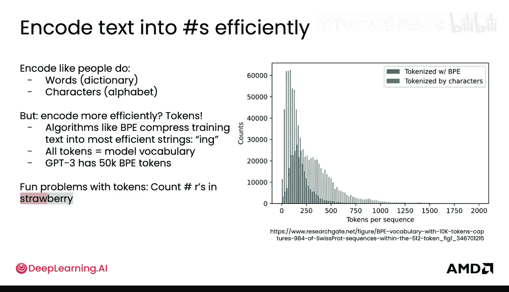

Processses tokens and produce the next token and then from that token。

 you can also process it back into text。 and of course。

 that next token then gets fed in it's append to that whole set of tokens going into the model to predict the next token in a loop。

 What's used to encode text into tokens and then to decode tokens into text is something called a tokenizer So just looking at a tokenizer a bit more you can have the text what words are indivisible and you might see these tokens so you might see that this whole sequence is subdivided into different pieces。

 and each of those pieces is called a token and they get mapped onto an I in the vocabulary and that's just a simple lookup table but essentially gets mapped into a number and then those numbers are then fed into the model so the model can then operate on those numbers using math that you'll take a look at in a sec but essentially the tokenizer in kind of looks like this is just tokenizer you pass in the text and it's able to give you these IDs same thing for decode just in the opposite direction you give it those IDs and you just。

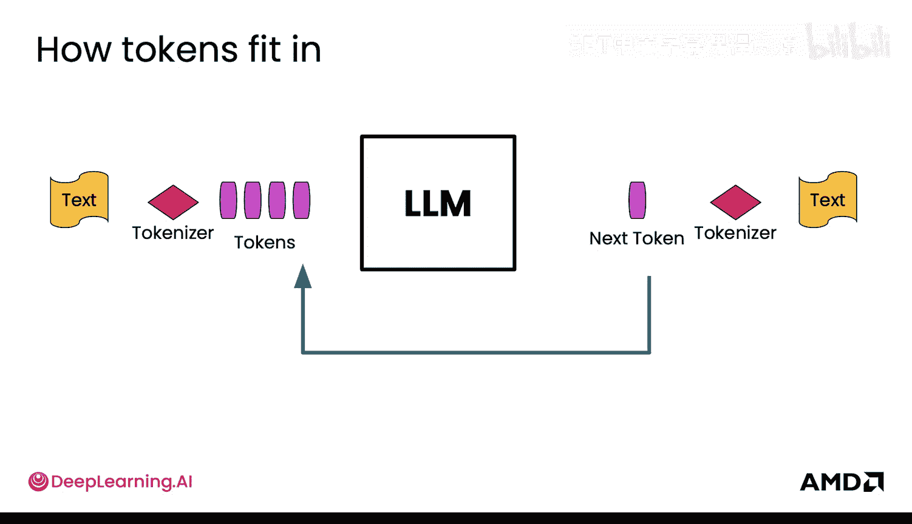

kendecode and it turns it back into that text for you Next are embedding。

 So how do the tokens actually go into the model。 So they're basically semantic representations of every single token So when you have your token id get mapped onto the first layer of the model that are the embeddings and the embeddings are the size of the vocabulary so you can think of the token Is as essentially indexing into this embedding matrix and then this embedding matrix is trained with the model to represent each token semantically initially as it enters into the model next the model will produce probabilities so it's going produce these probabilities over the entire vocabulary and then it's going to take from those probabilities a token id and the simplest way is to just do some type of greedy sampling or greedy selection。

 which is pick the token I with the highest probability and this is by default just in the model generate function and face so you don't need to specify anything is just greedily picking the highest probability token which in。

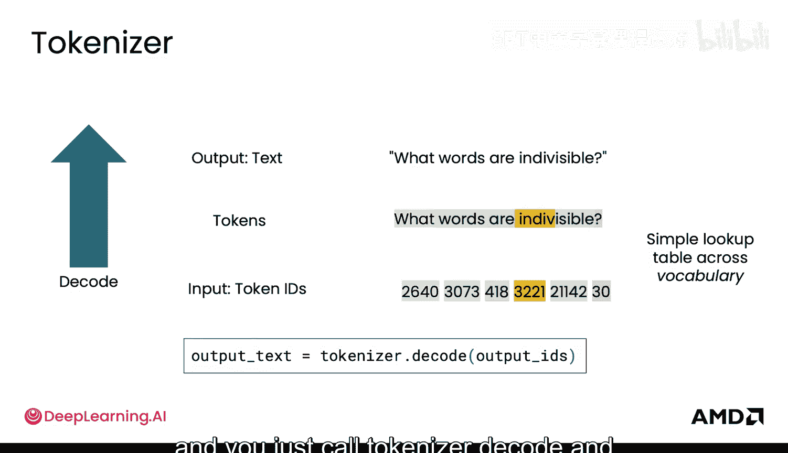

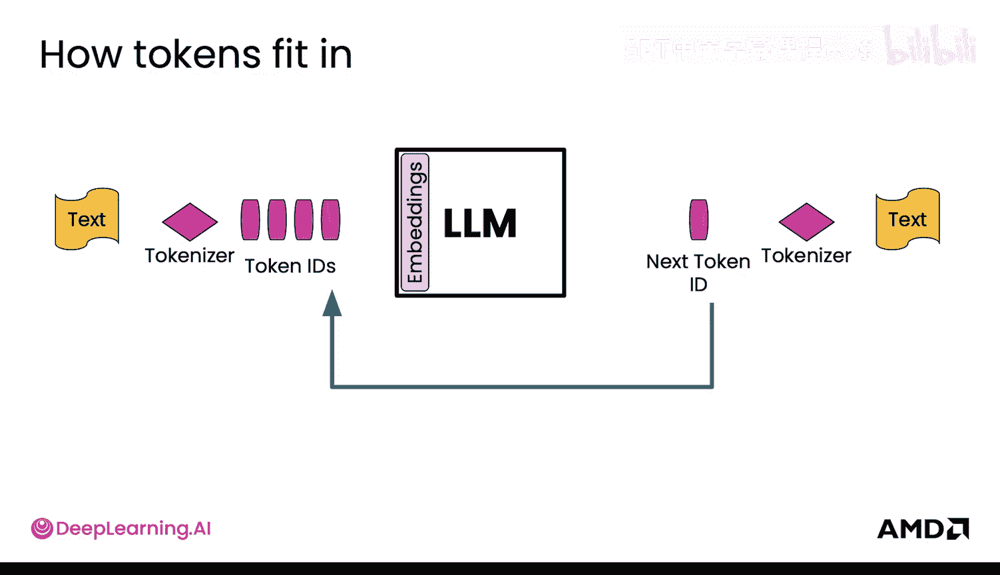

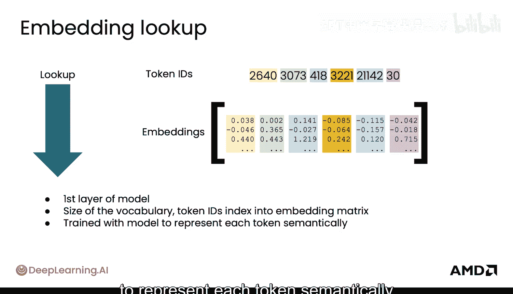

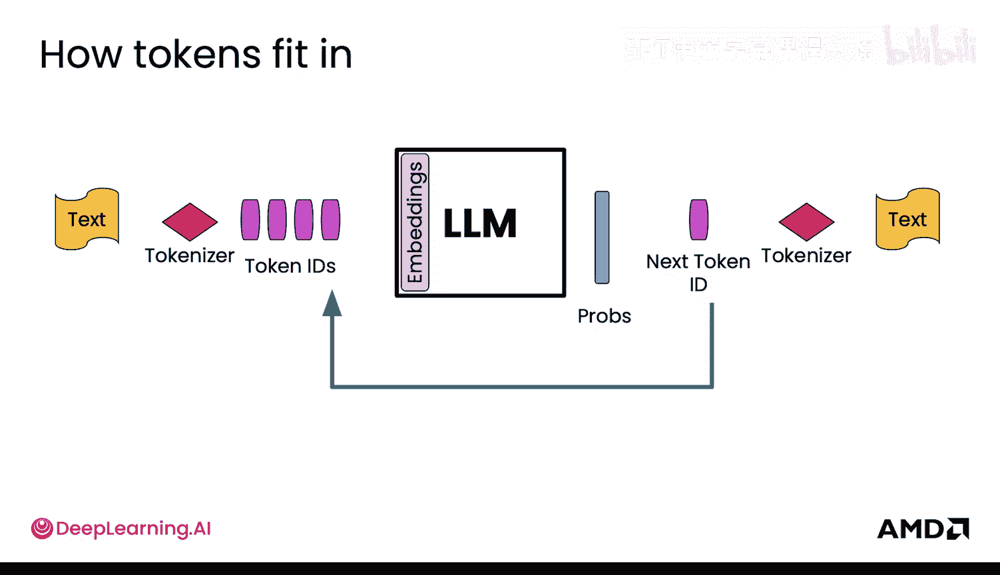

Example is that 0。5 token ID0 you can also sample from the distribution of probabilities over the vocabulary so you could sample know that ID0 but through sampling you might also sample this ID2 and when you're sampling you can pick essentially different things using your sampling algorithm and what's really interesting is you can modulate how much you want your sampling algorithm to be more random or to be more deterministic and by more deterministic I mean you can actually set the temperature here。

 which is a parameter you can set it to0 which means you don't want any variation in terms of how you're sampling and that actually just make sampling the same as doing that greedy selection but you can also turn it up so here is just visually showing what temperature does on the left you see temperature 0。

25 mostly selecting vanilla there's a little bit of strawberry if you look there but essentially it's constraining what can actually be sampled and then in temperature2 which is much higher temperature you can see that the distribution across。

The different flavors is much more even right so then a model will be able to sample across this distribution get a little bit more randomness in terms of what it gets for its next token Finally。

 another method to get the next token id from these probabilities over your vocabulary is something called beam search and what beam search does is it's able to track multiple different sequences as you sample them and these branches will branch off things will get a bit different as you sample different tokens but it's keeping track of the top beams so the top candidates essentially so for two beams you might sample two different token Is and you keep the top ones in memory and so if you were to have three beams。

 you might actually ultimately end up with something like this as an output so when a user asks you know write a poem the model might have the sun is setting soon and the sun roses about the hills and then three roads dirgent of what so it might keep those three beams as the top candidates so we have an idea of how we go from those end probability。

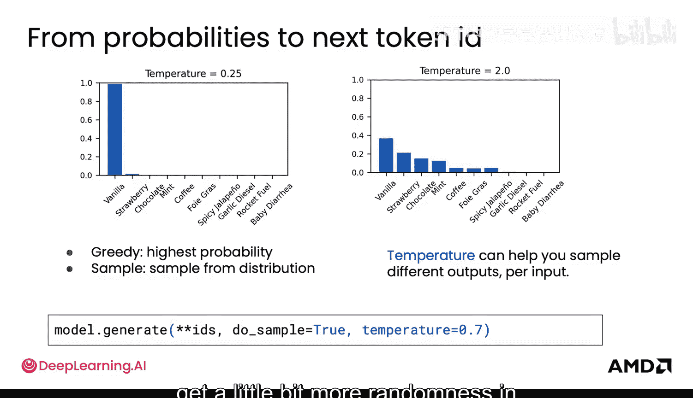

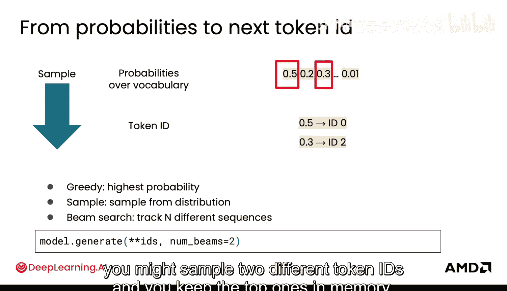

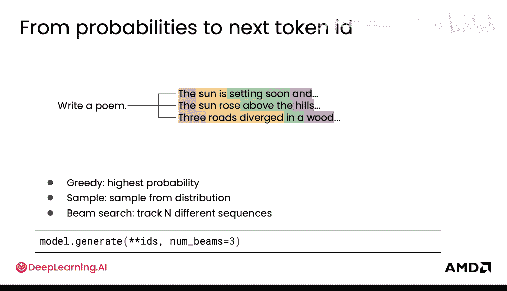

That ultimately are processed out of the model to then pick that next token ID and keep looping that for next token。

 all of this can be processed in a batch for efficiency on GPu so that we can parallelize processes and get outputs much faster across one text。

 but also many text So when you batch multiple different sequences together you might see something like this where you know multiple sets of token IDs to embeddings to do the embedding lookup but realistically they're going be different length so typically what's done is adding padding tokens so these padding tokens are basically like null tokens in there to make sure the sequences are the same length so that we can process this efficiently on a GPU which requires things to be put in a batch of the same size so that we can do matrix multipleplications on and operations on it much more efficiently And so here's an example of taking a tokenizer and actually looking at how it's padding things so this is a padding things。

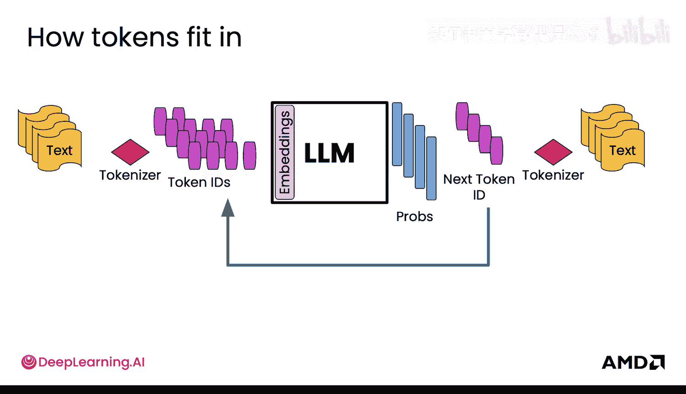

of prepending bird prefixing the padding tokens on the sequences so that they are the same length with the ID zero So you saw how tokenizers work tokenizers often are tied to a model or rather a model tied to their tokenizers so typically how you in it in hug face is and there is a auto tokenized feature which basically is able to take any model name and map it to the appropriate tokenizer it used is you probably can tell because these tokenizers are associated with different numbers for vocabulary it really matters like what tokenizer you use for a particular model and what it was trained with and this will become really important for posttraining so many tokenizers just to compare a few you can use through the transformers library here so here is the tokenizer for Bt based oncase so there's a Bt model and you can see that the tokens produced here have this hash symbol right and so it does that when it chunks up a word so using hunting face is pretty manageable so if it's kind of chunking up and saying it's the same。

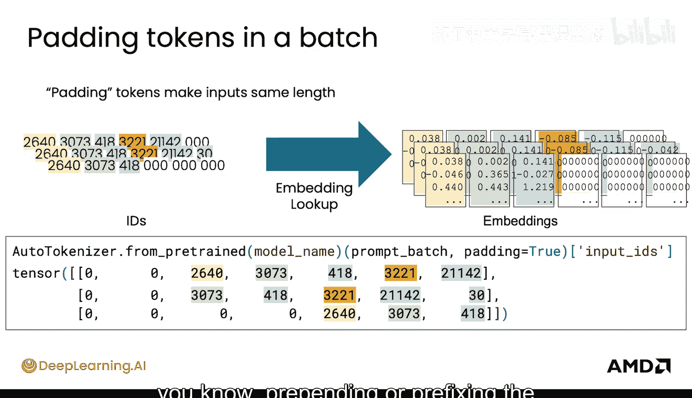

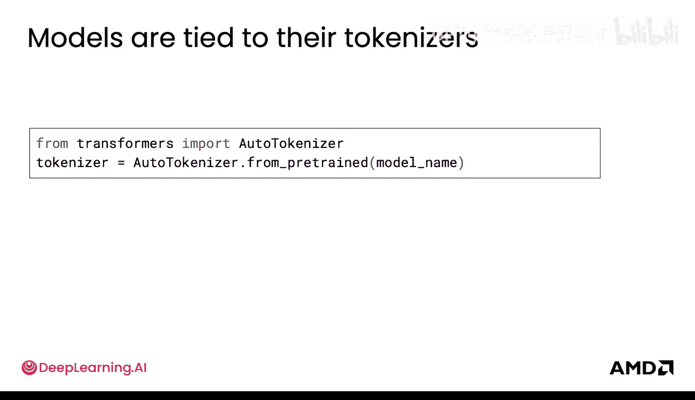

it uses that hash here is another tokenizer for a model called t5 small。

 and this uses underscores for spaces， It includes the spaces in the tokens it also prefixes the whole sequence with an underscore as kind of a start sequence simple and then this tokenizer might look really weird from a deeps model essentially uses this really strange G character for spaces and it doesn't merge spaces into a single space but it does group them into single tokens the main takeaway here is not to memorize these different tokens and what they output but essentially to see that there's a lot of variation in how these tokenizers tokenize and choose basically substrs to represent different sequences and not to be alarmed if you see something like that weird G character So how does this all play into posttrain。

 So in posttrain when you're making really small changes you can actually just get away with freezing the embeddings you don't need to change much when you're keeping the same vocabulary。

 for example， in your R phase you can freeze the tokenizer as well you don't need to continue training that because the vocabulary doesn't change。

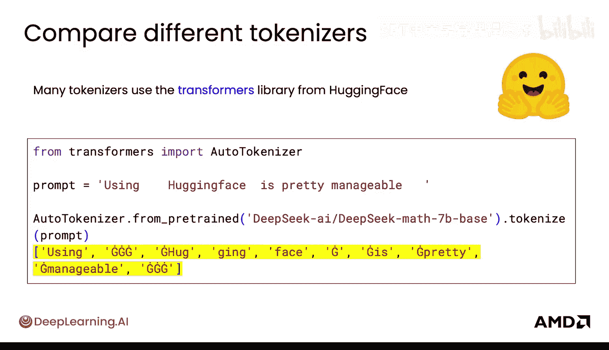

You do need to make changes when you're making larger changes right you'll be inclined to do that you'll want to train your embeddings because those semantic representations might change let's say you're training a legal LLM and it learns all this legal vocabulary in jargon and maybe there's some new acronyms in there and to learn that you really really need to continue training those embedding so that it can capture that semantic meeting more effectively and efficiently when adding new terms or special ties。

 you'll want to train your tokenizer because your vocabulary will change you might not be representing those tags very efficiently if you retrain your tokenizer if you keep it frozen and so this is just something to consider when you're changing your vocab size。

 you'll also want to resize your model' embedding layer because that's dependent on the vocabulary size and typically what people do is kind of do a warm up or train the new embedding first and then train everything。

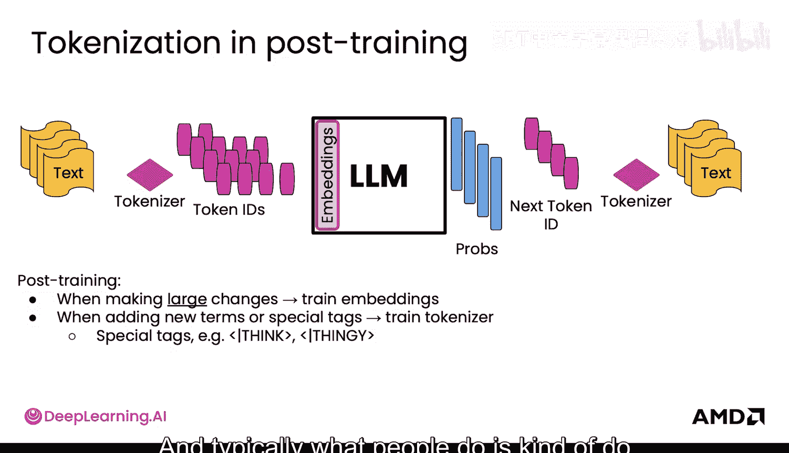

Now that you learned how tokens are created， it's time to get into some of the fun stuff with fine tuning math。

