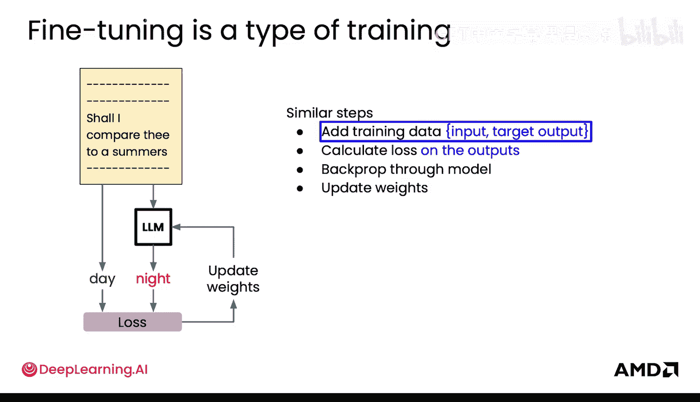
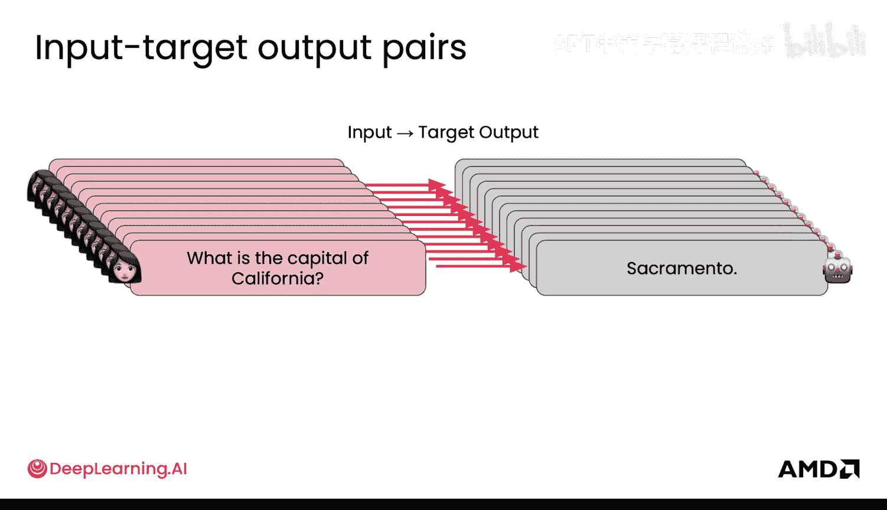
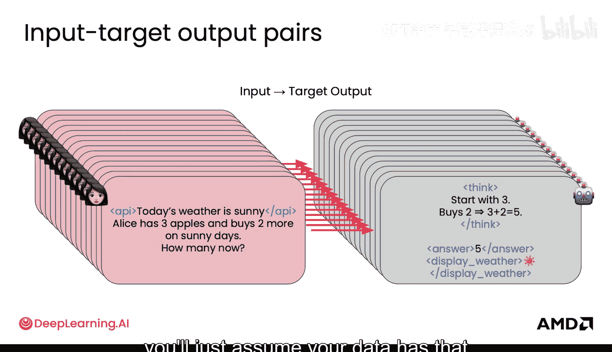
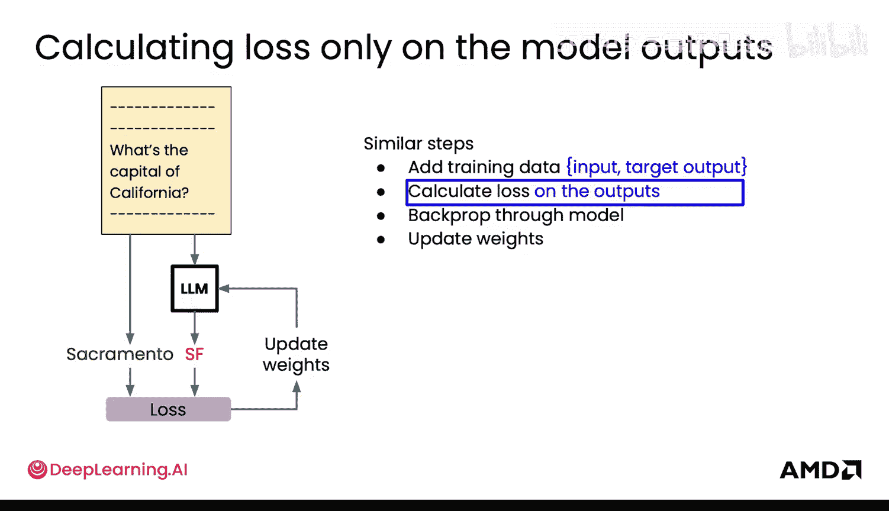
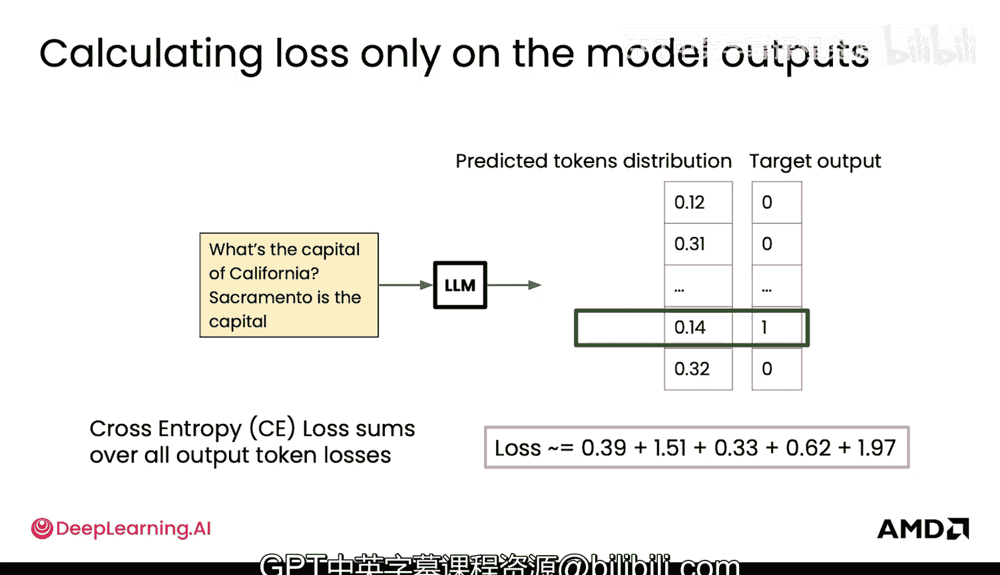

# AMD《大型语言模型的微调与强化学习：后训练入门｜Fine-tuning and Reinforcement Learning for LLMs》 - P11：3.fine-tuning-math-loss,-gradients,-weight-updates-(part-1).zh_en - GPT中英字幕课程资源 - BV1zZy8BcE7z

Fine tuning has a lot of interesting neural network math behind it In this lesson。

 you'll learn about all the different intricacies， including calculating loss。

 the gradients and also how to update your weights and also some of the little intricacies for fine tuning in particular。

So first， a quick refresher on training a neural network because training a neural network is roughly all the same steps you need for fine tuning。

 So your model can start at any point in this case， it's outputting garbage predictions。

 you have your training data you can calculate loss on some objective between your model's predictions and the target。

 So that's how far off the model was in this case it's going to be a lot and you calculate gradients through the entire model via backproagation。

 So that's understanding how each weight in the model actually influence that loss。

 You then update your weights in the direction of minimizing the loss with some algorithms to help you make that update more stable and effective in fine tuning。

 you're starting with a pretraining model。 So it's already going to be better than a random model it might output night here instead of those random characters and what's particular about the steps is two main things。

1 the training data specifically has an input in a target output so there's a target again and your loss to calculates the difference between the model's predicted output and the。

Target outputs and only on those target outputs， not the input and the back and weight updates are the same。

 you'll see some review here as well。 So first， take a look at the training data。

 lots of paired examples like this of how you want the model to behave like what's the capital of California Acramento。

 Of course， in the next modules。 and you've seen a little bit of this already。

 you'll get to see more sophisticated pairs like inputs and outputs with custom tags， for example。

 to hook up to tools and other things。 you'll also learn how to craft your examples。

 which will impact the model's performance pretty heavily， very， very heavily。 And later here。

 you'll just assume your data has that input target output paired structure。

 so next you want to run your model through the inputs。

 get predicted outputs and then compute the loss on the outputs against that target output。

 So just an example here， given this input， what's the capital of California。

 The model is gonna output that distribution of predicted tokens over its vocabulary。

 It entire vocabulary。 So here are the token probabilities across this model's predictions。

 and then it samples SF as the。

Pdicted token with greedy samplings because it was the highest probability。 this token had a 0。

6 probability here。 That's actually wrong The answer is actually Sacramento but the probability on Sacramento is much lower as you see here at 0。

12 Now the right answer is actually distribution that looks like this it's one on Sacramento in0 on everything else so it's one hot encoded target output so to calculate the loss on this predicted token you want to measure how well the predicted probability distribution so those predicted tokens distribution matches the true distribution which is that one hot distribution of target output and you want to maximize likelihood or probability of the correct token in this case Sacramento thankfully there are algorithms for this and one of the most popular ones is actually cross entropy loss in language modeling or also known as negative log likelihood and you can see here cross entropy directly optimizes the log likelihood of the correct token and the log part essentially penalizes the low confidence so instead。

Of just telling the model to quote pick the right token。

 the model also needs to be as confident as possible on that right token。

 So this is why Lm don't just learn to rank tokens。

 but to assign good probability distributions over that entire predicted tokens distribution So as an example。

 take a look at Sacramento with this prediction。 So you put 。12 in there and the loss is around 2。

12 so let's in the model had actually predicted the 068 on Sacramento instead of Sf and it got a right what would the loss actually be much lower right So the loss would be 0。

39 So that's just showing if it predicted correctly， it would do much。

 much better And the more correct it is the better it is in the lower that loss is And this is why through loss。

 you can actually get models to learn not just how to rank these tokens。

 which one is better but to assign good probability distributions for that predicted token distribution so let's actually go through the entire target output to see how loss is calculated on the output The target output here。

Saaccramento is the capital and that's the answer to what's the capital of California So for this loss calculation that means there's a loss mask on the input so the calculations of loss on the input isn't used at all in the final loss calculation and that is exactly what that stephead meant around only calculating loss on the outputs so let's compute the loss on the next token one pretty notable thing here is we put Sacramento in the input sequence now for the next token and whether the model predicted Sacramento or not we're actually going to put the correct output token here and this is something called teacher forcing because we're forcing the right output in there and teacher forcing basically enables really efficient training because this is what makes these language models really parallelizable you can actually know what the target output is because you basically can do this computation in parallel and this computation can happen with the last computation as well as what the next computation you don't need to wait for the model to predict something to do the next so this is really important。

And because then you can just do one forward pass of the entire model。

 one big matrix multiply and essentially that's one fuseed kernel for the whole loss so next one is it keeps predicting the here correctly and then capital maybe also correctly here but not not as much and then it predicts a stop token which is a good practice to know when a sequence is so essentially get all the probabilities of the outputs together you normally would multiply probabilities that's like the probability of multiple probabilities but because of that log term in the cross entropy loss that log turns that product of probabilities into a sum and this makes optimization much easier by not having a product of probabilities get too small or large for computers to handle because it could explode right when you multiply many very large numbers of very small numbers together and this is one of those subtler points but pretty deep and important points of why log likelihood is pretty much everywhere in AI。

