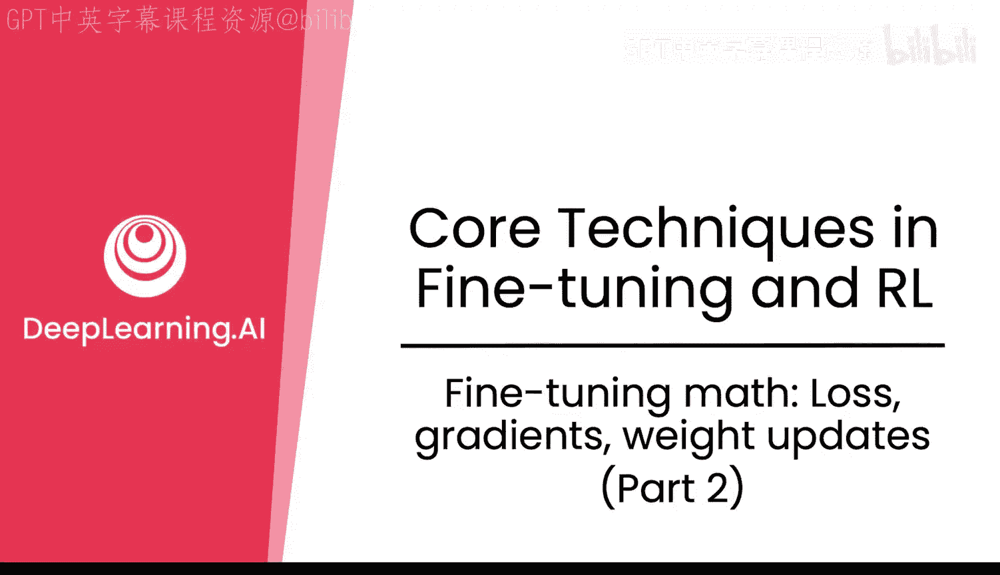
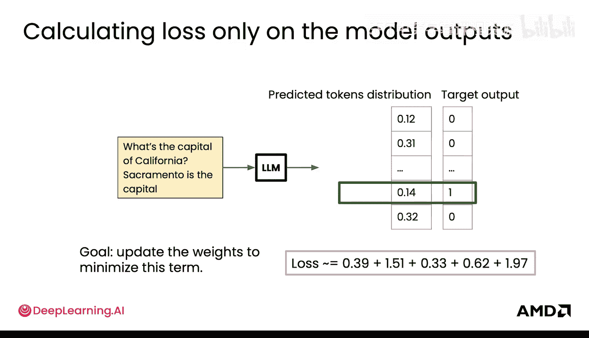
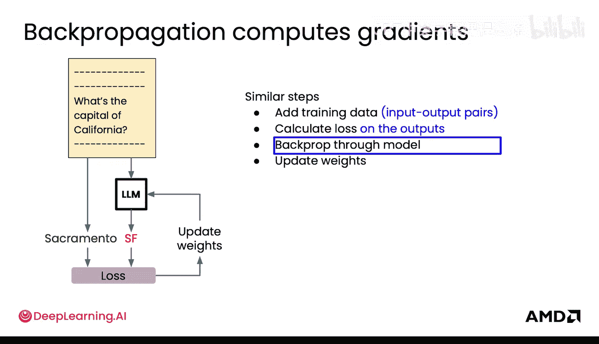
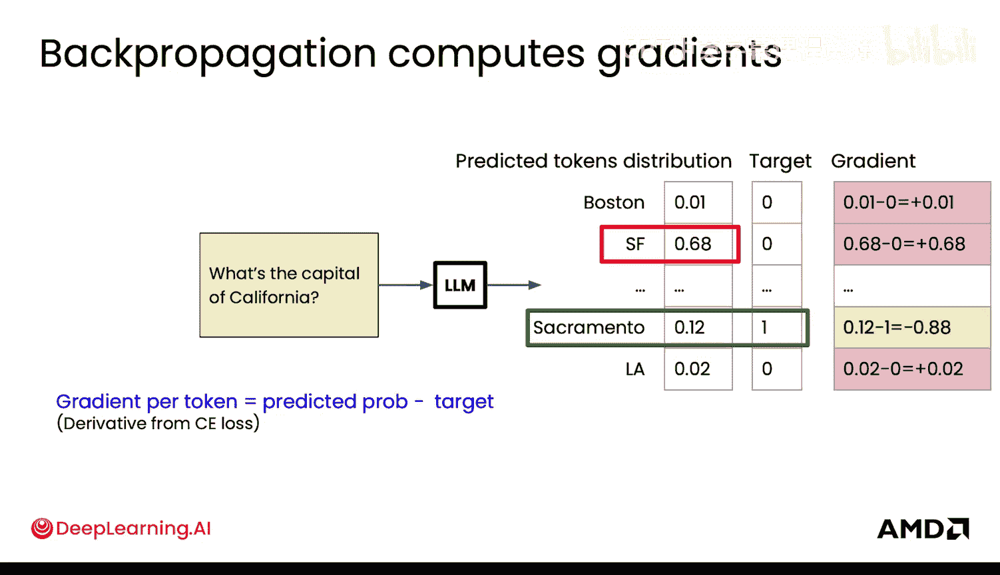
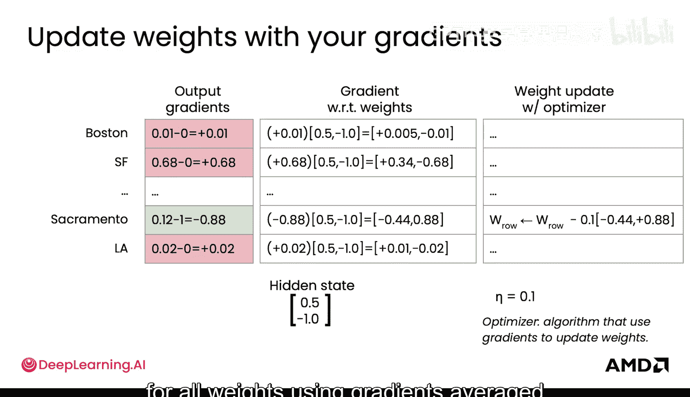
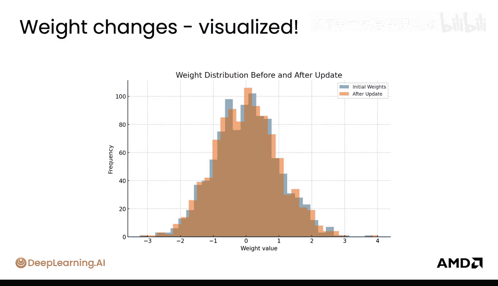
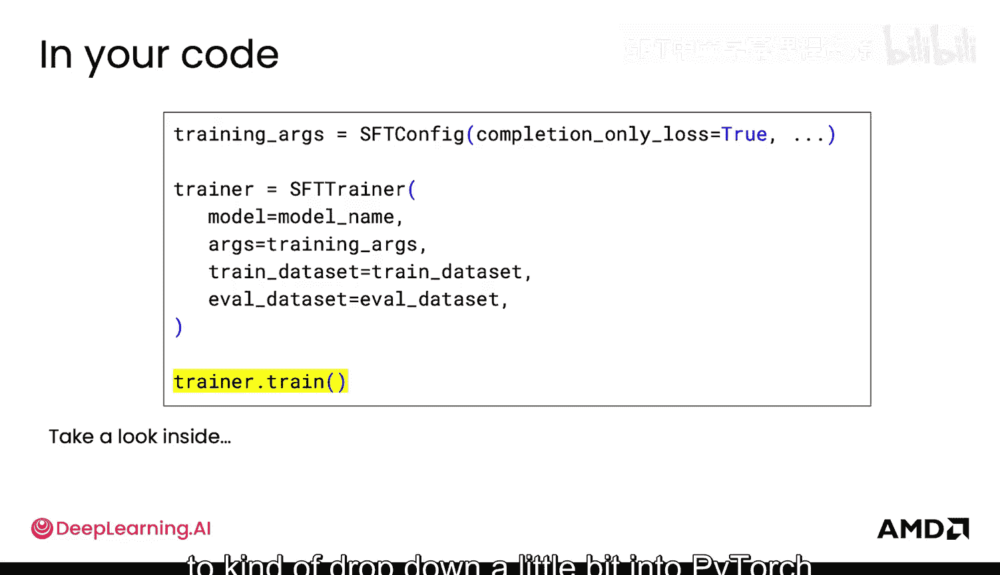
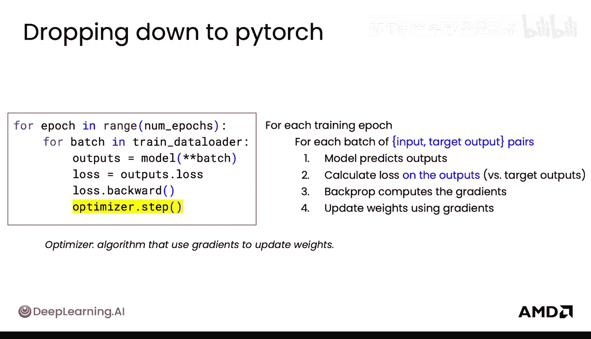

# AMD《大型语言模型的微调与强化学习：后训练入门｜Fine-tuning and Reinforcement Learning for LLMs》 - P12：4.fine-tuning-math-loss,-gradients,-weight-updates-(part-2).zh_en - GPT中英字幕课程资源 - BV1zZy8BcE7z

So next up， the goal is to get the model to actually minimize this term。

 This is the loss representing what was off about the model's predictions overall。 and yes。

 the smaller loss better and so that next step is exactly that So with that loss term you can now calculate basically how much or what direction to update every single weight in the model to minimize that loss and you want to put more mass on outputting Sacramento and less on SF and that's what back does it will compute backwards into the model from the very last layer closest to the final loss calculation to the very first one and it's going to calculate the direction and how much the magnitude each weight influences that loss so going through this a bit。

 it computes a gradients of the loss with respect to every single weight in the model and the gradients are telling you how to essentially change the weights to make the LLL more likely to output the correct answer in this case。

 Sacramento and less likely on all the other one so less likely on SF less likely on Boston L and the grade。

is just a derivative calculation of the loss with respect to each weight and it's very iterative so you keep doing the gradient backwards through the model and that's why it's called backpro to think of it more intuitively if you're standing on mountain say you can think of your loss as your altitude and like how high up you are and your weights essentially as your x Y position where you're standing and then the gradients are your slope derivative so like the steepness and the direction and so that's kind of the direction you need to go in for gradient descent So for crossenttropy loss the derivative is pretty simple here so it's just negative likelihood and that's the probability the token minus the target probability So if we actually do the calculation here you can take a look at this column of the gradients and you'll see that sacramento the correct one has a negative gradient。

 well everything else has that positive gradient you understand how much and kind of in what direction change of weights that's actually update the weights themselves it's not as simple as just using the gradients directly you have your weights with respect to your output。

And then let's say your last hidden state is here。 Basically your input transformed by your model turns into this。

 this is a toy example so the hidden state's usually larger。

 but it essentially represents a semantic compression of your input and that gets then projected and turn into a distribution over your output token predictions over the vocabulary every single token here has a row of weights that connects the hidden state and the gradient of the loss with respect to every single weight is the output gradient times that hidden state and the hidden state really scales how much update each weight row here so it tells us how to adjust the weights to improve our predictions and then you can update your weights with this information so gradients are ultimately somewhat local signals right you can say like push this weight up a bit or push this weight out a bit but if you updated by the full gradient from one example the model would probably overfit to that one example and potentially forget others so raw gradients are often just like too small。

too large and that could lead to pretty unstable learning and that's where something called optimizers come in Opims basically help you decide how to use these gradients to update the weights here is just showing one of the simplest one called stochastic gradient tocent as G and you update each way by subtracting your gradient scaled by some kind of learning rate ada and here Ada is just set at01 so you can see here for Sacramento it's scaling that here in practice LLms are going to use more advanced optimizes atom or atom W which you'll see kind of tricks later for in an LLm with billions of parameters。

 this update happens in parallel for all weights using gradients average across your batches of data now that you've updated your weights。

 one really cool thing is you can take a look at the change from just a single update So this graph here is showing the distribution of all your weights in the model with blue being the old ones orange being the new ones and showing how the entire distribution slightly shifts after just one update step and the orange should get the LLM closer to Sacramento hopefully so these days it's kind of easy。

And the steps are really wrapped up into a hugging face trainer class if you're using hugging face so you can just specify the model。

 your trading arguments， your data sets and SF its called SFT trainer SFT stands or supervised fine tuning again that is the type of fine tuning we're doing here in your hyperparameter for fine tuning it's important to specify completion only loss equals true and that means that you'll only be calculating loss on the outputs which are also called completions typically and not on your inputs and then you can just called trainer train to kick off the training loop that just walked through so that's that but just taking a look quickly inside of trainer I think it's important to kind of drop down a little bit into Pytorch is to understand what's going on in there so inside of that train what it looks like is for every training epochs if that's across all of your data your whole data for a small batch a set of input target output pairs the model is going to predict some outputs it's going to calculate loss on the outputs versus the target outputs with that cross-enttropy loss from before the loss is then used in back。

Pro to calculate gradients for all of the weights and then finally the weights are going to be updated using the gradients and the optimizer is going to decide what direction to take a step in and how large of a step to essentially take and then the cycle kind of repeated for the next batch and you'll walk through all the data in this case numb epoch times so that's it next up would be probably diving into those hyperparmeters and how to tune them so your model can actually effectively learn and that's it you've gone through the nitty gritty math of how to do fine tuning。

Next up is deep diving into those hyperparameter to tune your model effectively。

