# AMD《大型语言模型的微调与强化学习：后训练入门｜Fine-tuning and Reinforcement Learning for LLMs》 - P13：5.fine-tuning-hyperparameters--hyperparameter-tuning-(part-1).zh_en - GPT中英字幕课程资源 - BV1zZy8BcE7z

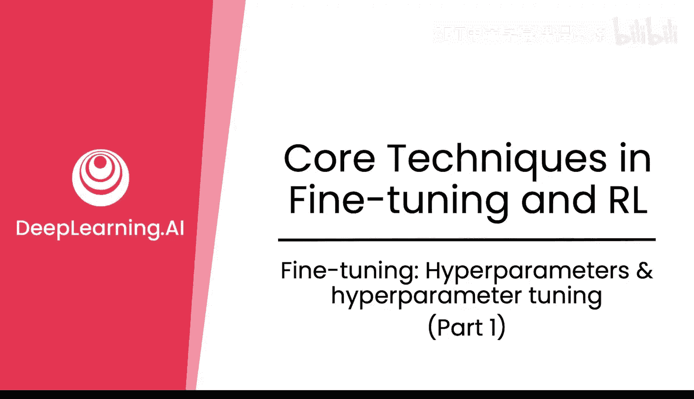

Hyperparameters are really important to good stable training in post training in particular。

 you may need to set or tweak the hyperparameters to be different from the default so that it actually fits your task。

So one of the most important hyperparameters is learning rate。

 abbreviated LR typically and here the learning rate essentially controls how much your model is updating its weights with every single step。

 So choosing a good learning rate is super important to making sure that your model actually learns efficiently and effectively。

 There is such thing as learning rate being too high and then the model's learning is unstable like it's overcracking for every single example or it can also be too low and it learns painfully slow So just to dig into that a little bit。

 you can visualize what this looks like when the model tries to complete the phrase。

 the cat sat on and with a learning rate that's too high。

 the model's updates are pretty chaotic and the loss jumps all over the place and the output can be just gibberish。

 you'll often see your loss reported as naan are not a number or infinity if the learning rate is just way too high。

 a perfect good learning rate is something like this。

 you see a smooth kind of steady decrease in the loss curve with every epoch。

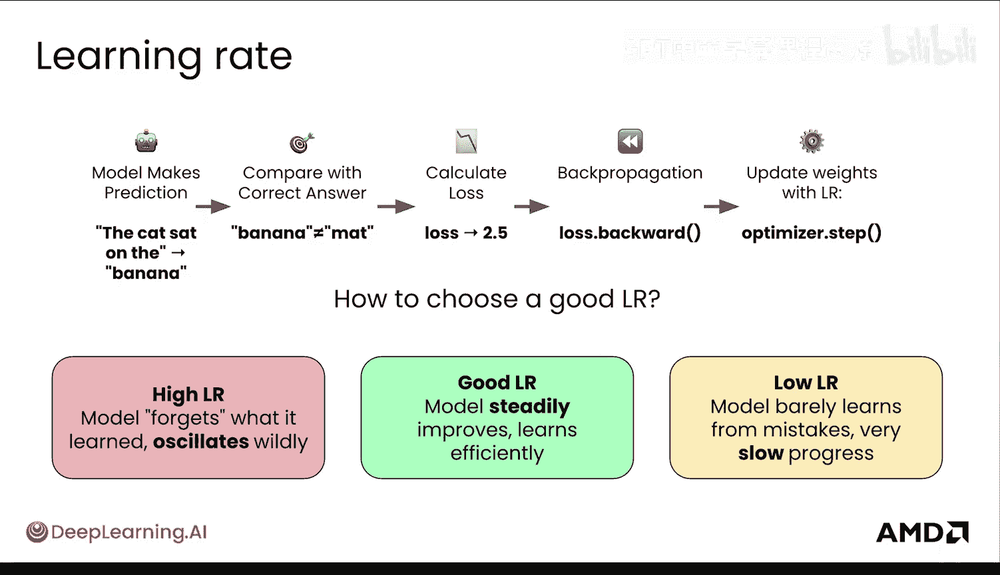

Loss is going down until it converges and stops going down The model learns pretty efficiently and produces a coherent a correct completion like the warm blanket here and then finally if the learning rate is just too low the model barely learns loss decreases but super slowly the output might not be complete to bearish but it's often nonsensical because the model isn't updating its weights enough to learn the patterns in the data and sometimes the model can also stall it's learning if it's way too low and so these are kind of the different cases。

 you'll see all different cases in between it really is highly empirical to figure out what your learning rate is however there are some really good default you can also dynamically adjust the learning rate during training using something called a learning rate scheduler here to popular strategies are cosine anneing which you see here on the left and this is where you might want to learn more quickly early on when you're further from the goal which provides that smooth decay and also linear decay with a warmup warmup period where the learning。

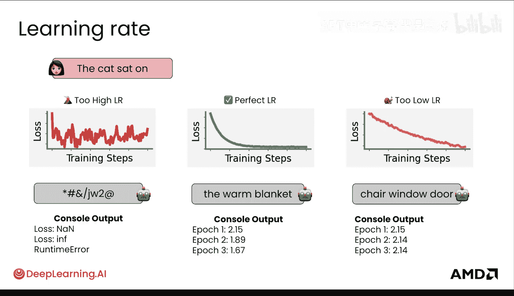

Rate essentially starts slow， increases and then steadily decreases after that warmup and intuitively this kind of gives time to get less random gently at first for the model and without it training can divert sometimes in the first steps too quickly so that's what the warm up is trying to solve for by letting the model kind of stabilize its internal statistics before full speed learning these are you know essentially some best practices that have been developed over time however I found that the new stuff doesn't always make it necessarily that much better so maybe this area is kind of ripe for disruption or it just means and we found some pretty good characteristics for how these models that should learn beyond the learning rate scheduler there optimizes in different frameworks like transformers and Pyfors will provide pretty sensible default learning rates for you and for most fine tuning tasks and optimizer like atom W with a learning rate of5 v negative5 is a great starting point that's a default Adam W is just a variant of the famous atom optimizer it uses kind of adaptive learning rates which means。

Aptively scales updates per parameter so it's different per parameter in the model and it decouples weight decay。

 which is just a way to regularize the loss and that's by encouraging kind of smaller weights overall so the LLM learns more stably and isn't as prone to swings for particular examples it basically prevents overfitting there are a lot of great sensible defaults I would just start there and then empirically experiment with what works for your use case Next up on different hyperpara is number of epos one epoch means the model has seen every example in your training data at once in pretraining you might have heard that LLMs training for only a single epoch because there's so much data in post training however you're typically training for multiple epochs on your high quality data so that allows your model to see your high quality data several times and basically allow it to refine its understanding so you typically train for multiple epochs here so let's see the first time the second time the third time that's pretty straightforward choosing the right。

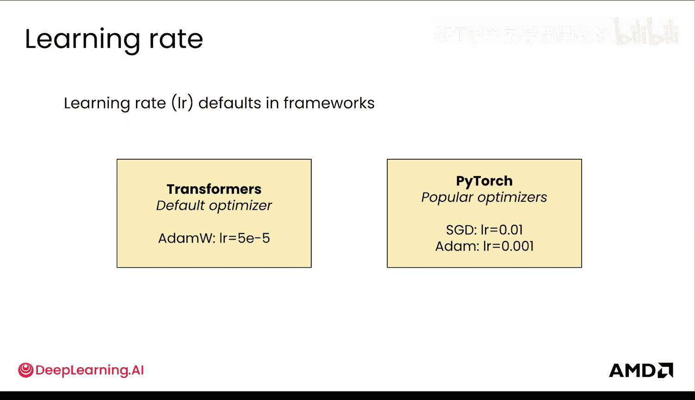

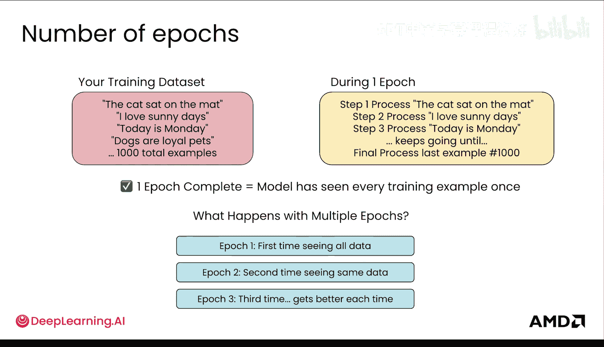

Epos is also empirical so if you stop too early， for example， after one epoch。

 the model might be underfi right so it hasn't learned enough its responses will still be like its previous checkpoint maybe so here's a pretrained model here the sweet spot is kind of an optimal stopping point where the model generalize as well the model has learned patterns from your examples that generalized to new inputs without memorizing them because if you train for too many epochs which is like 15 here the model starts outputting memorized training examples for betim it basically fails completely on new text because it's just recalling it's not generalizing from your examples and it even starts to forget previous capabilities and this is why monitoring validation loss and more on that later and stopping at the right point is pretty crucial so make sure to tune this you can also tune this by the number of steps or batches you take across your data that's more fine grainined than number of epochs and you want to mix up your data across epochs so the model sees the data in a different。

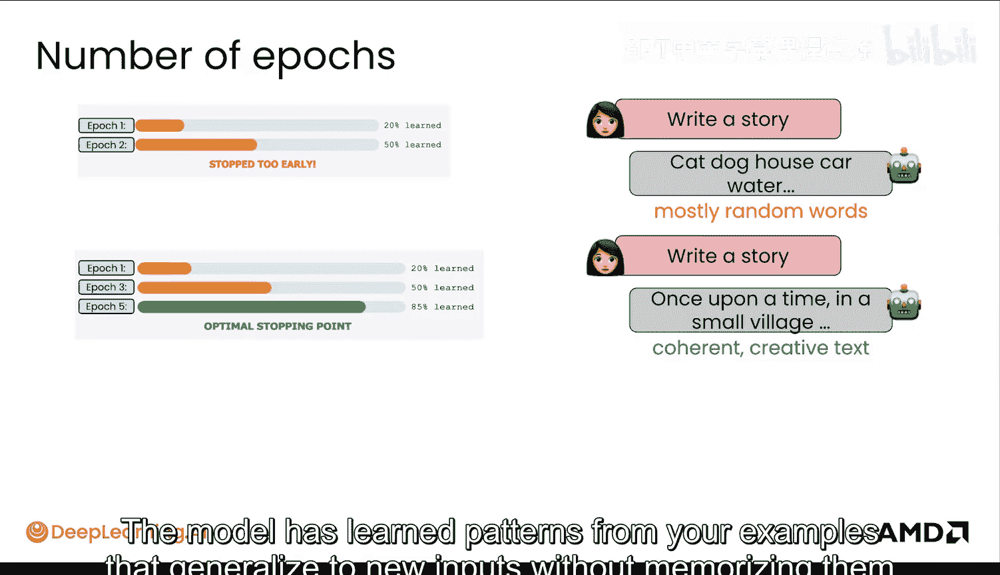

Order quick aside， there's also a concept of overtraining and sometimes when overtraining。

 you can see improvements after it stops improving and seems to be overfitting。

 This is a really interesting phenomenon being studied in research today。

 often known as double descent Another hyperparameter is batch size so this is the number training examples the model processes together before updates its weights with a small batch size like four say the model makes frequent updates to get through the entire data It's like a small set every single time and this leads to small updates many of them and potentially noisier training in the extreme case。

 you can definitely train on a batch size of one with a larger batch size like 2048 here the model processes many examples at once and we'll make basically fewer updates。

 but they're gonna to be more stable a smaller batch size is slower per epoch because of all the updates but it uses less GPU memory at a time and this makes it a good choice when you have a limited hardware and a large batch size is faster per epoch but requires a lot more。

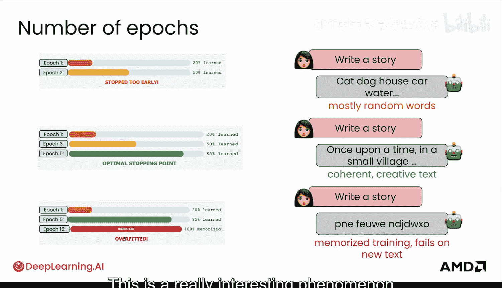

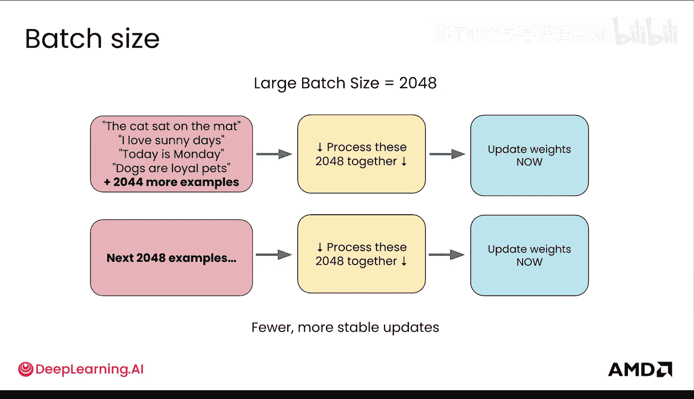

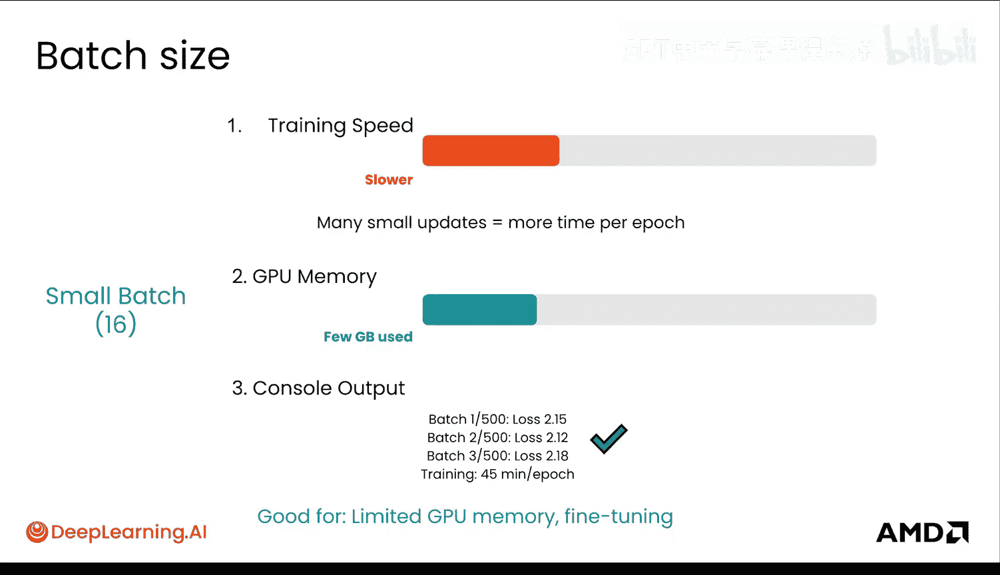

GPU memory So here you know AMD has a GPU that has huge memory or called high bandwidth memory HBM and that allows for larger batch sizes running on a single GPU It's pretty ideal for training on very large data sets if you have the hard to then support it in addition to just batch size and data exactly how much memory also depends a course on the size of your model and how many weights you're updating in that model If you set the batch size too large for your GPU your training will crash with an outof memory error the fix is straightforward though so reduce your batch size until it basically fits in available GPU memory and you might have noticed that the batchside number here are all powers of two that's intentional Okay so that's to optimally use your GPU。

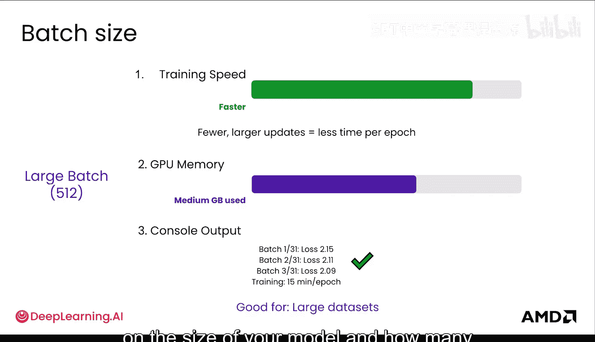

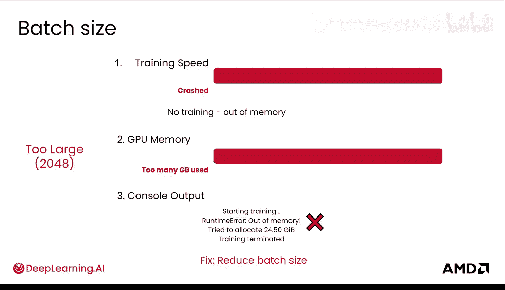

Okay， so what does this look like in your code so here's how these hyperparmeters show up in the training arcs that you saw before passed into the trainer so you can see different batch size terms for the training and also of course passing that for the email and test sets。

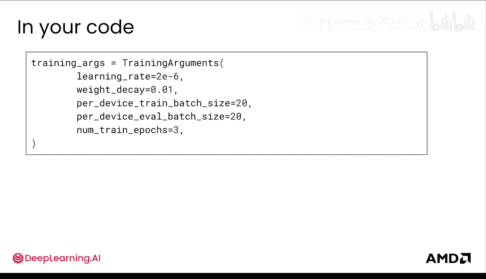