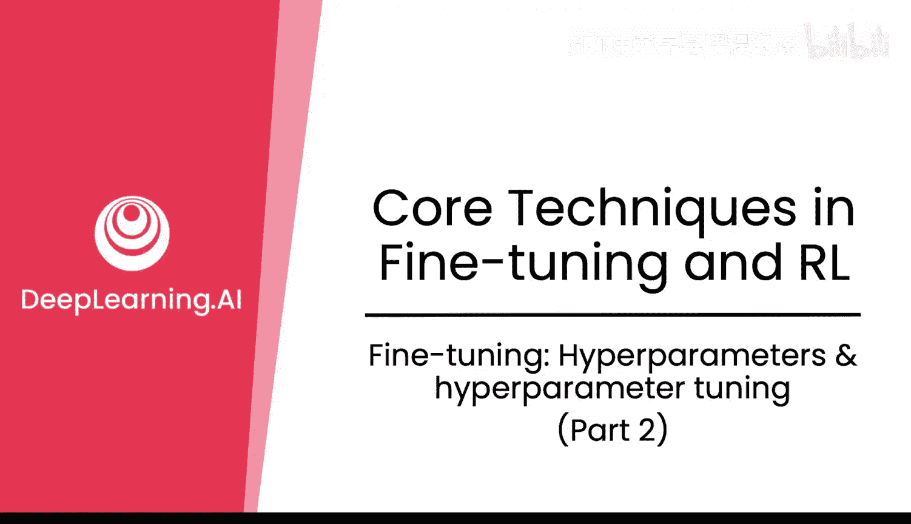
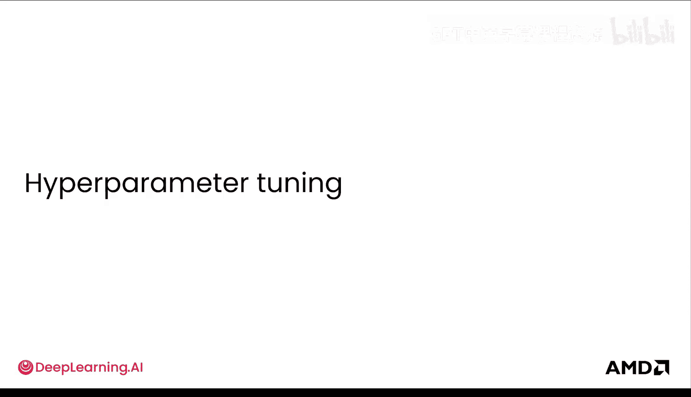
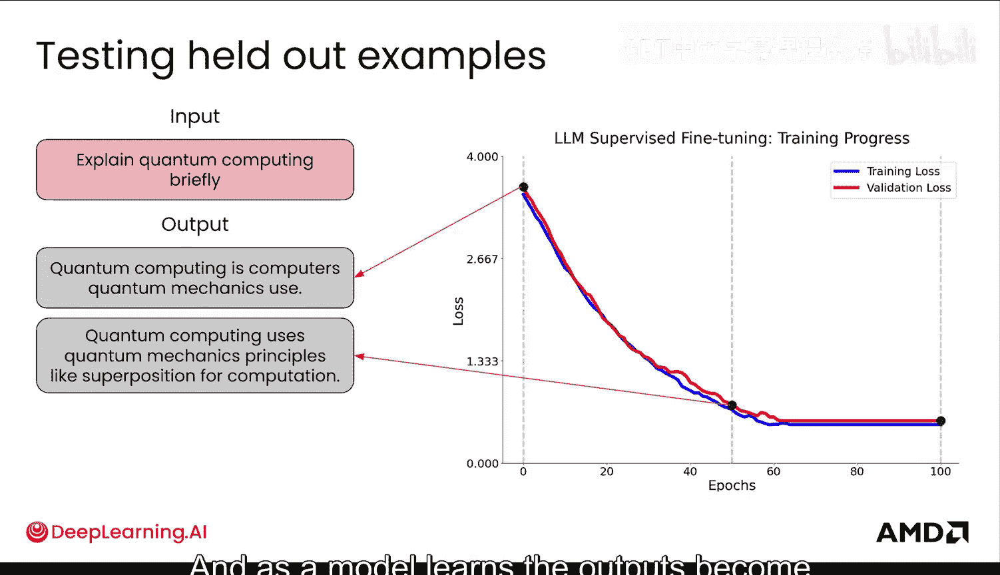
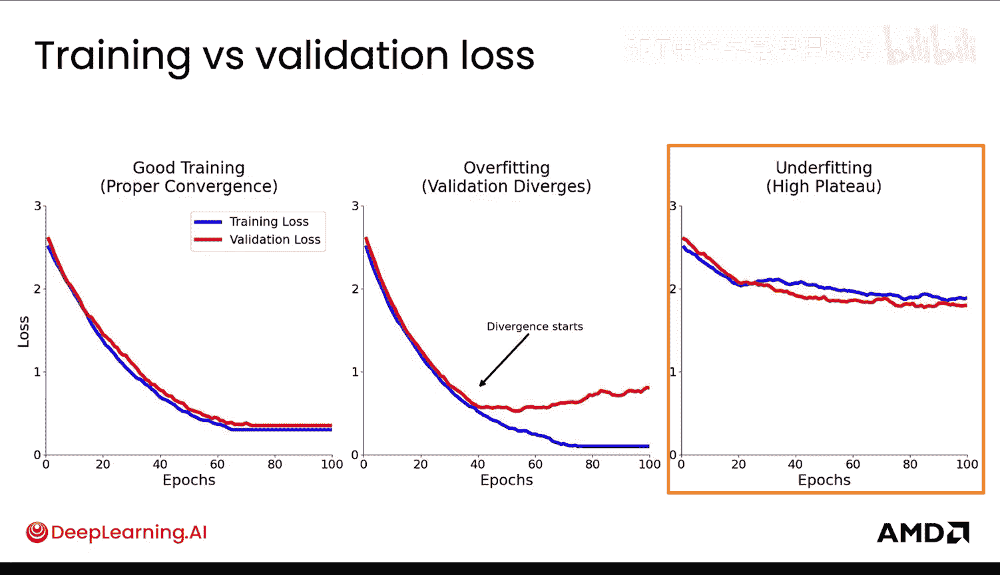
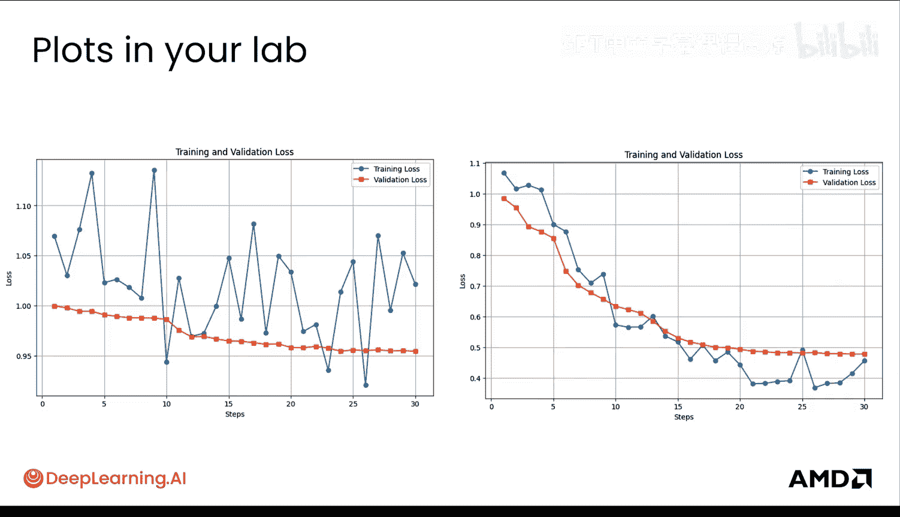
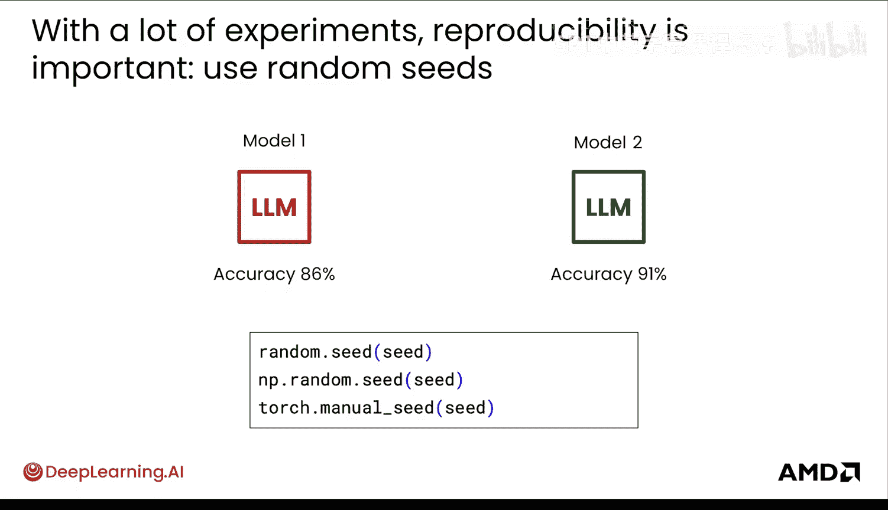

# AMD《大型语言模型的微调与强化学习：后训练入门｜Fine-tuning and Reinforcement Learning for LLMs》 - P14：6.fine-tuning-hyperparameters-&-hyperparameter-tuning-(part-2).zh_en - GPT中英字幕课程资源 - BV1zZy8BcE7z

So how do you know the choices you're making are actually working。

 So the key is to monitor the modelss learning progress and you learned about loss and monitoring it earlier。

 but when training LLMs， monitoring the loss curves is pretty crucial it's the central point for understanding model performance and this helps us tune the hyperparameter and empirically know what's off and when things are going well it's basically the dark arts of AI training So you typically track to very important metrics one is training loss and one's validation loss。

 Tra loss is the error on the data the model is currently trained on and validation is on that separate heldout set of data that the model hasn't seen before。

 but you used to see if the model is generalizing to that new set and it's specifically for tuning hyperparameters to optimize that validation loss so you want to make sure that all your hyperparameters are tuned to make validation loss appropriate and lowest possible this is not your eL or test set which is also held out。

Not going to be used to tune your hyperparmeter so that there's another set held out Okay so as training progresses。

 we basically expect the model's outputs on the validation set to improve and get more coherent correct as the loss goes down So here as the loss goes down you'll see like checkpoints from the model to assess how it performs on both training and validation losses for example when you ask the model you know explain quantum computing briefly which is not present in the training data you can see the progression of outputs getting better and early in training responses are maybe incomplete or repetitive or whatever the pretrain model is and as a model learns the outputs become more coherent and comprehensive。

So plotting these two loss curves will tell you a lot。

 though you'll see in later videos your test set or Evals will be potentially even more crucial for post-training success。

 but getting the model to learn stably is a given table stakes。 So here in a good training run。

 both losses will decrease and converge if the validation loss starts to increase while the training loss continues to decrease that's actually a clear sign of overfitting。

 the models memorizing the training data and losing its ability to generalize to the validation set。

 And if both loss is plateau at a high value the model is underfitting it's not complex enough or has in trained long enough。

 I will say that small note that in research we are finding that actually the overfitting line isn't as bad and actually gets the model to do better sometimes and we call it often a double descent So it will go down go back up again and down again。

 but that is still in research in terms of understanding these models Here are some realistic plots more realistic than the ones that you just saw there that you'll be。

Plodding directly in your lab。 The left is underfi and too high and the right one is converging nicely。

 So note that the smoothness is just not perfect here。

 and that depends on how often you're plotting the loss and how often your checkpointing the model to run on the validation set and get the validation loss Great so now you can start hyperprometertor tuing it's super empirical every single hyperparmeter is pretty empirical So one of the biggest tips is reproducibility So you know whether your experiment was actually successful or not And so you know whether to scale your new finding or technique or if it's just random luck and random luck can happen when training a lot。

 So on randomness maybe you run kind of two different experiments here and you get two different acuracies。

86% in 91% without setting any kind of random seeds these could just be variance from your runs random seeds are a way to control randomness and training like weight initialization and data shuffling and controlling that randomness is really important for debugging for comparing experiments for just reproducibility。

 scientific reproducibility So here's。

You can set the same seed that means hopefully getting ideally identical results across runs for these frameworks and please note that there's still other randomness lower down in the stack that you might not be able to control directly with Python  N or Pytorrch kind of at the kernel level that runs on the GPU You won't learn this here。

 but there are some super cool paper so about determinism in LLM training to make it more reproducible if you want to dig more into that research。

Now that you've learned how to tune hyperparameters for good stable training， next up。

 you are going to take a look at how you train more efficiently with parameter efficient fine tuning。

