# AMD《大型语言模型的微调与强化学习：后训练入门｜Fine-tuning and Reinforcement Learning for LLMs》 - P15：7.fine-tuning-parameter-efficient-fine-tuning-(peft).zh_en - GPT中英字幕课程资源 - BV1zZy8BcE7z

One of the most popular ways to fine tune models is actually through parameter efficient fine tuning techniques。

 Let's take a look。 So fine tuning， your whole model is pretty expensive。

 You're updating all the weights， which means you need an extra amount of memory to hold the gradients in the GPU that's double the memory And then there's actually states for your optimizer to store as well。

 So you're looking at two to three times memory of the model itself。 just to fine tune。

 You also need more compute to calculate those gradients。

 and that translates to just a lot more money overall to run all of that。

 So if you need multiple fine tune models for different tasks like you see here。

 you're actually going need to run them on different GPUus they're all very big and they can't fit maybe on a single GPU might be three separate GPUus here。

 So each model is not very easily portable， it's hard to move between the different servers。

 So is there a better way。 Well， actually， yes， and it comes from a really， really interesting fine。

 It turns out that the change in the LLM weights that Dlta W you see there。

Fine tuning actually have a lot of redundancy so this doesn't mean the LLM weights themselves have a lot of redundancy it's actually just the weight updates or the matrices to update the weights based on the gradient and based on the optimizer so a lot of the updates from new fine tuning data that are applied to the weights are basically uninformative and don't have to happen there's more noise and signal maybe to put it another way you can represent the LM changes during fine tuning pretty accurately with a lot fewer parameters in that weight update matrix so's if you represented it with more signal and and you throw out the noise。

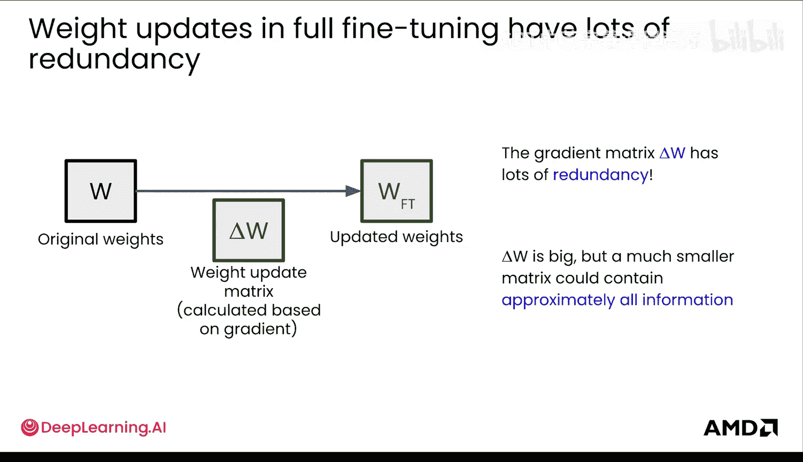

To visualize this empirically， you can actually take that weight update matrix and do singular value decomposition or SVD on it。

 And you can see that most of the information can actually be represented in the first few singular values。

 And that means the remaining directions contribute very little and can often be approximated away。

 So in linear algebra， that means the weight update matrix can be approximated as low rank。

 So a much smaller matrix。 and that's huge savings on parameters。

 And what that means is that the updates can actually be smaller and the base model can just actually remain frozen and when trained the smaller update weights they're often called adapters。

 more intuitively this basically means that updates to the weights during fine tuning can be broader strokes rather than fine grained And you know maybe it should be called broad tuing rather than fine tuing。

 so here's the analogy on the left， you have multiple individual fine tune models。 But on the right。

 you get multiple adapters， and they can share that same base model again， huge savings on。

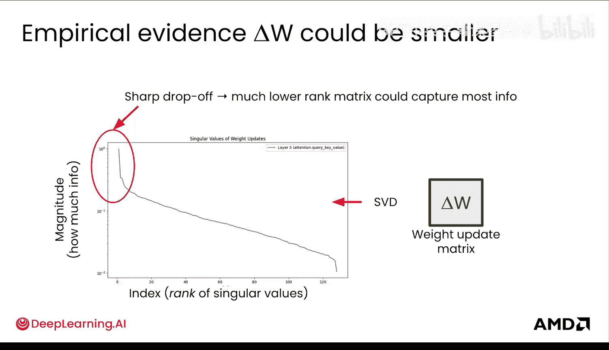

In storage adapters are lightweight to fit multiple on the same GPU。

 There's also in terms of inference latency if you're running them all in the same GPU。

 you can swap adapters not just full models。 so since the savings are so good。

 How does actually getting to that low rank matrix work so it's just some basic matrix math called rank decomposition It's essentially lossy compression or a way to dennoise the matrix and only keep the parts that are high signal and a large matrix for example。

 here could be 100 by00 with a million parameters total but it can actually be decomposed into these two smaller matrices with rank2 which reduces it to only 4000 parameters and that's insane because that's a 250 x fewer parameters to train and store in memory you can generalize the two to just R So that's just the rank R is a hyperparmeter of course you can use for the max rank of the decomposed matrices ideally the rank is much less than your original matrix dimensions if it's the same then you're back to actually full fine tuning R。

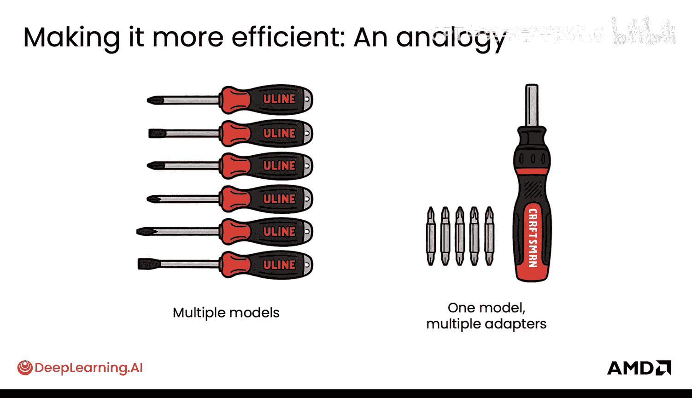

4 is often called a good starting point on the original Laura paper。

 but realistically it really changes per task。 What's really crazy is a rank of one will also work and even crazier for reinforcement learning that rank of one often has shown to work well you also don't need to have the same rank for every single Laura that you put in but that's research for another time and as all hyperparmeter you find the right R empirically based on how many las where you're putting the las and most importantly。

 your data size。 So smaller data sets and changes probably able to get away with smaller Rs and larger updates probably need larger Rs。

 your other hyperparmeters will change two， for example。

 using a 10x higher learning rate than full fine tuning is often recommended for las So needless to say。

 the benefits are pretty clear and the impact accuracy pretty minor when you consider how you get to a better model is to iteration and smaller。

 faster updates and this will get you faster time to accuracy anyways and you can always dial it up dial up the R if your task is too big and requires a major update later。

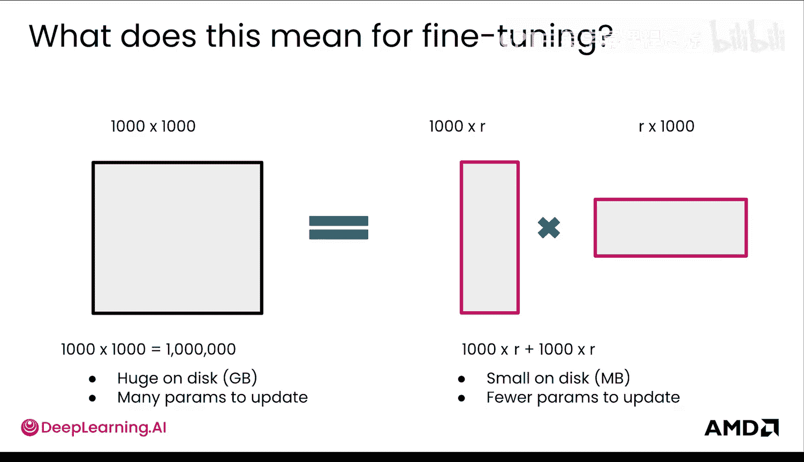

So now you know what low rank decomposition is， here's how it's actually implemented。

 so zooming into one weight matrix here， the matrix gets an input X。

 it's modified by all the layers and the output is this hidden state which is then processed by subsequent layers。

 calculate the loss and back Okay so this is just regular full fine tuning。At some point。

 the weights of this matrix gets updated in full fine tuning。 All weights are basically changed。

 so that delta W is the size of all the weights。 So now to understand what's going on in Laura。

 you can move that out separately and visualize that the full weights of delta W you can actually approximate with those Lauraura matrices These are dot product together to create a deta W matrix。

 which then takes the input X and outputs at hidden state just the same the rest is the same。

 but what's really interesting is your main weights are all frozen and when backpro actually happens。

 you only do it through that delta W you only do it through your Laura adapters and that saves you so much here so maybe you get how Laura adapters work now。

 but where is it actually happening in the model。 So if you look into a standard LLM architecture。

 you can see decoder blocks。 and there you can see feed forward layers and self-attention layers and the original paper for Laura looks at adding adapters to this selfattention block the recent work has also shown to apply Laura。

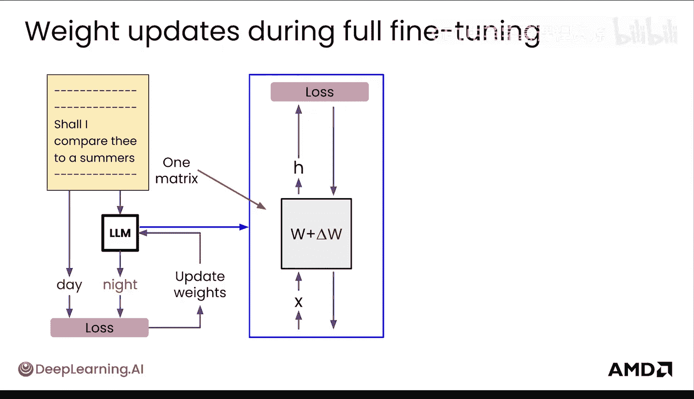

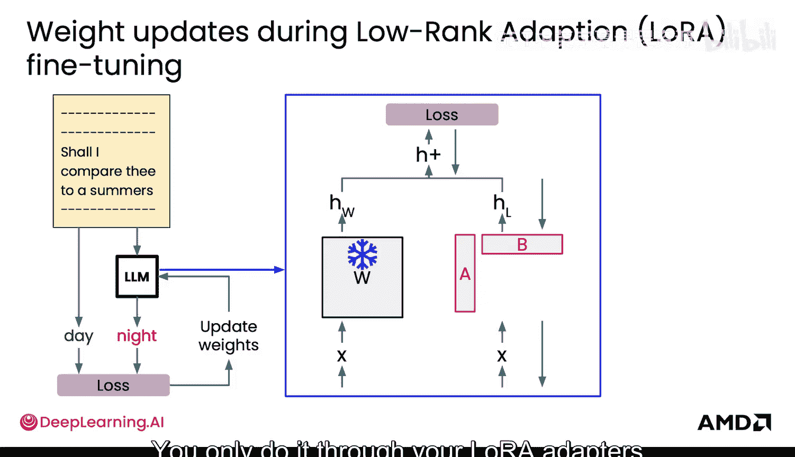

On all layers， not just attention so you can also experiment with what works best for you but specifically the Laura paper looked at adding Lauras on the query and value matrices visualized here and the remaining weights are frozen so you know where Laura goes if you're curious about digging more into Laura you'll often see the Laura diagram represented by these trapezoid like in the original paper it's to signal that the matrices actually get smaller rank but technically the matrices should be more accurately depicted as what you saw previously with the matrix rectangles but anyways using the diagram you can imagine having Laura adapters for a task on custom code getting generated or different adapters on custom unit tests and it's shown for all fine tuning tasks here keep in mind that you can also update weights of a model in Rl using Lauras as well All right one more important hyperparmeter of Laura that matters is alpha Al scales how much Laura's matter versus the original weights when updating the weights and empirically you need to increase this when the rank increases。

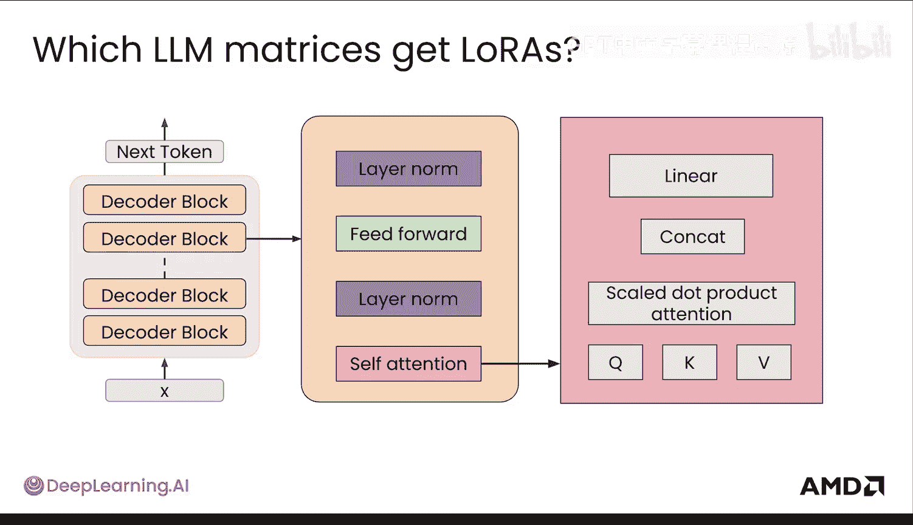

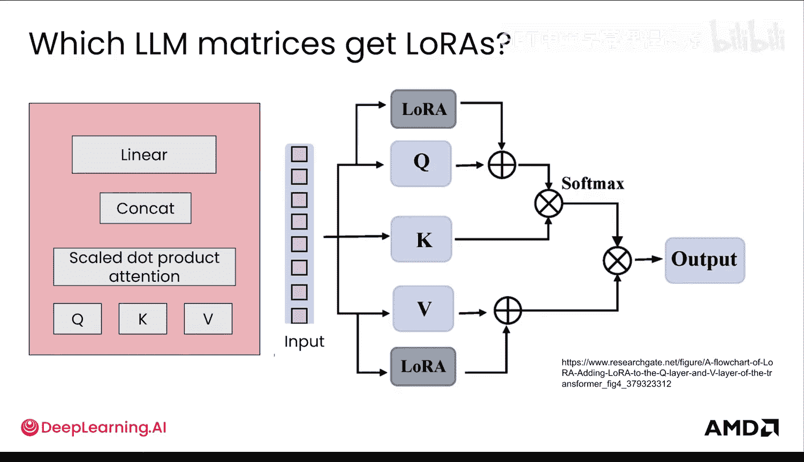

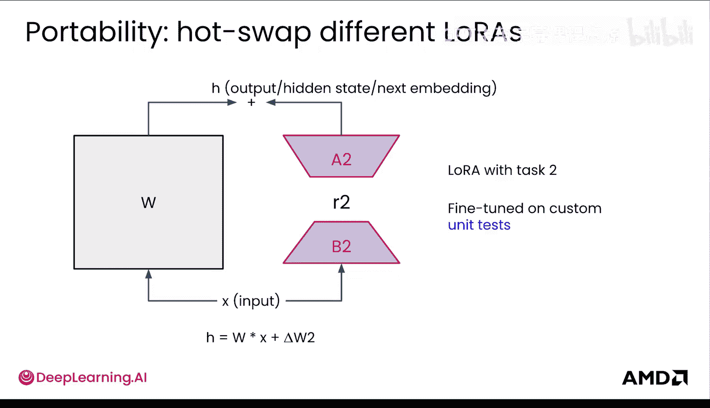

And the default is one。 again， it's something to tune here。 All right。

 so you heard all this talk about saving GPU memory。 It's time to compare。

 So the top is regular full fine tuning。 The bottom is Laura' first get the fit。

 the whole base model into the GPU memory no matter what So that's the same。 Second。

 you want to add space for your Laura adapters。 it's usually way smaller than what's shown here。

 but this is just one case here just to show and visualize。

 Then you need memory for your gradients for the full model， it's all it。 and for Lauras。

 it can be tiny， way tinier than what's shown here right even that 。1%。

 but here is kind of a fat lara 25%。 The next piece depends on the optimizer。

 but essentially the optimizer state， which depends on the gradient memory。 Finally。

 the forward pass will need a little bit more for Laura， especially if you expect to hot swap them。

 though Lauras can also be  fused back into the model for the same computational efficiency as just a regular forward pass like that。

 So clearly Lauras actually enable you to save a lot here。

 This is a very generous depiction for full fine tuning。

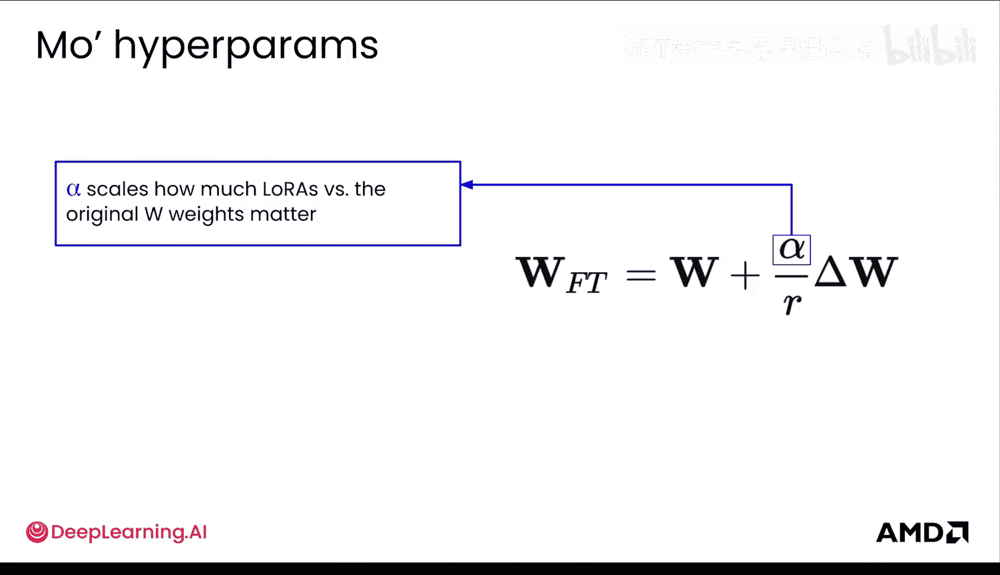

Las can actually save you significantly more than this So now that you understand Lauraura's go build with them there are a ton of open source frameworks to help you the pros are that you can get started very quickly sometimes even locally and typically Lauras are the way to go for getting started with fine tuning anyways the cons of las is the hyperparameter tuning there are fewer good defaults out there though that's changing than regular full fine tuning and local training is typically only on smaller models of course so here's what it looks like in hugging phase transformers and their library or parameter efficient fine tuning library you can see the rank R and alpha hyperparmeter here you can also see the query and value being where the las are getting attached you can add your own and all you need to do is take any model than wrap Laura model around it with a Laura canfig Lauras are a part of a much much broader set of parameter efficient fine tuning orft techniques that make fine tuning or just generally updating LLMs much more efficient and that's bolt during an。

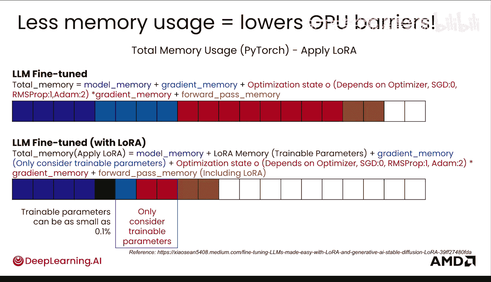

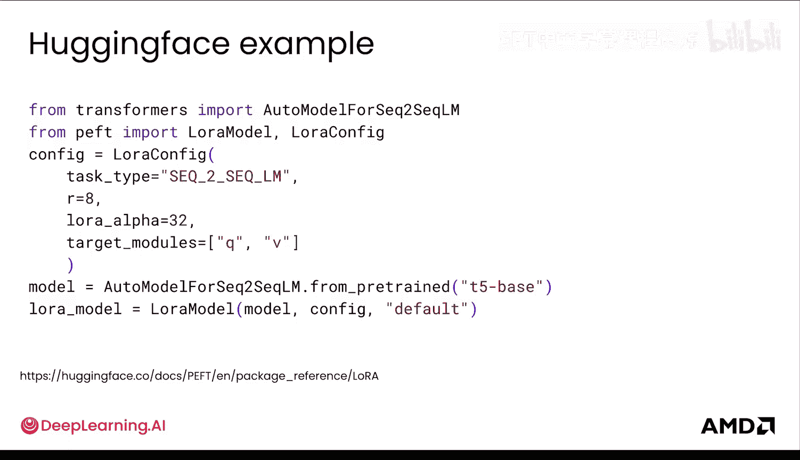

or training actually， so more often you'll see it for fine tuning。

 but it's also going to use an RL which you'll learn about next。

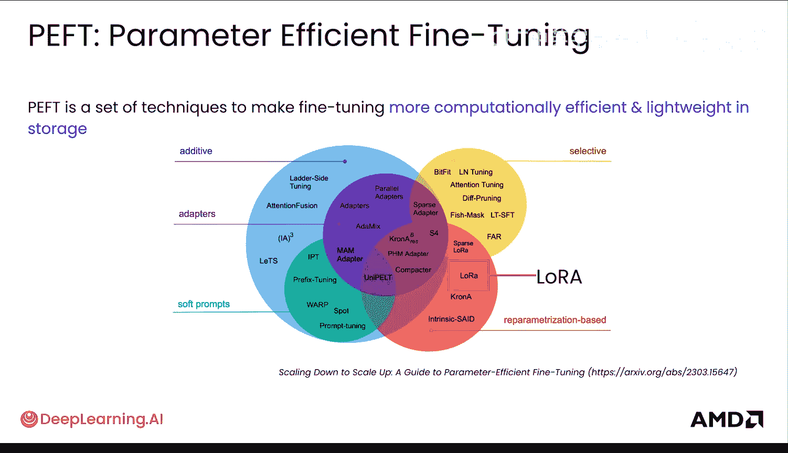

Switching gears to reinforcement Learn event， you'll learn how rewards inform LLM updates instead of that target output in fine tuning。

