# AMD《大型语言模型的微调与强化学习：后训练入门｜Fine-tuning and Reinforcement Learning for LLMs》 - P16：8.rl-rewards-and-preference-learning.zh_en - GPT中英字幕课程资源 - BV1zZy8BcE7z

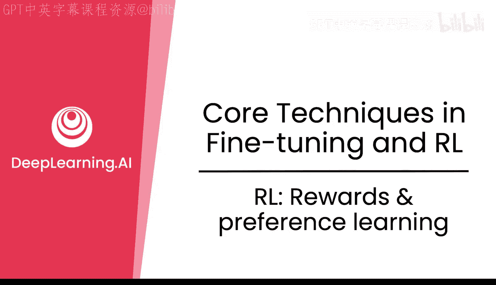

Rewards are one of the most important concepts in reinforcement learning。

 and preference learning is a type of learning to train a reward model to output rewards for you。

So there are several key differences between reinforcement learning and fine tuning so once there's a loop of data gathering to training to data gathering again to training。

 so it's not just first gather all the data than train the next the input is the same you need a bunch of inputs but there's no target output The output here is just the model prediction and it's needed to calculate the reward and reward is that key difference between RL and fine tuning that you're going to explore in this segment So in fine tuning you have a specific correct target output and your goal is to reduce that gap between that target output and the model's predicted output and you're doing that by minimizing loss in reinforcement learning that's pretty different。

 there's no single correct or target output instead for a given input and given output you provide a reward and that's a numerical score that tells the model how good that response was and the goal in RL is not to match a specific target but to learn behavior that generates outputs that will maximize this reward。

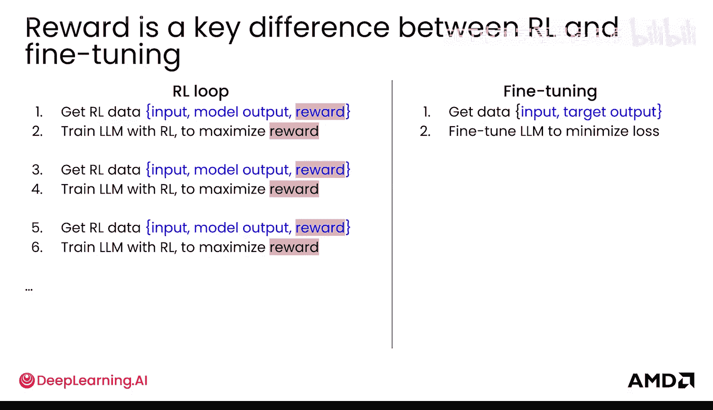

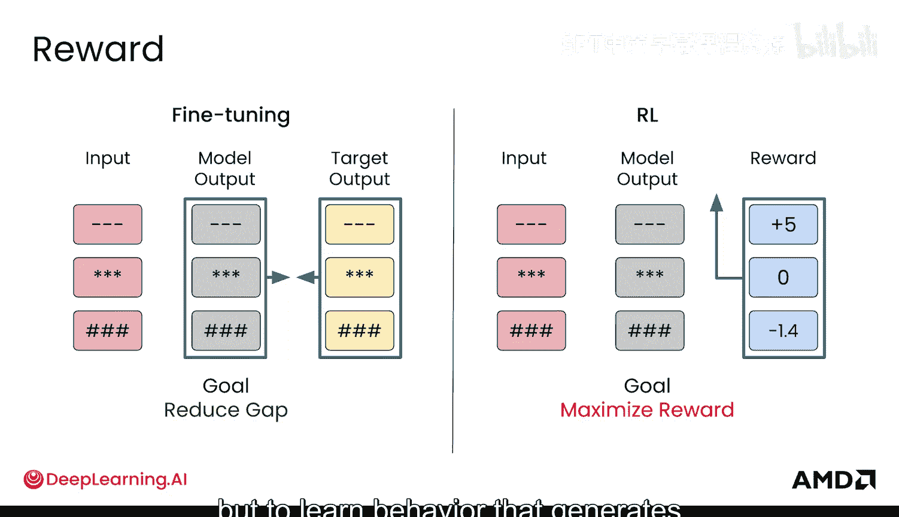

What is reward exactly reward is a single scalar number。 It can be positive or negative。

 typically a good response will get a positive word like plus one and a bad response will get negative one kind of like a penalty and one of the easiest ways to get rewards is using verifiable signals or verifiers and these verifiers rely on objective criteria for example。

 if the model is generating code Verifier could check whether the code compiles or it runs without errors if it's generating math it could see if it solves a math problem with the correct final answer so you can check these this might be confusing because fine tuning feels like it checks whether the math problem is correct too and fine tuning。

 the model has to actually output the exact string of the response So if it includes reasoning it gets penalized for not predicting the exact reasoning trace in those think tag but in RL the model can output basically nonsense in its reasoning and still arrive at the correct answer and get the positive reward Verifiers are typically a script or program not a person as you can see here so they're just kind of like checkers that give rewards the deepse。

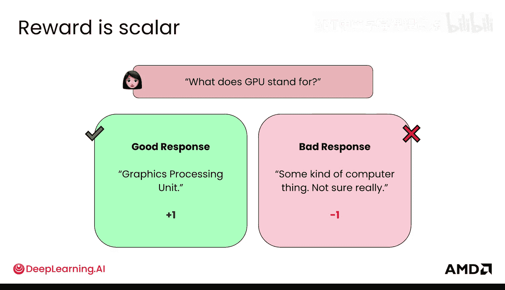

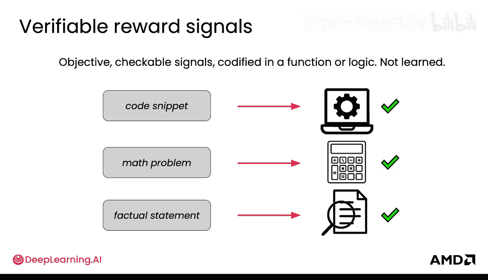

Ptty famously use verifiers one of the models deepse R10 actually only use two verifiers and only use reinforcement learning to train it。

 So one is for checking if the answer to a math problem was correct and the other one is for format to check if the models response actually use reasoning in those think text So really powerful just those two verifiers Another used in deepse R1 another model of theirs is a reward function that penalizes mixing languages so mixing English and Chinese specifically so the output is only in one language for human readability which was an issue without this extra verifier and just to see how these verifiers actually combined into a single reward signal it's just a simple sum here a simple sum of programmatic checks and that combined reward function shows how to balance multiple objectives across accuracy format and consistency So in your lab code you can assign a reward of one if your model predicted the correct answer even if it's reasoning was if it was wrong you can give it to。

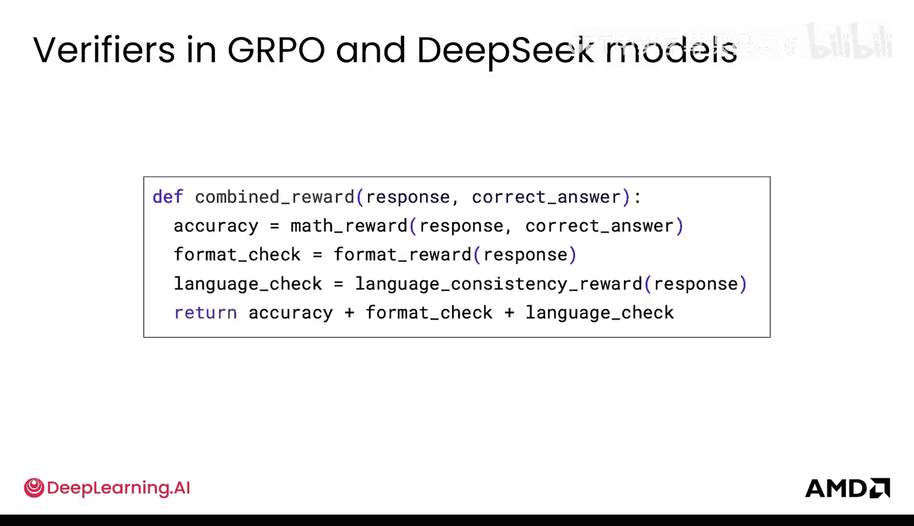

Or you can give it partial credit so you can give it thats scaled reward based on how wrong it was to give the model some clue of how far off it was Allright this looks so easy。

 What's the catch Verifiers only work for domains with clear verifiable criteria you can check if math is correct but you probably can't programmatically verify if the model is empathetic if it's helpful the math checker here is freaking out a bit because the input says how does Carly feel So the solution in here is to train or use another model you can use an LM judge or typically you can train a reward model which is common in RF or RL with human feedback used to train This model should give a scalar reward still based on the criteria is learned and you want your reward model to output a scalar reward given an output like this so plus 1。

3 and you want that scalar to hopefully match some kind of quality you care about in the output whether it's helpful or nice in this case but possibly safe and secure in others So just to go into exactly how the reward model。

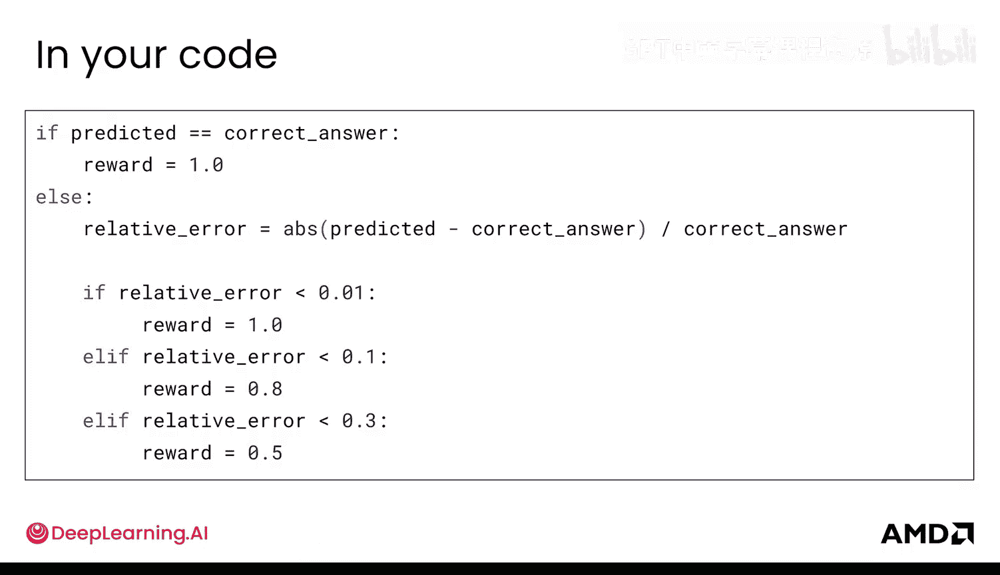

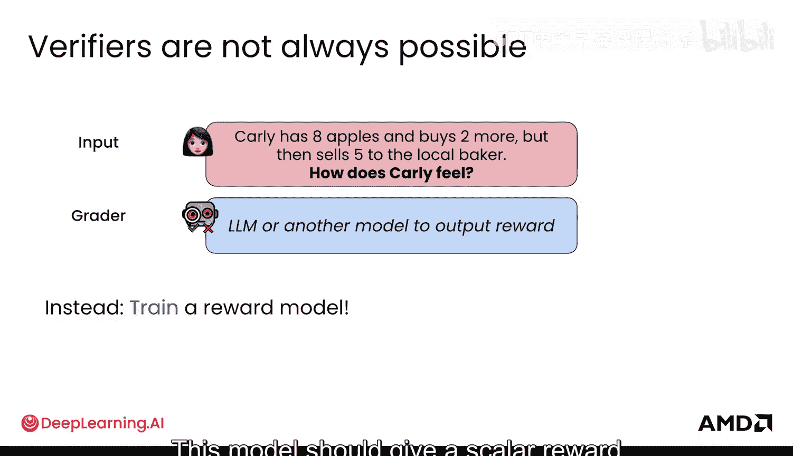

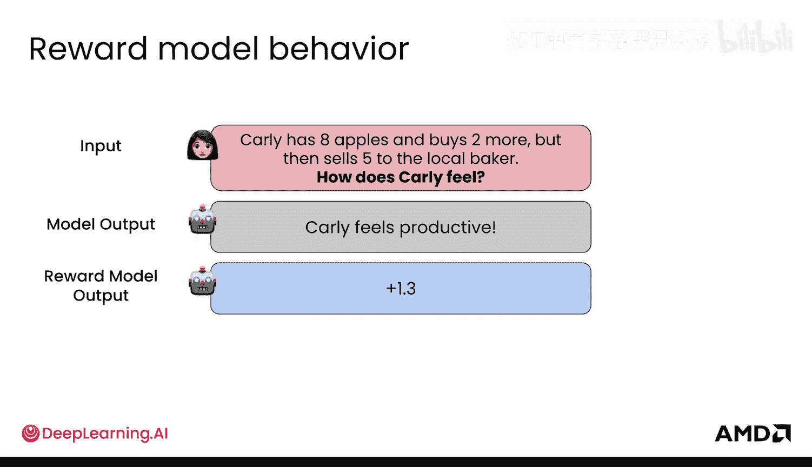

Is trained so the goal is to encode human preferences and it turns out to get the model to encode those human preferences。

 there's a way to take human rankings of several model outputs and use that as data to fine tune in LLm to be a reward model So first you can show a person three model responses and a human labeler can rank them so you can see the rankings here of how good the responses are and the reward model is then trained on this data it doesn't learn how to write or output those thinking notes。

 it just learns like this pattern of these rankings the raw rankings aren't usually immediately helpful that's just an easy way to get human preference data from a person you need to take those rankings and somehow turn it into a loss function that can get the model to return those scalar rewards on every output So zooming in you have your ranked preferences and you can turn those into preference pairs and this will be easier to use to achieve your goal of getting the reward model to actually produce a reward you'll see in a bit So next you have the reward model predict reward。

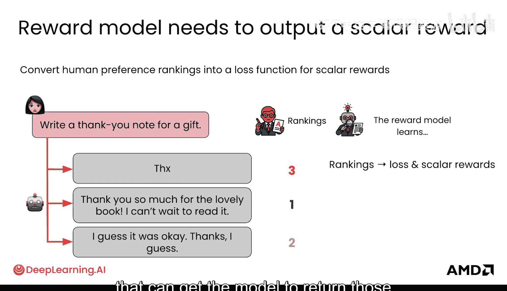

For model output A and then for B in a pair where a is a preferred output by the human and B is the less preferred one。

 So it might look like this。 So scoring one output with a reward and the scoring the other output with the same input and but with another reward。

 And now when you look at the relative preferences from the paired human preferences。

 you can actually create a loss function between these two rewards。 So you know that the person。

 the labeler preferred a over B and you want to maximize the difference of the reward for a minus reward of B。

 and that means your reward model can apply high rewards to the preferred a and low rewards to the less preferred B and to turn this into a probability。

 you can actually use a sigmoid function of that difference。

 which intuitively basically gets you the probability of a being much better and more preferred over B。

 And if the sigmoid is close to1 or near 10% that means reward of a is much greater than B。

 if they're the same it's 0。5。 So that's how you actually get your loss function So now just to do the standard fine tuning things to learn the model。

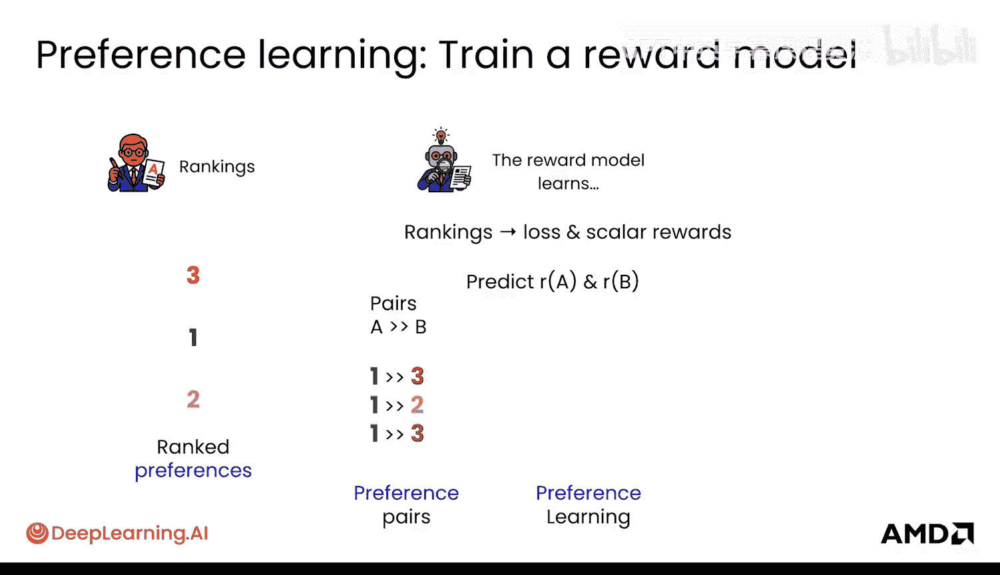

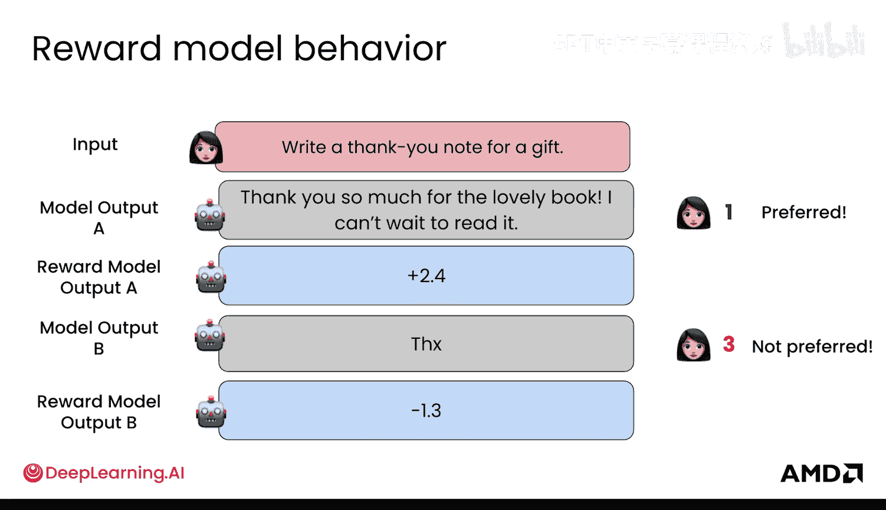

This process is called preference learning and typically it involves fine tuning a language model head to get it to output a scalar value。

 you'll often see the reward model also be called a preference model to that's just the same model there and bringinggis don't have to be done with people they can actually be done by an LLM which you'll see an example of later as well so you can also get direct preference pairs by anLM you don't have to go through the ranking process necessarily So this preference learning process is to get a reward model and it was also used in chatt so you'll see here it's called R R with human feedback and that's what it's popularized as so first in chatt what they did was you can sample multiple outputs from the model here there are four outputs a a human labeler actually brings those four responses from best to worst here the ranking is DC that is turned into those preference pairs and that preference data is used to train a reward model as you just learned to output that reward and that encodes that preference data After this you'll see how this reward。

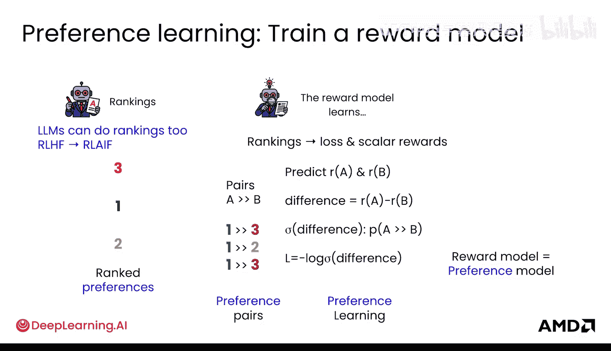

I then used to update your main LM with Rl， possibly in conjunction with those verifiers that you learned so you've learned about verifiers。

 you learn about the reward model。 it's time to compare them a little bit。

 Often you'll use both but to encode different things So for a reward model the processes collect human preference data like rankings。

 train a reward model then use a reward model to learned reward signals of human preferences for verifiers process is somewhat similar you define those objective metrics you implement the text or functions and you want to generate those signals but programmatically one of the best things about reward models is you can actually use data to represent your objective if you can't actually write down the exact function which is what is needed for verifiers but one of the hard things is that your data might be imperfectly learn by the reward model in some way and you'll learn about this later but since it's not objective reward models can be famouslyre hacked or your main models able to find a way to get high reward from your reward model even if the outputs aren't great and one of the hardest。

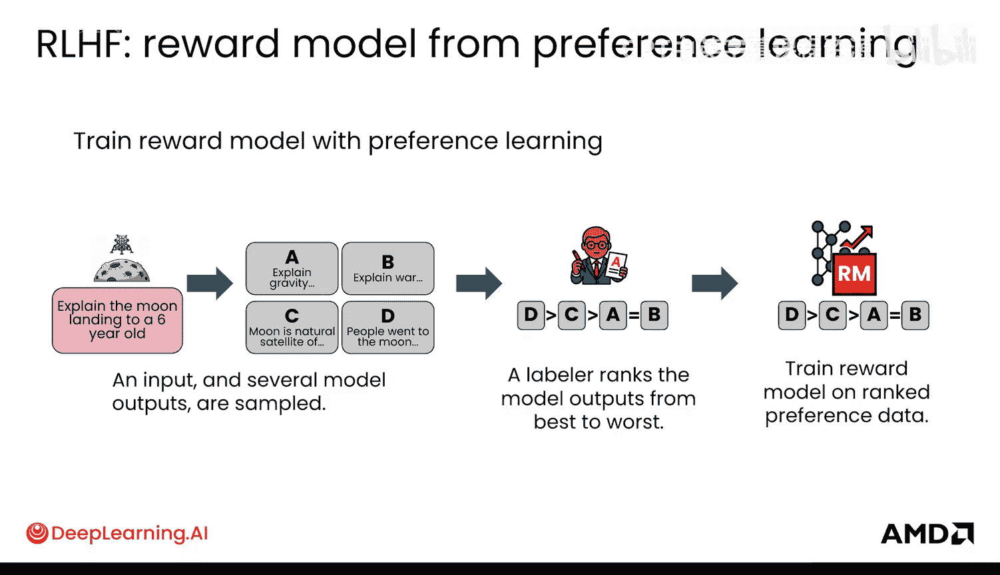

About verifier sometimes is around the computational expensiveness of running a verifier。

 sometimes you need to run these on thousands and thousands of examples if it's very slow for verifier to check a certain type of code for example。

 then it's not a very good signal to actually give back to the model in the RL loop So they're good for different things reward models are essential for pretty subjective tasks like human value alignment improving dialogue。

 making the model more pleasant to interact with and verifiable rewards verifiers are perfect for more objective tasks like factual correctness math problems or code So just to connect this with your R data。

 where does this all come in So first given your inputs you get model outputs this is called a rollout and you get a bunch of rollout if you're using a reward model you might get preference data and then convert to preference pairs and your data will look like this to train your reward model and your reward model can actually produce that scale of rewards similar to your verifiers and。

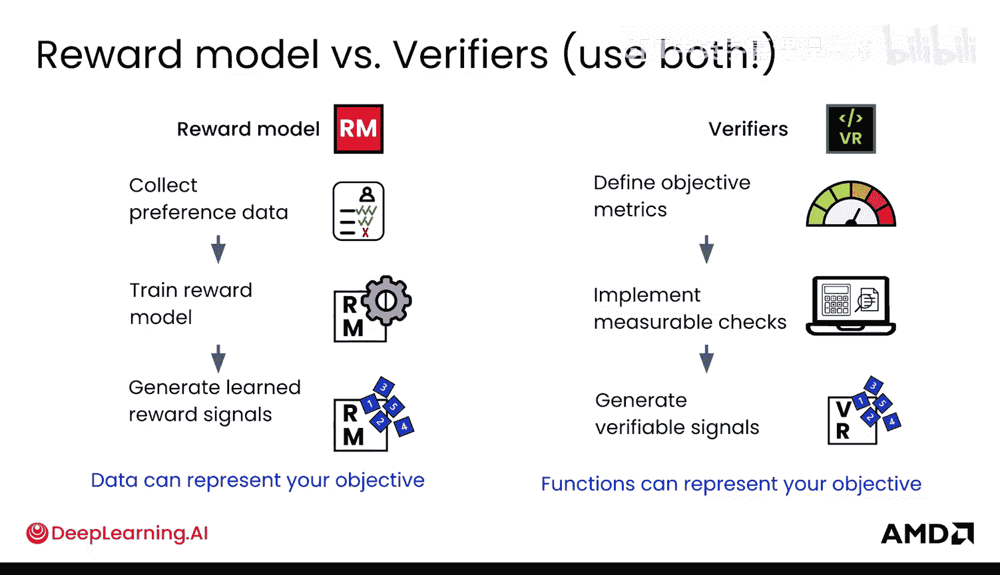

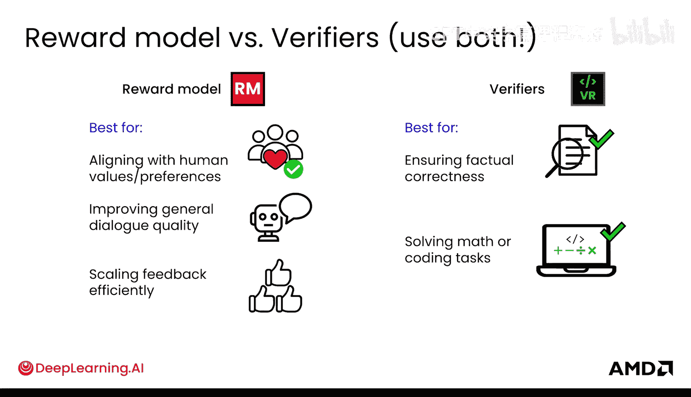

Those apply a reward to your rollout and that gets you a trajectory so that's the input。

 model output and the reward and then you use that to train your LLM with reinforcement learning to maximize that reward and of course you're looping here across you generating that data applying the reward getting the trajectories and then maximizing the reward。

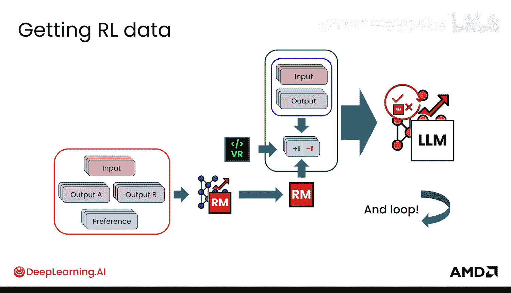

Now that you've learned about rewards and preference learning to get a reward model。

 it's time to take a look at how those rewards actually inform the LLM training objective in reinforcement learning。

