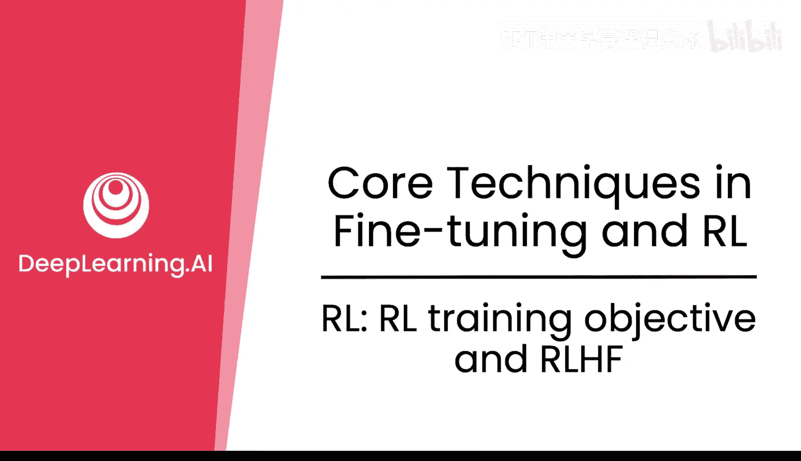
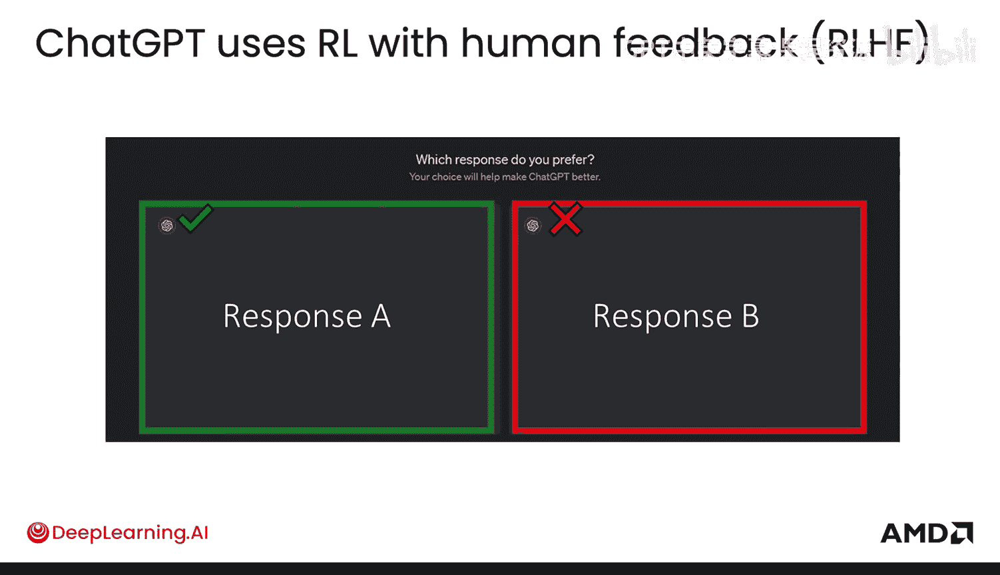
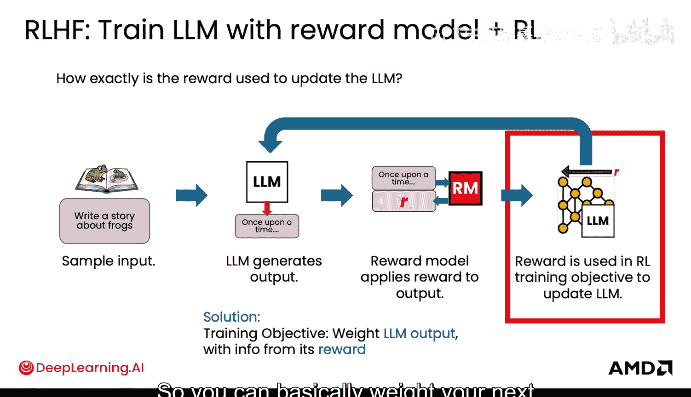
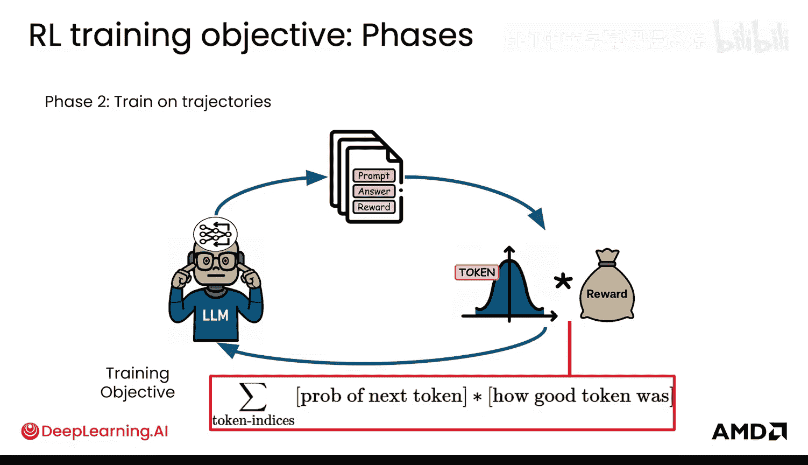
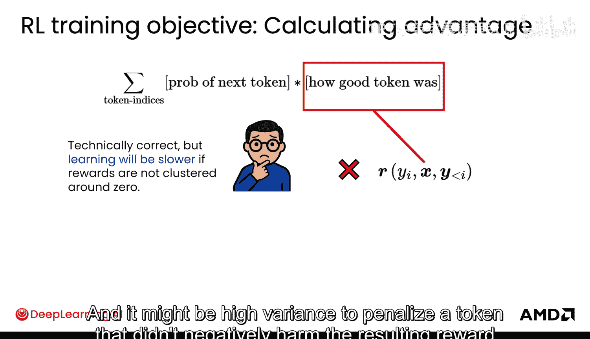
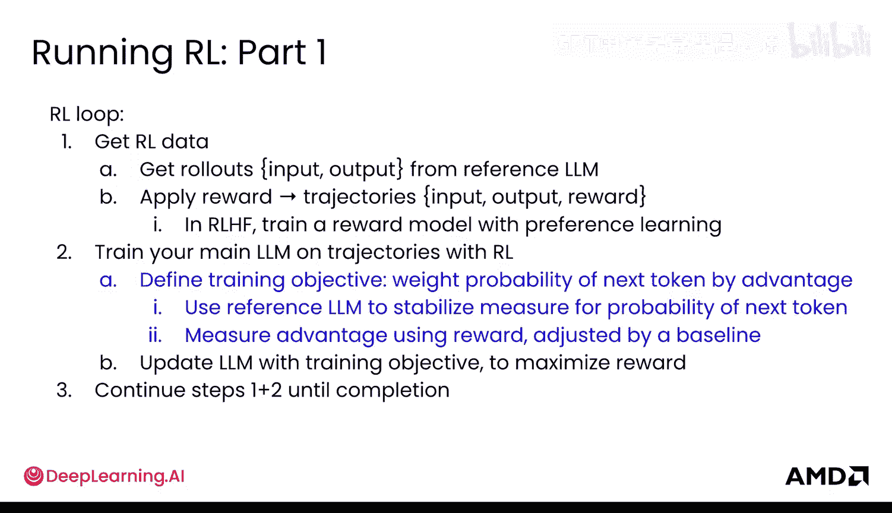
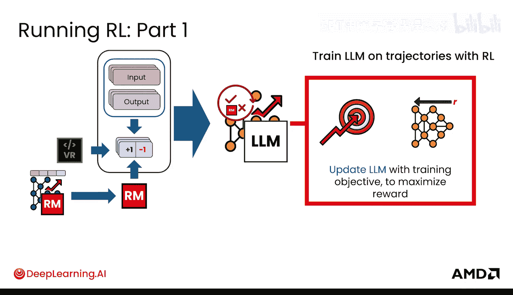
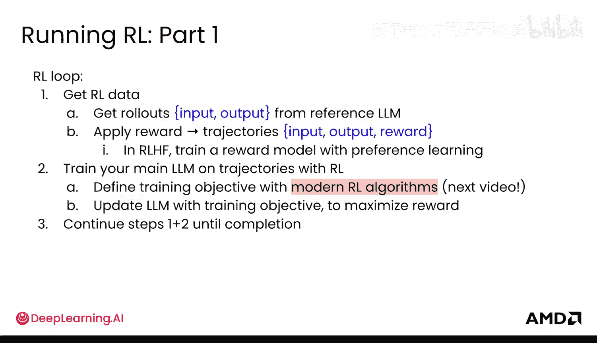

# AMD《大型语言模型的微调与强化学习：后训练入门｜Fine-tuning and Reinforcement Learning for LLMs》 - P17：9.rl-training-objective-and-rlhf.zh_en - GPT中英字幕课程资源 - BV1zZy8BcE7z

The goal of training in reinforcement learning is to maximize the reward。

 but how do you actually define the training objective take a look in the next video。So first。

 if you've seen chattptT， you've likely seen this interface where you get two responses or response A versus B。

 and it's asking for your preference。 This is the first step of RLHF for reinforcement learning with human feedback and collecting that human feedback data RLHF is the original flagship process that chat GptT used So time to take a closer look at it？

 you've seen this before， So essentially RLHF uses the reward model that was learned using preference learning from those rankings of a human labeler。

 But then what happens after that， So what happens after that is you might sample an input the LLm might generate some output and then the reward model applies reward to that output getting that trajectory and then that reward is used in an Rl training objective to update the LLm How exactly does that happen though how is that reward actually used and how do you get that Rl training objective So the goal is to backpro the reward information to update the model so the model can maximize the reward But the main problem you have here is。

The reward is not directly differentiable。 you can't naively backpro。

 The reward is not in the gradient。 So if the reward is coming from verifiers。

 there's no weights to backpro through in this case。

 you do have weights with a reward model but the reward is still not a differentiable function of the LLM output so how do you actually nudge the model so that it produces outputs that can get a higher reward even if it were possible to nudge things a little bit more the Lm output is a sample which is passed through to the reward function whether's a reward model or verifiers in backproing from the reward model weights through a sampling operation to get the LM weights is tricky So instead your training objective can be to somehow increase the probability of generating tokens that led to a high reward and decrease the probability of tokens that led to a low reward so you can basically weight your next token probabilities for an output by the reward on that output and that's exactly how to do it So to recap there's this loop so you're getting data that's same as before and then you're doing training and in training you want to define that。

objectiveject and that's what you'll go into here So again you get your rollouts， you apply reward。

 you get your trajectories in RLHF， you're training a reward model or preference learning to apply that reward and then you train your LM on those trajectories with RL and in here you're defining that training objective using rollouts to backpro word info and then you update your LM with your training objective to maximize that reward and you loop so let's dig into that training objective so you're waiting the LM output with the reward so just to get a tab more technical you're waiting the probability of an output token inside of that LLM output with kind of how good that token is。

 which is going be based on that reward looking more closely at this first term probability of next token this part is pretty straightforward it comes from your LLM since it's output probabilities for the next token and theoretically this is fine but actually practically this is not the case for compute reasons it's actually a bit unstable given how you're actually updating the LM and collecting data。

Looking into here so practically first the LM will read all the input prompts。

 generate answers outputs and get rewards for each one so you get this data set of trajectories this phase is typically offline meaning it's done on its own without a live updating model and you generate a bunch of outputs or rollouts and you use your reward model to score a bunch of those so you get your trajectories and you can pretty efficiently generate this data with large batches all you're doing is running inference and then running your reward model inference on top of those rollouts in phase two you typically are then training on the static data set of trajectories and the objective is still this at the bottom so it's to maximize the probability of a given token weighted by the reward or how good it was and you're typically looping over in much smaller batches than in the data collection in phase one and this is because of memory and compute intensiveness of training and that's why practically it's usually two phases and you'll see soon just how computationally expensive and intensive Rl training is because it has so many models。

Selector data of phase one that's generated by the model as it existed at that time， but in phase2。

 you are constantly updating the model The model is changing with every single batch and this means the probabilities it would assign now are different from the ones that actually generated the data This creates a mismatch and makes the training process very unstable the solution to this is to use a reference model so you save a copy of the original pre-update model LM here and that's the data collection model instead of using the current model's probabilities you'll use the ratio of the current model's probability relative to the reference model's probability and intuitively this ratio just tells you how much the model is changing and how it's changing the ratio is greater than one it means your new model is more likely to produce a token versus a reference model if it's less than one is's less likely and this stabilizes training by anchoring the updates to a fixed reference point and stability is going to be a recurring theme in Rl training since it's so unstable most of the time So now you got your rollouts from a reference LLM that's where it。

for that data phase Now take a look at the other half of this equation。

 it's the reward term aka how good the token was So using the raw reward works。

 but it can be inefficient and cause large noisy gradients which causes swings in training Also it's unclear how to distribute credit for the reward across tokens of reward is full sequence level not token level and it might be high variance to penalize a token that didn't negatively harm the resulting reward and vice versa anyways this is the reason why you estimate a baseline for every token。

 which is how you expected the model to do what reward you expected for a particular token and then you back on how much it exceeded or didn't meet expectations This also keeps learning more stable so imagine if all your rewards were positive the model would try to increase the probability of all tokens all the time just a little bit more on others learning is slow because it's kind of hard to distinguish across them and same if all the rewards are negative It's a best practice have rewards cluster zero so you have a mix of positive。

And negative rewards there is definitely some research challenging this。

 so please try it for yourself。 This here is just doing it how RF originally did it。

 So the way to center rewards around zero is to introduce some type of baseline and subtract that baseline from the reward to kind of center it and again this baseline is kind of the average or expected reward for every single token so the centered reward you get or how much token succeeded or didn't meet expectations in R literature this is typically called the value function and the calculation here is typically called the advantage and the advantage is how good your token was So now if you go back and look at subtracting a baseline from the reward to get the resulting value called the advantage the advantage is positive if a response was better than average and negative it was worse than average or expected and this gives you a much clear signal to the model about what to do So increased probability for positive advantage tokens decreased for negative and note that there are many ways to compute advantage and you'll explore another way in the next。

VideSo it's a simple trick to center rewards around 0 by estimating expectedor rewards。

 and it's shown pretty dramatic speedups in learning。 this is a diagram。

 a graph from Seins reinforcement Learn textbook。 And in this case。

 their Rl algorithm was called reinforce and with a baseline it learned much more quickly if you look at the green here got to higher reward much faster than red All now you got your training objective to update your LLM with the reward。

 So just to take stock a little bit。 And so far you have two models to keep track of your LLm that's learning So takes up more memory because of gradeand and optimizer states。

 and then the reference Lm which is frozen that's used to generate rollouts and just a peek to the next video you'll have tumor models at play。

 you learned how to train the reward model already in the baseline estimation will come from a fourth model。

 and this is why Rl is so memory intensive and needs a ton of computer memory and GP to run especially compared to that lower fine tuning that you saw previously hoping this will change over time as we find more efficient methods。

 so now you got your training objective。

The data is here the same you're defining your training objective。

 so you're defining your training objective by weighting the probability of next token by advantage。

 you're using your reference LM to stabilize the measure for the probability of next token and you're measuring advantage by adjusting the reward with a baseline then you're updating your LM with this training objective to maximize the reward and then you loop Great so this is the general and basic training objectives for RL in the next video you'll explore how to define a few modern training objectives including the exact one used for RLHF。

So you've learned about how to define the training objective in a basic way。

 now take a look at modern Ral algorithms， PPO and GRPO for how they define the Ral training objective。

