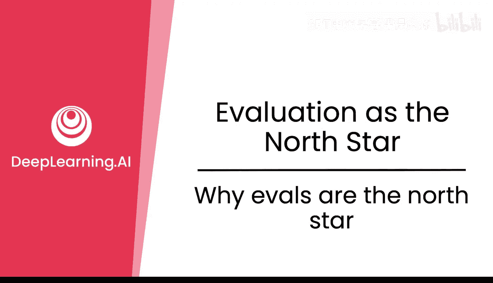
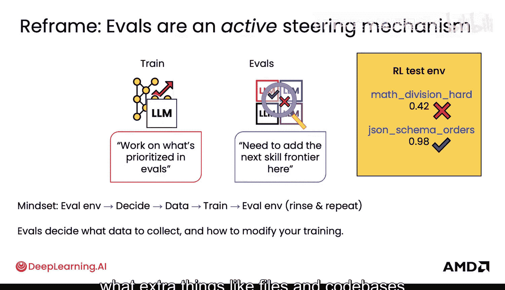
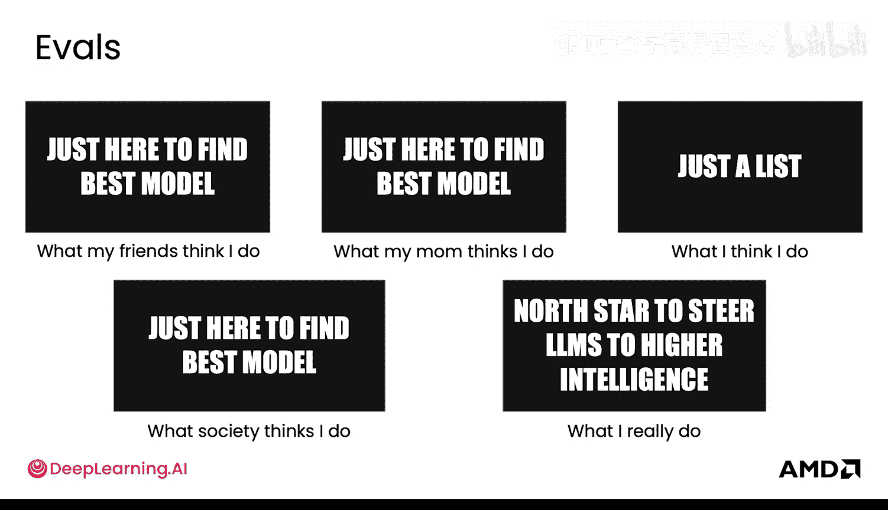

# AMD《大型语言模型的微调与强化学习：后训练入门｜Fine-tuning and Reinforcement Learning for LLMs》 - P19：1.why-evals-are-the-north-star.zh_en - GPT中英字幕课程资源 - BV1zZy8BcE7z

Welcome to Module 3， Evals as the North Star。There is a common misconception about Evals that there are some kind of passive final exam for a model。

 but in fact， they are an active steering mechanism to get your model to higher forms of intelligence。

 Let's take a look at why。So there's a big misconception that Evals are passive。

 kind of like a final exam and all they're used to do is to check if you found the best model or how good a model is to another model and that's it and training is where the real work is done and you just have your data you put it through training and then you get a final score and you're done So the misconception is just there is Evals here on the side。

 it says looks good for running it and there's no more work to do in training。 However， in fact。

 the Evals have missed crucial examples like larger numbers or division which the model would just get wrong。

 So in this case， the EVLs did not catch the issues。

 and even if you just put one example in the Evals。

 it doesn't guarantee actually catching the issue So crafting your evals well will actually help you understand how the model actually works and it's more of an active paradigm It's not passive and it steers the model in the right direction So if you want to add a new skill frontier you need to add it to the Evals first and then you loop to training。

Where training works on what's prioritized in the EVvalS and then it's a loop because you go from EVL。

 you decide different decisions， whether for data or for training and then you eval again and then you loop rinse and repeat So EVLs can help you decide what data to collect and how to modify your training or Rl it's the same thing that your test environment or EVval environment will help you decide what inputs to try next。

 what grade to try next and adjust what extra things like files and codebas that you need to put into your environment to be more realistic to try next。

 So while everyone thinks that Evals are just a passive form of finding the best model。

 whether it's your friends， your mom society， even though the EvalL thinks it's just a list。

 actually what Evals are are Northstar to steering LLM to higher intelligence。

Now that you understand why EVLs are so important in steering in LLM's capabilities。

 take a look at exact types of evaluation metrics and test sets。

