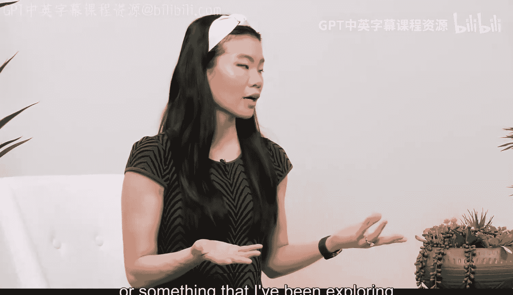

# AMD《大型语言模型的微调与强化学习：后训练入门｜Fine-tuning and Reinforcement Learning for LLMs》 - P1：1.conversation-between-sharon-zhou-and-andrew-ng.zh_en - GPT中英字幕课程资源 - BV1zZy8BcE7z

Welcome to this course on supervised fine tuning and reinforcement learning for training large language models。

 Both of these are techniques under the broader umbrella of posttrain techniques。

 which is an important family of our roomss are actually re useful。

 both her training Fier models as well for developers to get their applications to work better。

 Un the instructor for this course is Sharingz， who is a old friend and also my former PhD student from Sanford。

 She is VpF AI at AMD， and she was also a formerly cofounder and CEO of the startup Lamini fit every year so excited to be back。

 Thank you， Andrew。 So Sharon's worked for many years on Geni。

 including specifically fine tuning reinforcement learning posttrain。

 And I think this has become one of the techniques that is increasingly important for developers to know about to get your own based applications to work really well。

 When ohms came about a lot of people had to learn to prompt engineer effectively and now more and more people kind of know how to do that。

 But it go beyond just。😊，Promp engineering I think there are a lot of businesses。

 a lot of applications that would be well served today by knowing how to finet a model and use these more advanced protraining techniques to get an application to work。

 That's right。 and I think these post-training techniques are really exciting because they are a way to steer the models and to align them to different preferences so those can be different humanbased preferences that the frontier labs are doing but they can also be business preferences that you might have for your models。

 one of the things I've seen a lot of teams do is start with pro engineering because that is often the best first thing to try but sometimes engineering performance reaches a certain plateau and especially for agent workloads。

 I see a lot of applications where after you two weeks or a month of prompt engineering is just not yet accurate enough like getting 9295 then 95。

595。7% accuracy and to get that next threshold of performance breakthrough you just got to fine tune the model。

And I think we've seen this also with reasoning right so reasoning has really taken off in the frontier models。

 basically capability in these models where they can think more step by step and actually arrive at a more accurate answer as a result of thinking more but reasoning actually arose in pre-training from these models and reasoning was just inherent in these models it wasn't very fleshed out it wasn't a deep type of thinking that the models were doing so these post-training techniques actually enable the models to do much deeper thinking to arrive at answers much more accurately and be able to solve much harder problems both for math and coding。

 but I think this also can apply to really interesting domains。

 other domains where we can verify what the models's output is whether it is correct， for example。

 material science if we're actually producing something valid molecular structure or something that I've been exploring is around deeper codegeneration and whether these models can actually generate code that's really。

 really highper across different devices So one of the exciting。

Breakthroughs was when Deepse came up with the GPO algorithm。

 which allowed a more efficient way of doing reinforcement learning in which an algorithm can try multiple rows。

 try multiple attempts and then within that group of attempts in the case of coding。

 maybe figure out which one actually work and use that to automatically score or give word signal to let the fine tune to generate more of the more correct code fineine tuning has been around for a long time and has matured I think what's been very exciting more recently is the development of a lot of very efficient techniques and fine tuning and that makes it very easy for developers across many domains to create essentially these lower adapters these smaller number of weights that they have to change in the model to adapt to different tasks and they can do that with far less compute far less data and these models are actually able to then switch between these tasks very efficiently without meeting huge gobbles amount of compute that these frontier labs。

So one of the things that may surprise you if you haven't fine tunening a lot of models yet is a lot of challenges of fine tuning is the same kind of data datacentric AI practices that you may or may not have seen if you've used supervised learning a lot of the time it is got to get the data training it see where it doesn't work we call the error analysis and then go and fix the data and knowing how to drive a disciplined loop where you trade the model evaluate。

 see where you can fix the data and do that efficiently over and over which Sharon talks about the cause。

 that's how you actually get these models to work I think this is one of the most important topics in AI and in improving AI not only for fine tuning but even for prompt engineering that you've explored。

 but in fine tuning essentially air analysis and evaluation I think it can be seen is not just how good is this model doing today。

 but in fact more like a Northstar where should I actually be focusing my training efforts and most of the effort should actually be on evaluation and。

Standing how good is this model and where can I take it to the next set of capabilities and one of the things about this error analysis process is。

It sometimes doesn't feel like the most exciting thing to be doing because you look at the data。

 be guided by the data， do it then your system works better。

 maybe that's less exciting in some ways than you're trying things are random but if you look at what a lot of the frontier labs are doing to build cuttingage models as what a lot of businesses that are not frontier lab are doing to actually build practical applications this is what works iss very practical you do it and it just it kind of works I think air analysis underlies the skills of these AI research scientists and AI researchers who are pushing the boundaries of these models but I think everyone can actually develop these skills it really is finding patterns in the problems of these models finding these failure patterns and then having a targeted approach in improving the models through the data and also through the algorithm themselves know people think a lot about what can AI automate in the future one of the reasons why I think error analysis is one of the things the hardest automate so then。

Your job save for a long time is because U analysis is a human using their insight to figure out what you can do that AI can yet do and almost by definition the AI can't do that yet。

 So I find this to be a really valuable skill and it actually what you know I spend all of my time doing when building practical machine learning systems I think that's exactly right it's by definition that gap that we're trying to fulfill and we're always gonna have that gap if we want to continually improve the model And then beyond fighting。

 the other exciting posttrainding technique that lot people talk about is reinforcement learning with multiple favors including PPO and GPO this is a more frontier continuousuous technique harder to apply but Sha talk about that too Yes。

 it's a bit of a wild West with are all research on LLM specifically but it is an exciting one So these are some of the techniques that underlie a lot of the new agent behavior inside of the frontier models as well as the reasoning behavior。

Inside of these frontier models and in this course you'll delve into a bit of the specific mathematics underlying PPO and GRPO and also just the intuitions behind rewards and reward functions and how these are different from fine tuning and also how is it kind of similar and how do they all fit under this umbrella of post-training take a reasoning model which may give it a complex puzzle maybe a math puzzle or coding puzzle and you wanted to take many steps of reasoning in order to arrive at a hopefully correct conclusion so we don't want to specify whether the one way to reason correctly to get the outcome and it turns out that reinforce the learning is a great way that allows you to specify reward function to measure whether or not the final output is correct and then let the algorithm try lots of different reasoning traces。

 do whether it wants and just measure whether or not it gets the correct final output and so this is proved to be a somewhat fiky but also really effective when you get the work way to train reasoning model。

As well as more generally other systems like computer use where we have a Lm try to use a web browser while the lots of ways to successfully carry a to web browser you don't necessarily want to specify what's the one way but try out some stuff in a safe environment and it reward it when it does well and so there's a lot of exciting cuttingage research being done on reinforcement learning to train theses right now That's right one of my favorite analogies we show in the course is around cooking so for fine tuning you're kind of following the steps that your grandma is using to cook her famous recipe and you need to follow her steps step by step and you're kind of graded you're assessed on every single step in how you adhere to it but in reinforcement learning what it looks like is you don't have to adhere to her steps you just have to produce a final outcome that matches her pasta dish for example and you can do any wacky thing in between so the model is allowed to do any wacky thing in between to get there and as a result the model can find more efficient paths to creating the same pasta dish but it can also。

And find weird patterns it might think that it needs to throw all the pasta in the air and map that to creating a good pasta dish reinforcement learning as a result can enable some superhuman capabilities that makes it very attractive。

 but it's also very unstable today and a lot of the algorithms you'll learn are focused on how to make it more and more stable so that we can actually run more steps for the model and the model doesn't collapse one unique aspect of this course you learn a bit both about what the frontier labs are doing as was what a individual or team and the business that's not a frontier lab could do very practical way to just build applications that work Yeah and I think the purpose of understanding how frontier labs have been doing this is one to kind of unveil and look under the hood and understand what the magic was to steer something like a chatBT but then also to see what pieces of those you can use to steer the model towards your business direction in your business needs that actually matter to you because。

Open AI or all these other frontier labs may not necessarily know what those needs are for you。

 but you know what those needs are and so now with the tools。

 the same tools that they have to steer the models and align the models。

 you can use them to steer it towards what you need So knowing how to carry out post training。

 including fine tu and reinforcement learning and so on is a very valuable skills today one that many of my teams use to build practical applications I hope you take this course lend these skills and go build some cool things of it so let's go to the next video to get started。

