# AMD《大型语言模型的微调与强化学习：后训练入门｜Fine-tuning and Reinforcement Learning for LLMs》 - P20：2.evals-for-post-training-test-sets-and-metrics.zh_en - GPT中英字幕课程资源 - BV1zZy8BcE7z

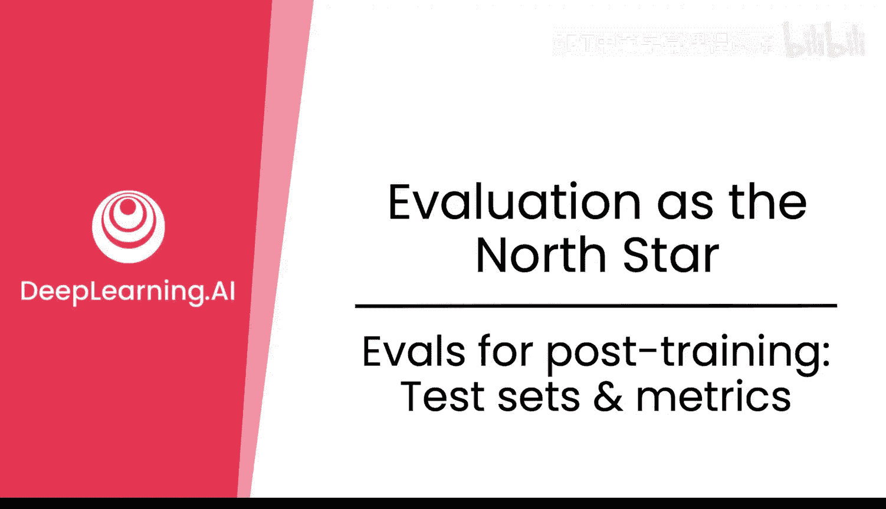

Time to take a look at evaluation test sets as well as metrics like passAT K。

 calibration and uncertainty。So in pretraining， loss and metrics like perplexity are super important to making sure the model is doing well while this is important to the stability of training in post training。

 In fact， Evals are probably more important in posttraining and these are massive datasets as well as massive prep work but they help guide us to understand how well the model actually does in changing its behavior So the reason why loss isn't sufficient in posttraining is that while it's great for predicting the next token like in pretraining。

 it's fairly meaningless to user experience and that is what really matters in usable intelligence for posttraining loss can go down。

 but that's basically mainly an indicator that SL training is occurring So what exactly are Evals Well Evals encompass a bunch of things one of them is evaluation sets or test sets and these are held out datas that the language model hasn't seen before and it represents the desired behavior that you want the model to actually have So in fine tuning it'll look like that fine tuning。

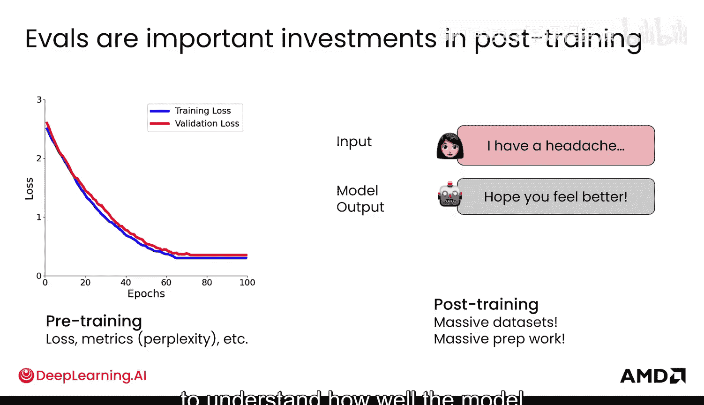

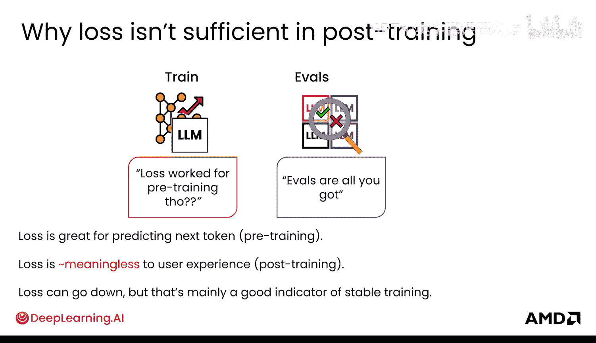

So essentially there's an input and then there's a desired output and then you can compare it to what a model's output is in preference learning very similarly。

 there's going to be an input there's going to be two model outputs and then a preference label and you can compare that to what your reward model actually outputs and see how close that is in this case it's a match。

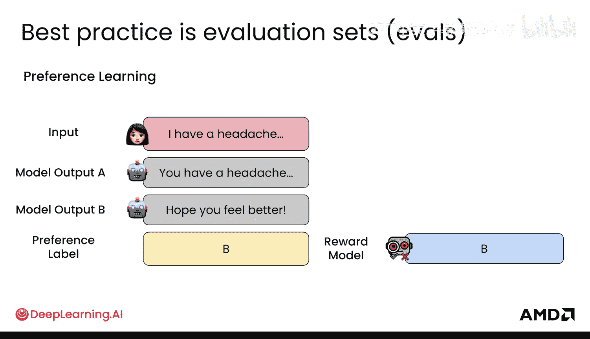

Beyond eval test sets， you can also evaluate the models in different ways using different metrics。

 So， for example， you could get relative scores between two different models and you could use eo ratings。

 which is common in chess by looking at the win lose and draws across a lot of different examples。

 If you're dealing with rankings and preferences。 there's actually a lot of rank correlation metrics that can tell you how close a ranking is to another ranking。

 Basically agreement on rankings。 When correctness is verifiable。

 you could do similar things to your graders in Rl and actually use eval graders that check for correctness or formatting。

 Here's another example with JSson output。 Another way to evaluate is to output。

 say three different outputs from the model and see if any of them are actually correct。

 This is called pass at three。 So that means out of all three examples。

 one of them at least one of them was correct。 It's more lenient and suggest if you sample a lot more from the model。

 it can do well on your task。 and you can generalize this to pass at K and you'll see this a lot in papers reporting results。

 beyond just correctness， you want your model to be。

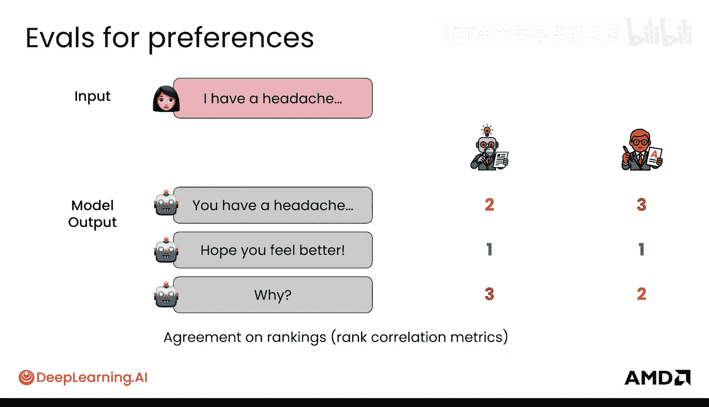

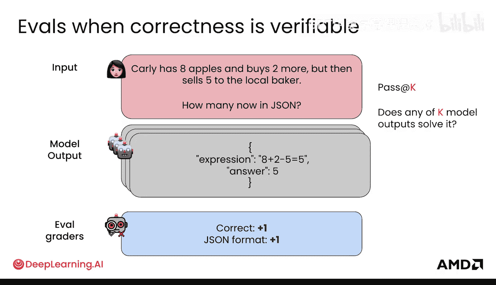

Well under uncertainty so calibration is one of those measures。

 it's about making sure what a model predicts as a probability actually lend up with that probability in reality。

 The famous example of calibration is when a model predicts 80% rain does it actually re 80% of the time like if model confidence is trustworthy。

 especially if you use those token probabilities for downstream applications or even ensembling models。

 for example， like 70% might mean different things for different models。

 I'm sure you know people who are overconfident versus underconfident you want to be able to measure how well calibrated。

 your model is there are different ways to evaluate calibration one you could just look at the token probability matching the empirical token occurrence。

 So how often the token actually occurs you could also do something interesting with multiple choice so with multiple choice you could have say four different tokens ABCD and extract the token probability for a multiple choice token。

 Finally， you can also aggregate across the entire sequence and normalize over token probabilities there to。

An understanding of calibration at the sequence level。 And finally。

 metrics like expected calibration error here will help you quantify how well calibrated your model is。

 So fun fact about calibration， whether people are actually often not calibrated and that's so they don't disappoint you when it actually rains。

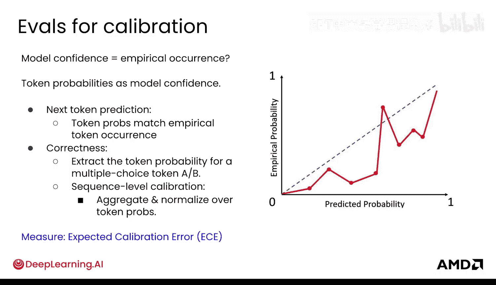

So more on uncertainty beyond just calibration。 if you get the model to say I don't know it's probably better than it hallucinating at different times。

 This is called a refusal。 So a way to assess this in the model is to have a confidence threshold like  point。

7。 and if the probability is under that then the model just says I don't know instead of outputting what it thought。

 and you can find that on， let's say 100 math questions。

 if you don't allow it to say I don't know so no refusals just regular way of testing it it can answer let's say 65% correct。

 but if you allow it to say I don't know and refuse some of those answers and maybe it refused 20 of them。

 it could actually get a higher score And so this is really interesting。

 this means that your model can actually do well and you can actually use the confidence threshold its proba to help you filter when it should actually be outputting something or not。

 Finally you can't really miss efficiency metrics。 So there's a bunch of different ways to evaluate how fast you can actually get an output from a model。

 and so that's latency。And a couple really importantly see that measures are time to first token so that's the time it takes to get to that first token that it outputs and time per output token are teapot and that is kind of a steady state decoding speed of how fast it's able to output entire sequence for you。

 There's other different measures in throughputs， you can get tokens per second per GPU you can aggregate throughput across concurrent requests in terms of scalability。

 Co per token is also really important Co per sample as well input and output tokens are going to be weighted differently often in different Apis and just the cost it takes to do them。

 token efficiency is also important。 This is kind of like what is the effective token that you're getting from the model how verbo is it versus concise it is to get to the answer that you need Soow that's a lot of metrics。

 turns out evaluating on all of them is best practice so you get a holistic sense of how well the model actually is doing Helm is one example from Stanford and it stands for holistic evaluation of language models。

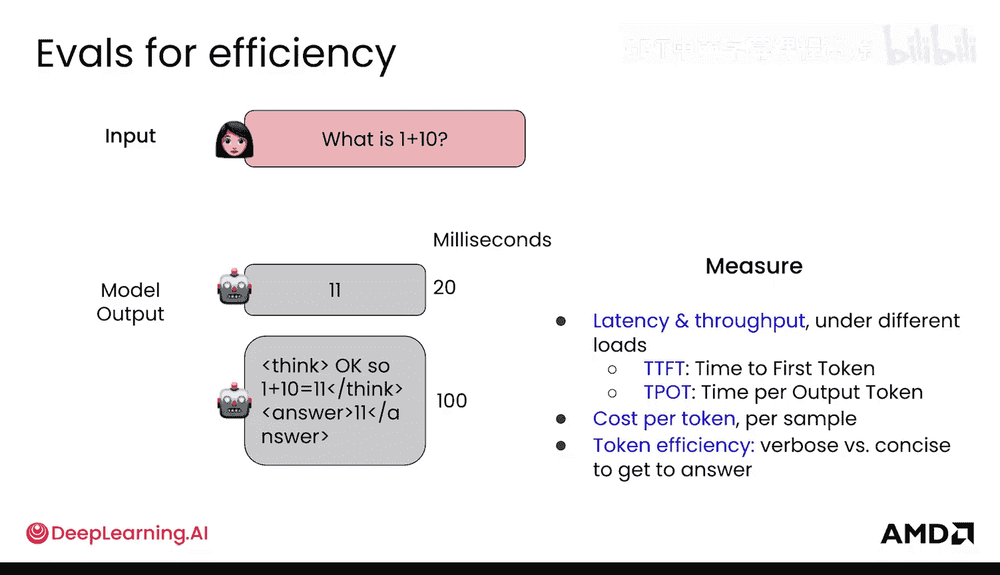

To evaluate across many different dimensions and what helm does is it evaluates models across different diverse tasks like question answering。

 summarization， classification like spam detection。

 and these aren't isolated tests they represent 42 different scenarios spanning different domains like medical legal news finance and what makes helm nice is that it's a living benchmark。

 they're continually updating it with new scenarios so while helm is great and they're a bunch of those types of composite metrics。

 traditional benchmarks up until recently kind of test the model with simple tasks like those exam questions coding puzzles。

 lab scenarios or shorter prompts and they' relatively toy benchmarks and this is useful for progress tracking especially in the early days of language models。

 but we're starting to measure realw work now and GDPval from openaiI actually moves evaluation to this professional level of tasks so they include real deliverables real reference files and real expert professionals who've contributed to the Eval and specifically GDPV has a ton of different tasks。

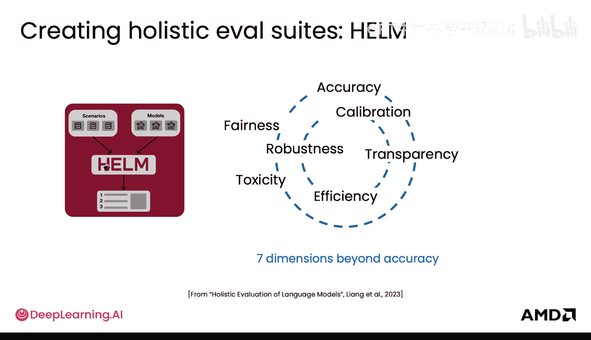

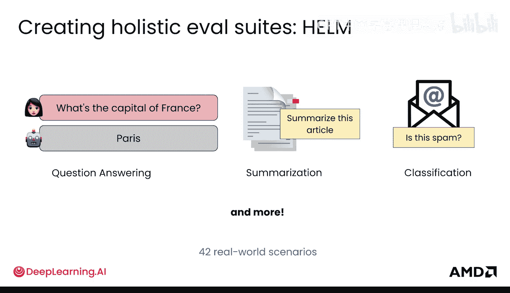

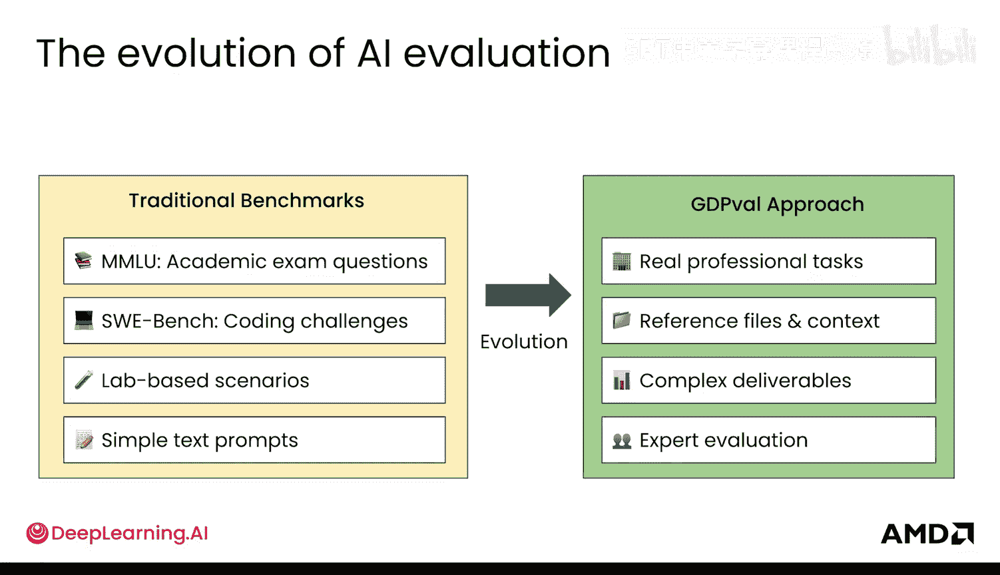

1300 tasks more than that。 And it's from 44 different types of jobs across nine different industries。

 and the contributors are professionals with over 14 years of experience in their industry。

 which is huge and the deliverables are real So they document slides blueprints care plans that actually matter in their jobs and the environment is real the complexity of real files context in a work environment and then the grading they try to make it fair。

 so they try to do blind expert grading when they release this comparing the AI and human work and those blind expert graders are again professionals who hadn't previously seen the outputs before。

 So what's really interesting is that openaiI ran G40 and G5 on GDP Val and the performance more than tripled in a year。

 that's a sign that these models are better at real world complexity and are just getting better and better Exp graders compared the generated deliverables to human deliverables for this and is really just approaching the quality of work produced by industry experts they also found that cloud opus 4。

1。

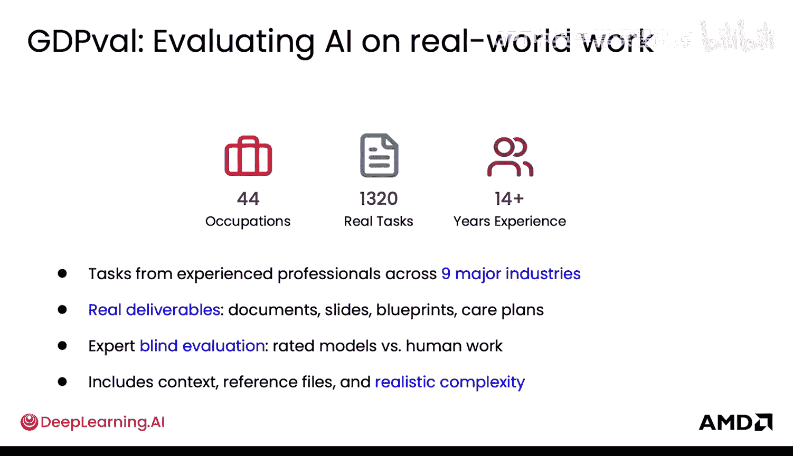

outputs rated as good as or better than humans in nearly half the tasks so as GDP valve saturates。

 we'll need to devise new benchmarks for harder real world tasks and I'm excited to see what those are because I think we'll be constantly producing new benchmarks to meet the current next frontier of these models。

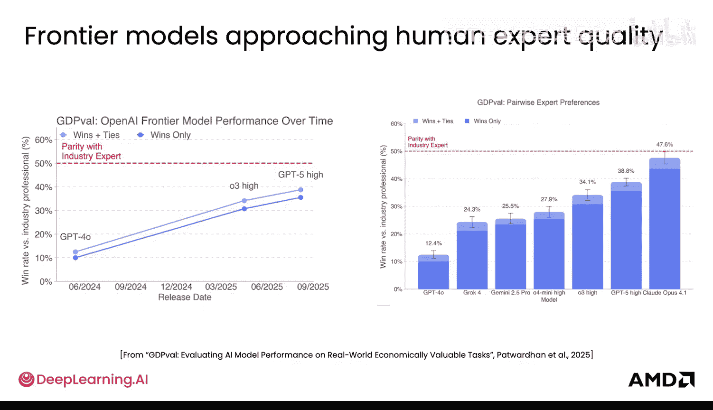

Now that you've seen some of the metrics in E benchmarks for fine tuning and preference learning。

 it's time to take a look at RL test environments and how they work。

