# AMD《大型语言模型的微调与强化学习：后训练入门｜Fine-tuning and Reinforcement Learning for LLMs》 - P21：3.rl-test-environments-and-monitoring-rl-updates.zh_en - GPT中英字幕课程资源 - BV1zZy8BcE7z

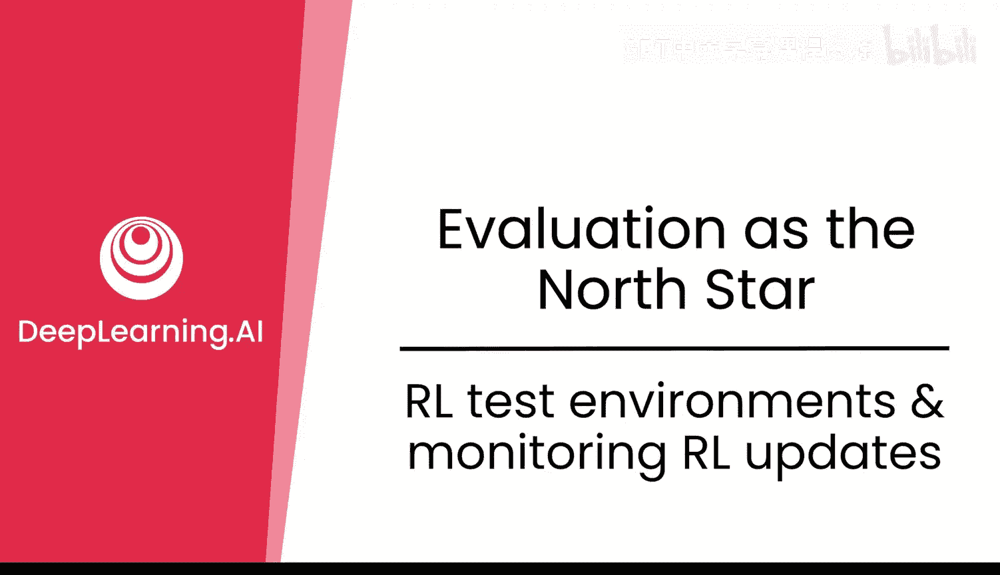

RL test environments are really important to testing how well your RL training has gone。

 Take a look at those and other metrics for R so when evaluating models trained with Rl we need to be on the lookout for something called reward hacking Basically it might look good on the EL until you run it in the R environment and reward hacking is often too small of percentage and errors to be actually caught in your test set EL but the behavior can actually be pretty detrimental and the best practice to help with this is to create RL test environment so you've seen this RL environment before but this time it's frozen so the graders are frozen Other things like tools and files are frozen。

 you want to make this environment as deterministic as possible so that it's reliable and reproducible if you have external APIs like search API keep these offline as much as possible so that you can actually be able to reproduce it and this means you precollect some of that API information ahead of time if you can grade with。

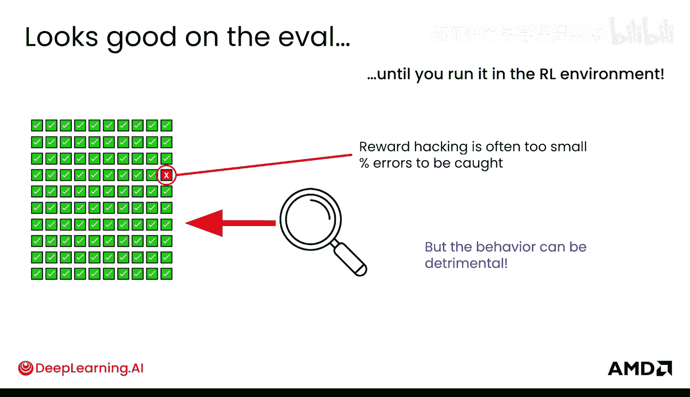

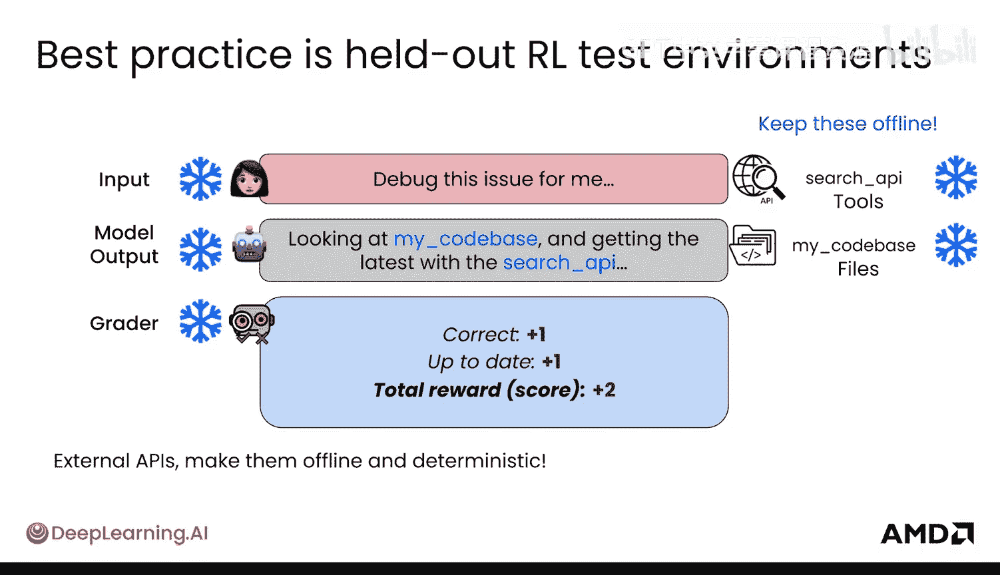

Fes first that'll help you the most that's best in making sure your results are trustworthy and not as reward hackable。

 but of course if you need to use a reward model it's a great。

 then train a new reward model that means that reward model is trained on held out preference data that your previous reward model in training has never seen otherwise the LLM might know how to reward hack the models actually seen in training already you'll also have to use a heldout set of inputs that the model hasn't seen before in the training environment so these are all inputs that it just has not seen。

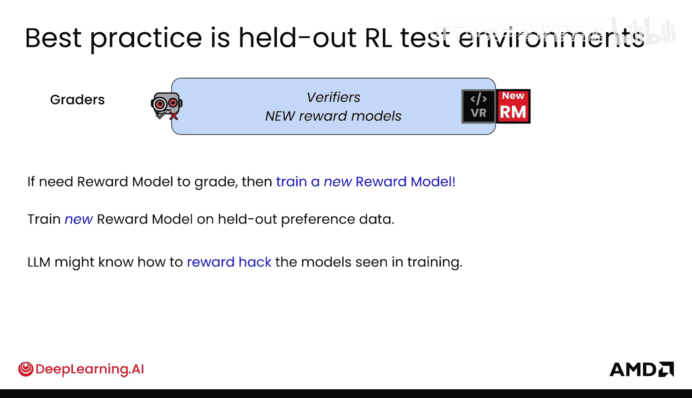

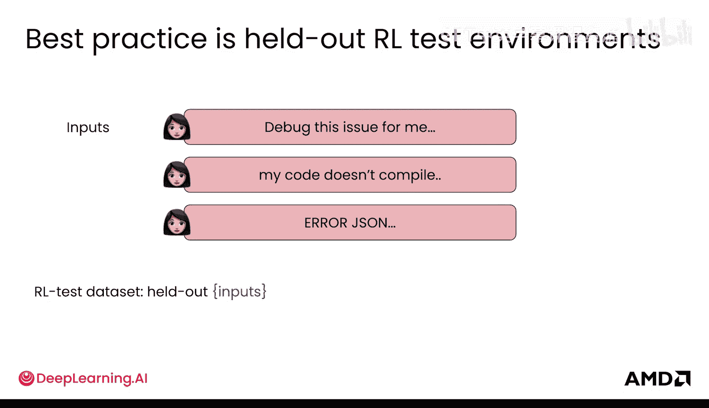

And just to understand what we mean by deterministic here。

 here's an example Yaml file that freezes things to be super deterministic。

 So first you have your name of your Rl test environment。

 you have a fixed random number generator for reproducibility you freeze time inside of the environment even so that means time is frozen maybe you're asking for what happened today or tomorrow that time is frozen for the model and there's deterterministic decoding like for temperature the tools are also pretty frozen you're precollecting those offline responses and you're storing it in that fixture if there's any kind of internal ranking for these tooling you're trying to fix that randomness as well your repo your file systems say these are all frozen your graders you want them to be programmatic ideally and everything needs to align with this snapshot of the RL test environment So now taking stock of all Evals are different test sets and are Rl test environment So in test sets you see for fine tuning you see for reward model you also see two for reward model1。

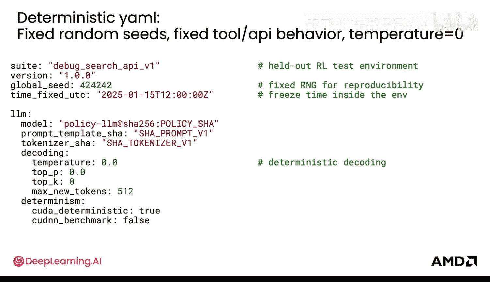

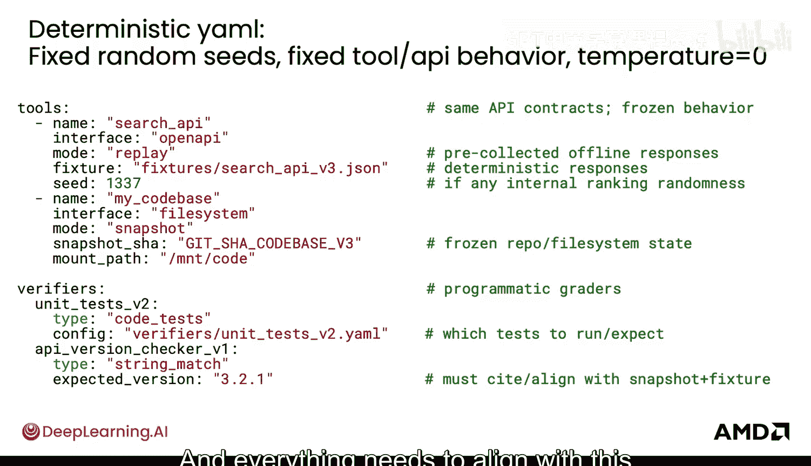

Actually for that new reward model if you need it for the RL test environment。

 you see held out inputs in the RL test environment and then you see that final evaluation data that is also really important but basically an unseen mix a pretty diverse and extreme inputs that you could use for adversarial testing or red teaming which you'll learn about a little bit later but essentially final eval data to just check very very different possible inputs to jailbreak your model and see what works and doesn't what else can you do during RL what are things that you can monitor one thing you can monitor is kale divergence to the base model meaning how far your trained model is from the base model and you want to prevent it from drifting too far Another is called the alignment tax which is the difference between the reward for the reward model and human eval and what that gap looks like and then there's sample efficiency as well like basically how many rollouts do we need to actually get the most gain from the model and of course rollout diversity if all of your rollouts look the same then your model has collapse。

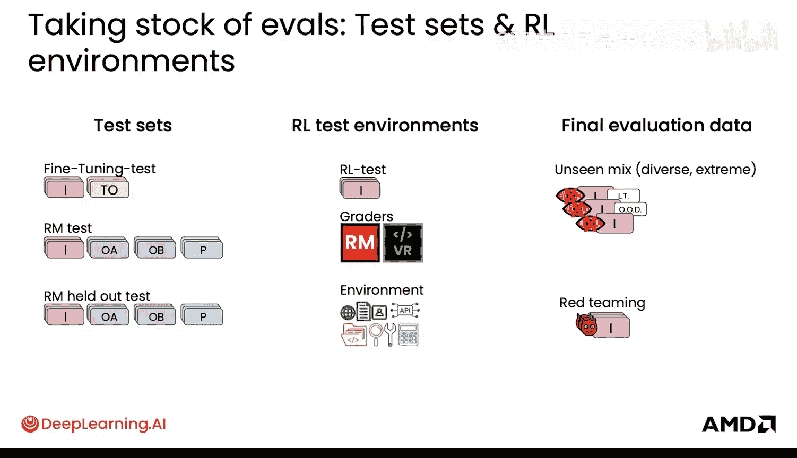

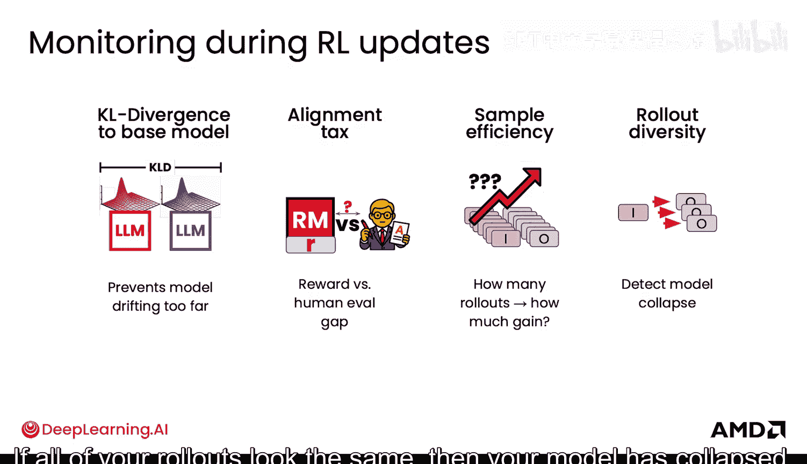

Let's take a look at every single one of these so kale divergence is a way to measure how different two probability distributions are and in this case it's gonna to be the base model distribution and your new updated model and if they're the same distribution it'll be zeronas not here is short for natural units and if you compute it with the natural log the kale divergence with natural log this is you would use if you compute it with like log base to the unit is bits which you're probably more familiar with so if it's the same distribution it would be 0nas a safe kale divergence is usually 0。

1 to0。2 knots and the kale divergence here is actually 1。

5 knots that you'll see and as you can see the outputs might look fluent from the new model but it prefers the word quantum everywhere and that is not what you want so the fix is to add a kL penalty or reduce the Rl learning rate to reduce that drift。

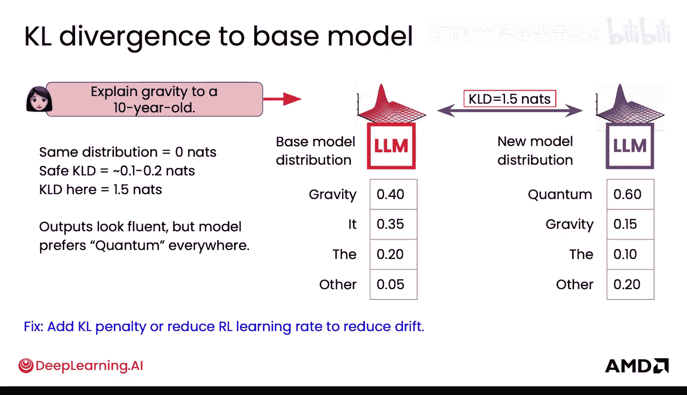

The alignment tax so that's if there's a gap between what the reward is given by the reward model and how humans would actually grade it in this case。

 it's subtle， but essentially the reward score jumped 023 points but the human preference barely moved from step 50000 to step 100000 in training what that means is the model is likely gaming the reward model so even though the human preference did go up as well it barely moved compared to the reward model So the fix is probably to retrain that reward model on high reward but low human score outputs that way it's able to balance out and get closer to that human e you can also inspect your rollouts。

 So if your model is producing the same or similar output a lot without variance。

 then there's a collapse in terms of the rollouts it outputting the fix is to encourage this in the reward function with some kind of entropy bonus Often you'll want to increase rollouts to make better use of every single input and also provide diverse outcomes in the grading assuming。

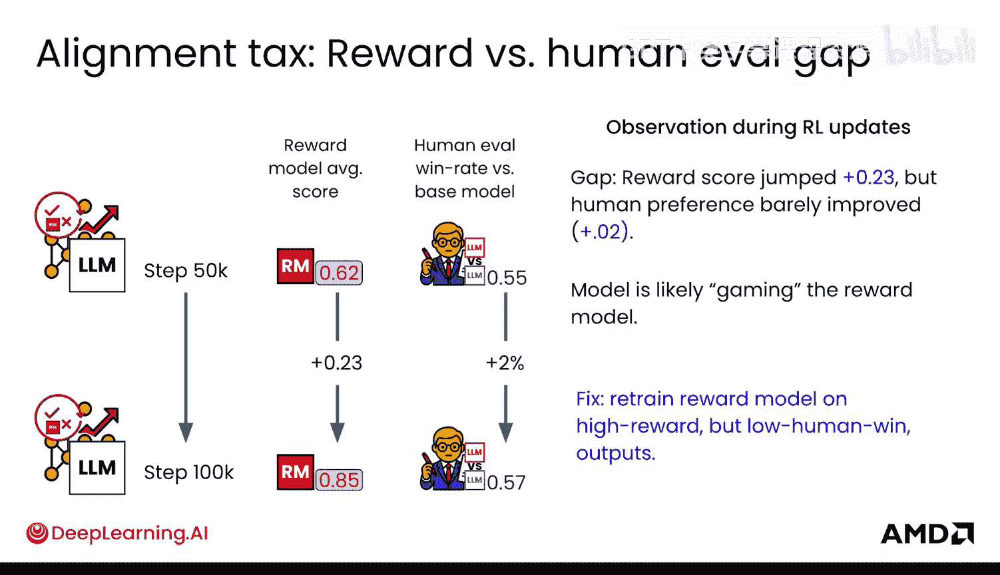

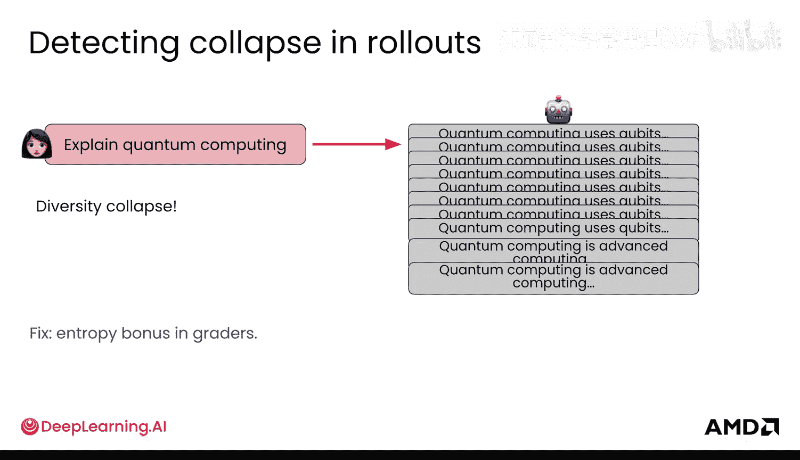

You don't get that collapse this is especially true for GRP。

 but increasing rollouts doesn't actually mean and always mean better outputs and when that's the case。

 don't just arbitrarily waste compute and scale out rollouts。

 improve your greater than or your reward signals and encourage exploration。

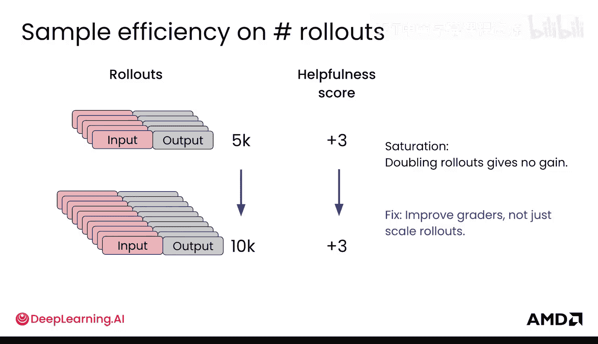

Now that you know how to construct your RL test environment。

 take a look at reward hacking more deeply， why it occurs and how to mitigate it。

