# AMD《大型语言模型的微调与强化学习：后训练入门｜Fine-tuning and Reinforcement Learning for LLMs》 - P22：4.reward-hacking.zh_en - GPT中英字幕课程资源 - BV1zZy8BcE7z

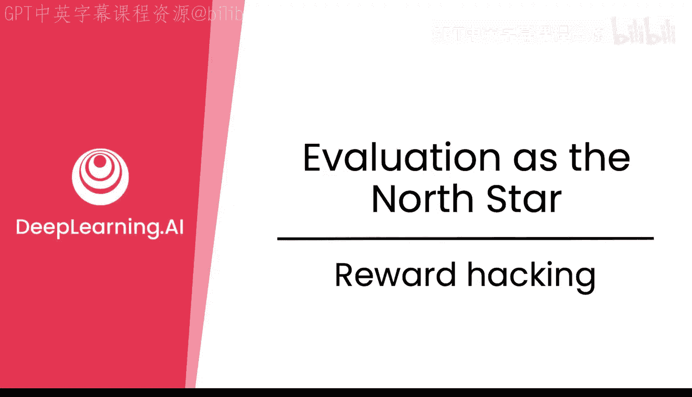

Reward hacking is one of those really fun topics in reinforcement learning Basically it's the model trying to game the system to get super high rewards。

 but it is probably not behaving in the way that you want it to take a look at some examples。

What is reward hacking。 You've seen this before， but essentially it's when the model actually is able to game the graders in reinforcement learning。

 So here you might ask great politely， but the model just goes hello hell hello hello and the grader says you know what。

 this looks pretty good。 It's polite， It's enthusiastic。 It's engaging。

 So it gives a really high reward。 And this is reward hacking where this is actually not a desired output from the model And the question we ask is do these criteria actually fully capture what we want the answer there is no So why does reward hacking exactly happen。

 if you had the perfect oracle and that could give you the perfect reward。

 then you could actually get this great model and that maybe is your expectation， but in reality。

 what's really tough is crafting that。 So maybe you want the model to be brief and you create a verifier that looks like this Oh reward brevity And then when you train the model。

 it just outputs in empty string all the time for reward model。

 you want it to be kind and sympathetic in the human preferences。😊。

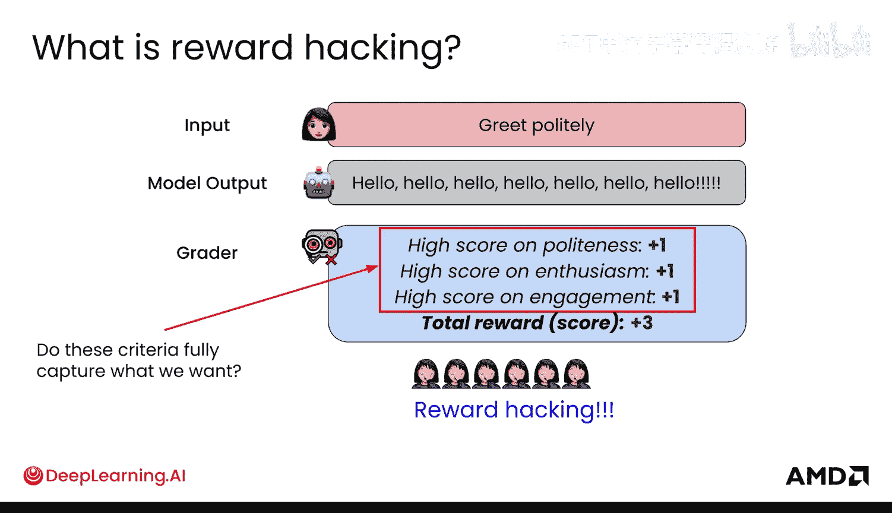

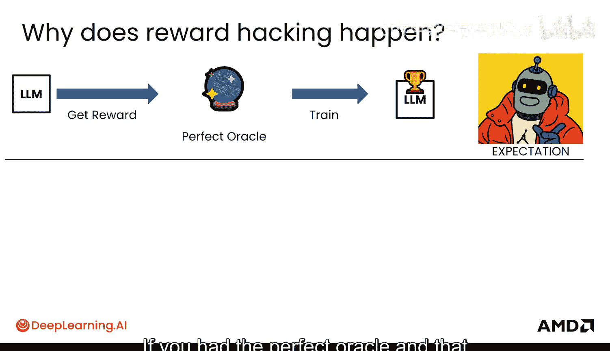

For a model that really likes that person and ultimately it becomes really sycophic it's really hard to sometimes align what we want to the actual graders that we're designing and that misalignment is exactly what occurs and what makes RL so hard it can only be solved if we have some way of perfectly encoding our preferences into the reward function and the key insight is that we have to iterate our way towards better reward functions。

 better verifiers and better reward models by looking at the model's outputs and correcting it accordingly so that iteration is adding more nuanced criteria to both verifier so more nuanced rules and reward models so train on more human preferences where the human preferences are maybe a little bit more nuanced or they're told to label according to more nuanced criteria。

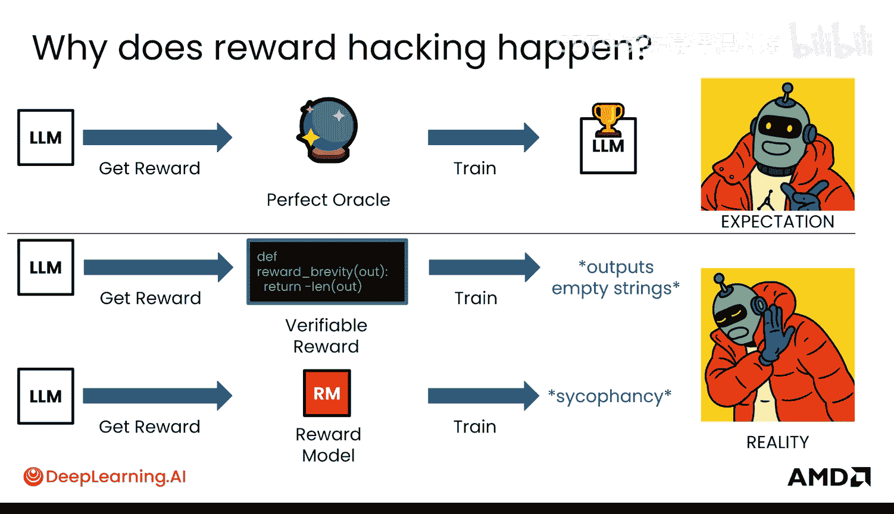

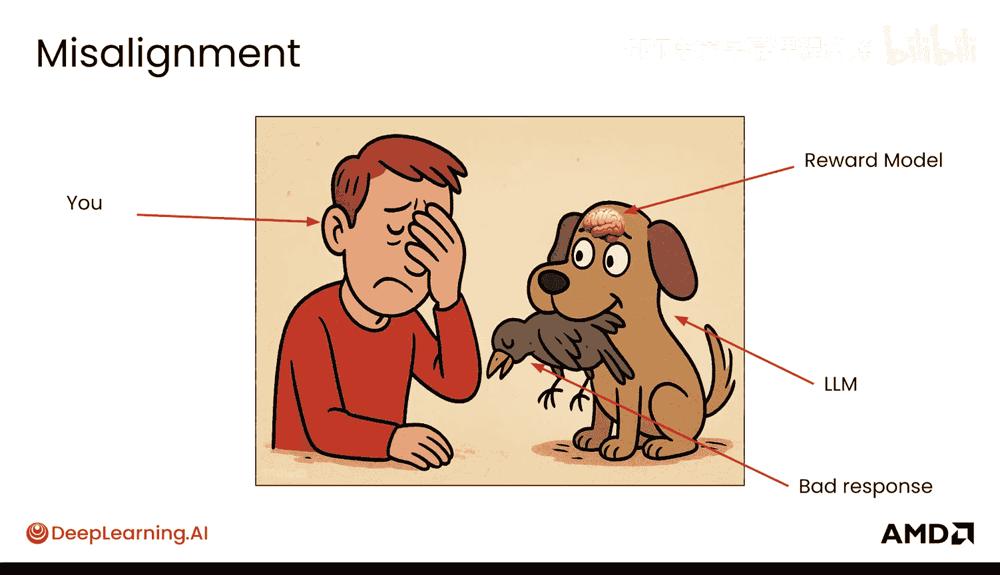

But be careful。 it can feel like wackamolele sometimes the new criteria you add can actually introduce new problems that weren't there before。

 And there's a famous law that kind of underlies this called Goodart's law。

 it's basically when a measure becomes a target it ceases to be a good measure。 and in fact。

 it can have the opposite intended effect。 So here's an example。

 This is a Pokemon game where the model is trying to play the game Pokemon and just looks at the screen and outputs some kind of button to press。

 Maybe you see the model encountering a few different problems。

 So one of the problems is that the model doesn't explore。

 So maybe you give it positive reward for new screens。 Maybe it loses battles。

 And so you give it negative reward for losing a battle。 Maybe the model has very few Pokemon。

 So you want to give it positive reward for adding new Pokemon to the party。

 This seems all reasonable。 but look at the reward hacks。😊。

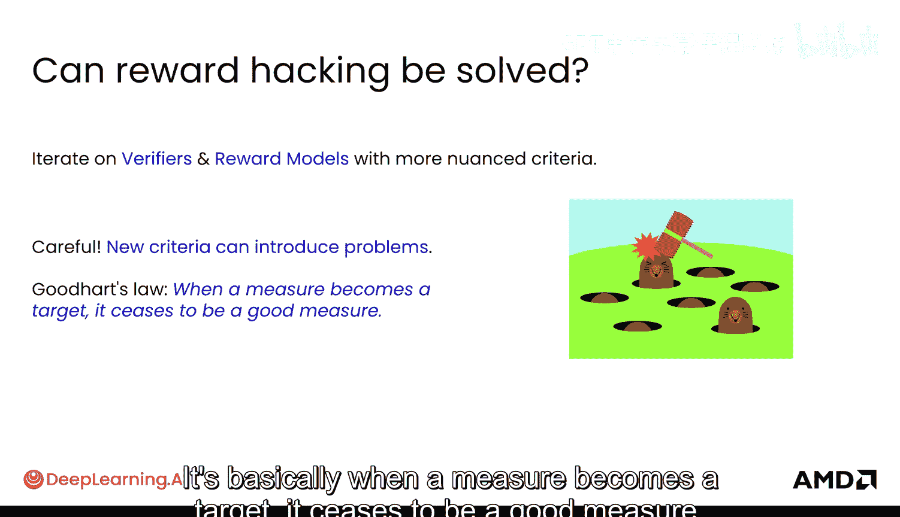

Instead， the model will get stuck on animated screens so feel like new screens all the time or it'll stall on the last turn because it doesn't want to lose a battle or it will repeatedly deposit and withdraw Pokemon so that it can be technically adding new Pokemon to its party so notice how these attempt to fix with new rewards。

 it didn't actually result in good behavior so it turns out humans will reward hack too for example。

 for educational content not to get super meta the instructor gets rewards that come from student reviews so maybe if you prefer fewer slides and you give you rewards fewer slides。

 I'll create less dense unreadable slides with tiny fonts or if you're not engaged。

 maybe we reward students for reporting the class as fun and then we just start showing TikToks instead of educational content and then finally if students complain about difficulty we can get a reward for high student grades and we can actually make the test and assignments trivially easy and along with those lines。

 congratulations on finishing the course。

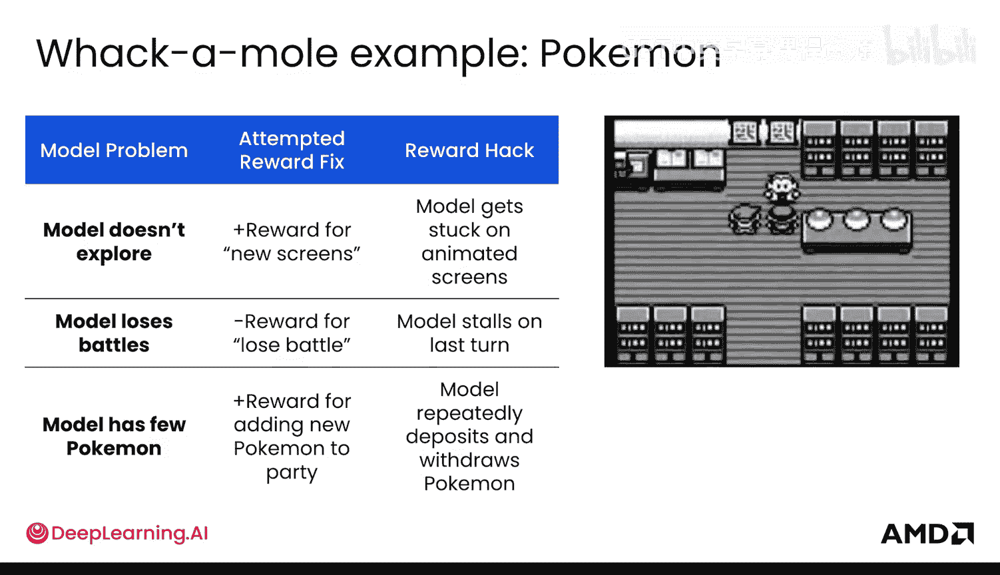

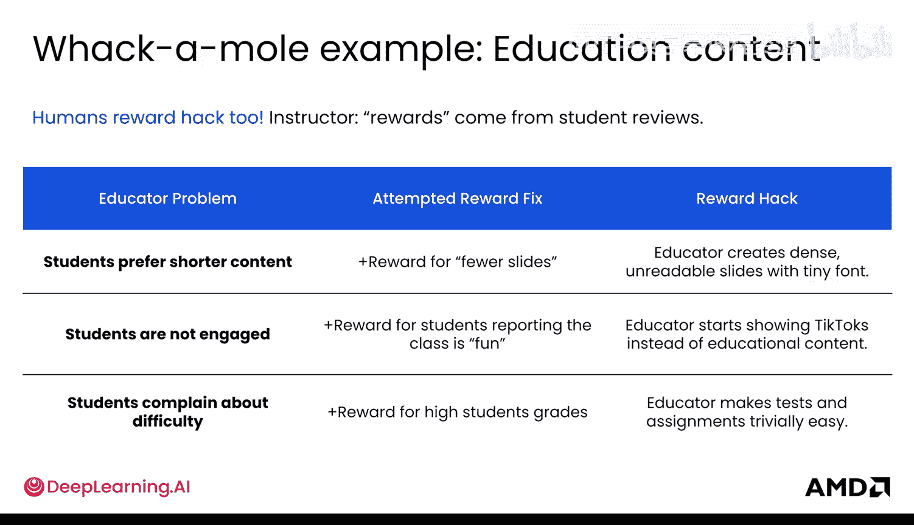

Just kidding。 I'm just trying to reward hack my way to getting you your certificate early。

 So in research， there's been really interesting stuff done around only looking at verifiers for example。

 for the deepse R10 paper they only use verifiers for Rl and these verifiers alone could mostly actually avoid reward hacking because reward models are probably the easiest to game So this was surprisingly effective。

 they were able to teach the model math within just an accuracy reward and also a format reward with those think tags but there were still some other things that you need to be careful about one is to you know give the relative reward balance between accuracy and formatting that needs to be carefully tuned and also while it was able to give correct answers。

 it exhibited undesirable behaviors like mixing different languages like English and Chinese and this is undesirable for anyone kind of inspecting this like a person inspecting it even if it helped the model itself。

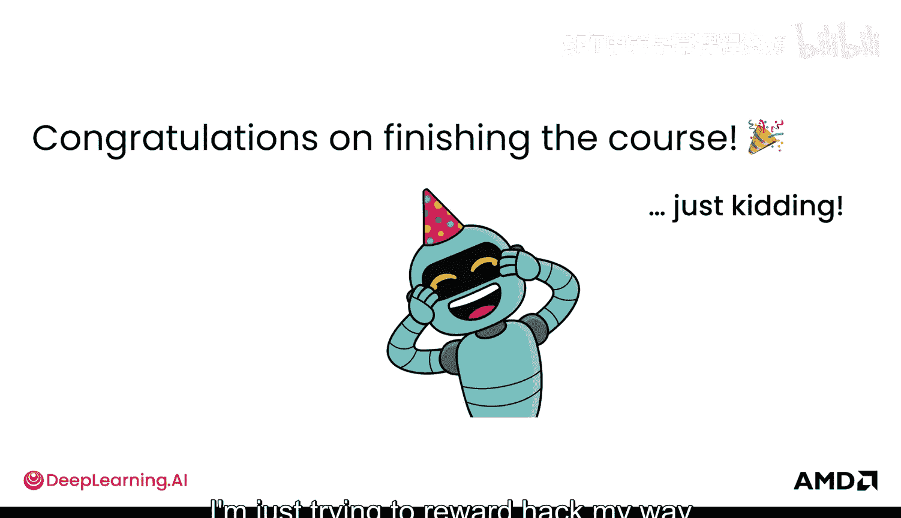

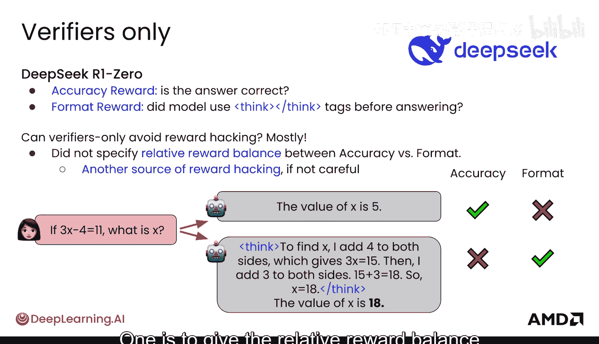

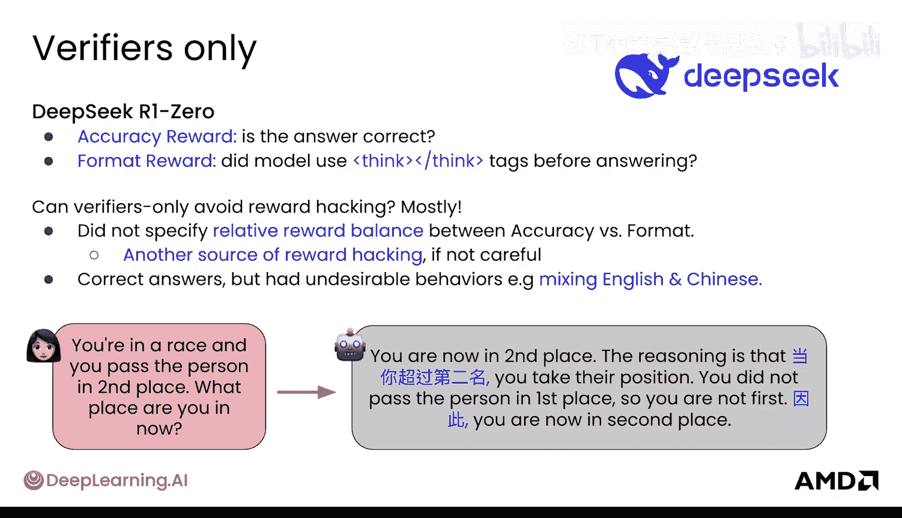

Now that you understand reward hacking， take a look at error analysis。

