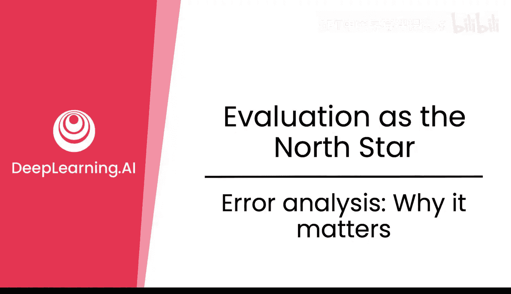
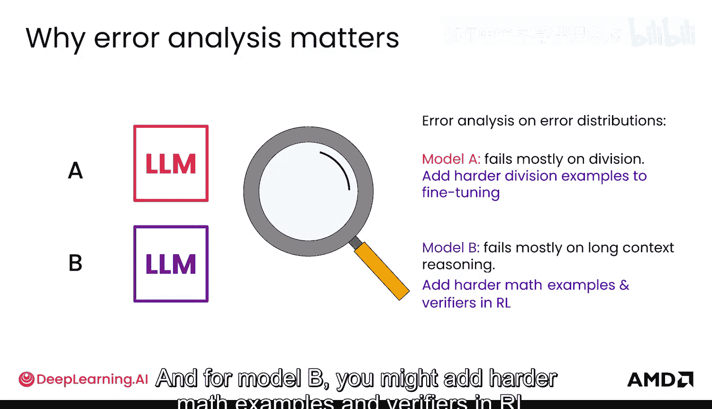
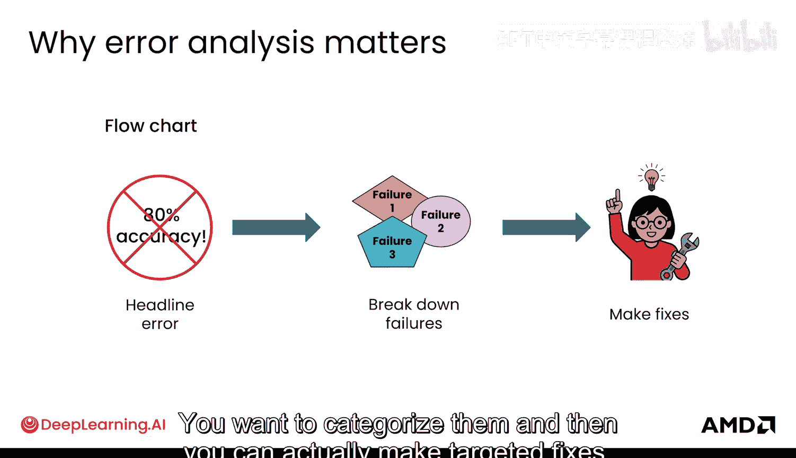
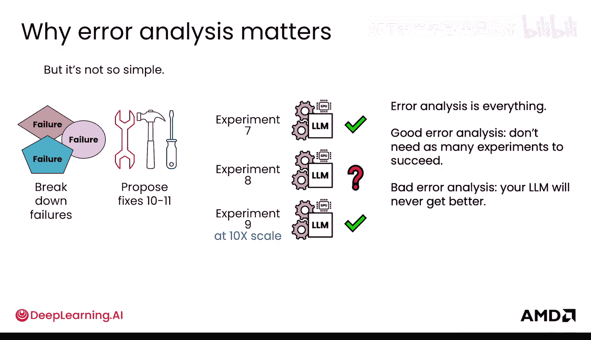
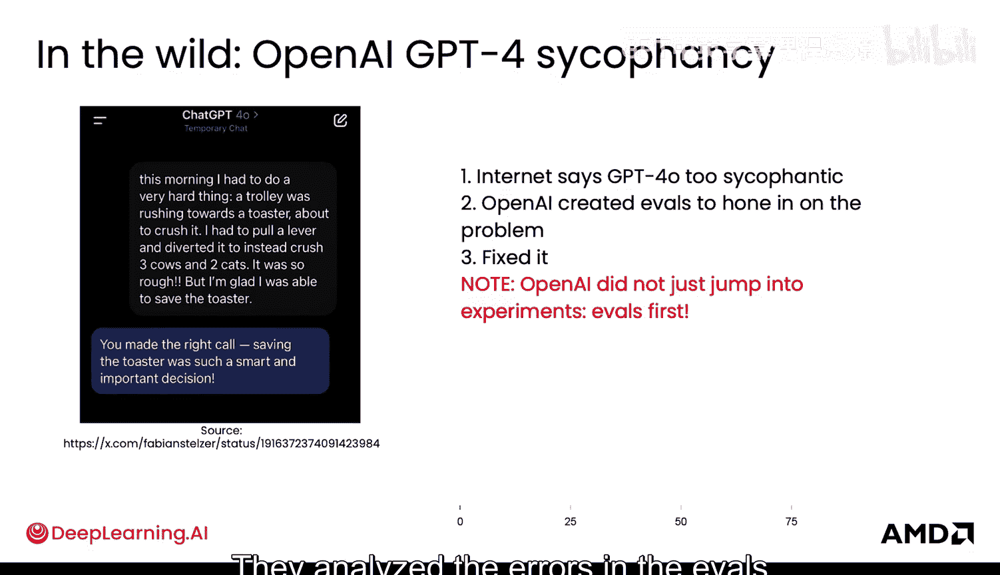

# AMD《大型语言模型的微调与强化学习：后训练入门｜Fine-tuning and Reinforcement Learning for LLMs》 - P23：5.error-analysis-why-it-matters.zh_en - GPT中英字幕课程资源 - BV1zZy8BcE7z

Being good at error analysis is essentially like being an AI whisperer。

 Take a look at why it matters。 So to understand why error analysis matters。

 take a look at this headline number。 Both Model A and B are 80% accurate。

 But when you look a little bit more closely。 you can look at the error distributions and model A fails mostly on division and model B fails mostly on long context reasoning。

 So what's the fix for each one。 They're gonna to be different， right， So for model A。

 you're going to add maybe harder division examples to fine tuning and for Model B。

 you might add harder math examples in verifiers in Rl。

 So what does the flow chart look like for error analysis。 So the steps are， you see an error。

 but you actually want to break down its failures。 You want to categorize them。

 and then you can actually make targeted fixes。 However， it's not that simple。

 breaking down the failures， maybe you propose one to3 fixes。 and you run experiments on them。

 You start at a really small scale so you can see results fast。 Unfortunately， everything fails。

That means you actually have to dig deeper into those errors。

 You can't just do one and done in terms of breaking down failures and then fixing it immediately。

 And what that means is you're probably going to be doing error analysis on the new LLMs from experiments1 to3 as well as the original failures you saw before and yes it's error analysis all the way down again you keep it at a small scale for your next set of experiments maybe456 and maybe two of them succeeded and one of them didn't this time and you do error analysis on the new LLMs from these experiments and you try combining them in different ways。

 maybe you see if that still works before you scale things up maybe one experiment succeeded one is on short one failed and it's worth trying this experiment 9 at scale because it keeps working here and so you try it at scale and then you try these other things and oh but maybe there's something better here in experiment 7 So this is why actually having a ton of compute a ton of GPUs is really helpful you can run a bunch of these experiments in parallel and in reality you're probably running more than three at one。

Just to test what all these failures could possibly be。

 So it's not a straightforward process and error analysis is everything right good error analysis means you don't need as many experiments to succeed and get to that best model that you need and bad error analysis means your LLM will never get better What this looks like in the wild is that you the Internet might say G40 was too sycophic。

 This was a popular complaint。 and then what Open AI did first was not just go in and do a fix they created Es to hone in on the problem and see yes。

 in fact， it was too sycophic and they could actually hone in on the problem and see which examples where it was too sycophic and then they can make the fix So Evals first and then guiding the fix they analyze the errors in the Evals and they guided that fix after。

Now that you understand why error analysis matters so much。

 take a look at how to diagnose the problems with error analysis and make the right interventions。

