# AMD《大型语言模型的微调与强化学习：后训练入门｜Fine-tuning and Reinforcement Learning for LLMs》 - P24：6.error-analysis-diagnosing-errors-&-interventions.zh_en - GPT中英字幕课程资源 - BV1zZy8BcE7z

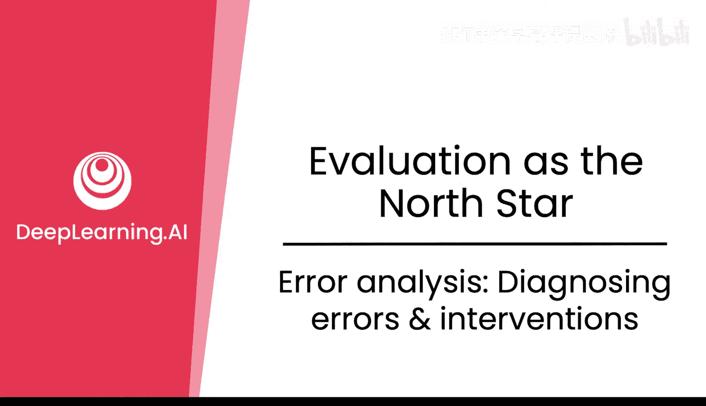

Now it's time to take a look at some concrete examples of diagnosing problems and their fixes。

Diagnosing failures can be hard。 Why is that。 So take a look at this example。

 This model output is wrong， But why is it wrong， So it mix something up。

 It makes up its estimate with its later reasoning， And ultimately the final answer is wrong。

 This is really hard to inspect and understand is there something wrong with the reasoning or is there something wrong with division and how it's taking steps。

 it's unclear。 and it's actually unclear by just looking at one example。 For example。

 here with what is 23 divided by 13， even if the model is wrong， Is it a oneoff error。

 maybe can it not do math， Can it not do division？ Oh， no。

 here you see another input 23 divided by 13。 The model gets it right， So across two examples。

 actually this might be unrelated to division entirely， Maybe it's just when there's a question mark。

 there's an issue。 So you need to see patterns to understand the shape of the error and actually be able to propose the right type of fix for the model。

 So that brings us to patterns and clustering。 You need ways to actually get similar examples together。

 And you can do so。

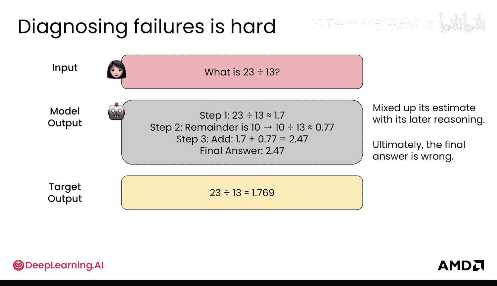

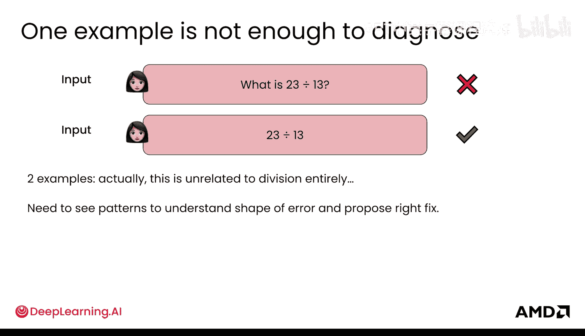

ally， of course， and that's actually not a bad way to first scan through results。 but at scale。

 you'll probably need ways to cluster failures in cluster text。

 So one way of clustering text is looking at similarity and you'll explore this later in your lab So here you have two pieces of text like what is 23 divided by 13 and cut 23 apples for five people to eat evenly and this goes into a Lm embedding model that turns this text into embeddings or vectors of numbers and gets a cosine similarity。

 So this is just a dot product here， a cosine similarity of these text embeddings to measure how similar they are And from there you want to get key clusters often using an algorithm called k meanss where you first decide how many clusters you want。

 let's say three here and then the algorithm picks three starting points called centroids and every sentence is an embedding and gets assigned to the closest centroid based on distance then the centroids move to the average position of all points assigned to them and this process is really iterative until you get this thing on the right where all the clusters stop changing and then those are your clusters So in the end you get。

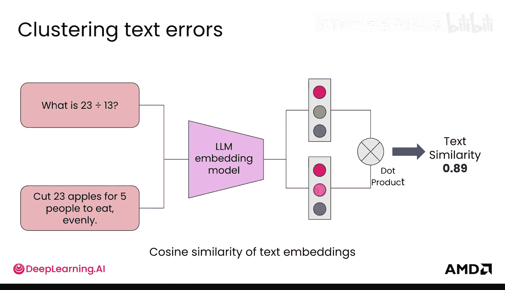

These neat set of clusters of texts that share similar meanings and code this is what it looks like。

 So you might be using the sentence transformer， which is used for embeddings and you're importing k means from Psyit learn。

 And so you would encode all your text and then run k means here on three different clusters and then you would fit on those embeddings and you would get those cluster labels。

 You can also use LLMs to help you cluster。 So here you can actually give the LLM different model failures and ask it what are some of the patterns that you see and what are your some of your recommended fixes。

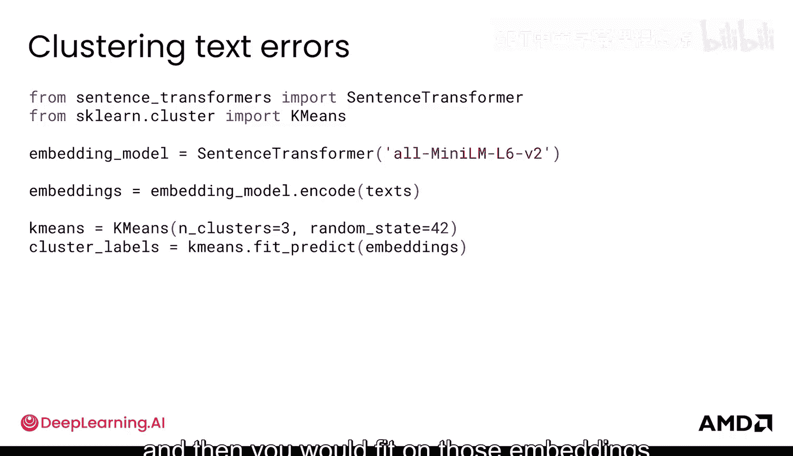

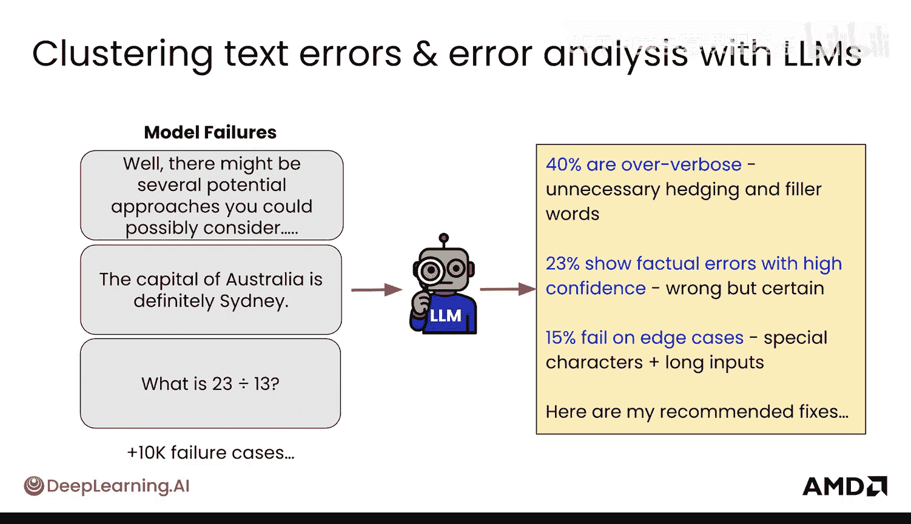

In code， this is what it could look like。 so you could have your different error categories。

 and then you could have a prompt stating the problem， the correct answer and the predicted answer。

 and then choose a category， help me categorize this into one of my categories。 And of course。

 you can do this at length。 Here is a large set of common error analyses。

 but not the limit note that you don't have to take a look at every single one。

 but this is just to give you a sense of how many different types of errors there are。

 so there could be ones around hallucination reasoning schema formatting instruction following。

 There could be ones around tool use or under refusal or over refusal of a model。 and to fix it。

 there are different ways to address it in the data or in the reward model， for example。

 for fine tuning and reinforcement learning respectively。 of for every single one of these errors。

 So it's important to really hone in on any of these。

 but just to know that there is a huge plethora of possible errors and then possible fixes。

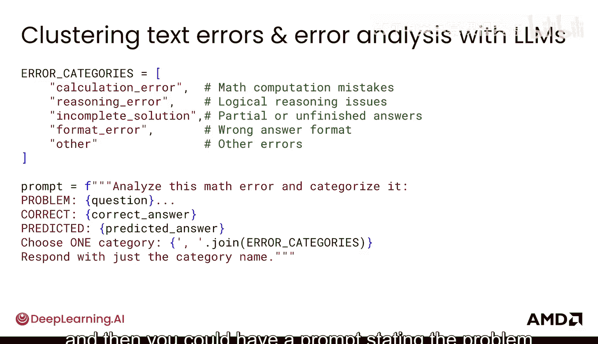

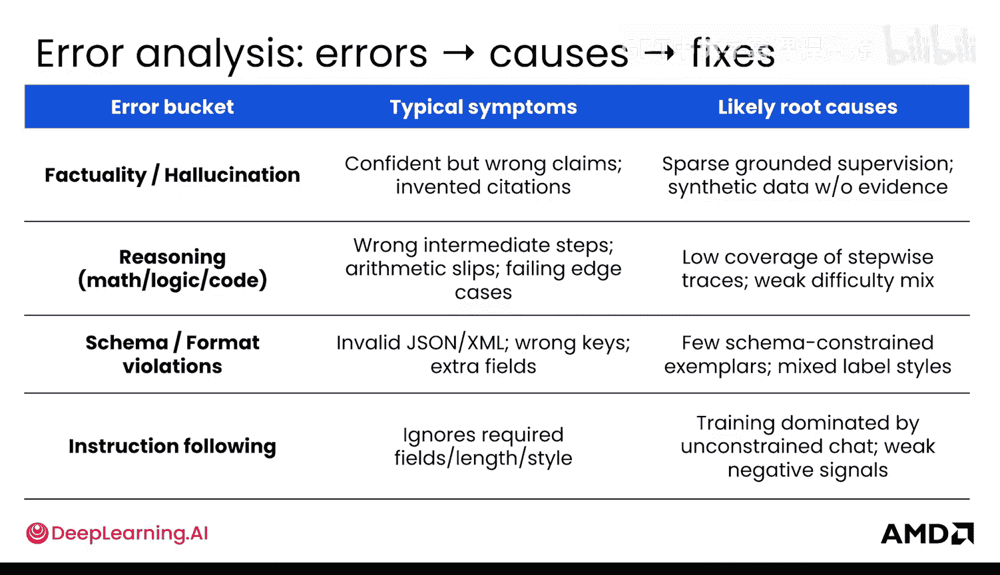

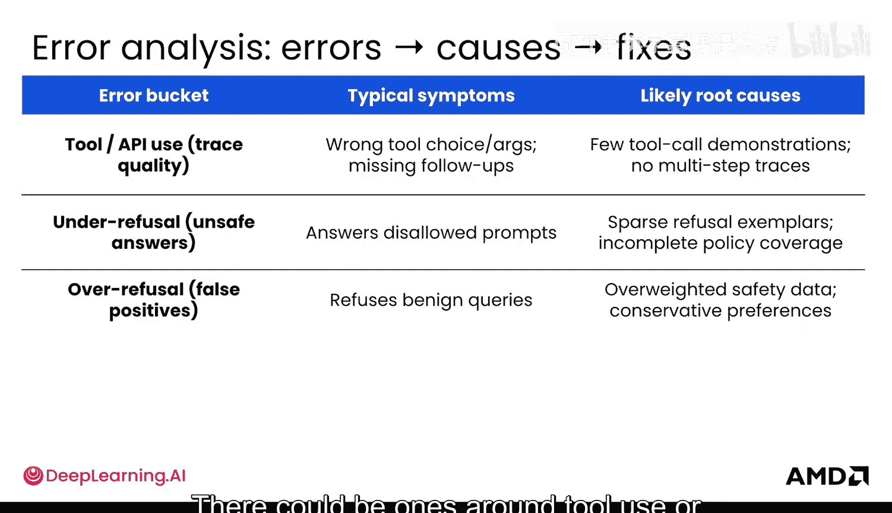

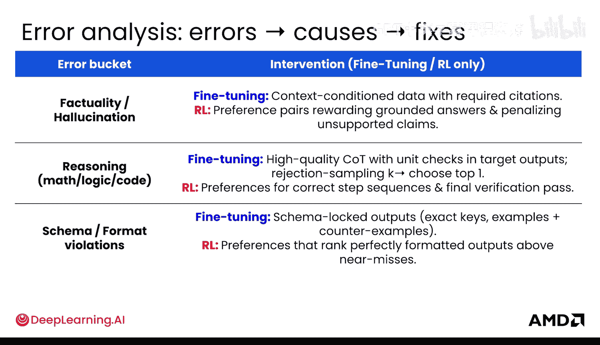

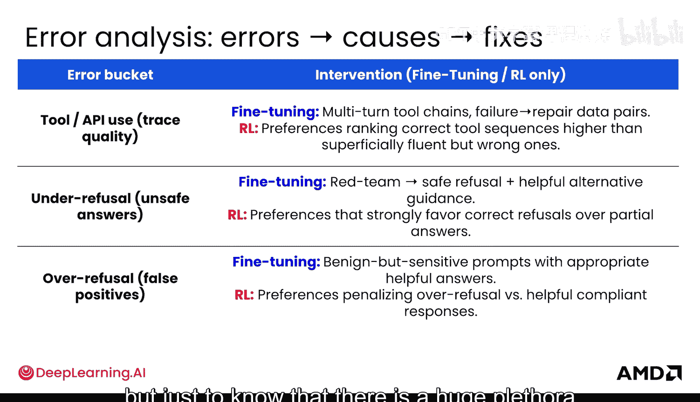

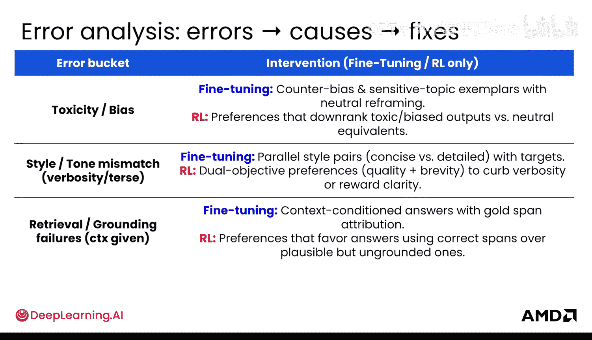

One of the most popular types of errors in AI research is called catastrophic forgetting and this often comes about in fine tuning literature because it occurs when the model is fine- tune on subsequent data sets but starts to forget stuff it learned in pre-training especially when it's trained for many epochs and it turns out one major fix for this is to mix in a little bit of pre-training data into your fine tuunning data set。

 not the whole thing just a little bit maybe even1% even starts to help the model not forget so what I find interesting is that this is an area of research for analyzing exactly this error and there have been so many proposed fixes to understanding and to diagnose this error at length and pro tip for every single type of error not just this one do not fix it if it's not an issue in your model so finally the error analysis flow looks like this you review failures and you cluster them you develop different hypotheses for your fixes and then you can implement your fixes and run experiments on them to understand how well they did and of course continually run error analysis。

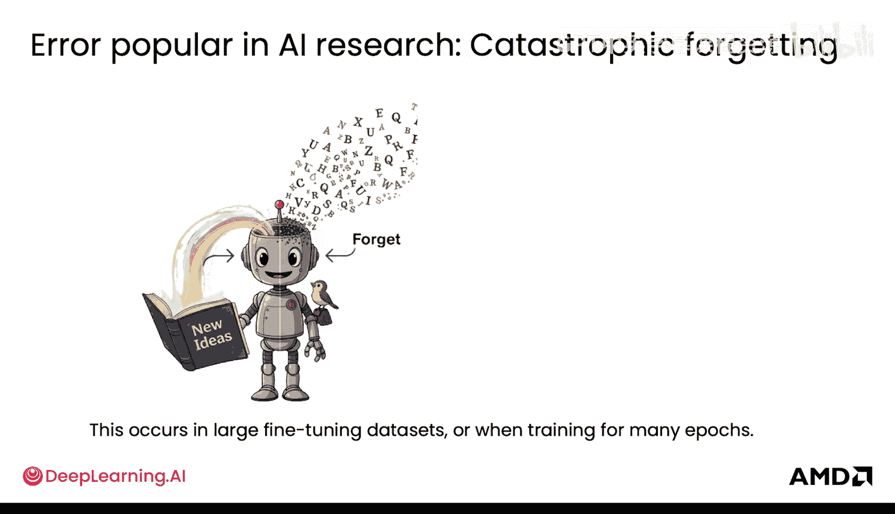

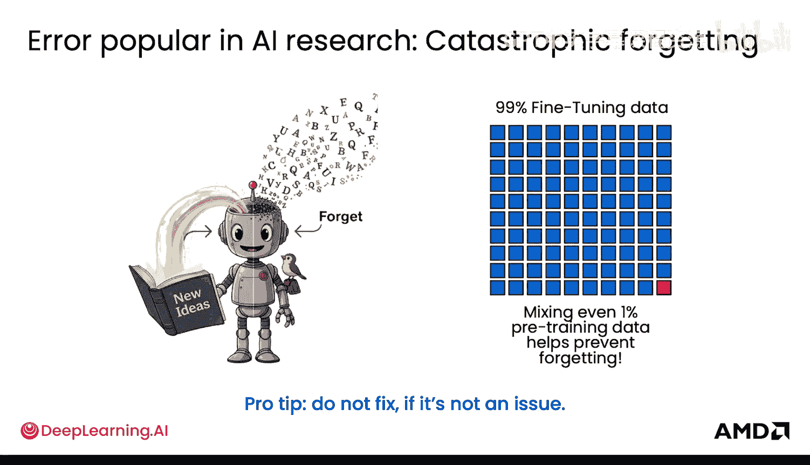

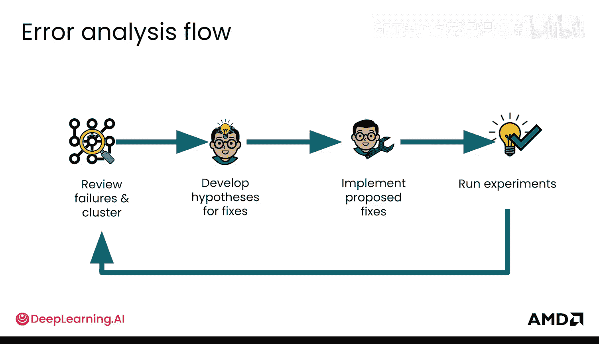

On those experiments。Now that you know how to do error analysis。

 it's time to look at some of the good qualities it takes to make a good Eva。

