# AMD《大型语言模型的微调与强化学习：后训练入门｜Fine-tuning and Reinforcement Learning for LLMs》 - P25：7.how-to-invest-in-good-evals.zh_en - GPT中英字幕课程资源 - BV1zZy8BcE7z

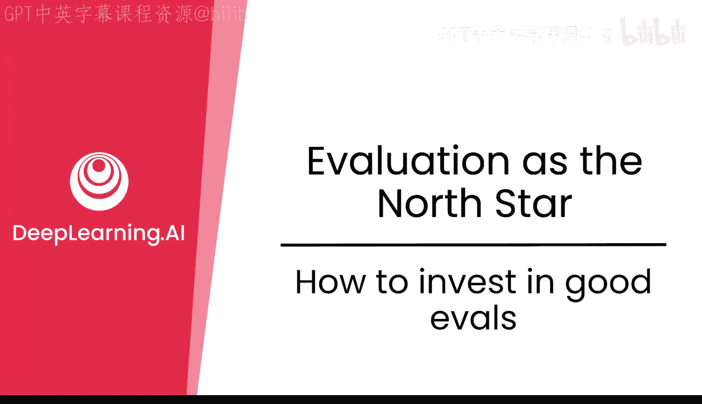

Now that you're excited about EVLs， it's time to actually invest in it。

 it's important to actually get the size right， how you expand your EVLs right。

 and to make them representative， reliable and actionable。So you're excited about investing in EVs。

 Maybe your first instinct is to create a very large EL data set of math physics history politics。

 every possible topic under the sun and spend a lot of money on crowdsource labelers with human labelers do not do this This is not how you should invest in your Evals In fact。

 your Eval should start small。 It should start with maybe 20 examples of finance or some topic your users care most about and it should have know metrics around factual accuracy。

 maybe you have a metric around brevity and for annotation all you need is one in-house expert for consistency so very simple。

 very slim and in your first week within your first week here。

 you can actually see some issues with the model already because you will have finished your Evals and you will see that the model hallucininates on numbers maybe like invents stock prices or its summaries exceed that0 word constraint and you can actually have an actual。

😊。

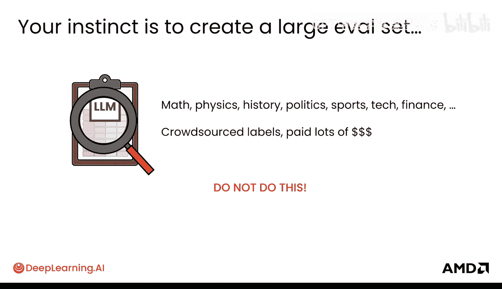

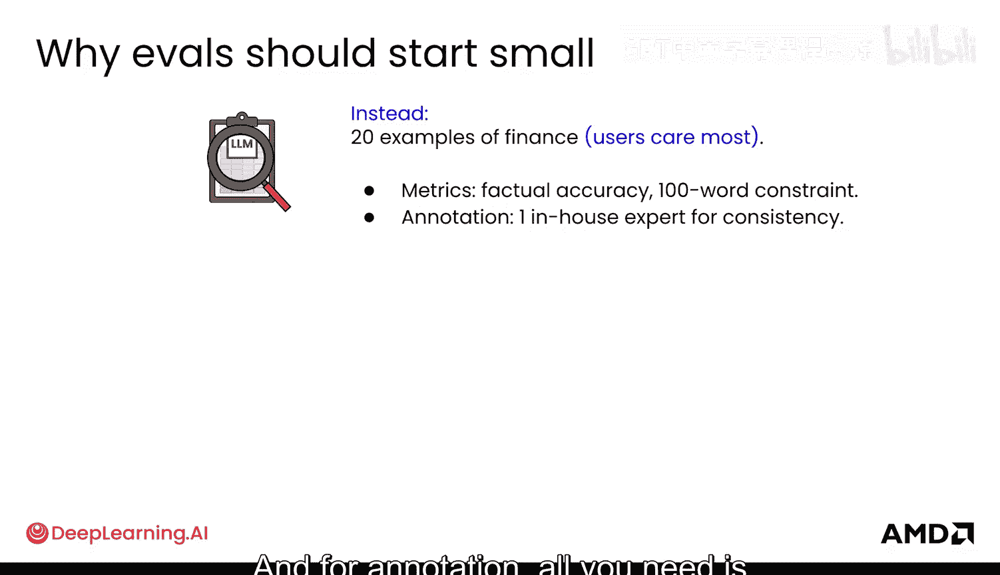

Insight to then improve the model。 So within your first week。

 you can already have a huge difference in the model if you start your Eval small and that's exactly right。

 So once the model improved on the small targeted Eval you can start to expand coverage to other frontiers and might need to learn maybe it's science and politics right other topics and you can do that with more confidence and you can expand it obviously based on the failures you get to get a better understanding of the failure as well as again those new skills and domains。

😊。

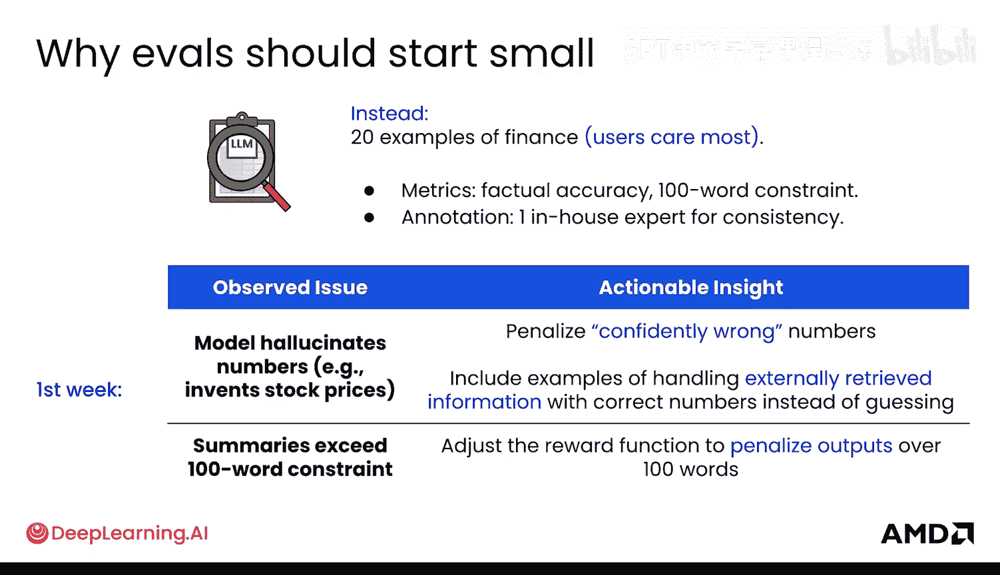

And eventually you'll get to that larger and larger data set。 This expansion tends to be exponential。

 not linear。 So you might start with that 20 and then go to 202020000 examples。

 So you might want a 10x set every single time because you're trying to cover a much larger frontier。

 And as you can see， you don't always want your evals to be 100% correct all of the time because then you're not actually testing the frontier。

 One of the best practices is to keep it at around 80% max。

 so now you know how to start small and then scale at the size of your Eval。

 What are other good qualities of Evals。 So one is that it needs to be representative of how your users are actually using the model。

 So in this case， easier asks a non-math question。 and the model doesn't know what to do。

 responds with four your evals， however， have no question around anything unrelated to math。

 It only has math questions。 That's a problem。 So instead。

 maybe in your e you're starting to evaluate the model and make sure it has guardrails like sorry。

 I only answer with math problems。 you added these refusals to the evalils and then you add。

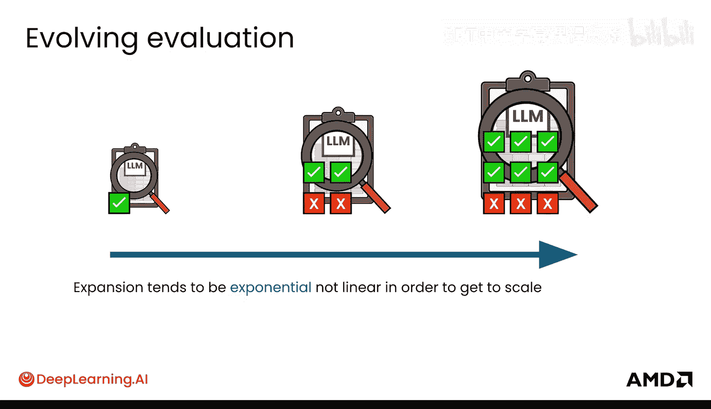

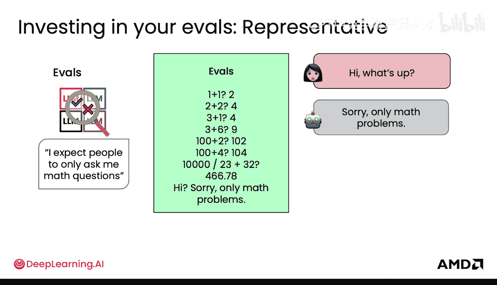

In training a model and then now your model can handle it so just to go more into representative suppose your users ask 20% math questions but 80% are conversational but your es are not representative of that distribution it puts a larger weight on conversational questions than math questions so maybe you see your model improving overall based on eval accuracy but actually your users are suffering they're asking why is it so bad at math and that's because it wasn't representative of users actually using your model the next important quality is making your es actionable if the whole point of error analysis in Evals is to fix the model then Evals need to actually be actionable this means errors will point to data interventions themselves so your eval should be enabling you to that next frontier here it's division so you're adding division examples to your evals so that then you can create a new data for division so you see a failure pattern on division and you think okay I need more division data so in your es you add these division examples you see those failures and then。

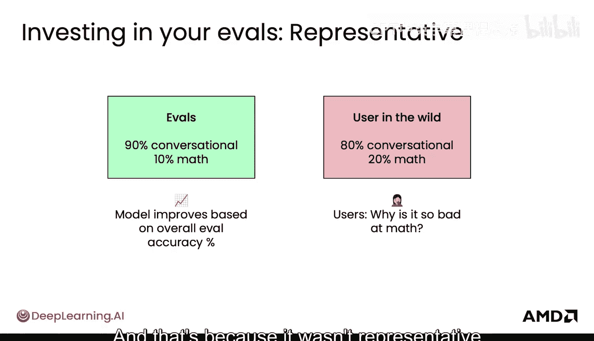

That prompts you to create that new data And this again is why you want your eval to be at max 80% corrected all the time。

 So here's how you can also take action。 So let's say you're looking at your model it's a math model and you're taking a look at how it does for every single type of operation addition multiplication division and mixed expressions when you observe errors you see that it doesn't have any errors on addition so you don't need any actual intervention for multiplication is doing quite well maybe you add a few examples of high magnitude multiplication because occasionally makes mistakes on large numbers for division it does pretty poorly so then you want to collect pretty targeted division problems across different examples。

 integer， decimals， edge cases and same with mixed expressions you probably want to add a lot more there as well as examples and maybe even add division reason examples to reinforcement learning Finally。

 a really important quality of your Evals is making it reliable This is so you can actually trust deltas from one experiment to the next remember how many experiments you're running for。

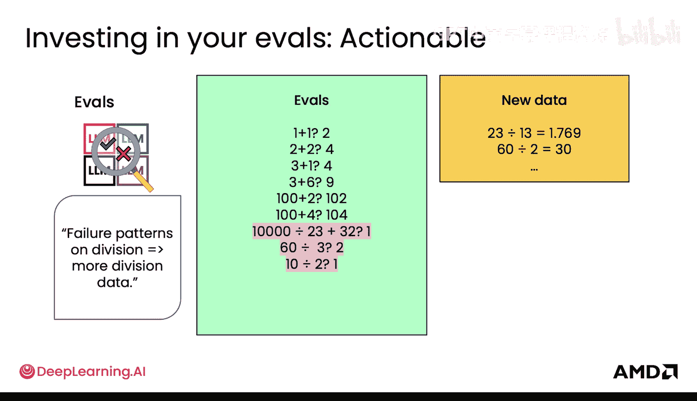

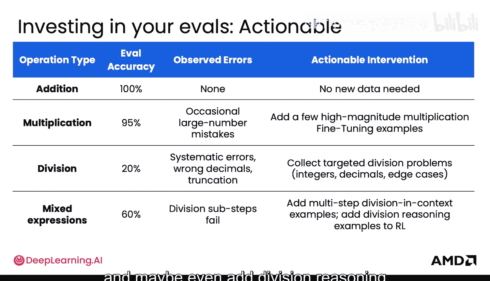

A analysislysis you want to be able to trust that one experiment is actually better than the other。

 You want to trust that model B here is better than model A a division。

 Can you convince me So if you look at the top level numbers Model a is 90% correct on everything Model B is lower at 82% than when looking at division Model A is at0% and model B is at 100% However。

 if you dig deeper and you look overall and then you look at the division subset。

 you see there are only five items in the division subset So maybe model B is dramatically better division but it's only five items。

 how can I be sure then you expand your division subset in your Evals and actually get a more reliable number and with this larger sample。

 the signal is more stable and you can say yes， actually model B is reliably stronger at division So reliability isn't just about sample size it's about stability of your conclusions and there are also statistical significance test that you can run across multiple experiments or model runs at different random seats to make sure the improvement。

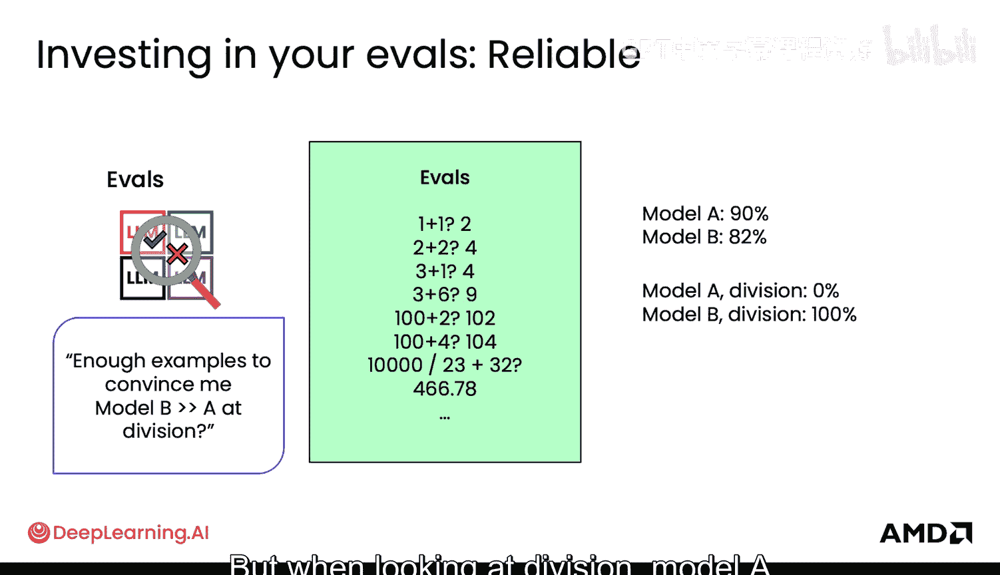

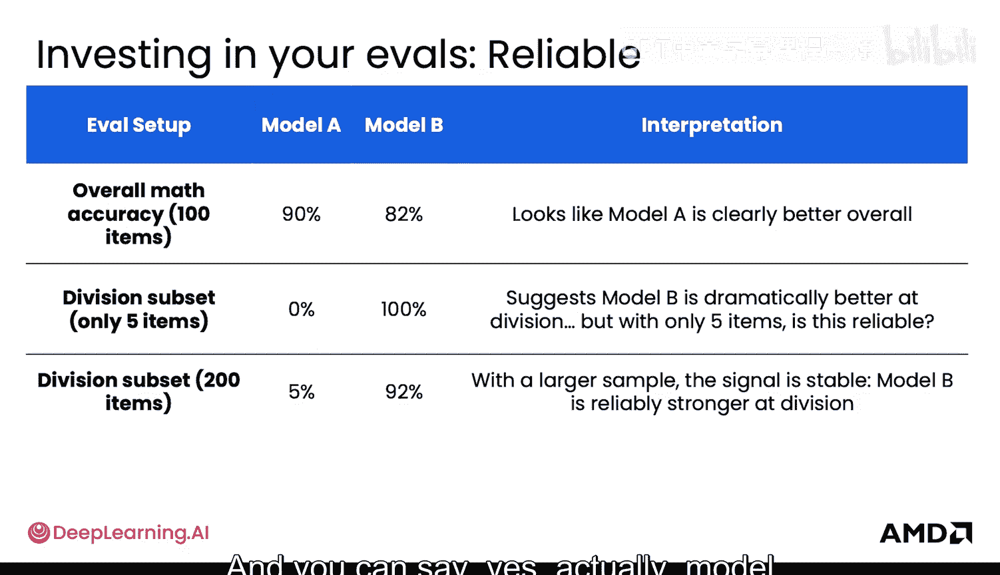

just and this is also why broad coverage is also encouraged。

 so you know your model is reliable across a lot of different dimensions in axes。

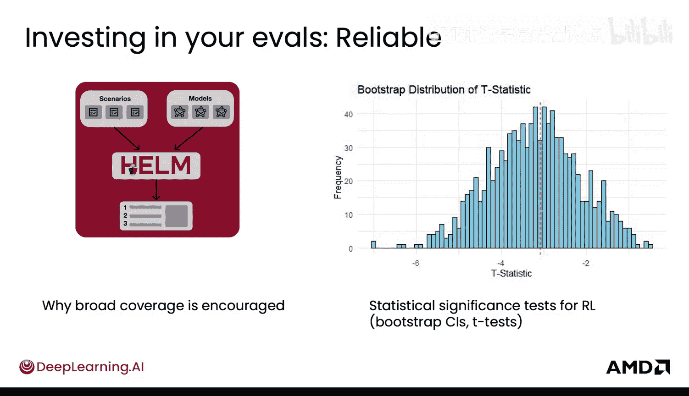

So now that you've invested in your Evals and made them super high quality。

 it's time to break your model with red teamaming。