# AMD《大型语言模型的微调与强化学习：后训练入门｜Fine-tuning and Reinforcement Learning for LLMs》 - P27：1.how-much-data-you-need-for-post-training.zh_en - GPT中英字幕课程资源 - BV1zZy8BcE7z

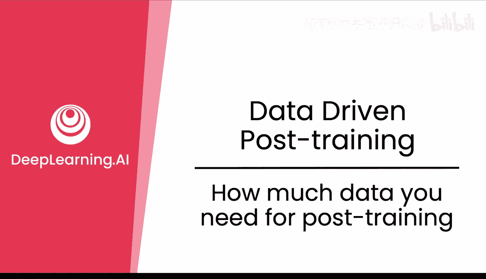

Data is one of the most important things in post training you probably already got that sense from EVLs because as you look at those errors in your evaluation。

 all of your fixes are often in the data space so one question I often get asked is how much data will help me fix my problem let's take a look。

😊，So how much data you need in posttraining depends a ton on your pretrain model that you're posttraining on。

 I found it's also helpful to compare these two stages and how data plays in for pretraining it really is all about scale you need a lot of data because the model is trying to learn so many different things across a general set of tasks so how much data you need in posttraining depends a ton on your pretrain model that your posttraining on and in pretraining it was all about scale your pretrain model has learned on a ton of tokens in order to learn general purposepo tasks from the deep Mind paper on the Chchilla model in 2022 they found that you need 20 tokens per parameter for a model and that might mean a 10 billion parameter model should ideally be trained on 200 billion tokens that's so many tokens on the internet and if you look at GBBT3 it was pretrained on about 300 billion tokens so the scale of things is just massive in freetrain that rule isn't hard and fast but it's a good anchoring point to。

D how much data pretraining can really handle to efficiently learn posttraining is really different it's less about the scale of data at that scale。

 more data still does help， but it really is about the quality of that data to reshape the behavior of the model for example。

 ChattBT use about 13，000 fine tuning examples way fewer than those billions of tokens which might amount to hundreds of thousands or still billions of examples and thousands of preference pairs。

 less than a million certainly for their reward model。

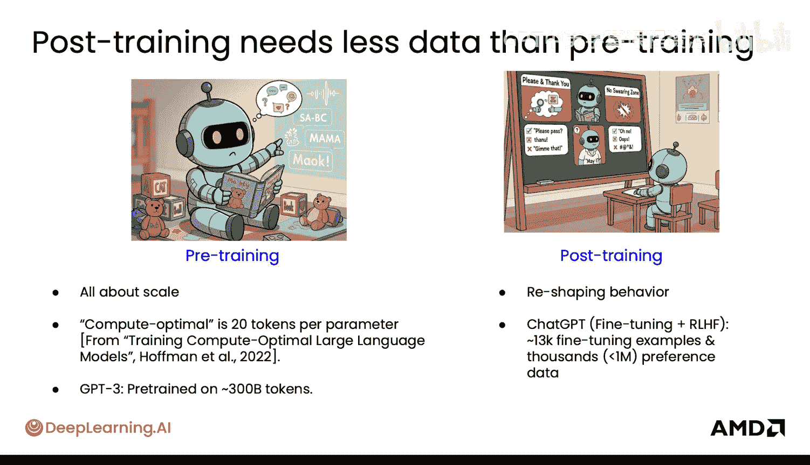

So diving in a bit， when are 50 examples enough versus 100，000 examples。

 when can you get away with just a few examples and when do you need a ton Well。

 if your pretrained model， for example， already knows calculus already knows math and your goal with post-training is to just learn a new calculus exam format。

 you might only need 20 practice problems for the model to learn a little bit about that new exam format but if the model had never seen calculus before and it needs to learn this new calculus exam format。

 that 20 examples probably not enough because you probably also have to teach it in entire calculus course and that's looking at more like thousands of examples next。

 if your model has never seen math at all， then this goal of getting to this calculus exam is going to be much harder and you're going to need a lot more examples to demonstrate those math courses so basically you have to look at what your pretrain model already knows for your task in posttraining and if it's not in pretraining。

 then you can't actually。

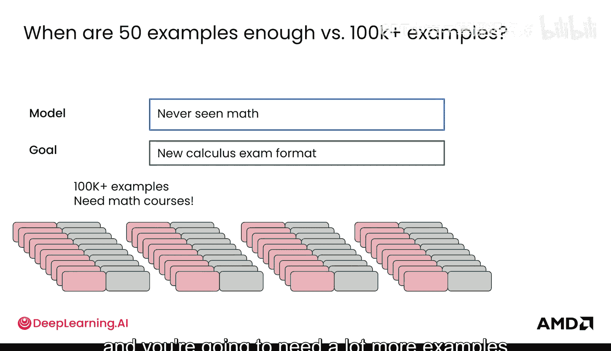

Create it cheaply in posttraining so always run EVvals first on your pretrained model to understand what your model already knows what its capabilities already are and that'll help you estimate the amount of data you need for your task in posttraining So as an example if you're looking at these evals maybe your model knows additional already pretty good at multiplication but it hasn't really master division or mixed expressions then you can actually see what your interventions need to be and what kind of data you need to teach the model basic math in this case and of course you want to start with a minimal amount of data you want to always start with the smallest amount of data so that you can draw inclusion on what type of data you need before you scale it out so before you actually scale out to the exact amount of data you even need you want to start even smaller than that because your hypothesis might not be correct then I would think about scaling until you reach diminishing returns so maybe you start with 20 examples that's probably enough to see small changes in format。

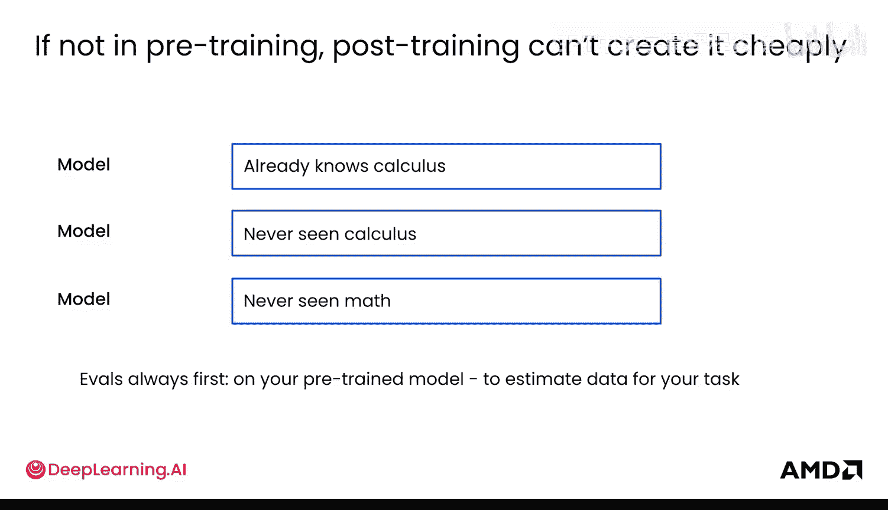

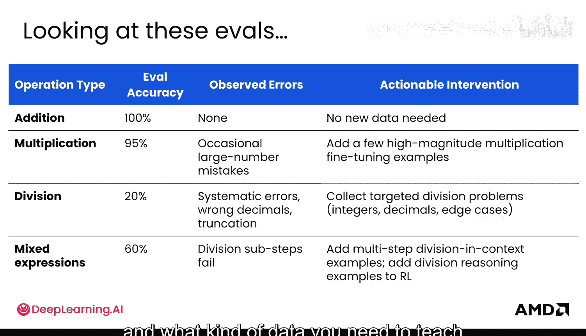

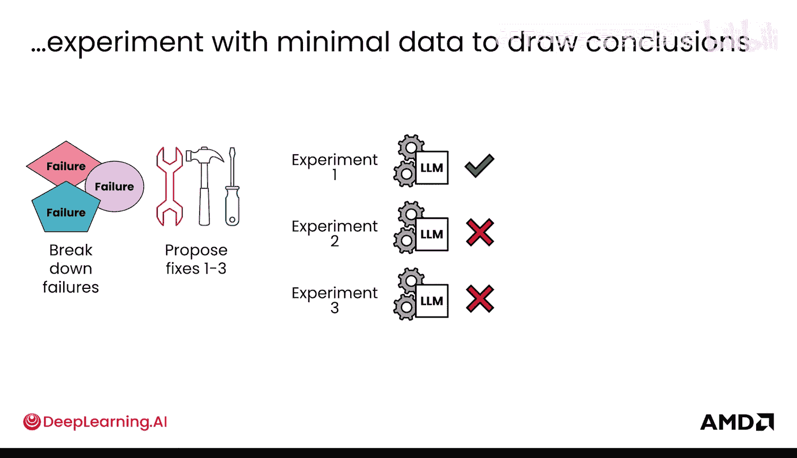

On the order of hundreds， you'll start to see some model changes on the order of thousands is typically one of those sweet spots of you'll see a lot of task be able to be achieved on the order of thousands tens of thousands is probably looking at post training for a lot of the frontier labs and then hundreds of thousands is you're adding new domain knowledge Laura can also help you get away with less data and because you're changing fewer weights of the model and you can actually adapt it to that targeted data much more effectively for Laura you really need to think about the rank you want to be able to get away with as low of a rank as possible because that is tuning fewer parameters so with smaller sets of data you can get away with really small rank and then of course with larger sets of data you may have to increase that rank to actually see changes in the model for preference learning so to train your reward model you can see similar types of data sizes so empirically what that looks like is on the order of thousands of examples you can see improvement in your reward model for more nuanced sanctions you might want more data。

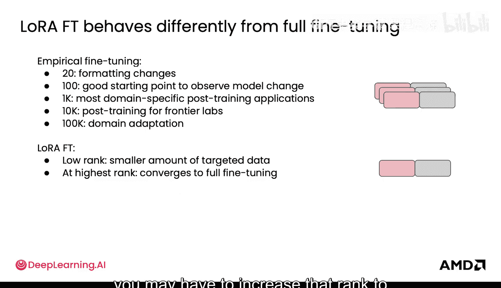

Like the fine grain distinction between AB but the reward model is closer almost to a classifier。

 you're trying to understand what the line is between a certain type of preference and it can be continually trained during RL training。

 which you'll see a little bit more later called online preference learning and the outputs don't necessarily have to be generated by the LLM that it's grading over here so it could be written out by a person it could be generated by different language model or different type of model and that actually helps the reward model not overfit to your existing modelUltimately in RL training。

 it will depend heavily on your reward model capabilities and in improving your reward model you can actually see gains in your resulting LLM trained with that reward model of course you will see saturation in that as well so as you 10x the data size for your reward model you may see saturated performance and that is when you know you've tapered off and you don't need to improve your reward model anymore because ultimately the goal of your reward model is to improve this final LLM The performance of your model。

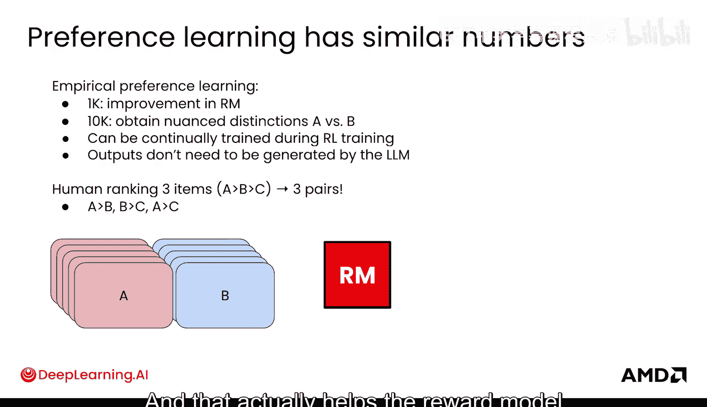

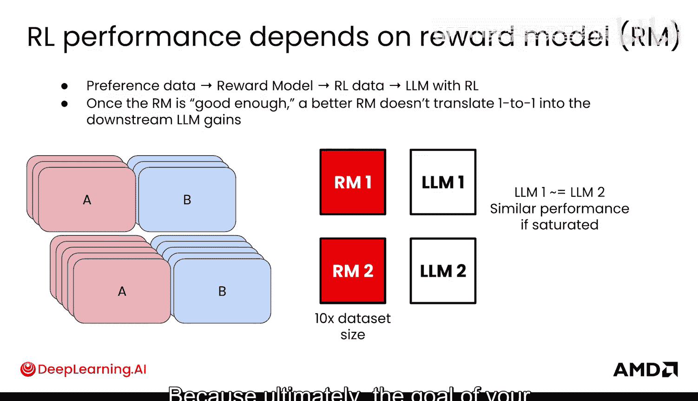

In Rl also depends on the input distribution so just like in fine tuning where you really need to have diverse examples。

 including in the input， you also need that here in Rl you need very diverse input to actually cover your task and represent your task effectively every input can also have multiple outputs the default in hugging face is8 and that can actually help you estimate the reward variance so basically you can have many。

 rollouts coming from a single input but multiple outputs and in state of the art runs today we're looking at hundreds of thousands to maybe even a million rollouts that's really helping the model understand kind the variance of given multiple types of outputs it could produce how well can it do so you saw fine tuning preference learning and rollouts you saw kind of the scale of things here's just a bit of a diagram to show and compare them and as you can see you do see some saturation as you increase the number of examples ultimately all of this is empirical and what you want to do is test things out at a very。

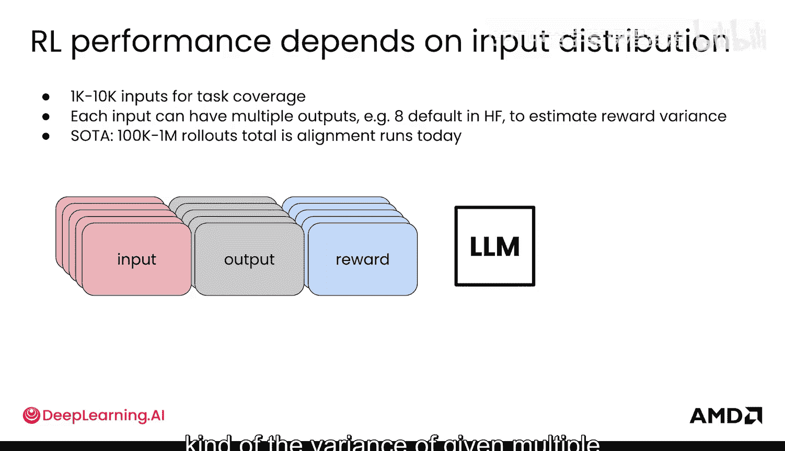

Small scale before you increase things over time for post training。

 probably the most important thing is not just more data but careful data。

 so just having a few curated examples is going to always beat the noisy examples that's going to be different than in pretraining basically if you have the choice between 100 curated examples versus 10。

000 noisy maybe synthetically generated examples you should always pick the hundred because that will actually get you the better ultimate model in the end and this is just showing an AI Marie Con who prefers the curated examples over the noisy messy ones。

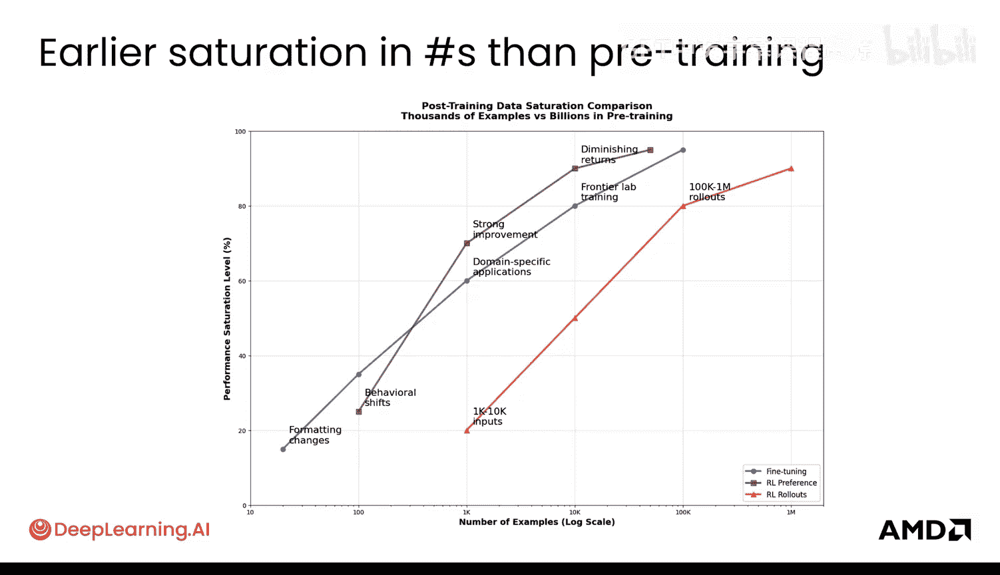

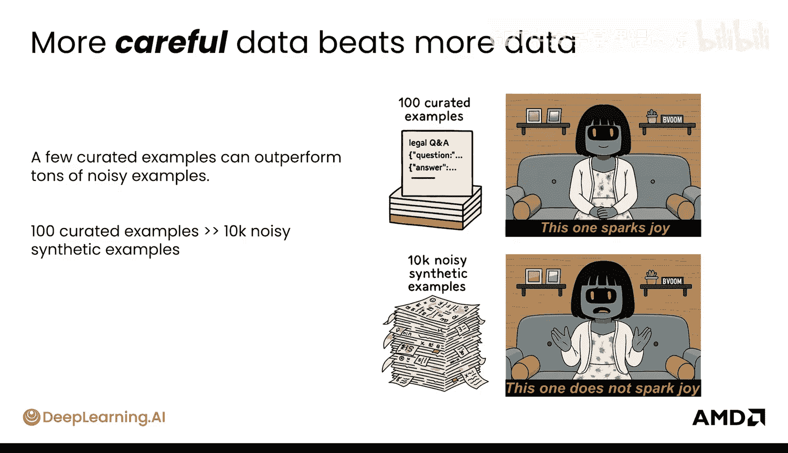

Now that you understand how much data you need for post training。

 let's hone in on fine tuning data first。