# AMD《大型语言模型的微调与强化学习：后训练入门｜Fine-tuning and Reinforcement Learning for LLMs》 - P28：2.data-for-fine-tuning.zh_en - GPT中英字幕课程资源 - BV1zZy8BcE7z

Data is one of the most important pieces of fine tuning。

 Take a look at how to iteratively add targeted examples in the fine tuning flow。

 So as a bit of a refresher， fine tuning， you need input data and target output data pairs and for reasoning you need the output pairs to have kind of that thinking with an answer what that looks like is here's a possible input where Alice has three apples buys two more how many now with a target output of this rationale and an answer for reasoning you need those think tags now going into a little bit more customization if you want to have custom pro tags。

 this is a good opportunity to actually teach your model that for example you maybe are hitting an API in the input and you always include today's weather in some way so you have that tag and your input and so the model will learn to understand that tag as input and produce the right output based on it and maybe in the output。

 you also want to do the same thing。 maybe you want to hit an API or you want to in this case display the weather so you want the model。

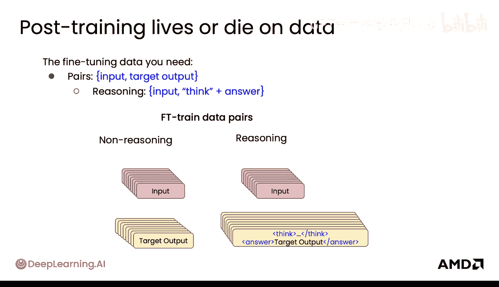

Outllput some kind of emoji to be displayed on a website and this output can then be programmatically extracted if you learn these new custom tags So let's take a look at what that looks like iteratively as you refine the model and improve it So your goal is to teach the model new custom tags as format and maybe you start with 20 examples just to see the model change a little bit and you use Laurara fine tuning to do that you evaluate the model and you do some error analysis and you find the worst failure pattern and you target that and the worst one you see is it omits that display weather tag and you don't want that right you want the model to actually show that so you can display it on your website but you see that it's not always the case that it omits it it's usually right but when the word sunny is next to some punctuation mark and the input then you see that problem occur So this is just to give you a sense of the type of error pattern that might occur and it might not be super obvious you might have to dig through a lot of examples to see this pattern and and have this hypothesis。

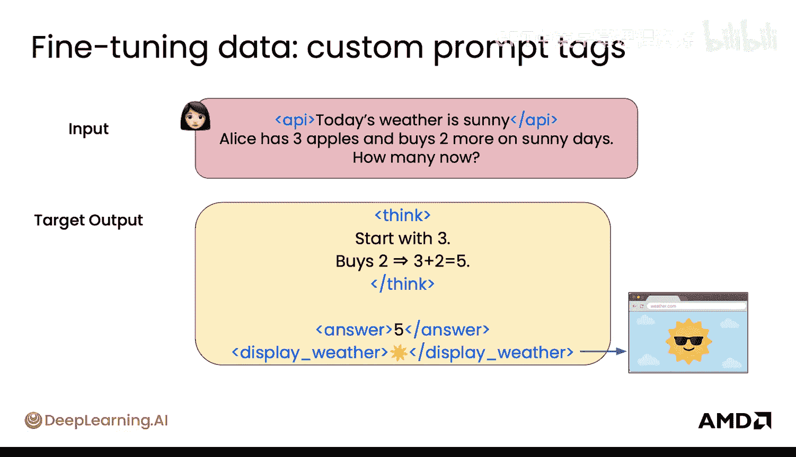

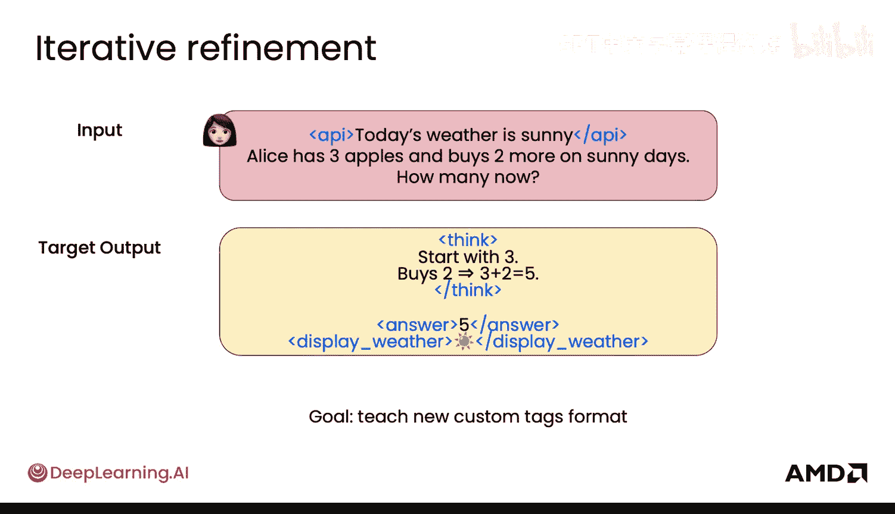

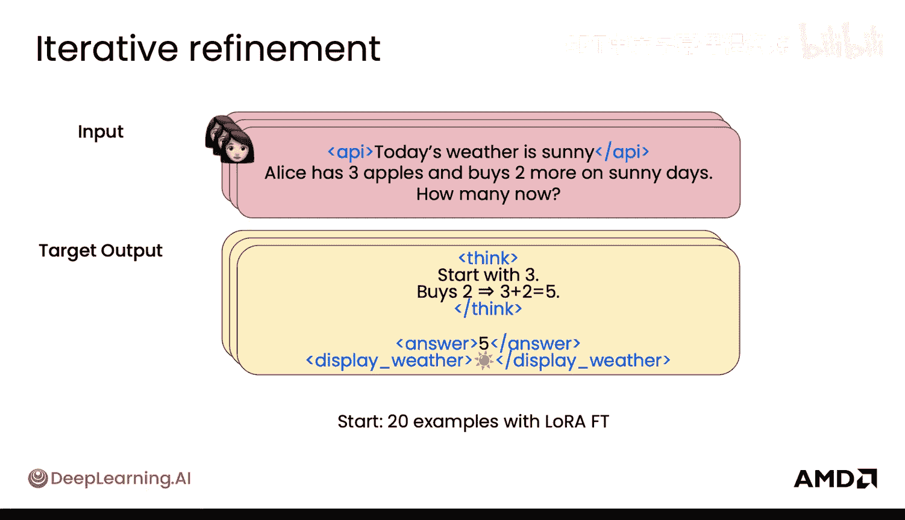

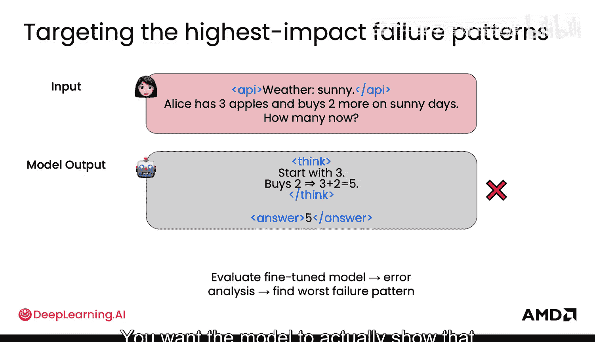

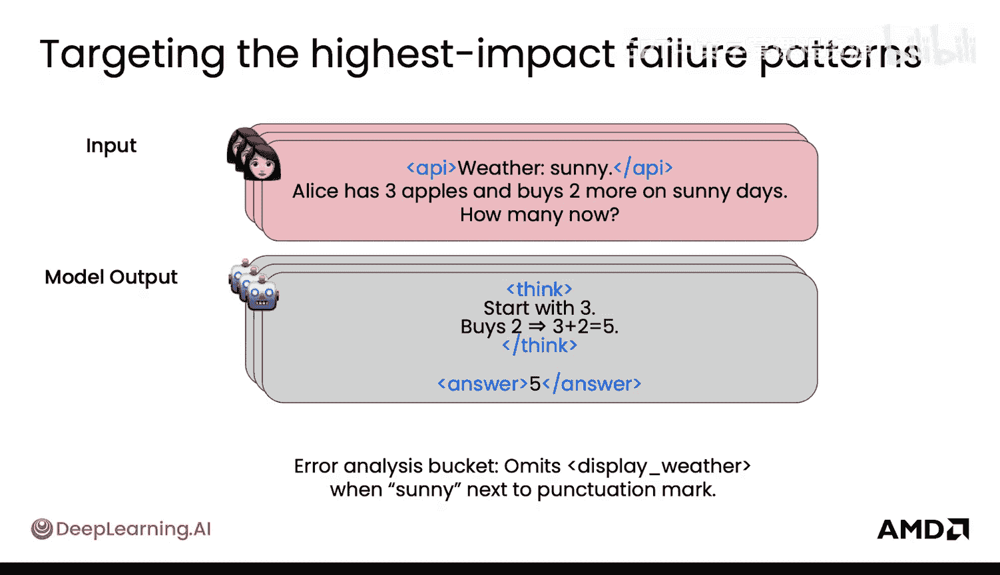

why this error is happening。 so maybe you figured out that that is the error。

 your data fix here is to add a few examples that kind of counter this and teach the model this pattern。

 So maybe you could vary the punctuation a bit add and synonyms like bright sunshine with punctuation of course you can vary the capitalization a bit and these examples will help the model understand whenever there is sunny with punctuation mark。

 and I now see more examples of that。 I will output the display weather thing appropriately。

 And of course you saw those examples with the same input。

 you will want to vary that input as much as you can so that the model sees a broad variety of mouth problems here So then the next iteration is you do some lara fine tuning with additional examples mixed in Great that was fixed。

 you test some of that that's in your evals next you do the same evaluation。

 you do error analysis again and you find the worst failure pattern here you see maybe it uses the wrong emoji for clear skies。

 it shows a cloud instead of a sun emoji and then you。

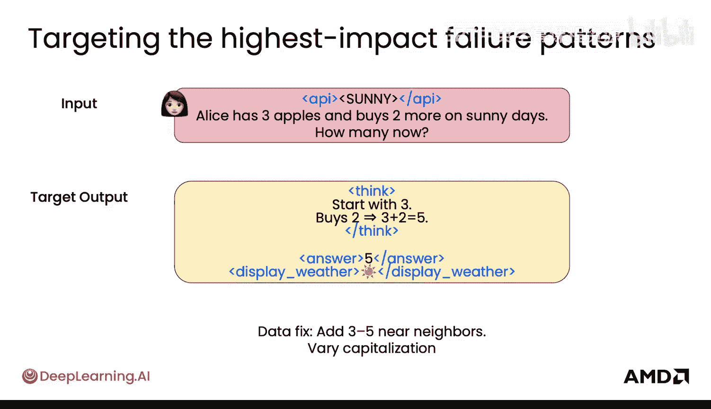

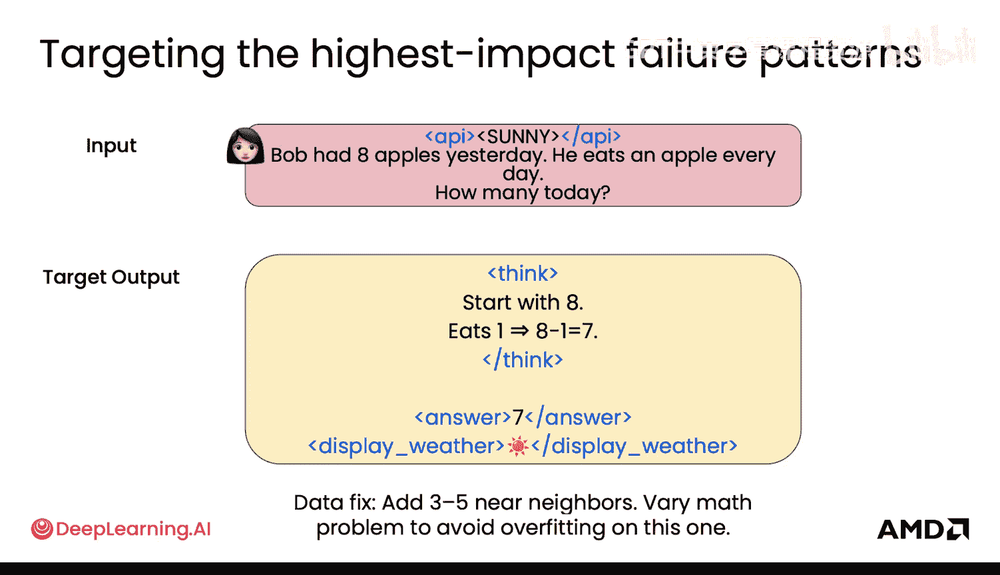

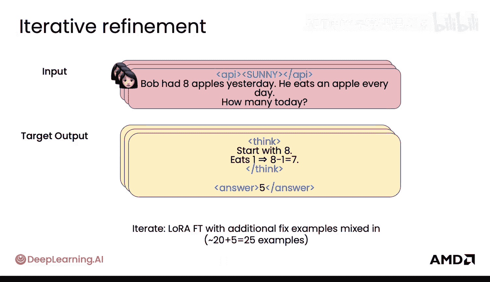

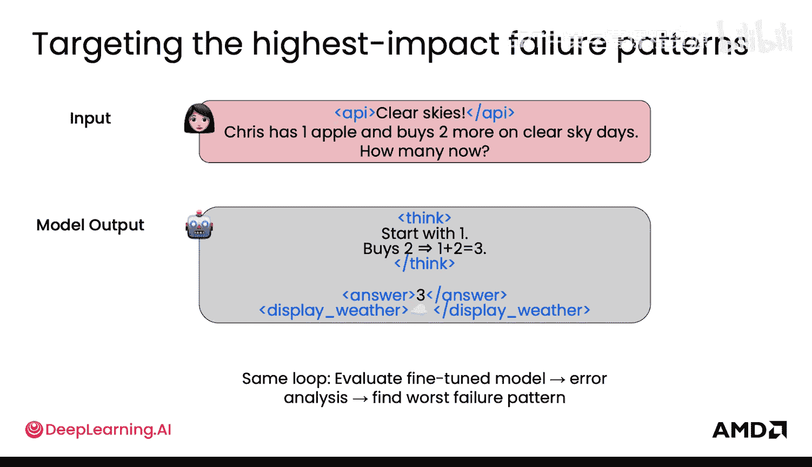

Induce a few counter examplesamples of that maybe the next iteration you see there's when you don't give an API tag the model still is a bit leaky and will still use those think tokens and display weather and maybe you don't want the model to actually do that when a user is asking a math problem without that API hit and so you want to add those no tag example so it doesn't leak its thoughts Finally maybe the model is not adhering to the schema correctly and this is where you can add really strict schema adherence examples so this is a very iterative process as you can see the data created is very targeted to your failure patterns Now one question is when do I stop I could probably keep going keep going keep going and that's one of the beauties but also challenges of AI is that it's never gonna to be perfect so you could actually continue going but essentially user evals as a guide for when a model is good enough or better than your production model today and you're able to release it and actually collect some understanding of what users will actually use it for。

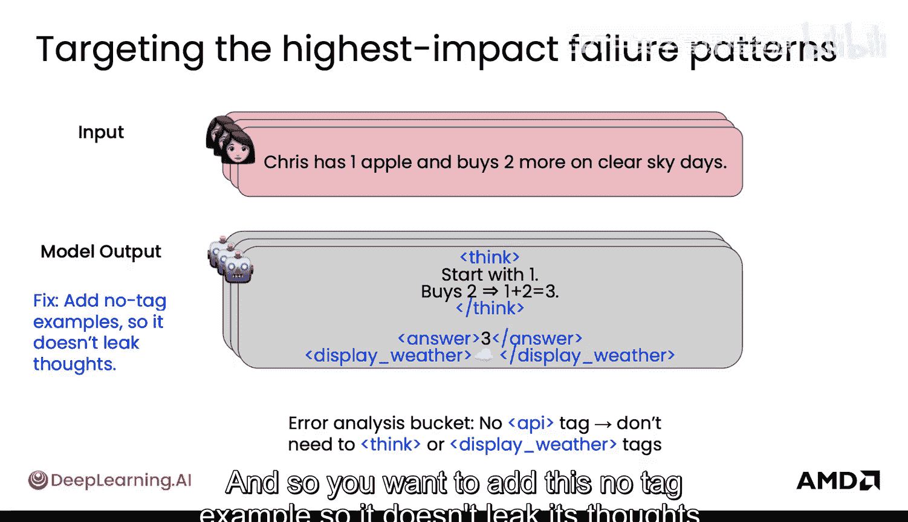

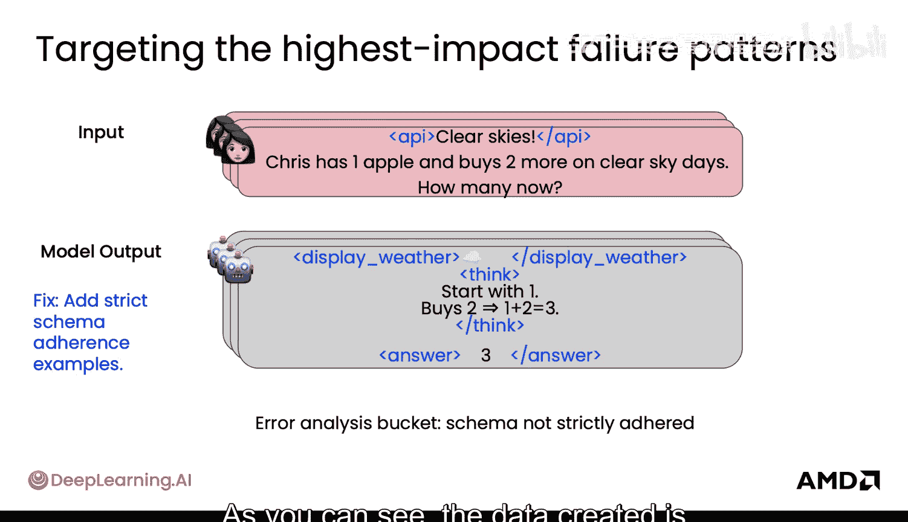

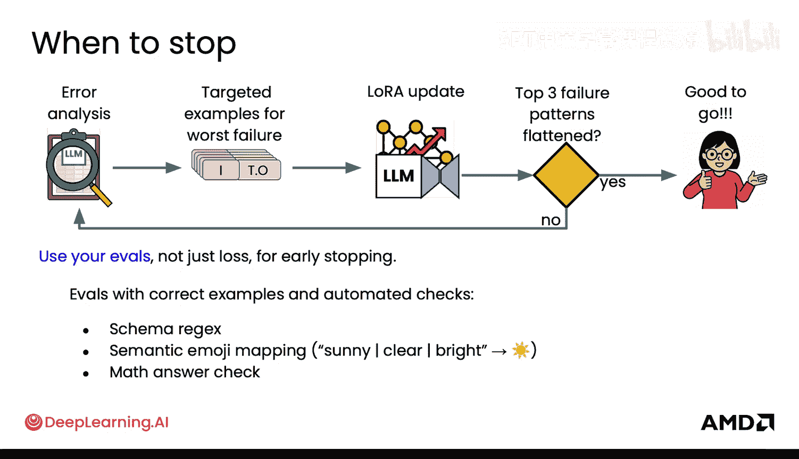

Some considerations for Lauras are where do you want to actually put the las where you add the Laurauras can depend on the type of task you want to do and also how many Laura adapters you want to learn often you want to put it on attention that's the typical way if you want to put Lauras on your multilayer perceptron your linear layers as well that can help with stronger fact recall in the model and then the rank of the Lauraura's matters a lot when you have a few examples you can get away with the lower rank and when you have many examples you may need higher rank for fine tuning and actually getting the behavior to change for Laura's often you'll see more steps are preferred with smaller batch sizes to actually maximize your update diversity I would always recommend starting with Laura fine tuning over time as you look at your task and as your data increases you might be looking at something that is a broader knowledge shift and that is where you need to think about full fine tuning if you find that your Lauras even as you increase rank and increase the number of adapters are still not changing the model's behavior in the way you want it to you want to revisit the data。

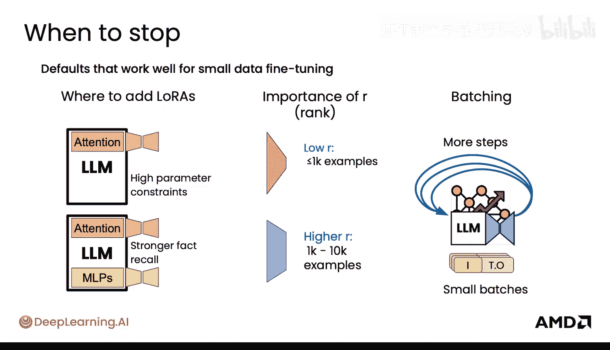

You might also think about a full fine tuning as well This is catastrophic adherence basically the model doesn't really change and you train it Another question is how much chain of thought data you've learned about reasoning a lot how much did you actually be mixing in in these reasoning tags these think tags are actually a great way to teach the model to reason and to get the model to think for better outputs but what kind of mixture is appropriate because you might not always want the model to be displaying that so one of your guides is what is the user going to use at inference time How do you expect the user to use your model and at inference time maybe the needs are sometimes the user wants to use reasoning and they're checking off a box for example in chattt there was a chance where you could check off a box to use thinking versus not in which case you may want the model to actually see both types of inputs with and without that used thinking and to respond accordingly so that add inference time when the user is using your model you can switch dynamically between them。

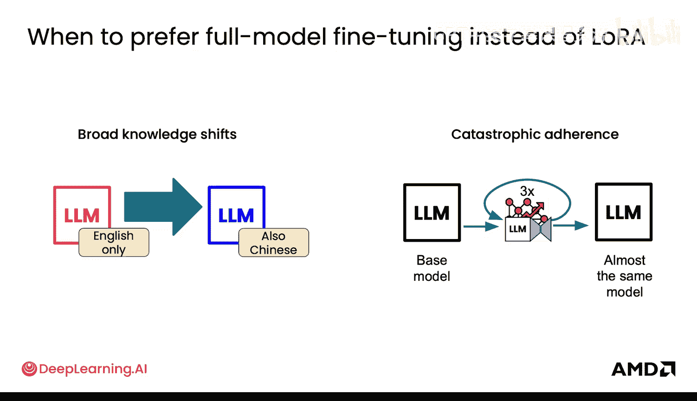

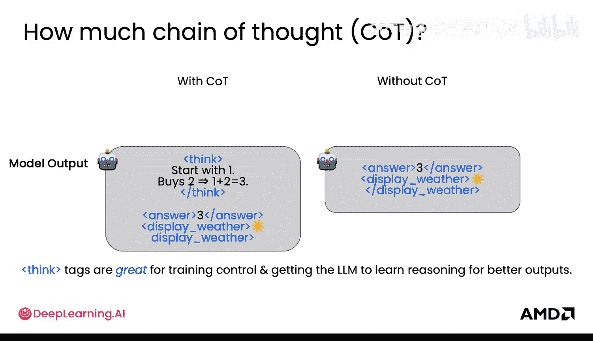

As a user's queue here with the use thinking tag you can of course make it more explicit you can say please use think for example and switch between them Another consideration is thinking through not just the user experience here but more so what types of tasks the user will need to use your model for and if you have reasoning heavy tasks I'd suggest actually heavily shifting your data to be more reasoning or at least 40% reasoning and in the rest just regular direct answer versus if you have latency sensitive tasks you need the model to respond very efficiently then maybe you want more direct answer example so the model is actually responding very quickly as opposed to thinking for a long time。

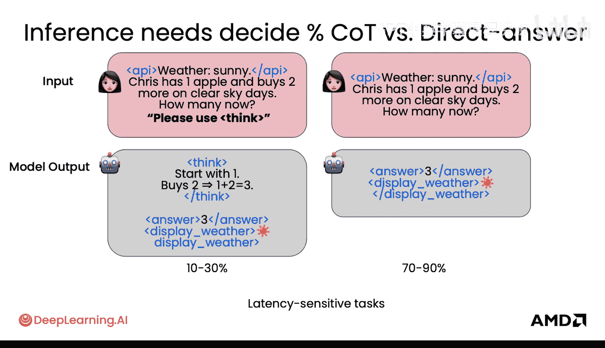

Now that you've explored fine tuning data， it's time to look at data for RL。

