# AMD《大型语言模型的微调与强化学习：后训练入门｜Fine-tuning and Reinforcement Learning for LLMs》 - P29：3.data-for-rl-(part-1).zh_en - GPT中英字幕课程资源 - BV1zZy8BcE7z

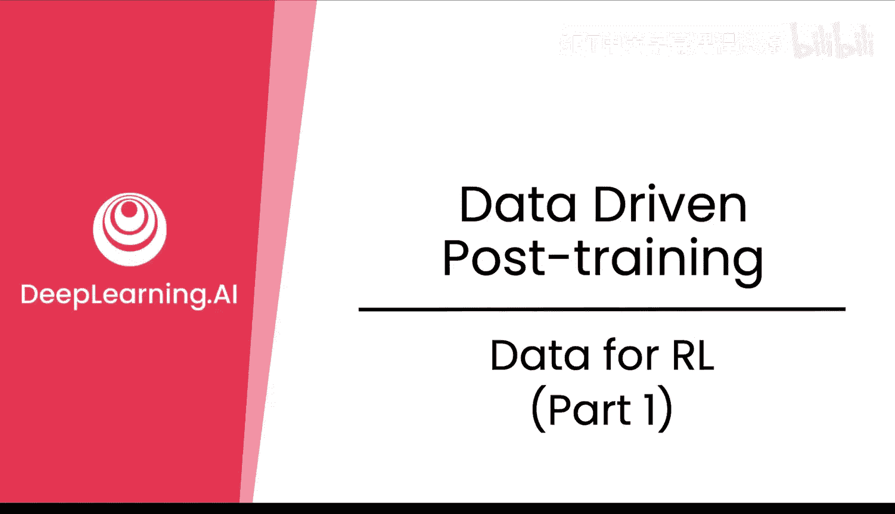

There are two important considerations for RL data， one is the rollouts。

 and the other one is the preference data for your reward model。 let's take a look at both。

Okay so just to recap the data that you need for RL first you need a list of inputs so a nice varied set of inputs and that ultimately produces your trajectories so that's your input。

 your model output， and then of course that reward from your graders and that includes graders that are looking across an entire RL environment Oply if one of your graders is a reward model then it probably is learning from preference learning and these tuples of input to possible outputs from a model and then a preference So exactly what that looks like is you can have an input。

 model output and then that reward informed by potential reward model or verifier and here is that preference data。

 so they input， your model output， two of them A and B and then the preference。

 which one is better in this case A great so just to recap the pipeline。

 what it looks like so you're curating a bunch of inputs are varied these are high coverage across the task that you need you get rollouts so the model is giving outputs for that particular input you can have multiple outputs per input from those rollouts you want them to get grade。

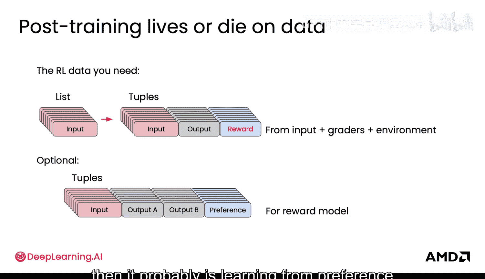

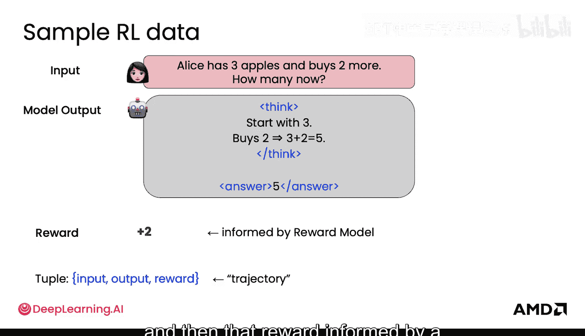

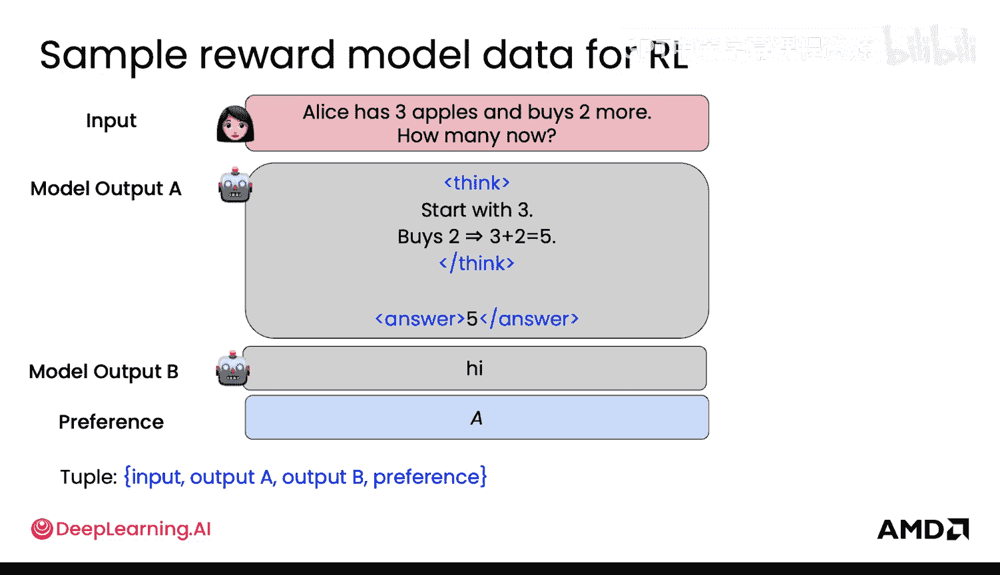

If you're using a reward model， you want to collect preference data and then teach your reward model based on that preference data。

 you could also have a verifier and those can apply rewards to your rollouts to get trajectories you use those trajectories to train your LLM with RL to maximize that reward and this is done in a loop。

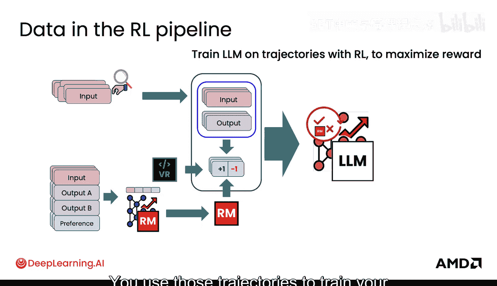

So one question is just how much rollout data do you need So rollout is a certain number of inputs and for every input。

 how many outputs you're actually generating from the model per input one starting point is eight outputs per input that is the default in hugging face hugging faces trainer for GRPO so it's just for every single input you're just outputting eight model possible model responses and so I would start there but then of course increasing the number of outputs per input actually enables you to explore a diversity of outputs from the model that get different types of rewards and you'll take a look at how what that tradeoff kind of is but ultimately having more outputs per input well it can help will ultimately lead to diminishing returns and that's because you'll probably get either similar outputs or outputs that are scored in a way that doesn't actually make a difference to your RL training ultimately So without a reward model what does it look like this is just using a very basic verifier for writing a haiku So write a haiku about maybe your model outputs a haiku and then。

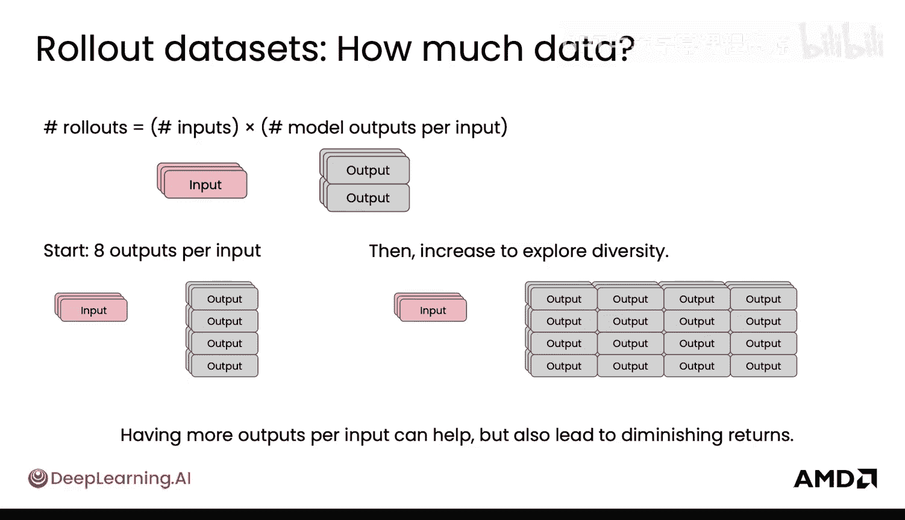

The greater just counts the syllables and your data set could be 10000 rollouts here。

 which sounds like a lot。 and that's probably enough to train a model that respect syllable count。

 but it could just be100 inputs So it could be 10 inputs and these different inputs are just writing about different types of haik and each of them has 10 model output So 10 haikou outputs each that's a lot less preparation then fine tuning so I find that really interesting you only need 10 inputs and the verifier here is pretty easy and there's no training So for a reward model guided training with a small rollout。

 What does that look like you could also still have that thousand inputs as diverse instructions and then your model output you can generate a lot of things there here there are four but then you have a reward model now that is scoring every single one of those rollouts and then you can run PPO for one or two epochs over your entire rollout and what this looks like is the result here is you'll be able to actually see noticeable style shifts the model can be more。

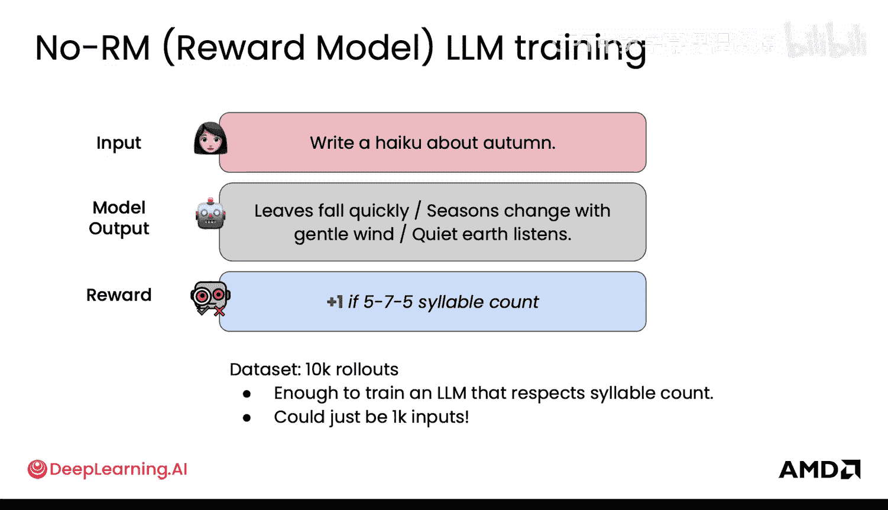

Light more helpful and this is probably where you want to start with a small set here。

 If you have a good reward model， you can get away with fewer rollouts so these things are really related to each other and your reward models rewards are therefore clear and reliable to the different rollouts versus if your reward model is kind of noisy itself then you'll need more samples to get that signal across so you'll need more rollouts if your reward model itself is not is not trained super well so as you scale out that number of rollouts if your reward model isn't great or if you're going for something that is heavier doing heavier alignment tuning at the frontier is looking at hundreds of thousands of rollouts if not a million so this is what this would look like for 160000 rollouts to 20000 inputs with8 outputs each and practically you'll probably see some diminishing returns for any extra rollout after this and you'll also start to hit up on compute and memory limits so you saw a lot of different settings here this is just a summary of when small is good enough and when large is good。

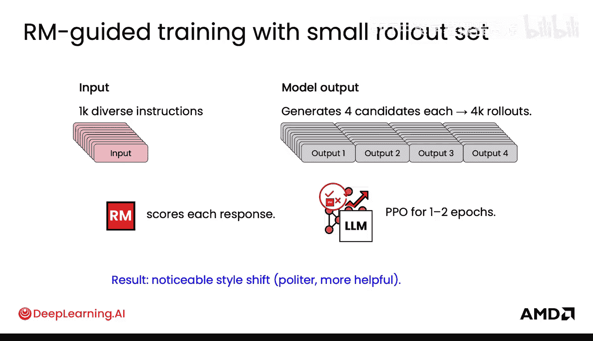

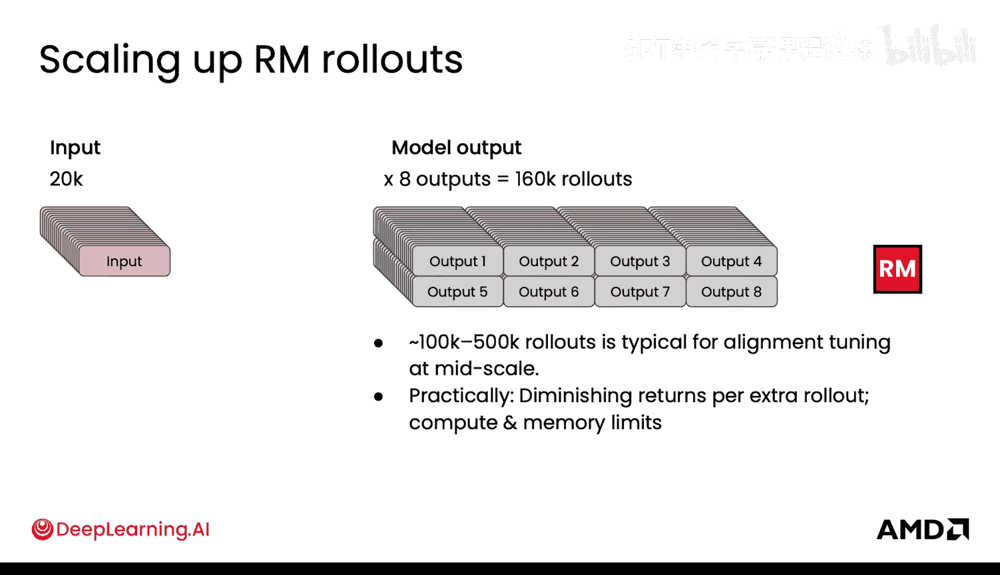

So on the orders of thousands， maybe up to 20，000 rollouts you're looking at probing your reward model to shape your LM performance for midsized updates what you're looking at is probably 20000 to 100000outs and of course if you need something that is more general and much larger or your reward model is really brittle and noisy you need a lot of redundancy in your data to actually see the signal through the noise I would say for the first set that's good for experiments or alation for the middle set that's probably enough coverage without seeing any collapse across your data but this is all empirical so you want to be able to test things out and of course start small as always Now a few considerations about rollouts one is that not all your rollouts are going to be useful so you're generating a ton of rollouts but not all of it it will be informative so you might have a lot of redundancy or you have a lot of similarities and those aren't really informative and ultimately doesn't really help with training so there's a lot of research on filtering rollouts to only those that are。

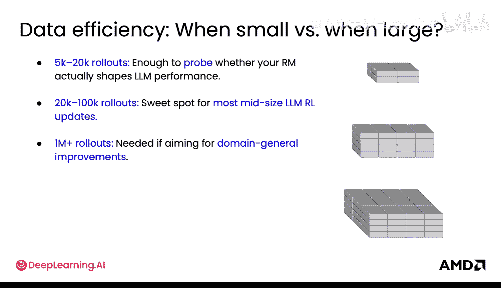

For training like you see here and that's similar to your synthetic data pipelines that you learned about so you can generate and filter here as well and that way you're training on only the high signal examples and this ultimately reduces costs and can make learning faster and more effective it's also pretty important to show examples to the model that will improve it and so showing examples that are too easy or too will result in rewards that aren't really informative and that don't really distinguish among the different examples among the different rollouts and you learn that previously as well that was kind the whole point of the advantage calculation so taking that a step further you can focus rollouts on moderately difficult ones where you get a good spread of rewards by essentially overs them and looking at more of those and then of course you can update your reward model during training so what's moderately difficult can potentially change So again you should filter out any noise in the data where possible this filtering can be done using the reward models uncertainty itself and that can be a really valuable signal to use as a filter for what rewards were actually high quality or not so at this point you might be thinking。

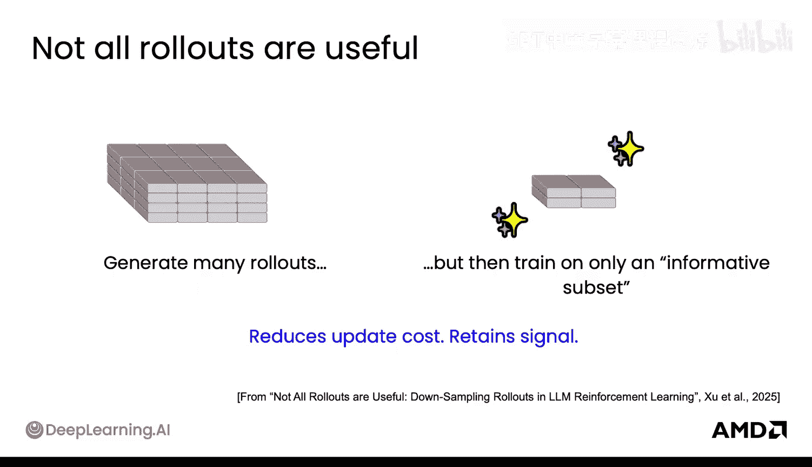

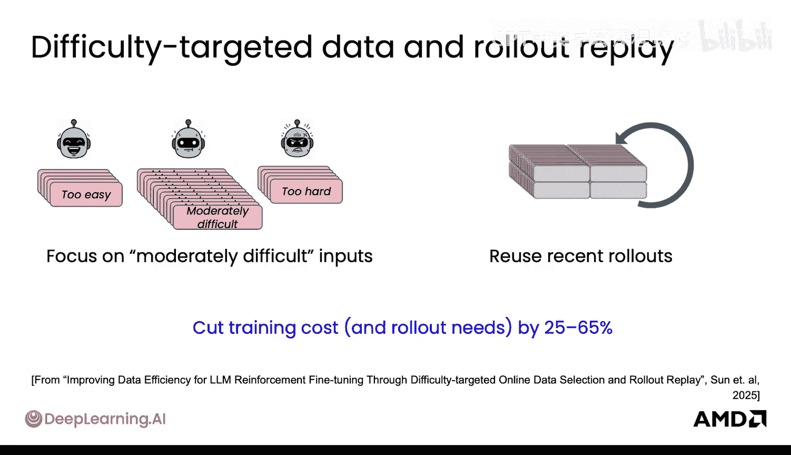

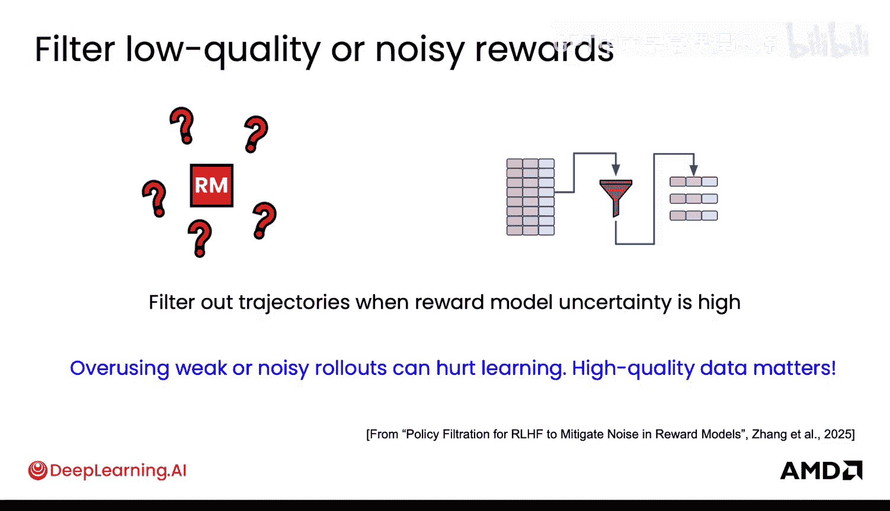

That is just like fine tuning well in many ways it actually is in a lot of researchers have drawn parallels with this type of RL for LLMs to fine tuning and so many of the same principles about data quality matters lot and it's really just that the data is formulated a little bit different this time but ultimately those underlying principles matter just as much and fine tuning is kind of closer if all examples have positive reward signals and there's some chatter around that actually being the most effective way to teach the model in RL as well you can use Laura's for RL as well to make it more efficient all you're doing is just updating fewer parameters of your ultimate model and again data quality and diversity both matter as much as in fine tuning as well you're just getting it in a different way。

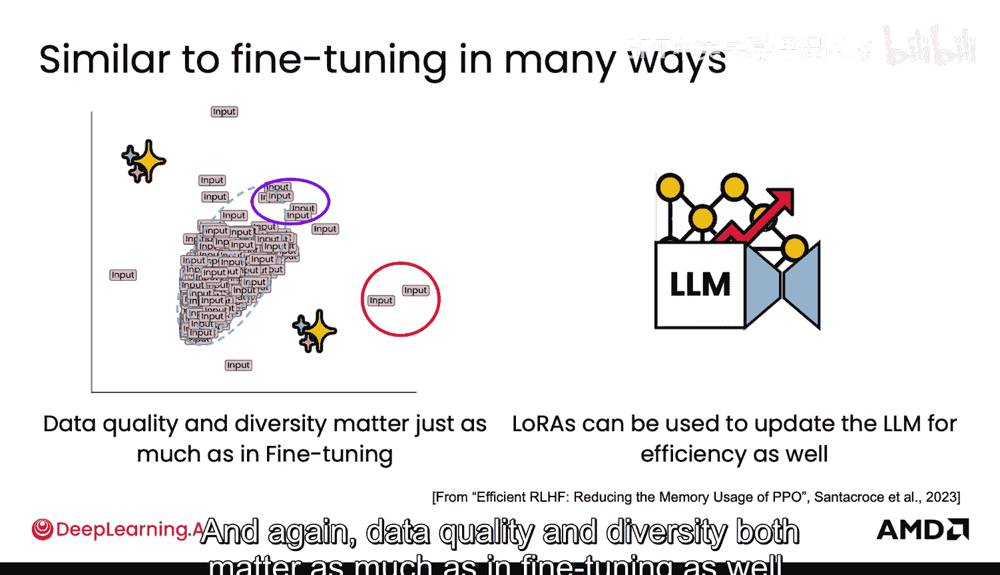