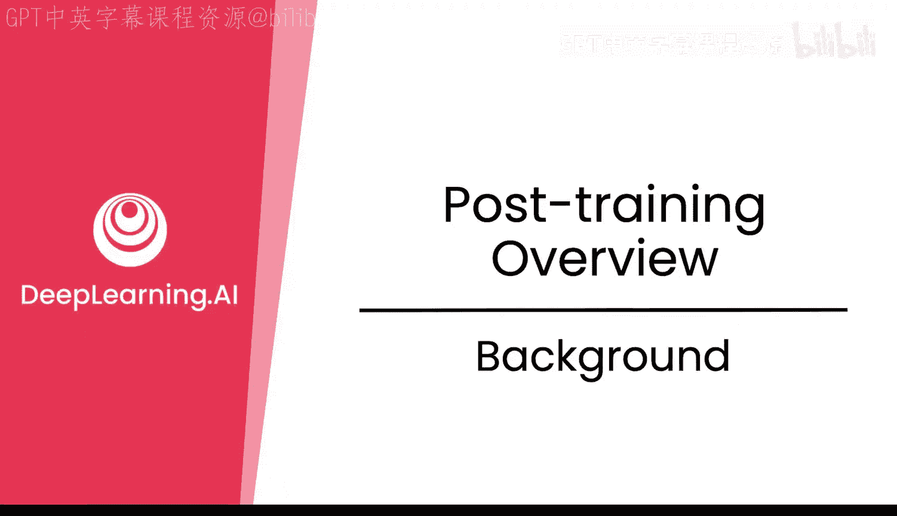
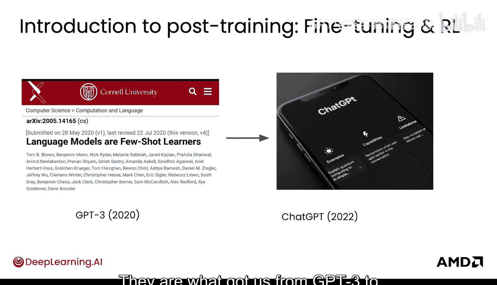
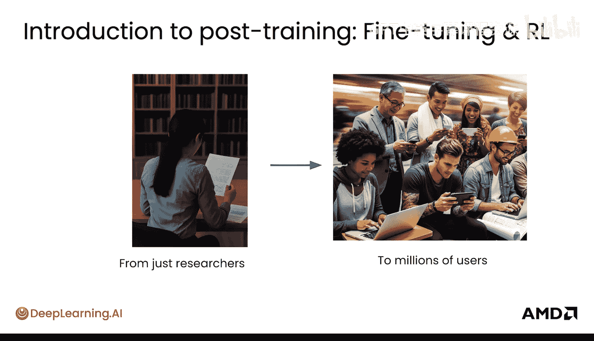
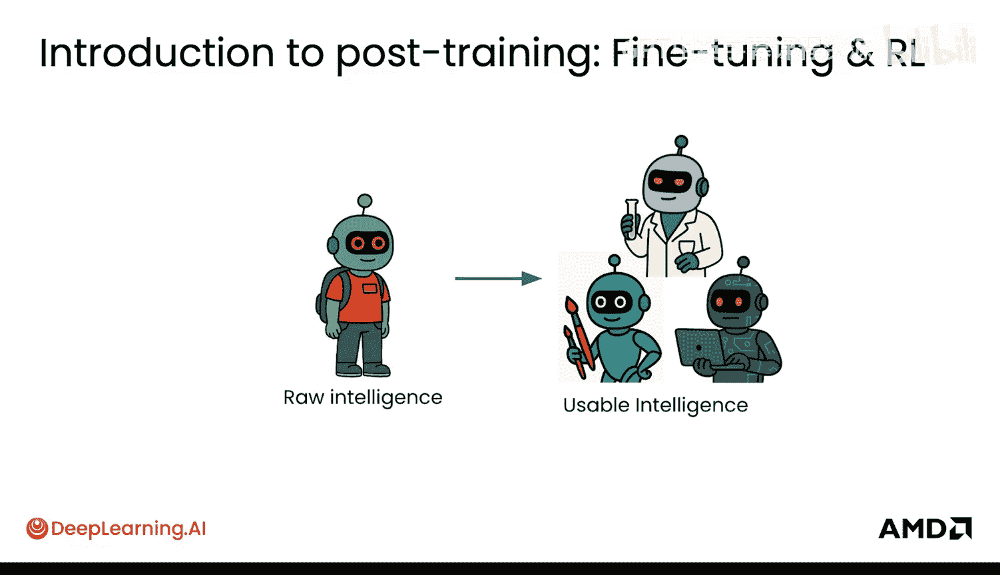
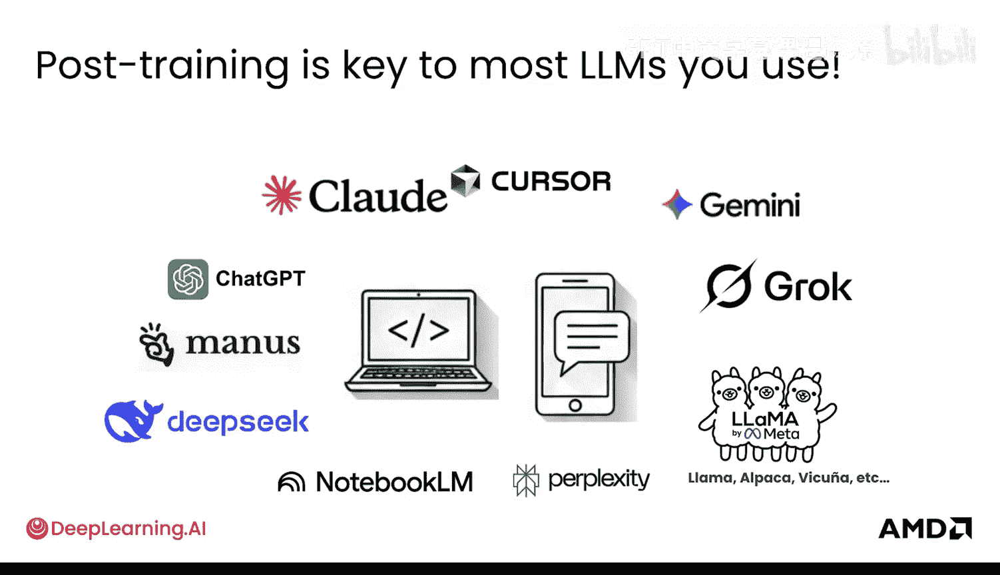
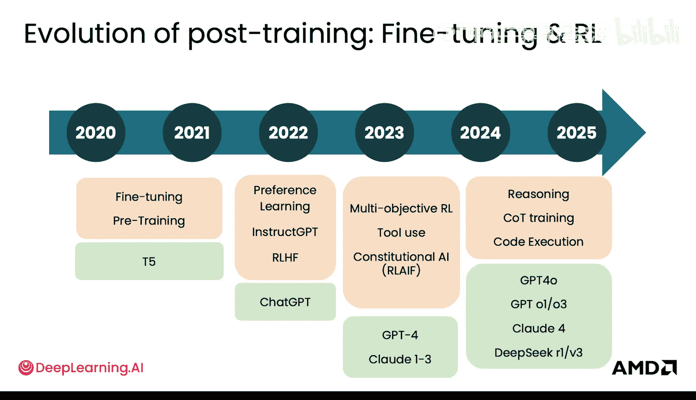
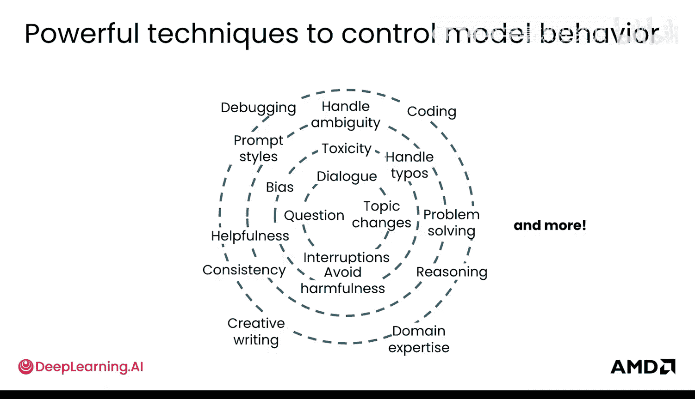
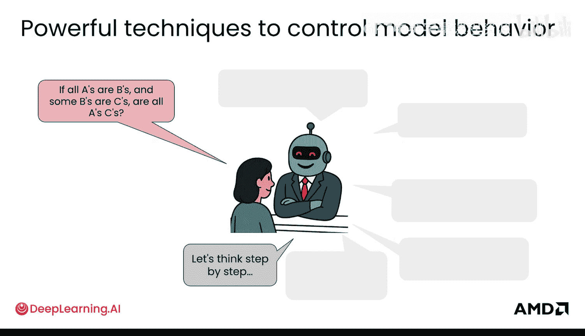

# AMD《大型语言模型的微调与强化学习：后训练入门｜Fine-tuning and Reinforcement Learning for LLMs》 - P2：2.background.zh_en - GPT中英字幕课程资源 - BV1zZy8BcE7z

Fine tuning and reinforcement learning are really exciting techniques today to control a language model's behavior。

 and they fall under this umbrella of posttraining techniques。

 which lets you control the model and get it from that raw intelligence to something usable and practical I'm really excited to see you learn about the overview of posttraining and how it's able to shift the model's behavior。

Fine tuning and reinforcement learning are super powerful techniques。

 They are what got us from GT3 to chat GPT that everyone is familiar with。

 It is what got us from just researchers playing with these models to millions of users actually being able to use this very useful intelligence and that's exactly it it takes that raw intelligence from the model it makes it usable and practical for all different types of applications that we know and love today F tuning and Rl are these techniques under the umbrella of posttrain and post training is key to most of the LLMs that you know and love today such as chat GPT Claude Gemini Gr he name it Posttrain has been evolving for quite some time even before chat GPT came along so that started with fine tuning it went to the instruct GT RLHF which you might have heard of reinforcement learning with human feedback you'll learn about that and preference learning you'll learn about how these models can use tools。

They can reason and how they use chain of thought to actually be able to produce better answers and better code And so this is just the timeline of where posttraining has gone over the years and the models that have been posttrain to be better and better and better using again the set of techniques across both reinforcement learning and fine tuning and you'll look into many of these across this course So just to actually get a little bit more concrete on posttraining what does it look like before and after So before if you were to ask how to fix a car the model might just say how to fix a bike you know it thinks it might be in a survey it'll just answer your question with another question because it doesn't know it's supposed to be a helpful assistance so after it's been posttrain after you've applied fine tuning and reinforcement learning to it the model actually can become helpful It can say I'd be happy to help could you tell me what specific issue you're experiencing with your car so much more helpful it's able to actually give assistance now diving into a more concrete deeper example here with code maybe you。

Have a question around write a python function for me that takes the path to a do file and returns a list of all function names defined in that file。

 The base model is basically giving you that stream of consciousness it hasn't gone through that posttraining yet and so it just gives you for example the file has this it should return this it's kind of in the right general area you can tell it's intelligent but it's not actually helpful whereas a model that has gone through posttrain actually can produce this helpful function actually can give you something useful that you can take to put in your code and execute So very powerful techniques under the umbrella of posttrain fine to name for Forsman learning and they're really here to control the models behavior it lets you actually give the model the ability to chat with you that dialogue be able to answer questions be able to handle interruptions when you're talking to it topic changes whether it's giving something toxic or not bias it's able to handle these really tricky cases become more helpful less harmful handle typos even that was an evolution through。

Tining handle ambiguity， different prompt styles， make a consistent reason。

 think through things step by step， be able to problem solve。

 be able to do deeper coding cases like you saw just now as well as be able to debug that code more effectively be able to actually give you the right type of creator writing and style that you need and of course very deep domain expertise So many。

 many more techniques to basically control the model's behavior so the model can actually be usable and practical so just to dive into a few of those this means that when you ask the model hello how are you doing it can say hi I'm doing great what can I do for you it's able to answer that question tell me how to build a bomb it can actually have that garbriil and say sorry I can't answer that maybe you are asking about the weather and SF on Sunday and you want it to actually hit the weather API it can learn to hit that weather API very accurately if you ask a question and you're using retrieval augmented generation so you're attaching some document to it and it misses it actually doesn't have that information in there it can actually be。

to recover from that and you can teach the model to recover from that and say sorry the information provided doesn't include that date it's very powerful maybe you ask a couple questions and you want to get a consistent answer this model you can teach it now with posttraining to give that consistent answer across different variations of how you ask that question and you can also get the model to reason and think step by step if you give it a difficult math problem if you give it a difficult coding problem it can actually reason and think step by step so these are all very。

 very powerful techniques for you to control the model's behavior。

Now that you learned how powerful technique post training is and exactly what it is， right。

 fine tuning and reinforcement learning， in this next lesson。

 you'll take a look at where fits in in the LLM life cycle of training the model right from pretrain model to then posttraining techniques。

