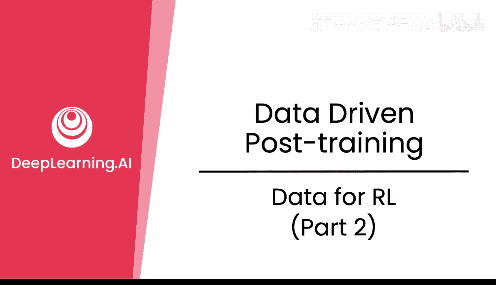
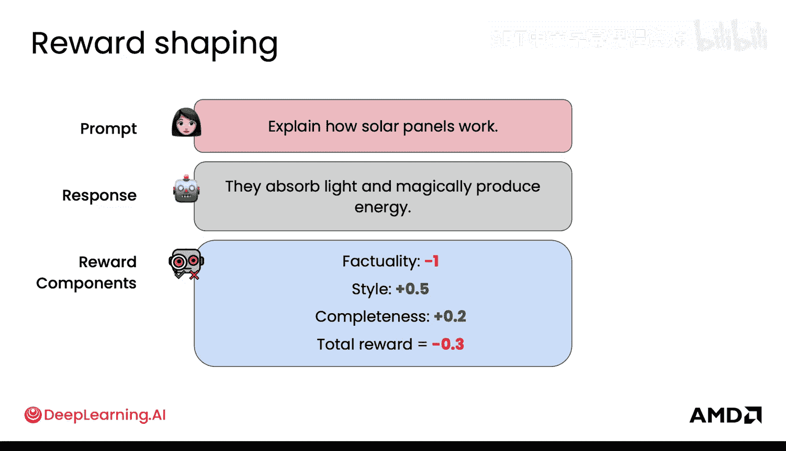
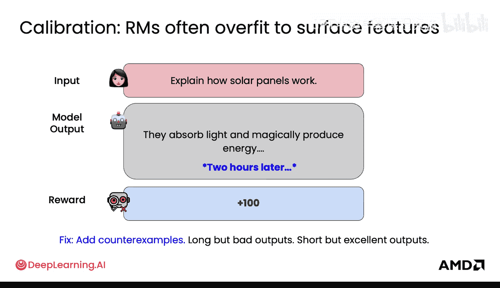
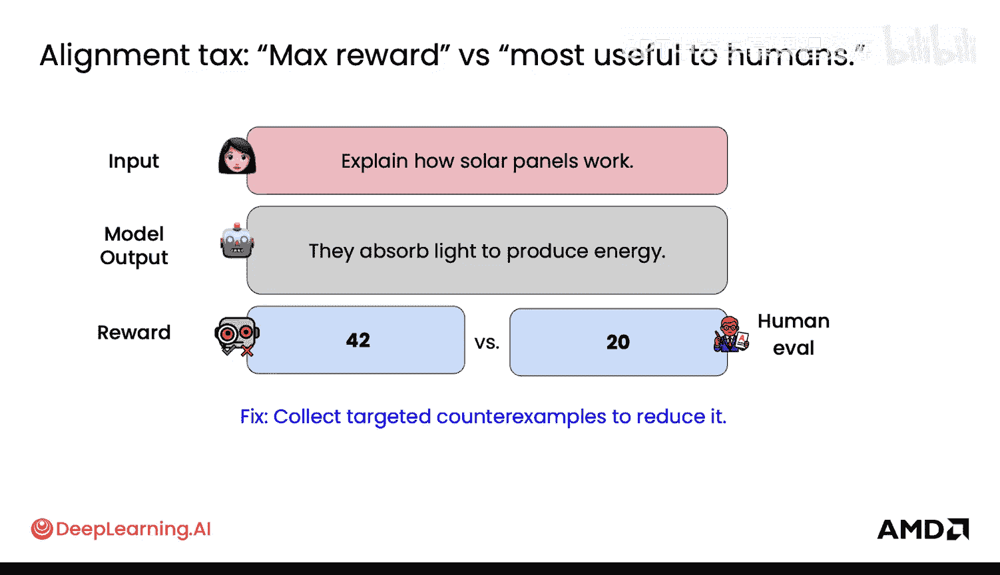
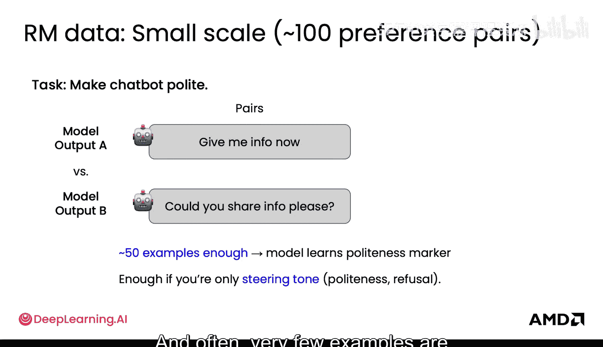
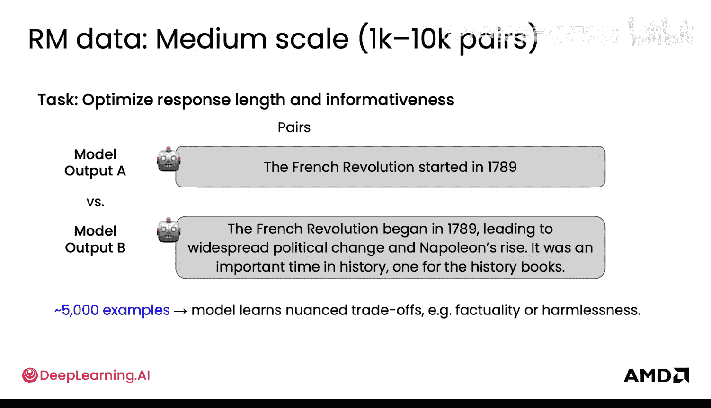
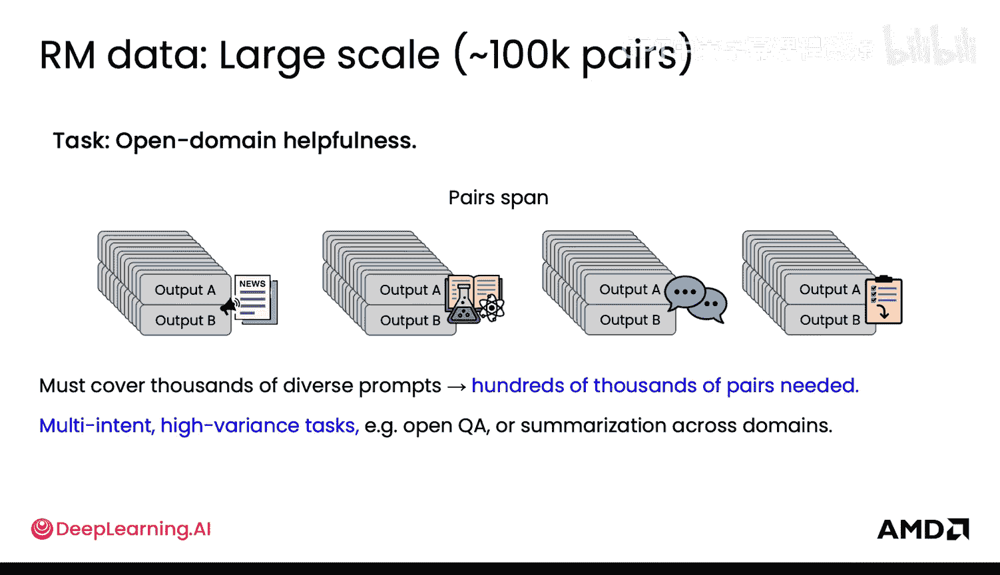
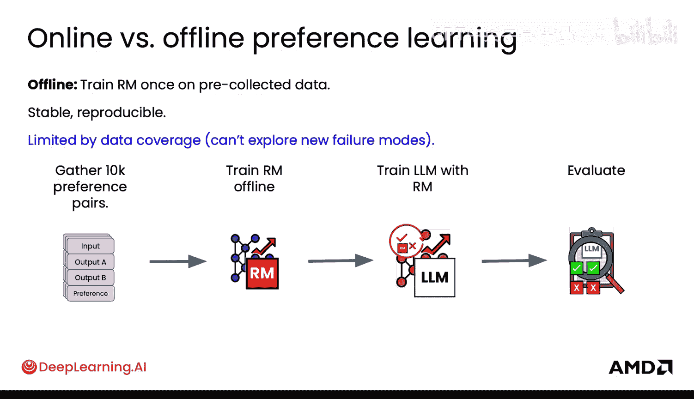
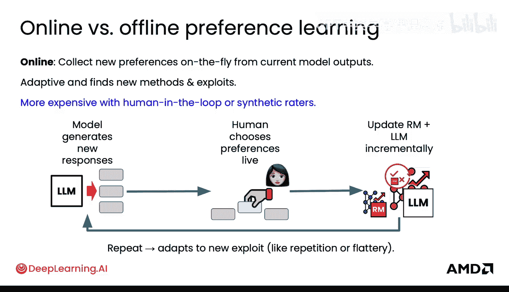
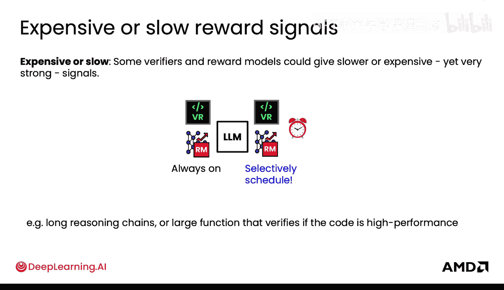

# AMD《大型语言模型的微调与强化学习：后训练入门｜Fine-tuning and Reinforcement Learning for LLMs》 - P30：4.data-for-rl-(part-2).zh_en - GPT中英字幕课程资源 - BV1zZy8BcE7z

Okay so some other data considerations happen at the reward function level。

 This is reward shaping basically the reward model predicts composite scores。

 not just which is better and you've seen a lot of examples of this already。

 but this is kind of the reason behind giving more than just one score it gives a model a better composite score and holistic view then just one one possible score Reward models themselves will also overfit to whatever features it learns from patterns in the data。

 even if those patterns aren't what you intended for it to learn。

 this is similar to reward hacking again， but it kind of falls under the broader theme of calibrating these models and in this case it's more indirect in how the patterns are formed in the preference data rather than in the reward function itself for example。

 this model here you know maybe you ask explain how solar panels work and it might just keep talking and talking and talking in two hours data it is still outputting things and then it gets a really high reward and that's because indirectly it learned that length is good。

In the preference data and that's a reward model here and it knows how to get that strong reward okay and the fix of course is to add some counterexamples long but bad outputs short but excellent outputs and improve your reward model from there you've also seen this before but the alignment is the difference between the reward given by the reward model and the human eval what's cool is that you can close this gap pretty explicitly especially if you believe the human scores in absolute terms so if you really believe this is a score of 20 in absolute terms then you can just close that gap between the reward models 42 and the human Evals 20 and of course you can also just collect targeted examples to counter that discrepancy so high human score low reward or high reward low human score on implementation one thing to keep in mind is just make sure your preference train and eval splits are split pretty well here to understand that improvement and of course continue tracking that alignment tax size is important So on data scale for the reward model this is kind of important you're essentially trying to learn a distinction between usually two different things or host of different things for the reward model。

And often very few examples are enough to learn broad distinctions。

 but then you need more nuanced examples and many more examples to understand something a little bit more nuanced or fine grainined so here's with many more examples it's to learn this tradeoff of factuality or harmlessness and to optimize the response length and informativeness at a very large scale if you need your reward model to cover just a lot of different domains then you need it to generalize across a lot of possible outputs What's great here is that for reward model a lot of those rankings that you are doing to get this preference data turn into a lot more pairs than the number of rankings that you've done so it's easier to get larger sets of data here Finally you've seen hints at this but when should you be training your reward model so you could train it once and keep it frozen this is offline preference learning so essentially you collect all your data all at once it's pretty stable to train your reward model and keep it there frozen but it is limited by data coverage。

 you won't see kind of new outputs from the model。

It improves and it won't adapt with that but this is the simplest way and I'd suggest starting here and then of course online preference learning is when the reward model actually adapts as you're training your main LLM with RL and I also think online preference learning can be interesting because your LM improves in an improving the greater to just adjust your reward model if you don't have so much live traffic and you can imagine updating your reward model。

 it doesn't have to be human preferences， it could be other signals like clicks on something and just to get into the possible types of rewards you could get sometimes you're not getting reward signals from only something that is really fast or really cheap sometimes it might be expensive or slow so some verifiers and some reward models could give you outputs that just take longer for example it could have a really really long reasoning chain and that takes a really long time you don't want to always wait for those responses for every single possible update or a verifier could be checking if the codes perform。

It's really high performance I've been playing with something like that and it takes a really long time。

 many， many minutes， possibly hours to actually get a response back across you performance across multiple devices so what you want to do is you want to schedule these expensive or slow runs for slow ones you want to be wary if you're collating results from an older LLM then the other reward signals there you're also applying so you want to selectively schedule these as you see fit。

Now that you understand data for RL， it's time to put together your fine tuning and RL data in a production post trading pipeline。

