# AMD《大型语言模型的微调与强化学习：后训练入门｜Fine-tuning and Reinforcement Learning for LLMs》 - P31：5.putting-it-together.zh_en - GPT中英字幕课程资源 - BV1zZy8BcE7z

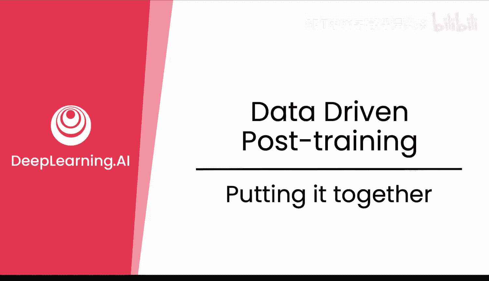

Time to look at all the data sets that go into a production post training pipeline。

So let's take a look at this for a frontier lab that came out earlier this year and the focus will be here on the data pipeline and you'll put together the models in the next module on a full production posttraining pipeline So here's every single data here all the data sets that you'll go over starting with the cold start long chain of thought data exactly what does that mean So chain of thought data you know is reasoning data So it looks like this long chain of thought just means that it's really really long reasoning So a lot of thinking and that thinking tag and then k examples is referring to probably a small seed data set of these and use for cold start So basically this is just a cold start set。

 a small set to get started with fine tuning and getting the model used to this type of format so we got that what's next。

 All right， the deepse V3 fine tuning data let's take a look at that So this data doesn't involve any explicit chain of thought or reasoning so it's basically just regular input and target output next is the reasoning。

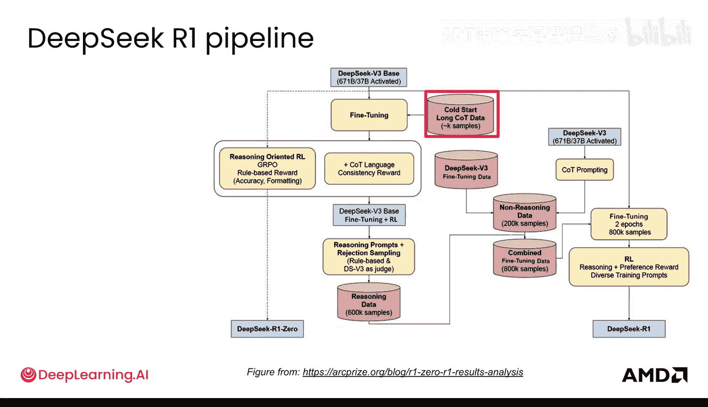

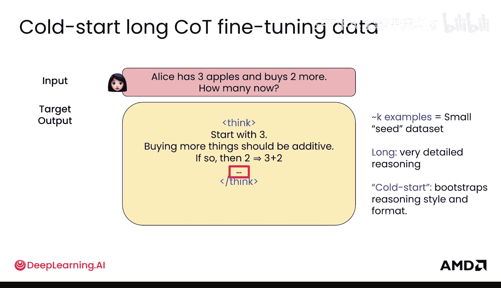

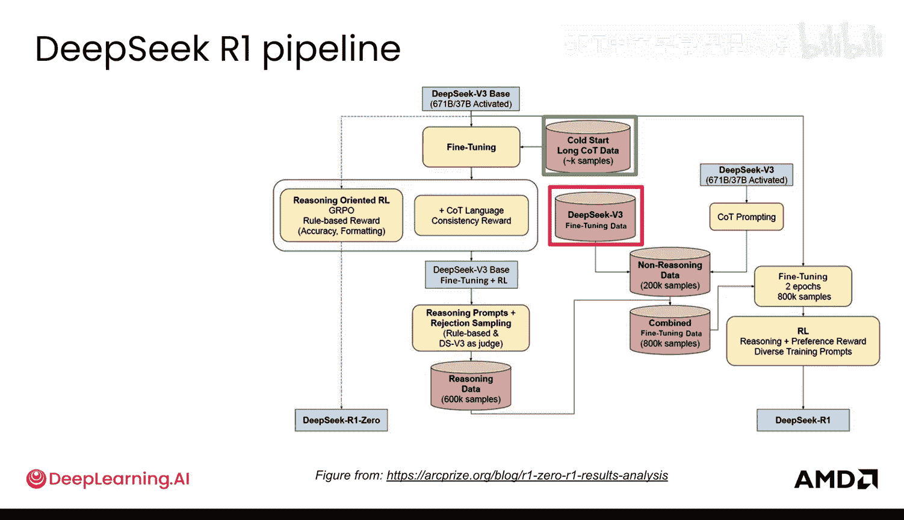

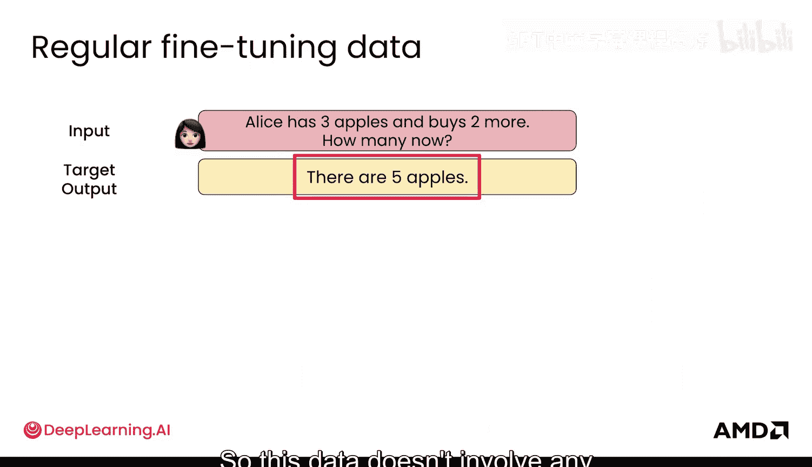

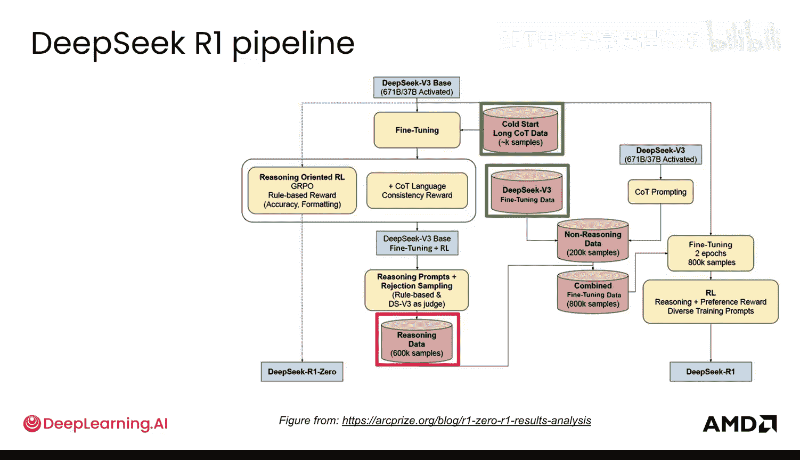

What does that look like so this is actually synthetic reasoning data so just a lot of generated reasoning data and specifically you're generating a ton of data here and then filtering and it's probably important to go through the different filtering steps so one is rejection sampling so generating a lot of possible options and only keeping the top one for example and then removing mixed languages this is something that's really easy to filter for when they see oh hey in the data there's English and Chinese let's just remove that data point because we don't want to encourage that and then finally removing code probably the model should not be answering with code at least for this data set and these inputs these prompts and it doesn't make sense here and likely the model was just overea with generating code that this was an easy way to filter out that data。

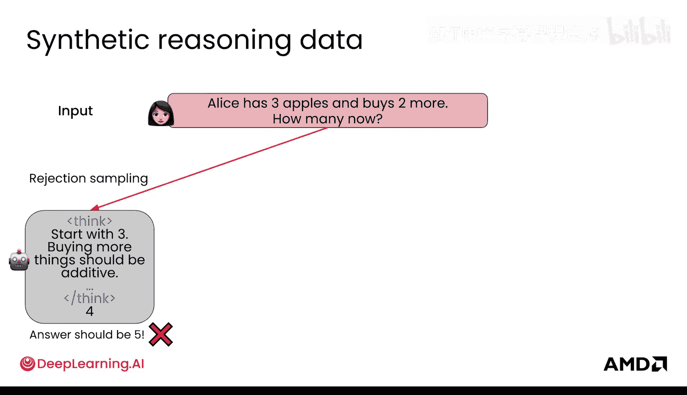

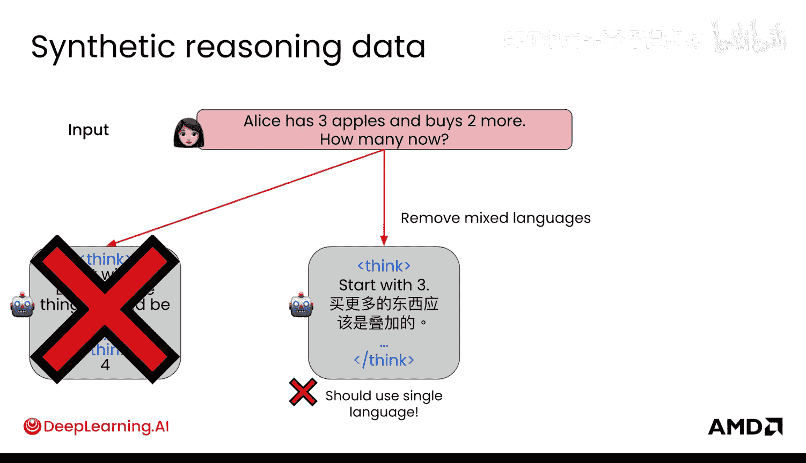

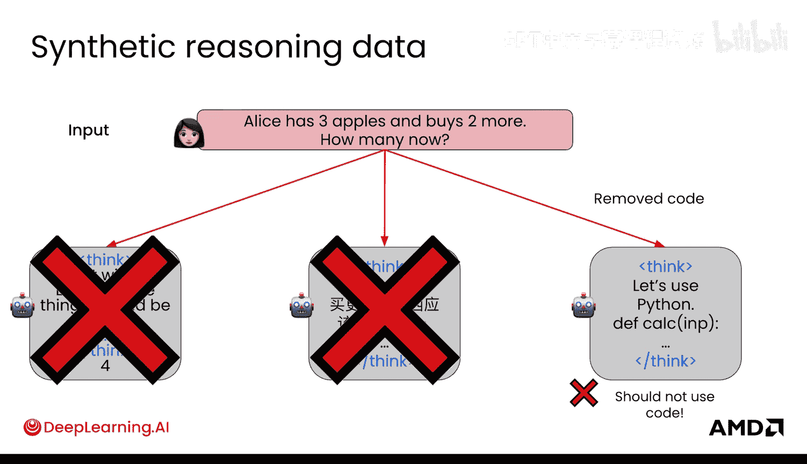

So now we have a good set of reasoning data and note that that is 600K samples so quite a bit there how is the non-reaing data put together so the non-reasoning data is interesting so it's going to be sets of data points that might have some chain of thought the paper mentions but probably using the target output as the input output pair and then also an input target output pair just like normal where it doesn't have any chain of thought cool so that's what that looks like and then you combine all of that together for the final data set and that is what this looks like for the combined fine tuunning data of 800。

000 samples about a quarter or non-reasoning and then 75% are reasoning and great that gets us all of the different data sets that goes into this full pipeline so as you can see there are a ton of possible different data sets it not just kind of two data sets and that's it there are several and they feed into different parts of the pipeline in terms of the fine tuning pieces and RL pieces。

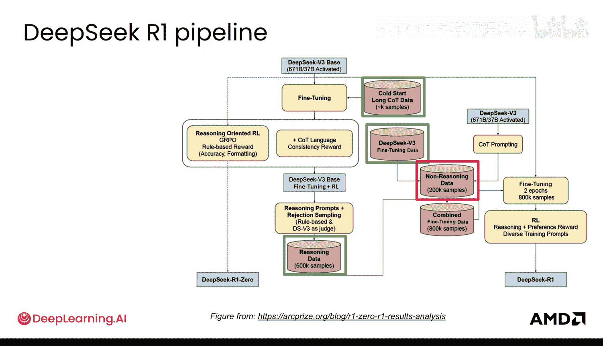

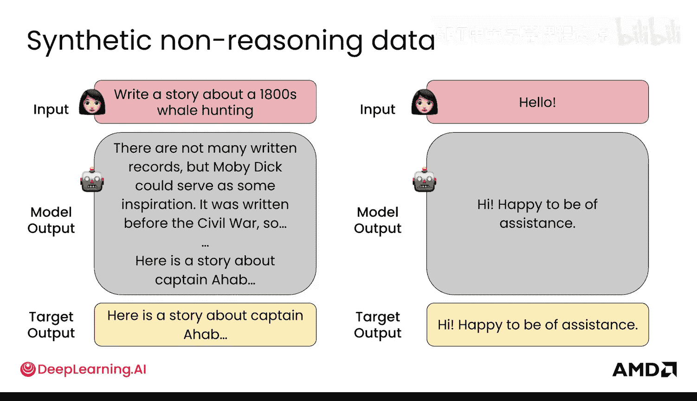

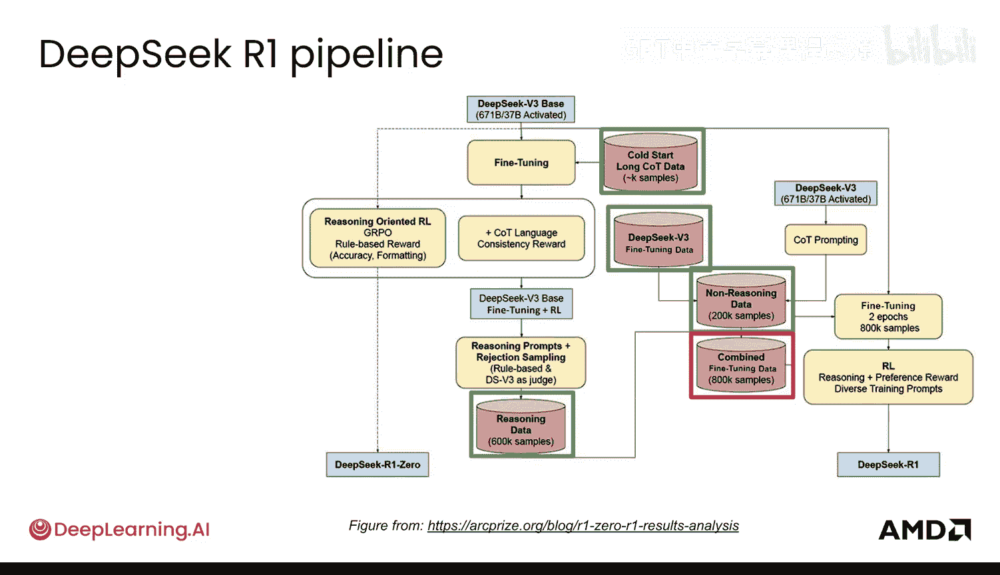

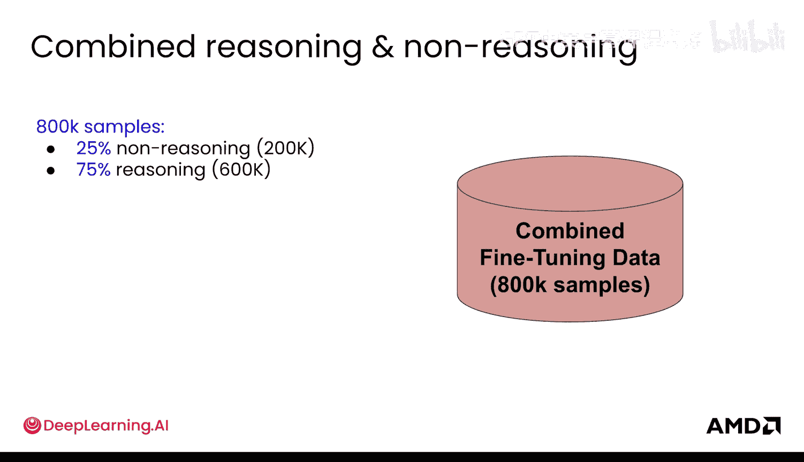

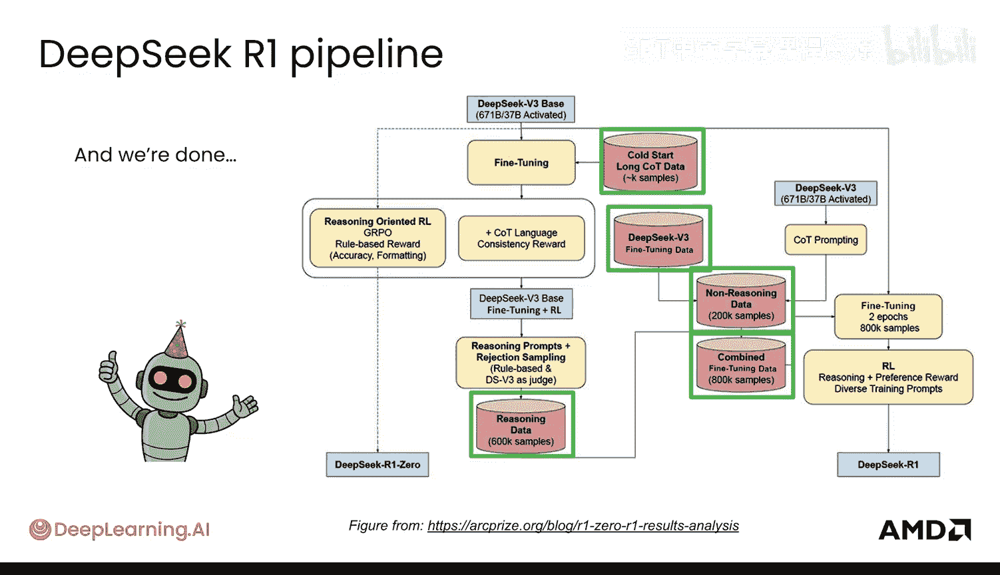

Now that you know what kind of data you need， it's time to take a look at how you can use LLMs to generate a lot of that data for you。

