# AMD《大型语言模型的微调与强化学习：后训练入门｜Fine-tuning and Reinforcement Learning for LLMs》 - P32：6.synthetic-data-pipelines.zh_en - GPT中英字幕课程资源 - BV1zZy8BcE7z

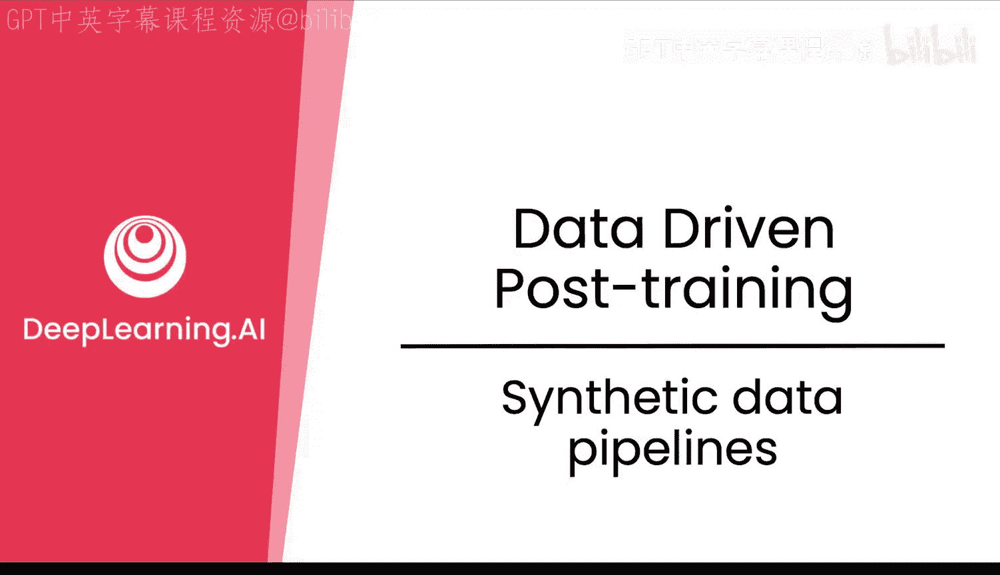

Synthetic data can be a really effective way to scale out your data sets。

 but on its own it can be kind of noisy in this video you'll learn how to make it really high quality to generate。

 filter， score and transform your data with language models。All right， so here's a key question。

 Why use synthetic data pipelines， Why use LLMs to help you People are amazing at judgment and if you ask people to rank different answers。

 they'll usually get it right， but the problem is they're slow。

 we're expensive how especially experts and on the other hand。

 synthetic signals are probably the opposite they're super fast or cheaper they can scale maybe they're not crazy you're going for a huge amount but instead of a handful of human labels in an hour。

 you can generate thousands of synthetic pairs at the same time。

 but the catch is usually around quality and the generated samples might just be kind of generic and if you just take it at face value。

 that speed just turns into noise and that noise is not useful for actually improving the model So take a look at how you can actually create synthetic data that will be actually useful for your post-training pipelines So you already saw this a little bit before around constitutional AI but anthropic that came up with constitutional AI uses synthetic data in a really effective way and uses synthetic pipelines in a very effective way by。

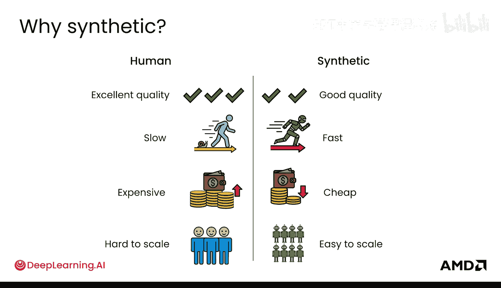

Getting the human to mainly focus on writing the Constitution itself， but apart from that。

 just using synthetic pipelines to transform that constitution into different ways of both critiquing model outputs and also selecting better outputs that follow that constitution So I think this is a really really great way of scaling things out and using human labor and human expertise in areas where we shine and then scaling it out with language models So there are a few key areas where language models can be really helpful。

 one is obviously generating a ton of data。 The other one is however filtering that data and filtering it to actually high quality data。

 this is pretty important to have really good filtering because then you can go you can kind of go ham with generating。

 you can go further with generating next is transforming that data。

 I think this is actually underutilized today。 there's a lot of great data just in the wrong format for fine tuning for example。

 and we can actually transform it to be very useful and then finally scoring similar to filtering but scoring that data can be useful for。

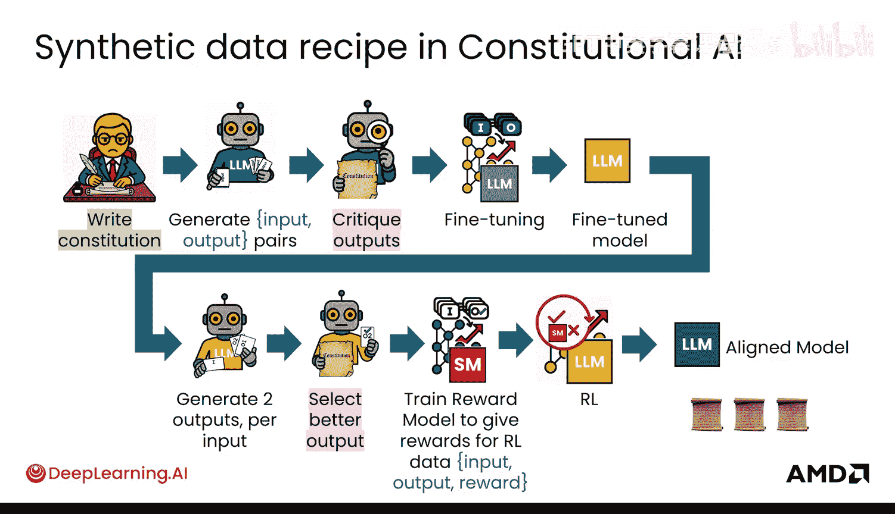

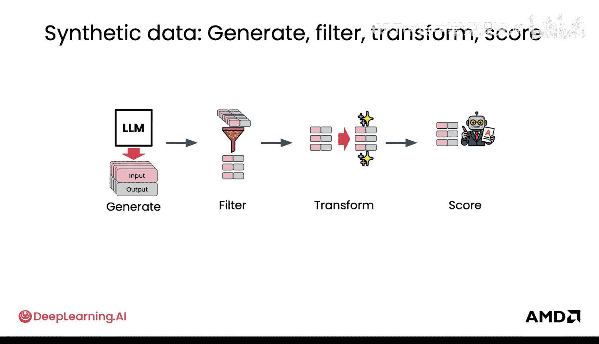

learningningSo going through each of them， starting with generating data so you can use a lot of pro templates for example here you can solve this coding question step by step and then have a variable for the question。

 you can loop through a bunch of questions and generating data that way that way you kind of loop through data or information you already have and you can get a big diversity of that data you can vary that diversity also via different parameters like temperature so the model can actually go more creative and further in terms of what it's outputting so you're going to generate a bunch of data some of it is going to go well some of it you're going to pass on one problem with passing on data is that you might find that there are certain types of inputs or your model just doesn't do well at all that's generating a lot of this data and as a result you won't get any data coverage for that type of input so how do you mitigate against that well rejection sampling is one of those methods and what rejection sampling essentially is is generating a bunch of possible outputs like here A B and C and just keeping the best。

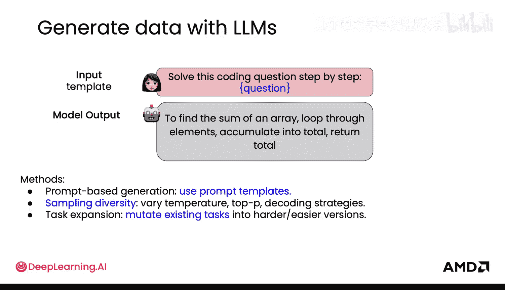

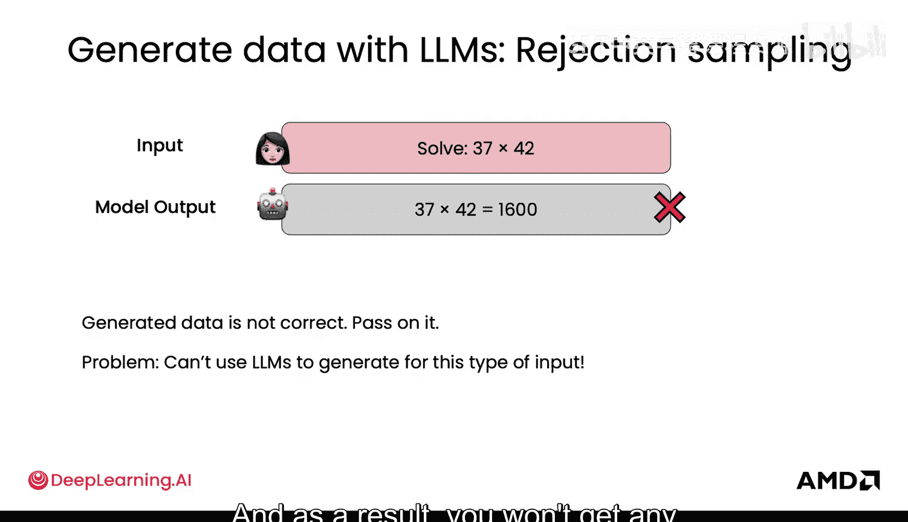

In this case， the best one out of three， so this would be three to one filtering。

 but essentially you could scale that to any number any K you could run more than three outputs of course and you can select more than one of course as well but this makes it so that you pick the best option out of many possible options so that you're more likely to have this input you represented in your data rejection sampling you can also filter with an LLM as judge so the LM as judge could instead be filtering based on a constitution like you saw with Constitution AI some kind of ranking or scoring or agreement across these methods so the majority vote for example。

 filtering your data with LLMs in rejection sampling basically this is what you did with Constitution AI you can generate a bunch of candidates with your constitution your LM judge will eliminate the bad ones you can run pairwise preferences on what's remained and based on that get a ranking and then you can check the agreement with self-consistency or majority vote and then you select the top and as the filtered high signal examples that you can then apply to。

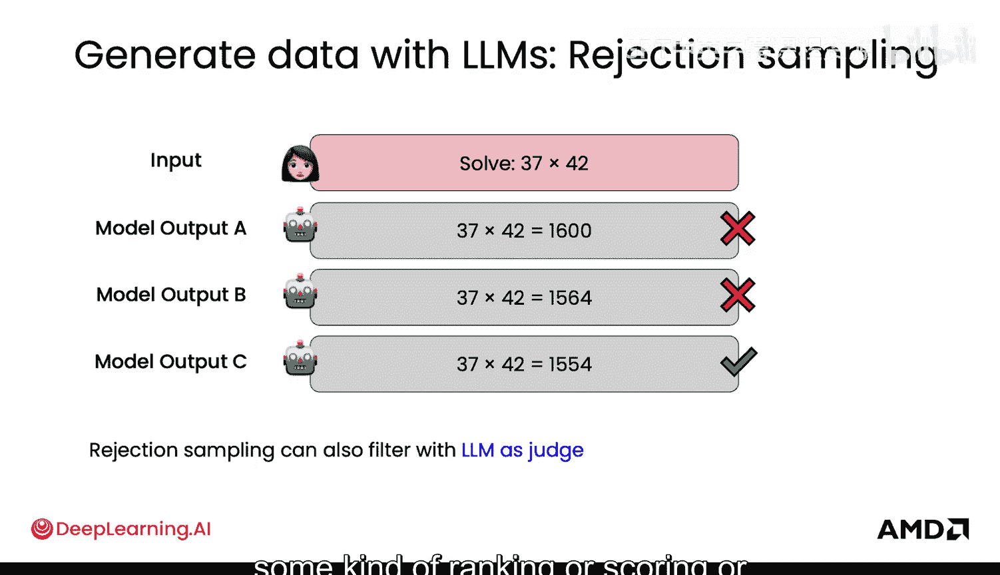

Da setSo filtering just helps you mainly from training on noise and you really want to avoid that because you can actually get away with again that smaller high quality data over a large noisy data in terms of improving your model so data generation is only as useful as your filtering since again if you generate a bunch of noisy data it's not gonna be useful so having good filtering will enable you to go harder on the generation side for all of AI it garbage in garbage out so make sure that you are putting in high quality data filtering can be using language models and of course using different types of verification that's more programmatic as well so some ways to filter you can use a template like the one you see here around solve this coding question using a different method so verifying the previous method and using chain of thought to do double check essentially of your models previous output something else to look for is collapse detection so you don't want a lot of redundant input output pairs for example。

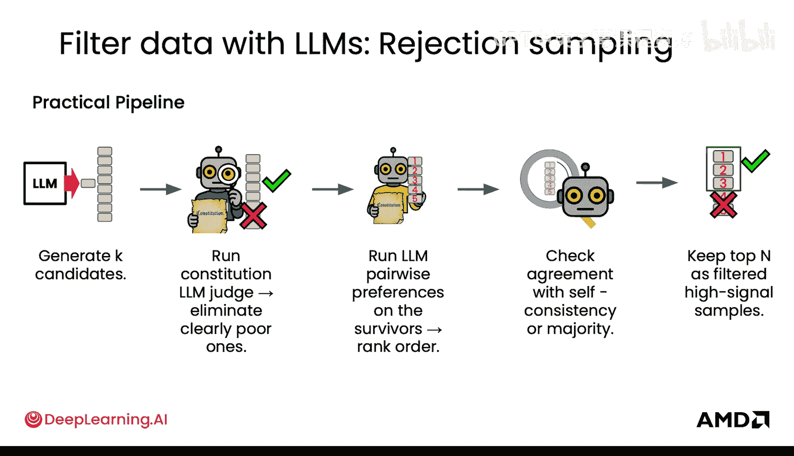

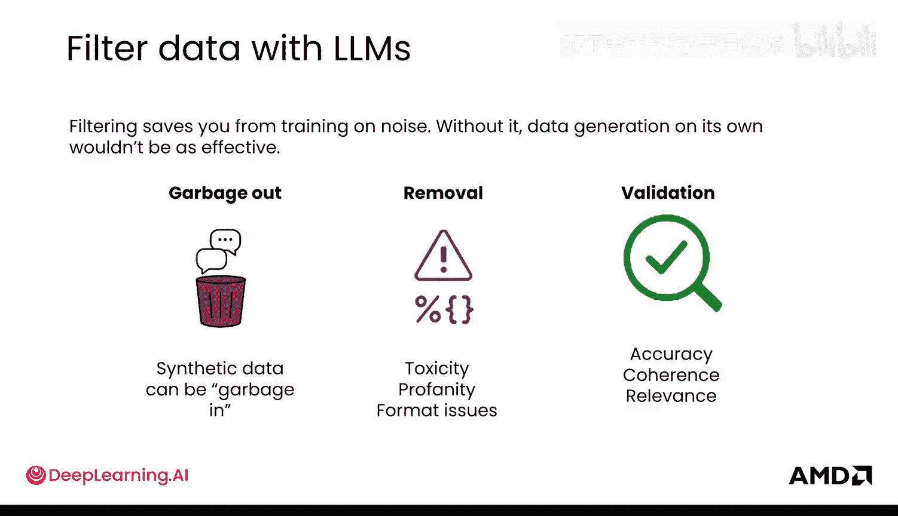

You you want to remove redundancy if it's not actually giving you additional information so filtering can also be very useful here。

 essentially a Ddoop or soft Ddoop finally using majority voting can help you hone in on which possible answer is actually most likely to be correct moving on to transforming data again I think this is super underutilized so please focus here a little bit but one way to transform data is let's say the model produces something really really vervose here you can transform it to be significantly more succinct as an example other ways is to standardize the tone or style of your data or augment your data in different ways。

 expand it with stepbystep versions we had previously seen that you know it's helpful for these models to see data of the right difficulty to train on it right so bucketing things into easy versus harder task or moderately difficult task can be very helpful in this stage as well finally let's get to scoring so scoring data with LLMs is possible。

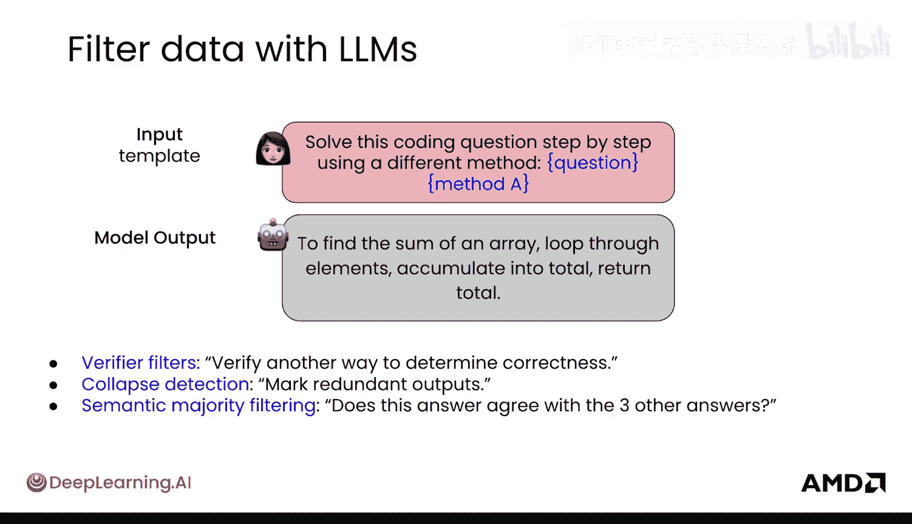

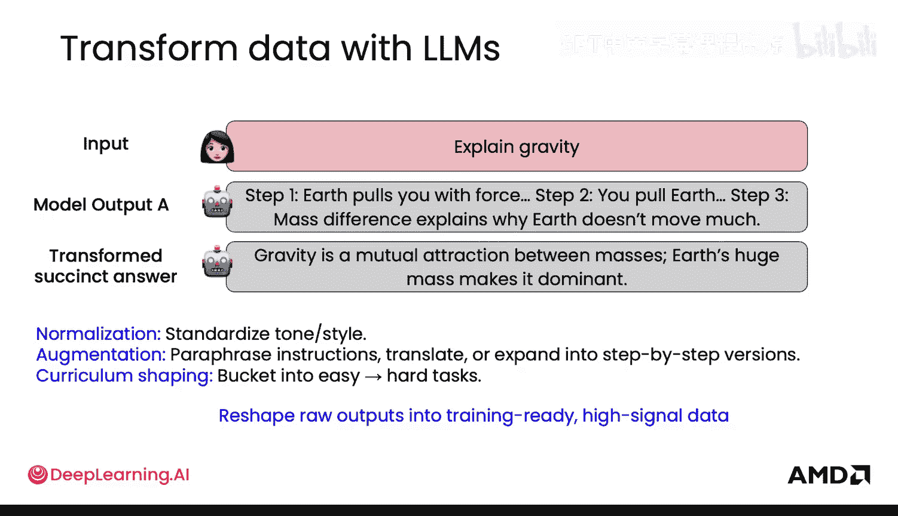

By asking the LM for a score， sometimes it's more effective to also ask for a score across different axes that you care about maybe present in your Constitution that helps you get a more reliable score across dimensions that you actually care about so in your code what this could look like is you could actually extract step indicators so like from the model's output you could see the model thinking step by step like first do this second do this third do this and then calculate this or multiply this this is for math in particular and you could actually count how many steps it's taking what kind of steps it's taking and give it partial credit based on this as well so this is a type of scoring you can also extract explanation phrases like because since this means and give it partial credit there as well so there are a lot of different ways to score your model and this is just a few different ways to actually give it a better sense of how it's doing。

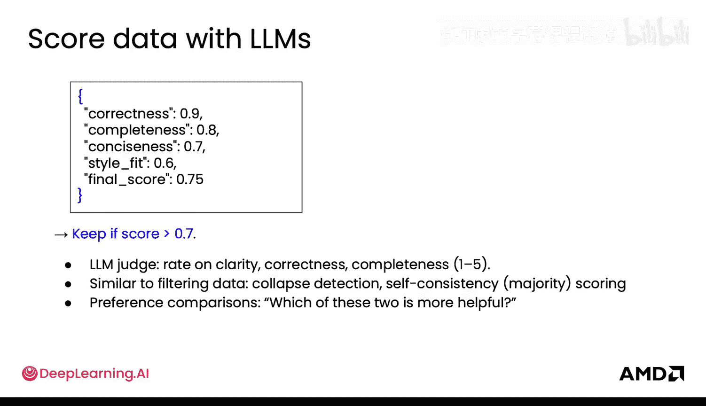

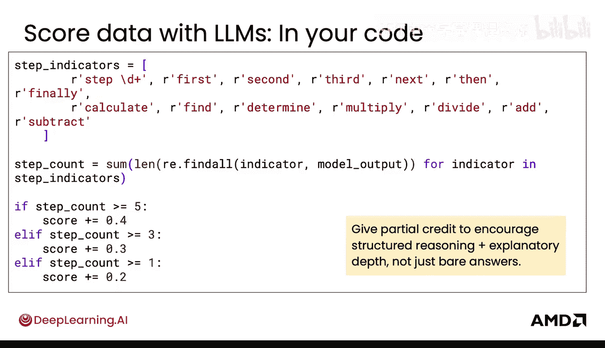

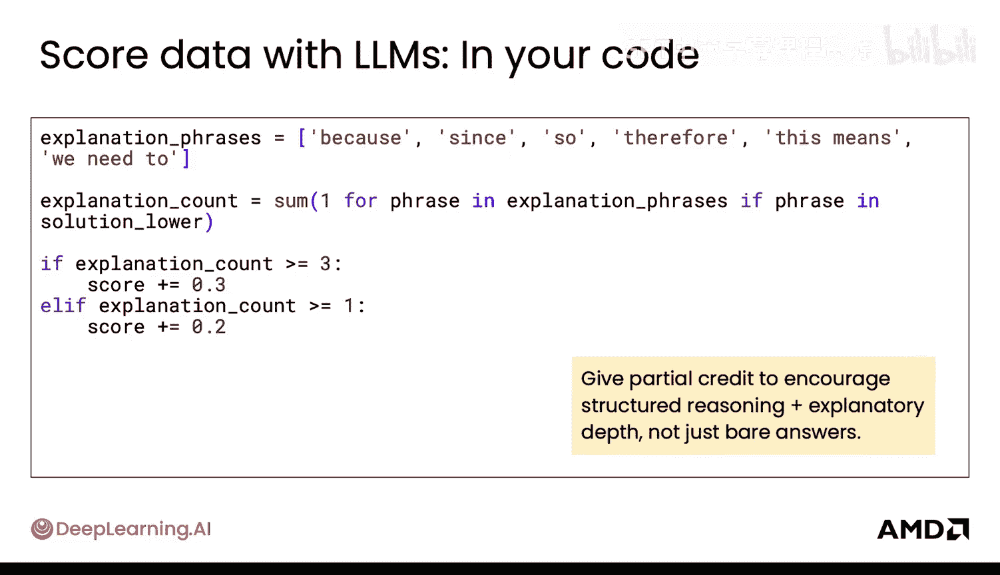

Now that you're comfortable using LLMs to generate synthetic data for you。

 take a look at how to take it to the next level with templates。

