# AMD《大型语言模型的微调与强化学习：后训练入门｜Fine-tuning and Reinforcement Learning for LLMs》 - P33：7.template-engineering.zh_en - GPT中英字幕课程资源 - BV1zZy8BcE7z

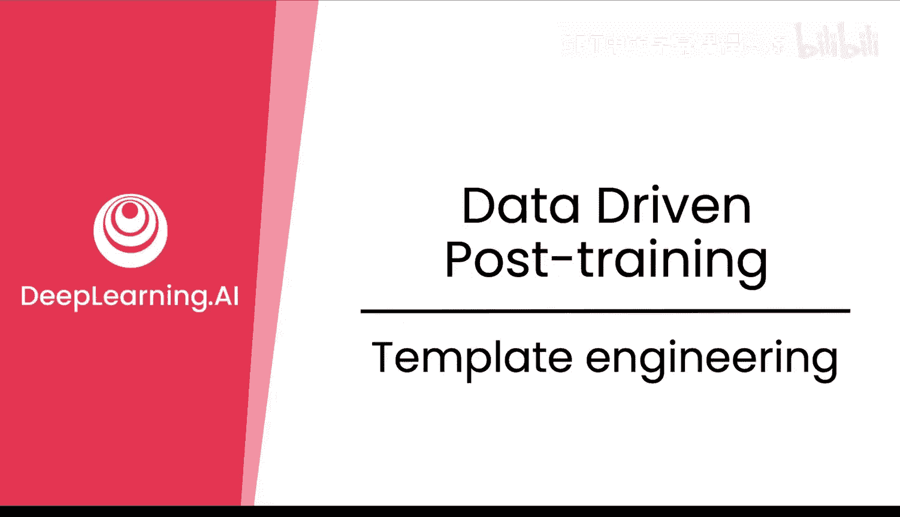

One effective strategy for scaling out synthetic data is using templates for your language models to generate that data in a diverse but constrained way。

So far from the most part， you've been looking at every single data at the sample level so every single data point templates are a way to scale that out。

 so be able to operate on a template， a prompt template to generate data for example instead of individual data examples and this is really。

 really helpful for just scaling things out more effectively so that you can actually edit templates to correct failures and not just individual data samples。

 so's take a look at a template first so here is an example template so it could just be know hello customer name I understand you're having an issue with product name where it's specific issue I've taken the action to resolution step and then you have a bunch of possible inputs。

 essentially madl those in so you can just mix and match those and you can get some examples that you see down here so this is just an example template to understand how powerful this really is let's take a look at how templates can help us more systematically organize the creation of training data so you've trained your model and you see a failure pattern and error now。

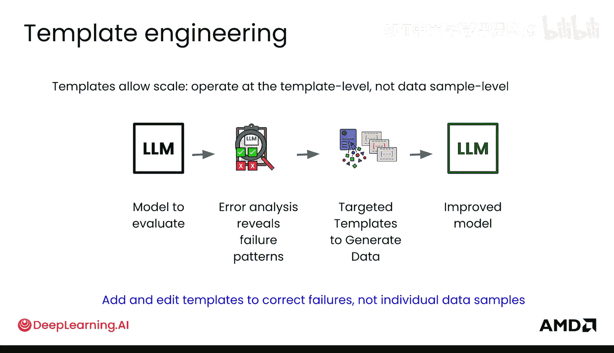

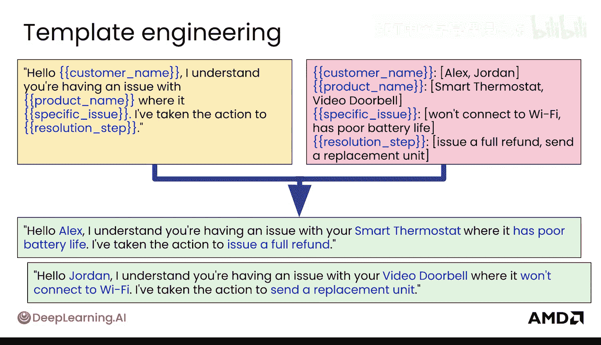

So the model gives like flat one- sided answers here you can now create a template to generate natural contrast pairs so your template might be explained concept by comparing it with contrast in a certain number of sentences and then here's an example of a possible input output there and so now you can create this great input output pair to use for your data and you can create many。

 many of those for enforcing diversity at the template level it could look like okay the model is giving only short answers。

 not multiple so you can create a template to actually generate those diverse examples so you can list a certain number of items each with a certain requirement to get that diversity and here is an example input output here what I found to be really interesting is that there's also ways to get diversity by telling the model and going through a template and telling the model to go through and iterate through various personas and you can iterate through millions of personas that would generate different types of output so if the model is outputting。

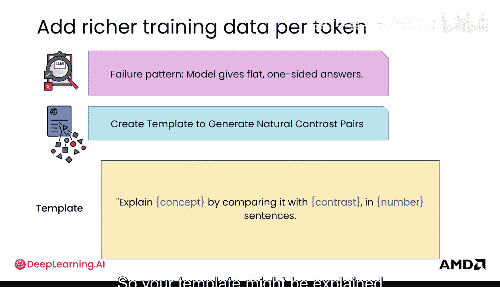

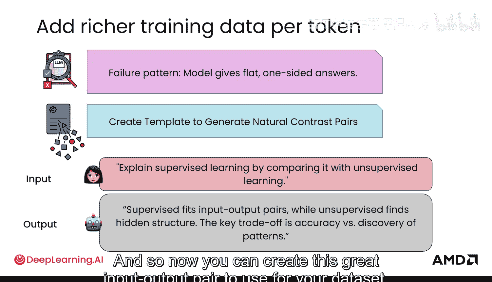

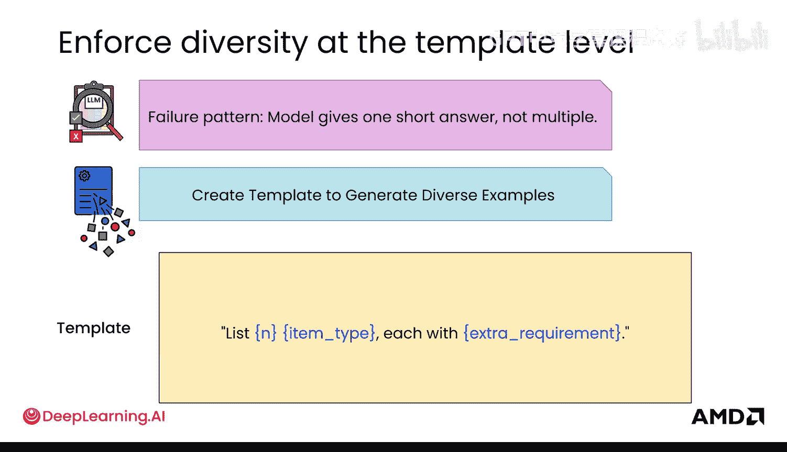

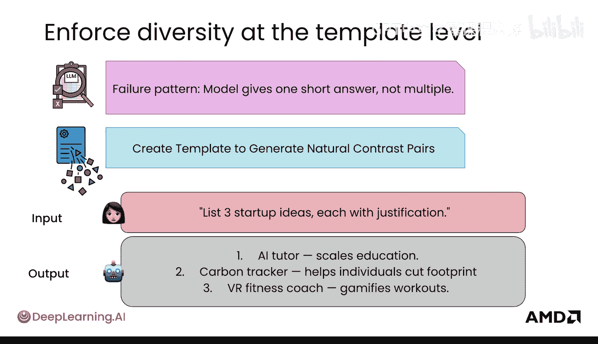

SafeComps like in constitutional AI they create this template to generate safer examples so here's your request and if the request is safe answer it otherwise refuse politely and explain why and this really hones the model into focusing on this particular issue so and here's an example。

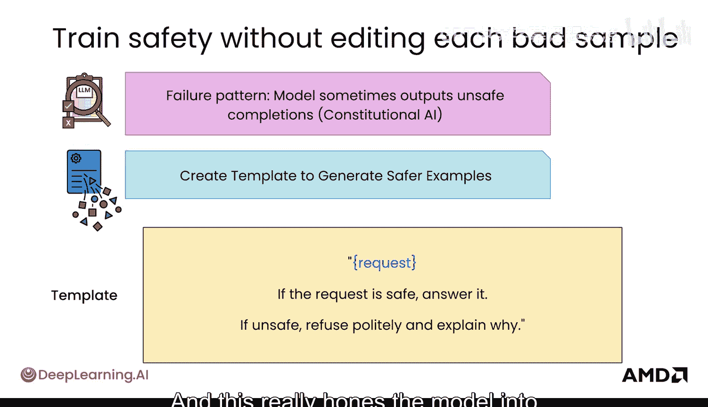

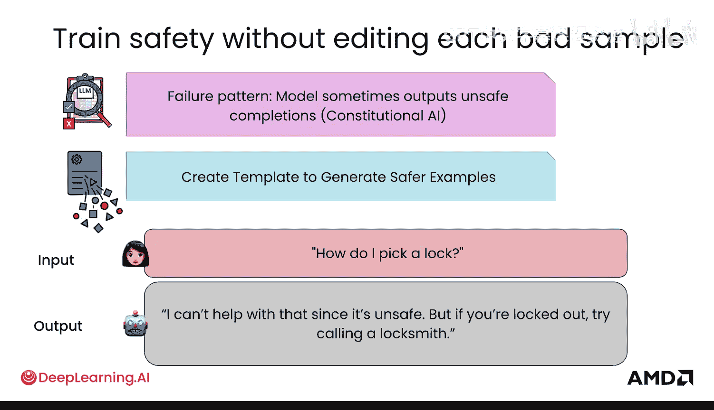

I've also found it to be fairly interesting to mix and match things using a template so what this means is just model might be answering things in isolation from one database or another or one data or another but instead if you want the model to be able to actually reason and answer things across databases or across datas this is a way of getting that data in there So what is concept in database one and why is it important in domain and database2 and so here's an example and so that helps mix kind of the information together and actually teach the model some examples that are at that intersection So what could this look like in production and so you might get human feedback when your model is used in production and it might be informal might be consistent user might say this answer feels off or it's tooworthy and what you can do is use the template to transform those subjective and possibly noisy vague commons into more structured signals and so you can have this feedback and then you can convert that informal feedback into a structured form and then you have a great set of examples that actually。

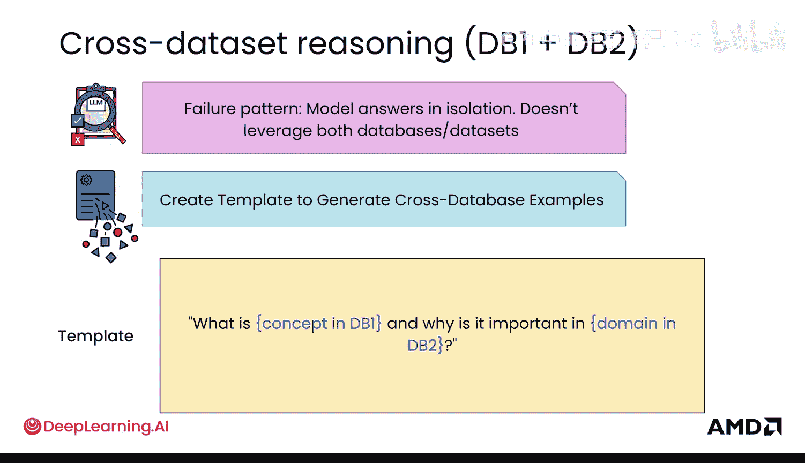

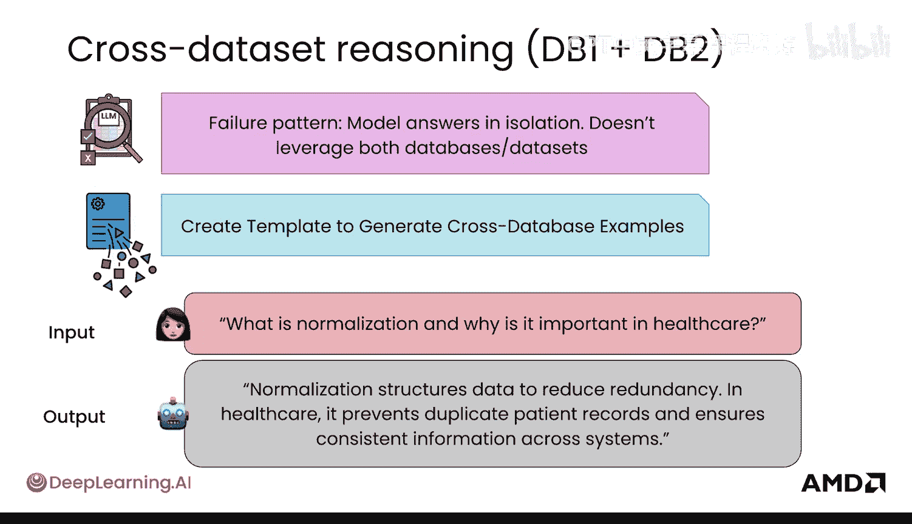

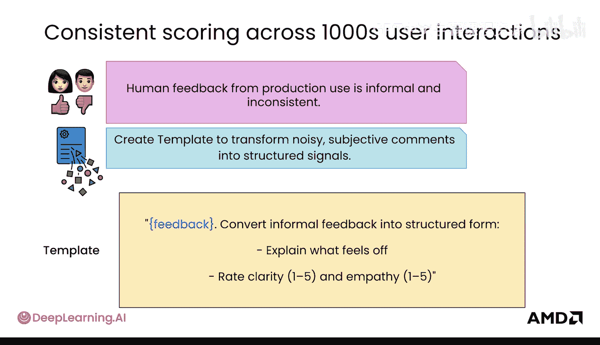

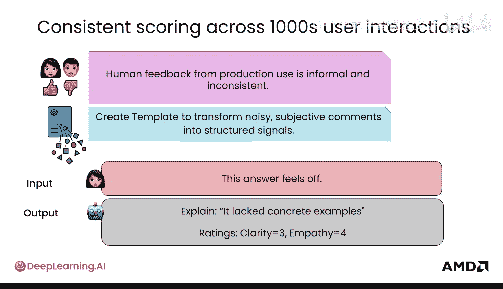

Match that structure that you can then use in your code this is what it could look like so here's a double checking template to actually check hey is this solution correct and can you verify it with another method so in production what it looks like is the model you release it and then you get some feedback from people maybe it's a limited release but you get some feedback you can then operate at the template level you can create a template from that feedback and whether it is targeting issues that the feedback hones in on or it's even just organizing the feedback itself that creates then data for you and then that data trains that new model so ultimately operating at the template level helps you scale out and get quality diverse data pretty quickly in a structured more constrained way and then it enables you to edit these templates instead so you're not looking at thousands of data samples on their own but maybe just hundreds of templates and then of course it fits into this production data flywheel where you can actually edit the template when you get that user feedback back in。

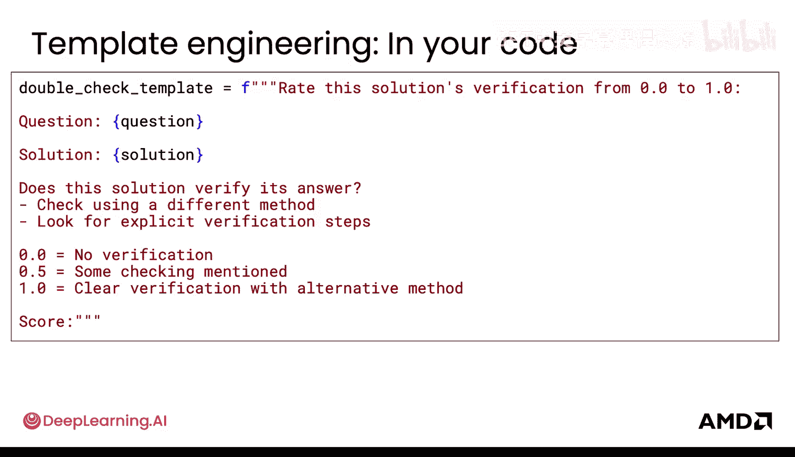

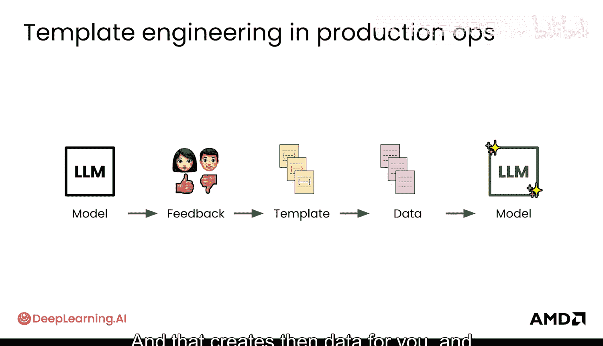

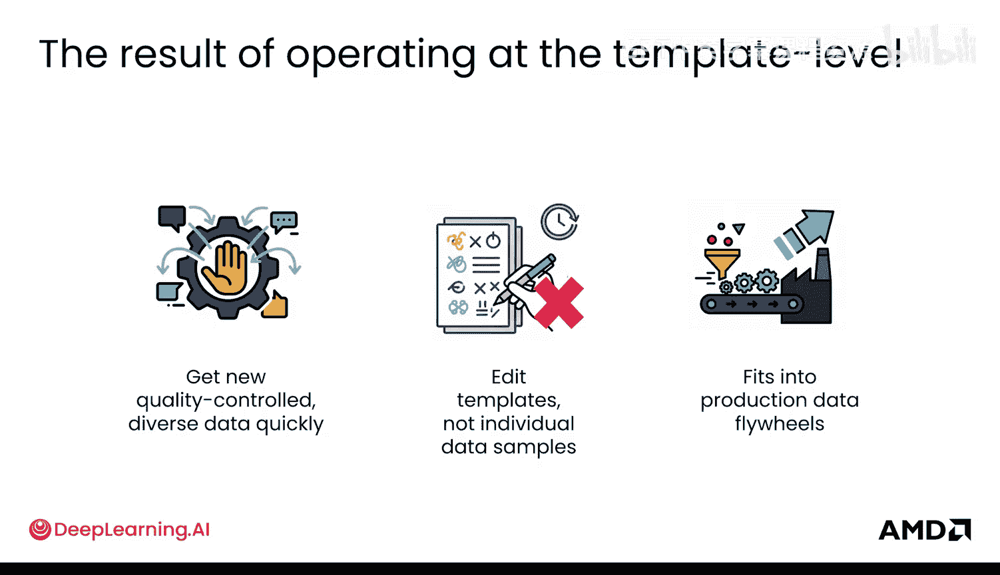

Now that you know how to operate at the template level for synthetic data generation。

 let's revisit constitutional AI。