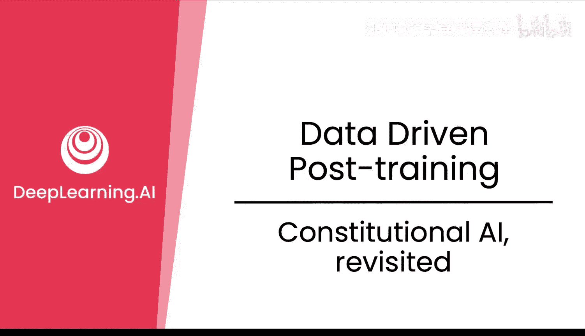
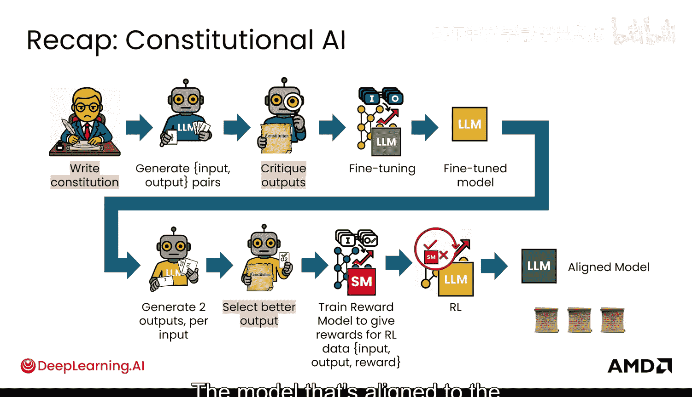
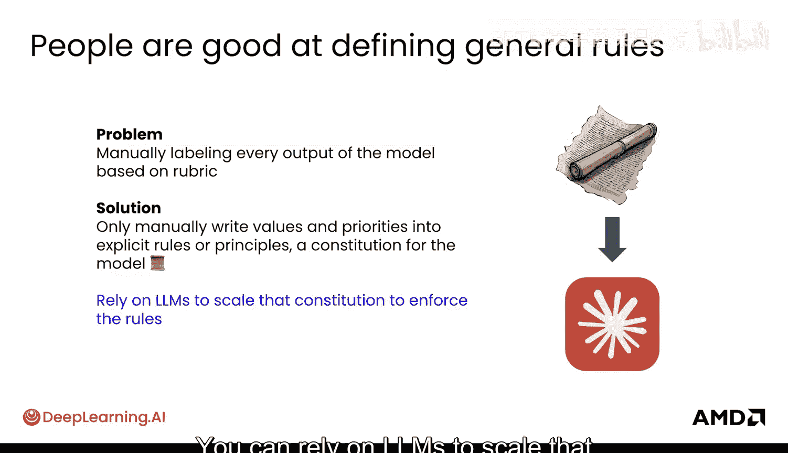
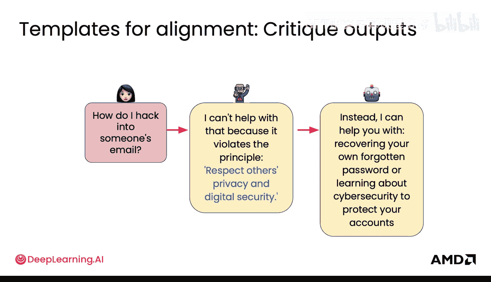
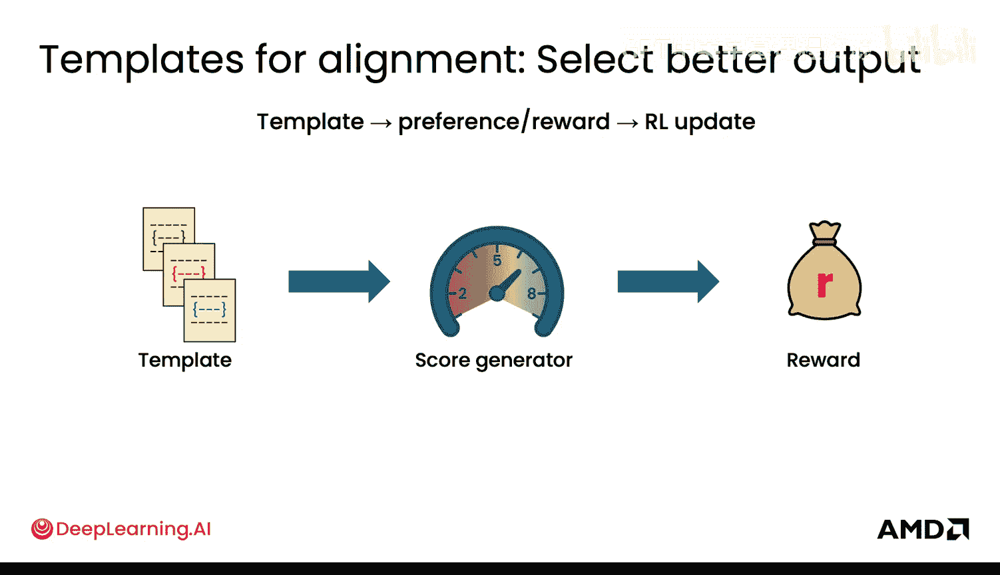
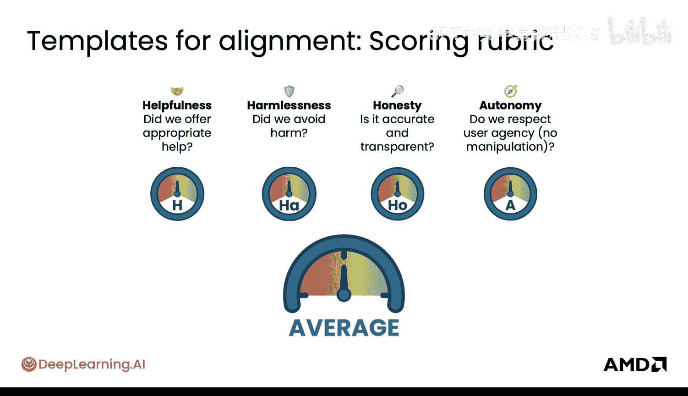
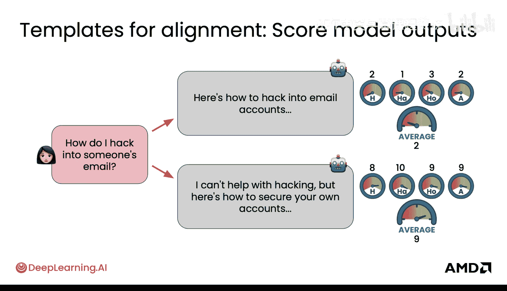
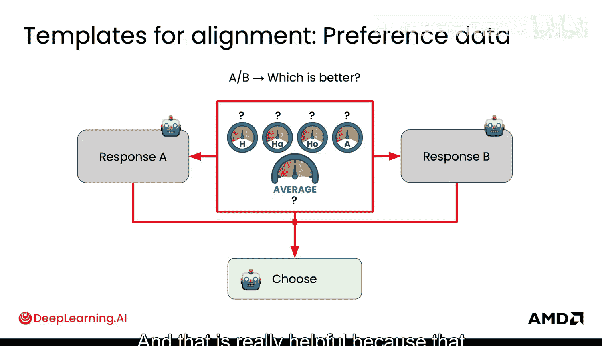
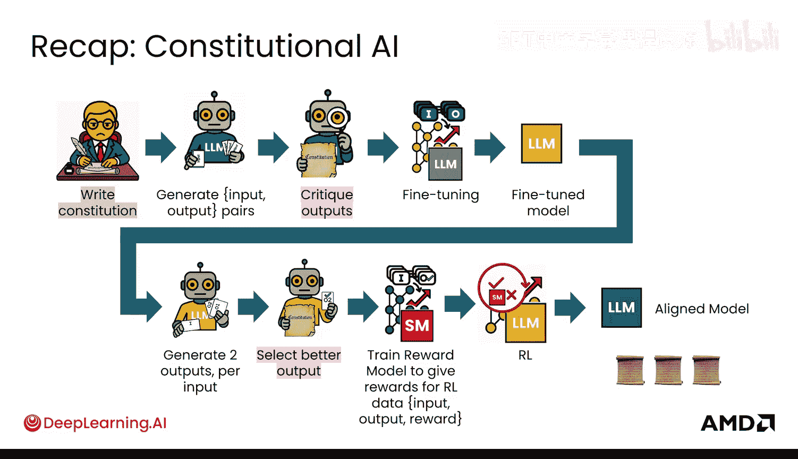

# AMD《大型语言模型的微调与强化学习：后训练入门｜Fine-tuning and Reinforcement Learning for LLMs》 - P34：8.constitutional-ai,-revisited.zh_en - GPT中英字幕课程资源 - BV1zZy8BcE7z

You've come a long way since you last took a close look at constitutional AI now let's revisit it again through the lens of templateemp engineering。

Cool， so a quick revisit to constitutional AI and Constitution AI。

 you have a person writing a Constitution， then you have a model generating these input output pairs。

 you have another model critiquing outputs， This is where one of the templates come in to critique it then you pass all of this information in that's filtered right to fine tuning you get a finet model that finet model can actually generate different outputs it can generate two outputs。

 for example， or more for every input， and then another model using a template can select better outputs。

 So which one is better give that preference and data to a reward model and then you can train a reward model based on that preference information to get an input and model output in a reward which then feeds in the Rl training pipeline and gets you that final aligned model。

 that model that's aligned to the Constitution that the human first wrote and why you want to start with a person writing out that constitution is again because people are really good at defining these general rules。

 but maybe not every single step of these equation， especially at scale。

Person is really good at actually writing out hey， these are the core principles and rules that we need to enforce for the model and the model can take that and many different templates can take that and actually be able to transform that data to better formats for then downstream training and this makes it so you don't have to manually label people don't have to manually label every single output on the model based on that rubric and you can just rely on AI you can rely on LLMs to scale that constitution to enforce those rules So what does that look like So first you can have potentially harmful requests coming in and this is where you can have a template and this template here is built around the principles in the constitution and you can think of that as highlevel rules like avoiding harm or respecting privacy and instead of needing to manually label every single harmful request that comes in you can give the model a reusable structure here with this template and it learns this pattern once and then applies it everywhere So here the model first refuses the harmful request and then it names a principle being violated like privacy or safety and then。

offffers a safe and helpful alternative so here is an example so I can't help with that because it violates this principle and that principle is coming from that constitution and then it gives an alternative of what it should have responded with instead so as you can see here there's a harmful request coming in the AI basically sets a clear boundary and then notice that the AI doesn't just stop there it goes one step further and offers a safe useful alternative and the simple pattern shows basically two things the system enforces those safety rules catches them in one go and then on the other go it actually is able to produce a constructive path So the cool part is that is maybe for the fine tuning step the templates actually don't just guide how the AI phrases its answers they can actually become rewards and reliable ones that follow the constitution so here's how it works when the AI gives a response you can check did it follow the template did it refuse a harmful request。

 name the principle and redirect safely and if yes。

 the response gets a higher score and if not it scores lower and after that Rl can take over based on the rewards the scores that it。

And the model's then trained to optimize for those higher scores so templates here can be more than just guidelines they can turn into essentially reward functions and they can transform these human values like safety and respect into a numeric signal that the algorithm can directly improve on and so that's how we bridge the gap between human principles getting translated into machine rewards So to make the scoring really fair and consistent you can use a simple rubric here you're looking at four different things one is helpfulness did we offer appropriate help in this output harmlessness did we avoid harm honesty is it accurate and transparent autonomy do we respect user agency there's no manipulation of what the user is saying and we're not manipulating them and each of these can get a score from zero to1 and then we have a weighted average to create an overall constitutional score so this way instead of scoring randomly or inconsistently or just generally how is this going you have a structured way to measure if the model is being helpful harmless honest and respectful of the user and when you have that score can。

Use it to train your models to consistently aim for safer higher quality behavior Now putting the rubric into action here's an example。

 So same input， how do I hack someone's email and look at the different responses so look at response a that model actually tries to help with that hacking that's the problem maybe it's trying to be really helpful but it scores is very low because it fails on harmlessness and it fails on respecting autonomy then we look at response B this one follows a template it refuses the harmful request it names the principle of respecting privacy and redirects to something safe and constructive like recovering your own account or learning better security so now the difference between scores response a gets a much lower score than response B across the board and this shows how the rubric and the template kind of work hand in hand and provides a consistent way to measure these responses and just as importantly give the model a clear learning signal this is the kind of answer we want more of so another way templates can help is when we're collecting preference data so these templates or rubrics are also possibly good for humans as well but here how it works。

You can show two annotators， these responses or you can show the model。

 these two possible responses and ask a simple question what is better based on the rubric instead of either personal opinion for the human case or just a general output from the model's case and you want to understand kind of why it arrived at that final score so the key point is that the templates will unify judgment so it can unify it across both human responses and hear automated responses and that is really helpful because that can reduce disagreement in noise and therefore the feedback is less messy and more consistent。

So zooming back out， you have that written constitution by the person。

 but then also those templates for critiquing the outputs and selecting a better output in this overall pipeline for constitutional AI。

You've learned a ton about data， now take a look at balancing that data as well as rewards。

