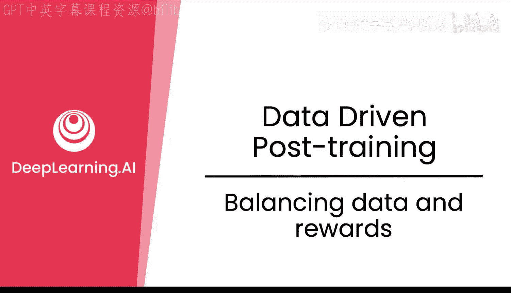
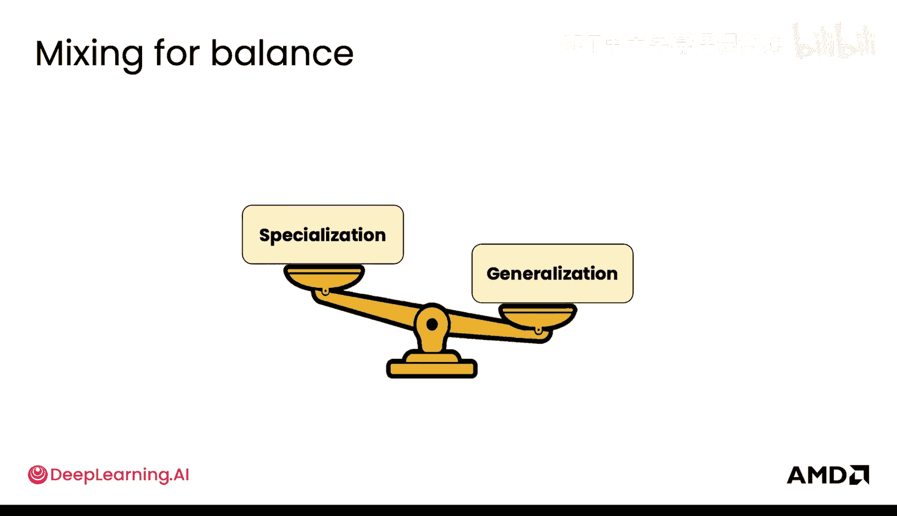
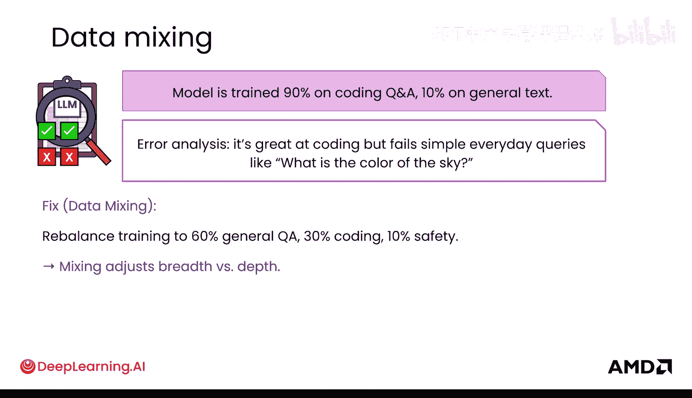
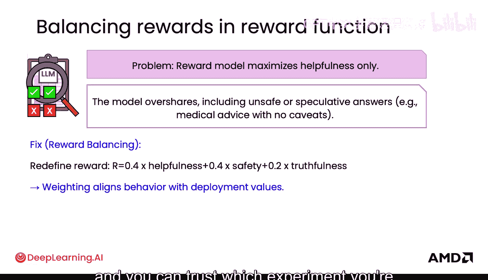
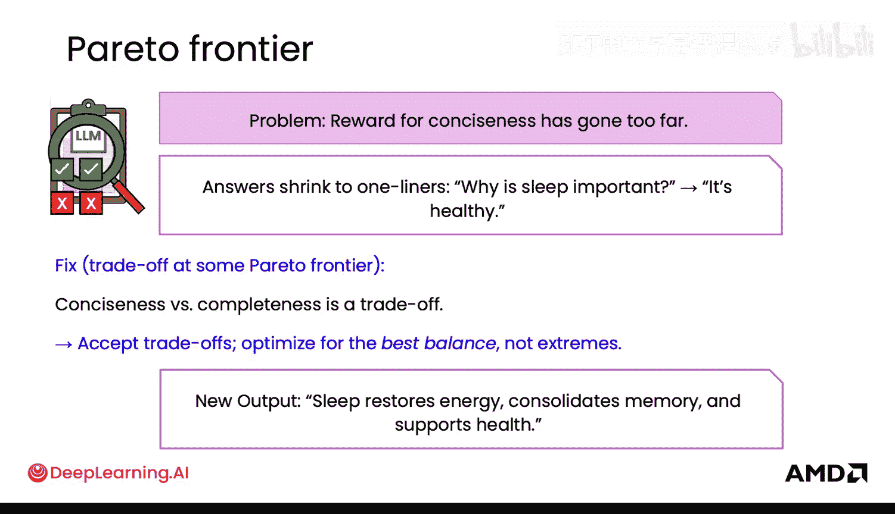
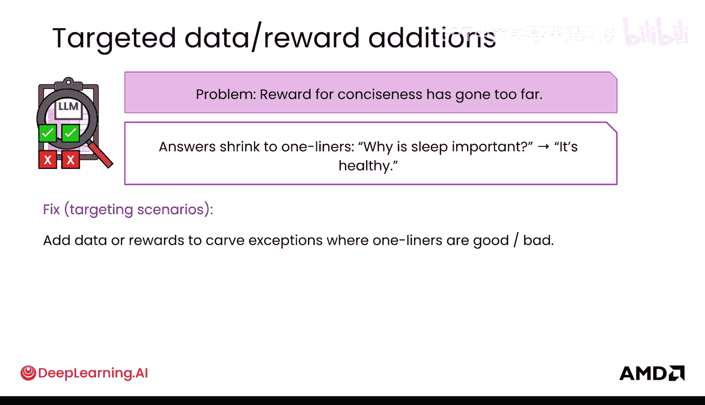
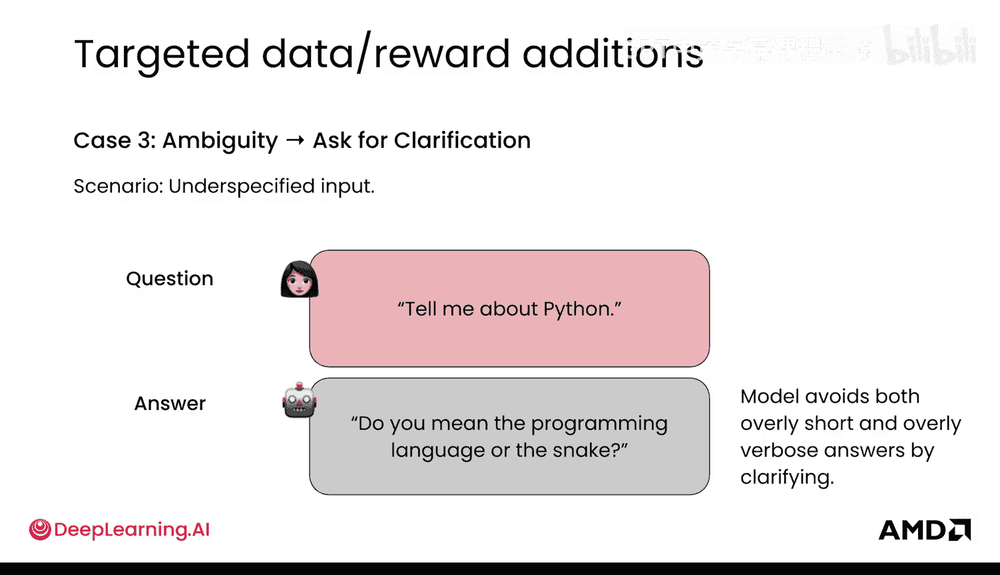
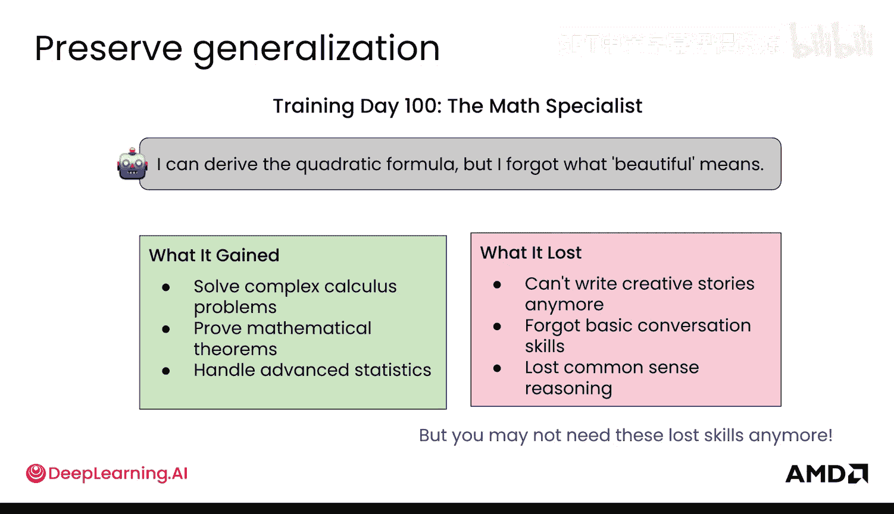
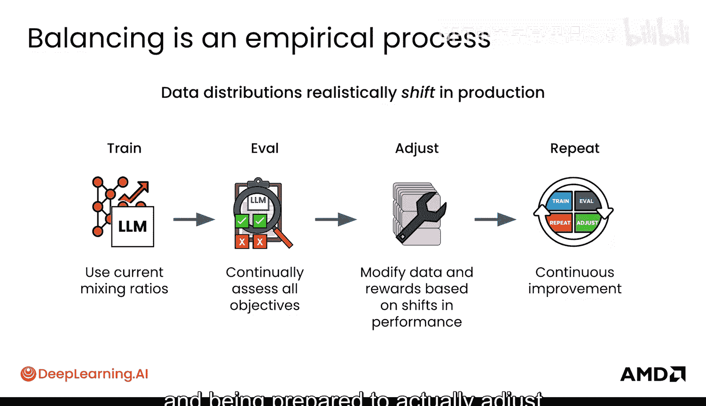

# AMD《大型语言模型的微调与强化学习：后训练入门｜Fine-tuning and Reinforcement Learning for LLMs》 - P35：9.balancing-data-and-rewards.zh_en - GPT中英字幕课程资源 - BV1zZy8BcE7z

One of the key considerations in post training is around balancing your data and your rewards so that you can get the right mix of generalization and specialization one of the biggest tradeoffs in AI is around generalization versus specialization Basically how do you make a model smarter without making it dumber This really isn't just an engineering challenge it's also a pretty fundamental tension that every frontier AI lab faces daily and it also is a challenge when you're doing any kind of posttraining and this is where data mixing really comes into play and you have to consider how you actually want the data to be mixed what kind of percentage of each type of data you want in there to get the exact right concoction for the right type of tasks that you want your model to perform So say you have a model trained 90% on coding questions and 10% in general text in your error analysis you find that it's really great at coding but it starts to fail simple everyday queries like what is the color of the sky and so this is。

A data mixing problem so it's really really good at where you've honed in on that data but you don't have enough general text in there so maybe it's time to rebalance that training data to 60% general QA 30% coding 10% safety ultimately this is really empirical right so you want to actually test a few of these and typically what I would do is run a few different experiments at different quantities at a small scale and get a sense of what mixing what kind of percentages we actually need for the ultimate use of the model Ultimately this is going to be determined by how your users are using the model and how much they're using it for each of these tasks sometimes it's going to be a tradeoff between different tasks and different capabilities for example I've trained translation model before and we could make the model really really good at these low resource languages if we had it in the data mix but then it actually made it worse the main languages and so that made it really tough to ship in production when most of our users were using it on the main languages and so that was an opportunity to probably use。

Either different Laura adapters for example， for the different tasks or different models entirely rewards in your reward function kind of operate in a similar way so maybe you have a problem where your reward model maximizes only helpfulness and the model kind of overshahars maybe it sometimes has unsafe or speculative answers like just giving medical advice here is where you might want to balance your reward function a bit and redefine your reward to put less weight on that helpfulness piece and more on safety and this weight will just align that behavior to your actual deployment values as well and again this is very empirical across oral training and test environments so you need to be really really disciplined about creating the right type of test environment so you can trust what that output actually is and you can trust which experiment you're going actually run with ultimately So some other problems so you might have a problem where your reward for conciseness gone too far the model is just too concise all the time why is sleep important it's health it is all it says and then as a result you have this tradeoff between this conciseness that is really great。

At answering very clear easy easy questions and it's not too verbose and not annoying like that。

 but then it's not complete right so there's a tradeoff here that you might have to make but you can also address this by having more targeted additions to fix a scenario so maybe there are areas where you want it to be concise in certain domains where you want it to be concise but there are other areas other domains where you don't need that then you can add data or rewards to carve out those exceptions where one lineers are good or bad for example if they're good for trivia or like factual question answering like what's a capital France。

 Paris concise is really ideal， but then when it's explanatory or causal questions like why is sleep important then you show examples with a lot of depth you can also have a case where the model actually avoids both overly short or verbose answers by just asking for clarifications so you can teach the model to ask for that clarification in order to give a better response to the user So maybe you've trained a math specialist and you're on your day 100 of training maybe it's not that extreme。

But it has learned a lot of complex calculus it is able to prove these math theorems at a really advanced level。

 but it started to lose some of those basic capabilities and this is a tradeoff you're going to have to make at some point where your model starts to gain these specialist capabilities at the same time one thing I want to emphasize is you might actually not need some of these lost skills anymore so one thing to really think about for your EVs is are you going to look at the Evals online on the web for that general purpose capabilities or you're going to look at EVval specific to your business and what you actually need your model to accomplish As said before balancing is really an empirical process and one of the most important things you can do here is scale it out based on your different experiments Another important thing to keep in mind is that the empiricalpiricism for this process never ends because your data distributions how your users will use your model will always always shift in production and that's just a reality so you have to be really really good at setting up those experiments and being prepared to actually adjust to your distributions as they do shift。

Okay。Congratulations， now you've learned about the algorithms， the evaluation， and the data。

 now it's time to tie it all together and put it in production。

