# AMD《大型语言模型的微调与强化学习：后训练入门｜Fine-tuning and Reinforcement Learning for LLMs》 - P36：1.a-production-post-training-pipeline.zh_en - GPT中英字幕课程资源 - BV1zZy8BcE7z

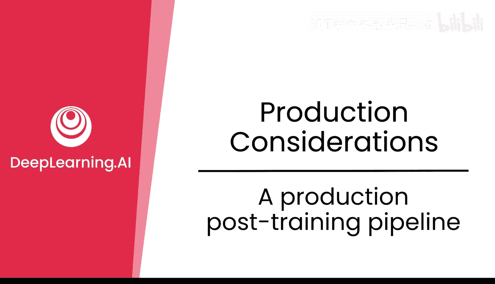

Welcome now it's time to take a look at the important considerations for production in putting your model in production let's start with looking at a full production post training pipeline that a frontier lab uses。

So as you've seen before， frontronier labs have pretty complex pipelines for posttraining You're going deep dive into one of them right here from Deepse this is Deepses R1 and R10 and these were the first examples of open source reasoning models and this was publish early 2025 and here is what the pipeline looks like there are two final models here so Deepseq R10 and deepse R1 there are a bunch of intermediate models that they use to get there there are a bunch of different datas that you've already explored in a previous module and of course there are several posttraining stages that utilize those datas and create some of those intermediate models up to that final model so let's start with the R10 pipeline this model is trained only with reinforcement learning only with RL with verifiers only so no reward model even so it's very simple so it's just these three steps but it's helpful to understand these steps and then be able to compare it to that larger deepseq R1 pipeline。

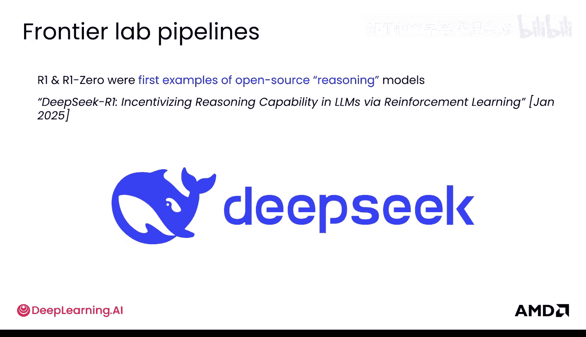

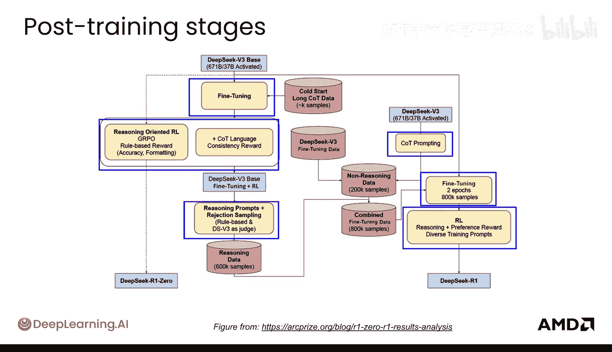

First starting with the base model， this is Deepse V3 basease。

 this is a base model that they had previously pretrained and so everything is kind of starting off from this guy at the top and this V3 base was pretrained on $14。

8 trillion tokens so on a huge amount of data and it took a lot of time I mean they used the word only several times so only 180000 GPU hours and at the time it was a groundbreaking result because it only $5。

3 million which was technically not a lot for pretraining considering how a compute intensive pretraining actually is and so they used H 800 GPUs here and they were looking at like a $2 an hour kind of cost to get that 5。

3 million and what's really interesting and exciting is that deepse V3 performance actually compared very favorably against other base models around that same time so you can see here's the benchmarks across those other models great so what did they use that base model for so they took that base model and then they did this。

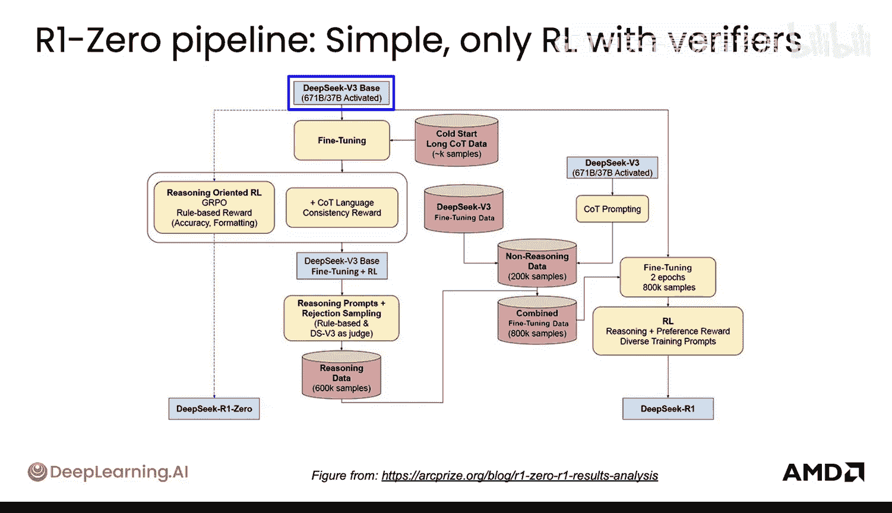

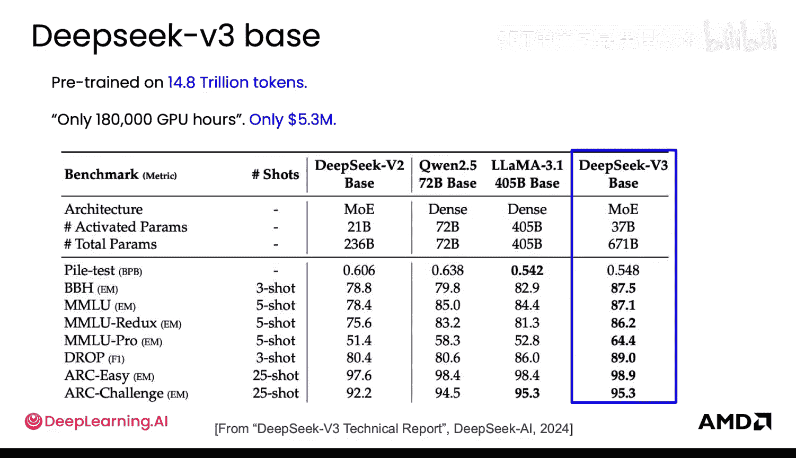

RL stage and that was it。 So it's reasoning oriented RL using GRPO。

 which you've learned about before and these are just rulebased rewards for accuracy and formatting and the training data was specifically just math encoding related and GRPO only had two verifiers One was for accuracy for that math or code and the other one is for formatting so it's just formatting whether the think tags were in the correct place and on the Amy math benchmark they were able to get from 15。

6% accuracy to 86。7% which is a very big jump for an open source model and was competitive with open AIs01 model at the time and so that made it a very interesting model and a huge splash in the media and in the ecosystem at the time and what's really interesting here is to see this graph so this graph is honing in on the fact that the model only trained with Rl and these verifiers So there were no demonstrations for input or target output for fine tuning。

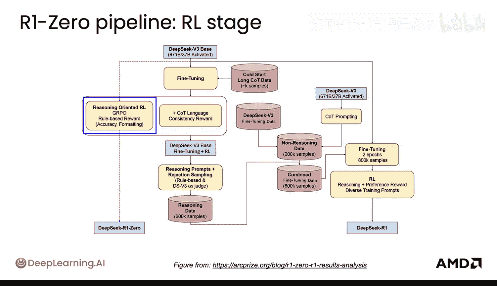

There was no reward model giving any feedback back so the model really could think for as long as it needed to to give an appropriate output。

 appropriate answer and they found that naturally the model started to think more and more reason more and more spend more tokens in its think tags to get to the right result overtime and training and that is what this graph is showing showing the length of that response increase over time and so it's thinking more and moreCool so just as you saw in that graph what they found was that behavior such as reflection so the model reflecting on its own kind of in an agentic way or the exploration of alternative approaches to problem solving actually arise really spontaneously using this type of RL and this is one of the experiments that really isolate reinforcement learning from just fine tuning and it kind of shows what Rl is capable of in this case however on its own this model did struggle with a lot of different challenges as well so it had poor readability it would mix languages up。

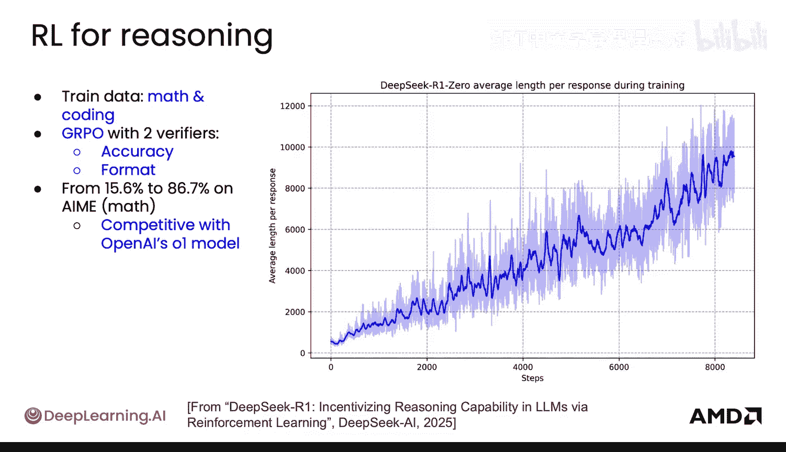

To get to the right response and maybe that was the most efficient way for it to get there。

 but it actually resulted in a much less usable model at least for people to understand what it was thinking so it's harder to audit it also was just you only contained in these like math andcoding domains where we have those verifiers so it was limited but it was a very good kind of experiment to see what the capabilities of the technology are so it's time to upgrade from the R10 model to their R1 model and that pipeline is much more complex it's more complicated here the goal is to be of course more general purpose not just reasoning so you need both reasoning and non-reasoning data and you need that to be mixed in in the right ways So starting with the reasoning data pipeline first you start with the cold start long chain of thought data that you've seen before and just finet that a little bit a couple epochs and these are just very detailed reasoning chains in this data just to get the model warmed up to reasoning that's fine tuned。

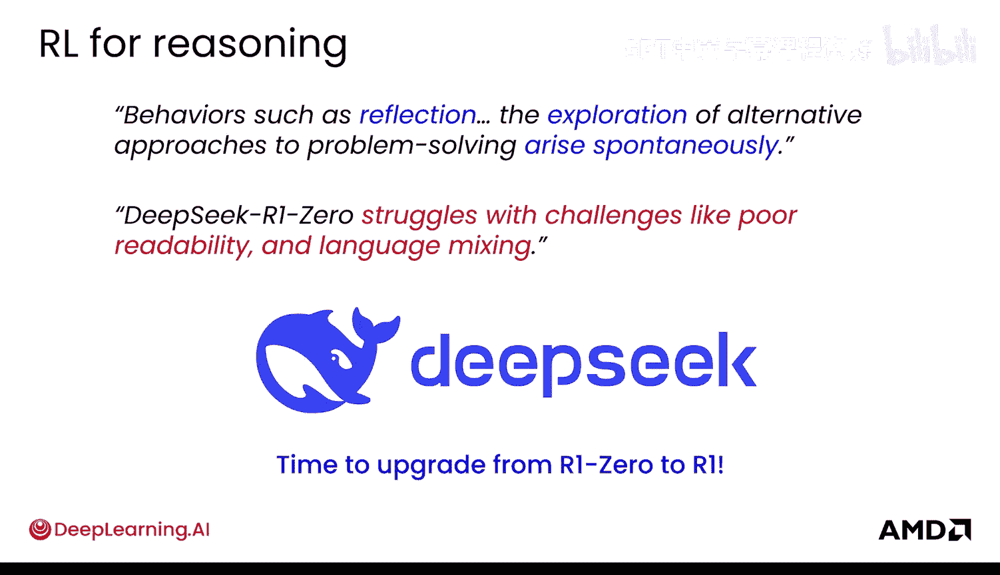

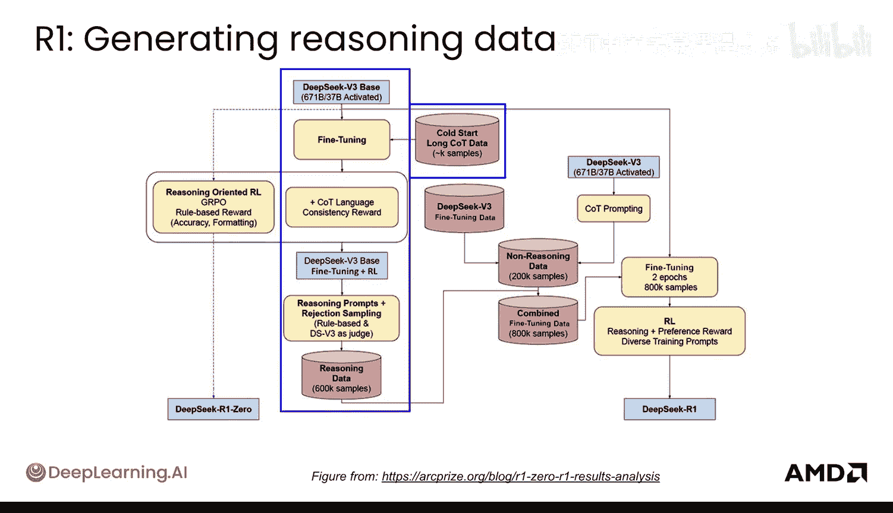

This intermediate fine tune model and now it's going to be ready to be trade with RL so it doesn't go fully off the rails the fine tune model is a little bit more on track to reason and then here is adding that chain of thought language and consistency reward so making sure that the model is actually outputting just one language they're trying this now so that it is rewarded from a reinforcement learning perspective to actually output only one language at a time and that makes it more auditable and then you get another model and then finally using that other model you can then create additional data here and these are more reasoning prompts generated by this model is is just synthetic data here and then using rejection sampling so being able to sample multiple out of this model and only pick the best ones they're able to get a distilled really high quality reasoning data set and so using a lot of different possible rules to filter and using other models to filter here。

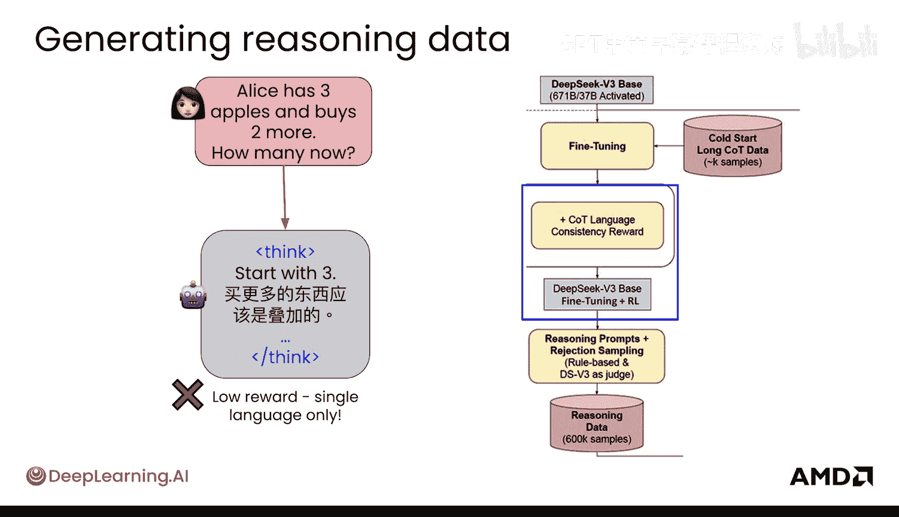

the base model as a judge here and they're able to get this reasoning data of about 600。

000 examples Great so that was the reasoning pipeline and now the non-reasoning pipeline okay so now on the non-reasoning data side they're able to generate these chain of thought prompts using the deepse V3 base model and they are able to get the model to you know essentially have these long chains of thought but not quite towards reasoning tasks like math or code and they're able to get these target outputs and then use this input and target output in that non-reasoning data they also combine it with direct answer data so you see that on the left here with deepse V3 fine tuning data and that's also added into that nonreasoning data okay so that was your nonreasoning data pipeline now you combine the nonreasoning data and the reasoning data together and that creates a combined data of about 800000 examples that first feeds into fine tuning for a couple epochs there creates this intermediate model that then。

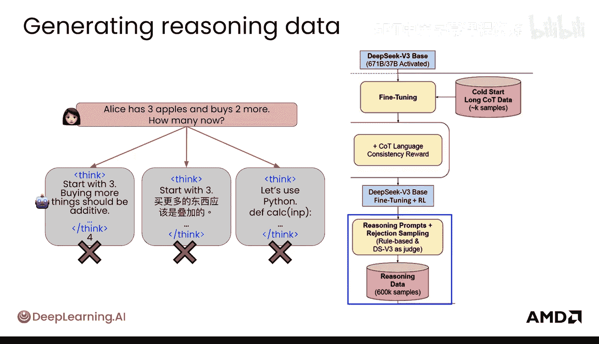

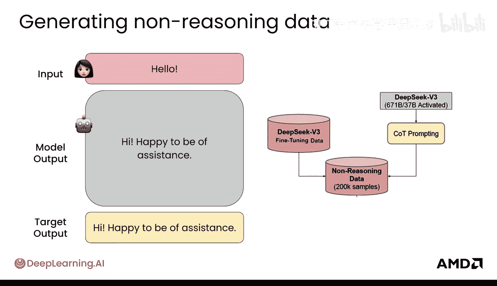

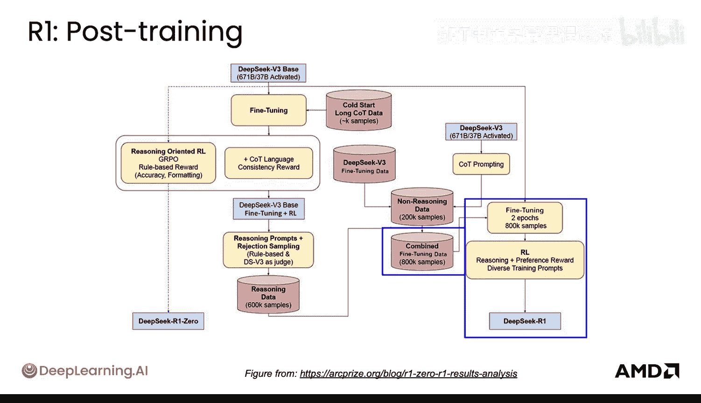

fees into the reinforcement learning pipeline， where there are you know reasoning and preference rewards here。

 so meaning there is a reward model here and very diverse training prompts and that gets you your final deeps R1 model and that is the entire pipeline。

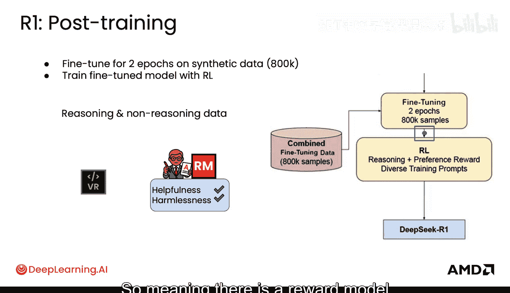

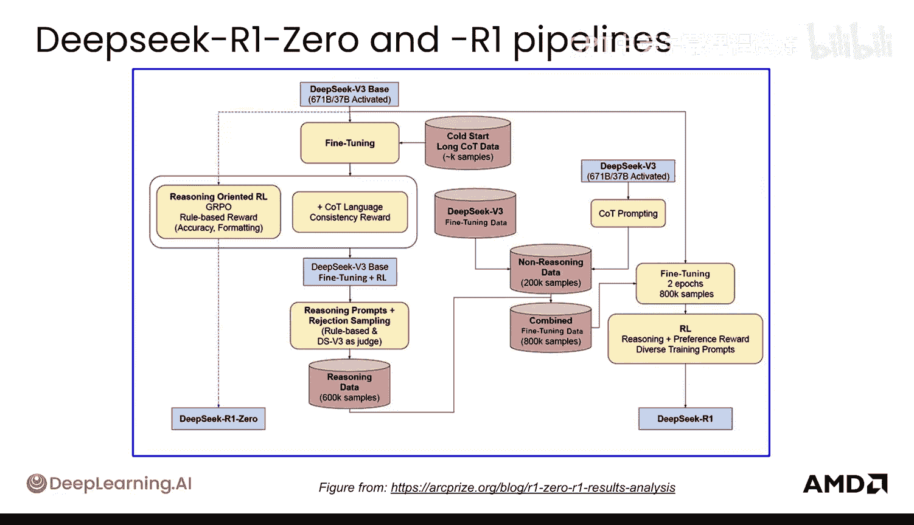

Now that you understand all the different components that go into a production post training pipeline。

 let's take a look at agents and how they interact with the real world。

