# AMD《大型语言模型的微调与强化学习：后训练入门｜Fine-tuning and Reinforcement Learning for LLMs》 - P37：2.agents.zh_en - GPT中英字幕课程资源 - BV1zZy8BcE7z

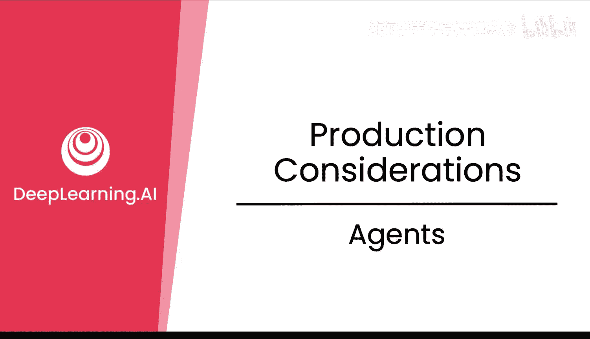

Agents are a really popular way to deploy LLMs in production。

 A live agent can actually help inform what type of behaviors you need to do in posttrain to get the right result LLms that are live in production today go beyond your average assistant so you know your average assistant it learns to chat with posttrain it learns to interact with a person but an agent is something that is often in production or something that people want to put in production and post traininging enables a lot of the different capabilities and agents as well like using tools and planning and coordinating but it's a different type of posttrain and you've seen a little bit of that already and this is because in agents。

 they' UX， their user experience is different than that of a chatbot and specifically here chatbots know they're good at responding to different queries having a good conversation they can handle that chat history that you saw before that posttraining enables but with different posttrain you can get an agent that can use tools and As which you've seen a little bit before too to reason you've seen that and be able。

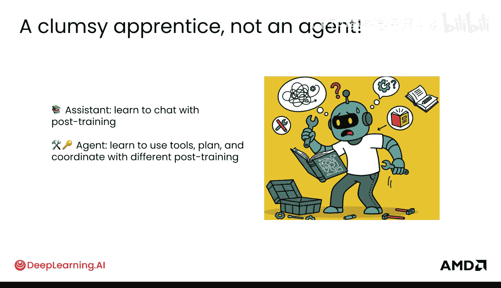

to loop and have fewer hallucinations in that loop and learn to basically do that reflection loop more effectively and finally it's able to coordinate。

 so you'll go through each of these， but essentially agents interact with many components of the real world and it can be messy right the information can be messy the tools it's using could change over time so let's take a look at how all of these components work but then also how this all culminates in a live agent in production So first for tool use you've seen this before so essentially what is today's weather the target output could actually use a tool like the weather API today and then show something and display something here you can use these fine tuning examples to get your model to become more agent and then R for tool use similarly you can teach it to use a calculator here instead of calculating it on its own and get a reward for either getting the right answer and or also using the tool itself for R you've seen this also using the search API using codebased files so using the tool。

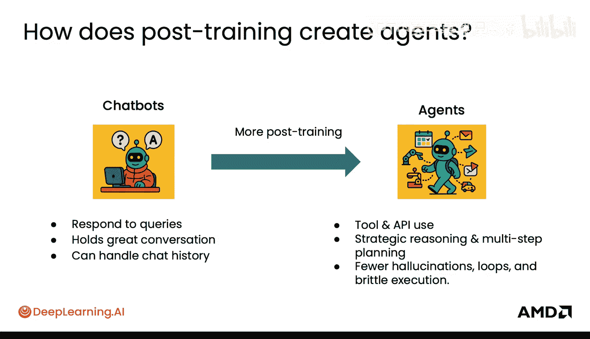

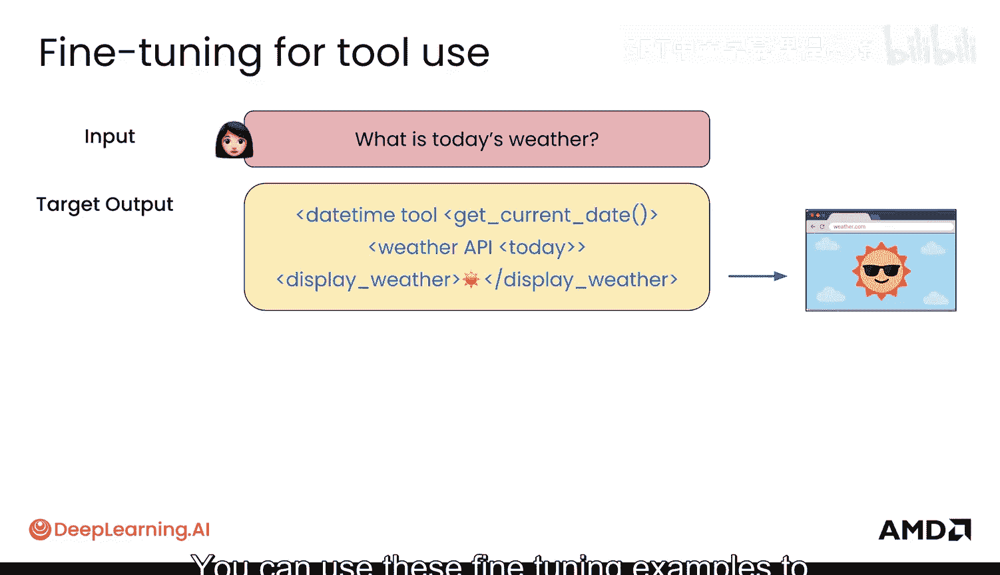

Search on the Internet to get updated information So this is all for tool use。

 this is all posttraining for tool use Next is planning。

 and I think that largely falls into reasoning and how a model should think step by step to get to a better answer and so for fine tuning for reasoning you've seen the chain of thought before for RL you've seen it as well getting a reward for the final right answer and allowing it to plan for coordination I think this takes it to the next level that you haven't seen as much before but this shows how posttraining could occur on a multiag transcript So essentially you could have a model be able to operate better with other agents that are using other tools for example here agent A might be showing okay it's able to break down the math problem agent B is in charge of the calculator tool in using it and then your target output is thinking about how do I aggregate this information from agent A and agent B together to get to the right answer that's the final model you're fine tuning here and so that's using multiple different possible。

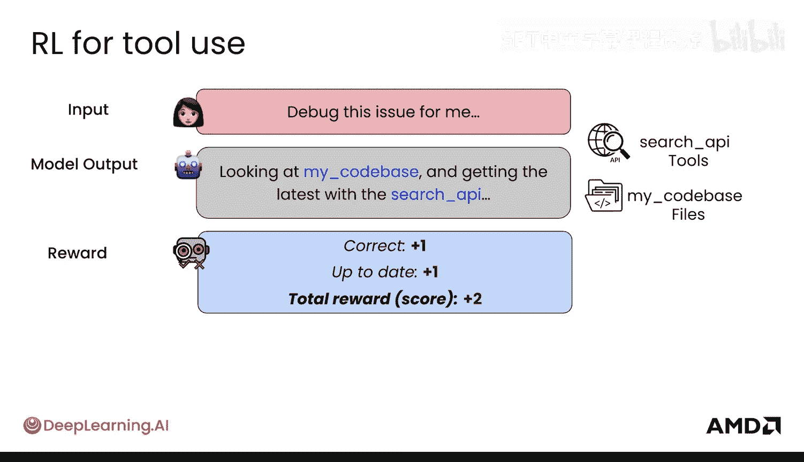

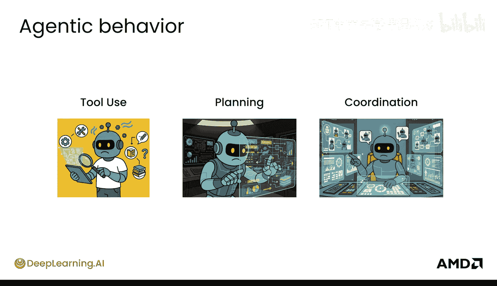

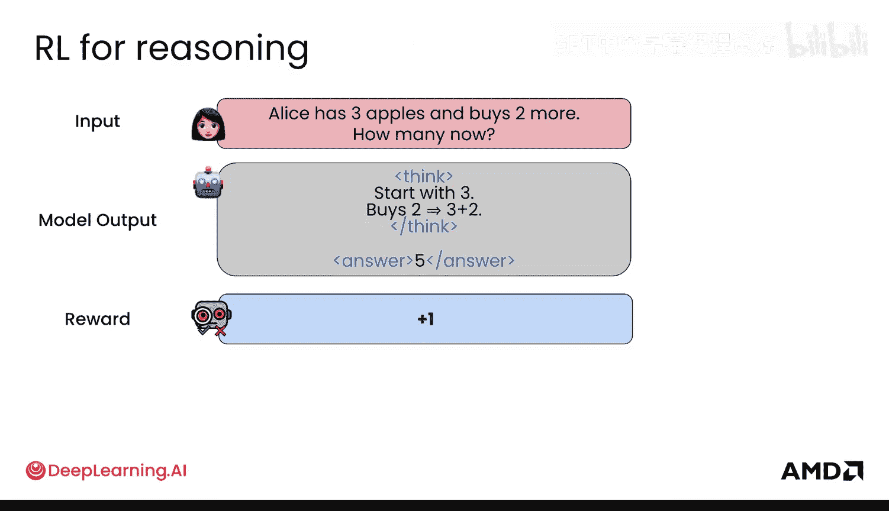

Mo or possible agents to get to this final target here and fine tuning and actually these are all possible different tasks so you can actually teach the model to be agent A agent B and agency C as well in R for coordination what it could look like is maybe the user is saying find refund status for order number 123 and the model outputs it is looking to agent A it's using agent A in some way which again could be its own subagent but it answers sorry didn't get the order info and what you want to teach the model is to be able to handoff information correctly across its a subagent or to another agent and to get to the right response for example here's another bad case so if the agent A said theres a refund pending even though there was no refund found and then you' refunded it that's not great either you're on a refund the order if that doesn't exist heres the correct case where agent A found that this order belongs to a certain customer ID and then that customer is then refunded Great so this kind of brings us to live agent。

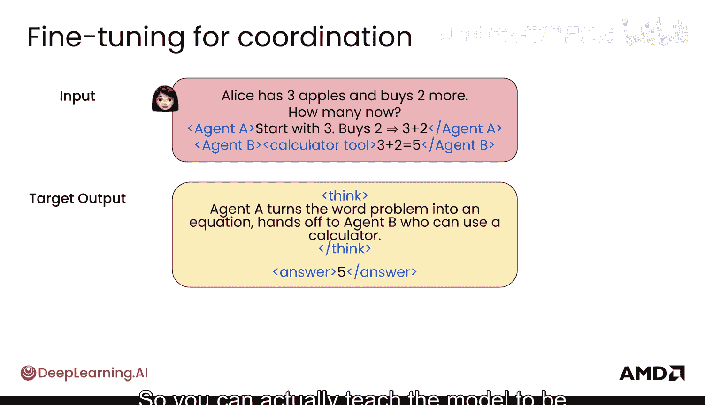

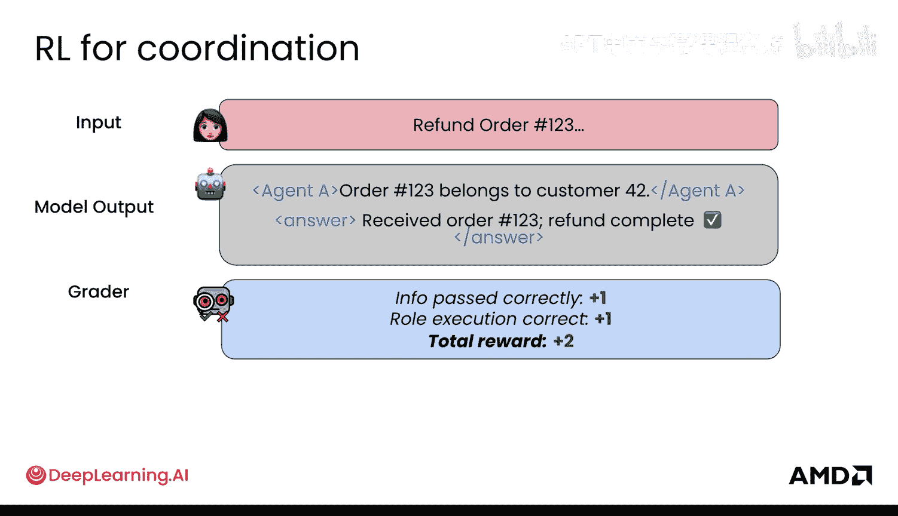

So as we deploy these in production what are some of the different considerations that need to happen for this agent to work effectively so one is just the state is constantly updating so that is something that is more difficult in production write your API changes your tools change themselves state is just constantly changing so being able to manage and handle that effectively is really important new context so there's new information coming in all the time and it's not just frozen in time when the model was trained on that data so instead this is like using a search API where you get news information new information or you can use retrieval augmented generation or rag which is essentially a data search to add relevant info into the input that is maybe more up to date finally there's messy data and data that can be wrong that gets added to the model in some way in the context and the model needs to be able to handle that and these are all different things that this agent needs to be posttrained to be able to handle so based on the behavior that you need the agent to operate on in production you need to design your agent accordingly。

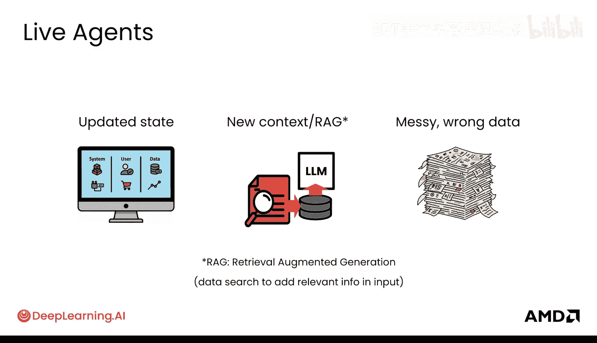

Able to be robust to these things So here's an example of you know continually updating tools so you basically want the model to learn to use tools for updated state and not to rely on its own internal state because it's own internal frozen state is not gonna be continually updated it's hard to have a continual posttrain run all the time though I'm really excited about that in the future one very simple one is actually using a datetime tool because when the model is trained it probably thinks it is in the past as time moves forward and so using a datetime tool to understand what is today's date and leaning on that。

 making sure the model defaults to using that instead of you know remembering what today's date is is really important same with using a search API and being used to actually using the search API to get relevant information as opposed to relying on its own knowledge so this is a behavior change that you want to teach using posttraining Another behavior thing is to think about information that the model has never seen before and making sure the model is really comfortable。

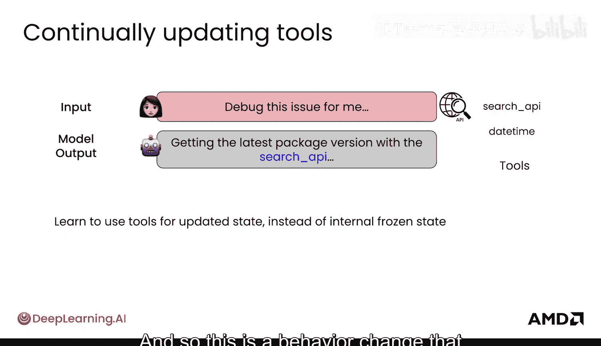

With using that information so RaG retrieve augmented generation basically can retrieve newly seen information from any kind of data source similar to using a search API and you can attach like a new earnings report here and the model should be able to handle that you should also be able to handle like if something is wrong so if that earnings report was actually not earnings report or it's not the latest one the model can actually then go check that so the model here is actually checking what is to date's date actually this is not the latest earnings report so was able to use that datetime tool probably and then check that this in fact was the new earnings report and then handle that incorrectly provided information from the user which is probably pretty common in production so here's just the little case study of how you might be able to handle a live agent coordination situation and that informs what you do in your fine tuning in RL workflows so maybe a user saying my order late tracking says it's lost help。

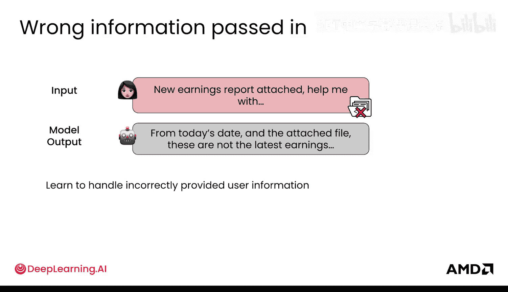

Your model says， okay I need to find the user's order and check the tracking and it kind of writes out this code as a result。

 but it gets this error okay so it still doesn't have the status it tries again still error okay is getting a problem trying again still error and then finally it answers the user sorry I just don't have that information please check our FAQ page you're probably familiar with seeing a response like this and of course the user is very upset how do you get this information one is a lot of the times you're gonna have to deploy even in a limited setting and agent to collect this type of information that a user is actually asking you for and then you need to correct it using posttraining techniques for example in fine tuning what this could look like is you have this error you could see that there are issues with maybe the function name or even the parameter kind of being passed in and so you want to give the right target output and teach the model okay this is actually the right function declaration and this is actually what you're。

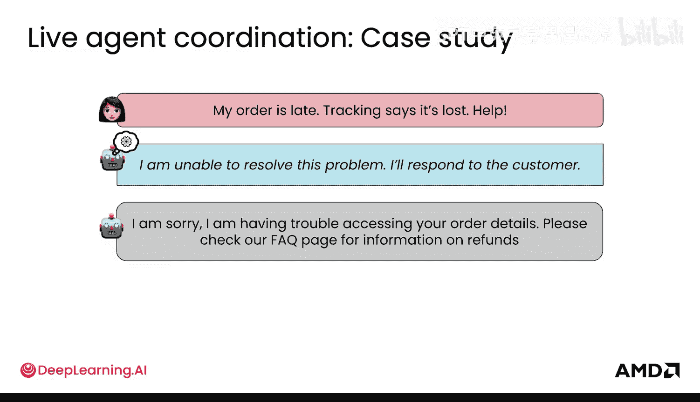

posed to be passing in the customer ID and not the name and you create a lot of examples of this so the model can actually effectively use your company's tools in RL what this could look like is this same error it doesn't execute and it's wrong maybe if it executes you give it slightly higher reward it's still wrong though and then if it's correct and it executes then you give it that really positive reward so that's what this could look like so in planning what this could look like is know there are a lot of failures and it just quit and it said just look at FAQ page and that maybe gets a negative reward versus you might want the model to actually be escalating that might be a more effective path for a human in the loop kind of process in production and so for many failures the model actually is able to escalate it and then it gets a positive reward so this is just a way of thinking about okay how do I actually need my agent to operate in production and then what tools do I have in my tool chest and post-training with fine tuning。

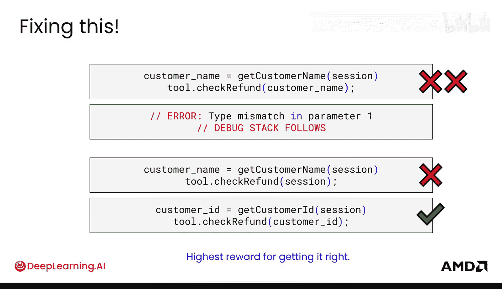

Reinforcement learning now to actually adapt my model so that it can adjust for these things。

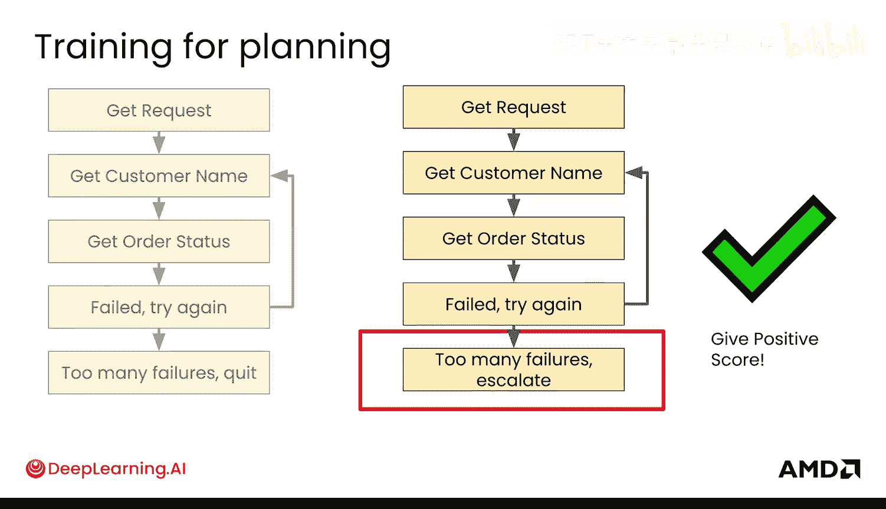

Now that you know how live agents interact with post training。

 let's switch gears a bit and take a look at the different stages of promoting a model from development to staging to production and specifically ho in on the RL piece。

