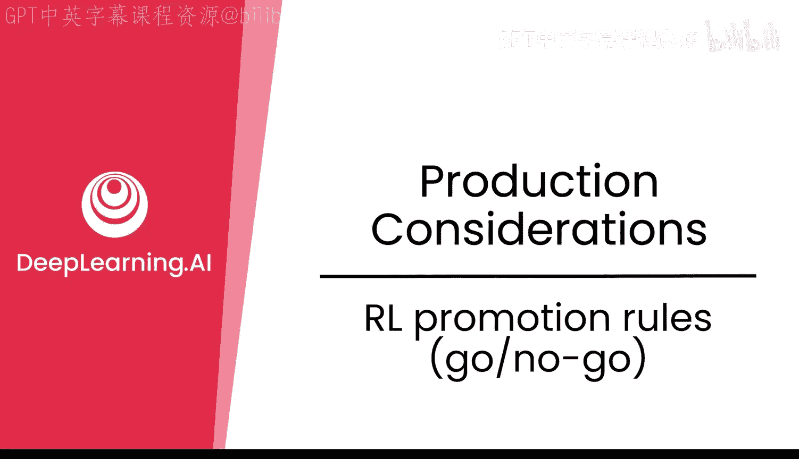
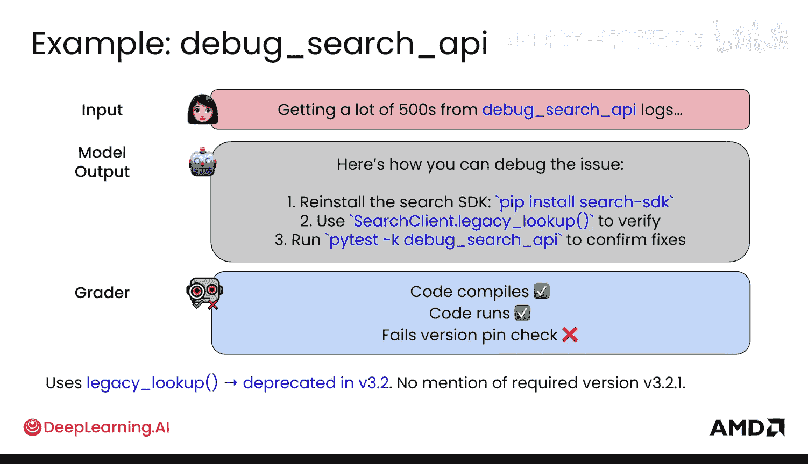
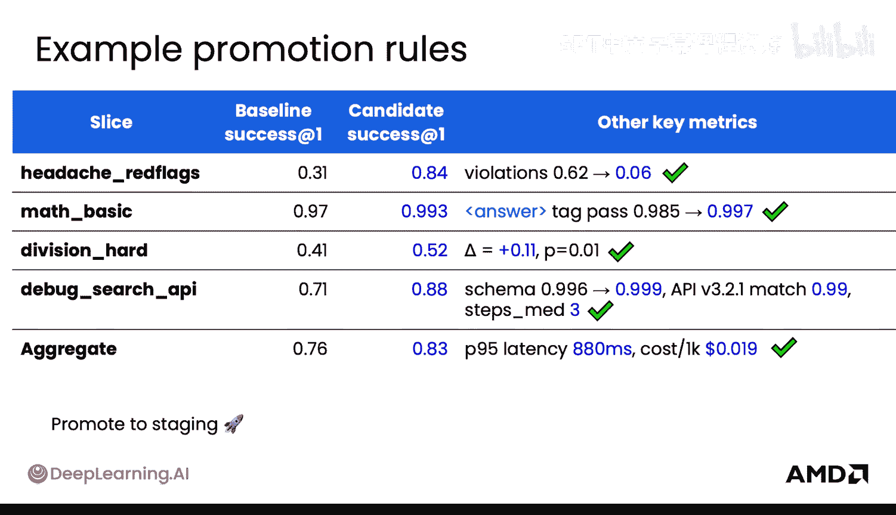
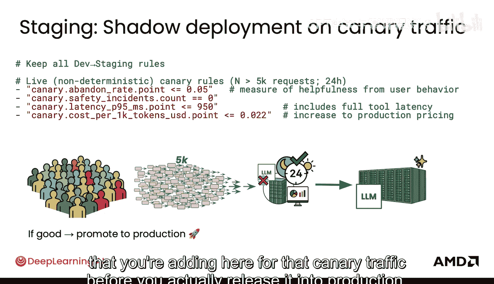

# AMD《大型语言模型的微调与强化学习：后训练入门｜Fine-tuning and Reinforcement Learning for LLMs》 - P38：3.rl-promotion-rules-(go-no-go).zh_en - GPT中英字幕课程资源 - BV1zZy8BcE7z

A good production system has a lot of different gates and promotion rules between development to staging to production。

 and here you're going to hone in on that specifically for RL because it can get a little bit tricky。

So you've seen this Rl test environment before。 it's frozen and for the production check in order for you to actually feel comfortable getting this in production。

 you should definitely make sure that rerunning this gets you identical metrics so this is a very trustworthy test environment for RaG if you're also using ragG you will need to freeze that too so just to look at kind of an example inside of this so you might be debug in your search API so you want to take your RL test environment and actually divide it up in what you'll see as slices。

 but just to look at one example first here you might look at debugging your search API so one input that might be in this test environment is getting a lot of 500s from the debug search API logs and then the model's output is here are the steps to debug that issue and you see that the co-comps that code run seems to work logically but it is not pinning the version so it's not pintting what required version is needed and it's using legacy lookup which is depred in the most recent version so what could this look like a more quantitatively。

And just like laying out all the different metrics so you have your reward models saying it passed because it was relevant of fluent your unit tests say it's passed and the code runs and compiles inside of that frozen environment but your version check that fails and it's using a deprecated function and that fails so you're violating the different rules and you actually are not able to successfully do this on your first run okay so maybe you do some fixes and now the model is able to output the correct number of steps with a version pin and that is great and this is now what it looks like so now you're passing everywhere and so it passes and you put together the quantitative metrics here so that you know before your fix the model maybe was favoring fluent but wrong version outputs and now after doing some of the fixes and posttrain your model can now prioritize those explicit version pins So what you saw there is just one example of something running inside of your environment and now generalizing a bit so you can monitor this。

ca you can look at slices so a slice is essentially something that aggregates across an area or a behavior that you really care about so debugging the search API could be a slice for anything that's regarding the search API maybe there's something regarding updating the user profile initializing your cache or generating a report you want to be able to have basically pass rates within a slice and understand which slices are doing well or not and it's not just one example So version pinning could also be its own slice and it can overlap its own slice that you really really care about that behavior and you want to monitor that behavior of the model before you feel comfortable actually promoting that from development to staging so just looking at what possible slices could be from familiar examples in this course so you could have the headache red flags so example input is have a headache and making sure that the model is actually explicitly recommending urgent care and is being very concise and those are things you care about for a math slice。

this math problem again and then making sure the math is correct and the answer tag is there and then for division it could be something like this where it's looking at whether the division was done correctly within some numerical tolerance and then debugging the search API of course right here making sure the unit test pass and it cites the API pinnedversion so you have your slices of the behaviors that matter to you for the model and these are really important to monitor so that you can understand what stage you can promote your RL environment too so first in your experimentation loop you spent most of the course here which is training the model to be better and better and better ultimately you get to the test evaluation so you're actually testing it on your heldout environments there and this is where you want to have these pass and fail promotion rules which you'll see soon but essentially across all your slices what constitutes passing and what constitutes failing quantitatively and that will automatically then gate what models can actually go into staging staging is where you want to compare to your production model。

And you can actually try it on a small percentage of live traffic。

 at least canary traffic basically just shadow monitoring how it's doing and understand how it's doing relative to the model you already have in production and then of course in production a lot of observability there a lot of possible user feedback to data flywheel there and that you can then pass back to the experimentation loop but this is essentially what it looks like very similar to other types of software you just have to consider that the model is not going to be stable the entire time so for fine tuning it's going be closer to regular software where you get to deploy it and it's a frozen thing all the time versus NRL things are not always frozen and you haven't always caught all the different reward hacks it's just a little bit less stable when you deploy it So here are promotion rules so here's an example you could have a aggregate quality gate at the very top and then you have certain slices that really matter to you that you are not allowing any regressions on so maybe your headache one and your debug search API。

This is a very strange model actually if it's all of these slices。

 but essentially you do not allow regressions on these so if it ever does worse on any of these it's a nogo so safety has to have a certain strict cap formatting that has to matter above a certain confidence interval for those format passing and the math correctness for the division one it has to actually improve meaningfully so maybe this is a model capability you want to improve so if it's not improving on this air slice then it's a nogo because maybe that's somewhere your users actually want better division and so if it's not better there's no point in actually deploying that model and then of course for tools making sure those are correct within some kind of range and finally making sure that the model is actually efficient and meets your cost parameters so this is what promotion rules could look like to go from development to staging right so maybe all of these things pass you check it and you want to promote to staging that's really exciting what could happen in staging so in staging here is where you want to look at a slice of possible production traffic right you're not。

going to have the model interact with the user necessarily it could be shadow deployment so you could look at maybe you 5000 requests at least in the next 24 hours and compare its results with your actual production model or compare it to maybe it's on a production model but you're actually using people right now and actually answer some of those requests but you're comparing it in some way and you're monitoring how it does here and then if it's good of course you want to have additional promotion rules here between staging and production that you're adding here for that canary traffic before you actually release it into production。

Now that your model is humming along in production。

 let's take a look at how the data you can gather in production can then feed into the experimentation loop later。

